# The Engineering Leadership Handbook

**From Senior Engineer to Engineering Manager, Director, VP Engineering, and CTO**

Single-file edition, generated by `tools/build_single_file.py` from the same sources as the website. Text is licensed CC BY 4.0; see LICENSE-CONTENT.md in the repository. Northstar Technologies and every person, number, and dataset attached to it are fictional.

## Contents

- **Home**
  - [The Engineering Leadership Handbook](#page-index)
- **About this book**
  - [About this book](#page-about)
- **How to use this book**
  - [How to use this book](#page-how-to-use)
- **Learning roadmaps**
  - [Learning roadmaps](#page-learning-roadmaps)
- **Curriculum**
  - [Curriculum](#page-curriculum)
- **I. Foundations of Engineering Leadership**
  - [Chapter 1 — What Engineering Management Actually Is](#page-parts-01-foundations-01-what-engineering-management-is)
  - [Chapter 2 — From Individual Contributor to Leader](#page-parts-01-foundations-02-from-individual-contributor-to-leader)
  - [Chapter 3 — Managerial Leverage and Systems Thinking](#page-parts-01-foundations-03-managerial-leverage-and-systems-thinking)
  - [Chapter 4 — The Leadership Ladder: Senior Engineer to CTO](#page-parts-01-foundations-04-the-leadership-ladder)
- **IV. Engineering Execution**
  - [Chapter 15 — Planning, Prioritization, and Delivery Methods](#page-parts-04-execution-15-planning-prioritization-and-delivery-methods)
  - [Chapter 16 — Flow: Lead Time, Dependencies, and Unplanned Work](#page-parts-04-execution-16-flow-lead-time-dependencies-and-unplanned-work)
  - [Chapter 17 — Predictability and Managing Uncertainty](#page-parts-04-execution-17-predictability-and-managing-uncertainty)
  - [Chapter 18 — Measuring Engineering Productivity: DORA, SPACE, and Their Limits](#page-parts-04-execution-18-measuring-engineering-productivity)
- **V. Software Quality and Engineering Excellence**
  - [Chapter 19 — Defining, Measuring, and Owning Software Quality](#page-parts-05-engineering-quality-19-defining-measuring-and-owning-quality)
  - [Chapter 20 — Engineering Standards and Their Governance](#page-parts-05-engineering-quality-20-engineering-standards-and-their-governance)
  - [Chapter 21 — Technical Debt: Identification, Economics, and Prioritization](#page-parts-05-engineering-quality-21-technical-debt)
  - [Chapter 22 — Testing Strategy and Test Architecture](#page-parts-05-engineering-quality-22-testing-strategy-and-test-architecture)
  - [Chapter 23 — Code Review, CI/CD, and Release Engineering](#page-parts-05-engineering-quality-23-code-review-ci-cd-and-release-engineering)
  - [Chapter 24 — Reliability Engineering: SLOs, Error Budgets, Observability, and Operational Readiness](#page-parts-05-engineering-quality-24-reliability-slos-and-operational-readiness)
  - [Chapter 25 — Incidents, Postmortems, and Change Failure Analysis](#page-parts-05-engineering-quality-25-incidents-postmortems-and-change-failure-analysis)
  - [Chapter 26 — Security and Software Supply-Chain Quality](#page-parts-05-engineering-quality-26-security-and-software-supply-chain-quality)
  - [Chapter 27 — Quality Transformation at Enterprise Scale](#page-parts-05-engineering-quality-27-quality-transformation-at-enterprise-scale)
- **Case study: Northstar Technologies**
  - [Northstar Technologies](#page-case-studies-northstar-index)
  - [Northstar baseline data](#page-case-studies-northstar-baseline-data)
  - [Northstar: the director's first quarter](#page-case-studies-northstar-first-quarter)
- **XIV. Templates and playbooks**
  - [Templates and playbooks](#page-templates-index)
  - [Engineering quality scorecard](#page-templates-engineering-quality-scorecard)
  - [Technical debt register](#page-templates-technical-debt-register)
  - [Incident review](#page-templates-incident-review)
  - [90-day quality transformation plan](#page-templates-ninety-day-quality-plan)
- **Exercises and solutions**
  - [Exercises and solutions](#page-exercises-index)
  - [Chapter 1 solutions — What Engineering Management Actually Is](#page-solutions-ch01-solutions)
  - [Chapter 2 solutions — From Individual Contributor to Leader](#page-solutions-ch02-solutions)
  - [Chapter 3 solutions — Managerial Leverage and Systems Thinking](#page-solutions-ch03-solutions)
  - [Chapter 4 solutions — The Leadership Ladder: Senior Engineer to CTO](#page-solutions-ch04-solutions)
  - [Chapter 15 solutions — Planning, Prioritization, and Delivery Methods](#page-solutions-ch15-solutions)
  - [Chapter 16 solutions — Flow: Lead Time, Dependencies, and Unplanned Work](#page-solutions-ch16-solutions)
  - [Chapter 17 solutions — Predictability and Managing Uncertainty](#page-solutions-ch17-solutions)
  - [Chapter 18 solutions — Measuring Engineering Productivity: DORA, SPACE, and Their Limits](#page-solutions-ch18-solutions)
  - [Chapter 19 solutions — Defining, Measuring, and Owning Software Quality](#page-solutions-ch19-solutions)
  - [Chapter 20 solutions — Engineering Standards and Their Governance](#page-solutions-ch20-solutions)
  - [Chapter 21 solutions — Technical Debt: Identification, Economics, and Prioritization](#page-solutions-ch21-solutions)
  - [Chapter 22 solutions — Testing Strategy and Test Architecture](#page-solutions-ch22-solutions)
  - [Chapter 23 solutions — Code Review, CI/CD, and Release Engineering](#page-solutions-ch23-solutions)
  - [Chapter 24 solutions — Reliability Engineering: SLOs, Error Budgets, Observability, and Operational Readiness](#page-solutions-ch24-solutions)
  - [Chapter 25 solutions — Incidents, Postmortems, and Change Failure Analysis](#page-solutions-ch25-solutions)
  - [Chapter 26 solutions — Security and Software Supply-Chain Quality](#page-solutions-ch26-solutions)
  - [Chapter 27 solutions — Quality Transformation at Enterprise Scale](#page-solutions-ch27-solutions)
- **References**
  - [Bibliography](#page-references-bibliography)
  - [Evidence labels](#page-references-evidence-labels)


---

# Home

<a id="page-index"></a>

## The Engineering Leadership Handbook

**From Senior Engineer to Engineering Manager, Director, VP Engineering, and CTO**

An open-source, evidence-informed textbook on building, leading, scaling, and transforming software
engineering organizations.

!!! info "This book is being written in the open"
    The full curriculum is designed: 60 chapters in 15 parts, 20 templates, 8 projects, and a capstone.
    Chapters are published one at a time, and only after they pass automated validation and a human
    review. The [curriculum](#page-curriculum) shows exactly what is published and what is planned. The
    site navigation shows only published material.

### What it is

A textbook for engineers who lead, or are about to: tech leads, staff engineers, engineering managers,
directors, VPs, and CTOs. It assumes you know how software is built. It does not assume you have
studied management, finance, or organizational psychology.

It has a particular focus on the job that has the least written about it: the **engineering director
leading 50 to 150 engineers** inside a larger company, responsible for quality, delivery, and the
development of the managers who report to them.

Every chapter:

- explains the underlying model, not just the practice;
- says what kind of evidence supports each claim, using [explicit labels](#page-references-evidence-labels);
- gives a decision framework, the trade-offs, and the ways the approach fails;
- applies the topic at team scale, at 50 to 150 engineers, and at CTO level;
- works through the same fictional company, [Northstar Technologies](#page-case-studies-northstar-index);
- ends with exercises at three levels, with worked solutions kept separately.

### Where to start

- **New to the book:** read [how to use this book](#page-how-to-use), then pick a
  [learning roadmap](#page-learning-roadmaps).
- **Want to see the standard:** start with the flagship chapter,
  [Chapter 27 — Quality Transformation at Enterprise Scale](#page-parts-05-engineering-quality-27-quality-transformation-at-enterprise-scale).
- **Need a working artifact today:** go to the [template library](#page-templates-index).

### What it is not

It is not a summary of other management books, a collection of motivational advice, or a set of
frameworks presented as universally correct. Where experienced people disagree, it presents their
positions and the conditions under which each holds. Where the evidence is thin, it says so.

### License

Text, templates, and data: [CC BY 4.0](https://creativecommons.org/licenses/by/4.0/). Tooling: MIT.
Northstar Technologies and everything about it is fictional.


---

# About this book

<a id="page-about"></a>

## About this book

### Why it exists

Most engineering leaders learn the job by imitation, from the managers they had and the books they
happened to read. The books are good but scattered: some teach one-on-ones, some teach delivery
metrics, some teach strategy, and few connect the individual skills to the organizational systems that
determine whether a group of 80 or 500 engineers produces reliable software. Fewer still say which of
their claims rest on research and which on the author's experience.

This book tries to do three things at once:

1. **Teach progressively** from the first management role to the CTO's, so that each level builds on
   the one before and the reader can see how the same topic (quality, hiring, structure) changes as
   scope grows.
2. **Be honest about evidence.** Claims are labeled by the kind of support they have. Every cited source
   is recorded with what was verified and how much of it was actually read. Contested questions are
   presented as contested.
3. **Be usable.** Every chapter ends in a playbook and exercises, and the template library provides
   working artifacts with filled-in examples.

### Who wrote it, and how

The book is written and maintained as an open-source project. Drafting is assisted by AI tools under a
written set of editorial and research rules (`CLAUDE.md` in the repository) that prohibit invented
sources, quotations, statistics, and real-company stories. Every chapter must pass automated validation
and a human review checklist before it is published. The review records, known limitations, and open
research questions are kept in the repository's `research/` directory.

AI-assisted drafting has specific risks: confident statements that no source supports, and summaries
that drift from what a source actually says. The process is designed around those risks:
bibliography entries record which fields were confirmed on which page, chapters may cite only verified
entries, and the human review checks each cited claim against its source. If you find a claim that its
citation does not support, please report it; that is the most valuable contribution a reader can make.

### Relationship to other books

The book draws on a large body of practitioner and research literature, listed in the
[bibliography](#page-references-bibliography). It summarizes ideas in its own words and credits them. It
does not reproduce other books' text, diagrams, or exercises, and it is not a substitute for reading
them.

### Northstar Technologies

The running case study is fictional. It was built to be internally consistent and plausible, not to
represent any real company. Its numbers are illustrative and are not benchmarks.

### Scope and limits

- The book is written from the perspective of software organizations in companies large enough to have
  several layers of engineering management. Startups appear mainly in the context of scaling.
- Much of the cited research comes from North American and European settings. The chapter on
  feedback and culture discusses where that matters.
- Employment law, compensation practice, and regulation vary by country. The book describes principles
  and points to where local advice is needed.


---

# How to use this book

<a id="page-how-to-use"></a>

## How to use this book

### Reading a chapter

Every chapter follows the same sixteen-section structure, so you can find the same kind of material in
the same place:

| Section | What you get | If you are short of time |
|---|---|---|
| Why This Matters | The problem at team, organization, and executive scale | Read |
| Learning Objectives | What you will be able to do | Read |
| The Mental Model | The one or two ideas that organize the chapter | Read |
| Deep Conceptual Explanation | The full treatment, with research | Skim the subsection headings |
| Engineering Organization Example | A worked example with numbers | Read |
| Decision Framework | How to choose among approaches | Read |
| Trade-offs | What each choice costs | Read |
| Failure Modes | How the approach goes wrong, and the early signals | Read |
| Enterprise Application | The topic at 50 to 150 engineers | Read if that is your scale |
| CTO Perspective | The topic at executive scale | Read if that is your scale or your goal |
| Practical Playbook | Steps you can act on | Read, then use |
| Case Study | Northstar, or a sourced real case | Read |
| Exercises | Three levels of applied work | Do at least one |
| Reflection Questions | Questions about your own organization | Pick one |
| Key Takeaways | The operational principles | Read |
| References and Further Reading | Where to go deeper | As needed |

### Evidence labels

Chapters say what kind of support a claim has: research finding, industry research, standard,
documented practice, practitioner consensus, expert opinion, this book's recommendation, or
illustrative. The labels are explained on the [evidence labels](#page-references-evidence-labels) page.
Claims without a label are the book's own reasoning.

### Exercises

Each chapter has exercises at three levels:

- **Foundational (F):** apply the chapter's ideas to a defined situation, usually Northstar data.
- **Applied Leadership (A):** handle a realistic leadership situation with people, constraints, and
  incomplete information.
- **Executive Decision-Making (X):** make and defend a decision at director, VP, or CTO level.

Solutions are on separate pages. Most exercises have more than one defensible answer; the solutions
show one worked answer and the criteria any good answer meets. Write your answer before reading the
solution. The value is in the attempt.

### The Northstar case study

[Northstar Technologies](#page-case-studies-northstar-index) is a fictional company with 80 engineers,
a declining quality record, and an executive mandate to improve reliability without adding headcount.
Chapters apply their topic to it, and the capstone asks you to transform it. The
[baseline data](#page-case-studies-northstar-baseline-data) and small CSV files are available so you can
do the analysis yourself.

### Using the templates

The [template library](#page-templates-index) contains working artifacts with filled-in Northstar
examples. Adapt them; remove fields you will not use.

### Reading offline

The whole published book is also available as one Markdown file,
`ENGINEERING_LEADERSHIP_HANDBOOK.md`, in the repository's `dist/` directory and at the root of this
site.


---

# Learning roadmaps

<a id="page-learning-roadmaps"></a>

## Learning roadmaps

The book can be read front to back, but most readers have a specific transition or problem in front of
them. These five paths select and order chapters for those situations. Chapter numbers refer to the
[curriculum](#page-curriculum); chapters not yet published are listed so that you can see the whole path,
and the curriculum page shows which are available.

Schedules assume about four hours a week: one chapter, one exercise, and one reflection question.

### Path A: Senior Engineer to Engineering Manager

**For:** senior engineers and tech leads preparing for, or in the first year of, a people-management role.
**Prerequisites:** none.
**Focus:** the identity change, delegation, one-on-ones, feedback, hiring, performance, and team effectiveness.

| Order | Chapters | Why in this order |
|---|---|---|
| 1 | 1, 2, 3 | What the job is, the transition, and leverage, before any technique |
| 2 | 5, 6 | One-on-ones and feedback are the daily tools |
| 3 | 11, 12, 13 | The team as the unit: safety and accountability, agreements, decisions |
| 4 | 7, 8, 9, 10 | Hiring, growth, performance, retention |
| 5 | 15, 16, 18 | Execution and measurement at team scale |
| 6 | 14 | Diagnosing a team that is not working |

**Project:** Project 2, Diagnose a Low-Performing Engineering Team.
**Schedule:** about 18 weeks.

### Path B: Engineering Manager to Engineering Director

**For:** experienced managers taking on managers of their own, or new directors.
**Prerequisites:** Path A or equivalent experience.
**Focus:** managing managers, organizational design, execution across teams, quality at scale, and the operating system.

| Order | Chapters | Why in this order |
|---|---|---|
| 1 | 4, 40 | How the job changes with scope |
| 2 | 41 | Managing and developing managers |
| 3 | 37, 38, 39 | The operating system you will run the organization through |
| 4 | 19, 25, 27 | Quality as an organizational property |
| 5 | 33, 34, 35, 36 | Organizational design |
| 6 | 16, 17, 18 | Flow, predictability, and measurement across teams |
| 7 | 42, 43, 44, 46 | Influence, portfolio, product partnership, stakeholders |

**Projects:** Project 1 (operating system), Project 4 (redesign an 80-engineer organization), Project 6
(manager development and succession).
**Schedule:** about 24 weeks.

### Path C: Engineering Director to CTO

**For:** directors and VPs preparing for executive roles.
**Prerequisites:** Path B or equivalent experience.
**Focus:** strategy, finance, risk, executive influence, and building leadership teams.

| Order | Chapters | Why in this order |
|---|---|---|
| 1 | 47, 48, 49 | The VP role: portfolio, capacity, and multi-year change |
| 2 | 50 | What a CTO does |
| 3 | 45, 52 | Economics and finance before strategy, because strategy without numbers is a wish |
| 4 | 30, 51 | Technical strategy, then enterprise technology strategy |
| 5 | 53, 54 | Risk, security, data, and AI |
| 6 | 55 | Boards, due diligence, and executive decisions |
| 7 | 56, 57, 58, 59 | The hard situations |

**Projects:** Project 7 (12-month engineering strategy), Project 8 (CTO investment proposal), and the capstone.
**Schedule:** about 20 weeks.

### Path D: Engineering Quality Transformation

**For:** leaders responsible for improving quality, reliability, or delivery in an organization that is struggling.
**Prerequisites:** none beyond engineering experience.
**Focus:** testing, technical debt, reliability, CI/CD, ownership, metrics, and quality governance.

| Order | Chapters | Why in this order |
|---|---|---|
| 1 | 27 | The whole transformation first, so that the parts have a place |
| 2 | 19, 18 | What quality means and how to measure it without being fooled |
| 3 | 21, 22, 23 | Debt, testing, and the delivery pipeline |
| 4 | 24, 25, 26 | Reliability, incidents, and security |
| 5 | 20, 31, 32 | Standards, ownership boundaries, platforms |
| 6 | 38, 56 | Scorecards, and recovering an organization in serious trouble |

**Projects:** Project 3 (quality transformation plan), Project 5 (delivery and reliability scorecard).
**Schedule:** about 14 weeks. Chapter 27 and its templates are available now.

### Path E: Executive Reference

**For:** experienced VPs and CTOs who want a specific framework, not a course.

Read non-linearly. Start from the problem:

| If you need to… | Go to |
|---|---|
| Diagnose and reverse declining quality | Chapter 27, then 56 |
| Build a scorecard that will not be gamed | Chapter 27, then 18 and 38 |
| Decide on a reorganization | Chapters 35 and 36 |
| Make the case for an investment to finance | Chapters 45 and 52 |
| Write a technology strategy | Chapters 30 and 51 |
| Prepare for a board | Chapter 55 |
| Plan a reduction or integrate an acquisition | Chapter 58 |
| Fix a management system that has grown bureaucratic | Chapters 37 and 59 |

The [template library](#page-templates-index) is designed for this path.


---

# Curriculum

<a id="page-curriculum"></a>

## Curriculum

The book is designed as 60 chapters in 15 parts. **0 of 60 chapters are published, and 17 more are on the site awaiting human review.** A chapter is published only when it passes the automated validation and the human review checklist. A chapter awaiting review has passed the automated validation and carries a banner saying so. Planned chapters are designed (objectives and sources below) but not yet written, and do not appear in the site navigation.

| Part | Chapters | On the site |
|---|---|---|
| I. Foundations of Engineering Leadership | 1–4 | 4 of 4 |
| II. People Management | 5–10 | 0 of 6 |
| III. Building High-Performing Teams | 11–14 | 0 of 4 |
| IV. Engineering Execution | 15–18 | 4 of 4 |
| V. Software Quality and Engineering Excellence | 19–27 | 9 of 9 |
| VI. Technical Leadership and Architecture | 28–32 | 0 of 5 |
| VII. Organizational Design | 33–36 | 0 of 4 |
| VIII. Engineering Management Operating System | 37–39 | 0 of 3 |
| IX. Engineering Directorship | 40–43 | 0 of 4 |
| X. Product and Business Leadership | 44–46 | 0 of 3 |
| XI. VP of Engineering | 47–49 | 0 of 3 |
| XII. CTO Leadership | 50–55 | 0 of 6 |
| XIII. Advanced Leadership Problems | 56–59 | 0 of 4 |
| XIV. Practical Management Systems and Playbooks | templates | 0 of 0 |
| XV. Capstone: Build and Transform an Engineering Organization | 60 | 0 of 1 |

### Part I — Foundations of Engineering Leadership

What the job is, how leverage works, and how the job changes at each level.

#### [Chapter 1 — What Engineering Management Actually Is](#page-parts-01-foundations-01-what-engineering-management-is)

*Status: On the site, awaiting human review*

After this chapter you can:

- Separate the three jobs that hide under one title (people management, delivery management, technical direction) and say which your role actually owns.
- Explain managerial output as the output of the organization under your influence, and use it to audit a calendar.
- Distinguish engineering leadership from people management and place staff-plus roles on the same map.

Primary sources: [grove1983high](#grove1983high), [fournier2017manager](#fournier2017manager), [drucker1967effective](#drucker1967effective), [larson2019elegant](#larson2019elegant)

#### [Chapter 2 — From Individual Contributor to Leader](#page-parts-01-foundations-02-from-individual-contributor-to-leader)

*Status: On the site, awaiting human review*

After this chapter you can:

- Name the identity and feedback-loop changes of the first management role and plan the first 90 days.
- Delegate by outcome with an explicit level of control instead of by task.
- Decide deliberately how much hands-on technical work to keep, and what it costs the team.

Primary sources: [fournier2017manager](#fournier2017manager), [zhuo2019making](#zhuo2019making), [watkins2003first](#watkins2003first), [marquet2013turn](#marquet2013turn)

#### [Chapter 3 — Managerial Leverage and Systems Thinking](#page-parts-01-foundations-03-managerial-leverage-and-systems-thinking)

*Status: On the site, awaiting human review*

After this chapter you can:

- Model a team as stocks, flows, and feedback loops, and find the loop that is producing an unwanted result.
- Rank candidate interventions by leverage rather than by visibility.
- Recognize the constraint in a delivery system and stop optimizing non-constraints.

Primary sources: [meadows2008thinking](#meadows2008thinking), [goldratt1984goal](#goldratt1984goal), [grove1983high](#grove1983high), [wiseman2010multipliers](#wiseman2010multipliers)

#### [Chapter 4 — The Leadership Ladder: Senior Engineer to CTO](#page-parts-01-foundations-04-the-leadership-ladder)

*Status: On the site, awaiting human review*

After this chapter you can:

- Describe scope, time horizon, and primary output at each level from tech lead to CTO.
- Measure managerial effectiveness without confusing it with team activity.
- Choose between the management and staff-plus tracks using explicit criteria, and plan a switch.

Primary sources: [fournier2017manager](#fournier2017manager), [larson2021staff](#larson2021staff), [larson2024primer](#larson2024primer), [larson2019elegant](#larson2019elegant)

### Part II — People Management

The individual-level craft; one-on-ones, feedback, hiring, growth, performance, and retention.

#### Chapter 5 — One-on-Ones, Coaching, and Mentorship

*Status: Planned*

After this chapter you can:

- Run one-on-ones that surface information you would not otherwise get, and detect when they have decayed into status meetings.
- Choose between directing, coaching, mentoring, and sponsoring for a given person and task.
- Keep a lightweight record that makes reviews and promotions evidence-based.

Primary sources: [grove1983high](#grove1983high), [fournier2017manager](#fournier2017manager), [zhuo2019making](#zhuo2019making), [wiseman2010multipliers](#wiseman2010multipliers)

#### Chapter 6 — Feedback, Conflict, and Difficult Conversations

*Status: Planned*

After this chapter you can:

- Give specific, behavioral feedback early, and adapt delivery across cultures without diluting the message.
- Diagnose whether a conflict is about task, process, status, or values before intervening.
- Prepare and conduct a difficult conversation, including what you will do if it goes badly.

Primary sources: [scott2017radical](#scott2017radical), [meyer2014culture](#meyer2014culture), [lencioni2002five](#lencioni2002five), [edmondson1999psychological](#edmondson1999psychological)

#### Chapter 7 — Hiring and Structured Interviews

*Status: Planned*

After this chapter you can:

- Design a structured interview loop tied to a written role scorecard.
- Explain what selection research does and does not support, and where engineering practice outruns the evidence.
- Run a debrief that resists anchoring, and track hiring quality after the offer.

Primary sources: [schmidt1998validity](#schmidt1998validity), [sackett2022revisiting](#sackett2022revisiting), [larson2019elegant](#larson2019elegant), [winters2020software](#winters2020software)

#### Chapter 8 — Career Development, Promotion, and Compensation

*Status: Planned*

After this chapter you can:

- Build or repair a career ladder that describes scope and impact rather than tenure and tools.
- Run a promotion process with calibration, and explain a "not yet" so that it is usable.
- Make compensation decisions you can defend on internal equity and market grounds.

Primary sources: [larson2019elegant](#larson2019elegant), [fournier2017manager](#fournier2017manager), [larson2021staff](#larson2021staff)

#### Chapter 9 — Performance Management and Underperformance

*Status: Planned*

After this chapter you can:

- Separate skill, will, role fit, and system causes of low performance before acting.
- Run a fair, documented improvement process with a real chance of success and a clear end.
- Recognize the cost to the rest of the team of acting too late.

Primary sources: [grove1983high](#grove1983high), [scott2017radical](#scott2017radical), [fournier2017manager](#fournier2017manager)

#### Chapter 10 — Motivation, Retention, and Managing Senior Engineers

*Status: Planned*

After this chapter you can:

- Identify what actually drives retention in your organization using exit and stay data instead of assumptions.
- Manage engineers who are more expert than you, including highly opinionated ones.
- Decide when to counter-offer, when to let go, and how to protect the team either way.

Primary sources: [wiseman2010multipliers](#wiseman2010multipliers), [larson2021staff](#larson2021staff), [noda2023devex](#noda2023devex), [marquet2013turn](#marquet2013turn)

### Part III — Building High-Performing Teams

The team as the unit of delivery; safety, accountability, agreements, decisions, and health.

#### Chapter 11 — High Performance: Trust, Psychological Safety, and Accountability

*Status: Planned*

After this chapter you can:

- Define high performance in terms of outcomes, sustainability, and learning, not heroics.
- Explain what psychological safety is, what the research measured, and why it is not the absence of standards.
- Combine high safety with high accountability, and diagnose teams that have only one.

Primary sources: [edmondson1999psychological](#edmondson1999psychological), [rework-team-effectiveness](#rework-team-effectiveness), [lencioni2002five](#lencioni2002five), [forsgren2018accelerate](#forsgren2018accelerate)

#### Chapter 12 — Team Charters, Working Agreements, and Knowledge Sharing

*Status: Planned*

After this chapter you can:

- Write a team charter that states mission, boundaries, interfaces, and decision rights.
- Negotiate working agreements that the team enforces on itself.
- Reduce single points of knowledge failure without mandating documentation nobody reads.

Primary sources: [skelton2019team](#skelton2019team), [winters2020software](#winters2020software), [lencioni2012advantage](#lencioni2012advantage)

#### Chapter 13 — Decision-Making in Teams

*Status: Planned*

After this chapter you can:

- Match the decision method (consent, consult, delegate, decide) to reversibility and stakes.
- Assign decision rights explicitly and record decisions so they survive personnel change.
- Detect false consensus and decision avoidance.

Primary sources: [marquet2013turn](#marquet2013turn), [drucker1967effective](#drucker1967effective), [lencioni2002five](#lencioni2002five), [grove1983high](#grove1983high)

#### Chapter 14 — Distributed Teams, Team Health, and Diagnosing Dysfunction

*Status: Planned*

After this chapter you can:

- Design collaboration for distributed and hybrid teams using what the remote-work evidence supports.
- Run a team health assessment and interpret it without turning it into a score to manage.
- Diagnose a dysfunctional team from signals, and choose between coaching, restructuring, and leadership change.

Primary sources: [yang2022remote](#yang2022remote), [meyer2014culture](#meyer2014culture), [lencioni2002five](#lencioni2002five), [forsgren2021space](#forsgren2021space)

### Part IV — Engineering Execution

Turning intent into delivered change; planning, flow, predictability, and measurement.

#### [Chapter 15 — Planning, Prioritization, and Delivery Methods](#page-parts-04-execution-15-planning-prioritization-and-delivery-methods)

*Status: On the site, awaiting human review*

After this chapter you can:

- Choose and adapt a delivery method (Scrum, Kanban, or neither) from the shape of the work.
- Prioritize with explicit economic reasoning rather than stakeholder volume.
- Keep planning proportional to uncertainty.

Primary sources: [reinertsen2009principles](#reinertsen2009principles), [kim2016devops](#kim2016devops), [perri2018escaping](#perri2018escaping), [grove1983high](#grove1983high)

#### [Chapter 16 — Flow: Lead Time, Dependencies, and Unplanned Work](#page-parts-04-execution-16-flow-lead-time-dependencies-and-unplanned-work)

*Status: On the site, awaiting human review*

After this chapter you can:

- Map a value stream and find where lead time actually accumulates.
- Reduce batch size and work in progress, and predict what happens when you do.
- Make unplanned work visible and manage cross-team dependencies as a design problem.

Primary sources: [goldratt1984goal](#goldratt1984goal), [kim2013phoenix](#kim2013phoenix), [reinertsen2009principles](#reinertsen2009principles), [humble2010continuous](#humble2010continuous)

#### [Chapter 17 — Predictability and Managing Uncertainty](#page-parts-04-execution-17-predictability-and-managing-uncertainty)

*Status: On the site, awaiting human review*

After this chapter you can:

- Forecast with ranges from historical throughput instead of single-point estimates.
- Communicate commitments, targets, and forecasts as three different things.
- Structure uncertain work so that risk is retired early.

Primary sources: [reinertsen2009principles](#reinertsen2009principles), [brooks1995mythical](#brooks1995mythical), [ries2011lean](#ries2011lean)

#### [Chapter 18 — Measuring Engineering Productivity: DORA, SPACE, and Their Limits](#page-parts-04-execution-18-measuring-engineering-productivity)

*Status: On the site, awaiting human review*

After this chapter you can:

- State what the DORA metrics measure, how the research was produced, and what it cannot tell you.
- Build a balanced measurement set using SPACE and developer-experience dimensions.
- Predict how each metric will be gamed and design against it; refuse individual productivity scoring with reasons.

Primary sources: [dora-metrics-guide](#dora-metrics-guide), [forsgren2018accelerate](#forsgren2018accelerate), [forsgren2021space](#forsgren2021space), [noda2023devex](#noda2023devex), [mckinsey2023productivity](#mckinsey2023productivity), [orosz2023measuring](#orosz2023measuring), [campbell1979assessing](#campbell1979assessing)

### Part V — Software Quality and Engineering Excellence

The deepest part of the book; what quality is, who owns it, how it decays, and how to restore it at scale.

#### [Chapter 19 — Defining, Measuring, and Owning Software Quality](#page-parts-05-engineering-quality-19-defining-measuring-and-owning-quality)

*Status: On the site, awaiting human review*

After this chapter you can:

- Define quality operationally for a product, separating external quality, internal quality, and delivery quality.
- Compare ownership models (team-owned, embedded QA, central QA, platform-enabled) and choose for a context.
- Select a small set of quality measures and state how each can mislead.

Primary sources: [forsgren2018accelerate](#forsgren2018accelerate), [winters2020software](#winters2020software), [humble2010continuous](#humble2010continuous), [dora-metrics-guide](#dora-metrics-guide)

#### [Chapter 20 — Engineering Standards and Their Governance](#page-parts-05-engineering-quality-20-engineering-standards-and-their-governance)

*Status: On the site, awaiting human review*

After this chapter you can:

- Write standards that state intent, scope, and the exemption path.
- Enforce through paved roads and automation before review boards.
- Retire standards, and measure adoption without creating compliance theater.

Primary sources: [winters2020software](#winters2020software), [ford2017building](#ford2017building), [skelton2019team](#skelton2019team)

#### [Chapter 21 — Technical Debt: Identification, Economics, and Prioritization](#page-parts-05-engineering-quality-21-technical-debt)

*Status: On the site, awaiting human review*

After this chapter you can:

- Use the debt metaphor precisely, and say where it breaks down.
- Build a debt register that records interest (recurring cost) rather than opinions about ugliness.
- Prioritize debt against features using a common economic frame and secure standing capacity for it.

Primary sources: [cunningham1992wycash](#cunningham1992wycash), [fowler2009debtquadrant](#fowler2009debtquadrant), [kruchten2012technical](#kruchten2012technical), [besker2018technical](#besker2018technical), [reinertsen2009principles](#reinertsen2009principles)

#### [Chapter 22 — Testing Strategy and Test Architecture](#page-parts-05-engineering-quality-22-testing-strategy-and-test-architecture)

*Status: On the site, awaiting human review*

After this chapter you can:

- Design a test portfolio from risk and feedback time instead of from a pyramid picture.
- Treat flaky tests as a reliability problem with an owner and a budget.
- Decide what manual testing remains valuable, and move regression gates out of the release path.

Primary sources: [winters2020software](#winters2020software), [humble2010continuous](#humble2010continuous), [forsgren2018accelerate](#forsgren2018accelerate)

#### [Chapter 23 — Code Review, CI/CD, and Release Engineering](#page-parts-05-engineering-quality-23-code-review-ci-cd-and-release-engineering)

*Status: On the site, awaiting human review*

After this chapter you can:

- State what code review reliably achieves according to the evidence, and what it does not.
- Specify the properties of a trustworthy pipeline and a healthy main branch.
- Separate deploy from release, and choose a release strategy by risk tier.

Primary sources: [sadowski2018modern](#sadowski2018modern), [bacchelli2013expectations](#bacchelli2013expectations), [humble2010continuous](#humble2010continuous), [kim2016devops](#kim2016devops), [winters2020software](#winters2020software)

#### [Chapter 24 — Reliability Engineering: SLOs, Error Budgets, Observability, and Operational Readiness](#page-parts-05-engineering-quality-24-reliability-slos-and-operational-readiness)

*Status: On the site, awaiting human review*

After this chapter you can:

- Write SLOs that reflect user experience and can be measured with data you have.
- Use error budgets as a decision mechanism between product and engineering, and know when they do not work.
- Define operational readiness for a service tier and review it without blocking delivery.

Primary sources: [beyer2016sre](#beyer2016sre), [beyer2018workbook](#beyer2018workbook), [aws-well-architected](#aws-well-architected)

#### [Chapter 25 — Incidents, Postmortems, and Change Failure Analysis](#page-parts-05-engineering-quality-25-incidents-postmortems-and-change-failure-analysis)

*Status: On the site, awaiting human review*

After this chapter you can:

- Run incident response with clear roles and severity definitions that resist reclassification.
- Write blameless reviews that produce system changes, and track whether the actions land.
- Classify change failures and escaped defects to find the prevention point with the most leverage.

Primary sources: [beyer2016sre](#beyer2016sre), [allspaw2012blameless](#allspaw2012blameless), [dora-metrics-guide](#dora-metrics-guide), [kim2016devops](#kim2016devops)

#### [Chapter 26 — Security and Software Supply-Chain Quality](#page-parts-05-engineering-quality-26-security-and-software-supply-chain-quality)

*Status: On the site, awaiting human review*

After this chapter you can:

- Treat security as a quality attribute with owners, budgets, and measures.
- Map engineering practice to the NIST CSF and SSDF without turning them into checklists.
- Raise supply-chain integrity incrementally using SLSA as a reference.

Primary sources: [nist2024csf](#nist2024csf), [nist2022ssdf](#nist2022ssdf), [slsa-spec](#slsa-spec), [aws-well-architected](#aws-well-architected)

#### [Chapter 27 — Quality Transformation at Enterprise Scale](#page-parts-05-engineering-quality-27-quality-transformation-at-enterprise-scale)

*Status: On the site, awaiting human review* · *Project: P3*

After this chapter you can:

- Diagnose a quality decline as a system of reinforcing loops and locate its constraint.
- Sequence a 90-day transformation that reduces defect inflow before draining defect stock.
- Build a quality scorecard, predict how it will be gamed, and tie it to management accountability.
- Fund quality work with an explicit capacity model and protect delivery throughput while doing it.

Primary sources: [beyer2016sre](#beyer2016sre), [campbell1979assessing](#campbell1979assessing), [dora-metrics-guide](#dora-metrics-guide), [forsgren2018accelerate](#forsgren2018accelerate), [goldratt1984goal](#goldratt1984goal), [google2017embracing](#google2017embracing), [grove1983high](#grove1983high), [humble2010continuous](#humble2010continuous), [kim2013phoenix](#kim2013phoenix), [meadows2008thinking](#meadows2008thinking)

### Part VI — Technical Leadership and Architecture

Who decides technical direction, how, and with what governance.

#### Chapter 28 — Architecture Decision-Making and Governance

*Status: Planned*

After this chapter you can:

- Assign architectural decision rights between managers, staff engineers, and teams.
- Use decision records and lightweight review so that governance speeds teams up.
- Recognize when an architecture board has become a queue.

Primary sources: [richards2020fundamentals](#richards2020fundamentals), [ford2017building](#ford2017building), [larson2021staff](#larson2021staff), [winters2020software](#winters2020software)

#### Chapter 29 — Staff and Principal Engineers

*Status: Planned*

After this chapter you can:

- Define staff-plus archetypes and scope them so that they have leverage and accountability.
- Partner with a staff engineer as a manager, including on disagreement.
- Avoid the two failure cases, the roaming critic and the overloaded hero.

Primary sources: [larson2021staff](#larson2021staff), [larson2019elegant](#larson2019elegant), [wiseman2010multipliers](#wiseman2010multipliers)

#### Chapter 30 — Technical Strategy, Technology Selection, and Build versus Buy

*Status: Planned*

After this chapter you can:

- Write a technical strategy with a diagnosis, guiding policy, and coherent actions.
- Evaluate build, buy, and adopt-open-source using total cost and strategic differentiation.
- Maintain a technology risk register covering end-of-life, concentration, and skills risk.

Primary sources: [rumelt2011good](#rumelt2011good), [larson2024primer](#larson2024primer), [richards2020fundamentals](#richards2020fundamentals), [aws-well-architected](#aws-well-architected)

#### Chapter 31 — Service Boundaries: Microservices, Modular Monoliths, and Ownership

*Status: Planned*

After this chapter you can:

- Present the microservices and modular-monolith positions fairly and name the conditions that favor each.
- Draw service and module boundaries from change patterns and team structure.
- Establish a service ownership model with no orphaned components.

Primary sources: [lewis2014microservices](#lewis2014microservices), [fowler2015monolithfirst](#fowler2015monolithfirst), [kolny2023primevideo](#kolny2023primevideo), [skelton2019team](#skelton2019team), [conway1968committees](#conway1968committees)

#### Chapter 32 — Platform Engineering, Developer Experience, and Legacy Modernization

*Status: Planned*

After this chapter you can:

- Run a platform as a product with adoption, not mandate, as the success measure.
- Measure developer experience and choose improvements by feedback-loop time and cognitive load.
- Plan incremental legacy modernization and justify not rewriting.

Primary sources: [skelton2019team](#skelton2019team), [noda2023devex](#noda2023devex), [ford2017building](#ford2017building), [winters2020software](#winters2020software)

### Part VII — Organizational Design

Structure as a design decision with predictable consequences for architecture and flow.

#### Chapter 33 — Conway's Law, Team Topologies, and Cognitive Load

*Status: Planned*

After this chapter you can:

- Apply Conway's observation in both directions, and state how strong the evidence is.
- Use team types and interaction modes as a vocabulary, and know where the model is thin.
- Estimate team cognitive load and act on it.

Primary sources: [conway1968committees](#conway1968committees), [skelton2019team](#skelton2019team), [brooks1995mythical](#brooks1995mythical)

#### Chapter 34 — Spans, Layers, and Dependency Mapping

*Status: Planned*

After this chapter you can:

- Set management spans from the nature of the work instead of a universal number.
- Count the cost of each added layer in decision latency and information loss.
- Map cross-team dependencies and use the map to redraw boundaries.

Primary sources: [larson2019elegant](#larson2019elegant), [grove1983high](#grove1983high), [skelton2019team](#skelton2019team)

#### Chapter 35 — Designing Organizations of 20, 50, 100, and 500 Engineers

*Status: Planned* · *Project: P4*

After this chapter you can:

- Describe what breaks at each scale transition and what structure answers it.
- Produce an organization design for a given headcount, architecture, and product portfolio.
- Sequence the introduction of managers of managers, platform teams, and staff-plus roles.

Primary sources: [larson2019elegant](#larson2019elegant), [skelton2019team](#skelton2019team), [fournier2017manager](#fournier2017manager), [larson2024primer](#larson2024primer)

#### Chapter 36 — Reorganizations, Organizational Evolution, and Succession

*Status: Planned*

After this chapter you can:

- Decide whether a reorganization is the right tool, and estimate its transition cost.
- Plan and communicate a reorganization so that it is finished in weeks.
- Build succession coverage for every critical role.

Primary sources: [larson2019elegant](#larson2019elegant), [watkins2003first](#watkins2003first), [lencioni2012advantage](#lencioni2012advantage)

### Part VIII — Engineering Management Operating System

The recurring mechanisms that make an organization manageable; cadences, scorecards, reviews, and escalation.

#### Chapter 37 — The Management Operating System: Cadences and Leadership Meetings

*Status: Planned* · *Project: P1*

After this chapter you can:

- Design a set of weekly, monthly, and quarterly cadences in which each meeting has one job.
- Run a leadership team meeting that makes decisions.
- Audit the system for redundancy and for missing loops.

Primary sources: [grove1983high](#grove1983high), [lencioni2012advantage](#lencioni2012advantage), [drucker1967effective](#drucker1967effective)

#### Chapter 38 — Scorecards, Quarterly Planning, and Capacity Allocation

*Status: Planned* · *Project: P5*

After this chapter you can:

- Build an engineering scorecard with paired metrics and explicit owners.
- Run quarterly planning that ends with funded commitments and named trade-offs.
- Allocate capacity across product, quality, and platform work, and defend the split.

Primary sources: [doerr2018measure](#doerr2018measure), [grove1983high](#grove1983high), [dora-metrics-guide](#dora-metrics-guide), [forsgren2021space](#forsgren2021space)

#### Chapter 39 — Reviews, Decision Logs, Escalation, and Executive Reporting

*Status: Planned*

After this chapter you can:

- Run quality, architecture, and talent reviews as inspection of the system.
- Keep a decision log and define clean escalation.
- Write executive reports that state status, risk, and the decision needed.

Primary sources: [grove1983high](#grove1983high), [drucker1967effective](#drucker1967effective), [larson2024primer](#larson2024primer)

### Part IX — Engineering Directorship

Leading through managers; the 50 to 150 engineer organization.

#### Chapter 40 — The Director's Job: Leading 50 to 150 Engineers

*Status: Planned*

After this chapter you can:

- Describe how information, time horizon, and leverage change when you manage managers.
- Build your own signal sources so that you are not managed by your reports' summaries.
- Own engineering quality as an organizational property.

Primary sources: [fournier2017manager](#fournier2017manager), [grove1983high](#grove1983high), [larson2019elegant](#larson2019elegant), [watkins2003first](#watkins2003first)

#### Chapter 41 — Managing and Developing Engineering Managers

*Status: Planned* · *Project: P6*

After this chapter you can:

- Assess an engineering manager against a rubric with observable evidence.
- Coach managers through skip-levels, staff reviews, and delegated decisions.
- Build a leadership bench and a succession plan for each management seat.

Primary sources: [fournier2017manager](#fournier2017manager), [wiseman2010multipliers](#wiseman2010multipliers), [marquet2013turn](#marquet2013turn), [zhuo2019making](#zhuo2019making)

#### Chapter 42 — Cross-Functional Dependencies, Portfolio Management, and Influence Without Authority

*Status: Planned*

After this chapter you can:

- Manage a portfolio of initiatives with explicit work-in-progress limits.
- Resolve cross-functional dependencies structurally.
- Influence peers and executives using interests, evidence, and coalition.

Primary sources: [reinertsen2009principles](#reinertsen2009principles), [cagan2020empowered](#cagan2020empowered), [larson2024primer](#larson2024primer)

#### Chapter 43 — Leading Organizational Change and Director Failure Patterns

*Status: Planned*

After this chapter you can:

- Plan a change with a diagnosis, a coalition, early evidence, and reinforcement.
- Recognize the common director failure patterns in yourself.
- Recover credibility after a failed initiative.

Primary sources: [watkins2003first](#watkins2003first), [kane2019technology](#kane2019technology), [lencioni2012advantage](#lencioni2012advantage), [rumelt2011good](#rumelt2011good)

### Part X — Product and Business Leadership

The economic and product context that engineering decisions serve.

#### Chapter 44 — Working with Product: Discovery and Outcome-Based Roadmaps

*Status: Planned*

After this chapter you can:

- Establish a working contract between engineering and product management.
- Take part in discovery so that feasibility and risk shape options early.
- Convert a feature roadmap into an outcome roadmap, and handle the dates that remain.

Primary sources: [cagan2008inspired](#cagan2008inspired), [cagan2020empowered](#cagan2020empowered), [perri2018escaping](#perri2018escaping), [ries2011lean](#ries2011lean)

#### Chapter 45 — Business Models, Engineering Economics, and Investment Decisions

*Status: Planned*

After this chapter you can:

- Read your company's business model and locate engineering's effect on revenue, margin, and risk.
- Quantify cost of delay and opportunity cost with stated assumptions.
- Compare portfolio investments using a common economic frame.

Primary sources: [reinertsen2009principles](#reinertsen2009principles), [berman2006financial](#berman2006financial), [lafley2013playing](#lafley2013playing)

#### Chapter 46 — Stakeholder Management and Negotiation

*Status: Planned*

After this chapter you can:

- Map stakeholders by interest and influence and plan engagement.
- Negotiate scope, time, and quality trade-offs without conceding the quality floor.
- Say no in a way that preserves the relationship and offers a path.

Primary sources: [watkins2003first](#watkins2003first), [grove1983high](#grove1983high), [scott2017radical](#scott2017radical)

### Part XI — VP of Engineering

Running the whole engineering function; directors, capacity, governance, and multi-year change.

#### Chapter 47 — The VP of Engineering: Managing Directors and the Portfolio

*Status: Planned*

After this chapter you can:

- Define the VP role against the director and CTO roles in different company shapes.
- Manage directors through goals, operating reviews, and staffing decisions.
- Run the engineering portfolio as an allocation problem.

Primary sources: [larson2024primer](#larson2024primer), [grove1983high](#grove1983high), [fournier2017manager](#fournier2017manager)

#### Chapter 48 — Capacity Strategy, Workforce Planning, and Enterprise Governance

*Status: Planned*

After this chapter you can:

- Build a workforce plan covering level mix, location strategy, and vendor use.
- Govern quality and delivery across the enterprise with few, enforced policies.
- Build management systems that scale without adding layers.

Primary sources: [larson2024primer](#larson2024primer), [larson2019elegant](#larson2019elegant), [berman2006financial](#berman2006financial)

#### Chapter 49 — Multi-Year Transformation, Executive Communication, and Constructive Politics

*Status: Planned*

After this chapter you can:

- Structure a multi-year transformation into fundable stages with exit criteria.
- Communicate to executives in their terms, with an explicit ask.
- Work organizational politics constructively, and develop successors.

Primary sources: [kane2019technology](#kane2019technology), [rumelt2011good](#rumelt2011good), [lencioni2012advantage](#lencioni2012advantage), [larson2024primer](#larson2024primer)

### Part XII — CTO Leadership

Technology as a company-level concern; strategy, capital, risk, and the board.

#### Chapter 50 — What a CTO Actually Does

*Status: Planned*

After this chapter you can:

- Distinguish the CTO archetypes and the CTO, CIO, and VP Engineering splits.
- Design the CTO's own leadership team and operating rhythm.
- Identify what only the CTO can do, and delegate the rest.

Primary sources: [larson2024primer](#larson2024primer), [fournier2017manager](#fournier2017manager), [drucker1967effective](#drucker1967effective)

#### Chapter 51 — Enterprise Technology Strategy and the Three-Year Roadmap

*Status: Planned* · *Project: P7*

After this chapter you can:

- Derive technology strategy from business strategy with explicit choices about where to be excellent.
- Build a three-year roadmap with horizons, options, and decision points.
- Test the strategy for coherence and for what it says no to.

Primary sources: [rumelt2011good](#rumelt2011good), [lafley2013playing](#lafley2013playing), [larson2024primer](#larson2024primer), [kane2019technology](#kane2019technology)

#### Chapter 52 — Technology Investment, Budgeting, and Financial Literacy

*Status: Planned* · *Project: P8*

After this chapter you can:

- Read an income statement, balance sheet, and cash-flow statement as a technology leader.
- Build and defend an engineering budget, including capitalized and expensed work.
- Write an investment case with scenarios and stated assumptions.

Primary sources: [berman2006financial](#berman2006financial), [larson2024primer](#larson2024primer), [reinertsen2009principles](#reinertsen2009principles)

#### Chapter 53 — Risk, Governance, Regulation, and Security Strategy

*Status: Planned*

After this chapter you can:

- Maintain an enterprise technology risk register with owners and treatment decisions.
- Set a security strategy using recognized frameworks and report it to non-specialists.
- Meet regulatory obligations through engineering controls.

Primary sources: [nist2024csf](#nist2024csf), [nist2022ssdf](#nist2022ssdf), [slsa-spec](#slsa-spec), [aws-well-architected](#aws-well-architected)

#### Chapter 54 — Data and AI Strategy

*Status: Planned*

After this chapter you can:

- Assess data foundations before committing to AI initiatives.
- Choose where to buy, build, or wait on AI capabilities, and govern their use in engineering.
- Evaluate claims about AI productivity with the same evidence standards as any other metric.

Primary sources: [kane2019technology](#kane2019technology), [forsgren2021space](#forsgren2021space), [noda2023devex](#noda2023devex)

#### Chapter 55 — Boards, Due Diligence, and Executive Decision-Making

*Status: Planned*

After this chapter you can:

- Communicate technology status and risk to a board.
- Run or survive technology due diligence.
- Make and record executive decisions under uncertainty and disagreement.

Primary sources: [larson2024primer](#larson2024primer), [drucker1967effective](#drucker1967effective), [berman2006financial](#berman2006financial)

### Part XIII — Advanced Leadership Problems

The situations where standard practice is not enough.

#### Chapter 56 — Recovering a Failing Engineering Organization

*Status: Planned* · *Project: P2*

After this chapter you can:

- Triage a failing organization in the first 30 days.
- Reverse declining quality and rebuild trust with stakeholders in parallel.
- Decide which leaders to keep, coach, or replace.

Primary sources: [watkins2003first](#watkins2003first), [kim2013phoenix](#kim2013phoenix), [goldratt1984goal](#goldratt1984goal), [lencioni2002five](#lencioni2002five)

#### Chapter 57 — Crises, Executive Disagreement, and Resistance to Change

*Status: Planned*

After this chapter you can:

- Lead through a major incident or public failure, including external communication.
- Disagree with executives productively, and decide when to commit and when to escalate.
- Read resistance to change as information.

Primary sources: [beyer2016sre](#beyer2016sre), [allspaw2012blameless](#allspaw2012blameless), [grove1983high](#grove1983high), [edmondson1999psychological](#edmondson1999psychological)

#### Chapter 58 — Layoffs, Reductions, and Mergers and Acquisitions

*Status: Planned*

After this chapter you can:

- Plan a reduction responsibly, with selection criteria, communication, and continuity of ownership.
- Lead the remaining organization afterwards.
- Integrate an acquired engineering team and its technology.

Primary sources: [larson2024primer](#larson2024primer), [watkins2003first](#watkins2003first), [conway1968committees](#conway1968committees)

#### Chapter 59 — Transformation Under Budget Constraint and Scaling Without Bureaucracy

*Status: Planned*

After this chapter you can:

- Run a technical transformation with flat or shrinking budget.
- Distinguish process that carries load from process that only carries history.
- Remove management overhead safely.

Primary sources: [goldratt1984goal](#goldratt1984goal), [meadows2008thinking](#meadows2008thinking), [larson2019elegant](#larson2019elegant), [reinertsen2009principles](#reinertsen2009principles)

### Part XIV — Practical Management Systems and Playbooks

Reusable artifacts, each filled in with a Northstar example. This part has no chapters; it is the template library.

| Template | Status |
|---|---|
| 1:1 template | Planned |
| Career development plan | Planned |
| Engineering Manager performance rubric | Planned |
| Director competency matrix | Planned |
| CTO competency matrix | Planned |
| Team health assessment | Planned |
| Organizational design assessment | Planned |
| [Engineering quality scorecard](#page-templates-engineering-quality-scorecard) | On the site, awaiting human review |
| [Technical debt register](#page-templates-technical-debt-register) | On the site, awaiting human review |
| [Incident review template](#page-templates-incident-review) | On the site, awaiting human review |
| Risk register | Planned |
| Architecture decision record | Planned |
| Quarterly engineering review | Planned |
| Capacity planning model | Planned |
| Engineering strategy template | Planned |
| Technology investment business case | Planned |
| Stakeholder map | Planned |
| Executive update | Planned |
| Leadership succession plan | Planned |
| [90-day quality transformation plan](#page-templates-ninety-day-quality-plan) | On the site, awaiting human review |

### Part XV — Capstone: Build and Transform an Engineering Organization

Ten stages at Northstar Technologies, first as Engineering Director and then as CTO.

#### Chapter 60 — Capstone: Transforming Northstar Technologies

*Status: Planned*

After this chapter you can:

- Diagnose an 80-engineer organization from data and interviews.
- Produce the ownership model, scorecard, debt priorities, accountability design, and 90-day plan.
- Extend the work into a 12-month strategy, an investment case, and a three-year CTO technology strategy.

Primary sources: [forsgren2018accelerate](#forsgren2018accelerate), [skelton2019team](#skelton2019team), [rumelt2011good](#rumelt2011good), [berman2006financial](#berman2006financial), [beyer2016sre](#beyer2016sre)

### Practical projects

| Project | Status |
|---|---|
| P1: Build an Engineering Management Operating System | Planned |
| P2: Diagnose a Low-Performing Engineering Team | Planned |
| P3: Create an Engineering Quality Transformation Plan | Planned |
| P4: Redesign an Organization of 80 Engineers | Planned |
| P5: Build a Delivery Performance and Reliability Scorecard | Planned |
| P6: Create Engineering Manager Development and Succession Plans | Planned |
| P7: Design a 12-Month Engineering Strategy | Planned |
| P8: Build a CTO Technology Investment Proposal | Planned |


---

# I. Foundations of Engineering Leadership

<a id="page-parts-01-foundations-01-what-engineering-management-is"></a>

## Chapter 1 — What Engineering Management Actually Is

!!! warning "Awaiting human review"
    This chapter has passed the book's automated validation and an editorial self-review, but not yet
    the human review in which each cited claim is checked against its source. Treat it as a reviewed
    draft. Corrections are welcome; see the repository's CONTRIBUTING file.

"Engineering manager" is one title covering at least three different jobs. This chapter separates
them, gives you a definition of managerial output that you can test against your own calendar, and
places technical leaders who manage nobody on the same map as managers. It sets vocabulary the rest
of the book uses. The running example is Northstar Technologies, the fictional company in the
[case study](#page-case-studies-northstar-index), whose six engineering managers do six different
jobs under one title.

Chapter 2 covers the move from individual contributor to manager, Chapter 3 treats leverage and
systems thinking in depth, and Chapter 4 covers the ladder from senior engineer to CTO and how to
measure managerial effectiveness.

### Why This Matters

At team scale, a confused role shows up as a manager who is busy all day and cannot say what changed
because of it. The team gets a fourth on-call responder, a part-time senior engineer, or a meeting
scheduler, and nobody does the work only the manager can do.

At organization scale the confusion multiplies. When six managers each interpret the title
differently, a director cannot tell whether a team's problem is a people, delivery, or technical
problem, because nobody owns the same slice of it on every team. Staff engineers without a mandate
fill whatever gap they find.

At executive scale, the definition of the role is a design decision with a budget. Whether managers
must be technical, whether a staff track exists, and how many people one manager supports change
hiring profiles, salaries, and how decisions get made. A CTO who has not decided what managers are
for will find that each director has decided differently.

### Learning Objectives

After this chapter you will be able to:

- Separate the three jobs that hide under one title (people management, delivery management,
  technical direction) and say which of them your role actually owns.
- Explain managerial output as the output of the organization under your influence, and use that
  definition to audit a calendar.
- Distinguish engineering leadership from people management, and place staff-plus engineers on the
  same map as managers.
- State what the research on manager effects shows, for whom, and with what limits.
- Write a one-page role definition that your reports, peers, and manager read the same way.

### The Mental Model

> **Mental model:** An engineering manager is accountable for the output of an organization, not for
> personal output. That output is produced by three jobs (people, delivery, technical direction),
> and every role, including yours, is a particular split of those jobs among the people around you.

The first idea comes from Andrew Grove. In *High Output Management* he argued that a manager's output
is the output of the organization they manage plus that of the neighboring organizations they
influence ([Grove, 1983](#grove1983high)). The manager's own
activities (meetings, decisions, reviews, conversations) are inputs. They matter only through their
effect on what the organization produces. This book uses that definition throughout.

The second idea is that the organization's output depends on three distinct kinds of work:

| Job | Question it answers | Typical activities |
|---|---|---|
| People management | Are the right people here, growing, and able to do their best work? | Hiring, one-on-ones, feedback, performance, career growth |
| Delivery management | Is work flowing toward commitments, predictably? | Planning, prioritization with product, dependencies, risk |
| Technical direction | Are we building the right thing the right way, for the long term? | Architecture, standards, design review, debt decisions |

Each job can be done by the manager, by someone else (a tech lead, a staff engineer, a product or
program manager), or by nobody. The third case is the dangerous one, because nothing announces it.

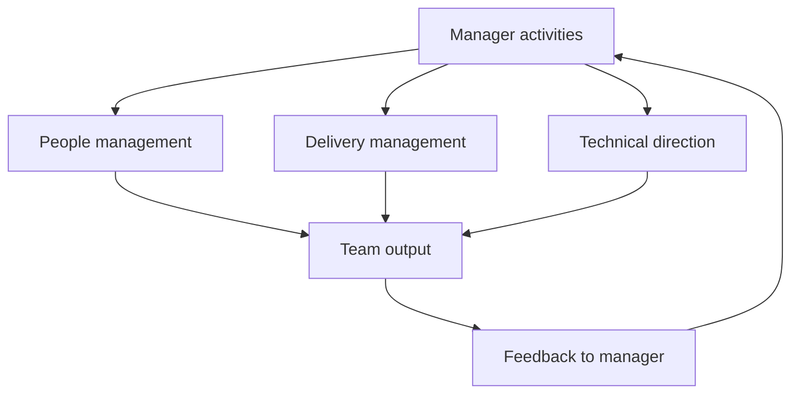

Time goes into the jobs, the jobs shape what the team produces, and that output is the only evidence
the time was well spent. Measuring the top of the loop (hours, meetings) instead breaks it.

### Deep Conceptual Explanation

#### Three jobs, one title

The three jobs need different skills and pay off on different timescales. People management pays off
over quarters and years: a hire, a promotion, an engineer who stays. Delivery management pays off
within weeks: a dependency resolved, a commitment kept or renegotiated in time. Technical direction
pays off over years and is easy to defer: a module boundary, a standard, a decision not to build
something.

Because the timescales differ, a busy manager drifts toward the job with the fastest feedback, which
is delivery. Over a year the drift shows in a calendar before it shows in attrition or in an
architecture nobody chose. This is the book's reasoning, not a research finding; the calendar audit
below is designed to catch it.

The jobs also compete for one scarce resource, the manager's week. A manager with fifteen direct
reports who holds a weekly 30-minute one-on-one with each spends seven and a half hours on that alone,
nearly a fifth of a 40-hour week, before any hiring, feedback, or follow-up.

#### How companies split the jobs

Companies differ in which jobs they give the person with the manager title. Camille Fournier's *The
Manager's Path*, known for walking through the stages from tech lead to CTO, treats the tech lead and
the people manager as related but distinct roles
([Fournier, 2017](#fournier2017manager)). Will Larson's description
of staff archetypes treats the "tech lead manager" as a separate role on the management ladder,
distinct from a staff-level tech lead who manages nobody
([Larson, staff archetypes](#larson-staff-archetypes)).

Four shapes cover most organizations:

| Shape | Manager owns | Someone else owns | Fits when |
|---|---|---|---|
| Tech lead manager | All three, for a small team | Nothing | Teams of about four to six; a strong technical manager |
| Manager plus tech lead | People, delivery | Technical direction (an engineer in the team) | Most product teams of six to ten |
| Manager plus program manager | People, technical direction | Cross-team delivery coordination | Heavy cross-team dependencies or regulated releases |
| People-focused manager | People | Delivery (product or program), technical direction (staff engineers) | Large organizations with strong staff and product functions |

The team sizes are this book's recommendation and approximate. None of these shapes is correct in
general; each is a bet about where the scarce skill is. The failure is running several by accident,
so that each manager quietly decides which jobs to do and which to leave.

#### Managerial output and the calendar

Grove's definition becomes a practical test. For any block of time on a manager's calendar, ask
which output of my organization, or of one I influence, does this change, and by how much compared
with another use of the hour? Grove also argued that managers should prefer high-leverage activities,
whose effect spreads across many people or a long time
([Grove, 1983](#grove1983high)); Chapter 3 develops leverage.

Peter Drucker's *The Effective Executive* is known for an earlier version of the discipline: record
where your time actually goes before deciding how to spend it, because memory of it is unreliable
([Drucker, 1967](#drucker1967effective)). The calendar audit combines
the two: Drucker supplies the measurement, Grove the criterion.

1. Take two representative weeks of calendar, plus unscheduled work reconstructed from chat and
   email.
2. Classify each block by job: people, delivery, technical direction, or other (administration,
   cross-team work, your own development).
3. For each block, name the output it was meant to change, and mark it **leveraged** (the effect
   reaches many people or lasts), **necessary** (someone must do it, and it is the manager's job), or
   **substitutable** (someone else could and should do it).
4. Compare the split with the role definition. A role that gives technical direction to the tech lead
   and a calendar with a third of its hours in design reviews disagree; one of them is wrong.

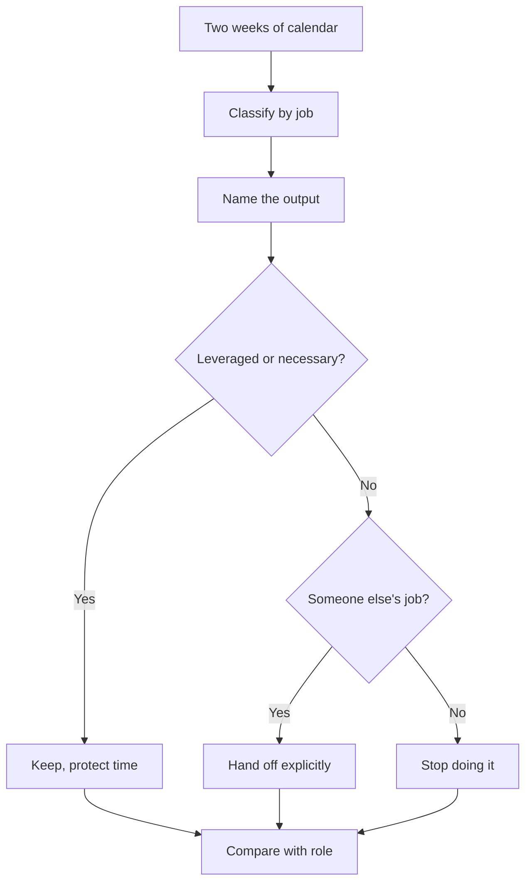

The audit is gamed by generous classification: every incident call becomes "delivery", every status
meeting "people". Classify by what the block changed, not what it was called; a status meeting in
which nothing is decided is "other". And have a peer or your manager classify a sample independently;
the disagreements are the useful part.

#### Leadership is not the same as people management

People management is a job: direct reports, formal authority over hiring and performance,
accountability for team health. Engineering leadership is a behavior: setting direction, raising the
quality of decisions, and moving people who do not report to you. Managers need leadership, and many
engineers lead without managing anyone. Organizations that conflate the two push their best technical
leaders into management for influence, and lose technical direction. A staff track gives technical leadership a home without direct reports.

#### Where staff-plus engineers sit

Staff-plus engineers (staff, principal, and above) are senior individual contributors whose job is
technical leadership beyond their own work. Larson describes four common archetypes: the **tech
lead**, who guides the approach and delivery of one team or a few; the **architect**, who owns the
direction of a central technical area; the **solver**, who works through hard, high-priority problems
one after another; and the **right hand**, who extends an executive's reach on cross-cutting problems,
mainly in very large organizations. He notes that most companies recognize only one or two of these,
and some have no technical leadership track at all
([Larson, staff archetypes](#larson-staff-archetypes);
[Larson, 2021](#larson2021staff)). This is expert opinion, not a
measured taxonomy.

On the three-jobs map, staff-plus engineers own technical direction across team boundaries, and
sometimes the delivery of cross-team technical programs. They do not own people management, though
they mentor and inform hiring and promotion.

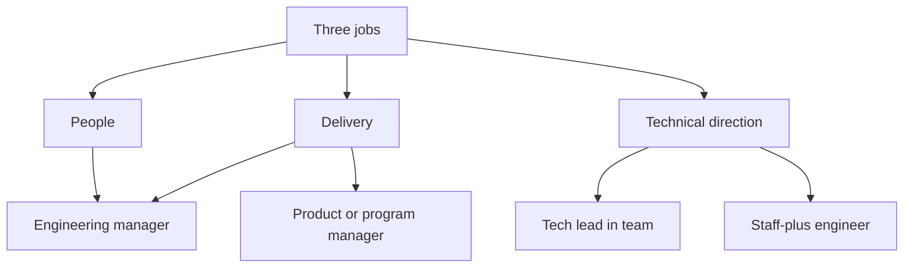

This is a common default, not a rule. Read each arrow as a question about your organization: is there
a named person, and do they know it? Who decides architecture when managers and staff engineers
disagree is contested (the book records it as disputed claim D7; Chapter 28 takes a position).

#### What the job is not

**Not being the best engineer on the team.** Competence matters, as the evidence below shows, but a
manager who is the team's main producer of code makes the team's output depend on the one calendar
where the other two jobs also live.

**Not being the team's shield.** Filtering noise is part of delivery management. Hiding the
organization's real constraints is not; the team then decides without the information that matters.

**Not status relay.** Passing status up and priorities down, with nothing decided in between, adds
only latency.

#### Do managers matter? The evidence

Engineers often argue that managers are overhead. The evidence that managers affect outcomes is real, but each study has a specific population, and none studied software
teams specifically.

- **Productivity.** Using one company's data on technology-based service workers, Lazear, Shaw, and
  Stanton report that replacing a supervisor in the bottom 10 percent of quality with one in the top
  10 percent raised a team's output by more than adding a worker to a nine-person team would, and
  that workers with better supervisors were less likely to leave
  ([Lazear, Shaw, and Stanton, 2015](#lazear2015value)). **Research
  finding**; one firm; read at abstract level.
- **Attrition.** Using personnel data and employee surveys at a large high-tech firm, Hoffman and
  Tadelis report that survey-measured people management skills have a strong negative relation to
  turnover, with designs that support a causal reading, but that those skills did not consistently
  improve other outcomes ([Hoffman and Tadelis, 2021](#hoffman2021people)).
  **Research finding**; one firm; read at the level of the working paper's abstract.
- **Technical competence.** Using US and British survey data, Artz, Goodall, and Oswald report that a
  boss's technical competence was the strongest predictor of workers' job satisfaction, and that a rise
  in a supervisor's competence was associated with higher well-being for workers who stayed in the
  same job ([Artz, Goodall, and Oswald, 2017](#artz2017boss)).
  **Research finding**; correlational with longitudinal controls; not specific to software.
- **Google's Project Oxygen.** Google's re:Work site describes a multi-year internal study that began
  from the hypothesis, held by some employees, that managers do not matter. It reports that teams with
  highly effective managers were more likely to achieve better results, be happier, and have lower
  turnover, and lists ten manager behaviors, including key technical skills
  ([Google re:Work, great managers](#rework-great-managers)).
  **Industry research**: a company self-report, not peer-reviewed, methods described only in summary.

Together these support a modest claim: in the settings studied, the quality of the immediate manager
is associated with output, retention, and satisfaction, and two studies have designs that point to a
causal effect. They do not say which of the three jobs produces the effect in software teams, and
they do not show that more managers mean more output. The attrition finding is a reminder that the
jobs are distinct: being good at one does not cover the others. We found no study relating how
engineering managers split their time to team outcomes; the calendar guidance here is this book's
recommendation.

### Engineering Organization Example

This example is **illustrative**: an invented manager in an invented company of about 40 engineers.

Jo manages a payments team of eight and owns people and delivery; a senior engineer, Sam, is the
named tech lead. Jo's two-week calendar, reconstructed from calendar and chat history, holds 80
working hours:

| Block | Hours | Job | Mark |
|---|---|---|---|
| One-on-ones, eight engineers, weekly 30 minutes | 8 | People | Necessary |
| Hiring loop for an open role | 6 | People | Leveraged |
| Planning and prioritization with product | 6 | Delivery | Leveraged |
| Cross-team dependency meetings | 8 | Delivery | Necessary |
| Incident calls as an extra responder | 8 | Delivery | Substitutable |
| Design reviews | 12 | Technical | Substitutable: Sam's job |
| Writing code on a refund flow | 14 | Technical | Substitutable |
| Three weekly status meetings | 6 | Other | Substitutable: nothing decided in four of six |
| Email and administration | 12 | Other | Partly necessary |

The split: people 14 hours (17.5 percent), delivery 22 (27.5), technical 26 (32.5), other 18
(22.5). The role says technical direction is Sam's, yet a third of Jo's time is technical,
much of it coding and duplicating Sam's reviews. Meanwhile nobody on the team has had a career
conversation in two quarters, and the open role has been open for eleven weeks.

A reallocation, with its assumptions: Jo attends one design review a week of Sam's choosing (saving
about 9 hours a fortnight), hands the refund-flow code to an engineer (14), leaves incidents to the
rotation unless they cross teams (6), and replaces two status meetings with a written update (4).
That frees about 33 hours a fortnight; Jo puts 10 into hiring, 8 into career conversations and
feedback, and keeps the rest as slack for cross-team work.

The cost: Jo loses the satisfaction of shipping code, and Sam gains a decision area Jo used to share.
Whether the trade pays shows only in the team's output over the next two quarters.

### Decision Framework

The central decision is how to split the three jobs for a given team. Start from the team, not a
template:

| Question | If yes | If no |
|---|---|---|
| Six people or fewer, with the manager as strongest technical voice? | Tech lead manager can work; protect people time explicitly | Separate tech lead from manager |
| An engineer ready to own technical direction? | Name them tech lead, in writing, with a decision scope | Manager holds it temporarily, with a plan to grow or hire a tech lead |
| Delivery depends heavily on other teams? | Add program support or a director-level dependency process | Manager owns delivery |
| The area needs cross-team technical direction? | A staff-plus engineer with a written mandate | Team tech leads suffice |
| More than about eight to ten direct reports? | People work will crowd out the rest; plan a split (Chapter 33 covers team design) | Proceed |

Two criteria apply whatever the answers. Every job has exactly one named owner per team, and the
owner has time in their calendar to do it. A role definition that assigns technical direction to a
tech lead who spends 90 percent of their time on features has assigned it to nobody.

The direct-report thresholds are this book's recommendation; the span-of-control research we found
does not cover software teams (research gap G8).

### Trade-offs

**Technical depth against people capacity.** A manager who owns technical direction decides faster and
earns credibility, and the Artz, Goodall, and Oswald finding suggests competence matters to the people
managed. The same manager has less time for people work, and the team's own technical leaders may not
grow. Splitting the jobs adds an interface between manager and tech lead, which needs a way to resolve
disagreements.

**Uniformity against fit.** One split across all teams makes roles comparable and promotion fairer.
A middle course: one written default, with recorded exceptions.

**The cost of changing a split.** Moving technical direction from a manager to a tech lead takes
something from the manager's identity and adds load to an engineer. Expect a quarter of friction and
overlapping decisions. Changing the split without announcing it is worse: two people make the same
decisions, and the team asks whichever one gives the answer it wants.

### Failure Modes

**The super engineer.** The manager remains the team's busiest coder; Chapter 2 covers how to detect
and unwind it.

**The dispatcher.** The job shrinks to tickets in, status out. Signal: good short-run throughput, then
attrition or a design nobody owns. Detection: no people or technical work in the audit, and nobody can
name the team's technical owner.

**The orphaned job.** Everyone assumes someone else owns technical direction, delivery, or growth.
Signal: decisions go to whoever is in the meeting; debates recur. Detection: ask the manager, the tech
lead, and two engineers who owns each job; different answers mean nobody does.

**The fourth on-call responder.** The manager joins every incident and becomes part of the restoration
path. Detection: incident records list the manager as responder more often than any engineer, and the
rotation's load looks lighter than it is.

**The mandate-free staff engineer.** A staff engineer with no written scope fills whatever urgent gap
appears; Chapter 4 covers the staff role and its mandate.

**Activity mistaken for output.** The manager reports meetings held, not what changed. Detection: ask
"what is different in the team because of this?"

### Enterprise Application

In an organization of 50 to 150 engineers, the role definition can no longer live in one person's
head. A director manages several managers, often staff engineers too, and the split of the three jobs
becomes organizational design. Will Larson's *An Elegant Puzzle* is known for treating engineering
management at this scale as the design of systems (processes and the structures that route decisions)
([Larson, 2019](#larson2019elegant)). The split of the jobs is one
such system, and three practices make it workable:

- A written **default split**: what managers, tech leads, and staff engineers each own.
- A **per-team charter** recording each team's actual split and any exception.
- A **periodic calendar audit** for each manager, once or twice a year, done with the director and
  used for development, not rating.

The director's role follows the same logic one level up. Its output is the output of the whole
organization and of the peers it influences: product, support, finance. The director's people job is
mostly managing managers; the delivery job is cross-team commitments and capacity; the technical job
is making sure staff engineers have mandates and cross-team decisions get made. Chapter 27 shows this
division during a quality transformation
([Chapter 27, Enterprise Application](#enterprise-application)).
How to measure managers' effectiveness belongs to Chapter 4; the minimum here is to judge managers on
their teams' output, never on the volume of their own activity.

### CTO Perspective

At CTO level, "what is an engineering manager" is a policy with a cost line, and left alone each
director will define it differently. Three decisions are the CTO's.

**Whether managers must be technical.** Requiring managers to own technical direction means hiring for
depth and keeping teams small. Separating the jobs needs a staff track strong enough to hold technical
direction. The research favors technical credibility in managers; it does not settle whether that
credibility must come with ownership of technical decisions.

**Whether a staff track exists, and with what mandate.** A staff track without mandates is a promotion
path with no job. The CTO decides which archetypes the organization recognizes and how staff
decisions relate to managers' decisions.

**The ratio of managers to engineers.** Fewer managers save cost and spread each one thinner. The
manager-effect research says manager quality matters; a CTO who cuts managers should expect the saving
to reappear as attrition or slower delivery, and should estimate where.

### Practical Playbook

1. Write down the three jobs for your role: which you own, which someone else owns (named), and which
   nobody owns.
2. Run a two-week calendar audit: classify every block by job and output, and mark it leveraged,
   necessary, or substitutable.
3. Ask your manager or a peer to classify ten of your blocks independently; discuss the disagreements.
4. Hand off the two largest substitutable blocks explicitly, with a named owner and a date, and tell
   the people affected.
5. Ask your tech lead, two engineers, and your product partner who owns each job on your team.
   Resolve disagreements in writing.
6. Write a one-page role definition: purpose, the three jobs and their owners, the outputs you answer
   for, and what you will not do. Share it with your team and your manager.
7. If you lead managers, write the organization's default split and record team exceptions; give
   each staff engineer a written mandate.
8. Repeat the audit in six months; compare the split and check whether the outputs you named moved.

### Case Study

This case is **fictional**. Northstar's people and numbers are on the
[Northstar overview](#page-case-studies-northstar-index) and
[baseline data](#page-case-studies-northstar-baseline-data) pages. The calendar figures were added
for this chapter; they describe the baseline quarter, before the director arrives, from a two-week
sample (about 80 working hours) each manager reconstructed from calendar and chat history.

Northstar's six managers share a job description written years earlier, "lead a team of engineers to
deliver high-quality software", and do six different jobs:

| Team | Manager | Engineers | People | Delivery | Technical | Other | Technical direction lives with |
|---|---|---|---|---|---|---|---|
| Orders | Priya Raman | 14 | 15% | 35% | 45% | 5% | Priya, who still writes code |
| Billing | Marcus Oyelaran | 13 | 15% | 55% | 15% | 15% | Nobody; decided during incidents |
| Payments and Integrations | Elena Sokolova | 12 | 35% | 35% | 15% | 15% | A senior engineer acting as informal tech lead |
| Customer Experience | Daniel Cho | 15 | 45% | 35% | 5% | 15% | Two unnamed leads, web and mobile |
| Data and Analytics | Farah Haddad | 11 | 25% | 20% | 45% | 10% | Farah, as data architect |
| Platform Operations | Tom Becker | 12 | 25% | 50% | 10% | 15% | Tom and the release process |

Priya, promoted eight months earlier, spends about 36 of her 80 hours writing and reviewing code (45
percent); with fourteen reports, her one-on-ones are nominally weekly and mostly cancelled. About 20 of Marcus's hours went to incident calls
as an additional responder, the fourth-responder failure mode, in the team with the most incidents and
three engineers carrying most pages; nothing in his calendar addresses why three people carry them.
Elena's calendar is the most balanced, and her team has the best operational discipline; the data
cannot say whether one causes the other. Daniel's fifteen weekly one-on-ones take 15 hours a
fortnight, and nobody has named who directs web and mobile. Tom's delivery time is mostly release-train
coordination.

The three staff engineers own no components and act as solvers by default: Ines Carvalho is consulted on most Core changes without owning any
decision, Kwame Mensah is pulled into the largest incidents, and Li Na Zhou answers integration
questions for whichever team asks first.

Before starting, the director drafted a one-page role definition:

| Element | Director's definition |
|---|---|
| Purpose | Reliability and delivery of the whole engineering organization, judged by its output |
| People | Manage and develop the six managers; give the staff engineers mandates |
| Delivery | Own cross-team commitments and the capacity model agreed with the CTO and CPO |
| Technical direction | Ensure cross-team technical decisions have an owner; decide personally only when nobody else can |
| Not doing | Running a team's planning, joining incidents as a responder, writing production code |

What happened next is on [the director's first quarter](#page-case-studies-northstar-first-quarter)
page: the staff engineers received mandates as part of the quality transformation (Kwame Mensah
release and detection, Ines Carvalho Core module boundaries and contract tests, Li Na Zhou migration
and configuration safety), and the six managers were trained as incident commanders, a role different
from an extra responder. This chapter's question comes earlier: before any transformation, would you
change how the six managers split their jobs, and in what order?

### Exercises

Solutions are in [chapter 1 solutions](#page-solutions-ch01-solutions). Northstar data is on the
[baseline page](#page-case-studies-northstar-baseline-data).

#### Foundational

**F1.** Priya Raman's calendar for one week contains: four one-on-ones (30 minutes each), a two-hour
design review on the bulk-ordering feature, six hours writing code on order-capture, a one-hour
planning session with product, a 90-minute meeting with Billing about core/customer, three hours of
email, and a canceled career conversation. Classify each block by job and as leveraged, necessary, or
substitutable, and state what you would want to know before recommending any change.

**F2.** A job advertisement for an "Engineering Manager" at a company of 200 engineers asks for "80
percent hands-on coding, own the architecture of our payments platform, run sprint ceremonies, manage
a team of nine." Identify which of the three jobs it assigns to the role, which it underweights, and
what risk the combination creates for the team. Propose a revised split.

**F3.** A colleague says, "Research proves good managers make teams 75 percent more productive, so we
should hire more managers." Using the studies summarized in this chapter, explain what the evidence
does and does not support, where a figure like 75 percent might have come from, and why the
conclusion does not follow.

#### Applied Leadership

**A1.** You are Marcus Oyelaran's director. His calendar shows 55 percent delivery, including about 20
of 80 hours on incident calls as an extra responder, and 15 percent people management for 13
engineers. Plan the conversation in which you present the audit: what you ask first, what you
propose, what you will not ask him to give up yet, and how you will know in two months whether the
change worked.

**A2.** Daniel Cho manages fifteen engineers (nine web, six mobile). Technical direction sits with two
unnamed informal leads, and a mobile release and a web change have twice conflicted over the same API.
Decide between naming two tech leads, splitting the team under two managers, or Daniel taking
technical direction himself. State your criteria and the transition cost of your choice.

**A3.** Ines Carvalho, staff engineer with eleven years at Northstar, tells you she is thinking of
becoming a manager because "that is the only way anyone listens to me about Core." Advise her using
the three-jobs map and the staff archetypes, and say what you as director would have to change for her
choice to be a real one.

#### Executive Decision-Making

**X1.** Victor Lindqvist, the CTO, proposes the tech lead manager model across engineering: every
manager owns all three jobs, and the staff engineer role is retired, saving the cost of three senior
individual contributors. Write your response, including the conditions under which the proposal would
work, the teams for which it would fail, and an alternative.

**X2.** Rajiv Menon, the CFO, asks whether Northstar could run its 80 engineers with four managers
instead of six, merging teams, to hold operating expense flat. Prepare the analysis you would take to
the CTO: what the change does to each manager's span and calendar, what the manager-effect evidence
suggests and does not, where the cost of the saving would show up, and what you recommend.

### Reflection Questions

1. If you audited your last two weeks, which job would have the most hours, and is it the job your
   role definition says matters most?
2. Which job on your team would nobody claim if you asked three people who owns it?
3. What work do you keep for the satisfaction or credibility it gives you rather than because it is
   your job? Who would do it better?
4. Does a strong engineer in your organization have a credible way to gain influence without direct
   reports?
5. When you last reported upward, did you describe your activity or your organization's output?
6. If your manager rewrote your role definition from your calendar alone, what would it say?

### Key Takeaways

- A manager's output is the output of the organization they lead and influence, not their own
  activity.
- The title hides three jobs: people management, delivery management, technical direction. Each needs
  exactly one named owner per team, with time to do it.
- Companies split the jobs differently; choose a split on purpose, write it down, record exceptions.
- Time drifts toward delivery, the job with the fastest feedback. A calendar audit catches the drift
  before attrition or unowned architecture does.
- Leadership is a behavior; people management is a job. Staff-plus roles give technical leadership a
  home without direct reports, if they come with a mandate.
- Research associates manager quality with output, retention, and satisfaction in the settings
  studied. It does not say which job matters most in software teams.

### References and Further Reading

- [Grove, 1983](#grove1983high). *High Output Management*. Managerial
  output and leverage, as used throughout this book.
- [Drucker, 1967](#drucker1967effective). *The Effective Executive*.
  Recording where time goes before deciding how to spend it.
- [Fournier, 2017](#fournier2017manager). *The Manager's Path*. How the
  jobs shift from tech lead to CTO.
- [Larson, 2019](#larson2019elegant). *An Elegant Puzzle*. Engineering
  management as systems design.
- [Larson, 2021](#larson2021staff) and
  [staff archetypes](#larson-staff-archetypes). The staff-plus role
  and its common shapes.
- [Lazear, Shaw, and Stanton, 2015](#lazear2015value). Supervisor
  effects on output in one firm.
- [Hoffman and Tadelis, 2021](#hoffman2021people). People management
  skills and attrition.
- [Artz, Goodall, and Oswald, 2017](#artz2017boss). Supervisor
  competence and job satisfaction.
- [Google re:Work, great managers](#rework-great-managers). Google's
  account of Project Oxygen.

<a id="page-parts-01-foundations-02-from-individual-contributor-to-leader"></a>

## Chapter 2 — From Individual Contributor to Leader

!!! warning "Awaiting human review"
    This chapter has passed the book's automated validation and an editorial self-review, but not yet
    the human review in which each cited claim is checked against its source. Treat it as a reviewed
    draft. Corrections are welcome; see the repository's CONTRIBUTING file.

This chapter is about the first management role: what changes when a strong engineer becomes
responsible for a team, why the change is harder than it looks, and how to get through the first
year without becoming the team's bottleneck. It covers the shift in identity and feedback, delegation
by outcome with an explicit level of control, the first 90 days, and the decision about how much
hands-on technical work to keep. Chapter 1 defines the manager's job; this chapter is about crossing
into it. The running example is Priya Raman, the Orders manager at Northstar Technologies, the
fictional company in the [case study](#page-case-studies-northstar-index).

### Why This Matters

At team scale, the transition decides whether the team gets a manager or loses its best engineer and
gains a busy one. A new manager who keeps the most important technical work looks effective for
months, because output continues. What stops is the team's growth: decisions queue behind one person,
nobody else learns the hard parts, and problems surface later as incidents or resignations.

At organization scale, first-line managers are the layer where most engineers experience the company,
so a weak transition is felt by every engineer on the team. Chapter 1 summarizes the evidence that
managers matter; it is a useful corrective to the engineer's belief that management is overhead.

At executive scale, the question is how the organization picks and prepares its managers. An economic
study of sales workers at 131 firms found that firms weight current job performance heavily in
promotion decisions even though other characteristics better predict success as a manager, and that
promoting people with lower managerial potential is costly
([Benson, Li, and Shue, 2019](#benson2019promotions)). Sales is not
engineering, but the pattern is familiar: the strongest engineer is promoted, given no preparation,
and judged on whether the work still gets done.

### Learning Objectives

After this chapter you will be able to:

- Name the identity and feedback-loop changes of the first management role, and recognize them in
  yourself or in a manager you support.
- Plan the first 90 days in a new management role, including what to learn, what to change, and what
  to leave alone.
- Delegate by outcome with an explicit level of control, and choose the level from the person's
  competence and the cost of a mistake.
- Decide deliberately how much hands-on technical work to keep, and estimate what it costs the team.
- Detect the common first-year failure patterns early, from evidence rather than from how busy you feel.

### The Mental Model

> **Mental model:** An engineer's work produces fast, clear feedback; a manager's work produces slow,
> noisy feedback through other people. The transition succeeds when you stop steering by the fast loop.

As an engineer, you change code and within minutes a test passes or fails. Within days the change
ships. The loop is short, the signal is clear, and the credit is yours. As a manager, you change how
a person works, what the team works on, or how decisions are made. The result appears weeks or months
later, mixed with everything else that happened, and mostly in other people's output.

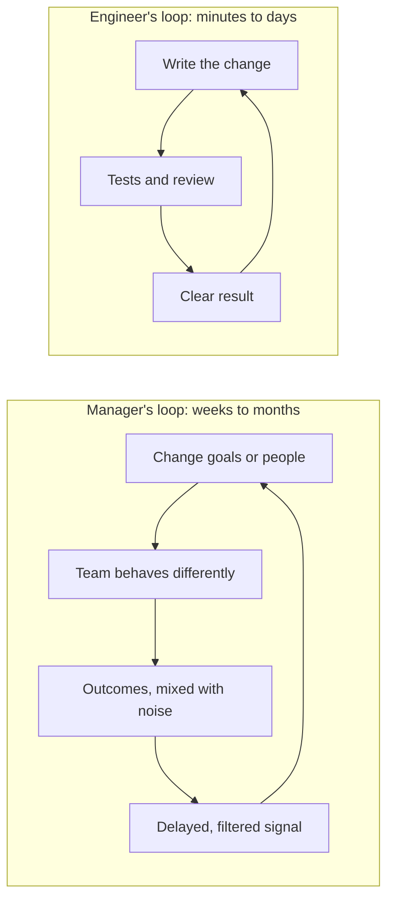

The danger is that the engineer's loop is still available and still rewarding. When the manager's
loop goes quiet, the new manager reaches for the keyboard. Each such choice is defensible; together
they keep the new manager in the old job.

The second idea follows from the first: a manager's output is the team's output, not their own
(Chapter 1 defines managerial output after Andrew Grove; Chapter 3 develops leverage). Delegation is the
mechanism that converts one person's judgment into the team's capability, so it carries most of the
weight in this chapter.

### Deep Conceptual Explanation

#### An identity change, not a promotion

Linda Hill's research followed nineteen new managers through their first year. Her publisher
describes the transition as a profound psychological adjustment, learned mainly from experience, in
which balancing delegation and control and reframing one's understanding of the role are central
challenges, and notes that many people do not complete it
([Hill, 2019](#hill2019becoming)). It is a small qualitative study
outside software, read here at summary level, but its point matches practitioner experience: the
hard part is letting go of the old source of competence and status.

Herminia Ibarra's study of professionals moving into more senior roles offers a mechanism. People do
not adopt a new professional identity in one step; they observe role models, try out provisional
versions of the new self, and keep or discard them depending on their own standards and the feedback
they get ([Ibarra, 1999](#ibarra1999provisional)). For a new
engineering manager this means two practical things (**this book's recommendation**, extending the
finding). First, expect to experiment: run one-on-ones one way for a month, then adjust. Second,
choose role models deliberately. A new manager whose only model is their previous manager copies that
person's habits, including the bad ones.

#### Feedback that is slower and noisier

Three properties of the manager's feedback loop cause most of the trouble:

| Property | Engineer | Manager |
|---|---|---|
| Delay | Minutes to days | Weeks to quarters |
| Attribution | Mostly own work | Shared with the team, product, luck |
| Filtering | Direct (the test fails) | Mediated: people tell the manager what is safe to say |

Delay means a new manager can do the wrong thing for a quarter before seeing the cost. Attribution
means a strong team can carry a weak manager for a while, and bad luck can hide good management.
Filtering means the signals that matter most, such as a senior engineer considering leaving, are the
least likely to reach the manager unprompted. The remedy is to build leading indicators the manager can observe
directly: how many decisions waited for the manager this week, whether one-on-ones surface news or
only status, which work only one person can do. Chapter 5 covers one-on-ones as an information
channel; Chapter 4 covers measuring managerial effectiveness.

#### Why the best engineer is not automatically the best manager

The promotion pattern in the [Benson, Li, and Shue](#benson2019promotions)
study has a second cost beyond picking the wrong person. Even a promoted engineer who would make a
good manager arrives with the habits of the best engineer: solving the hard problem personally,
reviewing everything important, being the person others ask. In the new role these habits concentrate
work and decisions on one person. The usual remedies are preparation before or soon after promotion,
and a technical career track so that management is not the only way up (Chapter 4).

#### Delegating by outcome, with an explicit level of control

Delegating a task ("implement this endpoint") keeps the manager as designer and integrator.
Delegating an outcome ("uploads of up to 5,000 lines succeed or fail cleanly, by the March release")
transfers the design too, and is how a team's judgment grows. It fails when the level of control is
implicit: the delegate thinks they own the decision, the manager thinks they are being consulted, and
the first disagreement feels like a betrayal. David Marquet's account of commanding a submarine is known for the idea of moving
decisions to the people with the information, and of having them state what they intend to do
rather than ask permission, so that control moves gradually while the leader can still intervene
([Marquet, 2012](#marquet2013turn)). The scale below is **this book's
synthesis** in that spirit, not a validated instrument.

| Level | Who decides | The delegate says | Use when |
|---|---|---|---|
| 1. Direct | Manager | "Here is what I found" | Person new to the area; mistake costly and hard to reverse |
| 2. Recommend | Manager, from the delegate's options | "I recommend X, because" | Building competence; manager must own the risk |
| 3. Intent | Delegate, after telling the manager | "I intend to X on Thursday" | Competent person; mistake costly but visible in time |
| 4. Act and inform | Delegate | "I did X; here is why" | Proven competence; mistake reversible |
| 5. Own | Delegate; manager hears by exception | Reports outcomes in the regular review | The area is theirs |

Research on delegation explains why managers stall at levels 1 and 2. In a survey and interview study,
Yukl and Fu found managers delegated more to subordinates who were competent, shared the manager's
objectives, and had worked with them longer. Managers valued delegation for developing people, yet
many were reluctant to give up control over important decisions or to give important tasks to
inexperienced subordinates
([Yukl and Fu, 1999](#yukl1999determinants)). The result is a trap
for a new manager: the important work is never delegated, so nobody gains the experience that would
justify delegating it. The way out is to delegate important work at a lower level of control (2 or 3)
rather than to withhold it.

Two rules make the levels work (**this book's recommendation**). Name the level out loud, with the
outcome and the date: "This is level 3; tell me before you change the schema." And move the level by
agreement, upward after evidence, never silently downward.

#### How much hands-on work to keep

There is no right percentage, but there is a right question: does this technical work make the team
more capable, or does it make the team depend on me? Google's list of effective manager behaviors
includes both empowering the team without micromanaging and having key technical skills
([Google re:Work](#rework-great-managers)). The two pull against
each other only when technical skill is exercised by doing the team's critical work.

Kinds of hands-on work, from cheapest to most costly for the team:

| Work | Keeps the manager | Cost to the team |
|---|---|---|
| Reading designs and code, asking questions | Able to judge | Low |
| Small fixes, tooling, prototypes off the critical path | In touch with the code and the pain | Low, if nothing waits on it |
| Joining on-call or incident response as a participant | Aware of operational reality | Low to moderate |
| Being the required reviewer for an area | Informed | High: every change waits for the busiest person |
| Owning work on a committed deadline | Productive-feeling | Highest: the critical path stops in every meeting |

Camille Fournier's practitioner account of the engineering management path is known for this
balance: stay close enough to the technology to judge, coach, and keep credibility, and stay off the
critical path ([Fournier, 2017](#fournier2017manager)). A manager's
calendar is interrupt-driven, so work others wait on is delayed by every escalation, and the team
learns that the hardest problems belong to someone else.

#### The first 90 days

Michael Watkins's book on leadership transitions is known for the argument that the first months in a
new role decide much of what follows, that a new leader should accelerate learning deliberately,
match the strategy to the situation, agree expectations explicitly with their own manager, and
secure a few early wins ([Watkins, 2003](#watkins2003first)). For a
first-line engineering manager promoted from inside the team, two adjustments apply: the hardest
learning is about changed relationships rather than an unfamiliar domain, and the most valuable early
wins are not technical but visible changes in how the team works, such as decisions made faster or a
recurring problem finally owned. The Practical Playbook turns this into a plan.

### Engineering Organization Example

The following figures are **illustrative**, invented for Northstar (fictional). They describe Priya
Raman's calendar in the two weeks before the new director arrived, eight months after her promotion,
and the budget she agreed with the director in week 2.

Assumptions: a 40-hour working week; Orders has 14 engineers; Priya reviewed about 15 of the roughly
25 Core merge requests Orders produced each week.

| Activity, hours per week | Before (measured from her calendar and review history) | Agreed budget |
|---|---|---|
| Coding and code review | 18 | 8 |
| Product, release train, cross-team | 5 | 5 |
| Incidents and escalations | 6 | 5 |
| Team planning and rituals | 3 | 3 |
| One-on-ones | 2 (nominally weekly; about one in three took place) | 2 (30 minutes every two weeks, all 14, with preparation) |
| Hiring | 2 | 2 |
| Feedback and career conversations | 2 | 2 |
| Coaching delegated work | 0 | 4 |
| Email and admin | 2 | 2 |
| Unallocated | 0 | 7 |
| **Total** | **40** | **40** |

Three things follow from the table.

First, the hands-on share was 45 percent (18 of 40 hours), and the cost was not only Priya's time.
With 15 of 25 merge requests waiting for her, 60 percent of the team's Core changes depended on the
busiest person on the team, who reviewed in evening batches. If batching added half a working day to
each of those reviews, that is about 7.5 engineer-days of waiting a week. Waiting is not lost work,
since engineers switch tasks, but each switch adds work in progress and makes batches larger.

Second, eight hours a week is enough to read designs, pair occasionally, and take small fixes off the
critical path. It is not enough to own a committed feature, and that is the intent.

Third, the budget has 7 unallocated hours. A new manager's week fills with escalations; a budget
with no slack is broken by Tuesday, and the hours lost are usually one-on-ones.

### Decision Framework

Two decisions recur in the first year: what level of control to delegate at, and whether to take on a
piece of technical work yourself. For the first, use two questions: how competent is this person in
this area (not in general), and how costly and how reversible is a mistake? High competence and a
reversible mistake mean level 4 or 5. Low competence and an irreversible mistake mean level 2, never
withholding the work entirely. The level is set per area, so the same engineer may be at level 5 on
the pricing service and level 2 on a schema migration.

For the second decision:

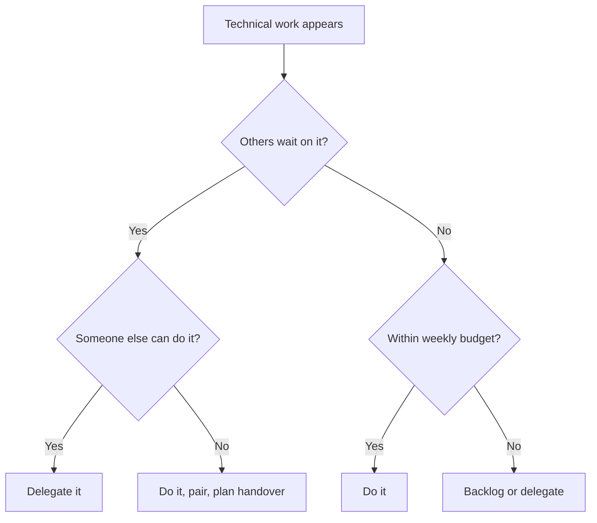

"Someone else can do it" includes "with coaching, more slowly". The branch where only the manager can
do the work is a finding: a single point of knowledge to remove, so pair with next time's owner.

| Signal | Likely meaning | Response |
|---|---|---|
| You are the required reviewer for an area | Knowledge concentrated in you | Name two owners; review their reviews for a month |
| Decisions wait for you more than a day | Level of control set too low or unclear | Raise the level explicitly in one area |
| You do the hard part "because it is faster" | Short-term speed bought with long-term capacity | Delegate at level 2 or 3 with a checkpoint |
| One-on-ones are the first thing you cancel | The fast loop is winning | Protect them in the budget; track how many took place |

### Trade-offs

**Speed now against capability later.** The new manager is often the fastest person to solve a
problem. Solving it costs the team the learning. For a production outage, take the speed and run a
review afterward; for a committed feature with weeks of runway, delegate.

**Credibility against focus.** A manager who loses touch with the system is easy to mislead in design
discussions. Choose technical work for what it teaches you (reading, small fixes, on-call), not for
the satisfaction of shipping.

**Delegating early against protecting a commitment.** Handing the hardest part of a deadline-bound
feature to a less experienced engineer adds schedule risk. Keeping it adds a different risk: the
feature depends on someone with an interrupt-driven calendar. Level 3 delegation with weekly design
checkpoints usually costs less than either extreme, but the manager should say which risk they are
taking and to whom.

**Friend against manager.** A manager promoted from inside the team loses some of a peer's candor.
Pretending nothing changed fails, and so does sudden distance. Say plainly what has changed
(assignments, performance, pay input) and what has not.

### Failure Modes

**The super-engineer.** The new manager keeps the hardest technical work and the most important
reviews. Output holds up for a while, which hides the problem.

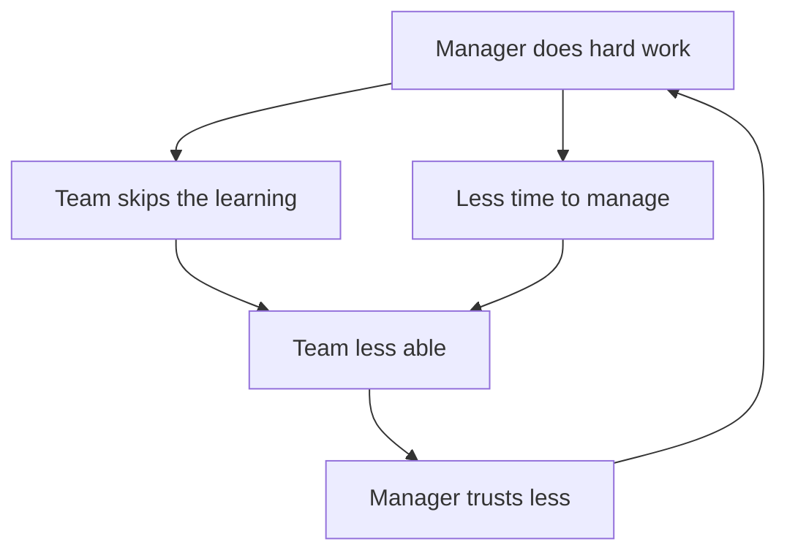

It is a reinforcing loop: each turn makes the next delegation look riskier. Signal: you are the only
person who can do some piece of the team's work, and that list is not shrinking. Countermeasure: a
written list of single-person areas, each with a named second person and a date.

**Delegation by abdication.** The manager overcorrects and hands over outcomes with no level, no
checkpoint, and no support, then intervenes late and visibly when things go wrong. Signal: surprises
at the deadline. Countermeasure: state the level and the checkpoints at handover.

**The silent take-back.** A delegated decision goes badly and the manager quietly resumes making it.
Signal: engineers start asking permission for things they used to decide. Countermeasure: if you
lower a level, say so, say why, and say what would raise it again.

**Status-meeting management.** One-on-ones become progress reports, so the manager hears only what
the task tracker already shows. Signal: you are surprised by a resignation or a conflict. Chapter 5
covers the repair.

**Commitments that outlive the role.** Work the manager owned as an engineer (follow-up actions,
on-call duties, a migration plan) stays assigned to them and quietly stops. Signal: open items with
your name on them older than your promotion. Countermeasure: in the first two weeks, list everything
assigned to you and reassign or close each item (Chapter 25 covers
[follow-up actions and recurrence](#follow-up-actions-and-recurrence)).

### Enterprise Application

In an organization of 50 to 150 engineers, several first-line managers are always in their first year.
At that scale the transition stops being a personal matter and becomes a system the director runs.

**Selection.** Treat promotion to management as a change of job with its own criteria, not a reward
for engineering performance. Look for evidence the candidate has already multiplied others: mentoring,
leading a project through other people, handling a disagreement well. Keep a technical track with
equal standing, so that the best engineer is not forced into management to advance (Chapter 4).

**Preparation.** A trial period as tech lead or acting manager, with an end date and a conversation
about whether to continue, lets both sides learn cheaply; Ibarra's provisional selves argue for making
the experiment explicit.

**Support in the first year.** The new manager's own manager owns the transition: an agreed time
budget, a monthly check of the leading indicators (decisions waiting, single-person areas,
one-on-ones held), and a peer manager outside the reporting line as a role model. Open engineering
commitments are reassigned as part of the promotion. Chapter 41 covers developing managers as a
director.

### CTO Perspective

At executive scale the question is the health of the management bench: how many managers are in
their first year, who supports each one, and what happens when a promotion is not working. Without a
respectable path back to engineering, a struggling new manager stays in the role or leaves the
company, and both are expensive. Make the path back normal and visible.

The CTO also sets the incentives that produce super-engineer managers. If managers are praised in
leadership meetings for personally rescuing releases, every first-year manager learns that rescuing
releases is the job. Praise the manager whose team handled the incident without them.

Finally, the evidence that managers matter (Chapter 1) and the economic research on promotion of
sales workers ([Benson, Li, and Shue, 2019](#benson2019promotions))
are not controlled studies of engineering teams: enough to justify investing in manager selection and
preparation, not enough to promise a board a specific return.

### Practical Playbook

For a newly promoted engineering manager, with the help of their own manager:

**Week 1.**

1. List everything assigned to you as an engineer (reviews, on-call, follow-up actions, features)
   and reassign or close every item, with the new owner's agreement.
2. Agree with your manager the day-90 criteria and a weekly time budget with a hands-on cap and slack.
3. Tell the team what has changed and what has not, together and then individually.

**Days 1 to 30: learn.**

4. Hold a first one-on-one with every report: what they want, what gets in their way, what you
   should not change.
5. Map single-person areas, including yourself.
6. Read the last quarter's incidents and escaped defects for your components; note recurrences.
7. Choose a peer manager as a role model and ask for an hour a month.

**Days 30 to 60: delegate.**

8. Delegate two outcomes at an explicit level of control, with checkpoints and dates.
9. Name two owners for every area where you were the required reviewer.
10. Make one visible change in how the team works, chosen from what the one-on-ones raised.

**Days 60 to 90: check.**

11. Count the leading indicators and compare your calendar with the budget.
12. Ask your reports what you should do more of and less of.
13. Report to your manager against the day-90 criteria, including what has not worked.

### Case Study

This case is **fictional**. It is set before and at the start of the director's first quarter at
Northstar; the canonical record of that quarter is on [the first quarter](#page-case-studies-northstar-first-quarter)
page, and the facts used here are on the [baseline page](#page-case-studies-northstar-baseline-data).

Priya Raman joined Northstar as an engineer seven years before the director arrived and became the
person who knew order capture best. She wrote much of the bulk order upload path. When the previous
Orders manager left the company, Priya was the obvious choice, and she accepted partly because the
alternative was a manager from outside who did not know the domain. She received no management
training, and her check-ins with her own manager were mostly about delivery dates.

In her first month as manager, a bulk upload failure reached customers. Priya fixed it herself over a
weekend and wrote the follow-up action, a test for uploads beyond 500 rows, assigned to herself. It
was never done. Two quarters later the same failure mode returned as INC-421, a Sev1 that a customer
reported first. It was one of three recurrences among Orders' seven Sev1 and Sev2 incidents in the
baseline quarter (INC-411, INC-421, and INC-429).

By the time the director arrived, the team trusted Priya's judgment and liked that she understood
their work. Two senior engineers, Rafael Duarte
and Aisha Bello, described the same frustration in their first conversations with the director:
decisions on order capture waited for Priya, and she had kept the design and the hardest code of the
bulk-ordering feature, one of the two renewal commitments, for herself. One-on-ones were often
cancelled. Rafael had applied for the manager role too and had said nothing since about his own
career.

In week 1, the director's first one-on-one with Priya started with the renewal date; Priya was
confident about the code and worried about everything else. In week 2 they went through her calendar
and review history together and found
the numbers in the Engineering Organization Example: 18 hours a week of coding and review, 15 of
about 25 weekly Core merge requests reviewed by her, and about a third of scheduled one-on-ones held.

They agreed four changes, each with a level of control:

| Change | Owner | Level |
|---|---|---|
| Implementation lead for the bulk-ordering feature | Aisha Bello | 3: tells Priya before any API or schema change; weekly design checkpoint |
| Review ownership for core/order-capture | Rafael Duarte and Aisha Bello | 4: Priya reviews a sample of their reviews for a month |
| The open bulk-upload test action | Rafael Duarte | 4, due before the next Core release containing upload changes |
| Priya's time budget | Priya, checked with the director monthly | Hands-on capped at 8 hours a week |

Priya objected to the first change. Handing over the renewal feature, due at the end of quarter 2,
felt to her like taking a risk with the company's largest customers. The director's answer was that
the long runway made this the cheapest moment to hand it over, and that keeping it was also a risk: the feature depended on a person who spent 15
percent of her week on incidents and whose calendar the quarter was about to fill further with
incident commander training, ownership decisions, and a capacity model. Priya kept the design authority, and the
weekly checkpoint was her safeguard.

The case leaves Priya at the end of week 2, before the decisions of week 4 gave Orders core/customer
and before the quarter's results. Whether the plan worked is a question for the exercises.

### Exercises

Solutions are in [chapter 2 solutions](#page-solutions-ch02-solutions). Northstar data is on the
[baseline page](#page-case-studies-northstar-baseline-data).

#### Foundational

**F1.** A senior engineer on your team has just been promoted to manage the five people she worked
alongside. After six weeks she tells you she is working longer hours than ever, the team is shipping
on time, and she feels she is "not really doing anything". Using the feedback-loop model, explain what
is happening, and name three observable indicators she could track instead of shipped work.

**F2.** For each of these, choose a level of control from the chapter's scale and justify it by
competence and cost of a mistake: an engineer with two years on the team designing a new internal
API; the same engineer writing a migration that rewrites the pricing-rules table in production; a
staff engineer choosing the team's test framework; a new hire triaging customer-reported defects.

**F3.** A new manager says: "I keep 50 percent hands-on time because my team respects me for it, and
Google's research says managers need technical skills." Assess the argument using what the chapter
says about the evidence and about the kinds of hands-on work.

#### Applied Leadership

**A1.** You are the director in week 2 with Priya Raman. She agrees to delegate review ownership but
refuses to hand over implementation of the bulk-ordering feature, citing the renewal date at the end
of quarter 2. Prepare the conversation: what you need to learn from her, what you would accept, what you
would not, and what you would do if, three weeks later, the checkpoint shows the feature slipping.

**A2.** Rafael Duarte applied for the Orders manager role eight months ago and lost to Priya. He has
not raised his career since. Priya is about to give him review ownership of core/order-capture. Advise
Priya on how to handle the delegation and the unspoken history, and on what she should not promise.

**A3.** Design a 90-day plan for an engineer about to become manager of a team of eight on a
component with two recurring incident patterns and a quarterly deadline. Include the time budget,
the first three delegations with their levels, and the day-90 criteria you would agree with their
manager.

#### Executive Decision-Making

**X1.** As CTO, suppose four of Northstar's six managers were promoted from inside their teams
and none received preparation. Propose a program for future promotions within flat headcount and a
small budget, including a respectable path back to engineering. Say what you will measure, how that
measure could be gamed, and what you will not promise the CEO.

**X2.** Two quarters from now, Priya's hands-on time has crept back to 35 percent and Orders' results
are good. One senior engineer has resigned, citing lack of growth. Victor Lindqvist asks whether
Priya is a strong manager. Decide what evidence you would gather, what conclusion would follow from
each plausible finding, and what you would recommend.

### Reflection Questions

1. What work do you still do because it is satisfying rather than because the team needs you to do it?
2. Which decisions on your team waited for you last week, and which of them could someone else have
   made with what they knew?
3. Who was your model of a manager when you started, and which of their habits did you copy without
   choosing to?
4. When did you last lower someone's level of control without telling them?
5. If you were promoted out of your current role tomorrow, which of your commitments would quietly stop?
6. What would your team say is the hardest problem they are not allowed to work on?

### Key Takeaways

- The first management role changes the feedback loop: slower, shared, and filtered. Build observable
  leading indicators instead of steering by shipped code.
- Treat the transition as a change of identity learned by experiment; choose role models deliberately.
- Promotion on engineering performance alone is a known way to pick the wrong manager; keep a
  technical track and prepare managers before or soon after promotion.
- Delegate outcomes, not tasks, and name the level of control, the checkpoints, and the date.
- Delegate important work at a lower level of control rather than withholding it.
- Keep technical work that makes you able to judge; stay off the critical path and out of the
  required-reviewer role.
- Hand over every engineering commitment at promotion; open items with your name on them stop.
- Budget your week with slack, and protect one-on-ones first.

### References and Further Reading

- [Hill, 2019](#hill2019becoming). *Becoming a Manager*. A year with
  nineteen new managers; the classic study of the transition. Read only at summary level here.
- [Ibarra, 1999](#ibarra1999provisional). How professionals adapt to
  senior roles by trying provisional identities; the mechanism behind "experiment, then choose".
- [Benson, Li, and Shue, 2019](#benson2019promotions). Economic
  evidence that firms promote on current performance at a cost; for the selection argument.
- [Yukl and Fu, 1999](#yukl1999determinants). What predicts
  delegation, and why managers hold on to important decisions.
- [Google re:Work](#rework-great-managers) and
  [Garvin, 2013](#garvin2013google). Project Oxygen: one company's
  evidence that managers matter, and its list of effective manager behaviors.
- [Marquet, 2012](#marquet2013turn). *Turn the Ship Around!* Moving
  control to the people with the information, with intent-based language.
- [Watkins, 2003](#watkins2003first). *The First 90 Days*. Planning a
  leadership transition; written for executives, adaptable to first-line managers.
- [Fournier, 2017](#fournier2017manager). *The Manager's Path*. The
  engineering management career from tech lead upward, including how technical to stay.
- [Zhuo, 2019](#zhuo2019making). *The Making of a Manager*. A
  practitioner's account of the first years of management, useful alongside Hill's research.

<a id="page-parts-01-foundations-03-managerial-leverage-and-systems-thinking"></a>

## Chapter 3 — Managerial Leverage and Systems Thinking

!!! warning "Awaiting human review"
    This chapter has passed the book's automated validation and an editorial self-review, but not yet
    the human review in which each cited claim is checked against its source. Treat it as a reviewed
    draft. Corrections are welcome; see the repository's CONTRIBUTING file.

Every organization keeps producing results nobody chose: the same three people paged every night, the
same decisions waiting on the same person. This chapter teaches you to see those results as the output
of a structure (stocks, flows, feedback loops, delays, and constraints) and to spend your hours by how
much each one changes that structure, not by how visible it is. It owns the book's systems-thinking
toolkit. Chapter 27 applies the toolkit to a quality decline, Chapter 16 to delivery flow, and Chapter 1
introduces the idea of managerial output that this chapter turns into a method. The running example is
Northstar Technologies, the fictional company in the [case study](#page-case-studies-northstar-index).

### Why This Matters

At team scale, managers learn to fix events: a missed date, an incident, a resignation. Events are
visible and responding to them feels like work. But the structure that produced one event produces the
next, and a manager who only responds to events gets busier every quarter without the results
improving.

At organization scale, the director cannot see most events. What they can change is structure: who is
on call and by what rule, which information reaches which meeting, what the staff engineers are for. A
director who keeps acting on events becomes the bottleneck, and is usually praised for it, because event
work is the most visible work there is.

At executive scale, leverage moves to goals, rules, and the beliefs behind them. A CTO who spends board
time on a bonus percentage is using the most expensive hours in the company on the weakest kind of
change. The skill is the same at every level: find the structure behind a recurring result, and rank
the possible changes by leverage rather than visibility.

### Learning Objectives

After this chapter you will be able to:

- Model a team or organization as stocks, flows, and feedback loops, and identify the loop that is
  producing an unwanted result.
- Account for delays when predicting what an intervention will do, and recognize the oscillation that
  ignored delays produce.
- Rank candidate interventions by leverage rather than by visibility, using explicit criteria and the
  effort they cost you.
- Recognize the constraint in a system, including when the constraint is a person, and stop investing
  in improvements that do not touch it.
- Audit your own calendar and behavior as part of the system, including whether you multiply or
  diminish the capability of the people around you.

### The Mental Model

> **Mental model:** Recurring results come from structure, not from events. Leverage is how much a
> change in structure moves the result per hour of your effort, and the most visible interventions
> are rarely the ones with the most leverage.

The first idea comes from system dynamics: a system is stocks (things that accumulate, such as
experienced engineers or trust) changed by flows (hiring, attrition, learning), with feedback loops
connecting the stocks back to the flows
([Meadows, 2008](#meadows2008thinking)). A **reinforcing loop**
amplifies whatever it is doing; a **balancing loop** pushes toward a goal. When a result keeps coming
back after you fix it, a loop is regenerating it.

Northstar's Billing team has one. Three of its thirteen engineers carry most of the on-call pages
([Northstar overview](#page-case-studies-northstar-index)). That is usually called a staffing
problem. It is better described as a loop:

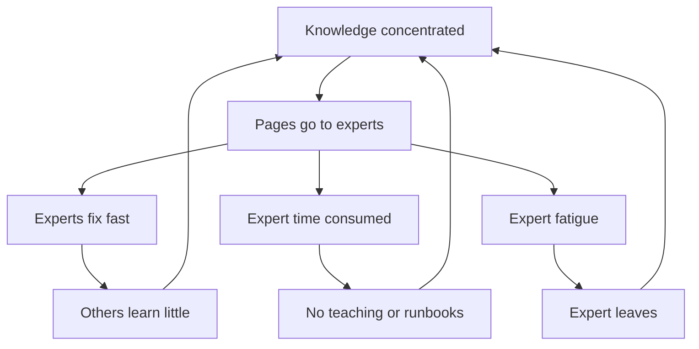

Every arrow is reasonable alone: routing a ledger page to the fastest restorer is good incident
practice, and an expert who fixes rather than writes runbooks is doing what the business asks. Together they concentrate knowledge further each quarter, and
the outer path (fatigue, then departure) worsens the concentration just when it is most dangerous.

The second idea is **leverage**. Donella Meadows ranked the places to intervene in a system, from
changing numbers at the bottom to changing goals and paradigms at the top, and relayed Jay Forrester's
observation that people often find the right point and push it the wrong way
([Meadows, 1999](#meadows1999leverage)). The manager's version: list the
interventions for each recurring problem, place each at its level, and price each in your own hours.
The winners are usually structural, slow to show, and unglamorous.

### Deep Conceptual Explanation

#### Stocks, flows, and slow change

A stock is anything you could count at a moment: engineers who can safely change the ledger, people
waiting for a decision. A flow is a rate: engineers trained per quarter, resignations per year. A stock
changes only through its flows, so it fills and drains at the rate the flows allow
([Meadows, 2008](#meadows2008thinking)).

Two consequences matter. The stocks that matter most (experience, trust) fill slowly and can drain
quickly: losing one of four ledger experts takes a week, replacing one takes months. And a large stock
hides a stopped inflow: Billing ran on ledger knowledge that nobody was replenishing, and the
shortfall became visible only at three people. Chapter 27 applies the same arithmetic to defects
([the quality version of the model](#the-mental-model)).

#### Feedback loops

A **balancing loop** acts on the gap between a goal and the current state. Balancing loops explain why
problems often improve partly and then stall at a level nobody chose: the loop is satisfied by a goal
lower than yours, or it acts through a resource that is running out.

A **reinforcing loop** feeds its output back as input, in either direction. Run backward, the on-call
loop spreads knowledge: protected teaching time, more people able to respond, fewer pages per expert,
more time to teach. Meadows argued that reducing the gain of a reinforcing loop is usually more powerful
than strengthening the balancing loops that fight it
([Meadows, 1999](#meadows1999leverage)). In management terms: slow the
concentration before adding ways of coping with it, such as escalation paths or a larger stipend.

A recognition test, **this book's recommendation**: if the same people, components, or decisions
appear in most problems over two quarters, look for a reinforcing loop around them. If a problem
improves after every push and then settles back, look for a balancing loop with a lower goal, and find
out whose goal it is.

#### Delays

Hiring takes months to add capacity, training months to add expertise, a rule change a quarter to show
in the numbers. Meadows observed that delays long relative to the system's pace of change cause
overshoot and oscillation ([Meadows, 1999](#meadows1999leverage)). The
stock of experienced engineers shows the mechanism:

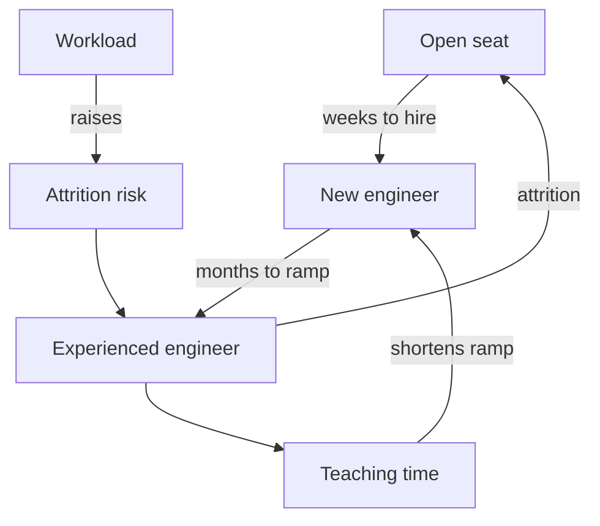

In the twelve months before the director arrived, eight Northstar engineers left (10 percent of 80),
and the median time from resignation to the replacement's first day was 15 weeks (fictional; see the
[baseline data](#page-case-studies-northstar-baseline-data)). Eight departures at 15 weeks each is 120 seat-weeks, about 2.3
engineer-years of empty seats, before the months each replacement needs to ramp. A manager who
requests hires against today's workload receives them after the pressure has peaked, and the next
planning cycle cuts them: hiring and freezing out of phase with need. The defense is to act first on the
flows you control fastest (attrition, teaching time, ramp) and to plan hiring against a forecast.

#### The capability trap

Nelson Repenning and John Sterman, drawing on over a dozen field studies of improvement programs in
industries including telecommunications, semiconductors, and automobiles, together with system
dynamics models, describe two ways to close a performance gap: work harder, or make the process more
capable by spending time on improvement
([Repenning and Sterman, 2001](#repenning2001nobody)). Working harder
pays off at once. Improvement pays off after a delay and costs output meanwhile, so performance gets
worse before it gets better. Under pressure, people cut improvement time, capability erodes, the gap
widens, and pressure rises: the **capability trap**. Because the link between skipped improvement and
later shortfall is long and hard to see, the authors argue, managers tend to blame people's effort or
discipline and respond with more pressure. This is a **research finding** from field studies and
simulation models, not controlled experiments; its strength is that the mechanism recurs across very
different industries.

Chapter 27 shows the trap in a quality decline. It also governs managerial time. Billing's experts fix
pages themselves instead of pairing and writing runbooks; a director answers every escalation instead
of writing the rules that would make most escalations unnecessary. Leslie Perlow's nine-month field
study of a software engineering team found that the group's collective use of time kept its members
short of time: engineers were constantly interrupted, a crisis mentality and rewards for individual
heroics sustained the pattern, and changing how they used their time improved collective productivity
([Perlow, 1999](#perlow1999time)). It is one qualitative study, read at
abstract level, but its direction matches the trap: rewarding heroics strengthens the loop that makes
heroics necessary.

#### Leverage points

Meadows's essay lists twelve places to intervene, in increasing order of effectiveness, and calls the
list tentative ([Meadows, 1999](#meadows1999leverage)). The table maps the
levels that most often matter in engineering organizations; the examples are this book's.

| Level (lower to higher) | What changes | Engineering example |
|---|---|---|
| Parameters | Numbers in an existing structure | On-call stipend, WIP limit, allocation percentage |
| Buffers and stocks | Size of stocks relative to flows | Hiring ahead of attrition, slack in a rotation |
| Delays | Time between action and feedback | Weekly instead of quarterly review of on-call load |
| Loop strength | How hard a loop pushes | Protected teaching time slows concentration |
| Information flows | Who sees what | Pages per person shown in the weekly review |
| Rules | Incentives, constraints, decision rights | Experts are escalation only |
| Goals | What the system is trying to do | "Restore fastest" versus "anyone can restore" |
| Paradigms | The beliefs the goals come from | "Reliability is the experts' job" |

Three of the essay's observations belong in every planning conversation. Most attention goes to
parameters, which rarely change behavior. Adding missing feedback is often powerful and cheap. And the
higher the leverage point, the more the system resists the change: a rule change provokes objections
that a stipend increase never does.

#### Constraints

Eliyahu Goldratt's argument, popularized in *The Goal*, is that a system's output is limited by its
tightest constraint, and that improving anything else does not raise output
([Goldratt and Cox, 1984](#goldratt1984goal)). The procedure associated
with his work: identify the constraint, get the most out of it, subordinate everything else to it,
relieve it, then look for the next one. Chapter 16 applies it to delivery flow.

The managerial lesson is that constraints are often people: a staff engineer whose judgment every
design waits on, a director whose approval every exception needs, three engineers who are the only safe
ledger responders. The first move is not to make them work faster but to stop spending their time on
anything someone else could do.

#### Managerial leverage

Andrew Grove's idea that a manager's output is the output of the organization under their influence
([Grove, 1983](#grove1983high)) is developed in Chapter 1. This
chapter adds a ranking rule: an activity's leverage is the change it produces in that output per hour
of the manager's time, over the period the change persists. A one-hour decision that sets a rotation
rule for a year beats ten hours on incident calls, though the calls are what people see.

**Visibility** is a separate axis. Visible work (joining incidents, approving changes) is rewarded at
once; structural work is often invisible and slow. Managers drift toward
visible work because its feedback is immediate: the capability trap, applied to the manager.

#### Multipliers and diminishers

Liz Wiseman's idea of **multipliers** and **diminishers** is that leaders differ less in their own
intelligence than in how much of other people's capability they draw out
([Wiseman, 2010](#wiseman2010multipliers)). In systems terms, a
diminisher is a constraint that also weakens the inflow of capability: every question answered for
someone comes back next time. A multiplier routes decisions and learning to others. The test is
behavioral: count the decisions in your area that require you, and whether that number is falling.

### Engineering Organization Example

The following analysis is **illustrative**. Team composition and incidents come from the Northstar
baseline; the paging figures are additions recorded for this chapter. Northstar did not track on-call
load, so they were reconstructed afterwards from the paging tool's history.

In the baseline quarter, Billing's rotation received 180 pages. Three engineers handled 126 of them
(70 percent), as primary or by escalation; the other ten handled 54. Of 64 pages outside working hours,
the three handled 54. About a third of all pages (61) needed no action. Billing had eight Sev1 and Sev2
incidents, six of them recurrences, and from the incident file its median restoration time was 495
minutes against 190 for the organization.

Each of the three received about 42 pages in the quarter, more than three a week and eighteen after
hours; each of the other ten received about five. Billing used to have four ledger-experienced
responders; one left about nine months before the director arrived.

The ranking criteria (**this book's recommendation**) are the effect on the loop, how long the effect
lasts without further effort, the delay before it works, and the director's own hours.

| Intervention | Level | Effect on the loop | Delay | Director hours | Visibility |
|---|---|---|---|---|---|
| Raise the on-call stipend | Parameter | None on concentration; may delay a departure | Immediate | 1 | High |
| Director joins Billing incidents | None | None; one more person on each call | Immediate | 5 a week | Very high |
| Request an extra ledger hire | Stock inflow | Small and late; headcount is flat | 15 weeks plus ramp | 3 | High |
| Delete or demote no-action pages | Loop inflow | About 43 fewer expert pages a quarter | 2 to 4 weeks | 2 | Low |
| Show pages per person weekly | Information flow | Concentration visible to all managers | 1 week | 1 | Low |
| Rule: experts escalation only, with pairing | Rule | Reverses the loop | One quarter | 4 | Medium |
| Protected runbook time for experts | Loop strength | Knowledge leaves three heads | One to two quarters | 2 | Low |

The fourth row assumes the three handled no-action pages in the same 70 percent proportion as all
pages: 70 percent of 61 is about 43, taking their load from 126 to about 83 pages a quarter within a
month. Chapter 24 covers how to demote cause-based alerts
([on-call design and load](#on-call-design-and-load)).

The rule change reverses the loop and is the most resisted. Restoration will be slower for a quarter
while others learn, on a team whose median restore is already over eight hours. The SRE Workbook's
on-call chapter treats two incidents per twelve-hour shift as the load limit and gives eight engineers
as the minimum for a single-site round-the-clock rotation
([Cook et al., On-Call](#cook2018oncall)); thirteen engineers clear that,
so Billing's constraint is knowledge, not headcount.

The two most visible interventions have the least leverage. The three with the most (alert removal,
published load, the escalation rule) cost the director about seven hours in total. Chapter 24 owns the
rotation design itself.

### Decision Framework

When a result keeps recurring, walk down the diagnosis and choose the highest-leverage intervention
you can carry through:

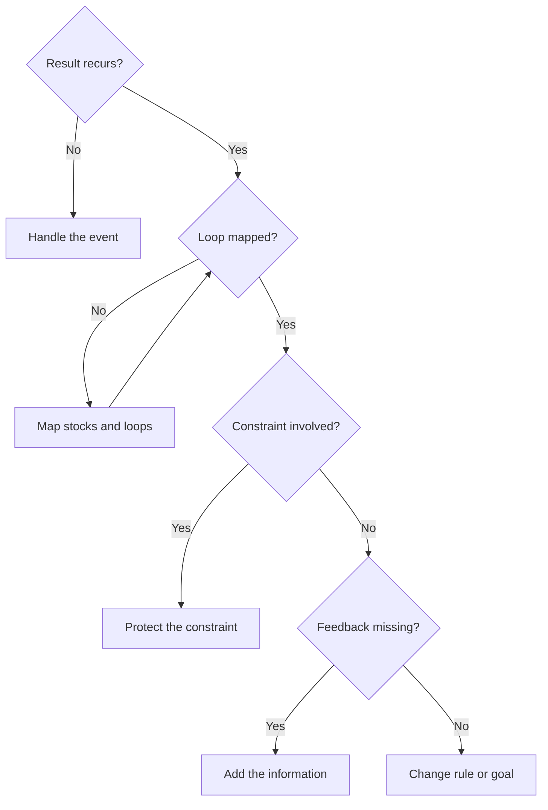

Then score the candidates:

| Criterion | Question | Warning sign |
|---|---|---|
| Level | Where on the leverage list does it act? | Every option is a parameter |
| Reach | How many people or decisions does it change? | Only the person in front of you |
| Durability | Does it keep working when you stop attending to it? | It needs your presence weekly |
| Delay | When will the effect show, and will you still be measuring? | No date for checking |
| Cost to you | Your hours, now and ongoing | It grows with the organization |
| Resistance | Who loses something? | Nobody objects: it may change nothing |
| Direction | Could it strengthen the loop you want to weaken? | It rewards the behavior producing the problem |

Two rules of thumb, both **this book's recommendation**. When two interventions are close, prefer the
one that adds information or changes a rule over the one that changes a number. And when you are the
constraint, the first intervention is on your own calendar.

### Trade-offs

**Leverage against speed.** Structural changes often take a quarter to show. When an expert is about to
burn out this month, low-leverage relief (time off the rotation, pay for the nights) is right, as long as
it comes with the structural change and is not mistaken for it.

**Leverage against resistance.** A rule making experts escalation-only costs them status and costs the
team restore speed. Budget the political work with the technical work, and expect the objection to
arrive as a reasonable-sounding exception.

**Visible against structural action.** Visibility is not worthless: people in an incident want to see
that leadership cares, and a director who never appears loses the trust structural work needs. Choose
some visible presence deliberately; spend most hours on structure.

**Modeling against acting.** Modeling can become a way to avoid deciding. A rough loop checked against
data is usually enough.

### Failure Modes

**Parameter tinkering.** Every response is a number: a higher stipend, a new target. Signal: the problem
returns after each adjustment. Countermeasure: require one non-parameter option in every proposal.

**The hero loop.** Recognition goes to whoever fixed the 2 a.m. outage, not to whoever wrote the runbook
that meant nobody had to. Signal: the same names in every incident and every award. Countermeasure:
publicly recognize work that removed the need for heroics.

**Optimizing a non-constraint.** Faster builds for a service while every release waits on a manual
approval. Signal: local measures improve, the end-to-end result does not. Countermeasure: name the
constraint before approving improvement work.

**Ignoring delays.** An intervention is judged a failure after two weeks and reversed; hires arrive after
the pain has passed. Signal: oscillating policies. Countermeasure: state the expected delay and a
review date when making the change.

**The accidental diminisher.** A capable manager or staff engineer answers every question and becomes the
constraint. Signal: decisions wait for one person; others stop proposing. Countermeasure: count the
decisions that need you, and hand some away each quarter.

**Pushing the lever backward.** Adding approval steps after a failure makes batches bigger and failures
worse (Chapter 27 has the release-train version). Countermeasure: trace each intervention once around
the loop before committing.

### Enterprise Application

In an organization of 50 to 150 engineers, the director's leverage comes almost entirely through other
people and through structure.

**The director's portfolio** is mostly rules, information, and goals: decision rights for staff
engineers, what the weekly operational review shows, which outcomes managers answer for. The director's
calendar is a system to manage, and the director is often the organization's first constraint.

**Managers model their own teams.** Each engineering manager should be able to name their team's
critical stocks (experienced responders, people at risk of leaving) and the loop most likely to hurt
them in two quarters. That question would have surfaced Billing's concentration before it reached three
people.

**Staff engineers as leverage.** Northstar's three staff engineers own no components and have no
mandate. In the baseline, Ines Carvalho spent about eight hours a week answering unscheduled questions
about Core (**illustrative**, consistent with the staff engineers' 20 percent unplanned share). Answering
questions one at a time is the lowest level of work; writing the boundary rules for a Core module and
reviewing others' decisions against them reaches every team. Chapter 29 covers the staff role.

**Organization-level stocks** that change slowly and matter most: people who can safely change
critical systems, managers who can run their teams without escalating, and trust between engineering
and product. Report them, even roughly, beside delivery measures (Chapter 37).

### CTO Perspective

At executive scale the highest-leverage interventions are goals, company-wide rules, and the beliefs
behind them. A CTO who acts as if reliability is every team's job, not the experts', has changed a
paradigm; one who funds a stipend increase has changed a parameter.

**Translating requests.** Boards and executive peers ask for numbers: headcount, a target, a budget
line. "Add ten engineers" is a stock inflow with a delay of months and an attrition outflow; the useful
question is which loop those engineers would change, and whether a rule change would do it faster.

**Company-wide stocks.** The CTO owns stocks that directors cannot see whole: talent across teams, the
architecture's capacity to absorb change, and engineering's credibility. These drain quietly under
pressure. A proposal to delay backfills to hold expense flat is a decision to let the experienced
engineer stock fall while workload holds, which strengthens every concentration loop at once.

**The CTO's own leverage.** A CTO who approves architecture decisions, joins every Sev1, and answers
every escalation is the organization's most expensive constraint. The calendar should be dominated by
goals, rules, the people who run the organization, and the information it steers by.

### Practical Playbook

1. **List the recurring results.** The three problems that have come back at least twice in two
   quarters. Ignore one-off events.
2. **Map each as stocks and loops**, one page per problem, and check every arrow against data.
3. **Name the delays.** Estimate how long each flow takes to respond, and write it down.
4. **Find the constraint.** Ask what the result waits on. If it is a person, including you, say so.
5. **List interventions at several levels**: at least one parameter, one information flow, one rule.
   If you can only think of parameters, return to step 2.
6. **Score them** with the decision table.
7. **Audit your calendar.** Sort a fortnight of your hours by leverage and move hours from the lowest
   band to the highest, protected on the calendar. (Chapter 1's audit sorts hours by job; this one
   ranks them by leverage.)
8. **Change one rule and one information flow**, visibly, saying what you expect to see and when.
9. **Review at the stated delay.** If the loop has not weakened, revisit the map, not only the
   intervention.
10. **Hand away decisions each quarter.** Count the decisions that need you, and reduce the count.

### Case Study

This case is **fictional**. It is set in the twelve months before the director arrives at Northstar,
using the [baseline](#page-case-studies-northstar-baseline-data) and this chapter's additions; it adds
nothing to [the first quarter](#page-case-studies-northstar-first-quarter).

At the start of that year, Billing had four engineers trusted with ledger incidents. The rotation
nominally covered all thirteen, but ledger and invoicing pages were escalated to the four almost by
reflex, because they restored fastest. Nine months before the director arrived, one of the four
resigned. The backfill started 15 weeks later and, because the remaining three were rarely free to pair,
was not on the rotation by the end of the baseline quarter.

The previous management responded three times. It raised the on-call stipend. After each serious Billing
incident it added an alert; some became the no-action pages that made up about a third of the quarter's
180. And it asked the experts to "document as they go", without giving them time. Each response was
reasonable, and each was a parameter or an addition to the loop's inflow. None changed who learned from
a page.

By the baseline quarter, the result looked like a performance problem: the highest incident count in
the organization (8), six recurrences, and a median restoration time more than twice the organization's.
A manager reading only those numbers might conclude the team needed more discipline, the attribution
error Repenning and Sterman describe. The loop said otherwise: the experts were doing exactly what the
system rewarded, and each quarter made the system more dependent on them.

The same structure appeared elsewhere. Ines Carvalho, with eleven years on Core, spent about eight hours
a week answering questions that a written module boundary would have answered once, and nobody owned
the information flow that would have shown the cost.

Two decisions recorded in the canon bear on this loop. Billing receives the largest share of the
prevention allocation (25 percent) and two of the seven QA engineers. And core/scheduler, previously
unowned, is assigned to Billing in week 4, widening Billing's paging surface: right for ownership, and
also more inflow to this loop. A correct decision in one loop can load another.

### Exercises

Solutions are in [chapter 3 solutions](#page-solutions-ch03-solutions). Data files are linked from
the [Northstar baseline page](#page-case-studies-northstar-baseline-data).

#### Foundational

**F1.** Draw a stock-and-flow map for "engineers who can safely respond to a Billing ledger incident"
at Northstar. Use this chapter's figures (four experts at the start of the year, one departure, a
15-week backfill delay) and state your own assumption for how long a new engineer needs to become a
safe responder with and without pairing. Predict the stock at the end of the next two quarters under
both assumptions, and say which flow the director can change fastest.

**F2.** Marcus Oyelaran's team proposes eight responses to its on-call load: a higher stipend, a second
weekly incident review, a hiring request, a no-action-page purge, a published pages-per-person chart, an
escalation-only rule for experts, a quarterly award for best incident response, and protected runbook
time. Place each on the leverage table, identify any that would strengthen the concentration loop, and
explain your reasoning for the two hardest to classify.

**F3.** Suppose that in a later quarter Northstar's release working group finds that every Core module
boundary decision waits for Ines Carvalho, and proposes cutting 20 minutes from the Core pipeline to
"improve flow". Identify the constraint, say whether the pipeline work raises output, and propose two
ways to get more from the constraint without asking Ines to work longer hours.

#### Applied Leadership

**A1.** An **illustrative** 45-hour week for a new director: status meetings 9 hours, joining incident
calls 5, personally approving technical changes 4, one-on-ones with nine direct reports 4.5, product
and customer meetings 6, email and chat 8, hiring interviews 3, unscheduled 5.5. Rank the categories by
leverage, redesign the week to free at least ten hours, and say what each freed hour goes to and what
risk each change carries.

**A2.** Ines Carvalho is respected, fast, and answers every Core question herself within minutes. Two
senior Orders engineers say they no longer propose designs because "Ines will know better". Plan a
conversation with Ines that treats this as a systems problem rather than a character flaw: what you ask,
what data you bring, what mandate you offer, and how you will know in a quarter whether anything
changed.

**A3.** Marcus asks you to approve doubling Billing's on-call stipend, arguing it is the only thing he
can do this week and that one of his experts is close to leaving. Decide, and write the reply. Address
the immediate retention risk, the structural change you want alongside it, and how you will keep the
stipend from becoming the whole response.

#### Executive Decision-Making

**X1.** You are Northstar's CTO. Rajiv Menon (CFO) proposes delaying all backfills by one quarter to
hold operating expense flat. Using this chapter's attrition and backfill figures, estimate the capacity
cost, describe which loops the delay would strengthen, and write a short recommendation to Helena Marsh
(CEO) with an alternative that serves the CFO's goal.

**X2.** As CTO you can sponsor one company-wide intervention this year: a rule that no engineer may be
first responder for more than a set share of a team's after-hours pages, enforced through the monthly
review; or a published monthly dashboard of on-call load, decision wait times, and attrition by team,
with no rule attached. Choose one, place each on the leverage list, and say what would make you switch
after two quarters.

### Reflection Questions

1. Which result in your organization has come back at least three times? What loop regenerates it, and
   who benefits from the loop as it is?
2. Which of your regular activities is the most visible and the least leveraged? Who would notice first
   if you stopped it for a month?
3. Where are you the constraint? How many decisions waited for you last week that a rule could have
   settled?
4. Which stock in your organization is draining too slowly for anyone to notice?
5. Whose heroics does your organization reward, and what would it take to reward the work that made
   heroics unnecessary?

### Key Takeaways

- Treat a recurring result as the output of a structure: map stocks, flows, and loops before choosing an
  intervention.
- Stocks of experience and trust fill slowly and drain quickly; act first on the flows you control
  fastest.
- State the delay of every intervention, and review it at that delay, not before.
- Rank interventions by leverage (effect, reach, durability, your hours). Visibility is a separate axis
  and usually points the wrong way.
- Prefer changing rules and information flows to changing numbers, and expect resistance to rise with
  leverage.
- Find the constraint, including when it is a person, and stop investing where it is not.
- Under pressure, protect improvement time; cutting it is how teams and managers enter the capability
  trap.
- Audit your own calendar as part of the system, and hand decisions away every quarter.

### References and Further Reading

- [Meadows, 1999](#meadows1999leverage). "Leverage Points: Places to
  Intervene in a System". The ranked list this chapter adapts; short, free, and the best single reading
  on leverage.
- [Meadows, 2008](#meadows2008thinking). *Thinking in Systems*. The
  longer introduction to stocks, flows, and feedback.
- [Repenning and Sterman, 2001](#repenning2001nobody). The capability
  trap, worse-before-better dynamics, and why managers blame people for structural shortfalls.
- [Perlow, 1999](#perlow1999time). How a software team's shared use of
  time and its reward for heroics kept it short of time.
- [Goldratt and Cox, 1984](#goldratt1984goal). *The Goal*. Constraint
  thinking, taught as a novel.
- [Grove, 1983](#grove1983high). *High Output Management*. Managerial
  output; Chapter 1 develops it.
- [Wiseman, 2010](#wiseman2010multipliers). *Multipliers*. Leaders who
  draw out others' capability, and those who underuse it.
- [Cook et al., On-Call](#cook2018oncall), in the free *Site Reliability
  Workbook*. On-call load limits and rotation sizing.

<a id="page-parts-01-foundations-04-the-leadership-ladder"></a>

## Chapter 4 — The Leadership Ladder: Senior Engineer to CTO

!!! warning "Awaiting human review"
    This chapter has passed the book's automated validation and an editorial self-review, but not yet
    the human review in which each cited claim is checked against its source. Treat it as a reviewed
    draft. Corrections are welcome; see the repository's CONTRIBUTING file.

This chapter is a map of the roles between senior engineer and chief technology officer: what each
one is responsible for, how far ahead it looks, what it produces, and how it typically fails. It then
takes on two questions the map raises. How do you tell whether a manager at any level is effective,
rather than merely busy? And how should an experienced engineer choose between the management track
and the staff-plus track, and switch later if the choice was wrong? The running example is Northstar
Technologies, the fictional company in the [case study](#page-case-studies-northstar-index).

This chapter is the map. Chapter 8 owns career ladders and promotion, Chapter 29 staff-plus roles,
and Chapters 40, 47, and 50 the director, VP, and CTO roles. Chapter 1 defines managerial output; this
chapter owns how to measure it.

### Why This Matters

On a single team, role confusion is cheap. Everyone can see who decides what, and a mismatch is fixed
in a conversation.

In an organization of 50 to 150 engineers, undefined roles become structural. Two people believe
they own the same decision, or nobody does. Strong engineers are promoted into management because it
is the only visible step up. Staff engineers without a mandate drift between advising and
firefighting. Managers judged on what their teams ship are rewarded for activity, not for building a
team that will still work next year.

At executive scale, the ladder is the CTO's design problem. Which roles exist, what each is
accountable for, and how people move between tracks decide whether the organization produces its next
generation of leaders or imports them. Northstar has six managers, three staff engineers with no
defined mandate, a director, and a CTO, and no written description of what most of them are for.

### Learning Objectives

After this chapter you will be able to:

- Describe the scope, time horizon, primary output, and main failure mode of each role from tech lead
  to CTO, and of the staff-plus roles beside them.
- Diagnose the level at which a person is actually operating from their calendar and decisions,
  independent of their title.
- Measure a manager's effectiveness with a small set of outcome, health, and leverage evidence, and
  explain why team activity is not that measure.
- Choose between the management and staff-plus tracks using explicit criteria, and design a switch
  between them with a trial period and a return path.

### The Mental Model

> **Mental model:** Each step up the ladder trades direct output for leverage and lengthens the delay
> before you learn whether you were right. Measure each role on the outcomes it is positioned to
> change, over the horizon it works on.

Two quantities change as you move up either track. **Scope** grows: from a component, to a team, to
several teams, to the whole of engineering and its place in the company. **Time horizon** grows with
it: a tech lead's decisions show their consequences in weeks, a director's in quarters, a CTO's in
years. Everything else about the role follows from these two. The primary output shifts from work
you did to work others did because of decisions you made, and the main failure mode at every level is
to keep doing the previous level's job, because that job still gives fast feedback.

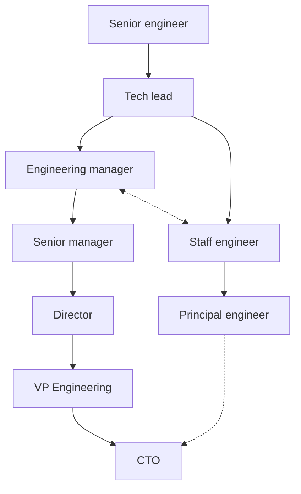

The solid lines are the usual promotions. The dotted line between manager and staff engineer is the
switch this chapter plans for. The dotted line from principal engineer to CTO marks that some CTOs come
from the technical track, which depends on the company's CTO archetype (Chapter 50). Tech lead appears
as a step because, in many companies, it is where people first try both kinds of work; it is a role,
not always a level.

### Deep Conceptual Explanation

#### The ladder, level by level

The table below is **this book's synthesis**, built on practitioner descriptions rather than research:
Fournier's well-known progression from tech lead through manager of managers to senior leadership
([Fournier, 2017](#fournier2017manager)), Larson's staff-plus
descriptions ([Larson, 2021](#larson2021staff)), and his writing on
engineering executives ([Larson, 2024](#larson2024primer)). The time
horizons are typical ranges, not rules.

| Role | Scope | Time horizon | Primary output | Main failure mode |
|---|---|---|---|---|
| Tech lead | One team's technical work | Weeks to a quarter | Sound technical decisions the team executes | Writes the hard parts alone; becomes the bottleneck |
| Engineering manager | One team: people, delivery, health | One to two quarters | A team that delivers and keeps improving without them | Acts as the team's best engineer or its ticket router |
| Senior manager | Several teams, through managers | Two to four quarters | Managers who run their teams well | Manages the managers' teams directly |
| Director | 50 to 150 engineers; one area | One year | An organization whose system produces the outcome | Runs on reports' summaries; fixes symptoms team by team |
| VP Engineering | All or most of engineering | One to two years | Portfolio allocation and a leadership bench | Becomes a large director; no peer-level influence |
| CTO | Technology and its role in the company | Two years or more | Technical strategy the executive team acts on | Advocates for engineering instead of solving the company's problem |
| Staff engineer | A domain or problem across teams | One to four quarters | Technical direction others adopt | Roaming critic, or the overloaded hero who fixes everything |
| Principal engineer | A company-critical domain | One to three years | Direction for the domain; leaders grown in it | Architecture by decree, detached from delivery |

Three cautions apply. Titles vary: Larson defines the engineering executive as the person responsible
for all of engineering, whatever the title, which companies use inconsistently ([Larson, 2023a](#larson2023executive-job)).
Small companies compress levels. And staff-plus rows hide several archetypes (Tech Lead, Architect,
Solver, Right Hand), each with a different scope ([Larson, Staff archetypes](#larson-staff-archetypes)).
Chapter 29 treats them.

#### What changes at each step

**What you produce.** A senior engineer's output is visible: code, designs, fixed incidents. A
manager's output is the team's output plus what the team can do next quarter that it cannot do now. A
director's output is mostly decisions about structure, staffing, and allocation that others carry out.
Chapter 1 develops Andrew Grove's idea that a manager's output is the output of the organization under
their influence ([Grove, 1983](#grove1983high)).

**How long feedback takes.** Larson describes staff work as having feedback loops of weeks, months,
and years rather than the quick cycle of shipping code
([Larson, What do Staff engineers actually do?](#larson-staffeng-actually-do)).
The same holds for managers: a director who restructures ownership learns whether it worked two
quarters later, and is tempted to fill the gap with the previous level's fast-feedback work.

**Whose problem you solve.** At the top, Larson argues that the CEO, the executive peers, and the
engineering organization each see a valid but incomplete version of the problem, and that the
executive's job is to merge them and solve the company's problem rather than advocate for engineering
([Larson, 2023b](#larson2023balancing)). This is **expert opinion**.

#### The staff-plus track in parallel

The staff-plus track exists so that technical leadership is not reachable only through people
management. Larson lists the core of staff work as setting technical direction, mentorship and
sponsorship, providing engineering perspective in decisions, exploration, and the coordinating work
that keeps projects moving, with less coding than before
([Larson, What do Staff engineers actually do?](#larson-staffeng-actually-do)).
He also notes that some companies have no technical leadership pattern and push every experienced
engineer toward management ([Larson, Staff archetypes](#larson-staff-archetypes)).

The tracks differ in accountability. A manager answers for people outcomes (hiring, growth,
performance, retention) and has formal authority over them. A staff engineer answers for technical
outcomes across a scope they do not manage, and works mainly through influence; Larson warns that
people overestimate how much formal authority helps
([Larson, Where do Staff-plus engineers fit?](#larson-staffeng-reporting)).
A staff role without scope, sponsor, and reporting line has neither lever, which is Northstar's
starting position.

#### Measuring managerial effectiveness

The common error is to measure a manager by the team's **activity**: deployments, tickets closed, story points, one-on-ones held, roadmap items
shipped. Activity is easy to count and partly under the manager's control. It is not the manager's
output, for three reasons.

1. **Attribution.** Team results depend on the system the team sits in. At Northstar, the baseline page
   warns that Orders' and Billing's lead time and failure rate describe the Core release train more than
   the teams ([baseline data](#page-case-studies-northstar-baseline-data)). Neither manager could
   have changed the train alone.
2. **Lag.** The most important managerial work (hiring, growing people, clarifying ownership) shows in
   results one or two quarters later. A measure taken this quarter credits the previous manager.
3. **Gaming.** Every activity measure can be raised without improving anything: more, smaller
   deployments; tickets split; one-on-ones held and empty. Chapter 18 treats metric gaming generally.

What do managers measurably affect? Chapter 1 summarizes the evidence that managers matter: the
clearest effect is on retention ([Hoffman and Tadelis, 2021](#hoffman2021people)),
with behaviors such as coaching and career development listed by Google's Project Oxygen
([Google re:Work](#rework-great-managers)).

That evidence points to a practical conclusion (**this book's recommendation**): measure a manager on a
small set of evidence across four areas, over at least two quarters, and read it in context.

| Area | Evidence | Typical gaming, and the counter |
|---|---|---|
| Unit outcomes | The team's agreed outcome measures (reliability, delivery against commitments), with the trend and the context | Renegotiated commitments; pair with what was originally promised |
| Team health | Regretted attrition; upward feedback on manager behaviors; concentration of on-call and critical knowledge | Pressure on survey answers; keep feedback anonymous and read comments, not scores |
| People growth | Who can now do what they could not two quarters ago; promotions earned elsewhere; a successor | Inflated promotions; calibrate across managers (Chapter 8) |
| Leverage | Problems solved across team boundaries; decisions that held; ownership clarified | Self-reported heroics; ask the neighboring teams |

Activity data is still useful as a question, never as a score.

#### Choosing a track

Chapter 2 covers the evidence on promotion selection
([Benson et al., 2019](#benson2019promotions)): firms tend to promote
on current performance, so being the best engineer on a team is weak evidence of being its best
manager.

For the individual, the decision is about the work, not the status. Charity Majors argues that
management is a change of profession rather than a promotion, that it is highly interruptive, and that
moving deliberately between engineering and management over a career makes people better at both
([Majors, 2017](#majors2017pendulum)). That is **expert opinion**. The
decision framework below turns it into criteria.

### Engineering Organization Example

Northstar's role structure as the director finds it. All figures are **illustrative**, from the
[baseline data](#page-case-studies-northstar-baseline-data).

**Spans.** The six teams hold 77 engineers (14, 13, 12, 15, 11, 12): 12.8 per manager on average,
from 11 (Data and Analytics) to 15 (Customer Experience). This book's recommendation (Chapter 1; gap
G8) is that people work crowds out the rest above about eight to ten reports; Chapter 33 owns team
sizing. A manager with 12 to 15 reports has little time for people growth and leverage.

**Tech leads.** A tech lead per team of six to ten engineers (**this book's recommendation**) gives
eight to twelve for 77 team engineers. Northstar has none with the title; each team relies
on one or two senior engineers informally, with no definition of what they decide.

**Staff engineers.** Three for 80 engineers, one per about 27. They report to the director (nine
direct reports in all) but own no components and have no mandate.

**Measuring the managers.** Suppose the director ranked the six managers on activity. Customer
Experience deploys 26 times a month and Payments and Integrations 22; Billing deploys 8 times. On that
view Daniel Cho is the strongest manager and Marcus Oyelaran the weakest. Now apply the four areas.

| Manager | Activity view | What the four areas would ask |
|---|---|---|
| Daniel Cho, Customer Experience | Most deployments (26 a month) | 44 escaped defects; one manager for two platforms and 15 people. Health and growth unknown |
| Elena Sokolova, Payments and Integrations | Shortest lead time among product teams (4 days) | Best operational discipline; is it written down and owned by the team, or held by a few people? |
| Marcus Oyelaran, Billing | Fewest deployments (8), most incidents (8) | Three people carry most pages: a health and concentration risk he can change. Lead time is mostly the release train, which he cannot |
| Priya Raman, Orders | 11 deployments, 7 incidents | Promoted eight months ago; growth and leverage evidence matter more than one quarter's results |

The two views rank differently, and the second separates what each manager controls (on-call
concentration, people growth, ownership) from what the system controls (the release train). One quantity worth computing: Billing's unplanned work is 41
percent of 13 engineers, about 5.3 engineer-equivalents. If the manager cut it to 30 percent, about 1.4
engineers' worth of capacity would return. That gain would be partly the manager's work and partly the
release train's, so the review asks what he changed, not only what moved.

### Decision Framework

For an engineer choosing between tracks, the table lists the criteria in order of weight (**this
book's recommendation**). The first three describe the person and the work; the last three describe
the organization.

| Criterion | Points toward management | Points toward staff-plus |
|---|---|---|
| What you want to be accountable for | People outcomes: hiring, growth, performance, retention | Technical outcomes across a scope you do not manage |
| What gives you energy | Conversations, conflict resolution, interrupt-driven days | Long, deep problems; writing; design across teams |
| Evidence from a trial | You have run one-on-ones, given hard feedback, and liked the result | You have led a cross-team technical decision without authority, and it held |
| Organizational demand | An open team, or a team too large for one manager | A defined staff role with scope, sponsor, and reporting line |
| Reversibility | The return path to engineering is real and stated | A move into management later is open |
| Motive check | Not chosen for pay or title alone | Not chosen to avoid people work you would do well |

The first criterion dominates. If someone wants the authority of management without its
accountability for people, neither track fits, and saying so is part of the conversation.

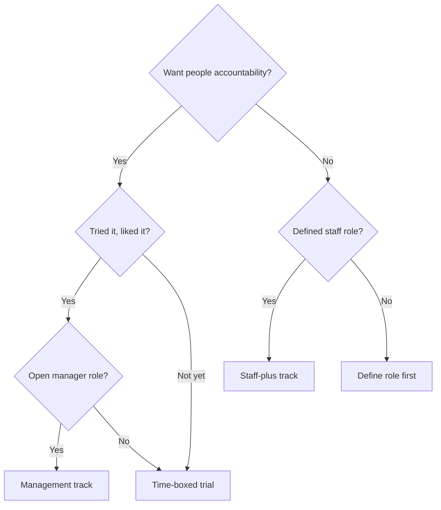

A **trial** means a bounded experience of the work before the title: leading a project with two or
three engineers, running one-on-ones for an intern or new hire, acting manager while a manager is on
leave, or owning a cross-team technical decision. **Define role first** means the organization owes
the engineer a scope, a sponsor, and expected outputs before asking them to choose a track that exists
only on paper.

Plan the switch back at the start: the trial length (this book suggests six to twelve months; Majors
argues that the best frontline managers are rarely more than two to three years from hands-on work),
the evidence reviewed, and the return role. A planned switch back is a career move; an unplanned one
looks like a demotion to everyone, including the person.

### Trade-offs

**Two tracks versus one ladder.** Two tracks let strong engineers grow without managing people. They
cost a second set of role definitions and cross-track calibration, and the staff track can become a
holding pen for people not made managers. One ladder is simpler and pushes the best engineers into
management, with the Peter Principle risk above.

**Separate tech lead versus tech-lead manager.** A separate tech lead frees the manager for people
work and gives engineers a step that tests leadership, at the cost of a coordination point. One person
doing both avoids the split but, Majors argues, is unstable because one job gets neglected.

**Outcome-based versus activity-based manager reviews.** Outcome evidence is fairer and harder to
game, but slow and dependent on the reviewer's judgment and context. Activity data is fast and
objective-looking, and measures the wrong thing.

**Defined versus open staff mandates.** A defined mandate gives leverage and a way to be evaluated,
and can lock someone into last year's problem. An open mandate allows exploration and, without a
sponsor, becomes advice nobody has to take.

### Failure Modes

**The default promotion.** The strongest engineer becomes manager because it is the only way up.
Signs: the new manager keeps the hardest technical work and cancels one-on-ones under pressure. Ask,
three months in, what the manager has stopped doing.

**Previous-level gravity.** People drift back to the level below because its feedback is fast: a
director reviewing pull requests, a VP running one team's planning. Detect it from the calendar: the
share of time on decisions only that level can make.

**The activity scorecard.** Managers are ranked by deployments, tickets, or roadmap items. Teams
respond by splitting work and avoiding hard, slow problems. Detect it when the best-ranked teams also
have the most escaped defects or the highest attrition.

**The mandate-less staff engineer.** A staff title with no scope or sponsor produces a roaming critic
or a hero pulled into every incident. Ask the staff engineer and their manager separately what the
staff engineer is accountable for this quarter; different answers confirm it.

**Title inflation at the top.** VP and director titles without the scope later block hiring a real
executive or force demotions. Detect it when a title's holder makes no decisions the level below
does not.

**The irreversible switch.** An engineer tries management with no return path, struggles, and leaves
rather than step back. Prevent it with written trial terms.

### Enterprise Application

At 50 to 150 engineers the ladder stops being informal. The director (Chapter 40) usually has six to
ten managers, a few staff engineers, and no senior-manager layer yet. Three decisions recur.

**When to add a manager-of-managers layer.** When the director's direct reports exceed what they can
coach and groups of teams share a domain. Too early inserts a messenger; too late leaves new managers
unsupervised.

**Where staff engineers report.** Larson weighs team fit (under team managers) against access to
information and authority (under senior leaders)
([Larson, Where do Staff-plus engineers fit?](#larson-staffeng-reporting)).
Reporting to the director works if each staff engineer has a defined domain and the managers know
what the staff engineer decides.

**How managers are reviewed.** On the four areas, twice a year, with anonymous upward feedback and
concentration measured from data, discussed with the manager before anything is written down.

### CTO Perspective

For the CTO, the ladder decides where future leaders come from. Four questions are the CTO's.

**Which roles exist and why.** A company of 80 engineers may not need a VP Engineering; one of 300
usually does. Because titles are used inconsistently
([Larson, 2023a](#larson2023executive-job)), define each role by its
responsibility, not market convention. Chapters 47 and 50 treat the VP and CTO splits.

**How leaders are evaluated.** Directors and VPs are judged on organizational outcomes over a year or
more, accepting that a good leader may have a bad quarter. The four areas scale up: organizational
outcomes, attrition and engagement, the leadership bench, and influence with executive peers.

**Parity between tracks.** If the top staff-plus level sits two levels below the top management level
in pay and access, engineers will read the ladder correctly: management is the real way up (Chapter 8).

**The CTO's own failure mode**: representing engineering to the executive team instead of solving the
company's problem with it.

### Practical Playbook

1. Write one paragraph per role, including informal ones such as tech lead: scope, time horizon,
   primary output, decision rights.
2. Mark roles that exist only on paper (title, no scope) and only in practice (scope, no title). Fix
   the second kind first; it is unrecognized work.
3. Give each staff-plus engineer a domain, a sponsor, and two or three outcomes for two quarters
   (Chapter 29 covers archetypes).
4. Review managers on the four areas over two quarters, in context, not on activity.
5. Collect anonymous upward feedback twice a year; read the comments with the manager; do not rank.
6. Measure concentration from data: pages per person, single-maintainer components, decisions that
   wait on one person.
7. Answer a request to manage with a time-boxed trial on written terms: length, evidence, return role.
8. Answer a request for staff-plus by confirming a defined role exists, or defining it.
9. Audit your own calendar monthly for previous-level gravity.

### Case Study

Northstar as the director finds it, with one decision set in quarter 2. Everything is fictional
([overview](#page-case-studies-northstar-index)); the role definitions are additions for this chapter, and the [first-quarter](#page-case-studies-northstar-first-quarter)
events are unchanged.

**Roles as found.** Northstar's only written role document is a wiki page, "Engineering levels", with
a paragraph for each of three engineering levels: Engineer, Senior Engineer, and Staff Engineer. The
staff paragraph describes a "recognized technical expert" and names no scope or output. The only
description of the manager role is one shared line, "lead a team of engineers to deliver high-quality
software", with no manager-specific review criteria, and managers have been reviewed once a year on their teams' roadmap delivery, which last quarter was 7 of
17 committed items. There is no tech lead role. The director's own role is defined by the CTO's
one-sentence mandate and a hiring brief. There is no VP Engineering: Victor Lindqvist, the CTO, has
the director as his engineering leader.

**What the first quarter did and did not settle.** The first quarter gave the staff engineers
transformation mandates (Chapter 27): Kwame Mensah release and detection, Ines Carvalho Core module
boundaries and contract tests, Li Na Zhou migration and configuration safety, plus the matching
standards with a ten-day decision rule. None says what they own once the quality program ends, how
they are evaluated, or how their authority relates to the managers whose teams change the code they
govern. Chapter 29 develops those questions.

**A track question in quarter 2 (a decision the reader faces).** Rafael Duarte, a senior engineer
in Orders, lost the Orders manager role to Priya Raman (Chapter 2); since week 2 he has shared
review ownership of core/order-capture. After the first quarter he asks
the director whether to try for management again or work toward staff engineer. Priya is staying,
there is no other open manager position, and the staff role has no definition he could aim at.

The decision framework exposes the problem. Four criteria are about Rafael and need a
conversation: the accountability he wants, what energizes him, what he has tried, and why he is
asking. Two are about Northstar, and Northstar fails both: no opening or defined staff role, and no
stated return path from management. Having lost the role once, is he drawn to the work or to the
title? Before Rafael can choose well, the organization has to decide
whether it has a tech lead role, what its staff engineers are for, and whether a manager trial is
possible without an open team. Exercise A1 asks you to have the conversation.

### Exercises

Solutions are in [chapter 4 solutions](#page-solutions-ch04-solutions).

#### Foundational

**F1.** Greg Tanaka, VP Sales, tells the CEO that Daniel Cho is clearly Northstar's best manager and
Marcus Oyelaran its weakest, because Customer Experience deploys 26 times a month and Billing 8. Write a short reply to the CEO explaining what the
numbers do and do not show about the two managers, and what evidence you would look at instead.

**F2.** A newly promoted director's calendar for one week contains: six hours reviewing pull requests
in one team, a two-hour planning session with a single team, four one-on-ones with managers, one hour
with the CFO's analyst on next year's budget, and three hours debugging a production incident as an
individual responder. Identify which items belong to the director's level, which to lower levels,
and what the pattern predicts if it continues for two quarters.

**F3.** Northstar has no formal tech lead role, and each team relies on one or two senior engineers
informally. Write the one-paragraph definition of a tech lead for Northstar: scope, decision rights,
time horizon, primary output, and how it differs from the manager's role. Then say whether every team
should have exactly one.

#### Applied Leadership

**A1.** Rafael Duarte, senior engineer in Orders, who lost the manager role to Priya Raman, asks you
in quarter 2 whether to pursue management or staff engineer. There is no open manager role and no
defined staff role. Plan the conversation: what you need to learn from him, what you can honestly offer, what
trial you could set up within Northstar's constraints, and what you must fix in the organization first.

**A2.** Design the review of Northstar's six engineering managers for the end of quarter 2, replacing
the annual review on roadmap delivery. Specify the evidence in each of the four areas for at least two
managers (one of them Priya Raman, promoted eight months before you arrived), how you will separate
what each manager controls from what the release train controls, and how you will avoid ranking.

**A3.** Northstar's three staff engineers hold transformation mandates but no standing scope beyond
them, and report to you. Propose, for each of them, a scope, a sponsor, and two outcomes for
the next two quarters, and decide whether they should keep reporting to you. State how a manager
should resolve a disagreement with a staff engineer about a change in that manager's team.

#### Executive Decision-Making

**X1.** Victor Lindqvist is considering creating a VP Engineering role above the director, arguing
that the board expects one and that he wants more time for technical strategy. Northstar has 80
engineers, six managers, and one director. You are advising Victor. Recommend whether to create the
role now, what it would be accountable for if created, and what you would do instead if not.

**X2.** Suppose that at the end of the director's first year, Helena Marsh asks Victor how he will judge whether
the director has been effective. Sev1 and Sev2 incidents have fallen, but one strong manager has left
and two staff engineers say they are still unsure of their mandate. As Victor, write the evaluation
approach: which evidence you weigh, over what horizon, and how you separate the director's
contribution from the system's.

### Reflection Questions

1. Which role in your organization exists only on paper, and which exists only in practice? Who is
   doing unrecognized work because of it?
2. If your manager reviewed you only on your team's activity last quarter, what would they conclude,
   and what would they miss?
3. What work from your previous level do you still do because it gives you fast feedback?
4. If you moved to the other track tomorrow, what would you be bad at for the first six months, and
   would you stay long enough to get good at it?

### Key Takeaways

- Each step up widens scope, lengthens the feedback delay, and shifts output to what others do
  because of your decisions.
- The main failure mode at every level is doing the previous level's job, because it still gives fast
  feedback. Check the calendar.
- Measure managers on unit outcomes, team health, people growth, and leverage, over at least two
  quarters and in context. Use activity data only to prompt questions.
- Being the best engineer is weak evidence of being the best manager. Judge managerial potential
  separately.
- Choose a track by the accountability you want, the work that energizes you, and evidence from a
  trial; then check that the organization has a real, defined role.
- Plan every track switch with a trial length, the evidence reviewed, and a stated return path.
- A staff role without scope, sponsor, and reporting line has neither authority nor a way to be
  judged. Define it before you fill it.

### References and Further Reading

- [Fournier, 2017](#fournier2017manager). *The Manager's Path*: the
  management levels from tech lead to senior leadership.
- [Larson, 2021](#larson2021staff). *Staff Engineer*: the staff-plus
  track; mostly free at staffeng.com. Pages read for this chapter:
  [Staff archetypes](#larson-staff-archetypes),
  [What do Staff engineers actually do?](#larson-staffeng-actually-do),
  and [Where do Staff-plus engineers fit?](#larson-staffeng-reporting).
- [Larson, 2024](#larson2024primer). *The Engineering Executive's
  Primer*: the executive role. Draft chapters read:
  [Larson, 2023a](#larson2023executive-job) on inconsistent executive
  titles, and [Larson, 2023b](#larson2023balancing) on balancing the
  CEO, peers, and engineering.
- [Larson, 2019](#larson2019elegant). *An Elegant Puzzle*: team sizing
  and organizational design.
- [Grove, 1983](#grove1983high). *High Output Management*: managerial
  output as the organization's output.
- [Hoffman and Tadelis, 2021](#hoffman2021people). People management
  skills and attrition in one firm: the strongest evidence here on what managers change.
- [Google re:Work](#rework-great-managers). Google's own
  account of Project Oxygen and manager behaviors.
- [Benson et al., 2019](#benson2019promotions). Promotions and the
  Peter Principle: why top performers are not automatically top managers.
- [Majors, 2017](#majors2017pendulum). The engineer/manager pendulum:
  switching tracks deliberately.


---

# IV. Engineering Execution

<a id="page-parts-04-execution-15-planning-prioritization-and-delivery-methods"></a>

## Chapter 15 — Planning, Prioritization, and Delivery Methods

!!! warning "Awaiting human review"
    This chapter has passed the book's automated validation and an editorial self-review, but not yet
    the human review in which each cited claim is checked against its source. Treat it as a reviewed
    draft. Corrections are welcome; see the repository's CONTRIBUTING file.

This chapter is about three decisions every engineering leader makes, usually without naming them:
how a team organizes its work (Scrum, Kanban, fixed cycles, or no named method), how competing
requests are ordered, and how much planning a piece of work deserves. It argues that the method
should follow the shape of the work, that priority should follow explicit economics rather than the
loudness of the person asking, and that planning effort should be proportional to what is actually
known. The running example is Northstar Technologies, the fictional company in the
[case study](#page-case-studies-northstar-index), where 7 of 17 committed roadmap items shipped in
the quarter they were promised.

Chapter 16 owns flow and dependencies, Chapter 17 forecasting and commitments, Chapter 38
organization-level quarterly planning, Chapter 44 outcome roadmaps, and Chapter 45 the economics of
cost of delay. This chapter works at the level of a team and a director's portfolio of teams.

### Why This Matters

For a team, the delivery method decides what a normal week feels like: whether interrupts are
expected or treated as failures, and whether the plan is a two-week promise or a queue. A method
that does not fit the work produces a team that is always "behind" while working hard.

For an organization, prioritization decides what the engineering budget earns, because value
delayed is value lost. When priority goes to whoever escalated last, the organization pays twice:
in the value of the work that should have been first, and in the replanning and abandoned partial
work every escalation causes.

For an executive, planning is a credibility instrument. Northstar's Chief Product Officer, Amara
Okafor, wants the roadmap she committed to customers on the dates she gave; last quarter it
delivered 41 percent of its commitments. Sales teams that learn engineering dates mean little
promise earlier and more firmly to compensate, which makes the next plan worse.

### Learning Objectives

After this chapter you will be able to:

- Choose and adapt a delivery method (Scrum, Kanban, fixed-time cycles, or none) from the shape of
  a team's work: interrupts, uncertainty, and external rhythm.
- Read the official method descriptions and the research on agile methods accurately, including
  how weak that research is.
- Prioritize with explicit economics (cost of delay divided by duration) and show stakeholders what
  a volume-driven order costs.
- Match planning effort to uncertainty, and run a team roadmap cadence that keeps near-term
  commitments firm and later items honest.

### The Mental Model

> **Mental model:** A plan is a bet sized to what you know. The method is how you place and revise
> the bets; the priority order is which bets you place first, and it should be set by what waiting
> costs, not by who is waiting loudest.

Two ideas organize the chapter.

The first is that **work has a shape**. Some arrives unpredictably and must be handled within days
(incidents, escalations). Some is well understood and can be planned in detail. Some is genuinely
uncertain: nobody knows the solution or its size. Each method assumes a different shape dominates.
A team whose work is a third interrupts, run on a method that assumes a protected two-week plan,
will miss its plan every time, and the miss will be blamed on the people.

The second is the **volume loop**. Without an explicit economic rule, priority goes to whoever
pushes hardest. That loop reinforces itself:

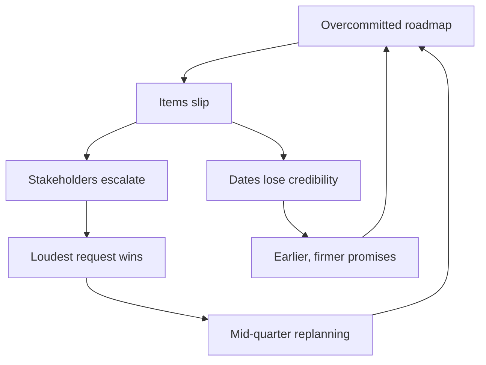

Replanning abandons partial work, so more items slip; slipping teaches stakeholders that only
escalation and early, firm promises work. The loop breaks only with both a capacity-honest plan
(Chapter 27 builds the capacity model) and a priority rule stakeholders can argue with in numbers.

### Deep Conceptual Explanation

#### What the methods actually say

Much argument about methods concerns versions their authors would not recognize. Start from the
primary descriptions.

The **Agile Manifesto** of 2001 is four value preferences, not a method; the last prefers
responding to change over following a plan, and the closing line says the items on the right
still have value ([Beck et al., 2001](#beck2001manifesto)). A plan
is not the enemy; valuing it above what you learn is.

**Scrum**, in the 2020 Scrum Guide, is a lightweight framework built on empiricism, with three
accountabilities (Developers, Product Owner, Scrum Master), a Sprint of one month or less containing
planning, a 15-minute Daily Scrum, a review, and a retrospective, and three commitments: the Product
Goal, the Sprint Goal, and the Definition of Done
([Schwaber and Sutherland, 2020](#schwaber2020scrum)). The guide
calls the framework immutable and says a partial implementation is not Scrum. For leaders, two
points matter: Scrum commits to a Sprint Goal, not a list of tickets, and it assumes most of a
Sprint can be protected from interruption. Story points and velocity are common practice around
Scrum; they are not in the guide.

**Kanban**, in the Kanban Guide, is a strategy for optimizing the flow of value. Its three practices
are to define and visualize the workflow, actively manage items in it, and improve it; it requires
explicit control of work in progress (WIP) without prescribing a number, names four flow measures
(WIP, throughput, work item age, cycle time), and prescribes no roles or iterations
([Coleman, Vacanti, et al., 2025](#vacanti2025kanban)). A second
lineage, the Kanban Method of Kanban University, was not verified for this book. Kanban assumes
the reverse of Scrum: work arrives continuously and is pulled when there is capacity.

**Shape Up**, Ryan Singer's book on how Basecamp works, uses six-week cycles for small teams.
Instead of estimating, leaders set an **appetite** (how much time the work is worth) and choose
**bets**; a project not finished in its cycle is cancelled by default rather than extended, which the
book calls the circuit breaker ([Singer, 2019](#singer2019shapeup)).
This book read only the publisher's summary, so take these as headline ideas. The relevant inversion
is fixed time and flexible scope, the right structure for uncertain work.

#### What the evidence says, and does not

The research is weak exactly where a leader needs it: whether method A beats method B in a setting
like yours. Dybå and Dingsøyr's systematic review found 36 empirical studies of agile development up
to 2005 and concluded that the field needed more and better studies
([Dybå and Dingsøyr, 2008](#dyba2008empirical)). A review of Kanban
in software found 19 primary studies by 2013, reporting shorter lead time, better quality, and fewer
customer-reported defects, along with training and organizational challenges
([Ahmad, Markkula, and Oivo, 2013](#ahmad2013kanban)). These are
reported benefits from case studies, not controlled evidence of cause.

The most useful recent **research finding** is a survey of 556 data points by Marco Kuhrmann and 46
co-authors: fewer than 15 percent of respondents worked in a purely traditional or purely agile way,
the practices chosen affected perceived agility more than the named method, and no method or
practice guaranteed or prevented agility
([Kuhrmann et al., 2022](#kuhrmann2022agile)). It is self-reported
and measures perceived agility, not delivery outcomes.

So there is **no research finding** that any named method outperforms another across contexts.
Choosing by the shape of the work is **this book's recommendation**, built on the methods' own
stated assumptions.

#### Prioritization as economics

The economic answer to "which work first?" is the work whose delay costs most per unit of capacity
it consumes. **Cost of delay** is the value lost per week while work is not done: revenue not
earned, cost not saved, risk not retired. The idea is widely credited to Donald Reinertsen
([Reinertsen, 2009](#reinertsen2009principles)); this book has not
verified that origin from the book itself (gap G6), and Chapter 45 develops the economics. Cost of
delay divided by duration gives a ranking often called CD3. SAFe's **Weighted Shortest Job First
(WSJF)** is a relative-scoring version of the same ratio: relative cost of delay (business value,
time criticality, risk reduction or opportunity enablement) over relative job size
([SAFe, WSJF](#safe-wsjf)). WSJF is SAFe's method; SAFe credits
Reinertsen for the emphasis on cost of delay.

The rule is useful even with rough numbers, for three reasons:

- **The cost has a shape.** Some delays cost a steady amount per week; some cost nothing until a
  date and then a great deal (a renewal condition). A fixed-date item is not ranked by a ratio; it
  is scheduled backward from its date with a margin, and its capacity is reserved first.
- **Duration counts.** A modest two-week item often beats a valuable four-month one, because it
  starts paying sooner. Ranking by value alone favors large items.
- **The conversation changes.** "Sales wants it" becomes "Sales estimates a $400,000 deal and
  believes the feature decides half of it", a claim that can be checked later.

Melissa Perri's "build trap", measuring output shipped instead of outcomes achieved, is the
attached warning ([Perri, 2018](#perri2018escaping)): a cost-of-delay
estimate is a hypothesis to check after delivery, not a tool for winning a ranking meeting.

#### Planning proportional to uncertainty

Planning effort should scale with what can be known, not with how important the work feels
(**this book's recommendation**):

| Kind of work | What is known | Planning that fits | Commitment you can make |
|---|---|---|---|
| Known | Solution and size, from similar past work | Break down, sequence, estimate from history | A date with a range (Chapter 17) |
| Complicated | The problem, but not the best solution | A time-boxed investigation first, then plan | A date for the decision, not the delivery |
| Uncertain | Neither the solution nor the size | Appetite and checkpoints; scope flexes | A time box and what will be learned |

The common error is planning uncertain work as if known: a quarter-long feature broken into forty
estimated tickets in week one, summed, and promised, then defended all quarter. The opposite error
is refusing to plan repeatable work in detail because "agile means no plans", which discards cheap,
accurate forecasts.

The DevOps argument for visible work and small batches
([Kim et al., 2016](#kim2016devops)) applies to plans too. A plan
detailed for two weeks, outlined for six, and ranked beyond that is cheap to revise; a quarter
planned in detail is a large batch, and fails late and all at once.

#### Team-level roadmap cadence

A team roadmap has three horizons:

- **Now** (two to six weeks): committed, sized, staffed. Changes need an explicit trade.
- **Next** (rest of the quarter): ranked by cost of delay over duration, shaped enough to start.
- **Later**: problems and opportunities in rough order, with no dates.

A monthly team review with the product manager (what moved to now, what was learned, what the
estimates now say) keeps it honest, inside the quarterly reset Chapter 38 owns. Fixed-date
commitments sit outside the ranking, with reserved capacity and a visible margin.

### Engineering Organization Example

The following example is **illustrative**: the team is Northstar's Orders team, and the candidate
items, their values, and their durations were invented for this chapter.

Orders has four candidates for its "next" horizon after the reserved bulk-ordering work, each with
an estimated cost of delay per week and a duration in weeks of the capacity available.

| Item | Asked for by | Cost of delay per week | Basis of the estimate | Duration (weeks) | CD3 |
|---|---|---|---|---|---|
| P1 Price-list import | VP Sales, open deal | $3,800 | $400,000 a year deal, half of it judged to depend on the feature: $200,000 ÷ 52 | 3 | 1.27 |
| P2 Saved order templates | Customer Success | $2,000 | Support tickets avoided plus a rough retention value | 2 | 1.00 |
| P3 Order search redesign | CEO, after a customer dinner | $1,000 | No quantified case; a generous guess | 8 | 0.13 |
| P4 Pricing-rules cleanup | Staff engineer, from the debt register | $4,300 | About 1.2 FTE of unplanned work a year at $185,000: $222,000 ÷ 52 | 6 | 0.72 |

CD3 is cost of delay in thousands of dollars per week divided by weeks. P4 is debt priced as
interest, as in Chapter 21's
[prioritizing debt against features](#prioritizing-debt-against-features).

Volume would order them P3, P1, P2, P4; the economic order is P1, P2, P4, P3. Assume the team works
the items one after another and each item's cost of delay accrues until it ships. Total cost of
delay is each item's weekly cost times its finishing week, summed:

| Sequence | Finish weeks | Total cost of delay |
|---|---|---|
| Economic: P1, P2, P4, P3 | 3, 5, 11, 19 | 3.8×3 + 2×5 + 4.3×11 + 1×19 = about $88,000 |
| Volume: P3, P1, P2, P4 | 8, 11, 13, 19 | 1×8 + 3.8×11 + 2×13 + 4.3×19 = about $158,000 |

The difference, about $70,000 over 19 weeks, is the price of ordering by volume under these
assumptions. The estimates are rough, but the decision is robust: P3 stays last unless its cost of
delay is underestimated about sixfold, and the CEO can be asked whether it is, a better question
than whether the CEO's request matters. The debt item outranks it because its interest is real
money, not because engineering asked for "time for quality". And the gain depends on working items
one at a time; a team that starts all four at once finishes all four late (Chapter 16).

### Decision Framework

The first decision is the method. Choose it from the shape of the work, then adapt:

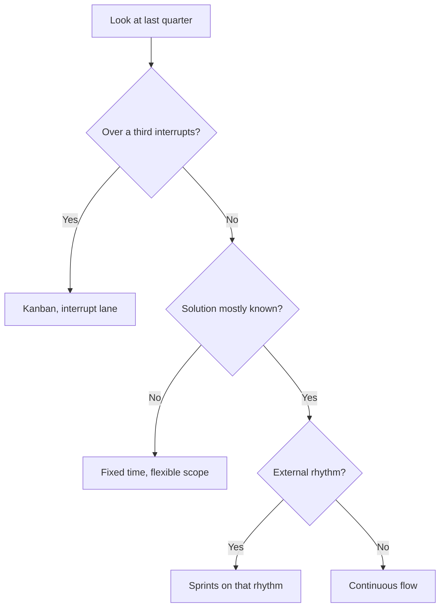

| Signal in the work | Method that fits | Adaptation that usually matters |
|---|---|---|
| Interrupts above about a third of capacity | Kanban with an explicit lane and WIP limit for interrupts | Measure work item age; an interrupt rotation so the rest of the team can finish things |
| Mostly known work, a fixed external rhythm (release train, app store, customer reviews) | Scrum-style sprints aligned to that rhythm | Sprint Goal as the commitment, not the ticket list; an interrupt budget subtracted before planning |
| Mostly uncertain, product-shaping work | Fixed-time cycles with an appetite (Shape Up-style) | Shape before committing; cancel or re-bet rather than extend |
| Small, continuous, independently deployable changes | Continuous flow, no named method | WIP limit and a weekly ranking with product; flow measures (Chapter 16) |
| Mixed portfolio | A hybrid, chosen deliberately | Write down which practices you use and why; review each quarter |

The threshold of "about a third" is **this book's recommendation**, a judgment: above it, a
protected sprint plan is broken more often than kept. Hybrids are the norm; choose yours on purpose.

The second decision is how to rank: fixed-date items backward from the date, with reserved capacity;
estimable items by cost of delay over duration; items whose value cannot be estimated as uncertain
work, with a small time box to learn; many small requests by service class and WIP limit; debt by
interest (Chapter 21), inside the allocation Chapter 27 sets.

### Trade-offs

**Predictability against responsiveness.** A protected sprint is predictable for two weeks and slow
to respond; a Kanban queue responds within days and dates nothing not yet started. Choose by what
the team's customers need more.

**Economic ranking against relationships.** A visible low score can feel like being overruled by a
spreadsheet. Let stakeholders own their estimates (Sales the deal value, Customer Success retention,
engineering duration and interest), so the ranking reflects their own claims.

**Standardization against fit.** One method everywhere eases reporting and transfers, and forces an
interrupt-heavy team into sprints it cannot keep. Standardize the interface (what is committed, at
risk, done), not the method inside each team.

**Commitment against learning.** Every fixed date removes room to respond to what the team learns.
Some are worth it, such as a renewal condition; each should be a decision with a named owner.

### Failure Modes

**Cargo-cult Scrum.** Ceremonies run, points are summed, and the Sprint Goal is a list of tickets.
Signal: plans change mid-sprint and retrospectives repeat themselves. Countermeasure: protect the
Sprint (an interrupt budget and rotation) or change the method.

**Velocity as a performance measure.** Compared across teams or used to judge them, points inflate
within a quarter. Signal: velocity rises while lead time and outcomes do not. Countermeasure:
forecast from throughput (Chapter 17); never compare points across teams (Chapter 18).

**Kanban without limits.** A board without WIP limits is a status display. Signal: work item age
rises and many items are "in progress". Countermeasure: set limits; review the oldest items first.

**The loudest-voice roadmap.** The roadmap changes after every executive meeting. Signal: replans
nobody can explain in value terms. Countermeasure: requester-owned cost-of-delay estimates and an
explicit trade for any change to "now".

**Capacity fiction.** The roadmap assumes nominal capacity while a third goes to unplanned work.
Signal: commitments missed by about the unplanned share, every quarter. Countermeasure: plan against
measured capacity (Chapter 27's
[funding model](#funding-the-work)).

### Enterprise Application

At 50 to 150 engineers, a director has five to twelve teams and three layers of planning to fit
together.

**Teams choose their method** within a shared interface: every team answers the same questions in
the same format (what is committed now, what is at risk, what is ranked next and why, how much
capacity went to unplanned work).

**The director owns the portfolio rules**: the capacity model, how fixed-date commitments are
admitted and protected, and the cost-of-delay convention for items competing across teams.

**Product owns value estimates; engineering owns duration and interest.** The director's distinctive
contribution is honest capacity and duration, and pricing debt and prevention in the same units as
features.

**Cross-team items** pay their cost of delay while waiting in the slowest team's queue. At planning
time, count them, give each one lead team, and commit no more than the organization can coordinate;
Chapter 16 treats dependencies as a design problem.

### CTO Perspective

At executive level the method is invisible and the planning system is not.

**What does a date mean?** The CTO sets the convention separating commitments, targets, and
forecasts (Chapter 17). If Sales quotes forecasts as commitments, no team method will save the date.

**Who can create a commitment?** Most delivery crises start with a promise made outside
engineering. The lever is a rule agreed with the CEO, Sales, and Product: no external date without
engineering's estimate and reserved capacity, and a short list of commitments admitted per quarter.
It constrains revenue teams, so it needs executive agreement.

**Is the portfolio balanced?** Across directors, does the split between features, deal and renewal
commitments, prevention, and debt match the strategy? Chapters 38 and 45 cover allocation and
investment economics.

### Practical Playbook

1. **Measure each team's work shape** over the last quarter: unplanned share, share of items whose
   solution was known at start, and any external rhythm.
2. **Write down the practices each team actually uses**, not the label.
3. **Choose or adapt** with the decision framework, one change at a time; a method change costs
   several weeks of lower output.
4. **Make capacity honest**: subtract measured unplanned work and prevention before committing.
5. **Admit fixed-date commitments first**, each with an owner, a margin, and reserved capacity.
6. **Rank the rest by cost of delay over duration**, with requesters writing value estimates and
   engineering writing durations as ranges and debt interest in money.
7. **Plan in three horizons**, and review monthly at team level.
8. **Check estimates after delivery**, and weight each requester's next estimate by their record.

### Case Study

This case is **fictional**. It describes how Northstar planned in the baseline quarter, before the
director arrived, and the planning decision the director faces for quarter 2. The canonical record
of the director's first quarter is [the first quarter](#page-case-studies-northstar-first-quarter);
nothing below changes it.

#### How the teams planned

Each team chose its own method, and nobody had compared them:

| Team | Method in the baseline quarter | Unplanned work |
|---|---|---|
| Orders | Two-week Scrum, sprint end aligned to the Core release train's code cutoff; Sprint Goal met in 2 of the last 6 sprints | 36% |
| Billing | Two-week Scrum aligned to the release train; Sprint Goal met in 1 of the last 6 sprints; scope changed mid-sprint in all 6 | 41% |
| Payments and Integrations | Kanban with WIP limits per stage and a weekly replenishment meeting with the product manager | 33% |
| Customer Experience | Two-week sprints, one board for nine web and six mobile engineers; half-day planning sessions | 28% |
| Data and Analytics | No named method: a quarterly project list plus a request queue triaged twice a week | 24% |
| Platform Operations | Interrupt-driven ticket queue for infrastructure; the QA schedule set by the train | 46% |

Unplanned shares are from the [baseline data](#page-case-studies-northstar-baseline-data); the
methods and sprint-goal counts are this chapter's additions to the case.

The pattern fits the decision framework. Orders and Billing ran sprints their interrupt load could
not protect; the two-week rhythm made sense because the train set it, but the plan inside each
sprint did not. Payments and Integrations, on Kanban with WIP limits, had the shortest lead time of
the product teams (4 days). Platform Operations had no method for its own infrastructure projects,
which advanced only when the queue was quiet.

#### How the 17 items were chosen

Before the baseline quarter, the product managers collected 31 candidate items. Amara Okafor, Greg
Tanaka, Sofia Alvarez, and Victor Lindqvist ranked them in a two-hour meeting by distributing 100
points each. Engineering sized the ranked list in t-shirt sizes, about 560 engineer-weeks, and a
line was drawn at the assumed capacity: 80 engineers for 13 weeks (1,040 engineer-weeks) less a 25
percent allowance for support and bugs, or 780. Seventeen items fell above the line; five had dates
already given to customers, including Greg Tanaka's two deal features.

Three things were wrong, each visible in the data:

- **Capacity fiction.** Unplanned work took 34 percent, leaving about 686 engineer-weeks, and that
  also had to cover small requests and deal support that were not on the roadmap.
- **Volume ranking.** Points rewarded whoever cared most; no item had a value estimate.
- **Cross-team items.** Nine of the 17 needed more than one team. Of the 7 that shipped, 6 were
  single-team; of the 10 that missed, 8 were cross-team.

By primary team the 17 were Orders 4, Billing 3, Payments and Integrations 3, Customer Experience 4,
Data and Analytics 2, Platform Operations 1; the 7 delivered were Orders 1, Payments and
Integrations 2, Customer Experience 2, Data and Analytics 2.

#### The two renewal commitments

Late in the baseline quarter, in renewal talks with the two at-risk customers ($9M in annual
recurring revenue together), Northstar agreed two features as renewal conditions:

- **Bulk ordering** (Orders): asynchronous processing of order files of up to 20,000 lines across
  delivery sites, replacing the upload that failed beyond row 500 in INC-421. Due at the end of
  quarter 2; five Orders engineers and two Customer Experience web engineers.
- **Accounting-system integration** (Payments and Integrations): a new erp-sync connector to the
  customer's accounting system, with daily reconciliation of posted invoices. Due at the end of week
  6 of quarter 2; four engineers.

Both have step-shaped cost of delay, were admitted first rather than ranked, and are why the two
teams carried the smaller 10 percent prevention share in quarter 1 (Chapter 27). At day 90 both were
on track.

#### The decision for quarter 2

The director's proposal for quarter 2 planning has four parts. It is a proposal for the reader to
evaluate; its results are not part of the canon.

1. Plan against measured capacity: Chapter 27's capacity model projects 45.6 FTE of feature capacity
   for quarter 2 (after unplanned work and the 12 FTE prevention allocation), not 80 engineers, and the
   renewal staffing comes out of that figure before anything else is ranked.
2. Admit the two renewal items and their margins first, then rank everything else by cost of delay
   over duration, with value estimates written by the requesters.
3. Give each cross-team item a lead team and cap the number committed.
4. Let teams change method where the shape of the work demands it, with Billing and Platform
   Operations as the first candidates, and report through one shared format.

One complication is already in the canon. Core moved to weekly releases from week 5 of quarter 1, so
the two-week train that justified Orders' and Billing's sprint length no longer exists.

### Exercises

Solutions are in [chapter 15 solutions](#page-solutions-ch15-solutions). Northstar data is on the
[baseline page](#page-case-studies-northstar-baseline-data).

#### Foundational

**F1.** A team of eight runs two-week Scrum. Over the last quarter it spent 40 percent of its time on
unplanned work, met its Sprint Goal in one sprint of six, and its manager has asked for "better
estimation training". Using the official descriptions of Scrum and Kanban in this chapter, explain
what is going wrong, whether estimation is the problem, and what you would change first.

**F2.** Recompute the Orders example with one change: Customer Success learns that two customers worth
$600,000 a year in total have said they will leave without saved order templates (P2), and judges the
risk at one in three. Estimate P2's new cost of delay per week, re-rank the four items, and say
whether the order changes. State your assumptions.

**F3.** A colleague cites a vendor survey showing that "Scrum teams deliver 40 percent faster" as the
reason to move every team to Scrum. Using what this chapter reports about the research on agile
methods, explain what that kind of claim can and cannot support, and what evidence would change your
view.

#### Applied Leadership

**A1.** Marcus Oyelaran's Billing team planned six sprints last quarter and changed scope mid-sprint in
all six. He wants to keep Scrum because "the team likes the rhythm". Prepare for the conversation:
what you want to learn from him, what data you bring, and what options you would put on the table,
including keeping Scrum.

**A2.** Greg Tanaka asks for a third deal feature to be committed for quarter 2, with a date he has
already mentioned to the prospect. Orders' "now" horizon is full with bulk ordering. Write the reply
you would send him, including what you need from him to rank the request and what it would displace.

**A3.** Design the team-level roadmap cadence for Data and Analytics, which has no named method, a
24 percent unplanned share, and a mix of quarter-long warehouse projects and small report requests.
Say what you would keep from how it works today.

#### Executive Decision-Making

**X1.** The CEO, Helena Marsh, proposes that from next year every customer-facing date must be approved
by the CTO before Sales can mention it. Greg Tanaka objects that this will lose deals. As CTO, decide
whether to accept the rule as proposed, change it, or reject it, and write the one-paragraph rationale
you would give the executive team.

**X2.** Victor Lindqvist asks you to standardize every Northstar team on a single delivery method from
quarter 3 "so that we can compare teams". Recommend what to standardize and what not to, explain what
comparison he can and cannot get, and state the transition cost.

### Reflection Questions

1. Which team in your organization is running a method that does not fit its work, and what has the
   misfit been blamed on?
2. When did a loud request last displace a quieter one in your plans? What would its cost of delay
   have been, and did anyone check afterward?
3. Which of your current commitments are fixed-date items with real consequences, and which are
   dates that someone chose and nobody revisited?
4. How much of your last quarterly plan was detailed planning of work nobody understood yet?
5. If you had to publish the value estimate behind every item on your roadmap, which ones would you
   be uncomfortable defending?
6. What would your sales or customer teams do differently if engineering dates became reliable?

### Key Takeaways

- Choose the delivery method from the shape of the work: interrupt load, uncertainty, and any
  external rhythm. The label matters less than the practices.
- Read the primary descriptions. Scrum commits to a Sprint Goal and assumes a protected Sprint;
  Kanban limits WIP and assumes continuous arrival; fixed-time cycles fix time and flex scope.
- The research does not show any named method is better across contexts; hybrids are the norm.
  Choose the hybrid deliberately and review it.
- Rank by cost of delay divided by duration, with value estimates owned by the requesters and
  checked after delivery.
- Admit fixed-date commitments first, with owners, margins, and reserved capacity; do not rank them
  against everything else.
- Plan in proportion to what is known: detail for known work, time boxes and decision dates for
  uncertain work.
- Plan against measured capacity. A roadmap built on nominal capacity misses by about the unplanned
  share.
- Standardize the reporting interface across teams, not the method inside them.

### References and Further Reading

- [Schwaber and Sutherland, 2020](#schwaber2020scrum). *The 2020 Scrum
  Guide*. The official definition; read it before debating Scrum.
- [Coleman, Vacanti, et al., 2025](#vacanti2025kanban). *The Kanban
  Guide*. Kanban's practices and flow measures.
- [Beck et al., 2001](#beck2001manifesto). The Agile Manifesto.
- [Singer, 2019](#singer2019shapeup). *Shape Up*. Fixed-time cycles
  and appetite.
- [Dybå and Dingsøyr, 2008](#dyba2008empirical). For calibrating
  claims about agile evidence.
- [Kuhrmann et al., 2022](#kuhrmann2022agile). Hybrids are the norm.
- [Ahmad, Markkula, and Oivo, 2013](#ahmad2013kanban). Kanban's
  reported benefits and challenges.
- [Reinertsen, 2009](#reinertsen2009principles). The book most
  associated with cost of delay.
- [SAFe, WSJF](#safe-wsjf). SAFe's Weighted Shortest Job First.
- [Perri, 2018](#perri2018escaping). *Escaping the Build Trap*.
  Output is not outcome.
- [Kim et al., 2016](#kim2016devops). *The DevOps Handbook*. Visible
  work and small batches.

<a id="page-parts-04-execution-16-flow-lead-time-dependencies-and-unplanned-work"></a>

## Chapter 16 — Flow: Lead Time, Dependencies, and Unplanned Work

!!! warning "Awaiting human review"
    This chapter has passed the book's automated validation and an editorial self-review, but not yet
    the human review in which each cited claim is checked against its source. Treat it as a reviewed
    draft. Corrections are welcome; see the repository's CONTRIBUTING file.

This chapter is about why work takes as long as it does. Most of the time between "we decided to
build this" and "a customer can use it" is spent waiting: in a backlog, a review queue, another team's
plan, a release. The chapter shows how to map where that time goes, how work in progress and batch
size govern it, how to make unplanned work visible and sort it by cause, and how to treat cross-team
dependencies as a design problem. The running example is Northstar Technologies, the fictional
company in the [case study](#page-case-studies-northstar-index).

Chapter 23 decomposed the lead time of Northstar's Core release train; this chapter follows a feature
along its whole path. Chapter 27 owns the capacity model for quality-driven unplanned work, Chapter 3
systems-thinking basics, and Chapters 33 and 34 team design and dependency mapping for org design.

### Why This Matters

On one team, flow problems look personal: a story stalls because someone is busy.

At 50 to 150 engineers, the same delays are structural. A feature crosses three teams, each with its
own backlog. Each handoff adds a queue that nobody owns or measures. Every manager can show that their
team was busy the whole time, which is the problem: busy teams with full queues produce long lead
times. Unplanned work makes it worse, because interrupts land hardest on the teams everyone else
depends on.

At executive scale, flow is what turns a roadmap into dates. Northstar delivered 7 of 17 committed
roadmap items in the quarter promised, and about a third of engineering capacity went to unplanned
work. The CEO hears "engineering is slow". The usual truth is that engineering is full, and most of a
feature's calendar time is spent in queues between teams. A director who cannot show where the time goes
will be offered more people, which adds handoffs and lengthens queues.

### Learning Objectives

After this chapter you will be able to:

- Map a value stream for a real piece of work, separate wait time from work time, and locate the
  queues where lead time accumulates.
- Use Little's law to predict what reducing work in progress will do to lead time, and state the
  assumptions the prediction needs.
- Explain why high utilization and large batches lengthen lead time, and decide where to keep slack.
- Make unplanned work visible, classify it by source, and give each category an owner.
- Treat a recurring cross-team dependency as a design problem: remove it, loosen it, or coordinate
  it, knowing what each costs.

### The Mental Model

> **Mental model:** Lead time is mostly waiting, and waiting is set by how much work is in the system
> and how full the people are. Shorten lead time by reducing work in progress, batch size, and
> handoffs, not by asking people to work faster.

Two ideas organize the chapter.

First, **a feature's lead time is the sum of its waits and its work, and the waits dominate**. An
engineer may spend three days coding a change that takes two months to reach customers. Speeding up
the three days barely moves the two months.

Second, **queues are a consequence of system design, not of effort**. How long work waits depends on
how much is in progress, how big each batch is, how close to full the people serving the queue are,
and how many queues the work passes through. Each is a decision someone made, usually without
noticing. Goldratt's constraint argument
([Goldratt and Cox, 1984](#goldratt1984goal)) adds the corollary a
director needs: improving a step that is not the constraint does not shorten the whole path (Chapter 3).

### Deep Conceptual Explanation

#### Where lead time accumulates

Lead time here means elapsed time from when the organization commits to a piece of work to when
customers can use it. That is longer than DORA's "lead time for changes", which starts at commit
(Chapter 18 owns those definitions), and the commit-to-production slice is often the smallest part.

A **value stream map** follows one item through every step and records, for each step, how long the
item spent there and how much of that time someone actively worked on it. DORA's guide to work
visibility describes the technique: people from every part of the stream map a manageable number of
process blocks, recording each block's lead time, process time, and the share of work arriving
complete and accurate, so rework shows up
([DORA, work visibility](#dora-cap-work-visibility)). The guide
insists on recording the process as it actually runs and warns that mapping only part of the stream
produces local optimization. This is **industry research** guidance; the technique itself is
documented practice.

**Flow efficiency** is work time divided by lead time. Do not treat any published "typical" figure as
a benchmark: it depends on how generously "work" is counted, and this book found no peer-reviewed
software estimate it could verify. Use it to compare your own stream over time. The real output of
the map is the location of the waits, which in cross-team work cluster at intake, at handoffs between
teams, and at release.

#### Little's law and work in progress

John Little proved in 1961 that, for a queueing system in a steady state, the average number of items
in the system equals the average arrival rate times the average time an item spends there: L = λW
([Little, 1961](#little1961proof)). In his fiftieth-anniversary
review, Little notes that operations management writes it as work in process equals throughput times
cycle time, and that over a finite window in which the system starts and ends empty it holds exactly
for the measured data ([Little, 2011](#little2011law)). This is a
**research finding** in the strongest form available: a theorem, not a correlation.

For a delivery team: **average lead time = average work in progress ÷ average throughput**. A team
that finishes 9 items a week with 45 started and not finished has an average lead time of 5 weeks.
Hold throughput and carry 27 items, and the average falls to 3 weeks. Nothing got faster; less of it
waited.

Three cautions keep the law honest:

1. **It relates averages.** Northstar reports medians; a few very old items can make the mean much
   larger.
2. **It describes; it does not predict.** Little's review calls finite-window use measurement, not
   forecasting, and says the law does not settle trade-offs. "Less work in progress, shorter lead
   time" needs throughput to hold. It usually holds or rises, because people switch between fewer
   items, but that is **practitioner consensus**, not the theorem. Check it.
3. **Count everything in progress**, including items blocked on other teams, waiting for review, or
   parked for a release. Leaving them out is the easiest way to make the law look wrong.

**WIP limits**, caps on how many items may sit in each stage of a board, turn the law into practice.
DORA's guide states that its research associates them with better delivery performance, especially
with visual displays and monitoring feedback
([DORA, WIP limits](#dora-cap-wip-limits)): **industry research**,
survey-based and correlational. It names the classic failures: limits too high to bind, limits raised
whenever someone is idle, and boards that omit upstream and downstream work.

#### Utilization and queues

In the simplest queueing model (one server, random arrivals and service times), average time waiting
equals the service time multiplied by ρ ÷ (1 − ρ), where ρ is utilization. At 80 percent utilization
an item waits about four service times; at 90 percent, nine; at 95 percent, nineteen. Real teams are
not this model, but the shape carries over: near full utilization, waits grow much faster than load.
Reinertsen's book on product development flow is widely known for arguing that development
organizations ignore this because their queues are invisible
([Reinertsen, 2009](#reinertsen2009principles)); treat that as
**expert opinion** built on standard queueing results.

The consequence is uncomfortable. A team allocated 100 percent to planned work cannot absorb other
teams' requests, so those wait, and every team that depends on it inherits the wait.

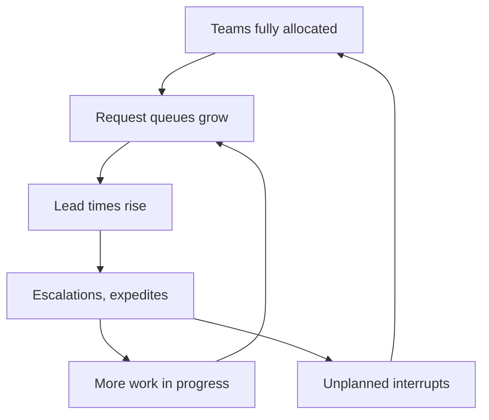

Full teams build queues; long queues produce escalations; expediting starts more work and interrupts
planned work, which keeps teams full. Breaking the loop means deliberate slack on the teams others
depend on and limits on what is started, not more status meetings.

#### Batch size

A batch is the work that moves through a step together: a release, a large pull request, a quarter's
requirements handed to another team. Larger batches wait for their slowest part, fail in ways that are
harder to diagnose, and delay feedback. *Continuous Delivery* made the case for small, frequent,
automated releases ([Humble and Farley, 2010](#humble2010continuous)),
and DORA's guide recommends pieces that can be finished and checked in hours or a few days, treating
anything over a week as too big
([DORA, small batches](#dora-cap-small-batches)). Chapter 23 applies
this at release. The same logic applies to handoffs: one large specification per quarter to another
team is a quarterly batch, whatever the release cadence.

#### Unplanned work: visible and classified

Unplanned work is work that enters a team's queue after it has decided what to work on, and displaces
something planned. *The Phoenix Project* popularized a split of IT work into business projects,
internal projects, changes, and unplanned work, and the idea that unplanned work silently consumes the
rest ([Kim, Behr, and Spafford, 2013](#kim2013phoenix)). What matters
for a director is that unplanned work must be recorded as a type before it can be managed.

1. **Tag at intake.** The team flags each item planned or unplanned when it enters the board. A chat
   request gets a ticket.
2. **Classify by source**, with one scheme across teams. This book uses four categories: *failure
   recovery* (incidents, hotfixes, escaped defects), *requests from other teams*, *toolchain and
   environment breakage*, and *expedited business requests* that jump the queue.
3. **Give each category an owner.** Failure recovery belongs to the quality program (Chapter 27 owns
   its capacity model). Requests from other teams fall through self-service and dependency redesign;
   toolchain breakage through platform investment; expedites through an agreed policy.

A director who sees only "34 percent unplanned" will hand it all to the quality program. If half is
requests between teams, the quality program cannot touch that half.

A team that receives many requests becomes an **interrupt sink**: other teams' work and failures
arrive there. Standard protections are a rotating interrupt role (one or two people a week absorb
requests so the rest can plan), one intake with a stated response time, and the most frequent request
types turned into self-service.

#### Dependencies as a design problem

A cross-team dependency exists when an item cannot finish until another team acts. Many recur: same
two teams, same kind of change, every month. A recurring dependency is a property of how
responsibilities are divided, and coordinating it item by item pays its cost forever.

Herbsleb and Mockus analyzed change-management data and surveys in globally distributed development
and found that work items spanning sites took about two and a half times as long as similar
single-site items, with the number of people involved strongly related to calendar time; a
replication in a second organization confirmed the main findings
([Herbsleb and Mockus, 2003](#herbsleb2003empirical)). This is a
**research finding**, read at abstract level, about geographic distribution; transferring it to team
boundaries within one site is plausible, not demonstrated.

**Dependency mapping** makes the structure visible: for one quarter, count every item that needed
another team, by requesting and providing team. Rows with high totals are teams that cannot finish
alone; columns with high totals are on everyone's critical path. Three responses, in order of
preference for recurring dependencies:

- **Remove it**: move ownership to the team that needs the change, or provide self-service. *Team
  Topologies* is known for arguing that teams should be designed for fast flow with few deliberate
  interactions ([Skelton and Pais, 2019](#skelton2019team)); Chapter
  33 owns team types and cognitive load.
- **Loosen it**: replace a synchronous dependency with a stable contract (versioned API, contract
  test, feature flag) so each team ships on its own schedule.
- **Coordinate it**: plan jointly, reserve capacity on the providing team, track it on a shared board.
  Right for one-offs, expensive for everything else.

### Engineering Organization Example

This example is **illustrative**. It maps a feature Northstar shipped in the baseline quarter, before
the director arrived: *standing orders*, which let a distributor's customer schedule a repeating
order. It touched Orders (order capture, and core/scheduler, then unowned), Billing (invoicing),
Customer Experience (web and mobile screens), and Platform Operations (a test environment and the
release train). It was reconstructed from tickets, merge requests, and release notes. Assumptions:
only the critical path is mapped; "work" counts calendar days in which someone actively worked on the
item, which overstates effort.

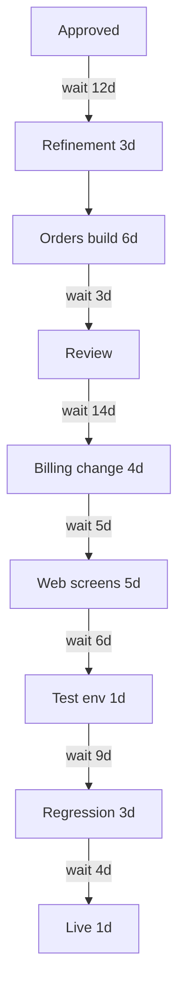

| Step | Team | Wait (days) | Work (days) | Cause of the wait |
|---|---|---|---|---|
| Intake to refinement | Orders | 12 | 3 | Queue for a refinement slot |
| Build in Core, review | Orders | 3 | 6 | Review queue |
| Invoicing change | Billing | 14 | 4 | Not in Billing's plan |
| Web screens | Customer Experience | 5 | 5 | Waited for the Orders API |
| Test environment | Platform Operations | 6 | 1 | Interrupt queue |
| Release train | Platform Operations | 9 | 3 | Missed one train |
| Mobile release | Customer Experience | 4 | 1 | Separate app cycle |
| **Total** | | **53** | **23** | **Lead time 76 days** |

Flow efficiency is 23 ÷ 76, about 30 percent, generous given how work was counted. The waiting
breaks down as: queues at other teams 25 days (47 percent: Billing 14, test environment 6, web 5);
release train and mobile release 13 (25 percent); intake 12 (23 percent); review 3 (6 percent).
Shares are rounded.

Now predict. Chapter 23 shows that a weekly train roughly halves the average wait for a release cut.
Here the 9-day train wait might become 4 or 5: lead time falls from 76 to about 71 days, roughly 6
percent. Had Billing planned the invoicing change in the same cycle as Orders, its 14-day wait could
have been 2 or 3 days; a self-service test environment turns 6 days into under 1. Together those
remove about 16 days, three times the train change, and nobody works faster.

Little's law gives the team view. Suppose (these numbers are **hypothetical**, not Northstar baseline)
Orders finishes about 9 items a week and carries about 45 in progress, many blocked on other teams.
Average lead time is 5 weeks. Capping work in progress at 27 and swarming on blocked items would move
the average toward 3 weeks if throughput holds. Measure throughput four weeks before and after.

### Decision Framework

Choose the intervention from where the map puts the time:

| What the data show | Lever | Watch for |
|---|---|---|
| Most waiting in queues at other teams | Dependency redesign: remove, loosen, or reserve capacity | Ownership moves need a team able to absorb them |
| Many items started, few finished, ages rising | WIP limits and a stop-starting policy | Limits that never bind; hidden side work |
| Long wait for release | Smaller, more frequent releases (Chapter 23) | Deploy count rising while batch size does not |
| A depended-on team with a high unplanned share | Interrupt rotation, intake, self-service | Rotation becoming a dumping ground |
| Long intake wait | Smaller, more frequent refinement; accept fewer items | Committing beyond throughput |
| Unplanned work mostly failure recovery | Quality program (Chapter 27) | Reclassification instead of reduction |

For a recurring dependency:

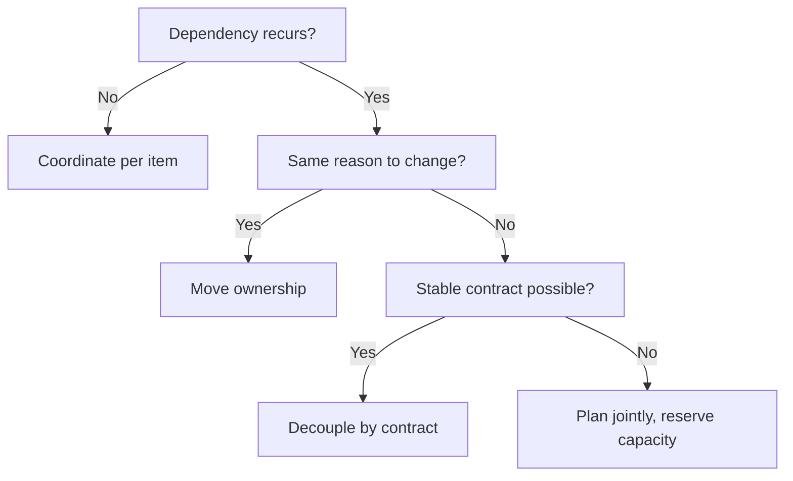

"Same reason to change" asks whether the requesting team mostly changes the other team's code for its
own business reasons. If so, the boundary is in the wrong place. If not, look for a contract that lets
each side move alone. Only when neither works should the dependency become standing coordination
with reserved capacity on the providing team.

### Trade-offs

**Slack against utilization.** Leaving 15 to 20 percent of a critical team's time unallocated looks
like waste on a capacity spreadsheet and is what keeps its queue short for everyone else. The cost is
visible and the benefit is spread across other teams' lead times, so slack is cut first. Defend it
with the queue arithmetic and the dependency matrix.

**WIP limits against local busyness.** A limit means someone sometimes has nothing to start. Helping
finish work elsewhere feels slower to the individual and is faster for the organization; people
judged on personal output will resist.

**Removing dependencies against specialization.** Moving ownership removes a queue but spreads
knowledge and raises the receiving team's cognitive load (Chapter 33). Giving core/scheduler to
Billing in quarter 1 made that trade.

**Contracts against speed of change.** A versioned contract lets teams ship independently and makes
the interface slower to change. Use it where the interface is stable and release rhythms differ.

**Transition cost.** New WIP limits usually lower apparent activity for a few weeks while started work
drains. Say so in advance, or the change is reversed at the next planning review.

### Failure Modes

**The workshop map.** Drawn from memory, it shows the process as designed. Signal: no wait longer
than a few days. Countermeasure: reconstruct real items from tool timestamps.

**Optimizing the visible step.** Coding gets faster while waits sit between teams. Signal: work time
falls, lead time does not. Countermeasure: publish the wait breakdown, not only median lead time.

**WIP limits that never bind.** Set at current work in progress. Signal: nothing ever waits for a
slot. Countermeasure: set limits below current levels and lower them until they expose the bottleneck.

**The unplanned lump.** Unplanned work is one number handed to the quality program. Signal: quality
measures improve, unplanned share does not. Countermeasure: classify by source, one owner per category.

**The unfunded interrupt sink.** A platform team absorbs others' requests and is judged on its
roadmap. Signal: high unplanned share, slipping projects, its most helpful engineers leaving.
Countermeasure: fund the interrupt role and measure its request queue.

**Expedite inflation.** Everything urgent jumps the queue. Signal: more than a small fraction of items
are flagged expedite. Countermeasure: a capped expedite policy owned by someone who can say no.

### Enterprise Application

In an organization of 50 to 150 engineers, flow work has four parts.

**Instrument consistently.** One definition of lead time (commitment to customer availability), one
planned/unplanned flag, one four-category classification, one way to record dependencies. Teams
classifying differently is a known weakness of Northstar's baseline sample; fixing definitions is
cheaper than arguing over numbers.

**Map one value stream per quarter**, from work that crossed several teams, with people from each team
and data from the tools. Rotate so that within a year the maps cover the main paths.

**Run a quarterly dependency review.** Find recurring pairs in the matrix and decide remove, loosen, or
coordinate, with an owner. Structural changes go through Chapter 34's org-design process.

**Protect the critical teams**: those in the most matrix columns and with the highest unplanned
shares. Give them rotations, intake with response times, and a self-service roadmap.

Review flow measures monthly and dependency structure quarterly; Chapter 37 owns the cadence.

### CTO Perspective

A CTO who reports utilization ("everyone is busy") is reporting the cause of long lead times as if it
were a virtue.

Three things change at this level. The CTO owns the structure that creates dependencies: team
boundaries, platform investment, and architecture set how many queues a typical feature crosses, and
only the CTO can trade them across the organization. The CTO owns the expedite policy, because most
expedites come from the executive team; accepting every urgent request from sales and the CEO sets the
organization's unplanned share. And the CTO decides where slack lives. Leaving 15 percent of a
platform team unallocated is a budget conversation, to be made with the dependency matrix and the
queue arithmetic.

Board questions are about predictability, and the honest answer usually names queues and
dependencies rather than effort. Chapter 17 turns flow data into forecasts; Chapter 45 prices delay.

### Practical Playbook

1. **Pick a feature** that crossed at least three teams and shipped last quarter.
2. **Reconstruct its critical path** from tickets, merge requests, and releases: team, wait, and work
   per step.
3. **Review it for two hours** with someone from each team. Correct the facts; do not redesign in the
   room.
4. **Classify the waits** (intake, cross-team, review, release) and publish the breakdown.
5. **Measure work in progress and throughput** per team for four weeks, counting everything started
   and not delivered. Compare the Little's law lead time with observed lead time and reconcile.
6. **Set WIP limits** below current levels on teams with the oldest items, and agree what people do
   at the limit.
7. **Re-code the unplanned sample** into four categories with one definition; assign owners.
8. **Build the dependency matrix**; list pairs with more than five links.
9. **Decide remove, loosen, or coordinate** for each recurring pair, with an owner and a date.
10. **Protect the interrupt sink** and **write an expedite policy**: who may expedite, how many at
    once, how it is reported.
11. **Map a similar feature next quarter** and compare waits, not just lead time.

### Case Study

This case is **fictional**. It is set at the start of Northstar's second quarter under the new
director, after [the director's first quarter](#page-case-studies-northstar-first-quarter); Core
has shipped weekly since week 5 of quarter 1. Dependency pairs and
unplanned work by category are in the
[baseline data](#page-case-studies-northstar-baseline-data).

Amara Okafor (CPO) asked why the accounting-system integration, a renewal commitment due at the end
of week 6 of quarter 2 (week 19), still looked tight although Core now shipped weekly. Four Payments and Integrations
engineers were building a new erp-sync connector with daily reconciliation of posted invoices. It
needed Billing (posted-invoice data) and Platform Operations (test environments mimicking customers'
accounting systems). The director brought the standing-orders map (most waiting sat in other teams'
queues) and two more pieces of evidence.

**The dependency matrix.** Li Na Zhou and the managers counted the baseline quarter's work items of a
week or more: 164 items, 61 needing at least one other team, 86 dependency links.

| Requesting team | Orders | Billing | Payments and Integrations | Customer Experience | Data and Analytics | Platform Operations | Total |
|---|---|---|---|---|---|---|---|
| Orders | | 9 | 2 | 3 | 1 | 8 | 23 |
| Billing | 6 | | 5 | 1 | 2 | 7 | 21 |
| Payments and Integrations | 1 | 4 | | 1 | 0 | 5 | 11 |
| Customer Experience | 8 | 3 | 2 | | 1 | 6 | 20 |
| Data and Analytics | 2 | 2 | 1 | 0 | | 3 | 8 |
| Platform Operations | 1 | 1 | 0 | 1 | 0 | | 3 |
| **Received** | **18** | **19** | **10** | **6** | **4** | **29** | **86** |

Median lead time was 11 days for the 103 items with no dependency, 24 for the 42 with one, and 41 for
the 19 with two or more. Platform Operations received 29 of 86 links (34 percent); Payments and
Integrations and Billing exchanged 9.

**The unplanned work breakdown.** The baseline's two-week sample was re-coded with one shared
definition. Figures are percentage points of each team's capacity; rows sum to the baseline shares.

| Team | Failure recovery | Other teams' requests | Toolchain and environment | Expedited | Total |
|---|---|---|---|---|---|
| Orders | 18 | 8 | 6 | 4 | 36 |
| Billing | 24 | 7 | 6 | 4 | 41 |
| Payments and Integrations | 15 | 9 | 3 | 6 | 33 |
| Customer Experience | 12 | 6 | 4 | 6 | 28 |
| Data and Analytics | 6 | 12 | 3 | 3 | 24 |
| Platform Operations | 14 | 20 | 10 | 2 | 46 |
| Staff engineers | 8 | 10 | 2 | 0 | 20 |

In engineers, that is about 27.3 FTE (slightly above the baseline's 27.2 because team shares are
rounded): failure recovery 11.8 (43 percent), other teams' requests 8.0 (29 percent), toolchain 4.2
(15 percent), expedites 3.3 (12 percent). The quality program targets the first category; the other 57
percent are flow and design problems. Platform Operations was the clearest interrupt sink: 20 of its
46 points were other teams' requests, mostly test environments, access, and pipeline changes across
four build systems.

The director proposed four decisions, and Amara and Victor Lindqvist agreed:

1. **Book the Billing dependency.** Billing reserved capacity in weeks 1 to 3 for the posted-invoice
   export the reconciliation reads, with a Billing engineer reviewing the integration side.
   Coordination, accepted because the integration is a one-off.
2. **Loosen Payments and Integrations and Billing.** Their 9 links were mostly ledger fields the
   integrations needed. Li Na Zhou was asked to propose a ledger-export contract with contract tests.
3. **Protect Platform Operations.** Two infrastructure engineers rotate weekly as the interrupt role;
   one intake with a two-working-day response target; self-service test environments first.
4. **Tighten work in progress on Payments and Integrations.** Elena Sokolova lowered her Kanban
   board's stage limits so the four integration engineers were not pulled onto new items; anyone at a
   limit helps unblock existing work first.

The decisions cost something. Throughput on the team's other work dipped while started items
drained, and Elena defended the limits against a sales request for a new integration. Tom Becker said
the rotation fragmented the two engineers' weeks. By week 5 of quarter 2 (week 18), a re-sample showed
Platform Operations' median wait for environment requests down from about 6 days to 2, and other teams' requests down from 20 to
14 points of its capacity. The director called both encouraging but unproven: one two-week sample, self-service half built.

### Exercises

Solutions are in [chapter 16 solutions](#page-solutions-ch16-solutions). Data files are linked from
the [Northstar baseline page](#page-case-studies-northstar-baseline-data).

#### Foundational

**F1.** A team of eight finishes about 6 items a week and has 30 items started but not delivered, 9 of
them blocked on other teams. Its manager says lead time is "about two weeks", because that is how long
items spend in development. Estimate average lead time with Little's law, explain the discrepancy, and
say what you would verify before telling the manager.

**F2.** Using the standing-orders map, a colleague argues that the best investment is cutting the
three-day regression pass to one day, because it is "the only pure waste". Estimate the effect on the
feature's lead time, compare it with two other changes, and explain what the colleague gets right and
wrong.

**F3.** Classify each item into the chapter's four categories of unplanned work and name who owns the
countermeasure: a hotfix after a Core release; Customer Experience asking for a new order API field; a
broken shared test database; a sales director wanting a demo environment by tomorrow; a
customer-reported invoice error; a pipeline change forced by a build tool upgrade.

#### Applied Leadership

**A1.** Tom Becker says Platform Operations cannot build self-service test environments because it is
already at 46 percent unplanned and behind on planned projects. Prepare the conversation: what you
want to learn from him, what data you bring, what you offer, and what you will not accept.

**A2.** Elena Sokolova's team has been at its new WIP limit for three weeks. A sales director escalates
to you because an integration promised to a prospect has not been started. Decide your response, what
you say to the sales director and to Elena, and what this reveals about the expedite policy.

**A3.** The director wants to act on two team pairs from the case study's dependency matrix this
quarter, and has capacity for only two structural changes. Choose the two pairs. For each, decide
remove, loosen, or coordinate, justify the choice from the data, and name the transition cost and who
bears it.

#### Executive Decision-Making

**X1.** The CEO offers Victor Lindqvist budget for six more engineers in Payments and Integrations to
make the accounting-system integration "go faster", despite the flat-headcount constraint. You are advising Victor. Using Little's law, the
dependency data, and the standing-orders map, say what six engineers would and would not change, and
what you would ask for instead.

**X2.** The board wants one measure of engineering delivery speed each quarter. One director proposes
median lead time from commitment to customer; another proposes throughput, items delivered per
quarter. Choose one or propose an alternative, explain how it would be gamed, and say what you would
pair it with.

### Reflection Questions

1. If you mapped the last feature your organization shipped, where would the longest wait be? When did
   you last check?
2. Which team is on everyone's critical path, and how much of its time is unallocated?
3. How many items is your team working on now, counting everything started and not delivered? Would
   your manager give the same number?
4. Who can make an item jump the queue, and how often do they?
5. Which cross-team dependency has been coordinated for over a year, and why has nobody redesigned it?

### Key Takeaways

- Lead time is mostly waiting. Map where the waiting is before choosing a fix.
- Reconstruct value stream maps from tool data for real items, not from memory.
- Average lead time equals average work in progress divided by throughput. Count everything started,
  reduce it, and check that throughput holds.
- Waits grow sharply near full utilization. Keep slack on the teams others depend on.
- Small batches shorten waits at every step, including handoffs, not only at release.
- Tag unplanned work at intake and classify it by source; the quality program can only address
  failure recovery.
- Fund and protect interrupt sinks with rotations, intake with response times, and self-service.
- A dependency that recurs for a quarter is a design problem: remove it, loosen it with a contract,
  and coordinate only what remains.

### References and Further Reading

- [Little, 1961](#little1961proof). The original proof of L = λW.
- [Little, 2011](#little2011law). Little's own fiftieth-anniversary
  review: the finite-window version, uses in operations management, and the law's limits as a
  forecasting tool.
- [DORA, work visibility](#dora-cap-work-visibility),
  [WIP limits](#dora-cap-wip-limits), and
  [small batches](#dora-cap-small-batches). Practical guides with
  pitfalls.
- [Herbsleb and Mockus, 2003](#herbsleb2003empirical). Evidence that
  work spanning sites takes longer as more people are involved.
- [Goldratt and Cox, 1984](#goldratt1984goal). *The Goal*. Constraint
  thinking as a novel.
- [Kim, Behr, and Spafford, 2013](#kim2013phoenix). *The Phoenix
  Project*. The four types of work, told as a story.
- [Reinertsen, 2009](#reinertsen2009principles). Queues, batch size,
  and utilization in product development.
- [Humble and Farley, 2010](#humble2010continuous). *Continuous
  Delivery*. Small, automated releases.
- [Skelton and Pais, 2019](#skelton2019team). *Team Topologies*.
  Designing teams and interactions for flow.

<a id="page-parts-04-execution-17-predictability-and-managing-uncertainty"></a>

## Chapter 17 — Predictability and Managing Uncertainty

!!! warning "Awaiting human review"
    This chapter has passed the book's automated validation and an editorial self-review, but not yet
    the human review in which each cited claim is checked against its source. Treat it as a reviewed
    draft. Corrections are welcome; see the repository's CONTRIBUTING file.

Every engineering leader is asked "when will it be done?" This chapter is about answering honestly:
forecasting delivery as a range with a probability, built from what teams have actually delivered;
keeping forecasts, targets, and commitments apart; and ordering uncertain work so the biggest
unknowns are resolved first. The running example is Northstar Technologies, the fictional company in
the [case study](#page-case-studies-northstar-index), whose committed roadmap delivered 7 of 17
items in the promised quarter.

Chapter 15 owns planning methods and prioritization, Chapter 16 owns flow (lead time, work in
progress, dependencies, unplanned work), and Chapter 46 owns negotiating with stakeholders. This
chapter asks what you can promise from a prioritized backlog and a measured delivery system.

### Why This Matters

At team level, an unreliable estimate costs an awkward conversation and some late evenings.

At organization level, a missed date travels: product told sales, sales told a customer, finance
assumed revenue. When engineering's dates are unreliable, other functions add their own buffers or
stop believing engineering, and leaders demand detailed plans and daily status, which make delivery
slower and less predictable still.

At executive scale, predictability is a matter of credibility with the board and with customers.
Northstar's Chief Product Officer, Amara Okafor, wants "the roadmap she committed to customers, on
the dates she gave"; two renewals worth $9M depend on two dated features. A CTO who cannot say how
likely a date is cannot price the risk of promising it.

Predictability is not speed, nor hitting every date: a team that commits to very little hits every
date and is nearly useless. Leaders need **calibration**: when the team says it is 85 percent sure, it is right about 85 percent of the time.

### Learning Objectives

After this chapter you will be able to:

- Explain, with the research on estimation and the planning fallacy, why single-point estimates of
  software work are systematically optimistic and their stated uncertainty too narrow.
- Build a delivery forecast as a range with probabilities, using a team's historical throughput and a
  Monte Carlo simulation, and state the assumptions it rests on.
- Use reference-class forecasting to correct a plan with the track record of similar past work.
- Distinguish forecasts, targets, and commitments, and communicate each so that others can rely on it.
- Structure uncertain work (spikes, walking skeletons, experiments) so that the riskiest unknowns are
  retired early, and judge when adding people will help a late project and when it will hurt.

### The Mental Model

> **Mental model:** A delivery date is a probability distribution, not a number. Forecast the
> distribution from history, commit only from its cautious end, and spend the early weeks shrinking
> it.

First, "when will it be done?" has no single answer when it is asked, only a range of possible
dates. A single date is one point from that range, at best the middle and often earlier, presented
as the whole. Second, the habits around single-point dates form a loop that makes them worse:

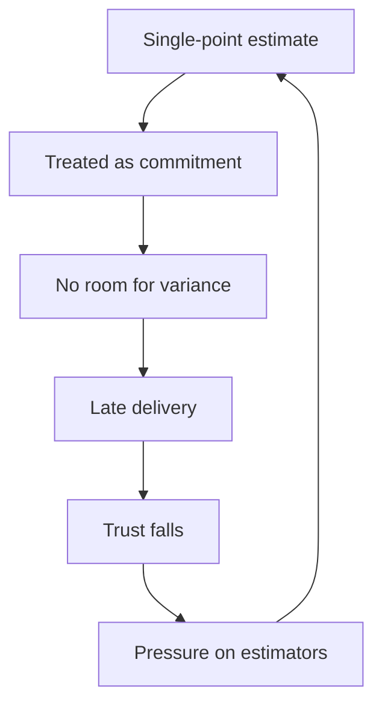

A most-likely estimate becomes a promise with no allowance for the spread of outcomes, so it is
missed about half the time even when the estimate was good. Each miss lowers trust, and lower trust
brings pressure for dates that sound acceptable, pushing the next estimate earlier. Jørgensen's
review calls this estimation under conflicting goals: when an estimate must also please a manager
or win a bid, realism loses ([Jørgensen, 2004](#jorgensen2004review)).

The way out organizes the chapter: forecast from what has happened; separate what you predict from
what you want and what you promise; and order the work so the range narrows quickly.

### Deep Conceptual Explanation

#### What the research says about estimating

The **planning fallacy** is the tendency to underestimate how long one's own tasks will take, even
when similar tasks took longer in the past. The term comes from Kahneman and Tversky in 1979
([Jørgensen, 2004](#jorgensen2004review)). In five
studies, Buehler, Griffin, and Ross found that people's predictions of their own completion times
were consistently too optimistic, while their predictions of other people's times were not. People
predicting their own work concentrated on plans and scenarios for the task at hand rather than on
past experience; when instructed to connect the prediction to their past experience, the bias
disappeared in the study. They also explained away past failures as caused by external, one-off
circumstances, which made that past seem irrelevant
([Buehler, Griffin, and Ross, 1994](#buehler1994exploring)). This is a
**research finding** about individuals' own academic and everyday tasks, not software teams.

For software, Jørgensen's review found expert judgment to be the most common estimation method, with
no substantial evidence that formal models do better. It also reports, from earlier studies, that
experts' uncertainty ranges are far too narrow: in one study of industrial projects, fewer than half
of actual efforts fell inside the estimators' ranges
([Jørgensen, 2004](#jorgensen2004review)). A later review adds two
cautions. Underestimation dominated in engineering and management studies but not in psychology
studies, so "people always underestimate" is too strong. And many studies do not separate effort
(work hours) from completion (delivery dates), which are different questions
([Halkjelsvik and Jørgensen, 2012](#halkjelsvik2012origami)).

This book's conclusion: do not fix estimates by asking people to try harder. Use history, and treat
any expert range as narrower than it should be.

#### Inside view and outside view

The **inside view** forecasts a project by looking at its details: the tasks, the people, the plan.
The **outside view** ignores those details and asks how long comparable projects took. Flyvbjerg,
building on Kahneman and Tversky and on Lovallo and Kahneman, turned the outside view into a method
called **reference-class forecasting**, with three steps: choose a class of past projects similar
enough to compare and numerous enough to be meaningful; establish the distribution of their outcomes;
place the new project in that distribution
([Flyvbjerg, 2006](#flyvbjerg2006nobel)). The paper separates two
causes of forecast error that need different remedies: **optimism bias**, an honest cognitive error,
and **strategic misrepresentation**, deliberately low numbers made to win approval.

Its example is the UK Department for Transport, which from 2004 added "optimism bias uplifts" to
project budgets from the overruns of past projects of the same type, larger as tolerance for overrun
shrinks: for roads, 15 percent for a 50 percent chance of staying within budget, 45 percent for a 90
percent chance. This **research finding** comes from public infrastructure; the method transfers to
software, the numbers do not.

In an engineering organization the reference class is your own past work. "What share of committed
items did we deliver in quarter over the last four quarters?" and "how much did our last five
features grow after kickoff?" are outside-view questions.

#### Forecasting from throughput

**Throughput** is the number of items a team finishes per week (Chapter 16 covers measuring it).
Throughput history is the most useful reference class a manager has, because it already contains
everything that slowed the team: interrupts, absences, review queues, failed releases.

A **Monte Carlo simulation**, meaning a random experiment repeated many times to see the spread of
results, turns that history into a forecast for a backlog of N items:

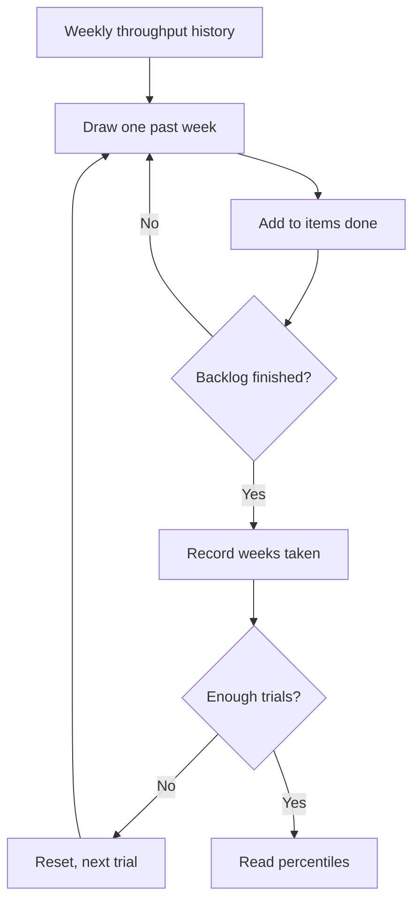

Each trial treats the future as a random reshuffle of past weeks. Thousands of trials give a
distribution: the 50th percentile is the date hit half the time, the 85th the date hit 85 times in
100. The same history answers the reverse question: how many items will be done by a fixed date. Vacanti's practitioner guide to
flow forecasting covers this method and warns against forecasting from averages
([Vacanti, 2018](#vacanti2018when)).

A plan built on average throughput lands near the median, so it is late about half the time: the
arithmetic behind the loop in the mental model. The method needs no size estimate per item, only a
similar size mix to the past. State its assumptions with every forecast:

- **The future resembles the sampled past.** Team changes and new kinds of work break this; rerun
  when the system changes.
- **Weeks are independent.** They are not (a bad incident week is often followed by another), so
  the ranges come out somewhat too narrow.
- **The scope is known.** It never is. Model growth explicitly, from your own history.

#### Forecasts, targets, and commitments

McConnell separates an **estimate** (a prediction), a **target** (a business objective, possibly
unachievable), and a **commitment** (a promise of defined functionality at a stated quality by a
date), and notes that executives asking for an estimate often want a commitment or a plan to meet a
target ([McConnell, 2006](#mcconnell2006software)). Jørgensen's review
makes the research-side point: bid, planned effort, and most-likely effort serve conflicting goals
and are often not kept apart ([Jørgensen, 2004](#jorgensen2004review)).
This book uses three terms:

| | Forecast | Target | Commitment |
|---|---|---|---|
| What it is | A probability statement about the future | An outcome the organization wants | A promise to someone who will rely on it |
| Who owns it | The team and its manager | Leadership | A named person, usually a director or above |
| Form | A range with probabilities | A single outcome | A date and a defined scope |
| Changes when | New information arrives, weekly | Strategy changes | Rarely; renegotiated early and explicitly |
| Missing it means | The forecast is updated | Learning about ambition or capacity | A broken promise with consequences |

By this book's recommendation, commit from the cautious end of a forecast (85th or 95th percentile),
with the scope written down and everything above that line labeled a target. Pressure to "commit to
the target" is pressure to make a promise history says will probably be broken; saying so, forecast
in hand, is a core skill of the role.

#### Retiring risk early

Throughput forecasting handles **variability**, the normal spread in how fast familiar work gets done.
It does not handle **uncertainty in the work itself**: whether a design will perform, two systems
will integrate, or customers will use the result. For those the lever is sequencing.

- A **spike** is a time-boxed investigation of one technical question ("can pricing-svc price a
  20,000-line order file within the processing window?"). Its output is a decision; the code is discarded.
- A **walking skeleton** connects the main components end to end before any is complete; Alistair
  Cockburn, who named it, describes a thinly connected functioning architecture
  ([Cockburn, 2004](#cockburn2004crystal)). Integration problems
  surface in week two, not week twenty.
- An **experiment**, in the sense popularized by *The Lean Startup*, tests a business assumption
  with the smallest thing that yields evidence ([Ries, 2011](#ries2011lean)).
  Product discovery itself belongs to Chapter 44.

In a well-sequenced plan the forecast range narrows quickly in the first third of the work. If it is
as wide at the halfway point as at the start, the hard questions were deferred.

#### Adding people to late work

When a dated item falls behind, the usual proposed remedy is more people. **Brooks's law**, as it is
commonly stated, holds that adding people to a late software project makes it later
([Brooks, 1995](#brooks1995mythical)). Its wording and Brooks's
qualifications were verified for this book only through a secondary source, which reports that Brooks
called it an oversimplification and explained it by ramp-up time, communication overhead growing with
team size, and tasks that cannot be divided.

Treat it as **expert opinion** that names mechanisms. Adding people helps when the work divides
cleanly, the newcomers know the code, and enough time remains for ramp-up to pay back. It hurts late,
on coupled work, and when the people onboarding newcomers are on the critical path. Moving scope out
is usually faster than moving people in.

### Engineering Organization Example

This example is **illustrative**: the throughput and scope numbers are chapter additions, and the
canon records only that the renewal features were on track at day 90
([first quarter](#page-case-studies-northstar-first-quarter)). It is the calculation a director
could run on arrival, with data that existed on day one.

Bulk ordering, owned by Orders, is committed to a renewal customer for the end of quarter 2 (week 26
from the director's first day) and broken into 44 backlog items. Orders' recent history:

```text
Orders: planned items finished per week, history weeks H1-H26
H1-H13:   6  4  7  3  5  8  2  6  5  4  7  6  0
H14-H26:  5  9  4  6  3  5  7  4  6  2  8  5  6
Total 133, mean 5.1, median 5, range 0-9
```

Assumptions, stated:

- Bulk ordering is staffed by five Orders engineers and two Customer Experience web engineers, half
  of Orders' headcount, so it gets about half of Orders' historical planned throughput.
- Orders' canonical 10 percent prevention allocation, assumed to continue into quarter 2, scales
  throughput by 0.9. The combined factor is 0.45, about 2.3 items a week.
- Unplanned work is excluded from the counts; its effect is already in how few planned items got done.
- Orders' last four features grew 15 to 35 percent in item count after starting; 25 percent growth
  turns 44 items into 55.

The **single-point plan** divides 44 by 2.3 and gets 19.1, "about week 19, seven weeks to spare." A
Monte Carlo simulation with 10,000 trials, each week drawn at random from the 26 and multiplied by
0.45, gives the following (reruns may differ by one week or one item):

| Question | 50% | 85% | 95% |
|---|---|---|---|
| Weeks to finish 44 items | 20 | 21 | 23 |
| Weeks to finish 55 items | 24 | 27 | 28 |
| Items finished by week 26 (at least) | 60 | 55 | 52 |

Three readings matter. First, the single-point plan sits within a week of the simulation's
median, as it should; the simulation adds what the median means, a 50 percent chance. Second, the 44 items are
very likely done by week 26, but the 55-item version that history says to expect is done in only
about five trials in six: the risk to the renewal is scope growth, not throughput. Third, the
simulation is narrower than reality. It assumes independent weeks and an unchanged team, yet two
quality engineers join Orders during the quarter, and bulk upload has a known recurring failure
(INC-421 dropped lines beyond row 500). Read the range as a minimum.

What the director can do: agree the 44 items in writing as the contractual scope with Amara Okafor
and the customer; label growth a target; publish the forecast weekly; and put the riskiest work
first, a one-week spike on pricing large orders and a walking skeleton from upload through
order-capture, pricing-svc, and invoicing, so a surprise surfaces in week 2 rather than week 22.

### Decision Framework

The first decision is what kind of uncertainty you face, because each kind has a different remedy:

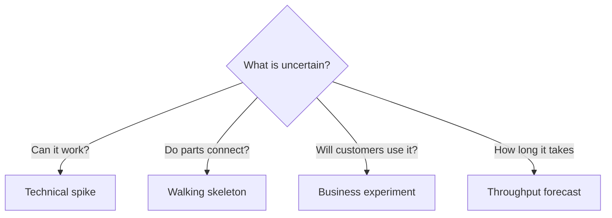

Most large items carry more than one kind. Retire the first three before relying on the fourth; a
throughput forecast for work whose feasibility is unknown is precise about the wrong question.

The second decision is which forecasting method fits the data you have:

| Situation | Method | Watch for |
|---|---|---|
| Three or more months of throughput, familiar work | Monte Carlo on throughput | System changes that make history stale |
| New team or new kind of work | Reference class from comparable work, wide range | A flattering reference class |
| Multi-team initiative | Reference class for the whole, team forecasts for the parts | Assuming the whole is on time because each part's median is |
| Single small item | Cycle-time percentiles (Chapter 16) | Treating the 50th percentile as a promise |
| Pure research | Time box and decision date, no delivery forecast | Pretending a time box is a forecast |

The third decision is what confidence a commitment needs. This book's recommendation: commit at the
85th percentile for ordinary external dates, the 95th where a contract or renewal depends on the
date, and do not commit externally at all until the risk-retiring work in the first decision is done.

### Trade-offs

**Precision against cost.** Bottom-up estimates feel rigorous and consume the time of the people who
would do the work. Throughput forecasting is cheap but needs history and comparable work. Keep
detailed estimates for work unlike anything done before.

**Confidence against ambition.** Committing at the 95th percentile protects credibility and looks
like idle capacity on paper. Pair the commitment with a target: one protects the customer, the other
keeps ambition visible.

**Early risk work against visible progress.** Spikes and skeletons show stakeholders little at
first; building easy screens first shows progress sooner and defers the expensive surprises. Explain
the sequencing in advance, or the early weeks will read as slow.

**Fixed date against fixed scope.** With a contractual date, scope is the variable; with fixed scope,
the date is. Trying to fix both, with a fixed team, removes every degree of freedom and turns the
forecast into a fiction.

**Transparency against misuse.** Publishing forecasts with probabilities invites people to hear the
optimistic end. Lead with the cautious number, and say the median second.

### Failure Modes

**The median promise.** A plan is built from average velocity or a most-likely estimate and
communicated as a date. It is missed about half the time. Signal: delivery dates that slip by a
similar amount every quarter. Countermeasure: communicate percentiles; commit only from the cautious
end.

**Estimate bargaining.** A manager hears an estimate, asks "can't it be faster?", and the engineer
gives a smaller number with nothing else changed. Jørgensen's review describes this pattern as a
conflict between being realistic and pleasing the manager. Signal: estimates that fall in meetings
without scope changing. Countermeasure: discuss scope and risk, never the number.

**Sandbagging.** Once a predictability measure such as "share of commitments delivered" is used to
judge teams, teams commit to less and pad what they commit. The measure rises; delivery does not.
Signal: commitment rates near 100 percent while throughput falls. Countermeasure: measure
**calibration** (did 85 percent forecasts come true about 85 percent of the time?) alongside
throughput, and do not rank teams on either. Chapter 18 covers metric gaming in general.

**The frozen forecast.** A kickoff forecast is never updated. Signal: reports say "on track" until
they say "late." Countermeasure: rerun weekly and report the trend of the 85th percentile date.

**Deferred risk.** Familiar parts are built first; the integration problem arrives late. Signal: the
range is as wide at the midpoint as at the start. Countermeasure: spikes and a walking skeleton in
the first fifth of the work.

**Reference-class shopping.** The planner picks the flattering comparison. Countermeasure: define the
reference class before looking at outcomes, and use all comparable items.

### Enterprise Application

**Each team** keeps its weekly throughput, its feature growth history, and a weekly-refreshed
forecast for each dated item. A spreadsheet is enough.

**The director** owns the commitments: asks teams for forecasts rather than estimates, compares the
plan with the organization's reference class, and decides which items become external commitments.
At Northstar about four in ten committed items landed in quarter; committing seventeen again bets
that this quarter is unlike the last four.

**Multi-team initiatives** need care, because dependencies compound. If two teams each have an
85 percent chance of finishing their part by a date and both parts are needed, the initiative is on
time with about 72 percent probability if the two are independent, and less if one waits for the
other. Chapter 16 owns dependencies; for forecasting, cross-team commitments need a larger margin
or fewer dependencies.

**The cadence** (Chapter 37 places it in the management operating system): a weekly forecast refresh
for dated items, a monthly review of calibration across teams, and a quarterly planning session that
starts from the reference class rather than from a wish list.

### CTO Perspective

At executive level, predictability becomes a property of the organization's promises to the outside
world.

**Few commitments, kept.** Contractual dates, regulatory deadlines, and board milestones carry the
CTO's credibility. Keep the list short, back each item with a cautious forecast, and name its owner.

**Who may commit.** Sales and product will promise dates. Do not forbid it; set the rule: no external
date without an engineering forecast at the agreed confidence, and no scope change without
re-forecasting.

**Portfolio view.** At executive scale, outcomes are mostly decided by which bets are made, not by
how each is estimated. Reference-class thinking applies to the portfolio: if large initiatives have
historically taken 1.5 times their plan, budget for that at the portfolio level rather than
pretending each will be the exception. Chapter 45 covers the economics of choosing among them.

**Reporting.** Report to the board in ranges with stated confidence, and report calibration over
time. "We said 85 percent and hit 9 of the last 11" is a stronger statement than any single date.

### Practical Playbook

1. Collect 13 to 26 weeks of throughput per team (finished planned items). If sizes vary wildly,
   agree a rough slicing rule first.
2. Collect the outside view: committed items delivered in quarter over four quarters, and the growth
   of the last five features after starting.
3. For each dated item, forecast current scope and growth-adjusted scope; record the 50th, 85th, and
   95th percentiles.
4. Classify the item's uncertainty: technical, integration, business, or pace. Schedule a spike,
   walking skeleton, or experiment for each of the first three in the first fifth of the work.
5. Write each commitment as a date and a defined scope from the 85th or 95th percentile; label the
   rest a target. Publish forecasts, targets, and commitments in separate columns.
6. Rerun forecasts weekly. When a commitment's 85th percentile crosses its date, raise it that week
   with options: cut scope, accept the risk, or move the date.
7. Before adding people to a late item, list what they would do in their first two weeks and who would
   onboard them. If the onboarders are on the critical path, cut scope instead.
8. Once a quarter, check calibration: for every forecast made at 85 percent, did the event happen?
   Adjust the confidence levels you commit at, not the estimators.

### Case Study

This case is **fictional**. It is set in the baseline quarter, before the director arrived, when 7
of 17 committed roadmap items were delivered (see the
[baseline data](#page-case-studies-northstar-baseline-data)). Chapter 15 tells how the 17 were
chosen; this chapter adds the forecasting record.

Chapter 15 describes the sizing, which showed ample slack on paper. Nobody checked it against
history, although the three previous quarters had delivered 6 of 15, 8 of 18,
and 7 of 16 committed items. With the baseline's 7 of 17, the four-quarter record is 28 of 66, or 42
percent. All 17 items went to sales and customer success as committed, and Greg Tanaka, VP Sales,
used several dates in open deals.

The quarter-end roadmap review sorted the 10 misses by main cause: four grew in scope after work
started, three were blocked on another team, two were displaced by incident work, and one was
deprioritized. None was a team working slowly on what it had planned.

Two observations are the core of this chapter. First, the sizes may have been fair estimates of
effort, but effort is not completion: a sum of sizes says nothing about waiting for other teams,
growth, or interrupts, which is where the quarter went. The apparent slack was a sum of most-likely
efforts treated as a delivery forecast. Second, the outside view was in Northstar's own records: a
committed item had about a 40 percent chance of landing in its quarter, and the planning method had
not changed. A plan assuming otherwise needed a reason, and none was given.

The [first quarter](#page-case-studies-northstar-first-quarter) record shows what followed: in
week 4, Amara Okafor accepted a dip in feature capacity on condition that the two renewal commitments
kept their dates, and both were on track at day 90. Rebuilding quarterly planning is left to the
exercises.

### Exercises

Solutions are in [chapter 17 solutions](#page-solutions-ch17-solutions). Northstar data is on the
[baseline page](#page-case-studies-northstar-baseline-data); the Orders throughput history is in
the Engineering Organization Example above.

#### Foundational

**F1.** Using the 26 weeks of Orders throughput in this chapter, without the 0.45 adjustment, a
product lead divides a 40-item backlog by the average and announces "eight weeks." Run, or reason
through, a Monte Carlo forecast for the same backlog. Explain what probability the eight-week date
carries, what the 85th percentile looks like, and which assumptions of the simulation are most
likely to be wrong for Orders in the coming quarter.

**F2.** Classify each statement as a forecast, a target, or a commitment, and say what is wrong with
any that is presented as something it is not: Amara Okafor tells the board "bulk ordering ships by the
end of quarter 2"; Greg Tanaka tells a prospect "we expect the export feature in quarter 3"; Priya
Raman tells her team "let's aim to finish the upload rework in four weeks"; an engineer says "probably
two weeks, if the pricing service holds up."

**F3.** In week 16, bulk ordering's forecast slips. Greg Tanaka proposes moving four engineers from
Data and Analytics into Orders for the rest of the quarter. Assess the proposal against Brooks's
law's mechanisms and Northstar's situation, and propose what you would do instead or in addition.

#### Applied Leadership

**A1.** Payments and Integrations owns the accounting-system integration, committed to the second
renewal customer for the end of week 6 of quarter 2 (week 19). The team has never integrated with this
customer's accounting system, and erp-sync has no contract tests. Design the first three weeks of the
work to retire risk: which spikes, which walking skeleton, which experiment with the customer, and what
decision each one feeds. State when you would be ready to tell Amara Okafor how confident you are.

**A2.** Design Northstar's quarterly planning process for quarter 3, when the renewal commitments are
behind it and six teams will propose roadmap items again. Your design must use the four-quarter
reference class, separate commitments from targets, say who may make external commitments, and
explain how you will handle managers who say their team's work is too unique to forecast from history.

**A3.** It is week 18. The weekly forecast for bulk ordering, now scoped at 60 items, gives a
62 percent chance of finishing by week 26; the 44 contractual items are forecast at 93 percent. Write
the update to Amara Okafor: what you tell her, in what order, what options you offer, and what you
recommend. Assume she has been burned by engineering dates before.

#### Executive Decision-Making

**X1.** The CEO, Helena Marsh, asks you as CTO to present the board with a dated annual roadmap of
twelve items "that engineering commits to." Respond: what you will present, how you will express
confidence, and how you will meet the board's wish for certainty without losing its trust.

**X2.** After the renewals close, Greg Tanaka wants authority to promise delivery dates to prospects
for roadmap items, because deals are stalling without them. Propose a policy for external date
commitments at Northstar: who can commit, on what evidence, at what confidence, what happens when a
forecast crosses a committed date, and how you will know whether the policy is working after two
quarters.

### Reflection Questions

1. When someone in your organization last asked for an estimate, did they want a forecast, a target,
   or a commitment, and which did you give them?
2. What is your organization's reference class for its roadmap, and what would it show?
3. Whose estimates get bargained down in your meetings, and who does the bargaining?
4. If your teams' forecasts were perfectly calibrated tomorrow, which leaders would be uncomfortable
   with what they showed?
5. Which of your current projects is building the familiar parts first? What would it cost to move the
   hardest unknown to next week?
6. When did adding people to a late project last work for you, and what was different about it?

### Key Takeaways

- A delivery date is a distribution. A single-point estimate sits at its middle at best and is
  missed about half the time even when good.
- The research on estimation shows optimism about one's own work and ranges that are too narrow.
  Correct with history, not exhortation.
- Forecast from throughput with Monte Carlo simulation, and state its assumptions; it is narrower than
  reality, especially when scope grows.
- Take the outside view: your own record of similar work is the best correction to any plan.
- Keep forecasts, targets, and commitments separate, each with an owner. Commit from the cautious end
  of the forecast, with scope written down.
- Sequence uncertain work so the riskiest questions are answered first: spikes, walking skeletons,
  experiments. A range that does not narrow early is a warning.
- Moving scope out is usually faster than moving people in; Brooks's law names the mechanisms.
- Measure calibration, not commitment hit rate, and never rank teams on predictability.

### References and Further Reading

- [Buehler, Griffin, and Ross, 1994](#buehler1994exploring). Core
  studies of the planning fallacy and what reduces it.
- [Flyvbjerg, 2006](#flyvbjerg2006nobel). Reference-class forecasting,
  optimism bias, and strategic misrepresentation, with a public-sector application. Free on arXiv.
- [Jørgensen, 2004](#jorgensen2004review). Expert estimation in
  software and twelve evidence-based guidelines; a good entry to the research.
- [Halkjelsvik and Jørgensen, 2012](#halkjelsvik2012origami). A broader
  review of time predictions across disciplines, with cautions about overgeneralizing.
- [McConnell, 2006](#mcconnell2006software). *Software Estimation*. The
  distinction between estimates, targets, and commitments, from a practitioner's side.
- [Vacanti, 2018](#vacanti2018when). *When Will It Be Done?* A
  practitioner guide to percentile and Monte Carlo forecasting from flow data.
- [Cockburn, 2004](#cockburn2004crystal). *Crystal Clear*. A small-team
  method by the practitioner who named the walking skeleton.
- [Ries, 2011](#ries2011lean). *The Lean Startup*. Experiments to test
  assumptions before building.
- [Brooks, 1995](#brooks1995mythical). *The Mythical Man-Month*. The
  classic essays on software project scheduling, including Brooks's law.
- [Reinertsen, 2009](#reinertsen2009principles). *The Principles of
  Product Development Flow*. An economic treatment of product development flow; background for
  Chapters 16 and 45.

<a id="page-parts-04-execution-18-measuring-engineering-productivity"></a>

## Chapter 18 — Measuring Engineering Productivity: DORA, SPACE, and Their Limits

!!! warning "Awaiting human review"
    This chapter has passed the book's automated validation and an editorial self-review, but not yet
    the human review in which each cited claim is checked against its source. Treat it as a reviewed
    draft. Corrections are welcome; see the repository's CONTRIBUTING file.

Sooner or later someone senior asks how productive engineering is, and wants one number. This chapter
explains what the best-known measurement frameworks measure, how their evidence was produced, how every
metric gets gamed, and why the book refuses to score individual engineers with delivery metrics. It owns
DORA, SPACE, developer experience, and metric gaming in general. Chapter 16 owns flow and lead time from
commitment to customer, [Chapter 19](#page-parts-05-engineering-quality-19-defining-measuring-and-owning-quality)
the quality measures, [Chapter 27](#page-parts-05-engineering-quality-27-quality-transformation-at-enterprise-scale)
the quality scorecard, Chapter 38 scorecards in the operating system, Chapter 9 individual performance,
and Chapter 54 claims about AI and productivity.

### Why This Matters

**For a team**, measurement is a feedback loop: a team that sees its lead time and change fail rate can
tell whether last month's pipeline work helped.

**For an organization of 50 to 150 engineers**, measurement is how a director sees work they no longer
touch. It is also where damage starts: numbers useful as feedback get copied into slides, compared across
teams, and attached to goals. Then people optimize the number, and the director loses the view it gave.

**For executives**, the question arrives in financial form. Engineering is often the largest operating
expense the CFO cannot explain line by line. Sales has quota attainment; why does engineering not have
output per engineer? The question is legitimate. "Engineering cannot be measured" invites someone else to
pick the metric; a per-engineer activity count destroys the information it is meant to provide. The third
answer: measure the system, in pairs, for improvement, and translate it into what executives must decide.

### Learning Objectives

After this chapter you will be able to:

- State what each DORA metric measures, how DORA's research was produced, and what that evidence cannot
  tell you about your own organization.
- Build a balanced measurement set that combines system data with developer-experience measures, using
  SPACE and DevEx as checklists rather than scorecards.
- Predict how each metric will be gamed, and pair it with a measure that exposes the gaming.
- Explain, with reasons an executive will accept, why you will not score individual engineers with
  delivery or activity metrics, and offer something better.

### The Mental Model

> **Mental model:** A metric is a question you ask a system, not a verdict on a person. Any number used
> to reward or rank will be optimized, so measure systems rather than individuals, in pairs, and for learning.

The first idea is the **chain from effort to impact**. Kent Beck and Gergely Orosz describe software work
as a chain: effort (planning, coding) produces output (code, features), output changes customer behavior
(outcome), and changed behavior produces business value (impact)
([Orosz and Beck, 2023](#orosz2023measuring)). Effort and output are easy
to count and easy to inflate. Outcomes and impact are what the business wants, and hard to attribute to
one person. Delivery metrics such as DORA's sit between output and outcome: they measure how safely and
quickly changes reach users, not whether the changes were worth making.

The second idea is the **gaming loop**. Donald Campbell is usually credited with the observation that an
indicator relied on for decisions comes under pressure that bends both the number and the activity it
was meant to track ([Campbell, 1979](#campbell1979assessing)). The popular
version, "when a measure becomes a target", is called Goodhart's law. The book credits both for the idea
only; the exact wording of neither has been verified against a primary text (research gap G7).

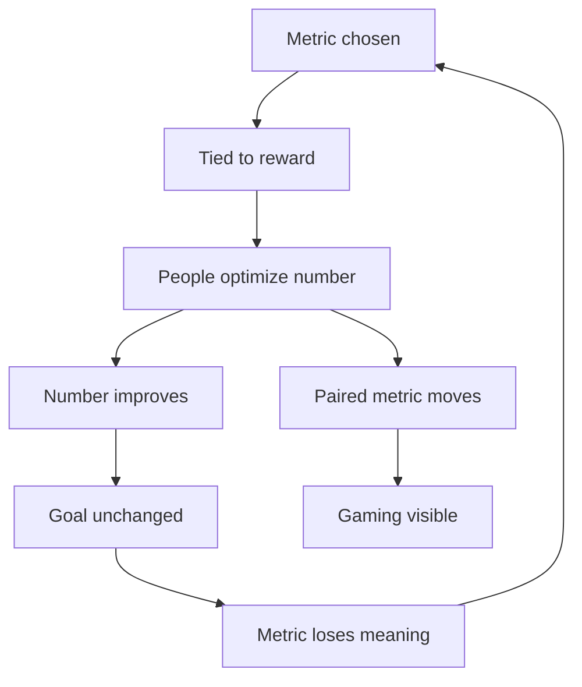

The loop is not about bad people; it is what intelligent people do when a number decides their bonus or
promotion. The defense is design: choose the level of measurement, pair measures so that gaming one moves
the other, and keep learning measures apart from judging ones.

### Deep Conceptual Explanation

#### What the DORA metrics measure

DORA (DevOps Research and Assessment, now part of Google Cloud) publishes the most widely used delivery
metrics. Its current guide, last updated January 5, 2026 and re-checked for this chapter, lists **five**
metrics in two groups, not the "four keys" many dashboards still show
([DORA, metrics guide](#dora-metrics-guide)):

| Group | Metric | What it measures |
|---|---|---|
| Throughput | Change lead time | Time from commit to version control to deployment in production |
| Throughput | Deployment frequency | Deployments over a period, or time between them |
| Throughput | Failed deployment recovery time | Time to recover from a deployment that needs immediate intervention |
| Instability | Change fail rate | Share of deployments needing immediate intervention, such as a rollback or hotfix |
| Instability | Deployment rework rate | Share of deployments that are unplanned and caused by a production incident |

Three properties matter. The metrics describe **a delivery system**: the guide applies them to one
application or service at a time and warns that comparing very different applications misleads. They say
nothing about **whether the right things were built**. And the guide warns that making them goals makes
gaming more likely, and that the aim is improvement over time, not competition between teams.

Definitions change. Recovery time sits under throughput in this version and rework rate is new, so an
older dashboard may show different metrics under the same labels. Local definitions differ too: Northstar
counts a release as failed if a hotfix, rollback, or linked incident follows within 72 hours, which is not
DORA's definition ([Chapter 23](#change-approval-and-pipeline-outcomes)).
Compare an organization with itself over time, under one written definition.

#### How the research was produced, and what it cannot tell you

DORA's claims rest on an annual survey. The 2023 report's methodology describes recruiting through blog
posts, email, social media, and snowball sampling (people forwarding the survey), topped up with a
panel to reach under-represented groups and industries. Nearly 3,000 professionals responded that year,
more than 36,000 over the program's life. Survey items are grouped into constructs validated with factor
analysis, and hypothesized models are tested with Bayesian structural equation models
([DORA, 2023](#dora2023accelerate)). *Accelerate* presents earlier years
of the program for a general audience
([Forsgren, Humble, and Kim, 2018](#forsgren2018accelerate)).

This is serious **industry research**, and its limits follow from its design:

- **Self-report.** Respondents estimate their own lead time and failure rate; nobody checks pipelines.
- **Self-selection.** People who answer a DevOps survey are not a random sample of organizations.
- **Changing samples.** DORA's FAQ says each year's respondents differ (though probably overlap), that some
  year-to-year shifts may be sampling artifacts, and that a new finding is suspect until replicated
  ([DORA, FAQ](#dora-faq)).
- **Causal claims rest on models.** The 2023 methodology discusses confounding openly and specifies causal
  models to decide what to control for, while acknowledging that not every bias can be captured.

So when the guide states that speed and stability are not trade-offs, read it as: across many
self-selected organizations, those reporting fast delivery also tend to report stable delivery. That is
good evidence that the trade-off is not a law. It is not evidence that deploying more often will reduce
*your* failures; the mechanism (smaller batches are easier to test, diagnose, and roll back) is plausible
and has to be tested in your own data. Disputed claim D2 records the book's position.

#### SPACE: a checklist of dimensions

The SPACE article, by Nicole Forsgren, Margaret-Anne Storey, and colleagues at GitHub and Microsoft
Research, argues in its abstract that developer productivity is more than an individual's activity or the
efficiency of engineering systems, and cannot be captured by one metric or dimension
([Forsgren et al., 2021](#forsgren2021space)). Its full text could not be
fetched for this book, so the dimension names come from two secondary pages: a post by Forsgren naming
Satisfaction, Performance, Activity, Communication, and Efficiency
([Forsgren, 2023](#forsgren2023navigating)), and a GitHub summary giving
the long forms (satisfaction and well-being, performance, activity, communication and collaboration,
efficiency and flow), which also advises using at least three dimensions and calls activity the
most common and most misused measure ([Alwell, 2021](#alwell2021measuring)).

Read SPACE as a **checklist against blind spots**. A set that is all activity (commits, pull requests,
tickets) misses burnout and whether work reaches anyone; a set that is all satisfaction misses whether
anything ships. Several dimensions, including one gathered by survey, make the set harder to game, because
improving one dimension at another's expense becomes visible.

#### Developer experience (DevEx)

A 2023 article by Abi Noda, Margaret-Anne Storey, Nicole Forsgren, and Michaela Greiler frames developer
experience as how developers experience their daily work and its friction, and proposes measuring it by
combining developer feedback with engineering-system data
([Noda et al., 2023](#noda2023devex), abstract). Its full text was not
readable either; the first author's company names the three dimensions as **feedback loops** (how quickly
and well tools and people respond), **cognitive load** (the mental effort to complete tasks and navigate
systems), and **flow state** (focus without interruption)
([DX, DevEx report](#dx-devex-report)). That company sells this kind of
measurement, and the claim that better developer experience improves business outcomes is the authors'
argument, not a quantified result.

DevEx points at **causes** a manager can change. A long change lead time is an outcome; a 21-hour wait for
first review is a feedback loop, and fixing it is a decision. Pairing a survey question ("how often do slow
reviews block you?") with the system measure is stronger than either: the survey finds friction no system
logs, and the system data keeps the survey from becoming a popularity poll.

#### The 2023 dispute about measuring individuals

In August 2023 McKinsey published "Yes, you can measure software developer productivity"
([Gnanasambandam et al., 2023](#mckinsey2023productivity)), read for this
book from an archived copy of the original page. It proposes building on DORA and SPACE with
"opportunity-focused" measures: time in the inner loop (coding, building, unit testing) versus the outer
loop (integration, release, deployment), a benchmark survey, a talent capability score, and **contribution
analysis**, which assesses individuals' contributions to a team's backlog from tools such as Jira,
normalized with a proprietary algorithm. It reports results at nearly 20 companies, including 20 to 30
percent fewer customer-reported defects, with no method, baseline, or comparison group, so those figures
are claims, not evidence. It also notes that deployment frequency is not useful for tracking individuals
and that counting commits invites gaming.

Orosz and Beck's response argues that most of the new measures sit at the effort and output end of the
chain, that measuring individuals changes behavior, and that the framework will likely harm engineering
culture ([Orosz and Beck, 2023](#orosz2023measuring)). Their sharpest
evidence is Beck's account of Facebook's developer surveys: useful for about a year, then turned into a
score, used in performance reviews, and rolled up to managers, after which pressure and negotiation left
the company knowing less than before. They also concede the executive's point: leaders who refuse to
answer will have someone else's answer imposed.

Neither side offers controlled evidence; the book labels both **expert opinion**. Disputed claim D1
records the position taken below.

#### How each metric is gamed, and its pair

Gaming is rarely fraud; it is mostly reclassification, splitting, timing, and selective attention.

| Metric | How it is gamed | Pair it with |
|---|---|---|
| Deployment frequency | Splitting changes into trivial deploys; deploying empty or configuration-only changes | Lead time per change; change fail rate |
| Change lead time | Starting the clock late (squashing commits before merge); doing easy work first | Commitment-to-delivery lead time (Chapter 16); age of oldest open work |
| Change fail rate | Not linking failures; calling them "configuration issues"; deploying less | Deployment frequency; audited incidents with no linked deployment |
| Failed deployment recovery time | Closing the incident when a workaround starts; opening a new one for the rest | Customer-reported duration; reopened incidents |
| Deployment rework rate | Labeling an incident fix as planned work | Incidents followed by a deployment within a day |
| Pull requests or commits per person | Splitting work; avoiding review, pairing, and incident work | Do not use for individuals |
| Survey scores | Managers lobbying for answers; strategic answering once scores matter | Response rate; system data on the same friction |
| Incident counts by severity | Rating incidents below the tracked level | Customer-detected share; [severity audit](#severity-definitions-that-resist-reclassification) |

These are the general rules for delivery measurement; Chapter 27 applies them to quality in its
[scorecard rules](#scorecard-design-rules): prefer system data to human classification and audit what
remains; report distributions, not only medians; prefer measures built from many events; and publish the
definition, its weaknesses, and its owner next to the number.

#### Why the book refuses individual productivity scoring

The book's position (disputed claim D1): **measure delivery and developer experience at team and system
level, for improvement; do not score individual engineers with delivery or activity metrics.** This is
**this book's recommendation**, for five reasons:

1. **Attribution.** Software is produced through shared code, reviews, and pipelines. A change ships fast
   because someone reviewed it quickly and someone built the pipeline; credit to the committer is taken
   from them.
2. **Only effort and output can be counted per person.** The work that most raises a team's output
   (reviewing, mentoring, incident response, design, deleting code) lowers the person's own count.
3. **Gaming is certain and cheap.** Splitting one change into five pull requests takes minutes.
4. **The numbers are noise.** One engineer's quarter has too few events and too much variation in task
   difficulty to separate skill from assignment.
5. **It destroys the instrument.** Once data judges people, people change what they report and how they
   work. The Facebook account illustrates exactly this.

This is not refusing to assess people. Individual performance is judged through evidence of impact and
behavior (Chapter 9); delivery data can open a conversation, not deliver the verdict.

### Engineering Organization Example

This example is **illustrative**. It uses Northstar's fictional baseline to show what a "deployments per
engineer" league table would say. Deployments per month are from `teams.csv`; quarterly figures assume
three equal months.

| Team | Engineers | Deploys per month | Per engineer | Change failure rate | Failures in a quarter (approx.) | 95% interval |
|---|---|---|---|---|---|---|
| Payments and Integrations | 12 | 22 | 1.83 | 21% | 14 of 66 | 13–33% |
| Customer Experience | 15 | 26 | 1.73 | 17% | 13 of 78 | 10–26% |
| Platform Operations | 12 | 14 | 1.17 | 15% | 6 of 42 | 7–28% |
| Data and Analytics | 11 | 11 | 1.00 | 12% | 4 of 33 | 5–27% |
| Orders | 14 | 11 | 0.79 | 29% | 10 of 33 | 17–47% |
| Billing | 13 | 8 | 0.62 | 34% | 8 of 24 | 18–53% |

The intervals are Wilson score intervals, a standard way to state the uncertainty of a proportion from a
small count. Four readings:

**The ranking measures architecture.** Orders and Billing ship most changes through the Core train, which
leaves twice a month. Their low counts describe the train; ranking their engineers lower would blame them
for a system they did not choose.

**The denominator is wrong.** Seven of Platform Operations' 12 people are QA engineers who do not deploy.
Per deploying engineer, the team is at 2.8, the highest in the organization.

**The rates are too noisy to rank.** Every team's interval overlaps every other team's. One quarter of
rates cannot even separate Billing from Customer Experience; the case that the Core train is the problem
rests on the incident data and the mechanism, not on a ranking.

**Counts and rates disagree.** Payments and Integrations has a lower failure rate than Orders but more
failed deployments (about 4.6 a month against 3.2), because it deploys twice as often. Which is better
depends on how large each failure is and how fast it is recovered.

If this table entered the budget pack, teams would rise fastest by splitting deployments. The number would
rise; the director would learn nothing.

### Decision Framework

Every request for a metric has a decision behind it. Find the decision first.

```mermaid
flowchart TD
    R["Metric requested"] --> Q{"Which decision?"}
    Q -->|None| N["Decline or defer"]
    Q -->|About a person| P["Performance process"]
    Q -->|Team or system| S{"System data exists?"}
    S -->|Yes| Y["Define, pair, publish"]
    S -->|No| Z["Survey or instrument"]
```

"Performance process" means the manager's evidence-based assessment (Chapter 9), not a number.

| Question | Measure | Level | Pair | Source |
|---|---|---|---|---|
| Are we delivering safely and fast? | DORA throughput and instability | Service, rolled up to team | Each other | Pipeline and incident events |
| Are we delivering what we promised? | Committed items delivered and forecast calibration (Chapter 17) | Organization; teams against own trend | Throughput | Planning tool |
| Where is the friction? | Review wait, pipeline time, main-branch red time, flaky failures | Repository, team | DevEx survey on the same friction | Code host, CI |
| Are people sustainable? | Satisfaction, burnout, on-call load | Team, minimum group size | Attrition, response rate | Survey, paging tool |
| Where does the money go? | Capacity by category (features, prevention, unplanned) | Organization | Outcomes per category | Planning tool, time sampling |

The last row is usually what a CFO's productivity question is really about.

### Trade-offs

**System against perceptual data.** System data is cheap once instrumented and blind to friction that
leaves no trace (unclear requirements, waiting on an answer in chat). Surveys see that friction, cost
people's time, and degrade if over-used or weaponized. Use both; ask fewer, better questions.

**Standard against local definitions.** DORA's definitions allow comparison with research; local ones may
fit the business better (Northstar's 72-hour window catches slow-burning failures). Pick one per metric,
write it down, and change it only with a dated note.

**Transparency against gaming pressure.** Publishing every team's numbers company-wide adds accountability
and pressure to optimize. A middle course: team numbers visible to the team, its manager, and the
director's staff; aggregates reported upward.

**Instrumentation cost against quality.** One event stream from four CI systems is real work; a
hand-joined spreadsheet is cheaper and silently wrong.

**Buying against building.** Commercial engineering-analytics tools assemble data quickly and arrive with
per-person views and leaderboards switched on. Switch them off before anyone sees them.

### Failure Modes

**The leaderboard.** Per-engineer or per-team rankings appear in a slide, usually with good intent.
Signal: people ask how the number is computed so they can move it. Countermeasure: no rankings; teams
compare with their own trend.

**The single number.** A composite "productivity index" replaces the set. Signal: nobody can say what
moved it. Countermeasure: keep the pairs separate and show them together.

**Survey weaponization.** Experience scores enter managers' objectives; managers lobby; candor falls.
Signal: scores rise while attrition and incident load do not improve. Countermeasure: results belong to the
team and its manager, never to anyone's rating.

**Definition drift.** A definition changes silently (a new deployment counter, a new incident category).
Signal: a step change nobody can explain. Countermeasure: a definitions page with an owner and change log.

**Benchmark envy.** An executive sets a published "elite" lead time as a target. Signal: a target with no
mechanism. Countermeasure: answer with the mechanism (batch size, review wait, release cadence) and a plan.

**Dashboard without decisions.** Metrics nobody discusses. Countermeasure: every metric has a forum and an
owner, or is switched off (Chapter 37).

### Enterprise Application

At 50 to 150 engineers, measurement needs an owner, a definitions page, and plumbing.

**Ownership.** One person, often a staff engineer with platform engineers, owns definitions and the data
pipeline. The director decides which metrics exist and where they are used; managers act on their team's.

**Plumbing.** Every pipeline emits the same deployment event (service, version, time, commit range,
result) to one store, and incidents are linked to deployments in the incident tool. Until then, every
number carries an asterisk.

**Developer-experience survey.** Twice a year, about 15 questions, anonymous, reported only for groups of
at least five (a threshold that is this book's recommendation). Teams pick one or two frictions to fix;
the director looks for friction shared across teams, usually platform work.

**Cadence and access.** Delivery metrics reviewed monthly by team and quarterly for the organization
(Chapter 38 covers scorecards and capacity allocation; the
[quality scorecard template](#page-templates-engineering-quality-scorecard) runs alongside). Access rules
are written before the first dashboard ships, including that no per-person view exists.
### CTO Perspective

At executive level, "how productive is engineering?" usually means one of three questions, and none is
answered by a per-engineer count.

**Are we getting value for the money?** Answer with where capacity goes (new capability, prevention,
unplanned work) and what the largest investments produced. That is the language of Chapter 45's economics
and Chapter 52's budgeting, and a CFO can use it.

**Can we go faster?** Answer with the constraint: where work waits and what removing the wait would cost.
DORA's throughput metrics and the friction measures locate it.

**Are we competitive?** Benchmarks tempt most here and mislead most: self-selected respondents, other
definitions.

The CTO also protects the instrument. A per-engineer number admitted to the board pack is hard to remove,
and every later productivity claim, including the AI tool claims of Chapter 54, will be argued in it.

### Practical Playbook

1. **List the decisions** measurement must support: delivery health, friction, capacity allocation,
   executive reporting. Drop metrics that support none.
2. **Inventory sources**: each pipeline, incident tool, and planning tool, what it records, who joins it.
3. **Define each metric** on one page: formula, source, unit of analysis, owner, gaming paths, pair. Use
   DORA's current definitions unless you record a reason not to.
4. **Instrument deployment events** from every pipeline into one store, starting where most change flows.
5. **Publish a baseline quarter** before any target, with event counts or intervals next to rates.
6. **Run the developer-experience survey**, paired with system data on the same friction; results go back
   to teams within two weeks and never into performance ratings.
7. **Write the access rules** before the first dashboard.
8. **Prepare the executive answer**: capacity by category, delivery trend, investment outcomes, and the
   reasons for not reporting per-person output.
9. **Review the set every six months**: retire unused metrics, check for drift and gaming.

### Case Study

This case is **fictional**. It describes how Northstar measures delivery at baseline and a decision the
reader faces at the start of the director's second quarter. The canonical record is in the
[baseline data](#page-case-studies-northstar-baseline-data) and
[the director's first quarter](#page-case-studies-northstar-first-quarter).

**How delivery is measured today.** Deployment counts and lead times come from pipeline logs in four CI
systems, joined by hand; the four shell-script services log nothing, so their numbers are estimates from
chat history. Change failure rate links releases to hotfixes, rollbacks, and incidents within 72 hours,
manually, so unlinked failures are missed. Unplanned work comes from a two-week sample of ticket types.
Added by this chapter: one Platform Operations infrastructure engineer spends about two days a month
assembling these numbers in a spreadsheet; before the director arrived, the only engineering figures in
the CEO's monthly board pack were committed roadmap items delivered and the Sev1 and Sev2 count; and no
developer survey had been run in the previous two years.

The first quarter's headline delivery figures (Core change failure rate from 31 to 22 percent) came from
the same hand-joined data, and were reported with that caveat.

**The request (a decision the reader faces).** At the start of quarter 2, preparing next year's budget,
Rajiv Menon (CFO) asks for an output-per-engineer figure by team for the budget pack. Operating expense is
flat, the board has asked whether 80 engineers are used well when 41 percent of committed roadmap items
shipped on time in the baseline quarter, and a consultancy article he was sent says this can be measured.
Helena Marsh (CEO) supports the request.

**The director's proposed measurement set.** The director's draft reply declines the per-engineer figure
and offers:

| Area | Measures | Level | Source and status |
|---|---|---|---|
| Delivery | Four DORA metrics now (all but rework rate), rework rate later | Component, rolled up to team | Shared deployment-event store (to build); DORA definitions shown beside the 72-hour rule for two quarters |
| Commitments | Committed roadmap items delivered and forecast calibration (Chapter 17); unplanned work share | Organization; teams against own trend | Planning tool; quarterly time sampling |
| Quality | Chapter 27's scorecard pairs | Organization, team | Already running |
| Friction | Review wait (21 working hours at baseline), Core pipeline duration (74 minutes), main-branch red time, failures unrelated to the change | Repository | Code host and CI |
| Experience | Twice-yearly survey: feedback loops, cognitive load, flow, satisfaction | Team, at least five respondents | New; first run in quarter 2 |
| Investment | Capacity by category: features, prevention (12 FTE), unplanned work | Organization | Planning tool, time sampling |
| Excluded | Per-engineer counts; story points across teams; survey scores in reviews | | Written into the access rules |

The director estimates (another addition) about six engineer-weeks of Platform Operations time, paid from
the prevention allocation, to build the shared deployment-event store, which retires the monthly hand join.

Refusing alone does not win the conversation. The director must show that the investment view answers
Rajiv's real question (is the money going to the right places, and is that improving?) and commit to a
date for the first report. Exercise X1 asks whether it does.

### Exercises

Solutions are in [chapter 18 solutions](#page-solutions-ch18-solutions). Data are on the
[Northstar baseline page](#page-case-studies-northstar-baseline-data).

#### Foundational

**F1.** A dashboard built three years ago at your company shows "the four DORA keys": deployment frequency,
lead time for changes, change failure rate, and time to restore service. Using DORA's current guide,
explain what has changed and what each current metric measures. Then decide which definition you will report
next quarter and how you will bridge the trend across the definition change.

**F2.** A colleague says: "DORA proved that deploying more often reduces failures, so we should set a target
of daily deployments for every team." Using what you know about how the DORA research was produced, explain
what the evidence does and does not support, and propose how your organization could test the claim in its
own data.

**F3.** Northstar wants to report change fail rate by team every quarter. Using the team table in this
chapter, explain which comparisons between teams one quarter of data can support and which it cannot. Then
propose how the report should present the numbers so that readers do not over-interpret them.

#### Applied Leadership

**A1.** Daniel Cho (Customer Experience) proposes adding "pull requests merged per engineer per week" to his
team's dashboard "just for visibility, not for evaluation." Two of his senior engineers spend much of their
time reviewing and coordinating mobile releases. Decide whether to allow it, and write what you would say to
Daniel, including what you would offer instead.

**A2.** Design the first Northstar developer-experience survey: no more than 15 questions, mapped to
dimensions, each paired with a system measure where one exists. State the anonymity rules, who sees what,
how results return to teams, and what you commit never to use the results for. Use Northstar's known
frictions as a guide.

**A3.** Six months after the deployment-event store is built, deployment frequency has doubled in two
Northstar teams, while their change lead times have not moved and the share of deployments with no code
change has risen. Explain what is probably happening, how you would confirm it without accusing anyone, and
what you would change in the measurement design.

#### Executive Decision-Making

**X1.** You are the director. Write the reply to Rajiv Menon's request for an output-per-engineer figure by
team (no more than one page). It must answer the board's underlying question, explain in business terms why
you will not provide a per-engineer number, propose what you will provide and when, and state what you need
from him. Assume Helena Marsh has already said she supports his request.

**X2.** A vendor offers Northstar an engineering-analytics platform for $90,000 a year that would connect to
all four CI systems, the code hosts, and the planning tool within a month, replacing the planned six
engineer-weeks of internal work. Its default views include per-developer activity rankings. Using the
constraints in the Northstar overview, decide whether to buy it, what conditions you would set, and what
evidence after one quarter would show you were wrong.

### Reflection Questions

1. Which metric in your organization would change most if people stopped believing it affected their
   rating? What does that say about the number today?
2. When were you last asked for a productivity number, and what decision was it meant to support? Did
   anyone ask?
3. Which of your metrics have a written definition, an owner, and a change log?
4. What important engineering work in your organization is invisible to every metric you collect?
5. If your developer-experience survey results were shown to your CEO next week, would people answer the
   next survey the same way?

### Key Takeaways

- Ask what decision a metric supports before collecting it; drop metrics that support none.
- DORA's current guide has five metrics in throughput and instability groups; they describe a delivery
  system, per service, and say nothing about whether the right things were built.
- DORA's evidence is survey-based, self-selected, and correlational. It shows the speed-stability trade-off
  is not a law; it does not predict the effect of a change in your organization.
- Use SPACE and DevEx as checklists: several dimensions, at least one perceptual, paired with system data.
- Every metric is gamed in predictable ways; publish each with its gaming paths and a pair.
- Do not score individual engineers with delivery or activity metrics: attribution fails, counts reward
  the wrong work, the numbers are noise, and the instrument stops working.
- Answer executive productivity questions with capacity by category, delivery trends, and investment outcomes.
- Fix the plumbing: a hand-joined number is a number nobody can audit.

### References and Further Reading

- [DORA, metrics guide](#dora-metrics-guide). The five current metrics and
  DORA's warnings against goals and team comparisons; re-check before use.
- [DORA, 2023](#dora2023accelerate). The methodology section shows how the
  survey evidence is produced.
- [DORA, FAQ](#dora-faq). DORA's caveats on changing samples and replication.
- [Forsgren, Humble, and Kim, 2018](#forsgren2018accelerate). *Accelerate*,
  the earlier research for a general audience.
- [Forsgren et al., 2021](#forsgren2021space). SPACE: why productivity
  cannot be one metric. Short secondary accounts:
  [Forsgren, 2023](#forsgren2023navigating) and
  [Alwell, 2021](#alwell2021measuring).
- [Noda et al., 2023](#noda2023devex) and
  [DX, DevEx report](#dx-devex-report). The developer-experience framework;
  note the vendor interest.
- [Gnanasambandam et al., 2023](#mckinsey2023productivity) and
  [Orosz and Beck, 2023](#orosz2023measuring). The 2023 dispute; read both.
- [Campbell, 1979](#campbell1979assessing). The source usually credited for
  the distortion of indicators used in decisions.


---

# V. Software Quality and Engineering Excellence

<a id="page-parts-05-engineering-quality-19-defining-measuring-and-owning-quality"></a>

## Chapter 19 — Defining, Measuring, and Owning Software Quality

!!! warning "Awaiting human review"
    This chapter has passed the book's automated validation and an editorial self-review, but not yet
    the human review in which each cited claim is checked against its source. Treat it as a reviewed
    draft. Corrections are welcome; see the repository's CONTRIBUTING file.

Few engineering organizations can say what quality means for their own product. This chapter
separates the three meanings of quality that leaders mix up (external, internal, and delivery
quality) and turns each into a few measurable properties of a specific product. It compares four ways
of owning quality (central QA, embedded quality engineers, team ownership, and platform-enabled
ownership) and says when each fits. And it shows how to choose a few quality measures, with an
honest account of how each misleads. The running
example is Northstar Technologies, the fictional company in the
[case study](#page-case-studies-northstar-index). Chapter 27 builds on the choices made here.

### Why This Matters

At team scale, an undefined notion of quality produces arguments that never resolve: more tests,
fewer incidents, fewer complaints, each a different property. The loudest view wins.

At organization scale, the cost is ownership. If quality is "what QA checks", it belongs to the
people who run the checks, and the teams that write the code learn about their defects late,
second-hand, and in a batch. Northstar's managers describe quality as the job of the QA group and the
release train, and 14 of last quarter's 30 Sev1 and Sev2 incidents were first reported by a customer.
A definition that lives in a test plan cannot catch what the plan never described.

At executive scale, the cost is credibility. A CTO who reports that quality is improving because bug
counts fell, while customers report more outages, has used the wrong meaning of the word. Executives
need a definition tied to what customers and contracts care about, and measures that cannot be
improved by reclassification.

### Learning Objectives

After this chapter you will be able to:

- Define quality operationally for a specific product, separating external, internal, and delivery
  quality, and state each as a short list of measurable attributes.
- Compare the four ownership models (central QA, embedded quality engineers, team-owned quality, and
  platform-enabled quality) and choose a mix that fits your product's risks and your teams'
  capabilities.
- Use an escaped-defect detection-point breakdown to decide who should own which kind of check.
- Select a small set of quality measures, pair each with one that exposes its distortion, and
  explain how each can mislead.
- Recognize the failure modes of quality ownership early enough to correct them.

### The Mental Model

> **Mental model:** Quality is not one property and not one team's job. Name the few properties your
> customers and contracts depend on, measure each with a pair of signals, and give ownership of each
> to the people whose decisions change it.

The first half is about definition. "Quality" covers three different things that move on different
timescales:

- **External quality** is what customers experience: correct results, availability, performance,
  intact data. It is the outcome that matters commercially.
- **Internal quality** is how easy the system is to change safely: clear structure, a test suite
  that fails when behavior breaks, manageable technical debt (Chapter 21).
- **Delivery quality** is how reliably the organization turns intent into working change: how often
  changes fail, how fast failures are repaired, how predictable releases are.

They are linked in a loop, which is why improving one in isolation disappoints:

```mermaid
flowchart TD
    I["Internal quality"] -->|"safer change"| D["Delivery quality"]
    D -->|"fewer bad changes"| E["External quality"]
    E -->|"incidents, interrupts"| W["Unplanned work"]
    W -->|"less time to improve"| I
```

Poor internal quality makes changes risky, failures generate interrupts, and interrupts consume
the time that would have improved the code. Chapter 27 treats this loop as the engine of decline.

The second half is about ownership. A property should be owned by whoever makes the decisions that
change it. The authoring team decides how much of its logic is tested; a platform team decides
whether contract tests are cheap to write; product and engineering together decide whether a
requirement was understood. Assigning all of these to one QA group puts ownership where the
information arrives last.

### Deep Conceptual Explanation

#### Why quality resists definition

The difficulty is not specific to software. David Garvin's 1984 article identified five approaches
to defining product quality, drawn from philosophy, economics, marketing, and operations management:
transcendent (excellence you recognize but cannot define), product-based (the amount of a desirable
attribute), user-based (fitness for the user's purpose), manufacturing-based (conformance to
specification), and value-based (performance relative to price). He then proposed eight dimensions
of quality, among them performance, reliability, conformance, and serviceability
([Garvin, 1984](#garvin1984product)).

The approaches map onto familiar arguments: the QA lead counting passed test cases is
manufacturing-based, the customer success lead counting complaints is user-based. Each is
incomplete, and an organization that does not choose measures whatever is easiest to count, usually
conformance.

Conformance is a dangerous default for software because the specification is part of what can be
wrong. At Northstar, 27 of 212 escaped defects last quarter (13 percent) were built exactly as
specified and still failed the customer. No conformance test finds those.

#### Making quality operational

A definition becomes operational when it names the properties that matter for this product and
states each as something observable. ISO/IEC 25010, the product quality model in the SQuaRE family
of standards, defines nine quality characteristics divided into subcharacteristics, and presents them
as a reference model for specifying, measuring, and evaluating product quality, including eliciting
requirements and setting test objectives
([ISO/IEC 25010:2023](#iso25010-2023)). Treat it as a **standard**: a
checklist that stops you forgetting a property, not evidence that any property matters for you.

Do not adopt the whole model; a product does not need nine priorities. For each critical user path,
ask which two or three properties customers and contracts depend on, and write each with a
threshold. "Invoicing is reliable" is a wish. "Invoices on the payment path have correct totals,
taxes, and currency, and after-the-fact corrections stay below an agreed rate per thousand invoices"
is a property a team can own.

Three rules keep the list honest:

1. **Tie each attribute to a path and a consequence.** Northstar's contracts make availability of
   the order and payment paths a commercial term, so availability is on the list for those paths and
   not, at the same weight, for the reporting API.
2. **Include at least one attribute that conformance testing cannot verify**, such as "a customer can
   complete a bulk order without calling support". This keeps the user's view in the definition.
3. **Keep internal and delivery attributes on a separate list.** They are means, not outcomes.

Where the property is a service level, it becomes a service level indicator and objective; Chapter 24
owns their design. This chapter only asks that the attribute be named and owned.

#### The four ownership models

Organizations distribute responsibility for quality in four recognizable ways, and most mix them.

**Central QA.** A separate group tests what development teams produce, usually before a scheduled
release. Its strengths are independence, accumulated knowledge of customer workflows, and a clear
home for mandated sign-off. Its weaknesses follow from its position at the end: it tests in batches,
finds problems after the authors have moved on, and lets development teams treat testing as someone
else's job.

**Embedded quality engineers.** Quality specialists sit in product teams. They own test strategy for
the team's risk areas, do exploratory testing, coach developers, and build automation, rather than
executing every check themselves. Without a clear mandate, they become a one-person QA department
inside the team.

**Team-owned quality.** There is no separate quality role; developers write their own tests and
answer for their components' defects and incidents. The feedback loop is as short as possible, but
specialized skills (exploratory, performance, and complex-domain test design) disappear under
schedule pressure unless someone builds them. *Software Engineering at Google* is widely known for
describing an organization in which engineers test their own code, backed by heavy investment in
shared testing infrastructure
([Winters, Manshreck, and Wright, 2020](#winters2020software)). That
is **documented practice** at one very large company, not evidence that the model transfers.

**Platform-enabled quality.** A platform team makes good testing the easy path: fast pipelines, test
environments, contract-testing tooling, test data, automated rollback. Teams still own their quality;
the platform lowers its cost. *Team Topologies* is known for the idea of platform teams that provide
self-service capabilities and enabling teams that help other teams acquire skills
([Skelton and Pais, 2019](#skelton2019team)); Chapter 33 develops
those team types. *Continuous Delivery* is known for the argument that quality is built in through an
automated deployment pipeline rather than inspected in at the end
([Humble and Farley, 2010](#humble2010continuous)).

#### What the evidence says about the models

The book found **no study that directly
compares** central, embedded, and team-owned QA on outcomes such as escaped defects (research gap
G4). What exists is indirect.

A case study of three software product companies examined who actually tested and how many defects
each group found. Two organized testing as a team effort; one had a specialized testing group.
Testing was not done only by specialists; testing by people with customer contact and domain
expertise was an important form of validation; and defects found by developers had the highest fix
rates, those reported by specialized testers the lowest
([Mäntylä, Itkonen, and Iivonen, 2012](#mantyla2012who)). This is a
**research finding** from three companies. Fix rate is not detection effectiveness, and the study
does not say which model let fewer defects escape. It does support two mechanisms: domain knowledge
is a testing asset wherever it sits, and defects raised inside the team are more likely to be acted
on.

A study of Mozilla Firefox's mostly manual system testing from 2006 to 2012 found that after the move
to rapid releases, testing narrowed to the features and regressions with the highest risk, and that
the faster cadence made a large testing community harder to sustain, so Mozilla added contractors
([Mäntylä et al., 2013](#mantyla2013rapid)). It is one open-source
project: evidence that a central manual testing function changes shape when release cadence rises,
not a verdict on the function.

The case for central independence is real in specific contexts: regulated products that require an
independent check, safety-critical systems, and specialized testing (performance, accessibility,
security) that no single team does often enough to do well. The book's position on disputed claim D4
is **this book's recommendation**, not a research finding: teams own the quality outcomes of their
changes; quality engineers are embedded where risk or domain complexity justifies them; a platform
makes testing cheap; central QA is kept for specialized or independently mandated testing.

#### Detection points tell you who should own a check

The most useful input to an ownership decision is a classification of escaped defects by the earliest
point at which a reasonable check would have caught them. Each detection point has a natural owner
(the Engineering Organization Example tabulates Northstar's 212 escaped defects this way). Unit logic belongs to the team that wrote it.
Contract defects need the teams on both sides and tooling that makes contract tests cheap.
End-to-end flow defects are where testers with domain knowledge add most. Migration and configuration
defects are caught by pipeline checks a platform builds and teams use. Misunderstood requirements are
caught by how product and engineering work together, not by testing. Chapter 22 owns how to design
the tests at each level; the point here is who answers for each level.

#### Choosing measures, and how each misleads

Choose five to seven measures covering all three meanings, each paired with a measure that exposes
its distortion. Chapter 18 owns the delivery metrics and the general mechanics of metric gaming; this
table covers measures specific to quality.

| Measure | Meaning | How it misleads | Pair it with |
|---|---|---|---|
| Escaped defects by detection point | External | Depends on support triage; defects argued into "feature requests" | Sampled triage audit |
| Customer-detected share of incidents | External | Falls if incidents are rated below the tracked severity | Severity distribution over time |
| Path correctness rate (for example, invoice corrections) | External | Depends on which corrections are logged | Customer escalations on that path |
| Change failure rate | Delivery | Falls if teams deploy less or failures go unlinked | Deployment frequency |
| Regression share of escaped defects | Internal | Falls if new features get buggier | Escaped defect count |

**Line coverage** is a poor target (Chapter 22 summarizes the evidence); keep it a team diagnostic.
Northstar's managers quote 41 percent Core coverage; the number says how much code runs under test,
not whether the tests would notice a fault.

**Defect counts per team** mislead through exposure: a team with a large customer-facing surface
receives more reports than a team whose code customers rarely touch. For change failure rate, use
the current definitions in DORA's guide, which also warns that setting its metrics as goals invites
gaming and that they apply to a service or application rather than to ranking teams
([DORA, metrics guide](#dora-metrics-guide); see also
[Forsgren, Humble, and Kim, 2018](#forsgren2018accelerate)).

### Engineering Organization Example

This analysis is **illustrative**: the figures are Northstar's fictional baseline, and the proposals
are the director's.

**Who finds the problems today.** Seven QA engineers run about 1,900 manual regression cases before
each Core release, at about $440,000 a year in QA time. Yet 212
defects escaped last quarter, 81 of them (38 percent) regressions, which is exactly what a regression
pass exists to catch. The pass is a late sample of known workflows against a large batch.

**Who should own detection.**

| Detection point | Count | Share | Natural owner |
|---|---|---|---|
| Unit-level logic | 57 | 27% | Authoring team |
| Integration or contract | 49 | 23% | Teams on both sides, platform tooling |
| End-to-end or UI flow | 41 | 19% | Team, embedded quality engineers |
| Data migration or configuration | 38 | 18% | Team, platform pipeline checks |
| Requirement misunderstood | 27 | 13% | Product and engineering |

Half the escaped defects (106 of 212) sit at unit and contract level, where the authoring teams' own
automated tests are the cheapest check. Only the end-to-end group (41) is the kind a separate testing
function is best placed to find, and the asset that finds it is domain knowledge. The data do not
support "quality belongs to QA". They support a mix.

**Normalizing defect counts, and how it misleads.** Per engineer: Billing 4.5 (58/13), Orders 3.6
(51/14), Customer Experience 2.9 (44/15), Payments and Integrations 2.6 (31/12), Data and Analytics
1.7 (19/11), Platform Operations 0.75 (9/12). Per deployment in the quarter (monthly deployments
times three): Billing 2.4 (58/24), Orders 1.5 (51/33), Data and Analytics 0.58 (19/33), Customer
Experience 0.56 (44/78), Payments and Integrations 0.47 (31/66), Platform Operations 0.21 (9/42).

Both views put Billing and Orders on top, for a reason neither shows: those teams ship most changes
through the Core release train, so each release carries two weeks of several teams' work. And
Platform Operations' low count reflects how few of its changes reach customers directly. Ranking
managers on either table would rank their positions in the architecture.

**A measure set.** Six measures from data Northstar already has: escaped defects by detection point,
with a sampled triage audit; customer-detected share of Sev1 and Sev2 incidents (47 percent); an
invoice correctness rate on the payment path; change failure rate paired with deployment frequency;
regression share of escaped defects (38 percent); and the share of tier 1 components meeting the four
operational minimums of owning team, complete user-facing alerts, runbook, and on-call (3 of 15 tier 1
components meet all four minimums; 6 of 15 have a runbook). Coverage stays a
team diagnostic.

**An ownership mix.** One defensible allocation of the seven QA engineers: two each to Orders and
Billing (the highest escaped-defect counts and the Core modules with the most complex rules), two to
Customer Experience (end-to-end and mobile flows), and one to Payments and Integrations (bank and
accounting integrations). Data and Analytics stays team-owned. Platform Operations' five
infrastructure engineers become the platform-enabled part: test environments, contract tooling, and
pipeline checks for migrations and configuration. Chapter 27 covers how to make the change humanely.

### Decision Framework

Choose the ownership model per product area, not once for the company:

```mermaid
flowchart TD
    A{"Independent check mandated?"} -->|Yes| B["Central check, narrow scope"]
    A -->|No| C{"Teams can test own changes?"}
    C -->|No| D["Embedded engineers, coaching"]
    C -->|Yes| E{"Deep domain or flow risk?"}
    E -->|Yes| F["Embedded quality engineers"]
    E -->|No| G["Team-owned, platform-enabled"]
```

"Mandated" means required by regulation, contract, or a safety case, not preferred by a manager. In
every branch, if several teams pay the same testing cost (environments, test data, contract tooling),
a platform should absorb it.

| Model | Fits when | Fails when | Early warning |
|---|---|---|---|
| Central QA | Mandated independence; specialized testing; rare, high-risk releases | It is the main filter for frequent changes | Release cadence set by the test calendar |
| Embedded quality engineers | Complex domain rules; long user flows; teams new to testing | The engineer becomes the team's tester | Their time goes to executing manual cases |
| Team-owned | Testing skill and fast pipelines; low domain complexity | Teams lack skill or time | No exploratory or performance testing anywhere |
| Platform-enabled | Several teams share testing costs | Tools nobody adopts; platform assumed to "own quality" | Platform paged for product defects |

For measures, apply three tests: Does it describe an attribute in the quality profile? Can its owner
change it through their own decisions? Would a paired measure move if this one were gamed? Drop any
measure that fails two.

### Trade-offs

**Independence against speed of feedback.** An independent tester has no stake in the change passing.
The cost is distance: defects are found days later, by someone else, in a batch. For frequent changes
speed usually matters more; for rare, irreversible ones (a ledger migration), independence may be
worth the delay.

**Specialist depth against self-sufficiency.** Embedded quality engineers bring skill and cost
headcount. Team ownership costs nothing extra on paper and loses specialist skills unless someone
builds them.

**A small measure set against completeness.** Six measures cannot describe everything; more measures
are harder to game in aggregate and harder to act on. Keep diagnostics such as coverage and flaky-test
rate available to teams but off the scorecard.

**Transition cost.** Changing ownership models costs a quarter or more of reduced effectiveness:
testers retrain toward automation and strategy, and teams taking on testing go slower at first. The
people in the old model carry knowledge the new one needs.

### Failure Modes

**Quality as a department.** Quality is the QA group's job, and managers measure their teams by
features shipped. Signal: teams cannot name their own escaped defects or change failure rate, as at
Northstar. Countermeasure: put each team's external measures in its own review, owned by its manager.

**The single number.** Leadership tracks bug count; teams improve it by reclassifying or delaying
triage. Signal: the number improves while escalations do not. Countermeasure: paired measures and a
sampled classification audit.

**The coverage target.** Teams write tests that execute code without asserting much. Signal: coverage
rises, escaped defects in covered code do not fall. Countermeasure: keep coverage diagnostic; direct
test investment by detection point.

**The embedded tester.** Quality engineers move into teams and keep running manual cases for the
developers. Signal: the quality engineer is the release gate. Countermeasure: a written mandate and a
manager who protects it.

**The platform that owns nothing.** Product teams treat the platform as the owner of quality and page
it when tests fail. Countermeasure: the platform owns its tooling; teams own their tests and outcomes.

**Ranking by exposure.** Defect counts compare managers, rewarding teams whose code customers rarely
touch. Countermeasure: compare each team with its own baseline.

### Enterprise Application

In an organization of 50 to 150 engineers, the director owns three one-page artifacts: the quality
profile (named attributes per critical path), the measure set with its pairs, and the ownership map
(who owns which detection point, per area). All three are reviewed at least quarterly.

Engineering managers own their teams' external and delivery measures. A manager who cannot explain last month's escaped defects by detection point has
not yet taken ownership. Staff engineers own cross-cutting internal attributes: testability of shared
modules, contract boundaries, the test architecture (Chapter 22). A remaining quality lead changes
the question from "did this release pass?" to "where are our checks missing, and who should add
them?"

Northstar's Platform Operations combines five infrastructure engineers
and seven QA engineers under one manager and carries the highest unplanned-work share (46 percent),
because other teams' failures arrive there as interrupts. Housing central QA inside a platform team
makes quality look like infrastructure, something provided to product teams rather than done by them.
Product teams should own outcomes and the platform capabilities, visibly in the org chart.

### CTO Perspective

At CTO level the quality definition is a business instrument. With the CEO and CPO, the CTO decides
which properties of which products are commercial commitments (Northstar's 99.9 percent availability
on the order and payment paths is one), which are internal standards, and which may vary. That
tiering decision should be explicit.

The CTO also sets the ownership philosophy, which shapes hiring and careers. A remaining QA career
track needs a defined senior role (strategy, tooling, specialized testing). If the company moves to team ownership, fund the platform and enabling work that
makes it practical, or the change is a cost cut presented as a quality improvement.

Report upward in business terms: availability against commitment, customer-detected share,
correctness on paid-for paths, and the trend. The board does not need coverage or bug counts. Refuse
targets that invite reclassification, such as a fixed defect count, and commit to rates with stated
confidence.

### Practical Playbook

1. **Write the quality profile.** For each critical path, two or three external attributes with
   thresholds; add two delivery and two internal attributes. Check against ISO/IEC 25010 for gaps.
2. **Classify a quarter of escaped defects** by earliest practical detection point; sample at least
   100 if volume is large.
3. **Map detection points to owners,** today's and the intended, and list every mismatch.
4. **Choose the ownership model per area** with the decision framework, and write a mandate for each
   quality engineer role.
5. **Choose five to seven measures,** each tied to an attribute and paired. Keep coverage as a team
   diagnostic.
6. **Baseline before targets.** Measure for one or two months and audit human classifications
   (severity, triage) first.
7. **Put the measures in each team's own review** before any cross-team view exists.
8. **Price the transition** and agree it with product before starting.
9. **Review quarterly,** and retire attributes no decision used.

### Case Study

This case is **fictional**. It takes place in the director's first month at Northstar, alongside the
diagnosis in [Chapter 27](#page-parts-05-engineering-quality-27-quality-transformation-at-enterprise-scale), and uses only the
[baseline data](#page-case-studies-northstar-baseline-data).

In the first one-to-ones, the director asked each manager: "Who is responsible for the quality of
what your team ships?" Four answers named the QA group or the release train; Tom Becker said his QA
engineers caught problems "before the train leaves". Elena Sokolova (Payments and Integrations) said
her team was, and could name its last three escaped defects. Her team deploys 22 times a month, and
its change failure rate (21 percent) is well below the 29 and 34 percent of the two teams that ship
through the Core train.

In week 3, the director ran a two-hour session with the managers, the staff engineers, and two QA
engineers. Instead of debating roles, the group took a sample of escaped defects and asked where the
earliest reasonable check would have been and who would have run it. Most of the room expected "QA
should have caught it". The sample said otherwise: half were unit or contract problems the authoring
team's tests could have caught cheaply, and about one in eight came from a misunderstood requirement.

The QA engineers changed the conversation: the end-to-end defects came mostly from workflows the
regression suite did not cover, because nobody had told them the workflows had changed. Their problem
was distance from the teams, not effort, and hearing it from them moved the managers more than the
data did.

Marcus Oyelaran (Billing) objected that his team, with three people carrying most on-call pages, had
no capacity to take on testing it had never owned. The director recorded the concern as a transition
cost, not a reason to keep the old model. The session ended with a draft quality profile for the
order and payment paths, the six measures, and an ownership map with two open disputes. No role
changes were announced. That was right for the analysis and hard on the QA engineers, who left
knowing their roles would change without knowing how; Chapter 27 records the cost of that delay.

### Exercises

Solutions are in [chapter 19 solutions](#page-solutions-ch19-solutions). Data are on the
[Northstar baseline page](#page-case-studies-northstar-baseline-data).

#### Foundational

**F1.** Northstar's head of customer success says quality is "fewer angry customers", the QA lead
says it is "the regression suite passing", and Ines Carvalho says it is "code we can change without
fear". Identify which of the three meanings of quality (and which of Garvin's approaches) each person
holds, explain why each is incomplete on its own, and propose one measure for each that the others
would accept as legitimate.

**F2.** Write a quality profile for Northstar's payment path: three external attributes stated as
observable properties with thresholds, one attribute that conformance testing could not verify, and
one sentence per attribute naming its owner. Say what you left out and why, and mark any invented
threshold as illustrative.

**F3.** A manager proposes ranking Northstar's six teams by escaped defects per engineer and
rewarding the best. Using the baseline numbers, compute the ranking, then explain at least two
reasons it would mislead, and propose a way to use the same data that would not.

#### Applied Leadership

**A1.** Tom Becker argues that moving QA engineers into product teams will destroy their independence
and that defects will rise, because developers "always test the happy path". Prepare: which parts
of his argument the evidence supports, which it does not, what data you bring, and what you concede.

**A2.** Design the mandate for an embedded quality engineer in Northstar's Billing team. Specify what
they own, what they explicitly do not do, how their time should divide in their first quarter and
after it, and what signal would tell you after six months that the role has collapsed back into
manual testing.

**A3.** Elena Sokolova's team already owns its quality well and does not want an embedded quality
engineer, but the detection-point analysis shows integration and contract defects at its boundaries
with Core. Decide whether to place a quality engineer there, and how you would get the contract
defects owned without undermining the team's existing ownership.

#### Executive Decision-Making

**X1.** Victor Lindqvist asks you to justify keeping any quality specialists at all, since several
companies he admires have "no QA". You have seven QA engineers, a $440,000-a-year manual regression
pass, and a 99.9 percent contractual commitment. Write the recommendation you would give him, with the
evidence and its limits, and say what would change your mind.

**X2.** The board asks for a single quality number to track quarterly. Propose what you would give
the board instead, in no more than five measures, say how each could be distorted under board
attention, and explain how you would protect the measures that teams use for improvement from
becoming board targets.

### Reflection Questions

1. If you asked your managers who is responsible for quality, how many would name someone outside
   their own team? What does that tell you about where defect information arrives?
2. Which of your quality measures is computed by people with a stake in the result? How would you know
   if it were drifting?
3. Which quality attribute of your product is written into a contract or a sales promise, and does any
   team own it by name?
4. Where do people with customer contact and domain knowledge test your software today, formally or
   informally? What would you lose if they stopped?
5. Which check in your organization exists mainly because no one upstream owns the problem it catches?

### Key Takeaways

- Say which quality you mean: external, internal, or delivery. They move on different timescales.
- Make quality operational as a short profile per critical path: a few attributes, each observable,
  with a threshold and a named owner.
- Assign ownership by detection point: authoring teams for unit and contract logic, quality engineers
  for complex flows, a platform for shared checks, product and engineering for requirements.
- No study directly compares the QA models; the indirect evidence favors domain knowledge and short
  feedback loops wherever testing sits.
- Keep central QA for mandated or specialized testing, not as the main filter for frequent change.
- Choose five to seven paired measures, and keep line coverage off the scorecard.
- Do not rank teams by defect counts; exposure and architecture explain much of the difference.
- Price the transition between models, and say what people in the old model do next. Include at
  least one attribute in the profile that conformance testing cannot verify.

### References and Further Reading

- [Garvin, 1984](#garvin1984product). The classic map of competing
  definitions of quality; useful when people in one meeting mean different things.
- [ISO/IEC 25010:2023](#iso25010-2023). The SQuaRE product quality
  model; a checklist for writing a quality profile.
- [Mäntylä, Itkonen, and Iivonen, 2012](#mantyla2012who). Testing as a
  cross-cutting activity in three companies; the closest research to the ownership question.
- [Mäntylä et al., 2013](#mantyla2013rapid). How Firefox's manual
  system testing changed under rapid releases.
- [Inozemtseva and Holmes, 2014](#inozemtseva2014coverage). The study
  to cite when someone proposes a coverage target.
- [DORA metrics guide](#dora-metrics-guide) and
  [Forsgren, Humble, and Kim, 2018](#forsgren2018accelerate). Current
  delivery-metric definitions and the research program behind them.
- [Humble and Farley, 2010](#humble2010continuous). Building quality in
  through an automated pipeline.
- [Winters, Manshreck, and Wright, 2020](#winters2020software). Free
  online; engineer-owned testing supported by shared infrastructure at very large scale.
- [Skelton and Pais, 2019](#skelton2019team). Platform and enabling
  teams, the structures behind platform-enabled quality.

<a id="page-parts-05-engineering-quality-20-engineering-standards-and-their-governance"></a>

## Chapter 20 — Engineering Standards and Their Governance

!!! warning "Awaiting human review"
    This chapter has passed the book's automated validation and an editorial self-review, but not yet
    the human review in which each cited claim is checked against its source. Treat it as a reviewed
    draft. Corrections are welcome; see the repository's CONTRIBUTING file.

Every engineering organization above a few teams has standards, written or not. Some are real: what
actually happens to every change because a tool or a habit makes it happen. Others are aspirational:
rules on a wiki page that nobody checks. This chapter is about closing that gap: how to write a
standard, enforce it through defaults and automation before review boards, measure it without
compliance theater, retire it, and govern the set without creating a queue. The running example is
the fictional [Northstar Technologies](#page-case-studies-northstar-index).

### Why This Matters

In one team, a standard is a conversation, and drift is noticed. At 50 to 150 engineers, the
conversation no longer reaches everyone. Components change hands, and teams that never talk depend on
each other's services at three in the morning. Without shared minimums, every incident review
discovers a component with no alerts, no runbook, or no owner. Standards are how an organization makes
a few properties true everywhere without supervising every change.

Scale also makes bad standards expensive. A rule costing each engineer ten minutes a week costs an
80-person organization about 690 hours a year, more than a third of an engineer-year (assuming about
1,840 working hours per engineer-year), before anyone asks what it prevents. A board that approves
changes adds waiting time to all of them. And a page of 52 "musts" that nobody follows teaches
engineers that "must" is decorative, which weakens the few rules that matter.

At executive scale, standards are a governance instrument. A CTO cannot inspect quality directly and
relies on a few properties guaranteed everywhere. Whether those guarantees are real or ceremonial
decides whether the CTO's reports to the board are true.

### Learning Objectives

After this chapter you will be able to:

- Write a standard that states intent, scope, requirement level, owner, verification, exemption path,
  and review date, and rewrite a vague rule into that form.
- Choose an enforcement mechanism for each standard, preferring paved roads and automated checks to
  review boards, and justify it by the cost of false alarms and of violations.
- Tier standards so that they apply in proportion to risk, and keep the mandatory set small.
- Measure adoption and effect without compliance theater, and recognize decoupling between written
  rules and practice.
- Design governance that keeps standards current and retires them without becoming a queue.

### The Mental Model

> **Mental model:** A standard is a product with users, a running cost, and a lifetime. Make the
> standard way the easiest way, check what a machine can check, review only what needs judgment, and
> retire whatever no longer pays for itself.

First, **every standard has a cost and must earn it**. *Software Engineering at Google* makes
this a guiding principle of its style rules: each rule costs something to learn and to maintain, so the
set is kept deliberately small ([Schwartz, 2020](#schwartz2020style)).
That is **documented practice** from one very large organization, not proof that small rule sets
produce better outcomes, but the reasoning transfers: a rule whose purpose nobody can explain is
followed mechanically, worked around, or ignored.

Second, the **enforcement ladder**. The same property can be made true in five ways, in falling order
of reliability: a **default** (the paved road does it), an **automated check**, **human review**, an
after-the-fact **audit**, and **exhortation** (a wiki page asks). Go down the ladder only as far as the
property requires. Most organizations climb it the other way, adding review when exhortation fails and
a board when review fails.

The lifecycle that keeps a standard honest:

```mermaid
flowchart TD
    P["Proposal with evidence"] --> D["Owner decides"]
    D --> W["Paved road or check"]
    W --> M["Measure effect and exemptions"]
    M --> R{"Review date"}
    R -->|"Still pays"| W
    R -->|"Needs change"| P
    R -->|"No longer pays"| X["Retire"]
```

Retirement is a normal outcome, not a failure.

### Deep Conceptual Explanation

#### Anatomy of a standard

Most written standards state only a property. A complete standard has seven parts:

| Part | Question | Example |
|---|---|---|
| Intent | What failure does it prevent? | "On-call engineers can diagnose a component they did not build." |
| Scope | What does it apply to? | "Tier 1 components." |
| Level | Must, should, or may? | "Must." |
| Owner | Who decides questions and exemptions? | A named staff engineer |
| Verification | How do we know it holds? | "Readiness check in the pipeline; quarterly sample." |
| Exemption path | What does a team that cannot comply do? | "Request to owner; decision in 10 working days; maximum two quarters." |
| Review date | When do we decide whether to keep it? | "End of Q3." |

**Intent** is most often missing and matters most. Without it, edge cases cannot be judged and the
rule can only be obeyed or evaded; with it, the rule can be met in a better way than its author
imagined.

**Level** needs precise words. RFC 2119 defines "must" as an absolute requirement, "should" as a
recommendation that may be ignored for valid reasons once the implications are weighed, and "may" as
optional, and advises using the imperatives sparingly, only where needed for interoperation or to limit
harm ([Bradner, 1997](#bradner1997rfc2119)). That **standard** was
written for protocols and fits engineering standards well: reserve "must" for properties whose
violation harms someone outside the violating team. Schwartz draws the same line between **rules**,
which are mandatory and set aside only by approved exception, and **guidance**, which leaves room for
judgment. Keep them visibly separate. Six rules that matter, mixed with 46 preferences, get read as 52
preferences.

**The exemption path** makes a "must" credible. Without one, teams that cannot comply go silent, and
silent non-compliance is invisible. A recorded exemption with owner, reason, compensating control, and
expiry turns a gap into managed risk, and exemption requests are a standard's best feedback; Schwartz
notes that frequent requests can signal that a rule needs revisiting. **The review date** makes
retirement routine by putting the burden of proof back on the standard.

#### Paved roads before review boards

A paved road is the supported default: a service template with health checks, logging, and alert rules;
a shared pipeline that runs the agreed checks and records every deployment. A team on it meets most
standards without thinking. It is the cheapest enforcement because it removes the per-change cost, and
it reframes autonomy: teams may leave the road, and the road's quality persuades them to stay.
*Team Topologies* gives the organizational form: **platform teams** provide internal services that
reduce other teams' cognitive load, and **enabling teams** help teams acquire a capability and then
step away ([Skelton and Pais, 2019](#skelton2019team); credited at
idea level). Chapter 33 covers team types; here the point is that whoever owns the paved road makes
standards cheap.

#### Automated checks, and why most fail

The best public account of what makes checks work is an experience report from the team that built
Google's static analysis platform ([Sadowski et al., 2018](#sadowski2018lessons)),
**documented practice** from one company. It defines an **effective false positive** as a finding on
which developers took no action, whatever the tool's technical correctness. It then describes failures.
A nightly dashboard of findings saw little use because it sat outside developers' workflow. A
company-wide fix-it week reviewed 3,954 warnings and fixed 640, about 16 percent. A code-review
integration was dropped because noisy findings cost the tool developers' trust and per-person
customization made results inconsistent across a team.

What worked was a two-level policy. Checks that break the build must be understandable, actionable,
never wrong on correct code, and about correctness; existing violations are cleaned up first, because
developers ignored warnings. Checks shown in code review may be wrong up to 10 percent of the time (a
threshold the authors say was first chosen somewhat arbitrarily); a "Not useful" button reaches the
check's owners, and a check above a 10 percent not-useful rate is switched off until fixed.
Configuration is per project, not per person. Peer-reviewed work points the same way: in interviews
with 20 developers, all of whom thought static analysis beneficial, false positives and the way warnings
are presented were among the barriers to use ([Johnson et al., 2013](#johnson2013why)),
a **research finding** from a small qualitative sample.

This book draws four lessons. Put checks in the workflow, at the moment of change. Gate only on what is
never wrong. Clean up or baseline existing violations before enforcing. Give every check an owner and a
feedback channel, because a check is a standard in executable form.

Some standards concern whole-system properties: no module reads another's database, build time stays
under a limit. *Building Evolutionary Architectures* popularized the **fitness function**, an automated
test of such a property run continuously as the system changes
([Ford, Parsons, and Kua, 2017](#ford2017building); idea level). It
moves architectural rules from meetings into the pipeline. Which architectural decisions deserve that
protection, and who makes them, is Chapter 28's subject.

#### Tiering

An internal export job and the payment path should not carry the same obligations. Uniform rules
produce either unaffordable burden on low-risk systems or quiet non-enforcement on high-risk ones.
Tiering assigns each component a tier by business impact and scopes each standard to tiers. SLSA, a
supply-chain security **standard**, shows the shape: separate tracks, each with ascending levels with
explicit content (version 1.2's build track runs from L0, no guarantees, to L3, a hardened build
platform) ([SLSA Specification](#slsa-spec)). An engineering
organization needs the same two features: named levels with explicit obligations, and a public
mapping of components to levels.

Expect **tier deflation**: teams arguing components down to escape obligations. Assign tiers by a
business criterion (is it on the order or payment path?) decided outside the owning team.

#### Governance bodies, and how they become queues

Standards are governed by some mix of **guilds** (voluntary communities of practice, good at sharing
and surfacing problems, usually without decision rights), **councils** (groups with decision rights
meeting on a cadence), and **named owners** per standard. Councils are chosen most often and become
queues most easily. A council meeting every two weeks that can handle four requests per meeting has a
capacity of four per fortnight. If three requests arrive a week, six arrive per fortnight, and the
backlog grows by two every meeting, without limit. Teams learn the wait and route around it.

```mermaid
flowchart TD
    B["Central approval board"] --> Q["Queue grows"]
    Q --> W["Teams wait or bypass"]
    W --> I["Failures from bypasses"]
    I --> N["New rules added"]
    N --> B
```

This is a reinforcing loop like those Chapter 27 describes. Three design choices, this book's
recommendation, keep governance out of it: **decide by owner, not by meeting**, with any council
deciding only changes to the mandatory set; **publish a decision service level** (say ten working days);
and **push repeated questions down the ladder**, changing the standard or the paved road instead of
approving the same exemption again. The AWS Well-Architected Framework describes its reviews as
constructive conversations rather than an audit mechanism
([AWS Well-Architected Framework](#aws-well-architected)), a useful
posture for any review a standard requires.

#### Measuring without compliance theater

The obvious measure, share compliant, is the most exposed to gaming, because the people measured often
produce the data. A box can be ticked without the work; a runbook can exist and be useless. Meyer and
Rowan argued that organizations adopt formal structures for legitimacy and then **decouple** them from
the work actually done, replacing inspection and evaluation with a logic of confidence and good faith
([Meyer and Rowan, 1977](#meyer1977institutionalized)). That is
sociological theory about organizations in general; applying it to engineering standards is this book's
analogy, and a close one. An unchecked standards page, a checklist everyone ticks, and a guild that
decides nothing are structures decoupled from practice. The general problem of indicators distorted by
use is usually credited to Campbell ([Campbell, 1979](#campbell1979assessing));
Chapter 18 covers metric gaming.

Four choices resist theater. **Prefer system evidence**: a pipeline record of a rollback step beats a
team's confirmation. **Measure the intent, not the artifact**: whether on-call engineers used runbooks
in incidents and found them right, not how many exist. **Sample attestations** against the changes they
describe. **Track exemptions as data**: full compliance with no exemption requests means either a
perfect standard or one nobody checks.

#### Standards and autonomy

Some autonomy should go: a team's freedom to deploy without an audit trail is one the organization
cannot afford. Schwartz describes consistency as layered, from file to team to project to codebase.
That suggests a rule: standardize at organization level what crosses team boundaries (service
interfaces, operational properties other teams' on-call engineers depend on, security, pipeline
guarantees), and leave to teams what stays inside them. Standardize **properties before tools**: "every
production change goes through an auditable pipeline with automated rollback" can be met several ways;
"everyone uses tool X" starts a fight about X.

### Engineering Organization Example

All figures are **illustrative** (see the [baseline](#page-case-studies-northstar-baseline-data)).

Northstar's one standards document is a wiki page written in 2019 by an architect who left in 2021. It
has 52 rules (24 on style and naming, 10 on testing, 8 on APIs and data, 6 on operations, 4 on
security), all "must", none with intent, scope, owner, exemption path, or review date. One reads "Every
module must have at least 70 percent line coverage." Core is at 41 percent, and nobody treats that as
news.

| Build system | Components | What it checks |
|---|---|---|
| Jenkins | Core and four services | A 2019 style configuration, warnings only; about 2,300 standing warnings in Core |
| GitLab CI | Six services | A linter that fails the build on 9 rules |
| GitHub Actions | Two frontends | The frontend engineers' own linter, unrelated to the page |
| Shell scripts | Four services | Nothing |

Thirteen of the 52 rules are checked by a tool somewhere; none is checked the same way everywhere. The
Engineering Practices Guild, formed in 2022, averages five attendees and has never changed the page. In
a sample of 40 merged pull requests, 38 had every checklist box ticked, and 11 of those changed
production code with no test change while "tests added or updated" was ticked.

Meanwhile the properties the CTO's mandate needs are not on the page. Against Chapter 27's proposed
tier 1 minimums, `components.csv` gives, for the 15 proposed tier 1 components: clear owner 11, runbook
6, complete alerting 3, on-call rotation 12. Only 3 (pricing-svc, payments-gateway, bank-connectors)
meet all four, and auth-svc still deploys by script.

The director and the three staff engineers triaged the 52 rules with three questions: does breaking it
harm someone outside the team; can a tool check it without false alarms; has anyone cited it in the last
year? Result: **14 kept as mandatory** (9 to be tool-checked, 5 sampled in review), **17 rewritten as
guidance** with intent added, and **21 retired**, including the coverage rule (Chapter 22 argues for a
test portfolio designed from risk rather than a coverage target). Add the five tier 1 minimums and the
mandatory set falls from 52 unverified rules to 19, each checked, sampled, or reported per component.

Cost: writing the 19 in full is about two weeks of staff time. Automating the 9 checkable rules in
Jenkins and GitLab CI, including clearing existing violations, is about one engineer for most of a
quarter, roughly $40,000 of capacity at $185,000 per engineer-year, and would be cheaper on one
consolidated pipeline. Bringing 12 tier 1 components up to the minimums comes from the prevention
allocation in [Chapter 27](#page-parts-05-engineering-quality-27-quality-transformation-at-enterprise-scale), not from new budget.

### Decision Framework

Two decisions per candidate standard.

**Mandatory or guidance?** "Must" only if violating it harms someone outside the violating team, the
organization will check it, and an exemption path can be stated. Otherwise it is guidance, however good
the practice.

**Which enforcement?** Go down the ladder only as far as needed:

```mermaid
flowchart TD
    S{"Can a default do it?"} -->|Yes| T["Paved road"]
    S -->|No| A{"Machine-checkable?"}
    A -->|Yes| D{"Ever wrong?"}
    D -->|Never| E["Build gate"]
    D -->|Sometimes| F["Review-time warning"]
    A -->|No| B{"Harm if ignored?"}
    B -->|High| C["Review, sampled"]
    B -->|Low| G["Guidance only"]
```

| Mechanism | Use for | Watch for |
|---|---|---|
| Paved road | Properties every component needs, providable once | Teams leaving a road worse than their own |
| Build gate | Correctness and security checks with no false alarms | Gates before cleanup; bypass flags |
| Review-time warning | Useful checks that are sometimes wrong | Not-useful rate above threshold |
| Sampled review | Judgment-heavy, high-harm properties (irreversible migrations) | Rubber-stamping |
| Guidance | Practice whose violation stays inside the team | Guidance cited as a rule |

Tier obligations are set by Chapter 24's readiness bar; each standard here names the tiers it applies
to. Named owners decide exemptions within a published service level.

### Trade-offs

**Consistency against local fit.** Shared standards let engineers and tools move across teams and make
metrics comparable, but some fit badly: mobile release processes differ for reasons outside the team's
control. Exemptions and rewritten intent handle those cases.

**Automation against review.** A gate costs effort once and almost nothing per change; review costs
little to start and something forever, less consistently. Automate frequent checkable properties;
review rare judgment-heavy ones, because automating those yields noisy checks that destroy trust.

**Gates against flow.** A gate failing for reasons unrelated to the change behaves like a flaky test.
Northstar's Core pipeline already fails 9 percent of the time for such reasons; adding gates before that
falls adds frustration faster than safety.

**Small mandatory set against coverage of risk.** A short list is credible and leaves some risks to
guidance. Accept it: reliably enforcing 19 standards is safer than nominally enforcing 52.

**Paved road investment against freedom.** Without sustained platform investment, "use the template"
means "use the template nobody maintains", and autonomy becomes the rational choice.

### Failure Modes

**The wiki of musts.** Many mandatory rules, none checked. Signal: nobody can say which were violated
last month. Countermeasure: triage to a small verified set.

**Checkbox compliance.** Checklists ticked regardless of the change. Signal: near-100 percent completion
unrelated to content. Countermeasure: system evidence; sample the rest.

**The council queue.** Wait time exceeds teams' patience. Signal: rising waits, and production work that
never went to the board. Countermeasure: owner decisions, a service level, a board deciding only the
mandatory set.

**The noisy gate.** Signal: routine bypass flags, or the check set to warning-only "temporarily".
Countermeasure: measure not-useful rate; fix or remove.

**Warning wallpaper.** Thousands of standing warnings hide new ones, like Northstar's 2,300.
Countermeasure: baseline, fail on new warnings, burn down the baseline by owner.

**Tier deflation.** Signal: tier-change requests cluster after a new tier 1 obligation. Countermeasure:
business criterion, decided outside the team.

**Exemption sprawl.** Signal: the register grows and nothing leaves it. Countermeasure: every exemption
expires; repeated identical ones change the standard.

**Standards instead of ownership.** A runbook rule where 8 of 24 components lack a clear owner yields
runbooks written by nobody in particular. Ownership comes first (Chapter 19).

### Enterprise Application

In an organization of 50 to 150 engineers, the director cannot maintain standards personally.

- **The director** owns the mandatory set, the tiering policy, the exemption register, and the
  quarterly review, and approves every addition, because each spends every team's capacity.
- **Staff engineers** own standards or families of them: intent, verification, checks, exemption
  decisions, and proposed retirements. This is a natural mandate: cross-team technical judgment
  without owning components.
- **Engineering managers** own compliance for their components and the honesty of their teams'
  attestations. In Chapter 27's monthly quality review, compliance appears per component, not as a
  team score.
- **The platform team** owns the paved road, measured by adoption by choice.
- **The guild** shares practice and proposes standards. It should not approve: voluntary groups with
  decision rights produce either queues or rubber stamps.

Two artifacts make this run: a **standards register** (each mandatory standard with its seven parts,
compliance, and open exemptions) and an **exemption register** (owner, reason, compensating control,
expiry), reviewed together quarterly. The
[engineering quality scorecard template](#page-templates-engineering-quality-scorecard) can carry
tier 1 minimums as a section, so compliance is read beside outcomes.

### CTO Perspective

**Keep the enterprise list short.** Chapter 27 proposes candidates: tier 1 ownership, alerts, runbook,
and on-call; an auditable pipeline for every production change; tracked reviews for every Sev1. The
CTO's job is to keep that list short, enforce it everywhere, and leave the rest to directors. A list of
dozens recreates the wiki of musts at a higher altitude.

**Report truthfully.** "Every production change goes through an auditable pipeline" must be true,
including for the four script-deployed services. Decoupling is most dangerous here, where a standard
can be adopted in order to be able to say it exists. The CTO should hold system evidence for every
enterprise minimum and report exemptions rather than hide them.

**Tiering is a business decision.** Which systems are tier 1 says which customer promises matter most.
At Northstar, tier 1 follows the order and payment paths that the availability commitment covers; the
CTO sets that criterion.

**Standards cost money.** Each enterprise standard spends capacity in every team. Before adding one,
ask each director what they would retire.

**External frameworks.** NIST's Secure Software Development Framework presents itself as a core set
of secure development practices and a common vocabulary for software purchasers and suppliers
([Souppaya, Scarfone, and Dodson, 2022](#nist2022ssdf)), a **standard**
that customers' security reviews may draw on. Mapping the internal register onto such a framework is cheaper than a parallel compliance program and
keeps evidence in the systems engineers already use.

### Practical Playbook

1. **Inventory**: every written rule, every pipeline check by build system, every checklist and
   governance body.
2. **Sample reality**: compare 30 to 50 recent changes with the rules and checklists.
3. **Triage**: harm outside the team? checkable without false alarms? cited in the last year? Sort into
   mandatory, guidance, retire.
4. **Write each mandatory standard in full.** If you cannot write its intent, retire it.
5. **Tier components** by a business criterion, confirmed outside the owning team.
6. **Assign owners** with exemption authority; publish the decision service level.
7. **Build down the ladder**: paved road first, then checks; clean up or baseline before any gate.
8. **Open the exemption register before announcing**, so the first team that cannot comply can say so.
9. **Measure** with system evidence, sampled attestations, and exemption counts, per component.
10. **Review quarterly**: retire, rewrite, or renew; ask what the mandatory set costs.

### Case Study

This case is **fictional** and runs alongside the transformation in
[Chapter 27](#page-parts-05-engineering-quality-27-quality-transformation-at-enterprise-scale).

In week 3, the director read the standards page aloud to the staff engineers and asked, rule by rule,
who would notice a violation tomorrow. For 39 of the 52 (every rule no tool checked), the answer was
nobody. The triage followed, and each staff engineer took a standards domain beside their Chapter 27
work: Kwame Mensah the operational minimums and pipeline standards, Ines Carvalho the Core code
standards, Li Na Zhou data, migration, and configuration standards. Every request would get a decision
within ten working days.

The guild objected; its regulars had expected to become the approving body. The director kept it as
the place standards are proposed, explained the queue arithmetic, and declined to give it approval
rights. A Payments and Integrations engineer from the guild later wrote the first new guidance page.

The tier 1 minimums were announced in week 5 with the exemption register already open. Two exemptions
followed. core/permissions could not have on-call until someone owned it; its exemption carried a
compensating control (Platform Operations would page an incident lead assigned by the director's
office) and expired with the ownership decision. auth-svc could not use an auditable pipeline until it
left scripts; its exemption expired at the end of quarter 2.

Two things went badly. The first Jenkins check went live without clearing the Core backlog, produced 180
build failures on day one, and was reverted within hours; it returned two weeks later, failing only on
new violations. And Marcus Oyelaran argued that runbook work landing on Billing's three overloaded
on-call engineers, on top of a 25 percent prevention allocation, would read as more process. The
director counted it inside the allocation instead.

| Measure | Baseline | Day 90 |
|---|---|---|
| Mandatory rules | 52, none fully verified | 19, each with owner and verification |
| Tier 1 meeting the four operational minimums | 3 of 15 | 8 of 15 |
| Tier 1 with a runbook | 6 of 15 | 11 of 15 |
| Checkable mandatory rules automated | 0 of 9 consistently | 4 of 9 |
| Active exemptions | none (no process) | 2, both expiring |

The report to the CTO said the mandatory set was now small enough to be true, and that runbook
compliance still rested partly on attestation: whether the runbooks were any good would be known only
when incident reviews recorded whether on-call engineers used them.

### Exercises

Solutions are in [chapter 20 solutions](#page-solutions-ch20-solutions). The component inventory
is linked from the [Northstar baseline page](#page-case-studies-northstar-baseline-data).

#### Foundational

**F1.** Northstar's standards page says "Every module must have at least 70 percent line coverage."
Core is at 41 percent and nobody has acted on the gap for years. Decide whether to keep, rewrite, or
retire the rule. If you keep or rewrite it, write it with all seven parts of a complete standard. If you
retire it, say what, if anything, replaces it and why.

**F2.** Place each candidate standard on the enforcement ladder and justify it: (a) code is formatted
by the standard formatter; (b) database migrations are backward compatible with the previous release;
(c) tier 1 services emit structured logs with a request identifier; (d) public API changes are reviewed
by a consumer team; (e) no secrets are committed. For each, state the cost of a false alarm and of a
missed violation.

**F3.** Of 40 sampled pull requests, 38 had every checklist box ticked, including 11 that ticked "tests
added or updated" with no test change. A manager argues the checklist works because almost everyone
completes it. Explain what the sample does and does not show, and propose what should replace the
checklist item.

#### Applied Leadership

**A1.** Daniel Cho asks for a permanent exemption for the mobile app from the standard that every
production change goes through the shared pipeline with automated rollback, because app store releases
cannot be rolled back like services. Decide whether to grant it, in what form, with what compensating
controls, and what the request tells you about the standard.

**A2.** Guild members propose that the guild approve every new third-party library before it enters any
Northstar codebase, citing a recent vulnerability in a dependency. They are motivated and willing to
meet weekly. Respond: what problem the proposal addresses, how it would behave at Northstar's rate of
change, and what you would offer instead.

**A3.** After the tier 1 minimums are announced, Priya Raman proposes moving core/pricing-rules to tier
2 because it is "configuration, not a service". It has no runbook and partial alerting. Decide how to
handle the request, who decides, and what criterion settles it, then say what you will watch for across
the organization in the following month.

#### Executive Decision-Making

**X1.** Victor Lindqvist is preparing for a security review with one of the two renewal customers and
wants to say that "every production change at Northstar goes through an auditable pipeline with
automated rollback." Four services still deploy by script, one tier 1, under an exemption expiring at
the end of quarter 2. Advise him what to say, what not to say, and what evidence to bring, and explain
the risk of making the statement without evidence.

**X2.** A year from now Northstar acquires a company with 30 engineers, its own standards and tooling,
and a well-run architecture council its engineers value. As CTO, decide which Northstar standards apply
to it, on what timeline, and what happens to its council. Say what you would standardize immediately,
what you would leave alone, and how you would decide later cases.

### Reflection Questions

1. Which rule in your organization would nobody notice being broken tomorrow, and why does it still
   exist?
2. Where do you rely on attestation for a property a system could record directly?
3. How long is the queue in front of your governance bodies, and what are teams doing while they wait?
4. Which of your standards could state their intent in one sentence?
5. When a team cannot comply with a standard, what actually happens: a path, or silence?
6. Which standards exist mainly so that someone can say they exist?

### Key Takeaways

- A standard has seven parts: intent, scope, level, owner, verification, exemption path, review date.
  Without intent it cannot be judged or improved.
- Reserve "must" for properties whose violation harms someone outside the team; keep rules and guidance
  separate.
- Enforce down the ladder (default, check, review, audit, exhortation) only as far as needed.
- Gate only on checks that are never wrong, put checks in the workflow, clean up before enforcing, and
  switch off checks people find useless.
- Tier by a business criterion decided outside the owning team.
- Govern through named owners with a decision service level; councils approving individual cases become
  queues.
- Measure intent and exemptions, prefer system evidence, sample attestations; universal compliance with
  no exemptions is a warning sign.
- Give every standard a review date; retirement is normal.

### References and Further Reading

- [Schwartz, 2020](#schwartz2020style). "Style Guides and Rules",
  chapter 8 of *Software Engineering at Google*: rules versus guidance, rules that earn their cost,
  change process, tool enforcement.
- [Sadowski et al., 2018](#sadowski2018lessons). The best public
  experience report on making automated checks stick.
- [Johnson et al., 2013](#johnson2013why). Interview study of why
  developers do not use static analysis tools.
- [Meyer and Rowan, 1977](#meyer1977institutionalized). The classic
  paper on formal structure adopted for legitimacy and decoupled from practice.
- [Bradner, 1997](#bradner1997rfc2119). RFC 2119: a model for writing
  requirement levels.
- [SLSA Specification](#slsa-spec). Tracks and levels as a model for
  tiered, verifiable guarantees.
- [Ford, Parsons, and Kua, 2017](#ford2017building). Fitness functions
  as automated architectural standards.
- [Skelton and Pais, 2019](#skelton2019team). Platform and enabling
  teams as owners of paved roads.
- [AWS Well-Architected Framework](#aws-well-architected). Reviews as
  conversations rather than audits.
- [Souppaya, Scarfone, and Dodson, 2022](#nist2022ssdf). NIST SSDF, a
  practice set to map internal standards onto.
- [Campbell, 1979](#campbell1979assessing). The usual source for
  indicators distorted by use.
- [Winters, Manshreck, and Wright, 2020](#winters2020software).
  *Software Engineering at Google*, free online; its static analysis and large-scale change chapters
  extend this one.

<a id="page-parts-05-engineering-quality-21-technical-debt"></a>

## Chapter 21 — Technical Debt: Identification, Economics, and Prioritization

!!! warning "Awaiting human review"
    This chapter has passed the book's automated validation and an editorial self-review, but not yet
    the human review in which each cited claim is checked against its source. Treat it as a reviewed
    draft. Corrections are welcome; see the repository's CONTRIBUTING file.

This chapter treats technical debt as an
economic object: something with a recurring cost in time and risk, a price for removal, and a claim
on the same engineers as features. It covers where the metaphor helps and misleads, how to measure
interest instead of ugliness, how to rank debt against features, and how to secure capacity that
survives a roadmap crunch. The running example is the debt register of Northstar Technologies, the
fictional company in the [case study](#page-case-studies-northstar-index).

Chapter 27 shows how debt work fits into a quality transformation; this chapter owns the economics
and the register that feed it. Chapter 45 treats cost of delay in depth.

### Why This Matters

On one team, debt is concrete: a good tech lead trades a little feature work for a fix without
asking anyone. Across 50 to 150 engineers, that judgment stops working. The team that pays the interest is often
not the team that took the loan: a shared module nobody owns slows four teams, and none can justify
fixing it alone. Debt arguments reach the director as competing requests for "refactoring time,"
backed by conviction rather than numbers. Product leaders, who see only that estimates keep growing,
conclude that "tech debt" is what engineers say when they want to do interesting work.

At executive level the stakes are capital allocation. A CTO who cannot say what debt costs per year,
what removing the worst of it would cost, and what the business gets back will see debt work cut
first. A CTO who can say it in money and capacity gets a standing budget. The difference is whether
the organization records **interest** (what the debt costs, recurrently) or only **principal** (what
it would cost to fix), and whether a debt item and a feature can be put on the same scale.

The external evidence that debt is costly is real but thinner than it is usually presented, and it
cannot tell you what your debt costs. Only your own measurement can.

### Learning Objectives

After this chapter you will be able to:

- Use the debt metaphor precisely, as Cunningham introduced it, and say where it breaks down.
- Identify debt beyond code (architecture, test, infrastructure, documentation, knowledge) and
  explain why it is often the most expensive kind.
- Build a debt register whose entries record interest as recurring cost, with evidence, instead of
  opinions about code quality.
- Prioritize debt against feature work with a common economic frame and explain the ranking to
  product and finance.
- Secure standing capacity for debt work and detect when it is spent on the wrong things.

### The Mental Model

> **Mental model:** Debt is defined by its interest, not by its principal. You pay interest only on
> debt that work touches, so the debt worth paying down is where change keeps flowing.

Two consequences follow, and most debt mistakes violate one of them.

First, **ugliness is not cost**. A tangled module that nobody changes, that rarely fails, and that no
planned feature needs is ugly and nearly free. A small inconsistency in a migration script that bites
every second release is cheap to look at and expensive to own. Ranking by how bad code looks ranks by
principal, the least important number.

Second, **interest is paid at the point of contact**: slower changes, extra testing, failed releases,
and incidents, in the places where people are working. That makes interest measurable from data the
organization already produces.

```mermaid
flowchart TD
    S["Shortcut taken"] --> D["Debt in component"]
    D --> T{"Work touches it?"}
    T -->|No| Z["Dormant: little cost"]
    T -->|Yes| I["Interest paid"]
    I --> C["Less capacity"]
    C --> P["Schedule pressure"]
    P --> S
```

The loop is how debt compounds. The dormant branch is why a full inventory is the wrong starting
point: most of what it lists costs little.

### Deep Conceptual Explanation

#### Where the metaphor came from

The term comes from Ward Cunningham's 1992 OOPSLA experience report on the WyCash portfolio system.
In a short passage he compares shipping first-time code to going into debt: a little debt speeds
development, provided it is paid back promptly with a rewrite. The danger is debt that is not repaid,
because time spent on not-quite-right code counts as interest, and an engineering organization can
be brought to a standstill under that load
([Cunningham, 1992](#cunningham1992wycash)).

Two features of the original are worth keeping: the debt is taken **deliberately**, to ship early
and learn, and the cost that matters is the **interest**. The report gives a metaphor, not evidence.

Twenty years later, the guest editors of an IEEE Software special issue noted that the metaphor had
been introduced to explain the need for refactoring to non-technical stakeholders, and that the term
had come to cover so many phenomena that the field needed an organizing structure
([Kruchten, Nord, and Ozkaya, 2012](#kruchten2012technical)). This
book read only the abstract of that four-page introduction.
A systematic mapping of 94 publications from 1992 to 2013 reached a similar conclusion: "debt" was
used in different ways by different people, which made it ambiguous, and code-level debt had received
most of the attention ([Li, Avgeriou, and Liang, 2015](#li2015systematic)).
That is **research** about the literature, and a decade old.

#### Where the metaphor breaks down

Martin Fowler's refinement classifies debt as reckless or prudent and deliberate or inadvertent. His
most useful point is that prudent, inadvertent debt is unavoidable even for good teams, because they
learn what the design should have been only by building it
([Fowler, 2009](#fowler2009debtquadrant)). This is **expert
opinion**, and it removes the moral charge: much debt is the residue of learning, not a failure.

The quadrant also shows how far "debt" stretches. Reckless, inadvertent debt is not a loan anyone
chose; calling it debt can hide a skills or review problem behind a financial word. Beyond that, the
analogy fails in ways that change decisions:

- **No fixed rate.** Technical interest varies with how much work flows through the component. The
  same debt can be free one year and crippling the next, when the roadmap moves into that area.
- **Uncertain, growing principal.** The cost of removal grows as more code depends on the shortcut.
- **Default is possible.** Retiring a system cancels its debt. Consider that first.
- **The borrower and the payer differ.** A team that ships a shortcut in a shared module may pay
  little of the interest, which is why unowned components accumulate the worst debt (Chapter 33
  discusses how team boundaries produce this).
- **Not every gap is debt.** A system that became wrong because the business changed carries a cost,
  but nobody borrowed. Treating every gap as debt turns the register into a wish list.

The rule this book draws (**this book's recommendation**): use the metaphor to communicate and the
economics to decide. With a CFO, "we are paying interest" works. In a register, the entry must say
how much, in whose time, and with what evidence.

#### Debt beyond code

Because research and tooling concentrate on code, organizations look for debt with static analysis
and find what static analysis finds. Li and colleagues classified debt into ten types; this book did
not read their list and uses its own working categories:

| Kind | What it looks like | How interest shows up |
|---|---|---|
| Code | Duplication, tangled modules | Slower changes and more defects where work flows |
| Architecture | Wrong boundaries, shared databases | Cross-team coordination, large releases, cascading failures |
| Test | Flaky or slow suites, manual regression | Reruns, waiting, escaped defects, red main branch |
| Infrastructure | Hand-built deploys, several CI systems | Manual toil, failed rollbacks, security exposure |
| Documentation | No runbooks, stale design notes | Longer restores, slower onboarding |
| Knowledge | Components understood by one person or nobody | Single points of failure, stalled changes |

Ernst and colleagues surveyed 1,831 engineers and architects on long-lived projects in three large
organizations. Respondents named architectural decisions as the most important source of technical
debt, valued the metaphor for communication, and did not find existing tools helpful for managing
the details ([Ernst et al., 2015](#ernst2015measure)). That is a
**research finding** about perception, not measured cost, and a useful corrective to code-scanner
dashboards, which cannot see a wrong service boundary or a deploy script only one person understands.

#### Measuring interest instead of ugliness

Interest has two parts, and a register should record both:

1. **Time interest**: engineering hours lost per period. Sources, in rough order of reliability:
   system data (pipeline reruns, manual deploy steps, time the main branch is red); work-item data
   (cycle times for changes touching a component, compared with similar work elsewhere); and
   structured self-report.
2. **Risk interest**: incidents, security exposure, and customer impact the debt causes or makes
   likely, from incidents classified by trigger and component, recurrences, and audit findings.

A third part, **option cost**, is debt that slows a specific planned feature. Record it against that
feature's cost of delay rather than estimating it in general.

How large is time interest in practice? The most cited figure comes from Besker, Martini, and Bosch:
in a longitudinal study that surveyed 43 developers, with follow-up interviews of 16, developers
reported wasting on average 23 percent of their development time because of technical debt
([Besker, Martini, and Bosch, 2018](#besker2018technical)). The
journal version adds a validation on an independent dataset, and reports that developers were often
forced to introduce new debt and that the extra time went most often to additional testing
([Besker, Martini, and Bosch, 2019](#besker2019productivity)). This is
a **research finding with a narrow base**: self-reported time from a small sample. It shows that
developers experience debt as a large drag, not that a quarter of any engineering budget is lost.

Different evidence comes from Tornhill and Borg, who analyzed 39 proprietary codebases (30,737
files), combining code analysis, version-control history, and issue data. Low-quality code had about
15 times more defects than high-quality code, and issues in it took on average 124 percent more
development time, with much less predictable cycle times
([Tornhill and Borg, 2022](#tornhill2022codered)). This **research
finding** is observational (harder problems may produce worse code and take longer), and "quality" is
one commercial tool's code-health measure. Its value for leaders is the method: it measures interest
where change meets the code.

This book found no large peer-reviewed study that measures the organizational cost of debt across
many companies with system data (research gap G9). Quote external figures only with their samples,
and use them to motivate measurement, not to replace it.

Two cautions. Self-reported debt time inflates once debt claims win capacity; pair it with system
data. And unplanned work is not the same as debt interest: much of it has other causes.

#### Prioritizing debt against features

Debt competes with features for the same people, so it needs the same scale: what waiting costs per
unit of time, and how much capacity the work consumes.

For features, that is **cost of delay**, the value lost per period while work is not done, an idea
widely credited to Donald Reinertsen's *The Principles of Product Development Flow*
([Reinertsen, 2009](#reinertsen2009principles)); Chapter 45 develops
it. A popular operational form is **Weighted Shortest Job First (WSJF)**, which the Scaled Agile
Framework (SAFe) defines as relative cost of delay divided by relative job size
([SAFe, WSJF](#safe-wsjf)). WSJF as a named method belongs to SAFe;
this book verified SAFe's definition but not the method's origin in Reinertsen's book (gap G6).

For debt, the analog is direct:

- **Cost of delay** is interest per period: time interest, plus a conservative money value for risk,
  plus any option cost against a named feature.
- **Job size** is principal: the effort to remove or reduce the debt, as a range.
- **Ratio**: annual interest over principal. Above 1, the fix pays back within a year if the
  estimates hold.
- **Trigger**: the date or threshold at which interest jumps (a departing expert, a renewal, a volume
  peak, an end-of-life date). A near trigger overrides the ratio.

This is the rule in the [technical debt register template](#page-templates-technical-debt-register).
Its value is not precision: it puts debt and features in one unit, so product leaders argue about
inputs rather than the category's legitimacy, and it favors cheap, costly irritants over grand refactors.

The ratio does not decide alone. Every entry has four options, cheapest effective first: **remove**
(pay the principal), **reduce** (pay part of it to cut most of the interest), **contain** (stop it
spreading, for example by freezing a format), and **accept** (record that the interest is tolerable,
with a review date).

### Engineering Organization Example

The template's Northstar register lists five entries. Here the director adds two non-code entries
and prices the top of the register. Every number is **illustrative**: canonical figures come from the
[baseline](#page-case-studies-northstar-baseline-data), including its extended section on technical
debt, which supplies Core pipeline volume and CI maintenance effort.

Assumptions:

- An engineer-day costs about $800 ($185,000 a year over 230 working days).
- Core's pipelines run about 1,000 times a month (baseline). At the baseline's 9 percent
  of runs failing for reasons unrelated to the change, that is about 90 spurious failures a month,
  each assumed to cost 30 minutes of an engineer's attention. The 74-minute rerun wait is ignored.
- Running four CI systems costs about 1.5 FTE of infrastructure time a year (baseline).
- Risk is valued conservatively: service credits averaged about $13,700 per Sev1 or Sev2 incident
  last quarter ($410,000 ÷ 30), and the model counts half of that per incident.

| ID | Kind | Annual time interest | Annual risk value | Principal (midpoint) | Ratio | Trigger |
|---|---|---|---|---|---|---|
| TD-001 Core release process | Process, test | QA pass ≈ $440,000 | 9 incidents a quarter; not counted | 2 engineer-years ≈ $370,000 | 1.2 | Renewals in 2 quarters |
| TD-002 Deploy scripts | Infrastructure, knowledge | 36 engineer-days ≈ $29,000 | Tier 1 auth on one person | 40 engineer-days ≈ $32,000 | 0.9 | One engineer leaving |
| TD-004 Migration practice | Process | Repairs; not counted | 12 incidents × $6,850 ≈ $82,000 | 25 engineer-days ≈ $20,000 | 4.1 | Year-end volumes |
| TD-006 Four CI systems | Infrastructure | 1.5 FTE ≈ $278,000 | Not counted | 2 engineer-years ≈ $370,000 | 0.75 | None known |
| TD-007 Flaky Core tests | Test | 68 engineer-days ≈ $54,000 | Not counted | 25 engineer-days ≈ $20,000 | 2.7 | None known |

TD-007: 90 failures × 0.5 hours × 12 months = 540 hours, about 68 engineer-days or $54,000 a year.
TD-004: 3 migration-triggered incidents last quarter, about 12 a year if nothing changes, at half the
average credit.

Three observations.

First, the ranking surprises. The items engineers discuss most, the release process and the CI
systems, have the largest principal and middling ratios. The highest ratios belong to small items
nobody had proposed: migration checks and flaky-test repair, about a month of one engineer each.

Second, the ratio is not the whole story. TD-001's ratio counts only QA time and ignores nine
incidents a quarter; with any risk value it rises above 2. TD-002's ratio is below 1, but its trigger
could arrive any week and would leave a tier 1 service unmaintainable. Both move up by judgment, with
the reason written in the decision field.

Third, TD-003 (three Core modules shared by four teams with no owner) has a principal of about one day
for the ownership decision. A debt with near-zero principal is not a project; it is a decision someone
has been avoiding.

### Decision Framework

Every candidate passes the same gate, and every entry gets one of four options:

```mermaid
flowchart TD
    A["Candidate debt item"] --> B{"Recurring cost shown?"}
    B -->|No| N["Not registered"]
    B -->|Yes| C{"Trigger near?"}
    C -->|Yes| R["Remove or reduce now"]
    C -->|No| D{"Ratio above 1?"}
    D -->|Yes| Q["Queue by ratio"]
    D -->|No| E{"Spreading?"}
    E -->|Yes| K["Contain"]
    E -->|No| X["Accept, set review"]
```

"Not registered" does not mean forbidden. Small improvements made during feature work need no entry.
The register is for items that need capacity beyond that, or a decision by someone outside the team.

| Situation | Preferred option | Why |
|---|---|---|
| High interest, small principal | Remove now from standing capacity | Pays back within months |
| High interest, large principal | Reduce: the slice that removes most interest | Large programs stall; slices show results |
| Low interest, spreading | Contain: freeze, wrap, or deprecate | Stops principal growing cheaply |
| Low interest, stable | Accept with a review date | Dormant debt costs little |
| Interest falls on another team | Escalate to the director | The paying team cannot fund it alone |
| System near retirement | Accept or retire faster | Default cancels the debt |

Who decides follows who pays: a team decides within its own components and share; cross-team debt,
or debt larger than a team's quarterly share, goes to the director.

### Trade-offs

**Precision against adoption.** Demanding measured interest for every entry yields five entries and
misses real costs that are hard to measure; accepting any estimate fills the register with guesses.
Middle course: a stated estimate with its source is enough to enter, and system data is required
before an item consumes more than one engineer-quarter.

**Standing share against project funding.** A fixed share per team protects small, frequent items
from roadmap pressure. Large items (TD-001, TD-006) exceed any team's share and need project funding
with a business case. Most organizations need both.

**Team autonomy against central priority.** Teams know their own debt; the director sees cross-team
interest no team sees. Free spending risks interesting work winning over costly work; central control
kills ownership. Let teams choose within their share and account for it monthly; direct only
cross-team entries.

**Debt work against prevention.** Chapter 27 funds prevention aimed at defect inflow. Some debt items
are prevention (TD-004); others are not (a slow but reliable build). When capacity is scarce, debt
that reduces defect inflow comes first.

### Failure Modes

**The debt wiki.** A "tech debt week" produces a hundred uncosted items that nobody reads again.
Signal: the list grows and almost nothing closes. Countermeasure: archive every entry without an
interest estimate and an owner; keep the register short.

**Principal-first ranking.** The biggest refactor wins, takes two quarters, and returns little
because the code changes rarely. Signal: the top entries have the largest estimates. Countermeasure:
rank by interest over principal; ask where changes actually flow.

**The rewrite pitch.** A team proposes to remove the debt by rewriting the component, which carries
the full principal and delivers nothing until finished. Signal: no intermediate deliverable.
Countermeasure: require a first slice that reduces measurable interest within one quarter.

**Allocation leakage.** The standing share is quietly spent on features under deadline pressure, or
on enjoyable work with no recorded interest. Signal: the monthly account cannot name the entries it
moved. Countermeasure: report spending against entries; make borrowing an explicit, recorded decision.

**Debt as a blame word.** "That's tech debt" becomes a way to say a previous team was careless, and
people stop registering debt they created. Signal: entries describe people, not mechanisms.
Countermeasure: treat most debt as prudent learning and thank teams for registering their own.

**Interest inflation.** Once capacity follows estimates, estimates rise. Signal: claimed interest
grows faster than the system data behind it. Countermeasure: pair self-report with pipeline, ticket,
and incident data, and have a staff engineer spot-check the top entries each quarter.

### Enterprise Application

In an organization of 50 to 150 engineers, the register works only inside the planning cycle.
**Teams** keep their entries, estimate interest from their data, and spend a standing share on their
top entries without asking permission. **Staff engineers** own cross-cutting entries, review estimates
at the top of the register, and turn large entries into sliced plans. **The director** reviews the top
quarterly, funds entries that exceed team shares, assigns owners to shared components (an unowned
entry cannot be scheduled), and reports upward.

The size of the share is a judgment, not a research result; this book found no study that identifies
a correct percentage. At Northstar the standing share is Chapter 27's prevention allocation, not an
addition to it. **This book's recommendation**: start at 10 to 20 percent per team, higher where
unplanned work and recorded interest are high, and adjust each quarter on two signals: whether the
top entries move and whether their interest falls. A share never spent on register entries is too
large or poorly governed; a register whose top never moves is underfunded.

Three mechanics make the share survive pressure. It is a line in the quarterly plan, visible to
product. Its spending is reported monthly against named entries, in the same review as features
(Chapter 37 covers that cadence). And borrowing from it, sometimes the right call, is recorded with a
date for paying it back. A share that can be borrowed silently will be.

Large entries such as TD-001 and TD-006 (about two engineer-years each) are funded as projects with
a business case, a receiving owner, and interim slices, as Chapter 27 treats the release-train work.

### CTO Perspective

At executive level, debt is a balance-sheet idea used to make a cash-flow argument.

**Report interest, not inventory.** "We have 140 items of technical debt" invites "so what?" "Debt
in our release process and test suite costs about $500,000 a year in engineering time and sits behind
a third of our incidents, and removing the worst of it costs about $400,000" is a capital decision a
CFO can evaluate. Chapter 52 shows how to budget it.

**Portfolio across directors.** Ask each director for the top five entries by interest and their
trend, never the register's size, which rewards short registers rather than low debt.

**Policy on deliberate debt.** Some debt should be taken on purpose, to hit a market window or to
learn before investing. Make that safe by requiring deliberate debt to be registered when taken, with
expected interest and a payback date, and by honoring the payback in the next plan. That is
Cunningham's original loan; debt taken without a record is how organizations reach the standstill he
warned about.

**Retirement as a lever.** Retiring a feature with few users removes principal and interest at once,
and only the business can make that call.

### Practical Playbook

1. **Start from interest.** Pull a quarter of incidents by component, pipeline failure and rerun data,
   and cycle times by component. Find where change flows and where it is slow or fails.
2. **Ask teams for up to five candidates each**, with a recurring cost and its source. No cost, no
   entry.
3. **Ask explicitly about non-code debt**: tests, deploys, runbooks, components one person
   understands.
4. **Price the top of the register** at a standard engineer-day cost, with risk valued conservatively
   and every assumption stated on the entry.
5. **Rank by interest over principal, then apply triggers**, writing down every override.
6. **Choose remove, reduce, contain, or accept** for each top entry, with an owner and a review date.
7. **Secure the standing share** in the quarterly plan with product's agreement; fund larger entries
   as projects.
8. **Review monthly, re-rank quarterly**, retiring entries whose interest has gone.
9. **Report interest removed** to the CTO each quarter, with its uncertainty.

### Case Study

This case is **fictional**. It continues the Northstar story from the
[baseline](#page-case-studies-northstar-baseline-data) and the
[register template](#page-templates-technical-debt-register).

In week 3, the director found Northstar's existing debt list: a wiki page of 143 items from a "tech
debt week" eighteen months earlier, nine closed, none with an owner or a cost. The most-voted item was a redesign of the core/customer module,
proposed by Ines Carvalho at about three engineer-years (both from the baseline's extended section
on technical debt).

Ines's case was strong on the code. The director asked what it cost per year and where. Nobody knew; the module had
no owner, no alerts, and no change-level data. The director did not reject the proposal. Ownership
came first (core/customer to Orders, as in TD-003), and Priya Raman's team tagged every change
touching the module for a quarter, recording review wait and rework.

Meanwhile the priced register put two small items on top. Li Na Zhou's migration checks (TD-004)
took about five weeks and landed in week 11, two weeks after the Billing Sev1 they would have
prevented (Chapter 25): a pipeline step that rejects a release when a migration and its dependent
code are out of order, and flags migrations likely to lock large tables. The release working group
led by Kwame Mensah, with owners from the teams, quarantined the 40 flakiest Core tests in week 4
and 140 by the end of the quarter, each with an owning team and a fix-or-delete deadline; pipeline
failures unrelated to the change fell from 9 to 4 percent over the quarter (first-quarter record).

Marcus Oyelaran objected that Billing's share was going to "other people's debt." The register
answered him: three of the top five entries charged interest that landed on Billing, in migration
repairs, release failures, and red-branch time.

What went wrong: in the second month, Customer Experience spent its whole share on an unregistered
frontend framework upgrade whose interest nobody could state. The director let it stand and asked
that the next quarter's upgrade work enter the register first. It did.

At quarter end, changes touching core/customer took longer in review than comparable changes, but
only about 30 changes had touched it. The redesign was split: a permissions extraction, which most of
the slow changes touched, was funded for the next quarter, led by Ines; the rest was accepted with a
review date.

### Exercises

Solutions are in [chapter 21 solutions](#page-solutions-ch21-solutions). Data files are linked
from the [Northstar baseline page](#page-case-studies-northstar-baseline-data).

#### Foundational

**F1.** A team lead tells you the payments module is "full of tech debt" and asks for six weeks to
clean it up. The module is 30,000 lines, has no tests for its retry logic, and has been changed
twice in the last year, both times without incident. Using the debt metaphor precisely, explain
whether and how this is debt, what its interest is, and what you would ask for before deciding.

**F2.** Classify each of these Northstar facts into a kind of debt (code, architecture, test,
infrastructure, documentation, or knowledge), and for each say what interest it charges and what
data would measure it: 17 of 24 components without a runbook; auth-svc deployed by scripts one
person understands; Core main branch red 22 percent of working hours; core/scheduler shared by four
teams with no owner.

**F3.** A colleague cites "developers lose 23 percent of their time to technical debt" to argue that
Northstar is losing about 18 engineers' worth of capacity. Evaluate the argument: what the source
measured, how it was measured, what it can and cannot support, and what Northstar should measure
instead.

#### Applied Leadership

**A1.** Ines Carvalho presents the core/customer redesign (about three engineer-years) to the
engineering leadership meeting, with strong technical arguments and support from two managers. You
have no interest data for the module. Plan your response in the meeting and the next quarter: what
you agree to, what you ask for, and how you avoid both rejecting a good engineer's proposal and
funding a rewrite on conviction.

**A2.** Amara Okafor, the CPO, has agreed to the quarter's 12 FTE prevention allocation (25 percent
of Billing's capacity, 10 percent in the two renewal teams, 15 percent elsewhere). She now asks why
any of it should go to "debt" rather than to incident fixes while two renewal commitments are due.
Prepare the conversation using the priced register in this chapter: what you show her, what part of
the allocation you propose for register entries and why, what you will not give up, and how you will
report the results to her each month.

**A3.** Three months after introducing a standing share, you find that two teams spent most of
theirs on items not in the register, and one team spent none because its manager kept borrowing it
for features. Diagnose what each pattern tells you about the mechanism, and redesign the governance
without turning it into a permission process.

#### Executive Decision-Making

**X1.** As CTO, you are asked by the CFO to choose between funding TD-006 (consolidating four CI
systems, about two engineer-years) and a revenue feature with an estimated cost of delay of $60,000
a month and a similar size. Using a common economic frame, make the decision, state the assumptions
that would reverse it, and say what you would tell the team whose proposal lost.

**X2.** The board asks the CTO for a single number that shows whether technical debt at Northstar is
getting better or worse. Propose the number (or the smallest set of numbers) you would report,
explain how each could be gamed by directors, and describe how you would prevent that while keeping
the report to one slide.

### Reflection Questions

1. Where does the team that pays the interest differ from the team that could remove the debt? Who
   would have to decide for it to be fixed?
2. When you last borrowed from a debt allocation to hit a date, was it recorded, and repaid?
3. Which component would you retire tomorrow if the business agreed, and how much debt would go
   with it?
4. If interest estimates started deciding capacity, whose would rise first, and how would you know?
5. What deliberate debt has your organization taken in the last year, and could anyone list it?

### Key Takeaways

- Use the metaphor to communicate and economics to decide; every entry states interest, principal,
  evidence, and a decision.
- Interest is paid where work touches the debt. Dormant debt is cheap; debt on busy paths is
  expensive, however tidy it looks.
- Test, infrastructure, documentation, knowledge, and architecture debt are often larger and less
  visible than code debt.
- Measure interest from system data first; treat self-report as a lead, and expect it to inflate
  once capacity follows it.
- Rank by annual interest over principal, override with near triggers, and try the cheapest effective
  option first.
- Put a standing share in the plan, report it monthly against named entries, and record borrowing
  with a payback date.
- Fund large entries as projects with slices that cut interest within a quarter.

### References and Further Reading

- [Cunningham, 1992](#cunningham1992wycash). The WyCash experience
  report; the origin of the metaphor and of interest as the danger.
- [Fowler, 2009](#fowler2009debtquadrant). "Technical Debt Quadrant";
  prudent versus reckless, deliberate versus inadvertent.
- [Kruchten, Nord, and Ozkaya, 2012](#kruchten2012technical). Guest
  editors' introduction to an IEEE Software special issue, read at abstract level only; a map of how
  far the term had stretched.
- [Li, Avgeriou, and Liang, 2015](#li2015systematic). A systematic
  mapping of debt research to 2013.
- [Ernst et al., 2015](#ernst2015measure). A large practitioner
  survey; architecture as the debt practitioners consider most important.
- [Besker, Martini, and Bosch, 2018](#besker2018technical) and
  [2019](#besker2019productivity). The most cited estimate of time
  lost to debt; read the method and sample before quoting it.
- [Tornhill and Borg, 2022](#tornhill2022codered). Code health linked
  to defects and issue time across 39 codebases; a model for measuring interest at the point of change.
- [Reinertsen, 2009](#reinertsen2009principles). The book widely
  credited with cost of delay as a decision tool.
- [SAFe, WSJF](#safe-wsjf). The framework's definition of Weighted
  Shortest Job First; a method, not evidence that it works.

<a id="page-parts-05-engineering-quality-22-testing-strategy-and-test-architecture"></a>

## Chapter 22 — Testing Strategy and Test Architecture

!!! warning "Awaiting human review"
    This chapter has passed the book's automated validation and an editorial self-review, but not yet
    the human review in which each cited claim is checked against its source. Treat it as a reviewed
    draft. Corrections are welcome; see the repository's CONTRIBUTING file.

Most engineering leaders inherit a test suite rather than design one. This chapter treats the suite as a portfolio: investments that each buy early warning about one
kind of defect, at a price in feedback time and maintenance. It covers how to choose that portfolio
from where defects actually escape, how to run flaky tests as a reliability problem, what coverage and
mutation testing can tell you, and how to take a manual regression gate out of the release path. The
running example is Northstar Technologies, the fictional company in the
[case study](#page-case-studies-northstar-index). Quality definitions and QA ownership models belong
to Chapter 19; pipelines and release mechanics to Chapter 23.

### Why This Matters

For a team, the suite decides how fast an engineer learns a change is wrong. A suite that answers in
five minutes and is believed gets used on every change. One that answers in an hour and is wrong one run
in ten gets worked around: changes are batched and failures rerun unread.

For an organization of 50 to 150 engineers, the suite is a commons. Every team adds tests; no team owns
the whole. At Northstar the Core main branch is red for 22 percent of working hours, and 9 percent of
pipeline runs fail for reasons unrelated to the change.

At executive scale, testing is money. Northstar spends about 2.4 engineer-years a year (about $440,000)
on a three-day manual regression pass, has about 11,400 automated tests, and still had 212 confirmed
customer-reported defects last quarter, 81 of them regressions. Asked what that buys, a director who
answers with coverage percentages cannot defend or redirect the spend; one who answers with which
defects are caught where, how fast, and at what cost can do both.

### Learning Objectives

After this chapter you will be able to:

- Design a test portfolio from risk and feedback time, using escaped-defect data, instead of from a
  pyramid picture.
- Distinguish test size from scope, and treat hermeticity as a design requirement.
- Run flaky tests as a reliability problem with an owner, a budget, and an escalation path.
- Explain what coverage does and does not measure, and use mutation testing as a check.
- Decide what manual testing remains valuable, and move regression gates out of the release path.
- Plan contract, test-data, and migration testing for the boundaries where defects escape.

### The Mental Model

> **Mental model:** A test is an investment that buys early, believable warning about one class of
> defect. Choose tests by the defects you need to catch and the feedback time you can afford, and
> treat any test that is not believed as a liability.

Two quantities organize the rest.

**Risk by detection point.** Every defect has an earliest point at which a reasonable check would have
caught it: a unit test, a check at a component boundary, an end-to-end flow, a migration rehearsal, or
a conversation about requirements. Northstar's escapes split 27 percent unit-level, 23 percent
integration or contract, 19 percent end-to-end, 18 percent migration and configuration, and 13 percent
misunderstood requirements. That profile tells you where the portfolio is thin.

**Feedback time and trust.** A check that runs in minutes on every change shapes every engineer's work.
One that runs three days before a release shapes almost nothing. One that fails at random is worse than slow; it teaches people to ignore failures.

```mermaid
flowchart TD
    E["Escaped defects"] --> C["Classify by detection point"]
    C --> G["Find thin layers"]
    G --> I["Add fastest reliable check"]
    I --> T{"Believed?"}
    T -->|Yes| F["Faster feedback"]
    T -->|No| L["Fix or delete"]
    L --> I
    F --> E
```

Better checks change the escape profile, which moves the next investment; the portfolio has no fixed
shape.

### Deep Conceptual Explanation

#### Pyramids, trophies, and honeycombs

The **test pyramid**, popularized by Mike Cohn and described by Martin Fowler, argues for many fast unit
tests and very few user-interface tests, because broad UI tests tend to be slow, brittle, and
non-deterministic. Fowler adds that if high-level tests were fast, reliable, and cheap to change, the
case for the pyramid would weaken ([Fowler, 2012](#fowler2012testpyramid)).
The shape follows from the costs.

Kent C. Dodds's **testing trophy**, written for frontend code, makes integration tests the widest band
and frames the choice as confidence gained per unit of time
([Dodds, 2021](#dodds2021trophy)). Spotify's **testing honeycomb**
argues that a small microservice's complexity lies in its interactions, so most tests should exercise
it through its interfaces, with few tests of internals and ideally none that depend on other live
systems ([Schaffer, 2018](#schaffer2018honeycomb)). Google's published
guideline is closer to the pyramid: roughly 80 percent unit, 15 percent integration, 5 percent
end-to-end by count, with the "ice cream cone" (mostly end-to-end) and the "hourglass" (thin middle) as
antipatterns ([Bender, 2020](#bender2020testing)).

Read these as **expert opinion and documented practice** from particular kinds of system; this book
found no research showing that one distribution yields fewer escapes. What transfers is the reasoning: check where it is fastest and most
reliable for the defects your system produces, in proportions set by your own data.

#### Size, scope, and hermeticity

*Software Engineering at Google* separates two properties most teams blur
([Bender, 2020](#bender2020testing); summarized, as the book is licensed
for non-derivative use). **Size** is the resources a test may use: small tests stay in one process with
no sleeping, blocking, disk, or network; medium tests stay on one machine; large tests span machines.
**Scope** is how much code a test is meant to validate. A narrow-scope test can still be large, for
example a "unit" test that reaches a shared database. The same chapter asks that all tests be
**hermetic**: they set up and tear down what they need and do not depend on shared state or test order.

Size, not scope, predicts speed and flakiness, because every resource touched adds nondeterminism.
About 1,350 of Core's 11,400 tests run against one shared test database (Northstar's extended
[baseline](#page-case-studies-northstar-baseline-data)). Written as unit tests, they behave like large ones: slow, interfering, failing when
another run leaves data behind.

#### Contracts at boundaries

Twenty-three percent of Northstar's escapes sit at boundaries such as invoicing and the payments
gateway. The usual defense, a shared environment running everything together, is slow, fragile, and
unclear about whose change broke what.

**Consumer-driven contracts** are the alternative. In Ian Robinson's description, each consumer states,
as executable expectations, the parts of a provider's interface it depends on; the provider runs all
consumers' expectations in its own build and so learns which change would break which consumer
([Robinson, 2006](#robinson2006cdc)). The provider learns of a breaking change in its own pipeline, in minutes, with the consumer named,
instead of from an incident.

The idea works inside a monolith too. Core's three unowned modules (customer, permissions, scheduler)
are changed by four teams, and a tested module contract is one of the few safety nets available before
ownership is settled. The risk is real: in a study of continuous testing at Google, Memon and colleagues
report that very few tests ever fail, that failing tests sit close to the code they test, and that code
recently modified by more than three developers breaks more often
([Memon et al., 2017](#memon2017taming)). That is **industry research**
from one company, and an association rather than a cause.

Contracts check an interaction, not a whole business flow, and a contract that checks field names but
not what a currency field means will pass while invoices go out wrong.

#### Flaky tests as a reliability problem

A **flaky test** passes and fails on the same code. The first extensive study, by Luo and colleagues,
analyzed 201 commits fixing likely flaky tests in 51 open-source projects and classified root causes and
fixes ([Luo et al., 2014](#luo2014flaky)). A later survey of 76 papers
makes the essential point: flakiness undermines any practice that assumes a test's result depends only
on the code it covers ([Parry et al., 2022](#parry2022flaky)). Every
merge gate assumes that.

Google's 2016 account describes the cost: about 1.5 percent of test runs flaky,
almost 16 percent of tests showing some flakiness, and about 84 percent of observed pass-to-fail
transitions in post-submit testing involving a flaky test. New flakiness arrived about as fast as it was
fixed, and engineers sometimes dismissed real failures as flakes
([Micco, 2016](#micco2016flaky)). *Software Engineering at Google*
later reports a rate around 0.15 percent, apparently measured differently, and that tests lose value as
flakiness approaches 1 percent ([Bender, 2020](#bender2020testing)).
These are **documented practice** at one company, not benchmarks. The mechanism is general: when alarms
are often false, people stop responding to alarms.

Three consequences follow. First, flakiness is a **reliability problem** with a rate, a cost, and an
inflow; it needs an owner and a budget with a consequence, borrowing the error-budget idea from
Chapter 24. Second, cheap mitigations hide it. Retries and "fail only after three consecutive failures" turn the gate green while
delaying detection of real breakage; quarantine protects everyone's flow but, as Google's account
notes, can mask a real bug. Third, flakiness has a **creation rate**. Prevention sits where tests are
written: hermetic fixtures by default, new tests run many times before they join the gate, and review
that asks how a test could fail without the code being wrong.

```mermaid
flowchart TD
    D["Flake detected"] --> Q["Quarantine with owner"]
    Q --> T{"Fixed by deadline?"}
    T -->|Yes| R["Return to gate"]
    T -->|No| X{"Still valuable?"}
    X -->|Yes| E["Escalate to manager"]
    X -->|No| DEL["Delete test"]
    E --> Q
```

#### What coverage measures

Line coverage says which lines the tests executed, not whether any test would fail if those lines were
wrong. Inozemtseva and Holmes generated 31,000 test suites for five large Java systems and measured
fault detection with mutation testing. Once suite size was controlled for, coverage showed only a low to
moderate correlation with effectiveness, stronger coverage criteria did no better, and the authors
advised against using coverage as a quality target
([Inozemtseva and Holmes, 2014](#inozemtseva2014coverage)). That is a
**research finding** from open-source Java systems with generated suites; other studies report
different strengths of relationship.

Use coverage to find code no test executes; a gap is informative, a covered line is not. The
[quality transformation chapter](#page-parts-05-engineering-quality-27-quality-transformation-at-enterprise-scale) names the coverage
mandate as a failure mode.

#### Mutation testing as a check

**Mutation testing** asks what coverage cannot: if the code were wrong, would a test notice? A tool makes
small deliberate changes (flipping a comparison, removing a call) and reruns the tests. A change no test
detects is a surviving mutant, pointing at behavior nobody checks.

Do mutants stand in for real faults? Just and colleagues studied 357 real faults
in five open-source applications and found a statistically significant correlation between mutant
detection and real-fault detection, independent of coverage, while noting the technique's limits
([Just et al., 2014](#just2014mutants)). That is a **research finding**
with a narrow population and the best available evidence that mutation scores mean something.

The objection is cost. Google's published answer mutates only changed code during code review, filters
mutants developers find uninteresting, and caps mutants per line and per review; the authors report use
by more than 24,000 developers with orders of magnitude fewer mutants
([Petrović et al., 2022](#petrovic2021mutation)). That shows
practicality, not defect reduction. The transferable lesson is scope: changed lines in high-risk modules,
results shown to reviewers, and never a mutation-score target.

#### Manual testing and moving gates out of the release path

Automated checks confirm known behavior; they miss what nobody specified, such as a confusing flow or
two features failing together. That is the job of **exploratory testing**, in which a skilled person works to a
time-boxed charter ("explore bulk order upload with malformed files for 90 minutes"), learning and
designing tests as they go. This is **practitioner consensus**; the book found no controlled industrial
study comparing it with scripted testing.

Separate **manual regression**, which repeats a script, from **manual exploration**. Regression is the
most automatable work in the organization, and as a gate it lengthens every release and enlarges every
batch. Exploration finds what automation cannot, and it need not be a gate. *Continuous Delivery* makes
the general case for an automated pipeline that runs fast checks on every change and keeps software
releasable ([Humble and Farley, 2010](#humble2010continuous)); Chapter
27 shows how Northstar's manual pass made the release train its constraint, and Chapter 23 covers
release mechanics.

Moving a gate out of the path means relocating each check, not dropping it. Scripted cases that guard
stable, high-value flows become automated tests on every change. Cases needing judgment become
exploration charters on the change, run before or after it ships behind a flag. Duplicates and cases
for unused features are deleted. For a period the organization pays for both, and the people running the pass know customers' use of
the product best; Chapter 19 covers keeping that knowledge in the teams.

#### Test data and migration testing

Migrations and configuration produce 18 percent of Northstar's escapes and caused 8 of its 30
incidents (5 configuration, 3 migration). They escape because test environments do not resemble
production in the one respect that matters: data. A migration tested on an empty schema will not meet
the eleven-year-old customer record with a null where the code assumes a value.

Three practices help, all **this book's recommendation**. **Migration rehearsal**: run each migration
against a recent, anonymized, production-scale copy and check row counts, invariants (every invoice
has a ledger entry), and duration. **Ordering checks**: when code and a migration ship together, test
new code on the old schema and old code on the new one; expand-and-contract migrations make this
possible. **Configuration as code**: version configuration, validate it against a schema in the
pipeline, and test risky changes like code.

### Engineering Organization Example

This example is **illustrative**. It uses Northstar's
[baseline](#page-case-studies-northstar-baseline-data), including the extended baseline's split of
Core's tests and their stage runtimes.

The director asks whether Core's test investment matches where defects escape.

| Earliest detection point | Escaped defects | What Core has | Feedback time |
|---|---|---|---|
| Unit-level logic | 57 (27%) | about 9,800 in-process unit tests | about 9 minutes |
| Integration or contract | 49 (23%) | about 1,350 shared-database tests; no contract tests | about 38 minutes |
| End-to-end flow | 41 (19%) | about 250 browser tests; 1,900 manual cases | 21 minutes; 3 days |
| Migration or configuration | 38 (18%) | nothing automated | production |
| Requirement misunderstood | 27 (13%) | not a testing problem | weeks |

The heaviest manual effort guards end-to-end flows (19 percent of escapes); migration and configuration
(18 percent) has no automated check. The integration layer has volume
without design: about 38 of the 74 pipeline minutes, most of the flaky failures on the director's
sampling, and no contract checks, although boundaries produce 23 percent of escapes. The unit layer still
lets through 57 defects a quarter; 41 percent coverage cannot say how many were in code tests run but do
not check, and a mutation run on invoicing and ledger would.

Core merges about 85 changes a week, each running the full pipeline (extended baseline), or about
17 runs per working day. At 9 percent non-change failures that is about 1.5 spurious red runs a day,
about 350 a year over 230 working days. At an assumed 1.5 engineer-hours each, the direct cost is about
530 hours, under a third of an engineer-year, about $53,000 at $185,000 per engineer-year. That is small. The larger costs are indirect: merges waiting while main is red (22
percent of working hours), and the habit of rerunning failures unread, which is how real regressions get
through.

The director's draft reallocation, **this book's recommendation** for Northstar:

| Investment | Addresses | Rough cost |
|---|---|---|
| Contracts on the six busiest Core-to-service boundaries | 23% boundary escapes | 2 engineers, one quarter |
| Migration rehearsal and ordering checks | 18% escapes; 8 incidents | 1.5 engineers, one quarter |
| Make shared-database tests hermetic, or delete them | Flakiness; 38 minutes | 2 engineers, two quarters |
| Triage 1,900 manual cases: automate, explore, delete | The release-path gate | 7 QA engineers, part-time, one quarter |
| Flakiness owner and budget | 9% non-change failures | 20% of one person, rotating |

Nothing here raises a coverage number; all of it changes where defects are caught.

### Decision Framework

For each class of risk, choose the fastest check reliable enough to be believed. Start from the defect,
not the tool.

```mermaid
flowchart TD
    A["Defect class"] --> B{"Logic in one unit?"}
    B -->|Yes| U["Small unit test"]
    B -->|No| C{"Crosses a boundary?"}
    C -->|Yes| K["Contract test"]
    C -->|No| D{"Data or config?"}
    D -->|Yes| M["Rehearsal or validation"]
    D -->|No| E["Few E2E plus exploration"]
```

| Question | Prefer | When the alternative is right |
|---|---|---|
| Unit or integration emphasis? | The layer where escapes concentrate | Thin services: integration-heavy; rich logic: unit-heavy |
| Shared environment or contracts? | Contracts plus a few end-to-end journeys | One team owns both sides of few services |
| Retry or fix flaky tests? | Quarantine with owner and deadline, list capped | Retry only as a short, visible stopgap |
| Coverage target? | None; review gaps in high-risk code | A floor on new code in a regulated module, paired with mutation results |
| Manual regression as gate? | Automate stable flows; explore new ones | Regulation requires documented human sign-off; keep it scoped |

### Trade-offs

**Speed against realism.** Small hermetic tests are fast and test a world you built; large tests meet
the real world and are slow and noisy. The escape data says which way to lean.

**Contracts against coordination.** Consumers must write expectations and providers accept being
blocked; where ownership is disputed, that negotiation is the hard part.

**Quarantine against hidden bugs.** Quarantine protects flow and risks hiding a real defect. The
mitigation is the two-part rule below (a capped list; a per-test owner and fix-or-delete deadline),
with list size and age reviewed weekly.

**Rescue against replace.** A week spent making old tests hermetic is a week not spent on contracts. A
slow, flaky test that duplicates a unit test is not worth rescuing.

**Automation against judgment.** Automating the manual pass saves Northstar 2.4 engineer-years a year and
removes the moment when someone who knows customers looks at the product. Keep the person; move the
moment to exploration of changes.

**Realistic data against privacy.** Production-shaped data finds the defects that matter and creates a
privacy obligation; anonymization must itself be tested.

### Failure Modes

**The pyramid as policy.** A mandated ratio of test types; teams with interaction defects write unit
tests that mock everything. Signal: ratio met, escape profile unchanged. Countermeasure: set investment
per system from escape classification.

**Retry as a cure.** Retries turn the gate green while flakiness grows unseen. Signal: retries rising,
reported flakiness falling. Countermeasure: count retried passes as failures; give retries an expiry date.

**The quarantine graveyard.** Tests enter quarantine and never return, and coverage quietly vanishes.
Signal: quarantine size and median age rising. Countermeasure: the two-part rule, a cap on the list
(when it is full, a new quarantine needs a fix or a deletion first) and an owner and fix-or-delete
deadline per test; past the deadline, fix or delete by decision.

**The shared-environment tar pit.** One integration environment, always partly broken, owned by nobody.
Signal: daily "is it just me?" messages. Countermeasure: contracts and hermetic service tests.

**Automating the script, losing the tester.** The pass is automated and the QA engineers leave or are
moved without a plan. Signal: escapes in new features rise. Countermeasure: the role change in Chapter
19, announced early, with exploration charters on significant changes.

**Migrations tested on empty databases.** Migrations pass the pipeline and fail in production. Signal:
"unexpected data" in incident reviews. Countermeasure: mandatory rehearsal for tier 1 data.

### Enterprise Application

At 50 to 150 engineers the test suite is a platform needing platform ownership.

**The director owns** a short testing strategy (escape classification, investment priorities,
flakiness budget, coverage policy, manual-testing plan), reviewed quarterly in Chapter 27's cadence.
**Each team owns** its tests' speed and flakiness; flaky tests consume a shared budget, and the monthly
review says so with numbers. **A platform team owns** test infrastructure (hermetic fixtures, flakiness
detection, quarantine tooling); at Northstar, Platform Operations with Kwame Mensah. **Staff engineers
own** cross-team standards: Chapter 27 assigns Ines Carvalho contract tests and Li Na Zhou migration and
configuration safety.

Two policies work well at this scale: a **flakiness budget** per suite (for example, non-change failures
below 2 percent of main-branch runs, weekly) whose breach redirects the owning teams' next work, and a
**new-test admission check** that runs each new test repeatedly before it joins the gate.

Both can be gamed: flakiness falls if tests are deleted without replacement, and pipeline time falls
if slow tests move to a nightly job nobody reads. Pair them with escapes, as the
[engineering quality scorecard template](#page-templates-engineering-quality-scorecard) shows.

### CTO Perspective

At CTO level testing is a cost line, a risk control, and an enabler of speed at once.

**Spend as a portfolio.** The CTO should see roughly what goes to manual testing, test maintenance, and
test infrastructure, and what each buys in detection.

**Gates as policy.** Gates created after bad incidents make releases larger and slower for years. Treat
each new mandatory gate as an experiment with an expiry date and a measured effect on batch size.

**Contracts as a standard.** Consumer-driven contracts at tier 1 boundaries are an enterprise minimum
worth enforcing, and one of the few testing practices that needs top-down sponsorship, because costs and
benefits land on different teams.

**Customer and regulatory evidence.** Satisfy evidence requirements with automated test records and a
documented exploratory process, not a manual gate the clause does not require.

**People.** Every engineer watches how QA engineers are treated during automation.

### Practical Playbook

1. Classify at least 100 escaped defects by earliest practical detection point, with a staff engineer.
   Repeat quarterly.
2. Inventory tests by size (in-process, single-machine, multi-machine, manual) with runtime and failure
   rate, and set them beside the escapes to find thin layers.
3. Measure flakiness: non-change failure rate, red-main share, retries, and the tests responsible.
4. Name a flakiness owner, set a budget, quarantine the worst tests under a capped list with a per-test
   owner and fix-or-delete deadline, and add a new-test admission check.
5. Introduce consumer-driven contracts on the busiest tier 1 boundary whose teams are willing.
6. Require migration rehearsal on production-shaped data for tier 1 data, and schema-validate
   configuration in the pipeline.
7. Triage the manual suite with the people who run it, after agreeing their role change (Chapter 19).
8. Shrink the manual pass as automated equivalents land, then move what remains out of the release path.
9. Drop coverage targets; report gaps in high-risk modules and pilot mutation testing on changed lines.
10. Each quarter, check whether the escape profile moved, and reallocate.

### Case Study

This case is **fictional**: the testing workstream in the quarter
[Chapter 27](#page-parts-05-engineering-quality-27-quality-transformation-at-enterprise-scale) describes, from the
[baseline](#page-case-studies-northstar-baseline-data) and the
[first-quarter record](#page-case-studies-northstar-first-quarter).

In week 3, Kwame Mensah pulled a month of Core pipeline history. About 140 tests accounted for most
non-change failures, almost all using the shared test database. Kwame proposed retries; the director
allowed them for two weeks only. The release working group he led, with owners from the teams,
quarantined the 40 worst in week 4 and all 140 by day 90, each with an owner and a fix-or-delete
deadline.

Marcus Oyelaran's Billing team owned 38 of the 140 and said it had no capacity. The director pointed to
the budget rule (past the deadline, fix or delete by decision) and to Billing's 25 percent prevention
allocation from Chapter 27. Billing deleted 15 tests that duplicated unit tests and rewrote 23 against
containerized databases.

Ines Carvalho started contracts on order capture to the pricing service, both owned by Orders. The
second, invoicing to the payments gateway,
required Elena Sokolova's team to accept being blocked by Billing's expectations. Elena agreed on
condition that Billing reviewed every expectation for meaning, not just shape. In week 8 that contract
caught a gateway change that would have rounded multi-currency amounts differently.

Migration safety came too late for one incident. The week 9 Billing Sev1 in Chapter 27 (credit notes
applied twice) came from a migration and a code change shipped together with no ordering check. Li Na
Zhou's rehearsal, still a pilot, became mandatory for tier 1 data in week 10; the ordering check promised
after INC-427 had slipped and landed in week 11.

All seven QA engineers triaged the manual suite with the teams, and five also automated cases; two
chose to run the weekly regression subset. By day 90 they had classified about
1,100 of 1,900 cases: about 400 to automate, 450 to delete, and 250 to convert into exploration charters.
Meanwhile the pass itself became the one-day, risk-based run of about 600 cases before each weekly train
that Chapter 23 describes: still in the release path, smaller, not gone.

| Measure | Baseline | Day 90 |
|---|---|---|
| Core non-change pipeline failures | 9% | 4% |
| Core main branch red, share of working hours | 22% | 9% (last four weeks) |
| Tier 1 boundaries with contracts | 0 | 4 |
| Tier 1 migrations rehearsed | none | all, from week 10 |
| Manual regression pass per release | 3 days, about 1,900 cases | 1 day, about 600 cases |

The director claimed no effect on escaped defects: one quarter is too short, and one contract catch is
an anecdote. The mechanisms had moved. Next quarter: finish the triage, take the pass out of the release
path, and pilot mutation testing in invoicing and ledger.

### Exercises

Solutions are in [chapter 22 solutions](#page-solutions-ch22-solutions). Northstar data is on the
[baseline page](#page-case-studies-northstar-baseline-data).

#### Foundational

**F1.** Using Northstar's escape classification and the test inventory in this chapter's example, a
manager argues that next quarter's testing investment should go into browser tests "because customers find the
bugs in the UI." Respond with the data. Where would you put ten engineer-weeks, and what evidence would
change that allocation after one quarter?

**F2.** Core's main pipeline runs about 17 times per working day with a 9 percent non-change failure
rate. A team lead proposes automatic retries of up to three attempts on every failed test, promising to
halve red-main time within a week. Estimate what retries would do to the measured numbers and to the
real problem, and propose an alternative with a measurable target.

**F3.** The CFO reads that Core's line coverage is 41 percent and asks why it should not reach 80 percent
by year end, reported monthly. Reply briefly: what coverage measures and does not, what you would report
instead, and what coverage commitment you would accept.

#### Applied Leadership

**A1.** You want consumer-driven contracts between Core invoicing (Billing) and the payments gateway
(Payments and Integrations). Elena Sokolova says her team will not be blocked by tests it did not write
and does not understand. Marcus Oyelaran says Billing has no capacity to write expectations. Plan the
first contract: who writes what, who fixes a failing contract, how disputes are resolved, and what you
trade for agreement.

**A2.** Design the triage of the 1,900 manual regression cases with Tom Becker and the seven QA
engineers. Specify the categories and criteria, who decides contested cases, how releases stay safe
while the pass shrinks, and how you will know whether the exploration charters find anything.

**A3.** Write a one-page flakiness policy for the Core suite: measure, budget, owner, consequence of a
breach, and quarantine rules. Then anticipate the strongest objection from a team lead who owns many
flaky tests and is behind on a renewal commitment, and show how the policy handles it.

#### Executive Decision-Making

**X1.** One of the two customers in the $9M renewal asks for a clause requiring "full manual regression
testing before every production release." Sofia Alvarez wants to accept it to close the renewal. As CTO, decide how to respond, what you offer
instead, and how you explain it to the CEO.

**X2.** For two quarters you can fund one investment of about four engineers. Option A: make Core's 1,350
shared-database tests hermetic, cutting an estimated 25 pipeline minutes and most flakiness. Option B:
build migration rehearsal on production-shaped data and configuration validation for all tier 1
components. Using the baseline, recommend one, state what you give up, and name the leading indicator
that would show within six weeks whether you chose well.

### Reflection Questions

1. How do engineers react to a red build in your organization, and what does that say about whether they
   believe the tests?
2. Which of your gates was created after a specific incident, and has anyone measured its cost since?
3. Who knows best how customers use the product, and where does that knowledge show up in your testing?
4. When a contract between two teams' components breaks, how long until the right team knows?
5. Which testing number do you report upward, and would it change if your tests stopped checking
   anything?

### Key Takeaways

- Design the portfolio from escaped-defect classification and feedback time; pyramid, trophy, and
  honeycomb each fit some systems and none is proven best.
- Classify tests by size as well as scope; size predicts speed and flakiness, and hermeticity is the
  main defense.
- Put contract tests at the boundaries where defects escape instead of relying on a shared environment.
- Run flakiness as a reliability problem with an owner, a budget, quarantine deadlines, and admission
  checks; count retried passes as failures.
- Use coverage to find untested code, never as a target; use mutation testing on changed high-risk code.
- Keep human testing for exploration, and move scripted regression out of the release path in steps,
  with a plan for the people who run it.
- Test migrations and configuration on production-shaped data.

### References and Further Reading

- [Bender, 2020](#bender2020testing). Chapter 11 of *Software Engineering
  at Google* ([Winters, Manshreck, and Wright, 2020](#winters2020software)):
  size, scope, hermeticity, flakiness, and coverage at one very large organization.
- [Fowler, 2012](#fowler2012testpyramid),
  [Dodds, 2021](#dodds2021trophy), and
  [Schaffer, 2018](#schaffer2018honeycomb). Pyramid, trophy, honeycomb.
- [Robinson, 2006](#robinson2006cdc). The original consumer-driven
  contracts pattern.
- [Luo et al., 2014](#luo2014flaky) and
  [Parry et al., 2022](#parry2022flaky). The first large empirical study
  of flaky tests, and a survey of the research since.
- [Micco, 2016](#micco2016flaky). Google's flakiness rates, costs, and
  mitigations, including the risks of retries and quarantine.
- [Memon et al., 2017](#memon2017taming). Which tests fail at Google.
- [Inozemtseva and Holmes, 2014](#inozemtseva2014coverage). Coverage
  versus test-suite effectiveness.
- [Just et al., 2014](#just2014mutants) and
  [Petrović et al., 2022](#petrovic2021mutation). Whether mutants stand in
  for real faults, and how to run mutation testing at scale.
- [Humble and Farley, 2010](#humble2010continuous). *Continuous
  Delivery*: fast automated checks on every change.

<a id="page-parts-05-engineering-quality-23-code-review-ci-cd-and-release-engineering"></a>

## Chapter 23 — Code Review, CI/CD, and Release Engineering

!!! warning "Awaiting human review"
    This chapter has passed the book's automated validation and an editorial self-review, but not yet
    the human review in which each cited claim is checked against its source. Treat it as a reviewed
    draft. Corrections are welcome; see the repository's CONTRIBUTING file.

This chapter is about the path a change travels from a branch to a customer: review, integration,
pipeline, deployment, and release. Few leaders design that path on purpose. It accretes: a review
rule after one incident, a manual gate after another, a deploy script written by someone who has
since left. Yet the path decides how large each change is, how long it waits, how it fails, and how
fast it can be undone. Chapter 27 decided that Northstar's Core monolith should move from a two-week
train to weekly and then more frequent releases; this chapter works out how. Test strategy belongs to
Chapter 22, and the DORA metrics in depth to Chapter 18.

### Why This Matters

For a team, the delivery path is a daily irritation: a slow pipeline, a red build, a review that
waits. Each cost looks small.

For an organization of 50 to 150 engineers, the same path sets batch size for everyone. Northstar's
Core ships every two weeks, so each release carries about 170 merge requests from four teams (a
fictional figure, like all Northstar data). When a release fails, nobody knows which change caused
it, and rollback removes everyone's work. Nine of the quarter's 30 Sev1 and Sev2 incidents came
through that train. Five were configuration changes, including two flag or setting mistakes in one
service and a deploy-script change that broke rollback for four services. With three migrations and
two service deployments, 19 of the 30 incidents entered production through the delivery path.

At executive scale the delivery path is an undesigned risk control. Asked how changes reach
production, a CTO who can answer "reviewed, built once, deployed progressively, reversible in
minutes" has a different conversation from one who says "the release manager checks".

### Learning Objectives

After this chapter you will be able to:

- State what code review reliably achieves according to the evidence, and what it does not, and set
  review policy accordingly.
- Specify the properties of a trustworthy pipeline and a healthy main branch, and diagnose a pipeline
  whose signal engineers have stopped believing.
- Separate deploy from release with feature flags and progressive delivery, and manage flags as a
  source of risk in their own right.
- Choose a release strategy by risk tier and change type, including where a human gate is still right.
- Plan a staged move from a release train to frequent deployment, with entry criteria for each stage.

### The Mental Model

> **Mental model:** Deploying is moving code; releasing is exposing behavior. Make deploys small,
> boring, and reversible, and make release a separate, gradual decision.

Two ideas organize the chapter.

**The delivery path sets batch size, and batch size sets risk.** A change that travels alone is easy
to review, test, diagnose, and reverse. A change that travels with 170 others is none of those. Every
gate on the path makes changes wait, and waiting changes pile up into batches. *Continuous Delivery*
builds on the opposite move: keep the software always releasable and automate the path to production
so that releases can be small
([Humble and Farley, 2010](#humble2010continuous)).

**Deployment and release are different events.** Deployment puts a new version into production.
Release exposes new behavior to users. When they are one event, every deploy is a bet on every
feature it carries. When they are separated, code goes to production dark and the feature is turned
on for staff, then a few customers, then everyone, and off again without a deploy. *The DevOps
Handbook* is widely known for making this separation a core practice
([Kim et al., 2016](#kim2016devops)).

```mermaid
flowchart TD
    M["Merge to main"] --> B["Build once"]
    B --> D["Deploy dark"]
    D --> S["Flag on: staff"]
    S --> C["Flag on: few tenants"]
    C --> H{"Healthy?"}
    H -->|Yes| A["Flag on: all"]
    H -->|No| O["Flag off"]
    A --> R["Remove flag"]
```

Everything after "Deploy dark" is release, reversible without a deploy.

### Deep Conceptual Explanation

#### What code review achieves

Organizations usually justify review as defect detection; the evidence says that is the stated
motivation, not the main outcome. Bacchelli and Bird studied tool-based review at Microsoft and found
that finding defects was the main reason developers gave for reviewing, but that reviews found fewer
defects than expected and delivered other benefits: knowledge transfer, team awareness, and
alternative solutions. Understanding the change was the central difficulty
([Bacchelli and Bird, 2013](#bacchelli2013expectations)).

Comparing review at Google, Microsoft, AMD, and in open source, Rigby and Bird found that review
increased the number of distinct files a developer knew about by 66 to 150 percent, depending on the
project ([Rigby and Bird, 2013](#rigby2013convergent)). McIntosh and
colleagues found, in three open-source systems, that review coverage (the share of changes reviewed)
and participation (how involved reviewers were) were significantly linked with quality; low coverage
or participation was estimated to add up to two and five post-release defects per component
respectively ([McIntosh et al., 2014](#mcintosh2014impact)). All three
are observational **research findings**, read at abstract level. Sadowski and colleagues' study of
review at Google, drawing on logs of about 9 million reviewed changes, is best read as **documented
practice** ([Sadowski et al., 2018](#sadowski2018modern)).

For policy this means: review every change, mainly for knowledge and design; do not rely on review
as a defect gate, because a reviewer reading a diff will not reliably catch an integration failure, a
data-dependent bug, or a configuration mistake; and make changes easy to understand. Practitioners
widely believe smaller changes get better reviews, but this book did not verify a study of change size
and review effectiveness, so treat that as **practitioner consensus**.

#### What review costs

Review's main cost is waiting. The median Core merge request waits 21 working hours for a first
review, and any one engineer's approval suffices. Waiting changes are unintegrated changes, so
branches live longer. DORA lists multi-approval review and asynchronous review queues among the
pitfalls of trunk-based development
([DORA, trunk-based development](#dora-cap-trunk-based)). Adding an
approver after an incident doubles the queue. Better
levers are turnaround, smaller changes, and owner-based reviewers; at Northstar the last needs owners
for the three unowned Core modules (customer, permissions, scheduler) first.

#### A trustworthy pipeline and a healthy main branch

A pipeline is trustworthy when green means the change is safe to deploy and red means something is
wrong with the change. A pipeline that fails for unrelated reasons teaches engineers to rerun real
failures too. This book's working definition has six properties:

| Property | Meaning | Northstar baseline |
|---|---|---|
| Fast first signal | Commit stage reports within about ten minutes | One 74-minute stage |
| Deterministic | Failures come from the change | 9 percent of runs fail for unrelated reasons |
| Build once | One artifact, promoted through environments | Varies across four CI systems |
| Everything as code | Pipeline, deploy, configuration, rollback in version control, reviewed | Shell scripts on a build host; payments configuration edited on the server |
| Observable | Every deploy emits an event | Four shell-script services log nothing |
| Reversible | Rollback automated and exercised | INC-416: a script change broke rollback for four services |

DORA's continuous integration guidance supplies the ten-minute figure (it cites research pointing to
about ten minutes as an upper limit for test feedback), defines CI as merging to trunk at least daily
with automated build and tests on every change, and treats a broken build as the top priority
([DORA, continuous integration](#dora-cap-continuous-integration)).
That is **industry research**. Peer-reviewed evidence is observational: in open-source projects CI
appears to help projects release more often
([Hilton et al., 2016](#hilton2016usage)) and is associated with
integrating more contributions without an observable loss of quality
([Vasilescu et al., 2015](#vasilescu2015quality)).

Core's main branch is red for 22 percent of working hours, about 9 hours a week. An **illustrative**
calculation: the full pipeline runs on every merge, about 85 a week; at 9 percent unrelated failures
that is about 8 false reds, and at one 74-minute rerun each, up to about 10 hours. Reds overlap, so
this is an upper bound, but it suggests the 22 percent may be mostly a pipeline problem.

```mermaid
flowchart TD
    M["Merge"] --> CS["Commit stage"]
    CS --> G{"Main green?"}
    G -->|Yes| X["Extended stage"]
    X --> AR["Promote artifact"]
    G -->|No| F{"Flaky test?"}
    F -->|Yes| Q["Quarantine, ticket"]
    F -->|No| RV["Revert first"]
    Q --> CS
    RV --> CS
```

The rule this chapter owns is **revert first**: when a change turns main red, revert it within minutes
and fix it off main, unless a fix is already in hand. A red caused by a flaky test is not a reason to
revert; that test leaves the blocking set under the quarantine rule in
[Chapter 22](#flaky-tests-as-a-reliability-problem), which
pairs a capped quarantine list with a per-test owner and fix-or-delete deadline.

#### Trunk-based development or long-lived branches

One practitioner position builds features on branches and merges them when complete; the other merges
small changes daily and hides unfinished work behind flags. DORA reports that its 2016 and 2017
survey data showed higher delivery and operational performance among teams with three or fewer active
branches, daily merges to trunk, and no code freezes
([DORA, trunk-based development](#dora-cap-trunk-based)), which is
**industry research**, correlational. This book recommends trunk-based development for services and
Core, with two exceptions: software shipped on someone else's schedule (the mobile app, as INC-426
showed) needs release branches, and a team cannot give up branches until it can hide unfinished work.
Core has 11 feature branches older than 30 days precisely because it has no flags.

#### Flags: separating deploy from release

A feature flag is a runtime switch between code paths. Pete Hodgson's widely used article separates
short-lived release toggles for unfinished work from experiment, ops, and permissioning toggles, some
of which live for years; it treats flags as inventory with a carrying cost that needs expiry dates
and removal work, and advises testing the production configuration and the fallback rather than
every combination ([Hodgson, 2017](#hodgson2017featuretoggles)).
A **research** study agrees: across 39 Chrome releases, Rahman and colleagues found that toggles reconcile rapid
releases with long-term feature work, and also add technical debt and maintenance
([Rahman et al., 2016](#rahman2016feature)).

The leadership point is that **a flag change is a production change**. In INC-410 a flag meant for
one tenant was enabled for all; in INC-430 a rate limit was lowered tenfold by a typo. Both were edits
to a configuration file on the payments-gateway server, outside review and outside the pipeline.

The costliest public example is in a regulator's findings. The U.S. Securities and Exchange
Commission's 2013 order against Knight Capital describes new code that reused a flag formerly used by
long-retired code, a staged deployment in which one of eight servers never received the new code, and
no second-person review of the deployment. Orders carrying the reused flag ran the old code on that
server, and in about 45 minutes the firm took positions that cost it about $460 million. Removing the
new code from the seven correct servers made things worse, because the flag then activated the old
code there too ([SEC, 2013](#sec2013knight)). This book's lessons:
never reuse a flag, verify that a deployment reached every instance, delete dead code, and know what
a rollback will do.

#### Progressive delivery and rollback

Progressive delivery exposes a change to a growing share of traffic and stops when it misbehaves.
A **canary** sends a small subset of traffic to the new version and compares it with the rest.
Google's SRE workbook chapter treats this as an experiment between canary and control, warns that
metrics must be split by population because an aggregate can hide a serious problem in a small
canary. It also notes that a
single **blue-green** cutover is a before-and-after comparison that is hard to evaluate, unless
traffic is split gradually
([Warner and Davidovič, 2018](#warner2018canarying)), which is
**documented practice** from one company. A **rolling** deploy compares nothing and stops only if a
health check fails. A **flag rollout** grows exposure by tenant after the deploy.

The fastest rollback is a flag. Redeploying the previous artifact works only if it still matches the
database, and migrations are the usual reason it does not. The discipline is **expand and contract**:
add new schema beside old, deploy code that handles both, migrate, and remove the old schema in a
later release. INC-419, a migration that ran before the code expecting it, is the failure it prevents.

#### Change approval and pipeline outcomes

DORA reports finding that heavyweight external change approval hurts delivery performance, with no
evidence that it lowers change fail rates, and explains this by batch size
([DORA, change approval](#dora-cap-change-approval)); it keeps
recorded peer review as the approval that satisfies segregation of duties. The pipeline's outcomes
are DORA's **throughput** and **instability** measures
([DORA, metrics guide](#dora-metrics-guide)), which Chapter 18 owns.
Two points belong here: a pipeline that emits no deploy events cannot be measured, and Northstar's
72-hour failure definition differs from DORA's change fail rate, so compare Northstar with itself
over time, not with published benchmarks.

### Engineering Organization Example

This example is **illustrative**. It decomposes Core's 19-day median lead time to show what changing
cadence will and will not fix. Assumptions: merges arrive evenly; regression plus release takes about
four calendar days; a change spends about five days from first commit to merge (a 21-hour review wait,
rework, a second review); the remainder is changes that miss a train because they were pulled or
blocked by a red main.

| Component | Two-week train | Weekly, one-day regression | Daily deploy |
|---|---|---|---|
| First commit to merge | 5 days | 5 days | 5 days |
| Waiting for the cut (half the interval) | 7 days | 3.5 days | 0.5 days |
| Regression and release | 4 days | 1.5 days | under 1 day |
| Missed trains, red main | 3 days | 1.5 days | under 1 day |
| **Approximate median** | **19 days** | **11.5 days** | **about 6 days** |
| Merge requests per release | about 170 | about 85 | about 17 |

First, cadence is the largest single lever: a weekly train removes about seven days and halves batch
size. Second, a one-day regression pass is the precondition; three days of regression in a five-day
week leaves no room to fix what it finds. The QA engineers ran about 1,900 cases in 21 person-days, about
90 per person-day, so one day of seven people covers about 630. The weekly train needs a risk-based
subset of roughly 600 cases, chosen from where escaped defects and train incidents came from, while
the rest is automated or retired.

Third, once cadence improves, review becomes the bottleneck: at daily deployment, five of six days
are spent before merge.

### Decision Framework

Choose the release strategy by the component's risk and the type of change. Northstar's tiers (tier 1
is the order or payment path) are a usable start.

```mermaid
flowchart TD
    C["A change"] --> I{"Irreversible?"}
    I -->|Yes| H["Rehearse, human review"]
    I -->|No| T{"Tier 1?"}
    T -->|Yes| K["Flag and canary"]
    T -->|No| U{"User-visible?"}
    U -->|Yes| R["Rolling, flag rollout"]
    U -->|No| P["Rolling, auto rollback"]
```

| Situation | Strategy | Way back | Human gate? |
|---|---|---|---|
| Tier 1 code | Deploy dark, canary with population-split metrics, flag rollout by tenant | Flag off; previous artifact | No; automated analysis |
| Tier 1 configuration or flag | Version control, review, schema and bounds validation, rollout per tenant | Revert through the same path | Peer review only |
| Tier 2 or 3 code | Rolling deploy, health checks, automatic rollback | Previous artifact | No |
| Contract between components | Consumer contract check in the provider's pipeline; versioned interface | Old version kept until consumers move | No |
| Reversible schema change | Expand and contract across two or more releases | Previous artifact still works | No |
| Irreversible data change | Rehearsal on a production-like copy, back-out plan, scheduled window | Restore or compensating change | Yes, owning-team reviewer |
| Mobile app | Release branch, staged store rollout, server-side flags | Server-side flag | Yes, at submission |

The rule is **this book's recommendation**: put human judgment where changes are rare and cannot be
undone, and use automation and progressive exposure everywhere else. INC-405, in which mobile-bff was
deployed against an older pricing-svc contract, is the case for the contract row: the two components
build on different CI systems, and nothing checked the contract between them.

### Trade-offs

**Review depth against flow.** More reviewers catch a little more and cost waiting on every change.
One knowledgeable, fast reviewer usually beats two in a queue. The exception is code where one mistake is catastrophic and hard to detect automatically,
such as permissions logic, where a specialist second reviewer is worth the wait.

**Flags against complexity.** Flags buy the separation of deploy from release. Each also adds a code
path to test and later remove. Flags without expiry dates trade today's release risk for next year's
maintenance risk.

**Pipeline speed against coverage.** A fast commit stage with a slower extended stage gives quick
feedback but lets some failures reach main. That is acceptable when reverts are cheap; checks whose
failures are costly to undo belong in the commit stage despite the time.

**Standard pipeline against team choice.** Four CI systems mean four ways to fail (INC-428 stopped
every Jenkins deploy at once). Standardizing the six properties before the tool lets risk fall while
teams migrate at different speeds.

**Cadence against coordination.** Leaving the train removes the coordination point teams used to
sequence migrations and contract changes; contract checks and migration discipline must replace it.

### Failure Modes

**The rubber-stamp review.** A turnaround target is met by approving without reading. Signal: large
changes approved within minutes. Countermeasure: pair turnaround with a monthly sample of large
approved changes.

**The red main nobody owns.** Everyone assumes someone else is fixing the build. Signal: red time and
reruns rising. Countermeasure: revert-first, a named build steward each day, red time on the team
scorecard. When the reds come from flaky tests, the fix is Chapter 22's quarantine rule, not more
reruns.

**Flag debt.** Flags accumulate, many on for everyone, some with forgotten purposes. Northstar's
payments-gateway has 64 flags and settings, 23 over a year old. Countermeasure: expiry date at
creation, a removal ticket created with the flag, and a test that fails when a release toggle
outlives its date.

**The untested rollback.** Rollback fails when needed, as in INC-416, or does something nobody
predicted, as in the Knight Capital response. Signal: nobody knows when rollback last ran in
production. Countermeasure: exercise it routinely on tier 1 components.

**The renamed train.** Continuous delivery is announced, but changes still queue behind a manual gate.
Signal: deploy count rises while merge requests per deploy and lead time barely move. Countermeasure:
measure batch size and lead time, not deploy count alone.

### Enterprise Application

In an organization of 50 to 150 engineers, the delivery path is shared infrastructure with many
users, and its policy must be set centrally.

**The director sets the minimums**: every production change, including configuration and flags, goes
through version control, review, and an auditable pipeline; every tier 1 component has exercised,
automated rollback; main-branch rules apply in every repository. The director also funds the tooling
that makes the minimums cheap, because a standard without tooling is a tax.

**A platform team owns the paved road**: pipeline templates, the flag service, deploy and rollback
tooling, the deploy event stream. At Northstar that is Platform Operations' infrastructure group, with
Kwame Mensah setting direction. Its measure is how many components use the road and how fast their
pipelines are.

**Product teams own their use of it**: pipeline health, flag lifecycle, release strategy within the
tier rules, and review turnaround.

**Auditors** asking about segregation of duties are usually satisfied by recorded peer review plus an
automated, logged deployment.

### CTO Perspective

At CTO level, release engineering is a risk control and a cost, and both need business terms.

**Blast radius is the board-level concept**: how much of the customer base one bad change can affect,
and for how long. Canarying, per-tenant
flags, and fast rollback all shrink it, and the CTO can report it: the share of tier 1 changes
released progressively, and median time from detection to rollback.

**Resist the freeze reflex.** After a visible outage, executives often ask for a freeze or a change
board. A short freeze around a known high-risk period can be sensible. As standing policy it produces
larger releases afterwards, and DORA's change approval findings point the same way. The CTO's job is
to offer a better control and explain why it is safer.

**Fund release safety as one program.** Fund the flag service, CI consolidation, and canary tooling
together against measured outcomes (change fail rate, recovery time, lead time), not as separate
tool purchases.

### Practical Playbook

A staged move from a release train to frequent deployment, each stage gated by criteria, not dates.

```mermaid
flowchart TD
    T2["Two-week train"] -->|"Red main under 10%"| T1["Weekly train"]
    T1 -->|"Flags in Core"| TW["Twice weekly"]
    TW -->|"Canary working"| DD["Daily deploy"]
```

**Stage 0: make the signal trustworthy (weeks 1 to 4).**

1. Measure duration, unrelated-failure rate, red time, merges per week, and review wait.
2. Split the pipeline into a commit stage of ten to fifteen minutes and an extended stage.
3. Adopt revert-first, and quarantine flaky tests under Chapter 22's rule (capped list, per-test owner
   and fix-or-delete deadline).
4. Put every pipeline, deploy script, and configuration file under version control with review, and
   exercise rollback once for every tier 1 component.

**Stage 1: weekly train (from about week 5).** Entry: main red under 10 percent of working hours.

5. Choose a one-day, risk-based regression subset from defect and incident data.
6. Automate the highest-value remaining cases each week, starting where train incidents came from.
7. Require expand and contract for every schema change.

**Stage 2: twice weekly (next quarter).** Entry: change fail rate falling for eight weeks; flags in Core.

8. Introduce release toggles in Core; stop opening long-lived branches and retire existing ones.
9. Set review norms: first response within four working hours, owner-based reviewers, a size guideline.
10. Turn manual regression from a gate into scheduled exploratory testing of risk areas.

**Stage 3: daily deploy (the quarter after).** Entry: canary analysis on order-capture; deploy events
from every pipeline.

11. Deploy from green main daily with canary and automated rollback; release by tenant through flags.
12. Step back a stage if change fail rate rises for two consecutive months, and say so openly.

### Case Study

This case is **fictional**. It continues the story in
[chapter 27](#page-parts-05-engineering-quality-27-quality-transformation-at-enterprise-scale) from the
[baseline](#page-case-studies-northstar-baseline-data).

The release working group, led by Kwame Mensah with owners from the teams, began by measuring: most
red periods began with a test that passed on rerun. The group split the pipeline into a 15-minute
commit stage and a 38-minute extended stage in parallel shards, and quarantined the 40 worst flaky
tests in week 4 and 140 by day 90 (about 1.2 percent of the suite), each with an owner and a
fix-or-delete deadline. Teams adopted revert-first. Red time fell below
10 percent in week 4 and averaged 9 percent over the last four weeks of the quarter.

The first weekly train ran in week 5. Two QA engineers chose about 600 regression cases, weighted
toward invoicing, ledger, and order capture; all seven triaged the manual suite with the teams, and
five also automated cases. Core made
eleven releases in the quarter instead of six or seven. In week 6, after reviewing INC-410 and INC-430
together, Payments and Integrations moved its flags and settings into version control with schema and
bounds checks and per-tenant rollout. Its deployment frequency did not fall.

One thing went badly: the week 9 Sev1 that Chapter 27 describes, credit notes applied twice after a
migration and a code change shipped in the same train. Release engineering made it longer. Rolling
the train back failed, because the migration had already changed the schema the previous version
read, so service was restored by a forward fix. Expand and contract had been a written rule that nothing
enforced. The pipeline check promised after INC-427 had slipped; the review added an interim rule (no
release may contain a ledger migration and code that depends on it) until the check landed in week 11
(Chapter 25).

At the quarterly reset the group proposed stage 2, and the director added one condition: Core's flag
mechanism would be a paved road with expiry dates required from the first flag, so that Core would
not reproduce the payments-gateway's 23 flags and settings more than a year old.

### Exercises

Solutions are in [chapter 23 solutions](#page-solutions-ch23-solutions). Northstar data is on the
[baseline page](#page-case-studies-northstar-baseline-data).

#### Foundational

**F1.** After INC-427 (credit notes applied twice after a Core release), Marcus Oyelaran proposes that
every Core merge request require two approvals, one of them from a senior engineer, "so that defects
like this are caught in review". Using what the research says code review does and does not achieve,
evaluate the proposal. Say what you would change in Core's review practice instead, and what you would
expect each change to do to lead time.

**F2.** Northstar's quarter had five configuration-change incidents: INC-404, INC-410, INC-412,
INC-416, and INC-430. For each, identify which property of a trustworthy delivery path was missing
and which single control would most likely have prevented the incident or limited its impact. Then
say which of your controls would also have helped in the Knight Capital deployment.

**F3.** A colleague says that moving Core from a two-week to a weekly train will halve its lead time
from 19 to about 9 days. Using the lead-time decomposition in this chapter, explain whether that is
right, what a weekly train cannot fix, and which measure you would watch to confirm that batch size
actually fell.

#### Applied Leadership

**A1.** Priya Raman (Orders) and Marcus Oyelaran (Billing) complain that Core main is red so often
that their engineers have stopped trusting the pipeline and rerun failures by habit. Tom Becker says
his infrastructure engineers own the Jenkins servers, not the tests. Design the main-branch policy
for Core, decide who owns which part of it, and plan the conversation in which you introduce
revert-first to engineers who see it as an accusation.

**A2.** After INC-410 and INC-430, the payments-gateway's 64 flags and settings will move into version
control with review. Elena Sokolova worries that this will slow her team, which deploys 22 times a
month and often changes rate limits during partner-bank incidents. Design the change process so that
routine changes are safe and emergency changes are still fast, and say how you will know if it works.

**A3.** For the first weekly train, the QA engineers must cut manual regression from about 1,900 cases
to about 600. One senior QA engineer refuses to sign off on a release "with two thirds of the
regression suite untested". Kwame Mensah says the three-day pass caught none of the nine
train-triggered incidents. Decide how the subset is chosen, who is accountable for the release, and
what you say to the QA engineer.

#### Executive Decision-Making

**X1.** In week 9, after a Sev1 at the largest customer, Helena Marsh (CEO) asks Victor Lindqvist
(CTO) to introduce a weekly change advisory board that approves every production change, and a
freeze on Core releases until the board is running. You are Victor. Write what you say in the
meeting and the follow-up note, including what you offer instead and what you would accept.

**X2.** Victor must decide between two policies for the next year: mandate a single CI system for all
24 components now, retiring Jenkins, the shell scripts, and either GitLab CI or GitHub Actions; or
mandate the six pipeline properties for every tier 1 component and let teams keep their tools for a
year. Using INC-416, INC-428, the baseline data, and the budget constraints, recommend one, say what
you give up, and say what evidence after one quarter would change your mind.

### Reflection Questions

1. If your organization stopped requiring code review tomorrow, what would you lose first: defects
   caught, or people who understand each other's code? How do you know?
2. When your main branch is red, who notices, who acts, and how long does it take? Do your engineers
   still believe red?
3. Which gate in your delivery path exists because of one incident years ago, and does it still
   prevent anything?
4. How many feature flags exist in your systems, and who could tell you which are safe to delete?
5. When did you last see a rollback fail, and what changed afterwards?
6. If a board member asked how much of your customer base one bad change could affect, what number
   would you give, and how would you measure it?

### Key Takeaways

- Review every change, mainly for knowledge transfer and design; review is a weak defect gate on its
  own, so do not answer incidents by adding approvers.
- Review cost is mostly waiting; turnaround and change size matter more than approver count.
- A pipeline is trustworthy only if red means the change is wrong. Get speed and determinism first,
  and take flaky tests out of the blocking path the day they appear.
- Separate deploy from release: deploy small and dark, release gradually, keep a fast way back.
- Treat every flag and configuration change as a production change, with review, validation, staged
  rollout, and a removal date.
- Choose release strategy by tier and change type; reserve human gates for rare, irreversible changes.
- Move from a train to frequent deployment in stages with entry criteria, and measure batch size and
  lead time, not deploy count.
- Once cadence improves, review turnaround becomes the bottleneck; plan for it.

### References and Further Reading

- [Bacchelli and Bird, 2013](#bacchelli2013expectations),
  [Rigby and Bird, 2013](#rigby2013convergent),
  [McIntosh et al., 2014](#mcintosh2014impact), and
  [Sadowski et al., 2018](#sadowski2018modern). The core evidence on
  what modern code review delivers; start with Bacchelli and Bird.
- [Humble and Farley, 2010](#humble2010continuous) and
  [Kim et al., 2016](#kim2016devops). The deployment pipeline, small
  batches, and decoupling deployment from release.
- [Hilton et al., 2016](#hilton2016usage) and
  [Vasilescu et al., 2015](#vasilescu2015quality). Observational
  studies of continuous integration in open source.
- DORA capability guides on [continuous integration](#dora-cap-continuous-integration),
  [trunk-based development](#dora-cap-trunk-based), and
  [change approval](#dora-cap-change-approval), and the
  [metrics guide](#dora-metrics-guide). Short, with research basis and
  pitfalls.
- [Hodgson, 2017](#hodgson2017featuretoggles) and
  [Rahman et al., 2016](#rahman2016feature). Flag types and lifetimes;
  research on flags' value and debt.
- [Warner and Davidovič, 2018](#warner2018canarying). The SRE workbook
  chapter on canarying, free online.
- [SEC, 2013](#sec2013knight). The regulator's account of the Knight
  Capital deployment: a short argument for flag hygiene and deployment verification.
- [Winters, Manshreck, and Wright, 2020](#winters2020software).
  *Software Engineering at Google*, free online; one organization's code review and CI practice at
  very large scale.

<a id="page-parts-05-engineering-quality-24-reliability-slos-and-operational-readiness"></a>

## Chapter 24 — Reliability Engineering: SLOs, Error Budgets, Observability, and Operational Readiness

!!! warning "Awaiting human review"
    This chapter has passed the book's automated validation and an editorial self-review, but not yet
    the human review in which each cited claim is checked against its source. Treat it as a reviewed
    draft. Corrections are welcome; see the repository's CONTRIBUTING file.

This chapter turns "be more reliable" into decisions an engineering organization can make every
week: service level objectives (SLOs) that describe what users experience, error budgets that settle
arguments between product and engineering, alerts on the budget instead of on every symptom, and a
readiness bar that says who runs a service and at what cost to the people on call. The running
example is Northstar Technologies, the fictional company in the
[case study](#page-case-studies-northstar-index), whose contract promises 99.9 percent and whose
measurements cannot yet say whether it keeps that promise. Chapter 27 places this work inside a
whole quality transformation, and Chapter 25 owns what happens once an incident has started.

### Why This Matters

For a team, reliability is a stream of small decisions: ship or fix, page or wait. Without an agreed
target, each is settled by whoever argues loudest.

For an organization of 50 to 150 engineers, the missing target becomes a coordination failure.
Product hears "we need a reliability quarter" with no way to judge how much is enough. Twenty-four
components each have their own idea of healthy, and nobody can add them up into the number the
contract cares about.

At Northstar that number is 99.9 percent availability per quarter on the order and payment paths,
with service credits. Last quarter the measured figure was 99.62 percent, about 8.2 hours of
unavailability against an allowance of about 2.2, and the company paid $410,000 in credits. The
measurement itself is weak: synthetic checks from one region that never exercise the mobile path.
Customers found 14 of the 30 Sev1 and Sev2 incidents before any alert fired, with a median detection
time of 108 minutes against 6 minutes when monitoring caught the problem.

At executive scale, reliability is a commercial promise. The CTO needs to know whether the company
can keep what it signed, at what cost, and how fast anyone would know it was breaking.

### Learning Objectives

After this chapter you will be able to:

- Write SLOs that reflect user experience, starting from user journeys, and that can be measured
  with data you have or can get within a quarter.
- Calculate an error budget and its burn rate, and design alerting that pages on fast budget
  consumption and files tickets on slow consumption.
- Use an error budget policy as a decision mechanism between product and engineering, and recognize
  when it will not work.
- Define operational readiness per service tier and review it without blocking delivery.
- Design on-call rotations whose load is measured, bounded, and sustainable.

### The Mental Model

> **Mental model:** Reliability is a budget, not a virtue. Decide how much unreliability users will
> tolerate, measure how fast you are spending it, and let the balance decide what the team works on.

Google's SRE book argues that 100 percent is probably never the right reliability target and that
reliability should be matched to the risk the business is willing to accept
([Alvidrez, Embracing Risk](#google2017embracing)). The gap between
target and perfection is a budget: at 99.9 percent, 0.1 percent of events may fail, paying for
releases, migrations, and misbehaving dependencies. When it runs out, the next work buys reliability.

The budget only works if the measure is honest. An SLO that measures something users do not care
about will be met while customers leave, so the outer loop below matters as much as the inner one.

```mermaid
flowchart TD
    U["User journeys"] --> S["SLIs measured"]
    S --> O["SLO target"]
    O --> B{"Budget left?"}
    B -->|Yes| F["Ship features"]
    B -->|No| R["Reliability work"]
    F --> S
    R --> S
    S --> C{"SLI matches complaints?"}
    C -->|No| U
```

### Deep Conceptual Explanation

#### SLI, SLO, SLA

The SRE book's chapter on service level objectives supplies the vocabulary most organizations use
([Jones et al., Service Level Objectives](#google2017service)). A
**service level indicator (SLI)** is a carefully defined quantitative measure of some aspect of the
service. A **service level objective (SLO)** is a target value or range for an SLI. A **service level
agreement (SLA)** is a contract that attaches consequences to meeting or missing its SLOs; without a
consequence, the chapter treats the commitment as an SLO. This is **documented practice**, widely
adopted.

The three have different owners. The SLA belongs to sales, legal, and finance and changes at renewal.
The SLO belongs to engineering and product together and should change whenever it stops predicting
customer pain. The SLI belongs to the owning team and changes when measurement improves. Northstar has
an SLA and no SLO, so the only number anyone watches is the one that costs money after the fact.

#### Choosing SLIs from user journeys

The SRE Workbook's chapter on implementing SLOs recommends expressing an SLI as good events divided by
valid events, so that the error budget is simply 100 percent minus the SLO. It separates the **SLI
specification** (the outcome users care about) from the **SLI implementation** (how it is measured,
whether from server logs, load balancers, probes, or client instrumentation, each with different
coverage and cost), lists common SLI types including availability, latency, freshness, and
correctness, recommends modeling multi-step **critical user journeys**, and suggests a four-week
rolling window as a default
([Thurgood and Ferguson, Implementing SLOs](#thurgood2018implementing)).

The leadership skill is choosing which journeys and which SLI types. Ask what a user loses when this
breaks. A Northstar distributor loses the ability to take orders and to get paid: availability and
latency journeys. But the 14 customer-detected incidents reveal a third loss:

| What the customer noticed | Incidents | Seen by an order or payment availability SLI? |
|---|---|---|
| Orders could not be submitted | INC-403, INC-429 | INC-403 yes; INC-429 only if wrongly rejected orders count as bad |
| Wrong money or wrong order data | INC-401, 405, 409, 412, 414, 417, 421, 427 | No: requests succeeded with wrong results |
| Other paths | INC-408, 411, 418, 426 | No |

Eight of the 14 were correctness failures: invoices rounded wrongly or duplicated, payments posted to
the wrong period, credit notes applied twice, order lines silently dropped. An availability SLO would
have reported a healthy quarter through most of them. The SLI types must follow how your users are
actually hurt, which you learn from incident and support history, not from a list of standard
signals.

#### Error budgets as a decision mechanism

The SRE book presents the error budget as a shared, objective metric that lets product development
and SRE decide how much risk to take without negotiation by politics: releases proceed while budget
remains and slow or stop when it is exhausted
([Alvidrez, Embracing Risk](#google2017embracing)). The Workbook adds
governance: the product manager, the developers, and the SREs should all approve the **error budget
policy**, and if they will not enforce it, the SLOs need revisiting. Its example policy halts changes
other than P0 issues and security fixes when the four-week budget is exceeded, requires a postmortem
for any single incident that consumes more than 20 percent of the budget, says the policy is not a
punishment, and escalates disagreements to the CTO
([Thurgood, Example Error Budget Policy](#thurgood2018policy)). This is
**documented practice** at one company, with no published outcome data.

Its value is a decision made in advance, in calm, by the people who will live with it.

#### When error budgets do not work

In this book's judgment, budgets break down under six conditions:

1. **The service is far below target.** At 99.62 against 99.9, Northstar's budget would be gone on
   the first day of every window, and a freeze rule would freeze the fixes too. Below target the
   budget is a diagnostic, and the response is a funded program (Chapter 27).
2. **The SLI does not match user pain.** The budget protects the wrong thing and product leaders learn
   to ignore it.
3. **Traffic is low.** A single failure produces a huge burn rate; the Workbook suggests synthetic
   traffic, combining services, or a lower SLO or longer window
   ([Thurgood et al., Alerting on SLOs](#thurgood2018alerting)).
4. **A dependency spends the budget.** The Workbook records two schools of thought on whether a
   dependency miss should freeze changes. Freezing feature releases will not bring a partner bank
   back; resilience work on that dependency might.
5. **Nobody can enforce it.** If product did not agree, the first exhausted budget becomes an
   escalation, and the policy dies in that meeting.
6. **The numbers are gamed**, as the Failure Modes section shows.

#### Alerting on the budget

The Workbook's chapter on alerting on SLOs judges alerting strategies by **precision** (share of
alerts that mattered), **recall** (share of significant events that alerted), **detection time**, and
**reset time**, and recommends alerting on **burn rate**: how fast the service consumes its budget
relative to the SLO. A burn rate of 1 spends exactly the budget over the window. Its starting point
for a 99.9 percent SLO over 30 days pages at a burn rate of 14.4 over one hour (2 percent of the
budget) or 6 over six hours (5 percent), and files a ticket at 1 over three days (10 percent), each
confirmed over a short window about a twelfth as long so the alert stops soon after the problem does
([Thurgood et al., Alerting on SLOs](#thurgood2018alerting)).

```mermaid
flowchart TD
    E["Error ratio now"] --> R["Divide by budget"]
    R --> F{"Fast burn?"}
    F -->|"Yes, confirmed"| P["Page on-call"]
    F -->|No| L{"Slow burn?"}
    L -->|Yes| T["Open ticket"]
    L -->|No| D["Dashboard only"]
```

Burn-rate alerting replaces dozens of cause-based alerts (CPU, queue depth, log volume) with a few on
what users experience. The SRE book's monitoring chapter draws the same line: page mainly on symptoms,
use causes for debugging, and make every page urgent, actionable, and in need of human judgment
([Ewaschuk, Monitoring Distributed Systems](#google2017monitoring)).

#### Monitoring and observability

Monitoring answers questions you knew to ask: dashboards and alerts on predefined signals, such as the
SRE book's four golden signals of latency, traffic, errors, and saturation
([Ewaschuk](#google2017monitoring)). Observability, as Charity Majors,
Liz Fong-Jones, and George Miranda use the term, is the ability to ask new questions of a running
system about failures nobody anticipated
([Majors, Fong-Jones, and Miranda, 2022](#majors2022observability)).
That is **expert opinion** from authors at an observability vendor; the distinction is widely used.

SLOs tell you **that** users are hurting; observability decides how long it takes to learn **why**.
Northstar shows both gaps: 14 incidents found by customers, and INC-428, where deploys failed for
every Jenkins-based service and the cause was never determined.

#### Operational readiness

The SRE book describes Google's **Production Readiness Review** as a prerequisite for an SRE team
taking on a service, covering architecture and dependencies, monitoring, emergency response, capacity,
change management, and performance. It also records that the model did not scale, since each
onboarding took two or three SREs several quarters, and that Google moved toward shared frameworks and
platforms ([Cruz and Bhambhani, Evolving SRE Engagement Model](#google2017engagement)).
AWS describes its **Operational Readiness Review** as questions distilled from its own post-incident
analyses, answered by teams as self-assessments throughout a service's life so that lessons spread
without slowing builders down ([AWS, Operational Readiness Reviews](#aws2022orr)).
Both are **documented practice**. The Well-Architected Framework, the closest thing here to a
**standard**, describes a review as a constructive conversation, not an audit
([AWS Well-Architected Framework](#aws-well-architected)).

Two lessons transfer: grow the questions from **your own incidents**, and let the **team own** the
review as a conversation, because a central gate becomes the bottleneck Google describes.

#### On-call design and load

The Workbook's on-call chapter targets at most two incidents per 12-hour shift, gives minimum staffing
of eight engineers for a single-site 24/7 rotation or five per site for multi-site, names pager-load
inputs (production bugs, alerting thresholds, and human processes such as manual changes), and says
out-of-hours on-call should be compensated
([Cook et al., On-Call](#cook2018oncall)). The SRE book caps on-call at
a quarter of an SRE's time and warns that underload is also a risk, because rarely used skills decay
([Spadaccini, Being On-Call](#google2017oncall)).

The health research is thinner and not about software. A 2004 review concluded that on-call scheduling
can pose risks to sleep, mental health, and personal life, with critical gaps in the literature
([Nicol and Botterill, 2004](#nicol2004oncall)). A 2017 systematic
review of eight studies found that on-call work from home appears to reduce sleep quantity and, in most
cases, quality, with too little data on stress physiology
([Hall et al., 2017](#hall2017oncall)). These are **research
findings** from other occupations; this book found no peer-reviewed study of on-call load among
software engineers. The direction is still clear: on-call load is a cost borne by specific people,
and it should be measured like any other cost.

### Engineering Organization Example

This design is **illustrative**: Northstar's first SLOs. Assumptions: about 600,000 valid order
submissions (web and mobile) and about 240,000 payment attempts per 28 days, with traffic treated as
flat (real daytime peaks burn faster).

| Journey | SLI: good ÷ valid | Measured at | SLO, 28-day rolling |
|---|---|---|---|
| Submit an order | Successful submissions; wrongly rejected valid orders count as bad | Load balancer (web), mobile-bff (mobile) | 99.9% |
| Order latency | Successful submissions done within 2 seconds | Same | 99% |
| Collect a payment | Attempts reaching a final state (settled or bank-declined) within 60 seconds | payments-gateway | 99.9% |
| Invoice correctness (second wave) | Invoices and postings passing automated reconciliation | Nightly job, not yet built | 99.99% |

**Budgets.** The order journey may fail 600 times in 28 days and the payment journey 240 times. In
time terms, 0.1 percent of 28 days is about 40 minutes of total outage.

**INC-403 replayed.** Order submission failed for customers with legacy price lists for 380 minutes.
Assume 10 percent of submissions failed. At about 14.9 submissions a minute, about 5,650 were made and
565 failed: 94 percent of the 28-day budget in one partial outage. The burn rate was 100, so the
one-hour page at 14.4 would have fired once the hour's error ratio passed 1.44 percent, about nine
minutes in, against the customer's report at 22 minutes. The single-region probe, whose test account
did not use a legacy price list, would have seen nothing.

**INC-413 replayed.** The partner bank outage queued payments for 150 minutes. At about 6 attempts a
minute, roughly 890 missed the 60-second threshold: 3.7 times the payment budget, with no Northstar
change involved. Whether that should freeze releases is a policy question; whether it justifies a
fallback route is not.

**Blind spots.** The invoice reconciliation SLI is the only one that could have seen INC-401, 409,
417, and 427, and it depends on a job Northstar does not run. That job may be the most valuable
reliability investment in Billing's backlog, and no standard signal list would have suggested it.

**Alerts.** Northstar adopts the Workbook's burn rates unchanged; over 28 days rather than 30, a
one-hour burn at 14.4 spends about 2.1 percent of the budget instead of 2.

### Decision Framework

**Which SLI type per journey.** Follow the incident and support history:

| Users mostly hurt by | Primary SLI | Typical measurement point |
|---|---|---|
| Not being able to act | Availability | Load balancer or server; probes for low traffic |
| Slowness | Latency at thresholds, including the tail | Server; client instrumentation for mobile |
| Wrong results | Correctness | Reconciliation or invariant checks |
| Stale data | Freshness | Age of newest processed record |

**Whether to enforce an error budget policy now:**

| Condition | Stance |
|---|---|
| Near target, SLI trusted, product agreed | Full policy: exhaustion triggers reliability-first work |
| Far below target | Reporting mode: publish the budget, fund recovery, no automatic freeze |
| SLI not yet trusted | Shadow mode for one or two windows |
| Spend mainly from a dependency | Resilience work on it; no freeze of unrelated changes |
| Product has not agreed | No policy; resolve the disagreement first |

**Readiness bar per tier.** This is the book's recommendation; the CTO sets tier policy (Chapter 27).
The first four rows are the tier 1 operational minimums; tested rollback belongs to the pipeline
standard Chapter 20 tracks.

| Requirement | Tier 1 | Tier 2 | Tier 3 |
|---|---|---|---|
| Named owning team | Yes (blocks) | Yes | Yes |
| User-facing alerts | SLO burn rate (blocks) | Symptom alerts | Health check |
| Runbook for known failures | Yes (blocks) | Yes | Restart notes |
| On-call | 24/7 (blocks) | Business hours | None |
| Rollback tested in 90 days | Yes (dated gap) | Recommended | No |

```mermaid
flowchart TD
    A["Team self-assessment"] --> B["Review conversation"]
    B --> C{"New tier 1 launch?"}
    C -->|Yes| D{"Owner, alerts, runbook, on-call?"}
    D -->|Yes| E["Launch with dated gaps"]
    D -->|No| F["Launch waits"]
    C -->|No| G["Gaps on backlog"]
    G --> H["Monthly gap review"]
    E --> H
```

Against this bar, Northstar's 15 proposed tier 1 components fall well short: 3 have complete
alerting, 6 have a runbook, and 3 have nobody on call (8 of all 24 components lack a rotation); 3
of the 15 meet all four minimums. Only those four ever block, and only new tier 1 launches. Gaps in
existing components, and untested rollback, become dated gaps owned by the team. The review stays a conversation, yet nothing reaches the payment path without
someone to answer at 3 a.m.

### Trade-offs

**Tight targets against change.** A higher SLO leaves less budget for releases and costs more to meet.
An internal target above the contract buys warning time at the price of more frequent triggers; raise
it only once the service is reliably in budget.

**Request-based against time-based.** Counting requests captures partial outages; the contract's
probes count minutes. Northstar needs both until the contract changes: one to manage, one to settle
credits.

**Precision against recall.** Burn-rate alerting manages this trade without removing it; quiet paths
need synthetic traffic or longer windows.

**Central review against team ownership.** A central team brings consistency and becomes a queue;
self-assessment scales and is easier to game. The middle course: teams assess, a staff engineer joins
tier 1 conversations, and gaps are reviewed monthly.

**On-call breadth against depth.** The three Billing engineers who carry most pages are the team's
experts and its single point of failure. Spreading the load costs pairing time and slower first
responses for a quarter.

### Failure Modes

**The vanity SLO.** The SLO measures something easy and stays green while escalations rise.
Countermeasure: compare each window's misses with tickets and incidents, and change the SLI when they
disagree.

**SLI shrinkage.** "Valid" quietly narrows: maintenance excluded, then client errors, then a noisy
customer. Signal: valid volume falls while traffic does not. Countermeasure: every exclusion written and
reported next to the SLO.

**The 4xx blind spot.** Valid requests rejected by a bug return a client-error code and count as good;
INC-429 would have looked healthy. Countermeasure: classify rejections by reason and count unexpected
ones as bad.

**The permanent freeze.** A policy written for a healthy service is applied to one far below target;
everything stops or everyone ignores it. Countermeasure: reporting mode until in budget.

**Alert accretion.** Each incident review adds an alert and none are removed; pages rise without
incidents rising. Countermeasure: trial new pages in non-paging mode, as the Workbook's on-call chapter
suggests, and delete alerts that never led to action.

**Readiness theater.** Runbooks written to pass the review, rollback never tested. Signal: the runbook
went unused in the last incident. Countermeasure: game-day drills and scheduled rollback tests for
tier 1.

**Tier dodging.** Teams argue components down a tier to escape requirements. Countermeasure: the tier
follows user impact, decided under the CTO's policy.

**The invisible pager.** On-call load is never measured, and the people who carry it leave.
Countermeasure: report pages per shift and after-hours pages per person monthly, beside the SLOs.

### Enterprise Application

**The director** owns the list of critical journeys, the tiering of components, the error budget
policy and its agreement with product, the readiness standard, and a monthly page combining SLOs,
budgets, readiness gaps, and on-call load.

**Engineering managers** own their journeys' SLIs and their accuracy, their components' readiness
gaps, and their rotations: who is on call, how loaded, and how knowledge is spreading.

**Staff engineers** own the cross-cutting design: SLI measurement, alert rules, the readiness question
bank, and tier 1 review conversations. At Northstar, Kwame Mensah leads this inside the detection
workstream Chapter 27 describes.

Three practices make it run. **One SLO document per journey**, with the Workbook's fields (authors,
approvers, review date, implementation, rationale); the rationale survives turnover. **A readiness
question bank grown from incidents**: every review (Chapter 25) asks whether a question would have
caught the failure. Northstar's first bank writes itself: certificate expiry monitored (INC-425),
migrations safe before or after the code (INC-419), rollback tested (INC-416), someone on call
(INC-407). And **a reliability section in the existing monthly review**, not a new meeting.

### CTO Perspective

SLOs change three executive conversations.

**Contracts.** If engineering has no SLO, the company signs promises it cannot measure. No SLA should
be offered on a journey without an SLO measured the same way, and the SLA should be looser than the
SLO. A customer asking for 99.95 percent on a path running at 99.62 is asking for a price, and the CTO
should be able to name it.

**Investment.** An error budget turns "reliability versus features" into a number the CPO and CFO can
reason about. A budget consistently unspent means over-investment in that journey; one consistently
overspent means the trade has already been made, by default.

**People.** On-call is a working-conditions policy with legal and health implications: compensation,
rest after night pages, rotation size. It belongs in the CTO's policy set, reviewed with HR.

Two cautions: a single company-wide availability figure hides the journeys where customers are hurt,
and an SLO never missed means the target is too low or the SLI is blind.

### Practical Playbook

A first 60 days for introducing SLOs:

1. List the three to five journeys whose failure stops customers' work or costs them money; confirm
   with product and customer success.
2. Classify last quarter's customer-detected incidents by what the customer lost, and choose SLI types
   from the result.
3. Write each SLI specification, then the cheapest honest implementation buildable within a month.
4. Run SLIs in shadow mode for one 28-day window; fix those whose misses disagree with tickets.
5. Set SLOs from user needs and the contract, not from current performance alone.
6. Write the error budget policy with the head of product: reporting or full mode, treatment of
   dependency spend, and an arbiter.
7. Replace cause-based pages on those journeys with multiwindow burn-rate alerts, each trialed
   without paging for a week.
8. Publish the tier policy and readiness standard; every tier 1 team self-assesses within 30 days.
9. Measure pages per shift and after-hours pages per person; put every tier 1 component on a rotation.
10. Add budgets, gaps, and on-call load to the monthly review.

### Case Study

This case is **fictional**. It follows Northstar's SLO work during the transformation quarter of
Chapter 27, from the [baseline](#page-case-studies-northstar-baseline-data).

In week 3, Kwame Mensah and the director classified the 14 customer-detected incidents by what each
customer lost. Eight were correctness failures, and five of those belonged to Marcus Oyelaran's Billing
team (four in invoicing and the ledger, one in tax-svc). An invoice reconciliation job joined the order
and payment SLIs as a first-quarter deliverable, owned by Billing, with Li Na Zhou advising.

Elena Sokolova's team built the payment SLI in two weeks from gateway logs. Its first shadow window
showed payments stuck for minutes in a retry queue during partner-bank slowdowns, unseen by the probe.

The first order SLI counted every client-error response as good; a replay of INC-429 looked
perfect. The team began counting unexpected validation failures as bad.

The budget policy took two meetings with Amara Okafor. She refused a freeze rule while the renewal
commitments were in flight, and the director agreed, since the order journey was so far below target
that a freeze would have been permanent. They wrote a reporting-mode policy: budgets published weekly,
any incident spending more than a fifth of a journey's budget reviewed with a tracked action,
dependency spend routed to resilience work, and the full policy to start after the first 28-day window
in budget. Victor Lindqvist was named arbiter.

Daniel Cho argued that notification-svc should not be tier 1, since a blank confirmation email stops
neither an order nor a payment. The director agreed, moved it to tier 2, assigned it to Orders (whose
engineers made most of its commits, with Billing's), and required a correctness check on rendered
templates instead of a 24/7 rotation, from quarter 2; quarter 1 counts keep the original 15. The shared
modules stayed tier 1: core/customer had gone to Orders in week 4; core/permissions was still
unowned at day 90, under a recorded exemption.

What went wrong: the first payment burn-rate alerts paged four times in one week at night, on single
failures in low traffic. The team added overnight synthetic payments, as the Workbook suggests.
Chapter 27's case reports how the quarter ended.

### Exercises

Solutions are in [chapter 24 solutions](#page-solutions-ch24-solutions). Data files are linked
from the [Northstar baseline page](#page-case-studies-northstar-baseline-data).

#### Foundational

**F1.** Northstar's contract measures 99.9 percent per calendar quarter with synthetic checks; the
proposed internal SLOs are request-based over a 28-day rolling window. Calculate the quarter's
allowance in minutes and the order journey's 28-day budget in failed submissions, using the chapter's
assumptions. Then describe a realistic incident that would consume most of one budget and almost none
of the other, and say which measure better reflects what customers experienced.

**F2.** Using `incidents-last-quarter.csv`, take the 16 incidents that monitoring or an engineer
detected. For each, say whether one of the four proposed SLIs (order availability, order latency,
payment final state, invoice correctness) would have spent budget, and which. What does the result
suggest about journeys or components still missing an SLI?

**F3.** The payment journey has a 99.9 percent SLO over 28 days. For two hours, 0.5 percent of payment
attempts fail. Compute the burn rate and the share of the 28-day budget consumed, and decide which of
the Workbook's starting alerts would fire. Was that the right outcome for a distributor waiting to be
paid?

#### Applied Leadership

**A1.** Marcus Oyelaran tells you that three of his 13 Billing engineers take most after-hours pages
because only they understand the ledger, and one of them has asked to leave the rotation. Design a
rotation plan for the next two quarters that reduces their load without lengthening Billing's
restoration times. Say what you will measure, what it costs the team, and what you tell the engineer.

**A2.** Run the readiness review for auth-svc. It is proposed tier 1, deployed by shell scripts that one
person understands, its author has left, it has partial alerting and no runbook, and Platform
Operations keeps it running with five infrastructure engineers. Decide what the review concludes,
which gaps block what, who owns each, and what you escalate to the CTO.

**A3.** Six weeks into the reporting-mode policy, the order journey is still far below its SLO. Amara
Okafor asks you to stop publishing the weekly budget because her product managers find it
demoralizing and sales has started quoting it to explain delays. Prepare your response: what you will
and will not change, and how you keep the budget useful without turning it into an excuse.

#### Executive Decision-Making

**X1.** One of the two renewal customers asks for contractual availability on the order and payment
paths to rise from 99.9 to 99.95 percent, measured to include the mobile app, in exchange for a
three-year renewal. Sales wants to agree this week. As CTO, decide what you tell the CEO, which
conditions you would accept, and what you need to know first.

**X2.** The CFO proposes ending paid out-of-hours on-call for tier 2 components and moving them to
business-hours support, which would leave all eight tier 2 components, plus the one tier 3 component,
without out-of-hours cover. As CTO, accept, reject, or amend the proposal. State the risks on both
sides, the data you would ask for, and how you would explain the decision to the engineers affected.

### Reflection Questions

1. If you published one SLO tomorrow, which journey would you choose, and would your customers agree
   it matters most?
2. Which current alerts would you delete if you could page only on symptoms users feel? Who would
   object, and what are they afraid of missing?
3. When did your product leaders last agree, in advance, to slow down if reliability fell below a
   threshold? If never, who really decides reliability investment?
4. How many people carry most of your pages, and what happens to restoration times if two of them
   leave?
5. Is there a way your customers are hurt that none of your dashboards would show?

### Key Takeaways

- Start SLIs from user journeys and from how customers have actually been hurt; expect correctness,
  not only availability.
- Express SLIs as good events over valid events, and write down every exclusion from "valid".
- Keep SLA, SLO, and SLI distinct, with different owners; never sell an SLA without an SLO measured
  the same way.
- Agree the error budget policy with product before it is needed; its value is the decision made in
  advance.
- Below target, run the budget in reporting mode and fund recovery; a freeze on a failing service
  becomes permanent or ignored.
- Page on fast burn, ticket slow burn, and retire cause-based pages.
- Grow readiness questions from your own incidents, let teams self-assess, and block only new tier 1
  launches lacking an owner, user-facing alerts, a runbook, or on-call.
- Measure on-call load per person, cap it, and treat it as a cost borne by specific people.

### References and Further Reading

- [Jones et al.](#google2017service) and
  [Alvidrez](#google2017embracing): the SLO vocabulary and the case
  for error budgets.
- [Thurgood and Ferguson](#thurgood2018implementing),
  [Thurgood et al.](#thurgood2018alerting), and
  [Thurgood](#thurgood2018policy): the most practical chapters on
  choosing SLIs, burn-rate alerting, and writing a budget policy.
- [Ewaschuk, Monitoring Distributed Systems](#google2017monitoring):
  symptoms versus causes and what deserves a page.
- [Cruz and Bhambhani](#google2017engagement) and
  [AWS, Operational Readiness Reviews](#aws2022orr): two designs for
  readiness review, and why the central one stopped scaling.
- [AWS Well-Architected Framework](#aws-well-architected): reviews as
  conversations.
- [Cook et al.](#cook2018oncall) and
  [Spadaccini](#google2017oncall): on-call load and rotation sizing.
- [Nicol and Botterill, 2004](#nicol2004oncall) and
  [Hall et al., 2017](#hall2017oncall): the health and sleep research on
  on-call work, mostly outside software.
- [Majors, Fong-Jones, and Miranda, 2022](#majors2022observability):
  the case for observability as distinct from monitoring.
- [Beyer et al., 2016](#beyer2016sre) and
  [Beyer et al., 2018](#beyer2018workbook): the free SRE books most of
  the above come from; read them as one company's practice.

<a id="page-parts-05-engineering-quality-25-incidents-postmortems-and-change-failure-analysis"></a>

## Chapter 25 — Incidents, Postmortems, and Change Failure Analysis

!!! warning "Awaiting human review"
    This chapter has passed the book's automated validation and an editorial self-review, but not yet
    the human review in which each cited claim is checked against its source. Treat it as a reviewed
    draft. Corrections are welcome; see the repository's CONTRIBUTING file.

What separates organizations is not whether they have incidents but what an incident leaves behind:
a fixed weakness and engineers who describe their mistakes honestly, or an unfinished action list and
a team that has learned to keep quiet. This chapter covers the three systems that decide which:
incident response (roles, severity, communication), blameless review (what the organization learns),
and change failure analysis (where a failure could most cheaply have been stopped). The running
example is the fictional [Northstar Technologies](#page-case-studies-northstar-index). Chapter 24
owns SLOs and operational readiness, Chapter 23 owns CI/CD, and Chapter 57 owns crisis leadership.
Chapter 27 uses incident data to diagnose a quality decline; this chapter builds the system that
produces that data and acts on it.

### Why This Matters

At team scale, the leadership work is to make incident pressure produce learning rather than fear.

At organization scale, incidents become a data stream. Thirty incidents a quarter, each rated and
reviewed differently, cannot be compared. Severity was assigned
by the on-call engineer with no written definition. Of 96 corrective actions recorded over two
quarters, 31 closed (32 percent), and none had an owner above the engineer who wrote it. Eleven of the
quarter's 30 incidents (37 percent) repeated a known failure mode, and those 11 took 4,920 of the
quarter's 9,558 minutes of restoration time. Just over half the time spent restoring service went
into failures Northstar had already met.

At executive scale, the question is "how exposed are we, are we improving, and can I believe the
numbers". An incident system whose severity labels move under pressure, whose reviews name people, or
whose actions never close cannot answer it.

### Learning Objectives

After this chapter you will be able to:

- Run incident response with separated roles and severity definitions that resist downward
  reclassification.
- Communicate during an incident with customers, customer-facing staff, and executives on a cadence
  agreed in advance.
- Facilitate a blameless review that finds contributing factors rather than one root cause, and
  explain why that is not a lack of accountability.
- Design follow-up action tracking that closes the loop, and measure recurrence to test it.
- Classify change failures by prevention point, weigh them by cost as well as count, and choose the
  intervention with the most leverage.

### The Mental Model

> **Mental model:** An incident is paid for twice: once in the outage and once in the review. The
> second payment buys something only if people tell the truth and the actions land.

Two ideas organize the chapter. First, **incidents are produced by systems and reported by people**.
Richard Cook's short treatise on complex systems argues that an overt failure needs several small
faults to combine, that complex systems always carry latent faults, and that hindsight makes earlier
signals look more obvious than they were ([Cook, 1998](#cook1998complex)).
If so, the people nearest a failure are its best witnesses, and an organization that punishes its
witnesses loses its evidence.

Second, **learning is a loop that can break at any point**. Most organizations invest in detection
and response and neglect the steps after the review.

```mermaid
flowchart TD
    S["Signal"] --> Q{"Meets incident criteria?"}
    Q -->|No| W["Log and watch"]
    Q -->|Yes| D["Declare; set severity"]
    D --> R["IC assigns roles"]
    R --> M["Mitigate and restore"]
    M --> V["Blameless review"]
    V --> A["Owned actions"]
    A --> F["Monthly follow-up"]
    F --> C{"Failure mode recurs?"}
    C -->|Yes| V
```

The return arrow matters most: a recurrence means an earlier review, or its follow-through, failed.

### Deep Conceptual Explanation

#### Roles: separate coordinating from fixing

The common failure is that the most knowledgeable engineer tries to diagnose, change the system,
answer executives, and update customer success at once. Google's chapter on managing incidents
describes the alternative it uses: an **incident commander** who holds the overall state and assigns
work, an **operations** lead whose team alone changes the system, a **communications** role that sends
regular updates, and a **planning** role that files bugs, arranges handoffs, and records changes to
revert later. It also recommends explicit handoff of command, a shared live incident document, and
declaring early, with criteria such as needing a second team, customer-visible impact, or an issue
unsolved after about an hour ([Stribblehill, Managing Incidents](#google2017managing)).
This is **documented practice** from one organization, not outcome evidence; the logic is that one
person cannot debug and coordinate at once.

So on a Sev1 the commander does not debug; commanders come from a trained rotation, not from seniority
alone; and declaring early is cheap. At Northstar, median time to detect was 6 minutes
when monitoring caught an incident and 108 minutes when a customer reported it, so criteria that wait
for certainty widen the gap.

#### Severity definitions that resist reclassification

Severity sets the response during an incident and becomes a measure afterwards. Once the measure is
watched, the person assigning it, usually from the team that will be counted, feels pressure to lower
it. Chapter 27 shows this happening in Northstar's transformation quarter.

Northstar's data shows what happens without definitions. INC-409 (duplicate invoices after a release)
was Sev1; INC-427 (credit notes applied twice, manual data repair, about 18 hours to restore) was Sev2.
Both put wrong financial records in front of customers. INC-425 (an expired certificate on the card
processor endpoint, 70 minutes) was Sev1, while INC-401 (multi-currency invoice totals rounded wrongly,
almost five hours) was Sev2. Together the ratings cannot be compared.

Definitions that resist reclassification have four properties (this book's recommendation):

1. **Observable customer impact**, not cause or effort. "Payment path unavailable for any customer"
   can be checked in minutes; "major bug" cannot.
2. **A class for wrong data**, not only unavailability. For an order-to-cash business a wrong invoice
   is often worse than a slow page.
3. **Asymmetry.** Anyone may raise severity; lowering it during the incident needs the incident
   commander and a recorded reason. In doubt, take the higher level.
4. **Audit.** The review confirms the final rating against the definition, and someone outside the
   team checks a weekly sample.

#### Communicating during an incident

**Responders** need state, hypothesis, and assignments; the live document serves them.
**Customer-facing staff and executives** need impact, what is being done, what is unknown, and the next
update time, but not the hypothesis of the moment: a retracted explanation costs credibility.
Northstar's VP of Customer Success, Sofia Alvarez, wants honest status during incidents. In practice that means a fixed cadence on a Sev1 (for
example every 30 minutes, even with no news) and a list of affected accounts among the largest 40
customers, so her team calls them before they call in. **Customers** need to know the provider knows,
what they can and cannot do, and when they will hear next.

Two rules carry most of the weight (this book's recommendation): the first customer notice for a Sev1
goes out within a fixed time of declaration from a prepared template, without waiting for a cause; and
no cause is stated publicly until the review confirms it. At Northstar customers found 14 of 30
incidents first, so in those cases any message could only arrive after the customer already knew.
Routine executive updates should use the customer success format, so nobody holds a different version
of the truth; crisis communication belongs to Chapter 57.

#### Blameless review and its critics

Google's postmortem chapter describes a blameless postmortem as one that looks for contributing causes
without indicting any individual or team, and recommends defining review triggers (user-visible
downtime, data loss, a monitoring failure) before incidents happen
([Lunney and Lueder, Postmortem Culture](#google2017postmortem)).

John Allspaw's 2012 essay gives the argument most practitioners cite
([Allspaw, 2012](#allspaw2012blameless)). It is about information: an
engineer who expects reprimand has every reason to leave out what they saw, expected, and assumed, and
without those details the failure is likely to recur. The essay borrows two ideas from safety research:
the "second story", in which human error is an effect of weaknesses in the system rather than its
cause, and the warning that hindsight bias and the habit of attributing outcomes to people rather than
situations cloud reviews and have to be actively worked against.

The usual objection is that blameless becomes accountability-free. The essay answers that engineers
are not off the hook; they are expected to help make the organization safer. This book makes that
concrete: accountability attaches to **telling the truth in the review** and to **follow-through on
the actions**, which Chapter 27 calls accountability for the system. Write the
boundary down in advance and keep it narrow: sabotage, dishonesty in the review, or repeated refusal of
an agreed safety practice are management matters. Drawn after an incident, around the person involved,
it reads as blame with extra steps.

#### Why "root cause" misleads

Cook argues that complex-system failures have several contributors, each insufficient alone, that a
search for the single cause reflects a social need to blame more than a technical understanding, and
that remedies aimed at the last step before failure rarely prevent the next accident
([Cook, 1998](#cook1998complex)). Read this as **expert opinion** from
safety science, written mainly about healthcare, not an empirical result about software. Courtney Nash's 2022
talk on the VOID, an open database of public software incident reports, argues from the software side
that root cause analysis can make people less likely to admit mistakes and that mean time to repair
can be an unreliable metric ([Nash, 2022](#nash2022void)); that is
**industry research** known here only from the talk's abstract.

The single-cause habit survives because it yields one clear action, but analysis stops at the first
satisfying answer, usually a person or a step. Instead:

- Record the **trigger** as a fact. INC-430's trigger is a mistyped rate-limit value; that needs no
  softening.
- Record the **contributing factors**: why a value ten times too low could deploy without a range
  check, and why nothing compared it with the previous value. The
  [incident review template](#page-templates-incident-review) asks for factors across code,
  pipeline, process, monitoring, ownership, documentation, and staffing. Its INC-427 example lists four
  (no ordering check, unknown migration duration at production volume, no ledger invariant alert, a
  batch of about 170 changes) where a single-cause review would list one.

#### The evidence on blameless review (disputed claim D6)

This book found no peer-reviewed study measuring the effect of blameless review on incident outcomes in
software. The software research is qualitative and descriptive. Sillito and Kutomi analysed 30
incidents from interviews and published postmortems
([Sillito and Kutomi, 2020](#sillito2020failures)). An interview study
at a national space research center found failure learning informal and ad hoc, with recurring failures
persisting where no structured process existed
([Anandayuvaraj et al., 2026](#anandayuvaraj2026learning)). Neither
compares blameless with blaming reviews.

The transferable evidence comes from healthcare, where just culture began, and it is thin. A 2023
integrative review called the evidence on implementing just culture scant, noted that most of the
literature is theoretical, and called for research on patient safety outcomes
([Murray et al., 2023](#murray2023just)). A 2022 systematic review found
that a focus on safety rather than individual blame enhanced trust in error reporting, and that less
experienced staff reported more fear of blame
([van Marum et al., 2022](#vanmarum2022barriers)). Edmondson's study of
51 teams in one manufacturing company associated psychological safety with learning behavior, which in
turn was associated with performance
([Edmondson, 1999](#edmondson1999psychological)). These support the
**mechanism** (fear suppresses reporting) rather than the **outcome** (fewer or shorter incidents).

**This book's recommendation:** blameless toward individuals, strict about truthfulness and
follow-through, honest that the outcome benefit is unproven, and measured locally through recurrence,
action closure, and whether reviews grow more detailed or shorter over time.

```mermaid
flowchart TD
    B["Person blamed"] --> G["Guarded accounts"]
    G --> S["Shallow review"]
    S --> L["Latent faults stay"]
    L --> I["Repeat incident"]
    I --> B
```

This loop simplifies the cycle Allspaw describes: one blaming review degrades every review after it.

#### Follow-up actions and recurrence

Northstar's 32 percent closure has structural causes. Cross-team actions (a pipeline check, a
monitoring standard) were owned by engineers who control no capacity. Actions outside the team's plan
lost to work inside it. Reviews produced too many small actions; the template caps them at five, each
tied to a contributing factor. And nothing checked recurrence: INC-427's recurrence check found that
the INC-406 review had recommended migration checks and the action was never scheduled.

Both measures are gamed predictably: closure rises when actions are trivial or quietly closed as
"won't do"; recurrence falls when failure modes are described too narrowly to match. Pair
them: closure of the actions marked most important, recurrence by broad category, and a monthly sample
of "won't do" closures. Dropping an action is legitimate. Dropping it silently is not.

#### Classifying change failures to find the prevention point

DORA defines change fail rate as the ratio of deployments that need immediate intervention
([DORA, metrics guide](#dora-metrics-guide)). The rate says how often
changes fail, not where to intervene. For that, classify each failure by **prevention point**: the
earliest step at which a reasonable, affordable control would have stopped or contained it. Orthogonal
Defect Classification, developed at IBM, is the research precedent: classify defects by their meaning
so the distribution of classes gives feedback on the process while it runs
([Chillarege et al., 1992](#chillarege1992orthogonal)).

```mermaid
flowchart TD
    F["Change failure"] --> P{"Reviewed before?"}
    P -->|Yes| T["Follow-through gap"]
    P -->|No| C{"Pre-merge check could catch?"}
    C -->|Yes| K["Test or contract gap"]
    C -->|No| R{"Rollout could contain?"}
    R -->|Yes| O["Rollout control gap"]
    R -->|No| D["Detection and recovery"]
```

The first question is first on purpose: a failure mode already reviewed is a follow-through problem,
and more tests will not fix the process that let the earlier action lapse. Three rules keep the
classification honest (this book's recommendation): classify from the review, not the ticket title;
have two people classify a quarterly sample independently and discuss disagreements; and weigh each
category by cost (restoration time, customers affected) as well as count. Chapter 27 classifies
Northstar's escaped defects by detection point; the example below does the same for incidents.

### Engineering Organization Example

This classification is **illustrative**. It assigns each of Northstar's 19 change-induced incidents to
a control point from the one-line summaries in `incidents-last-quarter.csv`, using the diagram's later
questions. The first question needs review history, which the file records only as a recurrence flag,
so recurrences get their own column. Several rows could reasonably go another way.

| Control point | Incidents | Count | Restore minutes | Customer-detected | Recurrences |
|---|---|---|---|---|---|
| Logic and regression tests | 401, 403, 409, 411, 417, 421, 422 | 7 | 3,085 | 6 | 5 |
| Migration safety | 406, 419, 424, 427 | 4 | 1,970 | 1 | 3 |
| Contract checks | 405, 412, 418 | 3 | 775 | 3 | 1 |
| Configuration guards | 404, 410, 430 | 3 | 113 | 0 | 0 |
| Load test or canary | 415 | 1 | 160 | 0 | 0 |
| Testing pipeline changes | 416 | 1 | 120 | 0 | 0 |
| **Total** | | **19** | **6,223** | **10** | **9** |

Check: 6,223 is the 9,558 restore minutes for all 30 incidents minus 3,335 for the other 11.

Four observations change what a count alone suggests. **Configuration guards** would prevent three
cheap incidents (113 minutes, all caught by monitoring): worth doing, not first. **Migration safety** is
the most expensive per incident, almost 500 minutes each; three of the four were in Billing's ledger and
invoicing, and three (INC-406, INC-424, INC-427) were recurrences. **Contract failures** were all found
by customers; no alert caught the blank emails or the rejected webhooks. And **all
seven logic-test failures** shipped on the Core release train, six found by customers: tests would
have prevented some, smaller releases would have made the rest faster to diagnose (Chapter 27's constraint
argument).

The last column changes the reading most. Nine of the 11 recurrences were change-induced, including 5
of the 7 "test gaps", so much of what looks like missing tests may be missing follow-through. Recurrences
restored in a median 290 minutes against 160 for first-time failures. The first month's money belongs
in follow-through on existing migration and release-train actions, before new prevention work.

### Decision Framework

How much process an event needs (thresholds are this book's recommendation for an organization of
Northstar's size):

| Situation | Roles | Customer communication | Review | Action owner |
|---|---|---|---|---|
| Sev1, or wrong financial data visible to customers | IC, operations, communications, scribe | Fixed time to first notice; fixed cadence | Full, within five working days, neutral facilitator | Manager; director if cross-team |
| Sev2 on a tier 1 path | IC and operations; communications if customers are told | If customers are affected | Full | Manager |
| Sev2 elsewhere | One person may hold several roles | Usually none | Short written review | Team |
| High-potential near miss | None | None | Short, if new or recurring | Team |
| Recurrence of a reviewed failure mode | As severity requires | As severity requires | Start with the earlier actions | One level above the earlier owner |

**Who facilitates?** A neutral facilitator from another team
gets more candid accounts and spreads learning; the owning manager knows the system and owns
follow-through. Split it: the outsider runs the meeting, the manager owns the document and actions.
**What gets reviewed?** Define triggers in advance, and include recurrences and high-potential near
misses regardless of severity.

### Trade-offs

**Early declaration against noise.** Low thresholds shorten mobilization and page people for events
that prove minor. A false alarm costs an hour; a late declaration on the payment path costs service
credits. On tier 1 paths, err toward declaring.

**Strict definitions against judgment.** Written criteria make ratings comparable and misclassify
unusual events. Let the commander rate above the definition, never below, with a reason.

**Review depth against volume.** Depth should follow severity, novelty, and recurrence.

**Transparency against candor.** Reviews published verbatim get written for their audience. Keep the
review internal; write a separate external summary.

**Central tracking against ownership.** A central action list makes closure visible and can make
actions feel like someone else's job. Track centrally; plan locally, with every action in the owning
team's plan.


### Failure Modes

**Severity drift.** Sev1 and Sev2 counts fall while customer-detected incidents and credits hold steady.
Countermeasure: asymmetric definitions, weekly audit, paired measures.

**Hero response.** A few engineers carry most of the response (in Northstar's Billing team, three
people carry most pages), and they burn out. Signal: the same names in most timelines. Countermeasure: commander rotation,
runbooks, pairing newer engineers into response.

**The ceremonial review.** Templates are filled and nothing changes. Signal: closure below half and a
flat recurrence rate. Countermeasure: capped actions, manager owners, monthly review, recurrence checks.

**Blame by other means.** Nobody says "fault", but "human error" appears as a cause or the CEO's first
question is "who". Signal: reviews getting shorter and
fewer volunteers to lead them. Countermeasure: the facilitator checklist, and executives briefed in
advance.

**Root cause tunnel vision.** One cause is fixed and the condition that produces the next incident
through a different trigger survives. Signal: recurrences with different triggers. Countermeasure:
require contributing factors beyond the triggering change, including what made the incident longer.

**Action-item inflation.** Ten actions per review signal seriousness and bury the important ones.
Signal: rising action count, flat closure. Countermeasure: a hard cap, each action tied to a factor.

### Enterprise Application

In an organization of 50 to 150 engineers, the incident system needs a few shared standards and a
clear split of ownership.

**The director owns** severity definitions, review triggers, the commander rotation and its training,
the monthly cross-team action review, and the written boundary between blameless review and
performance management. **Engineering managers own** their components' reviews and actions, and put
those actions in their team's plan; asked why an action slipped, a manager should name a trade-off,
not a surprise. **Staff engineers own** cross-cutting contributing factors (migration safety, contract
testing, configuration guards) and make natural facilitators outside their own area. **Customer
success owns** the account list and the calls to the largest customers, using the communications
lead's updates.

Three standards carry most of the value: one severity definition, one review template, and one action
tracker with recurrence links. Teams may extend them, not replace them. The weekly operational review in Chapter 27 is where this system meets the
management system: last week's incidents, the severity audit, actions due, and any recurrence, in 30
minutes.

### CTO Perspective

At executive level three things change.

**Incidents become a disclosure question.** Contracts, regulated customers, and security obligations
set what must be said, to whom, and how fast; the CTO should settle in advance who approves customer
statements.

**The CTO sets the tone of the first question.** When a Sev1 hits the largest customer, the CEO's first
question becomes, within a week, how every engineer understands the incident system. A CTO who has
prepared the executive team ("we will tell you what happened, what the system allowed, and what we are
changing; we will not name a culprit") protects the information the company needs.

**Measures must survive scrutiny.** Report Sev1 counts, availability, and credits with their
definitions and paired measures, and be willing to show a re-rating that made the numbers worse. A
quarter in which incidents fell and credits rose loses a board's trust quickly.

Be honest about evidence: "this preserves the information we need, and we measure whether reviews
work" is defensible to a skeptical board member; "research proves blameless review works" is not.

### Practical Playbook

1. Write severity definitions in observable customer impact, with a class for wrong financial or
   customer data. Anyone can raise; only the incident commander can lower, with a reason.
2. Write declaration criteria and review triggers in advance, including any recurrence.
3. Train a commander rotation of 8 to 15 people; each runs a practice incident before a live shift.
4. Prepare communication templates for customers, customer success, and executives, with a fixed time
   to first notice and a fixed Sev1 cadence.
5. Adopt one review template (start from the [incident review template](#page-templates-incident-review)):
   contributing factors, a recurrence check, at most five actions.
6. Triage the action backlog: keep the few on recurring or expensive failure modes, each with a manager
   owner and date; drop the rest explicitly, telling authors why.
7. Review open actions monthly. A slipped action on a recurring failure mode gets an interim control
   the same day, or an explicit decision to accept the risk.
8. Classify change failures by prevention point each quarter, weighted by cost, with a two-person check.
9. Report paired measures: severity with customer-detected share, closure with recurrence, restoration
   time as median and 90th percentile.
10. Write down the narrow boundary between blameless review and performance management, and brief
    executives on it.

### Case Study

This case is **fictional**. It continues the [baseline](#page-case-studies-northstar-baseline-data)
and Chapter 27 through the director's first quarter. Facts not in the baseline are recorded as
Northstar additions for this chapter.

In week 3 the director published severity definitions written with Kwame Mensah and Sofia Alvarez:
Sev1 covered the order or payment path unavailable for any customer, and any wrong financial record
visible to customers. Applied to the baseline quarter, they moved INC-401 and INC-427 to Sev1 and left
three incidents (INC-414, INC-422, INC-424) as judgment calls the wording then had to settle. The
director published the re-rating, which made the numbers worse: seven Sev1 incidents became nine (the
baseline page keeps the original ratings). To objecting managers, the director said a flattering
baseline would make every later improvement unbelievable.

In weeks 4 and 5, twelve people (the six managers, three staff engineers, and three senior engineers)
trained as incident commanders. Marcus Oyelaran asked to be left out because Billing was overloaded;
the director kept him in and took him off two roadmap reviews instead.

Of the 96 recorded actions, 65 were open. The director and staff engineers kept 14, after merging 9
duplicates into them, and dropped 42 explicitly, each author getting a one-line reason. Every kept
action got a manager owner. Among them was INC-427's pipeline check blocking code that depends on an
unfinished migration, owned by Li Na Zhou with Billing and due in week 7.

It slipped: the check had to go into the Jenkins pipeline the release working group was changing. The
week 8 action review accepted a new date and put no interim control in place. In week 9 came the Sev1
Chapter 27 describes: credit notes applied twice, through a migration and dependent code shipped in the
same train. The review's first contributing factor was that the organization had known this failure
mode since INC-406, reviewed it twice, and let the action slip without a substitute. An interim control
(no release may contain a ledger migration and code that depends on it) was agreed in a day; the
pipeline check landed in week 11.

At day 90, 5 of the quarter's 21 incidents were recurrences (24 percent, against 37 percent). Of the 14
retained actions and the 23 raised by the quarter's reviews, 26 had closed (70 percent). Both rest on
few events and were reported as encouraging, not conclusive. The lesson carried forward: a slipped
action on a recurring failure mode needs an interim control the same day.

### Exercises

Solutions are in [chapter 25 solutions](#page-solutions-ch25-solutions). The incident data is linked
from the [Northstar baseline page](#page-case-studies-northstar-baseline-data).

#### Foundational

**F1.** Using `incidents-last-quarter.csv` and the case study's severity definitions (Sev1: order or
payment path unavailable for any customer, or any wrong financial record visible to customers), re-rate
INC-401, INC-409, INC-414, INC-422, INC-424, INC-425, and INC-427. For each judgment call, state what
information you would need, and propose wording that would settle it without making Sev1 meaningless.

**F2.** A draft review of INC-430 reads: "Root cause: the engineer mistyped the rate-limit value and did
not double-check it before deploying. Action: remind all engineers to double-check configuration
values." Rewrite the cause and action sections in the form this chapter recommends. Show where
hindsight bias appears in the draft and which questions the facilitator should have asked.

**F3.** Classify Northstar's nine release-train incidents (`trigger` is `monolith-release`) by prevention
point without looking at the chapter's table, then compare. For each disagreement, say what information
from the review would decide it, and whether the disagreement changes which intervention has the most
leverage.

#### Applied Leadership

**A1.** It is 10:40 on a Tuesday. Payments are being posted to the wrong accounting period after a Core
release, and you are incident commander. Marcus Oyelaran has joined and started debugging; the CEO has
posted "who shipped this?" in the incident channel; Sofia Alvarez wants updates every ten minutes for
three named customers. Describe your first twenty minutes, in order, and what you say to each of the
three.

**A2.** After the action triage, Elena Sokolova points out that 6 of the 42 dropped actions came from her
team's reviews, and her engineers now ask whether writing actions is worth the effort. Billing's actions
dominate the kept list. Prepare your response to her and her engineers, and decide whether to change
the triage.

**A3.** A manager asks for a formal warning for an engineer who shipped a ledger migration and dependent
code in the same release for the second time in six months. The engineer says the release checklist
never mentioned migration ordering and the first incident's action was never done. Decide what you do,
where the boundary of blameless review sits here, and how you explain it to the manager and the team.

#### Executive Decision-Making

**X1.** One of Northstar's two largest customers, whose renewal is in question, suffers a Sev1 and
demands, within 48 hours, a written root cause analysis naming the root cause and the person
responsible. The contract requires an incident report within five business days and does not specify
its content. As CTO, decide what you send and when, and how you protect both the renewal and the
internal review. Outline the customer document.

**X2.** Victor Lindqvist proposes tying 20 percent of each engineering manager's bonus to two numbers:
action closure above 80 percent and zero recurrences. Helena Marsh supports it as a sign of seriousness.
Decide whether to support, modify, or oppose it. Predict how each number would be gamed, and propose an
alternative that keeps executive accountability for follow-through.

### Reflection Questions

1. When a change causes an incident, how soon is the person who made it named, and by whom?
2. Which of last quarter's severity ratings would change if an outsider re-rated them against a written
   definition? Who would object?
3. What fraction of your incident actions from six months ago are closed, and how would you find out?
4. Has your organization drawn the line between blameless review and performance management? Before or
   after a specific incident?
5. In your last serious incident, who was the first customer to know, and how did they find out?

### Key Takeaways

- Separate roles: the commander coordinates and does not debug; one group changes the system; one
  voice communicates.
- Define severity by observable customer impact, include wrong data, make it asymmetric, and audit it.
- Communicate on a fixed cadence from prepared templates; keep causes out of public messages until the
  review confirms them.
- Record the trigger as fact and the contributing factors as analysis; a single root cause ends the
  search too early.
- Be blameless toward individuals, strict about truthfulness and follow-through, and honest that
  outcome evidence for blameless review is thin.
- Cap actions, give cross-team actions a manager owner, review them monthly, and drop them explicitly.
- Treat every recurrence as a failed earlier review, and check follow-through first.
- Classify change failures by prevention point and weigh the categories by cost, not only count.

### References and Further Reading

- [Stribblehill, Managing Incidents](#google2017managing). Chapter 14 of
  the free *Site Reliability Engineering* book ([Beyer et al., 2016](#beyer2016sre)):
  incident roles, declaration, handoff, and the live document.
- [Lunney and Lueder, Postmortem Culture](#google2017postmortem).
  Blameless postmortems and review triggers.
- [Allspaw, 2012](#allspaw2012blameless). The essay that brought
  blameless postmortems and just culture into software operations.
- [Cook, 1998](#cook1998complex). A short treatise on multiple causes,
  latent faults, and hindsight bias.
- [Nash, 2022](#nash2022void). What public incident reports suggest
  about MTTR and root cause analysis.
- [Sillito and Kutomi, 2020](#sillito2020failures) and
  [Anandayuvaraj et al., 2026](#anandayuvaraj2026learning). Qualitative
  studies of incident response and of learning from failure.
- [Murray et al., 2023](#murray2023just) and
  [van Marum et al., 2022](#vanmarum2022barriers). Healthcare reviews
  showing how thin the outcome evidence for just culture is.
- [Edmondson, 1999](#edmondson1999psychological). Psychological safety.
- [Chillarege et al., 1992](#chillarege1992orthogonal). Classifying
  defects to get process feedback.
- [DORA metrics guide](#dora-metrics-guide). The current definition of
  change fail rate.

<a id="page-parts-05-engineering-quality-26-security-and-software-supply-chain-quality"></a>

## Chapter 26 — Security and Software Supply-Chain Quality

!!! warning "Awaiting human review"
    This chapter has passed the book's automated validation and an editorial self-review, but not yet
    the human review in which each cited claim is checked against its source. Treat it as a reviewed
    draft. Corrections are welcome; see the repository's CONTRIBUTING file.

This chapter treats security the way the rest of Part V treats reliability: as a quality attribute of
the software and of the system that produces it, with owners, a capacity budget, and measures that
resist gaming. It is written for the engineering leader who is accountable for whether the
organization knows what it runs, how it got there, and who answers for it, without being a security
specialist. The running example is Northstar Technologies, the fictional company in the
[case study](#page-case-studies-northstar-index). Chapter 23 owns the pipeline itself, Chapter 25
owns incident response, and Chapter 53 owns enterprise security strategy and regulation.

### Why This Matters

At team level, security problems look like engineering problems: an outdated library, a credential in
a configuration file, an endpoint without rate limiting. Once noticed, most are cheap to fix.

At organization level, the difficulty is that nobody can say, with evidence, which components carry
which risks. When a widely used library announces a critical vulnerability, "are we affected, where,
and when will it be fixed?" takes days to answer without an inventory and hours with one. That
difference is a property of the engineering system, not of the security team.

Northstar shows the shape. None of its 30 Sev1 and Sev2 incidents last quarter was a breach, yet three
were security mechanisms failing as availability incidents. INC-404 dropped mobile sessions when
someone changed the token lifetime in auth-svc's production configuration. INC-418 broke customer
integrations when the webhook signature format changed without versioning. INC-425, a Sev1, stopped
card payments when the certificate for the card processor endpoint expired. Tokens, signatures, and
certificates are security controls, and at Northstar they suffer the same weak ownership and change
discipline as everything else.

At executive scale, security arrives as a commercial question: questionnaires, requests for software
bills of materials, secure development clauses in contracts. A director with an inventory, a
remediation record, and a pipeline that produces evidence answers in days. One without them answers by
hand, every time, and is exposed when the answer is wrong.

### Learning Objectives

After this chapter you will be able to:

- Treat security as a quality attribute with named owners, an explicit share of capacity, and
  measures of exposure rather than activity.
- Map engineering practice to NIST CSF 2.0 and the SSDF as a gap analysis that produces a funded plan,
  not a checklist.
- Assess supply-chain integrity with the SLSA Build and Source tracks and raise it one level at a
  time, starting with tier 1 components.
- Design a vulnerability remediation policy with service levels, prioritization inputs, and a visible
  exception process.
- Choose between security champions, a central application security function, or a mix, for your
  organization's size and maturity.

### The Mental Model

> **Mental model:** Security is produced by the same delivery system as every other quality. You
> cannot secure what you cannot list, trace, or assign: inventory, provenance, and ownership come
> before any control.

Three questions organize the chapter. **What are we running?** Components, dependencies, secrets,
certificates, and tiers. **How did it get there?** The path from reviewed source through a build to the
running artifact. **Who answers for it?** A named team that fixes, rotates, and accepts residual risk
explicitly. Security without ownership becomes a queue of findings in someone else's tool.

Chapter 27's stock-and-flow view applies. Known, unfixed vulnerabilities are a stock. Disclosures in
dependencies and flaws in your own code flow in; fixes that reach production flow out.

```mermaid
flowchart TD
    D["New disclosures"] --> S["Open vulnerabilities"]
    C["Own code flaws"] --> S
    S --> T["Triage and fix"]
    T --> P["Fix in production"]
    L["Slow pipeline"] -.-> T
    O["No owner"] -.-> T
```

The dotted arrows are the point. The drain is rarely limited by security knowledge. It is limited by
unowned components, slow pipelines, and large upgrades deferred until they become emergencies, which
is why a quality transformation and a security program usually need the same first moves.

### Deep Conceptual Explanation

#### Security as a quality attribute

Treating security as a quality attribute means giving it an owner, a budget, and a measure.

The **owner** is the team that owns the component. A central team can find problems and set policy;
only the owning team can change the code and will be there for the next upgrade. AWS's
Well-Architected Framework, which is vendor guidance, places security as one of six pillars beside
reliability and cost, and describes its reviews as conversations about design rather than audits
([AWS, Well-Architected Framework](#aws-well-architected)). The
framing transfers: security is a property of the design, reviewed with its owners.

The **budget** is capacity. Upgrades, rotation, and remediation compete with features. This book
recommends funding routine security work from the standing prevention allocation in Chapter 27's
capacity model, with a visible earmark, rather than as a separate initiative that can be cut alone.

The **measure** describes exposure, not activity; the measurement section below explains why.

#### Frameworks as maps, not checklists

**NIST CSF 2.0** organizes cybersecurity outcomes under six functions: Govern, Identify, Protect,
Detect, Respond, and Recover. Govern sits at the center because it informs the others, and version
2.0 adds emphasis on governance and supply chains, including a supply chain risk management category
(GV.SC). The document states that its outcomes are not a checklist of actions and that the order of
functions implies neither sequence nor importance. It proposes a Current Profile (outcomes achieved
today), a Target Profile (outcomes chosen as priorities), and a gap analysis that yields a prioritized
action plan ([NIST, 2024](#nist2024csf)). Treat it as a **standard**:
shared vocabulary and a sensible process, not evidence that any control reduces risk.

**The SSDF** (NIST SP 800-218, version 1.1) describes high-level secure development practices to be
integrated into whatever life cycle an organization already uses, aiming to reduce vulnerabilities in
released software, limit the impact of the rest, and address root causes
([Souppaya, Scarfone, and Dodson, 2022](#nist2022ssdf)). Its four
practice groups are Prepare the Organization, Protect the Software, Produce Well-Secured Software, and
Respond to Vulnerabilities ([NIST, SSDF project](#nist-ssdf-project)).
Version 1.2 (SP 800-218 Rev. 1) was released as an initial public draft in December 2025; at the time
of writing no final version had appeared
([NIST, 2025](#nist2025ssdf-draft)).

The difference between using these frameworks and performing them is the direction of reasoning.
**Checklist theater** starts from the framework: every row gets an answer written to look complete,
and nothing in engineering changes. **Gap analysis** starts from the system: which outcomes matter for
tier 1 paths, which do we achieve today with evidence, and which three gaps would reduce the most
exposure this quarter. The CSF's own profile process describes the second; the failure lies in how
organizations use it. A short mapping, which is this book's and not NIST's, lets a leader answer
framework questions from systems that already exist:

| Engineering practice | CSF 2.0 function | SSDF group |
|---|---|---|
| Component, dependency, and certificate inventory | Identify | Prepare the Organization |
| Ownership and risk acceptance rules | Govern | Prepare the Organization |
| Protected branches, reviewed changes, auditable pipelines | Protect | Protect the Software |
| Secrets management and rotation | Protect | Protect the Software |
| Threat modeling, dependency choice | Protect | Produce Well-Secured Software |
| Alerts on expiry and authentication failures | Detect | Respond to Vulnerabilities |
| Remediation service levels and exceptions | Respond | Respond to Vulnerabilities |

#### Supply-chain integrity with SLSA

The software supply chain is everything between a developer's change and the running artifact:
repository, dependencies, build platform, artifact store, deployment. The leader's question is whether
the organization could prove, for any running artifact, which reviewed source and which build produced
it.

SLSA (Supply-chain Levels for Software Artifacts) version 1.2 gives that question levels on two tracks
([SLSA, v1.2](#slsa-spec)). The **Build track** runs from L0 (no
guarantees) through L1 (provenance shows how the package was built) and L2 (signed provenance from a
hosted build platform) to L3 (a hardened platform that isolates builds and keeps signing secrets away
from user-defined steps). The **Source track** runs from L1 (version controlled) through L2 (retained
history and provenance) and L3 (technical controls enforced on protected branches) to L4 (two-party
review). Older articles describe a single ladder of levels 1 to 4; that structure was replaced.

Two features make SLSA useful to leaders. Levels attach to artifacts, so tier 1 and tier 3 can have
different targets. And the lower levels are mostly a side effect of a decent pipeline: a component
built by hosted CI that emits provenance is near Build L1, while one built on a shared host by a script
is at L0 and may not even show which revision it came from. The fastest supply-chain gain is often
pipeline consolidation.

```mermaid
flowchart TD
    SRC["Source repo"] --> BLD["Build platform"]
    DEP["Dependencies"] --> BLD
    BLD --> ART["Artifact and provenance"]
    ART --> DPL["Deploy"]
    SRC -.-> ST["Source track"]
    BLD -.-> BT["Build track"]
```

#### Software bills of materials

A software bill of materials (SBOM) is a machine-readable list of a product's components and their
relationships. The 2021 NTIA minimum elements cover three areas: data fields (supplier, component
name, version, other unique identifiers, dependency relationship, author of the SBOM data, and
timestamp), automation support (formats such as SPDX and CycloneDX), and practices and processes
(frequency, depth, known unknowns, distribution)
([NTIA, 2021](#ntia2021sbom)). CISA published updated minimum
elements as a draft for comment in August 2025
([CISA, 2025](#cisa2025sbom-draft)).

The SBOM's main value is internal. Generated at build time for every artifact, it answers "are we
affected?" in minutes. Assembled by hand for a customer, it is wrong by the next release.

#### Dependencies and remediation

Most code in a modern service is someone else's, including transitive dependencies nobody chose.
Decan, Mens, and Constantinou studied nearly 400 npm security reports over six years, asking when
vulnerabilities were found and fixed and how far they reached dependent packages given those
packages' version constraints ([Decan, Mens, and Constantinou, 2018](#decan2018impact)).
Read here at abstract level, it supports a mechanism rather than a number: an upstream fix protects you
only when your constraints and upgrade habits let it in.

A remediation policy has four parts:

1. **Service levels by severity.** This book's suggested starting point: known-exploited, or critical
   on internet-facing tier 1, 7 days; other critical, 30 days; high, 90 days; medium and low through
   routine upgrades.
2. **Prioritization beyond scores.** CISA states that organizations should use its Known Exploited
   Vulnerabilities (KEV) catalog as an input to vulnerability prioritization
   ([CISA, KEV catalog](#cisa-kev)). Exploitation, exposure, and
   whether the vulnerable code is reachable matter more than the base score.
3. **Visible exceptions.** When a fix cannot meet its service level, the owning manager records the
   risk, a compensating control, and an expiry. An organization with no exceptions is hiding them.
4. **Routine upgrades.** Teams that upgrade in small steps remediate most issues as a by-product. Teams
   that upgrade yearly face a major migration with every critical disclosure.

#### Secrets and certificates

Credentials and keys leak through ordinary habits. Meli, McNiece, and Reaves found secret leakage
affecting over 100,000 public GitHub repositories, with thousands of new secrets leaked daily
([Meli, McNiece, and Reaves, 2019](#meli2019git)). That is a
**research finding** about public repositories; private ones are read by every engineer and tool with
access, so this book does not treat them as safe.

Three properties matter more than tool choice: secrets live in a secrets manager and are injected at
runtime; every secret and certificate has an owner and an expiry alert; and rotation is rehearsed, so
rotating a leaked key takes minutes. INC-425 was not an attack. It was an expiry date nobody owned.

#### Threat modeling at team level

The Threat Modeling Manifesto, written in 2020 by practitioners including Adam Shostack, frames threat
modeling around four questions: what are we working on, what can go wrong, what are we going to do
about it, and did we do a good enough job. Its values prefer fixing design issues over checkbox
compliance, and continuous refinement over a single delivery
([Braiterman et al., 2020](#threatmodeling-manifesto2020)). That is
**practitioner consensus**, not outcome evidence.

At team level it works as a short conversation attached to design changes that cross a trust
boundary: a new integration, an authentication change, a new flow of payment data. INC-418 shows what
one question ("what breaks for verifiers if the signature format changes?") would have surfaced.

#### Champions and central teams

Practitioners argue for **security champions** (engineers in product teams with a part-time security
role) or for a **central application security team** that sets policy, runs tools, and reviews
high-risk designs. The research is thin but pointed. A case study of five teams in a large e-commerce
company found adoption of secure practices varied widely after champions were appointed, champions
felt unsupported by security experts and management, and the authors concluded that appointing
champions is not enough without organizational commitment
([Gutfleisch et al., 2023](#gutfleisch2023champions)). A survey of 73
champions at a Norwegian software company found voluntary and assigned champions differed in
motivation and tasks, with problems in onboarding and training
([Nguyen-Duc et al., 2023](#nguyenduc2023champions)). Both are
single-organization **research findings**, read at abstract level. Together they suggest a champion is
a channel, not a program.

#### Measuring security without vanity counts

Vulnerabilities found, scans run, training completion, and findings closed all measure activity and
are easy to inflate. Chapter 18 owns metric gaming in general; the security twist is that the people
who classify findings are often the people measured on them. Prefer exposure and coverage, paired:

| Measure | How it is gamed | Pair with |
|---|---|---|
| Open criticals past service level, by age | Downgrades; "not affected" without analysis | Sample audit of those decisions |
| Disclosure to fix in production (median, 90th percentile) | Moving hard cases to exceptions | Exception count and age |
| Tier 1 share with scanning, SBOM, auditable pipeline | Scans nobody reads | Share of findings with an owner's decision |
| Secrets and certificates with owner and expiry alert | Inventory omits hard cases | Expiry and leaked-credential incidents |

Counts rise when scanning becomes honest, so a falling count in a program's first quarter more likely
means narrow scanning than good security. And this book found no peer-reviewed outcome evidence that
SBOMs, SLSA levels, or remediation service levels reduce breach rates. These measures show shrinking
exposure and faster answers; they cannot prove an attack was prevented.

### Engineering Organization Example

The following is **fictional**. The security facts come from the extended baseline (Security section
of the [baseline data](#page-case-studies-northstar-baseline-data)); the capacity estimates are
illustrative.

In week 2, the director asks Kwame Mensah to run one open-source dependency scanner across all 24
components, and Joon Park, Northstar's IT security lead, to share what the security function knows:

| Fact | Value |
|---|---|
| Components with dependency scanning in their pipeline | 8 of 24 (six GitLab CI services, two frontends) |
| Tier 1 components with scanning | 6 of 15 |
| Open criticals in dependencies (one-off scan) | 11, of which 3 in the KEV catalog |
| Open highs | 58 |
| Oldest open critical | disclosed 19 months ago, in a Core XML library |
| Live credentials in git history | 9 (3 production) among 26 credential-like strings |
| Script services with production secrets in a plain file on the build host | 4 |
| Certificates and keys found after INC-425 | 34; 7 with no owner; none with expiry alerting |
| Security function | 2 people in IT, outside engineering |

The director converts this into capacity, assuming 4 engineer-days per critical except two Core items
that need a framework upgrade (30 days together): 9 × 4 + 30 = 66 days. Rotating secrets and moving
four services to a secrets manager: 25 days. Adding scanning to the Jenkins builds and a weekly
scheduled scan for script-deployed services: 15 days. A certificate inventory with alerting: 10 days.
Total 116 engineer-days, about 1.8 FTE over a 65-day quarter. The director earmarks 2 FTE of Chapter
27's 12 FTE quarter 1 prevention allocation, spread across owning teams. The 58 highs follow under the
90-day service level.

The estimates are rough on purpose. Once inventoried, remediation is a quantity that can be planned
inside a quality program rather than competing with it.

### Decision Framework

The first decision is what to fix first. Severity alone is the wrong sort order.

```mermaid
flowchart TD
    A["Open vulnerability"] --> B{"Known exploited?"}
    B -->|Yes| F["Fix in 7 days"]
    B -->|No| C{"Tier 1 and exposed?"}
    C -->|Yes| G["Fix in 30 days"]
    C -->|No| D{"Code path used?"}
    D -->|Yes| H["Routine upgrade"]
    D -->|No| E["Record and revisit"]
```

The thresholds are this book's recommendation; the order of questions (exploitation, then exposure and
tier, then reachability) is what transfers.

The second decision is how to organize:

| Situation | Model |
|---|---|
| Under about 30 engineers, no security staff | Director-owned policy, one part-time security lead, external testing |
| 50 to 150 engineers, weak ownership | Small central function plus champions with protected time |
| 50 to 150 engineers, strong pipelines | Controls built into the standard pipeline, champions, central design review for high risk |
| Regulated or high-value target | Dedicated AppSec team with review authority, plus champions |

The third is SLSA targets by tier. A reasonable default: tier 1 to Build L2 and Source L3 within a
year, tier 2 to Build L1, tier 3 to whatever the standard pipeline gives. Source L4 suits code where
one compromised account would be catastrophic, such as authentication and payments.

### Trade-offs

**Gates against flow.** A blocking scanner gate stops vulnerable code shipping, and also fails builds
for findings the team cannot fix today, which teaches suppression. Block only on new criticals the
change introduces; manage existing exposure through service levels.

**Centralization against ownership.** A central team that fixes other teams' vulnerabilities is fast
for a quarter and a dependency forever. One that only files tickets builds resentment. The middle: the
central team owns policy, tooling, and hard cases, and pairs on each team's first fixes.

**Coverage against depth.** Shallow scanning everywhere finds known dependency issues; deep review of
critical paths finds design flaws. Early, coverage wins, because without an inventory you do not know
where depth is needed.

**Compliance effort against engineering time.** Gap analysis costs days and produces a plan.
Row-by-row compliance can consume weeks of staff engineer time per questionnaire. Build evidence once,
from systems.

**Remediation speed against stability.** Rushing a framework upgrade to meet a 7-day target can cause
the outage the vulnerability never would. A compensating control with a recorded exception is often
safer, and the exception process makes that choice visible.

### Failure Modes

**Checklist theater.** A framework spreadsheet answered "yes" or "partial" for an audit. Signal: no
engineering plan changed. Countermeasure: every gap analysis ends in at most five funded, owned
actions.

**The scanner graveyard.** Findings accumulate in a dashboard nobody opens. Signal: open count grows
and median age rises. Countermeasure: route findings to owning teams' queues; measure age.

**Severity laundering.** Under targets, findings are downgraded or marked "not affected" without
analysis. Signal: not-affected share rises when targets arrive. Countermeasure: monthly sample audit
from outside the team.

**Champions without time.** Named at an all-hands, given a channel, no capacity. Signal: attendance
falls; design reviews do not cite them. Countermeasure: protected time and a central counterpart.

**The orphaned control.** A certificate, key, or token setting belongs to nobody and fails as an
availability incident. Signal: incidents involving expiry, auth configuration, or signatures.
Countermeasure: owner and expiry alert for every secret and certificate.

**The heroic upgrade.** Yearly upgrade campaigns turn every critical into an emergency migration.
Signal: remediation times are bimodal. Countermeasure: continuous small upgrades.

### Enterprise Application

In an organization of 50 to 150 engineers, put security into the management system that already runs
quality rather than building a parallel one.

**The director owns** the remediation policy, exception rules, capacity earmark, organizational model,
and ownership decisions for orphaned components, where unfixed vulnerabilities and unowned
certificates collect.

**Engineering managers own** their components' exposure: criticals past service level, exceptions and
expiries, rotation, and threat-modeling conversations for trust-boundary changes. They report it in the
monthly quality review, not a separate security meeting.

**Staff engineers own** the cross-cutting patterns: secrets management, provenance and SBOM generation
in the standard pipeline, upgrade tooling.

**The security function**, wherever it reports, owns policy content, tooling, penetration testing,
security incident response, and the audit of human classifications.

**Champions**, one per team, get protected time (this book suggests about 10 percent) and a monthly
session with the security function. Add three lines to the
[scorecard](#page-templates-engineering-quality-scorecard): tier 1 coverage, criticals past service
level with exception count, and secrets and certificates with owner and alerting.

### CTO Perspective

Chapter 53 owns enterprise security strategy, regulation, and board-level risk. This section notes
only how the engineering view shifts on the way up.

**From exposure to assurance.** A director manages exposure. A CTO must also provide evidence that
customers, auditors, and the board can rely on. The same systems serve both if they produce evidence
as a side effect; assurance assembled by hand does not scale.

**From practices to minimums.** With several directors, the CTO sets tiering and a few enforced
minimums (for example, every tier 1 artifact has provenance and an SBOM, and every production secret
lives in the secrets manager) and leaves the path to each director.

**From incidents to contracts.** SBOM requests and secure development attestations become sales and
legal matters. How much evidence pipeline to fund ahead of demand is a commercial bet.

**Risk acceptance at the right level.** A director can accept a 60-day exception on a tier 2 service.
Leaving a tier 1 payment component without provenance for a year belongs higher.

### Practical Playbook

A 90-day plan that runs inside a quality program.

**Days 1–15: inventory.**

1. Scan every component's dependencies, including those outside any pipeline. Record criticals, KEV
   listings, and age.
2. Scan git history for credentials; rotate anything live immediately.
3. Inventory certificates and secrets with owner and expiry.
4. Record the SLSA Build and Source level each component actually meets.

**Days 15–30: decide.**

5. Publish service levels, prioritization rules, and the exception process.
6. Assign owners to every component holding secrets or certificates, orphans first.
7. Earmark security capacity inside the prevention allocation and tell product the cost.
8. Write a one-page CSF Current and Target Profile for tier 1, ending in at most five funded actions.

**Days 30–90: reduce exposure and make it routine.**

9. Fix KEV-listed and tier 1 criticals, using compensating controls with exceptions where a fix is
   risky.
10. Add scanning and SBOM generation to every existing pipeline; schedule scans elsewhere.
11. Move production secrets into a secrets manager; add expiry alerts.
12. Name champions with protected time; start threat modeling on in-flight trust-boundary designs.
13. Route findings to teams' queues, audit not-affected decisions monthly, and report to the CTO in
    exposure terms.

### Case Study

This case is **fictional**. It continues the Northstar story from the
[baseline](#page-case-studies-northstar-baseline-data).

In week 3, Joon Park forwarded a questionnaire from one of the two renewal customers asking for an
SBOM, evidence of secure development practices with reference to the SSDF, and Northstar's time to fix
critical vulnerabilities. Honest answers on week 2 data were "no", "partly, undocumented", and
"unknown; the oldest open critical is 19 months old". The director treated the questionnaire as a
forcing function, not the goal. Three moments were harder than the plan.

**auth-svc.** The orphaned, script-deployed token service held one of the KEV-listed criticals and was
behind INC-404. Nobody would deploy a library upgrade through a script without rollback. The director
assigned auth-svc formally to Platform Operations with Kwame Mensah as technical lead, restricted the
vulnerable endpoint at the load balancer within five days, and recorded an exception until the
migration to a real pipeline, still under way at day 90.

**The webhook keys.** Versioning the signature format after INC-418 revealed that webhook signing keys
had never been rotated, and one was among the live production credentials in git history. Payments and
Integrations ran a dual-key rotation with every customer integration. It took three weeks, not three
days. Afterward Elena Sokolova's team asked to own webhooks formally, with time to migrate it off
scripts.

**Severity pressure.** In week 8, open criticals had fallen from 11 to 4. Joon Park's sample audit
found two of the seven closures were "not affected" decisions with no analysis. Both were reopened;
one proved unreachable, the other was fixed in week 10.

| Measure | Baseline | Day 90 |
|---|---|---|
| Components with dependency scanning | 8 of 24 | 20 in pipeline; 4 by weekly scan |
| Open criticals | 11 | 3, all with recorded exceptions |
| KEV-listed open | 3 | 1 (auth-svc, restricted at the load balancer) |
| Live credentials in git history | 9 | 0 |
| Script services with secrets in plain files | 4 | 2 |
| Certificates with owner and expiry alerting | none alerted | 34 of 34 |
| Tier 1 artifacts with an SBOM per build | 0 | 6 of 15 |

The director's reply to the customer said what was true: an inventory existed, remediation had a
policy and a record, SBOMs covered part of the product with a date for the rest, and the gaps were
named. The customer asked for a quarterly update. Whether Northstar became harder to attack, nobody can
say; no breach occurred before or after, and an absent event is weak evidence. What changed measurably
was the time to answer "are we affected?" and the number of security controls without an owner.

### Exercises

Solutions are in [chapter 26 solutions](#page-solutions-ch26-solutions). Northstar data is on the
[baseline page](#page-case-studies-northstar-baseline-data); this chapter's security facts are in
the Engineering Organization Example.

#### Foundational

**F1.** Northstar's INC-404 (token lifetime changed in production configuration), INC-418 (webhook
signature format changed without versioning), and INC-425 (expired card processor certificate) were
all recorded as availability incidents, not security incidents. For each, identify the security
control involved, the ownership or change-management gap that let it fail, and one measure that would
have shown the risk before the incident.

**F2.** A security vendor proposes a quarterly board report for Northstar with these measures: total
vulnerabilities found, scans run, percentage of engineers who completed security training, and number
of findings closed. For each, explain how it could improve while exposure gets worse, and propose a
replacement or a paired measure.

**F3.** Using `components.csv`, estimate the SLSA Build and Source level that each of Northstar's four
CI groups (Jenkins, GitLab CI, GitHub Actions, shell scripts) most plausibly meets today, state your
assumptions, and say which single change would raise the most tier 1 components by one Build level.

#### Applied Leadership

**A1.** Marcus Oyelaran's Billing team owns two Core criticals that need a framework upgrade estimated
at 30 engineer-days. He argues that the vulnerable paths are internal-only, that his team already
carries the largest prevention allocation, and that the upgrade risks another ledger incident. Decide
what you approve (fix, exception, or compensating control), what evidence you need first, and how you
record the decision.

**A2.** Design Northstar's security champion role: who is eligible, how champions are chosen, how much
time they get, what they do in their team, how they connect to Joon Park's two-person function, and how
you will know after two quarters whether the role is working rather than nominal.

**A3.** The renewal customer's questionnaire asks Northstar to "confirm alignment with NIST SSDF".
Draft the structure of the response you would send in week 6, given the program's day-30 state. Decide
what you will claim, what you will describe as in progress, and what you will decline to claim.

#### Executive Decision-Making

**X1.** The CFO proposes buying a commercial application security platform for $180,000 a year, most
of the remaining discretionary tooling budget, arguing it would "solve the questionnaire problem". The
alternative is to spend the quarter on pipeline consolidation and SBOM generation with existing tools.
As director, recommend one in a memo to the CTO, with what you give up and what would change your mind.

**X2.** After reading about a supply-chain attack at another company, a board member asks Victor
Lindqvist to commit that "all Northstar software will be SLSA Level 4 by year end". Write the CTO's
response in the meeting (no more than 150 words) and a follow-up note proposing what the board should
track instead.

### Reflection Questions

1. If a critical vulnerability were announced tomorrow in a library you probably use, how long would it
   take to list every affected component, and who would do it?
2. Which security controls in your systems (certificates, keys, token settings) have no owning team?
3. Who decides that a vulnerability is "not affected", and has anyone ever checked one of those
   decisions?
4. Which of your security numbers would rise if scanning became honest, and how would leadership react?
5. How much of your last questionnaire answer came from a system rather than from someone's memory?

### Key Takeaways

- Treat security as a quality attribute: an owning team, a capacity earmark, and measures of exposure.
- Inventory, provenance, and ownership come before controls.
- Use CSF 2.0 and the SSDF for gap analysis that ends in a few funded actions, not for checklists.
- Raise supply-chain integrity one SLSA level at a time, by tier; one real pipeline delivers most early
  gains.
- Generate SBOMs per build; a hand-assembled SBOM is wrong by the next release.
- Prioritize by exploitation, exposure, and reachability, with service levels and visible exceptions.
- Give every secret and certificate an owner and an expiry alert; security controls fail as
  availability incidents long before they fail as breaches.
- Champions need time and a central counterpart; appointing them is not a program.
- Audit "not affected" decisions, because that is where security metrics are gamed.

### References and Further Reading

- [NIST, 2024](#nist2024csf). CSF 2.0: functions, profiles, and the
  statement that the Core is not a checklist.
- [Souppaya, Scarfone, and Dodson, 2022](#nist2022ssdf),
  [NIST, SSDF project](#nist-ssdf-project), and
  [NIST, 2025](#nist2025ssdf-draft). The SSDF, its practice groups,
  and the 1.2 draft.
- [SLSA, v1.2](#slsa-spec). Build and Source tracks.
- [NTIA, 2021](#ntia2021sbom) and
  [CISA, 2025](#cisa2025sbom-draft). SBOM minimum elements and the
  draft update.
- [CISA, KEV catalog](#cisa-kev). Exploitation evidence for
  prioritization.
- [Braiterman et al., 2020](#threatmodeling-manifesto2020). Threat
  modeling's four questions and values.
- [Decan, Mens, and Constantinou, 2018](#decan2018impact) and
  [Meli, McNiece, and Reaves, 2019](#meli2019git). Vulnerability
  propagation in dependencies; secret leakage at scale.
- [Gutfleisch et al., 2023](#gutfleisch2023champions) and
  [Nguyen-Duc et al., 2023](#nguyenduc2023champions). Two studies of
  security champions; read before designing a program.
- [AWS, Well-Architected Framework](#aws-well-architected). Security
  as one pillar among six, reviewed through conversation.

<a id="page-parts-05-engineering-quality-27-quality-transformation-at-enterprise-scale"></a>

## Chapter 27 — Quality Transformation at Enterprise Scale

!!! warning "Awaiting human review"
    This chapter has passed the book's automated validation and an editorial self-review, but not yet
    the human review in which each cited claim is checked against its source. Treat it as a reviewed
    draft. Corrections are welcome; see the repository's CONTRIBUTING file.

This chapter is about a situation most engineering directors inherit at least once: an organization
of dozens of engineers whose software quality has declined until customers, finance, and the
executive team have noticed. It shows how to diagnose the decline as a system, sequence a
transformation that reduces the creation of new defects before spending effort on old ones, design
the scorecard and accountability that run it, and fund the work honestly. The running example is
Northstar Technologies, the fictional company in the [case study](#page-case-studies-northstar-index).

This is the capstone of Part V. Chapters 19 to 26 own the practices (quality definitions, standards,
debt, testing, CI/CD, SLOs, incidents, security), and Chapter 18 owns delivery metrics and metric
gaming. This chapter summarizes and links to them, and teaches how to combine them into one program.

### Why This Matters

At the scale of one team, a quality problem is visible and local. The team knows which module is
fragile and which release went wrong, and the manager can shift a sprint toward fixes.

At 50 to 150 engineers, the same decline is spread across teams that each see only part of it. Its
costs land elsewhere: another team's interrupts, a support queue, service credits, a renewal
conversation. Every manager can explain their own part, and nobody owns the whole.

Northstar shows the shape. Last quarter it had 30 Sev1 and Sev2 incidents, and customers found almost
half before any alert fired. About a third of engineering capacity went to unplanned work. The
company paid $410,000 in service credits, and two customers worth $9M in annual recurring revenue
named reliability as their reason for hesitating to renew.

At executive scale the questions are revenue at risk, time to recovery, cost, and the effect on
roadmap commitments. A transformation plan has to answer all four in numbers. Plans rarely fail for
lack of known practices; they fail on sequencing (working the backlog while inflow continues),
measurement (targets met by reclassification), accountability (quality owned by a QA group instead
of the teams that change the code), and funding (assuming the work is free).

### Learning Objectives

After this chapter you will be able to:

- Diagnose a quality decline as a system of reinforcing loops, and locate the constraint that
  produces most of the damage, using incident and defect data your organization already has.
- Sequence a 90-day transformation that reduces defect inflow before it drains the defect stock,
  and explain the sequence to peers who want the backlog fixed first.
- Design a transformation scorecard with paired measures and tie it to management accountability
  without turning it into a blame instrument.
- Fund quality work with an explicit capacity model, show its effect on feature throughput quarter
  by quarter, and negotiate the trade-off with product and finance in numbers.
- Recognize the common failure patterns of quality programs early enough to correct them.

### The Mental Model

> **Mental model:** Quality is a stock that changes through flows. Shut off the inflow before you
> drain the stock, and work on the constraint before anything else.

This applies three tools that [Chapter 3](#page-parts-01-foundations-03-managerial-leverage-and-systems-thinking)
teaches: stocks and flows, reinforcing loops, and constraints. Here they are applied to quality.

The **stocks** are known defects, unowned components, and fragile code
([Meadows, 2008](#meadows2008thinking)). Every change that ships a
defect adds to the stock; fixing work drains it. If inflow exceeds the drain, heroic draining only
slows the rise.

The **reinforcing loop** makes a decline accelerate, because its output feeds its cause:

```mermaid
flowchart TD
    D["Defects and incidents"] --> U["Unplanned work"]
    U --> C["Less planned capacity"]
    U --> R["Less prevention"]
    C --> P["Schedule pressure"]
    P --> S["Shortcuts"]
    S --> D
    R --> D
```

Shortcuts here means skipped tests, bigger batches, and deferred fixes. Prevention means tests,
alerts, and clear ownership. Both loops run in either direction: a team caught in them gets worse
each quarter without anyone deciding to lower standards, and a team that breaks them gets better,
because recovered capacity goes into further prevention.

The **constraint** ([Goldratt and Cox, 1984](#goldratt1984goal)) in
a quality decline is the mechanism through which most of the damage enters; at Northstar, the Core
release train. Better tests in a well-behaved service may be good engineering, but will not move
the incident count.

Put together: find the mechanism that feeds most of the loop, reduce its inflow, and use the
recovered capacity to drain the stock and strengthen the next weakest point.

### Deep Conceptual Explanation

#### Outcome, lever, and investment

Chapter 19 separates external quality (what customers experience), internal quality (how safely
the system can be changed), and delivery quality (how reliably intent becomes working change). They
move on different timescales. Manage external quality as the **outcome**: it is what the mandate is
about, and it is slow and noisy. Use delivery quality as the **lever**: change failure rate and
recovery time respond within weeks. Treat internal quality as an **investment** with a longer
payback (Chapter 21 prices it). Programs that start with refactoring tend to spend two quarters
without a visible result and lose their mandate.

#### Inflow before stock

Take a defect backlog. These numbers are **hypothetical**, not part of Northstar's baseline: the
open backlog is 600 and the teams close about 200 a quarter, roughly matching inflow. The tempting
response is a campaign: ten engineers for a quarter on old defects. It drains the stock, leaves the
inflow untouched, and removes capacity whose loss adds schedule pressure, one of the inflow's
causes. A plausible result: the backlog drops to 450, then climbs back over two quarters.

The alternative is to classify where the inflow comes from and close the largest openings first.
Northstar's baseline classifies escaped defects by the earliest point a reasonable check would have
caught them: 27 percent at unit level, 23 percent at integration or contract boundaries, 19 percent
in end-to-end flows, 18 percent in migrations and configuration, and 13 percent in misunderstood
requirements. By trigger, 19 of 30 incidents came from Northstar's own changes, 9 of those through
the Core release train.

The classification also shows inflow that is not a testing problem: misunderstood requirements are
fixed by how product and engineering collaborate, and third-party failures (6 of 30 incidents) by
resilience and detection. Work the backlog down after inflow falls, by customer impact, not age. A
stock that has stopped growing can be drained by normal capacity; a growing one cannot.

#### Finding the constraint

A few mechanisms usually produce most of the damage. Find them with data, because every team has an
opinion and the opinions conflict. Four sources are usually enough, and most organizations have them:

1. **Incidents**, classified by trigger, detection (who noticed first), and recurrence.
2. **Escaped defects**, classified by earliest practical detection point.
3. **Pipeline data**: lead time, deployment frequency, release failure rate, pipeline duration, and
   how often the main branch is broken.
4. **Ownership inventory**: every deployable component, its owning team, alerts, runbook, on-call.

At Northstar the four converge. The Core monolith ships every two weeks after a three-day manual
regression pass; median lead time is 19 days, and 31 percent of releases are followed by a hotfix,
rollback, or incident. Nine of 30 incidents came through it, with a median restore of almost five
hours against about three overall. The release train is the constraint.

The reason is batch size. A two-week Core release carries about 170 changes from four teams. When
it fails, nobody knows which change caused it, and rollback removes everybody's work. Because
releases are risky, the manual pass grows, which makes releases rarer and larger: the response to
risk increases the risk. *Continuous Delivery* argues for the opposite move, small automated
batches ([Humble and Farley, 2010](#humble2010continuous)); Chapter
23 covers the [pipeline mechanics](#a-trustworthy-pipeline-and-a-healthy-main-branch).

Two other mechanisms amplify every failure without being the main source. **Detection** is weak:
customers found 14 of 30 incidents, with a median detection time of 108 minutes against 6 when
monitoring caught it. **Ownership** has gaps: 8 of 24 components have disputed, shared, or no
owner, and 8 have nobody on call.

#### The speed objection

The common objection is that the program will slow delivery. For a quarter it usually does, and the
capacity model below says by how much. DORA's industry research, summarized in *Accelerate*
([Forsgren, Humble, and Kim, 2018](#forsgren2018accelerate)) and
its current guide ([DORA, metrics guide](#dora-metrics-guide)),
reports that speed and stability tend to move together. The data are survey-based and correlational,
and the metric set has changed over time, so the trade-off is not a law, but faster releases are not
proven to cut your failures either (Chapter 18 covers the metrics). Refuse "quality or speed" as a
framing; ask which practice costs speed, how much, for how long, and what it buys.

#### Scorecard design rules

A scorecard used for decisions will be optimized. The idea that an indicator relied on for decisions
gets bent, along with the process it tracks, is usually credited to Donald Campbell
([Campbell, 1979](#campbell1979assessing)); Chapter 18 treats metric
gaming in general. Quality metrics are especially exposed because the people measured also produce
the data: on-call assigns severity, support decides what counts as a defect. Four design rules:

- **Pair measures** so that gaming one moves the other. Change failure rate with deployment
  frequency: a team that stops deploying to protect its failure rate is visible. Incident count with
  customer-detected share: reclassifying incidents downward still leaves customers finding problems.
- **Prefer measures computed from systems** (pipeline logs, alert timestamps) over measures that
  depend on human classification, and audit the classification ones, severity above all
  (Chapter 25 covers [severity definitions that resist reclassification](#severity-definitions-that-resist-reclassification)).
- **Separate learning measures from judging measures**. The scorecard in the monthly quality review
  is for learning and decisions; individual performance is not judged on it.
- **Look at distributions, not only averages**. Median time to restore can improve while the worst
  incidents get worse.

For a transformation, add two more: publish a quarter of baseline before setting targets, and judge
early progress on measures built from many events (releases, pipeline runs) over those built from
few (incidents).

#### Accountability design

Transformations stall when quality is owned by someone other than the people who change the code.
At Northstar, managers describe quality as the job of the QA group and the release train, so teams
learn about their defects late and secondhand. Attach accountability to the **system and the
follow-through**: a manager answers for whether their components have owners, alerts, and runbooks,
whether follow-up actions close, and whether change failure rate trends down. The engineer whose
change triggered an incident is the best witness to how the system allowed it, not its culprit.
Chapter 25 owns [blameless review](#blameless-review-and-its-critics);
the transformation depends on it holding under executive pressure.

#### Funding the work

Prevention competes with features for the same engineers, and a plan that pretends otherwise is
abandoned at the first roadmap slip. The honest model has three parts:

1. **Unplanned work**, a cost already being paid: 34 percent of Northstar's capacity.
2. **Prevention**, an investment with a lag: capacity now, returned later. At Northstar it is one
   allocation; security, debt, standards, and testing work are paid out of it, not on top of it.
3. **Feature capacity**: what remains.

Prevention starts before unplanned work falls, so feature capacity dips first. If prevention works,
unplanned work later falls by more than prevention costs. The depth of the dip and the speed of the
recovery are what the director negotiates with product and finance.

### Engineering Organization Example

The following model is **illustrative**. The figures for the first quarter come from Northstar's
baseline; the later quarters are the director's projection, and every assumption is stated.

Assumptions:

- 80 engineers. Capacity is measured in full-time-equivalent engineers (FTE).
- Unplanned work starts at 34 percent of capacity (27.2 FTE).
- The director proposes a prevention allocation of 12 FTE in quarters 1 and 2, falling to 8 FTE in
  quarter 3 and 6 FTE in quarter 4 as the work moves from building capabilities to maintaining them.
- The projected decline in unplanned work assumes the release-train change and detection work
  remove about a third of change-induced incidents by the end of quarter 2, with defect inflow
  falling in step. The projection is a planning assumption, not a forecast with known accuracy, and
  it is revisited every month.

| Quarter | Unplanned work | Prevention | Feature capacity | Change from baseline |
|---|---|---|---|---|
| Baseline | 34% = 27.2 FTE | 0 | 52.8 FTE | — |
| Q1 | 33% = 26.4 FTE | 12 FTE | 41.6 FTE | −21% |
| Q2 | 28% = 22.4 FTE | 12 FTE | 45.6 FTE | −14% |
| Q3 | 22% = 17.6 FTE | 8 FTE | 54.4 FTE | +3% |
| Q4 | 18% = 14.4 FTE | 6 FTE | 59.6 FTE | +13% |

First, the dip is real: in quarter 1, product teams have about a fifth less feature capacity. A
plan that does not tell the Chief Product Officer this in month one will tell it in month three,
after commitments slip, and it will read as a failure rather than a decision.

Second, the plan pays back within the year only if the unplanned-work assumption holds. If unplanned
work falls only to 26 percent by quarter 4, feature capacity is 53.2 FTE, roughly baseline. Present
that pessimistic case alongside the planned one.

Third, the money is not small. At Northstar's average fully loaded cost of $185,000 per engineer,
the 38 FTE-quarters of prevention in the plan cost about $1.76M. Against that: service credits
running at $1.64M a year, $9M of revenue in at-risk renewals, and, if the plan works, about 13 FTE of
unplanned work removed by quarter 4, worth about $2.4M a year in recovered capacity. This is the
shape of the business case in Chapter 52, and of Project 8.

Allocation need not be uniform; it should follow where the inflow comes from and where commitments
sit. The teams that own the two renewal commitments (Orders for bulk ordering, Payments and
Integrations for the accounting integration) take a smaller share in quarter 1, and Billing, with
the highest incident load and no renewal commitment, takes a larger one.

### Decision Framework

The first decision is which mechanism to attack first. Use the diagnostic data, not intuition:

```mermaid
flowchart TD
    A["Classify incidents and defects"] --> B{"Mostly own changes?"}
    B -->|Yes| C{"Large batches?"}
    C -->|Yes| C1["Batch size"]
    C -->|No| C2["Change safety"]
    B -->|No| D{"Mostly external or latent?"}
    D -->|Yes| D1["Resilience"]
    D -->|No| D2["Improve the data first"]
```

| Constraint | Typical interventions |
|---|---|
| Batch size | Shrink releases, automate the path to production, separate deploy from release (Chapter 23) |
| Change safety | Contract tests at boundaries, migration and configuration checks (Chapter 22), progressive rollout |
| Resilience | Timeouts and fallbacks, capacity testing, SLOs for dependencies (Chapter 24) |
| Improve the data first | One quarter of disciplined classification before choosing |

Two checks run alongside any constraint, because they are cheap and amplify everything else. If
customers detect more than about a quarter of incidents, put user-facing alerts on tier 1 paths. If
orphaned components appear in incidents, assign tier 1 owners now; ownership is a precondition, not
a project.

The second decision is the **shape of the program**:

| Shape | Works when | Fails when |
|---|---|---|
| Feature freeze | Imminent contractual or regulatory crisis; short, with a defined exit | Used as the strategy; inflow returns after |
| Quality sprint | Clearing a bounded backlog after inflow is fixed | Inflow unchanged; becomes a ritual |
| Tiger team | Specialized cross-team work, such as pipeline consolidation | Never hands back; becomes a dependency |
| Standing allocation | Decline caused by many teams' changes | Share unprotected in planning, or spent elsewhere |
| Team-owned targets | Teams have the capability and need focus | Teams lack capability; targets produce gaming |

Northstar combines a standing allocation sized per team, a release working group for the
cross-team train change, and team targets from quarter 2, once the scorecard has an honest baseline.

The third decision is **what to stop**, because a program that only adds work is crowded out: most of
the manual regression pass, duplicated status meetings, and roadmap items whose business case has
lapsed.

### Trade-offs

**Speed of improvement against feature delivery.** A larger allocation shortens the decline and
deepens the dip. With $9M of renewals at stake, Northstar can justify a deep dip; where quality is an
irritant rather than a threat, 8 percent and a slower curve may be right.

**Central capability against team ownership.** A central group consolidates four CI systems faster
than six teams coordinating, and risks becoming the place where quality lives. Mitigate with
explicit hand-back: a receiving team, a date, and a check that the team can operate it alone.

**Standards and gates against flow.** Enforced minimums and approval steps feel safe; each manual
gate also adds waiting time and batch size, as the Northstar train shows. Standardize properties
before tools (Chapter 20), and prefer automated checks and progressive rollout to human approval for
routine changes (Chapter 23 reviews the
[evidence on change approval](#change-approval-and-pipeline-outcomes)).

**Transparency against gaming.** Broad publication of team scorecards adds accountability and
pressure to optimize. A middle course: team scorecards visible to managers and staff engineers,
organization-level aggregates reported upward.

**People in changing roles.** Northstar's seven QA engineers know real customer workflows better
than anyone in engineering. Automating the regression pass without a plan for them loses that
knowledge and tells every engineer what happens when work is automated. Moving them into product
teams as quality engineers costs a transition period and retraining, and keeps the knowledge.

### Failure Modes

**The quality sprint.** A fix-it fortnight closes many tickets; the inflow is unchanged and the
backlog returns. Signal: the main metric is tickets closed. Countermeasure: make inflow (new defects,
change failure rate) the primary outcome.

**Metric theater.** Incident counts fall, customer escalations do not; more incidents are rated
Sev3. Signal: the severity distribution shifts while customer-detected share and credits do not.
Countermeasure: impact-based severity definitions, a weekly audit of sampled severity decisions,
paired measures.

**The tiger team that never leaves.** A central team fixes the worst services; a year later they are
fragile again and the team is a bottleneck. Countermeasure: every engagement ends with the owning
team operating the result, verified.

**Practice mandates instead of inflow targets.** After a bad release, an executive requires sign-off
for every Core change, or teams are told to reach 80 percent line coverage. Batches grow, or tests
run code without asserting behavior. Signal: lead time or coverage rises while change failure rate
and escaped defects do not fall. Countermeasure: give every gate an expiry date and measure its
effect on batch size; tie test investment to where defects escape (Chapter 22,
[what coverage measures](#what-coverage-measures)).

**The action-item graveyard.** Reviews produce actions, a third close, failure modes recur:
Northstar's 32 percent closure and 37 percent recurrence. Countermeasure: fewer, manager-owned
actions reviewed monthly (Chapter 25,
[follow-up actions and recurrence](#follow-up-actions-and-recurrence)).

**The silent dip.** Prevention is funded by quietly taking feature capacity; product finds out when
dates slip and stops trusting engineering. Countermeasure: present the capacity model before the
quarter and get the trade agreed in writing.

**The blame relapse.** A Sev1 hits the largest customer and the CEO asks who did it. If the answer
names a person, engineers learn the blameless language was decorative, and the next reviews get
shorter and vaguer. Countermeasure: prepare the executive team in advance, and answer with what the
system allowed and what is changing.

### Enterprise Application

At 50 to 150 engineers, the director cannot run the transformation through personal attention; it
has to run through the management system.

**The director owns** the diagnosis, the constraint, the capacity model and its negotiation, the
scorecard design and its cadence, and the organizational changes: owners for orphaned components,
the QA role change, any team boundary changes (Chapter 33 covers team design).

**Engineering managers own** their team's scorecard outcomes, incident actions, the operational
readiness of their components, and the use of their prevention allocation, which they explain in
the monthly review.

**Staff engineers own** the technical direction of cross-cutting work. At Northstar the three had no
defined mandate; the transformation gives them one. Kwame Mensah leads release and detection work,
Ines Carvalho Core module boundaries and contract tests, Li Na Zhou migration and configuration
safety.

The cadence, in its simplest workable form (Chapter 37 places it in the management operating
system):

| Cadence | Who | Purpose | Length |
|---|---|---|---|
| Weekly operational review | Director, managers, staff engineers, on-call leads | Last week's incidents, follow-ups due, scorecard movements worth discussing | 30 minutes |
| Monthly quality review | Director with each manager, staff engineers attending | One team's scorecard in depth: what changed, why, what the allocation bought | 45 minutes per team |
| Quarterly reset | Director, managers, CTO, CPO | Capacity model update, allocation for the next quarter, constraint re-check | half a day |

The quality review inspects the system the manager runs, with the manager as the person who knows
it best. Andrew Grove's argument that a manager's output is the output of the organization under
their influence ([Grove, 1983](#grove1983high)) applies directly: a
manager whose team's change failure rate is falling has produced something, even if they wrote no
code. The [engineering quality scorecard template](#page-templates-engineering-quality-scorecard)
shows a filled-in version for Northstar.

### CTO Perspective

At CTO level, a quality transformation is one of several investments competing for the same
capital, and quality has to be expressed in business terms.

**Quality as risk.** Report reliability to the board as exposure: contractual availability against
commitment, service credits, revenue in accounts where reliability is a stated concern, and the
trend. Incident counts are supporting detail.

**Portfolio and tiering.** Running an internal tool at lower reliability than the payment path is
good management when deliberate. The CTO sets the tiering policy and a few enforced minimums, and
leaves the how to directors. At Northstar the minimums are the four operational ones Chapter 24
defines (owning team, complete user-facing alerts, runbook, on-call rotation), with deployment
through an auditable pipeline with automated rollback tracked as a separate standard (Chapter 20).

**Time horizon.** Directors work in quarters; the CTO also asks whether the Core monolith should
keep its shape and whether the decline will recur in the next growth phase (Chapter 51).

**Credibility.** A CTO who promises a board "zero Sev1 incidents" has made a promise no organization
keeps, and has invited reclassification. Commit to rates and trends with stated confidence.

### Practical Playbook

A 90-day plan for an organization of 50 to 150 engineers. The
[90-day quality plan template](#page-templates-ninety-day-quality-plan) turns it into a
working document.

**Days 1–15: diagnose.**

1. Classify the last two quarters of incidents by trigger, detection, and recurrence, yourself or
   with one staff engineer, so that you understand the data.
2. Classify a sample of at least 100 escaped defects by earliest practical detection point.
3. Measure each component's pipeline: lead time, deployment frequency, change failure rate,
   duration, main-branch red time.
4. Build the ownership inventory: every component, its owner, tier, alerts, runbook, on-call.
5. Ask each manager, staff engineer, the head of support, and the product leads what causes the
   problems; compare their beliefs to the data.

**Days 15–30: decide and agree.**

6. Name the constraint and the two parallel workstreams (usually detection and ownership).
7. Assign owners to unowned tier 1 components by decision, not consensus; record an exemption with
   a review date for disputed cases.
8. Write severity definitions based on customer impact.
9. Agree the capacity model, planned and pessimistic, with the CTO and head of product.
10. Publish the scorecard baseline to managers. No targets yet.

**Days 30–60: reduce inflow.**

11. Start the constraint work. At Northstar: automate the highest-value regression cases, move Core
    to weekly releases, separate deploy from release with flags.
12. Put user-facing alerts on every tier 1 path; track customer-detected share weekly.
13. Cut open incident actions to a short manager-owned list; drop the rest explicitly.

**Days 60–90: consolidate.**

14. Review the scorecard trend against baseline, with honest uncertainty.
15. Set next quarter's team targets from the baseline, with paired measures.
16. Start draining the defects with the highest customer impact.
17. Report to the CTO: what changed, what did not, the updated model, the next constraint.

### Case Study

This case is **fictional**. It continues the Northstar story from the
[baseline](#page-case-studies-northstar-baseline-data); the canonical record of the quarter is
[the director's first quarter](#page-case-studies-northstar-first-quarter).

In week 2, the new director spent two afternoons with Kwame Mensah classifying incidents. Two things
surprised the managers when they saw the result. Nine of thirty incidents came through the Core
release train, and its incidents took longest to restore. And 11 of the 30 were recurrences of
failure modes the organization had already reviewed, including a bulk-upload failure (INC-421) that
matched an incident two quarters earlier almost exactly.

The managers' explanations had been different. Marcus Oyelaran (Billing) believed his team's
incidents came from unclear requirements. The data showed seven of his team's eight incidents were
triggered by Core releases or migrations. Tom Becker (Platform Operations) believed the problem was
too little manual testing; the data showed that the three-day manual pass had not caught any of the
nine train-triggered incidents.

The director put the capacity model to Victor Lindqvist and Amara Okafor in week 4. Amara accepted
the quarter 1 dip on two conditions: the two renewal commitments kept their dates, and she saw the
model updated monthly. The director sized the 12 FTE prevention allocation per team: Billing at 25
percent, Orders and Payments and Integrations at 10 percent (because of the renewal commitments),
and the others at 15 percent. A release working group led by Kwame, with owners from the teams, took
the release-train work. Also in week 4, core/customer went to Orders and core/scheduler to Billing.

Three things went wrong.

In week 7, the weekly review noticed four consecutive incidents rated Sev3, one of them a two-hour
payment delay for nine customers. The severity definitions were being read creatively under
scorecard pressure. The director re-rated it in the review, explained why, and added severity audit
to the weekly meeting.

In week 9, a Sev1 in Billing (credit notes applied twice) produced a call from the CEO asking who had
made the change. The director answered with the mechanism: a migration and dependent code shipped
in the same release, and the pipeline check promised after an earlier migration incident (INC-427)
had slipped. The engineer involved led the review. An interim rule followed (no release may contain
a ledger migration and code that depends on it) until the check landed in week 11.

And the QA transition caused anxiety. Two QA engineers asked whether they were being automated out
of a job. The director had a plan (moving each QA engineer into a product team as a quality engineer)
but had not announced it. It was announced in week 10, later than it should have been.

At day 90, the numbers were these:

| Measure | Baseline quarter | Transformation quarter |
|---|---|---|
| Sev1 and Sev2 incidents | 30 | 21 |
| of which via Core releases | 9 | 4 |
| Customer-detected share | 47% | 29% |
| Core releases | 2 per month | 11 in the quarter (weekly from week 5) |
| Core change failure rate | 31% | 22% |
| Unplanned work | 34% | 31% |
| Renewal commitments on track | — | both |

The director's report to the CTO called the direction encouraging and the evidence not yet
conclusive. Incidents are rare, and a count of 30 can move by several between quarters with no
change in the underlying rate, so the fall to 21 was consistent with improvement without proving it.
The stronger evidence was in the mechanisms: Core change failure rate and customer-detected share
had both moved, and both rest on many more events. The report proposed keeping the allocation
through quarter 2 and setting team targets from the new baseline.

### Exercises

Solutions are in [chapter 27 solutions](#page-solutions-ch27-solutions). Data files are linked
from the [Northstar baseline page](#page-case-studies-northstar-baseline-data).

#### Foundational

**F1.** Using `incidents-last-quarter.csv`, classify Northstar's 30 incidents by trigger, detection
source, and recurrence. Then answer: which single intervention, if it fully worked, would address the
largest share of the quarter's incidents? A colleague argues that the answer is to extend the manual
regression pass from three days to five. Use the data to respond.

**F2.** A team proposes this quality scorecard: test line coverage, number of bugs closed per sprint,
incident count, number of releases, and number of postmortems written. For each measure, describe
specifically how a team under pressure could improve the number without improving quality, and
propose a replacement or a paired measure that resists that behavior.

**F3.** In the quarter after a transformation starts, Sev1 and Sev2 incidents fall from 30 to 24. The
CTO asks whether the program is working. Explain what this one number can and cannot tell you, and
list the other evidence you would want before answering. Be specific about which measures in the
Northstar baseline are based on many events and which on few.

#### Applied Leadership

**A1.** Marcus Oyelaran, the Billing manager, objects to his team's 25 percent prevention allocation.
He says the team is already behind on two roadmap items, morale is low, and spending a quarter of
capacity on "process work" will make it worse. Prepare for the conversation: what you need to learn
from him first, what data you bring, what you are willing to change, and what you are not.

**A2.** Design the transition for Northstar's seven QA engineers as the manual regression pass is
automated over two quarters. Your design must keep their product knowledge in the organization,
give each person a credible role, say what happens to anyone who does not want the new role, and
specify how you will announce it and when.

**A3.** Write the one-page memo to Amara Okafor (CPO) proposing the quarter 1 capacity model. State
the trade, the numbers, the pessimistic case, what product gets in return, and what you are asking
her to decide. Assume she is skeptical because a previous quality initiative cost a quarter and
produced nothing she could see.

#### Executive Decision-Making

**X1.** At a board meeting, a board member says that the company should commit to "zero Sev1
incidents next year" and asks the CTO to accept it as a goal. You are the CTO. Respond in the
meeting (in no more than 150 words), and then write the follow-up note proposing what the board
should track instead, with a rationale.

**X2.** Northstar's engineering leadership must choose one of two investments for the next two
quarters, within a $250,000 discretionary tooling budget plus existing headcount. Option A: buy a
commercial observability platform ($240,000 per year) and roll it out to all tier 1 services. Option
B: assign four engineers for two quarters to consolidate the four CI systems onto one, using existing
licenses. Using the baseline data, recommend one, explain what you give up, and say what evidence
would make you change your mind by the end of the first quarter.

### Reflection Questions

1. Which quality measure in your organization would you be most reluctant to see published? What
   does that reluctance tell you about how it is currently produced or used?
2. Where in your organization does the response to risk increase the risk, as the Northstar release
   train does? Who would object if you removed that response, and why?
3. When did you last see a quality program end? Did the inflow return, and how long did it take?
4. How do engineers in your organization learn that a change they made caused a customer problem?
   How long does it take, and through whom does the information travel?
5. If your largest customer suffered a Sev1 tomorrow, what would your executive team ask first, and
   would your answer protect the engineers' willingness to report the next one honestly?
6. What would you stop doing to fund prevention work, and who would notice?

### Key Takeaways

- Diagnose quality decline as a system: stocks (defects, unowned components) changed by flows
  (changes that ship defects, fixing work), with reinforcing loops through unplanned work.
- Reduce inflow before draining the stock. A backlog campaign without inflow reduction refills.
- Find the constraint with data you already have: incidents by trigger, detection, and recurrence;
  defects by detection point; pipeline measures; ownership inventory.
- Large, infrequent releases are a common constraint: the response to their risk makes them larger.
- Pair scorecard measures, prefer system-generated data, and audit human classifications.
- Attach accountability to the system and the follow-through, not to the person who made the change.
- Fund prevention explicitly with a single capacity model, show the dip and the payback, and agree
  the trade with product before the quarter starts.
- Treat a fall in incident counts over one quarter as encouraging, not conclusive. Mechanism measures
  based on many events are better early evidence.

### References and Further Reading

- [Meadows, 2008](#meadows2008thinking). *Thinking in Systems*.
  Stocks, flows, and feedback loops; this chapter's diagnostic vocabulary.
- [Goldratt and Cox, 1984](#goldratt1984goal). *The Goal*. A novel
  that teaches constraint thinking.
- [Kim, Behr, and Spafford, 2013](#kim2013phoenix). *The Phoenix
  Project*. The same ideas in an IT organization in decline; useful for explaining unplanned work to
  non-engineers.
- [Humble and Farley, 2010](#humble2010continuous). *Continuous
  Delivery*. The case for small batches and an automated pipeline.
- [Forsgren, Humble, and Kim, 2018](#forsgren2018accelerate) and the
  [DORA metrics guide](#dora-metrics-guide). The DORA research and
  its current metric definitions; Chapter 18 discusses both.
- [Campbell, 1979](#campbell1979assessing). The source usually
  credited for the problem of indicators that become targets.
- [Grove, 1983](#grove1983high). *High Output Management*. A
  manager's output as the output of the organization they influence.
- [Google SRE, Embracing Risk](#google2017embracing), in the free
  [*Site Reliability Engineering*](#beyer2016sre) book: why 100
  percent reliability is rarely the right target, for the board conversation in X1.


---

# Case study: Northstar Technologies

<a id="page-case-studies-northstar-index"></a>

## Northstar Technologies

!!! warning "Fictional"
    Northstar Technologies does not exist. The company, its people, its customers, and every number
    on this page and in the data files were invented for this book. The figures were chosen to be
    internally consistent and plausible for a mid-size software company. They are not benchmarks,
    and you should not compare your organization against them.

Northstar is the running case study of this book. Chapters return to it so that each topic is
applied to the same organization with the same constraints, and the capstone asks you to transform
it, first as Engineering Director and later as CTO. This page is the canonical description. If a
chapter and this page disagree, this page is right and the chapter has a defect.

### The company

Northstar sells an order-to-cash platform to mid-market wholesale distributors. A distributor's
sales staff and customers place orders through Northstar's web and mobile applications; Northstar
prices the order, produces invoices, collects payment through bank and card integrations, and
feeds the customer's accounting system. When Northstar is down, its customers cannot take orders
or get paid. Reliability is therefore a commercial property of the product and is written into
contracts.

| Fact | Value |
|---|---|
| Employees | about 620 |
| Annual recurring revenue | $140M |
| Customers | about 1,900 distributors; the largest 40 produce a third of revenue |
| Contractual availability | 99.9 percent per quarter for the order and payment paths, with service credits |
| Age of the product | 11 years |
| Engineering headcount | 80 engineers, 6 engineering managers, 1 engineering director |
| Average fully loaded cost per engineer | $185,000 per year |
| Engineering personnel budget | about $16.1M per year (87 people) |
| Cloud and tooling budget | $4.2M per year |

### The people

| Role | Name | What they want |
|---|---|---|
| Chief Executive Officer | Helena Marsh | Renewals from the two largest customers; an end to outage calls |
| Chief Technology Officer | Victor Lindqvist | A reliable platform without asking the board for headcount |
| Chief Product Officer | Amara Okafor | The roadmap she committed to customers, on the dates she gave |
| Chief Financial Officer | Rajiv Menon | Flat operating expense; service credits to stop |
| VP Customer Success | Sofia Alvarez | Fewer escalations; honest status during incidents |
| VP Sales | Greg Tanaka | Two features promised in open deals |
| Engineering Director | you | |

The six engineering managers report to you. So do the three staff engineers, who own no
components and have no defined mandate.

| Team | Manager | Engineers | Notes |
|---|---|---|---|
| Orders | Priya Raman | 14 | Strong domain knowledge; manager promoted eight months ago |
| Billing | Marcus Oyelaran | 13 | Highest incident count; three people carry most on-call pages |
| Payments and Integrations | Elena Sokolova | 12 | Best operational discipline in the organization |
| Customer Experience | Daniel Cho | 15 | Nine web and six mobile engineers under one manager |
| Data and Analytics | Farah Haddad | 11 | Low incident rate; little contact with the other teams |
| Platform Operations | Tom Becker | 12 | Five infrastructure engineers and seven QA engineers who run manual regression |

Staff engineers: Ines Carvalho (core domain, eleven years at Northstar), Kwame Mensah
(infrastructure and reliability), and Li Na Zhou (data and integration).

```mermaid
flowchart TD
    CTO["Victor Lindqvist, CTO"] --> DIR["Engineering Director: you"]
    DIR --> ORD["Orders: Priya Raman, 14"]
    DIR --> BIL["Billing: Marcus Oyelaran, 13"]
    DIR --> PAY["Payments and Integrations: Elena Sokolova, 12"]
    DIR --> CX["Customer Experience: Daniel Cho, 15"]
    DIR --> DAT["Data and Analytics: Farah Haddad, 11"]
    DIR --> PLT["Platform Operations: Tom Becker, 12"]
    DIR --> STF["Staff engineers: 3, no owned components"]
    PLT --> INF["Infrastructure: 5"]
    PLT --> QA["QA, manual regression: 7"]
```

### The system

- **Core**, a Java monolith of about 1.4 million lines with eight major modules. Five modules have
  a clear owning team. Three (customer, permissions, scheduler) are changed by four teams and
  owned by none.
- **Fourteen services** extracted over four years, and two frontends (web and mobile).
- **Four ways to build and deploy**: Jenkins for Core and four services, GitLab CI for six
  services, GitHub Actions for the frontends, and hand-maintained shell scripts on a build host
  for four services.
- Core ships on a **two-week release train**. Each train is preceded by a three-day manual
  regression pass of about 1,900 test cases, run by the seven QA engineers. Services deploy when
  their teams choose to.
- Eight of the 24 components have disputed, shared, or orphaned ownership, and eight have nobody
  on call. Three services (auth, webhooks, document store) are deployed by scripts that one
  person understands.

The component inventory is in
`data/components.csv`.

```mermaid
flowchart LR
    subgraph Clients
        WEB["web-app"]
        MOB["mobile-app"]
    end
    subgraph Edge
        BFF["mobile-bff"]
        AUTH["auth-svc: orphaned"]
    end
    subgraph Core["Core monolith: two-week release train"]
        OC["order-capture"]
        INV["invoicing and ledger"]
        SHARED["customer, permissions, scheduler: no owner"]
    end
    subgraph Services
        PRC["pricing-svc"]
        PAYG["payments-gateway"]
        BANK["bank-connectors"]
        NOTIF["notification-svc: disputed"]
        HOOK["webhooks: orphaned"]
    end
    WEB --> AUTH
    MOB --> BFF
    BFF --> AUTH
    WEB --> OC
    BFF --> OC
    OC --> PRC
    OC --> INV
    OC --> SHARED
    INV --> SHARED
    INV --> PAYG
    PAYG --> BANK
    INV --> NOTIF
    PAYG --> HOOK
```

### The situation when you arrive

You join as Engineering Director at the start of a quarter. In your first week the CTO gives you
the mandate in one sentence: halve the number of Sev1 and Sev2 incidents and meet the 99.9 percent
commitment within twelve months, with no net growth in headcount, and without dropping the two
customer commitments that the renewals depend on.

What you find, in summary (the numbers are on the [baseline data](#page-case-studies-northstar-baseline-data) page; what
happens in your first 90 days is on [the first quarter](#page-case-studies-northstar-first-quarter) page):

- 30 Sev1 and Sev2 incidents last quarter, almost two thirds of them caused by Northstar's own
  changes, and almost half of them reported by a customer before any alert fired.
- Availability of 99.62 percent on the contractual paths, and $410,000 in service credits.
- About a third of engineering capacity going to unplanned work.
- A roadmap on which 41 percent of committed items shipped in the quarter they were promised.
- Managers who describe quality as something the QA group and the release train are responsible for.
- Two renewals, together worth $9M in annual recurring revenue, in which reliability is the
  customer's stated concern.

### Constraints that hold throughout the book

1. Headcount is flat at 80 engineers. Backfills are allowed; net additions are not.
2. The two renewal commitments (a bulk-ordering feature and an accounting-system integration) keep
   their dates in the first two quarters.
3. No rewrite of Core will be funded.
4. The discretionary tooling budget is $250,000 for the year without a business case, and anything
   beyond that needs the CFO's approval.
5. The QA engineers are employees with years of product knowledge. Any plan that changes their
   work has to say what they do next.

<a id="page-case-studies-northstar-baseline-data"></a>

## Northstar baseline data

!!! warning "Fictional"
    Every number here was invented for this book. See the note on the
    [Northstar overview](#page-case-studies-northstar-index).

This page is the measured state of Northstar's engineering organization in the quarter before you
arrive. Chapters, exercises, projects, and the capstone all start from it. The raw files are small
enough to open in a spreadsheet:

- `data/teams.csv`: one row per team
- `data/components.csv`: 24 components with ownership, tier, and operational readiness
- `data/incidents-last-quarter.csv`: all 30 Sev1 and Sev2 incidents

### How the numbers were produced, and what is wrong with them

A baseline is only useful if you know how it was measured. Northstar's measurement is uneven, and
part of the diagnostic work is deciding which numbers to trust.

| Measure | Source | Known weakness |
|---|---|---|
| Deployments, lead time | Pipeline logs from four CI systems, joined by hand | The four shell-script services log nothing; their numbers are estimates from chat history |
| Change failure rate | Releases followed within 72 hours by a hotfix, rollback, or incident linked to the release | Linking is manual; unlinked failures are missed, so the true rate is higher |
| Incidents | Incident tracker | Severity is assigned by the on-call engineer with no written definition before this quarter |
| Escaped defects | Customer-reported bug tickets confirmed as defects | Depends on support triage; duplicates were removed by hand |
| Unplanned work | Two-week sample of ticket types per team, checked with each manager | A sample, not a census; teams classify differently |
| Availability | Synthetic checks on the order and payment paths | Checks run from one region and do not cover the mobile path |

### Delivery and stability

| Measure | Core monolith | Services and frontends |
|---|---|---|
| Deployment frequency | 2 releases per month | median 3 deployments per week per service |
| Lead time for changes, commit to production (median) | 19 days | 3 days |
| Change failure rate | 31 percent of releases | 18 percent of deployments |

| Measure, whole organization | Value |
|---|---|
| Sev1 incidents last quarter | 7 |
| Sev2 incidents last quarter | 23 |
| Time to restore service, median | 3 hours 10 minutes |
| Time to restore service, 90th percentile | 14 hours |
| Availability, contractual paths | 99.62 percent (commitment: 99.9 percent) |
| Service credits paid | $410,000 |
| Committed roadmap items delivered in quarter | 7 of 17 (41 percent) |
| Unplanned work, share of engineering capacity | 34 percent |

At 99.62 percent, the contractual paths were unavailable for about 8.2 hours of a 90-day quarter.
A 99.9 percent commitment allows about 2.2 hours.

### By team

| Team | Engineers | Deployments per month | Median lead time (days) | Change failure rate | Sev1 and Sev2 | Escaped defects | Unplanned work |
|---|---|---|---|---|---|---|---|
| Orders | 14 | 11 | 18 | 29% | 7 | 51 | 36% |
| Billing | 13 | 8 | 21 | 34% | 8 | 58 | 41% |
| Payments and Integrations | 12 | 22 | 4 | 21% | 6 | 31 | 33% |
| Customer Experience | 15 | 26 | 6 | 17% | 4 | 44 | 28% |
| Data and Analytics | 11 | 11 | 5 | 12% | 2 | 19 | 24% |
| Platform Operations | 12 | 14 | 3 | 15% | 3 | 9 | 46% |
| Staff engineers | 3 | | | | | | 20% |
| **Total** | **80** | | | | **30** | **212** | **34%** |

Read this table with care. Orders and Billing ship most of their changes through the Core release
train, so their lead time and failure rate describe the train more than they describe the teams.
Platform Operations has the highest unplanned share because other teams' failures arrive there as
interrupts.

### Incidents

Thirty Sev1 and Sev2 incidents, classified by what triggered them:

| Trigger | Count | Share |
|---|---|---|
| Core release train | 9 | 30% |
| Configuration change | 5 | 17% |
| Database migration | 3 | 10% |
| Service deployment | 2 | 7% |
| **Change-induced, subtotal** | **19** | **63%** |
| Third-party dependency or capacity | 6 | 20% |
| Latent defect exposed by data or load | 4 | 13% |
| Not determined | 1 | 3% |

| Other facts about the same 30 incidents | Value |
|---|---|
| First detected by a customer | 14 (47 percent) |
| First detected by monitoring | 11 |
| First detected by an engineer who happened to notice | 5 |
| Median time to detect when a customer reported it | 108 minutes |
| Median time to detect when monitoring caught it | 6 minutes |
| Recurrences of a failure mode seen before | 11 (37 percent) |
| Median time to restore, incidents triggered by the release train | 4 hours 50 minutes |

Post-incident follow-up over the last two quarters: 96 corrective actions were recorded and 31
were closed (32 percent). No action has an owner above the level of the engineer who wrote it.

### Escaped defects

212 customer-reported defects were confirmed last quarter. 81 of them (38 percent) were
regressions: behavior that had worked in an earlier release.

Each defect was classified by the earliest point at which a reasonable check would have caught it:

| Earliest practical point of detection | Count | Share |
|---|---|---|
| Unit-level logic | 57 | 27% |
| Integration or contract between components | 49 | 23% |
| End-to-end or user-interface flow | 41 | 19% |
| Data migration or configuration | 38 | 18% |
| Requirement misunderstood; built as specified | 27 | 13% |

### Build and test

| Measure | Value |
|---|---|
| Core main-branch pipeline duration | 74 minutes |
| Core pipeline runs that fail for reasons unrelated to the change (flaky tests, infrastructure) | 9 percent |
| Share of working hours in which the Core main branch is red | 22 percent |
| Automated tests in Core | about 11,400; line coverage 41 percent |
| Manual regression suite | about 1,900 cases; 3 days per release; 7 QA engineers |
| Components with a written runbook | 7 of 24 |
| Components with complete alerting | 3 of 24 |
| Components with no on-call rotation | 8 of 24 |
| Components proposed as tier 1 (order or payment path) | 15 of 24 |

Line coverage is recorded because Northstar's managers quote it. It says how much code the tests
execute. It does not say whether the tests would fail if the code were wrong.

### Money

Used in the economic models in this book. All figures are annual unless stated.

| Item | Value | Derivation |
|---|---|---|
| Cost of one engineer-year | $185,000 | given |
| Engineering capacity spent on unplanned work | 27.2 engineer-years, about $5.0M | 80 × 34% × $185,000 |
| Service credits at last quarter's rate | $1.64M | $410,000 × 4 |
| Revenue in renewals where reliability is the stated concern | $9M | two customers |
| QA time spent on the manual regression pass | about 2.4 engineer-years, about $440,000 | 7 people × 3 days × 26 trains = 546 person-days ÷ 230 working days; excludes developer time spent fixing what the pass finds |

### Extended baseline by topic

These facts were added when Part V was written. Each was checked against the data files and the
figures above. They describe the same baseline quarter.

#### Engineering standards (Chapter 20)

| Fact | Value |
|---|---|
| Written standards | One wiki page, "Engineering Standards", written in 2019 by a principal architect who left in 2021; 52 rules (24 code style and naming, 10 testing, 8 API and data, 6 operations, 4 security), all worded "must", none with intent, scope, owner, exemption path, or review date |
| Coverage rule | "Every module must have at least 70 percent line coverage"; never met (Core is at 41 percent) |
| Rules checked by a tool anywhere | 13 of 52; none checked identically in all four build systems |
| Standing warnings in the Core Jenkins build | about 2,300 (style checker in warning-only mode, 2019 configuration) |
| Engineering Practices Guild | Voluntary, monthly, no decision rights; average attendance 5 at the last six meetings |
| Pull request checklist | 10 items; in a sample of 40 merged pull requests, 38 had every box ticked, and 11 of those 38 changed production code with no test change while "tests added or updated" was ticked |
| Exemptions | No process; none ever recorded |
| Tier 1 operational minimums (owner, runbook, complete alerts, on-call) | 3 of 15 meet all four. Clear owner 11 of 15, runbook 6 of 15, complete alerts 3 of 15, on-call 12 of 15 |

#### Technical debt (Chapter 21)

| Fact | Value |
|---|---|
| Existing debt list | Wiki page of 143 items from a "tech debt week" eighteen months earlier; 9 closed; none with owner or cost |
| Effort to run four CI systems | about 1.5 FTE of Platform Operations infrastructure time per year |
| Core pipeline runs | about 1,000 a month, branches and main |
| Proposed core/customer redesign | Ines Carvalho, about three engineer-years (not funded; see constraint 3) |

#### Tests and pipeline (Chapters 22 and 23)

| Fact | Value |
|---|---|
| Core automated tests by kind | about 9,800 in-process unit tests, 1,350 tests against one shared Core test database, 250 browser UI tests |
| Core pipeline stages (74 minutes) | build and package 6, unit tests 9, shared-database tests 38, UI tests 21 |
| Flaky tests | about 140 tests, almost all using the shared test database, cause most failures unrelated to the change |
| Contract tests between Core and services | none |
| Migration and configuration checks before release | none; migrations are tested against an empty schema only |
| Merges into Core main | about 85 a week; the full pipeline runs on every merge |
| Core review rule | one approval from any engineer; no owner-based assignment |
| Median wait for first review on a Core merge request | 21 working hours |
| Core feature branches older than 30 days | 11; Core has no runtime feature flags |
| payments-gateway flags and settings | 64 entries in one configuration file edited directly on the configuration server without review; 23 older than a year |
| Shell-script deploys | one script shared by webhooks, auth-svc, document-store, and export-svc (the script broken in INC-416) |

#### Reliability (Chapter 24)

| Fact | Value |
|---|---|
| Traffic | about 600,000 order submissions and 240,000 payment attempts per 28 days |
| Invoice and ledger reconciliation | no automated reconciliation exists |
| Correctness failures among customer-detected incidents | 8 of the 14 (wrong amounts or data, which an availability measure would not see) |

#### Incidents (Chapter 25), derived from the incident file

| Fact | Value |
|---|---|
| Total restoration minutes | 9,558; the 11 recurrences account for 4,920 (51 percent) |
| Median restoration, recurrences versus first occurrences | 290 versus 160 minutes |
| Recurrences first detected by customers | 8 of 11 |
| Recurrences by team | Billing 6, Orders 3, Customer Experience 1, Payments and Integrations 1 |
| Open corrective actions | 65 (96 recorded, 31 closed) |

#### Security (Chapter 26)

| Fact | Value |
|---|---|
| Security function | Two people in IT, outside engineering, led by Joon Park (IT security lead); annual external penetration test; no application security role |
| Dependency scanning in the pipeline | 8 of 24 components (the six GitLab CI services, non-blocking; the two frontends, untriaged); 6 of 15 tier 1 components |
| Open critical vulnerabilities in dependencies | 11 (Core 5, auth-svc 2, document-store 1, webhooks 1, frontends 1, GitLab CI services 1); 3 of them on CISA's Known Exploited Vulnerabilities catalog; 58 open highs; oldest critical disclosed 19 months earlier |
| Credentials in git history | 26 credential-like strings in 7 repositories; 9 confirmed live, 3 of them production |
| Secrets for the four shell-script services | in a plain file on the shared build host |
| TLS certificates | 34; 7 with no known owner; 5 expiring within 90 days; none with expiry alerting |
| Webhook signing keys | never rotated |
| SBOMs and threat modeling | none |

#### Management and roles (Chapters 1–4)

Managers' time, reconstructed by each manager from two weeks of calendar and chat history:

| Team | Manager | People | Delivery | Technical | Other | Technical direction lives with |
|---|---|---|---|---|---|---|
| Orders | Priya Raman | 15% | 35% | 45% | 5% | Priya, who still writes code |
| Billing | Marcus Oyelaran | 15% | 55% | 15% | 15% | Nobody; decided during incidents |
| Payments and Integrations | Elena Sokolova | 35% | 35% | 15% | 15% | A senior engineer acting as informal tech lead (no one at Northstar holds the title) |
| Customer Experience | Daniel Cho | 45% | 35% | 5% | 15% | Two informal leads, web and mobile |
| Data and Analytics | Farah Haddad | 25% | 20% | 45% | 10% | Farah, as the team's data architect |
| Platform Operations | Tom Becker | 25% | 50% | 10% | 15% | Tom and the release process |

| Fact | Value |
|---|---|
| Manager job description | One shared line written years earlier: "lead a team of engineers to deliver high-quality software"; no manager-specific review criteria |
| Manager reviews | Once a year, on their teams' roadmap delivery only |
| Written levels | One wiki page with three individual-contributor levels (Engineer, Senior Engineer, Staff Engineer); the Staff Engineer paragraph states no scope, mandate, or expected output. No formal tech lead role |
| Staff engineers at baseline | Default problem-solvers: Ines Carvalho consulted on most Core changes without owning decisions (about 8 hours a week of unscheduled questions); Kwame Mensah pulled into the largest incidents; Li Na Zhou answering integration questions for whoever asks first |
| Priya Raman | Seven years at Northstar; promoted from inside Orders eight months before the director arrived, with no management training, after the previous manager left. Wrote much of the bulk upload path. In her first month as manager a bulk-upload failure occurred; she fixed it herself and took the follow-up test as her own action, which was never done (the failure mode recurred as INC-421). Two weeks before the director arrived her 40-hour week held 18 hours of coding and review, and she reviewed about 15 of Orders' roughly 25 weekly Core merge requests. Her one-on-ones were nominally weekly and mostly cancelled. In her first month the bulk-upload failure was fixed by her over a weekend |
| Orders senior engineers | Rafael Duarte (applied for the Orders manager role and lost to Priya) and Aisha Bello |
| Billing on-call load (reconstructed afterwards from the paging tool) | 180 pages in the quarter; 126 handled first by the three ledger engineers; 64 after hours, 54 of those by the same three; 61 needed no action |
| Billing ledger expertise | Four ledger-experienced responders a year before arrival; one resigned about nine months before; the backfill started 15 weeks later and was not yet on the rotation |
| Attrition | 8 engineers left in the 12 months before arrival (10 percent), all backfilled; median 15 weeks from resignation to the replacement's first day |
| Earlier responses to Billing on-call load | A higher on-call stipend, an alert added after each serious incident, and a request to "document as you go" with no time allocated |

#### Planning and delivery (Chapters 15–18)

| Team | Delivery method at baseline |
|---|---|
| Orders | Two-week Scrum aligned to the release train; Sprint Goal met in 2 of the last 6 sprints |
| Billing | Two-week Scrum aligned to the release train; Sprint Goal met in 1 of the last 6; scope changed mid-sprint in all 6 |
| Payments and Integrations | Kanban with WIP limits per stage; weekly replenishment with the product manager |
| Customer Experience | Two-week sprints; one board for web and mobile |
| Data and Analytics | No named method; quarterly project list and a request queue triaged twice a week |
| Platform Operations | Interrupt-driven ticket queue; QA schedule set by the release train |

| Fact | Value |
|---|---|
| How the 17 committed items were chosen | 31 candidates collected by product managers; in a two-hour meeting four executives (Amara Okafor, Greg Tanaka, Sofia Alvarez, Victor Lindqvist) each distributed 100 points; no value estimates on any item |
| Renewal commitments | Agreed late in the baseline quarter as renewal conditions; dates and staffing in [the first quarter](#page-case-studies-northstar-first-quarter) |
| Sizing against capacity | About 560 engineer-weeks committed against an assumed 780 (1,040 less a 25 percent allowance); actual unplanned work left about 686 |
| Dates given to customers before sizing | 5 of 17, including Greg Tanaka's two deal features |
| Cross-team items | 9 of 17. Of the 7 delivered, 6 were single-team; of the 10 missed, 8 were cross-team |
| Committed and delivered by team | Orders 4 and 1; Billing 3 and 0; Payments and Integrations 3 and 2; Customer Experience 4 and 2; Data and Analytics 2 and 2; Platform Operations 1 and 0 |
| Reasons for the 10 misses | 4 scope growth after start, 3 blocked on another team, 2 displaced by incidents, 1 deprioritized |
| Roadmap record, four quarters | 6 of 15, 8 of 18, 7 of 16, then 7 of 17: 28 of 66 (42 percent) |
| Orders weekly throughput, 26 weeks before arrival (planned items finished) | 6, 4, 7, 3, 5, 8, 2, 6, 5, 4, 7, 6, 0, 5, 9, 4, 6, 3, 5, 7, 4, 6, 2, 8, 5, 6 (total 133, mean 5.1); recent features grew 15 to 35 percent in item count between start and delivery |
| Cross-team dependencies | 164 work items of a week or more; 61 needed another team; 86 dependency links; Platform Operations received 29, Billing 19, Orders 18, Payments and Integrations 10, Customer Experience 6, Data and Analytics 4 |
| Dependency links by pair (requesting → providing) | Orders → Billing 9, Payments 2, Customer Experience 3, Data 1, Platform 8. Billing → Orders 6, Payments 5, Customer Experience 1, Data 2, Platform 7. Payments → Orders 1, Billing 4, Customer Experience 1, Platform 5. Customer Experience → Orders 8, Billing 3, Payments 2, Data 1, Platform 6. Data → Orders 2, Billing 2, Payments 1, Platform 3. Platform → Orders 1, Billing 1, Customer Experience 1 |
| Lead time by dependencies (median) | none 11 days (103 items); one 24 days (42); two or more 41 days (19) |
| Standing orders feature (shipped in the baseline quarter) | 76 days from intake to release on its critical path: 53 waiting, 23 working |
| Unplanned work by category, share of total | Failure recovery 43 percent, requests from other teams 29, toolchain and environments 15, expedited requests 12 |
| Unplanned work by category and team (points of team capacity: failure recovery / requests from other teams / toolchain and environments / expedited) | Orders 18/8/6/4; Billing 24/7/6/4; Payments 15/9/3/6; Customer Experience 12/6/4/6; Data 6/12/3/3; Platform Operations 14/20/10/2; staff engineers 8/10/2/0. Totals match the team table; the organization total computes to 27.3 FTE against 27.2 from the rounded overall 34 percent |
| Delivery numbers at baseline | Assembled by one Platform Operations engineer, about two days a month, in a spreadsheet joining the four CI systems' logs |
| Engineering figures in the CEO's monthly board pack | Committed roadmap items delivered, and the Sev1 and Sev2 count |
| Developer surveys | None in the two years before arrival |

<a id="page-case-studies-northstar-first-quarter"></a>

## Northstar: the director's first quarter

!!! warning "Fictional"
    Everything on this page is invented for the book. See the note on the
    [Northstar overview](#page-case-studies-northstar-index).

The chapters of Part V each tell part of one story: the Engineering Director's first 90 days at
Northstar. This page is the canonical record of that story, so that the chapters agree with each
other. The starting state is on the [baseline data](#page-case-studies-northstar-baseline-data) page. Weeks are counted from
the director's first day.

### Decisions that hold for the rest of the book

| Decision | Detail | Chapter |
|---|---|---|
| Constraint | The Core release train | 27 |
| Renewal commitments | Bulk ordering (Orders; asynchronous order files up to 20,000 lines across delivery sites; 5 Orders and 2 Customer Experience web engineers) due at the end of quarter 2 (week 26 from the director's first day). Accounting-system integration (Payments and Integrations; new erp-sync connector with daily reconciliation of posted invoices; 4 engineers) due at the end of week 6 of quarter 2 (week 19). Both are on track at day 90 and neither is due in quarter 1 | 15, 17 |
| Director's role definition | Purpose: reliability and delivery of the whole organization. People: develop the six managers, give the staff engineers mandates. Delivery: own cross-team commitments and the capacity model. Technical: ensure cross-team decisions have an owner. Not doing: running a team's planning, responding to incidents, writing production code | 1 |
| Prevention allocation, quarter 1 | 12 FTE in total: Billing 25 percent, Orders and Payments and Integrations 10 percent (renewal commitments), other teams 15 percent; 2 FTE of it earmarked for security work | 27, 26 |
| Severity definitions | Published week 3, written by the director with Kwame Mensah and Sofia Alvarez. Sev1: the order or payment path unavailable for any customer, or any wrong financial record visible to customers | 25 |
| Baseline re-rating under the new definitions | INC-401 and INC-427 would be Sev1, making the baseline 9 Sev1 and 21 Sev2. The baseline page keeps the original ratings; the total of 30 is unchanged | 25 |
| Tier 1 list | The 15 proposed tier 1 components are used for all counts in quarter 1. notification-svc moves to tier 2 and to Orders from quarter 2 | 24 |
| Tier 1 minimums | Four operational minimums are measured: owning team, complete user-facing alerts, runbook, on-call rotation. The fifth enterprise minimum, deployment through an auditable pipeline with automated rollback, is a standard tracked separately (Chapter 20) | 20, 24, 27 |
| Standards | 52 rules triaged: 14 kept as mandatory (9 tool-checked, 5 by review), 17 turned into guidance, 21 retired; plus 5 tier 1 minimums (owner, user-facing alerts, runbook, on-call, auditable pipeline with automated rollback) | 20 |
| Standard owners | Kwame Mensah: operational minimums and pipelines. Ines Carvalho: Core code. Li Na Zhou: data, migration, and configuration. Decisions within 10 working days; exemptions recorded with expiry of at most two quarters | 20 |
| Remediation service levels for vulnerabilities | Known-exploited or critical on internet-facing tier 1: 7 days. Other critical: 30 days. High: 90 days | 26 |
| Proposed SLOs (28-day window) | Order submission 99.9 percent; order latency 99 percent within 2 seconds; payment reaching a final state within 60 seconds 99.9 percent; invoice correctness 99.99 percent once reconciliation exists | 24 |
| Error budget policy | Reporting mode for the quarter: budgets published weekly, any incident consuming more than a fifth of a journey's budget gets a tracked review; Victor Lindqvist arbitrates | 24 |
| Ownership | Week 4: core/customer to Orders, core/scheduler to Billing. auth-svc to Platform Operations; webhooks to Payments and Integrations. core/permissions stays tier 1 but its owner (Orders or Platform Operations) is still undecided at day 90, covered by a recorded exemption | 21, 26, 20 |
| QA engineers | Move into product teams as quality engineers: 2 Orders, 2 Billing, 2 Customer Experience, 1 Payments and Integrations. Announced week 10. Two chose the 600-case weekly regression subset; all seven triaged the manual suite with the teams, and five also automated cases | 19, 27, 22, 23 |
| Flaky tests | Release working group led by Kwame Mensah, with owners from the teams: the 40 worst quarantined in week 4, 140 by day 90, each with an owner and a fix-or-delete deadline | 21, 22, 23 |
| Migration check | Promised after INC-427 (Li Na Zhou, due week 7); slipped; after the week 9 Sev1 an interim rule applied; landed week 11 | 25, 21, 23 |
| Incident commanders | 12 trained in weeks 4 and 5: the six managers, three staff engineers, three senior engineers | 25 |
| Corrective actions | 65 open actions triaged: 14 kept (with 9 duplicates merged into them), 42 dropped with a reason; every kept action has a manager owner | 25 |

### Timeline

| Week | Event | Chapter |
|---|---|---|
| 2 | Incident classification with Kwame Mensah; one-off security scan of all 24 components; Priya Raman agrees a time budget (hands-on work capped at 8 hours a week) and delegates: Aisha Bello leads bulk-ordering implementation, Rafael Duarte and Aisha Bello own core/order-capture reviews, Rafael Duarte takes the open bulk-upload test action | 27, 26, 2 |
| 3 | Severity definitions published; standards page reviewed (39 of 52 rules unobservable); a renewal customer sends a security questionnaire asking for an SBOM and SSDF evidence | 25, 20, 26 |
| 4 | Capacity model agreed with Victor Lindqvist and Amara Okafor; Core main below 10 percent red time; first 40 flaky tests quarantined; core/customer and core/scheduler get owners | 27, 23, 21 |
| 5 | First weekly Core release | 23 |
| 6 | payments-gateway flag changes move to reviewed, validated merge requests | 23 |
| 7 | Four consecutive incidents rated Sev3, one of them a two-hour payment delay for nine customers; the director re-rates it and adds severity audit to the weekly review | 27 |
| 8 | A contract test catches a payments-gateway rounding change; security audit finds 2 of 7 "not affected" closures unanalysed | 22, 26 |
| 9 | Sev1 in Billing: credit notes applied twice. Rollback fails because a migration had already changed the schema; restored by a forward fix. The pipeline check promised after INC-427 had slipped. Interim rule: no release may contain a ledger migration and code that depends on it | 27, 23, 25 |
| 10 | QA transition announced; migration rehearsal mandatory for tier 1 data | 27, 22 |
| 11 | Pipeline check for unfinished migrations lands | 25 |

### Day 90

| Measure | Baseline quarter | Transformation quarter | Chapter |
|---|---|---|---|
| Sev1 and Sev2 incidents | 30 | 21 | 27 |
| of which via Core releases | 9 | 4 | 27 |
| Recurrences | 11 of 30 | 5 of 21 | 25 |
| Customer-detected share | 47% | 29% | 27 |
| Core releases | 2 per month | 11 in the quarter (weekly from week 5) | 27, 23 |
| Core change failure rate | 31% | 22% | 27 |
| Core main branch red | 22% of working hours | 9% over the last four weeks | 23 |
| Pipeline failures unrelated to the change | 9% | 4% | 22 |
| Flaky tests quarantined | — | 140 | 22, 23 |
| Manual regression before a release | 1,900 cases over 3 days | about 600 cases in 1 day; 1,100 of 1,900 cases triaged (400 automate, 450 delete, 250 exploratory charters) | 23, 22 |
| Contract-tested tier 1 boundaries | 0 | 4 | 22 |
| Corrective action closure | 32% | 70% (26 of 37) | 25 |
| Tier 1 components meeting the four operational minimums (owner, complete alerts, runbook, on-call) | 3 of 15 | 8 of 15 (runbooks 11 of 15) | 20 |
| Unplanned work | 34% | 31% | 27 |
| Components with dependency scanning | 8 of 24 | 20 of 24 in the pipeline; the 4 script services by weekly scheduled scan | 26 |
| Open critical vulnerabilities | 11 (3 known-exploited) | 3, all under recorded exceptions (1 known-exploited, mitigated) | 26 |
| Live credentials in git history | 9 | 0 | 26 |
| Certificates with owner and expiry alerting | 0 of 34 alerted | 34 of 34 | 26 |
| Renewal commitments | — | both on track | 27 |

### Starting points for quarter 2

These are situations at the start of quarter 2 that later chapters present as decisions for the
reader. Their outcomes are deliberately not fixed.

| Situation | Chapter |
|---|---|
| Rafael Duarte asks whether to pursue management again or the staff track; there is no open manager role | 4 |
| Flow changes for the accounting integration: Billing reserves weeks 1 to 3 for the ledger export; Li Na Zhou proposes a ledger-export contract; Platform Operations runs a two-person interrupt rotation with a single intake and self-service test environments; Payments and Integrations lowers its WIP limits. A re-sample in week 5 of quarter 2 (week 18) shows environment waits falling from about 6 days to 2, and requests from other teams falling from 20 to 14 points of Platform Operations capacity | 16 |
| Forecast for bulk ordering: 44 backlog items at the director's arrival, historically growing 15 to 35 percent | 17 |
| Rajiv Menon asks for an output-per-engineer figure by team for next year's budget pack, with Helena Marsh's support | 18 |
| The director's proposed delivery measurement set and a shared deployment-event store (about six engineer-weeks from the prevention allocation) | 18 |


---

# XIV. Templates and playbooks

<a id="page-templates-index"></a>

## Templates and playbooks

Part XIV of the book is a library of working artifacts. Each template says which chapters use it, who
owns it, and how often it is used, and each includes a filled-in example from the fictional
[Northstar Technologies](#page-case-studies-northstar-index) case study, so that you can see what a
good entry looks like before writing your own.

Copy them freely; they are licensed CC BY 4.0 like the rest of the book. Adapt the fields to your
organization, and remove fields you will not use. A template with ten fields that people fill in is
more useful than one with thirty fields they skip.

### Available now

| Template | What it is for |
|---|---|
| [Engineering quality scorecard](#page-templates-engineering-quality-scorecard) | Paired quality measures with definitions, sources, and gaming audits |
| [Technical debt register](#page-templates-technical-debt-register) | Debt recorded by recurring cost, with decisions and owners |
| [Incident review](#page-templates-incident-review) | A blameless review that checks for recurrence and produces owned actions |
| [90-day quality transformation plan](#page-templates-ninety-day-quality-plan) | The first quarter of a quality transformation, from diagnosis to an agreed capacity trade |

The remaining templates in the [curriculum](#page-curriculum) are planned and will be added with
the chapters that teach them.

<a id="page-templates-engineering-quality-scorecard"></a>

## Engineering quality scorecard

!!! warning "Awaiting human review"
    This template has passed the book's automated validation and an editorial self-review, but not yet
    the human review in which each cited claim is checked against its source. Treat it as a reviewed
    draft. Corrections are welcome; see the repository's CONTRIBUTING file.

**Used in:** Chapter 27 (design and use), Chapter 38 (scorecards in the operating system), Project 5.
**Owner:** the engineering director, with one scorecard per team rolled up into one for the organization.
**Cadence:** updated weekly from systems; reviewed monthly per team; reset quarterly.

A scorecard is for learning and decisions. It is not an individual performance instrument, and it is
not a ranking of teams. Every measure on it has a paired measure that exposes its most likely gaming,
a definition precise enough that two people would compute the same number, and a data source.

### How to fill it in

1. Start from the outcomes the organization is accountable for (availability commitments, customer
   impact) and work back to the delivery mechanisms that drive them.
2. Keep it to ten measures or fewer. If a measure has not changed a decision in two quarters, drop it.
3. For each measure, write the definition, the source, and the gaming risk before collecting any data.
4. Record a baseline for one full quarter before setting any targets.
5. Prefer measures computed by systems. Audit every measure that depends on human classification.
6. Show the trend and the distribution, not just the latest value.

### Template

| # | Measure | Definition | Source | Baseline | Current | Direction | Paired with | Gaming risk and audit |
|---|---|---|---|---|---|---|---|---|
| 1 | | | | | | | | |
| 2 | | | | | | | | |
| 3 | | | | | | | | |

Header for each team's scorecard:

```yaml
team: ""
manager: ""
components_owned: []        # from the ownership inventory
tier_1_components: []
period: ""                  # for example 2027-Q1
baseline_period: ""
prevention_allocation_pct: 0
notes: ""
```

### Example: Northstar, organization level

**Fictional.** Values are from the [Northstar baseline](#page-case-studies-northstar-baseline-data).
"Current" shows a fictional mid-quarter reading.

| # | Measure | Definition | Source | Baseline | Current | Direction | Paired with | Gaming risk and audit |
|---|---|---|---|---|---|---|---|---|
| 1 | Availability, contractual paths | Successful synthetic checks ÷ total checks, order and payment paths, per quarter | Synthetic monitoring | 99.62% | 99.81% | up | 2, 6 | Checks moved or loosened; any change to checks needs director sign-off |
| 2 | Sev1 and Sev2 incidents | Count per quarter under written, customer-impact severity definitions | Incident tracker | 30 | 11 at mid-quarter | down | 3 | Downgrading severity; weekly audit of every Sev3 that touched a tier 1 path |
| 3 | Customer-detected share | Sev1–Sev3 incidents first reported by a customer ÷ all Sev1–Sev3 | Incident tracker, support tickets | 47% | 31% | down | 2 | Incidents opened retroactively to look monitored; compare alert timestamp to first ticket timestamp |
| 4 | Change fail rate, Core | Core releases followed within 72 hours by hotfix, rollback, or linked incident ÷ Core releases | Pipeline and incident tracker | 31% | 24% | down | 5 | Unlinked incidents; staff engineer reviews links weekly |
| 5 | Deployment frequency, Core | Core production releases per month | Pipeline | 2 | 4 | up | 4 | Empty releases; count only releases with at least one change |
| 6 | Time to restore, 90th percentile | 90th percentile of incident start to service restored, Sev1 and Sev2, rolling two quarters | Incident tracker | 14 h | 9 h | down | 2 | Declaring restoration early; restored means the customer path works, checked by synthetic monitoring |
| 7 | Recurrence | Incidents matching a failure mode in a previous review ÷ all Sev1 and Sev2 | Review records | 37% | 27% | down | 8 | Describing failure modes differently; staff engineer assesses matches |
| 8 | Action closure | Review actions closed by due date ÷ actions due | Review records | 32% | 61% | up | 7 | Closing actions without doing them; sample of closed actions verified monthly |
| 9 | Unplanned work | Share of team capacity on unplanned work, two-week sample per team | Ticket sampling | 34% | 32% | down | — | Inconsistent classification; same sampling rules each quarter |
| 10 | Tier 1 readiness | Tier 1 components with owner, alerts, runbook, on-call ÷ tier 1 components | Ownership inventory | 3 of 15 | 6 of 15 | up | 3 | Runbooks that exist but do not work; quarterly runbook drill on two components |

### What not to put on it

- Line coverage as a target. Use the escaped-defect classification to direct testing instead.
- Counts of activity: bugs closed, postmortems written, tests added.
- Individual engineers' numbers.
- Comparisons that rank teams with different systems and risk profiles against each other.

### Review questions for the monthly quality review

1. Which measures moved, and what do we believe caused it?
2. Which paired measures moved in the opposite direction, and what does that suggest?
3. What did the prevention allocation buy this month?
4. Which classification decisions were audited, and what did the audit find?
5. What decision does this scorecard require from the director?

<a id="page-templates-technical-debt-register"></a>

## Technical debt register

!!! warning "Awaiting human review"
    This template has passed the book's automated validation and an editorial self-review, but not yet
    the human review in which each cited claim is checked against its source. Treat it as a reviewed
    draft. Corrections are welcome; see the repository's CONTRIBUTING file.

**Used in:** Chapter 21 (debt economics), Chapter 27 (prioritizing internal quality), Project 3.
**Owner:** each team keeps its entries; staff engineers review cross-cutting entries; the director
reviews the top of the register quarterly.

A debt register records the **recurring cost** of a technical shortcut, not opinions about code
quality. An entry that cannot say what it costs, in whose time or in which risk, is a complaint and
belongs in a different list.

### Fields

| Field | Meaning |
|---|---|
| ID | Stable identifier, for example `TD-014` |
| Component | Where the debt lives, from the ownership inventory |
| Owner | The team that owns the component |
| Description | What the shortcut is, in one or two sentences |
| Interest: time | Recurring engineering time it costs, with the evidence (incidents, tickets, measured slowdowns) |
| Interest: risk | Incidents, security exposure, or customer impact it causes or makes likely |
| Principal | Estimated effort to remove it, as a range |
| Trigger | When the cost will rise sharply (a deadline, a volume threshold, an end-of-life date) |
| Options | Remove, reduce, contain, or accept; with the cheapest effective option first |
| Decision | What was decided, by whom, on what date |
| Review date | When the decision will be revisited |

A simple prioritization that most teams can apply consistently: rank by annual interest (time plus a
conservative money value for risk) divided by principal, then move any entry with a near trigger date
to the top regardless of ratio.

### Template

```yaml
- id: TD-000
  component: ""
  owner: ""
  description: ""
  interest_time: ""        # for example "about 6 engineer-days per quarter: evidence ..."
  interest_risk: ""        # for example "contributed to INC-xxx and INC-yyy"
  principal: ""            # for example "4 to 8 engineer-weeks"
  trigger: ""              # or "none known"
  options: []
  decision: ""
  decided_by: ""
  decided_on: ""
  review_date: ""
```

### Example: Northstar, top five entries

**Fictional.** Incident ids refer to `incidents-last-quarter.csv` in the
[Northstar data](#page-case-studies-northstar-baseline-data).

| ID | Component | Owner | Description | Interest: time | Interest: risk | Principal | Trigger | Decision |
|---|---|---|---|---|---|---|---|---|
| TD-001 | Core release process | Platform Operations (proposed) | Two-week release train with three-day manual regression; all Core changes ship together | Developers wait a median 19 days for production feedback; about 2.4 engineer-years a year of QA time on the manual pass | 9 of 30 incidents last quarter; slowest to restore | 2 quarters for a 4-person working group | Renewal reviews in 2 quarters | Remove incrementally: weekly releases in Q1, automated regression for top paths, deploy separated from release |
| TD-002 | Deploy scripts for auth-svc, webhooks, document-store, export-svc | Platform Operations | Hand-maintained shell scripts on one build host, understood by one engineer | About 3 engineer-days per month of manual deploy work; rollback broke in INC-416 | Single point of knowledge failure on a tier 1 service (auth) | 6 to 10 engineer-weeks to move onto the standard pipeline | Departure of the one engineer | Remove in Q1, starting with auth-svc |
| TD-003 | core/customer, core/permissions, core/scheduler | none (shared by four teams) | Shared modules with no owner; changes coordinated by chat | Coordination and review delays on every change touching them | No alerts or on-call; recurring contributor to Core release failures | Ownership decision: 1 day; boundaries and contract tests: 1 quarter | — | Assign owners in month 1: core/customer to Orders and core/scheduler to Billing (week 4); core/permissions disputed between Orders and Platform Operations, decision pending under an exemption; contract tests in Q2 |
| TD-004 | Core migration practice | Billing | Schema migrations and code changes ship in the same release with no ordering or duration checks | Manual data repairs after INC-406, INC-417 (partly), INC-424, INC-427 | 3 incidents last quarter triggered by migrations, 2 of them recurrences | 4 to 6 engineer-weeks for migration checks in the pipeline | Year-end ledger volumes | Reduce in Q1: migration review checklist now, automated checks in Q2 |
| TD-005 | Webhook payload format | Payments and Integrations | No versioning of outbound webhook formats | Customer integration breakages handled as support escalations | INC-418; contractual exposure with integration partners | 3 engineer-weeks | Next format change | Contain: freeze format changes until versioning ships in Q2 |

### Common mistakes

- Registering every disliked piece of code. The register becomes long, nobody reads it, and the
  expensive entries disappear among the cheap ones.
- Recording principal but not interest. Large refactors look important; small, costly irritants are
  ignored.
- No decision field. A register without decisions is an inventory of regret.
- No owner. Debt in shared components (TD-003) is usually the most expensive and least owned.

<a id="page-templates-incident-review"></a>

## Incident review

!!! warning "Awaiting human review"
    This template has passed the book's automated validation and an editorial self-review, but not yet
    the human review in which each cited claim is checked against its source. Treat it as a reviewed
    draft. Corrections are welcome; see the repository's CONTRIBUTING file.

**Used in:** Chapter 25 (incident response and blameless review), Chapter 27 (recurrence and action
closure), Chapter 57 (crises).
**Owner:** the team that owns the affected component; facilitated by someone not directly involved.
**When:** every Sev1 and every Sev2 that touched a tier 1 path, within five working days.

The purpose of a review is to change the system so that the same failure is less likely or less
damaging. It looks for contributing causes, not for a person to blame. People who were involved are
the best source of information about how the system allowed the failure, and they will only give an
accurate account if they are not at risk for doing so.

### Template

```markdown
# Incident review: <INC-id> — <one-line summary>

| | |
|---|---|
| Severity | |
| Date and duration | start, detected, mitigated, restored (times with time zone) |
| Customer impact | who, how many, what they could not do, for how long |
| Detected by | customer / monitoring / engineer |
| Owning team | |
| Facilitator | |
| Review date | |

## Summary
Three to five sentences a non-engineer can follow.

## Timeline
Times, events, and what people knew at each point. Record decisions and the information behind them.

## Contributing causes
What about the system (code, pipeline, process, monitoring, ownership, documentation, staffing)
made this possible, and what made it worse or longer. More than one cause is normal.

## What went well
Things that limited the damage and should be kept.

## Recurrence check
Has this failure mode, or a close variant, been reviewed before? Link the earlier review. If yes,
why did the earlier actions not prevent it?

## Actions
At most five. Each has an owner (a manager for anything cross-team), a due date, and a statement of
which contributing cause it addresses.

| # | Action | Addresses cause | Owner | Due | Status |
|---|---|---|---|---|---|

## Open questions
What we still do not understand, and who is finding out.
```

### Example: Northstar INC-427

**Fictional.** From `incidents-last-quarter.csv` in the
[Northstar data](#page-case-studies-northstar-baseline-data).

| | |
|---|---|
| Severity | Sev2 |
| Duration | Detected 120 minutes after release; restored after about 18 hours; data repair completed day 3 |
| Customer impact | Credit notes applied twice for 37 distributors; incorrect balances on statements sent that day |
| Detected by | Customer (a distributor's finance team) |
| Owning team | Billing |

**Summary.** Release 24.26 of Core shipped a change to credit-note processing together with a schema
migration on the ledger. The new code ran before the migration had finished on all partitions and
treated unmigrated rows as unprocessed, applying their credit notes a second time. No alert covers
ledger balance anomalies, so a customer noticed first.

**Contributing causes.**

1. Code and migration shipped in the same release with no ordering or completion check (debt
   register TD-004).
2. The migration's duration on production volumes was not known in advance; the staging dataset is
   about one fiftieth of production.
3. No monitoring on ledger invariants (for example, credit notes applied more than once).
4. The two-week release batched this change with about 170 others, slowing diagnosis.

**Recurrence check.** Yes. INC-406 and INC-424 were also migration-related in the ledger, and the
INC-406 review recommended migration checks. That action had no owner above the engineer who wrote
it and was never scheduled.

**Actions.**

| # | Action | Addresses | Owner | Due |
|---|---|---|---|---|
| 1 | Pipeline check that blocks code depending on an unfinished migration | 1 | Li Na Zhou (staff engineer) with Billing | 6 weeks |
| 2 | Run migrations against a production-sized copy before release and record duration | 2 | Marcus Oyelaran | 4 weeks |
| 3 | Alert on ledger invariant violations | 3 | Marcus Oyelaran | 2 weeks |
| 4 | Track migration-related incidents as a named category on the scorecard | recurrence | Engineering Director | next review |

### Facilitator checklist

- [ ] The timeline records what people knew, not only what happened.
- [ ] No sentence names a person as the cause.
- [ ] Every action addresses a stated contributing cause.
- [ ] Cross-team actions are owned by a manager.
- [ ] The recurrence check was done against earlier reviews, not from memory.
- [ ] The review is linked from the incident record and from the scorecard.

<a id="page-templates-ninety-day-quality-plan"></a>

## 90-day quality transformation plan

!!! warning "Awaiting human review"
    This template has passed the book's automated validation and an editorial self-review, but not yet
    the human review in which each cited claim is checked against its source. Treat it as a reviewed
    draft. Corrections are welcome; see the repository's CONTRIBUTING file.

**Used in:** Chapter 27, Project 3, capstone stage 7.
**Owner:** the engineering director.
**Audience:** the director's managers and staff engineers (working plan); the CTO and head of product
(summary on page one).

A plan for the first 90 days of a quality transformation in an organization of 50 to 150 engineers.
Its job is to get from opinions to a named constraint, an agreed capacity trade, and a measurable
reduction in defect inflow. It does not try to finish the transformation.

### Page one: the summary

```markdown
## Quality plan, <period>

**Mandate:** <one sentence, in the words of whoever gave it>
**Constraint:** <the mechanism producing most of the damage, with the evidence>
**Parallel workstreams:** <usually detection and ownership>
**Capacity trade:** <prevention allocation by quarter; feature capacity effect; pessimistic case>
**Protected commitments:** <roadmap items that keep their dates>
**What we will stop:** <work dropped to fund this>
**How we will know by day 90:** <three to five mechanism measures with baselines>
**Decisions needed from leadership:** <specific, with dates>
```

### Workstreams

| Workstream | Lead | Goal by day 90 | Measures | Risks |
|---|---|---|---|---|

### Timeline

| Days | Milestone | Owner | Done when |
|---|---|---|---|
| 1–15 | Diagnosis complete | | Incidents and defects classified; pipeline measured; ownership inventory built; interviews held |
| 15–30 | Plan agreed | | Constraint named; capacity model agreed with CTO and product; severity definitions published; scorecard baseline live |
| 30–60 | Inflow reduction under way | | Constraint work shipping; tier 1 alerting live; actions list cut to owned items |
| 60–90 | Consolidate and report | | Trend reviewed; next-quarter targets set; backlog draining started; report to CTO |

### Risks and pre-commitments

Write down in advance what you will do when these happen; they usually do.

| Risk | Early signal | Pre-agreed response |
|---|---|---|
| Severity reclassification | Shift toward lower severities without fewer customer escalations | Weekly audit; director re-rates in the review |
| Roadmap commitment slips | Product review shows protected item at risk | Move prevention capacity off that team for the remainder of the quarter |
| A major incident during the plan | Sev1 on a tier 1 path | Blameless review led by the team; director briefs executives on mechanism, not person |
| Central work becomes permanent | No receiving team named for a deliverable | No central deliverable starts without a receiving team and hand-back date |

### Example: Northstar

**Fictional.** See the [Northstar case study](#page-case-studies-northstar-index).

**Mandate:** halve Sev1 and Sev2 incidents and meet the 99.9 percent availability commitment within
twelve months, with no net headcount growth, keeping the two renewal commitments.

**Constraint:** the Core release train. Evidence: 9 of 30 incidents last quarter, median restoration
of almost five hours against about three overall, 31 percent change fail rate, 19-day median lead
time.

**Parallel workstreams:** detection (14 of 30 incidents found by customers) and ownership (8 of 24
components disputed, shared, or orphaned).

**Capacity trade:** 12 FTE of prevention in quarters 1 and 2, 8 in quarter 3, 6 in quarter 4. Feature
capacity 41.6 FTE in quarter 1 against 52.8 today, recovering to about 59.6 by quarter 4 in the
planned case and about 53 in the pessimistic case.

**Protected commitments:** bulk ordering (Orders) and the accounting integration (Payments and
Integrations).

**What we will stop:** the three-day manual regression pass, replaced over two quarters by automated
checks on the paths it covered; the separate weekly status meetings of the six teams, replaced by the
weekly operational review; three roadmap items moved from quarter 1 to quarter 2 by agreement with
the CPO.

**How we will know by day 90:** Core change fail rate (baseline 31 percent), Core release frequency
(2 per month), customer-detected share (47 percent), tier 1 readiness (3 of 15), action closure rate
(32 percent).

| Workstream | Lead | Goal by day 90 |
|---|---|---|
| Release train | Kwame Mensah, with two QA engineers and one Orders engineer | Weekly Core releases; automated checks for the 200 highest-value regression cases; deploy separated from release for new risky features |
| Detection | Elena Sokolova (Payments has the strongest alerting practice) | User-facing alerts on all tier 1 paths |
| Ownership | Engineering Director | Named owner and on-call for every tier 1 component; disputed cases decided |
| Migration and configuration safety | Li Na Zhou | Migration ordering check in the pipeline; configuration changes reviewed and flagged |
| Core boundaries and contracts | Ines Carvalho | Contract tests on the three most-changed module boundaries |


---

# Exercises and solutions

<a id="page-exercises-index"></a>

## Exercises and solutions

Exercises live at the end of each chapter, in three levels: **Foundational** (F), **Applied Leadership** (A), and **Executive Decision-Making** (X). Worked solutions are kept in separate files so that you can attempt the work first. Most exercises have more than one defensible answer; the solutions show one worked answer and the criteria a good answer must meet.

| Chapter | Exercises | Solutions |
|---|---|---|
| 1. What Engineering Management Actually Is | [Exercises](#exercises) | [Solutions](#page-solutions-ch01-solutions) |
| 2. From Individual Contributor to Leader | [Exercises](#exercises) | [Solutions](#page-solutions-ch02-solutions) |
| 3. Managerial Leverage and Systems Thinking | [Exercises](#exercises) | [Solutions](#page-solutions-ch03-solutions) |
| 4. The Leadership Ladder: Senior Engineer to CTO | [Exercises](#exercises) | [Solutions](#page-solutions-ch04-solutions) |
| 15. Planning, Prioritization, and Delivery Methods | [Exercises](#exercises) | [Solutions](#page-solutions-ch15-solutions) |
| 16. Flow: Lead Time, Dependencies, and Unplanned Work | [Exercises](#exercises) | [Solutions](#page-solutions-ch16-solutions) |
| 17. Predictability and Managing Uncertainty | [Exercises](#exercises) | [Solutions](#page-solutions-ch17-solutions) |
| 18. Measuring Engineering Productivity: DORA, SPACE, and Their Limits | [Exercises](#exercises) | [Solutions](#page-solutions-ch18-solutions) |
| 19. Defining, Measuring, and Owning Software Quality | [Exercises](#exercises) | [Solutions](#page-solutions-ch19-solutions) |
| 20. Engineering Standards and Their Governance | [Exercises](#exercises) | [Solutions](#page-solutions-ch20-solutions) |
| 21. Technical Debt: Identification, Economics, and Prioritization | [Exercises](#exercises) | [Solutions](#page-solutions-ch21-solutions) |
| 22. Testing Strategy and Test Architecture | [Exercises](#exercises) | [Solutions](#page-solutions-ch22-solutions) |
| 23. Code Review, CI/CD, and Release Engineering | [Exercises](#exercises) | [Solutions](#page-solutions-ch23-solutions) |
| 24. Reliability Engineering: SLOs, Error Budgets, Observability, and Operational Readiness | [Exercises](#exercises) | [Solutions](#page-solutions-ch24-solutions) |
| 25. Incidents, Postmortems, and Change Failure Analysis | [Exercises](#exercises) | [Solutions](#page-solutions-ch25-solutions) |
| 26. Security and Software Supply-Chain Quality | [Exercises](#exercises) | [Solutions](#page-solutions-ch26-solutions) |
| 27. Quality Transformation at Enterprise Scale | [Exercises](#exercises) | [Solutions](#page-solutions-ch27-solutions) |

<a id="page-solutions-ch01-solutions"></a>

## Chapter 1 solutions — What Engineering Management Actually Is

Worked solutions for the [chapter 1 exercises](#exercises).
Most of these exercises have more than one defensible answer. Each solution gives one worked answer,
the criteria a good answer meets, and the weak answer to watch for. All Northstar data is fictional.

### F1 — Classifying Priya's week

| Block | Hours | Job | Mark |
|---|---|---|---|
| Four one-on-ones | 2 | People | Necessary |
| Design review, bulk ordering | 2 | Technical | Leveraged if Priya is the only person who can judge the design; otherwise substitutable |
| Writing code on order-capture | 6 | Technical | Substitutable |
| Planning with product | 1 | Delivery | Leveraged |
| Meeting with Billing about core/customer | 1.5 | Delivery or technical (cross-team) | Leveraged: core/customer has no owner and four teams change it |
| Email | 3 | Other | Partly necessary |
| Canceled career conversation | 0 | People | The most telling entry |

Four one-on-ones for fourteen reports in one week means most engineers see her fortnightly at best,
and the one career conversation was the block that gave way. Six hours of coding is the largest
single block.

Before recommending anything, a good answer asks: is there anyone on Orders who could own technical
direction, or is Priya the only one? Is the code on the bulk-ordering path (a renewal commitment),
where her involvement may be a deliberate, temporary choice? What did Priya agree with her manager
when she was promoted eight months ago? The weak answer says "stop coding" without asking whether
anyone else can carry the work or what Priya's role definition says. The transition from engineer to
manager is Chapter 2's subject; here the point is that the calendar and the role disagree.

### F2 — The advertisement

The advertisement assigns all three jobs: technical direction ("own the architecture of our payments
platform"), delivery ("run sprint ceremonies"), and people management ("manage a team of nine"), and
then adds 80 percent individual coding on top. At 80 percent coding, the role has about eight hours a
week for everything else. Nine weekly 30-minute one-on-ones alone take four and a half of those.

What is underweighted is people management, and in practice delivery too: "run sprint ceremonies"
describes meetings, not managing dependencies or renegotiating commitments. The risk for the team is
the super-engineer failure mode by design: the team's output depends on one person's calendar, career
conversations are the first thing to slip, and nobody else grows into technical ownership because the
manager owns the architecture.

A revised split depends on the company's intent. If it wants a technical leader for payments, it
should advertise a staff or tech lead role without reports. If it wants a manager, a defensible split
is: manager owns people and delivery, with perhaps 10 to 20 percent hands-on time; a named tech lead
or staff engineer owns payments architecture. A tech lead manager shape could work only for a smaller
team than nine. The weak answer adjusts the percentage without noticing that the advertisement asks
one person to own all three jobs for a team too big for that shape.

### F3 — "Seventy-five percent more productive"

The figure most likely comes from a misreading of Lazear, Shaw, and Stanton, whose abstract says that
under one normalization the average boss is about 1.75 times as productive as the average worker. That
compares a supervisor's contribution with a worker's. It does not say good managers make teams 75
percent more productive. The same abstract's team-level finding is that replacing a bottom-10-percent
supervisor with a top-10-percent one raised team output by more than adding one worker to a team of
nine, roughly an 11 percent gain or more on that comparison.

What the evidence supports: in the settings studied (one firm of technology-based service workers;
one high-tech firm; US and British survey data; Google's internal study), manager quality is
associated with output, retention, and satisfaction, and two studies have designs pointing to causal
effects. What it does not support: anything about software teams specifically, which of the three
jobs produces the effect, or that more managers produce more output. All of the studies concern the
quality of a manager, not the number of managers.

So the conclusion inverts the evidence. If manager quality matters, the implication is to select and
develop managers well, and perhaps to avoid stretching good managers too thin. A strong answer also
notes the reading level: the studies were read at abstract or summary level, so precise magnitudes
should not be quoted beyond what the abstracts state. The weak answer either accepts the claim or
dismisses all the evidence as "soft".

### A1 — The conversation with Marcus

**Ask first.** Start with his view, not the audit: what does he think his job is, which part does he
think he is neglecting, and why he joins incidents. There may be a reason (the three engineers who
carry the pages are exhausted; he is the only one who knows core/ledger). Learning the reason
determines whether the fix is in his calendar or in the team's on-call design.

**Bring.** The audit split (55 percent delivery, 15 percent people), the 20 hours of incident calls,
and two team facts: Billing has the highest incident count (8 of 30) and three people carry most
pages. Frame the issue as the system: his time on calls treats symptoms, and nothing in the calendar
addresses why three people carry the load.

**Propose.** Stop joining incidents as a responder unless it is Sev1 or crosses teams; instead spend
a fixed weekly block on the on-call design (widening the rotation, pairing, runbooks). Raise people
time to at least weekly one-on-ones with the three on-call carriers and fortnightly with everyone else.

**Not yet.** Do not ask him to drop delivery commitments or hand technical direction to someone while
nobody on Billing is ready for it. Changing everything at once removes his footing.

**Evidence in two months.** Rerun the audit; check how many pages the top three engineers carry and
whether incident calls without him restored more slowly. A weak answer presents the audit as a
verdict, or measures success by his hours rather than by the team's on-call load.

### A2 — Daniel's fifteen engineers

**Criteria.** Is technical direction owned by named people with time for it? Can Daniel's people work
be done well at fifteen reports? What is the coordination failure between web and mobile, and which
option fixes it? What does each option cost in transition?

**Options.**

- *Name two tech leads* (web and mobile). Cheapest and fastest: it makes existing informal roles
  explicit. It does not fix the API conflict unless one of them, or a written agreement, owns the
  shared API (mobile-bff and the web contract). It leaves Daniel with fifteen reports.
- *Split under two managers.* Fixes span (eight or nine and six or seven) but needs a second manager,
  under flat headcount, by converting an engineer or backfilling. It can make the API conflict worse by
  putting the two clients in different teams; team design is Chapter 33's subject.
- *Daniel takes technical direction.* At 45 percent people time already and 5 percent technical,
  adding the third job to a fifteen-person team is the least realistic option.

**A defensible answer.** Name the two tech leads now, in writing, with one of them owning the shared
API contract, and plan a team split for the following half-year if span remains the bottleneck. The
transition cost: two engineers lose some feature time, and Daniel has to stop being the tiebreaker on
technical disputes. The weak answer picks the reorganization first because it looks decisive, without
fixing ownership of the API that caused the conflicts.

### A3 — Advising Ines Carvalho

Start by separating what Ines wants (influence over Core's direction) from the means she proposes
(direct reports). On the three-jobs map, influence over Core is technical direction, which does not
require people management. Becoming a manager would add people and delivery work to her week, likely
reduce the time she has for Core, and give her authority over one team's engineers rather than over
the four teams that change Core.

Her complaint is still legitimate. At baseline, Northstar's staff engineers have no mandates; Ines is
consulted on Core changes but owns no decision. In Larson's terms she has no recognized archetype,
only a solver role by default. "Nobody listens" is an accurate description of a role without decision
rights.

What the director would have to change for her choice to be real: a written mandate for Core (for
example, owner of Core module boundaries and the Core code standards, with decision rights and an
escalation path when managers disagree), visibility in the director's operating cadence, and a career
path on which a staff engineer can progress without reports. The canon later gives her such a mandate
during the quality transformation. If she still wants to manage after that, the choice is then about
the job, not about influence. A weak answer either talks her out of management without fixing the
mandate or encourages her into it as the only route to influence.

### X1 — The tech lead manager proposal

**Response.** The tech lead manager model works for small teams with technically strong managers.
Northstar's teams have 11 to 15 engineers, well beyond the four to six where one person can do all
three jobs. Applied now, it would push people management aside, since the calendars already show
technical and delivery work crowding it out, or it would leave technical direction undone.

Retiring the staff role removes the only owners of cross-team technical direction. Core has three
modules changed by four teams and owned by none; the reliability mandate depends on release,
detection, and migration safety that cross every team. No single team's manager can own those.

**Saving.** Three staff engineers at roughly Northstar's average loaded cost of $185,000 is about
$555,000 a year (an assumption; staff engineers usually cost more). Set that against $1.64M a year in
service credits at the baseline rate and $9M in at-risk renewals that depend on cross-team technical
work.

**Conditions under which it would work.** Teams of about six, managers selected for technical depth,
and little cross-team architecture. Data and Analytics, where Farah already holds technical direction,
is closest.

**Alternative.** Keep the staff engineers and give them written mandates (as the transformation
later does); name tech leads in the large teams; allow a tech lead manager shape only as a recorded
exception for small teams. The weak answer argues from principle ("staff engineers are important")
without numbers or the conditions under which Victor would be right.

### X2 — Four managers instead of six

**Span.** 80 engineers across four managers is 20 each, against 11 to 15 today. Weekly 30-minute
one-on-ones would take 10 hours a week, a quarter of a 40-hour week, before any hiring, feedback, or
delivery work. In practice one-on-ones would become fortnightly or less, and technical direction would
leave the manager's calendar entirely.

**Saving.** Two managers at an assumed cost close to the $185,000 average is about $370,000 a year,
roughly 2.3 percent of the $16.1M personnel budget. State the assumption; manager cost may differ.

**Evidence.** The manager-effect research concerns manager quality, not count, so it does not directly
predict the effect of a wider span. It does suggest where the cost would surface: Lazear and colleagues
and Hoffman and Tadelis both link manager quality to whether people leave, and a stretched manager is
unlikely to perform at the same level. Span-of-control evidence for software teams is a gap (G8), so
the analysis should say so.

**Where the cost would show up.** Attrition among engineers with the most product knowledge;
slower delivery from merged teams relearning each other's components; and risk to the reliability
mandate and the two renewal commitments if Orders or Billing is merged during the transformation.
Losing two or three experienced engineers would cost more than the saving once replacement time is
counted (an estimate the CFO can check against Northstar's own hiring data).

**Recommendation.** Decline for the next two quarters; offer to revisit team boundaries after the
reliability work, as part of a deliberate team-design review rather than a cost cut. The weak answer
either accepts the arithmetic or refuses without numbers.

<a id="page-solutions-ch02-solutions"></a>

## Chapter 2 solutions — From Individual Contributor to Leader

Worked solutions for the [chapter 2 exercises](#exercises).
Most of these exercises have more than one defensible answer. Each solution gives one worked answer,
the criteria a good answer meets, and the weak answer to watch for. All Northstar data is fictional.

### F1 — "Not really doing anything"

**What is happening.** She is still being paid by the engineer's feedback loop and starved by the
manager's. Shipped work on time is the fast, clear signal she is used to, and it tells her little
about her own contribution, because a capable team of five would ship for a while under almost any
manager. The management work she is doing (or not doing) shows results in weeks or months, mixed with
noise, and through other people. The longer hours are a symptom: she is probably doing her old job
and the new one at once, and only the old one gives her a sense of progress.

**Three observable indicators**, each something she can count weekly:

- Decisions that waited for her for more than a day, and which of them someone else could have made.
- Areas only one person can handle (including her), and whether the list is shrinking.
- One-on-ones held against scheduled, and whether each produced anything the task tracker did not
  already show.

Other good candidates: delegated outcomes with an explicit level of control; time spent on
hands-on work against an agreed budget.

**Criteria.** A good answer explains the delay, attribution, and filtering properties and picks
indicators she controls and can observe directly. **Weak answer:** "track team velocity" or "ask
for feedback at the end of the quarter", which keep her steering by output or by a signal too slow
to act on.

### F2 — Choosing levels of control

One defensible set of choices, with the reasoning that matters more than the exact numbers:

- **Two-year engineer designing a new internal API: level 3 (intent).** Competent in the area; a bad
  API is costly to change once others depend on it, but the mistake is visible at design time. "Tell
  me your design before you publish it" keeps a checkpoint without taking the decision.
- **Same engineer, production migration rewriting pricing-rules: level 2 (recommend).** Same person,
  different area: a migration on a production table is hard to reverse, and Northstar's baseline
  shows migrations caused 3 of 30 incidents, including INC-419 in this very module. The engineer writes
  the plan; the manager (or the data standard owner) approves it. This is still delegation, not
  withholding.
- **Staff engineer choosing the team's test framework: level 4 or 5.** Proven competence; the choice is
  reversible at moderate cost. Level 4 if the choice affects other teams.
- **New hire triaging customer-reported defects: level 2 for the first weeks, then 3.** Low context;
  a mis-triaged severity can hide a customer-impacting problem.

**Criteria.** The level is set per area, not per person, and follows both competence and
reversibility. **Weak answer:** one level per person ("she is senior, so level 5 on everything").

### F3 — "50 percent hands-on because Google says so"

The argument has a true premise and an invalid conclusion.

**On the evidence.** Google's re:Work page does list "have key technical skills" among ten behaviors
of effective managers. The same list includes empowering the team without micromanaging. It is
correlational research from one company, published without its data, and it says nothing about what
share of a manager's time should be hands-on. Technical skill can be exercised by reading designs,
asking good questions, and judging trade-offs, without owning the team's work.

**On the kinds of work.** The chapter's table separates work that keeps the manager able to judge
(reading, small off-path fixes, on-call participation) from work that makes the team wait (required
reviewer, owning committed features). Fifty percent is a warning sign mainly if it falls in the
second group. Ask which work it is, and what decisions wait on the manager.

**On respect.** Respect earned by out-coding the team is respect for an engineer. It can coexist with
frustration about blocked decisions, which the manager is the last to hear about.

**Criteria.** A good answer distinguishes skill from time spent, names the evidence's limits, and
proposes a test (decisions waiting, single-person areas). **Weak answer:** "managers should not code",
which ignores the credibility and judgment that technical engagement buys.

### A1 — Priya refuses to hand over the feature

**Learn first.** What exactly worries her: Aisha's competence in the upload path, the customer
relationship, or her own identity as the person who knows the code? What parts of the feature are
truly risky (the parser, pricing for large orders, the API contract)? What would she need to see in
a weekly checkpoint to trust the handover?

**What to accept.** Priya keeps design authority and the weekly checkpoint; Aisha leads implementation
at level 3, telling Priya before API or schema changes. A narrower handover is acceptable too: Priya
keeps one well-defined, off-critical-path component (say, the validation rules spec), while Aisha
owns the integration and the schedule. Pairing for the first two weeks is reasonable. The date
matters to the argument: with the feature due at the end of quarter 2, there are about two quarters
of runway, enough to notice and correct a weak handover. The same handover a few weeks before the
date would be a much worse bet, so the case for doing it now is strongest in week 2.

**What not to accept.** Priya remaining the implementer on the critical path while also managing 14
people, handling incidents, and taking on incident commander training and ownership changes. That
keeps the renewal dependent on the person with the most interrupt-driven calendar.

**If it slips three weeks later.** First diagnose whether the slip comes from the handover or from
scope and dependencies; slips have many causes. If it is the handover, raise support, not control:
more pairing, a narrower scope for Aisha, or Priya taking one bounded task with a handback date. Do
not silently take the work back; say what changed and why. Tell Amara Okafor early if the date is at
risk.

**Weak answer:** overruling Priya by authority, or giving in entirely because the date is important.

### A2 — Delegating to the passed-over candidate

**The delegation.** Give Rafael real ownership: review ownership of core/order-capture at level 4,
with Priya sampling his reviews for a month and then stopping. State the outcome (merge requests get a
first review within a day; review quality holds) and the end of the sampling period up front, so it
reads as a transition, not supervision.

**The history.** Priya should raise it herself, privately, before the announcement: she knows he
applied, she values him, and she wants to talk about what he wants from his career. Then listen. He
may still want management; he may want the staff track; he may be considering leaving. Each needs a
different response, and she cannot know which without asking.

**What not to promise.** A future management role, a promotion date, or that this ownership is a
step toward her job. She can promise honest feedback, real scope, and support in pursuing whatever
he wants, including talking to the director about the staff track.

**What to avoid.** Giving him the delegation as a consolation prize, or avoiding the conversation
because it is awkward. Silence on this topic is itself a message.

**Criteria.** A good answer treats the delegation as real ownership with a defined level, addresses
the history directly, and avoids promises Priya cannot keep. **Weak answer:** "give him more
responsibility so he feels valued", with no level, no conversation, and no question about what he wants.

### A3 — A 90-day plan for a new manager of eight

**Time budget (40 hours).** One-on-ones 4 (30 minutes weekly, all eight), team rituals 3, product and
cross-team 6, incidents 4, hiring 2, coaching delegated work 4, hands-on work capped at 10 (off the
critical path), unallocated 7. A smaller team allows weekly one-on-ones and a little more hands-on time.

**First three delegations.**

1. The first recurring incident pattern: an engineer owns the fix and its follow-up actions at level
   3 (tells the manager the plan before the change).
2. The quarterly deadline: a senior engineer leads implementation at level 3, with a weekly checkpoint.
3. Review ownership of any area where the manager was the required reviewer: two engineers at level 4.

The second incident pattern stays with the manager briefly, explicitly, as a learning item, with a
named second person and a handover date.

**Day-90 criteria agreed with their manager.** Every pre-promotion commitment reassigned or closed;
one-on-ones held at least 90 percent of the time; the single-person-area list shorter than at day 30;
decisions waiting more than a day down; the deadline on track or renegotiated openly; no recurrence of
the patterns, or a recorded interim control.

**How the plan fails.** Criteria can be gamed (one-on-ones held but empty). The manager's manager
should check a few directly in skip-levels.

**Weak answer:** a plan made only of technical goals, or one with no time budget.

### X1 — A program for future promotions

**Proposal, within flat headcount.**

- **Selection:** promotion to management requires evidence of multiplying others (mentoring, leading
  a project through people), not only engineering performance. The Benson, Li, and Shue study suggests
  why; a technical track of equal standing removes the pressure to promote the best engineer.
- **Trial:** a three- to six-month acting period with a defined end and a decision conversation.
- **Support:** each new manager gets an agreed time budget, a monthly check with their director on
  leading indicators, and a peer mentor outside the reporting line.
- **Handover:** pre-promotion commitments reassigned as part of the promotion.
- **Path back:** a stated, respectable return to engineering at the previous level, used without
  stigma. Announce it before anyone needs it.

Budget: mostly time. A small external training budget can come from discretionary spend.

**What to measure.** Share of first-year managers whose teams show improving engagement and stable
retention, measured against their own baseline; one-on-ones held. **Gaming:** managers avoid hard
feedback to protect engagement scores; retention looks good because poor performers are kept.
Pair with skip-level conversations.

**What not to promise the CEO.** A specific reduction in attrition or a delivery improvement.
The evidence is industry research from one company and economic research from sales, not engineering
experiments.

**Weak answer:** a training course alone, with no selection change and no path back.

### X2 — Is Priya a strong manager?

**Evidence to gather.** Orders' results, and how they were produced: how much of the critical work
Priya did herself, how many decisions waited for her, whether the single-person areas shrank, whether
the review ownership held. Skip-level conversations with several engineers. The resignation: the exit
conversation, and whether others say the same. Whether one-on-ones still happen.

**Possible findings and conclusions.**

- **Results were produced by Priya doing the work again.** The good numbers are borrowed from the
  future: the team is not growing, and the resignation is an early cost. She is a strong engineer in a
  management role who needs support and an honest conversation, not a verdict.
- **Results came from the team, and the hands-on time is off the critical path.** The 35 percent is
  less worrying than it looks; the resignation may be specific to that person. Check whether other
  senior engineers have room to grow.
- **Mixed.** Most likely. Reset the budget and the delegations with her, with the evidence on the
  table.

**Recommendation to Victor.** Do not answer from results alone. Report what the evidence shows about
how the results were produced, what you are doing about it, and when you will know more.

**Criteria.** A strong answer separates results from how they were produced and treats one
resignation as a signal to investigate, not proof. **Weak answer:** "results are good, so yes", or
"someone resigned, so no".

<a id="page-solutions-ch03-solutions"></a>

## Chapter 3 solutions — Managerial Leverage and Systems Thinking

Worked solutions for the [chapter 3 exercises](#exercises).
Most of these exercises have more than one defensible answer. Each solution gives one worked answer,
the criteria a good answer meets, and the weak answer to watch for. All Northstar data is fictional.

### F1 — The stock of safe ledger responders

**The map.** One stock: engineers who can safely respond to a ledger incident. Inflow: engineers who
become safe responders (through pairing, shadowing, runbooks, and practice). Outflow: safe responders
who leave the team or the rotation. Upstream of the inflow sits a second stock, Billing engineers who
are not yet safe responders, fed by backfills with a 15-week delay.

**The history.** Four at the start of the year; one resignation about nine months before the director
arrived leaves three. The backfill started 15 weeks later and was not on the rotation by the end of the
baseline quarter.

**Assumptions and prediction.** Say, as an assumption, that without pairing a new engineer needs about
nine months to become safe, because the experts have no time to teach, and that with deliberate pairing
and runbook time it takes about four months. Without pairing, the stock is still three at the end of
two quarters, perhaps reaching four just after, and it falls to two if one expert leaves. With pairing
started now, the backfill and two of the other ten engineers could be safe within two quarters, giving
five or six.

**The fastest flow** the director controls is the inflow through teaching time, not hiring, which is
limited by flat headcount and the backfill delay; the second fastest is the outflow, by reducing the
experts' load. The weak answer models only hiring and concludes that nothing can change for a year.
A good answer states its ramp assumptions and shows how sensitive the prediction is to them.

### F2 — Classifying eight responses

| Response | Level | Effect on the concentration loop |
|---|---|---|
| Higher stipend | Parameter | None on concentration; may delay a departure |
| Second weekly incident review | Delay or information, depending on design | Could shorten feedback; could also add load to the experts |
| Hiring request | Stock inflow | Small and late |
| No-action page purge | Inflow to the loop | Removes about a third of pages, most from the experts |
| Pages-per-person chart | Information flow | Makes the concentration visible to managers |
| Escalation-only rule for experts | Rule | Reverses the loop |
| Award for best incident response | Rule (incentive) | **Strengthens** the loop |
| Protected runbook time | Loop gain | Slows concentration |

**The hardest two.** The award looks like recognition, and recognition is good. But an award for best
incident response goes to whoever fixed the worst outage, which will usually be one of the three
experts. It rewards the behavior that produces concentration; Perlow's study found that rewards for
individual heroics helped sustain a team's crisis pattern. A better award recognizes the runbook that
let a non-expert restore service. The second review depends on who attends and what it looks at: if
it reviews pages per person and asks why non-experts escalated, it is an information flow; if it is
another meeting the three experts must attend, it consumes the resource the loop is short of.

A good answer catches the award. The weak answer ranks all eight by cost alone.

### F3 — The constraint is a person

**The constraint** is Ines Carvalho's decision time on Core module boundaries: every such decision
waits for her. The pipeline is not the constraint for this work. Shaving 20 minutes from a 74-minute
pipeline may be worthwhile on its own merits, but it does not raise the rate at which boundary
decisions are made, so it does not improve the flow the working group cares about. This is the
classic non-constraint optimization: a real local gain and no system gain.

**Getting more from the constraint without longer hours:**

1. **Stop spending her time on work others can do.** The chapter's baseline shows about eight hours a
   week of unscheduled Core questions. Replace them with written module boundary rules and a weekly
   office hour, so most questions are answered once.
2. **Subordinate the rest of the process to her.** Batch boundary decisions into a fixed weekly slot
   with written proposals prepared by the requesting team, so her time goes to judgment, not to
   gathering context.
3. **Relieve the constraint over time.** Delegate decisions within the written rules to two senior
   engineers, with Ines reviewing a sample afterwards.

The weak answer asks Ines to prioritize better, or approves the pipeline work as "flow improvement".
A strong answer names what will be measured: decision wait time and the share of decisions made
without her.

### A1 — Redesigning the director's week

**Ranking, lowest leverage first:** joining incident calls (the director adds a person to the call
without changing the structure; Chapter 25 separates coordinating from fixing), personally approving
technical changes (makes the director a constraint), status meetings (information that could flow in
writing), email and chat (mostly reactive). Highest leverage: one-on-ones with managers and staff
engineers, hiring (it sets the stock of capability for years), and the parts of product meetings where
goals and trade-offs are set.

**One redesign:**

| Category | From | To | Freed | Risk |
|---|---|---|---|---|
| Status meetings | 9 | 3 | 6 | Lost situational awareness; mitigate with a written weekly update |
| Incident calls | 5 | 1 | 4 | Looks absent; attend Sev1s as communicator only |
| Approvals | 4 | 0.5 | 3.5 | Early mistakes; delegate within written decision rules |
| Email and chat | 8 | 6 | 2 | Slower replies; set expectations |

The 15.5 freed hours go to: writing decision rules and staff-engineer mandates (4), coaching managers
and skip-level conversations (4), designing what the weekly review shows (2), mapping the
organization's loops and checking them against data (3), and unscheduled slack (2.5), because a week
with no slack turns every surprise into overtime.

A good answer protects the new hours on the calendar and says what will be checked in a month. The
weak answer cuts one-on-ones because they are "not urgent", removing the director's best information
flow.

### A2 — Ines and the designs nobody proposes

**Frame.** Ines is responding sensibly to the system: questions arrive, she knows the answers, and
answering is fast and valued. The effect is that others stop thinking, which concentrates knowledge
further. This is a structure problem, and the conversation should say so.

**Ask first.** Which questions does she answer most often? Which does she wish people would decide
themselves? What would she do with eight more hours a week? How does she feel about the Orders
engineers' comment? (Report it without names, and only if they agreed.)

**Bring data.** The two-week sample of unscheduled time (about eight hours a week), the number of
design proposals from outside her in the last quarter, and how long decisions wait for her.

**Offer a mandate.** Ownership of written Core module boundary rules, which is also where her
judgment has the most reach, with an explicit expectation that she reviews others' proposals rather
than writing the answer. In multiplier terms, her job becomes raising the quality of other people's
decisions.

**Measure in a quarter.** Hours of unscheduled questions (target: falling), proposals from others
(rising), and decisions made within the rules without her.

The weak answer tells Ines to "let others speak", which treats a structural pattern as a personality
flaw and will feel like a demotion to someone with eleven years on Core.

### A3 — The stipend request

**Decision: approve, with conditions.** The retention risk is real and immediate, and out-of-hours
on-call work should be compensated, as the SRE Workbook's on-call chapter states. Refusing would cost
trust when Marcus is asking for the one thing he can do this week. Approving it alone repeats what the
previous management did, and the loop would be unchanged in a quarter.

**The reply, in substance:**

- Approved, effective this month.
- This week: take the expert who is close to leaving off primary for a fixed period, say for how
  long, and keep them as a business-hours escalation contact by agreement.
- Within a month: delete or demote the no-action pages (about a third of the quarter's 180), and put
  pages per person on the weekly review.
- Within the quarter: experts become escalation-only, with pairing, and get protected time to write
  runbooks for the recurring ledger failure modes.
- Review in the monthly meeting: pages per expert, escalations, and Billing restore times.

**Avoiding drift.** Tie the stipend's review date to the structural plan's review, so the
conversation about money is also a conversation about load. Chapter 24's rotation design gives the
details.

The weak answers are a flat refusal ("money will not fix this") and an unconditional approval.

### X1 — Delaying backfills

**Capacity cost.** At the chapter's attrition rate (8 a year, about 2 a quarter), delaying each
backfill by a quarter (13 weeks) adds about 26 empty seat-weeks per quarter, half an engineer-year.
Over a year that is about 2 engineer-years, roughly $370,000 at $185,000 per engineer-year. That is
also the saving, and it is a timing saving: once the policy ends, the cost returns.

**The loops it strengthens.** Workload on the remaining engineers rises while their number falls,
which raises attrition risk, which creates more vacancies: a reinforcing loop. Every concentration
loop gets worse, because the people who leave take knowledge and the people who stay have less time to
teach. A departure from Billing's three ledger experts would leave two, at the moment the team is
trying to spread the load.

**Recommendation to Helena Marsh.** Do not delay backfills for roles on tier 1 paths or for people who
hold scarce knowledge; delay only where the team can absorb it, case by case. To meet the CFO's goal,
look for saving that does not drain the experience stock, such as consolidating the four CI systems
(about 1.5 FTE of infrastructure time a year) or reviewing tooling spend. State the risk plainly: the
saving is small against $9M of renewals that depend on reliability.

A good answer quantifies both sides and names the loop. The weak answer argues only from morale.

### X2 — A rule or a dashboard

**Placement.** The rule sits at the rules level of Meadows's list; the dashboard is an information
flow, one level lower. Both are well above parameters.

**Recommendation: the rule, with the dashboard's on-call measure as its means of enforcement.** The
rule directly reverses the concentration loop, and enforcing it requires measuring first-responder
share anyway, so most of the information flow comes with it. The dashboard alone relies on managers
acting on what they see; at Northstar, the concentration in Billing persisted for most of a year in
plain sight of the people closest to it.

**Costs of the rule.** Slower restores while others learn; exceptions requested for every specialist
system; and gaming, such as routing pages through a nominal first responder who immediately escalates.
Guard against the last by counting escalations, not only first responses.

**What would make you switch after two quarters:** restoration times that are worse and not
improving, evidence of routing games, or teams that comply on paper while experts still do the work
at night. In those cases the rule is not being absorbed, and transparency plus manager coaching may do
more.

The dashboard is also defensible for an organization with poor data, where the first problem is that
nobody can see the load at all. The weak answer picks one without saying where each sits or what
evidence would change the choice.

<a id="page-solutions-ch04-solutions"></a>

## Chapter 4 solutions — The Leadership Ladder: Senior Engineer to CTO

Worked solutions for the [chapter 4 exercises](#exercises).
Most of these exercises have more than one defensible answer. Each solution gives one worked answer,
the criteria a good answer meets, and the weak answer to watch for. All Northstar data is fictional.

### F1 — Deployments are not a manager ranking

**A reply to the CEO.** "Deployment counts tell us how each team ships, not how well each manager
manages. Customer Experience deploys 26 times a month because it owns services and frontends that
deploy independently. Billing deploys 8 times because most of its code ships through the Core release
train every two weeks, which neither Marcus nor any single manager controls; the baseline notes that
Billing's lead time and failure rate describe the train more than the team. Customer Experience also
has 44 escaped defects with 15 engineers under one manager across two platforms, so its numbers are
not obviously a success. To judge the managers I would look at four things over two quarters: their
teams' agreed outcomes in context, team health (regretted attrition, upward feedback, on-call
concentration; Billing has three people carrying most pages), people growth, and what each manager has
fixed beyond their own team."

**Criteria.** A good answer separates team activity from managerial output, names at least one
system factor (the release train, the type of components), and proposes evidence over a horizon
longer than a quarter.

**Weak answer.** Swapping deployments for another single number, such as incident count, and ranking
again. Any single team metric inherits the attribution problem.

### F2 — Reading a director's calendar

**Classification.** Of about 16 hours listed:

| Item | Hours | Level it belongs to |
|---|---|---|
| Reviewing pull requests in one team | 6 | Senior engineer or tech lead |
| Planning session with one team | 2 | Engineering manager |
| Debugging an incident as an individual responder | 3 | Senior engineer |
| Four one-on-ones with managers | about 4 | Director |
| Budget session with the CFO's analyst | 1 | Director |

About 11 of the 16 hours go to work of lower levels (9 of them two levels down), and about 5 to work
only a director can do.

**What the pattern predicts.** Previous-level gravity: the work gives fast feedback and feels
productive. Over two quarters, the managers learn that the director will step into their teams, so
they escalate instead of deciding; the one team receiving the reviews gets attention the other five
do not; the budget and structural decisions get one hour a week and are made late or by others. The
director also becomes a single point of failure in incidents, which Northstar's incident-commander
training was meant to avoid.

**Criteria.** The answer classifies by level, not by value (debugging can be useful), and predicts
second-order effects on the managers.

**Weak answer.** "The director should stop all technical work." Some hands-on exposure is legitimate;
the problem is the share and the choice of work that substitutes for the director's own decisions.

### F3 — A tech lead definition for Northstar

**One paragraph.** "The tech lead is a senior or staff engineer accountable for the technical
decisions of one team: how the team's work is designed and broken down, which technical risks are
taken, and what the team's components must meet to be operable. The tech lead decides within the
team's scope and the engineering standards, and escalates cross-team decisions to the relevant staff
engineer. Horizon: the next few weeks to the current quarter. Primary output: sound technical decisions
that the team executes, and engineers who can make them without the tech lead. The engineering manager
remains accountable for people (hiring, growth, performance), delivery commitments, and team health;
the two agree priorities together and the manager arbitrates if they disagree on staffing."

**One per team?** Not mechanically. A tech lead per team of six to ten engineers (this book's
recommendation) suggests Customer Experience, with nine web and six mobile engineers, may need two, one per platform,
while Data and Analytics (11) may need one. A team with no candidate should not invent one; the
manager and a staff engineer cover the gap while someone grows into the role.

**Criteria.** Clear decision rights, a stated boundary with the manager, and a link to the staff
engineers. **Weak answer:** a definition that lists tasks ("runs stand-ups, reviews code") with no
decision rights.

### A1 — Rafael Duarte's track question

**What to learn first.** What he wants to be accountable for, in his words; which parts of his
current work energize and drain him; what he has already tried (has he given hard feedback, run
one-on-ones, led a decision across teams?); and why now. Because he lost the Orders manager role to Priya Raman and
said nothing about his career afterwards (Chapter 2), ask directly how he sees that decision now: is he
drawn to managing, or to the title he was refused? Ask what he has learned from the review ownership
of core/order-capture he has held since week 2.

**What you can honestly offer.** No manager opening exists and Priya is staying, so a management
role is not on the table this quarter. The staff role has no definition, so you cannot
promise a target. Say both plainly. What you can offer: a formal tech lead role for core/order-capture,
which extends the review ownership he already holds, if Northstar adopts the definition from F3, and a management trial that does not
need an open team, such as leading a two- or three-person project with one-on-ones for a new hire, or
acting manager during a planned absence, with written terms (length six to twelve months, evidence to
be reviewed, return role).

**What to fix in the organization.** Define the tech lead and staff roles (scope, sponsor, outputs),
and state a return path from management. Without those, the conversation is advice, not a choice.

**Criteria.** The answer starts with questions, is honest about constraints, offers a trial with
terms, and recognizes the organizational defect.

**Weak answer.** Recommending a track on the strength of his technical record (the Peter Principle
error Benson and colleagues describe in another setting), or offering management as consolation for
the earlier decision. A trial must not put him in competition with Priya inside Orders.

### A2 — Reviewing the six managers

**Evidence for two managers.**

| Area | Marcus Oyelaran, Billing | Priya Raman, Orders |
|---|---|---|
| Unit outcomes | Billing's incidents, recurrences, and unplanned work against the quarter-1 plan, read with the release train's change | Orders' incidents and delivery of the bulk-ordering commitment, in context |
| Team health | On-call pages per person (three people carried most); regretted attrition; anonymous upward feedback | Same, plus whether she still owns technical work she should have handed off |
| People growth | Who can now handle ledger incidents who could not; a credible successor | Whom she has developed in her first year as manager |
| Leverage | Ownership of core/scheduler taken on in week 4; corrective actions closed | Ownership of core/customer taken on; cross-team decisions that held |

**Separating manager from system.** For each outcome, ask which mechanism moved it. A fall in
Billing's release-borne incidents after weekly Core releases is mostly the release train's change; a
spread of on-call load from three people to more would be the manager's.

**Avoiding ranking.** Review each manager against their own context and agreed goals, write the
review with the manager, and calibrate only promotion decisions across managers (Chapter 8).

**Criteria.** Evidence in all four areas, explicit attribution, and a horizon of two quarters.
**Weak answer:** a single scorecard applied identically to all six and sorted.

### A3 — Mandates for the staff engineers

**One defensible proposal.** Each scope turns the first quarter's transformation mandate (Chapter 27)
into standing ownership that outlasts the quality program.

| Staff engineer | Scope | Sponsor | Two outcomes for two quarters |
|---|---|---|---|
| Kwame Mensah | Reliability and delivery pipelines across tier 1 | Director | All 15 tier 1 components meet the four operational minimums; one pipeline path for Core with automated rollback |
| Ines Carvalho | Core architecture and its shared modules | Director, with the Orders and Billing managers | A decided owner and interface plan for core/permissions; a staged plan for core/customer within no-rewrite constraints |
| Li Na Zhou | Data integrity, migrations, configuration | Director | Migration rehearsal and checks used by every tier 1 data change; reconciliation design for invoice correctness |

**Reporting.** Keep them reporting to the director for now: there is no manager-of-managers layer,
their scopes cross teams, and the director needs their signal. Revisit if a senior-manager layer is
created.

**Disagreements.** Inside the staff engineer's domain (a standard, an architecture decision), the
staff engineer decides, within the ten-day rule, and the manager may escalate to the director with a
written case. On staffing and delivery dates, the manager decides. Both record the decision.

**Criteria.** Outcomes, not activities; scopes that do not overlap; a disagreement rule. Chapter 29
develops the archetypes. **Weak answer:** "advise the teams on best practice", which is the
mandate-less role again.

### X1 — A VP Engineering for Northstar?

**Recommendation.** Not now. With 80 engineers, six managers, and one director, a VP above the
director would add a layer with no distinct decisions: the VP and director would share one
organization, one portfolio, and one set of managers. The ladder's title-inflation failure mode
applies: the role would later block hiring for a real need or force an awkward restructuring.

**If created anyway,** it must have decisions the director does not: the full engineering portfolio
and budget, the leadership bench across several directors, and engineering's place in company
planning. That presupposes more than one director, which Northstar does not have.

**Instead.** Address Victor's real needs. If the board expects a named engineering leader below the
CTO, clarify the director's scope and title publicly. If Victor wants time for technical strategy,
delegate operating decisions to the director in writing (budget within limits, staffing, operating
reviews) and give the staff engineers a strategy role that reports into his agenda. Revisit when
engineering approaches two directors' worth of organization.

**Criteria.** The answer ties the role to decisions, not to market convention, and offers an
alternative that meets the underlying need. Larson's observation that titles are used inconsistently
supports defining the role by responsibility.

**Weak answer.** Creating the role because peer companies have one.

### X2 — Evaluating the director after a year

**Evidence and weights.** Victor should judge over the full year, with the trend more than the
endpoint, across the four areas scaled up.

- **Organizational outcomes:** incidents, availability against 99.9 percent, service credits, and
  the renewal commitments, read with their mechanisms (release train changes, ownership, detection).
  A fall in incidents is good evidence only if mechanism measures moved too.
- **Health:** regretted attrition across engineering. One strong manager leaving is a signal to
  investigate (exit interview, upward feedback), not a verdict.
- **Bench:** are the six managers stronger, is there a successor for the director, are tech leads
  emerging?
- **Leverage and clarity:** two staff engineers unsure of their mandate is a defect the director owns,
  and the evaluation should say so.

**Separating director from system.** Ask which decisions the director made (allocation, ownership,
the release cadence, the QA transition) and whether the outcomes moved where those decisions should
have moved them, and when. Credit external luck and penalize unaddressed drift separately.

**Criteria.** Multi-area, year-long, mechanism-aware, and explicit about the staff-mandate gap.
**Weak answer:** "incidents fell, so the director succeeded", or the reverse from one departure.

<a id="page-solutions-ch15-solutions"></a>

## Chapter 15 solutions — Planning, Prioritization, and Delivery Methods

Worked solutions for the [chapter 15 exercises](#exercises).
Most of these exercises have more than one defensible answer. Each solution gives one worked answer,
the criteria a good answer meets, and the weak answer to watch for. All Northstar data is fictional.

### F1 — The team that never meets its Sprint Goal

**Diagnosis.** The Scrum Guide's Sprint assumes the team can commit to a Sprint Goal and protect most
of the Sprint for it. A team spending 40 percent of its time on unplanned work cannot. Missing five
Sprint Goals in six is the predictable result of a method whose assumption the work violates, not
evidence of poor estimation. Better estimates of the planned work would not help, because the
planned work is not what consumes the sprint.

**What to change first.** Two defensible paths. Keep sprints but subtract a measured interrupt budget
(about 40 percent) before planning, set one Sprint Goal that fits the remainder, and put one or two
people on an interrupt rotation so the rest can finish. Or move to Kanban with an explicit interrupt
lane, a WIP limit, and work item age as the daily signal, which fits continuous arrival. Either way,
also ask where the interrupts come from; reducing them is worth more than any method change.

**Criteria.** A good answer ties the diagnosis to the method's stated assumption, quantifies the
interrupt load, and treats estimation training as the wrong lever. **Weak answer:** "run Scrum
properly", or more planning ceremonies.

### F2 — Re-ranking with a retention risk

**Calculation.** Two customers worth $600,000 a year, with a one-in-three risk of leaving without the
feature: expected annual value at risk about $200,000, or about $3,800 a week. The original $2,000 a
week already included "a rough retention value", so a careful answer replaces that part rather than
adding to it. Taking support savings as about half of the original figure gives roughly $4,800 a week;
adding the full $3,800 to $2,000 gives $5,800. Either way, with a two-week duration, CD3 is 2.4 to 2.9,
well above P1's 1.27.

**New order:** P2, P1, P4, P3. With $5,800 a week for P2, total cost of delay is 5.8×2 + 3.8×5 +
4.3×11 + 1×19, about $97,000, against about $107,000 for the previous economic order with P2's new
value. The ranking change is worth about $10,000; the larger point is that P3 stays last.

**Criteria.** States the assumptions, avoids double counting, notices that the conclusion holds across
the plausible range, and notes that retention risk is often step-shaped (it hits at the renewal date),
so the date may matter more than the weekly average. **Weak answer:** adds numbers without asking what
the original estimate contained.

### F3 — "Scrum teams deliver 40 percent faster"

**What the claim can support.** A vendor survey can show that respondents who say they use Scrum also
report faster delivery. It cannot show that Scrum caused it: teams that adopt Scrum may differ in
size, product, maturity, and investment, and self-reported speed is not measured lead time. Vendor
sponsorship adds a reason to ask how the sample was drawn.

**What the research says.** The systematic reviews in the chapter found a thin evidence base:
Dybå and Dingsøyr concluded that more and better studies were needed, and the Kanban review reports
benefits from case studies without controlled comparisons. The Kuhrmann survey found that most
organizations run hybrids and that practices affect perceived agility more than method labels. That
cuts against any claim that one label produces a fixed speed-up.

**What would change the view.** A study with measured outcomes (lead time, change failure rate) for
comparable teams before and after a change, ideally with a comparison group, or a pilot in your own
organization with a baseline and measured results.

**Criteria.** Separates correlation from cause, asks about the sample and measure, and proposes a
local test. **Weak answer:** dismissing the claim because it comes from a vendor, without saying what
evidence would be better.

### A1 — Billing and the sprint it cannot keep

**Learn first.** What "the team likes the rhythm" means: the review with product, the retrospective,
the sense of finishing? Which of those parts are valuable, and which are rituals? Where do the
mid-sprint changes come from: incidents (Billing had 8 Sev1 and Sev2 incidents and 41 percent
unplanned work), Core train regressions, or product changing its mind?

**Data to bring.** Six of six sprints changed mid-sprint, one Sprint Goal met in six, 41 percent
unplanned work, and the canon fact that Core now releases weekly, so the two-week train that set the
sprint length no longer exists.

**Options.** (1) Keep two-week sprints but plan only about 55 percent of capacity, with an interrupt
rotation and a single Sprint Goal. (2) Kanban for delivery, keeping a fortnightly review and
retrospective for the rhythm the team values. (3) One-week sprints aligned to the weekly train. Marcus
should choose, with an agreed measure (goal attainment or work item age) and a review after six weeks.

**Criteria.** Separates the rhythm the team values from the plan it cannot keep; does not impose a
method. **Weak answer:** ordering Kanban, or accepting the status quo because the team likes it.

### A2 — Replying to a third deal commitment

**The reply** should be warm, fast, and specific. Something like: "Glad the deal is moving. Orders'
next six weeks are reserved for bulk ordering, which the renewal depends on, so nothing can be added
there without moving the renewal date, and I won't do that. To rank this for the rest of the quarter
I need three things from you: the deal's annual value, how much of the decision depends on this
feature, and the date by which the prospect needs it. Engineering will give you a duration range by
Thursday. If it ranks above the current next items, I'll show you which one it displaces and we can
decide together with Amara. Please don't give the prospect a date until we have."

**Criteria.** Protects the fixed-date renewal item; asks for a value estimate owned by the
requester; offers a fast, transparent ranking rather than a refusal; names the trade (what is
displaced); and addresses the already-mentioned date, perhaps by offering a decision date instead.
**Weak answer:** a flat no, which teaches Sales to escalate, or a yes, which repeats the baseline
quarter's overcommitment.

### A3 — A cadence for Data and Analytics

**Keep** what works: the request queue triaged twice a week (it gives requesters a fast answer) and
the quarterly project list (warehouse work is genuinely project-shaped). Data and Analytics has the
lowest change failure rate and unplanned share in the organization; do not fix what is not broken.

**Add** three things. A WIP limit and service classes for the queue (for example, same-week for
customer-facing report defects, standard for new reports) with work item age reviewed weekly.
Fixed-time cycles with an appetite for the warehouse projects, say six weeks, with a checkpoint at
the midpoint and a rule that unfinished projects are re-shaped or re-bet rather than silently
extended. A monthly roadmap review with product in the now, next, later format, so that requests
from other teams see the ranking.

**Capacity.** Reserve about a quarter of capacity for the queue, based on the 24 percent unplanned
share, and plan projects against the rest.

**Criteria.** Respects the existing strengths, fits two work shapes with two mechanisms, and states
the capacity split. **Weak answer:** imposing Scrum for uniformity.

### X1 — CTO approval of every customer-facing date

**Decision: change it.** The problem the CEO is solving is real: in the baseline quarter, five of 17
committed items had customer dates before engineering sized them, and only 7 of 17 shipped. But CTO
approval of every date makes the CTO a bottleneck and invites Sales to avoid the process by speaking
vaguely to customers.

**A better rule:** any external date requires an engineering estimate as a range and reserved
capacity, approved by the responsible director within two working days; the CTO approves only items
above a size threshold or that displace an existing commitment. Each quarter the executive team
admits a short list of fixed-date commitments. Forecasts may be shared with prospects only as
ranges, labeled as forecasts.

**Rationale paragraph:** "We lose more deals by missing dates than by giving them a few days later.
This rule makes every date we give one we expect to keep, and keeps the decision close to the team
that has to deliver it."

**Criteria.** Acknowledges the CEO's goal, addresses Greg's concern with a fast service level, and
designs a rule that will be followed. **Weak answer:** accepting the rule as written, or rejecting it
to keep Sales happy.

### X2 — One method for every team

**Recommendation.** Standardize the interface, not the method. Every team reports, in one format,
what is committed in the next four to six weeks, what is at risk, what is ranked next with its cost of
delay, throughput and cycle time, and unplanned share. Inside, teams choose: Payments and
Integrations' Kanban works; Platform Operations' interrupt load would wreck sprints.

**What comparison he can get:** trends within each team, capacity spent on unplanned work, and
delivery against commitments. **What he cannot get:** a meaningful comparison of story points or
velocity across teams, under any method, because units differ and comparison invites inflation
(Chapter 18). A common method does not make teams with different work comparable.

**Transition cost.** Each team forced to change method loses several weeks of output while habits
re-form, during quarters when the two renewal commitments must keep their dates. Changing four or five
teams at once would hit both renewal teams.

**Criteria.** Understands Victor's underlying need (visibility and comparability), gives him most of
it, explains what is impossible, and prices the transition. **Weak answer:** agreeing to Scrum
everywhere, or refusing without offering a common reporting interface.

<a id="page-solutions-ch16-solutions"></a>

## Chapter 16 solutions — Flow: Lead Time, Dependencies, and Unplanned Work

Worked solutions for the [chapter 16 exercises](#exercises).
Most of these exercises have more than one defensible answer. Each solution gives one worked answer,
the criteria a good answer meets, and the weak answer to watch for. All Northstar data is fictional.

### F1 — Applying Little's law

**Estimate.** Average lead time = work in progress ÷ throughput = 30 ÷ 6 = 5 weeks. The manager's
"about two weeks" is not wrong about what it measures; it measures something else.

**The discrepancy.** "Two weeks in development" is time in one stage. Little's law, applied to the
whole system, counts every item started and not delivered: the 9 blocked items, items waiting for
review, items waiting for a release. If roughly 2 of the 5 weeks are development, about 3 weeks are
waiting. The blocked items alone are 30 percent of work in progress.

**What to verify first.** (1) That the 30 is a true count of everything started and not delivered,
not only the "in progress" column. (2) That throughput of 6 a week is a stable average over several
weeks, not one good week. (3) That the team is roughly in a steady state: if work in progress has
been rising, the law applied to a short window will understate lead time for items started now.
(4) That you are comparing like with like: the law gives a mean; if the manager quotes a median, a
few very old items can open a gap.

**A good answer** separates stage time from system time and names the blocked items as the lever.
**The weak answer** declares the manager wrong without checking how work in progress was counted.

### F2 — The regression pass is not the main lever

**The arithmetic.** In the standing-orders map, regression is 3 days of work inside a lead time of 76.
Cutting it to 1 day saves 2 days, about 3 percent. It might also reduce the chance of missing a train
(part of the 9-day wait), so a generous estimate is 3 to 5 days.

**Comparisons.** Planning the Billing change in the same cycle as Orders would turn a 14-day wait into
2 or 3 days, saving about 11. A self-service test environment saves about 5. A weekly train saves
about 4 or 5. Each is larger than the regression change alone, and the first is larger than all the
release-related changes together.

**What the colleague gets right.** A three-day manual pass is costly and Chapter 23 shows it is the
precondition for a weekly train, so shortening it matters for the release path. It also costs QA
capacity, not only calendar time.

**What they get wrong.** "Pure waste" confuses work time with wait time. The map shows that waits, not
work, are 53 of the 76 days, and that the largest waits are queues at other teams. Optimizing a work
step barely moves lead time.

**A good answer** uses the wait breakdown and compares at least two alternatives quantitatively.
**The weak answer** accepts or rejects the proposal without numbers.

### F3 — Classifying unplanned work

| Item | Category | Countermeasure owner |
|---|---|---|
| Hotfix after a Core release | Failure recovery | Owning team, through the quality program (Chapter 27) |
| Customer Experience asks for a new order API field | Request from another team | Orders manager; long term, the dependency review (contract or ownership) |
| Broken shared test database | Toolchain and environment | Platform Operations, or whoever owns the test infrastructure |
| Sales director wants a demo environment tomorrow | Expedited business request | Whoever owns the expedite policy (director or CTO), and Platform Operations for self-service |
| Customer-reported invoice error | Failure recovery | Billing |
| Pipeline change after a build tool upgrade | Toolchain and environment, if the upgrade was forced; planned work if scheduled | Platform Operations |

Two items deserve comment. The API field request may be legitimate planned work for Customer
Experience but is unplanned for Orders: classification is from the receiving team's point of view.
The pipeline change shows that a category depends on whether the work was known when the team
planned; a scheduled upgrade is planned work.

**A good answer** classifies from the receiver's viewpoint, distinguishes owners of the work from
owners of the countermeasure, and notes the ambiguous cases. **The weak answer** labels everything
"bug" or "support".

### A1 — The interrupt sink that cannot invest

**What to learn first.** Which request types dominate Platform Operations' 20 points of requests from
other teams, how long each takes, who sends them, and which planned projects are slipping. Ask Tom
what he has already tried and what he believes would help; he may have a better idea than
self-service environments.

**Data to bring.** The dependency matrix (Platform Operations receives 29 of 86 links, more than any
team); the unplanned breakdown (46 percent, of which 20 points are other teams' requests and 10 are
toolchain breakage across four build systems); the standing-orders map, where a 1-day environment task
cost 6 days of waiting on another team's feature.

**What to offer.** A funded rotation so the self-service work is planned capacity, not squeezed from
interrupts; explicit deferral of one or two of his planned projects, agreed with you and visible to
the CTO; a temporary limit on what other teams may request outside the intake; and credit for the
reduction in others' lead time, not only his own roadmap.

**What not to accept.** "We are too busy to fix the cause of being busy", left standing for another
quarter. The loop in the chapter is exactly this: full teams build queues, which create more
interrupts.

**A good answer** treats Tom's constraint as real, trades something concrete for the investment, and
measures the result by the request queue. **The weak answer** orders the work without freeing capacity.

### A2 — The WIP limit meets a sales escalation

**Response.** Do not lift the limit for the sales request by default. First establish whether the
prospect's integration is in fact more valuable than what Payments and Integrations has in progress. If it is, it should
replace an item, not join the pile; if it is not, it waits.

**To the sales director.** Explain that the team is finishing committed work, including the
accounting-system integration a renewal depends on, and that starting another item now would delay everything in progress, including it. Give
an honest estimate of when it could start, and offer to take the trade-off to the CPO if they believe
it should displace committed work.

**To Elena.** Back the limit publicly. Ask whether the team is at the limit because items are blocked
on other teams; if so, the limit is doing its job by exposing those dependencies, and you need to help
clear them. Ask whether the limit is set at a level the team can sustain.

**What it says about the expedite policy.** If there is no policy, the escalation went to you because
nobody else could decide. Write one: who may expedite, how many expedited items may be in flight, and
how expedites are reported. A promise to a prospect made without engineering is itself an upstream
process problem.

**A good answer** protects the limit while allowing a deliberate swap. **The weak answer** either
caves or refuses without offering a path.

### A3 — Choosing the dependency pairs

**First pair: everyone to Platform Operations** (29 inbound links, the largest column). The requests are
mostly environments, access, and pipeline changes. These recur and have the same shape each time, so
the answer is **remove**, through self-service. Transition cost: Platform Operations builds the
self-service capability while still absorbing requests, a temporary drop in its planned throughput;
requesting teams must learn the new tools.

**Second pair: Orders and Billing** (9 links Orders to Billing, 6 back, 15 in total). These are mostly
invoicing fields Orders needs to add. The change reason is Orders' business, but Billing owns
invoicing for good reasons (financial correctness, a high incident load). Moving ownership would add
load to Orders and split invoicing knowledge. The better answer is **loosen**: an order-to-invoice
contract with contract tests, so most changes no longer need a Billing release. Transition cost:
Billing and a staff engineer define the contract; for a quarter both teams carry the old and new paths.

The case study made a similar choice for Payments and Integrations and Billing (9 links), because the
accounting integration ran through that boundary that quarter; picking it here is equally defensible.
Another is Customer Experience to Orders (8 links), especially if the API
changes are frequent; the likely answer there is also a versioned contract.

**A good answer** reads the matrix, uses the decision sequence (recurs, same reason to change,
contract possible), and names who pays the transition. **The weak answer** proposes a weekly
dependency meeting for all pairs.

### X1 — Six more engineers for Payments and Integrations

**What six engineers would change.** With the integration due at the end of week 6 of quarter 2 and
four engineers already on it, almost nothing before the date. Later, possibly the team's throughput on work it can do alone, after a
ramp-up of a quarter or more, during which existing engineers spend time onboarding them. It would also
break the flat-headcount constraint.

**What they would not change.** The standing-orders map puts most waiting in queues at other teams
(Billing, Platform Operations, Customer Experience) and in intake and release, and the integration
depends on the same kinds of queue: Billing's ledger data and Platform Operations' test environments.
More people in Payments and Integrations do not shorten a Billing queue. Little's law says lead time is work in progress over throughput; if
new engineers start more items, work in progress rises with throughput and lead time does not fall.
The research on distributed work suggests that more people involved in an item tends to lengthen its
calendar time, not shorten it.

**What to ask for instead.** Reserved Billing capacity for the posted-invoice export in the first
weeks of the quarter; Platform Operations' self-service environments; a WIP limit and an expedite freeze on
Payments and Integrations for the duration; and the CEO's help in keeping new integration requests
from sales away from the team until the commitment ships.

**A good answer** respects the CEO's intent (the renewal), quantifies where the time goes, and offers a
faster alternative. **The weak answer** says "Brooks's law" and stops there.

### X2 — One measure for the board

**Recommendation.** Median lead time from commitment to customer availability, for items of a stated
size class, reported with its 85th percentile and paired with throughput.

**Why lead time.** It is what customers and the CPO feel, it includes the cross-team waits that
throughput hides, and it responds to the levers this chapter describes. Throughput alone rewards
splitting items and starting easy work, and says nothing about how long any customer waits.

**How it is gamed.** Moving the start of the clock later (committing only when work is nearly done),
splitting items so they look small, and excluding blocked or abandoned items. Countermeasures: define
commitment as the roadmap or plan entry, report the percentile so the tail is visible, report
throughput alongside (splitting raises throughput visibly), and audit a sample of items each quarter.

**Alternative.** A predictability measure (share of committed items delivered in the quarter
promised, 41 percent at Northstar's baseline) is closer to what the board cares about, and Chapter 17
treats it. It is gamed by committing to less; pair it with throughput.

**A good answer** chooses, names at least two gaming routes, and pairs the measure. **The weak answer**
proposes story points or deployment count.

<a id="page-solutions-ch17-solutions"></a>

## Chapter 17 solutions — Predictability and Managing Uncertainty

Worked solutions for the [chapter 17 exercises](#exercises).
Most of these exercises have more than one defensible answer. Each solution gives one worked answer,
the criteria a good answer meets, and the weak answer to watch for. All Northstar data is fictional.

### F1 — The eight-week promise

**The single-point plan.** The 26 weeks sum to 133 items, a mean of 5.1 a week. Forty divided by 5.1
is 7.8, rounded to "eight weeks."

**The simulation.** Drawing weeks at random from the 26, with 10,000 trials, gives a median of 8
weeks, an 85th percentile of 9, and a 95th percentile of 10 (reruns may differ by a week). The
eight-week date is met in roughly 60 percent of trials. So the product lead's date is not wrong; it
is a coin flip with slightly better odds, presented as a plan. The honest statement is "eight weeks
is about 60 percent likely; nine weeks is about 85 percent likely."

**Assumptions most likely to fail for Orders.** A strong answer names specific ones. The system is
changing: Orders takes on core/customer in week 4, receives two quality engineers, and gives 10
percent to prevention work, so history overstates future planned throughput. Weeks are not
independent: a release-train regression tends to cost more than one week. And 40 items is the current
breakdown; Orders' features have grown 15 to 35 percent after starting.

**Weak answer.** Running the simulation and reporting the 85th percentile as the answer without
questioning whether the history still describes the team.

### F2 — Forecast, target, or commitment

**Amara Okafor to the board: "bulk ordering ships by the end of quarter 2."** A commitment, and it
should be one: a renewal depends on it. What is missing is the scope. A good answer says the
commitment should name the contractual scope (the 44 items, or whatever was agreed with the
customer) so that growth beyond it does not silently become part of the promise.

**Greg Tanaka to a prospect: "we expect the export feature in quarter 3."** Worded as a forecast,
received as a commitment. A prospect hears a date. Unless engineering has forecast it, it is not even
a forecast; it is a target in forecast's clothing, made by someone who does not own the work.

**Priya Raman to her team: "let's aim to finish the upload rework in four weeks."** A target, and
legitimately so: internal, motivating, owned by the manager. It becomes a problem only if it is
reported upward as a date.

**The engineer: "probably two weeks, if the pricing service holds up."** A forecast with an explicit
risk, which is good. It lacks a probability and a plan for retiring the risk; a spike on the pricing
service would turn the condition into knowledge.

**Weak answer.** Labeling everything with a date a commitment. The criterion is who relies on it and
what happens if it is missed.

### F3 — Four engineers from Data and Analytics

**Assess against the mechanisms, not the slogan.** Brooks's law is commonly stated as a law, but the
useful part is its mechanisms: ramp-up time, communication overhead, and indivisible work.

- **Ramp-up.** Data and Analytics engineers work on reporting-api, export-svc, and warehouse
  pipelines. Bulk ordering lives in core/order-capture and pricing-svc. They do not know the code,
  the Core release train, or the bulk-upload failure history (INC-421). With ten weeks left, a
  three-to-four-week ramp-up consumes a large share of the remaining time.
- **Overhead.** Orders' most experienced engineers would onboard them, and those engineers are
  likely on the critical path.
- **Divisibility.** Some work may divide well: test data generation, export of bulk orders to
  reporting, load-test harnesses. That is where outside help can go.
- **Cost elsewhere.** Data and Analytics loses a third of its engineers for a quarter; its own
  commitments move.

**What to do instead or in addition.** First, find out why the forecast slipped: scope growth (cut or
move it to a follow-up release), a technical surprise (a focused spike), or throughput (look for
interrupts to shield the team from). Second, if help is needed, take one or two people who already
know order-capture, if any exist elsewhere in the organization, and give them
divisible work. A good answer ends with a decision rule, not a blanket yes or no.

**Weak answer.** "Brooks's law says no." It is expert opinion, and late help to divisible work by
people who know the code can work.

### A1 — Retiring risk on the accounting integration

**The uncertainties.** Can erp-sync talk to this customer's accounting system at all (authentication,
API limits, data model)? Do Northstar's invoice and payment records map onto the customer's chart of
accounts without manual steps? What will the customer's finance team actually do with the integration
(nightly batch or near real time)? Only after these is "how long will it take" a sensible question.

**Week 1: spikes.** One spike against the customer's sandbox: authenticate, post one invoice, read it
back, measure limits. A second, smaller one on the data mapping, done with Li Na Zhou, the staff
engineer for data and integration. Output of each: a written decision, not code.

**Weeks 2 and 3: walking skeleton.** One invoice flows from core/invoicing through erp-sync into the
customer's sandbox and a confirmation flows back, deployed through the real pipeline with a contract
test at the erp-sync boundary. Nothing is complete; everything is connected.

**Experiment with the customer.** Show the customer's finance team the skeleton's output for ten real
invoices in week 3 and ask them to reconcile it. Their reaction tests the assumption about how the
integration will be used.

**When to report confidence.** At the end of week 3, with the risks retired or named, run a
throughput forecast on the broken-down backlog and tell Amara Okafor the 85th and 95th percentile
dates against week 19. Before then, report progress on risks, not a date.

**Weak answer.** A plan that starts with building the full mapping layer and reaches the customer's
system in week 12.

### A2 — Quarterly planning for quarter 3

**Start from the reference class.** Open planning with the record: 28 of 66 committed items delivered
in quarter over the last four quarters, and why the 10 baseline misses happened (growth, dependencies,
incidents). The point is not blame; it is to make the outside view the default.

**Capacity first.** Each team brings its throughput history and current unplanned share. Plans are
built on demonstrated throughput after unplanned work and the prevention allocation, never on nominal
headcount.

**Forecasts, not estimates.** Each candidate item is sliced and forecast with Monte Carlo, including
historical growth. Items with unretired technical or integration risk enter as discovery work with a
time box, not as dated items.

**Two lists.** External commitments: few, each at the 85th or 95th percentile, each owned by a named
person (the director for engineering, Amara Okafor for the customer promise). Targets: everything
else, published as such.

**Who may commit externally.** Only Amara Okafor or the director, and only from an engineering
forecast.

**The "our work is unique" objection.** Grant what is true: if the work really is new, history is a
weak guide, and the answer is a wider range and early risk work, not a confident estimate. Then ask for
the team's own record on its last "unique" items. Most teams' unique work is unique in content and
ordinary in how it slips.

**Weak answer.** A better estimation template. The problem was never the quality of estimates.

### A3 — The week 18 update

**Order matters.** Lead with the commitment, because that is what Amara is accountable for: "The
contractual scope, the 44 items agreed with the customer, is forecast at 93 percent by week 26." Then
the news: "The full 60-item version is now 62 percent likely by week 26. The extra 16 items came from
splitting and discovery after we started; here is what they are."

**Options, each with a forecast.**

1. Ship the contractual scope in week 26 and the remaining items in a follow-up release, with its own
   forecast (for example, week 29 at 85 percent).
2. Cut the lowest-value of the 16 items now; for example, dropping 6 raises the chance for the rest.
3. Keep everything and accept the risk; say plainly that this is a 62 percent bet.

**Recommendation.** Option 1, plus an early conversation with the customer about what the follow-up
contains, led by Amara with engineering present. A customer told in week 18 about a planned
follow-up is in a different position from one told in week 25 about a slip.

**For someone burned before.** Show her the weekly trend of the forecast since the start, so she can
see this is the forecast moving, not a surprise. Commit to the next update date.

**Weak answer.** Reporting "on track" because the 44 contractual items are on track, and letting the
extra 16 surprise everyone at the end.

### X1 — A dated annual roadmap for the board

**What to present.** Three tiers on one page. Commitments: the few items the company has promised
externally or that the strategy cannot do without, each with a date at 85 to 95 percent confidence
and a defined scope. Forecasts: the remaining roadmap items as quarter ranges ("most likely Q2, 85
percent by Q3"). Targets: ambitions that the plan does not yet support, labeled as such.

**How to express confidence.** Give the board the organization's own track record: four quarters of
42 percent delivered as committed, the change in planning method, and from then on, calibration: "of
the forecasts we made at 85 percent, 9 of 11 came true." Calibration is what makes a range
trustworthy.

**Handling the wish for certainty.** Acknowledge it: boards need to plan cash, hiring, and customer
messaging. Offer certainty where it can honestly exist (the short commitment list) and a quarterly
update cadence for the rest. Point out that twelve dated commitments at Northstar's historical rate
would mean about seven missed, and that each miss would cost more credibility than a range does now.

**Criteria for a good answer.** It neither refuses the request nor accepts it as framed, it uses
numbers, and it gives the board something it can track.

**Weak answer.** Twelve dates with private padding. The board will discover the padding or the
misses, and either one costs trust.

### X2 — A policy for external dates

**Who can commit.** Product leadership (Amara Okafor) commits on the company's behalf; sales may
communicate commitments but not create them. Engineering's director signs off that a forecast exists.

**On what evidence.** A Monte Carlo or reference-class forecast that includes historical scope growth,
made after the item's technical and integration risks are retired or explicitly accepted.

**At what confidence.** 85th percentile for ordinary deal-related dates; 95th for contractual or
renewal-critical dates. Before the evidence exists, sales may say "we are actively working on it and
will have a date by" a stated day, which is itself a small commitment the team can keep.

**When a forecast crosses a committed date.** The owning manager raises it within a week, with
options; product decides; sales tells the customer early.

**How to know it works.** After two quarters: share of external commitments met (expected near the
confidence level, not 100 percent), calibration of forecasts, time from deal request to forecast, and
sales' view of whether deals stalled for lack of dates. Watch for gaming: if commitments are met at
100 percent while few are made, the confidence bar is too high or sales has stopped asking.

**Weak answer.** Banning external dates. Deals that need dates will get them from someone, without
a forecast.

<a id="page-solutions-ch18-solutions"></a>

## Chapter 18 solutions — Measuring Engineering Productivity: DORA, SPACE, and Their Limits

Worked solutions for the [chapter 18 exercises](#exercises).
Most of these exercises have more than one defensible answer. Each solution gives one worked answer,
the criteria a good answer meets, and the weak answer to watch for. All Northstar data is fictional.

### F1 — Updating an old "four keys" dashboard

**What changed.** DORA's current guide (last updated January 5, 2026) lists five metrics, not four, in
two groups. Throughput: change lead time, deployment frequency, and failed deployment recovery time.
Instability: change fail rate and deployment rework rate. "Time to restore service" has become failed
deployment recovery time, which is narrower: it covers recovery from a deployment that needed immediate
intervention, not every outage. Deployment rework rate is new: the share of deployments that are
unplanned and caused by a production incident.

**Decisions before comparing trends.** A good answer names them. What counts as a deployment (per
service? configuration pushes?). What counts as a failure, and within what window (Northstar uses 72
hours after a release; DORA speaks of immediate intervention). Whether outages not caused by a
deployment, which the old restore metric included, now get their own measure (they should: incident
recovery still matters). How to bridge the series: compute old and new definitions side by side for at
least one quarter, mark the change on the chart, and never draw one trend line across it.

**Decision.** Report the current definitions from next quarter, because they are what the published
benchmarks and any new tooling will use. For the bridging quarter, show old and new values side by side
with the difference explained, then retire the old series and keep it archived for reference. A good
answer commits to a definition and a date rather than leaving both running indefinitely.

**Weak answer.** Renaming the labels and keeping the old calculations, which produces a dashboard that
claims DORA's definitions while measuring something else.

### F2 — "DORA proved that deploying more often reduces failures"

**What the evidence supports.** DORA's findings come from an annual survey of self-selected
professionals (nearly 3,000 in 2023), who report their own delivery performance. Constructs are
validated statistically and relationships are tested with structural equation models that try to
account for confounders. Across many organizations, those reporting faster delivery also tend to report
more stable delivery. That is strong evidence that speed and stability are not necessarily a trade-off.

**What it does not support.** That increasing deployment frequency, by itself, causes fewer failures in
your organization. The data are self-reported and correlational within each year, and the plausible
mechanism (smaller batches, faster diagnosis, easier rollback) depends on practices that usually come
with frequent deployment. A target of daily deployments for every team ignores the guide's warning that
goals invite gaming; the cheapest way to hit it is splitting or empty deploys.

**How to test it locally.** Pick a component where batch size can actually shrink, record a baseline
quarter of deployments, changes per deployment, and change fail rate with event counts, then change the
cadence and compare, alongside a component that did not change. Northstar's Core move to weekly releases
(change failure rate 31 to 22 percent) is consistent with the claim but confounded: contract tests and
flaky-test quarantine arrived in the same quarter.

**Weak answer.** Either accepting "proved", or dismissing DORA entirely because it is a survey.

### F3 — Reporting change fail rate by team

**What one quarter supports.** Very little between individual teams. With 24 to 78 deployments per team
in a quarter, the 95 percent intervals in the chapter's table are wide (Billing 18 to 53 percent, Data and
Analytics 5 to 27 percent), and every team's interval overlaps every other's. The data are consistent
with the teams that ship through the Core train failing more often, which the incident data and the
mechanism support independently, but the rates alone do not rank teams.

**What it cannot support.** Statements such as "Customer Experience is safer than Payments and
Integrations" or any color-coded ranking. The baseline definition also undercounts: failures are linked
to releases by hand within 72 hours, so unlinked failures are missed, and the four shell-script services
are estimates.

**How to present it.** Show failures and deployments as counts ("8 of 24"), with the rate and an
interval or a rolling two-quarter window. Group teams by delivery path (Core train or independent
services) rather than ranking them. Put deployment frequency beside the rate, so that a team protecting
its rate by deploying less is visible. Footnote the definition and its known undercounting. Ask each team
to compare with its own previous quarters.

**Weak answer.** A sorted bar chart of six percentages with no counts.

### A1 — "Pull requests per engineer, just for visibility"

**Decision.** Do not add it. A per-engineer count shown on a team dashboard is an evaluation whether or
not anyone says so: people see their position and adjust. Daniel's two seniors who review and coordinate
mobile releases would rank lowest while doing some of the most valuable work, and the cheapest way for
anyone to rise is to split changes.

**What to say.** Start with Daniel's problem: "What do you want to see that you can't see now?" Often it
is that work is stuck, someone is overloaded, or reviews are slow. Then: "A per-person count will show the
seniors at the bottom for doing the reviews the team depends on, and it will make pull requests smaller
without making delivery faster. I'd rather we see the system."

**What to offer.** Team-level measures that answer the likely question: median wait for first review,
pull-request size distribution, time from open to merge, and work items open longer than a set age. For
individual concerns, use one-on-ones and the performance process (Chapter 9), where context exists.

**Criteria.** A good answer refuses the metric, explains the mechanism (invisible work, gaming), and
offers a substitute tied to Daniel's actual need. **Weak answer:** allowing it "with a caveat", or refusing
without asking what problem Daniel is trying to solve.

### A2 — Designing the first developer-experience survey

**Structure (about 15 questions).** Feedback loops: how often waiting for review blocks you (pair: median
first-review wait, 21 working hours at baseline); how often the Core pipeline or a broken main branch
blocks you (pair: 74-minute pipeline, main-branch red time); how much you trust test failures (pair:
failures unrelated to the change). Cognitive load: whether you know who owns the code you change (pair:
components with clear owners); whether you can find how to operate a service (pair: runbooks); how hard
it is to make a safe Core change. Flow: how often unplanned work interrupts planned work (pair: unplanned
work share, 34 percent at baseline); after-hours interruptions (pair: paging data). Satisfaction: tools,
sustainability of workload, whether you would recommend the team. One open question: the one friction to
remove first.

**Rules.** Anonymous; results reported only for groups of five or more, so the three staff engineers are
combined with another group and the seven former QA engineers, now spread across four teams, are never
reported as a group. Teams see their own results; the director sees team-level results; executives see
organization-level results. Results return to teams within two weeks with one or two chosen actions.
Commitment in writing: results are never used in performance ratings or managers' objectives.

**Criteria.** Every question maps to a dimension and, where possible, a system measure; anonymity rules
handle small groups. **Weak answer:** a long satisfaction survey with no pairs and no commitment about use.

### A3 — Deployment frequency doubled, lead time unchanged

**Probable explanation.** The deployment count has become a target, formally or informally, and teams
are deploying more without changing more: splitting changes, redeploying unchanged artifacts, or pushing
configuration-only deployments. Lead time per change unchanged and a rising share of deployments with no
code change point that way. There are innocent explanations to rule out first: automated dependency
updates, a pipeline that now redeploys on every configuration change, or a new flag system whose
toggles are counted as deployments.

**Confirming without accusation.** Treat it as a measurement question, not a conduct one. Break the
deployments down by type (code change, configuration, redeploy of the same version) and by trigger
(human, automation). Then ask the two teams what changed in how they ship. If someone has been telling
them their numbers matter, that is the finding, and it is a leadership problem, not theirs.

**Design changes.** Count deployments that carry at least one new change separately from other
deployments; report changes per deployment beside frequency; make lead time per change the headline
throughput measure; remove deployment frequency from any team goal; add the pattern to the metric's
documented gaming paths.

**Weak answer.** Reprimanding the teams, or celebrating the doubling in the next executive update.

### X1 — Reply to the CFO's request

**One worked answer (outline).**

*Your question:* whether 80 engineers are being used well, given 41 percent of committed roadmap items
delivered on time in the baseline quarter and flat operating expense.

*What I will provide, from the end of quarter 2:* (1) where engineering capacity goes, by category:
features, prevention (12 FTE), unplanned work (34 percent at baseline, 31 percent after the first quarter);
(2) delivery trends at organization level (Core releases, change failure rate, recovery time);
(3) commitments delivered against plan; (4) outcomes of the largest investments, including the two
renewal commitments and service credits.

*Why not a per-engineer number:* it would mostly measure which teams ship through the Core release train,
not how well people work; it would reward splitting work and penalize reviewing and incident response; and
once in the budget pack, it would rise without any change in output, so finance would be paying for a
number that misleads.

*What I need from you:* agreement on the format; the six engineer-weeks to build the shared
deployment-event store; and which cost categories finance needs, so the capacity view maps to the budget.

**Criteria.** A good reply takes the board's question seriously, answers it with something usable, gives
reasons in business terms, commits to a date, and asks for something specific. It acknowledges the CEO's
support without arguing with her. **Weak answers:** a lecture on Goodhart's law, or providing the number
"with caveats".

### X2 — Buying an engineering-analytics platform

**Numbers.** Building: about six engineer-weeks, roughly 6/52 × $185,000 ≈ $21,000 of Platform Operations
time, plus ongoing maintenance. Buying: $90,000 a year, recurring, from a $250,000 discretionary budget
that also has to fund other tooling. Neither option makes the four shell-script services emit events; that
needs pipeline work either way.

**A defensible recommendation: build, with a time box.** The organization needs one deployment event from
every pipeline regardless, the build cost is a fraction of one year's licence, and a tool whose default
views rank developers carries a cultural risk that a contract clause only partly removes. Buying is also
defensible if Platform Operations has no capacity this quarter; then set conditions: per-person views
disabled at the administrative level and audited, data retention and access rules agreed with HR, a
one-year term with exit, and no use of its outputs in performance management.

**What would show you were wrong after one quarter.** For building: the store is not producing trusted
numbers for most deployments by the end of the quarter, or the work has taken more than twice the
estimate. For buying: per-person views reappeared or were requested by managers, or the data still needed
hand correction.

**Weak answer.** Choosing on the feature list alone, without the cost comparison or the culture risk.

<a id="page-solutions-ch19-solutions"></a>

## Chapter 19 solutions — Defining, Measuring, and Owning Software Quality

Worked solutions for the [chapter 19 exercises](#exercises).
Most of these exercises have more than one defensible answer. Each solution gives one worked answer,
the criteria a good answer meets, and the weak answer to watch for. All Northstar data is fictional.

### F1 — Three people, three meanings

**Classification.** The head of customer success holds an **external**, user-based view: quality is
what customers experience. The QA lead holds a **conformance** (manufacturing-based) view, which is a
narrow slice of external quality: the product matches its specified behavior. Ines Carvalho holds an
**internal** view: quality is how safely the system can be changed. Garvin's transcendent strand is
also present in "code we can change without fear", which is easier to feel than to measure.

**Why each is incomplete.** "Fewer angry customers" lags by weeks and mixes product quality with
support quality and expectations. "The regression suite passing" misses everything the suite does not
describe, including the 27 escaped defects built exactly as specified and the 81 regressions that
escaped despite the pass. "Code we can change without fear" is real but invisible to customers and
slow to show results.

**Measures each could accept.** For customer success: customer-detected share of Sev1 and Sev2
incidents (47 percent today), because it counts problems customers found first. For the QA lead:
regression share of escaped defects (38 percent), because it tests the claim the suite exists to
make. For Ines: change failure rate for Core changes (31 percent), paired with deployment frequency,
because it shows whether changes are safe.

A good answer finds measures that each person would recognize as fair. The weak answer declares one
view correct and dismisses the others.

### F2 — A payment-path quality profile

One defensible profile, with invented thresholds marked **illustrative**:

1. **Availability.** The payment path is available at least 99.9 percent of each quarter, measured by
   synthetic checks (the contractual commitment; current 99.62 percent). Owner: Payments and
   Integrations for the gateway and connectors, Billing for invoicing and ledger. Chapter 24 turns
   this into an SLO.
2. **Correctness of money.** Payments are applied to the right invoice exactly once; duplicate or
   missing applications stay below an illustrative 1 per 10,000 payments. Owner: Billing, with
   Payments and Integrations at the boundary.
3. **Timeliness of reconciliation.** Payment status reaches the customer's accounting system within
   an illustrative 15 minutes for 99 percent of payments. Owner: Payments and Integrations.
4. **Not verifiable by conformance testing:** a distributor's finance staff can reconcile a day's
   payments without contacting Northstar support. Owner: the product manager for payments with the
   two teams; measured by support contacts tagged to reconciliation.

**Left out deliberately:** latency below a strict threshold (customers have not cited it, and
availability and correctness matter more), maintainability (internal, kept on the separate list),
and accessibility of payment screens (important, but owned on the web and mobile paths).

A good answer states properties a team could observe this month, names owners at component
boundaries, and admits which thresholds are invented. The weak answer lists ISO characteristics
without thresholds or owners, or writes "the payment path is reliable".

### F3 — Ranking teams by defects per engineer

**The ranking.** Escaped defects per engineer last quarter: Platform Operations 0.75 (9/12), Data and
Analytics 1.7 (19/11), Payments and Integrations 2.6 (31/12), Customer Experience 2.9 (44/15), Orders
3.6 (51/14), Billing 4.5 (58/13). The "best" team is Platform Operations.

**Why it misleads.**

- **Exposure.** Platform Operations' changes rarely reach customers directly, so customers rarely
  report its defects. Customer Experience owns the web and mobile apps, the surfaces customers touch
  most. The ranking measures distance from the customer.
- **Architecture.** Orders and Billing ship most of their work through the Core release train, whose
  large batches produce more defects per release whoever writes the code. Their position partly
  reflects the train.
- **Attribution.** Defects in shared, unowned Core modules (customer, permissions, scheduler) are
  attributed by whoever triaged them, so counts depend on the triage.
- **Behavior.** Rewarding a low count rewards arguing defects into feature requests and slowing triage.

**A better use.** Compare each team with its own baseline over time, broken down by detection point,
and use the breakdown to decide which checks each team should own. Use cross-team views only to find
shared causes, such as the train or the unowned modules. The weak answer adjusts the normalization
(per deployment, per line of code) and keeps the ranking; every normalization still measures
something other than discipline.

### A1 — Responding to Tom Becker on independence

**What is supported.** Independence is a real property: testers without a stake in the change find
things authors miss, and specialized testing skills exist. The research on testing roles also shows
that domain knowledge is a testing asset (Mäntylä, Itkonen, and Iivonen, 2012), and Northstar's QA
engineers have years of it. Concede both.

**What is not supported.** No study the book found shows that removing a central QA group raises
escaped defects; the question is unresolved (gap G4). And the baseline undercuts the claim that the
current model is protecting customers: 212 escaped defects last quarter, 81 of them regressions, and
14 of 30 incidents found by customers, all with the three-day pass in place. Chapter 27 records that
the pass caught none of the nine train-triggered incidents.

**Data to bring.** The detection-point breakdown: 106 of 212 defects at unit or contract level,
which the authoring team's tests are best placed to catch; 41 end-to-end defects, where Tom's
engineers add the most. The cost of the pass: about $440,000 a year in QA time.

**What to concede.** Embedded quality engineers keep the knowledge and an independent eye inside each
team; a narrow independent check can remain for irreversible migrations. Do not concede keeping the
manual pass as the main gate. The weak answer treats it as a debate to win; the strong one treats Tom
as the person who knows most about what the pass actually finds and asks him for that data.

### A2 — An embedded quality engineer's mandate in Billing

**Owns.** The team's test strategy for invoicing, ledger, and tax: which risks are tested at which
level (with Chapter 22's vocabulary); exploratory testing of new invoicing and credit-note behavior;
coaching developers on test design for financial rules; the team's escaped-defect analysis by
detection point, presented at the monthly quality review.

**Does not.** Execute regression cases on behalf of developers; act as the release gate; write all
of the team's automated tests; own incidents.

**Time split.** First quarter, illustrative: 40 percent automating the highest-value manual cases
for Billing's areas (they know which ones matter), 25 percent exploratory testing of in-flight work,
20 percent pairing with developers on tests, 15 percent defect analysis. After two quarters:
automation falls to about 15 percent, coaching and exploratory testing rise, analysis stays.

**Collapse signals at six months.** Most of their time is spent executing tests; developers' merge
requests wait for them; Billing's developers write fewer tests than before; the engineer is paged for
defects. Any two of these call for a reset with the manager. Because Billing has three people carrying
most on-call pages, the manager must protect the role from becoming a fourth incident responder.

The weak answer describes a tester embedded in a team: same job, different seat.

### A3 — Elena's team and its boundaries

**Decision.** One defensible choice: do not impose an embedded quality engineer on Payments and
Integrations if its ownership is working, but do make the boundary defects owned. The detection-point
data says the problem is at the contracts between teams, not inside the team.

**How.**

- Name the boundaries: invoicing to payments-gateway, payments-gateway to webhooks, and erp-sync to
  customers' accounting systems. For each, name the provider and consumer teams.
- Ask Elena's team to lead contract tests on the boundaries it consumes and provides, with Billing
  as the counterpart; make Platform Operations' infrastructure engineers responsible for making the
  tooling cheap.
- Resolve the webhooks ownership (currently orphaned, assigned by default to Payments and
  Integrations) explicitly, because an orphaned component on the boundary will absorb defects.
- Offer, rather than assign, a quality engineer for the accounting-integration renewal commitment,
  where domain risk is high.

A strong answer respects existing ownership as an asset and fixes the gap with a boundary mechanism.
The weak answers are uniformity ("every team gets one") or deference ("they're fine, leave them").

### X1 — Keeping quality specialists

**Recommendation.** Keep quality specialists, change what they do. Embed most of the seven in product
teams as quality engineers; automate the manual regression pass over two quarters; keep a narrow
independent check for irreversible data migrations on the payment path.

**Evidence and limits.** "No QA" at admired companies usually means no separate QA department, with
heavy investment in engineer-owned testing and shared infrastructure; *Software Engineering at Google*
describes that model at one very large company, and it is documented practice, not proof it
transfers. No study directly compares the models (gap G4). The best research available says domain
knowledge matters for validation and that defects raised inside teams are fixed more often (Mäntylä,
Itkonen, and Iivonen, 2012). Northstar's data say the current central pass is expensive ($440,000 a
year) and is not preventing customer-visible failures.

**Why not zero.** Northstar has a 99.9 percent contractual commitment, money-handling logic, and
teams that have never owned testing. Removing specialists now would remove the knowledge needed to
automate what the pass covers and to teach teams.

**What would change my mind.** If after two quarters embedded engineers are mostly executing manual
tests, or escaped end-to-end defects rise in teams with embedded engineers, revisit the model. If
teams with no embedded engineer show the same improvement, reduce specialist roles over time through
attrition and career moves, not layoffs. The weak answer argues philosophy without the commitment and
the money.

### X2 — A single number for the board

**Instead of one number,** offer four or five measures in business terms:

1. Availability of the order and payment paths against the 99.9 percent commitment, quarterly.
   Distortion: excluding "planned" windows or measuring from one region; Northstar's checks already
   miss the mobile path. Defense: publish the measurement method and its gaps.
2. Service credits paid. Distortion: commercial concessions given outside the credit mechanism.
   Defense: report credits and goodwill concessions together.
3. Customer-detected share of Sev1 and Sev2 incidents. Distortion: rating incidents below Sev2.
   Defense: severity defined by customer impact and audited.
4. Revenue in accounts where reliability is a stated concern. Distortion: the sales team stops
   recording reliability as the reason. Defense: customer success owns the field, not engineering.
5. Optionally, change failure rate on Core, as the leading indicator. Distortion: fewer releases.
   Defense: report it with release frequency.

**Protecting team measures.** Detection-point breakdowns, regression share, coverage, and team-level
scorecards stay inside engineering. The board sees organization-level outcomes and trends with stated
confidence, never team rankings. Explain to the board that the measures teams use for learning stop
working once they become targets for judgment.

A good answer gives the board fewer, business-level measures with their distortions and a firewall
between board reporting and team improvement. The weak answer supplies a composite "quality index",
which hides the trade-offs and invites the gaming the chapter warns about.

<a id="page-solutions-ch20-solutions"></a>

## Chapter 20 solutions — Engineering Standards and Their Governance

Worked solutions for the [chapter 20 exercises](#exercises).
Most of these exercises have more than one defensible answer. Each solution gives one worked answer,
the criteria a good answer meets, and the weak answer to watch for. All Northstar data is fictional.

### F1 — The coverage rule

**Recommended: retire the rule as a mandatory standard.** Apply the chapter's three tests. Does
violating it harm someone outside the team? Not directly: low coverage in a module is the owning team's
risk, and the harm to others arrives through defects, which are measured elsewhere. Can a tool check it
without false alarms? Yes, but the check measures execution, not whether tests would fail when code is
wrong (the Northstar baseline says exactly this). Has anyone acted on it? No: Core has sat at 41
percent for years.

What replaces it is not a different coverage number. A defensible replacement is a **should** in the
guidance page, with intent stated: "New and changed code on tier 1 paths should have tests that would
fail if the behavior changed." Verification is a sampled review of new tests for meaningful assertions,
tied to the escaped-defect classification (Chapter 27 shows that 27 percent of escaped defects were
catchable at unit level and 23 percent at integration boundaries).

An answer that keeps the rule is also defensible if it rewrites it fully: intent (reduce regressions on
tier 1 paths), scope (changed lines on tier 1 components, not whole modules), level, owner (Ines
Carvalho for Core), verification (pipeline report on changed-line coverage, plus sampling), exemption
path, and review date. The weak answer lowers the target to 50 percent, which keeps every defect of
the original rule and makes it easier to game.

### F2 — Placing five standards on the ladder

| Standard | Rung | False alarm cost | Missed violation cost |
|---|---|---|---|
| (a) Formatter | Paved road plus build gate (run the formatter in the pipeline; fail on diffs) | Near zero; formatters are deterministic | Low; review noise |
| (b) Backward-compatible migrations | Human review, sampled, with an automated check for the mechanically detectable cases (dropped columns, renamed fields) as a review-time warning | Moderate; a noisy check is ignored | High; Northstar had 3 migration-triggered incidents and 38 escaped defects from migrations and configuration |
| (c) Structured logs with request id | Paved road (template and logging library do it), with a check in the readiness review | Low | Moderate; slower diagnosis across teams |
| (d) Consumer review of API changes | Automated contract tests where they exist; human review otherwise | Moderate; blocks a change unnecessarily | High; breaks other teams |
| (e) No secrets committed | Build gate (secret scanner) plus pre-commit hook | Some; scanners have false positives, so allow a reviewed suppression | Very high; external exposure |

A good answer notices that (e) is the hardest case: the harm is high enough to gate even though
scanners are not perfectly precise, so the answer must include a fast, recorded suppression path.
That is the exception to "gate only on what is never wrong", and it should be stated as one. The weak
answer puts everything in code review.

### F3 — What the pull request sample shows

**What it shows.** Completion is near universal (38 of 40) and does not depend on the content of the
change: 11 of the 38 ticked "tests added or updated" without any test change. The checkbox measures
willingness to tick boxes. It is a small sample, but the error is not subtle: more than a quarter of
the fully ticked requests carried a false attestation on the item most related to quality.

**What it does not show.** It does not show that the 11 changes needed tests (some may have been
configuration or refactoring with existing coverage), or that engineers are dishonest. The more likely
explanation is that the checklist has become a ritual, which is the decoupling the chapter describes.

**The manager's argument** confuses completion with effect. A measure that is almost always satisfied
and unrelated to what it claims to measure carries no information.

**Replacement.** Remove the box and let the pipeline report, on each pull request, whether test files
changed alongside production code. Reviewers see the fact rather than an attestation. Where a change
needs no tests, the author says why in one line. Then sample a few requests per month to see whether
reviews engage with that report. The weak answer adds a second checkbox or makes the reviewer co-sign.

### A1 — The mobile exemption request

**Do not grant a permanent exemption; do take the request seriously.** Daniel is right that app store
releases cannot be rolled back like a service deployment. He is asking for an exemption from the
**tool-level wording** of the standard, which is a sign that the standard was written about a mechanism
(automated rollback) rather than its intent (a bad change can be contained quickly and every production
change is traceable).

A good answer rewrites the standard's intent and scope so that mobile can meet it in its own way:
every release goes through the pipeline and is recorded (auditability applies unchanged); "rollback"
for mobile means staged rollout, a remote kill switch or feature flags for risky features, and a
server-side ability to disable a broken client path through mobile-bff. Until those exist, grant a
**time-limited exemption** for the rollback clause only, with a compensating control (staged rollout
to a small share of users for every release) and an expiry of two quarters, owned by Daniel.

The criteria: the audit part is not exempted; the exemption has an expiry and a compensating control;
the standard is improved so the next request does not arise. The weak answers are "rules are rules"
(which forces silent non-compliance) and a permanent blanket exemption (which removes mobile from the
standard entirely, including the auditability nobody disputes).

### A2 — The guild as library approval board

**The problem is real.** A vulnerable dependency is a legitimate reason for a standard, and the guild
members' motivation is an asset.

**The proposal would become a queue.** Northstar has 80 engineers across 24 components and six teams,
four build systems, and services that deploy several times a week. If even a few new libraries are
proposed per week across Java, JavaScript, and mobile, a weekly volunteer meeting with other jobs will
fall behind, and the chapter's arithmetic applies: once arrivals exceed decisions per meeting, the
backlog grows without limit. Teams will then add libraries without asking, which is worse than today
because the board will believe it has control it lacks. Review by committee also tends to check what
is easy to see (licence, popularity) rather than what matters (known vulnerabilities, maintenance).

**Offer instead:** an automated dependency scan in each pipeline that fails on known critical
vulnerabilities, starting as a warning while existing findings are cleared; a short guidance page on
choosing dependencies; a named owner (Kwame Mensah or Li Na Zhou, by stack) for exemption decisions
within ten working days; and the guild's role as the place that reviews the scan's not-useful reports
and proposes changes. This gives the guild real influence without decision rights over individual
changes. The weak answer either accepts the board or dismisses the concern.

### A3 — The tier change request

**Who decides:** not Priya, and not the director alone on opinion. Tier is assigned by a business
criterion stated in advance, at Northstar "on the order or payment path", and confirmed by someone
outside the owning team (the standard owner, Kwame, with the director as escalation).

**Apply the criterion.** Pricing rules determine what an order costs. If a bad pricing rule change
can stop orders or misprice them, the component is on the order path regardless of whether it is
"configuration". Configuration changes caused 5 of Northstar's 30 incidents, so the argument that
configuration is lower risk runs against the data. The likely decision is that core/pricing-rules stays
tier 1.

**Handle it well.** Acknowledge the real issue under the request: Orders now owns obligations
(runbook, complete alerts) it lacks capacity for. Offer to count that work against Orders' prevention
allocation (10 percent in Chapter 27's plan, protected for the renewal commitment), and if needed agree
a short exemption with an expiry for the runbook while alerts come first.

**Watch for tier deflation** across the organization in the following month: count tier change
requests, check whether they cluster after the announcement, and publish the decisions and reasons so
that the criterion becomes visible. The weak answer approves the request to avoid conflict, or refuses
it without engaging the capacity problem.

### X1 — The security review statement

**Advice: do not make the unqualified statement.** It is false: four services deploy by shell script,
including auth-svc, a tier 1 component that sits on the login path of both frontends. A customer
security review may ask for evidence, and a false statement discovered during a renewal does more
damage than the gap itself. The customer's stated concern is reliability; being caught overstating
controls converts a reliability concern into a trust problem.

**What to say instead:** "Every tier 1 production change except one goes through an auditable pipeline,
and that one is under a recorded exemption with a migration completing at the end of quarter 2.
Here is the evidence." That statement is true, specific, and shows governance working.

**Evidence to bring:** pipeline records for a sample of recent tier 1 deployments; the standards
register entry with intent, scope, and verification; the exemption register entry for auth-svc with
its compensating controls and expiry; and the migration plan. If the customer asks about the three
tier 2 and tier 3 script-deployed services, answer plainly.

**The broader point** for a CTO: enterprise minimums are worth little unless the CTO can show system
evidence for them, and reporting exemptions is a strength in a review, not a weakness. The weak answer
makes the statement and hurries the migration, hoping nobody asks.

### X2 — Standards for an acquired organization

**Standardize immediately** only the enterprise minimums that protect shared customers and the
company's external commitments: tier assignment by Northstar's business criterion, named owners and
on-call for tier 1 components, auditable pipelines for production changes, tracked reviews for Sev1
incidents, and security minimums such as secret scanning. Give a timeline (for example two quarters)
with exemptions recorded in the same register, because the acquired organization will not meet them on
day one. These are the properties a CTO must be able to report truthfully for the whole company.

**Leave alone** its code standards, tools, and internal practices, unless and until code or teams are
shared. Forcing Northstar's Core style rules or CI choice onto a well-run organization destroys value
for consistency nobody needs yet.

**Its council** keeps governing its internal standards, with one change: it maps its mandatory set to
Northstar's enterprise minimums and reports compliance in the same format. If it works well, it is a
model, not a problem; the chapter's warning is about councils that approve individual cases and become
queues, and a council that has not become one should be watched, not dismantled.

**Later cases** are decided by the boundary rule: when a standard concerns something that crosses
between the two organizations (shared services, shared customers, shared on-call), the enterprise
version applies; otherwise local standards stand. The weak answers are "everything Northstar's way by
next quarter" and "nothing changes".

<a id="page-solutions-ch21-solutions"></a>

## Chapter 21 solutions — Technical Debt: Identification, Economics, and Prioritization

Worked solutions for the [chapter 21 exercises](#exercises).
Most of these exercises have more than one defensible answer. Each solution gives one worked answer,
the criteria a good answer meets, and the weak answer to watch for. All Northstar data is fictional.

### F1 — Is the payments module debt?

**Is it debt?** In Cunningham's sense, debt is a shortcut whose cost is the interest paid while it
stays. The module may contain shortcuts (untested retry logic is one), but the evidence offered is
about its size and appearance. It was changed twice in a year, both times without incident. On the
data given, its time interest is close to zero: almost no work flows through it. It is dormant debt.

**What interest it might still charge.** Risk interest is the open question. Untested retry logic in
a payments path can duplicate or drop payments under failure, and the cost of one such incident could
be large. So the honest framing is: low time interest, unknown risk interest.

**What to ask for before deciding.** Incidents and support tickets involving the module; whether any
planned feature will touch it in the next two quarters (option cost); and a targeted look at the
retry logic. A sensible decision is probably **reduce**: add tests around retry behavior (days, not
six weeks) and **accept** the rest with a review date, revisited if the roadmap moves into the module.

**Criteria for a good answer:** separates time interest from risk interest; uses change frequency as
evidence; proposes a small option before the full cleanup. **Weak answer:** approves or rejects the
six weeks on the basis of how the code looks.

### F2 — Classifying Northstar's debt

| Fact | Kind | Interest it charges | Data that would measure it |
|---|---|---|---|
| 17 of 24 components without a runbook | Documentation | Longer restores, more escalation to the few people who know | Time to restore for incidents on components with and without runbooks; escalation counts |
| auth-svc deployed by scripts one person understands | Infrastructure and knowledge | Manual deploy time; risk of an unmaintainable tier 1 service if that person leaves | Hours per deploy; failed or rolled-back deploys; INC-416 shows rollback breaking |
| Core main branch red 22 percent of working hours | Test (and partly infrastructure) | Blocked merges, reruns, waiting, distrust of the suite | Pipeline logs: red time, reruns, share of failures unrelated to the change (9 percent) |
| core/scheduler shared by four teams, no owner | Architecture and knowledge | Coordination on every change; nobody on call; slow diagnosis | Changes touching the module and their review wait; incidents involving it |

A good answer notices that most of the list is not code debt, and that a code scanner would find none
of it. It also sees that one fact can be two kinds (auth-svc is both infrastructure and knowledge
debt), and that the right response to the scheduler is an ownership decision before any technical
work. The runbook entry's interest is probably concentrated in tier 1 components; a good answer
prioritizes those rather than demanding seventeen runbooks.

**Weak answer:** labels everything "code debt" or lists the kinds without saying how the interest
would be measured.

### F3 — The 23 percent argument

**What the source measured.** Besker, Martini, and Bosch surveyed 43 developers over time, with 16
interviews, and found that developers reported wasting on average 23 percent of their development
time because of technical debt. The journal version validated the finding on a separate dataset whose
size the abstract does not give. The measure is **self-reported** time, averaged across respondents.

**What it can support.** That developers in that study experience debt as a large drag, that extra
time often goes to additional testing, and that debt is commonly forced on developers by schedule.
It is a reason to take debt seriously and to measure it.

**What it cannot support.** Applying 23 percent to Northstar's 80 engineers (18.4 engineers) assumes
that the sample represents Northstar, that self-reports equal actual time, and that all of that time
could be recovered. None of those holds. It also risks double-counting with Northstar's 34 percent
unplanned work, which is a different measure with different causes.

**What Northstar should measure instead.** System data at the point of change: pipeline reruns and
red-branch time (TD-007), manual deploy time (TD-002), incidents by trigger and component (TD-001,
TD-004), and cycle times for changes touching suspect modules. Self-report can point at candidates;
system data prices them.

**Weak answer:** accepts the 18 engineers, or dismisses the study entirely. A good answer keeps the
finding and refuses the extrapolation.

### A1 — Responding to the core/customer redesign

**In the meeting.** Agree with what is true: the module is hard to change and has no owner, and Ines
knows it better than anyone. Then move the question from "is it bad?" to "what does it cost, and
where?" Say plainly that you are not rejecting the proposal and that you will not fund three
engineer-years without knowing the interest, because Northstar has a standing rule against funding a
Core rewrite and the register ranks by cost, not conviction. Ask Ines to lead the measurement.

**In the next quarter.** Assign an owner first (core/customer to Orders, as in TD-003); without one,
no data and no follow-through. Tag every change touching the module and record review wait, rework,
and incidents. Ask Ines to propose the first slice that would remove the most interest, so that if the
data supports investment, there is something fundable in one quarter.

**What you avoid.** Rejecting the proposal publicly would tell the staff engineers that technical
judgment does not count. Funding it on conviction would teach every team that the most persuasive
pitch wins capacity. The measurement quarter gives Ines a path to win on evidence.

**Criteria:** owner before investment; measurement with a deadline; a sliced alternative; respect for
the person. **Weak answer:** "we can't afford it" with no route forward, or approval because two
managers support it.

### A2 — Explaining the standing share to the CPO

**What to show.** The priced top of the register: TD-004 (about $82,000 a year in incident risk for
about $20,000 of work) and TD-007 (about $54,000 a year of lost engineering time for about $20,000).
Then the large entries, TD-001 and TD-006, as separately funded decisions. The point is that debt work
is ranked by return, like features, and that the top items pay back within months.

**The framing.** Debt work is not an extra claim on capacity. It is paid out of the 12 FTE
prevention allocation she already agreed (Chapter 27), and the question is only how that allocation
is split. Say so first: no team loses more feature capacity than the allocation already took, and
the renewal teams (Orders, and Payments and Integrations) stay at 10 percent.

**Why part of it should go to debt.** Much of what causes incidents is debt. Seven of Billing's eight
baseline incidents came through Core releases or migrations. TD-004 (migration practice) prevents
incidents directly; TD-007 (flaky tests) recovers about $54,000 a year of engineering time and
restores trust in the pipeline that guards releases. Spending the
allocation only on fixing individual incidents treats symptoms while the interest keeps accruing.
Propose a named slice for the top register entries, mostly from Billing's 25 percent where the
interest lands, and leave the rest for incident follow-ups and other prevention work.

**What you will not give up.** The debt slice being a visible line in the plan, and the migration and
flaky-test fixes, which directly reduce incidents that threaten the renewals.

**Monthly reporting.** Which register entries the slice moved, the interest removed (red-branch time,
migration incidents), and any borrowing with its payback date.

**Criteria:** numbers with assumptions; debt stated as part of the prevention allocation, not on top
of it; a reason, from the register, for giving debt a slice; the renewal commitments protected. **Weak answer:** an appeal to engineering best practice, or a percentage without entries.

### A3 — Diagnosing allocation failures

**Two teams spending on unregistered items.** Either the register is too hard to enter (so teams
skip it), or the items have no measurable interest (so teams avoid stating it), or the teams do not
believe the register drives decisions. Ask which. If entering an item takes more than a few minutes,
simplify the entry. If the items are upgrades or improvements the team values, ask them to register
the interest after the fact and see whether it holds up.

**One team spending none because the manager borrows it.** The share is not protected; borrowing is
silent. The manager is responding rationally to feature pressure that nobody has traded off
explicitly. Talk to the manager and the product lead together: what pressure, which dates, and was the
borrowing a decision anyone would have endorsed?

**Redesign without a permission process.** Keep team autonomy within the share. Add two things: a
monthly one-line report per team naming the register entries moved, and a rule that borrowing is
recorded with a payback date and reported in the same review. Do not add approval steps for spending
the share on registered items; that would recreate the bottleneck the share exists to avoid.

**Criteria:** distinguishes the two patterns' causes; fixes visibility rather than adding gates.
**Weak answer:** central approval of all debt work, or ignoring the problem because the total share
was "spent".

### X1 — CI consolidation against a revenue feature

**Common frame.** Both cost about two engineer-years. The feature's cost of delay is $60,000 a month,
$720,000 a year. TD-006's time interest is about 1.5 FTE, about $278,000 a year, or about $23,000 a
month, plus benefits not priced in the chapter: comparable pipeline metrics, one place to fix rollback
(INC-416 broke rollback for four services), and faster later work such as automated regression for
Core.

**Decision.** On these numbers, fund the feature first. Its cost of delay is roughly two and a half
times TD-006's priced interest, and the debt's interest does not jump at a known date.

**What would reverse it.** If the feature's cost-of-delay estimate is soft (an unvalidated sales
forecast) and TD-006's unpriced risk is large: for example, if consolidation is a prerequisite for
the release-train work that protects $9M of renewals, then TD-006 inherits part of that cost of delay
as option cost. A good answer asks for that dependency explicitly. Also: if a trigger appears (an
unsupported CI system reaching end of life), the ranking flips.

**What to tell the losing team.** The ranking and its inputs, what would change it, and when it will
be revisited. Consider whether a slice of TD-006 (moving the four shell-script services, overlapping
TD-002) can go into standing capacity now.

**Weak answer:** picks the debt because "debt always comes first", or the feature because "revenue
always wins", without comparing numbers.

### X2 — One number for the board

**Proposal.** Two numbers, on one slide, with a trend line:

1. **Total annual interest on the top ten register entries**, in money, with its main components
   (engineering time, incident risk). This answers whether debt is getting cheaper to carry.
2. **Interest removed this quarter per unit of debt capacity spent**, which answers whether the
   debt budget is producing returns.

Optionally, as context: the share of Sev1 and Sev2 incidents whose trigger traces to a registered
debt entry.

**How directors would game them.** Interest can be lowered by under-estimating it or by dropping
inconvenient entries from the top ten. Interest removed can be inflated by over-estimating it at
entry and then "removing" it. The incident share can be lowered by classifying triggers away from
registered debt.

**Prevention.** Tie interest estimates to system data wherever possible; have staff engineers
spot-check the top entries each quarter; keep removed entries visible with their before-and-after
data; and audit trigger classification the same way Chapter 27 audits severity. Do not rank
directors on the numbers; use them to decide funding.

**Criteria:** few numbers; each with its gaming described; audit mechanism stated. **Weak answer:**
register size or a static-analysis score, both of which reward deleting entries or tuning the tool
rather than reducing cost.

<a id="page-solutions-ch22-solutions"></a>

## Chapter 22 solutions — Testing Strategy and Test Architecture

Worked solutions for the [chapter 22 exercises](#exercises).
Most of these exercises have more than one defensible answer. Each solution gives one worked answer,
the criteria a good answer meets, and the weak answer to watch for. All Northstar data is fictional.

### F1 — Where the next ten engineer-weeks go

**The data does not support the manager's claim.** Customers find bugs in the UI because the UI is
where customers are, not because the defects originate there. Classified by earliest practical detection
point, only 41 of 212 escapes (19 percent) are end-to-end flow defects, and that layer already has about
250 browser tests and a 1,900-case manual pass. The layers with the worst ratio of escapes to investment
are integration or contract (49 escapes, 23 percent, and no contract tests) and migration or configuration
(38 escapes, 18 percent, and nothing automated).

**A reasonable allocation:** about five engineer-weeks on consumer-driven contracts for the two or three
busiest tier 1 boundaries, about four on migration rehearsal and configuration validation, and about one
on a mutation-testing pilot in invoicing to see how much of the 57 unit-level escapes come from code that
tests execute but do not check. Browser tests get nothing new; if anything, the slowest and flakiest
should be reviewed for deletion.

**Evidence to change course after a quarter:** the share of new escapes classified as boundary or
migration defects (should fall), contract failures caught in provider pipelines (should be non-zero), and
migration-triggered incidents. A strong answer admits one quarter of escapes is a noisy sample. The weak
answer accepts "customers see it in the UI" as a statement about where defects come from.

### F2 — Retries and the real problem

**The arithmetic.** About 17 runs a day at 9 percent gives about 1.5 spurious red runs a day. If a flaky
failure has, say, a 70 percent chance of passing on each retry, three retries make a red run from a
genuinely flaky test rare. Measured red-main time and measured non-change failures would indeed fall
sharply, probably by more than half, as the team lead says.

**What it does to the real problem:** nothing, and worse than nothing. Flaky tests stay flaky, and new
ones are added unseen because nothing is red. Real failures in non-deterministic code (a race condition,
for instance) also pass on retry and ship. Feedback slows, because a test that fails for real now runs
up to four times before anyone hears about it. Google's published account describes both effects
(Micco, 2016).

**A better proposal:** keep retries only as a two-week stopgap, count every retried pass as a flaky
result on the dashboard, quarantine the worst tests with named owners and deadlines, and set a target
such as non-change failures below 4 percent in one quarter and below 2 percent in two, measured without
retries. A good answer separates the reported metric from the underlying rate. The weak answer either
accepts retries as a fix or forbids them without offering anything for the next two weeks.

### F3 — Replying to the CFO on coverage

**A model reply.** "Line coverage tells us what share of Core's code is executed when tests run. It does
not tell us whether any test would fail if that code were wrong. Research on large Java systems found
only a low to moderate relationship between coverage and how well test suites detect faults, once suite
size is accounted for, and recommended against using coverage as a target (Inozemtseva and Holmes,
2014). Teams given a coverage target tend to write tests that execute code without checking it, and the
number rises while quality does not. Instead I will report monthly the share of escaped defects caught
before customers in each category, our flaky-test rate, and the results of mutation testing on changed
code in the invoicing and ledger modules, which measures whether tests detect deliberately introduced
faults. I will commit to one coverage-related thing: no high-risk module will have code paths that no
test executes at all."

**Criteria:** plain language, no jargon without definition, a replacement measure the CFO can follow,
and an honest statement that the research has limits (open-source systems, mutants as a proxy). The weak
answer agrees to 80 percent because it is easy to report, or refuses without offering anything.

### A1 — Getting the first contract in place

**Learn first.** Ask Elena what "blocked" has cost her before: probably a shared integration environment
that failed for reasons outside her control. Ask Marcus which payment fields his invoicing code relies on;
he may find that the list is short.

**Design.** Billing (the consumer) owns its expectations; they live in Billing's repository and describe
only the fields and behavior invoicing actually uses. Payments and Integrations (the provider) runs them
in its pipeline. A failing contract blocks the provider's merge, and the provider team decides: change its
code, or open a conversation with Billing within one working day. Disputes go to Ines Carvalho, who owns
contract-test standards, with a two-day decision limit.

**The trade.** To Elena: Billing reviews each expectation for meaning, not just shape, so her team is not
blocked by trivial or wrong checks, and contracts replace part of the shared-environment testing she
dislikes. To Marcus: the first expectations are written by Ines with one Billing engineer, charged to
Billing's prevention allocation, so the cost is bounded.

**Criteria:** names an owner for a failing contract, a decision rule, and a time limit; starts narrow. The
weak answer imposes contracts by mandate and leaves the failure-handling undefined, so the first red
contract is simply disabled.

### A2 — Triaging the manual suite

**Categories.** Automate (stable, high-value flows where the expected result is unambiguous); explore
(cases that need judgment, such as usability, unusual data, or new features, converted into time-boxed
charters); delete (duplicates of automated checks, features no customer uses, cases nobody can explain);
keep for now (cases that need automation not yet possible, with a review date).

**Process.** The QA engineers propose a category for each case, with the owning team's engineer agreeing.
Tom Becker and the relevant staff engineer decide contested cases weekly. Deletions above a threshold (say,
any case touching invoicing or payments) need the owning manager's sign-off. The role change from Chapter 19
is announced before triage starts, not after; otherwise the people doing the triage are being asked to
delete their own jobs.

**Keeping releases safe.** The pass shrinks only when automated equivalents are green in the pipeline for
two consecutive releases. The case-to-test mapping is kept so that a later escape can be traced to a
decision.

**Measuring exploration.** Charters record time spent and issues found, and issues are classified by
severity. Charters that find nothing for a quarter are retired or redirected. A good answer measures
exploration without turning issue counts into a target. The weak answer automates everything that can be
scripted and treats exploration as optional.

### A3 — A flakiness policy

**Policy (summary).** Measure: share of Core main-branch runs that fail and then pass on the same commit
with no change, plus retries counted as failures, weekly. Budget: below 2 percent, with an interim target
of 4 percent this quarter. Owner: a rotating flakiness owner in Platform Operations who runs detection and
quarantine; each quarantined test is owned by the team that owns the module it tests. Quarantine: automatic
for any test that flakes more than a threshold in a week; the owning team gets a deadline of two weeks.
The quarantine list is capped (say at 150 tests for Core); when it is full, a new quarantine requires a
fix or a deletion first.
Past the deadline, the test is fixed or deleted by the team's manager, recorded with a reason. Breach: if
the suite is over budget for two consecutive weeks, the teams with the most quarantined tests spend their
next prevention capacity on restoring it. New tests run repeatedly before they join the gate.

**The objection.** Priya Raman's team (or Elena's) is protecting a renewal date and owns many flaky tests.
The policy handles it in two ways: deletion is an allowed outcome, so a team can clear its debt quickly by
deleting duplicates; and the prevention allocation exists for exactly this work, so the policy spends
capacity already agreed rather than new capacity. If the renewal date is genuinely at risk, the director
can grant a dated exception, recorded and visible.

**Criteria:** a precise measure, an owner, consequences, and an exception path. The weak policy says
"flaky tests must be fixed promptly".

### X1 — The manual-regression clause

**Decision: do not accept the clause as written, and offer the evidence the customer is actually asking
for.** The customer wants assurance that releases will not break their business. A contractual manual gate
would lock the release train into large batches, which is the mechanism behind the incidents that made
them nervous; Chapter 27 shows the three-day pass caught none of the nine train-triggered incidents.

**What to offer.** A reliability commitment on outcomes they care about (availability on the order and
payment paths, already 99.9 percent contractually), a quarterly report on change failure rate and
escaped defects affecting them, documented automated regression coverage of their critical flows, a named
exploratory test charter for every significant change to features they use, and early access to
significant changes behind flags in a staging tenant.

**To the CEO.** "The clause would make our releases bigger and slower, and big releases are where our
incidents come from. We are offering the customer stronger evidence than a manual pass would give, tied to
outcomes. If they insist, we can accept a scoped version: human exploratory testing of changes to their
critical flows before release, which we do anyway." Sofia Alvarez should be in the customer conversation.

**Criteria:** separates the customer's need from the mechanism they proposed, ties back to the batch-size
mechanism, and has a fallback. The weak answer accepts the clause to close the deal, or refuses without
an alternative.

### X2 — Hermetic tests or migration safety

**Recommendation: option B, migration rehearsal and configuration validation**, on the baseline data.
Migration and configuration changes caused 8 of 30 Sev1 and Sev2 incidents (5 configuration, 3
migration), and 38 of 212 escaped defects (18 percent) have no automated check today. Incidents are what
the CTO's mandate and the renewals are about, and every incident prevented on the order or payment path
protects service credits and the $9M at risk.

**What you give up.** Option A would cut about 25 minutes from a 74-minute pipeline and most of the 9
percent non-change failures, which matters for developer time and for trust in the suite. That cost
continues for two more quarters. Mitigate partially with the cheap flakiness measures (owner, quarantine,
admission checks), which do not need four engineers.

**Leading indicator within six weeks.** The number of migrations and configuration changes that fail
rehearsal or validation before release. If it is zero after six weeks of real traffic, either the checks
are too weak or the risk was overestimated, and you should revisit the choice. A defensible alternative
answer picks A, arguing that a trusted, fast suite is the foundation for every later investment; it must
then explain how the migration and configuration risk is handled meanwhile. The weak answer chooses on
which problem is more annoying to engineers.

<a id="page-solutions-ch23-solutions"></a>

## Chapter 23 solutions — Code Review, CI/CD, and Release Engineering

Worked solutions for the [chapter 23 exercises](#exercises).
Most of these exercises have more than one defensible answer. Each solution gives one worked answer,
the criteria a good answer meets, and the weak answer to watch for. All Northstar data is fictional.

### F1 — Two approvals after INC-427

**Evaluate the proposal against the evidence.** The research on modern code review finds that
defect-finding is the main reason people give for reviewing, but that review delivers fewer defects
than expected and more knowledge transfer, awareness, and alternative designs (Bacchelli and Bird).
Review coverage and participation are linked with fewer post-release defects (McIntosh et al.), so
review is not useless against defects. But INC-427, credit notes applied twice, is a behavior that
depends on data and on the interaction of a batch job with a release. A second reviewer reading a
diff is unlikely to see it.

**Cost.** Core changes already wait a median of 21 working hours for a first review. A second required
approval from a scarce senior group adds a second queue, lengthens branch life, and increases batch
size, which is the mechanism behind the train's failures.

**What to do instead.** Owner-based reviewers for invoicing and ledger (people who understand the
code), a turnaround norm for first response, a size guideline, and the checks review is bad at:
automated tests for credit-note application (Chapter 22), migration ordering checks, and flag rollout
for changes to billing behavior. Expected effect on lead time: turnaround and size reduce it; the
automated checks add minutes to the pipeline, not days.

A good answer separates review's real benefits from the defect-gate expectation and proposes controls
matched to the failure. The weak answer accepts "more review catches more bugs" or, at the other
extreme, argues that review is pointless.

### F2 — Five configuration-change incidents

| Incident | Missing property | Most effective control |
|---|---|---|
| INC-404, token lifetime changed in production config (auth-svc) | Everything as code; staged exposure | Configuration in version control with review, and a staged rollout of the change to a subset of sessions or instances |
| INC-410, flag enabled for all tenants instead of one | Staged exposure for flags | Flag service with default-off and explicit tenant targeting shown in the review; rollout per tenant |
| INC-412, template variable renamed, blank confirmations | Contract between components | A pipeline check that renders every template against the variables the code supplies (a contract check); also a user-facing alert, since a customer found it after 210 minutes |
| INC-416, shared deploy script broke rollback for four services | Everything as code; reversible, exercised | Deploy scripts in version control with review, and an automated test that exercises rollback in a staging environment before the script change ships |
| INC-430, rate limit lowered tenfold by a typo | Validation | Schema and bounds validation on configuration, plus a check that flags changes larger than a set factor for a second look |

**Knight Capital.** The controls that transfer are deployment verification (confirming that every
instance runs the intended version before enabling anything), never reusing a flag, deleting retired
code, second-person review of the deployment, and rehearsed rollback. The SEC order describes a
missed server, a reused flag, retained dead code, no second-person review, and a rollback that made
things worse.

A good answer treats configuration and flags as production changes and picks one control per
incident rather than listing every practice. The weak answer says "be more careful" or "add an
approval".

### F3 — Does a weekly train halve lead time?

**Not quite.** In the chapter's illustrative decomposition, a weekly train with a one-day regression
pass brings the median from about 19 to about 11.5 days, not 9. The colleague's arithmetic assumes
that every part of lead time scales with the interval. Only two parts do: waiting for the cut (7 days
to 3.5) and regression and release (4 days to 1.5). Missed trains shrink as well, because the next
train comes sooner.

**What a weekly train cannot fix** is the roughly five days between first commit and merge: review
waits, rework, and branch life. As cadence improves further, that becomes the dominant component; at
daily deployment it is five of about six days. Fixing it needs review turnaround, smaller changes,
and flags so that work can merge before it is finished.

**Which measure to watch.** Merge requests per release (batch size), which should fall from about 170
to about 85. Watch the lead-time distribution as well as the median: a train that carries a tail of
held-back changes can improve the median while the 90th percentile stays put. Deployment count alone
is the measure that misleads, because it can double while batches stay large if releases are split
artificially.

The weak answer either accepts the halving claim or rejects cadence as irrelevant. A good answer
decomposes lead time, states the assumptions, and names the next bottleneck.

### A1 — Main-branch policy for Core

**Diagnose first.** Before writing rules, show the data: the pipeline runs for 74 minutes on every
merge, 9 percent of runs fail for unrelated reasons, and the rerun calculation suggests flakiness may
explain most of the 22 percent red time. That reframes the problem from discipline to tooling, which
matters for the conversation.

**Policy.**

1. Revert first: anyone may revert a change that turned main red, without asking the author, within
   15 minutes of the red build being attributed to it. Fixes happen off main.
2. Same-day quarantine of nondeterministic tests, with an owner and a two-week deadline; a cap on the
   quarantine list, reviewed weekly.
3. A daily build steward, rotating across the teams that change Core, who watches main and makes the
   revert-or-quarantine call.
4. Red time and quarantine count on the weekly operational review.

**Ownership.** Infrastructure (Tom Becker) owns the pipeline's speed and reliability, including the
split into commit and extended stages. Module owners own their tests, including quarantined ones.
The three unowned Core modules need owners, or their tests will rot in quarantine.

**The conversation.** Introduce revert-first as protection for everyone's merges, not as a verdict on
the author: a revert is cheap, reversible, and says nothing about competence. Say that you expect your
own changes to be reverted too. The weak answer issues the rule by email or assigns ownership of red
main to infrastructure alone.

### A2 — A change process for payments-gateway configuration

**Design.**

- **Routine changes** (new flags, tenant targeting, most settings) go through a merge request in the
  configuration repository, with automated schema and bounds validation and one reviewer from the
  team. Flags roll out per tenant. The pipeline applies the change and records a deploy event.
- **Emergency changes** during partner-bank incidents use pre-approved operational controls: rate
  limits and kill switches with documented safe ranges, changeable by the on-call engineer through an
  audited tool without waiting for review. Anything outside the range goes through the normal path. An
  emergency change is converted into a merge request (or reverted) within one working day.
- **Hygiene:** every new flag has an owner and expiry date; the 23 entries older than a year are
  reviewed and either deleted or reclassified as permanent operational settings.

**How you will know it works.** Configuration-change incidents in payments-gateway (two last quarter)
should fall to near zero; lead time for a routine configuration change should stay within hours;
deployment frequency should not fall from 22 a month; the emergency path should be used rarely, and
each use should appear in the weekly review. Rising emergency-path use is the warning sign that the
routine path is too slow.

A good answer protects incident response speed explicitly. The weak answer either requires review for
everything, which pushes engineers back to editing files on the server, or exempts "small" changes,
which is what INC-430 was.

### A3 — Cutting regression to 600 cases

**How the subset is chosen.** By data, with the QA engineers' knowledge as the main input: cases that
cover components with train-triggered incidents (invoicing, ledger, order capture), areas of recent
change in the train being released, and paths behind the 81 regressions among last quarter's escaped
defects. Cases that have not failed in a long time on stable areas are candidates for automation or
retirement, not for the one-day pass.

**Who is accountable.** Not the QA engineer's signature. Accountability for a release sits with the
teams whose changes it carries and with the release working group that owns the process. QA's role is
to give the best risk information available, not to certify the release. Saying this explicitly
removes an impossible burden from the QA engineer.

**What to say.** Acknowledge the concern as legitimate: one third of the suite does mean less
coverage of rarely changed paths. Then share the evidence: the three-day pass caught none of the nine
train-triggered incidents, and its length is part of why each train carried about 170 changes. Ask
the engineer to lead the selection for their area, and agree a review after four weekly trains,
comparing escaped defects and train incidents with the baseline. Connect this to the role change
Chapter 27 describes (quality engineers in product teams).

The weak answer overrules the engineer with the data alone, or keeps the full pass and abandons the
weekly train.

### X1 — Responding to a request for a change board and a freeze

**In the meeting (short).** "I understand why you want a stop. I'll propose something faster and, I
believe, safer. A freeze makes the next release bigger, and the evidence on approval boards says they
don't lower failure rates; they slow everything down. What I'll do this week: every change to the
order and payment paths goes out behind a flag or canary, rolled out to our largest customer last;
irreversible changes get a named reviewer and a rehearsal; and you'll get a weekly one-page report on
changes, failures, and rollbacks. I'll accept a pause of a few days on Core while we confirm the
cause of this incident."

**Follow-up note.** It explains the batch-size mechanism with Northstar's own data (the two-week train
and its 31 percent failure rate), cites DORA's change approval findings with their correlational
limits, and proposes a change advisory board in the strategic role DORA describes: reviewing the
weekly change report, approving the rare irreversible changes, and resolving cross-team scheduling.
It states what would make Victor support a stricter gate: if progressive rollout fails to reduce
customer impact over the next month.

A good answer gives the CEO something concrete and visible, accepts a short targeted pause, and
avoids a standing gate on routine changes. The weak answer either agrees to the board and freeze to end
the meeting or dismisses the request with theory.

### X2 — One CI system now, or properties first?

**Recommendation: properties first for tier 1, with one exception.** Mandate the six properties for
all 15 tier 1 components within two quarters, and retire the shell scripts now. The shell-script
services are the exception because they fail the properties worst: they log nothing, one person
understands three of them, and INC-416 showed a shared script breaking rollback for four services.
Moving them onto one of the existing systems is the cheapest large risk reduction.

**What you give up.** Jenkins remains a shared single point of failure for a while (INC-428 stopped all
Jenkins deploys and its cause was never found), and the platform team keeps supporting three systems,
which costs effort and keeps metrics harder to compare. A full migration now would remove that cost
sooner, but it competes for the same engineers as the release-train work, which is the constraint.

**Budget.** Using existing licenses, the main cost is engineer time, not the $250,000 discretionary
budget. A paid tool beyond that needs the CFO's approval and a business case.

**What would change your mind after one quarter.** If teams on Jenkins cannot meet the properties
(automated rollback, deploy events) without disproportionate effort, or if another Jenkins-wide
failure occurs, consolidation should move forward. The weak answer chooses on tool preference instead
of on incident evidence and on the release-train constraint.

<a id="page-solutions-ch24-solutions"></a>

## Chapter 24 solutions — Reliability Engineering: SLOs, Error Budgets, Observability, and Operational Readiness

Worked solutions for the [chapter 24 exercises](#exercises).
Most of these exercises have more than one defensible answer. Each solution gives one worked answer,
the criteria a good answer meets, and the weak answer to watch for. All Northstar data is fictional.

### F1 — Two budgets, one incident

**Arithmetic.** A 90-day quarter has 129,600 minutes. At 99.9 percent the contract allows 0.1 percent
of them: about 130 minutes, or 2.2 hours. The internal order journey assumes 600,000 valid submissions
per 28 days, so 99.9 percent allows 600 failed submissions.

**An incident that splits them.** A partial outage is the clearest case. INC-403 failed order
submission only for customers with legacy price lists. If the synthetic probe's test account does not
use a legacy price list, the contract measure records zero minutes of downtime, while the request-based
SLI, assuming 10 percent of submissions failed for 380 minutes, records about 565 failures, 94 percent
of the 28-day budget.

The reverse also works: a total outage of 90 minutes at 3 a.m., when almost no distributors are
ordering, consumes about 70 percent of the quarter's contractual minutes and only a handful of failed
submissions.

**Which better reflects customers?** For the partial outage, the request-based SLI: real customers
could not order, and the probe was blind. For the night outage, the request-based SLI again, because
almost nobody was affected, though the contract will still pay credits. A strong answer concludes that
Northstar needs both: one to manage the service, one to settle the contract, and a plan to bring the
contract's measurement closer to the users' experience at the next renewal. The weak answer picks one
measure and declares the other wrong.

### F2 — What the SLIs would have seen

The 16 incidents detected by monitoring (11) or an engineer (5) sort into three groups.

**Clearly spends budget (5).** INC-402 (bank latency, pool exhausted), INC-413 (partner bank outage),
INC-425 (expired card-processor certificate), and INC-430 (rate limit lowered tenfold) all hit the
payment final-state SLI, provided throttled requests count as bad. INC-415 (memory regression,
restarts under load) hits order availability and latency.

**Possibly, depending on SLI design (5).** INC-404 (auth token change dropped mobile sessions) shows
only if authentication failures on mobile-bff are not filed as client errors. INC-410 (flag enabled for
all tenants) depends on what the flag did. INC-406 (ledger table locked) and INC-419 (pricing rules
evaluated against the old schema) may surface as order or payment errors, or as silent wrong results.
INC-422 (PDF invoices missing tax breakdown) appears only if reconciliation checks rendered documents.

**Not seen (6).** INC-407 (search), INC-423 (exports), INC-416 and INC-428 (the deploy pipeline),
INC-420 (CDN degradation, invisible to a load-balancer SLI because the failure happens before traffic
reaches it), and INC-424 (replicas serving stale balances, a freshness failure).

**What it suggests.** Three gaps: a freshness SLI on balances, client-side or multi-region probe
measurement for the web edge, and a decision about whether the delivery pipeline deserves an internal
SLO for engineers as users. A good answer also notices how often the outcome depends on the 4xx and
throttling classification. The weak answer counts only "yes" and stops.

### F3 — A slow, small burn

**Burn rate.** The error ratio is 0.5 percent against a budget of 0.1 percent: a burn rate of 5.

**Budget consumed.** Two hours at burn rate 5 spends 5 × 120 minutes of budget-equivalent time out of
40,320 minutes in 28 days: about 1.5 percent of the budget.

**Which alerts fire.** None. The one-hour page needs 14.4; the six-hour page needs an average of 6 over
six hours, and two hours at 5 averages under 2 over six hours; the three-day ticket needs an average of
1 over 72 hours, and two hours at 5 averages about 0.14. If the burn continued unchanged, the six-hour
page would still never fire (5 is below 6), and the three-day ticket would fire after about 14.4 hours
(5 × h ÷ 72 ≥ 1).

**Was it right?** For the organization, yes: 1.5 percent of the budget does not justify waking
someone, and the design deliberately trades a little recall for precision. For the distributors, the
answer is more nuanced. At about 6 attempts per minute, roughly 4 payments failed in the two hours.
If they were retried automatically, nobody noticed; if not, those customers have a real problem that
the SLO will not surface. A strong answer separates "should this page?" from "should anyone follow
up?" and suggests a daily report of failed payments for customer success. The weak answer says the
alerting is broken because it missed a real failure.

### A1 — Spreading Billing's pager

**Learn first.** How many pages, at what hours, for which components, over the last quarter; which
pages needed the ledger experts and which only felt as if they did; what the runbooks cover; and what
the engineer who asked to leave is experiencing. The baseline does not record pages per shift, so
measuring it is the first action.

**A plan over two quarters.**

1. Immediately, take the engineer who asked off primary duty for a fixed period, and say so publicly.
   Keep them as an escalation contact for ledger issues only during business hours, by agreement.
2. Build a rotation from all 13 Billing engineers: 24/7 primary and secondary. Thirteen exceeds the
   Workbook's single-site minimum of eight, so the constraint is knowledge, not headcount.
3. Pair: each new engineer shadows the experts for two shifts before taking primary.
4. Write runbooks for the top failure modes from INC-406, 409, 417, 424, and 427, with the experts as
   authors, and test them in a game day.
5. Delete or demote cause-based pages; move Billing's journeys to burn-rate alerts.

**Measure.** Pages per shift, after-hours pages per person, share of pages escalated to the three
experts, and median restore time for Billing incidents.

**Cost.** Pairing time, slower first responses for a quarter, and the experts' time writing runbooks
(roughly a few days each). Say this to Marcus and to product up front.

**Tell the engineer** that the request is reasonable, what changes and when, and that asking was the
right thing to do. The weak answer keeps the three experts on call "until the runbooks are done", which
is how the arrangement became permanent.

### A2 — Readiness review for auth-svc

**Conclusion: not ready, and running in production anyway.** The review cannot block a service already
in use; it can only rank and own the gaps. Against the tier 1 bar, auth-svc has a nominal team with no
real owner, partial alerting, no runbook, a deploy path one person understands, and no evidence of a tested rollback.

**What blocks what.**

- No new features on auth-svc until it has a named owning team, an SLO with burn-rate alerting on
  login success, and a reproducible pipeline deploy with tested rollback. Security fixes are exempt.
- Owner: a decision in the review, not a negotiation. Platform Operations is the natural owner given
  that its infrastructure engineers already run it; the alternative is Customer Experience, whose
  frontends depend on it most. Pick one with a review date.
- On-call: five infrastructure engineers is below the Workbook's single-site minimum of eight. Options
  are to merge auth-svc into a wider platform rotation, add staff-engineer cover, or accept
  business-hours plus best effort temporarily. State the risk (INC-404 shows auth changes drop mobile
  sessions).

**Escalate to the CTO** the staffing trade-off (whether to accept below-minimum on-call for a tier 1
service for a defined period) and the knowledge risk of a service one person understands. Kwame Mensah
should own the migration off the shell scripts as part of CI consolidation.

The weak answer fails the review and stops. A review that only says "no" to a running tier 1 service
produces nothing; the value is the ranked, owned list of gaps.

### A3 — Keeping the budget visible

**What she is right about.** A budget that is red every week tells product managers nothing new and
can feel like blame. Sales quoting it to customers is a real problem: the budget is an internal
decision tool, and the contract figure is what customers are owed.

**What you will not change.** The budget stays published internally every week. Reporting mode was
agreed precisely because the journey is below target, so a red budget is expected and is not a
breach of the agreement. Hiding it removes the main evidence that the recovery program is working.

**What you will change.**

- Show the trend and the recovery path, not only the red number: budget spent per week against the
  previous four weeks, and which causes are shrinking.
- Split spend by cause: Northstar changes, dependencies, latent defects. Product managers can then see
  which part their roadmap affects.
- Restrict circulation to engineering and product leadership; agree with Greg Tanaka that customer
  explanations come from customer success, using the contract figure.
- Add the date and condition at which the full policy starts, so the budget points toward an end
  state.

**Avoiding the excuse.** A red budget does not excuse a missed date unless the policy says so, and in
reporting mode it does not. The weak answer either stops publishing (losing the evidence) or refuses
to change anything (losing the CPO).

### X1 — A request for 99.95 percent

**What the numbers say.** 99.95 percent per quarter allows about 65 minutes. Last quarter's measured
figure was 99.62 percent, about 492 minutes, on a measurement that excludes mobile. Including mobile
will probably make the measured figure worse before anything improves. Committing now means paying
credits on day one.

**What you tell the CEO.** That a yes this week would be a promise the company cannot measure or keep,
and the credit exposure is likely to exceed the benefit for at least two quarters; that there is a
version of yes that protects the renewal.

**Conditions you could accept.**

1. Measurement first: within one quarter, contractual measurement extended to the mobile path and a
   second region, reported to the customer monthly.
2. A staged commitment: 99.9 percent including mobile from a stated quarter, rising to 99.95 percent
   only after Northstar has run at or above that level internally for two consecutive quarters.
3. Transparency the customer values: monthly SLO reports per journey, and incident communication
   commitments.

**What you need to know first.** The customer's real pain (likely the correctness failures, which no
availability number covers), the credit formula and cap, how much of the $9M the customer represents,
and whether the other renewal customer will ask for the same terms.

The weak answers are a flat yes to save the deal, or a flat no that ignores the commercial stakes.

### X2 — Ending out-of-hours cover for tier 2

**Context from the data.** The eight tier 2 components are catalog, scheduler, search-svc,
invoice-render, erp-sync, reporting-api, webhooks, and document-store. Four of them (scheduler,
search-svc, webhooks, document-store) already have no on-call rotation, so the saving is smaller than
it looks; export-svc, tier 3, has none either. Tier 2 incidents last quarter include INC-407 (search,
nobody on call), INC-408 (month-end reporting), INC-411 (catalog import), and INC-418 (webhook
signatures breaking customer integrations).

**Risks of accepting.** Customer integrations (webhooks, erp-sync) and scheduled jobs often run
overnight; an overnight failure becomes a morning backlog and possibly a customer escalation. Tier 2
problems can cascade into tier 1 paths. Ending compensation can also be read by engineers as a cut in
pay for work they will still be called for informally.

**Risks of rejecting.** Paying for cover that is rarely used, and diluting attention from tier 1.

**Data to ask for.** After-hours pages per tier 2 component over two quarters, customer impact of
those incidents, which components feed tier 1 journeys, and the actual compensation cost.

**A defensible amendment.** Move to business-hours cover for components whose out-of-hours failures
can wait (search, reporting, document-store), keep or add cover for those with overnight customer
impact (webhooks, erp-sync, scheduler), and fix the gaps that create pages. Tell engineers plainly: no
unpaid informal on-call; anyone paged out of hours is compensated.

The weak answer accepts the saving without looking at which components carry overnight customer
traffic.

<a id="page-solutions-ch25-solutions"></a>

## Chapter 25 solutions — Incidents, Postmortems, and Change Failure Analysis

Worked solutions for the [chapter 25 exercises](#exercises).
Most of these exercises have more than one defensible answer. Each solution gives one worked answer,
the criteria a good answer meets, and the weak answer to watch for. All Northstar data is fictional.

### F1 — Re-rating seven incidents

**Worked re-rating** against the case study's Sev1 definition (order or payment path unavailable for
any customer, or any wrong financial record visible to customers):

| Incident | Original | Re-rated | Reasoning |
|---|---|---|---|
| INC-401 multi-currency invoice totals rounded wrongly | Sev2 | Sev1 | Wrong invoices reached customers |
| INC-409 duplicate invoices | Sev1 | Sev1 | Wrong financial records |
| INC-414 tax rate table missing an effective date | Sev2 | Judgment | Sev1 if invoices went out with wrong tax, or if orders for that jurisdiction were blocked |
| INC-422 PDF invoices missing the tax breakdown | Sev2 | Judgment | Amounts may be right but the document may be legally incomplete |
| INC-424 replicas served stale balances | Sev2 | Judgment | Depends on whether customers saw the stale balances, and for how long |
| INC-425 card processor certificate expired | Sev1 | Sev1 | Card payments on the payment path failed |
| INC-427 credit notes applied twice | Sev2 | Sev1 | Wrong balances on customer statements |

**Information needed.** For INC-414, whether any invoice was issued with the wrong tax. For INC-422,
whether an invoice without the breakdown is valid in that region. For INC-424, whether stale balances
reached a customer-facing screen or API and whether anyone acted on them.

**Wording that settles it.** Something like: "Sev1 includes any financial document or balance delivered
to a customer that is wrong or legally incomplete; a display lag under N minutes that is corrected
without customer action is Sev2." The second clause keeps Sev1 meaningful. A good answer proposes a
threshold and admits it is a judgment. The weak answer re-rates by duration ("it lasted long, so Sev1"),
which reintroduces the inconsistency the definitions exist to remove.

### F2 — Rewriting the INC-430 review

**Trigger (fact).** A configuration change lowered the payments-gateway rate-limit threshold tenfold
because of a mistyped value. Detected by monitoring in 2 minutes; restored in 40.

**Contributing factors.**

1. Rate-limit settings have no range validation; any number is accepted.
2. The change review shows the new value but does not flag a change of an order of magnitude against
   the old one.
3. Configuration is applied to all tenants at once, with no staged rollout.
4. The same team had INC-410 (a feature flag enabled for all tenants instead of one), so configuration
   changes on this service have a pattern, not a one-off.

**What went well.** Monitoring caught it in two minutes; rollback was fast.

**Actions.** Schema validation with bounds for rate-limit and similar numeric settings; a pipeline
warning on large relative changes; staged rollout for configuration on tier 1 services. Owner: the
Payments and Integrations manager, with a staff engineer for the shared guard library.

**Hindsight bias** is in "did not double-check": it assumes the error was obvious at the time. The
facilitator should ask how the value is entered, what the reviewer saw, how often such values change,
and whether similar slips have happened before. "Remind engineers to be careful" is the weak answer:
it addresses nobody's system and will not change the next typo.

### F3 — Classifying the release-train incidents

The nine release-train incidents are INC-401, 403, 409, 411, 415, 417, 421, 422, and 427. The chapter
assigns seven to logic and regression tests, INC-427 to migration safety, and INC-415 to load testing
or canary rollout.

**Likely disagreements.**

- **Recurrences.** Six of the nine (401, 409, 411, 417, 421, 427) are flagged as recurrences. Under the
  diagram's first question they may belong in "follow-through gap", not "test gap". The review history
  decides it: was there an earlier review, and did it produce an action? INC-421 is described as the
  same failure mode as an incident two quarters earlier, so it is the strongest candidate.
- **INC-409** (duplicate invoices from a retried batch job) could be a design gap (no idempotency) rather
  than a test gap. A review would say whether retries were a known risk.
- **INC-403** (legacy price lists) might be a test-data gap rather than a logic gap.

**Does it change the leverage?** Partly. If most recurrences are follow-through gaps, the first-month
priority moves further toward closing existing actions, which is the chapter's conclusion. If INC-409 is
a design gap, it adds a small case for design review of batch jobs. A strong answer says which
disagreements matter for the decision and which do not. The weak answer treats classification as an
exercise in labels and never asks what decision it informs.

### A1 — The first twenty minutes

**In order.**

1. **Declare Sev1** (wrong financial records) and say so in the channel, with a time stamp.
2. **Assign roles.** Marcus knows the ledger; make him operations lead formally, and say you are
   incident commander. Name a communications lead and a scribe.
3. **Stop the damage before diagnosing.** Ask operations whether posting can be paused or the release
   rolled back. Every minute adds wrong postings to repair later.
4. **Set the cadence:** customer-facing updates every 30 minutes through the communications lead.

**To the CEO**, privately: "Sev1 declared at 10:4x. Payments are posting to the wrong period. We are
stopping further postings now. Next update at 11:15. The review will show what the system allowed; naming
someone now slows the fix." **To Sofia:** the three customers get an account-level answer as soon as
impact is known, then the 30-minute cadence; ten-minute updates would pull the commander away from the
incident. **To Marcus:** he is the right person to lead the fix, and you will handle everyone else.

A good answer protects the responders' attention and the information the review will need. The weak
answer has the commander debugging, or answers "who shipped this?" with a name.

### A2 — Responding to Elena Sokolova

**What you tell Elena.** The triage kept actions on recurring or expensive failure modes. Payments and
Integrations had 1 of the 11 recurrences; Billing had 6. Fewer kept actions reflects her team's
discipline, not a judgment that its reviews were worse. Dropping an action from the central list does
not forbid the work: her team can still schedule it in its own plan.

**Re-check one thing.** Two of her team's incidents (INC-410 and INC-430) were configuration slips on
the payments-gateway. If any of her dropped actions was a configuration guard, it addresses a pattern,
not a one-off, and should be restored. Saying so shows the triage had criteria and can be corrected.

**What you tell her engineers**, ideally in person: why the list was cut, what the criteria were, that
well-written actions are what made the triage possible, and how they can propose an action back onto
the list. A good answer keeps the incentive to write honest reviews alive. The weak answer either
restores everything to placate her (defeating the triage) or defends the cut without explaining it.

### A3 — The formal warning request

**Decision:** no formal warning. The engineer worked inside a system that had no checklist item for
migration ordering and an action from the first incident that was never done. The second occurrence is
evidence that the organization failed to act, not that the engineer was reckless.

**Where the boundary sits.** It would be different if an agreed, explained control existed and the
engineer bypassed it deliberately, or misrepresented what happened in the review. Neither is true here.

**Accountability still applies.** The engineer helps design the ordering check and leads the review. The
manager is accountable for the unfinished action from the first incident; that conversation is the one
to have. **To the manager**, privately: the warning would punish the person who exposed the gap and teach
the team to hide the next one. **To the team**: the principle in writing, not the case details.

A strong answer distinguishes honest error inside a weak system from deliberate violation, and moves
accountability to follow-through. The weak answer issues the warning "to show standards matter", or
says nothing to the manager and lets resentment grow.

### X1 — The customer's demand for a named person

**Decision:** send a preliminary written report within 48 hours, and the full report within the
contractual five business days, after the internal review. Do not name an individual. Say why: the
company, not a person, is responsible to the customer, and the CTO signs the report.

**Outline of the customer document.**

1. What happened, in plain language, and when.
2. Impact on this customer: affected records, duration, what they need to check.
3. What Northstar did to restore service and correct data, with status.
4. Contributing factors in system terms (no ordering check, no invariant alert).
5. Actions with dates, and how the customer will see that they landed.
6. A named executive contact and an offer of a call with the CTO.

**Protecting the internal review.** The customer document is written from the review but is not the
review. The internal document keeps its candor. A good answer treats the customer's anger as legitimate
and answers it with specifics and commitments. The weak answers are naming the engineer to satisfy the
customer (which destroys the next review's candor) or sending a vague statement late (which loses the
renewal).

### X2 — Bonuses on closure and zero recurrences

**Recommendation:** oppose as designed, and propose a modified form.

**How each number is gamed.** Closure above 80 percent: managers write fewer and smaller actions, close
actions as done before they are verified, or close them as "won't do" quietly. Zero recurrences: failure
modes are described too narrowly to match, severities drift down so fewer events are reviewed, and
incidents go undeclared. The second number is an absolute, like the "zero Sev1" goal in Chapter 27, and
it attacks the honesty of the data the whole system depends on.

**Alternative.** Keep executive accountability for follow-through without paying for the numbers:

- The director reviews the top-priority actions monthly with each manager; managers are assessed on the
  quality of follow-through decisions (interim controls, explicit drops, escalations), with an audit
  sample.
- Organization-level recurrence trend and closure of top-priority actions go to the CTO and board, with
  definitions and paired measures.
- If Victor wants a compensation link, attach it at director level to the organization-wide trend, where
  one manager cannot move it by relabeling.

A good answer predicts the gaming concretely and offers Helena a visible sign of seriousness. The weak
answer either accepts the proposal or rejects it without an alternative.

<a id="page-solutions-ch26-solutions"></a>

## Chapter 26 solutions — Security and Software Supply-Chain Quality

Worked solutions for the [chapter 26 exercises](#exercises).
Most of these exercises have more than one defensible answer. Each solution gives one worked answer,
the criteria a good answer meets, and the weak answer to watch for. All Northstar data is fictional.

### F1 — Security controls that failed as availability incidents

**INC-404 (auth-svc, token lifetime).** The control is session token lifetime, a security setting that
trades exposure against user convenience. The gap is change management: the setting lived in a
production configuration file on a script-deployed, orphaned service, with no review, no staged
rollout, and no owner who understood the mobile client's dependence on it. A useful leading measure:
the share of tier 1 security-relevant configuration that is version-controlled and deployed through a
reviewed pipeline (for auth-svc, zero).

**INC-418 (webhooks, signature format).** The control is message signing, which lets customers verify
that events come from Northstar. The gap is contract and ownership: the service was orphaned "by
default", and a change to a customer-facing security contract shipped without versioning or a threat
modeling question ("what breaks for verifiers if this changes?"). Leading measure: customer-facing
contracts with explicit versioning, or design changes on trust boundaries reviewed with the four
questions.

**INC-425 (payments-gateway, expired certificate).** The control is TLS authentication to the card
processor. The gap is inventory and ownership of access material: nobody owned the expiry date.
Leading measure: certificates with an owner and expiry alerting, which at baseline was zero of 34.

A good answer notices that all three are ownership and change problems, not knowledge problems, and
that none would appear in a vulnerability count. The weak answer proposes "more security training".

### F2 — Replacing a vanity security report

**Total vulnerabilities found** rises when coverage improves and falls when scanning is narrowed or
findings are suppressed, so it can improve while exposure grows. Replace with open criticals past
service level, by age, paired with scanning coverage of tier 1 components.

**Scans run** measures activity. Teams can run more scans that nobody reads. Replace with the share of
findings that received an owner's decision (fix, exception, not affected) within a week.

**Training completion** can reach 100 percent with click-through modules and no change in code.
Replace, if anything, with an outcome tied to design: share of trust-boundary design changes that had
a threat-modeling conversation, sampled for quality.

**Findings closed** rewards closing easy items and "not affected" decisions. Pair with a sample audit
of not-affected and downgrade decisions, and report time from disclosure to fix in production
(median and 90th percentile) rather than counts.

Criteria for a good answer: each replacement measures exposure or coverage, each has a named pairing,
and the answer predicts that honest measurement will make some numbers worse at first. The weak answer
keeps the counts and adds targets.

### F3 — SLSA levels at Northstar

Assumptions to state: the Jenkins controller is self-managed and generates no provenance; GitLab CI
and GitHub Actions can generate provenance but are not configured to; source for all components is in
Git; protected branches exist on some repositories but not consistently.

| CI group | Components (tier 1) | Build level today | Source level today |
|---|---|---|---|
| Jenkins | 12 (8: six Core modules, pricing-svc, tax-svc) | L0 | L1, perhaps L2 on Core |
| GitLab CI | 6 (4) | L0, L1 within reach | L1 to L3 depending on branch protection |
| GitHub Actions | 2 (2) | L0, L2 within reach on a hosted platform | L1 to L3 |
| Shell scripts | 4 (1: auth-svc) | L0 | Effectively below L1 for what is deployed: the build host can build a working copy with local edits, so the artifact cannot be tied to a revision |

The single change that raises the most tier 1 components by one Build level is provenance generation
for the Core build (or moving it onto a platform that generates provenance), because one artifact
carries six tier 1 modules, and with pricing-svc and tax-svc that is eight of fifteen. A strong answer
notes that the most dangerous gap is still auth-svc, even though it is one component, and that "most
components raised" and "most risk removed" are different objectives. The weak answer assigns levels
without stating assumptions, or quotes the retired SLSA 1–4 ladder.

### A1 — The Core criticals Billing owns

Start with evidence, not the argument. Ask for: the vulnerable library and function; whether the
affected code path is reachable from any input an external party controls (including files uploaded
by customers and messages from partners, not only HTTP); whether the issue is in the KEV catalog; and
what a compensating control would look like (disable the feature, validate input upstream, isolate the
parser).

A defensible decision: if not KEV-listed and not reachable from external input, approve an exception
for one quarter, with the upgrade scheduled into Billing's prevention allocation for the following
quarter and staged behind the release-train improvements so it ships in a smaller batch. If
reachable, apply a compensating control within the service level and keep the exception short. Record
the decision in the exemption register: owner (Marcus), reason, compensating control, expiry, and who
reviewed the reachability analysis (someone outside Billing, such as Joon Park or a staff engineer).

Marcus is right about two things worth saying out loud: a rushed framework upgrade could cause the
ledger incident the vulnerability never would, and his team's allocation is already the largest. The
weak answer either orders the fix in 30 days regardless of risk, or accepts "internal-only" without
checking it.

### A2 — A champion role that is not nominal

Eligibility: any engineer with at least six months on the team and interest; avoid making it a
default duty of the most senior person, who is usually already overloaded. Selection: volunteers
first, confirmed by the manager; the Visma study's distinction between voluntary and assigned
champions suggests motivation differs, so prefer volunteers and accept an assigned champion only with
an explicit conversation about the role.

Time: about 10 percent, protected in planning as part of the team's prevention allocation. Duties:
triage the team's new findings weekly with the manager; join design reviews that cross trust
boundaries and run the four threat-modeling questions; be the first contact for the security
function. Connection: a monthly session with Joon Park's function, a shared channel with a response
expectation, and a named counterpart for escalation, because the e-commerce case study found champions
without support stalled.

Signals after two quarters: champions are named in design review records; time from finding to owner
decision has fallen in their teams; attendance at the monthly session holds; and champions can name a
change they caused. Signal of failure: the role exists only on a list. The weak answer creates the
role with a channel and no time.

### A3 — Answering "confirm alignment with NIST SSDF"

Do not answer "yes". The SSDF is a set of practices, not a certification, and a blanket confirmation
would be a claim Northstar cannot evidence at day 30.

A good structure follows the four practice groups. **Prepare the Organization**: describe the
remediation policy, ownership assignment, and security capacity earmark, with dates. **Protect the
Software**: state what is true (source in version control, protected branches on some repositories,
secrets rotation completed for live leaked credentials) and what is in progress (moving secrets out of
plain files, pipeline consolidation for script-deployed services). **Produce Well-Secured Software**:
describe dependency scanning coverage (8 of 24 at baseline, with the plan and date for full coverage)
and threat modeling starting on new designs. **Respond to Vulnerabilities**: give the service levels
and say honestly that the record begins this quarter.

Decline to claim SBOMs for the whole product; offer a date for tier 1. Offer a quarterly update. The
criteria: every claim is backed by evidence that could be shown on request, and gaps are named with
dates. The weak answer overclaims to protect the renewal, which converts a sales risk into a contract
and trust risk.

### X1 — Buying a platform or building the pipeline

Recommendation (one defensible answer): spend the quarter on pipeline consolidation and SBOM
generation with existing tools, and defer the platform decision by one quarter.

Reasoning: the questionnaire problem is an evidence problem, and evidence comes from pipelines. A
platform layered on four CI systems and four script-deployed services will scan more, but it cannot
produce provenance for artifacts built on a shared host, and it cannot rotate secrets or assign owners.
It would also consume $180,000 of the $250,000 discretionary budget, leaving little for Chapter 27's
competing tooling needs. What you give up: faster scanning coverage and a polished report for
customers this quarter, and possibly some findings a commercial tool would catch that open-source
scanners miss.

What would change your mind: if the consolidation slips so that tier 1 coverage is still under
two-thirds by the end of the quarter; if a renewal customer requires a specific attestation format
the platform provides and existing tools cannot; or if the open-source tools prove too noisy for teams
to triage. A strong answer treats the platform as a possible later step once there is one pipeline to
attach it to. The weak answer frames it as "buy versus build" without asking what problem the
questionnaire actually exposes.

### X2 — "SLSA Level 4 by year end"

**In the meeting (about 110 words):** "I share the concern, and I want to commit to something we can
deliver and show you. SLSA's current version doesn't have a single Level 4 for all software; it has a
Build track that tops out at Level 3 and a Source track with a Level 4 for two-person review. Today
most of our software is at Build Level 0, because four different build systems produce no record of
how artifacts were made. I'll come back with a target by tier: our order and payment path first, with
dates, and the evidence you'll see each quarter. Committing to the top level everywhere by year end
would mean either missing it or redefining it."

**Follow-up note.** Propose tracking: share of tier 1 artifacts with signed build provenance (Build
L2) and an SBOM per build; share of tier 1 repositories with enforced branch protection (Source L3);
open critical vulnerabilities past service level and the exception count; and secrets and
certificates with owner and expiry alerting. Explain that tier 1 targets are set first because that
is where exposure and revenue sit, and that lower tiers follow the standard pipeline. Criteria: the
answer corrects the framework without condescension, commits to trends with dates, and links the
measures to customer and revenue exposure. The weak answer accepts the commitment, or refuses without
an alternative.

<a id="page-solutions-ch27-solutions"></a>

## Chapter 27 solutions — Quality Transformation at Enterprise Scale

Worked solutions for the [chapter 27 exercises](#exercises).
Most of these exercises have more than one defensible answer. Each solution gives one worked answer,
the criteria a good answer meets, and the weak answer to watch for. All Northstar data is fictional.

### F1 — Classifying the incidents

**Classification.** From `incidents-last-quarter.csv`:

| Trigger | Count |
|---|---|
| Core release train (`monolith-release`) | 9 |
| Third-party dependency or capacity | 6 |
| Configuration change | 5 |
| Latent defect | 4 |
| Database migration | 3 |
| Service deployment | 2 |
| Not determined | 1 |

Detection: 14 by customers, 11 by monitoring, 5 by engineers. Recurrences: 11 of 30.

**The largest single intervention** is the one aimed at the release train: 9 incidents, 30 percent of
the total, with the longest restoration times. If it fully worked it would remove more incidents than
any other single change. A strong answer notes that "fully worked" is generous: shrinking batches and
automating checks will not prevent every release-borne incident, so the realistic gain is some
fraction of nine.

A good answer also separates **incident count** from **incident cost**. Detection work (user-facing
alerts) would not prevent any of the 30 incidents, but it would shorten the 14 customer-detected ones,
whose median detection time is 108 minutes against 6 for monitoring. If the mandate is availability,
that shortening is worth a great deal.

**On extending the manual pass to five days.** The case study records that the existing three-day
pass caught none of the nine train-borne incidents. Extending it lengthens the release cycle, so each
release carries more changes, takes longer to diagnose when it fails, and rolls back more work. The
proposal would probably increase the damage per incident. The weak answer accepts that "more testing"
is always safer without asking what the testing catches and what it costs in batch size.

### F2 — Gaming the proposed scorecard

| Proposed measure | How it is gamed | Replacement or pairing |
|---|---|---|
| Line coverage | Tests that execute code without meaningful assertions; coverage of trivial code | Drop as a target. Track escaped defects by detection point, and review a sample of new tests for assertions |
| Bugs closed per sprint | Close duplicates and trivial bugs; split one bug into several; close without fixing | Defect inflow (new escaped defects per week) and reopened-bug rate |
| Incident count | Reclassify incidents to a lower severity; merge related incidents | Pair with customer-detected share and with a weekly audit of severity decisions against written, impact-based definitions |
| Number of releases | Release empty or trivial changes | Pair deployment frequency with change fail rate and lead time; frequency alone means nothing |
| Postmortems written | Write short, shallow reviews; review only easy incidents | Follow-up action closure rate and recurrence rate of reviewed failure modes |

A good answer is specific: it names the behavior a team would adopt, not just "it can be gamed". It
also notices that four of the five proposed measures count **activity** (things closed, written,
released) rather than **outcomes** (fewer defects reaching customers, faster recovery), and that
activity measures are the easiest to inflate. The weak answer replaces every measure with a different
single number and does not pair anything.

### F3 — Interpreting a fall from 30 to 24

**What the number can tell you.** The count fell. If nothing else had changed, a fall of six would be
mildly encouraging.

**What it cannot tell you.** Incidents are rare events, and quarter-to-quarter counts are noisy. A
rough rule: if incidents arrive independently at a steady rate, a quarter with an expected 30 will
often produce anywhere from the low 20s to the high 30s by chance alone (the standard deviation of a
Poisson count is the square root of its mean, about 5.5 here). A fall to 24 is about one standard
deviation and is well within ordinary variation. The count also depends on classification, which is
exposed to gaming once a scorecard exists.

**Other evidence to ask for:**

- The severity distribution, including Sev3, and an audit of a sample of severity decisions.
- Customer-detected share and service credits, which are harder to reclassify.
- Mechanism measures with many underlying events: Core change fail rate (dozens of releases), main
  branch red time and pipeline failure rate (hundreds of runs), lead time (thousands of changes).
- Recurrence: did reviewed failure modes come back?
- Unplanned work share, which should fall if fewer things are breaking.

A good answer says "encouraging, not conclusive", explains why with a reason about sample size, and
names the faster, higher-volume signals. The weak answer either declares victory or dismisses the
number entirely.

### A1 — The Billing conversation

**Learn first.** Marcus may be right about something you cannot see in the data: which two roadmap
items are behind and why, how burned out the three people carrying on-call are, and whether he
believes the incidents are his team's to fix. Ask what his team spends its unplanned time on and
what he would do with a quarter of capacity if the choice were his.

**Bring data.** Billing had 8 of the quarter's 30 incidents and 58 escaped defects, the most of any
team, and spends 41 percent of capacity on unplanned work. Seven of its eight incidents came through
Core releases or migrations, so prevention work directly reduces the interrupts his team suffers. Put
it in his terms. At 41 percent unplanned, Billing has about 7.7 of its 13 engineers for planned work.
In quarter 1 the 25 percent allocation takes that to about 4.4, which is the cost he is objecting to,
and he is right that it is large. If prevention brings his unplanned work down to 25 percent by
quarter 4 and the allocation falls to a 10 percent maintenance level, Billing has about 8.5 engineers
for planned work, more than today, and his on-call engineers get their nights back. If unplanned work
only falls to 33 percent, he ends roughly where he started on capacity, with fewer incidents.

**Willing to change:** what the allocation is spent on (Marcus and his team choose the specific
prevention work, within the constraint and detection priorities); the ramp (for example 20 percent in
the first month, 25 after); renegotiating one of his two late roadmap items with product on his
behalf.

**Not willing to change:** that Billing takes a larger prevention share than the teams carrying
renewal commitments, because Billing carries the largest share of the inflow; and that his team owns
its incident follow-ups.

A strong answer treats the morale concern as real (low morale and high unplanned work are linked)
and frames prevention as relief rather than as process. The weak answer either concedes or simply
asserts authority.

### A2 — The QA transition

A workable design:

1. **Principle.** The seven QA engineers hold product knowledge that the organization needs; the
   work changes, the people stay.
2. **Target role.** Each QA engineer joins a product team as a quality engineer: owns the team's test
   strategy for its risk areas, leads exploratory testing on risky changes, turns the highest-value
   manual cases into automated checks with the developers, and reviews the escaped-defect
   classification for the team.
3. **Placement.** Match by product knowledge and defect load, as Northstar did (Chapter 19): two to
   Orders, two to Billing (highest defect load), two to Customer Experience, and one to Payments and
   Integrations. Platform Operations and Data and Analytics receive none, which is acceptable
   because the regression pass Platform Operations ran is being retired and the data team's risks
   sit mostly in migrations, which Li Na Zhou's work covers.
4. **Skills.** Pair each with a developer for automation work; fund a short training budget; set
   expectations that automation skill develops over two quarters, not two weeks.
5. **Reporting.** Each moves to the team's engineering manager, with a quality guild led by Tom Becker
   for practice-sharing and career growth.
6. **People who do not want the role.** Offer an internal move (support engineering or product
   operations are common fits), with a decision window of about a month. Be honest that the manual
   regression role itself will not exist in two quarters.
7. **Announcement.** Before the automation work starts, not after. The director announces it to the
   QA group in person first, then to the managers, then to engineering. The case study shows the cost
   of announcing late.

A good answer protects knowledge, gives each person a credible path, is honest about what ends, and
gets the timing right. The weak answer either keeps the manual pass to protect jobs or automates it
and leaves the people to work it out.

### A3 — The memo to the CPO

A strong memo fits on a page and leads with the decision:

> **Decision needed by 15 January:** agree a quarter 1 feature capacity reduction of about 21 percent,
> recovering to baseline by quarter 3 and to about 13 percent above baseline by quarter 4.
>
> **Why.** Thirty Sev1 and Sev2 incidents last quarter, 99.62 percent availability against a 99.9
> percent commitment, $410,000 in service credits, and $9M of renewals at risk. A third of engineering
> capacity is going to unplanned work. That capacity is already lost to the roadmap.
>
> **The trade.** We move 12 engineers' worth of capacity to prevention in quarters 1 and 2, mainly on
> the Core release process, alerting on the order and payment paths, and ownership of unowned
> components. Feature capacity: 41.6 engineers in quarter 1, 45.6 in quarter 2, 54.4 in quarter 3,
> 59.6 in quarter 4, against 52.8 today.
>
> **What you keep.** Both renewal commitments keep their dates; Orders and Payments carry a smaller
> prevention share for that reason.
>
> **If it works less well.** If unplanned work only falls to 26 percent, quarter 4 feature capacity is
> about 53 engineers, equal to today, and incidents are still down. We will show you the model every
> month and stop or resize the allocation if quarter 2 shows no movement in change fail rate or
> customer-detected incidents.
>
> **What I need from you.** Agreement to the quarter 1 dip, and help choosing which three roadmap
> items move to quarter 2.

What makes it work for a skeptic: it admits the cost, gives a pessimistic case, protects what she
cares about most, sets a date at which she can stop it, and asks for a specific decision. The weak
memo argues for quality in general and hides the dip.

### X1 — "Zero Sev1 incidents"

**In the meeting (about 100 words):**

> I understand the intent and I share it: Sev1 incidents are costing us customers and credits. I
> will not accept zero as the target, for two reasons. No organization running software at our scale
> achieves it reliably, so we would be committing to a number we will miss. And when a number cannot
> be met, people learn to classify incidents so that it is met, which would hide exactly the problems
> you want to see. I will bring a proposal to the next meeting for targets we can be held to, and I
> would like to be held to them.

**The follow-up note** should propose tracking:

- Availability on the contractual paths against the 99.9 percent commitment, by quarter, with service
  credits paid. This is the commercial measure.
- Sev1 and Sev2 incidents per quarter, with the trend and an explicit reduction goal (for example
  halving over twelve months, as in the mandate), reported with uncertainty.
- Share of incidents first detected by customers.
- Recurrence: share of incidents that repeat a failure mode already reviewed.
- A short narrative of the largest incident each quarter and what changed as a result.

The rationale: these measure customer impact and organizational learning, they are harder to game
than a count, and they give the board earlier warning than a binary target would. The Google SRE
book's argument that 100 percent reliability is rarely the right target, and that reliability should
match the risk the business is willing to take, is a useful reference for board members who want the
reasoning behind error budgets.

### X2 — Observability platform or CI consolidation

**Recommendation: Option B, CI consolidation, with a cheap detection workstream alongside.**

Reasoning from the baseline:

- The constraint is the Core release train and change safety: 19 of 30 incidents were change-induced,
  9 through Core. CI consolidation addresses the mechanism that produces most of the inflow: it lets
  Core and the four script-deployed services ship through one auditable pipeline with automated
  rollback, and makes pipeline measures comparable.
- Four services deploy through hand-maintained scripts that one person understands, and three of them
  are tier 1 or tier 2 with partial or no alerting. That is concentration risk as well as quality risk.
- Option A addresses detection, which is real (14 customer-detected incidents), but much of the
  detection gain can be captured cheaply in the first month with user-facing alerts on tier 1 paths
  using existing tools. The first-year cost of Option A ($240,000) also consumes almost the entire
  $250,000 discretionary budget.
- Option B costs four engineers for two quarters, about $370,000 of existing capacity at $185,000 per
  year, which is inside the capacity model as prevention work rather than new spend.

**What you give up:** a better investigation experience during incidents, cross-service tracing, and
some speed of diagnosis for the dependency-driven incidents (6 of 30).

**What would change your mind by the end of quarter 1:** if customer-detected share does not fall
after the cheap alerting work, or if time to restore is dominated by diagnosis time rather than
detection or rollback time, the case for a better observability platform strengthens, and it becomes
the quarter 3 investment with a business case to the CFO.

A strong answer ties the choice to the constraint, counts the cost of both options in the same units,
and states a falsifiable condition for revisiting it. Option A is defensible if the answer shows that
diagnosis time dominates restoration time; the weak answer picks either option on general principle.


---

# References

<a id="page-references-bibliography"></a>

## Bibliography

Every source the book cites, with what was verified and how much of the source was actually read when the entry was created. An entry marked *bibliographic metadata only* means the citation details were checked against a publisher or catalog page; it does not mean the work was read in full for this project. Chapters cite by linking to the anchors on this page.

179 entries. Grouped by evidence class, then alphabetically by id.

### Scholarly research

#### ahmad2013kanban {#ahmad2013kanban}

Muhammad Ovais Ahmad, Jouni Markkula, and Markku Oivo (2013). “Kanban in software development: A systematic literature review”. 39th Euromicro Conference on Software Engineering and Advanced Applications (SEAA), pp. 9-16.

- DOI: [10.1109/SEAA.2013.28](https://doi.org/10.1109/SEAA.2013.28) · <https://doi.org/10.1109/SEAA.2013.28>
- Evidence class: Scholarly research. Access for this bibliography: abstract or landing page only.
- Verified against a fetched page (2026-11-20): title, authors, year, venue, doi.
- Supports (abstract): A systematic literature review found 492 papers, of which 19 were primary studies of Kanban in software development.
- Supports (abstract): Reported benefits included improved lead time, software quality, communication and coordination, consistency of delivery, and fewer customer-reported defects; reported challenges included lack of knowledge and training and organizational issues.
- Caveats: Benefits are as reported by the primary studies, which the abstract does not grade for rigor; not evidence of causal effect. Small evidence base as of 2013.

#### anandayuvaraj2026learning {#anandayuvaraj2026learning}

Dharun Anandayuvaraj et al. (2026). “Learning From Software Failures: A Case Study at a National Space Research Center”. IEEE/ACM International Conference on Software Engineering (ICSE 2026), accepted; preprint arXiv:2509.06301.

- <https://arxiv.org/abs/2509.06301>
- Evidence class: Scholarly research. Access for this bibliography: abstract or landing page only.
- Verified against a fetched page (2026-11-19): title, authors, year, venue, url.
- Supports (abstract): An interview study of 10 research software engineers at a national space research center, with 5 further interviews at other high-reliability organizations, examined how engineers collect, record, share, and act on lessons from failures.
- Supports (abstract): It reports that failure learning was informal and ad hoc and inconsistently integrated into the development lifecycle, that recurring failures persisted in the absence of structured processes, and that time constraints, staff turnover, and fragmented documentation were obstacles.
- Caveats: Qualitative, 15 interviews, one primary organization in a research setting. Year recorded is the conference year; the preprint is from September 2025 (v3 February 2026). Confirm proceedings page numbers and DOI before publication.

#### artz2017boss {#artz2017boss}

Benjamin M. Artz, Amanda H. Goodall, and Andrew J. Oswald (2017). “Boss Competence and Worker Well-Being”. ILR Review, vol. 70, no. 2, pp. 419-450.

- DOI: [10.1177/0019793916650451](https://doi.org/10.1177/0019793916650451) · <https://doi.org/10.1177/0019793916650451>
- Evidence class: Scholarly research. Access for this bibliography: abstract or landing page only.
- Verified against a fetched page (2026-11-19): title, authors, year, venue, doi.
- Supports (abstract): A boss's technical competence is the single strongest predictor of a worker's job satisfaction in the authors' data.
- Supports (abstract): Using longitudinal data with fixed effects, a rise in a supervisor's competence is associated with an improvement in the worker's well-being even when the worker stays in the same job and workplace.
- Supports (abstract): The findings draw on US and British data and include tentative instrumental-variable results.
- Caveats: Survey data; not specific to software. Published online 2016-07-11, in print March 2017 (vol. 70, no. 2); the id uses the print year.

#### bacchelli2013expectations {#bacchelli2013expectations}

Alberto Bacchelli, and Christian Bird (2013). “Expectations, Outcomes, and Challenges of Modern Code Review”. 2013 35th International Conference on Software Engineering (ICSE), pp. 712-721.

- DOI: [10.1109/ICSE.2013.6606617](https://doi.org/10.1109/ICSE.2013.6606617) · <https://www.microsoft.com/en-us/research/publication/expectations-outcomes-and-challenges-of-modern-code-review/>
- Evidence class: Scholarly research. Access for this bibliography: abstract or landing page only.
- Verified against a fetched page (2026-11-18): title, authors, year, venue, doi, url.
- Supports (abstract): Studying tool-based code review at Microsoft, the authors found that finding defects is the main stated motivation for review, but reviews deliver less defect-finding and more other benefits than expected.
- Supports (abstract): The other benefits named in the abstract are knowledge transfer, increased team awareness, and alternative solutions to problems.
- Supports (abstract): Understanding the code and the change is the central challenge of review, and the tools of the time gave little support for it.
- Caveats: Single-company study (Microsoft), 2013; based on observation, interviews, surveys and manual classification of review comments. Author order follows Crossref; the Microsoft Research page lists Bird first.

#### benson2019promotions {#benson2019promotions}

Alan Benson, Danielle Li, and Kelly Shue (2019). “Promotions and the Peter Principle”. The Quarterly Journal of Economics, vol. 134, no. 4, pp. 2085-2134.

- DOI: [10.1093/qje/qjz022](https://doi.org/10.1093/qje/qjz022) · <https://www.nber.org/papers/w24343>
- Evidence class: Scholarly research. Access for this bibliography: abstract or landing page only.
- Verified against a fetched page (2026-11-19): title, authors, year, venue, doi, url.
- Supports (abstract): Using microdata on the performance of sales workers at 131 firms (published QJE abstract; the 2018 NBER working paper w24343 reports 214 firms), the study finds evidence consistent with the Peter Principle, firms placing heavy weight on current job performance in promotion decisions even though other characteristics better predict performance as a manager.
- Supports (abstract): The authors estimate that promoting workers with lower managerial potential is costly, and note that firms may either be promoting inefficiently or using promotions as incentives worth that cost.
- Supports (abstract): Firms place less weight on sales performance in promotion decisions when managerial roles entail greater responsibility and when frontline workers have strong pay for performance.
- Caveats: Sales workers, not engineers; managerial performance in this setting is not measured the way an engineering organization would measure it. Sample size differs between versions (working paper 214 firms, published article 131 firms); cite 131 with the 2019 journal version. The published abstract was read via the Crossref record.

#### besker2018technical {#besker2018technical}

Terese Besker, Antonio Martini, and Jan Bosch (2018). “Technical Debt Cripples Software Developer Productivity: A Longitudinal Study on Developers' Daily Software Development Work”. Proceedings of the 2018 International Conference on Technical Debt (TechDebt '18), pp. 105-114.

- DOI: [10.1145/3194164.3194178](https://doi.org/10.1145/3194164.3194178) · <https://research.chalmers.se/en/publication/507477>
- Evidence class: Scholarly research. Access for this bibliography: abstract or landing page only.
- Verified against a fetched page (2026-11-18): title, authors, year, venue, doi, url.
- Supports (abstract): In a longitudinal study that surveyed 43 software developers, with follow-up interviews of 16 practitioners, developers reported wasting on average 23% of their development time because of technical debt.
- Caveats: Self-reported time, 43 developers; the figure is an average of reported waste, not a measured productivity loss, and should not be generalised as 'a quarter of all engineering time'. Study duration is not stated in the abstract. A journal replication and extension exists: Besker, Martini, Bosch, Journal of Systems and Software 156 (2019) 41-61, DOI 10.1016/j.jss.2019.06.004 (metadata from Crossref; its abstract was not read).

#### besker2019productivity {#besker2019productivity}

Terese Besker, Antonio Martini, and Jan Bosch (2019). “Software Developer Productivity Loss Due to Technical Debt - A replication and extension study examining developers' development work”. Journal of Systems and Software, vol. 156, pp. 41-61.

- DOI: [10.1016/j.jss.2019.06.004](https://doi.org/10.1016/j.jss.2019.06.004) · <https://research.chalmers.se/en/publication/511450>
- Evidence class: Scholarly research. Access for this bibliography: abstract or landing page only.
- Verified against a fetched page (2026-11-19): title, authors, year, venue, doi, url.
- Supports (abstract): The journal version reports the same longitudinal survey of 43 developers with 16 interviews as the 2018 conference paper, and adds a validation using a different, independent dataset.
- Supports (abstract): Developers reported wasting on average 23% of their time because of technical debt, were frequently forced to introduce new technical debt, and most commonly spent the extra time on additional testing.
- Caveats: Self-reported time. The size of the replication dataset is not stated in the abstract and was not read. The 23% figure is an average of reported waste, not a measured productivity loss.

#### buehler1994exploring {#buehler1994exploring}

Roger Buehler, Dale W. Griffin, and Michael Ross (1994). “Exploring the "planning fallacy": Why people underestimate their task completion times”. Journal of Personality and Social Psychology, vol. 67, no. 3, pp. 366-381.

- DOI: [10.1037/0022-3514.67.3.366](https://doi.org/10.1037/0022-3514.67.3.366) · <https://doi.org/10.1037/0022-3514.67.3.366>
- Evidence class: Scholarly research. Access for this bibliography: abstract or landing page only.
- Verified against a fetched page (2026-11-20): title, authors, year, venue, doi.
- Supports (abstract): Across five studies, people's predictions of when they would finish academic and nonacademic tasks were overly optimistic; they underestimated their own completion times but not those of others.
- Supports (abstract): When predicting, people focused on plan-based scenarios for the task at hand rather than on relevant past experience; instructing them to connect the prediction to past experience eliminated the optimistic bias in the study.
- Supports (abstract): People attributed past prediction failures to external, transient, and specific causes, which reduced the perceived relevance of that past experience; observers predicting others' completion times relied more on past experience and overestimated rather than underestimated.
- Caveats: Studies of individuals' own academic and nonacademic tasks (participant details not read), not software teams or organizational commitments. Abstract only; effect sizes and the specific tasks were not read, so no numbers are cited. The term 'planning fallacy' is credited to Kahneman and Tversky (1979) by the first author's own SPSP blog post (2019), which was read.

#### campbell1979assessing {#campbell1979assessing}

Donald T. Campbell (1979). “Assessing the impact of planned social change”. Evaluation and Program Planning, vol. 2, no. 1, pp. 67-90.

- DOI: [10.1016/0149-7189(79)90048-X](https://doi.org/10.1016/0149-7189(79)90048-X) · <https://doi.org/10.1016/0149-7189(79)90048-X>
- Evidence class: Scholarly research. Access for this bibliography: bibliographic metadata only; the work itself was not read for this entry.
- Verified against a fetched page (2026-11-18): title, authors, year, venue, doi.
- Caveats: Metadata only. The passage usually cited as Campbell's law (quantitative social indicators used for decision-making become subject to corruption pressures) was not read on a fetched page, so no claim is recorded; quote it from the article with a page number. Crossref also lists a 2011 reprint: Journal of MultiDisciplinary Evaluation 7(15):3-43, DOI 10.56645/jmde.v7i15.297, which may be easier to access.

#### chillarege1992orthogonal {#chillarege1992orthogonal}

Ram Chillarege et al. (1992). “Orthogonal Defect Classification - A Concept for In-Process Measurements”. IEEE Transactions on Software Engineering, vol. 18, no. 11, pp. 943-956.

- DOI: [10.1109/32.177364](https://doi.org/10.1109/32.177364) · <https://research.ibm.com/publications/orthogonal-defect-classificationa-concept-for-in-process-measurements>
- Evidence class: Scholarly research. Access for this bibliography: abstract or landing page only.
- Verified against a fetched page (2026-11-19): title, authors, year, venue, doi.
- Supports (abstract): The paper proposes Orthogonal Defect Classification, which classifies defects by their meaning so that the distributions of classes give feedback on the development process while it is under way.
- Supports (abstract): It uses the distribution of defect types to track a product's progress through development, and the distribution of defect triggers to assess how effective and complete inspection and testing are, with results from pilot projects.
- Caveats: Abstract-level only; no pilot results are reported in this book. The seventh author is recorded as Crossref gives it ('M.-Y. Wong'); confirm the full name from the paper. The IBM page summary listed six authors; Crossref lists seven, and Crossref is followed here.

#### decan2018impact {#decan2018impact}

Alexandre Decan, Tom Mens, and Eleni Constantinou (2018). “On the impact of security vulnerabilities in the npm package dependency network”. Proceedings of the 15th International Conference on Mining Software Repositories (MSR 2018), ACM, pp. 181-191.

- DOI: [10.1145/3196398.3196401](https://doi.org/10.1145/3196398.3196401) · <https://doi.org/10.1145/3196398.3196401>
- Evidence class: Scholarly research. Access for this bibliography: abstract or landing page only.
- Verified against a fetched page (2026-11-19): title, authors, year, venue, doi.
- Supports (abstract): An empirical study of nearly 400 security reports over a six-year period in the npm dependency network of over 610,000 packages, analysing how and when vulnerabilities are discovered and fixed and to what extent they affect dependent packages given dependency constraints.
- Caveats: Abstract only; no quantitative finding is claimed. One ecosystem (npm), data to 2017.

#### dyba2008empirical {#dyba2008empirical}

Tore Dybå, and Torgeir Dingsøyr (2008). “Empirical studies of agile software development: A systematic review”. Information and Software Technology, vol. 50, no. 9-10, pp. 833-859.

- DOI: [10.1016/j.infsof.2008.01.006](https://doi.org/10.1016/j.infsof.2008.01.006) · <https://doi.org/10.1016/j.infsof.2008.01.006>
- Evidence class: Scholarly research. Access for this bibliography: abstract or landing page only.
- Verified against a fetched page (2026-11-20): title, authors, year, venue, doi.
- Supports (abstract): A systematic review of empirical studies of agile software development up to and including 2005 identified 36 empirical studies, grouped into four themes (introduction and adoption, human and social factors, perceptions of agile methods, comparative studies).
- Supports (abstract): The review examined benefits, limitations, and the strength of evidence, and concluded that the field needs more and better empirical studies of agile software development.
- Caveats: Covers studies only up to 2005. The overall strength-of-evidence grade is in the full text, which was not read (publisher page 403); do not state the grade.

#### edmondson1999psychological {#edmondson1999psychological}

Amy Edmondson (1999). “Psychological Safety and Learning Behavior in Work Teams”. Administrative Science Quarterly, vol. 44, no. 2, pp. 350-383.

- DOI: [10.2307/2666999](https://doi.org/10.2307/2666999) · <https://doi.org/10.2307/2666999>
- Evidence class: Scholarly research. Access for this bibliography: abstract or landing page only.
- Verified against a fetched page (2026-11-18): title, authors, year, venue, doi.
- Supports (abstract): The paper introduces the construct of team psychological safety and tests it in a field study of 51 work teams in a manufacturing company.
- Supports (abstract): Team psychological safety was associated with team learning behaviour, whereas team efficacy was not once psychological safety was controlled for.
- Supports (abstract): Learning behaviour mediated the relationship between team psychological safety and team performance.
- Caveats: One manufacturing company, 51 teams; not a software setting. Correlational field study.

#### ernst2015measure {#ernst2015measure}

Neil A. Ernst et al. (2015). “Measure it? Manage it? Ignore it? Software practitioners and technical debt”. Proceedings of the 2015 10th Joint Meeting on Foundations of Software Engineering (ESEC/FSE 2015), pp. 50-60.

- DOI: [10.1145/2786805.2786848](https://doi.org/10.1145/2786805.2786848) · <https://doi.org/10.1145/2786805.2786848>
- Evidence class: Scholarly research. Access for this bibliography: abstract or landing page only.
- Verified against a fetched page (2026-11-19): title, authors, year, venue, doi.
- Supports (abstract): The authors surveyed 1,831 participants, mainly engineers and architects on long-lived software-intensive projects in three large organizations, with follow-up interviews of seven engineers.
- Supports (abstract): Respondents identified architectural decisions as the most important source of technical debt.
- Supports (abstract): Respondents valued the metaphor for communication, but existing tools were not found helpful for managing the details of technical debt.
- Caveats: Survey of practitioner perceptions in three organizations; it reports what respondents believe are sources of debt, not measured costs. Abstract reconstructed from OpenAlex; ACM DL not fetched.

#### flyvbjerg2006nobel {#flyvbjerg2006nobel}

Bent Flyvbjerg (2006). “From Nobel Prize to Project Management: Getting Risks Right”. Project Management Journal, vol. 37, no. 3, pp. 5-15.

- <https://arxiv.org/abs/1302.3642>
- Evidence class: Scholarly research. Access for this bibliography: full text read.
- Verified against a fetched page (2026-11-20): title, authors, year, venue, url.
- Supports (full-text): The paper explains inaccurate project forecasts by two mechanisms, optimism bias (an unintended cognitive predisposition to judge future events more favorably than experience warrants) and strategic misrepresentation (deliberately understating costs to win approval under political or organizational pressure), and argues the two need different remedies.
- Supports (full-text): Reference class forecasting, grounded in Kahneman and Tversky's work and Lovallo and Kahneman (2003), takes the 'outside view' by placing a project in the distribution of outcomes of comparable past projects instead of forecasting the specific events that will affect it.
- Supports (full-text): The method has three steps: identify a reference class of past similar projects (broad enough to be statistically meaningful, narrow enough to be comparable), establish a probability distribution for that class from credible data, and compare the specific project with that distribution.
- Supports (full-text): The paper reports the first practical application, by the UK Department for Transport and HM Treasury from 2004, using empirically based 'optimism bias uplifts' for reference classes of transport projects; the required uplift rises as the accepted risk of overrun falls (for road projects, 15 percent at a 50 percent accepted risk and 45 percent at 10 percent).
- Caveats: Evidence base is large public transport infrastructure, not software. The author's own data and method; later critiques of Flyvbjerg's overrun statistics exist and were not reviewed here. Read from the author-posted arXiv version, which states the journal reference.

#### forsgren2021space {#forsgren2021space}

Nicole Forsgren et al. (2021). “The SPACE of Developer Productivity: There's more to it than you think”. ACM Queue, vol. 19, no. 1, pp. 20-48.

- DOI: [10.1145/3454122.3454124](https://doi.org/10.1145/3454122.3454124) · <https://queue.acm.org/detail.cfm?id=3454124>
- Evidence class: Scholarly research. Access for this bibliography: abstract or landing page only.
- Verified against a fetched page (2026-11-18): title, authors, year, venue, doi, url.
- Supports (abstract): The abstract argues that developer productivity is about more than an individual's activity levels or the efficiency of engineering systems, and that it cannot be captured by a single metric or dimension.
- Supports (abstract): The article introduces the SPACE framework as a way to reason about productivity across several dimensions and to choose better measures.
- Caveats: The names of the five SPACE dimensions were NOT read on a fetched page in this session (queue.acm.org returned 403), so they are deliberately not recorded here; verify from the full text before printing them. A reprint exists in Communications of the ACM 64(6):46-53, DOI 10.1145/3453928 (Crossref).

#### garvin1984product {#garvin1984product}

David A. Garvin (1984). “What Does "Product Quality" Really Mean?”. MIT Sloan Management Review, Fall 1984.

- <https://sloanreview.mit.edu/article/what-does-product-quality-really-mean/>
- Evidence class: Scholarly research. Access for this bibliography: abstract or landing page only.
- Verified against a fetched page (2026-11-19): title, authors, year, venue, url.
- Supports (abstract): The article reviews and synthesizes definitions of product quality arising from philosophy, economics, marketing, and operations management, and builds an eight-dimensional framework to elaborate on them.
- Supports (landing-page text (article page at sloanreview.mit.edu)): It identifies five major approaches to defining quality: transcendent, product-based, user-based, manufacturing-based, and value-based.
- Supports (landing-page text (article page at sloanreview.mit.edu)): The eight dimensions are performance, features, reliability, conformance, durability, serviceability, aesthetics, and perceived quality.
- Caveats: A conceptual management article about manufactured products, not an empirical software study. Volume, issue, and page numbers were not confirmed on a fetched page and are not recorded. The page is behind a paywall for full reading; only what the fetched page displayed is claimed.

#### gutfleisch2023champions {#gutfleisch2023champions}

Marco Gutfleisch et al. (2023). “Security Champions Without Support: Results from a Case Study with OWASP SAMM in a Large-Scale E-Commerce Enterprise”. Proceedings of the 2023 European Symposium on Usable Security (EuroUSEC), ACM, pp. 260-276.

- DOI: [10.1145/3617072.3617115](https://doi.org/10.1145/3617072.3617115) · <https://doi.org/10.1145/3617072.3617115>
- Evidence class: Scholarly research. Access for this bibliography: abstract or landing page only.
- Verified against a fetched page (2026-11-19): title, authors, year, venue, doi.
- Supports (abstract): In a case study of five development teams at a large e-commerce company, OWASP SAMM showed wide variation in adoption of secure practices between teams after security champions were appointed; 15 interviews found champions perceived a lack of support from security experts and management.
- Supports (abstract): The authors conclude that appointing individuals such as security champions is not sufficient and that organization-wide commitment, including resources and support, is required.
- Caveats: Single organization, qualitative plus maturity assessment; no comparison group. ACM page returned 403; abstract read on the CASA (Ruhr University Bochum) page.

#### halkjelsvik2012origami {#halkjelsvik2012origami}

Torleif Halkjelsvik, and Magne Jørgensen (2012). “From origami to software development: A review of studies on judgment-based predictions of performance time”. Psychological Bulletin, vol. 138, no. 2, pp. 238-271.

- DOI: [10.1037/a0025996](https://doi.org/10.1037/a0025996) · <https://doi.org/10.1037/a0025996>
- Evidence class: Scholarly research. Access for this bibliography: abstract or landing page only.
- Verified against a fetched page (2026-11-20): title, authors, year, venue, doi.
- Supports (abstract): An integrative review of judgment-based predictions of performance time across psychology, engineering, and management science.
- Supports (abstract): Underestimation was reported more often than overestimation in studies from the engineering and management literature, but not in studies from the psychology literature.
- Supports (abstract): The review questions the recurrent finding that small tasks are overestimated and large ones underestimated, noting it can partly be a statistical artifact of random error, and challenges earlier results on the effects of complexity and experience.
- Supports (abstract): Influences identified include anchoring, incentives, task decomposition, request formats, group estimation, and revisions of estimates; many studies fail to distinguish predictions of performance time (work hours) from completion time (delivery dates).
- Caveats: Abstract only; effect sizes not read. OpenAlex gives online publication on 2011-11-07; the print issue is 2012.

#### hall2017oncall {#hall2017oncall}

Sarah J. Hall et al. (2017). “The effect of working on-call on stress physiology and sleep: A systematic review”. Sleep Medicine Reviews, 33, 79-87.

- DOI: [10.1016/j.smrv.2016.06.001](https://doi.org/10.1016/j.smrv.2016.06.001) · <https://doi.org/10.1016/j.smrv.2016.06.001>
- Evidence class: Scholarly research. Access for this bibliography: abstract or landing page only.
- Verified against a fetched page (2026-11-19): title, authors, year, venue, doi.
- Supports (abstract): Eight studies met inclusion criteria; working on-call from home appears to adversely affect sleep quantity and, in most cases, sleep quality.
- Supports (abstract): Data on stress physiology were insufficient for meaningful conclusions, and the studies did not separate on-call nights with and without calls.
- Caveats: Small evidence base; occupations other than software. Online 2016, issue June 2017.

#### herbsleb2003empirical {#herbsleb2003empirical}

James D. Herbsleb, and Audris Mockus (2003). “An Empirical Study of Speed and Communication in Globally Distributed Software Development”. IEEE Transactions on Software Engineering 29(6), pp. 481-494.

- DOI: [10.1109/TSE.2003.1205177](https://doi.org/10.1109/TSE.2003.1205177) · <https://doi.org/10.1109/TSE.2003.1205177>
- Evidence class: Scholarly research. Access for this bibliography: abstract or landing page only.
- Verified against a fetched page (2026-11-19): title, authors, year, venue, doi.
- Supports (abstract): Using change-management system data and survey data, distributed work items appeared to take about two and one-half times as long to complete as similar items where all the work was colocated.
- Supports (abstract): The number of people involved was strongly related to the calendar time to complete a work item; the change-data analysis was replicated in a second organization with a different product and sites, confirming the main findings.
- Caveats: Setting is geographic distribution across sites, not team boundaries within one site; applying it to cross-team dependencies is an inference. Observational, early 2000s.

#### hill2019becoming {#hill2019becoming}

Linda A. Hill (2019). *Becoming a Manager: How New Managers Master the Challenges of Leadership*. Harvard Business Review Press. Second edition, 2019 (448 pages). First edition 1992 (Harvard Business School Press), subtitled 'Mastery of a New Identity'; a 2003 printing (ISBN 9781591391821) carries the current subtitle.

- ISBN-13: 9781633696969 · <https://store.hbr.org/product/becoming-a-manager-how-new-managers-master-the-challenges-of-leadership/10238>
- Evidence class: Scholarly research. Access for this bibliography: official summary read.
- Verified against a fetched page (2026-11-19): title, subtitle, authors, year, publisher, url.
- Supports (official-summary): The book follows nineteen new managers through their first year in the role and examines the expectations placed on them by subordinates, peers, and superiors.
- Supports (official-summary): The publisher's description presents the move from individual contributor to manager as a profound psychological adjustment learned mainly from experience, and lists balancing delegation and control, reframing one's understanding of the role, and coping with the stress of leadership among its challenges.
- Supports (official-summary): The description notes that many people do not make the transition successfully.
- Caveats: Qualitative study of nineteen managers (the first-edition fieldwork); not a software setting. Only the publisher's description was read, so the book's detailed findings are not used.

#### hilton2016usage {#hilton2016usage}

Michael Hilton et al. (2016). “Usage, costs, and benefits of continuous integration in open-source projects”. Proceedings of the 31st IEEE/ACM International Conference on Automated Software Engineering (ASE 2016), pp. 426-437.

- DOI: [10.1145/2970276.2970358](https://doi.org/10.1145/2970276.2970358) · <https://doi.org/10.1145/2970276.2970358>
- Evidence class: Scholarly research. Access for this bibliography: abstract or landing page only.
- Verified against a fetched page (2026-11-18): title, authors, year, venue, doi.
- Supports (abstract): The study analysed 34,544 open-source GitHub projects and 1,529,291 builds, and surveyed 442 developers, to examine how CI is used and why projects do or do not adopt it.
- Supports (abstract): The abstract reports that the evidence suggests CI helps projects release more often, and that CI is widely adopted by the most popular projects with adoption still growing.
- Caveats: Open-source GitHub projects in 2016; observational, so the release-frequency association is not proof of causation and may not transfer to closed-source enterprise teams. Abstract reconstructed from OpenAlex's inverted index; check the figures against the paper before printing.

#### hoffman2021people {#hoffman2021people}

Mitchell Hoffman, and Steven Tadelis (2021). “People Management Skills, Employee Attrition, and Manager Rewards: An Empirical Analysis”. Journal of Political Economy, vol. 129, no. 1, pp. 243-285.

- DOI: [10.1086/711409](https://doi.org/10.1086/711409) · <https://doi.org/10.1086/711409>
- Evidence class: Scholarly research. Access for this bibliography: abstract or landing page only.
- Verified against a fetched page (2026-11-19): title, authors, year, venue, doi.
- Supports (abstract): Using personnel data and employee surveys about their managers at a large high-tech firm, survey-measured people management skills have a strong negative relation to employee turnover.
- Supports (abstract): Research designs exploiting new workers joining the firm and manager moves reinforce a causal interpretation.
- Supports (abstract): People management skills do not consistently improve non-attrition outcomes.
- Supports (abstract): Better people managers are more likely to receive higher subjective performance ratings and to be promoted.
- Caveats: One firm. Abstract read is that of the NBER working paper (w24360, revised April 2020) and its SSRN version; the published JPE abstract was not read and may differ in wording.

#### ibarra1999provisional {#ibarra1999provisional}

Herminia Ibarra (1999). “Provisional Selves: Experimenting with Image and Identity in Professional Adaptation”. Administrative Science Quarterly, vol. 44, no. 4, pp. 764-791.

- DOI: [10.2307/2667055](https://doi.org/10.2307/2667055) · <https://www.insead.edu/faculty-research/publications/journal-articles/provisional-selves-experimenting-image-and-identity>
- Evidence class: Scholarly research. Access for this bibliography: abstract or landing page only.
- Verified against a fetched page (2026-11-19): title, authors, year, venue, doi, url.
- Supports (abstract): Using qualitative data on professionals moving into more senior roles, the paper argues that people adapt to new roles by experimenting with provisional selves, trial versions of professional identities not yet fully formed.
- Supports (abstract): Adaptation involves three tasks: observing role models to identify possible identities, experimenting with provisional selves, and evaluating the experiments against internal standards and external feedback.
- Caveats: Qualitative study of professionals in consulting and investment banking (sample size not stated on the page read); not a study of engineering managers. Theory-building, not a test of outcomes.

#### inozemtseva2014coverage {#inozemtseva2014coverage}

Laura Inozemtseva, and Reid Holmes (2014). “Coverage is not strongly correlated with test suite effectiveness”. Proceedings of the 36th International Conference on Software Engineering (ICSE 2014).

- DOI: [10.1145/2568225.2568271](https://doi.org/10.1145/2568225.2568271) · <https://doi.org/10.1145/2568225.2568271>
- Evidence class: Scholarly research. Access for this bibliography: abstract or landing page only.
- Verified against a fetched page (2026-11-19): title, authors, year, venue, doi.
- Supports (abstract): The authors generated 31,000 test suites for five large Java systems of up to 724,000 lines, measured statement, decision and modified condition coverage, and used mutation testing to measure fault-detection effectiveness.
- Supports (abstract): They found a low to moderate correlation between coverage and effectiveness once the number of test cases in the suite is controlled for, and that stronger forms of coverage did not give greater insight into effectiveness.
- Supports (abstract): The authors conclude that coverage is useful for finding under-tested parts of a program but should not be used as a quality target.
- Caveats: Effectiveness is measured with mutants, not real faults (see just2014mutants for evidence on that substitution); five open-source Java systems; generated suites, not developer-written suites as they evolve. Some later studies report different strengths of relationship.

#### johnson2013why {#johnson2013why}

Brittany Johnson, Yoonki Song, Emerson Murphy-Hill, and Robert Bowdidge (2013). “Why Don't Software Developers Use Static Analysis Tools to Find Bugs?”. 35th International Conference on Software Engineering (ICSE 2013), pp. 672-681.

- DOI: [10.1109/ICSE.2013.6606613](https://doi.org/10.1109/ICSE.2013.6606613) · <https://research.google/pubs/why-dont-software-developers-use-static-analysis-tools-to-find-bugs/>
- Evidence class: Scholarly research. Access for this bibliography: abstract or landing page only.
- Verified against a fetched page (2026-11-19): title, authors, year, venue, url.
- Supports (abstract): An interview study of 20 developers found that all felt static analysis tools were beneficial, but that false positives and the way warnings are presented, among other things, were barriers to use.
- Caveats: Small qualitative sample (20 interviews). The DOI was taken from search results and not seen on a fetched publisher page, so it is not in verified_fields; confirm before printing it.

#### jorgensen2004review {#jorgensen2004review}

Magne Jørgensen (2004). “A review of studies on expert estimation of software development effort”. Journal of Systems and Software, vol. 70, no. 1-2, pp. 37-60.

- DOI: [10.1016/S0164-1212(02)00156-5](https://doi.org/10.1016/S0164-1212(02)00156-5) · <https://doi.org/10.1016/S0164-1212(02)00156-5>
- Evidence class: Scholarly research. Access for this bibliography: full text read.
- Verified against a fetched page (2026-11-20): title, authors, year, venue, doi.
- Supports (full-text): The review finds that expert judgment is the most frequently used estimation strategy for software projects, that there is no substantial evidence in favor of estimation models, and that in some situations expert estimates can be expected to be more accurate than formal models.
- Supports (full-text): It evaluates twelve guidelines for expert estimation, including: avoid conflicting estimation goals, use documented data from previous tasks, combine estimates from different experts and strategies, assess the uncertainty of the estimate, and provide feedback on estimation accuracy; it reports supporting evidence for all twelve.
- Supports (full-text): The review reports that 'bid', 'planned effort', and 'most likely effort' were frequently not distinguished in practice although they serve conflicting goals, and argues (from human-judgment studies, not software studies) that mixing them reduces the realism of estimates.
- Supports (full-text): Citing earlier studies, the review reports that unaided expert prediction intervals are too narrow; in one study of industrial software projects, hit rates of effort intervals were all below 50 percent, and students' 90 percent intervals contained the actual value about 60 percent of the time.
- Supports (full-text): The review refers to over-optimism in predicting one's own performance as the 'planning fallacy', crediting the term to Kahneman and Tversky (1979).
- Supports (full-text): It recommends assessing uncertainty with prediction intervals, and describes a process in which minimum and maximum are set as fixed proportions of the most likely estimate before the confidence level is judged, reported to improve the match between confidence and hit rate.
- Caveats: A 2004 narrative review; several guidelines rest on general human-judgment research rather than software studies, which the author states. Read from the author's preprint on the Simula site; page layout and minor wording may differ from the published version. OpenAlex dates online publication to 2003; the issue is 2004.

#### just2014mutants {#just2014mutants}

René Just et al. (2014). “Are mutants a valid substitute for real faults in software testing?”. Proceedings of the 22nd ACM SIGSOFT International Symposium on Foundations of Software Engineering (FSE 2014).

- DOI: [10.1145/2635868.2635929](https://doi.org/10.1145/2635868.2635929) · <https://doi.org/10.1145/2635868.2635929>
- Evidence class: Scholarly research. Access for this bibliography: abstract or landing page only.
- Verified against a fetched page (2026-11-19): title, authors, year, venue, doi.
- Supports (abstract): Using 357 real faults in five open-source applications (321,000 lines in total) and both developer-written and generated test suites, the authors found a statistically significant correlation between mutant detection and real fault detection, independently of code coverage.
- Supports (abstract): The abstract also notes inherent limitations of mutation analysis.
- Caveats: Five Java open-source applications; correlation, and the paper reports that some real faults are not coupled to the mutants studied.

#### kruchten2012technical {#kruchten2012technical}

Philippe Kruchten, Robert L. Nord, and Ipek Ozkaya (2012). “Technical Debt: From Metaphor to Theory and Practice”. IEEE Software, vol. 29, no. 6, pp. 18-21.

- DOI: [10.1109/MS.2012.167](https://doi.org/10.1109/MS.2012.167) · <https://doi.org/10.1109/MS.2012.167>
- Evidence class: Scholarly research. Access for this bibliography: abstract or landing page only.
- Verified against a fetched page (2026-11-18): title, authors, year, venue, doi.
- Supports (abstract): The abstract says the technical debt metaphor was introduced about two decades earlier to explain to non-technical stakeholders the need for what is now called refactoring.
- Supports (abstract): Because the term had come to cover many different phenomena, the article proposes an organising structure for the field and introduces the issue's technical-debt articles.
- Caveats: This is a 4-page guest editors' introduction to a special issue, not an empirical study. The 'technical debt landscape' figure often cited from it was not read here.

#### kuhrmann2022agile {#kuhrmann2022agile}

Marco Kuhrmann et al. (2022). “What Makes Agile Software Development Agile?”. IEEE Transactions on Software Engineering, vol. 48, no. 9, pp. 3523-3539.

- DOI: [10.1109/TSE.2021.3099532](https://doi.org/10.1109/TSE.2021.3099532) · <https://doi.org/10.1109/TSE.2021.3099532>
- Evidence class: Scholarly research. Access for this bibliography: abstract or landing page only.
- Verified against a fetched page (2026-11-20): title, authors, year, venue, doi.
- Supports (abstract): A large international survey (556 data points) analyzed the perceived degree of agility in project disciplines and its relation to the methods and practices used.
- Supports (abstract): Fewer than 15 percent of participants ran their projects in a purely traditional or purely agile manner; most used hybrids.
- Supports (abstract): The selection of practices had a stronger effect on the degree of agility than the methods used, and no method or practice explicitly guaranteed or prevented agility.
- Caveats: Survey-based and self-reported; measures perceived agility, not delivery outcomes. Author names transcribed from the OpenAlex record (47 authors per Crossref); spelling of diacritics should be checked against the IEEE page.

#### lazear2015value {#lazear2015value}

Edward P. Lazear, Kathryn L. Shaw, and Christopher T. Stanton (2015). “The Value of Bosses”. Journal of Labor Economics, vol. 33, no. 4, pp. 823-861.

- DOI: [10.1086/681097](https://doi.org/10.1086/681097) · <https://doi.org/10.1086/681097>
- Evidence class: Scholarly research. Access for this bibliography: abstract or landing page only.
- Verified against a fetched page (2026-11-19): title, authors, year, venue, doi.
- Supports (abstract): Using one company's data on the productivity of technology-based service workers, the authors estimate supervisor effects and find them large.
- Supports (abstract): Replacing a boss in the bottom 10 percent of boss quality with one in the top 10 percent increases a team's total output by more than adding one worker to a nine-member team would.
- Supports (abstract): Workers assigned to better bosses are less likely to leave the firm.
- Supports (abstract): Under a separate normalization, the average boss is about 1.75 times as productive as the average worker.
- Caveats: One firm; technology-based service workers, not software engineers. The abstract read is that of the NBER working paper (w18317, revised 2013) and its SSRN version; Crossref holds no abstract for the published 2015 article, so the published wording was not compared.

#### li2015systematic {#li2015systematic}

Zengyang Li, Paris Avgeriou, and Peng Liang (2015). “A systematic mapping study on technical debt and its management”. Journal of Systems and Software, vol. 101, pp. 193-220.

- DOI: [10.1016/j.jss.2014.12.027](https://doi.org/10.1016/j.jss.2014.12.027) · <https://doi.org/10.1016/j.jss.2014.12.027>
- Evidence class: Scholarly research. Access for this bibliography: abstract or landing page only.
- Verified against a fetched page (2026-11-19): title, authors, year, venue, doi.
- Supports (abstract): A systematic mapping of 94 studies published between 1992 and 2013 classified technical debt into 10 types and identified 8 management activities and 29 tools.
- Supports (abstract): The authors conclude that "debt" has been used in different ways by different people, leading to ambiguous interpretation, and that code-related debt has received the most attention.
- Supports (abstract): They call for more high-quality empirical studies of debt management in industrial settings.
- Caveats: The names of the 10 types were not read; do not list them from this source. Covers literature up to 2013 only.

#### little1961proof {#little1961proof}

John D. C. Little (1961). “A Proof for the Queuing Formula: L = λW”. Operations Research 9(3), pp. 383-387.

- DOI: [10.1287/opre.9.3.383](https://doi.org/10.1287/opre.9.3.383) · <https://doi.org/10.1287/opre.9.3.383>
- Evidence class: Scholarly research. Access for this bibliography: abstract or landing page only.
- Verified against a fetched page (2026-11-19): title, authors, year, venue, doi.
- Supports (abstract): For a queuing process, with L the mean number of units in the system, 1/λ the mean time between arrivals, and W the mean time a unit spends in the system, L = λW, provided the three means are finite and the processes are strictly stationary (with a metrically transitive arrival process of nonzero mean).
- Caveats: Mathematical result about long-run averages under stationarity; the finite-window and practical forms are covered in Little 2011.

#### little2011law {#little2011law}

John D. C. Little (2011). “OR FORUM—Little's Law as Viewed on Its 50th Anniversary”. Operations Research 59(3), pp. 536-549.

- DOI: [10.1287/opre.1110.0940](https://doi.org/10.1287/opre.1110.0940) · <https://doi.org/10.1287/opre.1110.0940>
- Evidence class: Scholarly research. Access for this bibliography: full text read.
- Verified against a fetched page (2026-11-19): title, authors, year, venue, doi.
- Supports (full text): L = λW relates three averages (items in system, arrival rate, time in system) and holds under very general conditions, independent of queue discipline.
- Supports (full text): Over a finite time window, in particular one where the system is empty at start and end, the relationship holds exactly for the measured data; the author frames finite-window use as measurement rather than forecasting.
- Supports (full text): In operations management the law is commonly written as throughput = work in process / cycle time; the law does not by itself tell managers how to handle trade-offs.
- Caveats: The law describes averages and does not establish causation; predicting the effect of a WIP reduction requires the additional assumption that throughput is unchanged.

#### luo2014flaky {#luo2014flaky}

Qingzhou Luo, Farah Hariri, Lamyaa Eloussi, and Darko Marinov (2014). “An empirical analysis of flaky tests”. Proceedings of the 22nd ACM SIGSOFT International Symposium on Foundations of Software Engineering (FSE 2014), pp. 643-653.

- DOI: [10.1145/2635868.2635920](https://doi.org/10.1145/2635868.2635920) · <https://doi.org/10.1145/2635868.2635920>
- Evidence class: Scholarly research. Access for this bibliography: abstract or landing page only.
- Verified against a fetched page (2026-11-19): title, authors, year, venue, doi.
- Supports (abstract): Flaky tests are tests with non-deterministic outcomes for the same code under test; they undermine regression testing because they make test results hard to rely on.
- Supports (abstract): The authors describe their work as the first extensive study of flaky tests, analysing 201 commits that likely fix flaky tests in 51 open-source projects, classifying common root causes and describing common fixing strategies.
- Caveats: Open-source projects only, and the sample is fix commits, so it describes flakiness that developers chose to fix. The specific root-cause shares are in the paper body, which was not read; do not cite percentages from it.

#### mantyla2012who {#mantyla2012who}

Mika V. Mäntylä, Juha Itkonen, and Joonas Iivonen (2012). “Who tested my software? Testing as an organizationally cross-cutting activity”. Software Quality Journal, vol. 20, no. 1, pp. 145-172.

- DOI: [10.1007/s11219-011-9157-4](https://doi.org/10.1007/s11219-011-9157-4) · <https://doi.org/10.1007/s11219-011-9157-4>
- Evidence class: Scholarly research. Access for this bibliography: abstract or landing page only.
- Verified against a fetched page (2026-11-19): title, authors, year, venue, doi.
- Supports (abstract): An exploratory case study at three software product companies (interviews, defect database analysis, workshops, documents) examined which employee groups test software and how many defects they find.
- Supports (abstract): Two companies organized testing as a team effort; one had a specialized testing group because of its different development model.
- Supports (abstract): Testing was not done only by testing specialists; testing by individuals with customer contact and domain expertise was an important validation method.
- Supports (abstract): Defects found by developers had the highest fix rates, while those revealed by specialized testers had the lowest.
- Caveats: Three companies, qualitative and defect-database methods; fix rate is not detection effectiveness, and the study does not compare escaped-defect outcomes between organizational models. Published online 2011 (Crossref issued date 2011-08-21); the journal issue is volume 20 (2012). Abstract reconstructed from OpenAlex's inverted index.

#### mantyla2013rapid {#mantyla2013rapid}

Mika V. Mäntylä et al. (2013). “On Rapid Releases and Software Testing”. 2013 IEEE International Conference on Software Maintenance (ICSM), pp. 20-29.

- DOI: [10.1109/ICSM.2013.13](https://doi.org/10.1109/ICSM.2013.13) · <https://doi.org/10.1109/ICSM.2013.13>
- Evidence class: Scholarly research. Access for this bibliography: abstract or landing page only.
- Verified against a fetched page (2026-11-19): title, authors, year, venue, doi.
- Supports (abstract): The study analyzed 312,502 execution runs of 1,547 mostly manual system-level test cases of Mozilla Firefox from 2006 to 2012 (5 major traditional and 9 major rapid releases), triangulated with a Mozilla QA engineer.
- Supports (abstract): In rapid releases, testing had a narrower scope that enabled deeper investigation of the features and regressions with the highest risk, whereas traditional releases ran the whole test suite.
- Supports (abstract): Rapid releases made it more difficult to build a large testing community, and Mozilla increased contractor resources to sustain testing.
- Caveats: One open-source project. Crossref lists author order Mäntylä, Khomh, Adams, Engström, Petersen. An extended journal version exists (Empirical Software Engineering, 2015) but was not verified here. Abstract reconstructed from OpenAlex.

#### mcintosh2014impact {#mcintosh2014impact}

Shane McIntosh, Yasutaka Kamei, Bram Adams, and Ahmed E. Hassan (2014). “The impact of code review coverage and code review participation on software quality: a case study of the Qt, VTK, and ITK projects”. Proceedings of the 11th Working Conference on Mining Software Repositories (MSR 2014), pp. 192-201.

- DOI: [10.1145/2597073.2597076](https://doi.org/10.1145/2597073.2597076) · <https://doi.org/10.1145/2597073.2597076>
- Evidence class: Scholarly research. Access for this bibliography: abstract or landing page only.
- Verified against a fetched page (2026-11-19): title, authors, year, venue, doi.
- Supports (abstract): In a case study of three open-source projects (Qt, VTK, ITK), both code review coverage (the share of changes reviewed) and code review participation (the degree of reviewer involvement) share a significant link with software quality.
- Supports (abstract): Low review coverage and low participation are estimated to produce components with up to two and five additional post-release defects respectively.
- Caveats: Three open-source projects using modern review tools; observational association, not a controlled experiment. A journal extension appeared later (Empirical Software Engineering, 2016) and was not read. Abstract reconstructed from OpenAlex's inverted index.

#### meli2019git {#meli2019git}

Michael Meli, Matthew R. McNiece, and Bradley Reaves (2019). “How Bad Can It Git? Characterizing Secret Leakage in Public GitHub Repositories”. Network and Distributed System Security Symposium (NDSS 2019).

- DOI: [10.14722/ndss.2019.23418](https://doi.org/10.14722/ndss.2019.23418) · <https://www.ndss-symposium.org/ndss-paper/how-bad-can-it-git-characterizing-secret-leakage-in-public-github-repositories/>
- Evidence class: Scholarly research. Access for this bibliography: abstract or landing page only.
- Verified against a fetched page (2026-11-19): title, authors, year, venue, doi, url.
- Supports (abstract): A longitudinal analysis of billions of files (a nearly six-month scan of public commits and a snapshot of 13 percent of open-source repositories) found secret leakage affecting over 100,000 repositories, with thousands of new, unique secrets leaked every day.
- Caveats: Public GitHub only; detection focused on private key files and 11 high-impact platforms' API key formats. DOI from Crossref, not shown on the NDSS page.

#### meyer1977institutionalized {#meyer1977institutionalized}

John W. Meyer, and Brian Rowan (1977). “Institutionalized Organizations: Formal Structure as Myth and Ceremony”. American Journal of Sociology, vol. 83, no. 2, pp. 340-363.

- DOI: [10.1086/226550](https://doi.org/10.1086/226550) · <https://www.journals.uchicago.edu/doi/10.1086/226550>
- Evidence class: Scholarly research. Access for this bibliography: abstract or landing page only.
- Verified against a fetched page (2026-11-19): title, authors, year, venue, doi.
- Supports (abstract): The abstract argues that many formal organizational structures reflect rationalized institutional rules that organizations adopt to gain legitimacy, resources, and stability, and that such organizations decouple structures from each other and from ongoing activities, replacing coordination, inspection, and evaluation with a logic of confidence and good faith.
- Caveats: A theoretical sociology paper about organizations in general (schools are a main example), not an empirical study of software organizations. Applying it to engineering standards is this book's analogy. The publisher page returned 403; the abstract was read on a JSTOR-derived copy hosted on a university site, with citation details confirmed via Crossref.

#### murray2023just {#murray2023just}

John S. Murray et al. (2023). “Requirements for implementing a 'just culture' within healthcare organisations: an integrative review”. BMJ Open Quality, 12(2), e002237.

- DOI: [10.1136/bmjoq-2022-002237](https://doi.org/10.1136/bmjoq-2022-002237) · <https://pmc.ncbi.nlm.nih.gov/articles/PMC10186448>
- Evidence class: Scholarly research. Access for this bibliography: full text read.
- Verified against a fetched page (2026-11-19): title, authors, year, venue, doi, url.
- Supports (full-text): An integrative review of 16 publications identified four requirements for implementing a just culture in healthcare organisations - leadership commitment, education and training, accountability, and open communication.
- Supports (full-text): The authors describe the evidence on implementing just culture as relatively scant, state that most published just-culture literature is theoretical, and call for research on the effect of implementation on patient safety outcomes.
- Caveats: Healthcare, not software. A review of requirements, not of outcomes; its value here is as a statement that outcome evidence is thin in the field where just culture originated.

#### nguyenduc2023champions {#nguyenduc2023champions}

Anh Nguyen-Duc, Daniela Soares Cruzes, Hege Aalvik, and Monica Iovan (2023). “Facilitating Security Champions in Software Projects - An Experience Report from Visma”. Product-Focused Software Process Improvement (PROFES 2023), Lecture Notes in Computer Science, Springer, pp. 57-72.

- DOI: [10.1007/978-3-031-49266-2_4](https://doi.org/10.1007/978-3-031-49266-2_4) · <https://doi.org/10.1007/978-3-031-49266-2_4>
- Evidence class: Scholarly research. Access for this bibliography: abstract or landing page only.
- Verified against a fetched page (2026-11-19): title, authors, year, venue, doi.
- Supports (abstract): A survey of 73 security champions and 11 interviews at a large Norwegian software company found notable differences in motivation and task descriptions between voluntary and assigned champions, and challenges in onboarding, communication, and training.
- Caveats: Industry-track experience report from one company; published online December 2023, print volume dated 2024.

#### nicol2004oncall {#nicol2004oncall}

Anne-Marie Nicol, and Jackie S. Botterill (2004). “On-call work and health: a review”. Environmental Health, 3, article 15.

- DOI: [10.1186/1476-069X-3-15](https://doi.org/10.1186/1476-069X-3-15) · <https://pmc.ncbi.nlm.nih.gov/articles/PMC539298/>
- Evidence class: Scholarly research. Access for this bibliography: abstract or landing page only.
- Verified against a fetched page (2026-11-19): title, authors, year, venue, doi, url.
- Supports (abstract): A literature review concluding that on-call scheduling can pose risks to health, including sleep, mental health, and personal life, while noting critical gaps in the literature and less research attention than shift work and overtime.
- Caveats: Narrative review of studies largely in medicine and other occupations, not software engineering. Published December 2004.

#### noda2023devex {#noda2023devex}

Abi Noda, Margaret-Anne Storey, Nicole Forsgren, and Michaela Greiler (2023). “DevEx: What Actually Drives Productivity”. ACM Queue, vol. 21, no. 2, pp. 35-53.

- DOI: [10.1145/3595878](https://doi.org/10.1145/3595878) · <https://queue.acm.org/detail.cfm?id=3595878>
- Evidence class: Scholarly research. Access for this bibliography: abstract or landing page only.
- Verified against a fetched page (2026-11-18): title, authors, year, venue, doi.
- Supports (abstract): The abstract frames developer experience as how developers feel about and experience their daily work, including the friction they meet.
- Supports (abstract): The authors propose a framework for understanding developer experience plus a measurement approach that combines developer feedback with data from engineering systems.
- Supports (abstract): The abstract asserts that improving developer experience supports business outcomes such as efficiency, product quality and retention; this is the authors' argument, not a result quantified in the abstract.
- Caveats: The three named DevEx dimensions were not read on a fetched page (queue.acm.org 403) and are not recorded. One author is affiliated with a company selling developer-experience measurement; treat as practitioner-oriented scholarship.

#### parry2022flaky {#parry2022flaky}

O. Parry, Gregory M. Kapfhammer, Michael C. Hilton, and P. McMinn (2022). “A Survey of Flaky Tests”. ACM Transactions on Software Engineering and Methodology, 31(1), article 17.

- DOI: [10.1145/3476105](https://doi.org/10.1145/3476105) · <https://doi.org/10.1145/3476105>
- Evidence class: Scholarly research. Access for this bibliography: abstract or landing page only.
- Verified against a fetched page (2026-11-19): title, authors, year, venue, doi.
- Supports (abstract): A systematic survey of 76 papers on flaky tests, organised into causes, costs and consequences, detection strategies, and mitigation and repair.
- Supports (abstract): The authors argue that flaky tests threaten the validity of any method that assumes a test's outcome depends only on the code it covers.
- Caveats: A literature survey, not a new measurement. The abstract cites a developer survey figure (59 percent dealing with flaky tests at least monthly) from another study; this book does not use that figure because the underlying study was not read. Semantic Scholar lists year 2022 (volume 31); an online-first version appeared in 2021.

#### perlow1999time {#perlow1999time}

Leslie A. Perlow (1999). “The Time Famine: Toward a Sociology of Work Time”. Administrative Science Quarterly 44(1), pp. 57-81.

- DOI: [10.2307/2667031](https://doi.org/10.2307/2667031) · <https://doi.org/10.2307/2667031>
- Evidence class: Scholarly research. Access for this bibliography: abstract or landing page only.
- Verified against a fetched page (2026-11-19): title, authors, year, venue, doi.
- Supports (abstract): A qualitative nine-month field study of the work practices of a software engineering team found that the group's collective use of time perpetuated its members' time famine (too much to do, not enough time).
- Supports (abstract): Engineers had difficulty doing their individual work because they were constantly interrupted by others; a crisis mentality and a reward system based on individual heroics perpetuated this way of interacting.
- Supports (abstract): Altering the way the software engineers used their time at work enhanced their collective productivity.
- Caveats: One team, qualitative, 1990s; the abstract does not describe how productivity was measured. The publisher page (journals.sagepub.com) returned HTTP 403; the abstract was read from the Crossref and OpenAlex records. A full-text copy on a course page was not used.

#### rahman2016feature {#rahman2016feature}

Md Tajmilur Rahman, Louis-Philippe Querel, Peter C. Rigby, and Bram Adams (2016). “Feature toggles: practitioner practices and a case study”. Proceedings of the 13th International Conference on Mining Software Repositories (MSR 2016), pp. 201-211.

- DOI: [10.1145/2901739.2901745](https://doi.org/10.1145/2901739.2901745) · <https://doi.org/10.1145/2901739.2901745>
- Evidence class: Scholarly research. Access for this bibliography: abstract or landing page only.
- Verified against a fetched page (2026-11-19): title, authors, year, venue, doi.
- Supports (abstract): The study analyses feature toggle usage across 39 releases of Google Chrome (five years of release history), mines a spreadsheet Google developers used for toggle maintenance, and thematically analyses talks and blog posts by release engineers.
- Supports (abstract): It finds that toggles can reconcile rapid releases with long-term feature development and allow flexible control over which features to deploy, but that they also introduce technical debt and additional maintenance.
- Caveats: One product (Chrome) for the quantitative part; validated with four Google developers. Crossref records the title as 'Feature toggles' only. Abstract reconstructed from OpenAlex's inverted index.

#### rajan2006flattening {#rajan2006flattening}

Raghuram G. Rajan, and Julie Wulf (2006). “The Flattening Firm: Evidence from Panel Data on the Changing Nature of Corporate Hierarchies”. Review of Economics and Statistics, vol. 88, no. 4, pp. 759-773.

- DOI: [10.1162/rest.88.4.759](https://doi.org/10.1162/rest.88.4.759) · <https://www.nber.org/papers/w9633>
- Evidence class: Scholarly research. Access for this bibliography: abstract or landing page only.
- Verified against a fetched page (2026-11-18): title, authors, year, venue, doi, url.
- Supports (abstract): Using data on job descriptions, reporting relationships and pay in over 300 large US firms, the authors find that corporate hierarchies became flatter: more positions report directly to the CEO (a wider CEO span of control) and fewer levels separate division heads from the CEO.
- Supports (abstract): Division managers who moved closer to the CEO received higher pay and larger long-term incentives, which the authors read as evidence that authority was delegated downward.
- Caveats: Large US firms and senior management layers only, in an earlier period; says nothing directly about engineering team size or an optimal span of control. Abstract read on the NBER working-paper page (WP 9633, April 2003), which cites the published version; the journal text was not read.

#### repenning2001nobody {#repenning2001nobody}

Nelson P. Repenning, and John D. Sterman (2001). “Nobody Ever Gets Credit for Fixing Problems that Never Happened: Creating and Sustaining Process Improvement”. California Management Review 43(4), pp. 64-88.

- DOI: [10.2307/41166101](https://doi.org/10.2307/41166101) · <https://web.mit.edu/nelsonr/www/CMR_Getting_Quality_v1.0.html>
- Evidence class: Scholarly research. Access for this bibliography: full text read.
- Verified against a fetched page (2026-11-19): title, authors, year, venue, doi, url.
- Supports (full-text): Based on over a dozen in-depth case studies of improvement programs in industries including telecommunications, semiconductors, chemicals, oil, automobiles, and recreational products, complemented by system dynamics models.
- Supports (full-text): Describes two ways to close a performance gap, working harder (more time on production, a balancing loop) and working smarter (time on improvement, a balancing loop with a delay before benefits).
- Supports (full-text): Shows that increasing time on improvement lowers output in the short run and raises it permanently later, a worse-before-better dynamic.
- Supports (full-text): Describes the capability trap, in which cutting improvement time to meet immediate throughput erodes capability and forces still more reliance on working harder (a reinforcing reinvestment loop running as a vicious cycle).
- Supports (full-text): Argues that because the link between skipped improvement and later shortfall is long and hard to observe, managers tend to attribute low performance to worker effort or discipline (the fundamental attribution error) and respond with more pressure.
- Caveats: Qualitative field studies and simulation models, not controlled experiments; the cases are mostly manufacturing and product development, not software operations.

#### rigby2013convergent {#rigby2013convergent}

Peter C. Rigby, and Christian Bird (2013). “Convergent contemporary software peer review practices”. Proceedings of the 2013 9th Joint Meeting on Foundations of Software Engineering (ESEC/FSE 2013), pp. 202-212.

- DOI: [10.1145/2491411.2491444](https://doi.org/10.1145/2491411.2491444) · <https://doi.org/10.1145/2491411.2491444>
- Evidence class: Scholarly research. Access for this bibliography: abstract or landing page only.
- Verified against a fetched page (2026-11-19): title, authors, year, venue, doi.
- Supports (abstract): The study compares peer review in Google-led projects (Android, Chromium OS), Microsoft projects (Bing, Office, MS SQL), projects internal to AMD, a traditional inspection at Lucent, and six open-source projects, measuring review interval, number of developers involved, and proxies for defects found.
- Supports (abstract): Despite different settings, many characteristics of the review process had independently converged to similar values, which the authors read as general principles of code review practice.
- Supports (abstract): The authors introduce a knowledge-sharing measure and report that review increases the number of distinct files a developer knows about by 66 to 150 percent, depending on the project.
- Caveats: Observational; the converged values themselves (for example the typical review interval or number of reviewers) are not stated in the abstract and were not read. Abstract reconstructed from OpenAlex's inverted index.

#### sackett2022revisiting {#sackett2022revisiting}

Paul R. Sackett, Charlene Zhang, Christopher M. Berry, and Filip Lievens (2022). “Revisiting meta-analytic estimates of validity in personnel selection: Addressing systematic overcorrection for restriction of range”. Journal of Applied Psychology, vol. 107, no. 11, pp. 2040-2068.

- DOI: [10.1037/apl0000994](https://doi.org/10.1037/apl0000994) · <https://doi.org/10.1037/apl0000994>
- Evidence class: Scholarly research. Access for this bibliography: abstract or landing page only.
- Verified against a fetched page (2026-11-18): title, authors, year, venue, doi.
- Supports (abstract): The authors argue that the range-restriction corrections used in earlier meta-analyses often overcorrect, so the validity of many selection procedures for predicting job performance has been overestimated.
- Supports (abstract): In their revised estimates, structured interviews emerge as the top-ranked selection procedure.
- Supports (abstract): Most procedures that ranked high before still rank high, but mean validity estimates fall by roughly .10 to .20.
- Caveats: The abstract does not give a specific revised figure for cognitive ability, so none is recorded here. The paper also pairs validity with Black-White subgroup differences (validity-diversity trade-offs). First published online 2021-12-30; PMID 34968080. Full text is paywalled and was not read.

#### sadowski2018modern {#sadowski2018modern}

Caitlin Sadowski et al. (2018). “Modern Code Review: A Case Study at Google”. Proceedings of the 40th International Conference on Software Engineering: Software Engineering in Practice (ICSE-SEIP '18), pp. 181-190.

- DOI: [10.1145/3183519.3183525](https://doi.org/10.1145/3183519.3183525) · <https://research.google/pubs/modern-code-review-a-case-study-at-google/>
- Evidence class: Scholarly research. Access for this bibliography: abstract or landing page only.
- Verified against a fetched page (2026-11-18): title, authors, year, venue, doi, url.
- Supports (abstract): The paper is an exploratory study of modern (lightweight, tool-based) code review at Google, covering motivations, current practice, and developers' satisfaction and challenges.
- Supports (abstract): Its data are 12 interviews, a survey with 44 respondents, and review logs covering 9 million reviewed changes.
- Caveats: Single-company case study (Google); small interview and survey samples. Crossref records the title as 'Modern code review' with the subtitle separate. Findings beyond the abstract were not read.

#### schmidt1998validity {#schmidt1998validity}

Frank L. Schmidt, and John E. Hunter (1998). “The validity and utility of selection methods in personnel psychology: Practical and theoretical implications of 85 years of research findings”. Psychological Bulletin, vol. 124, no. 2, pp. 262-274.

- DOI: [10.1037/0033-2909.124.2.262](https://doi.org/10.1037/0033-2909.124.2.262) · <https://doi.org/10.1037/0033-2909.124.2.262>
- Evidence class: Scholarly research. Access for this bibliography: abstract or landing page only.
- Verified against a fetched page (2026-11-18): title, authors, year, venue, doi.
- Supports (abstract): The article summarises 85 years of personnel-selection research, reporting meta-analytic validity for 19 selection procedures and for general mental ability (GMA) paired with each of the other 18.
- Supports (abstract): The abstract names the best-performing combinations as GMA plus a work sample test (mean validity .63), GMA plus an integrity test (.65), and GMA plus a structured interview (.63).
- Caveats: SUPERSEDED IN PART: Sackett et al. 2022 (sackett2022revisiting) argue these estimates were inflated by overcorrection for range restriction and revise them downward. Cite the two together. The abstract was reconstructed from OpenAlex's inverted index, so check the exact figures against the publisher abstract before printing them.

#### sillito2020failures {#sillito2020failures}

Jonathan Sillito, and Esdras Kutomi (2020). “Failures and Fixes: A Study of Software System Incident Response”. 2020 IEEE International Conference on Software Maintenance and Evolution (ICSME), pp. 185-195.

- DOI: [10.1109/ICSME46990.2020.00027](https://doi.org/10.1109/ICSME46990.2020.00027) · <https://arxiv.org/abs/2008.11192>
- Evidence class: Scholarly research. Access for this bibliography: abstract or landing page only.
- Verified against a fetched page (2026-11-18): title, authors, year, venue, doi, url.
- Supports (abstract): The authors qualitatively analysed 30 software system incidents, 15 from in-depth interviews with engineers and 15 from publicly published incident reports (mostly postmortems), covering how failures occurred and how they were detected, investigated and mitigated.
- Supports (abstract): Among the 11 reported observations are that failures can cascade through a system into major outages and that engineers often learn a system's scaling limits only when those limits are exceeded.
- Caveats: Small qualitative sample (30 incidents); public postmortems are a self-selected set. It studies incident response rather than measuring whether postmortems improve outcomes; no peer-reviewed source quantifying the benefit of blameless postmortems or of on-call practices was confirmed in this session.

#### strathern1997improving {#strathern1997improving}

Marilyn Strathern (1997). “'Improving ratings': audit in the British University system”. European Review, vol. 5, no. 3, pp. 305-321.

- DOI: [10.1002/(SICI)1234-981X(199707)5:3<305::AID-EURO184>3.0.CO;2-4](https://doi.org/10.1002/(SICI)1234-981X(199707)5:3<305::AID-EURO184>3.0.CO;2-4) · <https://www.cambridge.org/core/journals/european-review/article/improving-ratings-audit-in-the-british-university-system/FC2EE640C0C44E3DB87C29FB666E9AAB>
- Evidence class: Scholarly research. Access for this bibliography: abstract or landing page only.
- Verified against a fetched page (2026-11-18): title, authors, year, venue, doi, url.
- Supports (abstract): The abstract presents the paper as an anthropological commentary on the 'audit explosion' in British universities, arguing that audit does more than monitor and acquires a momentum that can threaten the institutions it evaluates.
- Caveats: The popular wording of Goodhart's law ('when a measure becomes a target, it ceases to be a good measure') does NOT appear in the abstract or on the landing page read. Its attribution to this paper is therefore unverified here; confirm the sentence and page number in the full text. No primary source by Goodhart himself was verified in this session.

#### tornhill2022codered {#tornhill2022codered}

Adam Tornhill, and Markus Borg (2022). “Code Red: The Business Impact of Code Quality - A Quantitative Study of 39 Proprietary Production Codebases”. Proceedings of the International Conference on Technical Debt (TechDebt '22), pp. 11-20.

- DOI: [10.1145/3524843.3528091](https://doi.org/10.1145/3524843.3528091) · <https://arxiv.org/abs/2203.04374>
- Evidence class: Scholarly research. Access for this bibliography: abstract or landing page only.
- Verified against a fetched page (2026-11-19): title, authors, year, venue, doi, url.
- Supports (abstract): The study analyzed 39 proprietary production codebases (30,737 files) using the CodeScene tool, combining code analysis, version-control mining, and Jira issue data.
- Supports (abstract): It reports that low-quality code had about 15 times more defects than high-quality code, and that resolving issues in low-quality code took on average 124% more development time, with maximum cycle times up to 9 times longer.
- Caveats: Observational and correlational; code quality is defined by one commercial tool's code-health measure, so results depend on that measure. The 42% developer-time figure in the abstract's motivation comes from other work and was not verified; do not cite it from here. Abstract read on arXiv (preprint); the proceedings version was not read.

#### vanmarum2022barriers {#vanmarum2022barriers}

S. van Marum, D. Verhoeven, and D. de Rooy (2022). “The Barriers and Enhancers to Trust in a Just Culture in Hospital Settings: A Systematic Review”. Journal of Patient Safety, 18(7), e1067-e1075.

- DOI: [10.1097/PTS.0000000000001012](https://doi.org/10.1097/PTS.0000000000001012) · <https://pubmed.ncbi.nlm.nih.gov/35588066/>
- Evidence class: Scholarly research. Access for this bibliography: abstract or landing page only.
- Verified against a fetched page (2026-11-19): title, authors, year, venue, doi, url.
- Supports (abstract): A PRISMA systematic review of hospital studies grouped barriers and enhancers of trust in error reporting under a just culture into organizational factors, team factors, and experience.
- Supports (abstract): Organizational enhancers named include management style, open information about how errors are handled, and a focus on patient safety rather than blaming an individual; less experienced workers reported more fear of shame and blame.
- Caveats: Healthcare, not software. Synthesizes factors that affect willingness to report; it does not measure patient outcomes. Number of included studies not stated in the abstract.

#### vasilescu2015quality {#vasilescu2015quality}

Bogdan Vasilescu et al. (2015). “Quality and productivity outcomes relating to continuous integration in GitHub”. Proceedings of the 2015 10th Joint Meeting on Foundations of Software Engineering (ESEC/FSE 2015).

- DOI: [10.1145/2786805.2786850](https://doi.org/10.1145/2786805.2786850) · <https://doi.org/10.1145/2786805.2786850>
- Evidence class: Scholarly research. Access for this bibliography: abstract or landing page only.
- Verified against a fetched page (2026-11-18): title, authors, year, venue, doi.
- Supports (abstract): Analysing historical data from GitHub projects, the authors report that continuous integration is associated with higher team productivity, in the sense that teams integrate more outside contributions, with no observable reduction in code quality.
- Caveats: Observational study of open-source GitHub projects; the authors themselves note many confounding factors. 'Productivity' here means pull-request integration, not business output. Page numbers were not confirmed. Abstract reconstructed from OpenAlex's inverted index.

#### yang2022remote {#yang2022remote}

Longqi Yang et al. (2022). “The effects of remote work on collaboration among information workers”. Nature Human Behaviour, vol. 6, no. 1, pp. 43-54.

- DOI: [10.1038/s41562-021-01196-4](https://doi.org/10.1038/s41562-021-01196-4) · <https://www.nature.com/articles/s41562-021-01196-4>
- Evidence class: Scholarly research. Access for this bibliography: abstract or landing page only.
- Verified against a fetched page (2026-11-18): title, authors, year, venue, doi.
- Supports (abstract): Using communication and work-hour data on about 61,182 US Microsoft employees over the first six months of 2020, the authors estimate the effect of firm-wide remote work, using workers who were already remote as a comparison.
- Supports (abstract): Firm-wide remote work made the collaboration network more static and siloed, with fewer bridges between different parts of the organisation.
- Supports (abstract): Synchronous communication decreased and asynchronous communication increased; the authors suggest this may make it harder to acquire and share new information across the network.
- Caveats: One company, US employees, first half of 2020 (pandemic conditions). Measures collaboration patterns, not productivity or output. An erratum is listed (Nat Hum Behav 2022;6(1):164). First published online 2021-09-09.

#### yukl1999determinants {#yukl1999determinants}

Gary Yukl, and Ping Ping Fu (1999). “Determinants of delegation and consultation by managers”. Journal of Organizational Behavior, vol. 20, no. 2, pp. 219-232.

- DOI: [10.1002/(SICI)1099-1379(199903)20:2<219::AID-JOB922>3.0.CO;2-8](https://doi.org/10.1002/(SICI)1099-1379(199903)20:2<219::AID-JOB922>3.0.CO;2-8) · <https://unnc.globalimpact.cn/en/publications/determinants-of-delegation-and-consultation-by-managers/>
- Evidence class: Scholarly research. Access for this bibliography: abstract or landing page only.
- Verified against a fetched page (2026-11-19): title, authors, year, venue, doi, url.
- Supports (abstract): In surveys of managers and subordinates (two samples) plus interviews, delegation was higher when the subordinate was competent, shared the manager's task objectives, had worked longer with the manager, held a supervisory role, and had a favorable exchange relationship with the manager.
- Supports (abstract): Managers saw developing and empowering subordinates as important reasons to delegate, but many were reluctant to give up control over important decisions or to give important tasks to inexperienced subordinates.
- Caveats: Survey and interview data, correlational; sample sizes not stated on the page read; not a software setting.

### Industry research

#### dora-cap-change-approval {#dora-cap-change-approval}

DORA (Google Cloud) (2025). “Capabilities: Streamlining change approval”. dora.dev capabilities.

- <https://dora.dev/capabilities/streamlining-change-approval/>
- Evidence class: Industry research. Access for this bibliography: full text read.
- Verified against a fetched page (2026-11-19): title, authors, year, venue, url.
- Supports (full-text): Reports that DORA's research found heavyweight change approval (by a change advisory board or a senior manager) to have a negative impact on software delivery performance, and no evidence that a more formal external review is associated with lower change fail rates.
- Supports (full-text): Explains the mechanism as slower delivery leading to larger, less frequent batches with more production impact, and says the data supported this.
- Supports (full-text): Recommends peer review recorded in the development platform (including for segregation of duties), automated testing and monitoring, and a strategic coordinating role for the change advisory board.
- Caveats: Survey-based, correlational industry research. Page shows 'Last updated October 30, 2025'.

#### dora-cap-continuous-integration {#dora-cap-continuous-integration}

DORA (Google Cloud) (n.d.). “Capabilities: Continuous integration”. dora.dev capabilities.

- <https://dora.dev/capabilities/continuous-integration/>
- Evidence class: Industry research. Access for this bibliography: full text read.
- Verified against a fetched page (2026-11-19): title, authors, venue, url.
- Supports (full-text): Describes CI as merging work into trunk frequently, at least daily, with an automated build and automated tests run on every commit.
- Supports (full-text): Treats fixing a broken build as the team's top priority, and lists leaving broken builds in place instead of fixing or reverting them quickly as a pitfall.
- Supports (full-text): Says DORA research points to an upper limit of about ten minutes for the feedback from automated tests, with a few minutes as the goal.
- Caveats: No update date shown on the page, hence year null. The ten-minute figure is reported on the page as research-based without the underlying analysis; treat as industry guidance.

#### dora-cap-small-batches {#dora-cap-small-batches}

DORA (Google Cloud) (2025). “Capabilities: Working in small batches”. dora.dev capabilities.

- <https://dora.dev/capabilities/working-in-small-batches/>
- Evidence class: Industry research. Access for this bibliography: full text read.
- Verified against a fetched page (2026-11-19): title, authors, year, url.
- Supports (full text): Recommends splitting work into independent pieces that can be completed in hours to a couple of days, and treats a batch that takes longer than a week to complete and check as too big.
- Supports (full text): Small batches shorten the time to get feedback on changes.
- Caveats: Industry guidance; page last updated December 8, 2025.

#### dora-cap-trunk-based {#dora-cap-trunk-based}

DORA (Google Cloud) (n.d.). “Capabilities: Trunk-based development”. dora.dev capabilities.

- <https://dora.dev/capabilities/trunk-based-development/>
- Evidence class: Industry research. Access for this bibliography: full text read.
- Verified against a fetched page (2026-11-19): title, authors, venue, url.
- Supports (full-text): Defines trunk-based development as splitting work into small batches merged into trunk at least once a day, instead of long-lived feature branches.
- Supports (full-text): Reports that analysis of DORA's 2016 and 2017 data found higher software delivery and operational performance among teams that kept three or fewer active branches, merged to trunk at least daily, and had no code freezes or integration phases.
- Supports (full-text): Lists heavyweight multi-approval review, asynchronous review queues, and committing without running automated tests as common pitfalls.
- Caveats: Survey-based, correlational industry research; the data are from 2016 and 2017. No update date shown on the page.

#### dora-cap-wip-limits {#dora-cap-wip-limits}

DORA (Google Cloud) (n.d.). “Capabilities: Work in process limits”. dora.dev capabilities.

- <https://dora.dev/capabilities/wip-limits/>
- Evidence class: Industry research. Access for this bibliography: full text read.
- Verified against a fetched page (2026-11-19): title, authors, url.
- Supports (full text): DORA states that its research finds WIP limits help drive improvements in software delivery performance, especially combined with visual displays and feedback loops from monitoring.
- Supports (full text): Listed pitfalls include omitting upstream and downstream work from the board, limits set too high, raising limits when people are idle instead of having them help elsewhere, and limits that are easy to meet.
- Supports (full text): Recommends measuring lead time and its variability rather than measuring the limits themselves.
- Caveats: Survey-based and correlational industry research. No update date shown on the page, hence year null.

#### dora-cap-work-visibility {#dora-cap-work-visibility}

DORA (Google Cloud) (n.d.). “Capabilities: Visibility of work in the value stream”. dora.dev capabilities.

- <https://dora.dev/capabilities/work-visibility-in-value-stream/>
- Evidence class: Industry research. Access for this bibliography: full text read.
- Verified against a fetched page (2026-11-19): title, authors, url.
- Supports (full text): Describes value stream mapping with stakeholders from across the stream, recording for each process block its lead time, process time, and percent complete and accurate.
- Supports (full text): Advises recording processes as they actually are on the day of the exercise, and warns against mapping only part of the stream (local optimization) and improving non-bottlenecks.
- Supports (full text): States that work visibility, as part of lean product management, predicts delivery and organizational performance in DORA's research.
- Caveats: Industry research; the predictive claim is survey-based. No update date shown on the page, hence year null.

#### dora-faq {#dora-faq}

DORA (Google Cloud) (n.d.). “DORA frequently asked questions”. dora.dev.

- <https://dora.dev/faq/>
- Evidence class: Industry research. Access for this bibliography: full text read.
- Verified against a fetched page (2026-11-20): title, authors, venue, url.
- Supports (full-text): The FAQ states that the research methods have not changed since 2014 but that each year has a different, though likely overlapping, set of respondents, and that year-to-year shifts may be sampling or analysis artifacts that cannot be distinguished with certainty.
- Supports (full-text): The FAQ says a new finding should be treated as suspect until it is replicated, and that DORA does not share the raw data from its studies.
- Caveats: Undated page. Read through a summarizing fetcher; paraphrase only, do not quote.

#### dora-metrics-guide {#dora-metrics-guide}

DORA (Google Cloud) (2026). “DORA's software delivery performance metrics”. dora.dev guides.

- <https://dora.dev/guides/dora-metrics/>
- Evidence class: Industry research. Access for this bibliography: full text read.
- Verified against a fetched page (2026-11-19): title, authors, year, venue, url.
- Supports (full-text): The current guide (last updated January 5, 2026) lists five software delivery performance metrics, not four: change lead time, deployment frequency, failed deployment recovery time, change fail rate, and deployment rework rate.
- Supports (full-text): The guide groups the metrics into two factors. Throughput: change lead time, deployment frequency, failed deployment recovery time. Instability: change fail rate, deployment rework rate.
- Supports (full-text): Change lead time is defined as the time for a change to go from committed to version control to deployed in production; change fail rate as the ratio of deployments that require immediate intervention after deployment; deployment rework rate as the ratio of deployments that are unplanned and happen as a result of a production incident.
- Supports (full-text): The guide states that DORA's research has repeatedly demonstrated that speed and stability are not trade-offs, and that the metrics are correlated for most teams.
- Supports (full-text): The guide warns that setting the metrics as goals increases the likelihood that teams game them, that they are meant to be applied at application or service level, and that the aim is improvement over time rather than competition between teams.
- Caveats: Date-sensitive. The metric set and grouping have changed over time (the 'four keys' name survives only in the old URL slug). Failed deployment recovery time sits under throughput, not stability, in this version. Re-check the page before publication.

#### dora2023accelerate {#dora2023accelerate}

DORA (Google Cloud) (2023). *Accelerate State of DevOps Report 2023*. DORA / Google Cloud (version 2023-12).

- <https://dora.dev/research/2023/dora-report/2023-dora-accelerate-state-of-devops-report.pdf>
- Evidence class: Industry research. Access for this bibliography: full text read.
- Verified against a fetched page (2026-11-20): title, authors, year, venue, url.
- Supports (full-text): The methodology section (pp. 62-71) describes a survey whose respondents are recruited through organic channels (blog posts, email campaigns, social media, snowball sampling) supplemented by a recruitment panel used to reach under-represented groups, industries and organization types.
- Supports (full-text): Nearly 3,000 working professionals responded in 2023; the report says the program has heard from more than 36,000 professionals over nearly a decade (p. 72).
- Supports (full-text): The analysis uses confirmatory factor analysis to validate multi-item survey constructs and Bayesian structural equation models to evaluate hypothesized models (pp. 69-70).
- Supports (full-text): The methodology discusses confounding and spurious correlation explicitly and describes specifying causal models to decide what to control for, while acknowledging that not all sources of bias can be captured (pp. 65-66).
- Caveats: Vendor-sponsored (Google Cloud, with listed sponsors). Survey-based, self-reported, cross-sectional within a year. Only the methodology and demographics sections and the opening pages were read for this entry; no findings from other chapters are recorded.

#### dora2025state {#dora2025state}

DORA (Google Cloud) (2025). *State of AI-assisted Software Development 2025*. DORA / Google Cloud.

- <https://dora.dev/research/2025/dora-report/>
- Evidence class: Industry research. Access for this bibliography: official summary read.
- Verified against a fetched page (2026-11-18): title, authors, year, venue, url.
- Supports (official-summary): The report's landing page summarises its central finding as AI acting primarily as an amplifier of an organisation's existing strengths and weaknesses.
- Supports (official-summary): The landing page states that the greatest returns on AI investment come from focusing on the underlying organisational (sociotechnical) system rather than on the tools.
- Caveats: Only the landing-page summary was read, not the report PDF. Survey-based industry research sponsored by a vendor. The dora.dev research archive listed 2025 as the most recent yearly report on 2026-11-18 (years listed: 2014-2025); no 2026 report was listed.

#### forsgren2018accelerate {#forsgren2018accelerate}

Nicole Forsgren, Jez Humble, and Gene Kim (2018). *Accelerate: The Science of Lean Software and DevOps: Building and Scaling High Performing Technology Organizations*. IT Revolution Press.

- ISBN-13: 9781942788331 · <https://itrevolution.com/product/accelerate/>
- Evidence class: Industry research. Access for this bibliography: bibliographic metadata only; the work itself was not read for this entry.
- Verified against a fetched page (2026-11-18): title, subtitle, authors, publisher, year, isbn13.

#### memon2017taming {#memon2017taming}

Atif Memon et al. (2017). “Taming Google-Scale Continuous Testing”. 2017 IEEE/ACM 39th International Conference on Software Engineering, Software Engineering in Practice Track (ICSE-SEIP), pp. 233-242.

- DOI: [10.1109/ICSE-SEIP.2017.16](https://doi.org/10.1109/ICSE-SEIP.2017.16) · <https://research.google/pubs/taming-google-scale-continuous-testing/>
- Evidence class: Industry research. Access for this bibliography: abstract or landing page only.
- Verified against a fetched page (2026-11-19): title, authors, year, venue, doi, url.
- Supports (abstract): Google could not run every affected test on every change, which lengthened developer wait times; the work aims to control test workload without compromising quality.
- Supports (abstract): The authors report that very few tests ever fail, that failing tests tend to be closer to the code they test, and that frequently modified code and code recently modified by more than three developers break more often.
- Caveats: Peer-reviewed industry-track paper about one company's data; associations, not causes. Abstract read as summarised on the Google Research page; full text not read.

#### nash2022void {#nash2022void}

Courtney Nash (2022). *Tales from the VOID: The Scary Truth about Incident Metrics*. SREcon22 Americas (USENIX), conference talk, March 14, 2022.

- <https://www.usenix.org/conference/srecon22americas/presentation/nash>
- Evidence class: Industry research. Access for this bibliography: official summary read.
- Verified against a fetched page (2026-11-19): title, authors, year, venue, url.
- Supports (official-summary): The talk presents research on the VOID, an open database of nearly 2,000 public software incident reports from about 660 organizations, and argues that MTTR can be an unreliable metric.
- Supports (official-summary): It argues that root cause analysis can produce environments in which people are less likely to admit mistakes, and proposes SLOs, cost-of-coordination data, and near-miss analysis as alternatives.
- Caveats: Talk abstract only; the VOID reports themselves were not read, so no figures from them are used. Public incident reports are a self-selected sample. Typed as 'report' because the schema has no type for a conference talk.

#### petrovic2021mutation {#petrovic2021mutation}

Goran Petrović, Marko Ivanković, Gordon Fraser, and René Just (2022). “Practical Mutation Testing at Scale: A view from Google”. IEEE Transactions on Software Engineering, 48(10), pp. 3900-3912.

- DOI: [10.1109/TSE.2021.3107634](https://doi.org/10.1109/TSE.2021.3107634) · <https://arxiv.org/abs/2102.11378>
- Evidence class: Industry research. Access for this bibliography: abstract or landing page only.
- Verified against a fetched page (2026-11-19): title, authors, year, venue, doi.
- Supports (abstract): Traditional mutation testing does not scale to a very large codebase; the paper presents an approach that mutates only changed code during code review, filters mutants unlikely to matter to developers, limits mutants per line and per review, and selects mutants using the historical performance of mutation operators.
- Supports (abstract): The approach was evaluated in a code-review setting used by more than 24,000 developers on more than 1,000 projects, and produced orders of magnitude fewer mutants, with filtering improving mutant quality and actionability.
- Caveats: Google authors describing Google's system; evidence about adoption and actionability, not about defect reduction. Online-first 2021, issue dated October 2022 (Crossref).

#### rework-great-managers {#rework-great-managers}

Sarah Calderon, and Debbie Newhouse (2025). “Following the data: The research behind great managers”. Google re:Work.

- <https://rework.withgoogle.com/intl/en/guides/following-the-data-the-research-behind-great-managers>
- Evidence class: Industry research. Access for this bibliography: full text read.
- Verified against a fetched page (2026-11-19): title, authors, year, venue, url.
- Supports (full-text): Project Oxygen is described as a multi-year study that began from the hypothesis, held by some Google employees in the early 2000s, that managers do not matter.
- Supports (full-text): It drew on more than 10,000 data points from performance reviews and feedback surveys and on interview notes.
- Supports (full-text): Teams with highly effective managers were more likely to achieve better results, be happier, and experience lower turnover.
- Supports (full-text): The page lists ten behaviors of effective managers; having key technical skills is one of them.
- Supports (full-text): Project Oxygen was a multi-year study using over 10,000 data points from performance reviews and feedback surveys plus interview notes; Google's starting hypothesis was that managers did not matter.
- Supports (full-text): Google reports that teams with highly effective managers achieved better results, were happier, and had lower turnover.
- Supports (full-text): The guide lists ten behaviors of highly effective Google managers, including empowering the team without micromanaging and having key technical skills.
- Caveats: Company self-report, not peer-reviewed; methods described only at summary level. Page dated August 2025 (authors from Google People Development); the underlying study is older. Secondary sources report earlier versions with eight behaviors.

#### rework-team-effectiveness {#rework-team-effectiveness}

Google re:Work (2015). “Understand team effectiveness”. Google re:Work.

- <https://rework.withgoogle.com/intl/en/guides/understand-team-effectiveness>
- Evidence class: Industry research. Access for this bibliography: full text read.
- Verified against a fetched page (2026-11-18): title, authors, year, venue, url.
- Supports (full-text): The guide reports that Google's Project Aristotle studied 180 teams (115 engineering project teams and 65 sales pods).
- Supports (full-text): It lists five dynamics of effective teams in this order: psychological safety, dependability, structure and clarity, meaning, impact.
- Caveats: Company self-report, not peer-reviewed; methods are described only at guide level. The page carries an editor's note that it is preserved as a record of the findings and that some references reflect its original era. 'Originally published 2015' is the date shown on the page.

### Standard or framework

#### bradner1997rfc2119 {#bradner1997rfc2119}

Scott Bradner (1997). *Key words for use in RFCs to Indicate Requirement Levels (RFC 2119, BCP 14)*. Internet Engineering Task Force.

- <https://www.rfc-editor.org/rfc/rfc2119>
- Evidence class: Standard or framework. Access for this bibliography: full text read.
- Verified against a fetched page (2026-11-19): title, authors, year, venue, url.
- Supports (full-text): The document defines requirement levels including MUST (absolute requirement), SHOULD (there may be valid reasons to ignore the item, but the implications must be understood and weighed), and MAY (truly optional).
- Supports (full-text): It advises that these imperatives be used sparingly, only where actually required for interoperation or to limit potentially harmful behavior, and not to impose a particular method where interoperability does not require it.
- Caveats: Written for protocol specifications, not for engineering organizations; RFC 8174 later clarified the capitalization convention (not read here). Used in this book as a model for wording requirement levels.

#### cisa2025sbom-draft {#cisa2025sbom-draft}

Cybersecurity and Infrastructure Security Agency (2025). *2025 Minimum Elements for a Software Bill of Materials (SBOM) (draft for public comment)*. CISA.

- <https://www.cisa.gov/resources-tools/resources/2025-minimum-elements-software-bill-materials-sbom>
- Evidence class: Standard or framework. Access for this bibliography: official summary read.
- Verified against a fetched page (2026-11-19): title, authors, year, venue, url.
- Supports (official-summary): CISA published the 2025 minimum elements on August 22, 2025 as a draft for public comment (comments through October 3, 2025), building on the 2021 NTIA minimum elements.
- Caveats: Draft status as shown on the page read on 2026-11-19; no final version was seen. The specific added elements (reported by secondary sources as component hash, license, tool name, generation context) were not confirmed on a primary page and are not claimed.

#### iso25010-2023 {#iso25010-2023}

ISO/IEC JTC 1/SC 7 (2023). *Systems and software engineering — Systems and software Quality Requirements and Evaluation (SQuaRE) — Product quality model*. ISO/IEC 25010:2023 (edition 2).

- <https://www.iso.org/standard/78176.html>
- Evidence class: Standard or framework. Access for this bibliography: abstract or landing page only.
- Verified against a fetched page (2026-11-19): title, year, venue, url.
- Supports (abstract): The standard defines a product quality model applicable to ICT products and software products, composed of nine characteristics further subdivided into subcharacteristics.
- Supports (abstract): The model is presented as a reference model for specifying, measuring, and evaluating product quality, usable for eliciting requirements, validating their completeness, setting test objectives, and defining acceptance criteria.
- Caveats: The names of the nine characteristics were NOT on the pages read and are deliberately not recorded or printed; take them from the standard itself. Published 2023-11-15; replaces ISO/IEC 25010:2011, whose characteristic list differs. The authoring committee (JTC 1/SC 7) is the usual SQuaRE committee but was not read on a fetched page; verified_fields excludes authors.

#### nist2022ssdf {#nist2022ssdf}

Murugiah Souppaya, Karen Scarfone, and Donna Dodson (2022). *Secure Software Development Framework (SSDF) Version 1.1: Recommendations for Mitigating the Risk of Software Vulnerabilities*. NIST Special Publication 800-218.

- DOI: [10.6028/NIST.SP.800-218](https://doi.org/10.6028/NIST.SP.800-218) · <https://csrc.nist.gov/pubs/sp/800/218/final>
- Evidence class: Standard or framework. Access for this bibliography: abstract or landing page only.
- Verified against a fetched page (2026-11-18): title, authors, year, venue, doi, url.
- Supports (abstract): The SSDF is described as a core set of high-level secure software development practices that can be integrated into each SDLC implementation.
- Supports (abstract): Its stated aims are to reduce the number of vulnerabilities in released software, limit the impact of undetected or unaddressed ones, and address root causes; it also offers a common vocabulary for purchasers and suppliers.
- Caveats: The four practice-group names were not on the landing page read and are not recorded here; take them from the document itself. Final dated February 3, 2022; supersedes NIST CSWP 13 (2020-04-23). The landing page lists SP 800-218A as a related publication part; no newer revision was noted on that page on 2026-11-18, but re-check for a revision before publication.

#### nist2024csf {#nist2024csf}

National Institute of Standards and Technology (2024). *The NIST Cybersecurity Framework (CSF) 2.0*. NIST Cybersecurity White Paper, NIST CSWP 29.

- DOI: [10.6028/NIST.CSWP.29](https://doi.org/10.6028/NIST.CSWP.29) · <https://csrc.nist.gov/pubs/cswp/29/the-nist-cybersecurity-framework-csf-20/final>
- Evidence class: Standard or framework. Access for this bibliography: full text read.
- Verified against a fetched page (2026-11-18): title, authors, year, venue, doi, url.
- Supports (full-text): CSF 2.0 organises cybersecurity outcomes under six Core Functions: GOVERN (GV), IDENTIFY (ID), PROTECT (PR), DETECT (DE), RESPOND (RS) and RECOVER (RC).
- Supports (full-text): GOVERN is placed at the centre of the functions wheel because it informs how an organisation implements the other five; the document says CSF 2.0 adds emphasis on governance and supply chains.
- Supports (full-text): The framework describes desired outcomes and does not prescribe how to achieve them; the Core is explicitly not a checklist of actions, and the order of functions does not imply sequence or importance.
- Caveats: Published February 26, 2024. Before version 2.0 the document was titled 'Framework for Improving Critical Infrastructure Cybersecurity'; that title is not used for 2.0. Voluntary framework.

#### nist2025ssdf-draft {#nist2025ssdf-draft}

National Institute of Standards and Technology (2025). *Secure Software Development Framework (SSDF) Version 1.2: Recommendations for Mitigating the Risk of Software Vulnerabilities (Initial Public Draft)*. NIST Special Publication 800-218 Rev. 1 (Initial Public Draft).

- <https://csrc.nist.gov/pubs/sp/800/218/r1/ipd>
- Evidence class: Standard or framework. Access for this bibliography: abstract or landing page only.
- Verified against a fetched page (2026-11-19): title, venue, year, url.
- Supports (abstract): NIST released SSDF version 1.2 (SP 800-218 Rev. 1) as an initial public draft on December 17, 2025; the comment period closed January 30, 2026.
- Supports (abstract): As of 2026-11-19 the draft page showed no final version, and the SP 800-218 (v1.1) landing page listed no revision.
- Caveats: Draft. Secondary sources disagree on which practices the draft adds (PO.6, PS.4, PW.10 are variously named); this was not checked against the draft PDF, so the chapter names no new practices. Individual authors were not recorded from the landing page. Re-check status before publication.

#### ntia2021sbom {#ntia2021sbom}

National Telecommunications and Information Administration, U.S. Department of Commerce (2021). *The Minimum Elements For a Software Bill of Materials (SBOM)*. U.S. Department of Commerce / NTIA.

- <https://www.ntia.gov/report/2021/minimum-elements-software-bill-materials-sbom>
- Evidence class: Standard or framework. Access for this bibliography: full text read.
- Verified against a fetched page (2026-11-19): title, authors, year, venue, url.
- Supports (full-text): The minimum elements are three broad, interrelated areas: Data Fields, Automation Support, and Practices and Processes.
- Supports (full-text): Baseline data fields: Supplier Name, Component Name, Version of the Component, Other Unique Identifiers, Dependency Relationship, Author of SBOM Data, and Timestamp.
- Supports (full-text): Automation support names SPDX, CycloneDX, and SWID tags as formats; practices and processes cover frequency, depth, known unknowns, distribution and delivery, access control, and accommodation of mistakes.
- Caveats: Dated July 12, 2021, issued under Executive Order 14028. US-government baseline; CISA's 2025 draft (cisa2025sbom-draft) proposes an update. PDF text extracted and the relevant sections read.

#### slsa-spec {#slsa-spec}

SLSA (Supply-chain Levels for Software Artifacts) project (n.d.). *SLSA Specification, Version 1.2*. slsa.dev.

- <https://slsa.dev/spec/v1.2/>
- Evidence class: Standard or framework. Access for this bibliography: full text read.
- Verified against a fetched page (2026-11-18): title, authors, venue, url.
- Supports (full-text): As of 2026-11-18 the current specification shown at slsa.dev/spec/ is Version 1.2, with status Approved; v1.1 and a working draft are also listed.
- Supports (full-text): v1.2 defines two tracks. Build track: Build L0 (no guarantees), L1 (provenance showing how the package was built), L2 (signed provenance generated by a hosted build platform), L3 (hardened build platform).
- Supports (full-text): Source track: Source L1 (version controlled), L2 (history and provenance), L3 (continuous technical controls), L4 (two-party review).
- Caveats: Date-sensitive. The release date of v1.2 was not seen on the pages read, hence year null and an id without a year. The single four-level ladder (SLSA 1-4) of the pre-1.0 specification no longer describes the current spec; levels are now per track, and the Build track tops out at L3.

### Official documentation

#### aws-well-architected {#aws-well-architected}

Amazon Web Services (2026). “AWS Well-Architected Framework”. AWS documentation.

- <https://docs.aws.amazon.com/wellarchitected/latest/framework/framework.md>
- Evidence class: Official documentation. Access for this bibliography: full text read.
- Verified against a fetched page (2026-11-18): title, authors, year, venue, url.
- Supports (full-text): The framework is based on six pillars: operational excellence, security, reliability, performance efficiency, cost optimization, and sustainability.
- Supports (full-text): The framework describes a review as a constructive conversation about architectural decisions and not an audit mechanism.
- Supports (full-text): As of the November 16, 2026 update the framework ships as two custom lenses, Well-Architected Cloud Foundations and Well-Architected Cloud Workloads, the latter containing the updated pillars.
- Caveats: Vendor guidance, date-sensitive: the page shows 'Last updated: November 16, 2026', two days before it was read, so the structure had just changed. Sources describing five pillars predate the sustainability pillar. How the Cloud Foundations lens maps onto the pillars was not established from the pages read.

#### aws2022orr {#aws2022orr}

Amazon Web Services (2022). “Operational Readiness Reviews (ORR)”. AWS Well-Architected whitepapers.

- <https://docs.aws.amazon.com/wellarchitected/latest/operational-readiness-reviews/wa-operational-readiness-reviews.html>
- Evidence class: Official documentation. Access for this bibliography: full text read.
- Verified against a fetched page (2026-11-19): title, authors, year, venue, url.
- Supports (full-text): AWS created the ORR to distill learnings from its operational incidents into curated questions with best-practice guidance.
- Supports (full-text): Teams self-assess against ORR checklists throughout a service's life, from inception to post-release operations, as a scalable mechanism that does not slow builders down.
- Supports (full-text): Presents the ORR as complementary to Well-Architected reviews, supporting the operational excellence and reliability pillars.
- Caveats: Vendor account of its own program; no outcome data beyond the claim of 'shorter, fewer, and smaller' incidents, which this book does not repeat as a finding. Page shows publication date June 30, 2022; only the introduction was read.

#### cisa-kev {#cisa-kev}

Cybersecurity and Infrastructure Security Agency (2026). “Known Exploited Vulnerabilities Catalog”. CISA.

- <https://www.cisa.gov/known-exploited-vulnerabilities-catalog>
- Evidence class: Official documentation. Access for this bibliography: full text read.
- Verified against a fetched page (2026-11-19): title, authors, venue, url.
- Supports (full-text): CISA describes the KEV catalog as an authoritative list of vulnerabilities known to have been exploited and states that organizations should use it as an input to their vulnerability management prioritization framework.
- Caveats: Continuously updated catalog; year is the access year. US-government source.

#### nist-ssdf-project {#nist-ssdf-project}

National Institute of Standards and Technology, Computer Security Resource Center (2026). “Secure Software Development Framework (SSDF) project page”. NIST CSRC.

- <https://csrc.nist.gov/projects/ssdf>
- Evidence class: Official documentation. Access for this bibliography: full text read.
- Verified against a fetched page (2026-11-19): title, authors, venue, url.
- Supports (full-text): The SSDF practices are organized into four groups: Prepare the Organization (PO), Protect the Software (PS), Produce Well-Secured Software (PW), and Respond to Vulnerabilities (RV).
- Supports (full-text): SP 800-218A, a community profile for generative AI and dual-use foundation models, augments SP 800-218 rather than replacing it.
- Caveats: Project page, updated October 6, 2026 (page date, not a publication date). Use it for the practice-group names; cite SP 800-218 itself (nist2022ssdf) for the framework.

#### safe-wsjf {#safe-wsjf}

Scaled Agile, Inc. (2026). “Weighted Shortest Job First (Extended Guidance)”. Scaled Agile Framework (SAFe) Knowledge Base.

- <https://framework.scaledagile.com/wsjf>
- Evidence class: Official documentation. Access for this bibliography: full text read.
- Verified against a fetched page (2026-11-19): title, authors, venue, url.
- Supports (full-text): SAFe describes WSJF as a prioritization model that sequences work for economic benefit, estimated as relative cost of delay divided by relative job duration (job size).
- Supports (full-text): The inputs named on the page are user and business value, time criticality, and risk reduction or opportunity enablement, with job size as the denominator.
- Supports (full-text): The page opens with a quotation credited to Reinertsen's The Principles of Product Development Flow on the importance of quantifying cost of delay.
- Caveats: Framework vendor documentation; no publication date shown (copyright 2010-2026), so year is the access year. Describes a method, not evidence that it works. Relative scoring scales are SAFe's; do not reproduce its tables.

#### schwaber2020scrum {#schwaber2020scrum}

Ken Schwaber, and Jeff Sutherland (2020). “The 2020 Scrum Guide”. ScrumGuides.org.

- <https://scrumguides.org/scrum-guide.html>
- Evidence class: Official documentation. Access for this bibliography: full text read.
- Verified against a fetched page (2026-11-19): title, authors, year, venue, url.
- Supports (full-text): The guide defines Scrum as a lightweight framework that helps people, teams, and organizations generate value through adaptive solutions for complex problems.
- Supports (full-text): The Scrum Team has three accountabilities (Developers, Product Owner, Scrum Master).
- Supports (full-text): The Sprint is a fixed-length event of one month or less that contains Sprint Planning, the Daily Scrum (15 minutes), the Sprint Review, and the Sprint Retrospective.
- Supports (full-text): Each artifact carries a commitment (Product Backlog with the Product Goal, Sprint Backlog with the Sprint Goal, Increment with the Definition of Done).
- Supports (full-text): Scrum rests on empiricism and lean thinking, with three pillars (transparency, inspection, adaptation).
- Supports (full-text): The guide calls the framework immutable and says that implementing only parts of it is possible but the result is not Scrum.
- Caveats: Official description by the framework's authors, not evidence that Scrum produces any outcome. Licensed CC BY-SA 4.0; the chapter summarizes rather than reproduces it.

#### sec2013knight {#sec2013knight}

U.S. Securities and Exchange Commission (2013). *In the Matter of Knight Capital Americas LLC: Order Instituting Administrative and Cease-and-Desist Proceedings (Release No. 34-70694)*. U.S. Securities and Exchange Commission, Administrative Proceeding File No. 3-15570, 16 October 2013.

- <https://www.sec.gov/files/litigation/admin/2013/34-70694.pdf>
- Evidence class: Official documentation. Access for this bibliography: full text read.
- Verified against a fetched page (2026-11-19): title, authors, year, venue, url.
- Supports (full-text): New order-router code was meant to replace long-unused 'Power Peg' code and reused a flag that formerly activated Power Peg (paragraph 13).
- Supports (full-text): The code was deployed in stages from 27 July 2012; a technician did not copy it to one of the eight servers, there was no second-technician review, and no written procedure required one (paragraph 15; also paragraph 26).
- Supports (full-text): On 1 August 2012, orders carrying the reused flag triggered the old code on the eighth server; for 212 parent orders the router sent millions of child orders, about 4 million executions in roughly 45 minutes, and Knight realized a loss of about 460 million dollars (paragraphs 16-17).
- Supports (full-text): During the response, uninstalling the new code from the seven correctly deployed servers made the problem worse, because incoming orders then activated the old code on those servers too (paragraph 27).
- Caveats: A regulatory order with findings made in a settlement; Knight neither admitted nor denied the findings according to secondary coverage (not confirmed in the order text read here). The order's subject is market-access controls; this book uses only its factual account of the deployment.

#### vacanti2025kanban {#vacanti2025kanban}

John Coleman et al. (2025). “The Kanban Guide”. kanbanguides.org (version v2025.5).

- <https://kanbanguides.org/english/>
- Evidence class: Official documentation. Access for this bibliography: full text read.
- Verified against a fetched page (2026-11-19): title, authors, year, venue, url.
- Supports (full-text): The guide describes Kanban as a strategy for optimizing the flow of value through a process.
- Supports (full-text): It names three practices (defining and visualizing the workflow, actively managing items in the workflow, improving the workflow) and requires explicit control of work in progress, without prescribing a number.
- Supports (full-text): It names four flow measures (WIP, throughput, work item age, cycle time).
- Supports (full-text): It prescribes no roles and no required iterations or meeting cadence.
- Caveats: One of two main Kanban lineages; the Kanban Method associated with David J. Anderson and Kanban University is not covered by this entry and was not verified. The id uses Vacanti's name for findability, but the guide lists nine authors, Coleman first. The page's license statements differ (CC BY 4.0 in the License section; ShareAlike in the footer).

### Practitioner literature

#### allspaw2012blameless {#allspaw2012blameless}

John Allspaw (2012). “Blameless PostMortems and a Just Culture”. Etsy Code as Craft (engineering blog).

- <https://www.etsy.com/codeascraft/blameless-postmortems>
- Evidence class: Practitioner literature. Access for this bibliography: full text read.
- Verified against a fetched page (2026-11-19): title, authors, year, venue, archive_url.
- Supports (full-text): The essay contrasts a traditional view of human error, which focuses on the individuals involved (attributed to Sidney Dekker as the "Bad Apple Theory"), with a view of mistakes as an opportunity for learning, and describes blameless postmortems as part of the second.
- Supports (full-text): A blameless postmortem lets engineers whose actions contributed to an accident give a detailed account of what they did, what they observed, what they expected and assumed, and their understanding of the timeline, without fear of punishment.
- Supports (full-text): The essay argues that engineers who expect reprimand are discouraged from giving the details needed to understand a failure, and that without that understanding the failure is likely to repeat.
- Supports (full-text): It describes a just culture as balancing safety and accountability, and says engineers are not "off the hook" in a blameless process; they are expected to help make the organization safer, including by contributing remediation.
- Supports (full-text): It uses the idea of "second stories" (credited to the book Behind Human Error), in which human error is treated as an effect of deeper systemic vulnerabilities rather than as the cause, and names hindsight bias and the fundamental attribution error as obstacles to investigation.
- Caveats: A first-hand account of one company's practice in 2012, with no outcome data. Read from a Wayback Machine capture dated 2013-06-09 of the original codeascraft.com URL; the post date (May 22, 2012) is in the original URL path and the first comment timestamp. The live etsy.com page was not readable (HTTP 403), so the current version was not compared with the archived one.

#### alwell2021measuring {#alwell2021measuring}

Kevin Alwell (2021). “Measuring enterprise developer productivity”. The GitHub Blog (March 10, 2021; updated February 4, 2022).

- <https://github.blog/enterprise-software/devops/measuring-enterprise-developer-productivity/>
- Evidence class: Practitioner literature. Access for this bibliography: full text read.
- Verified against a fetched page (2026-11-20): title, authors, year, venue, url.
- Supports (full-text): The post summarizes the SPACE paper (Forsgren et al. 2021, which it links) with the long-form dimension names satisfaction and well-being, performance, activity, communication and collaboration, and efficiency and flow, and quotes the paper's definitions of performance (the outcome of a system or process) and activity (a count of actions or outputs).
- Supports (full-text): The post advises that no single measure supports conclusions about productivity on its own and that teams should use at least three of the dimensions; it calls activity the most common and most misused productivity measure.
- Caveats: Secondary summary on the blog of GitHub (the SPACE first author's employer in 2021), not the paper itself; attribute the 'at least three' advice to this summary unless the paper is read.

#### beck2001manifesto {#beck2001manifesto}

Kent Beck et al. (2001). “Manifesto for Agile Software Development”. agilemanifesto.org.

- <https://agilemanifesto.org/>
- Evidence class: Practitioner literature. Access for this bibliography: full text read.
- Verified against a fetched page (2026-11-19): title, authors, year, url.
- Supports (full-text): The manifesto states four value preferences (individuals and interactions over processes and tools; working software over comprehensive documentation; customer collaboration over contract negotiation; responding to change over following a plan) and says the items on the right still have value.
- Caveats: A statement of values by its 17 signatories, not a method and not evidence.

#### bender2020testing {#bender2020testing}

Adam Bender (2020). “Testing Overview (Software Engineering at Google, Chapter 11)”. Software Engineering at Google: Lessons Learned from Programming Over Time (O'Reilly Media), free online edition at abseil.io; edited by Tom Manshreck.

- <https://abseil.io/resources/swe-book/html/ch11.html>
- Evidence class: Practitioner literature. Access for this bibliography: full text read.
- Verified against a fetched page (2026-11-19): title, authors, year, venue, url.
- Supports (full-text): Google classifies tests by size, meaning the resources a test may use (small tests in one process with no sleeping, I/O or blocking calls; medium tests on one machine with network limited to localhost; large tests across machines), separately from scope, meaning how much code a test validates.
- Supports (full-text): Tests should be hermetic, containing everything needed to set up, run and tear down their environment, and should not rely on shared state such as a shared database.
- Supports (full-text): As a very rough guideline, the chapter states a mix of about 80 percent narrow unit tests, 15 percent medium integration tests and 5 percent end-to-end tests by test count, and names the 'ice cream cone' and 'hourglass' as antipatterns.
- Supports (full-text): The chapter reports that tests begin to lose value as flakiness approaches 1 percent and that Google's flaky rate hovers around 0.15 percent.
- Supports (full-text): The chapter warns that a coverage bar such as 80 percent tends to be treated as a ceiling rather than a floor, and recommends thinking about the behaviors that are tested instead.
- Caveats: CC BY-NC-ND 4.0; summarize and cite, never copy or adapt. One company's practice at very large scale; percentages are Google's guideline, not evidence of an optimum.

#### berman2006financial {#berman2006financial}

Karen Berman, and Joe Knight (2006). *Financial Intelligence: A Manager's Guide to Knowing What the Numbers Really Mean*. Harvard Business Review Press. Latest edition: Revised Edition (2013).

- ISBN-13: 9781422144114 · <https://openlibrary.org/books/OL26075569M/Financial_Intelligence_A_Managers_Guide_To_Knowing_What_The_Numbers_Really_Mean>
- Evidence class: Practitioner literature. Access for this bibliography: bibliographic metadata only; the work itself was not read for this entry.
- Verified against a fetched page (2026-11-18): title, subtitle, authors, publisher, year, latest_edition, isbn13.

#### beyer2016sre {#beyer2016sre}

Betsy Beyer, Chris Jones, Jennifer Petoff, and Niall Richard Murphy (eds.) (2016). *Site Reliability Engineering: How Google Runs Production Systems*. O'Reilly Media. Latest edition: 2nd Edition (2026).

- ISBN-13: 9781491929124 · <https://sre.google/books/> · Free online: <https://sre.google/sre-book/table-of-contents/>
- Evidence class: Practitioner literature. Access for this bibliography: bibliographic metadata only; the work itself was not read for this entry.
- Verified against a fetched page (2026-11-18): title, subtitle, authors, publisher, year, latest_edition, isbn13, free_online.

#### beyer2018workbook {#beyer2018workbook}

Betsy Beyer et al. (eds.) (2018). *The Site Reliability Workbook: Practical Ways to Implement SRE*. O'Reilly Media.

- ISBN-13: 9781492029502 · <https://sre.google/books/> · Free online: <https://sre.google/workbook/table-of-contents/>
- Evidence class: Practitioner literature. Access for this bibliography: bibliographic metadata only; the work itself was not read for this entry.
- Verified against a fetched page (2026-11-18): title, subtitle, authors, publisher, year, isbn13, free_online.

#### brooks1995mythical {#brooks1995mythical}

Frederick P. Brooks (1995). *The Mythical Man-Month: Essays on Software Engineering, Anniversary Edition*. Addison-Wesley Professional (2nd edition), ISBN 978-0-201-83595-3, 336 pp..

- <https://www.informit.com/store/mythical-man-month-essays-on-software-engineering-anniversary-9780201835953>
- Evidence class: Practitioner literature. Access for this bibliography: bibliographic metadata only; the work itself was not read for this entry.
- Verified against a fetched page (2026-11-18): title, authors, year, venue, url.
- Supports (official-summary): Brooks's law is commonly stated as: adding manpower to a late software project makes it later; it is attributed to Brooks's 1975 book.
- Supports (official-summary): According to the secondary source read, Brooks himself called the law an 'outrageous oversimplification' and explained it by ramp-up time, communication overhead growing with headcount, and limited divisibility of some tasks.
- Caveats: The book text was not read. Both claims rest on a SECONDARY source (Wikipedia, 'Brooks's law'), not the book or publisher page; the publisher page does not mention the law. Confirm wording and page number from the book before quoting. Original edition year 1975 comes from Wikipedia only; the original 1975 publisher was not confirmed. Publisher page gives publication date Aug 2, 1995 (copyright 1996).

#### cagan2008inspired {#cagan2008inspired}

Marty Cagan (2008). *Inspired: How to Create Tech Products Customers Love*. Wiley. Latest edition: 2nd Edition (2017).

- ISBN-13: 9781119387503 · <https://www.wiley.com/en-us/INSPIRED%3A+How+to+Create+Tech+Products+Customers+Love%2C+2nd+Edition-p-9781119387503>
- Evidence class: Practitioner literature. Access for this bibliography: bibliographic metadata only; the work itself was not read for this entry.
- Verified against a fetched page (2026-11-18): title, subtitle, authors, publisher, year, latest_edition, isbn13.

#### cagan2020empowered {#cagan2020empowered}

Marty Cagan, and Chris Jones (2020). *Empowered: Ordinary People, Extraordinary Products*. Wiley.

- ISBN-13: 9781119691297 · <https://www.wiley.com/en-us/EMPOWERED%3A+Ordinary+People%2C+Extraordinary+Products-p-9781119691297>
- Evidence class: Practitioner literature. Access for this bibliography: bibliographic metadata only; the work itself was not read for this entry.
- Verified against a fetched page (2026-11-18): title, subtitle, authors, publisher, year, isbn13.

#### cockburn2004crystal {#cockburn2004crystal}

Alistair Cockburn (2004). *Crystal Clear*. Addison-Wesley Professional.

- ISBN-13: 9780201699470 · <https://alistaircockburn.com/Bio>
- Evidence class: Practitioner literature. Access for this bibliography: bibliographic metadata only; the work itself was not read for this entry.
- Verified against a fetched page (2026-11-20): title, authors, year, publisher, isbn13.
- Supports (official-summary): Cockburn's own biography page lists the 'walking skeleton' among the ideas he introduced, dated 1996 and described as a thinly connected functioning architecture.
- Caveats: The book was not read. The subtitle was not returned by the catalogue record and is omitted; the author's page gives 2005 for the book while Open Library gives 2004. Cite only for the walking-skeleton idea, using the author's page.

#### conway1968committees {#conway1968committees}

Melvin E. Conway (1968). “How Do Committees Invent?”. Datamation, April 1968.

- <https://www.melconway.com/Home/Committees_Paper.html>
- Evidence class: Practitioner literature. Access for this bibliography: full text read.
- Verified against a fetched page (2026-11-18): title, authors, year, venue, url.
- Supports (full-text): Conway's thesis is that organisations which design systems are constrained to produce designs that are copies of the communication structures of those organisations.
- Caveats: An argued essay, not an empirical study. Author-hosted reprint; the page carries the note 'Copyright 1968, F. D. Thompson Publications, Inc. Reprinted by permission of Datamation magazine'. Volume and page numbers were not read on the page.

#### cook1998complex {#cook1998complex}

Richard I. Cook (1998). *How Complex Systems Fail (Being a Short Treatise on the Nature of Failure; How Failure is Evaluated; How Failure is Attributed to Proximate Cause; and the Resulting New Understanding of Patient Safety)*. Cognitive Technologies Laboratory, University of Chicago.

- <https://how.complexsystems.fail/>
- Evidence class: Practitioner literature. Access for this bibliography: full text read.
- Verified against a fetched page (2026-11-19): title, authors, year, publisher, url.
- Supports (full-text): Overt failure in complex systems requires several small failures to combine; each is necessary but only their combination is sufficient.
- Supports (full-text): Complex systems always contain latent failures and run in a degraded mode; reviews after accidents usually find earlier near misses.
- Supports (full-text): Attributing an accident to a single root cause is argued to be wrong, because there are multiple jointly sufficient contributors; root-cause evaluations are said to reflect a social need to blame rather than a technical understanding of failure.
- Supports (full-text): Hindsight bias is described as the primary obstacle to accident investigation, because knowledge of the outcome makes earlier signals look more salient than they were.
- Supports (full-text): Post-accident remedies aimed at the person or step nearest the failure ('end-of-the-chain' measures) are argued to do little to prevent further accidents and often add coupling and complexity.
- Caveats: A short treatise by a physician and safety researcher, written about healthcare and other hazardous domains; it is reasoned argument drawn from research, not an empirical study, and is not peer reviewed. Copyright line on the page reads 1998, 1999, 2000 (revised versions); the year recorded is the original.

#### cook2018oncall {#cook2018oncall}

Ollie Cook et al. (2018). “On-Call (The Site Reliability Workbook, Chapter 8)”. The Site Reliability Workbook: Practical Ways to Implement SRE (O'Reilly Media), online edition at sre.google.

- <https://sre.google/workbook/on-call/>
- Evidence class: Practitioner literature. Access for this bibliography: full text read.
- Verified against a fetched page (2026-11-19): title, authors, year, venue, url.
- Supports (full-text): Targets a maximum of two incidents per 12-hour on-call shift and limits shifts to 12 hours.
- Supports (full-text): Gives minimum staffing of eight engineers for single-site 24/7 on-call or five per site for multi-site, six or nine with one extra engineer per site for absences.
- Supports (full-text): Lists pager-load inputs as production bugs, alerting, and human processes such as bug follow-up and manual production changes; recommends testing new alerts in non-paging mode before promoting them.
- Supports (full-text): States that out-of-hours on-call work should be compensated.
- Caveats: Google practice plus one Evernote case (Garrett Plasky). Licence CC BY-NC-ND 4.0.

#### cunningham1992wycash {#cunningham1992wycash}

Ward Cunningham (1992). “The WyCash Portfolio Management System”. OOPSLA '92 Experience Report.

- <https://c2.com/doc/oopsla92.html>
- Evidence class: Practitioner literature. Access for this bibliography: full text read.
- Verified against a fetched page (2026-11-18): title, authors, year, venue, url.
- Supports (full-text): Cunningham likens shipping first-time code to going into debt: a little debt speeds development so long as it is paid back promptly with a rewrite.
- Supports (full-text): He warns that the danger arises when the debt is not repaid: time spent on not-quite-right code counts as interest, and an engineering organisation can be brought to a standstill under the load.
- Caveats: An experience report, not an empirical study; the debt passage is a short section of it. Author-hosted copy dated March 26, 1992. No DOI was confirmed from the page.

#### dodds2021trophy {#dodds2021trophy}

Kent C. Dodds (2021). “The Testing Trophy and Testing Classifications”. kentcdodds.com, 3 June 2021.

- <https://kentcdodds.com/blog/the-testing-trophy-and-testing-classifications>
- Evidence class: Practitioner literature. Access for this bibliography: full text read.
- Verified against a fetched page (2026-11-19): title, authors, year, venue, url.
- Supports (full-text): The testing trophy has four layers (static analysis, unit, integration, end-to-end) and emphasises integration tests, framed as a return-on-investment judgment with confidence as the return and time as the investment.
- Supports (full-text): The author notes that his unit and integration definitions are loose and frontend-oriented because the field lacks agreed terms.
- Caveats: Practitioner opinion aimed at JavaScript frontend work.

#### doerr2018measure {#doerr2018measure}

John Doerr (2018). *Measure What Matters: How Google, Bono, and the Gates Foundation Rock the World with OKRs*. Portfolio.

- ISBN-13: 9780525536222 · <https://openlibrary.org/books/OL27912272M/Measure_What_Matters_How_Google_Bono_and_the_Gates_Foundation_Rock_the_World_with_OKRs>
- Evidence class: Practitioner literature. Access for this bibliography: bibliographic metadata only; the work itself was not read for this entry.
- Verified against a fetched page (2026-11-18): title, subtitle, authors, publisher, year, isbn13.

#### drucker1967effective {#drucker1967effective}

Peter F. Drucker (1967). *The Effective Executive: The Definitive Guide to Getting the Right Things Done*. HarperBusiness. Latest edition: HarperBusiness edition, January 24, 2017.

- ISBN-13: 9780062574343 · <https://openlibrary.org/works/OL272920W>
- Evidence class: Practitioner literature. Access for this bibliography: bibliographic metadata only; the work itself was not read for this entry.
- Verified against a fetched page (2026-11-18): title, subtitle, authors, publisher, isbn13.

#### dx-devex-report {#dx-devex-report}

Abi Noda (n.d.). “DevEx: What actually drives productivity”. DX (getdx.com) report page.

- <https://getdx.com/report/devex-productivity/>
- Evidence class: Practitioner literature. Access for this bibliography: official summary read.
- Verified against a fetched page (2026-11-20): title, authors, venue, url.
- Supports (official-summary): The page, published by the company of the paper's first author, names three core dimensions of developer experience, feedback loops (speed and quality of responses from tools and peers), cognitive load (mental effort to complete tasks and navigate systems), and flow state (ability to focus without interruption), crediting Storey, Forsgren and Greiler as contributors.
- Supports (official-summary): The page says the measurement approach combines system data with developer surveys.
- Caveats: Vendor page; DX sells developer-experience measurement. Used only to name the dimensions of noda2023devex, whose full text could not be read (ACM 403; an author-hosted PDF on michaelagreiler.com returned 404). Undated.

#### ford2017building {#ford2017building}

Neal Ford, Rebecca Parsons, and Patrick Kua (2017). *Building Evolutionary Architectures: Support Constant Change*. O'Reilly Media. Latest edition: 2nd Edition, subtitle 'Automated Software Governance', authors Neal Ford, Rebecca Parsons, Patrick Kua, Pramod Sadalage (Open Library gives 2023).

- ISBN-13: 9781492097549 · <https://openlibrary.org/books/OL38504647M/Building_Evolutionary_Architectures>
- Evidence class: Practitioner literature. Access for this bibliography: bibliographic metadata only; the work itself was not read for this entry.
- Verified against a fetched page (2026-11-18): title, subtitle, authors, publisher, year, isbn13.

#### forsgren2023navigating {#forsgren2023navigating}

Nicole Forsgren (2023). “Navigating the SPACE between productivity and developer happiness”. Microsoft Azure Blog (May 11, 2023).

- <https://azure.microsoft.com/en-us/blog/navigating-the-space-between-productivity-and-developer-happiness/>
- Evidence class: Practitioner literature. Access for this bibliography: full text read.
- Verified against a fetched page (2026-11-20): title, authors, year, venue, url.
- Supports (full-text): Written by the first author of the SPACE paper, the post describes SPACE as a framework for evaluating developer productivity across five dimensions named Satisfaction, Performance, Activity, Communication, and Efficiency, and links to the ACM Queue article.
- Caveats: Short-form names only; the post does not define the dimensions. Corporate blog of the author's employer at the time.

#### fournier2017manager {#fournier2017manager}

Camille Fournier (2017). *The Manager's Path: A Guide for Tech Leaders Navigating Growth and Change*. O'Reilly Media.

- ISBN-13: 9781491973899 · <https://openlibrary.org/works/OL19860807W>
- Evidence class: Practitioner literature. Access for this bibliography: bibliographic metadata only; the work itself was not read for this entry.
- Verified against a fetched page (2026-11-18): title, subtitle, authors, publisher, year, isbn13.

#### fowler2009debtquadrant {#fowler2009debtquadrant}

Martin Fowler (2009). “Technical Debt Quadrant”. martinfowler.com (bliki).

- <https://martinfowler.com/bliki/TechnicalDebtQuadrant.html>
- Evidence class: Practitioner literature. Access for this bibliography: full text read.
- Verified against a fetched page (2026-11-18): title, authors, year, venue, url.
- Supports (full-text): Fowler classifies technical debt on two axes, reckless versus prudent and deliberate versus inadvertent, giving four combinations.
- Supports (full-text): He argues that prudent-inadvertent debt is unavoidable even for good teams, because they learn what the design should have been only while building it.
- Caveats: Practitioner essay. Dated 14 October 2009 on the page. The on-page title is 'Technical Debt Quadrant' (with spaces); 'TechnicalDebtQuadrant' is only the URL slug.

#### fowler2012testpyramid {#fowler2012testpyramid}

Martin Fowler (2012). “Test Pyramid”. martinfowler.com (bliki), published 1 May 2012, updated 15 November 2017.

- <https://martinfowler.com/bliki/TestPyramid.html>
- Evidence class: Practitioner literature. Access for this bibliography: full text read.
- Verified against a fetched page (2026-11-19): title, authors, year, venue, url.
- Supports (full-text): The test pyramid recommends many low-level unit tests and far fewer high-level UI-driven tests, because broad UI tests tend to be brittle, slow and expensive and to show non-determinism.
- Supports (full-text): Fowler credits Mike Cohn with popularising the pyramid, and notes that if high-level tests were fast, reliable and cheap to change, lower-level tests would be less needed.
- Caveats: Practitioner essay; argues from mechanism, not data.

#### fowler2015monolithfirst {#fowler2015monolithfirst}

Martin Fowler (2015). “Monolith First”. martinfowler.com (bliki).

- <https://martinfowler.com/bliki/MonolithFirst.html>
- Evidence class: Practitioner literature. Access for this bibliography: full text read.
- Verified against a fetched page (2026-11-18): title, authors, year, venue, url.
- Supports (full-text): Fowler reports observing that almost all successful microservice stories began with a monolith that was later broken up, while systems built as microservices from scratch often ran into serious trouble.
- Supports (full-text): His reasons are that early on speed of feedback matters most and microservices add overhead, and that good service boundaries are hard to find up front and harder to refactor across services than within a monolith.
- Caveats: Based on the author's anecdotal observation; he states the evidence is sparse and the view is not unanimous, and links a dissenting piece arguing against starting with a monolith. A footnote warns that many monoliths are too entangled to split cleanly. Dated 3 June 2015. On-page title is 'Monolith First'.

#### garvin2013google {#garvin2013google}

David A. Garvin (2013). “How Google Sold Its Engineers on Management”. Harvard Business Review, December 2013 (reprint R1312D).

- <https://hbr.org/2013/12/how-google-sold-its-engineers-on-management>
- Evidence class: Practitioner literature. Access for this bibliography: abstract or landing page only.
- Verified against a fetched page (2026-11-19): title, authors, year, venue, url.
- Supports (abstract): Describes Google's Project Oxygen, which set out to test whether managers matter in a technical organization where high-performing engineers doubted it, and concluded that they do.
- Supports (abstract): The article reports that teams of higher-scoring managers had lower turnover, and that retention was more closely related to manager quality than to seniority, performance, tenure, or promotions.
- Caveats: A case article about one company, written with the company's cooperation; Google's internal data and analysis are not published.

#### gitlab2026engineering {#gitlab2026engineering}

GitLab (2026). “Engineering | The GitLab Handbook”. The GitLab Handbook.

- <https://handbook.gitlab.com/handbook/engineering/>
- Evidence class: Practitioner literature. Access for this bibliography: full text read.
- Verified against a fetched page (2026-11-18): title, authors, year, venue, url.
- Supports (full-text): The engineering section of the GitLab Handbook is publicly readable at handbook.gitlab.com/handbook/engineering/.
- Supports (full-text): The handbook site footer reads '(c) 2026 GitLab All Rights Reserved' and states no Creative Commons or other content licence; the LICENSE file in the source repository is the MIT License (copyright GitLab B.V.), worded as covering the GitLab software.
- Caveats: LICENCE IS NOT CLEAR-CUT: do not assume the handbook text is CC BY-SA. The site says All Rights Reserved; the repository LICENSE is MIT but is worded for software. For an open-source textbook, link and paraphrase rather than copy, or get the terms confirmed. A living document: content changes daily; year is the footer's copyright year.

#### goldratt1984goal {#goldratt1984goal}

Eliyahu M. Goldratt, and Jeff Cox (1984). *The Goal: A Process of Ongoing Improvement*. North River Press. Latest edition: 30th Anniversary Edition, 2014.

- ISBN-13: 9780884271956 · <https://northriverpress.com/the-goal-30th-anniversary-edition/>
- Evidence class: Practitioner literature. Access for this bibliography: bibliographic metadata only; the work itself was not read for this entry.
- Verified against a fetched page (2026-11-18): title, subtitle, authors, publisher, year, isbn13.

#### google2017embracing {#google2017embracing}

Marc Alvidrez (2017). “Embracing Risk (Site Reliability Engineering, Chapter 3)”. Site Reliability Engineering: How Google Runs Production Systems (O'Reilly Media), online edition at sre.google.

- <https://sre.google/sre-book/embracing-risk/>
- Evidence class: Practitioner literature. Access for this bibliography: full text read.
- Verified against a fetched page (2026-11-18): title, authors, year, venue, url.
- Supports (full-text): The chapter argues that 100% is probably never the right reliability target, and that reliability should be matched to the risk the business is willing to accept.
- Supports (full-text): An error budget is derived from the service's SLO and measured uptime; while budget remains, releases can proceed, and when it is exhausted releases slow or stop while reliability is improved.
- Supports (full-text): The error budget is presented as a shared, objective metric that lets product development and SRE decide how much risk to take without negotiation by politics.
- Caveats: Describes Google's practice; no outcome data. The error-budget section ('Motivation for Error Budgets') is credited on the page to Mark Roth, edited by Carmela Quinito; the main chapter is edited by Kavita Guliani. Year is the page's copyright year.

#### google2017engagement {#google2017engagement}

Acacio Cruz, and Ashish Bhambhani (2017). “The Evolving SRE Engagement Model (Site Reliability Engineering, Chapter 32)”. Site Reliability Engineering: How Google Runs Production Systems (O'Reilly Media), online edition at sre.google.

- <https://sre.google/sre-book/evolving-sre-engagement-model/>
- Evidence class: Practitioner literature. Access for this bibliography: full text read.
- Verified against a fetched page (2026-11-19): title, authors, year, venue, url.
- Supports (full-text): Describes the Production Readiness Review as a prerequisite for SRE taking on a service, examining architecture and dependencies, instrumentation and monitoring, emergency response, capacity planning, change management, and performance.
- Supports (full-text): Records that the PRR model did not scale (each onboarding took two or three SREs several quarters) and that Google moved toward shared frameworks and a common production platform.
- Caveats: Google practice. Edited by Betsy Beyer and Tim Harvey.

#### google2017managing {#google2017managing}

Andrew Stribblehill (2017). “Managing Incidents (Site Reliability Engineering, Chapter 14)”. Site Reliability Engineering: How Google Runs Production Systems (O'Reilly Media), online edition at sre.google.

- <https://sre.google/sre-book/managing-incidents/>
- Evidence class: Practitioner literature. Access for this bibliography: full text read.
- Verified against a fetched page (2026-11-19): title, authors, year, venue, url.
- Supports (full-text): The chapter separates incident roles. The incident commander holds the overall state of the incident and assigns work; an operations lead and team are the only ones who change the system; a communications role sends periodic updates to the response team and stakeholders; a planning role handles longer-term needs such as filing bugs, arranging handoffs, and tracking deviations from normal to revert later.
- Supports (full-text): It recommends declaring incidents early, and gives criteria for treating an event as an incident, including the need for a second team, customer-visible impact, and an issue still unsolved after about an hour of focused analysis.
- Supports (full-text): Command is handed off explicitly, with the outgoing commander briefing the incoming one and the handoff announced to responders.
- Supports (full-text): The commander maintains a live incident state document, editable by several people, which is kept for the postmortem.
- Caveats: Describes Google's practice; no outcome data. Edited by Kavita Guliani. Year is the page's copyright year. CC BY-NC-ND 4.0, so summarize and cite only.

#### google2017monitoring {#google2017monitoring}

Rob Ewaschuk (2017). “Monitoring Distributed Systems (Site Reliability Engineering, Chapter 6)”. Site Reliability Engineering: How Google Runs Production Systems (O'Reilly Media), online edition at sre.google.

- <https://sre.google/sre-book/monitoring-distributed-systems/>
- Evidence class: Practitioner literature. Access for this bibliography: full text read.
- Verified against a fetched page (2026-11-19): title, authors, year, venue, url.
- Supports (full-text): Names four golden signals for a user-facing system - latency, traffic, errors, and saturation.
- Supports (full-text): Distinguishes symptoms (what is broken) from causes (why), recommends paging mainly on symptoms, and says every page should be urgent, actionable, and require human judgment.
- Supports (full-text): Warns that frequent or false pages lead people to ignore alerts.
- Caveats: Google practice; no outcome data. Edited by Betsy Beyer. Year is the page's copyright year.

#### google2017oncall {#google2017oncall}

Andrea Spadaccini (2017). “Being On-Call (Site Reliability Engineering, Chapter 11)”. Site Reliability Engineering: How Google Runs Production Systems (O'Reilly Media), online edition at sre.google.

- <https://sre.google/sre-book/being-on-call/>
- Evidence class: Practitioner literature. Access for this bibliography: full text read.
- Verified against a fetched page (2026-11-19): title, authors, year, venue, url.
- Supports (full-text): Caps SRE operational work at 50 percent of time, with on-call taking no more than 25 percent.
- Supports (full-text): Sets a limit of two incidents per 12-hour on-call shift.
- Supports (full-text): Treats operational underload as a risk, because skills and confidence decay when on-call is rare.
- Caveats: Google practice. Edited by Kavita Guliani.

#### google2017postmortem {#google2017postmortem}

John Lunney, and Sue Lueder (2017). “Postmortem Culture: Learning from Failure (Site Reliability Engineering, Chapter 15)”. Site Reliability Engineering: How Google Runs Production Systems (O'Reilly Media), online edition at sre.google.

- <https://sre.google/sre-book/postmortem-culture/>
- Evidence class: Practitioner literature. Access for this bibliography: full text read.
- Verified against a fetched page (2026-11-18): title, authors, year, venue, url.
- Supports (full-text): A postmortem is described as a written record of an incident covering its impact, the actions taken to mitigate or resolve it, its root causes, and follow-up actions to prevent recurrence.
- Supports (full-text): A blameless postmortem focuses on the contributing causes without indicting any individual or team, assuming everyone acted with good intentions on the information they had.
- Supports (full-text): Listed postmortem triggers include user-visible downtime or degradation beyond a threshold, any data loss, on-call intervention such as a rollback, resolution time above a threshold, and a monitoring failure; teams are advised to define the criteria before an incident.
- Caveats: Describes Google's practice; no outcome data. Edited by Gary O'Connor. Year is the page's copyright year.

#### google2017service {#google2017service}

Chris Jones, John Wilkes, Niall Murphy, and Cody Smith (2017). “Service Level Objectives (Site Reliability Engineering, Chapter 4)”. Site Reliability Engineering: How Google Runs Production Systems (O'Reilly Media), online edition at sre.google.

- <https://sre.google/sre-book/service-level-objectives/>
- Evidence class: Practitioner literature. Access for this bibliography: full text read.
- Verified against a fetched page (2026-11-18): title, authors, year, venue, url.
- Supports (full-text): An SLI is defined as a carefully defined quantitative measure of some aspect of the level of service provided; an SLO is a target value or range of values for a service level measured by an SLI.
- Supports (full-text): An SLA is described as an explicit or implicit contract with users that includes consequences of meeting or missing the SLOs it contains; without an explicit consequence, the chapter treats the commitment as an SLO.
- Caveats: Describes one company's practice. Year 2017 is the copyright year shown on the page ('Copyright 2017 Google, Inc.'); the print publication year was not verified. Chapter edited by Betsy Beyer. Page states licence CC BY-NC-ND 4.0.

#### grove1983high {#grove1983high}

Andrew S. Grove (1983). *High Output Management*. Vintage. Latest edition: Vintage paperback, 1995 (publisher page shows no edition statement).

- ISBN-13: 9780679762881 · <https://www.penguinrandomhouse.com/books/72467/high-output-management-by-andrew-s-grove/>
- Evidence class: Practitioner literature. Access for this bibliography: bibliographic metadata only; the work itself was not read for this entry.
- Verified against a fetched page (2026-11-18): title, authors, publisher, year, isbn13.

#### hodgson2017featuretoggles {#hodgson2017featuretoggles}

Pete Hodgson (2017). “Feature Toggles (aka Feature Flags)”. martinfowler.com.

- <https://martinfowler.com/articles/feature-toggles.html>
- Evidence class: Practitioner literature. Access for this bibliography: full text read.
- Verified against a fetched page (2026-11-19): title, authors, year, venue, url.
- Supports (full-text): The article distinguishes four categories of toggle by purpose and longevity - release, experiment, ops, and permissioning toggles.
- Supports (full-text): Release toggles are meant to be short-lived; some ops toggles become long-lived kill switches; permissioning toggles can last years.
- Supports (full-text): It treats toggles as inventory with a carrying cost and suggests removal tasks, expiry dates, tests that fail after expiry, or a cap on the number of toggles.
- Supports (full-text): Testing every toggle combination is impractical; it suggests testing the configuration expected in production, the fallback with new toggles off, and sometimes all toggles on.
- Caveats: Practitioner article. The complete article was first published 8 February 2016; the page shows a last significant update of 9 October 2017, which is the year recorded here.

#### humble2010continuous {#humble2010continuous}

Jez Humble, and David Farley (2010). *Continuous Delivery: Reliable Software Releases through Build, Test, and Deployment Automation*. Addison-Wesley Professional.

- ISBN-13: 9780321601919 · <https://www.pearson.com/en-us/subject-catalog/p/continuous-delivery-reliable-software-releases-through-build-test-and-deployment-automation/P200000009113/9780321601919>
- Evidence class: Practitioner literature. Access for this bibliography: bibliographic metadata only; the work itself was not read for this entry.
- Verified against a fetched page (2026-11-18): title, subtitle, authors, publisher, year, isbn13.

#### kane2019technology {#kane2019technology}

Gerald C. Kane, Anh Nguyen Phillips, Jonathan R. Copulsky, and Garth R. Andrus (2019). *The Technology Fallacy: How People Are the Real Key to Digital Transformation*. The MIT Press.

- ISBN-13: 9780262039680 · <https://openlibrary.org/books/OL27337301M/The_Technology_Fallacy>
- Evidence class: Practitioner literature. Access for this bibliography: bibliographic metadata only; the work itself was not read for this entry.
- Verified against a fetched page (2026-11-18): title, subtitle, authors, publisher, year, isbn13.

#### kim2013phoenix {#kim2013phoenix}

Gene Kim, Kevin Behr, and George Spafford (2013). *The Phoenix Project: A Novel about IT, DevOps, and Helping Your Business Win*. IT Revolution Press. Latest edition: 4th Edition (2024).

- ISBN-13: 9781950508945 · <https://itrevolution.com/product/the-phoenix-project/>
- Evidence class: Practitioner literature. Access for this bibliography: bibliographic metadata only; the work itself was not read for this entry.
- Verified against a fetched page (2026-11-18): title, subtitle, authors, publisher, year, latest_edition, isbn13.

#### kim2016devops {#kim2016devops}

Gene Kim et al. (2016). *The DevOps Handbook: How to Create World-Class Agility, Reliability, & Security in Technology Organizations*. IT Revolution Press. Latest edition: Second Edition (2021).

- ISBN-13: 9781950508402 · <https://itrevolution.com/product/the-devops-handbook-second-edition/>
- Evidence class: Practitioner literature. Access for this bibliography: bibliographic metadata only; the work itself was not read for this entry.
- Verified against a fetched page (2026-11-18): title, subtitle, authors, publisher, year, latest_edition, isbn13.

#### kolny2023primevideo {#kolny2023primevideo}

Marcin Kolny (2023). “Scaling up the Prime Video audio/video monitoring service and reducing costs by 90%”. Prime Video Tech blog (primevideotech.com).

- <https://www.primevideotech.com/video-streaming/scaling-up-the-prime-video-audio-video-monitoring-service-and-reducing-costs-by-90>
- Evidence class: Practitioner literature. Access for this bibliography: bibliographic metadata only; the work itself was not read for this entry.
- **Not verified.** Do not cite in a published chapter.
- Supports (official-summary): According to InfoQ's report of the post (secondary source), the Prime Video audio/video quality monitoring service was moved from serverless components (AWS Step Functions and Lambda, with intermediate data in S3) to a single process running on ECS on EC2, and the team reported a 90% reduction in operational costs.
- Caveats: NO LONGER LIVE at the original address. The claim comes from a secondary news report (InfoQ, Rafal Gancarz, May 3, 2023), not the post itself. Scope is one monitoring service, not Prime Video as a whole; the cost figure is self-reported and the case is widely over-generalised as 'Amazon abandoned microservices'. Title, author attribution and the date March 22, 2023 come from search-result snippets and the URL slug, not from the post.

#### lafley2013playing {#lafley2013playing}

A.G. Lafley, and Roger L. Martin (2013). *Playing to Win: How Strategy Really Works*. Harvard Business Review Press.

- ISBN-13: 9781422187395 · <https://openlibrary.org/books/OL27143899M/Playing_to_win>
- Evidence class: Practitioner literature. Access for this bibliography: bibliographic metadata only; the work itself was not read for this entry.
- Verified against a fetched page (2026-11-18): title, subtitle, authors, publisher, year, isbn13.

#### larson-staff-archetypes {#larson-staff-archetypes}

Will Larson (n.d.). “Staff archetypes”. Staff Engineer: Leadership beyond the management track (staffeng.com).

- <https://staffeng.com/guides/staff-archetypes/>
- Evidence class: Practitioner literature. Access for this bibliography: full text read.
- Verified against a fetched page (2026-11-19): title, authors, venue, url.
- Supports (full-text): Describes four staff engineer archetypes, tech lead, architect, solver, and right hand.
- Supports (full-text): Says most companies emphasize one or two archetypes, that the right hand appears mainly in very large organizations, and that some companies have no technical leadership track.
- Supports (full-text): Treats the tech lead manager as a distinct role on the management ladder, with people management duties that the staff tech lead does not have.
- Caveats: Expert opinion from one practitioner. No date on the page (footer copyright 2025); year 2021 is the book's publication year (see larson2021staff) and was not confirmed for this page, so year is not in verified_fields.

#### larson-staffeng-actually-do {#larson-staffeng-actually-do}

Will Larson (2025). “What do Staff engineers actually do?”. StaffEng (staffeng.com), free online text of Staff Engineer: Leadership beyond the management track.

- <https://staffeng.com/guides/what-do-staff-engineers-actually-do/>
- Evidence class: Practitioner literature. Access for this bibliography: full text read.
- Verified against a fetched page (2026-11-19): title, authors, venue, url.
- Supports (full-text): The page lists setting technical direction, mentorship and sponsorship, providing engineering perspective, exploration, and being glue as the core work of staff engineers, with writing software continuing at a reduced and varying level.
- Supports (full-text): It says staff engineers' feedback loops are much longer than a senior engineer's, spanning weeks, months, and years.
- Caveats: Practitioner synthesis. Year is the site's copyright year.

#### larson-staffeng-reporting {#larson-staffeng-reporting}

Will Larson (2025). “Where do Staff-plus engineers fit into the org?”. StaffEng (staffeng.com), free online text of Staff Engineer: Leadership beyond the management track.

- <https://staffeng.com/guides/where-should-staff-plus-eng-report/>
- Evidence class: Practitioner literature. Access for this bibliography: full text read.
- Verified against a fetched page (2026-11-19): title, authors, venue, url.
- Supports (full-text): The page argues that staff-plus reporting lines should follow the archetype, for example Architects reporting to a manager of managers or the CTO, and describes the trade-off between placing staff-plus engineers under leaf managers and under senior leaders (access to information and authority).
- Supports (full-text): It cautions that people tend to overestimate how much formal authority will help them.
- Caveats: Practitioner opinion. Year is the site's copyright year.

#### larson2019elegant {#larson2019elegant}

Will Larson (2019). *An Elegant Puzzle: Systems of Engineering Management*. Stripe Press.

- ISBN-13: 9781732265189 · <https://stripe.press/book/an-elegant-puzzle>
- Evidence class: Practitioner literature. Access for this bibliography: bibliographic metadata only; the work itself was not read for this entry.
- Verified against a fetched page (2026-11-18): title, subtitle, authors, publisher, year, isbn13.

#### larson2021staff {#larson2021staff}

Will Larson (2021). *Staff Engineer: Leadership beyond the management track*. Will Larson (self-published).

- ISBN-13: 9781736417911 · <https://staffeng.com/book> · Free online: <https://staffeng.com/book>
- Evidence class: Practitioner literature. Access for this bibliography: bibliographic metadata only; the work itself was not read for this entry.
- Verified against a fetched page (2026-11-18): title, subtitle, authors, publisher, year, isbn13, free_online.

#### larson2023balancing {#larson2023balancing}

Will Larson (2023). “Balancing your CEO, peers, and Engineering”. Irrational Exuberance (lethain.com); unedited chapter of The Engineering Executive's Primer.

- <https://lethain.com/balancing-ceo-peers-engineering/>
- Evidence class: Practitioner literature. Access for this bibliography: full text read.
- Verified against a fetched page (2026-11-19): title, authors, year, venue, url.
- Supports (full-text): The post argues that the CEO, executive peers, and the engineering organization each hold a valid but incomplete view of the problem, and that the engineering executive's job is to merge them and solve the problem the company actually has, as a company-first problem solver rather than an advocate for one function.
- Caveats: Dated April 20, 2023. An unedited draft chapter; the published book may differ.

#### larson2023executive-job {#larson2023executive-job}

Will Larson (2023). “Getting a job as an engineering executive”. Irrational Exuberance (lethain.com); unedited chapter of The Engineering Executive's Primer.

- <https://lethain.com/getting-engineering-executive-job/>
- Evidence class: Practitioner literature. Access for this bibliography: full text read.
- Verified against a fetched page (2026-11-19): title, authors, year, venue, url.
- Supports (full-text): The post defines the engineering executive as the functional leadership role responsible for all of engineering at a company, independent of title, and observes that companies use the CTO, VP of Engineering, and Head of Engineering titles inconsistently.
- Caveats: Dated January 8, 2023. An unedited draft chapter; the published book may differ.

#### larson2024primer {#larson2024primer}

Will Larson (2024). *The Engineering Executive's Primer: Impactful Technical Leadership*. O'Reilly Media.

- ISBN-13: 9781098149482 · <https://lethain.com/eng-execs-primer/> · Free online: <https://lethain.com/eng-execs-primer/>
- Evidence class: Practitioner literature. Access for this bibliography: bibliographic metadata only; the work itself was not read for this entry.
- Verified against a fetched page (2026-11-18): title, subtitle, authors, publisher, year, isbn13, free_online.

#### lencioni2002five {#lencioni2002five}

Patrick Lencioni (2002). *The Five Dysfunctions of a Team: A Leadership Fable*. Jossey-Bass. Latest edition: 20th Anniversary Edition (as labelled on the Wiley page; edition year not shown).

- ISBN-13: 9780787960759 · <https://www.wiley.com/en-us/The+Five+Dysfunctions+of+a+Team%3A+A+Leadership+Fable-p-9780787960759>
- Evidence class: Practitioner literature. Access for this bibliography: bibliographic metadata only; the work itself was not read for this entry.
- Verified against a fetched page (2026-11-18): title, subtitle, authors, publisher, year, isbn13.

#### lencioni2012advantage {#lencioni2012advantage}

Patrick Lencioni (2012). *The Advantage: Why Organizational Health Trumps Everything Else In Business*. Jossey-Bass.

- ISBN-13: 9780470941522 · <https://www.wiley.com/en-us/The+Advantage%3A+Why+Organizational+Health+Trumps+Everything+Else+In+Business-p-9780470941522>
- Evidence class: Practitioner literature. Access for this bibliography: bibliographic metadata only; the work itself was not read for this entry.
- Verified against a fetched page (2026-11-18): title, subtitle, authors, publisher, year, isbn13.

#### lewis2014microservices {#lewis2014microservices}

James Lewis, and Martin Fowler (2014). “Microservices: a definition of this new architectural term”. martinfowler.com.

- <https://martinfowler.com/articles/microservices.html>
- Evidence class: Practitioner literature. Access for this bibliography: full text read.
- Verified against a fetched page (2026-11-18): title, authors, year, venue, url.
- Supports (full-text): The article describes the microservice style as building a single application as a suite of small, independently deployable services, each running in its own process, communicating by lightweight mechanisms and built around business capabilities.
- Supports (full-text): It names nine characteristics: componentization via services, organized around business capabilities, products not projects, smart endpoints and dumb pipes, decentralized governance, decentralized data management, infrastructure automation, design for failure, evolutionary design.
- Caveats: A descriptive essay by practitioners, dated 25 March 2014; it offers characteristics, not a formal definition or empirical evidence.

#### majors2017pendulum {#majors2017pendulum}

Charity Majors (2017). “The Engineer/Manager Pendulum”. charity.wtf.

- <https://charity.wtf/2017/05/11/the-engineer-manager-pendulum/>
- Evidence class: Practitioner literature. Access for this bibliography: full text read.
- Verified against a fetched page (2026-11-19): title, authors, year, venue, url.
- Supports (full-text): The post argues for moving deliberately back and forth between engineering and management over a career, one role at a time, and says management is a change of profession rather than a promotion.
- Supports (full-text): It argues that the best frontline managers are rarely more than two to three years removed from hands-on work, and that a combined manager and tech lead role is unstable.
- Caveats: Expert opinion from the author's experience, not data. Dated May 11, 2017.

#### majors2022observability {#majors2022observability}

Charity Majors, Liz Fong-Jones, and George Miranda (2022). *Observability Engineering: Achieving Production Excellence*. O'Reilly Media.

- ISBN-13: 9781492076445
- Evidence class: Practitioner literature. Access for this bibliography: bibliographic metadata only; the work itself was not read for this entry.
- Verified against a fetched page (2026-11-19): title, subtitle, authors, publisher, year, isbn13.
- Caveats: Authors work for an observability vendor (Honeycomb). Credit only for the widely known idea that observability is the ability to ask new questions of a running system, distinct from monitoring of predefined signals. A web search listed a possible second edition (2026) at one retailer; not verified.

#### marquet2013turn {#marquet2013turn}

L. David Marquet (2012). *Turn the Ship Around!: A True Story of Turning Followers into Leaders*. Portfolio. Latest edition: Portfolio (Penguin) hardcover edition, May 16, 2013.

- ISBN-13: 9781591846406 · <https://www.penguinrandomhouse.com/books/314163/turn-the-ship-around-by-l-david-marquet/>
- Evidence class: Practitioner literature. Access for this bibliography: bibliographic metadata only; the work itself was not read for this entry.
- Verified against a fetched page (2026-11-18): title, subtitle, authors, publisher, year, isbn13.

#### mcconnell2006software {#mcconnell2006software}

Steve McConnell (2006). *Software Estimation: Demystifying the Black Art*. Microsoft Press.

- ISBN-13: 9780735605350 · <https://www.microsoftpressstore.com/articles/article.aspx?p=2191414>
- Evidence class: Practitioner literature. Access for this bibliography: official summary read.
- Verified against a fetched page (2026-11-20): title, authors, year, publisher, isbn13.
- Supports (official-summary): The book's first chapter, published by the publisher as an excerpt, distinguishes estimates (predictions of duration or cost), targets (desirable business objectives, which may not be achievable), and commitments (promises to deliver defined functionality at a stated quality by a date, which may be more or less aggressive than the estimate).
- Supports (official-summary): The excerpt observes that when executives ask for an estimate they are often asking for a commitment or for a plan to meet a target.
- Caveats: Only the publisher's excerpt of chapter 1 was read; the book's later material (including the cone of uncertainty) was not read and is not used.

#### mckinsey2023productivity {#mckinsey2023productivity}

Chandra Gnanasambandam et al. (2023). “Yes, you can measure software developer productivity”. McKinsey & Company Insights (article dated August 17, 2023).

- <https://www.mckinsey.com/industries/technology-media-and-telecommunications/our-insights/yes-you-can-measure-software-developer-productivity>
- Evidence class: Practitioner literature. Access for this bibliography: full text read.
- Verified against a fetched page (2026-11-20): title, authors, year, venue, url.
- Supports (full-text): The article proposes complementing DORA and SPACE metrics with "opportunity-focused" metrics, described in the text as inner/outer loop time spent, a Developer Velocity Index benchmark (a survey benchmarked against peers), contribution analysis, and a talent capability score.
- Supports (full-text): Contribution analysis is described as assessing individuals' contributions to a team's backlog, starting from backlog-tool data such as Jira and normalized with a proprietary algorithm, to help team leaders set expectations for output.
- Supports (full-text): The article states that metrics are needed at system, team and individual levels, and itself says deployment frequency is not a useful way to track individual performance.
- Supports (full-text): The article reports that the approach was implemented at nearly 20 companies, with 20 to 30 percent fewer customer-reported defects, a 20 percent improvement in employee experience scores, and a 60-percentage-point improvement in customer satisfaction ratings; no method, baseline or comparison group is given.
- Supports (full-text): The article warns against overly simple metrics such as lines of code or commit counts, noting that measuring commits invites gaming, and that optimizing lead time or deployment frequency can let quality suffer.
- Caveats: DISPUTED source: see orosz2023measuring. Consultancy article, not research; the reported results are unaudited client outcomes with no stated method. Read from a Wayback Machine snapshot (2023-08-20) of the original URL, three days after publication; the live page was unreachable (connection timeouts). Exhibits 1 and 2 are images and were not read; the response by Orosz and Beck counts five new metrics, while the body text names four lenses, so do not state a count. The live page may have been revised since the snapshot.

#### meadows1999leverage {#meadows1999leverage}

Donella H. Meadows (1999). *Leverage Points: Places to Intervene in a System*. The Sustainability Institute.

- <https://donellameadows.org/archives/leverage-points-places-to-intervene-in-a-system/>
- Evidence class: Practitioner literature. Access for this bibliography: full text read.
- Verified against a fetched page (2026-11-19): title, authors, year, publisher, venue, url.
- Supports (full-text): Lists twelve places to intervene in a system in increasing order of effectiveness, from constants, parameters, and numbers at the bottom, through buffers, stock-and-flow structure, delays, the strength of balancing loops, the gain of reinforcing loops, information flows, rules, and the power to self-organize, to goals, paradigms, and the power to transcend paradigms at the top.
- Supports (full-text): Says most attention goes to parameters, which rarely change behavior.
- Supports (full-text): Says delays that are long relative to the rate of change in the system cause overshoot and oscillation.
- Supports (full-text): Says reducing the gain around a reinforcing (positive) loop is usually a more powerful leverage point than strengthening balancing (negative) loops.
- Supports (full-text): Says missing feedback is a common cause of system malfunction and that adding or restoring information can be a powerful intervention, usually easier and cheaper than rebuilding physical infrastructure.
- Supports (full-text): Relates Jay Forrester's observation that people often find a leverage point intuitively but push it in the wrong direction, and calls leverage points counterintuitive.
- Supports (full-text): Calls the list tentative, with an order that can shift, and says the higher the leverage point, the more the system will resist changing it.
- Caveats: An essay by a systems scientist, not an empirical study; its examples are from economics, ecology, and public policy, not software organizations. Mapping the levels to engineering management is this book's interpretation. The PDF (title page "Published by The Sustainability Institute, 1999"; running footer "Sustainability Institute, December, 1999") was text-extracted in session; the web page shows no date.

#### meadows2008thinking {#meadows2008thinking}

Donella H. Meadows (2008). *Thinking in Systems: A Primer*. Chelsea Green Publishing.

- ISBN-13: 9781603580557 · <https://openlibrary.org/works/OL3737036W>
- Evidence class: Practitioner literature. Access for this bibliography: bibliographic metadata only; the work itself was not read for this entry.
- Verified against a fetched page (2026-11-18): title, subtitle, authors, publisher, year, isbn13.

#### meyer2014culture {#meyer2014culture}

Erin Meyer (2014). *The Culture Map: Breaking Through the Invisible Boundaries of Global Business*. PublicAffairs.

- ISBN-13: 9781610392501 · <https://www.hachettebookgroup.com/titles/erin-meyer/the-culture-map/9781610392501/>
- Evidence class: Practitioner literature. Access for this bibliography: bibliographic metadata only; the work itself was not read for this entry.
- Verified against a fetched page (2026-11-18): title, subtitle, authors, publisher, year, isbn13.

#### micco2016flaky {#micco2016flaky}

John Micco (2016). “Flaky Tests at Google and How We Mitigate Them”. Google Testing Blog, 27 May 2016.

- <https://testing.googleblog.com/2016/05/flaky-tests-at-google-and-how-we.html>
- Evidence class: Practitioner literature. Access for this bibliography: full text read.
- Verified against a fetched page (2026-11-19): title, authors, year, venue, url.
- Supports (full-text): Google reported a continual rate of about 1.5 percent of all test runs giving a flaky result, defining a flaky result as a test that both passes and fails with the same code.
- Supports (full-text): Almost 16 percent of Google's tests had some level of flakiness, and about 84 percent of observed pass-to-fail transitions in post-submit testing involved a flaky test.
- Supports (full-text): The post reports that the insertion rate of flakiness was about equal to the fix rate, and that engineers sometimes dismissed legitimate failures as flaky.
- Supports (full-text): Mitigations described include rerunning failed tests, marking a test flaky so it reports failure only after three consecutive failures, and a tool that automatically quarantines highly flaky tests and files a bug; the post notes that quarantine can mask a real bug.
- Caveats: One company's 2016 figures, in a blog post rather than a peer-reviewed paper. Software Engineering at Google (2020) reports a different, lower rate (about 0.15 percent), apparently measured differently; do not combine the two.

#### orosz2023measuring {#orosz2023measuring}

Gergely Orosz, and Kent Beck (2023). “Measuring developer productivity? A response to McKinsey”. The Pragmatic Engineer (newsletter).

- <https://newsletter.pragmaticengineer.com/p/measuring-developer-productivity>
- Evidence class: Practitioner literature. Access for this bibliography: full text read.
- Verified against a fetched page (2026-11-18): title, authors, year, venue, url.
- Supports (full-text): The authors argue that most of the new metrics McKinsey proposes measure effort or output rather than outcomes or impact.
- Supports (full-text): They argue that measuring individuals changes behaviour and invites gaming, illustrated with an account of survey scores at Facebook becoming distorted once tied to reviews and manager pressure.
- Supports (full-text): They conclude the McKinsey framework is likely to do more harm than good to engineering culture.
- Caveats: Opinion piece by two practitioners, not empirical research; one side of a dispute. Dated August 29, 2023. A second part exists: https://newsletter.pragmaticengineer.com/p/measuring-developer-productivity-part-2 (URL given on the page, not fetched).

#### perri2018escaping {#perri2018escaping}

Melissa Perri (2018). *Escaping the Build Trap: How Effective Product Management Creates Real Value*. O'Reilly Media.

- ISBN-13: 9781491973790 · <https://openlibrary.org/books/OL28421513M/Escaping_the_Build_Trap>
- Evidence class: Practitioner literature. Access for this bibliography: bibliographic metadata only; the work itself was not read for this entry.
- Verified against a fetched page (2026-11-18): title, subtitle, authors, publisher, isbn13.

#### reinertsen2009principles {#reinertsen2009principles}

Donald G. Reinertsen (2009). *The Principles of Product Development Flow*. Celeritas Publishing.

- ISBN-13: 9781935401001
- Evidence class: Practitioner literature. Access for this bibliography: bibliographic metadata only; the work itself was not read for this entry.
- Verified against a fetched page (2026-11-18): title, authors, year, venue.
- Caveats: Book metadata only. The attribution of cost of delay and WSJF to this book was NOT verified on any fetched page; the subtitle was not returned by the catalogue record either. Verify from the book before stating that it is the origin of WSJF.

#### richards2020fundamentals {#richards2020fundamentals}

Mark Richards, and Neal Ford (2020). *Fundamentals of Software Architecture: An Engineering Approach*. O'Reilly Media. Latest edition: 2nd Edition (2025), subtitle 'A Modern Engineering Approach'.

- ISBN-13: 9781098175511 · <https://openlibrary.org/books/OL57549130M/Fundamentals_of_Software_Architecture>
- Evidence class: Practitioner literature. Access for this bibliography: bibliographic metadata only; the work itself was not read for this entry.
- Verified against a fetched page (2026-11-18): title, subtitle, authors, publisher, year, latest_edition, isbn13.

#### ries2011lean {#ries2011lean}

Eric Ries (2011). *The Lean Startup: How Today's Entrepreneurs Use Continuous Innovation to Create Radically Successful Businesses*. Crown Business.

- ISBN-13: 9780307887894 · <https://openlibrary.org/books/OL24982481M/The_Lean_Startup>
- Evidence class: Practitioner literature. Access for this bibliography: bibliographic metadata only; the work itself was not read for this entry.
- Verified against a fetched page (2026-11-18): title, subtitle, authors, publisher, year, isbn13.

#### robinson2006cdc {#robinson2006cdc}

Ian Robinson (2006). “Consumer-Driven Contracts: A Service Evolution Pattern”. martinfowler.com, 12 June 2006.

- <https://martinfowler.com/articles/consumerDrivenContracts.html>
- Evidence class: Practitioner literature. Access for this bibliography: full text read.
- Verified against a fetched page (2026-11-19): title, authors, year, venue, url.
- Supports (full-text): In consumer-driven contracts, each consumer states the parts of a provider's contract it depends on as checkable expectations; the provider runs the combined expectations as tests, which tells it which changes would break which consumers.
- Supports (full-text): The pattern addresses the lockstep coupling that arises when consumers validate a provider's entire schema, so that services can evolve independently.
- Caveats: Pattern description, not outcome evidence; predates current tooling such as Pact.

#### rumelt2011good {#rumelt2011good}

Richard Rumelt (2011). *Good Strategy Bad Strategy: The Difference and Why It Matters*. Crown Business.

- ISBN-13: 9780307886231 · <https://www.penguinrandomhouse.com/books/208668/good-strategy-bad-strategy-by-richard-rumelt/9780307886231/>
- Evidence class: Practitioner literature. Access for this bibliography: bibliographic metadata only; the work itself was not read for this entry.
- Verified against a fetched page (2026-11-18): title, subtitle, authors, publisher, year, isbn13.

#### sadowski2018lessons {#sadowski2018lessons}

Caitlin Sadowski et al. (2018). “Lessons from Building Static Analysis Tools at Google”. Communications of the ACM, vol. 61, no. 4, pp. 58-66.

- DOI: [10.1145/3188720](https://doi.org/10.1145/3188720) · <https://research.google/pubs/lessons-from-building-static-analysis-tools-at-google/>
- Evidence class: Practitioner literature. Access for this bibliography: full text read.
- Verified against a fetched page (2026-11-19): title, authors, year, venue, doi, url.
- Supports (full-text): The article defines an "effective false positive" as an issue on which developers took no positive action after seeing it, so that developer perception, not tool correctness, decides.
- Supports (full-text): Early FindBugs integrations failed at Google. A nightly bug dashboard saw little use because it was outside developers' workflow. In a 2009 company-wide fix-it week, 3,954 warnings were reviewed and only 640 (16 percent) were fixed. A code-review integration was discontinued in 2011 because effective false positives cost developer trust and per-developer customization produced inconsistent views.
- Supports (full-text): Checks enabled as compiler errors must be easily understood, actionable, produce no effective false positives, and concern correctness rather than style; the authors report that developers ignored compiler warnings, so checks were made errors after existing instances were cleaned up.
- Supports (full-text): Checks shown in code review may have up to 10 percent effective false positives; a "Not useful" button files a bug to the analyzer's owners, and an analyzer whose not-useful ratio goes above 10 percent is disabled until improved.
- Supports (full-text): Configuration is allowed at project level rather than per user, because per-user customization had produced inconsistent views and backsliding.
- Caveats: Experience report from one company by the tool builders, published in CACM's contributed articles section; not a controlled study. The 10 percent threshold is described in the article as initially chosen somewhat arbitrarily. Read via a course-hosted copy of the published PDF (masthead, DOI and authors match the Google Research page); cacm.acm.org returned 403.

#### schaffer2018honeycomb {#schaffer2018honeycomb}

André Schaffer (2018). “Testing of Microservices”. Spotify Engineering blog, 11 January 2018.

- <https://engineering.atspotify.com/2018/01/testing-of-microservices>
- Evidence class: Practitioner literature. Access for this bibliography: full text read.
- Verified against a fetched page (2026-11-19): title, authors, year, venue, url.
- Supports (full-text): The 'testing honeycomb' for microservices puts most effort into integration tests that exercise a service through its interaction points, few implementation-detail tests, and ideally no integrated tests that depend on the correctness of another running system.
- Supports (full-text): The argument is that a microservice's main complexity is in its interactions, and that heavy unit testing of small services couples tests to internals and slows change.
- Caveats: Practitioner account from one company's microservice teams; no outcome data. Rickard Dybeck is credited at the end of the post.

#### schwartz2020style {#schwartz2020style}

Shaindel Schwartz (2020). “Style Guides and Rules (Software Engineering at Google, Chapter 8)”. Software Engineering at Google: Lessons Learned from Programming Over Time (O'Reilly Media), free online edition at abseil.io.

- <https://abseil.io/resources/swe-book/html/ch08.html>
- Evidence class: Practitioner literature. Access for this bibliography: full text read.
- Verified against a fetched page (2026-11-19): title, authors, venue, url.
- Supports (full-text): The chapter distinguishes rules (mandatory, set aside only through approved exceptions) from guidance (recommended practice that leaves room for judgment).
- Supports (full-text): Its stated principles for rules include that each rule must pull its weight (rules have a learning and maintenance cost, so the set is kept small), optimizing for the reader, consistency, avoiding error-prone constructs, and conceding to practicalities such as performance or interoperability.
- Supports (full-text): Rules are revisited when they become outdated, when engineers routinely work around them, or when enforcement becomes burdensome; proposals must show a real problem in existing code, are discussed openly, and are decided by a small group of senior language experts (style arbiters).
- Supports (full-text): Exceptions are granted rarely, when the benefit clearly outweighs the rule; requests based on preference are refused, and frequent requests can signal that a rule needs revisiting.
- Supports (full-text): The chapter prefers technical enforcement (formatters run as presubmit checks, error checkers) over human enforcement where possible, and acknowledges that some rules need human judgment and are enforced socially, for example through code review.
- Caveats: Describes one very large organization's practice for language style guides; no outcome data. CC BY-NC-ND 4.0, summarize only. Year is the book's publication year (2020). Edited by Tom Manshreck per the chapter page. The chapter also gives an estimate of the share of C++ style rules that could be checked automatically; that figure is not used in this book.

#### scott2017radical {#scott2017radical}

Kim Scott (2017). *Radical Candor: Be a Kick-Ass Boss Without Losing Your Humanity*. St. Martin's Press. Latest edition: Fully Revised & Updated Edition, 2019.

- ISBN-13: 9781250235374 · <https://www.radicalcandor.com/the-book/>
- Evidence class: Practitioner literature. Access for this bibliography: bibliographic metadata only; the work itself was not read for this entry.
- Verified against a fetched page (2026-11-18): title, subtitle, authors, publisher, year, isbn13.

#### singer2019shapeup {#singer2019shapeup}

Ryan Singer (2019). *Shape Up*. Basecamp.

- <https://basecamp.com/shapeup>
- Evidence class: Practitioner literature. Access for this bibliography: official summary read.
- Verified against a fetched page (2026-11-20): title, authors, year, publisher.
- Supports (official-summary (37signals REWORK podcast page, episode of 2019-07-23, with the author)): Shape Up describes product development at Basecamp, where small teams of designers and programmers work in six-week cycles.
- Supports (official-summary): It replaces estimates with an appetite (how much time the work is worth) and plans with bets chosen at a betting table.
- Supports (official-summary): A project not finished in its allotted time is cancelled by default rather than extended (the circuit breaker).
- Caveats: Documented practice of one company, written by its head of strategy. The book is free online, but basecamp.com was blocked from this network (HTTP 503 "Application Blocked") on 2026-11-19 and 2026-11-20, so it was not read directly; claims are limited to the publisher's podcast page. The subtitle and the length of the cool-down period were seen only in search snippets and are not used.

#### skelton2019team {#skelton2019team}

Matthew Skelton, and Manuel Pais (2019). *Team Topologies: Organizing Business and Technology Teams for Fast Flow*. IT Revolution Press. Latest edition: 2nd Edition, September 23, 2025.

- ISBN-13: 9781966280002 · <https://itrevolution.com/product/team-topologies/>
- Evidence class: Practitioner literature. Access for this bibliography: bibliographic metadata only; the work itself was not read for this entry.
- Verified against a fetched page (2026-11-18): title, subtitle, authors, publisher, year, isbn13.

#### threatmodeling-manifesto2020 {#threatmodeling-manifesto2020}

Zoe Braiterman et al. (2020). “Threat Modeling Manifesto”. threatmodelingmanifesto.org.

- <https://www.threatmodelingmanifesto.org/>
- Evidence class: Practitioner literature. Access for this bibliography: full text read.
- Verified against a fetched page (2026-11-19): title, authors, year, url.
- Supports (full-text): Threat modeling is framed around four questions: What are we working on? What can go wrong? What are we going to do about it? Did we do a good enough job?
- Supports (full-text): Its values include a culture of finding and fixing design issues over checkbox compliance, and continuous refinement over a single delivery.
- Caveats: Practitioner consensus document, no outcome data. Year from Adam Shostack's announcement post dated 17 November 2020; the manifesto site itself does not show a date. CC BY 4.0.

#### thurgood2018alerting {#thurgood2018alerting}

Steven Thurgood et al. (2018). “Alerting on SLOs (The Site Reliability Workbook, Chapter 5)”. The Site Reliability Workbook: Practical Ways to Implement SRE (O'Reilly Media), online edition at sre.google.

- <https://sre.google/workbook/alerting-on-slos/>
- Evidence class: Practitioner literature. Access for this bibliography: full text read.
- Verified against a fetched page (2026-11-19): title, authors, year, venue, url.
- Supports (full-text): Evaluates alerting strategies by precision, recall, detection time, and reset time.
- Supports (full-text): Defines burn rate as how fast a service consumes its error budget relative to the SLO; a burn rate of 1 consumes exactly the whole budget over the SLO window.
- Supports (full-text): Recommends multiwindow, multi-burn-rate alerts; for a 99.9 percent SLO the starting parameters are page at burn rate 14.4 over 1 hour (short window 5 minutes, 2 percent of budget), page at 6 over 6 hours (30 minutes, 5 percent), and ticket at 1 over 3 days (6 hours, 10 percent); the short window is about one twelfth of the long one.
- Supports (full-text): For low-traffic services, suggests synthetic traffic, combining services, client retries or fallbacks, or lowering the SLO or lengthening the window; notes that very low targets may never page and very high ones can exhaust the budget faster than alerting reacts.
- Caveats: Google practice; parameters are a starting point for a 30-day window. Licence CC BY-NC-ND 4.0.

#### thurgood2018implementing {#thurgood2018implementing}

Steven Thurgood, David Ferguson, Alex Hidalgo, and Betsy Beyer (2018). “Implementing SLOs (The Site Reliability Workbook, Chapter 2)”. The Site Reliability Workbook: Practical Ways to Implement SRE (O'Reilly Media), online edition at sre.google.

- <https://sre.google/workbook/implementing-slos/>
- Evidence class: Practitioner literature. Access for this bibliography: full text read.
- Verified against a fetched page (2026-11-19): title, authors, year, venue, url.
- Supports (full-text): Recommends expressing an SLI as the ratio of good events to valid events, so it ranges from 0 to 100 percent and the error budget is 100 percent minus the SLO.
- Supports (full-text): Distinguishes the SLI specification (the outcome that matters to users) from the SLI implementation (how it is measured), and notes that measurement points such as server logs, load balancers, probers, and client-side instrumentation trade off quality, coverage, and cost.
- Supports (full-text): Lists common SLI types including availability, latency, quality, freshness, correctness, coverage, and durability, and recommends modeling multi-step critical user journeys.
- Supports (full-text): Suggests a four-week rolling window as a general default.
- Supports (full-text): The product manager, the development team, and SREs should all approve the error budget policy; if they will not enforce it, the SLOs and SLIs need revisiting.
- Supports (full-text): Records two schools of thought on whether an SLO miss caused by a dependency should still trigger a change freeze.
- Supports (full-text): Recommends SLO documents record authors, reviewers, approvers, dates, SLI implementation, and the rationale for the numbers.
- Caveats: Describes Google's practice; no outcome data. Page credits Steven Thurgood and David Ferguson with Alex Hidalgo and Betsy Beyer; editors of the volume are on a separate page. Licence CC BY-NC-ND 4.0; summarize only.

#### thurgood2018policy {#thurgood2018policy}

Steven Thurgood (2018). “Example Error Budget Policy (The Site Reliability Workbook, Appendix B)”. The Site Reliability Workbook: Practical Ways to Implement SRE (O'Reilly Media), online edition at sre.google.

- <https://sre.google/workbook/error-budget-policy/>
- Evidence class: Practitioner literature. Access for this bibliography: full text read.
- Verified against a fetched page (2026-11-19): title, authors, year, venue, url.
- Supports (full-text): If the service exceeds its error budget for the preceding four-week window, all changes and releases other than P0 issues and security fixes halt until the service is back within its SLO.
- Supports (full-text): A single incident consuming more than 20 percent of the error budget over four weeks requires a postmortem with at least one P0 action item.
- Supports (full-text): States that the policy is not intended as a punishment for missing SLOs.
- Supports (full-text): Disagreements about the budget calculation or the actions it triggers are escalated to the CTO.
- Caveats: An example document for a fictional 'Example Game Service', not a report of results. Document header names Steven Thurgood as author, David Ferguson as reviewer, Betsy Beyer as approver.

#### vacanti2018when {#vacanti2018when}

Daniel S. Vacanti (2018). *When Will It Be Done?: Lean-Agile Forecasting to Answer Your Customers' Most Important Question*. Leanpub.

- <https://leanpub.com/whenwillitbedone>
- Evidence class: Practitioner literature. Access for this bibliography: official summary read.
- Verified against a fetched page (2026-11-20): title, subtitle, authors, year, url.
- Supports (official-summary): The book's table of contents covers forecasting single items from cycle-time percentiles and multiple items from throughput, with chapters on probabilistic release planning by Monte Carlo simulation and a case comparing linear projection with Monte Carlo.
- Supports (official-summary): The table of contents warns against forecasting from averages and notes that the most likely outcome is not very likely.
- Caveats: Practitioner book; only the publisher page and table of contents were read. Year is the 'last updated' date on Leanpub (2018-07-29), not a confirmed first-publication date.

#### warner2018canarying {#warner2018canarying}

Alec Warner, and Štěpán Davidovič (2018). “Canarying Releases”. The Site Reliability Workbook (Beyer et al., eds.), chapter 16; free online at sre.google.

- <https://sre.google/workbook/canarying-releases/>
- Evidence class: Practitioner literature. Access for this bibliography: full text read.
- Verified against a fetched page (2026-11-19): title, authors, venue, url.
- Supports (full-text): Canarying is a partial, time-limited deployment of a change to a subset of a service, followed by an evaluation that decides whether the rollout proceeds; the rest of the service serves as the control.
- Supports (full-text): Canary metrics must be broken down by population, because an aggregate figure can hide a serious problem in a small canary.
- Supports (full-text): A plain blue/green cutover amounts to a before-and-after comparison that is hard to evaluate, but it can act like a canary if traffic is split gradually between the environments.
- Supports (full-text): The chapter advises a small set of metrics that reflect user-visible problems and are attributable to the change, and a canary large and long enough to be representative but small enough to limit exposure.
- Caveats: Documented practice at one company. Chapter credited on the page to Alec Warner and Štěpán Davidovič with Alex Hidalgo, Betsy Beyer, Kyle Smith, and Matt Duftler. Book is CC BY-NC-ND; summarize, never copy. Year is that of the workbook (beyer2018workbook).

#### watkins2003first {#watkins2003first}

Michael D. Watkins (2003). *The First 90 Days: Proven Strategies for Getting Up to Speed Faster and Smarter*. Harvard Business Review Press. Latest edition: Updated and Expanded edition, 2013.

- ISBN-13: 9781422188613 · <https://store.hbr.org/product/the-first-90-days-updated-and-expanded-proven-strategies-for-getting-up-to-speed-faster-and-smarter/11323>
- Evidence class: Practitioner literature. Access for this bibliography: bibliographic metadata only; the work itself was not read for this entry.
- Verified against a fetched page (2026-11-18): title, subtitle, authors, publisher, year, isbn13.

#### winters2020software {#winters2020software}

Titus Winters, Tom Manshreck, and Hyrum Wright (2020). *Software Engineering at Google: Lessons Learned from Programming Over Time*. O'Reilly Media.

- ISBN-13: 9781492082798 · <https://abseil.io/resources/swe-book> · Free online: <https://abseil.io/resources/swe-book/html/toc.html>
- Evidence class: Practitioner literature. Access for this bibliography: bibliographic metadata only; the work itself was not read for this entry.
- Verified against a fetched page (2026-11-18): title, subtitle, authors, publisher, year, isbn13, free_online.

#### wiseman2010multipliers {#wiseman2010multipliers}

Liz Wiseman (2010). *Multipliers: How the Best Leaders Make Everyone Smarter*. HarperBusiness. Latest edition: Revised and updated edition, 2017.

- ISBN-13: 9780062663078 · <https://openlibrary.org/works/OL18569599W>
- Evidence class: Practitioner literature. Access for this bibliography: bibliographic metadata only; the work itself was not read for this entry.
- Verified against a fetched page (2026-11-18): title, subtitle, authors, publisher, year, isbn13.

#### zhuo2019making {#zhuo2019making}

Julie Zhuo (2019). *The Making of a Manager: What to Do When Everyone Looks to You*. Portfolio.

- ISBN-13: 9780735219564 · <https://www.penguinrandomhouse.com/books/558155/the-making-of-a-manager-by-julie-zhuo/9780735219564/>
- Evidence class: Practitioner literature. Access for this bibliography: bibliographic metadata only; the work itself was not read for this entry.
- Verified against a fetched page (2026-11-18): title, subtitle, authors, publisher, year, isbn13.

<a id="page-references-evidence-labels"></a>

## Evidence labels

This book separates what is known from what is believed. When a chapter makes a claim, the prose says
what kind of support it has, using the labels below. When it does not say, the claim is the book's
own reasoning and you should treat it with the same skepticism you would apply to any author's.

| Label | Meaning | Typical sources | How much weight to give it |
|---|---|---|---|
| **Research finding** | Supported by peer-reviewed research | Journal articles, conference papers, meta-analyses | Strong within the population and setting studied. Check the sample before generalizing. Correlation is not causation. |
| **Industry research** | Supported by industry studies with a published method | DORA reports and guides, documented large-scale surveys | Useful and often the best available. Usually survey-based, self-reported, and correlational; often vendor-sponsored. |
| **Standard** | Recommended by a recognized standards body or framework | NIST CSF, NIST SSDF, SLSA, AWS Well-Architected | Describes accepted good practice and shared vocabulary. Not evidence that a practice produces a given outcome. |
| **Documented practice** | A first-hand account of how one organization works | Google SRE books, *Software Engineering at Google*, public engineering handbooks | Shows that a practice can work somewhere, and how. Says little about whether it transfers. |
| **Practitioner consensus** | Widely held by experienced practitioners across sources | Several independent practitioner books and essays agreeing | Valuable for mechanisms and failure patterns. Can be wrong together. |
| **Expert opinion** | The view of a named experienced practitioner | One book or essay | An informed hypothesis. |
| **This book's recommendation** | The authors' synthesis or judgment | This book | Reasoned, not proven. The chapter should show the reasoning. |
| **Illustrative** | Invented for teaching | All Northstar data; worked-example numbers | Not evidence of anything about the real world. |

### How the bibliography records access

Each [bibliography](#page-references-bibliography) entry says how much of the source was actually read for this
project:

- **full text read**: the whole source, or the whole relevant chapter, was read.
- **abstract or landing page only**: claims are limited to what the abstract or summary states.
- **official summary read**: an official summary page from the author or publisher was read.
- **bibliographic metadata only**: the citation was checked against a publisher or catalog page; the
  work itself was not read for this project. The book credits such sources only for the ideas they
  are widely known for, in its own words, without quotations, page numbers, or reported findings.

Most of the practitioner books cited are in the last category. That is a deliberate limit on what the
book claims about them, not a judgment of their quality. Read them; they are better than any summary.
