# The Engineering Leadership Handbook

**From Senior Engineer to Engineering Manager, Director, VP Engineering, and CTO**

Single-file edition, generated by `tools/build_single_file.py` from the same sources as the website. Text is licensed CC BY 4.0; see LICENSE-CONTENT.md in the repository. Northstar Technologies and every person, number, and dataset attached to it are fictional.

## Contents

- **Home**
  - [The Engineering Leadership Handbook](#page-index)
- **About this book**
  - [About this book](#page-about)
- **How to use this book**
  - [How to use this book](#page-how-to-use)
- **Glossary**
  - [Glossary](#page-glossary)
- **Learning roadmaps**
  - [Learning roadmaps](#page-learning-roadmaps)
- **Case study: Northstar Technologies**
  - [Northstar Technologies](#page-case-studies-northstar-index)
  - [Cast](#page-case-studies-northstar-cast)
  - [Timeline](#page-case-studies-northstar-timeline)
  - [Northstar baseline data](#page-case-studies-northstar-baseline-data)
  - [Northstar: the director's first year](#page-case-studies-northstar-first-quarter)
  - [Northstar at the start of quarter 4](#page-case-studies-northstar-quarter-4-briefing)
  - [Halvard Systems: the comparison company](#page-case-studies-northstar-halvard)
- **Curriculum**
  - [Curriculum](#page-curriculum)
- **I. Foundations of Engineering Leadership**
  - [Chapter 1 — What Engineering Management Actually Is](#page-parts-01-foundations-01-what-engineering-management-is)
  - [Chapter 2 — From Individual Contributor to Leader](#page-parts-01-foundations-02-from-individual-contributor-to-leader)
  - [Chapter 3 — Managerial Leverage and Systems Thinking](#page-parts-01-foundations-03-managerial-leverage-and-systems-thinking)
  - [Chapter 4 — The Leadership Ladder: Senior Engineer to CTO](#page-parts-01-foundations-04-the-leadership-ladder)
- **II. People Management**
  - [Chapter 5 — One-on-Ones, Coaching, and Mentorship](#page-parts-02-people-management-05-one-on-ones-coaching-and-mentorship)
  - [Chapter 6 — Feedback, Conflict, and Difficult Conversations](#page-parts-02-people-management-06-feedback-conflict-and-difficult-conversations)
  - [Chapter 7 — Hiring and Structured Interviews](#page-parts-02-people-management-07-hiring-and-structured-interviews)
  - [Chapter 8 — Career Development, Promotion, and Compensation](#page-parts-02-people-management-08-career-development-promotion-and-compensation)
  - [Chapter 9 — Performance Management and Underperformance](#page-parts-02-people-management-09-performance-management-and-underperformance)
  - [Chapter 10 — Motivation, Retention, and Managing Senior Engineers](#page-parts-02-people-management-10-motivation-retention-and-senior-engineers)
- **III. Building High-Performing Teams**
  - [Chapter 11 — High Performance: Trust, Psychological Safety, and Accountability](#page-parts-03-high-performing-teams-11-high-performance-trust-safety-and-accountability)
  - [Chapter 12 — Team Charters, Working Agreements, and Knowledge Sharing](#page-parts-03-high-performing-teams-12-team-charters-working-agreements-and-knowledge-sharing)
  - [Chapter 13 — Decision-Making in Teams](#page-parts-03-high-performing-teams-13-decision-making-in-teams)
  - [Chapter 14 — Distributed Teams, Team Health, and Diagnosing Dysfunction](#page-parts-03-high-performing-teams-14-distributed-teams-team-health-and-dysfunction)
- **IV. Engineering Execution**
  - [Chapter 15 — Planning, Prioritization, and Delivery Methods](#page-parts-04-execution-15-planning-prioritization-and-delivery-methods)
  - [Chapter 16 — Flow: Lead Time, Dependencies, and Unplanned Work](#page-parts-04-execution-16-flow-lead-time-dependencies-and-unplanned-work)
  - [Chapter 17 — Predictability and Managing Uncertainty](#page-parts-04-execution-17-predictability-and-managing-uncertainty)
  - [Chapter 18 — Measuring Engineering Productivity: DORA, SPACE, and Their Limits](#page-parts-04-execution-18-measuring-engineering-productivity)
- **V. Software Quality and Engineering Excellence**
  - [Chapter 19 — Defining, Measuring, and Owning Software Quality](#page-parts-05-engineering-quality-19-defining-measuring-and-owning-quality)
  - [Chapter 20 — Engineering Standards and Their Governance](#page-parts-05-engineering-quality-20-engineering-standards-and-their-governance)
  - [Chapter 21 — Technical Debt: Identification, Economics, and Prioritization](#page-parts-05-engineering-quality-21-technical-debt)
  - [Chapter 22 — Testing Strategy and Test Architecture](#page-parts-05-engineering-quality-22-testing-strategy-and-test-architecture)
  - [Chapter 23 — Code Review, CI/CD, and Release Engineering](#page-parts-05-engineering-quality-23-code-review-ci-cd-and-release-engineering)
  - [Chapter 24 — Reliability Engineering: SLOs, Error Budgets, Observability, and Operational Readiness](#page-parts-05-engineering-quality-24-reliability-slos-and-operational-readiness)
  - [Chapter 25 — Incidents, Postmortems, and Change Failure Analysis](#page-parts-05-engineering-quality-25-incidents-postmortems-and-change-failure-analysis)
  - [Chapter 26 — Security and Software Supply-Chain Quality](#page-parts-05-engineering-quality-26-security-and-software-supply-chain-quality)
  - [Chapter 27 — Quality Transformation at Enterprise Scale](#page-parts-05-engineering-quality-27-quality-transformation-at-enterprise-scale)
- **VI. Technical Leadership and Architecture**
  - [Chapter 28 — Architecture Decision-Making and Governance](#page-parts-06-technical-leadership-28-architecture-decision-making-and-governance)
  - [Chapter 29 — Staff and Principal Engineers](#page-parts-06-technical-leadership-29-staff-and-principal-engineers)
  - [Chapter 30 — Technical Strategy, Technology Selection, and Build versus Buy](#page-parts-06-technical-leadership-30-technical-strategy-and-technology-selection)
  - [Chapter 31 — Service Boundaries: Microservices, Modular Monoliths, and Ownership](#page-parts-06-technical-leadership-31-service-boundaries-and-ownership)
  - [Chapter 32 — Platform Engineering, Developer Experience, and Legacy Modernization](#page-parts-06-technical-leadership-32-platform-engineering-developer-experience-and-modernization)
- **VII. Organizational Design**
  - [Chapter 33 — Conway's Law, Team Topologies, and Cognitive Load](#page-parts-07-organization-design-33-conways-law-team-topologies-and-cognitive-load)
  - [Chapter 34 — Spans, Layers, and Dependency Mapping](#page-parts-07-organization-design-34-spans-layers-and-dependency-mapping)
  - [Chapter 35 — Designing Organizations of 20, 50, 100, and 500 Engineers](#page-parts-07-organization-design-35-designing-organizations-at-four-scales)
  - [Chapter 36 — Reorganizations, Organizational Evolution, and Succession](#page-parts-07-organization-design-36-reorganizations-evolution-and-succession)
- **VIII. Engineering Management Operating System**
  - [Chapter 37 — The Management Operating System: Cadences and Leadership Meetings](#page-parts-08-management-operating-system-37-cadences-and-leadership-meetings)
  - [Chapter 38 — Scorecards, Quarterly Planning, and Capacity Allocation](#page-parts-08-management-operating-system-38-scorecards-quarterly-planning-and-capacity-allocation)
  - [Chapter 39 — Reviews, Decision Logs, Escalation, and Executive Reporting](#page-parts-08-management-operating-system-39-reviews-decision-logs-escalation-and-executive-reporting)
- **IX. Engineering Directorship**
  - [Chapter 40 — The Director's Job: Leading 50 to 150 Engineers](#page-parts-09-engineering-directorship-40-the-directors-job)
  - [Chapter 41 — Managing and Developing Engineering Managers](#page-parts-09-engineering-directorship-41-managing-and-developing-engineering-managers)
  - [Chapter 42 — Cross-Functional Dependencies, Portfolio Management, and Influence Without Authority](#page-parts-09-engineering-directorship-42-cross-functional-dependencies-portfolio-and-influence)
  - [Chapter 43 — Leading Organizational Change and Director Failure Patterns](#page-parts-09-engineering-directorship-43-leading-change-and-director-failure-patterns)
- **X. Product and Business Leadership**
  - [Chapter 44 — Working with Product: Discovery and Outcome-Based Roadmaps](#page-parts-10-business-leadership-44-working-with-product)
  - [Chapter 45 — Business Models, Engineering Economics, and Investment Decisions](#page-parts-10-business-leadership-45-business-models-and-engineering-economics)
  - [Chapter 46 — Stakeholder Management and Negotiation](#page-parts-10-business-leadership-46-stakeholder-management-and-negotiation)
- **XI. VP of Engineering**
  - [Chapter 47 — The VP of Engineering: Managing Directors and the Portfolio](#page-parts-11-vp-engineering-47-the-vp-of-engineering)
  - [Chapter 48 — Capacity Strategy, Workforce Planning, and Enterprise Governance](#page-parts-11-vp-engineering-48-capacity-strategy-workforce-planning-and-governance)
  - [Chapter 49 — Multi-Year Transformation, Executive Communication, and Constructive Politics](#page-parts-11-vp-engineering-49-multi-year-transformation-communication-and-politics)
- **XII. CTO Leadership**
  - [Chapter 50 — What a CTO Actually Does](#page-parts-12-cto-leadership-50-what-a-cto-actually-does)
  - [Chapter 51 — Enterprise Technology Strategy and the Three-Year Roadmap](#page-parts-12-cto-leadership-51-enterprise-technology-strategy)
  - [Chapter 52 — Technology Investment, Budgeting, and Financial Literacy](#page-parts-12-cto-leadership-52-technology-investment-budgeting-and-financial-literacy)
  - [Chapter 53 — Risk, Governance, Regulation, and Security Strategy](#page-parts-12-cto-leadership-53-risk-governance-regulation-and-security-strategy)
  - [Chapter 54 — Data and AI Strategy](#page-parts-12-cto-leadership-54-data-and-ai-strategy)
  - [Chapter 55 — Boards, Due Diligence, and Executive Decision-Making](#page-parts-12-cto-leadership-55-boards-due-diligence-and-executive-decision-making)
- **XIII. Advanced Leadership Problems**
  - [Chapter 56 — Recovering a Failing Engineering Organization](#page-parts-13-advanced-problems-56-recovering-a-failing-engineering-organization)
  - [Chapter 57 — Crises, Executive Disagreement, and Resistance to Change](#page-parts-13-advanced-problems-57-crises-executive-disagreement-and-resistance)
  - [Chapter 58 — Layoffs, Reductions, and Mergers and Acquisitions](#page-parts-13-advanced-problems-58-layoffs-reductions-and-mergers)
  - [Chapter 59 — Transformation Under Budget Constraint and Scaling Without Bureaucracy](#page-parts-13-advanced-problems-59-transformation-under-constraint-and-scaling-without-bureaucracy)
- **XIV. Templates and playbooks**
  - [Templates and playbooks](#page-templates-index)
  - [Engineering quality scorecard](#page-templates-engineering-quality-scorecard)
  - [Technical debt register](#page-templates-technical-debt-register)
  - [Incident review](#page-templates-incident-review)
  - [90-day quality transformation plan](#page-templates-ninety-day-quality-plan)
  - [Engineering Manager performance rubric](#page-templates-engineering-manager-rubric)
  - [Director competency matrix](#page-templates-director-competency-matrix)
  - [Organizational design assessment](#page-templates-organizational-design-assessment)
  - [Quarterly engineering review](#page-templates-quarterly-engineering-review)
  - [Capacity planning model](#page-templates-capacity-planning-model)
  - [Engineering strategy template](#page-templates-engineering-strategy)
  - [Technology investment business case](#page-templates-technology-investment-business-case)
  - [Stakeholder map](#page-templates-stakeholder-map)
  - [Executive update](#page-templates-executive-update)
  - [CTO competency matrix](#page-templates-cto-competency-matrix)
  - [Risk register](#page-templates-risk-register)
  - [Architecture decision record](#page-templates-architecture-decision-record)
  - [1:1 template](#page-templates-one-on-one)
  - [Career development plan](#page-templates-career-development-plan)
  - [Team health assessment](#page-templates-team-health-assessment)
  - [Leadership succession plan](#page-templates-leadership-succession-plan)
- **XV. Capstone**
  - [Chapter 60 — Capstone: Transforming Northstar Technologies](#page-parts-15-capstone-60-capstone-northstar)
- **Projects**
  - [Practical projects](#page-projects-index)
  - [Project 1: Build an Engineering Management Operating System](#page-projects-p1-management-operating-system)
  - [Project 1 solution: Northstar's quarter 3 operating system](#page-projects-solutions-p1-solution)
  - [Project 2: Diagnose a Low-Performing Engineering Team](#page-projects-p2-diagnose-a-low-performing-team)
  - [Project 2 solution: diagnosing Northstar's Billing team](#page-projects-solutions-p2-solution)
  - [Project 3: Create an Engineering Quality Transformation Plan](#page-projects-p3-quality-transformation-plan)
  - [Project 3 solution: an engineering quality transformation plan for Northstar](#page-projects-solutions-p3-solution)
  - [Project 4: Redesign an Organization of 80 Engineers](#page-projects-p4-redesign-an-80-engineer-organization)
  - [Project 4 solution: Northstar's year-2 organization](#page-projects-solutions-p4-solution)
  - [Project 5: Build a Delivery Performance and Reliability Scorecard](#page-projects-p5-delivery-and-reliability-scorecard)
  - [Project 5 solution: Northstar's quarter 3 organization scorecard](#page-projects-solutions-p5-solution)
  - [Project 6: Create Engineering Manager Development and Succession Plans](#page-projects-p6-manager-development-and-succession)
  - [Project 6 solution: assessing and developing Northstar's managers](#page-projects-solutions-p6-solution)
  - [Project 7: Design a 12-Month Engineering Strategy](#page-projects-p7-twelve-month-engineering-strategy)
  - [Project 7 solution: Northstar's year-2 engineering strategy](#page-projects-solutions-p7-solution)
  - [Project 8: Build a CTO Technology Investment Proposal](#page-projects-p8-cto-technology-investment-proposal)
  - [Project 8 solution: Northstar's year-2 technology investment proposal](#page-projects-solutions-p8-solution)
- **Exercises and solutions**
  - [Exercises and solutions](#page-exercises-index)
  - [Chapter 1 solutions — What Engineering Management Actually Is](#page-solutions-ch01-solutions)
  - [Chapter 2 solutions — From Individual Contributor to Leader](#page-solutions-ch02-solutions)
  - [Chapter 3 solutions — Managerial Leverage and Systems Thinking](#page-solutions-ch03-solutions)
  - [Chapter 4 solutions — The Leadership Ladder: Senior Engineer to CTO](#page-solutions-ch04-solutions)
  - [Chapter 5 solutions — One-on-Ones, Coaching, and Mentorship](#page-solutions-ch05-solutions)
  - [Chapter 6 solutions — Feedback, Conflict, and Difficult Conversations](#page-solutions-ch06-solutions)
  - [Chapter 7 solutions — Hiring and Structured Interviews](#page-solutions-ch07-solutions)
  - [Chapter 8 solutions — Career Development, Promotion, and Compensation](#page-solutions-ch08-solutions)
  - [Chapter 9 solutions — Performance Management and Underperformance](#page-solutions-ch09-solutions)
  - [Chapter 10 solutions — Motivation, Retention, and Managing Senior Engineers](#page-solutions-ch10-solutions)
  - [Chapter 11 solutions — High Performance: Trust, Psychological Safety, and Accountability](#page-solutions-ch11-solutions)
  - [Chapter 12 solutions — Team Charters, Working Agreements, and Knowledge Sharing](#page-solutions-ch12-solutions)
  - [Chapter 13 solutions — Decision-Making in Teams](#page-solutions-ch13-solutions)
  - [Chapter 14 solutions — Distributed Teams, Team Health, and Diagnosing Dysfunction](#page-solutions-ch14-solutions)
  - [Chapter 15 solutions — Planning, Prioritization, and Delivery Methods](#page-solutions-ch15-solutions)
  - [Chapter 16 solutions — Flow: Lead Time, Dependencies, and Unplanned Work](#page-solutions-ch16-solutions)
  - [Chapter 17 solutions — Predictability and Managing Uncertainty](#page-solutions-ch17-solutions)
  - [Chapter 18 solutions — Measuring Engineering Productivity: DORA, SPACE, and Their Limits](#page-solutions-ch18-solutions)
  - [Chapter 19 solutions — Defining, Measuring, and Owning Software Quality](#page-solutions-ch19-solutions)
  - [Chapter 20 solutions — Engineering Standards and Their Governance](#page-solutions-ch20-solutions)
  - [Chapter 21 solutions — Technical Debt: Identification, Economics, and Prioritization](#page-solutions-ch21-solutions)
  - [Chapter 22 solutions — Testing Strategy and Test Architecture](#page-solutions-ch22-solutions)
  - [Chapter 23 solutions — Code Review, CI/CD, and Release Engineering](#page-solutions-ch23-solutions)
  - [Chapter 24 solutions — Reliability Engineering: SLOs, Error Budgets, Observability, and Operational Readiness](#page-solutions-ch24-solutions)
  - [Chapter 25 solutions — Incidents, Postmortems, and Change Failure Analysis](#page-solutions-ch25-solutions)
  - [Chapter 26 solutions — Security and Software Supply-Chain Quality](#page-solutions-ch26-solutions)
  - [Chapter 27 solutions — Quality Transformation at Enterprise Scale](#page-solutions-ch27-solutions)
  - [Chapter 28 solutions — Architecture Decision-Making and Governance](#page-solutions-ch28-solutions)
  - [Chapter 29 solutions — Staff and Principal Engineers](#page-solutions-ch29-solutions)
  - [Chapter 30 solutions — Technical Strategy, Technology Selection, and Build versus Buy](#page-solutions-ch30-solutions)
  - [Chapter 31 solutions — Service Boundaries: Microservices, Modular Monoliths, and Ownership](#page-solutions-ch31-solutions)
  - [Chapter 32 solutions — Platform Engineering, Developer Experience, and Legacy Modernization](#page-solutions-ch32-solutions)
  - [Chapter 33 solutions — Conway's Law, Team Topologies, and Cognitive Load](#page-solutions-ch33-solutions)
  - [Chapter 34 solutions — Spans, Layers, and Dependency Mapping](#page-solutions-ch34-solutions)
  - [Chapter 35 solutions — Designing Organizations of 20, 50, 100, and 500 Engineers](#page-solutions-ch35-solutions)
  - [Chapter 36 solutions — Reorganizations, Organizational Evolution, and Succession](#page-solutions-ch36-solutions)
  - [Chapter 37 solutions — The Management Operating System: Cadences and Leadership Meetings](#page-solutions-ch37-solutions)
  - [Chapter 38 solutions — Scorecards, Quarterly Planning, and Capacity Allocation](#page-solutions-ch38-solutions)
  - [Chapter 39 solutions — Reviews, Decision Logs, Escalation, and Executive Reporting](#page-solutions-ch39-solutions)
  - [Chapter 40 solutions — The Director's Job: Leading 50 to 150 Engineers](#page-solutions-ch40-solutions)
  - [Chapter 41 solutions — Managing and Developing Engineering Managers](#page-solutions-ch41-solutions)
  - [Chapter 42 solutions — Cross-Functional Dependencies, Portfolio Management, and Influence Without Authority](#page-solutions-ch42-solutions)
  - [Chapter 43 solutions — Leading Organizational Change and Director Failure Patterns](#page-solutions-ch43-solutions)
  - [Chapter 44 solutions — Working with Product: Discovery and Outcome-Based Roadmaps](#page-solutions-ch44-solutions)
  - [Chapter 45 solutions — Business Models, Engineering Economics, and Investment Decisions](#page-solutions-ch45-solutions)
  - [Chapter 46 solutions — Stakeholder Management and Negotiation](#page-solutions-ch46-solutions)
  - [Chapter 47 solutions — The VP of Engineering: Managing Directors and the Portfolio](#page-solutions-ch47-solutions)
  - [Chapter 48 solutions — Capacity Strategy, Workforce Planning, and Enterprise Governance](#page-solutions-ch48-solutions)
  - [Chapter 49 solutions — Multi-Year Transformation, Executive Communication, and Constructive Politics](#page-solutions-ch49-solutions)
  - [Chapter 50 solutions — What a CTO Actually Does](#page-solutions-ch50-solutions)
  - [Chapter 51 solutions — Enterprise Technology Strategy and the Three-Year Roadmap](#page-solutions-ch51-solutions)
  - [Chapter 52 solutions — Technology Investment, Budgeting, and Financial Literacy](#page-solutions-ch52-solutions)
  - [Chapter 53 solutions — Risk, Governance, Regulation, and Security Strategy](#page-solutions-ch53-solutions)
  - [Chapter 54 solutions — Data and AI Strategy](#page-solutions-ch54-solutions)
  - [Chapter 55 solutions — Boards, Due Diligence, and Executive Decision-Making](#page-solutions-ch55-solutions)
  - [Chapter 56 solutions — Recovering a Failing Engineering Organization](#page-solutions-ch56-solutions)
  - [Chapter 57 solutions — Crises, Executive Disagreement, and Resistance to Change](#page-solutions-ch57-solutions)
  - [Chapter 58 solutions — Layoffs, Reductions, and Mergers and Acquisitions](#page-solutions-ch58-solutions)
  - [Chapter 59 solutions — Transformation Under Budget Constraint and Scaling Without Bureaucracy](#page-solutions-ch59-solutions)
  - [Chapter 60 solutions — Capstone: Transforming Northstar Technologies](#page-solutions-ch60-solutions)
- **References**
  - [Bibliography](#page-references-bibliography)
  - [Evidence labels](#page-references-evidence-labels)


---

# Home

<a id="page-index"></a>

## The Engineering Leadership Handbook

**From Senior Engineer to Engineering Manager, Director, VP Engineering, and CTO**

An open-source, evidence-informed textbook on building, leading, scaling, and transforming software
engineering organizations.

!!! info "Status: complete, awaiting human review"
    All 60 chapters, 20 templates, 8 projects, and the capstone are written and on this site. Each page
    is a reviewed draft until a person has checked every cited claim against its source; the notice at
    the top of the site says so. Treat the pages as reviewed drafts, and report any claim its citation does not support.

### Who it is for

Engineers who lead, or are about to: tech leads, staff engineers, engineering managers, directors,
VPs, and CTOs. The book assumes you know how software is built. It does not assume you have studied
management, finance, or psychology; it explains those terms where they first appear, and the
[glossary](#page-glossary) collects them.

It gives particular weight to the job with the least written about it: the **engineering director
leading 50 to 150 engineers** inside a larger company, responsible for quality, delivery, and the
managers who report to them.

### Where to start

Pick the row that describes you. Each path is a selection of chapters in a working order, with one
project or practice set; times assume about four hours a week.

| You are | Path | Reading | With practice |
|---|---|---|---|
| A senior engineer becoming a manager, or in your first year | [A: New manager](#path-a-new-engineering-manager) | 16 chapters | about 18 weeks |
| A manager with a year or more running a team | [B: Experienced manager](#path-b-experienced-engineering-manager) | 14 chapters | about 19 weeks |
| Managing managers, or about to | [C: Director](#path-c-engineering-director) | 13 chapters | about 20 weeks |
| A director becoming a VP, or a new VP | [D: VP of Engineering](#path-d-vp-of-engineering) | 10 chapters | about 16 weeks |
| A VP or senior director preparing for a CTO role | [E: CTO aspirant](#path-e-cto-aspirant) | 5 chapters, then the capstone | about 13 weeks, plus the capstone |
| A sitting CTO or VP with a specific problem | [F: CTO reference](#path-f-cto-reference) | read by problem | as needed |
| A tech lead or staff-plus engineer | [G: Staff-plus](#path-g-tech-lead-and-staff-plus-engineer) | 12 chapters | about 14 weeks |
| Responsible for fixing quality or reliability | [H: Quality transformation](#path-h-quality-transformation) | 14 chapters | about 14 weeks, plus projects |

The paths build on each other: A, then B, C, D, and E is the full climb from first team to CTO. If you
are short of time, read [how to use this book](#page-how-to-use) (five minutes) and the
[Northstar overview](#page-case-studies-northstar-index) (fifteen minutes), then go straight to the
chapter for the problem in front of you. If you need a working document today, go to the
[template library](#page-templates-index).

### How the book is organized

The 15 parts follow the leadership ladder. Each part assumes the skills of the parts before it, and the
same topics (quality, hiring, structure, money) come back at a larger scope.

| Parts | Scope | What they cover |
|---|---|---|
| I–IV (Ch 1–18) | You and one team | The manager's job, people management, team performance, execution and measurement |
| V–VI (Ch 19–32) | The engineering system | Quality, testing, delivery, reliability, incidents, security, architecture, staff engineers |
| VII–IX (Ch 33–43) | An organization of 50 to 150 | Organizational design, the management operating system, the director's job |
| X–XI (Ch 44–49) | The business and several directors | Product, economics, stakeholders, the VP role |
| XII–XIII (Ch 50–59) | The company | The CTO role, strategy, finance, risk, data and AI, boards, and the hard situations |
| XIV–XV | Practice | 20 [templates](#page-templates-index), 8 [projects](#page-projects-index), and the capstone (Chapter 60) |

### Every chapter

- explains the underlying model, not just the practice;
- says what kind of evidence supports each claim, using [explicit labels](#page-references-evidence-labels);
- gives a decision framework, the trade-offs, and the ways the approach fails;
- applies the topic at team scale, at 50 to 150 engineers, and at CTO level;
- works through the same fictional company, Northstar Technologies;
- ends with exercises at three levels, with worked solutions on a separate page.

### The Northstar case

[Northstar Technologies](#page-case-studies-northstar-index) is a fictional order-to-cash software company
with 80 engineers in six teams. In the story you arrive as its new Engineering Director with a mandate
to halve serious (Sev1 and Sev2) incidents and meet a 99.9 percent availability commitment within a
year, without adding headcount. Chapters return to Northstar at
different weeks of that year, so the book's order is not the story's order. Four pages keep you
oriented: the [cast](#page-case-studies-northstar-cast) of people and roles, the
[timeline](#page-case-studies-northstar-timeline) of year 1, the
[quarter 4 briefing](#page-case-studies-northstar-quarter-4-briefing) of open decisions, and a short
"Northstar so far" box at the start of each chapter's case. A second fictional company,
[Halvard Systems](#page-case-studies-northstar-halvard) with 500 engineers, appears where Northstar is too
small to show a problem.

### What it is not

It is not a summary of other management books, a collection of motivational advice, or a set of
frameworks presented as universally correct. Where experienced people disagree, it presents their
positions and the conditions under which each holds. Where the evidence is thin, it says so.

### License

Text, templates, and data: [CC BY 4.0](https://creativecommons.org/licenses/by/4.0/). Tooling: MIT.
Northstar Technologies, Halvard Systems, and everything about them are fictional.


---

# About this book

<a id="page-about"></a>

## About this book

### Why it exists

Most engineering leaders learn the job by imitation, from the managers they had and the books they
happened to read. The books are good but scattered: some teach one-on-ones, some teach delivery
metrics, some teach strategy, and few connect the individual skills to the organizational systems that
determine whether a group of 80 or 500 engineers produces reliable software. Fewer still say which of
their claims rest on research and which on the author's experience.

This book tries to do three things at once:

1. **Teach progressively** from the first management role to the CTO's, so that each level builds on
   the one before and the reader can see how the same topic (quality, hiring, structure) changes as
   scope grows.
2. **Be honest about evidence.** Claims are labeled by the kind of support they have. Every cited source
   is recorded with what was checked and how much of it was actually read. Contested questions are
   presented as contested.
3. **Be usable.** Every chapter ends in a playbook and exercises, the template library provides working
   documents with filled-in examples, and eight projects ask for the documents a real leader would
   write.

### Who wrote it, and how

The book is an open-source project. Drafting was assisted by AI tools working under written editorial
and research rules that prohibit invented sources, quotations, statistics, and stories about real
companies.

AI-assisted drafting has specific risks: confident statements that no source supports, and summaries
that drift from what a source actually says. The process is designed around those risks. Each
bibliography entry records which details were confirmed and on which page; chapters may cite only
confirmed entries; and a human reviewer checks each cited claim against its source.

Where that review stands: every chapter, template, and project has passed the book's automated checks
and an editorial self-review. None has yet completed the human review, so every page carries an
notice at the top of the site; the review status of each page is recorded in the repository as the
review is done. If you find a claim
that its citation does not support, please report it (the repository's CONTRIBUTING file says how).
That is the most valuable contribution a reader can make.

### Relationship to other books

The book draws on a large body of practitioner and research literature, listed in the
[bibliography](#page-references-bibliography). It summarizes ideas in its own words and credits them. It
does not reproduce other books' text, diagrams, or exercises, and it is not a substitute for reading
them.

### Northstar Technologies and Halvard Systems

The running case study, [Northstar Technologies](#page-case-studies-northstar-index), is fictional, and so
is the larger comparison company, [Halvard Systems](#page-case-studies-northstar-halvard). Both were built
to be internally consistent and plausible, not to represent any real company. Their numbers are
illustrative and are not benchmarks.

### Scope and limits

- The book is written from the perspective of software organizations in companies large enough to have
  several layers of engineering management. Startups appear mainly in the context of scaling.
- Much of the cited research comes from North American and European settings. The chapter on
  feedback and culture discusses where that matters.
- Employment law, compensation practice, and regulation vary by country. The book describes principles
  and points to where local advice is needed.


---

# How to use this book

<a id="page-how-to-use"></a>

## How to use this book

### Choosing what to read

You do not need to read the book front to back. The [learning roadmaps](#page-learning-roadmaps) give a
path for each role (new manager, experienced manager, director, VP, CTO aspirant, sitting CTO, staff-plus
engineer) and one for a quality transformation, each with a working order and a time estimate. If you
have one problem in front of you, go to its chapter.

A chapter takes about 30 to 45 minutes to read, and one to two hours with an exercise. The roadmaps
assume about four hours a week: one chapter, one exercise, and one reflection question.

### Reading a chapter

Every chapter follows the same sixteen-section structure, so you can find the same kind of material in
the same place:

| Section | What you get | If you are short of time |
|---|---|---|
| Why This Matters | The problem at team, organization, and executive scale | Read |
| Learning Objectives | What you will be able to do | Read |
| The Mental Model | The one or two ideas that organize the chapter | Read |
| Deep Conceptual Explanation | The full treatment, with research | Skim the subsection headings |
| Engineering Organization Example | A worked example with numbers | Read |
| Decision Framework | How to choose among approaches | Read |
| Trade-offs | What each choice costs | Read |
| Failure Modes | How the approach goes wrong, and the early signals | Read |
| Enterprise Application | The topic at 50 to 150 engineers | Read if that is your scale |
| CTO Perspective | The topic at executive scale | Read if that is your scale or your goal |
| Practical Playbook | Steps you can act on | Read, then use |
| Case Study | Northstar, or a sourced real case | Read |
| Exercises | Three levels of applied work | Do at least one |
| Reflection Questions | Questions about your own organization | Pick one |
| Key Takeaways | The operational principles | Read |
| References and Further Reading | Where to go deeper | As needed |

Specialist terms (finance, reliability, organizational design) are defined the first time they appear
in each chapter and collected in the [glossary](#page-glossary).

### Evidence labels

Chapters say what kind of support a claim has: research finding, industry research, standard,
documented practice, practitioner consensus, expert opinion, this book's recommendation, or
illustrative. The labels are explained on the [evidence labels](#page-references-evidence-labels) page.
Claims without a label are the book's own reasoning.

### Exercises

Each chapter has exercises at three levels:

- **Foundational (F):** apply the chapter's ideas to a defined situation, usually Northstar data.
- **Applied Leadership (A):** handle a realistic leadership situation with people, constraints, and
  incomplete information.
- **Executive Decision-Making (X):** make and defend a decision at director, VP, or CTO level.

Every exercise is written to be answerable from its chapter plus the Northstar pages listed below. Solutions are on
separate pages. Most exercises have more than one defensible answer; the solutions show one worked
answer and the criteria any good answer meets. Write your answer before reading the solution. The
value is in the attempt.

### The Northstar case study

[Northstar Technologies](#page-case-studies-northstar-index) is a fictional company with 80 engineers,
a declining quality record, and an executive mandate to improve reliability without adding headcount.
In the story you are its new Engineering Director, and the story runs through your first year (52
weeks). A few later chapters, Project 8, and the later stages of the capstone put you in the CTO's seat
instead.

**Read the overview first.** The [Northstar overview](#page-case-studies-northstar-index) takes about
fifteen minutes and introduces the company, the people, the six teams, and the mandate. Every chapter
assumes it.

**The book's order is not the story's order.** Chapters are ordered by topic, and each sets its case at
the week that suits the topic. Most chapters in Parts I to IV are set in quarter 2; Part V (quality)
goes back to the first 90 days; Parts VI to XI move through quarters 2 to 4; the CTO and advanced
chapters (Parts XII and XIII) and the capstone are set in quarter 4, when the year-2 decisions are
being made. You do not need to have read earlier chapters to follow a case. Each chapter's first
Northstar passage opens with a short "Northstar so far" box that says which week it is and what has
happened. Four reference pages fill in the rest:

| Page | Use it when |
|---|---|
| [Cast](#page-case-studies-northstar-cast) | You meet a name and need the person's role and team |
| [Timeline](#page-case-studies-northstar-timeline) | You want to know what happened before the week a chapter is set in |
| [Quarter 4 briefing](#page-case-studies-northstar-quarter-4-briefing) | You read Chapters 47 to 60, which turn on decisions still open at year end |
| [Baseline data](#page-case-studies-northstar-baseline-data) | You want the starting numbers and the small CSV files to do the analysis yourself |

Outcomes in quarter 4 are deliberately left open: where a chapter says the CTO has not decided yet,
that is the point of the exercise.

[Halvard Systems](#page-case-studies-northstar-halvard), a fictional company of 500 engineers, appears from
Chapter 34 on, where Northstar is too small to show a problem (several directors, several VPs).

### Using the templates

The [template library](#page-templates-index) contains working documents with filled-in Northstar
examples. Adapt them; remove fields you will not use.

### Using the projects

The eight [projects](#page-projects-index) each put you in a role at Northstar and ask for the documents a
real leader would produce. A full project takes about 18 to 35 hours after the reading; each has a
shorter core version of about 8 to 12 hours. The roadmaps say which project suits which path.

### Reading offline

The whole book is also available as one Markdown file, `ENGINEERING_LEADERSHIP_HANDBOOK.md`, in the
repository's `dist/` directory and at the root of this site.


---

# Glossary

<a id="page-glossary"></a>

## Glossary

This page defines the terms the book uses most, in plain words, for a reader with an engineering
background and no training in management, finance, or psychology. Terms are grouped by subject; use
your browser's search to find one. Each entry gives the meaning the book uses, the unit where there is
one, and a link to the chapter section that teaches it in full. Where two chapters use a word in
different senses, the entry gives both and says which chapter uses which. Northstar and Halvard
entries describe the book's fictional companies, not real ones.

### Money and business

#### ARR

Annual recurring revenue: the annualized value of the subscription contracts in force at a moment. It
is a run rate, not revenue earned over a period, so it differs from the revenue line whenever the
business grows or shrinks. Churn is ARR lost when customers do not renew or buy less; in a
subscription business, reliability shows up at renewal rather than at delivery. Unit: dollars per year.
Taught in
[Chapter 45](#reading-a-business-model)
and [Chapter 52](#the-three-statements-read-by-a-technology-leader).

#### Gross margin

The share of revenue left after the costs of delivering the service (hosting, support, payment fees,
service credits). Cloud cost and incident load reduce it directly. Unit: percent of revenue. Taught in
[Chapter 45](#reading-a-business-model).

#### Service credits

Money a provider refunds or deducts from an invoice when it misses a contractual commitment such as
availability. Credits are netted against revenue, so a dollar of credit avoided is worth a full dollar.
Unit: dollars. Taught in
[Chapter 45](#reading-a-business-model).

#### Operating expense

The running costs of the business that appear in the income statement in the period they occur:
research and development (most engineering salaries), sales and marketing, and general and
administrative costs. When a CFO asks for "flat operating expense", this is the line meant. Unit:
dollars per year. Taught in
[Chapter 52](#the-three-statements-read-by-a-technology-leader).

#### Capitalized versus expensed software

Expensing records a cost in the income statement when it occurs. Capitalizing records qualifying
software work as an asset and spreads its cost over its useful life as amortization, a yearly non-cash
charge. Which work qualifies is set by accounting standards (ASC 350-40 for internal-use and cloud
software in the US, IAS 38 under IFRS) and decided by finance; capitalization changes reported profit,
not cash or capacity. Taught in
[Chapter 52](#capitalized-versus-expensed-software).

#### EBITDA

Earnings before interest, tax, depreciation, and amortization. Because it adds amortization back,
capitalizing more software raises EBITDA by the full capitalized amount, which makes capitalization a
board topic wherever a company is valued on EBITDA. Unit: dollars. Taught in
[Chapter 52](#the-three-statements-read-by-a-technology-leader).

#### Fully loaded cost

The full yearly cost of employing one person: salary plus benefits, payroll taxes, and the other costs
that come with a seat. Northstar's average is $185,000 per engineer per year, the rate the book uses to
convert capacity into money. Unit: dollars per engineer-year. Introduced on the
[Northstar overview](#the-company) and used in
[Chapter 45](#opportunity-cost-and-sunk-cost).

#### Cost of delay

The value lost per unit of time while a piece of work is not done: revenue not earned, cost not saved,
risk not retired. Its shape matters: some items lose a steady amount each week, others lose nothing until
a deadline and then a great deal. Unit: dollars per week. Taught in
[Chapter 45](#cost-of-delay-definition-shape-and-origin)
and [Chapter 15](#prioritization-as-economics).

#### CD3 and WSJF

Two ways to rank work by cost of delay. CD3 (cost of delay divided by duration) uses estimated money and
time; WSJF (Weighted Shortest Job First, from the SAFe framework) uses relative scores for the same
ratio. Fixed-date items are not ranked this way; they are scheduled backward from their date. Taught in
[Chapter 15](#prioritization-as-economics).

#### Opportunity cost and sunk cost

Opportunity cost is the value of the best alternative a choice gives up. With fixed headcount, the
opportunity cost of a project is the value of the work those engineers would otherwise have done, usually
the cost of delay of the displaced item, not their salary. A sunk cost is money or effort already spent
that cannot be recovered; it should not influence what to do next. Taught in
[Chapter 45](#opportunity-cost-and-sunk-cost).

#### Net present value (NPV)

The value today of a project's future cash inflows minus the value today of its outflows, after
discounting later money (see the next entry). Positive means the project earns more than the company's
required return. The simpler payback period (time to recover the initial cost) ignores the time value
of money and everything after the payback date. Unit: dollars. Taught in
[Chapter 45](#a-common-frame-payback-net-present-value-and-options).

#### Discount rate and hurdle rate

The yearly rate used to shrink future money to its value today, because a dollar later is worth less
than a dollar now. In theory it is the firm's cost of capital; in practice use the rate finance sets, its
hurdle rate (Northstar uses 10 percent). Unit: percent per year. Taught in
[Chapter 45](#a-common-frame-payback-net-present-value-and-options).

### Capacity and planning

#### FTE

Full-time equivalent: one person's full working time, used to count capacity regardless of how it is
split between people (two people at half time are 1 FTE). Most capacity tables in the book are in FTE
averaged over a quarter. Unit: FTE. Taught in
[Chapter 27](#funding-the-work).

#### FTE-quarter

One FTE for one quarter of 13 weeks, so 1 FTE-quarter equals 13 engineer-weeks (62 FTE-quarters are 806
engineer-weeks in Chapter 38). It measures the size of a body of work, where FTE measures a rate of
capacity. Unit: FTE-quarters. Taught in
[Chapter 38](#engineering-organization-example).

#### Engineer-week, engineer-day, engineer-year

One engineer's working week, day, or year, used to size work. The book prices an engineer-year at
$185,000 and an engineer-week at about $3,558 ($185,000 over 52 weeks). Some chapters (21, 30, 52)
price an engineer-day at about $800 ($185,000 over 230 working days), so five engineer-days cost more
than one engineer-week in those chapters; compare like with like. Taught in
[Chapter 45](#opportunity-cost-and-sunk-cost).

#### Planned case and cautious case

The two capacity scenarios a quarterly plan sets. The planned case assumes unplanned work stays at its
measured level; the cautious case assumes it comes in higher (22 and 28 percent of capacity in
Northstar's quarter 3 plan). The organization commits only what the cautious case can absorb and labels
the rest as targets. Taught in
[Chapter 38](#quarterly-planning-at-organization-level).

#### Unfunded list

The written list of requested items that the quarterly plan does not fund. It turns "engineering is
slow" into an explicit, shared choice of these items over those. Taught in
[Chapter 38](#quarterly-planning-at-organization-level).

#### Unplanned work

Work that enters a team's queue after it has decided what to work on and displaces something planned.
The book classifies it into four sources: failure recovery, requests from other teams, toolchain and
environment breakage, and expedited business requests. A team that receives many other teams' requests
and failures is an interrupt sink. Unit: percent of capacity, or FTE. Taught in
[Chapter 16](#unplanned-work-visible-and-classified).

#### Prevention allocation

Capacity reserved, explicitly and per team, for work that removes the sources of incidents and unplanned
work, rather than funded from whatever slack is left. At Northstar it was 12 FTE in quarters 1 and 2 and
8 FTE in quarter 3. Unit: FTE. Taught in
[Chapter 27](#funding-the-work).

#### Work in progress (WIP) and WIP limit

Work in progress is everything started and not finished, including items blocked or waiting for review.
A WIP limit caps how many items may sit in each stage of a board. Unit: items. Taught in
[Chapter 16](#littles-law-and-work-in-progress).

#### Little's law

For a stable system, average lead time equals average work in progress divided by average throughput.
It is a theorem about averages: less work in progress means shorter waits only if throughput holds.
Taught in
[Chapter 16](#littles-law-and-work-in-progress).

#### Forecast, target, and commitment

A forecast is a probability statement about when work will finish, owned by the team. A target is an
outcome leadership wants. A commitment is a promise of defined scope by a date to someone who will rely
on it, made from the cautious end of the forecast (the 85th or 95th percentile). Taught in
[Chapter 17](#forecasts-targets-and-commitments).

#### Percentile forecast and Monte Carlo simulation

Throughput is the number of items a team finishes per week. A Monte Carlo simulation repeats a random
experiment many times, here drawing past weeks of throughput, to produce a range of possible finish
dates. A percentile forecast reads that range: "85th percentile, week 30" means 85 percent of simulated
runs finished by week 30. Taught in
[Chapter 17](#forecasting-from-throughput).

### Delivery and quality

#### Lead time

The book uses two senses, and each chapter says which. **Change lead time** (DORA's "lead time for
changes") is the time from commit to running in production; Northstar's team table and Chapters 14, 15,
and 18 use this sense (Core's median was 19 days at baseline). **Lead time** in Chapter 16 is the time
from when the organization commits to a piece of work to when customers can use it, which is longer and
includes the waits before any code is written. Unit: days. Taught in
[Chapter 18](#what-the-dora-metrics-measure)
and [Chapter 16](#where-lead-time-accumulates).

#### DORA metrics

Delivery metrics published by DORA (DevOps Research and Assessment, now part of Google Cloud). Many
dashboards show "four keys"; the current guide lists five: change lead time, deployment frequency
(deployments per period), failed deployment recovery time, change fail rate, and deployment rework rate.
They describe one delivery system at a time and say nothing about whether the right things were built.
Taught in
[Chapter 18](#what-the-dora-metrics-measure).

#### Change failure rate

The share of deployments or releases that fail. DORA counts deployments needing immediate intervention,
such as a rollback or hotfix. Northstar counts a release as failed if a hotfix, rollback, or linked
incident follows within 72 hours, which is a different, local definition. Unit: percent. Taught in
[Chapter 23](#change-approval-and-pipeline-outcomes)
and [Chapter 25](#classifying-change-failures-to-find-the-prevention-point).

#### SPACE

A framework that treats developer productivity as several dimensions: satisfaction and well-being,
performance, activity, communication and collaboration, and efficiency and flow. The book uses it as a
checklist so that a measure set does not cover only one dimension. Taught in
[Chapter 18](#space-a-checklist-of-dimensions).

#### Developer experience (DevEx)

How developers experience their daily work and its friction, usually measured along feedback loops,
cognitive load, and flow state, combining surveys with system data. It points at causes a manager can
change. Taught in
[Chapter 18](#developer-experience-devex).

#### Escaped defect

A defect found by a customer after release rather than by any check before it. Northstar counts
customer-reported bug tickets confirmed as defects (212 in the baseline quarter, 38 percent of them
regressions of behavior that used to work) and classifies each by its detection point: the earliest step
at which a reasonable check would have caught it. Unit: count per quarter. Taught in
[Chapter 19](#detection-points-tell-you-who-should-own-a-check).

#### Technical debt (principal and interest)

The accumulated cost of design and code that no longer fits the work. Principal is the cost of removing
it; interest is the recurring cost of living with it, in engineering time and in risk such as
incidents. The book's rule: use the metaphor to communicate and the economics to decide. Unit: interest
in hours per period. Taught in
[Chapter 21](#measuring-interest-instead-of-ugliness).

#### Paved road

The supported default way to build and run a service: a template with health checks, logging, and alerts,
and a shared pipeline that runs the agreed checks. Teams on it meet most standards without thinking.
Taught in
[Chapter 20](#paved-roads-before-review-boards).

#### Contract test

A test at a boundary between services. In consumer-driven contracts, each consumer states the parts of a
provider's interface it relies on as executable expectations, and the provider runs them in its own
build, so a breaking change fails there with the consumer named. Taught in
[Chapter 22](#contracts-at-boundaries).

#### Feature flag

A runtime switch between code paths. It separates deploying (moving code to production) from releasing
(exposing behavior to users), and every flag is a source of risk to manage and later remove. Flags enable
progressive delivery, such as a canary that sends a small share of traffic to the new version first.
Taught in
[Chapter 23](#flags-separating-deploy-from-release).

#### Release train

A release that leaves on a fixed schedule carrying every change that is ready. Northstar's Core shipped on
a two-week train, each preceded by a three-day manual regression pass of about 1,900 test cases; it moved
to weekly from week 5 of the first quarter. Taught in
[Chapter 23](#practical-playbook).

### Reliability and incidents

#### Severity (Sev1, Sev2, Sev3)

The rating that sets the response to an incident and later becomes a measure. The book's rules: define
levels by observable customer impact, include a class for wrong data, let anyone raise severity, and
let only the incident commander lower it, with a recorded reason. Northstar's written Sev1 (week 3) is
"the order or payment path unavailable for any customer, or any wrong financial record visible to
customers"; Sev2 and Sev3 are progressively narrower, and the headline count is Sev1 plus Sev2. Anchor
for links: `#severity-sev1-sev2-sev3`. Taught in
[Chapter 25](#severity-definitions-that-resist-reclassification).

#### Tier 1

The highest of three tiers that assign each component obligations by business impact. At Northstar a
component is tier 1 if it is on the order or payment path, decided outside the owning team (15
components in year 1). Tier 2 and tier 3 carry lighter obligations, for example business-hours on-call
and simpler alerts. Taught in
[Chapter 20](#tiering)
and [Chapter 24](#operational-readiness).

#### Tier 1 operational minimums

The four conditions every tier 1 component must meet at Northstar: a named owning team, complete
user-facing alerts, a runbook for known failures, and an on-call rotation. A fifth requirement,
deployment through an auditable pipeline with automated rollback, is tracked separately as a pipeline
standard. At baseline 3 of 15 tier 1 components met all four. They are the core of operational readiness:
whether people who did not build a service can run it safely. Taught in
[Chapter 24](#operational-readiness).

#### SLI, SLO, and SLA

A service level indicator (SLI) is a precisely defined measure of some aspect of a service, such as the
share of successful payment attempts. A service level objective (SLO) is the target for an SLI, owned by
engineering and product. A service level agreement (SLA) is a contract that attaches consequences, such
as service credits, to missing a commitment. Northstar's SLA promises 99.9 percent availability per
quarter on the order and payment paths, about 2.2 hours of allowed downtime in 90 days. Taught in
[Chapter 24](#sli-slo-sla).

#### Error budget and burn rate

The error budget is the unreliability an SLO allows over its window (100 percent minus the target). An
error budget policy, agreed in advance, says what happens when it runs out, such as pausing feature
releases. Burn rate is how fast the budget is being spent; a burn rate of 1 spends exactly the budget
over the window. Taught in
[Chapter 24](#error-budgets-as-a-decision-mechanism)
and [Chapter 24](#alerting-on-the-budget).

#### Incident commander

The person who coordinates an incident: holds the overall state, assigns work, and decides, but does not
debug. Other roles cover operations (changing the system), communications, and planning. Taught in
[Chapter 25](#roles-separate-coordinating-from-fixing).

#### Blameless review

A review after an incident (also called a postmortem) that looks for contributing factors without
blaming an individual or team, so that people keep reporting what actually happened. The book prefers
several contributing factors to a single "root cause", which stops the search at the last step before
failure. Taught in
[Chapter 25](#blameless-review-and-its-critics).

#### Recurrence

An incident whose failure mode was seen before. Northstar had 11 recurrences among 30 Sev1 and Sev2
incidents at baseline, and closed 32 percent of its corrective actions (follow-up tasks from reviews).
Pair closure with recurrence, because trivial actions inflate closure. Taught in
[Chapter 25](#follow-up-actions-and-recurrence).

#### Prevention point

The earliest step at which a reasonable, affordable control would have stopped or contained a change
failure: follow-through on an earlier review, a test or contract, a rollout control, or detection and
recovery. Classifying failures this way shows where to invest. Taught in
[Chapter 25](#classifying-change-failures-to-find-the-prevention-point).

#### Customer-detected share

The share of incidents first reported by a customer rather than caught by monitoring. The chapters
compute it over Sev1 and Sev2 incidents (47 percent at baseline, 14 of 30); the
[quality scorecard template](#page-templates-engineering-quality-scorecard) computes it over Sev1 to Sev3.
Say which. Unit: percent. Taught in
[Chapter 19](#choosing-measures-and-how-each-misleads).

### Security, risk, and compliance

#### NIST CSF

The NIST Cybersecurity Framework 2.0, which organizes security outcomes under six functions: Govern,
Identify, Protect, Detect, Respond, and Recover. Use it for gap analysis from your own systems, not as a
checklist to answer row by row. Taught in
[Chapter 26](#frameworks-as-maps-not-checklists).

#### SSDF

The Secure Software Development Framework (NIST SP 800-218): secure development practices in four
groups (prepare the organization, protect the software, produce well-secured software, respond to
vulnerabilities) that fit into an existing life cycle. Taught in
[Chapter 26](#frameworks-as-maps-not-checklists).

#### SLSA

Supply-chain Levels for Software Artifacts: a standard with levels on two tracks, Build and Source, that
describe how far you can prove which reviewed source and which build produced a running artifact.
Taught in
[Chapter 26](#supply-chain-integrity-with-slsa).

#### SBOM

Software bill of materials: a machine-readable list of a product's components, their versions, and their
relationships. Generated at build time, it answers "are we affected by this vulnerability?" in minutes.
Taught in
[Chapter 26](#software-bills-of-materials).

#### Known-exploited vulnerability (KEV)

A vulnerability that attackers are known to be using, as listed in CISA's Known Exploited
Vulnerabilities catalog. The book's suggested remediation service level for these is 7 days, ahead of
severity scores alone. Taught in
[Chapter 26](#dependencies-and-remediation).

#### Risk register

A list of risks, each stated as cause, event, and consequence, with an owner, an accepter, a rating, a
treatment, an early indicator, and a review date. An engineering register covers what one organization
can fix; an enterprise register states risks as business consequences and feeds the company's register.
Taught in
[Chapter 30](#the-technology-risk-register)
and [Chapter 53](#what-an-enterprise-technology-risk-register-is).

#### Risk appetite

A statement of what kinds and amounts of risk the company is willing to carry in pursuit of its goals.
A risk can be reduced, transferred, avoided, or accepted; acceptance must be explicit, by someone with
the authority, and for a stated period. Taught in
[Chapter 53](#treatment-decisions-and-who-may-make-them).

#### SOC 2

An examination by an independent, licensed accountant of a company's controls relevant to security,
availability, processing integrity, confidentiality, or privacy. Large customers often require a report
in their contracts. Taught in
[Chapter 53](#regulation-and-contracts-through-engineering-controls).

#### Audit committee

A committee of the board that oversees financial reporting and risk, including technology and security
risk where there is no technology committee. Taught in
[Chapter 53](#what-an-enterprise-technology-risk-register-is)
and [Chapter 55](#what-a-board-does-with-technology).

### People and careers

#### Skip-level

A conversation between a manager's manager and people two levels down. The book's rule: themes go back
to the direct manager, quotes never, so the skip-level checks the system without becoming a back
channel. Taught in
[Chapter 40](#building-your-own-signal-sources).

#### Structured interview

An interview in which every candidate gets job-relevant questions and each answer is rated against a
written rubric before any discussion. A work sample, in which the candidate does a piece of the real job
under observation, is a common part of a structured loop. Taught in
[Chapter 7](#what-structure-means).

#### Career ladder

A document (also called a leveling guide) that states, for each level, the scope and impact expected and
the behaviors that produce them. It serves the engineer, the manager giving feedback, the promotion
committee, and whoever sets pay ranges. Taught in
[Chapter 8](#what-a-ladder-is-for).

#### Calibration

Two senses. In careers, a meeting in which managers review promotion cases together against the same
criteria, so a level means the same in every team (Chapter 8). In forecasting, the property that a team
saying "85 percent sure" is right about 85 percent of the time (Chapter 17). Taught in
[Chapter 8](#calibration-what-it-fixes-and-what-it-breaks).

#### Not yet

The book's term for a declined promotion case delivered as a plan: the decision first, the gap tied to
the ladder, and what would change the answer. Taught in
[Chapter 8](#a-not-yet-that-can-be-used).

#### Performance improvement plan (PIP)

A formal, time-bound process with written expectations and support for someone not meeting the bar.
Many organizations read it as the first step of an exit, which defeats its purpose. Taught in
[Chapter 9](#the-improvement-process).

#### Stay interview

A structured conversation with someone you want to keep: what keeps you here, what would make you leave,
and what one thing you would change. Taught in
[Chapter 10](#exit-data-stay-data-and-system-data).

#### Psychological safety

People's perception of the consequences of taking interpersonal risks at work, such as admitting a
mistake or saying a date is not real. It is not the absence of standards; high-performing teams combine
it with high accountability. Taught in
[Chapter 11](#what-psychological-safety-is).

#### Staff-plus engineer

A senior individual contributor (staff, principal, or above) whose job is technical leadership beyond
their own work. Common archetypes are tech lead, architect, solver, and right hand, each with a different
scope and typical failure. Taught in
[Chapter 29](#archetypes)
and [Chapter 1](#where-staff-plus-engineers-sit).

#### Single point of knowledge failure

An area of a team's work that only one person can do safely. The truck factor (or bus factor) is the
smallest number of people whose sudden absence would leave a project in serious trouble. Taught in
[Chapter 12](#single-points-of-knowledge-failure).

#### Succession coverage

Whether each critical role has someone who could take it over. Readiness is ready now, ready with
development, interim only, or none; coverage is adequate when a role has someone ready now or interim
plus someone in development, and the cover does not hold another critical role. Taught in
[Chapter 36](#succession-coverage).

### Organization design

#### Span of control

The number of people who report directly to one manager. There is no universal right number; it depends
on how much each report needs from the manager. Taught in
[Chapter 34](#why-there-is-no-universal-span).

#### Layer

A level of management between an engineer and the person who can decide for the whole organization.
Each added layer costs decision latency and information lost on the way up. Taught in
[Chapter 34](#what-a-layer-costs).

#### Conway's law and the reverse Conway maneuver

Conway's law: organizations produce system designs that copy their communication structures. The reverse
Conway maneuver designs the organization you want the system to copy; its logic is sound, its evidence
thin. Taught in
[Chapter 33](#what-conway-argued-and-the-evidence-since)
and [Chapter 33](#the-reverse-conway-maneuver-and-its-evidence-gap).

#### Team types and interaction modes

The *Team Topologies* vocabulary: stream-aligned, platform, enabling, and complicated-subsystem teams,
interacting by collaboration (for a set period), X-as-a-service, or facilitation. It is a taxonomy,
not a tested model. Taught in
[Chapter 33](#team-types-and-interaction-modes-as-vocabulary).

#### Cognitive load

The mental effort a task demands. Applied to teams, a team's responsibilities should fit the load it can
carry. Taught in
[Chapter 33](#cognitive-load-origin-and-transfer).

#### Team charter and working agreement

A team charter states the team's purpose, boundaries, interfaces, and decision rights. A working
agreement is the set of rules the team enforces on itself, such as review times or on-call swaps.
Taught in
[Chapter 12](#what-a-team-charter-is-and-what-the-evidence-says).

#### Decision rights

Who may make which decisions, by what method, and on what record. The book names four methods: decide,
consult, consent, and delegate; role models such as RACI (Responsible, Accountable, Consulted, Informed)
assign them per decision. Taught in
[Chapter 13](#four-methods-defined)
and [Chapter 13](#decision-rights-made-explicit).

#### Transition cost

The capacity lost while people rebuild context, relationships, rotations, and planning rhythm after a
reorganization. Price it before deciding. Unit: engineer-weeks. Taught in
[Chapter 36](#pricing-the-transition).

### Strategy and governance

#### Architecture decision record (ADR)

A short document recording one significant technical decision: its context, the options, what was
chosen, and why, so successors neither accept nor reverse it blindly. Taught in
[Chapter 28](#architecture-decision-records).

#### Decision log

The organization's record of decisions that belong to no code repository (ownership, capacity splits,
severity definitions), each with decider, options, status, a "needed by" date, and a review trigger.
Northstar's entries are numbered DL-01 onward. Taught in
[Chapter 39](#the-decision-log).

#### Escalation path

The route for moving a disagreement to someone with authority over both parties. A clean escalation is
joint (one written case from both sides), goes to the lowest common manager, runs on a clock, and ends
in the decision log. Paging a more experienced incident responder is a different mechanism. Taught in
[Chapter 39](#escalation-paths).

#### Operational review and operating review

Two different meetings. The operational review is the director's weekly meeting on incidents,
follow-ups, error budgets, and dated forecasts (Chapters 37 and 39). The operating review is a VP's
monthly meeting with each director on the area's scorecard, funded bets, and staffing (Chapter 47).
Taught in
[Chapter 37](#what-the-system-is-made-of)
and [Chapter 47](#the-operating-review).

#### Scorecard

A short set of measures reviewed on a fixed cadence, covering several areas (outcomes, quality,
delivery, commitments and investment, people) because one can improve while the organization gets
worse. Each measure is paired with another that exposes gaming. Taught in
[Chapter 38](#the-organization-scorecard).

#### OKR

Objectives and key results: a qualitative objective paired with a few measurable results that would show
it was reached. Taught in
[Chapter 38](#what-the-research-says-about-goals-and-about-okrs).

#### Horizons

Three kinds of bet: horizon 1 improves the existing business, horizon 2 extends it to new customers or
markets, and horizon 3 creates options for the future. The book treats them as kinds of bet, not as
delivery windows. Taught in
[Chapter 51](#horizons-as-kinds-of-bet-not-as-years).

#### Constraint

The one step that limits a system's output; improving anything else does not raise output. Find it with
data on incidents, escaped defects, and the pipeline rather than opinion. Taught in
[Chapter 3](#constraints)
and [Chapter 27](#finding-the-constraint).

#### Capability trap

A loop in which pressure leads people to cut improvement time, capability erodes, performance falls, and
pressure rises further. Taught in
[Chapter 3](#the-capability-trap).

### Evidence and research

#### Evidence labels

The words the book uses to say how strong the support for a claim is: research finding, industry
research, standard, documented practice, practitioner consensus, expert opinion, this book's
recommendation, and illustrative. Most industry research is correlational: it shows that two things move
together, not that one causes the other. Explained on the
[evidence labels](#page-references-evidence-labels) page.

#### Meta-analysis

A study that pools the results of many studies on one question, usually correcting for known
distortions, to estimate an average effect. It is only as good as the studies it pools and the settings
they cover. Taught in
[Chapter 7](#what-selection-research-measures).

#### Effect size (d, g)

A number for how large a difference is, measured in units of the spread of the outcome rather than in raw
units, so studies with different scales can be compared. Cohen's d and Hedges' g are two common forms;
Chapter 6 reports feedback's average effect as d = 0.41 and calls it moderate. Taught in
[Chapter 6](#what-the-feedback-research-shows).

#### Validity coefficient

In hiring research, the correlation between scores on a selection method and later job performance: 0
means no prediction and 1 perfect prediction. It is an average across studies, not the validity of your
own interview loop. Taught in
[Chapter 7](#what-selection-research-measures).

#### Metric gaming (Campbell's law, Goodhart's law)

The more a measure is used to make decisions about people, the more pressure bends both the number and
the activity it was meant to track; the popular version, "when a measure becomes a target", is called
Goodhart's law. The book pairs every metric with how it is gamed and a second measure that exposes it.
Taught in
[Chapter 18](#how-each-metric-is-gamed-and-its-pair).

### Northstar shorthand

#### Northstar Technologies

The book's running fictional case: an order-to-cash software company of about 620 people with 80
engineers in six teams, $140M of ARR, and a 99.9 percent availability contract. Described on the
[Northstar overview](#page-case-studies-northstar-index).

#### Halvard Systems

The book's second fictional company, with about 500 engineers and several vice presidents, used where
Northstar is too small to show a problem. Described on the
[Halvard page](#page-case-studies-northstar-halvard).

#### The mandate

The CTO's one-sentence brief to the new director: halve Sev1 and Sev2 incidents and meet the 99.9
percent commitment within twelve months, with no net headcount growth, without dropping the two renewal
commitments. Described on the
[Northstar overview](#the-situation-when-you-arrive).

#### The five constraints

The rules that hold throughout the case: (1) headcount flat at 80 engineers; (2) the two renewal
commitments keep their dates; (3) no funded rewrite of Core; (4) $250,000 of discretionary tooling
without a business case; (5) any plan that changes the QA engineers' work says what they do next.
"Constraint 3" means the third. Described on the
[Northstar overview](#constraints-that-hold-throughout-the-book).

#### Renewal commitments

The two customer commitments the largest renewals depend on: a bulk-ordering feature and an
accounting-system integration, both due in the first two quarters (weeks 19 and 26). Described on the
[Northstar overview](#constraints-that-hold-throughout-the-book).

#### Core

Northstar's Java monolith: about 1.4 million lines in eight major modules, three of which (customer,
permissions, scheduler) were changed by four teams and owned by none at baseline. It ships on the
release train; the other fourteen services deploy independently. Described on the
[Northstar overview](#the-system).

#### Weeks, quarters, and years

Week 1 is the director's first week. Quarter 1 (the "transformation quarter") is weeks 1 to 13, quarter
2 weeks 14 to 26, quarter 3 weeks 27 to 39, quarter 4 weeks 40 to 52. The "baseline quarter" is the
quarter before the director arrived. Year 2 is weeks 53 to 104 (quarters 5 to 8); fiscal year 1 (FY1)
matches weeks 1 to 52. Quarter 3 is the latest measured quarter; quarter 4 decisions are open. Described
on the [first quarter page](#page-case-studies-northstar-first-quarter).

#### INC numbers

Northstar's incident identifiers. INC-401 to INC-430 are the 30 Sev1 and Sev2 incidents of the baseline
quarter, listed in the
incident file; chapters name each one with a
few words on what happened.

#### ADR-0001

Northstar's first architecture decision record, opened by Li Na Zhou (staff engineer, data and
integration) in week 14: how integrations should read posted ledger data, by reading the tables, through a
versioned export contract, or from ledger posting events. It was still open at week 26. Described on
the [first quarter page](#page-case-studies-northstar-first-quarter); the ADR format is taught in
[Chapter 28](#architecture-decision-records).

#### The continuation

The director's two-year proposal, drafted in week 45, to continue the quality program after year 1:
stage 2 "Hold" (quarters 5 and 6, 6 FTE of prevention, $150,000 of tooling, gate in week 78) and stage 3
"Converge" (quarters 7 and 8, 5 FTE, $100,000 of tooling only if a CI target is chosen, gate in week
104), after a stage 1 gate in week 56, with no headcount request. Each stage ends at a gate where written exit criteria decide whether the next is funded. Taught in
[Chapter 49](#stages-gates-and-exit-criteria).


---

# Learning roadmaps

<a id="page-learning-roadmaps"></a>

## Learning roadmaps

The book can be read front to back, but most readers have a specific transition or problem in front of
them. These eight paths select and order chapters for those situations: six by role, one for tech leads
and staff-plus engineers, and one for a quality transformation. Chapter numbers refer to the
[curriculum](#page-curriculum).

### Choosing a path

| You are | Path | Reading | With practice |
|---|---|---|---|
| A senior engineer becoming a manager, or in your first year | [A](#path-a-new-engineering-manager) | 16 chapters | about 18 weeks |
| A manager with a year or more running a team | [B](#path-b-experienced-engineering-manager) | 14 chapters | about 19 weeks |
| Managing managers, or about to | [C](#path-c-engineering-director) | 13 chapters | about 20 weeks |
| A director becoming a VP, or a new VP | [D](#path-d-vp-of-engineering) | 10 chapters | about 16 weeks |
| A VP or senior director preparing for a CTO role | [E](#path-e-cto-aspirant) | 5 chapters, then the capstone | about 13 weeks, plus the capstone |
| A sitting CTO or VP with a specific problem | [F](#path-f-cto-reference) | read by problem | as needed |
| A tech lead or staff-plus engineer | [G](#path-g-tech-lead-and-staff-plus-engineer) | 12 chapters | about 14 weeks |
| Responsible for fixing quality or reliability | [H](#path-h-quality-transformation) | 14 chapters | about 14 weeks, plus projects |

Paths A to E form one climb: each assumes the one before it, so no chapter appears twice. If you join
the climb partway, skim the earlier path's list and read any chapter whose topic is new to you.

**How the times are calculated.** About four hours a week: one chapter (30 to 45 minutes to read), one
exercise, and one reflection question, so roughly one chapter a week. A full project adds 18 to 35
hours, or five to nine weeks at the same pace; each project also has a shorter core version (see the
[projects index](#page-projects-index)).

**Before you start any path,** read the [Northstar overview](#page-case-studies-northstar-index) (about
fifteen minutes) and glance at the [timeline](#page-case-studies-northstar-timeline). Every chapter uses
the case, and the chapters are not in story order. The [cast](#page-case-studies-northstar-cast) and the
[glossary](#page-glossary) are there when you meet an unfamiliar name or term.

### Path A: New engineering manager

**For:** senior engineers and tech leads preparing for, or in the first year of, a people-management role.
**Prerequisites:** none.
**Before you start:** the Northstar overview (15 minutes).
**Focus:** the identity change, delegation, one-on-ones, feedback, hiring, performance, and team effectiveness.

| Order | Chapters | Why in this order |
|---|---|---|
| 1 | 1, 2, 3 (the job, the transition, leverage) | What the job is, before any technique |
| 2 | 5, 6 (one-on-ones, feedback) | The daily tools |
| 3 | 11, 12, 13 (trust and accountability, team agreements, decisions) | The team as the unit |
| 4 | 7, 8, 9, 10 (hiring, careers, performance, retention) | The people decisions you will make in year one |
| 5 | 15, 16, 18 (planning, flow, measurement) | Execution and measurement at team scale |
| 6 | 14 (distributed teams and diagnosing dysfunction) | Diagnosing a team that is not working, once you know what working looks like |

**Practice:** none of the eight projects is set at a first-line manager's scope, so this path ends with a
practice set on your own team instead (about 8 to 10 hours, spread over the path): run four weeks of
one-on-ones with the [one-on-one template](#page-templates-one-on-one), write one
[career development plan](#page-templates-career-development-plan) with an engineer, run one
[team health assessment](#page-templates-team-health-assessment), and do the Applied Leadership exercises
of Chapters 5, 6, 9, and 14. Project 2 is the natural first project once you start Path B.
**Schedule:** about 16 weeks of reading, about 18 with the practice set.

### Path B: Experienced engineering manager

**For:** managers with a year or more running a team who want to run delivery and quality well, lead
senior and staff engineers, work across teams, and prepare for a larger scope.
**Prerequisites:** Path A or equivalent experience.
**Before you start:** the Northstar overview (15 minutes).
**Focus:** predictability, quality and reliability at team scale, technical leadership, and working with product and peers.

| Order | Chapters | Why in this order |
|---|---|---|
| 1 | 4 (the leadership ladder) | Where you are, and what the next level asks |
| 2 | 17 (predictability) | Commitments other teams can rely on |
| 3 | 19, 21, 22, 23 (quality, technical debt, testing, code review and CI/CD) | Quality as something your team engineers, not inspects |
| 4 | 24, 25 (reliability and SLOs, incidents) | Running a service in production |
| 5 | 28, 29 (architecture decisions, staff and principal engineers) | Sharing technical authority with your strongest engineers |
| 6 | 44, 42, 46 (working with product, cross-team dependencies and influence, stakeholders) | Getting things done through people you do not manage |
| 7 | 56 (recovering a failing organization) | Triage and the keep, coach, move, or replace decision, which the project applies |

**Project:** [Project 2](#page-projects-p2-diagnose-a-low-performing-team), Diagnose a Low-Performing
Engineering Team (about 18 to 24 hours). It is set one level up: you play the new director diagnosing
Billing, a team of 13, in your first three weeks. The team is at the scale you know, and the director's
view is the rehearsal for the next role. It applies Chapter 56 and draws on Chapters 9, 16, and 25, all in
Paths A and B, and on Chapter 40's advice on gathering signal as a director (Path C).
**Schedule:** about 14 weeks of reading, about 19 with the project.

### Path C: Engineering director

**For:** experienced managers taking on managers of their own, or new directors.
**Prerequisites:** Path B or equivalent experience.
**Before you start:** the Northstar overview and the [timeline](#page-case-studies-northstar-timeline) (20 minutes).
**Focus:** managing managers, the operating system, quality at organization scale, organizational design, and leading change.

| Order | Chapters | Why in this order |
|---|---|---|
| 1 | 40, 41 (the director's job, managing managers) | How the job changes when your reports are managers |
| 2 | 37, 38, 39 (cadences, scorecards and capacity, reviews and reporting) | The operating system you will run the organization through |
| 3 | 27, 20 (quality transformation, engineering standards) | Quality as an organizational property |
| 4 | 33, 34, 35, 36 (team topologies, spans and layers, organizations at four scales, reorganizations) | Organizational design |
| 5 | 43 (leading change, director failure patterns) | How directors fail, and how change sticks |
| 6 | 45 (engineering economics) | Arguing for capacity and investment in money terms |

**Projects:** choose one, by the problem in front of you (each about 20 to 35 hours; the chapters they
apply are in Paths A to C):

| If your problem is | Project |
|---|---|
| Quality is declining and you have just arrived | [Project 3](#page-projects-p3-quality-transformation-plan), quality transformation plan (Chapter 26 also helps) |
| Your calendar and meetings have grown back | [Project 1](#page-projects-p1-management-operating-system), management operating system |
| Your managers need development and you have no bench | [Project 6](#page-projects-p6-manager-development-and-succession), manager development and succession |
| The structure no longer fits the work | [Project 4](#page-projects-p4-redesign-an-80-engineer-organization), redesign an 80-engineer organization |

**Schedule:** about 13 weeks of reading, about 20 with one project. Each further project adds five to
nine weeks.

### Path D: VP of Engineering

**For:** directors becoming VPs, and new VPs managing several directors.
**Prerequisites:** Path C or equivalent experience.
**Before you start:** the timeline and the [quarter 4 briefing](#page-case-studies-northstar-quarter-4-briefing)
(20 minutes); these chapters are set in Northstar's quarters 3 and 4, and at Halvard Systems.
**Focus:** the portfolio, capacity and workforce strategy, multi-year change, technology direction, and the hard situations.

| Order | Chapters | Why in this order |
|---|---|---|
| 1 | 47, 48, 49 (the VP role, capacity and workforce, multi-year transformation) | The job: directors, the portfolio, and change over years |
| 2 | 30, 51 (technical strategy, enterprise technology strategy) | Strategy at engineering scale, then the layer above it |
| 3 | 31, 32 (service boundaries, platform engineering) | The structural technology bets a VP funds |
| 4 | 57, 58, 59 (crises and disagreement, reductions and acquisitions, change under constraint) | The situations that test a VP |

**Project:** [Project 7](#page-projects-p7-twelve-month-engineering-strategy), Design a 12-Month Engineering
Strategy (about 22 to 28 hours). Its prerequisite chapters (29, 30, 38, 45 to 49, and 51) are all in
Paths B to D.
**Schedule:** about 10 weeks of reading, about 16 with the project.

### Path E: CTO aspirant

**For:** VPs and senior directors preparing for a CTO role.
**Prerequisites:** Path D or equivalent experience.
**Before you start:** the quarter 4 briefing (10 minutes); every chapter here turns on decisions still open at year end.
**Focus:** the CTO job, finance, risk, data and AI, and boards. Chapter 56 (Path B), on recovering a
failing organization, is worth rereading from the CTO's seat.

| Order | Chapters | Why in this order |
|---|---|---|
| 1 | 50 (what a CTO does) | The job, before its parts |
| 2 | 52 (investment, budgeting, financial literacy) | Finance before risk and boards, because those conversations are held in money |
| 3 | 53, 54 (risk and security, data and AI) | The two areas where a CTO answers to the board directly |
| 4 | 55 (boards, due diligence, executive decisions) | Presenting and defending all of it |
| 5 | 60 (the capstone) | Transforming Northstar from the director's seat and then the CTO's |

**Projects:** [Project 8](#page-projects-p8-cto-technology-investment-proposal), Build a CTO Technology
Investment Proposal (about 28 to 35 hours; its prerequisites, Chapters 30, 38, 45, 46, 48, 49, and 52,
are in Paths B to E), then the capstone. The capstone is the largest piece of work in the book: ten
stages that reuse the outputs of earlier projects. Chapter 60 sets out its stages and their order.
**Schedule:** about 5 weeks of reading and about 8 for Project 8, then the capstone.

### Path F: CTO reference

**For:** experienced CTOs and VPs who want a specific framework, not a course.
**Before you start:** the Northstar overview and the quarter 4 briefing (25 minutes), so the cases make sense out of order.

Read non-linearly. Start from the problem:

| If you need to… | Go to |
|---|---|
| Diagnose and reverse declining quality | Chapter 27, then 56 |
| Recover an organization in serious trouble | Chapter 56 |
| Build a scorecard that will not be gamed | Chapters 18 and 38, then 27 |
| Decide on a reorganization | Chapters 35 and 36 (33 and 34 for the method) |
| Decide whether you need a VP of Engineering | Chapter 47 |
| Plan capacity and the workforce for next year | Chapter 48 |
| Make the case for an investment to finance | Chapters 45 and 52 |
| Write a technology strategy | Chapters 30 and 51 |
| Set how architecture decisions are made and reviewed | Chapter 28 |
| Define what staff and principal engineers are for | Chapter 29 |
| Build your leadership bench and succession | Chapters 41 and 36 |
| Set risk, security, and compliance strategy | Chapters 53 and 26 |
| Decide what to do about data and AI | Chapter 54 |
| Prepare for a board or due diligence | Chapter 55 |
| Handle a crisis or a disagreement among executives | Chapter 57 |
| Plan a reduction or integrate an acquisition | Chapter 58 |
| Fix a management system that has grown bureaucratic | Chapters 37 and 59 |

The [template library](#page-templates-index) is designed for this path.

### Path G: Tech lead and staff-plus engineer

**For:** tech leads, staff, and principal engineers who lead through technical authority rather than
management, and senior engineers deciding between the two tracks.
**Prerequisites:** none beyond engineering experience.
**Before you start:** the Northstar overview (15 minutes).
**Focus:** leverage, decisions, architecture governance, technical strategy, and influence without authority.

| Order | Chapters | Why in this order |
|---|---|---|
| 1 | 1, 3, 4 (the job, leverage, the leadership ladder) | What leadership asks of you, on either track |
| 2 | 13, 28 (team decisions, architecture decisions) | How technical decisions get made and recorded |
| 3 | 29 (staff and principal engineers) | The role itself: archetypes, mandates, and how it fails |
| 4 | 30, 31, 32 (technical strategy, service boundaries, platforms) | The technical direction staff engineers are asked to set |
| 5 | 20, 21 (engineering standards, technical debt) | Standards and debt, which staff engineers usually own |
| 6 | 46 (stakeholders and negotiation) | Influence without authority |

**Practice:** no project is written from a staff engineer's seat, so this path ends with a practice set
on your own system (about 8 hours): write one decision with the
[architecture decision record](#page-templates-architecture-decision-record) template, draft one page with
the [engineering strategy](#page-templates-engineering-strategy) template, and do the Executive
Decision-Making exercises of Chapters 28 and 29.
**Schedule:** about 12 weeks of reading, about 14 with the practice set.

### Path H: Quality transformation

**For:** leaders responsible for improving quality, reliability, or delivery in an organization that is struggling.
**Prerequisites:** none beyond engineering experience.
**Before you start:** the Northstar overview and the [baseline data](#page-case-studies-northstar-baseline-data) (30 minutes).
**Focus:** testing, technical debt, reliability, CI/CD, ownership, metrics, and quality governance.

| Order | Chapters | Why in this order |
|---|---|---|
| 1 | 27 (quality transformation) | The whole transformation first, so that the parts have a place |
| 2 | 19, 18 (defining quality, measuring productivity) | What quality means and how to measure it without being fooled |
| 3 | 21, 22, 23 (technical debt, testing, code review and CI/CD) | Debt, testing, and the delivery pipeline |
| 4 | 24, 25, 26 (reliability, incidents, security) | Reliability, incidents, and security |
| 5 | 20, 31, 32 (standards, service boundaries, platforms) | Standards, ownership boundaries, platforms |
| 6 | 38, 56 (scorecards and capacity, recovering a failing organization) | Funding the work, and recovering an organization in serious trouble |

**Projects:** [Project 3](#page-projects-p3-quality-transformation-plan), quality transformation plan (about
25 to 32 hours), and [Project 5](#page-projects-p5-delivery-and-reliability-scorecard), delivery and
reliability scorecard (about 22 to 28 hours). Their prerequisite chapters are all in this path.
**Schedule:** about 14 weeks of reading, plus six to eight weeks per project.


---

# Case study: Northstar Technologies

<a id="page-case-studies-northstar-index"></a>

## Northstar Technologies

!!! warning "Fictional"
    Northstar Technologies does not exist. The company, its people, its customers, and every number
    on this page and in the data files were invented for this book. The figures were chosen to be
    internally consistent and plausible for a mid-size software company. They are not benchmarks,
    and you should not compare your organization against them.

Northstar is the running case study of this book. Chapters return to it so that each topic is
applied to the same organization with the same constraints, and the capstone asks you to transform
it, first as Engineering Director and later as CTO. This page and the pages linked below are the
reference for the case. If a chapter and these pages disagree, these pages are right and the
chapter has a defect.

!!! tip "How to use these pages"
    Read this overview first (about 15 minutes). Then use the other pages as references:

    - [Cast](#page-case-studies-northstar-cast): every named person, with role, team, and the chapters where they matter.
    - [Timeline](#page-case-studies-northstar-timeline): the director's year week by week, and results by quarter.
    - [Quarter 4 briefing](#page-case-studies-northstar-quarter-4-briefing): where things stand at week 40 and the open
      decisions; start here if you begin at Parts X–XIII.
    - [Baseline data](#page-case-studies-northstar-baseline-data): the measured starting state, by topic.
    - [The director's first year](#page-case-studies-northstar-first-quarter): the full record, quarter by quarter.
    - [Halvard Systems](#page-case-studies-northstar-halvard): the 500-engineer comparison company used from Chapter 34 on.

### The company

Northstar sells an order-to-cash platform to mid-market wholesale distributors. A distributor's
sales staff and customers place orders through Northstar's web and mobile applications; Northstar
prices the order, produces invoices, collects payment through bank and card integrations, and
feeds the customer's accounting system. When Northstar is down, its customers cannot take orders
or get paid. Reliability is therefore a commercial property of the product and is written into
contracts.

| Fact | Value |
|---|---|
| Employees | about 620 |
| Annual recurring revenue | $140M |
| Customers | about 1,900 distributors; the largest 40 produce a third of revenue |
| Contractual availability | 99.9 percent per quarter for the order and payment paths, with service credits |
| Age of the product | 11 years |
| Engineering headcount | 80 engineers, 6 engineering managers, 1 engineering director |
| Average fully loaded cost per engineer | $185,000 per year |
| Engineering personnel budget | about $16.1M per year (87 people) |
| Cloud and tooling budget | $4.2M per year |

### The people

| Role | Name | What they want |
|---|---|---|
| Chief Executive Officer | Helena Marsh | Renewals from the two largest customers; an end to outage calls |
| Chief Technology Officer | Victor Lindqvist | A reliable platform without asking the board for headcount |
| Chief Product Officer | Amara Okafor | The roadmap she committed to customers, on the dates she gave |
| Chief Financial Officer | Rajiv Menon | Flat operating expense; service credits to stop |
| VP Customer Success | Sofia Alvarez | Fewer escalations; honest status during incidents |
| VP Sales | Greg Tanaka | Two features promised in open deals |
| Engineering Director | you | |

The six engineering managers report to you. So do the three staff engineers, who own no
components and have no defined mandate.

| Team | Manager | Engineers | Notes |
|---|---|---|---|
| Orders | Priya Raman | 14 | Strong domain knowledge; manager promoted eight months ago |
| Billing | Marcus Oyelaran | 13 | Highest incident count; three people carry most on-call pages |
| Payments and Integrations | Elena Sokolova | 12 | Best operational discipline in the organization |
| Customer Experience | Daniel Cho | 15 | Nine web and six mobile engineers under one manager |
| Data and Analytics | Farah Haddad | 11 | Low incident rate; little contact with the other teams |
| Platform Operations | Tom Becker | 12 | Five infrastructure engineers and seven QA engineers who run manual regression |

Staff engineers: Ines Carvalho (core domain, eleven years at Northstar), Kwame Mensah
(infrastructure and reliability), and Li Na Zhou (data and integration).

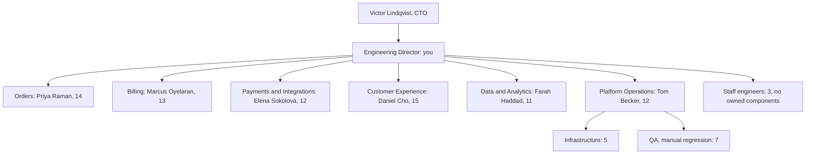

#### Executive and board context

The CTO chapters (Part XII) and the capstone use these facts. Victor Lindqvist is CTO throughout the
book, and nobody succeeds him. Where a chapter or the capstone (Chapter 60) puts you in the CTO's
role, you take Victor's seat in quarter 4, with the facts available then, and the quarter 4
decisions stay open.

| Fact | Value |
|---|---|
| Ownership | Privately held. Calder Ridge Partners, a growth-equity firm, has held a minority stake since the product's seventh year and has two board seats |
| Board | Six members: Anders Holm (co-founder, non-executive chair), Helena Marsh (CEO), Natalie Brooks and Samuel Osei (Calder Ridge Partners), Margaret Lin (independent, former CFO, chairs the audit committee), David Ferrante (independent, former technology executive at a payments company) |
| Board cadence | Quarterly. The quarter 4 meeting is in week 50 and is asked to approve the year-2 operating plan and budget envelope |
| What stays with management | Decisions inside that envelope: the year-2 organization, the quality continuation, the workforce plan |
| Board committees | The audit committee oversees risk, including technology and security risk; there is no technology committee |
| The CTO at the board | Victor Lindqvist attends for one agenda item a quarter; the CEO's monthly board pack carries the engineering figures |
| Victor Lindqvist's organization | One direct report, the Engineering Director (87 seats in all). Victor owns technical direction, the largest customers' technical relationships, and the board's technology questions |
| IT | Corporate IT and internal business systems, 14 people led by Marta Kowalczyk (Head of IT), reporting to Rajiv Menon (CFO). Joon Park's two-person security function is part of the 14. Northstar has no CISO |

### The system

- **Core**, a Java monolith of about 1.4 million lines with eight major modules. Five modules have
  a clear owning team. Three (customer, permissions, scheduler) are changed by four teams and
  owned by none.
- **Fourteen services** extracted over four years, and two frontends (web and mobile).
- **Four ways to build and deploy**: Jenkins for Core and four services, GitLab CI for six
  services, GitHub Actions for the frontends, and hand-maintained shell scripts on a build host
  for four services.
- Core ships on a **two-week release train**. Each train is preceded by a three-day manual
  regression pass of about 1,900 test cases, run by the seven QA engineers. Services deploy when
  their teams choose to.
- Eight of the 24 components have disputed, shared, or orphaned ownership, and eight have nobody
  on call. Three services (auth, webhooks, document store) are deployed by scripts that one
  person understands.

The component inventory is in
`data/components.csv`.

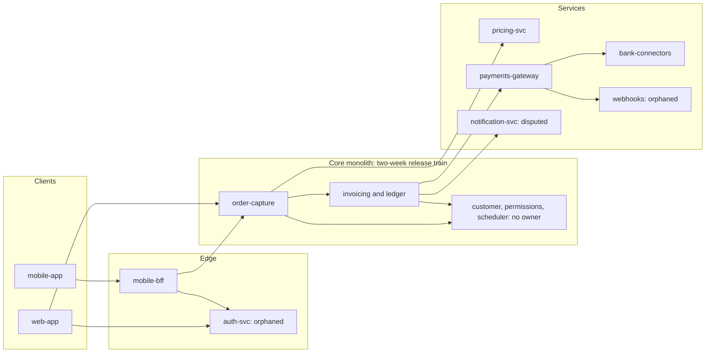

### The situation when you arrive

You join as Engineering Director at the start of a quarter. In your first week the CTO gives you
the mandate in one sentence: halve the number of Sev1 and Sev2 incidents and meet the 99.9 percent
commitment within twelve months, with no net growth in headcount, and without dropping the two
customer commitments that the renewals depend on.

What you find, in summary (the numbers are on the [baseline data](#page-case-studies-northstar-baseline-data) page; what
happens next is on [the director's first year](#page-case-studies-northstar-first-quarter) page):

- 30 Sev1 and Sev2 incidents last quarter, almost two thirds of them caused by Northstar's own
  changes, and almost half of them reported by a customer before any alert fired.
- Availability of 99.62 percent on the contractual paths, and $410,000 in service credits.
- About a third of engineering capacity going to unplanned work.
- A roadmap on which 41 percent of committed items shipped in the quarter they were promised.
- Managers who describe quality as something the QA group and the release train are responsible for.
- Two renewals, together worth $9M in annual recurring revenue, in which reliability is the
  customer's stated concern.

### Constraints that hold throughout the book

1. Headcount is flat at 80 engineers. Backfills are allowed; net additions are not.
2. The two renewal commitments (a bulk-ordering feature and an accounting-system integration) keep
   their dates in the first two quarters.
3. No rewrite of Core will be funded.
4. The discretionary tooling budget is $250,000 for the year without a business case, and anything
   beyond that needs the CFO's approval.
5. The QA engineers are employees with years of product knowledge. Any plan that changes their
   work has to say what they do next.

<a id="page-case-studies-northstar-cast"></a>

## Cast

!!! warning "Fictional"
    Every person on this page is invented for the book. See the note on the
    [Northstar overview](#page-case-studies-northstar-index).

This page lists every named person in the two fictional companies, grouped by where they sit. The
chapters column gives the chapters where the person matters most. Many people appear in more
chapters than are listed. For what happened when, see the [timeline](#page-case-studies-northstar-timeline).

You, the reader, are Northstar's Engineering Director. You report to Victor Lindqvist (CTO). Weeks
are counted from your first day.

### Northstar Technologies

All executives, the director, the six engineering managers, and the three staff engineers work at
headquarters in Minneapolis. Engineers work in Minneapolis, in Bogotá, or remotely in the US (see
[locations](#locations-and-working-arrangements)).

#### Executives

| Name | Role | What they want, and what they do in the story | Chapters |
|---|---|---|---|
| Helena Marsh | Chief Executive Officer (CEO); board member | Renewals from the two largest customers; an end to outage calls. Presents the year-2 operating plan to the board in week 50 | 18, 46, 49, 51, 55 |
| Victor Lindqvist | Chief Technology Officer (CTO); the director's manager | A reliable platform without asking the board for headcount. One direct report, the director. Decides the year-2 organization and the other quarter 4 questions | 39, 46, 47, 50–55, 60; appears throughout |
| Amara Okafor | Chief Product Officer (CPO) | The roadmap she committed to customers, on the dates she gave. Leads three product managers | 15, 17, 38, 42, 44, 46, 49 |
| Rajiv Menon | Chief Financial Officer (CFO) | Flat operating expense; service credits to stop. Corporate IT reports to him | 18, 45, 48, 49, 52, 53 |
| Sofia Alvarez | VP Customer Success | Fewer escalations; honest status during incidents. Helped write the severity definitions | 25, 42, 44, 49, 54 |
| Greg Tanaka | VP Sales | Two features promised in open deals; later a third deal feature | 15, 17, 42, 44, 48, 49, 51 |

#### Product management

| Name | Role | Team | Chapters |
|---|---|---|---|
| Keiko Ashworth | Product manager for the ordering area (Orders and Customer Experience's ordering screens); Minneapolis | Amara Okafor's group | 44 |

Amara Okafor's other two product managers, who cover billing and payments and data and customer
reporting, are not named.

#### Engineering managers

Each reports to the director.

| Name | Team | Notes | Chapters |
|---|---|---|---|
| Priya Raman | Orders (14 engineers; 16 reports from week 10) | Seven years at Northstar; promoted from inside Orders eight months before the director arrived; still writes code | 2, 11, 13, 21, 33, 41 |
| Marcus Oyelaran | Billing (13 engineers) | Highest incident count; three people carry most on-call pages | 3, 6, 10, 25, 41 |
| Elena Sokolova | Payments and Integrations (12 engineers) | Best operational discipline in the organization; the team holds a weekly operations review | 11, 14, 16, 41 |
| Daniel Cho | Customer Experience (15 engineers; 17 reports from week 10) | Nine web and six mobile engineers under one manager. Leads the proposed Web team in the year-2 proposal | 5, 14, 35, 36, 41 |
| Farah Haddad | Data and Analytics (11 engineers) | Acts as the team's data architect; runs the warehouse inventory in week 41 | 8, 12, 41, 54 |
| Tom Becker | Platform Operations (12: five infrastructure and seven QA engineers) | Leads the proposed Developer Platform in the year-2 proposal | 9, 32, 41 |

#### Staff engineers

Each reports to the director. None owned a component at baseline.

| Name | Area | Notes | Chapters |
|---|---|---|---|
| Ines Carvalho | Core domain | Eleven years at Northstar. Owns the Core code standard; leads the permissions extraction | 3, 10, 21, 29, 31 |
| Kwame Mensah | Infrastructure and reliability | Owns the operational minimums and pipelines standards; leads the release working group | 20, 23, 24, 25, 32 |
| Li Na Zhou | Data and integration | Owns the data, migration, and configuration standards; opened ADR-0001 in week 14 | 16, 20, 25, 28, 29 |

#### Engineers

| Name | Role | Team, location | Notes | Chapters |
|---|---|---|---|---|
| Aisha Bello | Senior Engineer | Orders | Leads bulk-ordering implementation from week 2 | 2, 11, 41 |
| Rafael Duarte | Senior Engineer | Orders | Applied for the Orders manager role and lost to Priya Raman; asks about management or the staff track | 2, 4, 31 |
| Hannah Lindgren | Informal web lead (no title) | Customer Experience, Minneapolis | | 5, 14, 36 |
| Mateo Arango Ríos | Informal mobile lead (no title) | Customer Experience, Bogotá | Lead work for over a year without recognition; proposed manager of Mobile in the year-2 proposal | 5, 14, 35, 36, 40 |
| Teodora Vasquez-Lund | Senior Engineer, ledger expert | Billing | | 6, 36, 41 |
| Tomasz Wierzbicki | Engineer, ledger expert | Billing | Reports an outside offer 20 percent above base in week 20 | 10, 48 |
| Tamsin Achterberg | The ledger backfill | Billing | Joined about 24 weeks before the director; can respond alone only on credit notes | 7, 48 |
| Sunil Varghese | Senior Engineer | Data and Analytics, US | Designed the warehouse pipelines | 8, 36 |
| Yusuf Demir | Engineer | Data and Analytics, Minneapolis | | 8, 48 |
| Bram Verhoeven | Senior infrastructure engineer | Platform Operations | Six years at Northstar; built Core's Jenkins pipeline | 9, 32 |

People who matter but are not named:

- the third Billing ledger engineer (Engineer level);
- the ledger engineer who left before the director arrived;
- Payments and Integrations' informal tech lead;
- a senior data engineer hired from outside five months before arrival;
- the Platform Operations infrastructure engineer who understands the shell-script deploys;
- the seven QA engineers, who become quality engineers in product teams from week 10.

#### Corporate IT and security

| Name | Role | Chapters |
|---|---|---|
| Marta Kowalczyk | Head of IT: corporate IT and internal business systems, 14 people; reports to Rajiv Menon (CFO) | 50, 53 |
| Joon Park | IT security lead; his two-person security function sits inside IT, outside engineering. Northstar has no CISO | 26, 50, 53, 54 |

#### Board of directors

| Name | Seat | Chapters |
|---|---|---|
| Anders Holm | Co-founder, non-executive chair | 55, 60 |
| Helena Marsh | CEO | 55 |
| Natalie Brooks | Calder Ridge Partners (growth-equity minority investor) | 55, 60 |
| Samuel Osei | Calder Ridge Partners | 55, 60 |
| Margaret Lin | Independent; former CFO; chairs the audit committee | 53, 55, 60 |
| David Ferrante | Independent; former technology executive at a payments company | 55, 60 |

### Halvard Systems

Halvard's CTO is not named. See [Halvard Systems](#page-case-studies-northstar-halvard) for the company.

!!! note "Similar names"
    Two names echo Northstar's: Owen Achterberg (Halvard) is not Tamsin Achterberg (Northstar), and
    Mateo Rinaldi (Halvard) is not Mateo Arango Ríos (Northstar).

#### Commerce

| Name | Role | Chapters |
|---|---|---|
| Nadia Brennan | VP, Commerce (130 engineers) | 47, 57 |
| Owen Achterberg | Director, Checkout | 47 |
| Selin Kaya | Director, Catalog and Search | 47 |
| Joaquín Ferreyra | Director, Merchant Tools | 47 |
| Ingrid Solberg | Staff engineer in Checkout; incident commander during the outage | 57 |

#### Payroll

| Name | Role | Chapters |
|---|---|---|
| Ngozi Adeyemi | VP, Payroll; hired from outside | 56 |
| Hiroshi Takeda | Principal engineer, Payroll | 56 |
| Rhys Gallagher | Director, Pay Calculation | 56 |
| Beatriz Quintero | Director, Time and Attendance | 56 |

#### Field Operations

| Name | Role | Chapters |
|---|---|---|
| Imani Okonkwo | VP, Field Operations | 58 |
| Leah Marchetti | HR business partner, Field Operations | 58 |
| Mateo Rinaldi | Director, Dispatch | 58 |
| Ruth Halloran | Director, Mobile Workforce | 58 |
| Tobias Engel | Director, Classic Scheduler | 58 |

#### Insights

| Name | Role | Chapters |
|---|---|---|
| Henrik Sørlie | VP, Insights | 58 |
| Esther Castellanos | Director, Reporting | 58 |
| Kenji Iwasaki | Director, Forecasting | 58 |
| Dalia Ferraz | Founder and CTO of Corvane (acquired); then director of Streaming, Insights' third unit | 58 |

#### Platform organization

| Name | Role | Chapters |
|---|---|---|
| Gwen Abernathy | VP of Platform | 59 |
| Arjun Mehta | Principal engineer; owns the tier 1 minimums and auditable pipeline policies | 59 |

#### Company-wide

| Name | Role | Chapters |
|---|---|---|
| Mireille Dubois | Head of communications | 57 |

<a id="page-case-studies-northstar-timeline"></a>

## Timeline

!!! warning "Fictional"
    Everything on this page is invented for the book. See the note on the
    [Northstar overview](#page-case-studies-northstar-index).

This page shows the Engineering Director's first year at Northstar on one page: what happened in
each week, where the full record is, and which chapter tells it. The second table gives the headline
results quarter by quarter. Weeks are counted from the director's first day. Each quarter is 13 weeks:
quarter 1 is weeks 1–13, quarter 2 weeks 14–26, quarter 3 weeks 27–39, and quarter 4 weeks 40–52.
People are listed on the [cast](#page-case-studies-northstar-cast) page.

### Week by week

The "Record" column links to the section of [the director's first year](#page-case-studies-northstar-first-quarter) or
another page that holds the details.

#### Quarter 1: ownership, severity, and the release train

| Week | Event | Record | Chapter |
|---|---|---|---|
| Before week 1 | The baseline quarter: 30 Sev1 and Sev2 incidents, 99.62 percent availability, $410,000 in service credits, 34 percent unplanned work | [baseline](#page-case-studies-northstar-baseline-data) | [19](#page-parts-05-engineering-quality-19-defining-measuring-and-owning-quality), [27](#page-parts-05-engineering-quality-27-quality-transformation-at-enterprise-scale) |
| 1 | You join as Engineering Director. The CTO's mandate: halve Sev1 and Sev2 incidents and meet 99.9 percent within twelve months, with flat headcount and both renewal commitments kept | [overview](#the-situation-when-you-arrive) | [27](#page-parts-05-engineering-quality-27-quality-transformation-at-enterprise-scale) |
| 2 | Incident classification with Kwame Mensah; one-off security scan of all 24 components; Priya Raman caps her hands-on work at 8 hours a week and delegates | [quarter 1](#timeline-of-quarter-1) | [27](#page-parts-05-engineering-quality-27-quality-transformation-at-enterprise-scale), [26](#page-parts-05-engineering-quality-26-security-and-software-supply-chain-quality), [2](#page-parts-01-foundations-02-from-individual-contributor-to-leader) |
| 3 | Severity definitions published; standards page reviewed (39 of 52 rules unobservable); a renewal customer's security questionnaire arrives | [quarter 1](#timeline-of-quarter-1) | [25](#page-parts-05-engineering-quality-25-incidents-postmortems-and-change-failure-analysis), [20](#page-parts-05-engineering-quality-20-engineering-standards-and-their-governance), [26](#page-parts-05-engineering-quality-26-security-and-software-supply-chain-quality) |
| 4 | Capacity model agreed with Victor Lindqvist and Amara Okafor; first 40 flaky tests quarantined; core/customer and core/scheduler get owners | [quarter 1](#timeline-of-quarter-1), [decisions](#decisions-that-hold-for-the-rest-of-the-book) | [27](#page-parts-05-engineering-quality-27-quality-transformation-at-enterprise-scale), [23](#page-parts-05-engineering-quality-23-code-review-ci-cd-and-release-engineering), [21](#page-parts-05-engineering-quality-21-technical-debt) |
| 4–5 | 12 incident commanders trained | [decisions](#decisions-that-hold-for-the-rest-of-the-book) | [25](#page-parts-05-engineering-quality-25-incidents-postmortems-and-change-failure-analysis) |
| 5 | First weekly Core release | [quarter 1](#timeline-of-quarter-1) | [23](#page-parts-05-engineering-quality-23-code-review-ci-cd-and-release-engineering) |
| 6 | payments-gateway flag changes move to reviewed, validated merge requests | [quarter 1](#timeline-of-quarter-1) | [23](#page-parts-05-engineering-quality-23-code-review-ci-cd-and-release-engineering) |
| 7 | A two-hour payment delay rated Sev3 is re-rated; severity audit joins the weekly review. The promised migration check falls due and slips | [quarter 1](#timeline-of-quarter-1), [decisions](#decisions-that-hold-for-the-rest-of-the-book) | [27](#page-parts-05-engineering-quality-27-quality-transformation-at-enterprise-scale), [25](#page-parts-05-engineering-quality-25-incidents-postmortems-and-change-failure-analysis) |
| 8 | A contract test catches a payments-gateway rounding change; 2 of 7 "not affected" security closures found unanalysed | [quarter 1](#timeline-of-quarter-1) | [22](#page-parts-05-engineering-quality-22-testing-strategy-and-test-architecture), [26](#page-parts-05-engineering-quality-26-security-and-software-supply-chain-quality) |
| 9 | Sev1 in Billing: credit notes applied twice, rollback fails; interim rule on ledger migrations | [quarter 1](#timeline-of-quarter-1) | [27](#page-parts-05-engineering-quality-27-quality-transformation-at-enterprise-scale), [23](#page-parts-05-engineering-quality-23-code-review-ci-cd-and-release-engineering), [25](#page-parts-05-engineering-quality-25-incidents-postmortems-and-change-failure-analysis) |
| 10 | QA transition announced: the seven QA engineers join product teams as quality engineers; migration rehearsal mandatory for tier 1 data | [quarter 1](#timeline-of-quarter-1), [decisions](#decisions-that-hold-for-the-rest-of-the-book) | [19](#page-parts-05-engineering-quality-19-defining-measuring-and-owning-quality), [27](#page-parts-05-engineering-quality-27-quality-transformation-at-enterprise-scale), [22](#page-parts-05-engineering-quality-22-testing-strategy-and-test-architecture) |
| 11 | Pipeline check for unfinished migrations lands | [quarter 1](#timeline-of-quarter-1) | [25](#page-parts-05-engineering-quality-25-incidents-postmortems-and-change-failure-analysis) |
| 13 | Day 90: Sev1 and Sev2 from 30 to 21; both renewal commitments on track | [day 90](#day-90) | [27](#page-parts-05-engineering-quality-27-quality-transformation-at-enterprise-scale) |

#### Quarter 2: the renewals and the operating system

| Week | Event | Record | Chapter |
|---|---|---|---|
| 14 | Li Na Zhou opens ADR-0001 (how integrations read ledger data); organization decision log opened; Ines Carvalho's stay interview; weekly Billing and Orders sync starts | [starting points](#starting-points-for-quarter-2), [quarter 2](#the-renewals-and-the-operating-system-in-quarter-2) | [28](#page-parts-06-technical-leadership-28-architecture-decision-making-and-governance), [39](#page-parts-08-management-operating-system-39-reviews-decision-logs-escalation-and-executive-reporting), [10](#page-parts-02-people-management-10-motivation-retention-and-senior-engineers), [37](#page-parts-08-management-operating-system-37-cadences-and-leadership-meetings) |
| 14–15 | Stay interviews with the three ledger engineers; the director's firsthand time measured at 4.7 percent | [starting points](#starting-points-for-quarter-2), [quarter 2](#the-renewals-and-the-operating-system-in-quarter-2) | [10](#page-parts-02-people-management-10-motivation-retention-and-senior-engineers), [40](#page-parts-09-engineering-directorship-40-the-directors-job) |
| 14–19 | Daniel Cho's one-on-ones reviewed (84 of 90 held, 55 mainly status) | [starting points](#starting-points-for-quarter-2) | [5](#page-parts-02-people-management-05-one-on-ones-coaching-and-mentorship) |
| 15 | Escalation path published | [quarter 2](#the-renewals-and-the-operating-system-in-quarter-2) | [39](#page-parts-08-management-operating-system-39-reviews-decision-logs-escalation-and-executive-reporting) |
| 16 | First individual skip-levels; Customer Experience team health check; Priya Raman's hands-on time at 8 hours | [quarter 2](#the-renewals-and-the-operating-system-in-quarter-2), [starting points](#starting-points-for-quarter-2) | [37](#page-parts-08-management-operating-system-37-cadences-and-leadership-meetings), [14](#page-parts-03-high-performing-teams-14-distributed-teams-team-health-and-dysfunction), [41](#page-parts-09-engineering-directorship-41-managing-and-developing-engineering-managers) |
| 17 | Mateo Arango Ríos tells the director he has done a lead's job for over a year | [starting points](#starting-points-for-quarter-2) | [5](#page-parts-02-people-management-05-one-on-ones-coaching-and-mentorship), [14](#page-parts-03-high-performing-teams-14-distributed-teams-team-health-and-dysfunction) |
| 18 | Flow re-sample: environment waits fall from about 6 days to 2 | [starting points](#starting-points-for-quarter-2) | [16](#page-parts-04-execution-16-flow-lead-time-dependencies-and-unplanned-work) |
| 19 | Accounting integration live for the renewal customer | [quarter 2](#the-renewals-and-the-operating-system-in-quarter-2) | [39](#page-parts-08-management-operating-system-39-reviews-decision-logs-escalation-and-executive-reporting) |
| 20 | Tomasz Wierzbicki reports an outside offer 20 percent above base; first checkpoint of Ines Carvalho's coaching plan; Priya at 10 hours | [starting points](#starting-points-for-quarter-2), [quarter 2](#the-renewals-and-the-operating-system-in-quarter-2) | [10](#page-parts-02-people-management-10-motivation-retention-and-senior-engineers), [29](#page-parts-06-technical-leadership-29-staff-and-principal-engineers), [41](#page-parts-09-engineering-directorship-41-managing-and-developing-engineering-managers) |
| 22 | One-page written expectations for the managers; meeting calendar redesign drafted | [quarter 2](#the-renewals-and-the-operating-system-in-quarter-2), [rules inventory](#rules-and-processes-inventory) | [41](#page-parts-09-engineering-directorship-41-managing-and-developing-engineering-managers), [37](#page-parts-08-management-operating-system-37-cadences-and-leadership-meetings) |
| 24 | Draft ratings of the six managers; calendar redesign reviewed; Priya at 12 hours | [quarter 2](#the-renewals-and-the-operating-system-in-quarter-2), [rules inventory](#rules-and-processes-inventory) | [41](#page-parts-09-engineering-directorship-41-managing-and-developing-engineering-managers), [37](#page-parts-08-management-operating-system-37-cadences-and-leadership-meetings) |
| 26 | Bulk ordering complete and forecast to ship by the end of the week; first written report to Victor since day 90; second coaching checkpoint for Ines | [quarter 2](#the-renewals-and-the-operating-system-in-quarter-2), [starting points](#starting-points-for-quarter-2) | [39](#page-parts-08-management-operating-system-39-reviews-decision-logs-escalation-and-executive-reporting), [29](#page-parts-06-technical-leadership-29-staff-and-principal-engineers) |

#### Quarter 3: capacity, portfolio, and the first quarter at target

| Week | Event | Record | Chapter |
|---|---|---|---|
| 27 (start of quarter 3) | First calibrated promotion cycle (9 nominated, 5 promoted); operating system redesign proposed; Engineering Excellence Day launched; bulk-ordering support reserve for weeks 27–30 | [starting points](#starting-points-for-quarter-2), [quarter 3 plan](#the-quarter-3-plan) | [8](#page-parts-02-people-management-08-career-development-promotion-and-compensation), [37](#page-parts-08-management-operating-system-37-cadences-and-leadership-meetings), [43](#page-parts-09-engineering-directorship-43-leading-change-and-director-failure-patterns), [38](#page-parts-08-management-operating-system-38-scorecards-quarterly-planning-and-capacity-allocation) |
| 28, 32, 36 | Engineering Excellence Days, with 64, 41, and 23 engineers taking part | [quarter 3 plan](#the-quarter-3-plan) | [43](#page-parts-09-engineering-directorship-43-leading-change-and-director-failure-patterns) |
| 31 | Greg Tanaka asks for a third deal feature, purchase approval rules | [quarter 3 plan](#the-quarter-3-plan) | [42](#page-parts-09-engineering-directorship-42-cross-functional-dependencies-portfolio-and-influence) |
| About 33 | Automated service-credit statements due to start | [quarter 3 plan](#the-quarter-3-plan) | [42](#page-parts-09-engineering-directorship-42-cross-functional-dependencies-portfolio-and-influence) |
| 34 | Portfolio forum on the third deal feature (outcome not recorded) | [quarter 3 plan](#the-quarter-3-plan) | [42](#page-parts-09-engineering-directorship-42-cross-functional-dependencies-portfolio-and-influence) |
| 37 | Engineering Excellence Day stopped | [quarter 3 plan](#the-quarter-3-plan) | [43](#page-parts-09-engineering-directorship-43-leading-change-and-director-failure-patterns) |
| 39 | The core/permissions exemption lapses; Orders sizes price-list effective dates at 14 engineer-weeks, and Greg Tanaka then gives a customer week 46 | [quarter 3 results](#quarter-3-results), [quarter 4](#calendar-of-quarter-4) | [13](#page-parts-03-high-performing-teams-13-decision-making-in-teams), [44](#page-parts-10-business-leadership-44-working-with-product) |

#### Quarter 4: drafts, positions, and open decisions

Nothing in quarter 4 has a recorded outcome. See the [quarter 4 briefing](#page-case-studies-northstar-quarter-4-briefing).

| Week | Event | Record | Chapter |
|---|---|---|---|
| 40 | Level mix 39 Engineers, 38 Seniors, 3 Staff; a top-40 distributor complains about correcting orders | [quarter 3 results](#quarter-3-results), [quarter 4](#calendar-of-quarter-4) | [48](#page-parts-11-vp-engineering-48-capacity-strategy-workforce-planning-and-governance), [44](#page-parts-10-business-leadership-44-working-with-product) |
| 40–41 | A sample of 400 corrected orders finds 340 errors | [quarter 4](#calendar-of-quarter-4) | [44](#page-parts-10-business-leadership-44-working-with-product) |
| 41 | Victor asks for the board plan's engineering page; Rajiv Menon asks for a workforce plan; working contract sent to Amara; Farah Haddad's warehouse inventory; a customer asks about AI | [quarter 4](#calendar-of-quarter-4), [data and AI](#data-and-ai-chapter-54) | [46](#page-parts-10-business-leadership-46-stakeholder-management-and-negotiation), [48](#page-parts-11-vp-engineering-48-capacity-strategy-workforce-planning-and-governance), [44](#page-parts-10-business-leadership-44-working-with-product), [54](#page-parts-12-cto-leadership-54-data-and-ai-strategy) |
| 42 | Amara's three conditions; the director's counter for the board page; AI-use survey; a prospect requires SOC 2 | [quarter 4](#calendar-of-quarter-4), [data and AI](#data-and-ai-chapter-54), [risk](#risk-security-and-compliance-chapter-53) | [44](#page-parts-10-business-leadership-44-working-with-product), [46](#page-parts-10-business-leadership-46-stakeholder-management-and-negotiation), [54](#page-parts-12-cto-leadership-54-data-and-ai-strategy), [53](#page-parts-12-cto-leadership-53-risk-governance-regulation-and-security-strategy) |
| 43 | Margaret Lin asks for a technology risk session; Victor asks for an enterprise technology risk register | [risk](#risk-security-and-compliance-chapter-53) | [53](#page-parts-12-cto-leadership-53-risk-governance-regulation-and-security-strategy) |
| 43–45 | Four executives ask for AI features or answers | [data and AI](#data-and-ai-chapter-54) | [54](#page-parts-12-cto-leadership-54-data-and-ai-strategy) |
| 44 | Year-2 organization proposal; security snapshot; 34 security questionnaires tallied | [year-2 proposal](#the-year-2-organization-proposal-week-44), [risk](#risk-security-and-compliance-chapter-53) | [35](#page-parts-07-organization-design-35-designing-organizations-at-four-scales), [36](#page-parts-07-organization-design-36-reorganizations-evolution-and-succession), [53](#page-parts-12-cto-leadership-53-risk-governance-regulation-and-security-strategy) |
| 44–46 | Victor's week measured (48 hours, 2 of strategy); 11 informal technical requests | [CTO's job](#the-ctos-job-chapter-50) | [50](#page-parts-12-cto-leadership-50-what-a-cto-actually-does) |
| 45 | VP of Engineering question raised; quality continuation drafted; engineering board page due | [quarter 4](#calendar-of-quarter-4) | [47](#page-parts-11-vp-engineering-47-the-vp-of-engineering), [49](#page-parts-11-vp-engineering-49-multi-year-transformation-communication-and-politics), [46](#page-parts-10-business-leadership-46-stakeholder-management-and-negotiation) |
| 46 | Year-2 organization decision due; Victor's business choices to Helena Marsh; Finance's FY1 estimate | [year-2 proposal](#the-year-2-organization-proposal-week-44), [strategy](#three-year-technology-strategy-chapter-51), [finances](#finances-chapter-52) | [35](#page-parts-07-organization-design-35-designing-organizations-at-four-scales), [51](#page-parts-12-cto-leadership-51-enterprise-technology-strategy), [52](#page-parts-12-cto-leadership-52-technology-investment-budgeting-and-financial-literacy) |
| 46–47 | Executive one-on-ones and positions on the continuation | [quarter 4](#calendar-of-quarter-4) | [49](#page-parts-11-vp-engineering-49-multi-year-transformation-communication-and-politics) |
| 46–48 | FY2 engineering budget draft; Victor gathers board directors' concerns | [finances](#finances-chapter-52), [board](#board-preparation-chapter-55) | [52](#page-parts-12-cto-leadership-52-technology-investment-budgeting-and-financial-literacy), [55](#page-parts-12-cto-leadership-55-boards-due-diligence-and-executive-decision-making) |
| 47 | Victor's strategy draft and his keep, give, stop draft; the director's risk register, SOC 2 options, and AI position; Greg Tanaka's private offer, declined | [strategy](#three-year-technology-strategy-chapter-51), [CTO's job](#the-ctos-job-chapter-50), [risk](#risk-security-and-compliance-chapter-53), [data and AI](#data-and-ai-chapter-54), [quarter 4](#calendar-of-quarter-4) | [51](#page-parts-12-cto-leadership-51-enterprise-technology-strategy), [50](#page-parts-12-cto-leadership-50-what-a-cto-actually-does), [53](#page-parts-12-cto-leadership-53-risk-governance-regulation-and-security-strategy), [54](#page-parts-12-cto-leadership-54-data-and-ai-strategy), [49](#page-parts-11-vp-engineering-49-multi-year-transformation-communication-and-politics) |
| 48 | VP recommendation due; strategy premortem; Victor reviews the risk register; draft board page carries two headlines | [quarter 4](#calendar-of-quarter-4), [strategy](#three-year-technology-strategy-chapter-51), [risk](#risk-security-and-compliance-chapter-53), [board](#board-preparation-chapter-55) | [47](#page-parts-11-vp-engineering-47-the-vp-of-engineering), [51](#page-parts-12-cto-leadership-51-enterprise-technology-strategy), [53](#page-parts-12-cto-leadership-53-risk-governance-regulation-and-security-strategy), [55](#page-parts-12-cto-leadership-55-boards-due-diligence-and-executive-decision-making) |
| 49 | Executive team meeting; workforce plan draft; board pack sent | [quarter 4](#calendar-of-quarter-4), [strategy](#three-year-technology-strategy-chapter-51), [board](#board-preparation-chapter-55) | [49](#page-parts-11-vp-engineering-49-multi-year-transformation-communication-and-politics), [48](#page-parts-11-vp-engineering-48-capacity-strategy-workforce-planning-and-governance), [51](#page-parts-12-cto-leadership-51-enterprise-technology-strategy), [55](#page-parts-12-cto-leadership-55-boards-due-diligence-and-executive-decision-making) |
| 50 | Board meeting and the audit committee's technology risk session (outcomes not recorded) | [quarter 4](#calendar-of-quarter-4), [board](#board-preparation-chapter-55) | [55](#page-parts-12-cto-leadership-55-boards-due-diligence-and-executive-decision-making), [53](#page-parts-12-cto-leadership-53-risk-governance-regulation-and-security-strategy) |
| 50–51 | Rules and processes inventory drafted | [rules inventory](#rules-and-processes-inventory) | [59](#page-parts-13-advanced-problems-59-transformation-under-constraint-and-scaling-without-bureaucracy) |
| 51 | Decisions requested on the continuation; planned announcement of the year-2 organization | [quarter 4](#calendar-of-quarter-4), [year-2 proposal](#the-year-2-organization-proposal-week-44) | [49](#page-parts-11-vp-engineering-49-multi-year-transformation-communication-and-politics), [36](#page-parts-07-organization-design-36-reorganizations-evolution-and-succession) |
| 52 | Date on the auth-svc security exception | [risk](#risk-security-and-compliance-chapter-53) | [53](#page-parts-12-cto-leadership-53-risk-governance-regulation-and-security-strategy) |

### Results by quarter

The baseline quarter is the 90-day quarter before the director arrived; the director's quarters are
13 weeks. Quarter 3 is the latest measured quarter: quarter 4 results are not recorded, so chapters
set in weeks 40–52 use quarter 3 figures. "n.r." means not recorded.

| Measure | Baseline | Quarter 1 | Quarter 2 | Quarter 3 |
|---|---|---|---|---|
| Sev1 and Sev2 incidents (mandate: 15 or fewer) | 30 | 21 | 17 | 14 |
| of which Sev1 | 7 (9 under the week 3 definitions) | n.r. | 3 | 2 |
| of which via Core releases | 9 | 4 | 2 | n.r. |
| Recurrences | 11 of 30 | 5 of 21 | 3 of 17 | n.r. |
| Customer-detected share | 47% | 29% | 29% | n.r. |
| Availability, contractual paths (commitment 99.9%) | 99.62% | n.r. | 99.86% | 99.89% |
| Service credits | $410,000 | n.r. | $95,000 | $60,000 |
| Unplanned work | 34% | 31% | 28% | 25% |
| Tier 1 meeting the four operational minimums | 3 of 15 | 8 of 15 | 11 of 15 | 13 of 15 |
| Core releases | 2 per month | 11 | 13 | n.r. |
| Core change failure rate | 31% | 22% | 23% | n.r. |
| Corrective-action closure | 32% | 70% | 78% | n.r. |

Sources: [day 90](#day-90), [quarter 2 results](#quarter-2-results), [quarter 3 results](#quarter-3-results), and the
[baseline data](#page-case-studies-northstar-baseline-data).

### Year 2 and later

- Year 1 is weeks 1–52. In Finance's terms it is fiscal year 1 (FY1); FY0 is the year before the
  director arrived.
- Year 2 is weeks 53–104 (quarters 5–8, FY2), year 3 weeks 105–156, and year 4 weeks 157–208.
- The year-2 organization proposal takes effect at the start of quarter 5 (week 53), with all
  handoffs by week 57 and a review in week 64.
- The quality continuation has gates in weeks 56, 78, and 104.

<a id="page-case-studies-northstar-baseline-data"></a>

## Northstar baseline data

!!! warning "Fictional"
    Every number here was invented for this book. See the note on the
    [Northstar overview](#page-case-studies-northstar-index).

This page is the measured state of Northstar's engineering organization in the quarter before you
arrive. Chapters, exercises, projects, and the capstone all start from it. The raw files are small
enough to open in a spreadsheet:

- `data/teams.csv`: one row per team
- `data/components.csv`: 24 components with ownership, tier, and operational readiness
- `data/incidents-last-quarter.csv`: all 30 Sev1 and Sev2 incidents

### How the numbers were produced, and what is wrong with them

A baseline is only useful if you know how it was measured. Northstar's measurement is uneven, and
part of the diagnostic work is deciding which numbers to trust.

| Measure | Source | Known weakness |
|---|---|---|
| Deployments, lead time | Pipeline logs from four CI systems, joined by hand | The four shell-script services log nothing; their numbers are estimates from chat history |
| Change failure rate | Releases followed within 72 hours by a hotfix, rollback, or incident linked to the release | Linking is manual; unlinked failures are missed, so the true rate is higher |
| Incidents | Incident tracker | Severity is assigned by the on-call engineer with no written definition before this quarter |
| Escaped defects | Customer-reported bug tickets confirmed as defects | Depends on support triage; duplicates were removed by hand |
| Unplanned work | Two-week sample of ticket types per team, checked with each manager | A sample, not a census; teams classify differently |
| Availability | Synthetic checks on the order and payment paths | Checks run from one region and do not cover the mobile path |

### Delivery and stability

| Measure | Core monolith | Services and frontends |
|---|---|---|
| Deployment frequency | 2 releases per month | median 3 deployments per week per service |
| Lead time for changes, commit to production (median) | 19 days | 3 days |
| Change failure rate | 31 percent of releases (4 of the last 13, over 26 weeks) | 18 percent of deployments |

| Measure, whole organization | Value |
|---|---|
| Sev1 incidents last quarter | 7 |
| Sev2 incidents last quarter | 23 |
| Time to restore service, median | 3 hours 10 minutes |
| Time to restore service, 90th percentile | 14 hours |
| Availability, contractual paths | 99.62 percent (commitment: 99.9 percent) |
| Service credits paid | $410,000 |
| Committed roadmap items delivered in quarter | 7 of 17 (41 percent) |
| Unplanned work, share of engineering capacity | 34 percent |

At 99.62 percent, the contractual paths were unavailable for about 8.2 hours of a 90-day quarter.
A 99.9 percent commitment allows about 2.2 hours.

### By team

| Team | Engineers | Deployments per month | Median lead time (days) | Change failure rate | Sev1 and Sev2 | Escaped defects | Unplanned work |
|---|---|---|---|---|---|---|---|
| Orders | 14 | 11 | 18 | 29% | 7 | 51 | 36% |
| Billing | 13 | 8 | 21 | 34% | 8 | 58 | 41% |
| Payments and Integrations | 12 | 22 | 4 | 21% | 6 | 31 | 33% |
| Customer Experience | 15 | 26 | 6 | 17% | 4 | 44 | 28% |
| Data and Analytics | 11 | 11 | 5 | 12% | 2 | 19 | 24% |
| Platform Operations | 12 | 14 | 3 | 15% | 3 | 9 | 46% |
| Staff engineers | 3 | | | | | | 20% |
| **Total** | **80** | | | | **30** | **212** | **34%** |

Read this table with care. Orders and Billing ship most of their changes through the Core release
train, so their lead time and failure rate describe the train more than they describe the teams.
Platform Operations has the highest unplanned share because other teams' failures arrive there as
interrupts.

### Incidents

Thirty Sev1 and Sev2 incidents, classified by what triggered them:

| Trigger | Count | Share |
|---|---|---|
| Core release train | 9 | 30% |
| Configuration change | 5 | 17% |
| Database migration | 3 | 10% |
| Service deployment | 2 | 7% |
| **Change-induced, subtotal** | **19** | **63%** |
| Third-party dependency or capacity | 6 | 20% |
| Latent defect exposed by data or load | 4 | 13% |
| Not determined | 1 | 3% |

| Other facts about the same 30 incidents | Value |
|---|---|
| First detected by a customer | 14 (47 percent) |
| First detected by monitoring | 11 |
| First detected by an engineer who happened to notice | 5 |
| Median time to detect when a customer reported it | 108 minutes |
| Median time to detect when monitoring caught it | 6 minutes |
| Recurrences of a failure mode seen before | 11 (37 percent) |
| Median time to restore, incidents triggered by the release train | 4 hours 50 minutes |

Post-incident follow-up over the last two quarters: 96 corrective actions were recorded and 31
were closed (32 percent). No action has an owner above the level of the engineer who wrote it.

### Escaped defects

212 customer-reported defects were confirmed last quarter. 81 of them (38 percent) were
regressions: behavior that had worked in an earlier release.

Each defect was classified by the earliest point at which a reasonable check would have caught it:

| Earliest practical point of detection | Count | Share |
|---|---|---|
| Unit-level logic | 57 | 27% |
| Integration or contract between components | 49 | 23% |
| End-to-end or user-interface flow | 41 | 19% |
| Data migration or configuration | 38 | 18% |
| Requirement misunderstood; built as specified | 27 | 13% |

### Build and test

| Measure | Value |
|---|---|
| Core main-branch pipeline duration | 74 minutes |
| Core pipeline runs that fail for reasons unrelated to the change (flaky tests, infrastructure) | 9 percent |
| Share of working hours in which the Core main branch is red | 22 percent |
| Automated tests in Core | about 11,400; line coverage 41 percent |
| Manual regression suite | about 1,900 cases; 3 days per release; 7 QA engineers |
| Components with a written runbook | 7 of 24 |
| Components with complete alerting | 3 of 24 |
| Components with no on-call rotation | 8 of 24 |
| Components proposed as tier 1 (order or payment path) | 15 of 24 |

Line coverage is recorded because Northstar's managers quote it. It says how much code the tests
execute. It does not say whether the tests would fail if the code were wrong.

### Money

Used in the economic models in this book. All figures are annual unless stated.

| Item | Value | Derivation |
|---|---|---|
| Cost of one engineer-year | $185,000 | given |
| Engineering capacity spent on unplanned work | 27.2 engineer-years, about $5.0M | 80 × 34% × $185,000 |
| Service credits at last quarter's rate | $1.64M | $410,000 × 4 |
| Revenue in renewals where reliability is the stated concern | $9M | two customers |
| QA time spent on the manual regression pass | about 2.4 engineer-years, about $440,000 | 7 people × 3 days × 26 trains = 546 person-days ÷ 230 working days; excludes developer time spent fixing what the pass finds |

### Extended baseline by topic

The tables below give more detail on the same baseline quarter, grouped by topic. Each was checked
against the data files and the figures above. A few rows describe a later week, and they say so.
Each topic names the chapters that use it.

Where to find a fact:

- [People and management](#people-and-management): managers, staff engineers, informal leads,
  named engineers
- [Billing on-call and ledger knowledge](#billing-on-call-and-ledger-knowledge)
- [Levels, reviews, promotions, pay, and attrition](#levels-reviews-promotions-pay-and-attrition)
- [Hiring](#hiring)
- [Locations and working arrangements](#locations-and-working-arrangements)
- [Planning and delivery](#planning-and-delivery): delivery methods, the roadmap, unplanned work
- [Cross-team dependencies](#cross-team-dependencies)
- [Engineering standards](#engineering-standards)
- [Technical debt, tests, and the pipeline](#technical-debt-tests-and-the-pipeline)
- [Reliability and incidents](#reliability-and-incidents)
- [Security](#security)
- [Architecture and the technology estate](#architecture-and-the-technology-estate)
- [Management system before the director](#management-system-before-the-director)

#### People and management

Used in Chapters 1–5, 9, 11, 12, and 29.

Managers' time, reconstructed by each manager from two weeks of calendar and chat history:

| Team | Manager | People | Delivery | Technical | Other | Technical direction lives with |
|---|---|---|---|---|---|---|
| Orders | Priya Raman | 15% | 35% | 45% | 5% | Priya, who still writes code |
| Billing | Marcus Oyelaran | 15% | 55% | 15% | 15% | Nobody; decided during incidents |
| Payments and Integrations | Elena Sokolova | 35% | 35% | 15% | 15% | A senior engineer acting as informal tech lead (no one at Northstar holds the title) |
| Customer Experience | Daniel Cho | 45% | 35% | 5% | 15% | Two informal leads, web and mobile |
| Data and Analytics | Farah Haddad | 25% | 20% | 45% | 10% | Farah, as the team's data architect |
| Platform Operations | Tom Becker | 25% | 50% | 10% | 15% | Tom and the release process |

| Fact | Value |
|---|---|
| Manager job description | One shared line written years earlier: "lead a team of engineers to deliver high-quality software"; no manager-specific review criteria |
| Manager reviews | Once a year, on their teams' roadmap delivery only |
| Staff engineers at baseline | Default problem-solvers: Ines Carvalho consulted on most Core changes without owning decisions (about 8 hours a week of unscheduled questions); Kwame Mensah pulled into the largest incidents; Li Na Zhou answering integration questions for whoever asks first |
| Staff engineers' time, weeks 12–13 | Unscheduled questions and incident pulls: Ines Carvalho 8, Kwame Mensah 7, Li Na Zhou 9 hours a week (24 of 120, 20 percent) |
| Ines Carvalho's reviews | Review comments often rejected designs without explanation; two Orders engineers had stopped proposing designs. In weeks 7–12 she rejected 8 of 14 Core design proposals, 5 of them without a reason |
| Priya Raman: background | Seven years at Northstar; promoted from inside Orders eight months before the director arrived, with no management training, after the previous manager left. Wrote much of the bulk upload path |
| Priya Raman: the bulk-upload failure | In her first month as manager a bulk-upload failure occurred; she fixed it herself over a weekend and took the follow-up test as her own action, which was never done (the failure mode recurred as INC-421) |
| Priya Raman: her week before arrival | Two weeks before the director arrived her 40-hour week held 18 hours of coding and review, and she reviewed about 15 of Orders' roughly 25 weekly Core merge requests. Her one-on-ones were nominally weekly and mostly cancelled |
| Orders senior engineers | Rafael Duarte (applied for the Orders manager role and lost to Priya) and Aisha Bello |
| Customer Experience informal leads | Hannah Lindgren (web, Minneapolis) and Mateo Arango Ríos (mobile, Bogotá); neither holds a title. Mateo had done lead work for over a year without recognition |
| Daniel Cho's one-on-ones | Weekly, 30 minutes, all 15 engineers, rarely cancelled; video meetings with Bogotá often rescheduled but held; mostly status |
| Customer Experience signals | One board and one sprint for web and mobile; retrospectives held jointly over video with Minneapolis in one room; 6 of the last 8 retrospective actions were about web; two of the team's four Sev2 incidents at the mobile-bff and mobile boundary |
| Payments and Integrations: operations review | A weekly 30-minute operations review for about two years: rotating facilitator; the engineer coming off on-call presents pages, near misses, and one surprise; Elena speaks last |
| Payments and Integrations: near-miss log | 17 entries in the baseline quarter, none about the payments-gateway configuration file. Orders had no near-miss log |
| Billing–Orders friction | After INC-417 a two-day release-channel thread ("Orders' changes keep breaking the ledger" against "Billing should test its own code") with no manager response; the INC-427 review opened with blame of an Orders change |
| Billing–Orders friction, continued | Reviews did not record which team's change triggered a Core release incident; Victor Lindqvist's handover notes describe the friction and say he had "let the two of them sort it out" |
| Bram Verhoeven | Senior infrastructure engineer in Platform Operations, six years at Northstar, built Core's Jenkins pipeline and remains its de facto first responder. Proposed consolidating the four build systems 18 months before arrival (shelved 12 months before) |
| Bram Verhoeven in the baseline quarter | Tom Becker quietly reassigned 31 of his 74 tickets; his last review said "meets expectations"; 45 percent of his time went to Jenkins interrupts |
| The shell-script deploy expert | Another, unnamed Platform Operations infrastructure engineer (not Bram Verhoeven) |
| Data and Analytics people | Sunil Varghese (Senior, US; designed the warehouse pipelines; base $138,000); Yusuf Demir (Engineer, Minneapolis); an unnamed senior data engineer hired from outside five months before arrival at $162,000 |
| Data and Analytics request load | Requests from other teams take 12 points of its capacity; the month-end reporting path was built by one data engineer who has since moved to warehouse pipelines |

#### Billing on-call and ledger knowledge

Used in Chapters 1–4, 6, 10, and 12.

| Fact | Value |
|---|---|
| Billing on-call load (reconstructed afterwards from the paging tool) | 180 pages in the quarter; 126 handled first by the three ledger engineers; 64 after hours, 54 of those by the same three; 61 needed no action |
| Earlier responses to Billing on-call load | A higher on-call stipend, an alert added after each serious incident, and a request to "document as you go" with no time allocated |
| Billing ledger expertise | Four ledger-experienced responders a year before arrival; one resigned about nine months before; the backfill started 15 weeks later and was not yet on the rotation |
| Billing ledger engineers | Three experts: Teodora Vasquez-Lund (Senior Engineer), Tomasz Wierzbicki (Engineer level, pay not reviewed in two years), and one other (Engineer level). Two of them are promoted to Senior in the first calibrated cycle at the start of quarter 3 (Chapter 8) |
| The ledger backfill | Tamsin Achterberg, who joined about 24 weeks before the director arrived and can respond alone only on credit notes |
| The ledger engineer who left | Outside offer 18 percent above salary; paged three consecutive weekends before resigning; had asked six months earlier to come off the ledger escalation path; declined a 10 percent counter-offer made after resigning |

| Billing ledger area | Engineers who can respond alone | Engineers who can change it safely |
|---|---|---|
| Posting and journal rules | 3 | 3 |
| Credit notes and adjustments | 4 | 2 |
| Period close | 2 | 1 |
| Schema migrations | 2 | 2 |
| Currency and rounding | 1 | 1 |

#### Levels, reviews, promotions, pay, and attrition

Used in Chapters 1–4, 8, and 10.

| Fact | Value |
|---|---|
| Written levels | One wiki page with three individual-contributor levels (Engineer, Senior Engineer, Staff Engineer); the Staff Engineer paragraph states no scope, mandate, or expected output. No formal tech lead role |
| Engineer reviews | Annual written reviews; no calibration of ratings or promotions at baseline |
| Promotions: how decided | Decided by each manager, approved by Victor Lindqvist case by case, no calibration or written evidence. Raise at promotion capped at 8 percent; annual raises about 3 percent |
| Promotions in the two years before arrival | 15 to Senior (Orders 3, Billing 1, Payments 2, Customer Experience 6, Data 1, Platform 2), none to Staff |
| Level mix at arrival (Engineer/Senior) | Orders 7/7, Billing 7/6, Payments 6/6, Customer Experience 8/7, Data 6/5, Platform Operations 10/2; total 44/33, plus 3 Staff |
| Pay bands, base salary, US (fictional) | Engineer $100,000–$140,000 (midpoint $120,000); Senior $130,000–$175,000 ($152,500); Staff $170,000–$220,000 ($195,000). Bogotá has separate bands on the Colombian market |
| Attrition | 8 engineers left in the 12 months before arrival (10 percent), all backfilled; median 15 weeks from resignation to the replacement's first day |
| Departures in the 12 months before arrival, by team | Billing 2, Orders 2, Data and Analytics 2, Customer Experience 1, Payments and Integrations 1, Platform Operations 0 |

Why people left. HR recorded one dropdown reason per leaver (compensation 4, career growth 2,
personal 1, not recorded 1) and concluded attrition was a pay problem; there were exit interviews
with 6 of 8. The director recoded the departures early in quarter 2, allowing several factors per
person:

- outside offer in hand: 5;
- no career conversation in the previous six months: 5;
- after-hours on-call or incident load: 4 (including both Billing leavers);
- a triggering event in the six weeks before resigning: 4;
- decisions waiting on or overruled by others: 3;
- pay below peers in the same role: 2 (both among the four recorded as compensation).

One Data and Analytics leaver cited a senior title offered elsewhere.

#### Hiring

Used in Chapter 7.

| Fact | Value |
|---|---|
| Hiring process | No common process: recruiter call, a 60-minute live algorithm exercise from a shared puzzle bank, an unstructured "team chat", a hiring manager conversation; a generic "Senior Software Engineer" posting; debriefs where the hiring manager spoke first; no tracking of how hires turned out |
| Tamsin Achterberg's hire | 15 weeks from resignation to first day (3 waiting for approval, 6 sourcing and screening, 1 offer, 5 notice); about 40 applicants, 9 recruiter calls, 4 loops, 1 offer; strongest on the algorithm exercise, never changed a schema on a live system; unanimous 25-minute debrief |

#### Locations and working arrangements

Used in Chapter 14.

| Fact | Value |
|---|---|
| Headquarters | Minneapolis, Minnesota (US Central Time). All executives, the director, the six engineering managers, and the three staff engineers work there |
| Working policy | Hybrid since two years before the director arrived: office anchor days Tuesday to Thursday; Monday and Friday at home by default |
| Second engineering site | Bogotá, Colombia (UTC−5, zero or one hour from Minneapolis); Northstar's own office, opened about four years before the director arrived to hire mobile and integration engineers; same anchor days; no site manager, every Bogotá engineer reports to a Minneapolis-based manager |
| Fully remote engineers | 12, all in the United States (zero to two hours from Minneapolis) |
| Engineers by location | Minneapolis 52, Bogotá 16, remote US 12 |
| Travel | Ad hoc, no budget line; Bogotá engineers had visited Minneapolis at most once |

| Team | Where its engineers work |
|---|---|
| Orders | Minneapolis 12, remote 2 |
| Billing | Minneapolis 10, remote 3 |
| Payments and Integrations | Minneapolis 6, Bogotá 5, remote 1 |
| Customer Experience | Web: Minneapolis 7 and remote 2. All 6 mobile engineers in Bogotá |
| Data and Analytics | Minneapolis 4, Bogotá 5, remote 2 |
| Platform Operations | Minneapolis 10 (the 7 QA engineers and 3 infrastructure engineers), remote 2 (infrastructure) |

#### Planning and delivery

Used in Chapters 15–18.

| Team | Delivery method at baseline |
|---|---|
| Orders | Two-week Scrum aligned to the release train; Sprint Goal met in 2 of the last 6 sprints |
| Billing | Two-week Scrum aligned to the release train; Sprint Goal met in 1 of the last 6; scope changed mid-sprint in all 6 |
| Payments and Integrations | Kanban with WIP limits per stage; weekly replenishment with the product manager |
| Customer Experience | Two-week sprints; one board for web and mobile |
| Data and Analytics | No named method; quarterly project list and a request queue triaged twice a week |
| Platform Operations | Interrupt-driven ticket queue; QA schedule set by the release train |

| Fact | Value |
|---|---|
| How the 17 committed items were chosen | 31 candidates collected by product managers; in a two-hour meeting four executives (Amara Okafor, Greg Tanaka, Sofia Alvarez, Victor Lindqvist) each distributed 100 points; no value estimates on any item |
| Renewal commitments | Agreed late in the baseline quarter as renewal conditions; dates and staffing in [the director's first year](#page-case-studies-northstar-first-quarter) |
| Sizing against capacity | About 560 engineer-weeks committed against an assumed 780 (1,040 less a 25 percent allowance); actual unplanned work left about 686 |
| Dates given to customers before sizing | 5 of 17, including Greg Tanaka's two deal features |
| Cross-team items | 9 of 17. Of the 7 delivered, 6 were single-team; of the 10 missed, 8 were cross-team |
| Committed and delivered by team | Orders 4 and 1; Billing 3 and 0; Payments and Integrations 3 and 2; Customer Experience 4 and 2; Data and Analytics 2 and 2; Platform Operations 1 and 0 |
| Reasons for the 10 misses | 4 scope growth after start, 3 blocked on another team, 2 displaced by incidents, 1 deprioritized |
| Roadmap record, four quarters | 6 of 15, 8 of 18, 7 of 16, then 7 of 17: 28 of 66 (42 percent) |
| Orders weekly throughput, 26 weeks before arrival (planned items finished) | 6, 4, 7, 3, 5, 8, 2, 6, 5, 4, 7, 6, 0, 5, 9, 4, 6, 3, 5, 7, 4, 6, 2, 8, 5, 6 (total 133, mean 5.1); recent features grew 15 to 35 percent in item count between start and delivery |
| Standing orders feature (shipped in the baseline quarter) | 76 days from intake to release on its critical path: 53 waiting, 23 working |
| Delivery numbers at baseline | Assembled by one Platform Operations engineer, about two days a month, in a spreadsheet joining the four CI systems' logs |
| Engineering figures in the CEO's monthly board pack | Committed roadmap items delivered, and the Sev1 and Sev2 count |
| Developer surveys | None in the two years before arrival |

Unplanned work by category, as a share of all unplanned work: failure recovery 43 percent, requests
from other teams 29, toolchain and environments 15, expedited requests 12. By team, in points of
team capacity:

| Team | Failure recovery | Requests from other teams | Toolchain and environments | Expedited |
|---|---|---|---|---|
| Orders | 18 | 8 | 6 | 4 |
| Billing | 24 | 7 | 6 | 4 |
| Payments and Integrations | 15 | 9 | 3 | 6 |
| Customer Experience | 12 | 6 | 4 | 6 |
| Data and Analytics | 6 | 12 | 3 | 3 |
| Platform Operations | 14 | 20 | 10 | 2 |
| Staff engineers | 8 | 10 | 2 | 0 |

The totals match the team table. The organization total computes to 27.3 FTE, against 27.2 from the
rounded overall 34 percent.

#### Cross-team dependencies

Used in Chapters 16 and 34.

| Fact | Value |
|---|---|
| Cross-team dependencies | 164 work items of a week or more; 61 needed another team; 86 dependency links. Platform Operations received 29, Billing 19, Orders 18, Payments and Integrations 10, Customer Experience 6, Data and Analytics 4 |
| Lead time by dependencies (median) | None 11 days (103 items); one 24 days (42); two or more 41 days (19) |

Dependency links by pair, from the requesting team (rows) to the providing team (columns). A dash
means no link is listed.

| Requesting team | Orders | Billing | Payments | Customer Experience | Data | Platform |
|---|---|---|---|---|---|---|
| Orders | — | 9 | 2 | 3 | 1 | 8 |
| Billing | 6 | — | 5 | 1 | 2 | 7 |
| Payments and Integrations | 1 | 4 | — | 1 | — | 5 |
| Customer Experience | 8 | 3 | 2 | — | 1 | 6 |
| Data and Analytics | 2 | 2 | 1 | — | — | 3 |
| Platform Operations | 1 | 1 | — | 1 | — | — |

The heaviest links by cause, classified by the managers at the start of quarter 2 (counts are the
pair counts above):

| Link | Count | Cause |
|---|---|---|
| Orders → Billing | 9 | 6 order-to-invoice mapping changes in core/invoicing; 3 tax-svc |
| Billing → Orders | 6 | 4 order data or status events from order-capture; 2 pricing-rules |
| Customer Experience → Orders | 8 | 6 order API changes for order-entry screens (4 web, 2 mobile); 2 search-svc or pricing-svc |
| Orders → Platform Operations | 8 | 5 test environments; 3 release train or pipeline changes |
| Billing → Platform Operations | 7 | 4 test environments with ledger data; 3 migration or pipeline changes |

Also in the baseline quarter: 4 Orders work items of a week or more touched both order capture and
pricing, catalog, or search; Billing changed the order-to-invoice mapping twice for its own reasons.

#### Engineering standards

Used in Chapter 20.

| Fact | Value |
|---|---|
| Written standards | One wiki page, "Engineering Standards", written in 2019 by a principal architect who left in 2021; 52 rules (24 code style and naming, 10 testing, 8 API and data, 6 operations, 4 security), all worded "must", none with intent, scope, owner, exemption path, or review date |
| Coverage rule | "Every module must have at least 70 percent line coverage"; never met (Core is at 41 percent) |
| Rules checked by a tool anywhere | 13 of 52; none checked identically in all four build systems |
| Standing warnings in the Core Jenkins build | about 2,300 (style checker in warning-only mode, 2019 configuration) |
| Engineering Practices Guild | Voluntary, monthly, no decision rights; average attendance 5 at the last six meetings |
| Pull request checklist | 10 items; in a sample of 40 merged pull requests, 38 had every box ticked, and 11 of those 38 changed production code with no test change while "tests added or updated" was ticked |
| Exemptions | No process; none ever recorded |
| Tier 1 operational minimums (owner, runbook, complete alerts, on-call) | 3 of 15 meet all four. Clear owner 11 of 15, runbook 6 of 15, complete alerts 3 of 15, on-call 12 of 15 |

#### Technical debt, tests, and the pipeline

Used in Chapters 21–23 and 32.

| Fact | Value |
|---|---|
| Existing debt list | Wiki page of 143 items from a "tech debt week" eighteen months earlier; 9 closed; none with owner or cost |
| Effort to run four CI systems | about 1.5 FTE of Platform Operations infrastructure time per year |
| Running cost of one CI system | About 0.5 FTE a year (against about 1.5 FTE for the four) |
| Deployable units by build system | Jenkins 5 (Core counted once, pricing-svc, search-svc, tax-svc, invoice-render), GitLab CI 6, GitHub Actions 2, shell scripts 4; 17 in total |
| Core pipeline runs | about 1,000 a month, branches and main |
| Core automated tests by kind | about 9,800 in-process unit tests, 1,350 tests against one shared Core test database, 250 browser UI tests |
| Core pipeline stages (74 minutes) | build and package 6, unit tests 9, shared-database tests 38, UI tests 21 |
| Flaky tests | about 140 tests, almost all using the shared test database, cause most failures unrelated to the change |
| Contract tests between Core and services | none |
| Migration and configuration checks before release | none; migrations are tested against an empty schema only |
| Merges into Core main | about 85 a week; the full pipeline runs on every merge |
| Core review rule | one approval from any engineer; no owner-based assignment |
| Median wait for first review on a Core merge request | 21 working hours |
| Core feature branches older than 30 days | 11; Core has no runtime feature flags |
| payments-gateway flags and settings | 64 entries in one configuration file edited directly on the configuration server without review; 23 older than a year |
| Shell-script deploys | one script shared by webhooks, auth-svc, document-store, and export-svc (the script broken in INC-416) |
| Platform Operations demand | About 25 test-environment requests a month at baseline |

#### Reliability and incidents

Used in Chapters 24 and 25. The incident facts are derived from the incident file.

| Fact | Value |
|---|---|
| Traffic | about 600,000 order submissions and 240,000 payment attempts per 28 days |
| Invoice and ledger reconciliation | no automated reconciliation exists |
| Correctness failures among customer-detected incidents | 8 of the 14 (wrong amounts or data, which an availability measure would not see) |
| Total restoration minutes | 9,558; the 11 recurrences account for 4,920 (51 percent) |
| Median restoration, recurrences versus first occurrences | 290 versus 160 minutes |
| Recurrences first detected by customers | 8 of 11 |
| Recurrences by team | Billing 6, Orders 3, Customer Experience 1, Payments and Integrations 1 |
| Open corrective actions | 65 (96 recorded, 31 closed) |

#### Security

Used in Chapter 26.

| Fact | Value |
|---|---|
| Security function | Two people in IT, outside engineering, led by Joon Park (IT security lead); annual external penetration test; no application security role |
| Dependency scanning in the pipeline | 8 of 24 components (the six GitLab CI services, non-blocking; the two frontends, untriaged); 6 of 15 tier 1 components |
| Open critical vulnerabilities in dependencies | 11 (Core 5, auth-svc 2, document-store 1, webhooks 1, frontends 1, GitLab CI services 1); 3 of them on CISA's Known Exploited Vulnerabilities catalog |
| Other open vulnerabilities | 58 open highs; oldest critical disclosed 19 months earlier |
| Credentials in git history | 26 credential-like strings in 7 repositories; 9 confirmed live, 3 of them production |
| Secrets for the four shell-script services | in a plain file on the shared build host |
| TLS certificates | 34; 7 with no known owner; 5 expiring within 90 days; none with expiry alerting |
| Webhook signing keys | never rotated |
| SBOMs and threat modeling | none |

#### Architecture and the technology estate

Used in Chapters 13 and 28–33.

| Fact | Value |
|---|---|
| Architecture decisions before arrival | No decision records or design documents in any repository. Decisions were made by whichever team built first, in chat threads, during incidents, or by Victor Lindqvist in unrecorded conversations |
| Architecture review | The principal architect who wrote the 2019 standards page chaired a monthly architecture review that stopped when they left in 2021; nothing replaced it |
| Direct ledger reads | The older erp-sync connectors and the warehouse pipelines read 12 core/ledger tables directly through database read replicas |
| Core schema | All eight Core modules share one production database schema; no module owns its tables by rule |
| Core change history, baseline quarter | About 1,100 merge requests (14 mass changes excluded); by module in the table after this one |
| core/permissions changes in the baseline quarter | 38 merge requests: Orders 17, Customer Experience 9, Billing 8, Payments and Integrations 4, Platform Operations 0. No Platform Operations infrastructure engineer has changed Core code |
| Strongest co-change pairs | customer–permissions 67 percent of the smaller module's requests; scheduler–invoicing 60; order-capture–pricing-rules 53; invoicing–ledger 41 |
| Proposed core/customer redesign | Ines Carvalho, about three engineer-years (not funded; see constraint 3 on the [overview](#page-case-studies-northstar-index)) |
| document-store callers | invoice-render (Billing) and core/order-capture (Orders) |
| Core framework | A major version whose free community support has ended; no extended support purchased; migration estimated at 120 to 180 engineer-days. Versions are deliberately not named in this book |
| Other estate risks | The XML library behind the oldest open critical is unmaintained upstream; one Jenkins controller with about 60 plugins and no standby; the configuration server is a single instance two major versions behind; nobody owned runtime and framework versions |
| tax-svc | Calculates sales tax; about 2,300 rate-table rows updated monthly by hand by one Billing engineer; about 0.6 FTE a year of upkeep |
| Orders knowledge, week 14 (engineers who can change it safely, of 14) | order-capture 9, pricing-rules 4, pricing-svc 5, core/customer 2, catalog 3, search-svc 0, notification-svc 0 operated (3 have committed to it) |

Core merge requests by module in the baseline quarter, and how many came from teams other than the
module's owner from week 4:

| Module | Merge requests | From teams other than the owner |
|---|---|---|
| order-capture | 250 | 52 |
| invoicing | 230 | 38 |
| ledger | 170 | 12 |
| pricing-rules | 110 | 7 |
| catalog | 80 | 5 |
| scheduler | 45 | 19 |
| permissions | 38 | split by team in the core/permissions row above |
| customer | 33 | 18 |

#### Management system before the director

Used in Chapters 37–39.

| Fact | Value |
|---|---|
| Recurring forums at arrival | A weekly 60-minute managers' meeting inherited from before the director, about 42 of its 60 minutes spent on a status round |
| Escalation | No written path; disputes reached Victor Lindqvist in conversation (his handover notes) |
| Decision records | None at organization level (and no architecture decision records) |

<a id="page-case-studies-northstar-first-quarter"></a>

## Northstar: the director's first year

!!! warning "Fictional"
    Everything on this page is invented for the book. See the note on the
    [Northstar overview](#page-case-studies-northstar-index).

This page is the record of the Engineering Director's first year at Northstar, in time order: the
decisions that hold for the rest of the book, quarter 1 week by week, the day-90 results, and then
quarters 2, 3, and 4. Each row names the chapter that tells that part of the story, so that the
chapters agree with each other.

Weeks are counted from the director's first day. Each of the director's quarters is 13 weeks:
quarter 1 is weeks 1–13, quarter 2 weeks 14–26, quarter 3 weeks 27–39, and quarter 4 weeks 40–52.
The starting state is on the [baseline data](#page-case-studies-northstar-baseline-data) page and the people are on the
[cast](#page-case-studies-northstar-cast) page. For a one-page view, see the [timeline](#page-case-studies-northstar-timeline); readers starting in
Parts X–XIII can begin with the [quarter 4 briefing](#page-case-studies-northstar-quarter-4-briefing).

### Decisions that hold for the rest of the book

| Decision | Detail | Chapter |
|---|---|---|
| Constraint | The Core release train | 27 |
| Renewal commitment: bulk ordering | Orders; asynchronous order files up to 20,000 lines across delivery sites; 5 Orders and 2 Customer Experience web engineers. Due at the end of quarter 2 (week 26 from the director's first day) | 15, 17 |
| Renewal commitment: accounting-system integration | Payments and Integrations; new erp-sync connector with daily reconciliation of posted invoices; 4 engineers. Due at the end of week 6 of quarter 2 (week 19) | 15, 17 |
| Renewal commitments at day 90 | Both are on track at day 90, and neither is due in quarter 1 | 15, 17 |
| Director's role definition | Five parts, listed under this table | 1 |
| Prevention allocation, quarter 1 | 12 FTE in total: Billing 25 percent, Orders and Payments and Integrations 10 percent (renewal commitments), other teams 15 percent, computed on baseline team sizes (11.55 FTE), plus 15 percent of the three staff engineers (0.45 FTE); 2 FTE of it earmarked for security work | 27, 26 |
| Severity definitions | Published week 3, written by the director with Kwame Mensah and Sofia Alvarez. Sev1: the order or payment path unavailable for any customer, or any wrong financial record visible to customers | 25 |
| Baseline re-rating under the new definitions | INC-401 and INC-427 would be Sev1, making the baseline 9 Sev1 and 21 Sev2. The baseline page keeps the original ratings; the total of 30 is unchanged | 25 |
| Tier 1 list | The 15 proposed tier 1 components are used for all counts in quarter 1. notification-svc moves to tier 2 and to Orders from quarter 2 | 24 |
| Tier 1 reporting rule | Year 1 readiness counts (quarters 1 to 4) keep the original list of 15 so that quarters compare; year 2 reports use the current list of 14 | 24 |
| Tier 1 minimums | Four operational minimums are measured: owning team, complete user-facing alerts, runbook, on-call rotation. The fifth enterprise minimum, deployment through an auditable pipeline with automated rollback, is a standard tracked separately (Chapter 20) | 20, 24, 27 |
| Standards | 52 rules triaged: 14 kept as mandatory (9 tool-checked, 5 by review), 17 turned into guidance, 21 retired; plus 5 tier 1 minimums (owner, user-facing alerts, runbook, on-call, auditable pipeline with automated rollback) | 20 |
| Standard owners | Kwame Mensah: operational minimums and pipelines. Ines Carvalho: Core code. Li Na Zhou: data, migration, and configuration. Decisions within 10 working days; exemptions recorded with expiry of at most two quarters | 20 |
| Remediation service levels for vulnerabilities | Known-exploited or critical on internet-facing tier 1: 7 days. Other critical: 30 days. High: 90 days | 26 |
| Proposed SLOs (28-day window) | Order submission 99.9 percent; order latency 99 percent within 2 seconds; payment reaching a final state within 60 seconds 99.9 percent; invoice correctness 99.99 percent once reconciliation exists | 24 |
| Error budget policy | Reporting mode for the quarter: budgets published weekly, any incident consuming more than a fifth of a journey's budget gets a tracked review; Victor Lindqvist arbitrates | 24 |
| Ownership, week 4 | core/customer to Orders, core/scheduler to Billing. auth-svc to Platform Operations; webhooks to Payments and Integrations | 21, 26, 20 |
| Ownership of core/permissions | Stays tier 1, but its owner (Orders or Platform Operations) is still undecided at day 90, covered by a recorded exemption | 21, 26, 20 |
| QA engineers: new roles | Move into product teams as quality engineers: 2 Orders, 2 Billing, 2 Customer Experience, 1 Payments and Integrations, each reporting to the team's manager (so Priya Raman has 16 reports from week 10, Daniel Cho 17). Announced week 10 | 19, 27, 22, 23 |
| QA engineers: transition work | Two chose the 600-case weekly regression subset; all seven triaged the manual suite with the teams, and five also automated cases | 19, 27, 22, 23 |
| Flaky tests | Release working group led by Kwame Mensah, with owners from the teams: the 40 worst quarantined in week 4, 140 by day 90, each with an owner and a fix-or-delete deadline | 21, 22, 23 |
| Migration check | Promised after INC-427 (Li Na Zhou, due week 7); slipped; after the week 9 Sev1 an interim rule applied; landed week 11 | 25, 21, 23 |
| Incident commanders | 12 trained in weeks 4 and 5: the six managers, three staff engineers, three senior engineers | 25 |
| Corrective actions | 65 open actions triaged: 14 kept (with 9 duplicates merged into them), 42 dropped with a reason; every kept action has a manager owner | 25 |

The director's role definition (Chapter 1):

- **Purpose:** reliability and delivery of the whole organization.
- **People:** develop the six managers; give the staff engineers mandates.
- **Delivery:** own cross-team commitments and the capacity model.
- **Technical:** ensure cross-team decisions have an owner.
- **Not doing:** running a team's planning, responding to incidents, writing production code.

The flat-headcount constraint counts the whole engineering organization (87 people). Promoting an
engineer into a new manager role is allowed only if that engineer's seat is not backfilled.

### Timeline of quarter 1

Weeks 1–13.

| Week | Event | Chapter |
|---|---|---|
| 2 | Incident classification with Kwame Mensah; one-off security scan of all 24 components | 27, 26 |
| 2 | Priya Raman agrees a time budget (hands-on work capped at 8 hours a week) and delegates: Aisha Bello leads bulk-ordering implementation, Rafael Duarte and Aisha Bello own core/order-capture reviews, Rafael Duarte takes the open bulk-upload test action | 2 |
| 3 | Severity definitions published; standards page reviewed (39 of 52 rules unobservable); a renewal customer sends a security questionnaire asking for an SBOM and SSDF evidence | 25, 20, 26 |
| 4 | Capacity model agreed with Victor Lindqvist and Amara Okafor; Core main below 10 percent red time; first 40 flaky tests quarantined; core/customer and core/scheduler get owners | 27, 23, 21 |
| 5 | First weekly Core release | 23 |
| 6 | payments-gateway flag changes move to reviewed, validated merge requests | 23 |
| 7 | Four consecutive incidents rated Sev3, one of them a two-hour payment delay for nine customers; the director re-rates it and adds severity audit to the weekly review | 27 |
| 8 | A contract test catches a payments-gateway rounding change; security audit finds 2 of 7 "not affected" closures unanalysed | 22, 26 |
| 9 | Sev1 in Billing: credit notes applied twice. Rollback fails because a migration had already changed the schema; restored by a forward fix | 27, 23, 25 |
| 9 | The pipeline check promised after INC-427 had slipped. Interim rule: no release may contain a ledger migration and code that depends on it | 27, 23, 25 |
| 10 | QA transition announced; migration rehearsal mandatory for tier 1 data | 27, 22 |
| 11 | Pipeline check for unfinished migrations lands | 25 |

### Day 90

| Measure | Baseline quarter | Transformation quarter | Chapter |
|---|---|---|---|
| Sev1 and Sev2 incidents | 30 | 21 | 27 |
| of which via Core releases | 9 | 4 | 27 |
| Recurrences | 11 of 30 | 5 of 21 | 25 |
| Customer-detected share | 47% | 29% | 27 |
| Core releases | 2 per month | 11 in the quarter (weekly from week 5) | 27, 23 |
| Core change failure rate | 31% (4 of the 13 releases in the 26 weeks before the director arrived) | 22% (2 of the 9 weekly releases from week 5; the two fortnightly releases of weeks 1–4 are not counted, because the measure was redefined with the weekly cadence) | 27 |
| Core main branch red | 22% of working hours | 9% over the last four weeks | 23 |
| Pipeline failures unrelated to the change | 9% | 4% | 22 |
| Flaky tests quarantined | — | 140 | 22, 23 |
| Manual regression before a release | 1,900 cases over 3 days | about 600 cases in 1 day; 1,100 of 1,900 cases triaged (400 automate, 450 delete, 250 exploratory charters) | 23, 22 |
| Contract-tested tier 1 boundaries | 0 | 4 | 22 |
| Corrective action closure | 32% | 70% (26 of 37) | 25 |
| Tier 1 components meeting the four operational minimums (owner, complete alerts, runbook, on-call) | 3 of 15 | 8 of 15 (runbooks 11 of 15) | 20 |
| Unplanned work | 34% | 31% | 27 |
| Components with dependency scanning | 8 of 24 | 20 of 24 in the pipeline; the 4 script services by weekly scheduled scan | 26 |
| Open critical vulnerabilities | 11 (3 known-exploited) | 3, all under recorded exceptions (1 known-exploited, mitigated) | 26 |
| Live credentials in git history | 9 | 0 | 26 |
| Certificates with owner and expiry alerting | 0 of 34 alerted | 34 of 34 | 26 |
| Renewal commitments | — | both on track | 27 |

### Quarter 2

Weeks 14–26.

#### Starting points for quarter 2

These are situations at the start of quarter 2 that later chapters present as decisions for the
reader. Their outcomes are not recorded.

| Situation | Chapter |
|---|---|
| Rafael Duarte asks whether to pursue management again or the staff track; there is no open manager role | 4 |
| Flow changes for the accounting integration: Billing reserves weeks 1 to 3 for the ledger export; Li Na Zhou proposes a ledger-export contract | 16 |
| Further flow changes: Platform Operations runs a two-person interrupt rotation with a single intake and self-service test environments; Payments and Integrations lowers its WIP limits | 16 |
| A re-sample in week 5 of quarter 2 (week 18) shows environment waits falling from about 6 days to 2, and requests from other teams falling from 20 to 14 points of Platform Operations capacity | 16 |
| Forecast for bulk ordering: 44 backlog items at the director's arrival, historically growing 15 to 35 percent | 17 |
| Rajiv Menon asks for an output-per-engineer figure by team for next year's budget pack, with Helena Marsh's support | 18 |
| The director's proposed delivery measurement set and a shared deployment-event store (about six engineer-weeks from the prevention allocation) | 18 |
| Permissions extraction from core/customer, led by Ines Carvalho, funded for quarter 2; core/permissions still without an owner (Priya Raman would accept it after week 26; Tom Becker sees it next to auth-svc but cannot support Core Java) | 21, 13 |
| Stay interviews: Ines Carvalho (week 14; the permissions extraction she leads is funded, the rest of her redesign is not) and the three ledger engineers (weeks 14–15) | 10 |
| In week 20 Tomasz Wierzbicki reports an outside offer 20 percent above base | 10 |
| Daniel Cho's one-on-ones reviewed (weeks 14–19: 84 of 90 held, 55 mainly status, news in 11) | 5 |
| Team health check for Customer Experience in week 16, facilitated by Elena Sokolova (mobile 4 red of 10 indicators) | 5, 14 |
| In week 17 Mateo Arango Ríos tells the director he has done a lead's job for over a year | 5, 14 |
| Priya Raman asks whether Orders should adopt Payments and Integrations' operations review and near-miss log | 11 |
| Billing ledger knowledge map built; Data and Analytics drafts a team charter (search-svc ownership open) | 12 |
| Proposal to run the next two backfills as a structured hiring pilot (scorecard, work sample, facilitated debrief) | 7 |
| Tom Becker's draft expectations plan for Bram Verhoeven, drafted at the start of quarter 2 from a reconstruction of the baseline quarter | 9 |
| Ladder rewrite drafted (five dimensions, three levels); first calibrated promotion cycle at the start of quarter 3 (9 nominated, 5 promoted, 4 "not yet"); six underpaid US Senior Engineers identified | 8 |
| ADR-0001, Northstar's first decision record, opened by Li Na Zhou in week 14: how integrations read posted ledger data | 28 |
| ADR-0001 options: read the tables (ready by week 19), a versioned export contract (5 of Billing's 6 reserved engineer-weeks; ready by week 19), or ledger posting events (about week 24) | 28 |
| Li Na recommends the contract. Victor Lindqvist told Elena Sokolova in passing to "read the tables now and clean it up later". Nobody's decision rights are mapped | 28 |
| Standing scopes for the three staff engineers drafted; a coaching plan for Ines Carvalho with checkpoints in weeks 20 and 26 | 29 |
| A technical strategy draft (three policies: converge before adding; own order-to-cash logic, buy what changes for outside reasons; every tier 1 component on supported versions with two people who can change it) and a technology risk register TR-01 to TR-09 | 30 |
| The tax-svc build, buy, or hybrid decision (three-year costs $373,500, $597,250, $329,750) | 30 |
| Ines Carvalho's Core boundary proposal from co-change analysis: keep all eight modules in Core in quarter 2, carry out the permissions extraction inside Core, enforce module dependencies in the build | 31 |
| Rafael Duarte argues for extracting order-capture; Marcus Oyelaran wants no boundary work before week 19 | 31 |
| Platform roadmap drafted by Tom Becker and Kwame Mensah: about 29 engineer-weeks of planned capacity; self-service environments, the deployment-event store, and CI consolidation phase 1 (the four shell-script services) | 32 |
| GitLab CI proposed as the consolidation target; decision open | 32 |
| Orders' structure options (Orders carries seven components and bulk ordering; about 2.6 engineers of capacity left for everything else in quarter 2) | 33 |
| Span table and dependency analysis; the only boundary change made in quarter 2 is a Billing-owned order-to-invoice contract with contract tests on both sides (no people move); the analysis feeds the week 44 year-2 proposal | 34 |

#### Quarter 2 results

| Measure | Quarter 1 | Quarter 2 |
|---|---|---|
| Sev1 and Sev2 incidents | 21 | 17 (3 Sev1, 14 Sev2) |
| of which via Core releases | 4 | 2 |
| Recurrences | 5 of 21 | 3 of 17 |
| Customer-detected share | 29% | 29% (5 of 17) |
| Core releases | 11 | 13 (weekly) |
| Core change failure rate | 22% | 23% (3 of 13) |
| Unplanned work | 31% | 28% |
| Tier 1 meeting the four operational minimums | 8 of 15 | 11 of 15 |
| Corrective-action closure | 70% (26 of 37) | 78% (21 of 27) |
| Availability, contractual paths | not recorded | 99.86% |
| Service credits | not recorded | $95,000 |

#### The renewals and the operating system in quarter 2

| Fact | Detail | Chapter |
|---|---|---|
| Accounting integration at week 26 | Live for the renewal customer since week 19, with daily reconciliation of posted invoices (no ledger read path is named; ADR-0001 stays open) | 39 |
| Bulk ordering at week 26 | The 44 contractual items are complete and the release candidate is in final acceptance, forecast to ship by the end of week 26 | 39 |
| The director's quarter 2 calendar | Recurring meetings listed under this table: about 16.3 hours a week from week 16; about 25 hours of a 47-hour week in meetings | 37 |
| Skip-levels before week 16 | None in weeks 1–15 | 37, 40, 41 |
| Skip-levels from week 16 | Individual skip-level conversations, four a week, 30 minutes (44 by week 26); Mateo Arango Ríos's week-17 conversation was the director's first with a mobile engineer. No group skip-levels before quarter 3 | 37, 40, 41 |
| The director's firsthand time | Weeks 14–15 measured at 4.7 percent of the director's hours | 40 |
| Organization decision log | Opened week 14, backfilled from quarter 1 decisions (DL-01 to DL-10); ADR-0001, tax-svc, and the CI target are open | 39 |
| Escalation path | Published week 15: five working days for the parties, then a joint written case decided by the director within five working days and logged; to Victor Lindqvist only for customer commitments or the director's budget authority | 39 |
| Reports to Victor Lindqvist | The week 26 report is the first written report since the day-90 report; proposed monthly from quarter 3 | 39 |
| Manager expectations | A one-page written expectation on the rubric's six dimensions in week 22; draft ratings of the six managers in week 24 | 41 |
| Priya Raman's hands-on time | 8, 10, and 12 hours a week at the week 16, 20, and 24 checks (cap 8) | 41 |

The director's recurring meetings in quarter 2 (Chapter 37):

- weekly operational review (booked 30 minutes, averaging 75);
- weekly 60-minute managers' meeting;
- weekly renewal check-in and product and engineering sync;
- weekly Billing and Orders sync from week 14;
- the release working group;
- a fortnightly staff group;
- one-on-ones (managers 45 minutes, staff engineers and Victor Lindqvist 30);
- monthly quality reviews, delivery review, and all-hands;
- the quarterly reset.

### Quarter 3

Weeks 27–39.

#### The quarter 3 plan

| Fact | Detail | Chapter |
|---|---|---|
| Capacity plan | Planned and cautious cases, commitments, and reserve listed under this table | 38 |
| Cross-team portfolio | At most three cross-team initiatives in progress (a one-quarter trial), listed under this table | 42 |
| A fourth request | In week 31 Greg Tanaka asks for a third deal feature, purchase approval rules; the week 34 portfolio forum's outcome is open | 42 |
| Operating system redesign | Proposed for week 27: a hard 45-minute operational review, a weekly 75-minute leadership team meeting replacing the managers' meeting and product sync, a monthly business review, a quarterly talent review | 37 |
| Engineering Excellence Day | Launched by the director in week 27 without the managers or Amara Okafor; Fridays of weeks 28, 32, 36; participation 64, 41, 23 engineers | 43 |
| Engineering Excellence Day results | 71 items merged, none touching the priced debt register; one Sev3 from a core/scheduler change; stopped in week 37 after a one-page note to the managers | 43 |
| Skip-level rotation | Proposed: two groups of three a week plus one individual slot, covering all 77 team engineers in the quarter | 40 |

The quarter 3 capacity plan (Chapter 38):

- **Planned:** unplanned work 22% (17.6 FTE); prevention 8 FTE (Billing 2.5, Orders 2.0, Customer
  Experience 1.5, Payments and Integrations 1.0, Data and Analytics 1.0); platform 4.5; product 49.9.
- **Cautious:** unplanned 28% (22.4 FTE); product 45.1.
- **Commitments:** about 35.6 FTE-quarters of estimated effort (about 463 engineer-weeks)
  committed; targets 3.8; unfunded 22.6 of Amara Okafor's 62.
- **Reserve:** a bulk-ordering support reserve of 8 engineer-weeks in weeks 27–30.

The three cross-team initiatives (Chapter 42):

- multi-currency price lists and catalog export (Greg Tanaka's two deal features);
- customer incident status notifications (Sofia Alvarez);
- automated service-credit statements (Rajiv Menon, waiting until about week 33).

#### Quarter 3 results

| Measure | Quarter 2 | Quarter 3 | Chapter |
|---|---|---|---|
| Sev1 and Sev2 incidents | 17 (3 Sev1) | 14 (2 Sev1, 12 Sev2); the first quarter at or below the mandate's 15 | 49 |
| Availability, contractual paths | 99.86% | 99.89% (about 144 of 131,040 minutes unavailable; 99.9% allows about 131) | 49 |
| Service credits | $95,000 | $60,000 | 49 |
| Unplanned work | 28% | 25% (20 FTE of 80), between the planned 22% and the cautious 28% | 49 |
| Tier 1 meeting the four operational minimums | 11 of 15 | 13 of 15 | 49 |
| Level mix, week 40 | 44 Engineers, 33 Seniors, 3 Staff (on arrival) | 39 Engineers, 38 Seniors, 3 Staff after five promotions to Senior in the quarter 3 cycle | 48 |

Quarter length: the baseline quarter is the 90-day calendar quarter before the director arrived; the
director's quarters are 13 weeks (91 days, 131,040 minutes), so availability allowances from quarter 1
on use 91 days (99.9 percent allows about 131 minutes). These are the latest measured figures
available to anyone in quarter 4. Quarter 4 results are not recorded; any chapter set in weeks 40–52
uses quarter 3 as the latest quarter.

The core/permissions exemption recorded in quarter 1 reached the two-quarter maximum at the end of
quarter 3 (week 39) with the ownership decision still open. It lapsed without renewal, which is the
decision avoidance Chapter 13 describes. The year-2 proposal (week 44) is the first document to
resolve it.

### Quarter 4

Weeks 40–52. None of the decisions below has a recorded outcome. Chapters set in quarter 4 leave each of them open.
The [quarter 4 briefing](#page-case-studies-northstar-quarter-4-briefing) summarizes the open decisions on one page.

#### Assumptions and people used in quarter 4

| Fact | Detail | Chapter |
|---|---|---|
| Economic assumptions | Gross margin 72 percent; Finance's discount rate 10 percent a year; one engineer-week costs about $3,558 ($185,000 ÷ 52); average ARR per customer about $74,000; the 40 largest customers about $1.17M each | 45 |
| Cost by location | Bogotá engineers cost about $110,000 a year fully loaded, including the office, which puts the US-based average at about $202,000 ((87 × $185,000 − 16 × $110,000) ÷ 71) | 48 |
| Product managers | Keiko Ashworth, one of Amara Okafor's three product managers, is the product manager for the ordering area (Orders and Customer Experience's ordering screens), Minneapolis. The other two cover billing and payments, and data and customer reporting | 44 |

#### Calendar of quarter 4

| Week | Fact | Chapter |
|---|---|---|
| 39–40 | Orders sizes price-list effective dates at 14 engineer-weeks in week 39; Greg Tanaka then gives an existing distributor week 46 as the date. Orders forecasts weeks 44 to 46 from a week 40 start | 44 |
| 40 | A top-40 distributor complains, via Sofia Alvarez, about time spent correcting orders. The corrected-order findings are listed under this table | 44 |
| 41 | Victor Lindqvist asks for the engineering page of the year-2 board plan, due week 45, proposing the headline "Sev1 and Sev2 incidents below 10 per quarter" with flat headcount | 46 |
| 41 | Rajiv Menon asks for a year-2 workforce plan with the budget pack. The director drafts a working contract with product and sends it to Amara Okafor | 48, 44 |
| 42 | Amara Okafor answers the working contract with three conditions, listed under this table | 44 |
| 42 | The director's counter for the board page (a draft), listed under this table | 46, 49 |
| 44 | Year-2 organization proposal ([below](#the-year-2-organization-proposal-week-44)); decision week 46 | 35, 36 |
| 45 | Victor Lindqvist asks whether Northstar needs a VP of Engineering in year 2 or whether the director grows into the role; recommendation due week 48. A VP takes one of the 87 seats, so engineers fall from 79 to 78 under the main proposal | 47 |
| 45 | The director drafts a two-year continuation of the quality program, summarized under this table; no headcount request; "VP or second layer" listed as an open question | 49 |
| 45–49 | Continuation timetable: one-on-ones with executives weeks 46–47, executive team meeting week 49, decisions requested by week 51 | 49 |
| 46–47 | Executive positions on the continuation, listed under this table | 49 |
| 49 | Workforce plan draft to Victor and Rajiv with four options, listed under this table, and the rule "no customer date without an engineering estimate and a named owner"; Greg Tanaka objects to the rule. The recommendation is left open | 48 |
| 50 | Quarter 4 board meeting: the year-2 operating plan and budget envelope for approval, with the engineering page drafted in weeks 41–45. Its outcome is not recorded | 55 |

Corrected orders, weeks 40–41 (Chapter 44):

- Data and Analytics defines a corrected order: cancelled and re-entered, amended, or credited for
  an ordering error within 72 hours.
- 7,800 of about 600,000 submissions in the last 28 days of quarter 3 were corrected (1.3 percent).
- A sample of 400 corrections in weeks 40–41 finds 340 errors (about 1.1 percent of orders): price
  changes 130, wrong unit 85, duplicate submissions 70 (no idempotency key on order submission),
  wrong delivery site 35, other 20.

Amara Okafor's three conditions on the working contract, week 42 (Chapter 44):

- named discovery engineers only if paid from the product line;
- no external date before sizing only if deal requests are sized within five working days;
- no replacement of ordering items by an outcome target while the board pack reports roadmap items
  delivered.

The director's counter for the board page, week 42 (a draft; Chapters 46 and 49):

- Sev1 and Sev2 at or below 40 over year 2 as a rolling four-quarter total, reported with the
  severity audit;
- 99.9% availability every quarter;
- prevention funded as in the continuation proposal (6 FTE in quarters 5–6, 5 FTE in quarters 7–8)
  with flat headcount;
- two consecutive quarters above 12 reopen the prevention allocation.

The quality continuation drafted in week 45 (Chapter 49):

- **Stage 2 "Hold":** quarters 5–6, 6 FTE prevention, $150,000 of tooling, gate week 78.
- **Stage 3 "Converge":** quarters 7–8, 5 FTE, $100,000 of tooling only if a CI target is chosen,
  gate week 104.
- Both follow a stage 1 gate in week 56.

Executive positions on the continuation, weeks 46–47 (Chapter 49):

- Victor supports staging.
- Helena Marsh focuses on renewals (six of the 40 largest customers renew in quarters 5 to 8).
- Rajiv wants operating expense flat and the $150,000 offset in the $4.2M cloud and tooling budget.
- Greg Tanaka wants the prevention engineers on deal features. In week 47 he privately offers
  support in exchange for two engineers outside the portfolio forum; the director declines and
  writes it into the proposal as an option.
- Amara wants the allocation fixed per stage.
- Sofia wants customer incident notifications kept.

The workforce plan options, week 49 (Chapter 48):

- **A:** like-for-like.
- **B:** shaped backfills.
- **C:** two requisitions held ahead, which would need an exception to the 87-seat rule.
- **D:** a fixed-scope vendor contract.

#### The year-2 organization proposal (week 44)

In week 44 the director drafts a year-2 organization proposal for Victor Lindqvist, effective at the
start of quarter 5 (week 53). The CTO decides; the outcome is open (Chapters 35 and 36).

| Element | Proposal |
|---|---|
| Customer Experience: Web | Daniel Cho; 9 web engineers and 2 quality engineers, 11 |
| Customer Experience: Mobile | Bogotá; Mateo Arango Ríos as manager, his engineering seat not backfilled; 5 engineers; mobile-app and mobile-bff with their own on-call rotation |
| core/permissions | Moves to Orders (Priya Raman's condition, after week 26, is met) |
| search-svc | Moves from Orders to Data and Analytics |
| Developer Platform | Platform Operations renamed and run as an internal product; Tom Becker and the same five engineers |
| Totals | 79 engineers, 7 managers, the director (87); the director has 10 direct reports |
| Alternative B | Keep Customer Experience whole with two subteams (80 engineers, 6 managers) |
| Alternative C | Also split Orders into Order Capture and Catalog and Pricing, and grow the platform to 8 (78 engineers, 8 managers) |
| Alternative D | Two managers of managers (77 engineers, 9 managers) |
| Transition plan | Decision week 46, announcement week 51, reporting lines week 53, search-svc week 54, all handoffs by week 57, review week 64; about 21 engineer-weeks of transition cost, excluding Mateo's seat |
| Gap in the proposal | document-store is not assigned an owner, although the transition plan requires every component to appear exactly once in the ownership register by week 57 (a gap Project 4 asks the learner to find) |
| Succession coverage (week 44) | 10 critical roles; none with a ready-now successor; 6 with interim cover; 4 with none (Billing manager, Data and Analytics manager, the core-domain and the data-and-integration staff roles) |

#### Executive and company facts in quarter 4

Everything in this section is set in quarter 4 and records drafts, positions, and measurements only.
No open decision has an outcome. Year 2 is weeks 53–104, year 3 weeks 105–156, year 4 weeks 157–208.

##### The CTO's job (Chapter 50)

Victor Lindqvist's average week, weeks 44–46: 48.0 hours.

- **Work only the CTO can do, 20.0 hours:** executive team and CEO one-on-one 3.0; fortnightly
  one-on-ones with Amara Okafor, Rajiv Menon, Greg Tanaka, and Sofia Alvarez 1.0; the director 0.5;
  largest customers' technical relationships 5.0; board preparation 4.0; year-2 decision reviews 4.5;
  uninterrupted strategy work 2.0 (about 4 percent).
- **Delegable, 11.0 hours:** customer security reviews 2.0, sales calls on open deals 3.5, Sev1
  bridges and customer incident calls 2.0, unrecorded technical rulings 3.5.
- **Other, 17.0 hours:** engineering forums 1.5, recruiting and external 1.0, email,
  administration, and travel 14.5.

Informal technical requests to Victor, weeks 44–46: 11 in all.

- 3 genuinely the CTO's: a top-40 customer's request for a dedicated environment; technical terms of
  a vendor renewal affecting product and IT; a top-40 customer's request to review architecture
  direction before renewal.
- 6 belonging under the director's escalation path.
- 2 belonging to standard owners (Kwame Mensah, Li Na Zhou).

| Fact | Detail |
|---|---|
| Customer security questionnaires | Addressed to Victor; Joon Park drafts answers from IT's records; engineering supplies evidence ad hoc |
| Victor's week 47 draft (not implemented) | A keep, give, stop list freeing 7.0 hours a week for strategy (2.0 to 9.0); a table of decisions shared with IT |
| Options for the IT seam in the same draft | Write the table and keep IT under the CFO, move IT under the CTO, or wait for the risk and security design; none chosen |

##### Three-year technology strategy (Chapter 51)

| Week | Fact |
|---|---|
| — | Northstar has no written statement of where it plays and how it wins; the year-2 operating plan draft states financial targets and the renewals focus |
| 46 | Victor sends Helena Marsh his reading of the business choices. She confirms two (mid-market distributors with the largest 40 mattering most; trusted with money) and moves growth into larger cross-border distributors to year 3 as a board question |
| 47 | Victor's draft sorts technology into four groups and states four policies, listed under this table |
| 47 | Draft allocation on 79 engineers, years 2 / 3 / 4, listed under this table |
| 47 | Draft options and decision weeks, listed under this table. The CI target to be chosen at the week 78 gate |
| 48 | 90-minute premortem with the director and the three staff engineers. Victor adds the stress rule (an unplanned-work overrun comes out of horizon 2, never prevention or horizon 3) and a people line (by week 104, at least two people can safely change each "excellent" area) |
| 49 | At the executive team meeting, Amara Okafor's objection moves ordering correctness to "excellent"; Greg Tanaka's objection to "no customer-specific code branches" (two open deals) is recorded and the line kept; Victor confirms to Rajiv Menon nothing beyond the continuation's $150,000 |
| 50 | The draft is Victor's one board agenda item, for discussion, not approval. The board's response is not recorded |

Victor's four groups, week 47:

- **Excellent:** financial correctness, availability of order and payment paths, accounting and
  bank integration, safe weekly change.
- **Adequate:** ordering screens, internal reporting, Core module structure.
- **Buy:** tax content, CI and observability tooling, corporate business systems.
- **Not doing for three years:** Core rewrite, multi-region active-active, customer-specific code
  branches, a new tier 1 runtime or datastore without retiring one.

Victor's four policies, week 47:

- reliability before reach;
- money data moves by contract or events, never tables (a stated reversal of the week 14 remark,
  proposing ADR-0001 be decided by week 60);
- converge before adding;
- stage anything above 10 FTE-quarters.

| Draft allocation (FTE), week 47 | Year 2 | Year 3 | Year 4 |
|---|---|---|---|
| Unplanned work | 17.4 (22%) | 14.2 (18%) | 12.6 (16%) |
| Prevention | 5.5 | 3.0 | 3.0 |
| Platform | 4.5 | 5.0 | 5.0 |
| Estate currency | 2.0 | 1.5 | 1.5 |
| Product for today's customers | 37.6 | 37.3 | 35.9 |
| Horizon 2 | 10.0 | 14.0 | 16.0 |
| Horizon 3 | 2.0 | 4.0 | 5.0 |

| Draft option, week 47 | Decision week |
|---|---|
| Ledger posting events (depends on ADR-0001) | 60 |
| Higher availability tier for top accounts (4 engineer-week study) | 70 |
| Multi-currency invoicing and ledger (6 engineer-week probe) | 78 |
| Ordering API for distributors' largest buyers | 78 |
| Core order-capture extraction | 104 |

##### Finances (Chapter 52)

Fiscal year 1 (FY1) is weeks 1–52; FY0 is the year before the director arrived; FY2 starts in week 53.
Northstar reports under US GAAP with an outside audit. Most contracts are billed annually in advance.
Service credits reduce subscription revenue. Figures are Finance's week 46 latest estimate for FY1
(quarters 1–3 actual, quarter 4 forecast), in $M.

| Income statement, FY1 | $M | Balance sheet | End FY0 | End FY1 |
|---|---|---|---|---|
| Subscription revenue (net of credits) | 140.0 | Cash | 56.0 | 73.5 |
| Professional services revenue | 5.0 | Accounts receivable | 17.0 | 17.5 |
| Total revenue | 145.0 | Prepaid and other | 3.0 | 3.0 |
| Cost of revenue (support 18.0, services 8.5, payment and data fees 6.0, production hosting 3.1, amortization 2.1, other 2.9) | 40.6 | Capitalized software, net | 4.4 | 4.7 |
| Gross profit (72 percent) | 104.4 | Property and equipment, net | 2.4 | 2.4 |
| Research and development (engineering personnel expensed 13.7, development tooling 1.1, product management 1.6) | 16.4 | Total assets | 82.8 | 101.1 |
| Sales and marketing | 46.0 | Payables and accrued | 6.0 | 6.2 |
| General and administrative (including IT) | 21.0 | Accrued compensation | 7.0 | 7.3 |
| Operating income (14.5 percent) | 21.0 | Deferred revenue | 54.0 | 55.0 |
| EBITDA (adds amortization 2.1, depreciation 0.8) | 23.9 | Total liabilities (no debt) | 67.0 | 68.5 |
| Interest income | 1.4 | Shareholders' equity | 15.8 | 32.6 |
| Income tax (25 percent) | 5.6 | | | |
| Net income | 16.8 | | | |

| Fact | Detail |
|---|---|
| Cash flow, FY1 | Operating 20.7 (net income 16.8, amortization and depreciation 2.9, working capital 1.0); capitalized software −2.4; equipment −0.8; financing 0; free cash flow 17.5 |
| Cloud and tooling split | The $4.2M is $3.1M production hosting (cost of revenue) and $1.1M development tooling (R&D) |
| Equity | Low for the company's age because of losses in its early growth years; no distributions |
| Capitalization policy: what is capitalized | ASC 350-40 (Northstar's software is provided as a service). Coding and testing on budget-authorized projects that add functionality is capitalized from weekly project codes; maintenance, incident work, prevention, refactoring, and training are expensed |
| Capitalization policy: rate and amortization | Rate $157,250 per FTE-year (85 percent of $185,000; overhead excluded). Straight-line amortization over three years, company policy. Finance applies the current guidance and is assessing ASU 2025-06 |
| Capitalized engineering cost | FY−2 $1.8M, FY−1 $2.1M, FY0 $2.4M, FY1 $2.4M (about 15.3 FTE-years) |
| FY2 engineering budget draft, weeks 46–48 | Personnel $16.73M at 87 full seats (3 percent merit, $0.15M promotion and market reserve), $16.31M after expected vacancy; cloud and tooling $4.2M flat. Outcome open |
| TR-01 cost scenarios | 120, 190, and 243 engineer-days ($96,000, $152,000, $194,400 at $800 a day); expensed, since it adds no functionality. Funding open |

##### Risk, security, and compliance (Chapter 53)

| Week | Fact |
|---|---|
| — | Northstar holds no SOC 2 report or other independent attestation; the annual penetration test is its only external assurance. Card payments use the processor's hosted fields and tokens, so Northstar stores no card numbers; the card data scope has not been reviewed since the integration was built |
| — | Finance keeps the corporate risk register: 12 risks on a five-by-five matrix, reviewed by the audit committee twice a year. Technology is one line, "Cyber attack or IT outage" (owner Marta Kowalczyk, score 12, amber), unchanged at its last four reviews |
| — | Joon Park's quarterly report to Marta Kowalczyk covers penetration test findings, phishing click rate, and training completion |
| 42 | Greg Tanaka reports a prospect worth about $310,000 a year whose terms require a SOC 2 report within 12 months of signing |
| 43 | Margaret Lin asks for a technology risk session at the audit committee's week 50 meeting. Victor asks the director to draft an enterprise technology risk register with Marta Kowalczyk and Joon Park for his review in week 48 |
| 44 | Security snapshot, listed under this table |
| 44 | Joon Park's tally over the trailing four quarters: 34 security questionnaires (11 asked for an independent assurance report, 6 for an SBOM or SSDF evidence), about 14 hours each of IT security and engineering time |
| 47 | The director's draft register and SOC 2 options, listed under this table. Marta Kowalczyk objects to moving security out of IT; three reporting options are recorded without a recommendation |
| 48 | Victor keeps the nine risks and three lines and says he will either sign the auth-svc exception before week 50 or have auth-svc restricted further. Outcomes open |

The security snapshot, week 44:

- 20 components scanned in the pipeline and 4 weekly.
- 2 open criticals, both under exceptions:
    - auth-svc, known-exploited and restricted at the load balancer, under the exception the
      director recorded in quarter 1 "until the migration", to which Joon Park added a week 52 date
      in week 44 without a new signature;
    - one Core item waiting on TR-01.
- 9 highs past the 90-day service level.
- Tier 1 with an SBOM per build: 14 of 15 (all but auth-svc). Tier 1 with signed provenance: 0 of 15.
- 2 script services with secrets in plain files.

The director's week 47 drafts:

- the register ER-01 to ER-09 (22 candidate items consolidated), three draft appetite lines, and a
  draft security strategy with five year-2 outcomes;
- SOC 2 options: A (audit in year 2), B (readiness in quarters 5–6, decision at week 78), C (evidence
  library only); B recommended;
- illustrative costs: audit quotes of $45,000–$70,000 a year, a compliance tool at about $30,000 a
  year, and year-1 internal effort of about 0.5 FTE in engineering and 0.5 FTE in IT.

##### Data and AI (Chapter 54)

| Week | Fact |
|---|---|
| 41 | Farah Haddad's warehouse inventory, listed under this table |
| 41 | A top-40 customer's renewal questionnaire asks about generative AI in development and in the product and whether customer data reaches AI providers |
| 42 | An anonymous AI-use survey, separate from the developer-experience survey, listed under this table. No AI policy exists |
| 43–45 | Requests: Greg Tanaka, an AI order assistant for two open deals; Amara Okafor, AI order checking; Sofia Alvarez, the support tool's summarization add-on; Rajiv Menon, whether assistants let the workforce plan hold two backfills open |
| 47 | The director's one-page AI position for Victor, listed under this table. All decisions open |

Farah Haddad's warehouse inventory, week 41:

- 46 nightly pipelines, 29 reading Core tables directly through read replicas.
- 212 tables, 38 described, no dataset with a named owner of meaning.
- The nightly load failed or loaded partially on 11 of quarter 3's 91 nights (7 traced to Core
  schema changes).
- Month-end revenue differs from Finance's close by 0.3 to 0.6 percent, reconciled by hand in about
  two days a month.
- Customer personal data in 14 unclassified tables.

The AI-use survey, week 42:

- 63 of 80 respond.
- 41 use an AI coding assistant weekly, 29 of them on personal or free accounts.
- 17 have pasted Northstar code into a chat tool; 6 have pasted customer data.
- 34 of the 41 weekly users say AI makes them faster.

The director's AI position, week 47:

- an interim AI-assisted engineering policy;
- a staggered coding-assistant trial in quarter 5 (three teams weeks 53–58, three weeks 59–64);
- order checking with non-AI fixes first;
- the order assistant deferred with a trigger;
- support summaries subject to terms review;
- no backfills held open on AI.

##### Board preparation (Chapter 55)

| Week | Fact |
|---|---|
| 46–48 | Victor gathers directors' concerns in calls, listed under this table |
| 48 | The draft engineering page carries both reliability headlines side by side (Victor's "below 10 per quarter" and the director's week 42 counter); the choice is open |
| 49 | The board pack goes to directors at the end of week 49 |
| 50 | Helena Marsh presents the year-2 operating plan and budget envelope for approval; Victor's agenda item is the three-year technology strategy, for discussion. The audit committee's technology risk session is held the same week. Outcomes not recorded |

Directors' concerns, weeks 46–48:

- **Anders Holm:** whether the gains depend on a few people.
- **Natalie Brooks:** what a buyer's technology diligence would find (a readiness question; no
  transaction is planned).
- **Samuel Osei:** whether flat headcount can carry the roadmap.
- **Margaret Lin:** whether measures mean the same thing every quarter.
- **David Ferrante:** the payment path, the availability miss, and Core's unsupported framework,
  with an offer to review the architecture himself.

#### Rules and processes inventory

In weeks 50–51 the director drafts for Victor an inventory of the organization-wide rules and
standing processes created or inherited in year 1, with load, evidence, and a draft verdict for each
(keep, instrument, decide, retire, converge). Chapter 59 tells this part.

- **Scope:** it excludes the meeting calendar, whose redesign (drafted week 22, reviewed week 24,
  proposed for week 27) has no recorded outcome.
- **Findings:** the ten-item pull request checklist is still in Core's merge request template;
  nobody records what the tier 1 migration rehearsals find.
- **Limits:** it does not find the $150,000 offset, and the capacity it identifies (about 1 FTE from
  build consolidation) is not yet available.
- **Outcome:** whether Victor uses it, and every verdict, is open.

<a id="page-case-studies-northstar-quarter-4-briefing"></a>

## Northstar at the start of quarter 4

!!! warning "Fictional"
    Everything on this page is invented for the book. See the note on the
    [Northstar overview](#page-case-studies-northstar-index).

This briefing is for readers who start at Parts X–XIII. It says where Northstar stands at week 40 of
the director's first year, what the latest results are, and which decisions are open. None of these
decisions has a recorded outcome, and the chapters leave each one open. The details are in
[quarter 4 of the director's first year](#quarter-4); the people are on the
[cast](#page-case-studies-northstar-cast) page; the [timeline](#page-case-studies-northstar-timeline) shows the weeks.

### Where things stand at week 40

You are the Engineering Director. 80 engineers (3 of them staff engineers) and 6 managers report
through you to Victor Lindqvist (CTO). Your mandate, given in week 1, runs to week 52: halve Sev1 and Sev2
incidents, meet 99.9 percent availability on the order and payment paths, keep headcount flat, and
keep the two renewal commitments.

- **The renewals are delivered.** The accounting integration has been live since week 19. Bulk
  ordering was complete in week 26 and forecast to ship by the end of that week.
- **The quality changes are in place.** Ownership, severity definitions,
  weekly Core releases, and a prevention allocation (8 FTE in quarter 3) are in place. The seven QA
  engineers work in product teams.
- **The organization's shape is the next question.** Customer Experience still runs web and mobile
  under one manager, and core/permissions has no owner: its exemption lapsed in week 39.

### Latest results: quarter 3

Quarter 4 results are not recorded, so quarter 3 is the latest quarter anyone can cite.

| Measure | Baseline | Quarter 3 |
|---|---|---|
| Sev1 and Sev2 incidents | 30 | 14 (2 Sev1); the first quarter at or below the mandate's 15 |
| Availability, contractual paths | 99.62% | 99.89%, still just below 99.9% |
| Service credits | $410,000 | $60,000 |
| Unplanned work | 34% | 25% |
| Tier 1 components meeting the four operational minimums | 3 of 15 | 13 of 15 |

### The open decisions

| Decision | What is proposed | Who decides | By when |
|---|---|---|---|
| Year-2 organization | Split Customer Experience into Web (Daniel Cho) and Mobile (Mateo Arango Ríos); core/permissions to Orders; search-svc to Data and Analytics; Platform Operations becomes Developer Platform. Alternatives B, C, D are in the draft | Victor Lindqvist | Decision week 46; announcement week 51; effective week 53 |
| VP of Engineering | Whether Northstar needs a VP in year 2 or the director grows into the role. A VP takes one of the 87 seats | Victor asked for a recommendation | Week 48 |
| Quality continuation | Stage 2 "Hold" (quarters 5–6, 6 FTE, $150,000 tooling) and stage 3 "Converge" (quarters 7–8, 5 FTE); no headcount request | Management, inside the board's budget envelope; executives took positions in weeks 46–47 | Requested by week 51 |
| Workforce plan | Four options: like-for-like, shaped backfills, two requisitions held ahead, a fixed-scope vendor contract; plus the rule "no customer date without an engineering estimate and a named owner" | Draft to Victor and Rajiv Menon (CFO) in week 49; recommendation left open | With the budget pack |
| Week 34 portfolio forum | Greg Tanaka's third deal feature (purchase approval rules) against the limit of three cross-team initiatives | The portfolio forum | Held week 34; outcome not recorded |
| CI target | GitLab CI was proposed as the consolidation target in quarter 2. Stage 3 tooling depends on a choice | Open; Victor's strategy draft says the week 78 gate | Week 78 (draft) |
| ADR-0001 | How integrations read posted ledger data: read the tables, a versioned export contract (Li Na Zhou's recommendation), or ledger posting events | Nobody's decision rights are mapped; Victor's strategy draft reverses his week 14 "read the tables" remark | Week 60 (proposed) |
| Board headline | Victor's "Sev1 and Sev2 below 10 per quarter" or the director's counter (at or below 40 over year 2, rolling, with the severity audit) | Open; the draft page carries both | Board pack sent end of week 49 |
| SOC 2 | Option A (audit in year 2), B (readiness in quarters 5–6, decision at week 78; recommended), or C (evidence library only). A prospect worth about $310,000 a year requires a report | Not named; the options are in the risk register drafted for Victor's review | Not set; option B decides at week 78 |
| AI position | An interim AI-assisted engineering policy; a staggered coding-assistant trial in quarter 5; non-AI fixes first for order checking; the order assistant deferred; no backfills held open on AI | Victor, for whom the position is written; all decisions open | Trial would start week 53 |
| Security reporting line | Marta Kowalczyk (Head of IT) objects to moving security out of IT; three reporting options recorded without a recommendation | Open; none chosen | Not set |
| TR-01 funding | The Core framework migration (TR-01 on the technology risk register): 120, 190, or 243 engineer-days ($96,000 to $194,400), expensed. One open critical vulnerability waits on it | Open | Not set |

Two further items fall in quarter 4. Victor says he will either sign the auth-svc security exception
before week 50 or have auth-svc restricted further. The rules and processes inventory (weeks 50–51)
gives a draft verdict on every organization-wide rule; whether Victor uses it is open.

### Week 50: the board and the audit committee

The quarter 4 board meeting is in week 50. Helena Marsh (CEO) presents the year-2 operating plan and
budget envelope for approval. Victor's agenda item is the three-year technology strategy, for
discussion, not approval. Decisions inside the envelope stay with management: the year-2
organization, the quality continuation, and the workforce plan. The same week, the audit committee,
chaired by Margaret Lin, holds a technology risk session. Victor reviewed the director's draft risk
register in week 48. The board's response and the committee's are not recorded.

### Where to read more

The quarter 4 record covers [the CTO's job](#the-ctos-job-chapter-50),
[finances](#finances-chapter-52),
[risk and security](#risk-security-and-compliance-chapter-53),
[data and AI](#data-and-ai-chapter-54), and
[board preparation](#board-preparation-chapter-55).

<a id="page-case-studies-northstar-halvard"></a>

## Halvard Systems: the comparison company

Halvard Systems is the book's second fictional company. It is used where Northstar is too small to
show a problem: organizations of several hundred engineers, several vice presidents, and an
executive layer above them. Like Northstar, it is invented, and every number on this page is an
assumption for teaching, not a benchmark. The people are listed on the [cast](#page-case-studies-northstar-cast) page.

### Shape

Used in Chapter 35.

| Fact | Value |
|---|---|
| Business | A multi-product software company |
| Engineers | 500 |
| First-line managers | about 63 (assumed 8 engineers per manager) |
| Directors | about 11 at the planning year (assumed 6 managers per director); 12 are described once the groups are named (Commerce 3, Field Operations 3, Insights 2, Payroll 2, platform 2), plus Streaming after the Corvane acquisition |
| Vice presidents | 5: four product groups and one platform organization |
| Platform organization | 70 engineers (14 percent), because of Halvard's estate of shared services |
| Principal engineers | 7: one per VP group, plus two in a technical direction function |
| Layers | Three management layers (manager, director, VP) between an engineer and the CTO. The CTO is not named |

### Product groups

Used in Chapters 47 and 48.

| Group | Engineers | Detail |
|---|---|---|
| Commerce | 130 | VP Nadia Brennan; 16 first-line managers, 3 directors: Owen Achterberg (Checkout: 5 managers, 41 engineers), Selin Kaya (Catalog and Search: 5 managers, 40 engineers), Joaquín Ferreyra (Merchant Tools: 6 managers, 49 engineers) |
| Second product group: Field Operations | 110 | VP Imani Okonkwo (Chapter 58) |
| Third product group: Insights | 100 | VP Henrik Sørlie (Chapter 58) |
| Fourth product group: Payroll | 90 | VP Ngozi Adeyemi (Chapter 56) |
| Platform organization | 70 | See above |
| Total | 500 | 130 + 110 + 100 + 90 + 70 |

Commerce's year goals: growth in enterprise merchants and fewer failed checkouts. Its run work is
assumed at 32 FTE (Checkout 12, Catalog and Search 8, Merchant Tools 12), leaving 98 FTE investable
(Chapter 47).

### Workforce

Used in Chapter 48.

| Fact | Value |
|---|---|
| Level mix at the start of the planning year | Engineer 190, Senior 245, Staff 58, Principal 7 (500) |
| Planning assumptions | Attrition 12 percent (60 a year); promotions 8 percent of Engineers to Senior, 3 percent of Seniors to Staff |
| Fully loaded cost | Engineer $170,000, Senior $215,000, Staff $270,000, Principal $330,000; payroll at the held mix about $102.9 million |
| Contractors | About 60 vendor engineers on two contracts, outside the 500 |
| Enterprise policies | Six, each owned by a principal engineer: one owning team per production component; tier 1 operational minimums; an auditable pipeline with rollback; vulnerability remediation service levels; a tracked review for every Sev1; no customer date without an estimate and an owner |

Exercises sometimes pose other Halvard situations (a VP of Fulfillment with two directors, a plan for
20 net additions, an SVP layer, two groups with separate deployment platforms, three VPs running
transformation programs). Those are scenarios for the reader and are not part of Halvard's record.

### The year after the planning year

Chapters 56–59 tell four stories set after the planning year above, each inside one group: Payroll
(Chapter 56), Commerce (Chapter 57), Field Operations and Insights (Chapter 58), and the platform
organization with the enterprise policies (Chapter 59). Each group's starting size is the one in the
tables above. Unlike Northstar's quarter 4, these stories record outcomes. No company-wide headcount
after these events is stated.

#### Payroll: a failing group and its new VP (Chapter 56)

| Fact | Value |
|---|---|
| Group | The fourth product group, named Payroll: payroll and time-tracking software for customers' hourly workforces. Weeks count from Ngozi Adeyemi's first day |
| Leaders | VP Ngozi Adeyemi, hired from outside after her predecessor left; principal engineer Hiroshi Takeda |
| Pay Calculation | Director Rhys Gallagher; 6 manager seats, 50 engineers. He has been about nine years at Halvard, built much of the pay calculation engine, and ran all 7 Sev1 bridges in the quarter before she arrived |
| Time and Attendance | Director Beatriz Quintero; 5 manager seats, 40 engineers |
| Manager seats | 11, 2 vacant at arrival |
| State at arrival: incidents | Sev1 and Sev2 rising 9, 16, 23 a quarter (last quarter 15 in Pay Calculation, 8 in Time and Attendance; 14 change-induced, 11 customer-detected, 7 Sev1) |
| State at arrival: customers | Pay-run path availability 99.71 percent against a 99.9 percent contract; 3 of the 10 largest customers in formal escalation, one ($4.2M ARR) renewing in week 30 |
| State at arrival: people and delivery | 17 departures in 12 months (11 from Pay Calculation, including two managers); unplanned work 45 percent (40.5 FTE); 6 of 22 committed roadmap items delivered in two quarters |
| State at arrival: standards | Tier 1 minimums met by 5 of 12 tier 1 components; tracked reviews for 4 of 11 Sev1s; 9 of 14 customer dates given before an estimate |
| State at arrival: reporting | Time and Attendance had reported its integration roadmap on track for three months before it slipped by a quarter |
| Day-30 promise to the CTO | A weekly incident count with severity audit, every Sev1 reviewed on time, no customer date without an estimate; explicitly not yet a reorganization, a rewrite, or a group-wide process |
| Day 90 | Sev1 and Sev2 from 23 to 15 (not yet distinguishable from chance); customer-detected from 11 to 6; escalations from 3 to 1; 2 departures |
| Not recorded | Availability for the quarter, the week 30 renewal, any decision about Rhys Gallagher or Beatriz Quintero |

Weeks 1–4:

- an incident commander rotation of 8, trained by Rhys Gallagher;
- every Sev1 reviewed within 10 working days with a manager-owned action (Hiroshi Takeda owns the
  standard);
- weekly written status to the three escalated customers, sent by customer success leads;
- no customer date without an estimate and an owner, with Ngozi Adeyemi signing exceptions;
- stay conversations with the six engineers who hold most knowledge of the pay calculation engine.

#### Commerce: the Checkout outage (Chapter 57)

| Fact | Value |
|---|---|
| People | Ingrid Solberg (staff engineer in Checkout, incident commander); Mireille Dubois (Halvard's head of communications) |
| Checkout | About 9,000 merchants, 8,600 taking cards through it; cards are 64 percent of attempts. Two Sev1 incidents in the two quarters before the outage |
| Contract | 99.95 percent monthly availability; credits of 10 percent of the month's checkout fees below 99.95 and 25 percent below 99.0; a minute is unavailable when more than 5 percent of attempts fail |
| Standards before | First customer notice within 15 minutes of declaring a Sev1, but status posts needed a vice president's approval. Routing configuration changed through an admin console outside the auditable pipeline; nodes cache it for up to 60 minutes |
| Impact: failures | 1,500 attempts a minute; 168,480 failed card attempts; about 112,000 sessions, 65,000 never completed (about $4.6M of merchant sales at $71, an upper bound) |
| Impact: support and contract | About 2,300 tickets in three hours against 150 a day; 200 unavailable minutes, 99.54 percent for the month; contractual credits $380,000 (10 percent of $3.8M) |
| Afterwards | Merchant message at 20:00; the macro corrected to every recipient the next morning |
| Compensation | Options $380,000, $470,000 (credits plus 15 percent of the $0.6M monthly checkout fees of the 140 merchants with live promotions), $760,000; the CTO approved $470,000 |

The outage, on a Tuesday (times UTC):

| Time | Event |
|---|---|
| 14:05 | Change |
| 14:10 | Failures begin |
| 14:18 | Merchant complaint |
| 14:23 | Alert |
| 14:26 | Sev1 declared |
| 14:44 | Nadia Brennan joins the bridge |
| 14:50 | She moves to an executive channel |
| 14:52 | First status post (11 minutes late) |
| 15:20 | Support macro wrongly blaming "a third-party payment provider" sent to about 1,100 tickets |
| 15:35 | Cause found |
| 15:41 | Revert |
| 16:05 | Status names Halvard's own change |
| 17:00 | Full failure ends |
| 17:30 | Error rate under 5 percent |
| 17:55 | Normal |

#### Field Operations: the reduction (Chapter 58)

| Fact | Value |
|---|---|
| Group | The second product group, named Field Operations: software for scheduling and dispatching field technicians. VP Imani Okonkwo; HR business partner Leah Marchetti |
| Directors | Mateo Rinaldi (Dispatch, 5 managers, 38 engineers), Ruth Halloran (Mobile Workforce, 5 manager roles with one vacant, 40), Tobias Engel (Classic Scheduler, 4 managers, 32) |
| Decision | End new development on Classic Scheduler (on-premises, license revenue declining for three years); honor support contracts for three more years; move customers to Dispatch. Finance's first proposal, 15 percent across all three teams (about 17 engineers), was rejected |
| Plan: sustaining team | A 14-FTE sustaining team (security 2, tier 1 operations 4, escalations 3, migration tooling 5) for 21 components, 3 of them tier 1 |
| Plan: roles | 18 roles end; 4 people placed in vacancies (2 Dispatch, 2 Mobile Workforce); 14 engineers separated (6 Engineer, 7 Senior, 1 Staff; 11 in the US, 3 at an EU site where consultation adds 5 weeks) |
| Plan: resulting shape | Classic managers 4 to 2. Field Operations becomes 96 engineers (40, 42, 14) and 12 managers |
| Money | $2,795,000 a year removed; one-time cost assumed at 25 percent ($698,750), payback 3.0 months |
| Cheaper sources checked first | None of Halvard's vendor contracts staffs Field Operations; its four open requisitions were used to place affected people |
| Consultation | Halvard consults employee representatives before any dismissal as policy; at the EU site this follows counsel's reading of national law. The 4 EU roles are below the collective-redundancy directive's thresholds and the 11 US separations below WARN's |
| Ownership check | The first draft left 5 of 21 Classic components uncovered, including the tier 1 license server; two selections changed, and 3 departing engineers took paid two-week transition contracts for 3 low-change components |
| Managers | Of the two Classic manager roles that ended, one manager filled Mobile Workforce's vacant manager role and one was separated |
| Results: first quarter after | 5 voluntary departures (3 from the sustaining team), Classic Sev1 and Sev2 from 2 to 4, understanding scores 71 percent favorable elsewhere against 38 in Classic. All four Classic incidents got blameless reviews; excess attrition cost about $215,000 |
| Response | A written three-year mandate and 3 internal transfers from Dispatch (Dispatch to 37, Classic back to 14) |
| Results: second quarter | 3 departures, Classic incidents back to 2, Classic score 54 percent |

#### Insights: the Corvane acquisition (Chapter 58)

| Fact | Value |
|---|---|
| Group | The third product group, named Insights: reporting and forecasting products. VP Henrik Sørlie; directors Esther Castellanos (Reporting, 6 managers, 52 engineers) and Kenji Iwasaki (Forecasting, 6 managers, 48) |
| Corvane | 34 engineers and 4 managers building a streaming event analytics engine; founder and CTO Dalia Ferraz. 11 production services (2 tier 1) on another cloud provider with its own pipeline and an on-call rotation of 8; 6 services known by one or two people, concentrated in 7 key engineers |
| Deal | Thesis: ingest Halvard's event volumes within two quarters, keep Corvane's customers, embed the engine in Reporting within six months. The CTO had the migration estimate (22 engineer-quarters, about $1,182,500) added to the deal cost |
| Integration: structure | Corvane becomes Streaming, a third Insights unit led by Dalia Ferraz as director (Insights 134 engineers, 16 managers at close) |
| Integration: enterprise policies | Phased in: Sev1 review and remediation service levels from day 1, ownership register in week 1, tier 1 minimums by month 6, auditable pipeline by month 9, the estimate-and-owner rule from close |
| Integration: leveling | In month 2: 11 Engineer, 19 Senior, 4 Staff ($7,035,000 a year); one key engineer moved from Senior to Staff, one stayed Senior with a written development plan |
| Month 6 | Insights at 132 engineers; 32 of 34 remain (one key engineer left in month 4); one Sev1 in Corvane services; first embedded feature in month 5; a decision record to migrate the four costliest services first and revisit the rest a year later |

#### Platform organization: the budget cut (Chapter 59)

| Fact | Value |
|---|---|
| People and shape | VP of Platform Gwen Abernathy; principal engineer Arjun Mehta (owns the tier 1 minimums and auditable pipeline policies). Two unnamed directors: Developer Platform (5 managers, 38 engineers) and Infrastructure (4 managers, 32) |
| The cut | A 10 percent cut for the year under a company cost program, from about $18.0M ($14.4M of people at $205,800 average plus $3.6M of internal cloud, licenses, and vendor support) to $16.2M. Measured at exit run-rate, reported quarterly. Separate from the Field Operations reduction |
| Funding | About 8 departures left unfilled ($1,646,400 run-rate), tool consolidation ($420,000 a year), legacy tool retired at mid-year ($350,000 a year): run-rate $2,416,400 against the $1.8M cut. Deployment Tools merges into CI and CD; managers 9 to 8 |
| Change board evidence | Of about 3,000 requests in four quarters, 41 sent back (35 for missing form fields, 6 for clashing with another change on the same shared system); its clash detection replaced by an automated change calendar that flagged 9 clashes in quarter 2 |
| Tier 1 attestation | Quarterly spreadsheet for 210 tier 1 components: about 840 hours a year of owning teams' time and 20 days of platform compilation |
| Compliance pack detail | Two platform engineers, four days a month, compiled by hand from four tools |
| Platform leadership meeting | Weekly, 13 people (VP, 2 directors, 9 managers, principal), 60 minutes, about 40 minutes of status; decisions recorded in about one meeting in three |
| Duplicate tools | Licenses renew at the start of quarter 2; consolidation saves $420,000 a year and about 1.5 FTE of operations |
| Legacy tool migration | Moving its 23 services to the standard pipeline costs product groups about 46 engineer-weeks (2 each) |
| In-year funding | $1,313,200 ($823,200 from unfilled seats, $315,000 from consolidation, $175,000 from retiring the legacy tool), $486,800 short of the in-year $1.8M; the run-rate exceeds the cut by $616,400 |
| Deployment Tools team | A manager and 6 engineers (4 maintained the legacy tool); on the merge, its manager chooses the staff track or the next manager vacancy |
| Director layer | Both directors kept despite Finance's question about a single director for 8 managers; review if either area falls below three managers |
| Corvane and the platform | Corvane's onboarding (Chapter 58) was funded in the deal and staffed by Streaming's engineers; platform support sits inside the CI and CD team's roadmap |
| Working-hours assumption | 1,840 hours per engineer-year (230 days × 8) |
| Results: change board | Suspended in quarter 2 and then deleted: median wait under 1 working day, change-triggered Sev1 and Sev2 at 5 and 4 a quarter against about 4.75 before |
| Results: compliance pack | Replacing the compliance pack with a dashboard raised findings past their service level from 12 to 31 in quarter 2; a monthly 20-minute review with each VP's delegate was restored |

Overhead found in the platform organization:

- a weekly change advisory board: 12 people, 90 minutes, about 60 requests a week, about 1.7 FTE in
  all; it had approved all 19 change-triggered Sev1 and Sev2 incidents in platform components;
  median wait 3 working days;
- a monthly compliance pack (0.42 FTE);
- a quarterly tier 1 attestation spreadsheet;
- duplicate artifact repositories and a self-hosted log store;
- a legacy deployment tool for 23 services under exemptions, kept by 4 engineers with $350,000 a
  year of vendor support.


---

# Curriculum

<a id="page-curriculum"></a>

## Curriculum

The book is designed as 60 chapters in 15 parts. **0 of 60 chapters are published, and 60 more are on the site awaiting human review.** A chapter is published only when it passes the automated validation and the human review checklist. A chapter awaiting review has passed the automated validation; the site-wide announcement says the book awaits human review. Planned chapters are designed (objectives and sources below) but not yet written, and do not appear in the site navigation.

| Part | Chapters | On the site |
|---|---|---|
| I. Foundations of Engineering Leadership | 1–4 | 4 of 4 |
| II. People Management | 5–10 | 6 of 6 |
| III. Building High-Performing Teams | 11–14 | 4 of 4 |
| IV. Engineering Execution | 15–18 | 4 of 4 |
| V. Software Quality and Engineering Excellence | 19–27 | 9 of 9 |
| VI. Technical Leadership and Architecture | 28–32 | 5 of 5 |
| VII. Organizational Design | 33–36 | 4 of 4 |
| VIII. Engineering Management Operating System | 37–39 | 3 of 3 |
| IX. Engineering Directorship | 40–43 | 4 of 4 |
| X. Product and Business Leadership | 44–46 | 3 of 3 |
| XI. VP of Engineering | 47–49 | 3 of 3 |
| XII. CTO Leadership | 50–55 | 6 of 6 |
| XIII. Advanced Leadership Problems | 56–59 | 4 of 4 |
| XIV. Practical Management Systems and Playbooks | templates | 0 of 0 |
| XV. Capstone: Build and Transform an Engineering Organization | 60 | 1 of 1 |

### Part I — Foundations of Engineering Leadership

What the job is, how leverage works, and how the job changes at each level.

#### [Chapter 1 — What Engineering Management Actually Is](#page-parts-01-foundations-01-what-engineering-management-is)

*Status: On the site, awaiting human review*

After this chapter you can:

- Separate the three jobs that hide under one title (people management, delivery management, technical direction) and say which your role actually owns.
- Explain managerial output as the output of the organization under your influence, and use it to audit a calendar.
- Distinguish engineering leadership from people management and place staff-plus roles on the same map.

Primary sources: [grove1983high](#grove1983high), [fournier2017manager](#fournier2017manager), [drucker1967effective](#drucker1967effective), [larson2019elegant](#larson2019elegant)

#### [Chapter 2 — From Individual Contributor to Leader](#page-parts-01-foundations-02-from-individual-contributor-to-leader)

*Status: On the site, awaiting human review*

After this chapter you can:

- Name the identity and feedback-loop changes of the first management role and plan the first 90 days.
- Delegate by outcome with an explicit level of control instead of by task.
- Decide deliberately how much hands-on technical work to keep, and what it costs the team.

Primary sources: [fournier2017manager](#fournier2017manager), [zhuo2019making](#zhuo2019making), [watkins2003first](#watkins2003first), [marquet2013turn](#marquet2013turn)

#### [Chapter 3 — Managerial Leverage and Systems Thinking](#page-parts-01-foundations-03-managerial-leverage-and-systems-thinking)

*Status: On the site, awaiting human review*

After this chapter you can:

- Model a team as stocks, flows, and feedback loops, and find the loop that is producing an unwanted result.
- Rank candidate interventions by leverage rather than by visibility.
- Recognize the constraint in a delivery system and stop optimizing non-constraints.

Primary sources: [meadows2008thinking](#meadows2008thinking), [goldratt1984goal](#goldratt1984goal), [grove1983high](#grove1983high), [wiseman2010multipliers](#wiseman2010multipliers)

#### [Chapter 4 — The Leadership Ladder: Senior Engineer to CTO](#page-parts-01-foundations-04-the-leadership-ladder)

*Status: On the site, awaiting human review*

After this chapter you can:

- Describe scope, time horizon, and primary output at each level from tech lead to CTO.
- Measure managerial effectiveness without confusing it with team activity.
- Choose between the management and staff-plus tracks using explicit criteria, and plan a switch.

Primary sources: [fournier2017manager](#fournier2017manager), [larson2021staff](#larson2021staff), [larson2024primer](#larson2024primer), [larson2019elegant](#larson2019elegant)

### Part II — People Management

The individual-level craft; one-on-ones, feedback, hiring, growth, performance, and retention.

#### [Chapter 5 — One-on-Ones, Coaching, and Mentorship](#page-parts-02-people-management-05-one-on-ones-coaching-and-mentorship)

*Status: On the site, awaiting human review*

After this chapter you can:

- Run one-on-ones that surface information you would not otherwise get, and detect when they have decayed into status meetings.
- Choose between directing, coaching, mentoring, and sponsoring for a given person and task.
- Keep a lightweight record that makes reviews and promotions evidence-based.

Primary sources: [grove1983high](#grove1983high), [fournier2017manager](#fournier2017manager), [zhuo2019making](#zhuo2019making), [wiseman2010multipliers](#wiseman2010multipliers)

#### [Chapter 6 — Feedback, Conflict, and Difficult Conversations](#page-parts-02-people-management-06-feedback-conflict-and-difficult-conversations)

*Status: On the site, awaiting human review*

After this chapter you can:

- Give specific, behavioral feedback early, and adapt delivery across cultures without diluting the message.
- Diagnose whether a conflict is about task, process, status, or values before intervening.
- Prepare and conduct a difficult conversation, including what you will do if it goes badly.

Primary sources: [scott2017radical](#scott2017radical), [meyer2014culture](#meyer2014culture), [lencioni2002five](#lencioni2002five), [edmondson1999psychological](#edmondson1999psychological)

#### [Chapter 7 — Hiring and Structured Interviews](#page-parts-02-people-management-07-hiring-and-structured-interviews)

*Status: On the site, awaiting human review*

After this chapter you can:

- Design a structured interview loop tied to a written role scorecard.
- Explain what selection research does and does not support, and where engineering practice outruns the evidence.
- Run a debrief that resists anchoring, and track hiring quality after the offer.

Primary sources: [schmidt1998validity](#schmidt1998validity), [sackett2022revisiting](#sackett2022revisiting), [larson2019elegant](#larson2019elegant), [winters2020software](#winters2020software)

#### [Chapter 8 — Career Development, Promotion, and Compensation](#page-parts-02-people-management-08-career-development-promotion-and-compensation)

*Status: On the site, awaiting human review*

After this chapter you can:

- Build or repair a career ladder that describes scope and impact rather than tenure and tools.
- Run a promotion process with calibration, and explain a "not yet" so that it is usable.
- Make compensation decisions you can defend on internal equity and market grounds.

Primary sources: [larson2019elegant](#larson2019elegant), [fournier2017manager](#fournier2017manager), [larson2021staff](#larson2021staff)

#### [Chapter 9 — Performance Management and Underperformance](#page-parts-02-people-management-09-performance-management-and-underperformance)

*Status: On the site, awaiting human review*

After this chapter you can:

- Separate skill, will, role fit, and system causes of low performance before acting.
- Run a fair, documented improvement process with a real chance of success and a clear end.
- Recognize the cost to the rest of the team of acting too late.

Primary sources: [grove1983high](#grove1983high), [scott2017radical](#scott2017radical), [fournier2017manager](#fournier2017manager)

#### [Chapter 10 — Motivation, Retention, and Managing Senior Engineers](#page-parts-02-people-management-10-motivation-retention-and-senior-engineers)

*Status: On the site, awaiting human review*

After this chapter you can:

- Identify what actually drives retention in your organization using exit and stay data instead of assumptions.
- Manage engineers who are more expert than you, including highly opinionated ones.
- Decide when to counter-offer, when to let go, and how to protect the team either way.

Primary sources: [wiseman2010multipliers](#wiseman2010multipliers), [larson2021staff](#larson2021staff), [noda2023devex](#noda2023devex), [marquet2013turn](#marquet2013turn)

### Part III — Building High-Performing Teams

The team as the unit of delivery; safety, accountability, agreements, decisions, and health.

#### [Chapter 11 — High Performance: Trust, Psychological Safety, and Accountability](#page-parts-03-high-performing-teams-11-high-performance-trust-safety-and-accountability)

*Status: On the site, awaiting human review*

After this chapter you can:

- Define high performance in terms of outcomes, sustainability, and learning, not heroics.
- Explain what psychological safety is, what the research measured, and why it is not the absence of standards.
- Combine high safety with high accountability, and diagnose teams that have only one.

Primary sources: [edmondson1999psychological](#edmondson1999psychological), [rework-team-effectiveness](#rework-team-effectiveness), [lencioni2002five](#lencioni2002five), [forsgren2018accelerate](#forsgren2018accelerate)

#### [Chapter 12 — Team Charters, Working Agreements, and Knowledge Sharing](#page-parts-03-high-performing-teams-12-team-charters-working-agreements-and-knowledge-sharing)

*Status: On the site, awaiting human review*

After this chapter you can:

- Write a team charter that states mission, boundaries, interfaces, and decision rights.
- Negotiate working agreements that the team enforces on itself.
- Reduce single points of knowledge failure without mandating documentation nobody reads.

Primary sources: [skelton2019team](#skelton2019team), [winters2020software](#winters2020software), [lencioni2012advantage](#lencioni2012advantage)

#### [Chapter 13 — Decision-Making in Teams](#page-parts-03-high-performing-teams-13-decision-making-in-teams)

*Status: On the site, awaiting human review*

After this chapter you can:

- Match the decision method (consent, consult, delegate, decide) to reversibility and stakes.
- Assign decision rights explicitly and record decisions so they survive personnel change.
- Detect false consensus and decision avoidance.

Primary sources: [marquet2013turn](#marquet2013turn), [drucker1967effective](#drucker1967effective), [lencioni2002five](#lencioni2002five), [grove1983high](#grove1983high)

#### [Chapter 14 — Distributed Teams, Team Health, and Diagnosing Dysfunction](#page-parts-03-high-performing-teams-14-distributed-teams-team-health-and-dysfunction)

*Status: On the site, awaiting human review*

After this chapter you can:

- Design collaboration for distributed and hybrid teams using what the remote-work evidence supports.
- Run a team health assessment and interpret it without turning it into a score to manage.
- Diagnose a dysfunctional team from signals, and choose between coaching, restructuring, and leadership change.

Primary sources: [yang2022remote](#yang2022remote), [meyer2014culture](#meyer2014culture), [lencioni2002five](#lencioni2002five), [forsgren2021space](#forsgren2021space)

### Part IV — Engineering Execution

Turning intent into delivered change; planning, flow, predictability, and measurement.

#### [Chapter 15 — Planning, Prioritization, and Delivery Methods](#page-parts-04-execution-15-planning-prioritization-and-delivery-methods)

*Status: On the site, awaiting human review*

After this chapter you can:

- Choose and adapt a delivery method (Scrum, Kanban, or neither) from the shape of the work.
- Prioritize with explicit economic reasoning rather than stakeholder volume.
- Keep planning proportional to uncertainty.

Primary sources: [reinertsen2009principles](#reinertsen2009principles), [kim2016devops](#kim2016devops), [perri2018escaping](#perri2018escaping), [grove1983high](#grove1983high)

#### [Chapter 16 — Flow: Lead Time, Dependencies, and Unplanned Work](#page-parts-04-execution-16-flow-lead-time-dependencies-and-unplanned-work)

*Status: On the site, awaiting human review*

After this chapter you can:

- Map a value stream and find where lead time actually accumulates.
- Reduce batch size and work in progress, and predict what happens when you do.
- Make unplanned work visible and manage cross-team dependencies as a design problem.

Primary sources: [goldratt1984goal](#goldratt1984goal), [kim2013phoenix](#kim2013phoenix), [reinertsen2009principles](#reinertsen2009principles), [humble2010continuous](#humble2010continuous)

#### [Chapter 17 — Predictability and Managing Uncertainty](#page-parts-04-execution-17-predictability-and-managing-uncertainty)

*Status: On the site, awaiting human review*

After this chapter you can:

- Forecast with ranges from historical throughput instead of single-point estimates.
- Communicate commitments, targets, and forecasts as three different things.
- Structure uncertain work so that risk is retired early.

Primary sources: [reinertsen2009principles](#reinertsen2009principles), [brooks1995mythical](#brooks1995mythical), [ries2011lean](#ries2011lean)

#### [Chapter 18 — Measuring Engineering Productivity: DORA, SPACE, and Their Limits](#page-parts-04-execution-18-measuring-engineering-productivity)

*Status: On the site, awaiting human review*

After this chapter you can:

- State what the DORA metrics measure, how the research was produced, and what it cannot tell you.
- Build a balanced measurement set using SPACE and developer-experience dimensions.
- Predict how each metric will be gamed and design against it; refuse individual productivity scoring with reasons.

Primary sources: [dora-metrics-guide](#dora-metrics-guide), [forsgren2018accelerate](#forsgren2018accelerate), [forsgren2021space](#forsgren2021space), [noda2023devex](#noda2023devex), [mckinsey2023productivity](#mckinsey2023productivity), [orosz2023measuring](#orosz2023measuring), [campbell1979assessing](#campbell1979assessing)

### Part V — Software Quality and Engineering Excellence

The deepest part of the book; what quality is, who owns it, how it decays, and how to restore it at scale.

#### [Chapter 19 — Defining, Measuring, and Owning Software Quality](#page-parts-05-engineering-quality-19-defining-measuring-and-owning-quality)

*Status: On the site, awaiting human review*

After this chapter you can:

- Define quality operationally for a product, separating external quality, internal quality, and delivery quality.
- Compare ownership models (team-owned, embedded QA, central QA, platform-enabled) and choose for a context.
- Select a small set of quality measures and state how each can mislead.

Primary sources: [forsgren2018accelerate](#forsgren2018accelerate), [winters2020software](#winters2020software), [humble2010continuous](#humble2010continuous), [dora-metrics-guide](#dora-metrics-guide)

#### [Chapter 20 — Engineering Standards and Their Governance](#page-parts-05-engineering-quality-20-engineering-standards-and-their-governance)

*Status: On the site, awaiting human review*

After this chapter you can:

- Write standards that state intent, scope, and the exemption path.
- Enforce through paved roads and automation before review boards.
- Retire standards, and measure adoption without creating compliance theater.

Primary sources: [winters2020software](#winters2020software), [ford2017building](#ford2017building), [skelton2019team](#skelton2019team)

#### [Chapter 21 — Technical Debt: Identification, Economics, and Prioritization](#page-parts-05-engineering-quality-21-technical-debt)

*Status: On the site, awaiting human review*

After this chapter you can:

- Use the debt metaphor precisely, and say where it breaks down.
- Build a debt register that records interest (recurring cost) rather than opinions about ugliness.
- Prioritize debt against features using a common economic frame and secure standing capacity for it.

Primary sources: [cunningham1992wycash](#cunningham1992wycash), [fowler2009debtquadrant](#fowler2009debtquadrant), [kruchten2012technical](#kruchten2012technical), [besker2018technical](#besker2018technical), [reinertsen2009principles](#reinertsen2009principles)

#### [Chapter 22 — Testing Strategy and Test Architecture](#page-parts-05-engineering-quality-22-testing-strategy-and-test-architecture)

*Status: On the site, awaiting human review*

After this chapter you can:

- Design a test portfolio from risk and feedback time instead of from a pyramid picture.
- Treat flaky tests as a reliability problem with an owner and a budget.
- Decide what manual testing remains valuable, and move regression gates out of the release path.

Primary sources: [winters2020software](#winters2020software), [humble2010continuous](#humble2010continuous), [forsgren2018accelerate](#forsgren2018accelerate)

#### [Chapter 23 — Code Review, CI/CD, and Release Engineering](#page-parts-05-engineering-quality-23-code-review-ci-cd-and-release-engineering)

*Status: On the site, awaiting human review*

After this chapter you can:

- State what code review reliably achieves according to the evidence, and what it does not.
- Specify the properties of a trustworthy pipeline and a healthy main branch.
- Separate deploy from release, and choose a release strategy by risk tier.

Primary sources: [sadowski2018modern](#sadowski2018modern), [bacchelli2013expectations](#bacchelli2013expectations), [humble2010continuous](#humble2010continuous), [kim2016devops](#kim2016devops), [winters2020software](#winters2020software)

#### [Chapter 24 — Reliability Engineering: SLOs, Error Budgets, Observability, and Operational Readiness](#page-parts-05-engineering-quality-24-reliability-slos-and-operational-readiness)

*Status: On the site, awaiting human review*

After this chapter you can:

- Write SLOs that reflect user experience and can be measured with data you have.
- Use error budgets as a decision mechanism between product and engineering, and know when they do not work.
- Define operational readiness for a service tier and review it without blocking delivery.

Primary sources: [beyer2016sre](#beyer2016sre), [beyer2018workbook](#beyer2018workbook), [aws-well-architected](#aws-well-architected)

#### [Chapter 25 — Incidents, Postmortems, and Change Failure Analysis](#page-parts-05-engineering-quality-25-incidents-postmortems-and-change-failure-analysis)

*Status: On the site, awaiting human review*

After this chapter you can:

- Run incident response with clear roles and severity definitions that resist reclassification.
- Write blameless reviews that produce system changes, and track whether the actions land.
- Classify change failures and escaped defects to find the prevention point with the most leverage.

Primary sources: [beyer2016sre](#beyer2016sre), [allspaw2012blameless](#allspaw2012blameless), [dora-metrics-guide](#dora-metrics-guide), [kim2016devops](#kim2016devops)

#### [Chapter 26 — Security and Software Supply-Chain Quality](#page-parts-05-engineering-quality-26-security-and-software-supply-chain-quality)

*Status: On the site, awaiting human review*

After this chapter you can:

- Treat security as a quality attribute with owners, budgets, and measures.
- Map engineering practice to the NIST CSF and SSDF without turning them into checklists.
- Raise supply-chain integrity incrementally using SLSA as a reference.

Primary sources: [nist2024csf](#nist2024csf), [nist2022ssdf](#nist2022ssdf), [slsa-spec](#slsa-spec), [aws-well-architected](#aws-well-architected)

#### [Chapter 27 — Quality Transformation at Enterprise Scale](#page-parts-05-engineering-quality-27-quality-transformation-at-enterprise-scale)

*Status: On the site, awaiting human review* · *Project: P3*

After this chapter you can:

- Diagnose a quality decline as a system of reinforcing loops and locate its constraint.
- Sequence a 90-day transformation that reduces defect inflow before draining defect stock.
- Build a quality scorecard, predict how it will be gamed, and tie it to management accountability.
- Fund quality work with an explicit capacity model and protect delivery throughput while doing it.

Primary sources: [beyer2016sre](#beyer2016sre), [campbell1979assessing](#campbell1979assessing), [dora-metrics-guide](#dora-metrics-guide), [forsgren2018accelerate](#forsgren2018accelerate), [goldratt1984goal](#goldratt1984goal), [google2017embracing](#google2017embracing), [grove1983high](#grove1983high), [humble2010continuous](#humble2010continuous), [kim2013phoenix](#kim2013phoenix), [meadows2008thinking](#meadows2008thinking)

### Part VI — Technical Leadership and Architecture

Who decides technical direction, how, and with what governance.

#### [Chapter 28 — Architecture Decision-Making and Governance](#page-parts-06-technical-leadership-28-architecture-decision-making-and-governance)

*Status: On the site, awaiting human review*

After this chapter you can:

- Assign architectural decision rights between managers, staff engineers, and teams.
- Use decision records and lightweight review so that governance speeds teams up.
- Recognize when an architecture board has become a queue.

Primary sources: [richards2020fundamentals](#richards2020fundamentals), [ford2017building](#ford2017building), [larson2021staff](#larson2021staff), [winters2020software](#winters2020software)

#### [Chapter 29 — Staff and Principal Engineers](#page-parts-06-technical-leadership-29-staff-and-principal-engineers)

*Status: On the site, awaiting human review*

After this chapter you can:

- Define staff-plus archetypes and scope them so that they have leverage and accountability.
- Partner with a staff engineer as a manager, including on disagreement.
- Avoid the two failure cases, the roaming critic and the overloaded hero.

Primary sources: [larson2021staff](#larson2021staff), [larson2019elegant](#larson2019elegant), [wiseman2010multipliers](#wiseman2010multipliers)

#### [Chapter 30 — Technical Strategy, Technology Selection, and Build versus Buy](#page-parts-06-technical-leadership-30-technical-strategy-and-technology-selection)

*Status: On the site, awaiting human review*

After this chapter you can:

- Write a technical strategy with a diagnosis, guiding policy, and coherent actions.
- Evaluate build, buy, and adopt-open-source using total cost and strategic differentiation.
- Maintain a technology risk register covering end-of-life, concentration, and skills risk.

Primary sources: [rumelt2011good](#rumelt2011good), [larson2024primer](#larson2024primer), [richards2020fundamentals](#richards2020fundamentals), [aws-well-architected](#aws-well-architected)

#### [Chapter 31 — Service Boundaries: Microservices, Modular Monoliths, and Ownership](#page-parts-06-technical-leadership-31-service-boundaries-and-ownership)

*Status: On the site, awaiting human review*

After this chapter you can:

- Present the microservices and modular-monolith positions fairly and name the conditions that favor each.
- Draw service and module boundaries from change patterns and team structure.
- Establish a service ownership model with no orphaned components.

Primary sources: [lewis2014microservices](#lewis2014microservices), [fowler2015monolithfirst](#fowler2015monolithfirst), [kolny2023primevideo](#kolny2023primevideo), [skelton2019team](#skelton2019team), [conway1968committees](#conway1968committees)

#### [Chapter 32 — Platform Engineering, Developer Experience, and Legacy Modernization](#page-parts-06-technical-leadership-32-platform-engineering-developer-experience-and-modernization)

*Status: On the site, awaiting human review*

After this chapter you can:

- Run a platform as a product with adoption, not mandate, as the success measure.
- Measure developer experience and choose improvements by feedback-loop time and cognitive load.
- Plan incremental legacy modernization and justify not rewriting.

Primary sources: [skelton2019team](#skelton2019team), [noda2023devex](#noda2023devex), [ford2017building](#ford2017building), [winters2020software](#winters2020software)

### Part VII — Organizational Design

Structure as a design decision with predictable consequences for architecture and flow.

#### [Chapter 33 — Conway's Law, Team Topologies, and Cognitive Load](#page-parts-07-organization-design-33-conways-law-team-topologies-and-cognitive-load)

*Status: On the site, awaiting human review*

After this chapter you can:

- Apply Conway's observation in both directions, and state how strong the evidence is.
- Use team types and interaction modes as a vocabulary, and know where the model is thin.
- Estimate team cognitive load and act on it.

Primary sources: [conway1968committees](#conway1968committees), [skelton2019team](#skelton2019team), [brooks1995mythical](#brooks1995mythical)

#### [Chapter 34 — Spans, Layers, and Dependency Mapping](#page-parts-07-organization-design-34-spans-layers-and-dependency-mapping)

*Status: On the site, awaiting human review*

After this chapter you can:

- Set management spans from the nature of the work instead of a universal number.
- Count the cost of each added layer in decision latency and information loss.
- Map cross-team dependencies and use the map to redraw boundaries.

Primary sources: [larson2019elegant](#larson2019elegant), [grove1983high](#grove1983high), [skelton2019team](#skelton2019team)

#### [Chapter 35 — Designing Organizations of 20, 50, 100, and 500 Engineers](#page-parts-07-organization-design-35-designing-organizations-at-four-scales)

*Status: On the site, awaiting human review* · *Project: P4*

After this chapter you can:

- Describe what breaks at each scale transition and what structure answers it.
- Produce an organization design for a given headcount, architecture, and product portfolio.
- Sequence the introduction of managers of managers, platform teams, and staff-plus roles.

Primary sources: [larson2019elegant](#larson2019elegant), [skelton2019team](#skelton2019team), [fournier2017manager](#fournier2017manager), [larson2024primer](#larson2024primer)

#### [Chapter 36 — Reorganizations, Organizational Evolution, and Succession](#page-parts-07-organization-design-36-reorganizations-evolution-and-succession)

*Status: On the site, awaiting human review*

After this chapter you can:

- Decide whether a reorganization is the right tool, and estimate its transition cost.
- Plan and communicate a reorganization so that it is finished in weeks.
- Build succession coverage for every critical role.

Primary sources: [larson2019elegant](#larson2019elegant), [watkins2003first](#watkins2003first), [lencioni2012advantage](#lencioni2012advantage)

### Part VIII — Engineering Management Operating System

The recurring mechanisms that make an organization manageable; cadences, scorecards, reviews, and escalation.

#### [Chapter 37 — The Management Operating System: Cadences and Leadership Meetings](#page-parts-08-management-operating-system-37-cadences-and-leadership-meetings)

*Status: On the site, awaiting human review* · *Project: P1*

After this chapter you can:

- Design a set of weekly, monthly, and quarterly cadences in which each meeting has one job.
- Run a leadership team meeting that makes decisions.
- Audit the system for redundancy and for missing loops.

Primary sources: [grove1983high](#grove1983high), [lencioni2012advantage](#lencioni2012advantage), [drucker1967effective](#drucker1967effective)

#### [Chapter 38 — Scorecards, Quarterly Planning, and Capacity Allocation](#page-parts-08-management-operating-system-38-scorecards-quarterly-planning-and-capacity-allocation)

*Status: On the site, awaiting human review* · *Project: P5*

After this chapter you can:

- Build an engineering scorecard with paired metrics and explicit owners.
- Run quarterly planning that ends with funded commitments and named trade-offs.
- Allocate capacity across product, quality, and platform work, and defend the split.

Primary sources: [doerr2018measure](#doerr2018measure), [grove1983high](#grove1983high), [dora-metrics-guide](#dora-metrics-guide), [forsgren2021space](#forsgren2021space)

#### [Chapter 39 — Reviews, Decision Logs, Escalation, and Executive Reporting](#page-parts-08-management-operating-system-39-reviews-decision-logs-escalation-and-executive-reporting)

*Status: On the site, awaiting human review*

After this chapter you can:

- Run quality, architecture, and talent reviews as inspection of the system.
- Keep a decision log and define clean escalation.
- Write executive reports that state status, risk, and the decision needed.

Primary sources: [grove1983high](#grove1983high), [drucker1967effective](#drucker1967effective), [larson2024primer](#larson2024primer)

### Part IX — Engineering Directorship

Leading through managers; the 50 to 150 engineer organization.

#### [Chapter 40 — The Director's Job: Leading 50 to 150 Engineers](#page-parts-09-engineering-directorship-40-the-directors-job)

*Status: On the site, awaiting human review*

After this chapter you can:

- Describe how information, time horizon, and leverage change when you manage managers.
- Build your own signal sources so that you are not managed by your reports' summaries.
- Own engineering quality as an organizational property.

Primary sources: [fournier2017manager](#fournier2017manager), [grove1983high](#grove1983high), [larson2019elegant](#larson2019elegant), [watkins2003first](#watkins2003first)

#### [Chapter 41 — Managing and Developing Engineering Managers](#page-parts-09-engineering-directorship-41-managing-and-developing-engineering-managers)

*Status: On the site, awaiting human review* · *Project: P6*

After this chapter you can:

- Assess an engineering manager against a rubric with observable evidence.
- Coach managers through skip-levels, staff reviews, and delegated decisions.
- Build a leadership bench and a succession plan for each management seat.

Primary sources: [fournier2017manager](#fournier2017manager), [wiseman2010multipliers](#wiseman2010multipliers), [marquet2013turn](#marquet2013turn), [zhuo2019making](#zhuo2019making)

#### [Chapter 42 — Cross-Functional Dependencies, Portfolio Management, and Influence Without Authority](#page-parts-09-engineering-directorship-42-cross-functional-dependencies-portfolio-and-influence)

*Status: On the site, awaiting human review*

After this chapter you can:

- Manage a portfolio of initiatives with explicit work-in-progress limits.
- Resolve cross-functional dependencies structurally.
- Influence peers and executives using interests, evidence, and coalition.

Primary sources: [reinertsen2009principles](#reinertsen2009principles), [cagan2020empowered](#cagan2020empowered), [larson2024primer](#larson2024primer)

#### [Chapter 43 — Leading Organizational Change and Director Failure Patterns](#page-parts-09-engineering-directorship-43-leading-change-and-director-failure-patterns)

*Status: On the site, awaiting human review*

After this chapter you can:

- Plan a change with a diagnosis, a coalition, early evidence, and reinforcement.
- Recognize the common director failure patterns in yourself.
- Recover credibility after a failed initiative.

Primary sources: [watkins2003first](#watkins2003first), [kane2019technology](#kane2019technology), [lencioni2012advantage](#lencioni2012advantage), [rumelt2011good](#rumelt2011good)

### Part X — Product and Business Leadership

The economic and product context that engineering decisions serve.

#### [Chapter 44 — Working with Product: Discovery and Outcome-Based Roadmaps](#page-parts-10-business-leadership-44-working-with-product)

*Status: On the site, awaiting human review*

After this chapter you can:

- Establish a working contract between engineering and product management.
- Take part in discovery so that feasibility and risk shape options early.
- Convert a feature roadmap into an outcome roadmap, and handle the dates that remain.

Primary sources: [cagan2008inspired](#cagan2008inspired), [cagan2020empowered](#cagan2020empowered), [perri2018escaping](#perri2018escaping), [ries2011lean](#ries2011lean)

#### [Chapter 45 — Business Models, Engineering Economics, and Investment Decisions](#page-parts-10-business-leadership-45-business-models-and-engineering-economics)

*Status: On the site, awaiting human review*

After this chapter you can:

- Read your company's business model and locate engineering's effect on revenue, margin, and risk.
- Quantify cost of delay and opportunity cost with stated assumptions.
- Compare portfolio investments using a common economic frame.

Primary sources: [reinertsen2009principles](#reinertsen2009principles), [berman2006financial](#berman2006financial), [lafley2013playing](#lafley2013playing)

#### [Chapter 46 — Stakeholder Management and Negotiation](#page-parts-10-business-leadership-46-stakeholder-management-and-negotiation)

*Status: On the site, awaiting human review*

After this chapter you can:

- Map stakeholders by interest and influence and plan engagement.
- Negotiate scope, time, and quality trade-offs without conceding the quality floor.
- Say no in a way that preserves the relationship and offers a path.

Primary sources: [watkins2003first](#watkins2003first), [grove1983high](#grove1983high), [scott2017radical](#scott2017radical)

### Part XI — VP of Engineering

Running the whole engineering function; directors, capacity, governance, and multi-year change.

#### [Chapter 47 — The VP of Engineering: Managing Directors and the Portfolio](#page-parts-11-vp-engineering-47-the-vp-of-engineering)

*Status: On the site, awaiting human review*

After this chapter you can:

- Define the VP role against the director and CTO roles in different company shapes.
- Manage directors through goals, operating reviews, and staffing decisions.
- Run the engineering portfolio as an allocation problem.

Primary sources: [larson2024primer](#larson2024primer), [grove1983high](#grove1983high), [fournier2017manager](#fournier2017manager)

#### [Chapter 48 — Capacity Strategy, Workforce Planning, and Enterprise Governance](#page-parts-11-vp-engineering-48-capacity-strategy-workforce-planning-and-governance)

*Status: On the site, awaiting human review*

After this chapter you can:

- Build a workforce plan covering level mix, location strategy, and vendor use.
- Govern quality and delivery across the enterprise with few, enforced policies.
- Build management systems that scale without adding layers.

Primary sources: [larson2024primer](#larson2024primer), [larson2019elegant](#larson2019elegant), [berman2006financial](#berman2006financial)

#### [Chapter 49 — Multi-Year Transformation, Executive Communication, and Constructive Politics](#page-parts-11-vp-engineering-49-multi-year-transformation-communication-and-politics)

*Status: On the site, awaiting human review*

After this chapter you can:

- Structure a multi-year transformation into fundable stages with exit criteria.
- Communicate to executives in their terms, with an explicit ask.
- Work organizational politics constructively, and develop successors.

Primary sources: [kane2019technology](#kane2019technology), [rumelt2011good](#rumelt2011good), [lencioni2012advantage](#lencioni2012advantage), [larson2024primer](#larson2024primer)

### Part XII — CTO Leadership

Technology as a company-level concern; strategy, capital, risk, and the board.

#### [Chapter 50 — What a CTO Actually Does](#page-parts-12-cto-leadership-50-what-a-cto-actually-does)

*Status: On the site, awaiting human review*

After this chapter you can:

- Distinguish the CTO archetypes and the CTO, CIO, and VP Engineering splits.
- Design the CTO's own leadership team and operating rhythm.
- Identify what only the CTO can do, and delegate the rest.

Primary sources: [larson2024primer](#larson2024primer), [fournier2017manager](#fournier2017manager), [drucker1967effective](#drucker1967effective)

#### [Chapter 51 — Enterprise Technology Strategy and the Three-Year Roadmap](#page-parts-12-cto-leadership-51-enterprise-technology-strategy)

*Status: On the site, awaiting human review* · *Project: P7*

After this chapter you can:

- Derive technology strategy from business strategy with explicit choices about where to be excellent.
- Build a three-year roadmap with horizons, options, and decision points.
- Test the strategy for coherence and for what it says no to.

Primary sources: [rumelt2011good](#rumelt2011good), [lafley2013playing](#lafley2013playing), [larson2024primer](#larson2024primer), [kane2019technology](#kane2019technology)

#### [Chapter 52 — Technology Investment, Budgeting, and Financial Literacy](#page-parts-12-cto-leadership-52-technology-investment-budgeting-and-financial-literacy)

*Status: On the site, awaiting human review* · *Project: P8*

After this chapter you can:

- Read an income statement, balance sheet, and cash-flow statement as a technology leader.
- Build and defend an engineering budget, including capitalized and expensed work.
- Write an investment case with scenarios and stated assumptions.

Primary sources: [berman2006financial](#berman2006financial), [larson2024primer](#larson2024primer), [reinertsen2009principles](#reinertsen2009principles)

#### [Chapter 53 — Risk, Governance, Regulation, and Security Strategy](#page-parts-12-cto-leadership-53-risk-governance-regulation-and-security-strategy)

*Status: On the site, awaiting human review*

After this chapter you can:

- Maintain an enterprise technology risk register with owners and treatment decisions.
- Set a security strategy using recognized frameworks and report it to non-specialists.
- Meet regulatory obligations through engineering controls.

Primary sources: [nist2024csf](#nist2024csf), [nist2022ssdf](#nist2022ssdf), [slsa-spec](#slsa-spec), [aws-well-architected](#aws-well-architected)

#### [Chapter 54 — Data and AI Strategy](#page-parts-12-cto-leadership-54-data-and-ai-strategy)

*Status: On the site, awaiting human review*

After this chapter you can:

- Assess data foundations before committing to AI initiatives.
- Choose where to buy, build, or wait on AI capabilities, and govern their use in engineering.
- Evaluate claims about AI productivity with the same evidence standards as any other metric.

Primary sources: [kane2019technology](#kane2019technology), [forsgren2021space](#forsgren2021space), [noda2023devex](#noda2023devex)

#### [Chapter 55 — Boards, Due Diligence, and Executive Decision-Making](#page-parts-12-cto-leadership-55-boards-due-diligence-and-executive-decision-making)

*Status: On the site, awaiting human review*

After this chapter you can:

- Communicate technology status and risk to a board.
- Run or survive technology due diligence.
- Make and record executive decisions under uncertainty and disagreement.

Primary sources: [larson2024primer](#larson2024primer), [drucker1967effective](#drucker1967effective), [berman2006financial](#berman2006financial)

### Part XIII — Advanced Leadership Problems

The situations where standard practice is not enough.

#### [Chapter 56 — Recovering a Failing Engineering Organization](#page-parts-13-advanced-problems-56-recovering-a-failing-engineering-organization)

*Status: On the site, awaiting human review* · *Project: P2*

After this chapter you can:

- Triage a failing organization in the first 30 days.
- Reverse declining quality and rebuild trust with stakeholders in parallel.
- Decide which leaders to keep, coach, or replace.

Primary sources: [watkins2003first](#watkins2003first), [kim2013phoenix](#kim2013phoenix), [goldratt1984goal](#goldratt1984goal), [lencioni2002five](#lencioni2002five)

#### [Chapter 57 — Crises, Executive Disagreement, and Resistance to Change](#page-parts-13-advanced-problems-57-crises-executive-disagreement-and-resistance)

*Status: On the site, awaiting human review*

After this chapter you can:

- Lead through a major incident or public failure, including external communication.
- Disagree with executives productively, and decide when to commit and when to escalate.
- Read resistance to change as information.

Primary sources: [beyer2016sre](#beyer2016sre), [allspaw2012blameless](#allspaw2012blameless), [grove1983high](#grove1983high), [edmondson1999psychological](#edmondson1999psychological)

#### [Chapter 58 — Layoffs, Reductions, and Mergers and Acquisitions](#page-parts-13-advanced-problems-58-layoffs-reductions-and-mergers)

*Status: On the site, awaiting human review*

After this chapter you can:

- Plan a reduction responsibly, with selection criteria, communication, and continuity of ownership.
- Lead the remaining organization afterwards.
- Integrate an acquired engineering team and its technology.

Primary sources: [larson2024primer](#larson2024primer), [watkins2003first](#watkins2003first), [conway1968committees](#conway1968committees)

#### [Chapter 59 — Transformation Under Budget Constraint and Scaling Without Bureaucracy](#page-parts-13-advanced-problems-59-transformation-under-constraint-and-scaling-without-bureaucracy)

*Status: On the site, awaiting human review*

After this chapter you can:

- Run a technical transformation with flat or shrinking budget.
- Distinguish process that carries load from process that only carries history.
- Remove management overhead safely.

Primary sources: [goldratt1984goal](#goldratt1984goal), [meadows2008thinking](#meadows2008thinking), [larson2019elegant](#larson2019elegant), [reinertsen2009principles](#reinertsen2009principles)

### Part XIV — Practical Management Systems and Playbooks

Reusable artifacts, each filled in with a Northstar example. This part has no chapters; it is the template library.

| Template | Status |
|---|---|
| [1:1 template](#page-templates-one-on-one) | On the site, awaiting human review |
| [Career development plan](#page-templates-career-development-plan) | On the site, awaiting human review |
| [Engineering Manager performance rubric](#page-templates-engineering-manager-rubric) | On the site, awaiting human review |
| [Director competency matrix](#page-templates-director-competency-matrix) | On the site, awaiting human review |
| [CTO competency matrix](#page-templates-cto-competency-matrix) | On the site, awaiting human review |
| [Team health assessment](#page-templates-team-health-assessment) | On the site, awaiting human review |
| [Organizational design assessment](#page-templates-organizational-design-assessment) | On the site, awaiting human review |
| [Engineering quality scorecard](#page-templates-engineering-quality-scorecard) | On the site, awaiting human review |
| [Technical debt register](#page-templates-technical-debt-register) | On the site, awaiting human review |
| [Incident review template](#page-templates-incident-review) | On the site, awaiting human review |
| [Risk register](#page-templates-risk-register) | On the site, awaiting human review |
| [Architecture decision record](#page-templates-architecture-decision-record) | On the site, awaiting human review |
| [Quarterly engineering review](#page-templates-quarterly-engineering-review) | On the site, awaiting human review |
| [Capacity planning model](#page-templates-capacity-planning-model) | On the site, awaiting human review |
| [Engineering strategy template](#page-templates-engineering-strategy) | On the site, awaiting human review |
| [Technology investment business case](#page-templates-technology-investment-business-case) | On the site, awaiting human review |
| [Stakeholder map](#page-templates-stakeholder-map) | On the site, awaiting human review |
| [Executive update](#page-templates-executive-update) | On the site, awaiting human review |
| [Leadership succession plan](#page-templates-leadership-succession-plan) | On the site, awaiting human review |
| [90-day quality transformation plan](#page-templates-ninety-day-quality-plan) | On the site, awaiting human review |

### Part XV — Capstone: Build and Transform an Engineering Organization

Ten stages at Northstar Technologies, first as Engineering Director and then as CTO.

#### [Chapter 60 — Capstone: Transforming Northstar Technologies](#page-parts-15-capstone-60-capstone-northstar)

*Status: On the site, awaiting human review*

After this chapter you can:

- Diagnose an 80-engineer organization from data and interviews.
- Produce the ownership model, scorecard, debt priorities, accountability design, and 90-day plan.
- Extend the work into a 12-month strategy, an investment case, and a three-year CTO technology strategy.

Primary sources: [forsgren2018accelerate](#forsgren2018accelerate), [skelton2019team](#skelton2019team), [rumelt2011good](#rumelt2011good), [berman2006financial](#berman2006financial), [beyer2016sre](#beyer2016sre)

### Practical projects

| Project | Status |
|---|---|
| P1: Build an Engineering Management Operating System | On the site, awaiting human review |
| P2: Diagnose a Low-Performing Engineering Team | On the site, awaiting human review |
| P3: Create an Engineering Quality Transformation Plan | On the site, awaiting human review |
| P4: Redesign an Organization of 80 Engineers | On the site, awaiting human review |
| P5: Build a Delivery Performance and Reliability Scorecard | On the site, awaiting human review |
| P6: Create Engineering Manager Development and Succession Plans | On the site, awaiting human review |
| P7: Design a 12-Month Engineering Strategy | On the site, awaiting human review |
| P8: Build a CTO Technology Investment Proposal | On the site, awaiting human review |


---

# I. Foundations of Engineering Leadership

<a id="page-parts-01-foundations-01-what-engineering-management-is"></a>

## Chapter 1 — What Engineering Management Actually Is

"Engineering manager" is one title covering at least three different jobs. This chapter separates
them, gives you a definition of managerial output that you can test against your own calendar, and
places technical leaders who manage nobody on the same map as managers. It sets vocabulary the rest
of the book uses. The running example is Northstar Technologies, the fictional company in the
[case study](#page-case-studies-northstar-index), whose six engineering managers do six different
jobs under one title.

Chapter 2 covers the move from individual contributor to manager, Chapter 3 treats leverage and
systems thinking in depth, and Chapter 4 covers the ladder from senior engineer to CTO and how to
measure managerial effectiveness.

### Why This Matters

At team scale, a confused role shows up as a manager who is busy all day and cannot say what changed
because of it. The team gets a fourth on-call responder, a part-time senior engineer, or a meeting
scheduler, and nobody does the work only the manager can do.

At organization scale the confusion multiplies. When six managers each interpret the title
differently, a director cannot tell whether a team's problem is a people, delivery, or technical
problem, because nobody owns the same slice of it on every team. Staff engineers without a mandate
fill whatever gap they find.

At executive scale, the definition of the role is a design decision with a budget. Whether managers
must be technical, whether a staff track exists, and how many people one manager supports change
hiring profiles, salaries, and how decisions get made. A CTO who has not decided what managers are
for will find that each director has decided differently.

### Learning Objectives

After this chapter you will be able to:

- Separate the three jobs that hide under one title (people management, delivery management,
  technical direction) and say which of them your role actually owns.
- Explain managerial output as the output of the organization under your influence, and use that
  definition to audit a calendar.
- Distinguish engineering leadership from people management, and place staff-plus engineers on the
  same map as managers.
- State what the research on manager effects shows, for whom, and with what limits.
- Write a one-page role definition that your reports, peers, and manager read the same way.

### The Mental Model

> **Mental model:** An engineering manager is accountable for the output of an organization, not for
> personal output. That output is produced by three jobs (people, delivery, technical direction),
> and every role, including yours, is a particular split of those jobs among the people around you.

The first idea comes from Andrew Grove. In *High Output Management* he argued that a manager's output
is the output of the organization they manage plus that of the neighboring organizations they
influence ([Grove, 1983](#grove1983high)). The manager's own
activities (meetings, decisions, reviews, conversations) are inputs. They matter only through their
effect on what the organization produces. This book uses that definition throughout.

The second idea is that the organization's output depends on three distinct kinds of work:

| Job | Question it answers | Typical activities |
|---|---|---|
| People management | Are the right people here, growing, and able to do their best work? | Hiring, one-on-ones, feedback, performance, career growth |
| Delivery management | Is work flowing toward commitments, predictably? | Planning, prioritization with product, dependencies, risk |
| Technical direction | Are we building the right thing the right way, for the long term? | Architecture, standards, design review, debt decisions |

Each job can be done by the manager, by someone else (a tech lead, a staff engineer, a product or
program manager), or by nobody. The third case is the dangerous one, because nothing announces it.

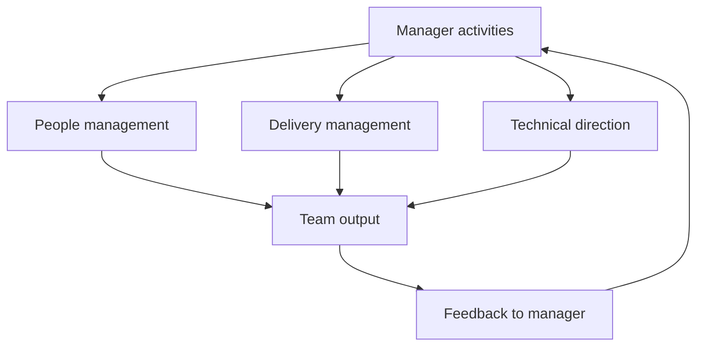

Time goes into the jobs, the jobs shape what the team produces, and that output is the only evidence
the time was well spent. Measuring the top of the loop (hours, meetings) instead breaks it.

### Deep Conceptual Explanation

#### Three jobs, one title

The three jobs need different skills and pay off on different timescales. People management pays off
over quarters and years: a hire, a promotion, an engineer who stays. Delivery management pays off
within weeks: a dependency resolved, a commitment kept or renegotiated in time. Technical direction
pays off over years and is easy to defer: a module boundary, a standard, a decision not to build
something.

Because the timescales differ, a busy manager drifts toward the job with the fastest feedback, which
is delivery. Over a year the drift shows in a calendar before it shows in attrition or in an
architecture nobody chose. This is **this book's recommendation**, not a research finding (the
[evidence labels](#page-references-evidence-labels) page explains each label the book uses). The
calendar audit below is designed to catch the drift.

The jobs also compete for one scarce resource, the manager's week. A manager with fifteen direct
reports who holds a weekly 30-minute one-on-one with each spends seven and a half hours on that alone,
nearly a fifth of a 40-hour week, before any hiring, feedback, or follow-up.

#### How companies split the jobs

Companies differ in which jobs they give the person with the manager title. Camille Fournier's *The
Manager's Path*, known for walking through the stages from tech lead to CTO, treats the tech lead and
the people manager as related but distinct roles
([Fournier, 2017](#fournier2017manager)). Will Larson's description
of staff archetypes treats the "tech lead manager" as a separate role on the management ladder,
distinct from a staff-level tech lead who manages nobody
([Larson, staff archetypes](#larson-staff-archetypes)).

Four shapes cover most organizations:

| Shape | Manager owns | Someone else owns | Fits when |
|---|---|---|---|
| Tech lead manager | All three, for a small team | Nothing | Teams of about four to six; a strong technical manager |
| Manager plus tech lead | People, delivery | Technical direction (an engineer in the team) | Most product teams of six to ten |
| Manager plus program manager | People, technical direction | Cross-team delivery coordination | Heavy cross-team dependencies or regulated releases |
| People-focused manager | People | Delivery (product or program), technical direction (staff engineers) | Large organizations with strong staff and product functions |

The team sizes are this book's recommendation and approximate. None of these shapes is correct in
general; each is a bet about where the scarce skill is. The failure is running several by accident,
so that each manager quietly decides which jobs to do and which to leave.

#### Managerial output and the calendar

Grove's definition becomes a practical test. For any block of time on a manager's calendar, ask
which output of my organization, or of one I influence, does this change, and by how much compared
with another use of the hour? Grove also argued that managers should prefer high-leverage activities,
whose effect spreads across many people or a long time
([Grove, 1983](#grove1983high)); Chapter 3 develops leverage.

Peter Drucker's *The Effective Executive* is known for an earlier version of the discipline: record
where your time actually goes before deciding how to spend it, because memory of it is unreliable
([Drucker, 1967](#drucker1967effective)). The calendar audit combines
the two: Drucker supplies the measurement, Grove the criterion.

1. Take two representative weeks of calendar, plus unscheduled work reconstructed from chat and
   email.
2. Classify each block by job: people, delivery, technical direction, or other (administration,
   cross-team work, your own development).
3. For each block, name the output it was meant to change, and mark it **leveraged** (the effect
   reaches many people or lasts), **necessary** (someone must do it, and it is the manager's job), or
   **substitutable** (someone else could and should do it).
4. Compare the split with the role definition. A role that gives technical direction to the tech lead
   and a calendar with a third of its hours in design reviews disagree; one of them is wrong.

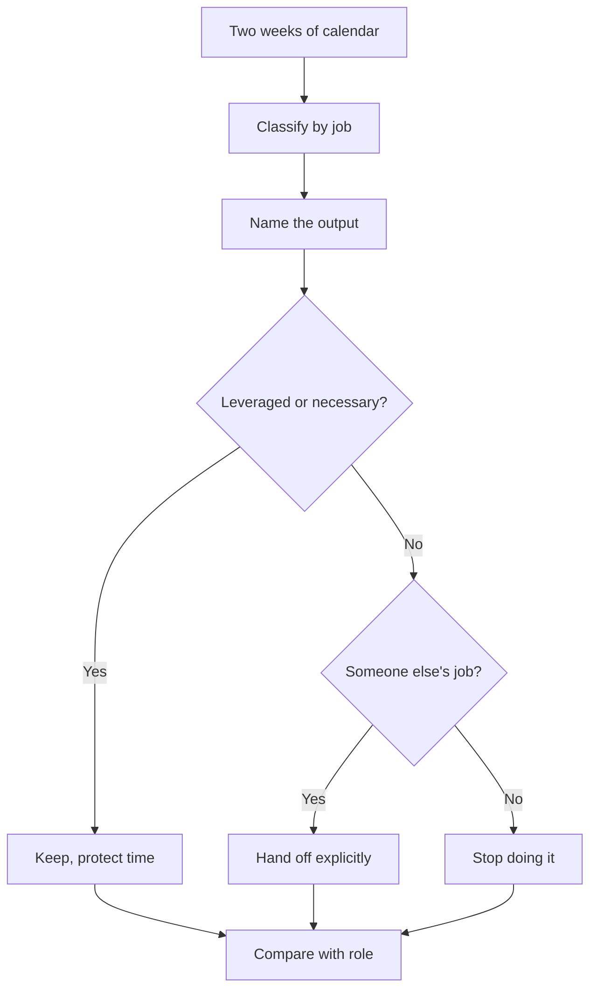

The audit is gamed by generous classification: every incident call becomes "delivery", every status
meeting "people". Classify by what the block changed, not what it was called; a status meeting in
which nothing is decided is "other". And have a peer or your manager classify a sample independently;
the disagreements are the useful part.

#### Leadership is not the same as people management

People management is a job: direct reports, formal authority over hiring and performance,
accountability for team health. Engineering leadership is a behavior: setting direction, raising the
quality of decisions, and moving people who do not report to you. Managers need leadership, and many
engineers lead without managing anyone. Organizations that conflate the two push their best technical
leaders into management for influence, and lose technical direction. A staff track gives technical leadership a home without direct reports.

#### Where staff-plus engineers sit

[Staff-plus engineers](#staff-plus-engineer) (staff, principal, and above) are senior individual contributors whose job is
technical leadership beyond their own work. Larson describes four common archetypes: the **tech
lead**, who guides the approach and delivery of one team or a few; the **architect**, who owns the
direction of a central technical area; the **solver**, who works through hard, high-priority problems
one after another; and the **right hand**, who extends an executive's reach on cross-cutting problems,
mainly in very large organizations. He notes that most companies recognize only one or two of these,
and some have no technical leadership track at all
([Larson, staff archetypes](#larson-staff-archetypes);
[Larson, 2021](#larson2021staff)). This is expert opinion, not a
measured taxonomy.

On the three-jobs map, staff-plus engineers own technical direction across team boundaries, and
sometimes the delivery of cross-team technical programs. They do not own people management, though
they mentor and inform hiring and promotion.

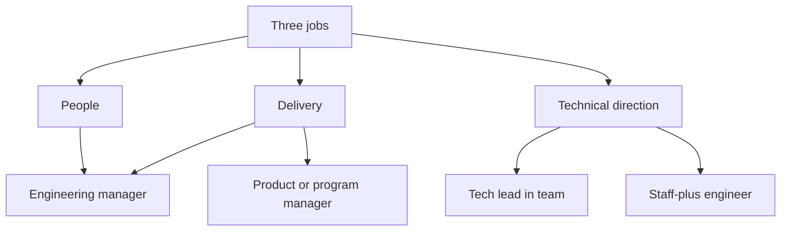

This is a common default, not a rule. Read each arrow as a question about your organization: is there
a named person, and do they know it? Who decides architecture when managers and staff engineers
disagree is contested; Chapter 28 takes a position.

#### What the job is not

**Not being the best engineer on the team.** Competence matters, as the evidence below shows, but a
manager who is the team's main producer of code makes the team's output depend on the one calendar
where the other two jobs also live.

**Not being the team's shield.** Filtering noise is part of delivery management. Hiding the
organization's real constraints is not; the team then decides without the information that matters.

**Not status relay.** Passing status up and priorities down, with nothing decided in between, adds
only latency.

#### Do managers matter? The evidence

Engineers often argue that managers are overhead. The evidence that managers affect outcomes is
real. But each study has a specific population, and none studied software teams.

- **Productivity.** Using one company's data on technology-based service workers, Lazear, Shaw, and
  Stanton's abstract reports that replacing a supervisor in the bottom 10 percent of quality with one in the top
  10 percent raised a team's output by more than adding a worker to a nine-person team would, and
  that workers with better supervisors were less likely to leave
  ([Lazear, Shaw, and Stanton, 2015](#lazear2015value)). **Research
  finding**; one firm.
- **Attrition.** Using personnel data and employee surveys at a large high-tech firm, Hoffman and
  Tadelis's working-paper abstract reports that survey-measured people management skills have a strong negative relation to
  turnover, with designs that support a causal reading, but that those skills did not consistently
  improve other outcomes ([Hoffman and Tadelis, 2021](#hoffman2021people)).
  **Research finding**; one firm.
- **Technical competence.** Using US and British survey data, Artz, Goodall, and Oswald report that a
  boss's technical competence was the strongest predictor of workers' job satisfaction, and that a rise
  in a supervisor's competence was associated with higher well-being for workers who stayed in the
  same job ([Artz, Goodall, and Oswald, 2017](#artz2017boss)).
  **Research finding**; correlational with longitudinal controls; not specific to software.
- **Google's Project Oxygen.** Google's re:Work site describes a multi-year internal study that began
  from the hypothesis, held by some employees, that managers do not matter. It reports that teams with
  highly effective managers were more likely to achieve better results, be happier, and have lower
  turnover, and lists ten manager behaviors, including key technical skills
  ([Google re:Work, great managers](#rework-great-managers)).
  **Industry research**: a company self-report, not peer-reviewed, methods described only in summary.

Together these support a modest claim: in the settings studied, the quality of the immediate manager
is associated with output, retention, and satisfaction, and two studies have designs that point to a
causal effect. They do not say which of the three jobs produces the effect in software teams, and
they do not show that more managers mean more output. The attrition finding is a reminder that the
jobs are distinct: being good at one does not cover the others. We found no study relating how
engineering managers split their time to team outcomes; the calendar guidance here is this book's
recommendation.

### Engineering Organization Example

This example is **illustrative**: an invented manager in an invented company of about 40 engineers.

Jo manages a payments team of eight and owns people and delivery; a senior engineer, Ari, is the
named tech lead. Jo's two-week calendar, reconstructed from calendar and chat history, holds 80
working hours:

| Block | Hours | Job | Mark |
|---|---|---|---|
| One-on-ones, eight engineers, weekly 30 minutes | 8 | People | Necessary |
| Hiring loop for an open role | 6 | People | Leveraged |
| Planning and prioritization with product | 6 | Delivery | Leveraged |
| Cross-team dependency meetings | 8 | Delivery | Necessary |
| Incident calls as an extra responder | 8 | Delivery | Substitutable |
| Design reviews | 12 | Technical | Substitutable: Ari's job |
| Writing code on a refund flow | 14 | Technical | Substitutable |
| Three weekly status meetings | 6 | Other | Substitutable: nothing decided in four of six |
| Email and administration | 12 | Other | Partly necessary |

By job, the 80 hours split as people 14, delivery 22, technical 26, and other 18. The role says
technical direction is Ari's, yet a third of Jo's time is technical, much of it coding and duplicating
Ari's reviews. Meanwhile nobody on the team has had a career
conversation in two quarters, and the open role has been open for eleven weeks.

A reallocation frees about 33 hours a fortnight. Its assumptions:

| Change | Hours freed per fortnight |
|---|---|
| Attend one design review a week, of Ari's choosing | 9 |
| Hand the refund-flow code to an engineer | 14 |
| Leave incidents to the rotation unless they cross teams | 6 |
| Replace two status meetings with a written update | 4 |

Jo puts 10 of the freed hours into hiring and 8 into career conversations and feedback, and keeps the
rest as slack for cross-team work.

The cost: Jo loses the satisfaction of shipping code, and Sam gains a decision area Jo used to share.
Whether the trade pays shows only in the team's output over the next two quarters.

### Decision Framework

The central decision is how to split the three jobs for a given team. Start from the team, not a
template:

| Question | If yes | If no |
|---|---|---|
| Six people or fewer, with the manager as strongest technical voice? | Tech lead manager can work; protect people time explicitly | Separate tech lead from manager |
| An engineer ready to own technical direction? | Name them tech lead, in writing, with a decision scope | Manager holds it temporarily, with a plan to grow or hire a tech lead |
| Delivery depends heavily on other teams? | Add program support or a director-level dependency process | Manager owns delivery |
| The area needs cross-team technical direction? | A staff-plus engineer with a written mandate | Team tech leads suffice |
| More than about eight to ten direct reports? | People work will crowd out the rest; plan a split (Chapter 34 covers [span of control](#span-of-control), Chapter 33 team design) | Proceed |

Two criteria apply whatever the answers. Every job has exactly one named owner per team, and the
owner has time in their calendar to do it. A role definition that assigns technical direction to a
tech lead who spends 90 percent of their time on features has assigned it to nobody.

The direct-report thresholds are this book's recommendation; the span-of-control research we found
does not cover software teams, so the evidence here is thin.

### Trade-offs

**Technical depth against people capacity.** A manager who owns technical direction decides faster and
earns credibility, and the Artz, Goodall, and Oswald finding suggests competence matters to the people
managed. The same manager has less time for people work, and the team's own technical leaders may not
grow. Splitting the jobs adds an interface between manager and tech lead, which needs a way to resolve
disagreements.

**Uniformity against fit.** One split across all teams makes roles comparable and promotion fairer.
A middle course: one written default, with recorded exceptions.

**The cost of changing a split.** Moving technical direction from a manager to a tech lead takes
something from the manager's identity and adds load to an engineer. Expect a quarter of friction and
overlapping decisions. Changing the split without announcing it is worse: two people make the same
decisions, and the team asks whichever one gives the answer it wants.

### Failure Modes

**The super engineer.** The manager remains the team's busiest coder; Chapter 2 covers how to detect
and unwind it.

**The dispatcher.** The job shrinks to tickets in, status out. Signal: good short-run throughput, then
attrition or a design nobody owns. Detection: no people or technical work in the audit, and nobody can
name the team's technical owner.

**The orphaned job.** Everyone assumes someone else owns technical direction, delivery, or growth.
Signal: decisions go to whoever is in the meeting; debates recur. Detection: ask the manager, the tech
lead, and two engineers who owns each job; different answers mean nobody does.

**The fourth on-call responder.** The manager joins every incident and becomes part of the restoration
path. Detection: incident records list the manager as responder more often than any engineer, and the
rotation's load looks lighter than it is.

**The mandate-free staff engineer.** A staff engineer with no written scope fills whatever urgent gap
appears; Chapter 4 covers the staff role and its mandate.

**Activity mistaken for output.** The manager reports meetings held, not what changed. Detection: ask
"what is different in the team because of this?"

### Enterprise Application

In an organization of 50 to 150 engineers, the role definition can no longer live in one person's
head. A director manages several managers, often staff engineers too, and the split of the three jobs
becomes organizational design. Will Larson's *An Elegant Puzzle* is known for treating engineering
management at this scale as the design of systems (processes and the structures that route decisions)
([Larson, 2019](#larson2019elegant)). The split of the jobs is one
such system, and three practices make it workable:

- A written **default split**: what managers, tech leads, and staff engineers each own.
- A **per-team charter** recording each team's actual split and any exception.
- A **periodic calendar audit** for each manager, once or twice a year, done with the director and
  used for development, not rating.

The director's role follows the same logic one level up. Its output is the output of the whole
organization and of the peers it influences: product, support, finance. The director's people job is
mostly managing managers; the delivery job is cross-team commitments and capacity; the technical job
is making sure staff engineers have mandates and cross-team decisions get made. Chapter 27 shows this
division during a quality transformation
([Chapter 27, Enterprise Application](#enterprise-application)).
How to measure managers' effectiveness belongs to Chapter 4; the minimum here is to judge managers on
their teams' output, never on the volume of their own activity.

### CTO Perspective

At CTO level, "what is an engineering manager" is a policy with a cost line, and left alone each
director will define it differently. Three decisions are the CTO's.

**Whether managers must be technical.** Requiring managers to own technical direction means hiring for
depth and keeping teams small. Separating the jobs needs a staff track strong enough to hold technical
direction. The research favors technical credibility in managers; it does not settle whether that
credibility must come with ownership of technical decisions.

**Whether a staff track exists, and with what mandate.** A staff track without mandates is a promotion
path with no job. The CTO decides which archetypes the organization recognizes and how staff
decisions relate to managers' decisions.

**The ratio of managers to engineers.** Fewer managers save cost and spread each one thinner. The
manager-effect research says manager quality matters; a CTO who cuts managers should expect the saving
to reappear as attrition or slower delivery, and should estimate where.

### Practical Playbook

1. Write down the three jobs for your role: which you own, which someone else owns (named), and which
   nobody owns.
2. Run a two-week calendar audit: classify every block by job and output, and mark it leveraged,
   necessary, or substitutable.
3. Ask your manager or a peer to classify ten of your blocks independently; discuss the disagreements.
4. Hand off the two largest substitutable blocks explicitly, with a named owner and a date, and tell
   the people affected.
5. Ask your tech lead, two engineers, and your product partner who owns each job on your team.
   Resolve disagreements in writing.
6. Write a one-page role definition: purpose, the three jobs and their owners, the outputs you answer
   for, and what you will not do. Share it with your team and your manager.
7. If you lead managers, write the organization's default split and record team exceptions; give
   each staff engineer a written mandate.
8. Repeat the audit in six months; compare the split and check whether the outputs you named moved.

### Case Study

This case is **fictional**; Northstar's people and numbers are on the
[Northstar overview](#page-case-studies-northstar-index).

!!! info "Northstar so far"
    Before week 1. You are about to join Northstar, a 620-person order-to-cash software company, as
    Engineering Director over six teams (80 engineers). Last quarter brought 30 Sev1 and Sev2 incidents
    and $410,000 in service credits. See the [timeline](#page-case-studies-northstar-timeline).

!!! note "Northstar in one paragraph"
    Northstar sells software that lets wholesale distributors take orders, invoice, and get paid, with
    $140M of annual recurring revenue. Most code lives in [Core](#core), a Java
    monolith that ships on a two-week [release train](#release-train): one
    scheduled release, preceded by three days of manual testing. Fourteen smaller services deploy on
    their own. Contracts promise 99.9 percent availability and pay
    [service credits](#service-credits) (refunds) when it is missed. Two renewals
    worth $9M a year depend on reliability. Incidents are rated by
    [severity](#severity-sev1-sev2-sev3): Sev1 is the most serious, and the headline
    count is Sev1 plus Sev2. An engineer costs about $185,000 a year
    [fully loaded](#fully-loaded-cost) (salary plus benefits and overhead). Weeks are
    counted from the director's first day.

The calendar figures describe the baseline quarter, the one before the director arrives. Each manager
reconstructed a two-week sample (about 80 working hours) from calendar and chat history.

Northstar's six managers share a job description written years earlier, "lead a team of engineers to
deliver high-quality software", and do six different jobs:

| Team | Manager | Engineers | People | Delivery | Technical | Other | Technical direction lives with |
|---|---|---|---|---|---|---|---|
| Orders | Priya Raman | 14 | 15% | 35% | 45% | 5% | Priya, who still writes code |
| Billing | Marcus Oyelaran | 13 | 15% | 55% | 15% | 15% | Nobody; decided during incidents |
| Payments and Integrations | Elena Sokolova | 12 | 35% | 35% | 15% | 15% | A senior engineer acting as informal tech lead |
| Customer Experience | Daniel Cho | 15 | 45% | 35% | 5% | 15% | Two unnamed leads, web and mobile |
| Data and Analytics | Farah Haddad | 11 | 25% | 20% | 45% | 10% | Farah, as data architect |
| Platform Operations | Tom Becker | 12 | 25% | 50% | 10% | 15% | Tom and the release process |

Priya, promoted from inside Orders eight months earlier, spends about 36 of her 80 hours writing and
reviewing code. With fourteen reports, her one-on-ones are nominally weekly and mostly cancelled.
About 20 of Marcus's hours went to incident calls as an additional responder: the fourth-responder
failure mode. Billing had the most incidents (8 of the 30), and three engineers carry most pages;
nothing in Marcus's calendar addresses why three people carry them.
Elena's calendar is the most balanced, and her team has the best operational discipline; the data
cannot say whether one causes the other. Daniel's fifteen weekly one-on-ones take 15 hours a
fortnight, and nobody has named who directs web and mobile. Tom's delivery time is mostly release-train
coordination; his team includes the seven QA engineers who run the manual regression pass.

The three staff engineers own no components and act as solvers by default. Ines Carvalho (staff
engineer, core domain) is consulted on most Core changes without owning any decision. Kwame Mensah
(staff engineer, infrastructure and reliability) is pulled into the largest incidents. Li Na Zhou
(staff engineer, data and integration) answers integration questions for whichever team asks first.

Before starting, the director drafted a one-page role definition:

| Element | Director's definition |
|---|---|
| Purpose | Reliability and delivery of the whole engineering organization, judged by its output |
| People | Manage and develop the six managers; give the staff engineers mandates |
| Delivery | Own cross-team commitments and the capacity model agreed with the CTO and CPO |
| Technical direction | Ensure cross-team technical decisions have an owner; decide personally only when nobody else can |
| Not doing | Running a team's planning, joining incidents as a responder, writing production code |

What happened next is on [the director's first quarter](#page-case-studies-northstar-first-quarter)
page. In the first quarter the staff engineers received mandates (Kwame Mensah release and detection,
Ines Carvalho Core module boundaries and contract tests, Li Na Zhou migration and configuration
safety). The six managers were trained as
[incident commanders](#incident-commander), who coordinate a response rather than
join it as an extra responder. This chapter's question comes earlier: before any transformation, would you
change how the six managers split their jobs, and in what order?

### Exercises

Solutions are in [chapter 1 solutions](#page-solutions-ch01-solutions). Northstar data is on the
[baseline page](#page-case-studies-northstar-baseline-data).

#### Foundational

**F1.** Priya Raman's calendar for one week contains: four one-on-ones (30 minutes each), a two-hour
design review on the bulk-ordering feature, six hours writing code on order-capture, a one-hour
planning session with product, a 90-minute meeting with Billing about core/customer, three hours of
email, and a canceled career conversation. Classify each block by job and as leveraged, necessary, or
substitutable, and state what you would want to know before recommending any change.

**F2.** A job advertisement for an "Engineering Manager" at a company of 200 engineers asks for "80
percent hands-on coding, own the architecture of our payments platform, run sprint ceremonies, manage
a team of nine." Identify which of the three jobs it assigns to the role, which it underweights, and
what risk the combination creates for the team. Propose a revised split.

**F3.** A colleague says, "Research proves good managers make teams 75 percent more productive, so we
should hire more managers." Using the studies summarized in this chapter, explain what the evidence
does and does not support, where a figure like 75 percent might have come from, and why the
conclusion does not follow.

#### Applied Leadership

**A1.** You are Marcus Oyelaran's director. His calendar shows 55 percent delivery, including about 20
of 80 hours on incident calls as an extra responder, and 15 percent people management for 13
engineers. Plan the conversation in which you present the audit: what you ask first, what you
propose, what you will not ask him to give up yet, and how you will know in two months whether the
change worked.

**A2.** Daniel Cho manages fifteen engineers (nine web, six mobile). Technical direction sits with two
unnamed informal leads, and a mobile release and a web change have twice conflicted over the same API.
Decide between naming two tech leads, splitting the team under two managers, or Daniel taking
technical direction himself. State your criteria and the transition cost of your choice.

**A3.** Ines Carvalho, staff engineer with eleven years at Northstar, tells you she is thinking of
becoming a manager because "that is the only way anyone listens to me about Core." Advise her using
the three-jobs map and the staff archetypes, and say what you as director would have to change for her
choice to be a real one.

#### Executive Decision-Making

**X1.** Victor Lindqvist, the CTO, proposes the tech lead manager model across engineering: every
manager owns all three jobs, and the staff engineer role is retired, saving the cost of three senior
individual contributors. Assume $185,000 fully loaded per engineer-year; set the saving against last
quarter's $410,000 in service credits and the $9M of renewals at risk. Write your response, including the conditions under which the proposal would
work, the teams for which it would fail, and an alternative.

**X2.** Rajiv Menon, the CFO, asks whether Northstar could run its 80 engineers with four managers
instead of six, merging teams, to hold operating expense flat. Assume a manager costs about the
$185,000 engineer average, against an engineering personnel budget of about $16.1M a year. Prepare the analysis you would take to
the CTO: what the change does to each manager's span and calendar, what the manager-effect evidence
suggests and does not, where the cost of the saving would show up, and what you recommend.

### Reflection Questions

1. If you audited your last two weeks, which job would have the most hours, and is it the job your
   role definition says matters most?
2. Which job on your team would nobody claim if you asked three people who owns it?
3. What work do you keep for the satisfaction or credibility it gives you rather than because it is
   your job? Who would do it better?
4. Does a strong engineer in your organization have a credible way to gain influence without direct
   reports?
5. When you last reported upward, did you describe your activity or your organization's output?
6. If your manager rewrote your role definition from your calendar alone, what would it say?

### Key Takeaways

- A manager's output is the output of the organization they lead and influence, not their own
  activity.
- The title hides three jobs: people management, delivery management, technical direction. Each needs
  exactly one named owner per team, with time to do it.
- Companies split the jobs differently; choose a split on purpose, write it down, record exceptions.
- Time drifts toward delivery, the job with the fastest feedback. A calendar audit catches the drift
  before attrition or unowned architecture does.
- Leadership is a behavior; people management is a job. Staff-plus roles give technical leadership a
  home without direct reports, if they come with a mandate.
- Research associates manager quality with output, retention, and satisfaction in the settings
  studied. It does not say which job matters most in software teams.

### References and Further Reading

- [Grove, 1983](#grove1983high). *High Output Management*. Managerial
  output and leverage, as used throughout this book.
- [Drucker, 1967](#drucker1967effective). *The Effective Executive*.
  Recording where time goes before deciding how to spend it.
- [Fournier, 2017](#fournier2017manager). *The Manager's Path*. How the
  jobs shift from tech lead to CTO.
- [Larson, 2019](#larson2019elegant). *An Elegant Puzzle*. Engineering
  management as systems design.
- [Larson, 2021](#larson2021staff) and
  [staff archetypes](#larson-staff-archetypes). The staff-plus role
  and its common shapes.
- [Lazear, Shaw, and Stanton, 2015](#lazear2015value). Supervisor
  effects on output in one firm.
- [Hoffman and Tadelis, 2021](#hoffman2021people). People management
  skills and attrition.
- [Artz, Goodall, and Oswald, 2017](#artz2017boss). Supervisor
  competence and job satisfaction.
- [Google re:Work, great managers](#rework-great-managers). Google's
  account of Project Oxygen.

<a id="page-parts-01-foundations-02-from-individual-contributor-to-leader"></a>

## Chapter 2 — From Individual Contributor to Leader

This chapter is about the first management role: what changes when a strong engineer becomes
responsible for a team, why the change is harder than it looks, and how to get through the first
year without becoming the team's bottleneck. It covers the shift in identity and feedback, delegation
by outcome with an explicit level of control, the first 90 days, and the decision about how much
hands-on technical work to keep. Chapter 1 defines the manager's job; this chapter is about crossing
into it. The running example is Priya Raman, the Orders manager at Northstar Technologies, the
fictional company in the [case study](#page-case-studies-northstar-index).

### Why This Matters

At team scale, the transition decides whether the team gets a manager or loses its best engineer and
gains a busy one. A new manager who keeps the most important technical work looks effective for
months, because output continues. What stops is the team's growth: decisions queue behind one person,
nobody else learns the hard parts, and problems surface later as incidents or resignations.

At organization scale, first-line managers are the layer where most engineers experience the company,
so a weak transition is felt by every engineer on the team. Chapter 1 summarizes the evidence that
managers matter; it is a useful corrective to the engineer's belief that management is overhead.

At executive scale, the question is how the organization picks and prepares its managers. The risk
has a name, the **Peter Principle**: people are promoted for doing their current job well until they
reach a job they do poorly. An economic study of sales workers at 131 firms, titled after the
principle, found that firms weight current job performance heavily in promotion decisions. Other
characteristics better predicted success as a manager, and promoting people with lower managerial
potential was costly
([Benson, Li, and Shue, 2019](#benson2019promotions)). Sales is not
engineering, but the pattern is familiar: the strongest engineer is promoted, given no preparation,
and judged on whether the work still gets done.

### Learning Objectives

After this chapter you will be able to:

- Name the identity and feedback-loop changes of the first management role, and recognize them in
  yourself or in a manager you support.
- Plan the first 90 days in a new management role, including what to learn, what to change, and what
  to leave alone.
- Delegate by outcome with an explicit level of control, and choose the level from the person's
  competence and the cost of a mistake.
- Decide deliberately how much hands-on technical work to keep, and estimate what it costs the team.
- Detect the common first-year failure patterns early, from evidence rather than from how busy you feel.

### The Mental Model

> **Mental model:** An engineer's work produces fast, clear feedback; a manager's work produces slow,
> noisy feedback through other people. The transition succeeds when you stop steering by the fast loop.

As an engineer, you change code and within minutes a test passes or fails. Within days the change
ships. The loop is short, the signal is clear, and the credit is yours. As a manager, you change how
a person works, what the team works on, or how decisions are made. The result appears weeks or months
later, mixed with everything else that happened, and mostly in other people's output.

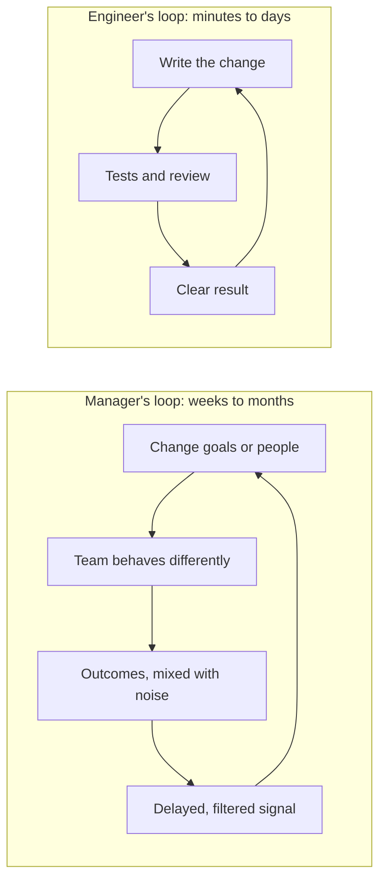

The danger is that the engineer's loop is still available and still rewarding. When the manager's
loop goes quiet, the new manager reaches for the keyboard. Each such choice is defensible; together
they keep the new manager in the old job.

The second idea follows from the first: a manager's output is the team's output, not their own
(Chapter 1 defines managerial output after Andrew Grove; Chapter 3 develops leverage). Delegation is the
mechanism that converts one person's judgment into the team's capability, so it carries most of the
weight in this chapter.

### Deep Conceptual Explanation

#### An identity change, not a promotion

Linda Hill's research followed nineteen new managers through their first year. Her publisher
describes the transition as a profound psychological adjustment, learned mainly from experience, in
which balancing delegation and control and reframing one's understanding of the role are central
challenges, and notes that many people do not complete it
([Hill, 2019](#hill2019becoming)). It is a small qualitative study
outside software, but its point matches practitioner experience: the
hard part is letting go of the old source of competence and status.

Herminia Ibarra's study of professionals moving into more senior roles offers a mechanism. People do
not adopt a new professional identity in one step; they observe role models, try out provisional
versions of the new self, and keep or discard them depending on their own standards and the feedback
they get ([Ibarra, 1999](#ibarra1999provisional)). For a new
engineering manager this means two practical things (**this book's recommendation**, extending the
finding). First, expect to experiment: run one-on-ones one way for a month, then adjust. Second,
choose role models deliberately. A new manager whose only model is their previous manager copies that
person's habits, including the bad ones.

#### Feedback that is slower and noisier

Three properties of the manager's feedback loop cause most of the trouble:

| Property | Engineer | Manager |
|---|---|---|
| Delay | Minutes to days | Weeks to quarters |
| Attribution | Mostly own work | Shared with the team, product, luck |
| Filtering | Direct (the test fails) | Mediated: people tell the manager what is safe to say |

Delay means a new manager can do the wrong thing for a quarter before seeing the cost. Attribution
means a strong team can carry a weak manager for a while, and bad luck can hide good management.
Filtering means the signals that matter most, such as a senior engineer considering leaving, are the
least likely to reach the manager unprompted. The remedy is to build leading indicators the manager can observe directly: how many decisions waited for the manager this week, whether one-on-ones surface news or
only status, which work only one person can do. Chapter 5 covers one-on-ones as an information
channel; Chapter 4 covers measuring managerial effectiveness.

#### Why the best engineer is not automatically the best manager

The promotion pattern in the [Benson, Li, and Shue](#benson2019promotions)
study has a second cost beyond picking the wrong person. Even a promoted engineer who would make a
good manager arrives with the habits of the best engineer: solving the hard problem personally,
reviewing everything important, being the person others ask. In the new role these habits concentrate
work and decisions on one person. The usual remedies are preparation before or soon after promotion,
and a technical career track so that management is not the only way up (Chapter 4).

#### Delegating by outcome, with an explicit level of control

Delegating a task ("implement this endpoint") keeps the manager as designer and integrator.
Delegating an outcome ("uploads of up to 5,000 lines succeed or fail cleanly, by the March release")
transfers the design too, and is how a team's judgment grows. It fails when the level of control is
implicit: the delegate thinks they own the decision, the manager thinks they are being consulted, and
the first disagreement feels like a betrayal. David Marquet's account of commanding a submarine is
known for moving decisions to the people with the information. They state what they intend to do
rather than ask permission, so control moves gradually while the leader can still intervene
([Marquet, 2012](#marquet2013turn)). The scale below is **this book's
recommendation** in that spirit, not a validated instrument.

| Level | Who decides | The delegate says | Use when |
|---|---|---|---|
| 1. Direct | Manager | "Here is what I found" | Person new to the area; mistake costly and hard to reverse |
| 2. Recommend | Manager, from the delegate's options | "I recommend X, because" | Building competence; manager must own the risk |
| 3. Intent | Delegate, after telling the manager | "I intend to X on Thursday" | Competent person; mistake costly but visible in time |
| 4. Act and inform | Delegate | "I did X; here is why" | Proven competence; mistake reversible |
| 5. Own | Delegate; manager hears by exception | Reports outcomes in the regular review | The area is theirs |

Research on delegation explains why managers stall at levels 1 and 2. In a survey and interview study,
Yukl and Fu found managers delegated more to subordinates who were competent, shared the manager's
objectives, and had worked with them longer. Managers valued delegation for developing people, yet
many were reluctant to give up control over important decisions or to give important tasks to
inexperienced subordinates
([Yukl and Fu, 1999](#yukl1999determinants)). The result is a trap
for a new manager: the important work is never delegated, so nobody gains the experience that would
justify delegating it. The way out is to delegate important work at a lower level of control (2 or 3)
rather than to withhold it.

Two rules make the levels work (**this book's recommendation**). Name the level out loud, with the
outcome and the date: "This is level 3; tell me before you change the schema." And move the level by
agreement, upward after evidence, never silently downward.

#### How much hands-on work to keep

There is no right percentage, but there is a right question: does this technical work make the team
more capable, or does it make the team depend on me? Google's list of effective manager behaviors
includes both empowering the team without micromanaging and having key technical skills
([Google re:Work](#rework-great-managers)). The two pull against
each other only when technical skill is exercised by doing the team's critical work.

Kinds of hands-on work, from cheapest to most costly for the team:

| Work | Keeps the manager | Cost to the team |
|---|---|---|
| Reading designs and code, asking questions | Able to judge | Low |
| Small fixes, tooling, prototypes off the critical path | In touch with the code and the pain | Low, if nothing waits on it |
| Joining on-call or incident response as a participant | Aware of operational reality | Low to moderate |
| Being the required reviewer for an area | Informed | High: every change waits for the busiest person |
| Owning work on a committed deadline | Productive-feeling | Highest: the critical path stops in every meeting |

Camille Fournier's practitioner account of the engineering management path is known for this
balance: stay close enough to the technology to judge, coach, and keep credibility, and stay off the
critical path ([Fournier, 2017](#fournier2017manager)). A manager's
calendar is interrupt-driven, so work others wait on is delayed by every escalation, and the team
learns that the hardest problems belong to someone else.

#### The first 90 days

Michael Watkins's book on leadership transitions is known for the argument that the first months in a
new role decide much of what follows, that a new leader should accelerate learning deliberately,
match the strategy to the situation, agree expectations explicitly with their own manager, and
secure a few early wins ([Watkins, 2003](#watkins2003first)). For a
first-line engineering manager promoted from inside the team, two adjustments apply: the hardest
learning is about changed relationships rather than an unfamiliar domain, and the most valuable early
wins are not technical but visible changes in how the team works, such as decisions made faster or a
recurring problem finally owned. The Practical Playbook turns this into a plan.

### Engineering Organization Example

!!! info "Northstar so far"
    Weeks 1 and 2 of the director's first year at Northstar, the book's fictional company. The CTO's
    mandate is to halve serious incidents within twelve months with flat headcount, while two renewal
    features ship on time. Bulk ordering, one of them, belongs to Priya Raman's Orders team. See the
    [timeline](#page-case-studies-northstar-timeline).

The following figures are **illustrative**. They describe the calendar of Priya Raman (Orders
manager) in the two weeks before the new director arrived, eight months after her promotion, and the
budget she agreed with the director in week 2.

Assumptions: a 40-hour working week; Orders has 14 engineers. Most Orders code lives in
[Core](#core), Northstar's shared Java monolith, and Priya reviewed about 15 of the
roughly 25 Core merge requests (proposed code changes) Orders produced each week.

| Activity, hours per week | Before (measured from her calendar and review history) | Agreed budget |
|---|---|---|
| Coding and code review | 18 | 8 |
| Product, [release train](#release-train) (the scheduled Core release), cross-team | 5 | 5 |
| Incidents and escalations | 6 | 5 |
| Team planning and rituals | 3 | 3 |
| One-on-ones | 2 (nominally weekly; about one in three took place) | 4 (30 minutes every two weeks for all 14 is 3.5 hours a week, plus preparation) |
| Hiring | 2 | 2 |
| Feedback and career conversations | 2 | 2 |
| Coaching delegated work | 0 | 4 |
| Email and admin | 2 | 2 |
| Unallocated | 0 | 5 |
| **Total** | **40** | **40** |

Three things follow from the table.

First, the hands-on share was 45 percent (18 of 40 hours), and the cost was not only Priya's time.
With 15 of 25 merge requests waiting for her, 60 percent of the team's Core changes depended on the
busiest person on the team, who reviewed in evening batches. If batching added half a working day to
each of those reviews, that is about 7.5 engineer-days of waiting a week. Waiting is not lost work,
since engineers switch tasks, but each switch adds work in progress and makes batches larger.

Second, eight hours a week is enough to read designs, pair occasionally, and take small fixes off the
critical path. It is not enough to own a committed feature, and that is the intent.

Third, the budget has 5 unallocated hours. A new manager's week fills with escalations; a budget
with no slack is broken by Tuesday, and the hours lost are usually one-on-ones.

### Decision Framework

Two decisions recur in the first year: what level of control to delegate at, and whether to take on a
piece of technical work yourself. For the first, use two questions: how competent is this person in
this area (not in general), and how costly and how reversible is a mistake? High competence and a
reversible mistake mean level 4 or 5. Low competence and an irreversible mistake mean level 2, never
withholding the work entirely. The level is set per area, so the same engineer may be at level 5 on
the pricing service and level 2 on a schema migration.

For the second decision:

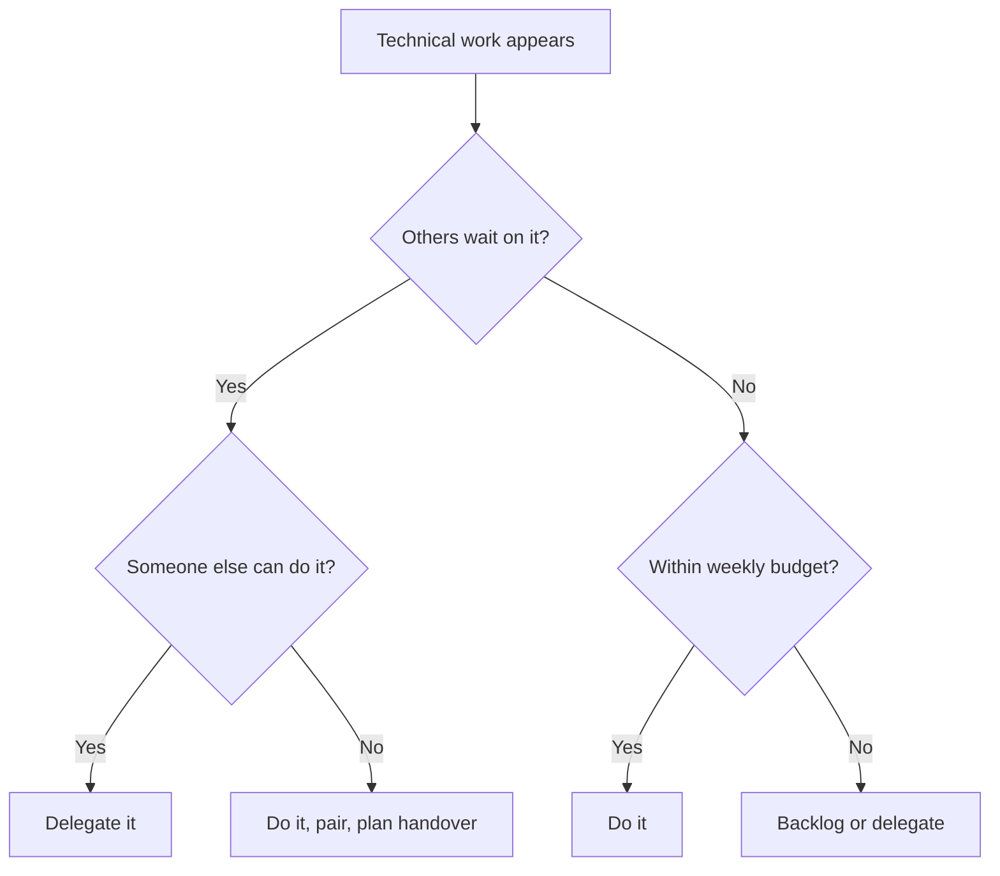

"Someone else can do it" includes "with coaching, more slowly". The branch where only the manager can
do the work is a finding: a single point of knowledge to remove, so pair with next time's owner.

| Signal | Likely meaning | Response |
|---|---|---|
| You are the required reviewer for an area | Knowledge concentrated in you | Name two owners; review their reviews for a month |
| Decisions wait for you more than a day | Level of control set too low or unclear | Raise the level explicitly in one area |
| You do the hard part "because it is faster" | Short-term speed bought with long-term capacity | Delegate at level 2 or 3 with a checkpoint |
| One-on-ones are the first thing you cancel | The fast loop is winning | Protect them in the budget; track how many took place |

### Trade-offs

**Speed now against capability later.** The new manager is often the fastest person to solve a
problem. Solving it costs the team the learning. For a production outage, take the speed and run a
review afterward; for a committed feature with weeks of runway, delegate.

**Credibility against focus.** A manager who loses touch with the system is easy to mislead in design
discussions. Choose technical work for what it teaches you (reading, small fixes, on-call), not for
the satisfaction of shipping.

**Delegating early against protecting a commitment.** Handing the hardest part of a deadline-bound
feature to a less experienced engineer adds schedule risk. Keeping it adds a different risk: the
feature depends on someone with an interrupt-driven calendar. Level 3 delegation with weekly design
checkpoints usually costs less than either extreme, but the manager should say which risk they are
taking and to whom.

**Friend against manager.** A manager promoted from inside the team loses some of a peer's candor.
Pretending nothing changed fails, and so does sudden distance. Say plainly what has changed
(assignments, performance, pay input) and what has not.

### Failure Modes

**The super-engineer.** The new manager keeps the hardest technical work and the most important
reviews. Output holds up for a while, which hides the problem.

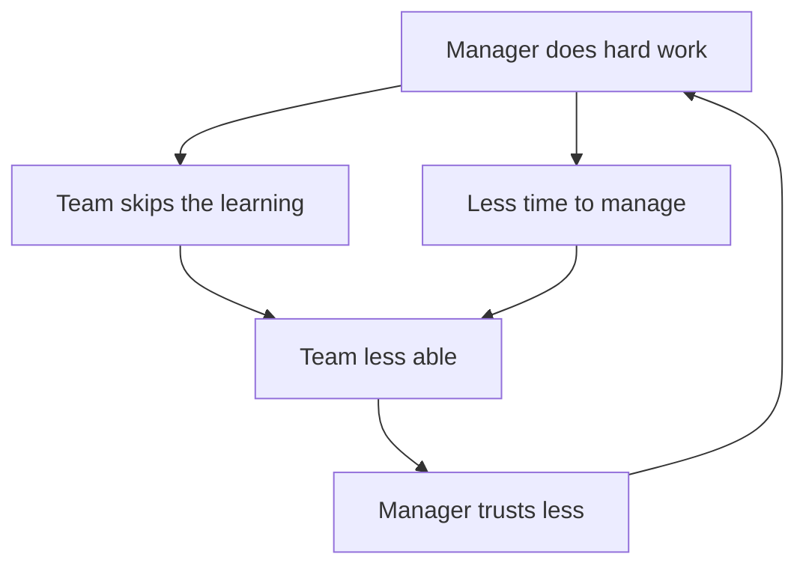

It is a reinforcing loop: each turn makes the next delegation look riskier. Signal: you are the only
person who can do some piece of the team's work, and that list is not shrinking. Countermeasure: a
written list of single-person areas, each with a named second person and a date.

**Delegation by abdication.** The manager overcorrects and hands over outcomes with no level, no
checkpoint, and no support, then intervenes late and visibly when things go wrong. Signal: surprises
at the deadline. Countermeasure: state the level and the checkpoints at handover.

**The silent take-back.** A delegated decision goes badly and the manager quietly resumes making it.
Signal: engineers start asking permission for things they used to decide. Countermeasure: if you
lower a level, say so, say why, and say what would raise it again.

**Status-meeting management.** One-on-ones become progress reports, so the manager hears only what
the task tracker already shows. Signal: you are surprised by a resignation or a conflict. Chapter 5
covers the repair.

**Commitments that outlive the role.** Work the manager owned as an engineer (follow-up actions,
on-call duties, a migration plan) stays assigned to them and quietly stops. Signal: open items with
your name on them older than your promotion. Countermeasure: in the first two weeks, list everything
assigned to you and reassign or close each item (Chapter 25 covers
[follow-up actions and recurrence](#follow-up-actions-and-recurrence)).

### Enterprise Application

In an organization of 50 to 150 engineers, several first-line managers are always in their first year.
At that scale the transition stops being a personal matter and becomes a system the director runs.

**Selection.** Treat promotion to management as a change of job with its own criteria, not a reward
for engineering performance. Look for evidence the candidate has already multiplied others: mentoring,
leading a project through other people, handling a disagreement well. Keep a technical track with
equal standing, so that the best engineer is not forced into management to advance (Chapter 4).

**Preparation.** A trial period as tech lead or acting manager, with an end date and a conversation
about whether to continue, lets both sides learn cheaply; Ibarra's provisional selves argue for making
the experiment explicit.

**Support in the first year.** The new manager's own manager owns the transition: an agreed time
budget, a monthly check of the leading indicators (decisions waiting, single-person areas,
one-on-ones held), and a peer manager outside the reporting line as a role model. Open engineering
commitments are reassigned as part of the promotion. Chapter 41 covers developing managers as a
director.

### CTO Perspective

At executive scale the question is the health of the management bench: how many managers are in
their first year, who supports each one, and what happens when a promotion is not working. Without a
respectable path back to engineering, a struggling new manager stays in the role or leaves the
company, and both are expensive. Make the path back normal and visible.

The CTO also sets the incentives that produce super-engineer managers. If managers are praised in
leadership meetings for personally rescuing releases, every first-year manager learns that rescuing
releases is the job. Praise the manager whose team handled the incident without them.

Finally, the evidence that managers matter (Chapter 1) and the economic research on promotion of
sales workers ([Benson, Li, and Shue, 2019](#benson2019promotions))
are not controlled studies of engineering teams: enough to justify investing in manager selection and
preparation, not enough to promise a board a specific return.

### Practical Playbook

For a newly promoted engineering manager, with the help of their own manager:

**Week 1.**

1. List everything assigned to you as an engineer (reviews, on-call, follow-up actions, features)
   and reassign or close every item, with the new owner's agreement.
2. Agree with your manager the day-90 criteria and a weekly time budget with a hands-on cap and slack.
3. Tell the team what has changed and what has not, together and then individually.

**Days 1 to 30: learn.**

4. Hold a first one-on-one with every report: what they want, what gets in their way, what you
   should not change.
5. Map single-person areas, including yourself.
6. Read the last quarter's incidents and [escaped defects](#escaped-defect) (bugs
   found after release) for your components; note recurrences.
7. Choose a peer manager as a role model and ask for an hour a month.

**Days 30 to 60: delegate.**

8. Delegate two outcomes at an explicit level of control, with checkpoints and dates.
9. Name two owners for every area where you were the required reviewer.
10. Make one visible change in how the team works, chosen from what the one-on-ones raised.

**Days 60 to 90: check.**

11. Count the leading indicators and compare your calendar with the budget.
12. Ask your reports what you should do more of and less of.
13. Report to your manager against the day-90 criteria, including what has not worked.

### Case Study

This case is **fictional**. It is set before and at the start of the director's first quarter at
Northstar; the full record is on [the first quarter](#page-case-studies-northstar-first-quarter)
page.

Priya Raman joined Northstar as an engineer seven years before the director arrived and became the
person who knew order capture best. She wrote much of the bulk order upload path. When the previous
Orders manager left the company, Priya was the obvious choice, and she accepted partly because the
alternative was a manager from outside who did not know the domain. She received no management
training, and her check-ins with her own manager were mostly about delivery dates.

In her first month as manager, a bulk upload failure reached customers. Priya fixed it herself over a
weekend and wrote the follow-up action, a test for uploads beyond 500 rows, assigned to herself. It
was never done. Two quarters later the same failure mode returned as INC-421: a bulk upload dropped
every line beyond row 500. It was a [Sev1](#severity-sev1-sev2-sev3), Northstar's
most serious severity, and a customer reported it first. It was one of three
[recurrences](#recurrence) (repeats of an earlier failure) among Orders' seven Sev1
and Sev2 incidents in the baseline quarter, the quarter before the director arrived. The other two
were INC-411, a catalog import that rejected valid units of measure, and INC-429, orders rejected
for next-year delivery dates.

By the time the director arrived, the team trusted Priya's judgment and liked that she understood
their work. Two senior engineers on Orders,
Rafael Duarte and Aisha Bello, described the same frustration in their first conversations with the director:
decisions on order capture waited for Priya, and she had kept the design and the hardest code of the
bulk-ordering feature, one of the two renewal commitments, for herself. One-on-ones were often
cancelled. Rafael had applied for the manager role too and had said nothing since about his own
career.

In week 1, the director's first one-on-one with Priya started with the renewal date; Priya was
confident about the code and worried about everything else. In week 2 they went through her calendar
and review history together and found the numbers in the
Engineering Organization Example: 18 hours a week of coding and review, 15 of
about 25 weekly Core merge requests reviewed by her, and about a third of scheduled one-on-ones held.

They agreed four changes, each with a level of control:

| Change | Owner | Level |
|---|---|---|
| Implementation lead for the bulk-ordering feature | Aisha Bello | 3: tells Priya before any API or schema change; weekly design checkpoint |
| Review ownership for core/order-capture | Rafael Duarte and Aisha Bello | 4: Priya reviews a sample of their reviews for a month |
| The open bulk-upload test action | Rafael Duarte | 4, due before the next Core release containing upload changes |
| Priya's time budget | Priya, checked with the director monthly | Hands-on capped at 8 hours a week |

Priya objected to the first change. Handing over the renewal feature, due at the end of quarter 2,
felt to her like taking a risk with the company's largest customers. The director's answer was that the long runway made this the cheapest moment to hand it over. Keeping
it was also a risk: the feature depended on a person who spent 15 percent of her week on incidents.
The director's plan for the quarter would fill her calendar further, with incident commander training
(learning to coordinate incident response), decisions on who owns which code, and a capacity model.
Priya kept the design authority, and the weekly checkpoint was her safeguard.

The case leaves Priya at the end of week 2. In week 4 Orders also took ownership of core/customer, one
of three Core modules that no team owned, and the quarter's results came later (see the
[timeline](#page-case-studies-northstar-timeline)). Whether the plan worked is a question for the exercises.

### Exercises

Solutions are in [chapter 2 solutions](#page-solutions-ch02-solutions). Northstar data is on the
[baseline page](#page-case-studies-northstar-baseline-data).

#### Foundational

**F1.** A senior engineer on your team has just been promoted to manage the five people she worked
alongside. After six weeks she tells you she is working longer hours than ever, the team is shipping
on time, and she feels she is "not really doing anything". Using the feedback-loop model, explain what
is happening, and name three observable indicators she could track instead of shipped work.

**F2.** For each of these, choose a level of control from the chapter's scale and justify it by
competence and cost of a mistake: an engineer with two years on the team designing a new internal
API; the same engineer writing a migration that rewrites the pricing-rules table in production; a
staff engineer choosing the team's test framework; a new hire triaging customer-reported defects.

**F3.** A new manager says: "I keep 50 percent hands-on time because my team respects me for it, and
Google's research says managers need technical skills." Assess the argument using what the chapter
says about the evidence and about the kinds of hands-on work.

#### Applied Leadership

**A1.** You are the director in week 2 with Priya Raman. She agrees to delegate review ownership but
refuses to hand over implementation of the bulk-ordering feature, citing the renewal date at the end
of quarter 2. Prepare the conversation: what you need to learn from her, what you would accept, what you
would not, and what you would do if, three weeks later, the checkpoint shows the feature slipping.

**A2.** Rafael Duarte applied for the Orders manager role eight months ago and lost to Priya. He has
not raised his career since. Priya is about to give him review ownership of core/order-capture. Advise
Priya on how to handle the delegation and the unspoken history, and on what she should not promise.

**A3.** Design a 90-day plan for an engineer about to become manager of a team of eight on a
component with two recurring incident patterns and a quarterly deadline. Include the time budget,
the first three delegations with their levels, and the day-90 criteria you would agree with their
manager.

#### Executive Decision-Making

**X1.** As CTO, suppose four of Northstar's six managers were promoted from inside their teams
and none received preparation. Propose a program for future promotions within flat headcount and a
small budget, including a respectable path back to engineering. Say what you will measure, how that
measure could be gamed, and what you will not promise the CEO.

**X2.** Two quarters from now, Priya's hands-on time has crept back to 35 percent and Orders' results
are good. One senior engineer has resigned, citing lack of growth. Victor Lindqvist (CTO) asks whether
Priya is a strong manager. Decide what evidence you would gather, what conclusion would follow from
each plausible finding, and what you would recommend.

### Reflection Questions

1. What work do you still do because it is satisfying rather than because the team needs you to do it?
2. Which decisions on your team waited for you last week, and which of them could someone else have
   made with what they knew?
3. Who was your model of a manager when you started, and which of their habits did you copy without
   choosing to?
4. When did you last lower someone's level of control without telling them?
5. If you were promoted out of your current role tomorrow, which of your commitments would quietly stop?
6. What would your team say is the hardest problem they are not allowed to work on?

### Key Takeaways

- The first management role changes the feedback loop: slower, shared, and filtered. Build observable
  leading indicators instead of steering by shipped code.
- Treat the transition as a change of identity learned by experiment; choose role models deliberately.
- Promotion on engineering performance alone is a known way to pick the wrong manager; keep a
  technical track and prepare managers before or soon after promotion.
- Delegate outcomes, not tasks, and name the level of control, the checkpoints, and the date.
- Delegate important work at a lower level of control rather than withholding it.
- Keep technical work that makes you able to judge; stay off the critical path and out of the
  required-reviewer role.
- Hand over every engineering commitment at promotion; open items with your name on them stop.
- Budget your week with slack, and protect one-on-ones first.

### References and Further Reading

- [Hill, 2019](#hill2019becoming). *Becoming a Manager*. A year with
  nineteen new managers; the classic study of the transition, cited here from its publisher's summary.
- [Ibarra, 1999](#ibarra1999provisional). How professionals adapt to
  senior roles by trying provisional identities; the mechanism behind "experiment, then choose".
- [Benson, Li, and Shue, 2019](#benson2019promotions). Economic
  evidence that firms promote on current performance at a cost; for the selection argument.
- [Yukl and Fu, 1999](#yukl1999determinants). What predicts
  delegation, and why managers hold on to important decisions.
- [Google re:Work](#rework-great-managers) and
  [Garvin, 2013](#garvin2013google). Project Oxygen: one company's
  evidence that managers matter, and its list of effective manager behaviors.
- [Marquet, 2012](#marquet2013turn). *Turn the Ship Around!* Moving
  control to the people with the information, with intent-based language.
- [Watkins, 2003](#watkins2003first). *The First 90 Days*. Planning a
  leadership transition; written for executives, adaptable to first-line managers.
- [Fournier, 2017](#fournier2017manager). *The Manager's Path*. The
  engineering management career from tech lead upward, including how technical to stay.
- [Zhuo, 2019](#zhuo2019making). *The Making of a Manager*. A
  practitioner's account of the first years of management, useful alongside Hill's research.

<a id="page-parts-01-foundations-03-managerial-leverage-and-systems-thinking"></a>

## Chapter 3 — Managerial Leverage and Systems Thinking

Every organization keeps producing results nobody chose: the same three people paged every night, the
same decisions waiting on the same person. This chapter teaches you to see those results as the output
of a structure (stocks, flows, feedback loops, delays, and constraints) and to spend your hours by how
much each one changes that structure, not by how visible it is. It sets out the book's systems-thinking
toolkit. Chapter 27 applies the toolkit to a quality decline, Chapter 16 to delivery flow, and Chapter 1
introduces the idea of managerial output that this chapter turns into a method. The running example is
Northstar Technologies, the fictional company in the [case study](#page-case-studies-northstar-index).

### Why This Matters

At team scale, managers learn to fix events: a missed date, an incident, a resignation. Events are
visible and responding to them feels like work. But the structure that produced one event produces the
next, and a manager who only responds to events gets busier every quarter without the results
improving.

At organization scale, the director cannot see most events. What they can change is structure: who is
on call and by what rule, which information reaches which meeting, what the staff engineers are for. A
director who keeps acting on events becomes the bottleneck, and is usually praised for it, because event
work is the most visible work there is.

At executive scale, leverage moves to goals, rules, and the beliefs behind them. A CTO who spends board
time on a bonus percentage is using the most expensive hours in the company on the weakest kind of
change. The skill is the same at every level: find the structure behind a recurring result, and rank
the possible changes by leverage rather than visibility.

### Learning Objectives

After this chapter you will be able to:

- Model a team or organization as stocks, flows, and feedback loops, and identify the loop that is
  producing an unwanted result.
- Account for delays when predicting what an intervention will do, and recognize the oscillation that
  ignored delays produce.
- Rank candidate interventions by leverage rather than by visibility, using explicit criteria and the
  effort they cost you.
- Recognize the constraint in a system, including when the constraint is a person, and stop investing
  in improvements that do not touch it.
- Audit your own calendar and behavior as part of the system, including whether you multiply or
  diminish the capability of the people around you.

### The Mental Model

> **Mental model:** Recurring results come from structure, not from events. Leverage is how much a
> change in structure moves the result per hour of your effort, and the most visible interventions
> are rarely the ones with the most leverage.

The first idea comes from system dynamics: a system is stocks (things that accumulate, such as
experienced engineers or trust) changed by flows (hiring, attrition, learning), with feedback loops
connecting the stocks back to the flows
([Meadows, 2008](#meadows2008thinking)). A **reinforcing loop**
amplifies whatever it is doing; a **balancing loop** pushes toward a goal. When a result keeps coming
back after you fix it, a loop is regenerating it.

!!! info "Northstar so far"
    Before week 1. Northstar, the book's fictional order-to-cash software company, has 80 engineers in
    six teams and a new Engineering Director about to arrive. Last quarter brought 30 serious (Sev1 and
    Sev2) incidents; Billing had the most. See the
    [timeline](#page-case-studies-northstar-timeline).

Northstar's Billing team has one. Three of its thirteen engineers carry most of the on-call pages
([Northstar overview](#page-case-studies-northstar-index)). That is usually called a staffing
problem. It is better described as a loop:

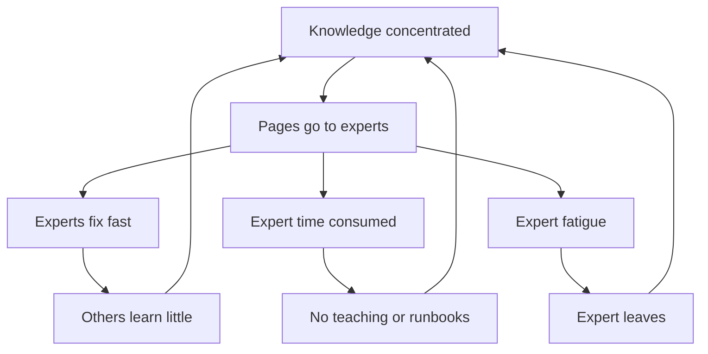

Every arrow is reasonable alone: routing a ledger page to the fastest restorer is good incident
practice, and an expert who fixes rather than writes runbooks is doing what the business asks.
Together they concentrate knowledge further each quarter. The outer path (fatigue, then departure)
worsens the concentration just when it is most dangerous.

The second idea is **leverage**. Donella Meadows ranked the places to intervene in a system, from
changing numbers at the bottom to changing goals and paradigms at the top, and relayed Jay Forrester's
observation that people often find the right point and push it the wrong way
([Meadows, 1999](#meadows1999leverage)). The manager's version: list the
interventions for each recurring problem, place each at its level, and price each in your own hours.
The winners are usually structural, slow to show, and unglamorous.

### Deep Conceptual Explanation

#### Stocks, flows, and slow change

A stock is anything you could count at a moment: engineers who can safely change the ledger, people
waiting for a decision. A flow is a rate: engineers trained per quarter, resignations per year. A stock
changes only through its flows, so it fills and drains at the rate the flows allow
([Meadows, 2008](#meadows2008thinking)).

Two consequences matter. The stocks that matter most (experience, trust) fill slowly and can drain
quickly: losing one of four ledger experts takes a week, replacing one takes months. And a large stock
hides a stopped inflow: Billing ran on ledger knowledge that nobody was replenishing, and the
shortfall became visible only at three people. Chapter 27 applies the same arithmetic to defects
([the quality version of the model](#the-mental-model)).

#### Feedback loops

A **balancing loop** acts on the gap between a goal and the current state. Balancing loops explain why
problems often improve partly and then stall at a level nobody chose: the loop is satisfied by a goal
lower than yours, or it acts through a resource that is running out.

A **reinforcing loop** feeds its output back as input, in either direction. Run backward, the on-call
loop spreads knowledge: protected teaching time, more people able to respond, fewer pages per expert,
more time to teach. Meadows argued that reducing the gain of a reinforcing loop is usually more powerful
than strengthening the balancing loops that fight it
([Meadows, 1999](#meadows1999leverage)). In management terms: slow the
concentration before adding ways of coping with it, such as escalation paths or a larger stipend.

A recognition test, **this book's recommendation**: if the same people, components, or decisions
appear in most problems over two quarters, look for a reinforcing loop around them. If a problem
improves after every push and then settles back, look for a balancing loop with a lower goal, and find
out whose goal it is.

#### Delays

Hiring takes months to add capacity, training months to add expertise, a rule change a quarter to show
in the numbers. Meadows observed that delays long relative to the system's pace of change cause
overshoot and oscillation ([Meadows, 1999](#meadows1999leverage)). The
stock of experienced engineers shows the mechanism:

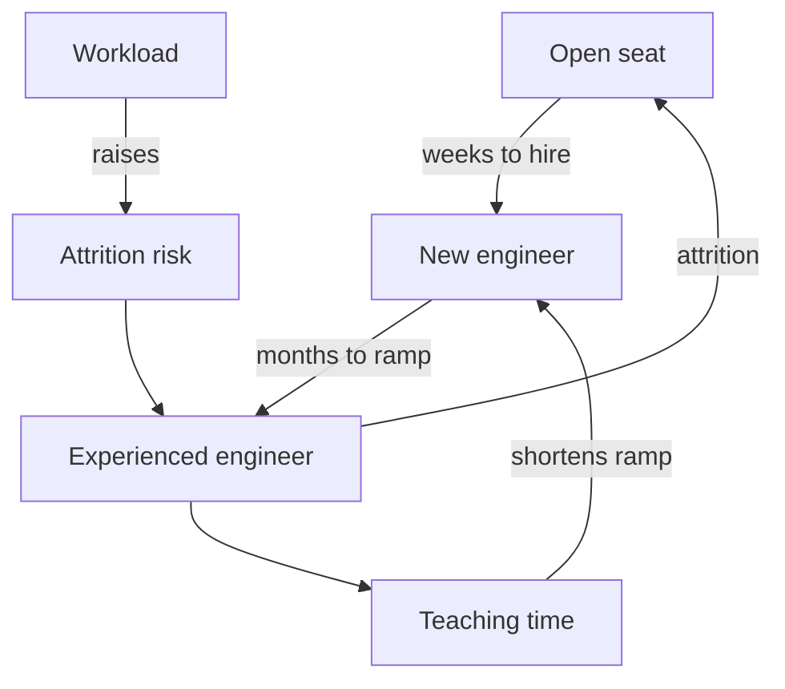

In the twelve months before the director arrived, eight Northstar engineers left (10 percent of 80),
and the median time from resignation to the replacement's first day was 15 weeks (fictional; see the
[baseline data](#page-case-studies-northstar-baseline-data)). That is about 2.3 engineer-years of
empty seats (8 × 15 = 120 seat-weeks), before the months each replacement needs to ramp. A manager who
requests hires against today's workload receives them after the pressure has peaked, and the next
planning cycle cuts them: hiring and freezing out of phase with need. The defense is to act first on the
flows you control fastest (attrition, teaching time, ramp) and to plan hiring against a forecast.

#### The capability trap

Nelson Repenning and John Sterman, drawing on over a dozen field studies of improvement programs in
industries including telecommunications, semiconductors, and automobiles, together with system
dynamics models, describe two ways to close a performance gap: work harder, or make the process more
capable by spending time on improvement
([Repenning and Sterman, 2001](#repenning2001nobody)). Working harder
pays off at once. Improvement pays off after a delay and costs output meanwhile, so performance gets
worse before it gets better. Under pressure, people cut improvement time, capability erodes, the gap
widens, and pressure rises: the **capability trap**. Because the link between skipped improvement and
later shortfall is long and hard to see, the authors argue, managers tend to blame people's effort or
discipline and respond with more pressure. This is a **research finding** from field studies and
simulation models, not controlled experiments; its strength is that the mechanism recurs across very
different industries.

Chapter 27 shows the trap in a quality decline. It also governs managerial time. Billing's experts fix
pages themselves instead of pairing and writing runbooks; a director answers every escalation instead
of writing the rules that would make most escalations unnecessary. Rewarding heroics strengthens the loop that makes heroics necessary. Leslie Perlow's nine-month field
study of one software engineering team reports, in its abstract, that the group's collective use of
time kept its members short of time. Engineers were constantly interrupted, a crisis mentality and
rewards for individual heroics sustained the pattern, and changing how they used their time improved
collective productivity ([Perlow, 1999](#perlow1999time)). It is one
qualitative study, but its direction matches the trap.

#### Leverage points

Meadows's essay lists twelve places to intervene, in increasing order of effectiveness, and calls the
list tentative ([Meadows, 1999](#meadows1999leverage)). The table maps the
levels that most often matter in engineering organizations; the examples are this book's.

| Level (lower to higher) | What changes | Engineering example |
|---|---|---|
| Parameters | Numbers in an existing structure | On-call stipend, [WIP limit](#work-in-progress-wip-and-wip-limit) (a cap on work in progress), allocation percentage |
| Buffers and stocks | Size of stocks relative to flows | Hiring ahead of attrition, slack in a rotation |
| Delays | Time between action and feedback | Weekly instead of quarterly review of on-call load |
| Loop strength | How hard a loop pushes | Protected teaching time slows concentration |
| Information flows | Who sees what | Pages per person shown in the weekly review |
| Rules | Incentives, constraints, decision rights | Experts are escalation only |
| Goals | What the system is trying to do | "Restore fastest" versus "anyone can restore" |
| Paradigms | The beliefs the goals come from | "Reliability is the experts' job" |

Three of the essay's observations belong in every planning conversation. Most attention goes to
parameters, which rarely change behavior. Adding missing feedback is often powerful and cheap. And the
higher the leverage point, the more the system resists the change: a rule change provokes objections
that a stipend increase never does.

#### Constraints

Eliyahu Goldratt's argument, popularized in *The Goal*, is that a system's output is limited by its
tightest constraint, and that improving anything else does not raise output
([Goldratt and Cox, 1984](#goldratt1984goal)). The procedure associated
with his work: identify the constraint, get the most out of it, subordinate everything else to it,
relieve it, then look for the next one. Chapter 16 applies it to delivery flow.

The managerial lesson is that constraints are often people: a staff engineer whose judgment every
design waits on, a director whose approval every exception needs, three engineers who are the only safe
ledger responders. The first move is not to make them work faster but to stop spending their time on
anything someone else could do.

#### Managerial leverage

Andrew Grove's idea that a manager's output is the output of the organization under their influence
([Grove, 1983](#grove1983high)) is developed in Chapter 1. This
chapter adds a ranking rule: an activity's leverage is the change it produces in that output per hour
of the manager's time, over the period the change persists. A one-hour decision that sets a rotation
rule for a year beats ten hours on incident calls, though the calls are what people see.

**Visibility** is a separate axis. Visible work (joining incidents, approving changes) is rewarded at
once; structural work is often invisible and slow. Managers drift toward
visible work because its feedback is immediate: the capability trap, applied to the manager.

#### Multipliers and diminishers

Liz Wiseman's idea of **multipliers** and **diminishers** is that leaders differ less in their own
intelligence than in how much of other people's capability they draw out
([Wiseman, 2010](#wiseman2010multipliers)). In systems terms, a
diminisher is a constraint that also weakens the inflow of capability: every question answered for
someone comes back next time. A multiplier routes decisions and learning to others. The test is
behavioral: count the decisions in your area that require you, and whether that number is falling.

### Engineering Organization Example

The following analysis is **illustrative**. Northstar did not track on-call load, so the paging
figures were reconstructed afterwards from the paging tool's history.

The three ledger experts carried 70 percent of Billing's pages in the baseline quarter (the quarter
before the director arrived), and almost all of the night pages:

| Billing pages, baseline quarter | Three ledger experts | Other ten engineers |
|---|---|---|
| Pages handled, primary or by escalation (180 in all) | 126 | 54 |
| Pages per person | about 42 | about 5 |
| Pages outside working hours (64 in all) | 54 | 10 |

About a third of all pages (61) needed no action. Billing also had eight
[Sev1 and Sev2](#severity-sev1-sev2-sev3) incidents (Northstar's two most serious
severity levels), six of them repeats of earlier failures. Its median time to restore service was 495
minutes, against 190 for the organization. Billing used to have four ledger-experienced responders;
one left about nine months before the director arrived.

The ranking criteria (**this book's recommendation**) are the effect on the loop, how long the effect
lasts without further effort, the delay before it works, and the director's own hours.

| Intervention | Level | Effect on the loop | Delay | Director hours | Visibility |
|---|---|---|---|---|---|
| Raise the on-call stipend | Parameter | None on concentration; may delay a departure | Immediate | 1 | High |
| Director joins Billing incidents | None | None; one more person on each call | Immediate | 5 a week | Very high |
| Request an extra ledger hire | Stock inflow | Small and late; headcount is flat | 15 weeks plus ramp | 3 | High |
| Delete or demote no-action pages | Loop inflow | About 43 fewer expert pages a quarter | 2 to 4 weeks | 2 | Low |
| Show pages per person weekly | Information flow | Concentration visible to all managers | 1 week | 1 | Low |
| Rule: experts escalation only, with pairing | Rule | Reverses the loop | One quarter | 4 | Medium |
| Protected runbook time for experts | Loop strength | Knowledge leaves three heads | One to two quarters | 2 | Low |

The fourth row assumes the three handled no-action pages in the same 70 percent share as all pages
(70 percent of 61 is about 43). Chapter 24 covers how to demote cause-based alerts
([on-call design and load](#on-call-design-and-load)).

The rule change reverses the loop and is the most resisted. Restoration will be slower for a quarter
while others learn, on a team whose median restore is already over eight hours. Google's *Site Reliability
Workbook* (SRE is site reliability engineering) has an on-call chapter that treats two incidents per twelve-hour shift as the load limit and gives eight engineers
as the minimum for a single-site round-the-clock rotation
([Cook et al., On-Call](#cook2018oncall)); thirteen engineers clear that,
so Billing's constraint is knowledge, not headcount.

The two most visible interventions have the least leverage. The three with the most (alert removal,
published load, the escalation rule) cost the director about seven hours in total. Chapter 24 covers
rotation design.

### Decision Framework

When a result keeps recurring, walk down the diagnosis and choose the highest-leverage intervention
you can carry through:

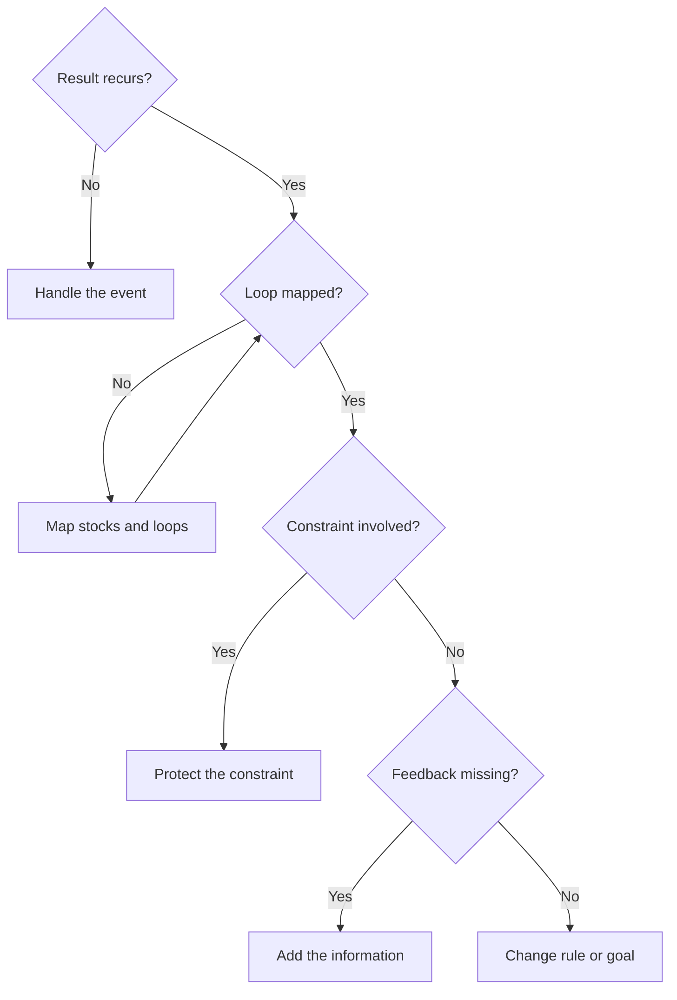

Then score the candidates:

| Criterion | Question | Warning sign |
|---|---|---|
| Level | Where on the leverage list does it act? | Every option is a parameter |
| Reach | How many people or decisions does it change? | Only the person in front of you |
| Durability | Does it keep working when you stop attending to it? | It needs your presence weekly |
| Delay | When will the effect show, and will you still be measuring? | No date for checking |
| Cost to you | Your hours, now and ongoing | It grows with the organization |
| Resistance | Who loses something? | Nobody objects: it may change nothing |
| Direction | Could it strengthen the loop you want to weaken? | It rewards the behavior producing the problem |

Two rules of thumb, both **this book's recommendation**. When two interventions are close, prefer the
one that adds information or changes a rule over the one that changes a number. And when you are the
constraint, the first intervention is on your own calendar.

### Trade-offs

**Leverage against speed.** Structural changes often take a quarter to show. When an expert is about to
burn out this month, low-leverage relief (time off the rotation, pay for the nights) is right, as long as
it comes with the structural change and is not mistaken for it.

**Leverage against resistance.** A rule making experts escalation-only costs them status and costs the
team restore speed. Budget the political work with the technical work, and expect the objection to
arrive as a reasonable-sounding exception.

**Visible against structural action.** Visibility is not worthless: people in an incident want to see
that leadership cares, and a director who never appears loses the trust structural work needs. Choose
some visible presence deliberately; spend most hours on structure.

**Modeling against acting.** Modeling can become a way to avoid deciding. A rough loop checked against
data is usually enough.

### Failure Modes

**Parameter tinkering.** Every response is a number: a higher stipend, a new target. Signal: the problem
returns after each adjustment. Countermeasure: require one non-parameter option in every proposal.

**The hero loop.** Recognition goes to whoever fixed the 2 a.m. outage, not to whoever wrote the runbook
that meant nobody had to. Signal: the same names in every incident and every award. Countermeasure:
publicly recognize work that removed the need for heroics.

**Optimizing a non-constraint.** Faster builds for a service while every release waits on a manual
approval. Signal: local measures improve, the end-to-end result does not. Countermeasure: name the
constraint before approving improvement work.

**Ignoring delays.** An intervention is judged a failure after two weeks and reversed; hires arrive after
the pain has passed. Signal: oscillating policies. Countermeasure: state the expected delay and a
review date when making the change.

**The accidental diminisher.** A capable manager or staff engineer answers every question and becomes the
constraint. Signal: decisions wait for one person; others stop proposing. Countermeasure: count the
decisions that need you, and hand some away each quarter.

**Pushing the lever backward.** Adding approval steps after a failure makes batches bigger and failures
worse (Chapter 27 has the release-train version). Countermeasure: trace each intervention once around
the loop before committing.

### Enterprise Application

In an organization of 50 to 150 engineers, the director's leverage comes almost entirely through other
people and through structure.

**The director's portfolio** is mostly rules, information, and goals: decision rights for staff
engineers, what the weekly operational review shows, which outcomes managers answer for. The director's
calendar is a system to manage, and the director is often the organization's first constraint.

**Managers model their own teams.** Each engineering manager should be able to name their team's
critical stocks (experienced responders, people at risk of leaving) and the loop most likely to hurt
them in two quarters. That question would have surfaced Billing's concentration before it reached three
people.

**Staff engineers as leverage.** Northstar's three staff engineers own no components and have no
mandate. In the baseline, Ines Carvalho (staff engineer, core domain) spent about eight hours a week answering unscheduled questions
about Core (**illustrative**, consistent with the staff engineers' 20 percent unplanned share). Answering
questions one at a time is the lowest level of work; writing the boundary rules for a Core module and
reviewing others' decisions against them reaches every team. Chapter 29 covers the staff role.

**Organization-level stocks** that change slowly and matter most: people who can safely change
critical systems, managers who can run their teams without escalating, and trust between engineering
and product. Report them, even roughly, beside delivery measures (Chapter 37).

### CTO Perspective

At executive scale the highest-leverage interventions are goals, company-wide rules, and the beliefs
behind them. A CTO who acts as if reliability is every team's job, not the experts', has changed a
paradigm; one who funds a stipend increase has changed a parameter.

**Translating requests.** Boards and executive peers ask for numbers: headcount, a target, a budget
line. "Add ten engineers" is a stock inflow with a delay of months and an attrition outflow; the useful
question is which loop those engineers would change, and whether a rule change would do it faster.

**Company-wide stocks.** The CTO owns stocks that directors cannot see whole: talent across teams, the
architecture's capacity to absorb change, and engineering's credibility. These drain quietly under
pressure. A proposal to delay backfills to hold expense flat is a decision to let the experienced
engineer stock fall while workload holds, which strengthens every concentration loop at once.

**The CTO's own leverage.** A CTO who approves architecture decisions, joins every Sev1, and answers
every escalation is the organization's most expensive constraint. The calendar should be dominated by
goals, rules, the people who run the organization, and the information it steers by.

### Practical Playbook

1. **List the recurring results.** The three problems that have come back at least twice in two
   quarters. Ignore one-off events.
2. **Map each as stocks and loops**, one page per problem, and check every arrow against data.
3. **Name the delays.** Estimate how long each flow takes to respond, and write it down.
4. **Find the constraint.** Ask what the result waits on. If it is a person, including you, say so.
5. **List interventions at several levels**: at least one parameter, one information flow, one rule.
   If you can only think of parameters, return to step 2.
6. **Score them** with the decision table.
7. **Audit your calendar.** Sort a fortnight of your hours by leverage and move hours from the lowest
   band to the highest, protected on the calendar. (Chapter 1's audit sorts hours by job; this one
   ranks them by leverage.)
8. **Change one rule and one information flow**, visibly, saying what you expect to see and when.
9. **Review at the stated delay.** If the loop has not weakened, revisit the map, not only the
   intervention.
10. **Hand away decisions each quarter.** Count the decisions that need you, and reduce the count.

### Case Study

This case is **fictional**. It is set in the twelve months before the director arrives at Northstar
([baseline data](#page-case-studies-northstar-baseline-data)).

At the start of that year, Billing had four engineers trusted with ledger incidents. The rotation
nominally covered all thirteen, but ledger and invoicing pages were escalated to the four almost by
reflex, because they restored fastest. Nine months before the director arrived, one of the four
resigned. The backfill started 15 weeks later and, because the remaining three were rarely free to pair,
was not on the rotation by the end of the baseline quarter.

The previous management responded three times. It raised the on-call stipend. After each serious Billing
incident it added an alert; some became the no-action pages that made up about a third of the quarter's
180. And it asked the experts to "document as they go", without giving them time. Each response was
reasonable, and each was a parameter or an addition to the loop's inflow. None changed who learned from
a page.

By the baseline quarter, the result looked like a performance problem: the highest incident count in
the organization (8), six recurrences, and a median restoration time more than twice the organization's.
A manager reading only those numbers might conclude the team needed more discipline, the attribution
error Repenning and Sterman describe. The loop said otherwise: the experts were doing exactly what the
system rewarded, and each quarter made the system more dependent on them.

The same structure appeared elsewhere. Ines Carvalho, with eleven years on Core, spent about eight hours
a week answering questions that a written module boundary would have answered once, and nobody owned
the information flow that would have shown the cost.

### Exercises

Solutions are in [chapter 3 solutions](#page-solutions-ch03-solutions). Data files are linked from
the [Northstar baseline page](#page-case-studies-northstar-baseline-data).

#### Foundational

**F1.** Draw a stock-and-flow map for "engineers who can safely respond to a Billing ledger incident"
at Northstar. Use this chapter's figures (four experts at the start of the year, one departure, a
15-week backfill delay) and state your own assumption for how long a new engineer needs to become a
safe responder with and without pairing. Predict the stock at the end of the next two quarters under
both assumptions, and say which flow the director can change fastest.

**F2.** Marcus Oyelaran's team (he manages Billing) proposes eight responses to its on-call load: a higher stipend, a second
weekly incident review, a hiring request, a no-action-page purge, a published pages-per-person chart, an
escalation-only rule for experts, a quarterly award for best incident response, and protected runbook
time. Place each on the leverage table, identify any that would strengthen the concentration loop, and
explain your reasoning for the two hardest to classify.

**F3.** Suppose that in a later quarter Northstar's release working group finds that every Core module
boundary decision waits for Ines Carvalho, and proposes cutting 20 minutes from the Core pipeline to
"improve flow". Identify the constraint, say whether the pipeline work raises output, and propose two
ways to get more from the constraint without asking Ines to work longer hours.

#### Applied Leadership

**A1.** An **illustrative** 45-hour week for a new director: status meetings 9 hours, joining incident
calls 5, personally approving technical changes 4, one-on-ones with nine direct reports 4.5, product
and customer meetings 6, email and chat 8, hiring interviews 3, unscheduled 5.5. Rank the categories by
leverage, redesign the week to free at least ten hours, and say what each freed hour goes to and what
risk each change carries.

**A2.** Ines Carvalho is respected, fast, and answers every Core question herself within minutes. Two
senior Orders engineers say they no longer propose designs because "Ines will know better". Plan a
conversation with Ines that treats this as a systems problem rather than a character flaw: what you ask,
what data you bring, what mandate you offer, and how you will know in a quarter whether anything
changed.

**A3.** Marcus asks you to approve doubling Billing's on-call stipend, arguing it is the only thing he
can do this week and that one of his experts is close to leaving. Decide, and write the reply. Address
the immediate retention risk, the structural change you want alongside it, and how you will keep the
stipend from becoming the whole response.

#### Executive Decision-Making

**X1.** You are Northstar's CTO. Rajiv Menon (CFO) proposes delaying all backfills by one quarter to
hold operating expense flat. Using this chapter's attrition and backfill figures, and assuming $185,000
fully loaded per engineer-year, estimate the capacity cost, describe which loops the delay would strengthen, and write a short recommendation to Helena Marsh
(CEO) with an alternative that serves the CFO's goal.

**X2.** As CTO you can sponsor one company-wide intervention this year: a rule that no engineer may be
first responder for more than a set share of a team's after-hours pages, enforced through the monthly
review; or a published monthly dashboard of on-call load, decision wait times, and attrition by team,
with no rule attached. Choose one, place each on the leverage list, and say what would make you switch
after two quarters.

### Reflection Questions

1. Which result in your organization has come back at least three times? What loop regenerates it, and
   who benefits from the loop as it is?
2. Which of your regular activities is the most visible and the least leveraged? Who would notice first
   if you stopped it for a month?
3. Where are you the constraint? How many decisions waited for you last week that a rule could have
   settled?
4. Which stock in your organization is draining too slowly for anyone to notice?
5. Whose heroics does your organization reward, and what would it take to reward the work that made
   heroics unnecessary?

### Key Takeaways

- Treat a recurring result as the output of a structure: map stocks, flows, and loops before choosing an
  intervention.
- Stocks of experience and trust fill slowly and drain quickly; act first on the flows you control
  fastest.
- State the delay of every intervention, and review it at that delay, not before.
- Rank interventions by leverage (effect, reach, durability, your hours). Visibility is a separate axis
  and usually points the wrong way.
- Prefer changing rules and information flows to changing numbers, and expect resistance to rise with
  leverage.
- Find the constraint, including when it is a person, and stop investing where it is not.
- Under pressure, protect improvement time; cutting it is how teams and managers enter the capability
  trap.
- Audit your own calendar as part of the system, and hand decisions away every quarter.

### References and Further Reading

- [Meadows, 1999](#meadows1999leverage). "Leverage Points: Places to
  Intervene in a System". The ranked list this chapter adapts; short, free, and the best single reading
  on leverage.
- [Meadows, 2008](#meadows2008thinking). *Thinking in Systems*. The
  longer introduction to stocks, flows, and feedback.
- [Repenning and Sterman, 2001](#repenning2001nobody). The capability
  trap, worse-before-better dynamics, and why managers blame people for structural shortfalls.
- [Perlow, 1999](#perlow1999time). How a software team's shared use of
  time and its reward for heroics kept it short of time.
- [Goldratt and Cox, 1984](#goldratt1984goal). *The Goal*. Constraint
  thinking, taught as a novel.
- [Grove, 1983](#grove1983high). *High Output Management*. Managerial
  output; Chapter 1 develops it.
- [Wiseman, 2010](#wiseman2010multipliers). *Multipliers*. Leaders who
  draw out others' capability, and those who underuse it.
- [Cook et al., On-Call](#cook2018oncall), in the free *Site Reliability
  Workbook*. On-call load limits and rotation sizing.

<a id="page-parts-01-foundations-04-the-leadership-ladder"></a>

## Chapter 4 — The Leadership Ladder: Senior Engineer to CTO

This chapter is a map of the roles between senior engineer and chief technology officer: what each
one is responsible for, how far ahead it looks, what it produces, and how it typically fails. It then
takes on two questions the map raises. How do you tell whether a manager at any level is effective,
rather than merely busy? And how should an experienced engineer choose between the management track
and the staff-plus track, and switch later if the choice was wrong? The running example is Northstar
Technologies, the fictional company in the [case study](#page-case-studies-northstar-index).

This chapter is the map. Chapter 8 covers career ladders and promotion, Chapter 29 staff-plus roles,
and Chapters 40, 47, and 50 the director, VP, and CTO roles. Chapter 1 defines managerial output; this
chapter shows how to measure it.

### Why This Matters

On a single team, role confusion is cheap. Everyone can see who decides what, and a mismatch is fixed
in a conversation.

In an organization of 50 to 150 engineers, undefined roles become structural. Two people believe
they own the same decision, or nobody does. Strong engineers are promoted into management because it
is the only visible step up. Staff engineers without a mandate drift between advising and
firefighting. Managers judged on what their teams ship are rewarded for activity, not for building a
team that will still work next year.

At executive scale, the ladder is the CTO's design problem. Which roles exist, what each is
accountable for, and how people move between tracks decide whether the organization produces its next
generation of leaders or imports them. Northstar has six managers, three staff engineers with no
defined mandate, a director, and a CTO, and no written description of what most of them are for.

### Learning Objectives

After this chapter you will be able to:

- Describe the scope, time horizon, primary output, and main failure mode of each role from tech lead
  to CTO, and of the staff-plus roles beside them.
- Diagnose the level at which a person is actually operating from their calendar and decisions,
  independent of their title.
- Measure a manager's effectiveness with a small set of outcome, health, and leverage evidence, and
  explain why team activity is not that measure.
- Choose between the management and staff-plus tracks using explicit criteria, and design a switch
  between them with a trial period and a return path.

### The Mental Model

> **Mental model:** Each step up the ladder trades direct output for leverage and lengthens the delay
> before you learn whether you were right. Measure each role on the outcomes it is positioned to
> change, over the horizon it works on.

Two quantities change as you move up either track. **Scope** grows: from a component, to a team, to
several teams, to the whole of engineering and its place in the company. **Time horizon** grows with
it: a tech lead's decisions show their consequences in weeks, a director's in quarters, a CTO's in
years. Everything else about the role follows from these two. The primary output shifts from work
you did to work others did because of decisions you made, and the main failure mode at every level is
to keep doing the previous level's job, because that job still gives fast feedback.

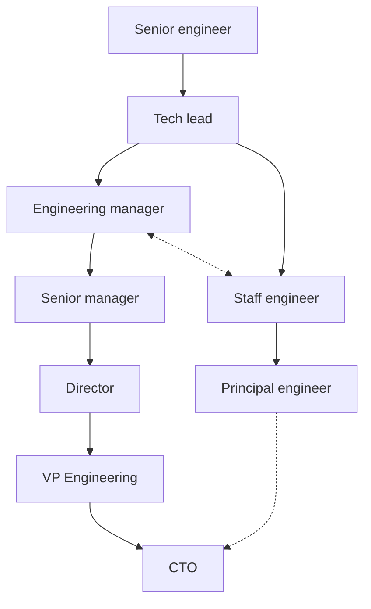

The solid lines are the usual promotions. The dotted line between manager and staff engineer is the
switch this chapter plans for. The dotted line from principal engineer to CTO marks that some CTOs come
from the technical track, which depends on the company's CTO archetype (Chapter 50). Tech lead appears
as a step because, in many companies, it is where people first try both kinds of work; it is a role,
not always a level.

### Deep Conceptual Explanation

#### The ladder, level by level

The table below is **this book's recommendation**, built on practitioner descriptions rather than
research ([Fournier, 2017](#fournier2017manager);
[Larson, 2021](#larson2021staff);
[Larson, 2024](#larson2024primer)). The time horizons are typical
ranges, not rules.

| Role | Scope | Time horizon | Primary output | Main failure mode |
|---|---|---|---|---|
| Tech lead | One team's technical work | Weeks to a quarter | Sound technical decisions the team executes | Writes the hard parts alone; becomes the bottleneck |
| Engineering manager | One team: people, delivery, health | One to two quarters | A team that delivers and keeps improving without them | Acts as the team's best engineer or its ticket router |
| Senior manager | Several teams, through managers | Two to four quarters | Managers who run their teams well | Manages the managers' teams directly |
| Director | 50 to 150 engineers; one area | One year | An organization whose system produces the outcome | Runs on reports' summaries; fixes symptoms team by team |
| VP Engineering | All or most of engineering | One to two years | Portfolio allocation and a leadership bench | Becomes a large director; no peer-level influence |
| CTO | Technology and its role in the company | Two years or more | Technical strategy the executive team acts on | Advocates for engineering instead of solving the company's problem |
| Staff engineer | A domain or problem across teams | One to four quarters | Technical direction others adopt | Roaming critic, or the overloaded hero who fixes everything |
| Principal engineer | A company-critical domain | One to three years | Direction for the domain; leaders grown in it | Architecture by decree, detached from delivery |

Three cautions apply. Titles vary: Larson defines the engineering executive as the person responsible
for all of engineering, whatever the title, which companies use inconsistently ([Larson, 2023a](#larson2023executive-job)).
Small companies compress levels. And staff-plus rows hide several archetypes (Tech Lead, Architect,
Solver, Right Hand), each with a different scope ([Larson, Staff archetypes](#larson-staff-archetypes)).
Chapter 29 treats them.

#### What changes at each step

**What you produce.** A senior engineer's output is visible: code, designs, fixed incidents. A
manager's output is the team's output plus what the team can do next quarter that it cannot do now. A
director's output is mostly decisions about structure, staffing, and allocation that others carry out.
Chapter 1 develops Andrew Grove's idea that a manager's output is the output of the organization under
their influence ([Grove, 1983](#grove1983high)).

**How long feedback takes.** Larson describes staff work as having feedback loops of weeks, months,
and years rather than the quick cycle of shipping code
([Larson, What do Staff engineers actually do?](#larson-staffeng-actually-do)).
The same holds for managers: a director who restructures ownership learns whether it worked two
quarters later, and is tempted to fill the gap with the previous level's fast-feedback work.

**Whose problem you solve.** At the top, Larson argues that the CEO, the executive peers, and the
engineering organization each see a valid but incomplete version of the problem, and that the
executive's job is to merge them and solve the company's problem rather than advocate for engineering
([Larson, 2023b](#larson2023balancing)). This is **expert opinion**.

#### The staff-plus track in parallel

The staff-plus track exists so that technical leadership is not reachable only through people
management. Larson lists the core of staff work as setting technical direction, mentorship and
sponsorship, providing engineering perspective in decisions, exploration, and the coordinating work
that keeps projects moving, with less coding than before
([Larson, What do Staff engineers actually do?](#larson-staffeng-actually-do)).
He also notes that some companies have no technical leadership pattern and push every experienced
engineer toward management ([Larson, Staff archetypes](#larson-staff-archetypes)).

The tracks differ in accountability. A manager answers for people outcomes (hiring, growth,
performance, retention) and has formal authority over them. A staff engineer answers for technical
outcomes across a scope they do not manage, and works mainly through influence; Larson warns that
people overestimate how much formal authority helps
([Larson, Where do Staff-plus engineers fit?](#larson-staffeng-reporting)).
A staff role without scope, sponsor, and reporting line has neither lever, which is Northstar's
starting position.

#### Measuring managerial effectiveness

The common error is to measure a manager by the team's **activity**: deployments, tickets closed,
story points, one-on-ones held, roadmap items shipped. Activity is easy to count and partly under the manager's control. It is not the manager's
output, for three reasons.

1. **Attribution.** Team results depend on the system the team sits in. At Northstar, the book's
   fictional company, Orders and Billing ship most changes inside Core, a shared monolith released on a
   fixed two-week schedule (the [release train](#release-train)). Their
   [lead time](#lead-time) (commit to production) and failure rate therefore describe
   the train more than the teams ([baseline data](#page-case-studies-northstar-baseline-data)).
   Neither manager could have changed the train alone.
2. **Lag.** The most important managerial work (hiring, growing people, clarifying ownership) shows in
   results one or two quarters later. A measure taken this quarter credits the previous manager.
3. **Gaming.** Every activity measure can be raised without improving anything: more, smaller
   deployments; tickets split; one-on-ones held and empty. Chapter 18 treats metric gaming generally.

What do managers measurably affect? Chapter 1 summarizes the evidence that managers matter: the
clearest effect is on retention ([Hoffman and Tadelis, 2021](#hoffman2021people)),
with behaviors such as coaching and career development listed by Google's Project Oxygen
([Google re:Work](#rework-great-managers)).

That evidence points to a practical conclusion (**this book's recommendation**): measure a manager on a
small set of evidence across four areas, over at least two quarters, and read it in context.

| Area | Evidence | Typical gaming, and the counter |
|---|---|---|
| Unit outcomes | The team's agreed outcome measures (reliability, delivery against commitments), with the trend and the context | Renegotiated commitments; pair with what was originally promised |
| Team health | Regretted attrition; upward feedback on manager behaviors; concentration of on-call and critical knowledge | Pressure on survey answers; keep feedback anonymous and read comments, not scores |
| People growth | Who can now do what they could not two quarters ago; promotions earned elsewhere; a successor | Inflated promotions; calibrate across managers (Chapter 8) |
| Leverage | Problems solved across team boundaries; decisions that held; ownership clarified | Self-reported heroics; ask the neighboring teams |

Activity data is still useful as a question, never as a score.

#### Choosing a track

Chapter 2 covers the evidence on promotion selection
([Benson et al., 2019](#benson2019promotions)): firms tend to promote
on current performance, so being the best engineer on a team is weak evidence of being its best
manager.

For the individual, the decision is about the work, not the status. Charity Majors argues that
management is a change of profession rather than a promotion, that it is highly interruptive, and that
moving deliberately between engineering and management over a career makes people better at both
([Majors, 2017](#majors2017pendulum)). That is **expert opinion**. The
decision framework below turns it into criteria.

### Engineering Organization Example

!!! info "Northstar so far"
    Week 1 of the Engineering Director's first year. The CTO, Victor Lindqvist, has asked the director
    to halve Sev1 and Sev2 incidents (the two most serious levels) within twelve months with flat
    headcount. Six managers and three staff engineers report to the director. See the
    [timeline](#page-case-studies-northstar-timeline).

Northstar's role structure as the director finds it. All figures are **illustrative**, from the
[baseline data](#page-case-studies-northstar-baseline-data).

**Spans.** The six teams hold 77 engineers, about 13 per manager, from 11 (Data and Analytics) to 15
(Customer Experience). This book's recommendation (Chapter 1) is that people work crowds out the rest
above about eight to ten reports; Chapter 34 covers [span of control](#span-of-control)
and Chapter 33 team sizing. A manager with 12 to 15 reports has little time for people growth and
leverage.

**Tech leads.** A tech lead per team of six to ten engineers (**this book's recommendation**) gives
eight to twelve for 77 team engineers. Northstar has none with the title; each team relies
on one or two senior engineers informally, with no definition of what they decide.

**Staff engineers.** Three for 80 engineers, one per about 27. They report to the director (nine
direct reports in all) but own no components and have no mandate.

**Measuring the managers.** Suppose the director ranked the six managers on activity. Customer
Experience deploys 26 times a month and Payments and Integrations 22; Billing deploys 8 times. On that
view Daniel Cho is the strongest manager and Marcus Oyelaran the weakest. Now apply the four areas.

| Manager | Activity view | What the four areas would ask |
|---|---|---|
| Daniel Cho, Customer Experience | Most deployments (26 a month) | 44 [escaped defects](#escaped-defect) (bugs found after release); one manager for two platforms and 15 people. Health and growth unknown |
| Elena Sokolova, Payments and Integrations | Shortest lead time among product teams (4 days) | Best operational discipline; is it written down and owned by the team, or held by a few people? |
| Marcus Oyelaran, Billing | Fewest deployments (8), most Sev1 and Sev2 incidents (8) | Three people carry most pages: a health and concentration risk he can change. Lead time is mostly the release train, which he cannot |
| Priya Raman, Orders | 11 deployments, 7 incidents | Promoted eight months ago; growth and leverage evidence matter more than one quarter's results |

The two views rank differently, and the second separates what each manager controls (on-call
concentration, people growth, ownership) from what the system controls (the release train). One quantity is worth computing. If Billing's
[unplanned work](#unplanned-work) fell from 41 to 30 percent of its 13 engineers,
about 1.4 [FTE](#fte) (full-time engineers) of capacity would return. That gain would be partly the manager's work and partly the
release train's, so the review asks what he changed, not only what moved.

### Decision Framework

For an engineer choosing between tracks, the table lists the criteria in order of weight (**this
book's recommendation**). The first three describe the person and the work; the last three describe
the organization.

| Criterion | Points toward management | Points toward staff-plus |
|---|---|---|
| What you want to be accountable for | People outcomes: hiring, growth, performance, retention | Technical outcomes across a scope you do not manage |
| What gives you energy | Conversations, conflict resolution, interrupt-driven days | Long, deep problems; writing; design across teams |
| Evidence from a trial | You have run one-on-ones, given hard feedback, and liked the result | You have led a cross-team technical decision without authority, and it held |
| Organizational demand | An open team, or a team too large for one manager | A defined staff role with scope, sponsor, and reporting line |
| Reversibility | The return path to engineering is real and stated | A move into management later is open |
| Motive check | Not chosen for pay or title alone | Not chosen to avoid people work you would do well |

The first criterion dominates. If someone wants the authority of management without its
accountability for people, neither track fits, and saying so is part of the conversation.

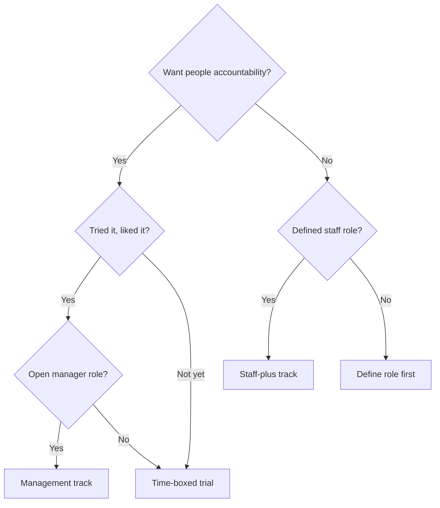

A **trial** means a bounded experience of the work before the title: leading a project with two or
three engineers, running one-on-ones for an intern or new hire, acting manager while a manager is on
leave, or owning a cross-team technical decision. **Define role first** means the organization owes
the engineer a scope, a sponsor, and expected outputs before asking them to choose a track that exists
only on paper.

Plan the switch back at the start: the trial length (this book suggests six to twelve months; Majors
argues that the best frontline managers are rarely more than two to three years from hands-on work),
the evidence reviewed, and the return role. A planned switch back is a career move; an unplanned one
looks like a demotion to everyone, including the person.

### Trade-offs

**Two tracks versus one ladder.** Two tracks let strong engineers grow without managing people. They
cost a second set of role definitions and cross-track calibration, and the staff track can become a
holding pen for people not made managers. One ladder is simpler and pushes the best engineers into
management, with the Peter Principle risk (Chapter 2): people promoted for doing their current job
well until they reach a job they do poorly.

**Separate tech lead versus tech-lead manager.** A separate tech lead frees the manager for people
work and gives engineers a step that tests leadership, at the cost of a coordination point. One person
doing both avoids the split but, Majors argues, is unstable because one job gets neglected.

**Outcome-based versus activity-based manager reviews.** Outcome evidence is fairer and harder to
game, but slow and dependent on the reviewer's judgment and context. Activity data is fast and
objective-looking, and measures the wrong thing.

**Defined versus open staff mandates.** A defined mandate gives leverage and a way to be evaluated,
and can lock someone into last year's problem. An open mandate allows exploration and, without a
sponsor, becomes advice nobody has to take.

### Failure Modes

**The default promotion.** The strongest engineer becomes manager because it is the only way up.
Signs: the new manager keeps the hardest technical work and cancels one-on-ones under pressure. Ask,
three months in, what the manager has stopped doing.

**Previous-level gravity.** People drift back to the level below because its feedback is fast: a
director reviewing pull requests, a VP running one team's planning. Detect it from the calendar: the
share of time on decisions only that level can make.

**The activity scorecard.** Managers are ranked by deployments, tickets, or roadmap items. Teams
respond by splitting work and avoiding hard, slow problems. Detect it when the best-ranked teams also
have the most escaped defects or the highest attrition.

**The mandate-less staff engineer.** A staff title with no scope or sponsor produces a roaming critic
or a hero pulled into every incident. Ask the staff engineer and their manager separately what the
staff engineer is accountable for this quarter; different answers confirm it.

**Title inflation at the top.** VP and director titles without the scope later block hiring a real
executive or force demotions. Detect it when a title's holder makes no decisions the level below
does not.

**The irreversible switch.** An engineer tries management with no return path, struggles, and leaves
rather than step back. Prevent it with written trial terms.

### Enterprise Application

At 50 to 150 engineers the ladder stops being informal. The director (Chapter 40) usually has six to
ten managers, a few staff engineers, and no senior-manager layer yet. Three decisions recur.

**When to add a manager-of-managers layer.** When the director's direct reports exceed what they can
coach and groups of teams share a domain. Too early inserts a messenger; too late leaves new managers
unsupervised.

**Where staff engineers report.** Larson weighs team fit (under team managers) against access to
information and authority (under senior leaders)
([Larson, Where do Staff-plus engineers fit?](#larson-staffeng-reporting)).
Reporting to the director works if each staff engineer has a defined domain and the managers know
what the staff engineer decides.

**How managers are reviewed.** On the four areas, twice a year, with anonymous upward feedback and
concentration measured from data, discussed with the manager before anything is written down.

### CTO Perspective

For the CTO, the ladder decides where future leaders come from. Four questions are the CTO's.

**Which roles exist and why.** A company of 80 engineers may not need a VP Engineering; one of 300
usually does. Because titles are used inconsistently
([Larson, 2023a](#larson2023executive-job)), define each role by its
responsibility, not market convention. Chapters 47 and 50 treat the VP and CTO splits.

**How leaders are evaluated.** Directors and VPs are judged on organizational outcomes over a year or
more, accepting that a good leader may have a bad quarter. The four areas scale up: organizational
outcomes, attrition and engagement, the leadership bench, and influence with executive peers.

**Parity between tracks.** If the top staff-plus level sits two levels below the top management level
in pay and access, engineers will read the ladder correctly: management is the real way up (Chapter 8).

**The CTO's own failure mode**: representing engineering to the executive team instead of solving the
company's problem with it.

### Practical Playbook

1. Write one paragraph per role, including informal ones such as tech lead: scope, time horizon,
   primary output, decision rights.
2. Mark roles that exist only on paper (title, no scope) and only in practice (scope, no title). Fix
   the second kind first; it is unrecognized work.
3. Give each staff-plus engineer a domain, a sponsor, and two or three outcomes for two quarters
   (Chapter 29 covers archetypes).
4. Review managers on the four areas over two quarters, in context, not on activity.
5. Collect anonymous upward feedback twice a year; read the comments with the manager; do not rank.
6. Measure concentration from data: pages per person, single-maintainer components, decisions that
   wait on one person.
7. Answer a request to manage with a time-boxed trial on written terms: length, evidence, return role.
8. Answer a request for staff-plus by confirming a defined role exists, or defining it.
9. Audit your own calendar monthly for previous-level gravity.

### Case Study

Northstar as the director finds it, with one decision set in quarter 2 (weeks 14 to 26). Everything
is fictional ([overview](#page-case-studies-northstar-index)).

**Roles as found.** Northstar's only written role document is a wiki page, "Engineering levels", with
a paragraph for each of three engineering levels: Engineer, Senior Engineer, and Staff Engineer. The
staff paragraph describes a "recognized technical expert" and names no scope or output. The only
description of the manager role is one shared line, "lead a team of engineers to deliver high-quality
software", with no manager-specific review criteria. Managers have been reviewed once a year on their
teams' roadmap delivery, which last quarter was 7 of 17 committed items. There is no tech lead role. The director's own role is defined by the CTO's
one-sentence mandate and a hiring brief. There is no VP Engineering: Victor Lindqvist, the CTO, has
the director as his engineering leader.

**What the first quarter did and did not settle.** In the first quarter the director ran a quality
program to cut incidents (Chapter 27). It gave the three staff engineers mandates: Kwame Mensah release
and detection, Ines Carvalho Core module boundaries and contract tests, Li Na Zhou migration and
configuration safety. Each also owned matching engineering standards, with a rule that questions on
them are decided within ten working days. None says what they own once the quality program ends, how
they are evaluated, or how their authority relates to the managers whose teams change the code they
govern. Chapter 29 develops those questions.

**A track question in quarter 2.** Rafael Duarte, a senior engineer
in Orders, lost the Orders manager role to Priya Raman (Chapter 2); since week 2 he has shared
review ownership of core/order-capture. After the first quarter he asks
the director whether to try for management again or work toward staff engineer. Priya is staying,
there is no other open manager position, and the staff role has no definition he could aim at.

The decision framework exposes the problem. Four criteria are about Rafael and need a
conversation: the accountability he wants, what energizes him, what he has tried, and why he is
asking. Two are about Northstar, and Northstar fails both: no opening or defined staff role, and no
stated return path from management. Having lost the role once, is he drawn to the work or to the
title? Before Rafael can choose well, the organization has to decide
whether it has a tech lead role, what its staff engineers are for, and whether a manager trial is
possible without an open team. Exercise A1 asks you to have the conversation.

### Exercises

Solutions are in [chapter 4 solutions](#page-solutions-ch04-solutions).

#### Foundational

**F1.** Greg Tanaka, VP Sales, tells the CEO that Daniel Cho is clearly Northstar's best manager and
Marcus Oyelaran its weakest, because Customer Experience deploys 26 times a month and Billing 8. Write a short reply to the CEO explaining what the
numbers do and do not show about the two managers, and what evidence you would look at instead.

**F2.** A newly promoted director's calendar for one week contains: six hours reviewing pull requests
in one team, a two-hour planning session with a single team, four one-on-ones with managers, one hour
with the CFO's analyst on next year's budget, and three hours debugging a production incident as an
individual responder. Identify which items belong to the director's level, which to lower levels,
and what the pattern predicts if it continues for two quarters.

**F3.** Northstar has no formal tech lead role, and each team relies on one or two senior engineers
informally. Write the one-paragraph definition of a tech lead for Northstar: scope, decision rights,
time horizon, primary output, and how it differs from the manager's role. Then say whether every team
should have exactly one.

#### Applied Leadership

**A1.** Rafael Duarte, senior engineer in Orders, who lost the manager role to Priya Raman, asks you
in quarter 2 whether to pursue management or staff engineer. There is no open manager role and no
defined staff role. Plan the conversation: what you need to learn from him, what you can honestly offer, what
trial you could set up within Northstar's constraints, and what you must fix in the organization first.

**A2.** Design the review of Northstar's six engineering managers for the end of quarter 2, replacing
the annual review on roadmap delivery. Specify the evidence in each of the four areas for at least two
managers (one of them Priya Raman, promoted eight months before you arrived), how you will separate
what each manager controls from what the release train controls, and how you will avoid ranking.

**A3.** Northstar's three staff engineers hold transformation mandates but no standing scope beyond
them, and report to you. Propose, for each of them, a scope, a sponsor, and two outcomes for
the next two quarters, and decide whether they should keep reporting to you. State how a manager
should resolve a disagreement with a staff engineer about a change in that manager's team.

#### Executive Decision-Making

**X1.** Victor Lindqvist is considering creating a VP Engineering role above the director, arguing
that the board expects one and that he wants more time for technical strategy. Northstar has 80
engineers, six managers, and one director. You are advising Victor. Recommend whether to create the
role now, what it would be accountable for if created, and what you would do instead if not.

**X2.** Suppose that at the end of the director's first year, Helena Marsh asks Victor how he will judge whether
the director has been effective. [Sev1 and Sev2](#severity-sev1-sev2-sev3) incidents have fallen, but one strong manager has left
and two staff engineers say they are still unsure of their mandate. As Victor, write the evaluation
approach: which evidence you weigh, over what horizon, and how you separate the director's
contribution from the system's.

### Reflection Questions

1. Which role in your organization exists only on paper, and which exists only in practice? Who is
   doing unrecognized work because of it?
2. If your manager reviewed you only on your team's activity last quarter, what would they conclude,
   and what would they miss?
3. What work from your previous level do you still do because it gives you fast feedback?
4. If you moved to the other track tomorrow, what would you be bad at for the first six months, and
   would you stay long enough to get good at it?

### Key Takeaways

- Each step up widens scope, lengthens the feedback delay, and shifts output to what others do
  because of your decisions.
- The main failure mode at every level is doing the previous level's job, because it still gives fast
  feedback. Check the calendar.
- Measure managers on unit outcomes, team health, people growth, and leverage, over at least two
  quarters and in context. Use activity data only to prompt questions.
- Being the best engineer is weak evidence of being the best manager. Judge managerial potential
  separately.
- Choose a track by the accountability you want, the work that energizes you, and evidence from a
  trial; then check that the organization has a real, defined role.
- Plan every track switch with a trial length, the evidence reviewed, and a stated return path.
- A staff role without scope, sponsor, and reporting line has neither authority nor a way to be
  judged. Define it before you fill it.

### References and Further Reading

- [Fournier, 2017](#fournier2017manager). *The Manager's Path*: the
  management levels from tech lead to senior leadership.
- [Larson, 2021](#larson2021staff). *Staff Engineer*: the staff-plus
  track; mostly free at staffeng.com. Pages cited:
  [Staff archetypes](#larson-staff-archetypes),
  [What do Staff engineers actually do?](#larson-staffeng-actually-do),
  and [Where do Staff-plus engineers fit?](#larson-staffeng-reporting).
- [Larson, 2024](#larson2024primer). *The Engineering Executive's
  Primer*: the executive role. Draft chapters cited:
  [Larson, 2023a](#larson2023executive-job) on inconsistent executive
  titles, and [Larson, 2023b](#larson2023balancing) on balancing the
  CEO, peers, and engineering.
- [Larson, 2019](#larson2019elegant). *An Elegant Puzzle*: team sizing
  and organizational design.
- [Grove, 1983](#grove1983high). *High Output Management*: managerial
  output as the organization's output.
- [Hoffman and Tadelis, 2021](#hoffman2021people). People management
  skills and attrition in one firm: the strongest evidence here on what managers change.
- [Google re:Work](#rework-great-managers). Google's own
  account of Project Oxygen and manager behaviors.
- [Benson et al., 2019](#benson2019promotions). Promotions and the
  Peter Principle: why top performers are not automatically top managers.
- [Majors, 2017](#majors2017pendulum). The engineer/manager pendulum:
  switching tracks deliberately.


---

# II. People Management

<a id="page-parts-02-people-management-05-one-on-ones-coaching-and-mentorship"></a>

## Chapter 5 — One-on-Ones, Coaching, and Mentorship

This chapter is about the manager's most frequent private conversation and what it is for. It treats
the one-on-one as an information channel that has to be designed and checked, not a ritual that is
done because it is on the calendar. It then separates four ways of helping a person grow (directing,
coaching, mentoring, and sponsoring) and shows how to choose among them, and it ends with the
lightweight record that turns months of conversations into evidence for reviews and promotions.
Feedback and difficult conversations belong to Chapter 6 (Feedback, Conflict, and Difficult
Conversations), and performance management to Chapter 9. The
running example is Daniel Cho, who manages Customer Experience at Northstar Technologies, the
fictional company in the [case study](#page-case-studies-northstar-index).

### Why This Matters

At team scale, the one-on-one is where a manager hears what nothing else will say: that a senior
engineer is bored, that two people have stopped speaking, that a design decision is being quietly
worked around. Chapter 2 described the manager's feedback loop as slow, shared, and filtered
([Chapter 2](#feedback-that-is-slower-and-noisier)).
The one-on-one is the main tool against the filtering. When it decays into a status report, the
manager keeps paying the time and loses the information.

At organization scale, one-on-ones are a large, invisible budget. If each of 80 engineers meets their
manager weekly for 30 minutes, that is 40 manager-hours and 40 engineer-hours a week. Few
organizations check what that time buys.

At executive scale, promotion decisions, retention risks, and the bench of future leaders rest on
what managers know about their people. If that knowledge is memory of the last month, the
organization promotes the visible rather than the effective, and is surprised by resignations it
could have seen coming.

### Learning Objectives

After this chapter you will be able to:

- Design one-on-ones that surface information you would not otherwise get, with the agenda owned by
  the report and status moved elsewhere.
- Detect, from observable signals, when your one-on-ones have decayed into status meetings, and
  repair them.
- Choose between directing, coaching, mentoring, and sponsoring for a given person and situation,
  and say what each costs.
- Keep a lightweight, factual record of each person's work and growth that makes reviews and
  promotion cases evidence-based.
- Set a one-on-one cadence for a team from its size, its experience, and the manager's other
  commitments, with the arithmetic shown.

### The Mental Model

> **Mental model:** A one-on-one is an information channel owned by the report. Its value is the
> news it carries, things the manager could not have learned from the board, the chat, or the
> stand-up, and that news flows only while the report sees it acted upon.

The channel has two loops. In the healthy one, the report brings the topics, the manager learns
something and acts on it visibly, and the report brings harder topics next time. In the decay loop,
the manager opens with "what are you working on?", gets status available elsewhere, the meeting feels
like overhead, gets cancelled, and the report learns that real conversations happen somewhere else.

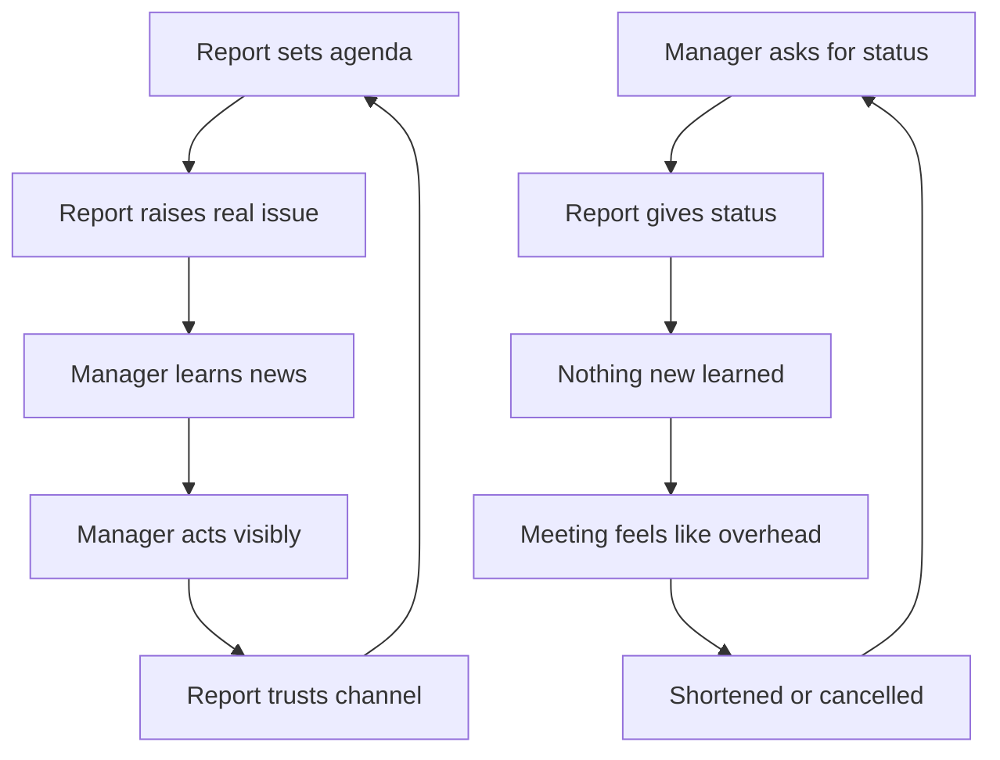

Both loops reinforce themselves, so a practice rarely stays in the middle. And because the channel's
value is news, measure it by news, not attendance: a manager who holds every one-on-one and learns
nothing has a perfect record and a broken channel.

### Deep Conceptual Explanation

#### What the evidence on one-on-ones says, and how much

The best available evidence says one-on-ones work when the report does most of the talking and sets
the agenda, but that evidence is thin. Peer-reviewed research on manager and report one-on-ones is
scarce. The most systematic work comes from Steven Rogelberg, an organizational scientist who has
surveyed managers and their reports. In a summary for a general audience
([Rogelberg, 2024](#rogelberg2024unlocking)), he reports that:

- nearly half of employees found their one-on-ones lacking in substance;
- the strongest predictor of value was the report's active participation, with the report speaking
  roughly half to nine tenths of the time;
- having a plan predicted effectiveness, and both sides rated meetings highest when the report created
  the agenda;
- managers' ratings of their own one-on-one skill appear inflated;
- the evidence fits weekly or every-other-week meetings.

Treat this as **expert opinion** informed by survey data: the summary does not describe samples or
methods.

Two points matter most. The report, not the manager, should decide what the meeting is about. And
the manager is the worst-placed person to judge whether it works, so check the channel with evidence.

The practitioner tradition agrees on the first point. Andrew Grove's *High Output Management* is
known for treating the one-on-one as the subordinate's meeting, with the subordinate's agenda, and as
high-leverage because of what it teaches the manager
([Grove, 1983](#grove1983high)). Camille Fournier and Julie Zhuo, in
their accounts of engineering and first-time management, are known for the modern form: the
one-on-one is for the person, not the project
([Fournier, 2017](#fournier2017manager);
[Zhuo, 2019](#zhuo2019making)). That is **practitioner consensus**:
valuable, and capable of being wrong together.

#### Designing the channel

The design below is **this book's recommendation**, built on those points.

**The report owns the agenda.** Keep a shared running document per person, newest entry at the top.
The report adds topics before the meeting; the manager adds theirs below. If the report's section is
empty, ask what is on their mind, and wait.

**Status goes elsewhere.** Status comes from the board, the pull requests, and a short written
update. A useful rule: nothing in the first ten minutes that a dashboard could have told you.

**A rotation of deeper questions.** People rarely volunteer career worries or frustration with a
colleague. When the agenda is light, use one: what is the most frustrating part of your week; what
kind of work do you want more of in a year; what am I doing that gets in your way.

**Visible follow-through.** Every commitment the manager makes goes into the shared document with a
date, and the next meeting starts by closing it. The report is watching what happens to the last
thing they raised.

**Shorten rather than cancel.** A one-on-one moved three times tells the report where they rank.

#### Detecting decay

The manager's own impression is unreliable, so check with signals that can be counted from the
running documents. The table gives the signals and how each can mislead.

| Signal | Healthy | Decayed | How it misleads |
|---|---|---|---|
| News rate: meetings where you learned something no other channel showed | A third or more | Under one in seven | Counting trivia as news; counting things you would have heard the next day anyway |
| Agenda source | Report adds topics most weeks | Manager's template every time | A report can fill the agenda with safe topics |
| Topics in the last six weeks | Work, people, growth, the manager | Work only | Careers discussed once, in a formal review, do not count |
| Cancellations and who cancels | Rare, rescheduled | Frequent; mostly the manager | A held but empty meeting looks better than a cancelled one |
| Surprises | Few, and you saw them coming | Resignation, conflict, or burnout learned elsewhere | Absence of surprises can mean nobody tells you anything |

The thresholds are illustrative, not research-based. The strongest signal is the last: learning
something important about a report from someone else is a data point about the channel. Also ask each
report, once a quarter and in writing, what the meetings should do more of and less of; weight
specifics over ratings.

#### Directing, coaching, mentoring, sponsoring

A manager helps a person in four distinct ways. Confusing them frustrates both sides.

| Mode | What the helper does | Whose knowledge drives it | Typical helper |
|---|---|---|---|
| Directing | Says what to do and how | The helper's | The manager, or a lead |
| Coaching | Asks questions so the person finds their own answer | The person's | The manager, a peer, a coach |
| Mentoring | Shares experience and advice | The helper's experience | Often someone outside the reporting line |
| Sponsoring | Uses influence to give the person opportunities and visibility | The helper's standing | Someone senior with a say in assignments and promotions |

**Directing** is not a failure of leadership. When the person lacks the knowledge, the mistake would
be costly, and time is short, telling is correct; it matches the lowest delegation levels in Chapter
2. Its cost is that people learn to wait for the answer. Liz Wiseman's idea of multipliers and
diminishers is the check: a leader who supplies every answer gets people who stop thinking
([Wiseman, 2010](#wiseman2010multipliers)).

**Coaching** helps when the answer is within the person's reach and the learning matters more than
the speed. A [meta-analysis](#meta-analysis) (a study that pools many studies) of
coaching in organizations found positive effects on all five outcome categories it examined:
performance and skills, well-being, coping, work attitudes, and goal-directed self-regulation. The
[effect sizes](#effect-size-d-g) ranged from moderate (coping) to large
(self-regulation)
([Theeboom, Beersma, and van Vianen, 2014](#theeboom2014coaching)).
A second, of 17 studies, found positive effects on learning and performance, stronger for internal
than external coaches; it deliberately excluded coaching by a person's own manager
([Jones, Woods, and Guillaume, 2016](#jones2016coaching)). These are
**research findings**, mostly about coaching programs. We found no meta-analysis of coaching by a
person's own manager, so whether a manager who also sets pay gets the same effects is open. People
are less candid about their weaknesses with the person who rates them.

**Mentoring** transfers experience: a first on-call shift, getting a design past a skeptical staff
engineer, whether to move teams. Meta-analyses associate mentoring with a broad range of favorable
outcomes, including career outcomes, but the effects are generally small, and small for objective
outcomes such as pay ([Allen et al., 2004](#allen2004mentoring);
[Eby et al., 2008](#eby2008mentoring)). These are **research
findings** from mostly correlational studies. Mentoring helps somewhat; it does not substitute for
opportunity.

**Sponsoring** turns development into advancement. Ibarra, Carter, and Silva distinguished
sponsorship from mentoring: a sponsor goes beyond advice and uses their influence with senior
executives on the person's behalf. They drew on a survey of more than 4,000 high-potential MBA
graduates, a follow-up survey, and 40 interviews. Men and women alike reported useful advice from
mentors, but mostly men described being sponsored, and the men had received 15 percent more
promotions at follow-up
([Ibarra, Carter, and Silva, 2010](#ibarra2010promotions)). It is
**industry research** about MBA graduates, not engineers, and the mechanism is the authors'
interpretation. The lesson travels: a person can be well mentored and still overlooked. For a manager,
sponsoring means proposing a report to lead a cross-team project and making their work visible in
rooms they are not in.

#### Choosing the mode

The choice depends on the situation, not on the person. The same engineer may need directing on a
production migration on Tuesday and coaching on a design on Thursday.

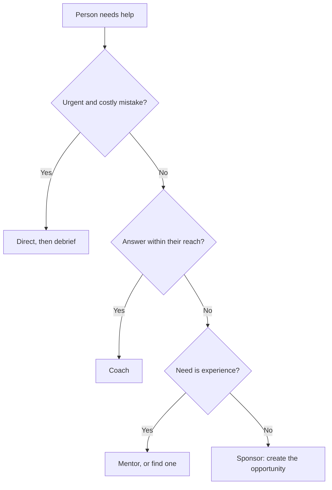

"Then debrief" matters: after directing in an emergency, the conversation afterward is a coaching
conversation about what the person would do next time. "Or find one" matters too: the manager is
rarely the best mentor for everything, and connecting a report with a mentor in another team is
often more useful than mentoring them yourself.

#### The record that makes reviews evidence-based

Reviews written from memory favor the recent and the vivid; a manager with fifteen reports cannot
remember what each did in February. A small record kept as a by-product of one-on-ones fixes most of
this. The format is **this book's recommendation**: one running document per report, with dated
entries written in five minutes after each meeting:

- **Topics the report raised**, in a line each.
- **Commitments**, both ways, with dates, and whether they were kept.
- **Observations**: specific behavior and its effect, with the date and the source. "Led the
  checkout incident review on 3 March; the follow-up actions all had owners" is evidence.
  "Strong communicator" is not.
- **Growth**: the person's stated goal, and what moved toward it this month.
- **Sponsorship actions**: opportunities you proposed them for, and the result.

What stays out: speculation about motives, health details, protected characteristics, and gossip.
Write as if the person will read it one day; your HR team can tell you whether they may.

Once a month, read each document and write three lines: what this person did, what they are working
toward, what you owe them. At review time, the record replaces recollection. Chapter 8 uses it for
promotion cases and Chapter 9 for performance problems.

### Engineering Organization Example

The figures below are **illustrative**, invented for Northstar (fictional). They work through the
cost of one-on-ones for Daniel Cho, who manages 15 engineers in Customer Experience, spends 45 percent
of his time on people management, and holds weekly 30-minute one-on-ones with each report
([baseline data](#page-case-studies-northstar-baseline-data)).

Assumptions: a 40-hour week; 10 minutes of preparation and notes per meeting; 4.33 weeks a month.

| Cadence | Meeting hours per week | Prep and notes per week | Total per week | Minutes per report per month |
|---|---|---|---|---|
| A. Weekly, 30 minutes (current) | 7.5 | 2.5 | 10.0 | 130 |
| B. Every two weeks, 30 minutes | 3.75 | 1.25 | 5.0 | 65 |
| C. Every two weeks, 45 minutes | 5.6 | 1.25 | 6.9 | 97 |
| D. Weekly 30 for 2 leads; every two weeks 45 for 13 | 5.9 | 1.4 | 7.3 | 130 (leads); 97 (others) |

Under A, one-on-ones take 10 of Daniel's 18 weekly hours of people time. Under D, people keep all or
three quarters of their face time, and Daniel recovers about 2.7 hours a week.

Frequency is a weak lever compared with content: cutting cadence alone saves hours and loses news,
while changing content is free. The case study's six-week sample shows it. Daniel held 84 meetings and
learned something no other channel showed in 11. Cadence D with a report-owned agenda would cost fewer
hours and, if it raised the news rate to one meeting in three (an assumption, not a forecast), carry
more news:

| Six weeks | Meetings | Person-hours (both people) | Meetings with news | Person-hours per item |
|---|---|---|---|---|
| Current: cadence A, status-led | 84 held, about 26 minutes each | about 73 | 11 | about 6.6 |
| Cadence D, report-owned agenda | 51 (12 leads, 39 others) | about 70 | about 17 | about 4.1 |

### Decision Framework

Three decisions recur: the cadence, whether a meeting has decayed, and which mode of help to use. The
mode decision is the diagram in the previous section. For cadence, decide per person, not per team.

| Factor | Pushes toward weekly | Pushes toward every two weeks |
|---|---|---|
| Time in role or on the team | Under six months | Established |
| Rate of change in their work | High (new project, incident load, reorganization) | Stable |
| Their role | Lead or person others depend on | Individual contributor with clear scope |
| Manager's span | Up to about eight | Twelve or more |
| Other contact | Little day-to-day contact | Daily contact in the same work |

These factors are **this book's recommendation**, consistent with the weekly-or-biweekly range
Rogelberg reports. Below every two weeks, the channel loses continuity: each meeting spends its first
part catching up. If a span forces less than that, the span is the problem (Chapter 34, Spans,
Layers, and Dependency Mapping, treats span).

For a series that feels flat, check the agenda source first: if it is yours, hand it back before
changing anything else. If it is theirs and the news rate is still low, the problem is probably
follow-through; look at what happened to the last three things they raised.

### Trade-offs

**Frequency against depth.** Weekly meetings keep continuity; fewer, longer ones leave room for career
and difficult topics. For a large span, a mix by person usually beats one cadence.

**Coaching against speed.** Asking takes longer than telling, and the person may reach a worse answer.
Coach when that cost is acceptable and the learning will be reused; otherwise direct, and say why.

**Manager as coach against manager as judge.** Some people will not be candid with the person who
sets their pay. Separate the conversations in time, say which one you are in, and give access to
coaching or mentoring outside the line.

**Sponsorship against fairness.** Sponsoring is choosing someone over others. Done informally, it
favors the visible and those most like the sponsor. Keep a sponsorship line in every record and
review each quarter who has had none.

**Records against trust.** Notes that feel like a file being built against a person damage the
channel. A shared agenda, factual observations, and no surprises at review time keep the record an aid.

### Failure Modes

**The status meeting.** Signal: the agenda is the manager's template, and six weeks of notes contain
no career or people topics. Repair: move status to a written update and hand the agenda back.

**The therapist without follow-through.** The manager listens well and nothing changes. Signal: the
same topic in three meetings with no action recorded. Repair: write the commitment and date; report
back at the start of the next meeting.

**The cancellation spiral.** One-on-ones are the first thing moved when the week fills. Signal: fewer
than about four in five held, mostly cancelled by the manager. Repair: shorten instead of cancelling.

**Coaching theater.** Leading questions to which the manager already knows the answer. Signal:
questions ending in "don't you think?". Repair: if you have the answer and it matters, direct, and say so.

**Mentoring without sponsoring.** A strong engineer gets advice for two years and no opportunity.
Signal: an empty sponsorship line beside a stated goal. Repair: one concrete opportunity this quarter.

**The memory review.** Signal: every example in the review is from the last six weeks. The loop it
feeds:

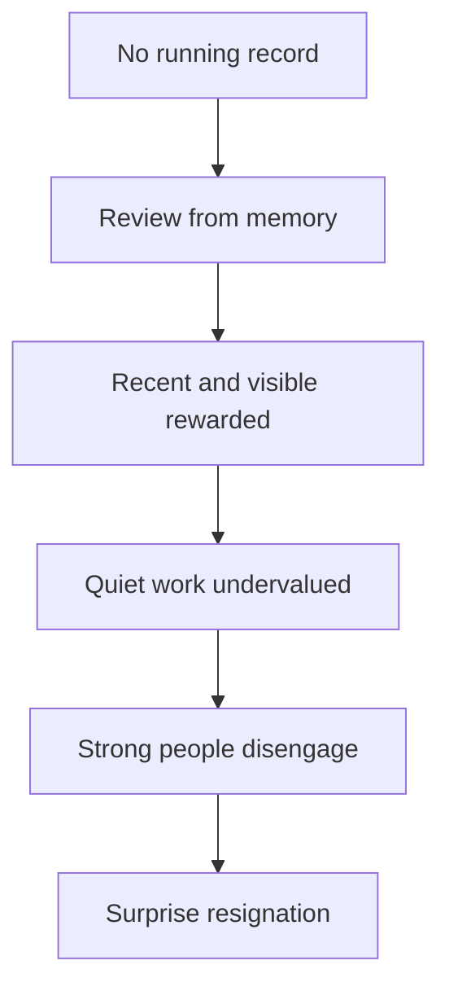

### Enterprise Application

In an organization of 50 to 150 engineers, the director cannot sit in on one-on-ones and should not
try. The job is to make the practice observable without making it bureaucratic.

**Set a floor, not a format.** Every engineer has a one-on-one at least every two weeks, with an
agenda they can add to.

**Ask the reports, rarely.** A two-question pulse once or twice a year ("Are your one-on-ones useful?
What would make them more useful?") gives a signal self-ratings cannot. Managers who see results may
coach the answers, so read trends and comments and never rank managers on the score (Chapter 18
treats metric gaming).

**Skip-levels as a check.** A director's conversations with engineers two levels down detect what
one-on-ones miss, and harm if they bypass the manager. The rule: themes go back to the manager, with
the engineer's agreement. Chapter 41 (Managing and Developing Engineering Managers) covers the rest.

**Map mentoring and sponsorship.** For each senior engineer and likely future lead, list who mentors
and who sponsors them. Gaps are predictable: quiet teams, new managers, people unlike the leadership.

**Train the channel.** Managers appear to overrate their one-on-one skills, and many were never taught. An
hour of practice in agenda handover and the decay signals is cheap.

### CTO Perspective

**Information.** A CTO hears about the organization through layers of filters. One test of their
honesty is how often an executive learns of a serious people problem, such as a key engineer leaving,
after it is too late to act. If often, the one-on-one channel is failing below, and dashboards will
not fix it.

**Promotion evidence.** A promotion process that requires dated, specific evidence exposes which
managers keep records. The CTO can require evidence without prescribing a tool.

**Sponsorship is the leadership pipeline.** The next staff engineers and managers are the people
someone senior chose to stretch; left informal, the pipeline reproduces whoever was already visible.
The research above is about MBA graduates in one period: enough to make a CTO ask who is being
sponsored, not enough to promise a board a measured effect.

**The CTO's own one-on-ones** with directors decay the same way, into portfolio status. The repair
is the same.

### Practical Playbook

For a manager rebuilding their one-on-ones over a quarter:

1. Create a shared running document per report, headed "Your agenda first; status lives elsewhere."
2. Tell the team what is changing and ask each person to add one topic before the next meeting.
3. Set up a weekly three-line written status (done, next, stuck) and stop asking for status in the
   meeting.
4. Set each person's cadence from the decision table and book the quarter.
5. Keep five deeper questions for light agendas.
6. After each meeting, spend five minutes on the record: topics, commitments, observations, growth,
   sponsorship.
7. Open each meeting by closing your commitments from the last.
8. For each report, write the mode of help their current goal needs; check it is not always "direct".
9. Name one sponsorship action for each senior engineer this quarter.
10. After six weeks, count the decay signals from your notes and ask each report, in writing, what the
    meetings should do more of and less of.
11. At quarter end, write the three-line summaries and compare them with what memory would have said.

### Case Study

This case is **fictional** ([the first quarter](#page-case-studies-northstar-first-quarter)).

!!! info "Northstar so far"
    Week 19 of the director's first year at Northstar, early in quarter 2 (weeks 14 to 26). Serious
    (Sev1 and Sev2) incidents fell from 30 to 21 in the first quarter. In week 10 the seven QA engineers (manual testers)
    moved into product teams as quality engineers, two of them to Daniel Cho's Customer Experience team.
    See the [timeline](#page-case-studies-northstar-timeline).

At baseline, before the director arrived, Daniel Cho managed 15 engineers, nine web and six mobile, and spent 45 percent of his time
on people management, more than any other Northstar manager. Technical direction sat with two informal
leads without titles, Hannah Lindgren for web and Mateo Arango Ríos for mobile. The team deployed
26 times a month, the most of any team. On an activity view Daniel looked like the strongest manager,
while his team's health and growth were unknown ([Chapter 4](#page-parts-01-foundations-04-the-leadership-ladder)).

Daniel was proud of his one-on-ones: weekly, 30 minutes, rarely cancelled, though those with the
mobile engineers in Bogotá, held by video, were often rescheduled. In week 16 a team health check, a
self-assessment in which the team rates ten indicators green to red (Chapter 14), showed mobile rating
four of them red. Daniel was surprised. In week 17 Mateo told the
director that he had been doing a lead's job for over a year without anyone saying so, and that his
one-on-ones were "where I tell Daniel where mobile is." He agreed the director could raise it.

In week 19, Daniel and the director went through his notes for weeks 14 to 19. The sample covered his
15 engineers; the two quality engineers who joined and now report to Daniel were left out as too
recent. Daniel coded each meeting by its dominant topic and by whether he had learned something
the board, chat, or stand-up had not shown.

| Measure, weeks 14 to 19 | Value |
|---|---|
| Scheduled and held | 90 scheduled, 84 held; average 26 minutes |
| Opened from Daniel's questions ("what are you working on, any blockers") | 79 of 84 |
| Dominant topic: status, or blockers already on the board | 55 and 9 |
| Dominant topic: career or growth | 8, with 6 people |
| Dominant topic: team or process concerns; personal or well-being | 7 and 5 |
| Meetings with news | 11 of 84 (13 percent) |
| Engineers with no career conversation in six weeks | 9 of 15 |
| The two leads' meetings | 12 held, all dominated by platform-wide status |

Attendance was excellent and the channel was mostly status: 64 of 84 meetings (76 percent). The two
leads, who carried the most context, used their meetings to report on everyone else's work. Mobile's
red ratings and Mateo's frustration appeared in none of them. Daniel's first reaction was that his
reports liked the meetings. The director's answer was that they might. But manager
self-ratings were exactly what neither of them should rely on. They agreed to ask the team.

Daniel drafted a change for the rest of quarter 2: shared agendas with the report's topics first; a
three-line weekly written status; cadence D from the Engineering Organization Example; monthly
three-line summaries; and one sponsorship action each for Hannah and Mateo. He was unsure whether to
propose them as named tech leads, which needs the director's agreement and changes how other teams
work with Customer Experience, or to start with smaller opportunities, and how to raise what Mateo
had said. The case leaves Daniel with the draft; the exercises take it from there.

### Exercises

Solutions are in [chapter 5 solutions](#page-solutions-ch05-solutions). Northstar data is on the
[baseline page](#page-case-studies-northstar-baseline-data).

#### Foundational

**F1.** A manager of seven engineers tells you her one-on-ones are excellent: she holds every one,
weekly, and her reports say they are "fine". Her notes for the last month show the same three
questions opening every meeting and no topic other than current work. Using the chapter's mental
model, explain what is likely happening and name three signals she could count from her own notes
to check.

**F2.** For each situation, choose directing, coaching, mentoring, or sponsoring, and justify the
choice: a mid-level engineer stuck for two days on a test design she owns; a new hire about to make
a schema change on a [tier 1](#tier-1) table (one on the order or payment path)
during an incident; a senior engineer who wants to become a staff
engineer and has never led cross-team work; an engineer asking how to handle a hostile reviewer on
another team.

**F3.** A manager's review draft for an engineer contains: "excellent team player", "strong technical
skills", and "led the image-service migration well last month". Rewrite the record entries that
should have produced a better review, and say what the manager would need to have written down during
the year.

#### Applied Leadership

**A1.** You are Daniel Cho after week 19. Prepare your conversation with Mateo: whether to tell
him you heard the theme, how to open, what you will commit to, and what you will not promise about the
tech lead title, which is not yours alone to give.

**A2.** Daniel's draft keeps Hannah and Mateo on weekly one-on-ones and moves 13
engineers to every two weeks for 45 minutes. Two engineers object that they will see Daniel less.
Evaluate the draft using the decision table and the chapter's arithmetic, and propose what you would
change, if anything, and how you would know in six weeks whether it worked.

**A3.** Priya Raman (Orders manager) holds 30-minute one-on-ones every two weeks with her 16 reports
(14 engineers and the two quality engineers who joined in week 10), as agreed with the director in
week 2. Rafael Duarte, a senior engineer who applied for her role, has used his meetings only for
order-capture review status since. Advise Priya on how to change his one-on-ones, which mode of help he
most needs from her, and who else should sponsor him.

#### Executive Decision-Making

**X1.** As Northstar's director, you want evidence that one-on-ones are working across six teams
without reading anyone's notes. Design the lightest mechanism you can, say what each element tells you
and how it can be gamed, and say what you would do if one manager's results were consistently poor.

**X2.** Suppose that in a later quarter two senior engineers leave Northstar saying they had no path
to staff, and Victor Lindqvist (CTO) asks you for a mentoring program. You have no budget for external coaches. Decide what
you would build instead, with the role of mentoring, sponsorship, and the managers' records, and say
what you would tell Victor the evidence does and does not support.

### Reflection Questions

1. What did your last six one-on-ones tell you that no other channel would have?
2. Who sets the agenda of your one-on-ones, in practice rather than in principle?
3. When did you last hear something important about a report from someone else?
4. For whom are you a mentor but not a sponsor, and what would it cost you to sponsor them?
5. If you had to write every report's review tomorrow, how much would come from records and how much
   from memory of the last month?
6. Which of your reports would be least likely to tell you that your one-on-ones are not useful?

### Key Takeaways

- Treat the one-on-one as the report's information channel; measure it by the news it carries, not
  by attendance.
- Give the report the agenda and move status to a written update.
- Close your commitments at the start of each meeting; follow-through keeps the channel open.
- Count decay signals from your notes, and treat surprises learned elsewhere as the strongest.
- Choose directing, coaching, mentoring, or sponsoring by the situation; direct when it is urgent and
  say so, coach when the learning is worth the time.
- Coaching evidence is mostly about professional coaches, and mentoring effects are small; neither
  substitutes for sponsored opportunity.
- Keep a dated, factual record per person, five minutes per meeting, with a monthly summary, so that
  reviews and promotion cases rest on evidence.
- Set cadence per person; weekly for the new, the leads, and those in change, every two weeks for the
  established.

### References and Further Reading

- [Rogelberg, 2024](#rogelberg2024unlocking). A researcher's summary
  of his survey work on one-on-ones; his book *Glad We Met* is the longer treatment.
- [Grove, 1983](#grove1983high). *High Output Management*. The
  one-on-one as the subordinate's meeting and a high-leverage activity.
- [Fournier, 2017](#fournier2017manager). *The Manager's Path*.
  One-on-ones and mentoring across the engineering management career.
- [Zhuo, 2019](#zhuo2019making). *The Making of a Manager*. The first
  years of management, including useful one-on-ones.
- [Theeboom, Beersma, and van Vianen, 2014](#theeboom2014coaching) and
  [Jones, Woods, and Guillaume, 2016](#jones2016coaching).
  Meta-analyses of coaching outcomes; the second excludes coaching by a person's own manager.
- [Allen et al., 2004](#allen2004mentoring) and
  [Eby et al., 2008](#eby2008mentoring). Mentoring's associations with
  outcomes: real, generally small.
- [Ibarra, Carter, and Silva, 2010](#ibarra2010promotions). Mentoring
  versus sponsorship, from research on high-potential graduates.
- [Wiseman, 2010](#wiseman2010multipliers). *Multipliers*. Why leaders
  who supply every answer diminish the people around them.

<a id="page-parts-02-people-management-06-feedback-conflict-and-difficult-conversations"></a>

## Chapter 6 — Feedback, Conflict, and Difficult Conversations

This chapter is about the conversations managers avoid: telling someone what they did and what it
caused, stepping into a dispute between people or teams, and saying something the other person does
not want to hear. It covers specific behavioral feedback and why timing matters more than phrasing,
what feedback research actually shows (including that feedback often makes performance worse), how
delivery changes across cultures, how to tell what kind of conflict you are looking at before you
intervene, and how to prepare a difficult conversation, including the plan for when it goes badly.
One-on-ones are Chapter 5's subject, formal underperformance processes are Chapter 9's, and
psychological safety is Chapter 11's; this chapter cross-references them. The running example is the
friction between Billing and Orders at Northstar Technologies, the fictional company in the
[case study](#page-case-studies-northstar-index).

### Why This Matters

At team scale, feedback is the main way a manager changes what people do. Feedback that arrives late,
vague, or buried in reassurance changes nothing; it moves the problem to the next performance review,
where it arrives as a surprise. This book's view is that many cases that reach Chapter 9's
underperformance process began as a pattern a manager saw for months and did not name.

At organization scale, conflict between teams is where engineering systems and people collide.
Two teams that share a release, a database, or an on-call rotation will fight about it. If the
manager above them reads every dispute as a personality problem, they will hold mediation sessions
while the shared system keeps producing incidents. If they read every dispute as a process problem,
they will redesign workflows while two people stop speaking.

At executive scale, the question is whether disagreement reaches the people who can act on it, and
whether engineers argue openly about designs rather than privately about blame. The CTO cannot attend
those conversations but sets the example of how criticism is received.

### Learning Objectives

After this chapter you will be able to:

- Give specific, behavioral feedback close to the event, and explain why feedback aimed at the person
  rather than the task tends to backfire.
- Adapt how you deliver feedback to cultural and individual norms without diluting what you say.
- Diagnose whether a conflict is about the task, the process, status and relationships, or values
  before choosing an intervention.
- Prepare and conduct a difficult conversation, including what you will do if it goes badly.
- Recognize the failure modes of avoidance, over-correction, and false harmony in yourself and in the
  managers you lead.

### The Mental Model

> **Mental model:** Feedback and conflict work when attention stays on the work: what was done, what it
> caused, what the shared system rewards. They fail when attention moves to the self: who is
> competent, who is respected, who is to blame.

This simplifies a research result described below. Feedback about an observed behavior keeps the
receiver on the task; "you are careless" sends them to defend their self-image. Likewise, a dispute
about which design is right can be productive, while a dispute about who is competent consumes the
energy the design question needed.

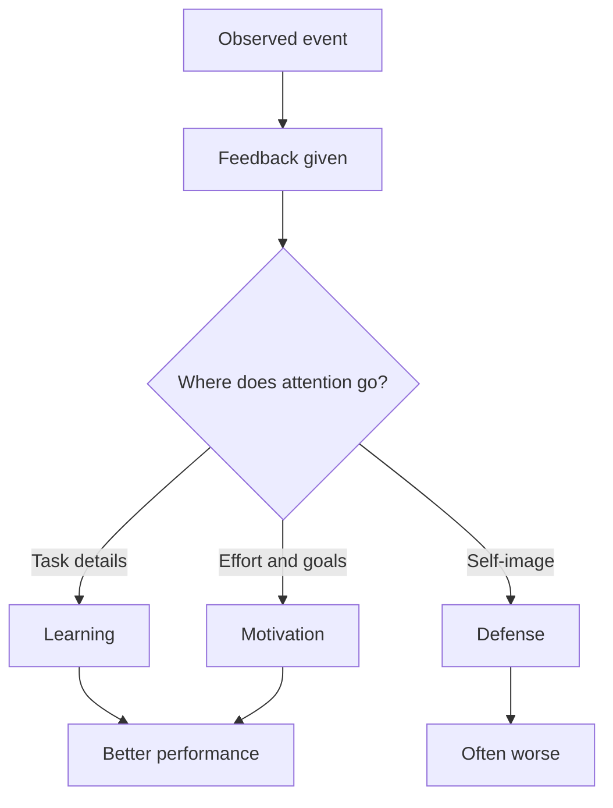

The diagram shows the mechanism: the same event, described differently, sends attention to a
different level. The manager controls only the description and the timing.

### Deep Conceptual Explanation

#### What the feedback research shows

Feedback improves performance on average, but more than a third of the time it makes performance
worse. That is the result of the best-known synthesis, Kluger and DeNisi's
[meta-analysis](#meta-analysis) (a study pooling many studies) of feedback
interventions: deliberate actions that tell people something about their performance. Across 607
results and 23,663 observations, the average improvement was a moderate
[effect size](#effect-size-d-g), yet more than a third of the interventions decreased
performance ([Kluger and DeNisi, 1996](#kluger1996effects)). The
authors report that this could not be explained by sampling error or by whether the feedback was positive or
negative. Their proposed explanation, feedback intervention theory, is that feedback shifts attention
among three levels (the details of the task, motivation toward the task, and the self) and that
effectiveness falls as attention moves toward the self and away from the task. They also note that
the kind of task changes the effect in ways that were still poorly understood.

That is a **research finding**, with limits: the meta-analysis pools many settings and predates modern
engineering teams. What transfers is the direction, not a number: feedback is not reliably good, and
feedback that makes the receiver think about who they are is the riskiest kind.

#### Specific, behavioral, and early

Three properties follow, and practitioners broadly agree on them (**practitioner consensus**, consistent
with the research above):

- **Specific**: one event, described so the receiver can recall it. "In Tuesday's design review" not
  "in meetings."
- **Behavioral**: what the person did or said, which they can repeat or change, followed by its effect
  on the work or on others. Not a trait ("defensive", "not senior enough") and not a guess at intent.
- **Early**: within days of the event. Late feedback is less accurate, because both memories have
  faded, and more expensive, because the behavior has repeated.

A useful structure is: the situation, what you observed, what it caused, and a question. "In
Thursday's incident review, you said the other team's change 'obviously' caused it before the timeline
was complete. Their two engineers stopped contributing after that. What did you know at that point that
I didn't?" The question matters: the manager's observation may be incomplete, and feedback that
cannot be corrected by the receiver is a verdict.

Positive feedback follows the same rules: "great job" teaches nothing that can be repeated.

#### Radical Candor: a useful frame and its failure

Kim Scott's *Radical Candor* is widely known for a two-axis frame: caring personally about someone
and challenging them directly ([Scott, 2017](#scott2017radical)). The
quadrants describe the common failures well. Challenge without care becomes aggression. Care without
challenge (which Scott calls ruinous empathy) is the most common failure of new engineering managers:
the manager likes the person, withholds the criticism, and the person learns about the problem from a
low rating or a layoff list. Neither, out of self-protection, becomes insincerity.

This is **expert opinion**. Its known failure is the label
used to excuse bluntness. The test is the receiver's experience: if they do not believe you are on
their side, the challenge is heard as an attack.

#### Feedback across cultures

Erin Meyer's *The Culture Map* is known for describing national business cultures along several
scales, one of which is how negative feedback is delivered: directly and plainly, or indirectly and
softened ([Meyer, 2014](#meyer2014culture)). A related idea from the
same work is that people from direct cultures tend to use strengthening words and people from indirect
cultures softening words, so the same criticism can sound mild to one listener and devastating to
another. This is **expert opinion**.

Three cautions keep it useful. National culture is a starting hypothesis about a person, not a
description of them. Adapting delivery means changing the wrapping (private or public, the amount of
context, the surrounding words), never the point: the receiver must leave knowing exactly what you want
changed. And the simplest method is to ask, "How do you like to hear it when something isn't working?",
and afterwards, "What will you take away from this?"

#### Diagnosing conflict before intervening

Conflict researchers distinguish types that behave differently.

- **Task conflict**: disagreement about the content of the work. Which design, which priority, whether
  the data supports a claim.
- **Process conflict**: disagreement about how the work is done. Who owns what, who decides, the
  sequence, the release process.
- **Relationship conflict**: personal friction, dislike, irritation.
- **Status conflict**: disputes about people's relative respect or position in the group. Bendersky and
  Hays defined it as a separate type, found it had a negative effect on group performance, found that
  it moderated the effect of task conflict, and found that it hurt performance by undermining
  information sharing more than the other types did
  ([Bendersky and Hays, 2012](#bendersky2012status)).
- **Values conflict**: disagreement about what matters, such as whether shipping a known defect to meet
  a customer date is acceptable. This is this book's working category for practice; the research
  cited here does not measure it separately, so treat it as a practitioner distinction.

Whether task conflict helps is **contested**, but the two largest syntheses agree on the operational
point: task conflict is tolerable, sometimes useful, only while it stays separate from relationship
conflict. A long-standing idea held that disagreement about the work improves decisions while personal
conflict damages them.

- De Dreu and Weingart's meta-analysis challenged it. Both relationship and task conflict correlated
  strongly and negatively with team performance and member satisfaction, more so in complex tasks.
  Task conflict was less damaging when only weakly linked to relationship conflict
  ([De Dreu and Weingart, 2003](#dedreu2003task)).
- A later meta-analysis of 116 studies and 8,880 groups found stable negative links between
  relationship and process conflict and group outcomes, but no strong negative link for task conflict.
  Task conflict related more positively to performance where it was weakly linked to relationship
  conflict, in top management teams, and where performance meant decision quality or financial results
  ([de Wit, Greer, and Jehn, 2012](#dewit2012paradox)).
 Process conflict, which engineering organizations generate
constantly, was consistently negative. These are **research findings** about correlations across many
kinds of teams, none specifically in software, and they do not show causation.

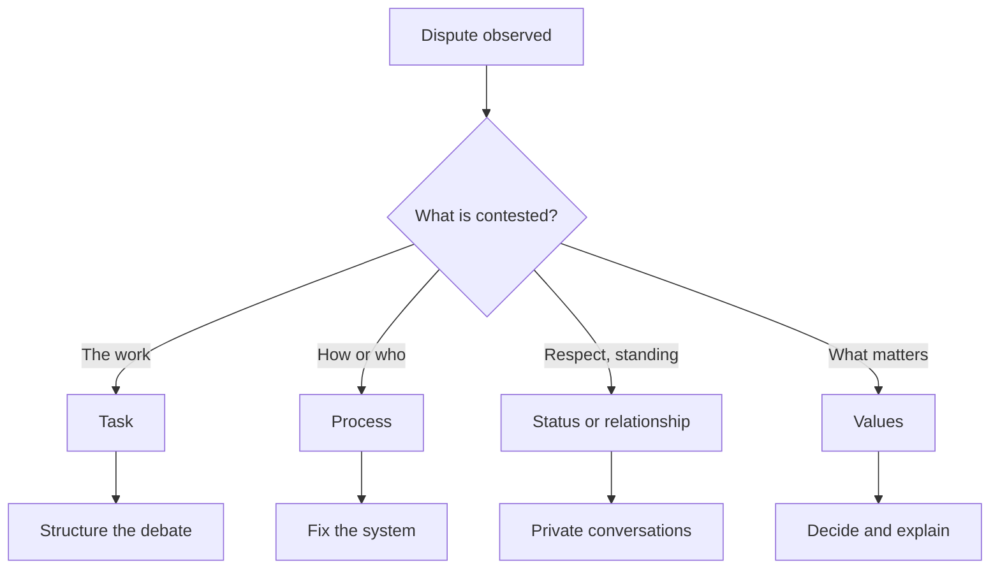

The type shows itself in the evidence people bring. Task conflict cites data and designs. Process
conflict cites handoffs, ownership, and "nobody told us". Status conflict cites tone, who was
consulted, and who gets credit. Values conflict cites principles. Most real disputes are mixed, and a
process conflict left unresolved for long enough becomes a relationship conflict: two teams that
repeatedly hurt each other through a shared system eventually dislike each other. The manager's first
job is to find the oldest layer, because fixing the newest layer (the dislike) without the oldest (the
shared system) only resets the clock.

Lencioni's *The Five Dysfunctions of a Team* is known for the argument that teams which avoid conflict
end in artificial harmony ([Lencioni, 2002](#lencioni2002five)), an
**expert opinion** every manager has seen as a quiet design review followed by a loud corridor.

#### Difficult conversations

Stone, Patton, and Heen's *Difficult Conversations* is widely known for observing that a hard
conversation is really three: a dispute about what happened, a set of feelings, and a threat to each
person's sense of who they are ([Stone, Patton, and Heen, 1999](#stone1999difficult)).
It also argues for moving from delivering a message to learning what the other person sees. That maps
onto the Kluger and DeNisi mechanism: the identity layer is exactly where attention goes when feedback
backfires. This is **expert opinion**.

In practice, preparation has five parts (**this book's recommendation**):

1. **Purpose.** One sentence on what must be true after the conversation. "Teodora understands that
   blaming another team in public review is not acceptable, and we agree what she does next time."
2. **Facts and story.** Separate what you observed from your interpretation. Write down what you do
   not know.
3. **Their view.** What would they say happened, and what is at stake for them? An overloaded on-call
   engineer who lashes out has a real grievance underneath an unacceptable behavior.
4. **Non-negotiables and negotiables.** What you will not move on, and what you are open to.
5. **The plan for when it goes badly.** Decided in advance, because you will not think clearly in the
   moment.

The fifth part is the one managers skip. Conversations go badly in a few recognizable ways: denial
("that didn't happen"), counter-attack ("you never supported us"), withdrawal (silence, short answers),
or strong emotion. The response to each is the same first move: stop pushing the message, name what
is happening ("This is landing hard. Do you want to keep going, or pick it up tomorrow?"), and listen.
Pausing is not retreating: reschedule within one or two working days and say that the point still
stands. If the conversation surfaces something outside your remit (a health issue, a harassment
allegation, a legal question), stop and involve the people responsible for it.

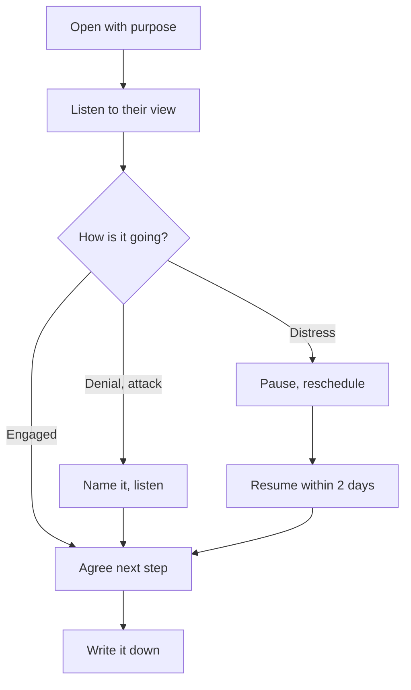

Write the agreement down: both people leave with the same understanding, and if the pattern continues,
Chapter 9's process starts from a record rather than from memory.

#### Where psychological safety fits

Team psychological safety, a shared sense that speaking up will not be punished, is associated with
team learning ([Edmondson, 1999](#edmondson1999psychological));
[Chapter 11](#page-parts-03-high-performing-teams-11-high-performance-trust-safety-and-accountability)
covers it. The link here is direct: a manager who punishes the messenger once teaches the team
to keep task conflict underground, where it tends to become relationship conflict. Blameless incident review
([Chapter 25](#page-parts-05-engineering-quality-25-incidents-postmortems-and-change-failure-analysis))
applies the same principle to failures.

### Engineering Organization Example

This example is **illustrative**; the numbers are invented to show the arithmetic.

A team of eight has a senior engineer, Sam, whose merge requests average about 900 changed lines.
Reviews of them take a median of three working days, against one day for the rest of the team.
Assume Sam opens two such merge requests a week.

**Option A: hold it for the quarterly review.** The manager notices in week 2 and plans to raise it at
the review in week 12. That is 10 more weeks, 20 more large merge requests, and about 40 extra
days of waiting for those merge requests to merge (2 days of extra wait each). At review, Sam
hears a pattern described as a trait ("your changes are hard to review"), does not recognize it, and
asks for examples that are now two months old.

**Option B: raise it in week 2.** In their one-on-one: "Your last two merge requests on the pricing
module were about 900 lines each and took three days to get reviewed. The team's median is one day.
The second one blocked Ana's work for two of those days. What's making them come out that size?" Sam
explains that the pricing module has no seams for small changes. The manager learns something (a
design problem, not a habit) and the two agree to try splitting the next change behind a
[feature flag](#feature-flag) (a switch that ships code turned off).

The cost of the conversation is 15 minutes. The cost of the delay is about 40 days of
waiting plus a weaker conversation at the end of it. Even if the early conversation only halves the
problem, it pays for itself many times over. The point generalizes: feedback is cheap per occurrence
and expensive per delay, because behavior repeats.

A conflict on the same team: Sam and Ana argue in review threads about splitting the pricing module.
The manager reads the last ten threads first. Seven argue the design with evidence (task conflict);
three include remarks about who "actually understands" the module (status conflict). So: a time-boxed
design review with a named decider, and a private conversation with each engineer about the remarks. A
team meeting about "communication" would have addressed neither.

### Decision Framework

Use this table after reading the evidence, not before.

| Conflict type | Typical evidence | First move | Common wrong move |
|---|---|---|---|
| Task | Designs, data, competing proposals | Name a decider, set a deadline, require written options | Ordering people to agree; splitting the difference |
| Process | Handoffs, ownership gaps, "nobody told us", recurring incidents at a boundary | Change the system: ownership, interface, sequence | Mediation sessions about attitudes |
| Status or relationship | Tone, credit, who was consulted, public remarks | Private conversations first, then a joint one with agreed behavior | A team-wide "be respectful" message |
| Values | Principles, "this is wrong" | Make the trade-off explicit, decide at the right level, explain | Pretending it is a task question with a right answer |

For feedback: if the behavior is likely to repeat, give it now and privately. If it affected people
outside the team, the repair may need to be visible, but the feedback stays private. If you have named
the pattern twice without change, it is a performance conversation (Chapter 9).

### Trade-offs

**Speed versus accuracy.** Early feedback can be wrong; you may not have the whole story. The
mitigation is the question at the end, not delay.

**Directness versus relationship.** In the short term, directness costs comfort. In the long term,
indirectness costs the relationship more, when the person discovers that their manager knew and said
nothing.

**Intervening versus letting teams resolve it.** Teams that resolve their own task conflicts learn to
do it again; a manager who steps into every dispute becomes the decider for everything. But teams
rarely resolve a process conflict at their boundary, because neither owns the shared system.

**Consistency versus adaptation.** Adapting delivery to individuals and cultures respects them, but
uneven feedback across a team can look like favoritism. Adapt the delivery; keep the standard identical.

**Writing it down.** A written summary prevents disputes about what was agreed but makes a conversation
feel formal. For ordinary feedback, a note in your own records is enough.

### Failure Modes

**The compliment sandwich.** Criticism placed between two praises. Receivers learn to wait for the
middle, or miss it entirely. Detect it by asking the receiver to summarize what they heard.

**Saving it up.** Feedback held for the review cycle. Detect it when a review contains something the
person hears for the first time. A useful rule: nothing in a written review should be new.

**Ruinous empathy.** Withholding criticism to protect the relationship or the person's feelings.
Detect it in your own calendar: which conversation have you postponed twice?

**Mediating a process problem.** Treating a structural conflict as a personality clash. Detect it when
the same dispute recurs between different people at the same boundary. If replacing the people would
not end the conflict, the conflict is not about the people.

**False harmony.** No disagreement in meetings, plenty in private channels. Detect it when "agreed"
decisions keep being revisited.

**Proxy wars.** Managers fighting through their engineers, or engineers through their managers, each
side collecting incidents as evidence. Detect it when incident reviews start with attribution rather
than timeline.

**Over-correction.** A manager trained in directness who becomes harsh. Detect it in skip-levels and in
who stops speaking in that manager's meetings.

### Enterprise Application

In an organization of 50 to 150 engineers, the managers give most of the feedback, not the director.
The director's work is to make it routine and to catch the cases that are stuck.

Mechanisms: ask each manager which feedback conversation they are postponing; check written reviews for
content the person sees for the first time; in skip-levels, ask engineers when they last heard
something critical from their manager and whether it helped.

For conflict, in this book's view most persistent inter-team conflicts sit on shared systems: a
monolith, a release train, an on-call rotation, a database. The director should keep a
short list of boundaries where conflict recurs and treat each as a design question first. Ownership and
interface changes belong to the chapters on quality ownership
([Chapter 19](#page-parts-05-engineering-quality-19-defining-measuring-and-owning-quality)) and team
structure (Chapter 33); this chapter's contribution is the diagnosis.

Training helps less than practice: a course changes vocabulary, while a manager's manager asking about
specific conversations every week changes behavior.

### CTO Perspective

At executive scale, three things change.

First, the CTO's feedback is amplified. A passing remark about a team becomes a reorganization rumor.
Feedback to executives and directors should be as specific and private as feedback to an engineer,
and more carefully timed.

Second, conflicts reaching the CTO are almost always values conflicts or unresolved process conflicts
between functions: product dates against reliability, sales commitments against capacity. The
operational response is to make the trade-off explicit, decide, and explain the decision to both
sides, including what would make it change. A CTO who splits every difference trains the organization
to escalate everything.

Third, the CTO shows what receiving feedback looks like. Engineers who watch the CTO meet criticism of a
strategy with curiosity learn that disagreement upward is safe; one public dismissal teaches the
opposite.

### Practical Playbook

1. Keep a running note per direct report of observed behaviors, positive and negative, with dates.
   Review it before each one-on-one (Chapter 5).
2. Give feedback within a week of the event, in private, using situation, behavior, effect, question.
3. Ask each person how they prefer to hear criticism; adapt the delivery, not the content.
4. End each feedback conversation by asking the person what they will take away.
5. When a conflict appears, read the evidence before acting: threads, incident reviews, the shared
   systems involved. Classify it as task, process, status or relationship, or values, and find the
   oldest layer.
6. Fix process conflicts with system changes; handle status and relationship conflict privately first.
7. For any difficult conversation, write the five-part preparation, including the plan for when it
   goes badly.
8. After the conversation, write down what was agreed and when you will check.
9. Ask your managers weekly which conversation they are postponing, and keep the same list for yourself.

### Case Study

This case is **fictional**. It ends with a decision the reader faces on arrival as director.

!!! info "Northstar so far"
    Before week 1: the baseline quarter, before the new Engineering Director arrives at Northstar, the
    book's fictional order-to-cash company. It had 30 serious incidents and $410,000 in service credits
    (refunds for missed availability). Billing had the most incidents. See the
    [timeline](#page-case-studies-northstar-timeline).

Billing had eight [Sev1 and Sev2](#severity-sev1-sev2-sev3) incidents (Northstar's two
most serious levels) in the baseline quarter, the most of any team. Seven came through Core releases or
database migrations, and six were repeats of earlier failures. Three ledger engineers had handled 126
of Billing's 180 pages first, and 54 of the 64 after-hours pages. Orders depended on Billing more than
on any other team (9 work items that needed Billing), and Billing on Orders 6 times. Both teams shipped
through [Core](#core), the shared Java monolith, on the same two-week
[release train](#release-train). A three-day manual regression pass before each
release had caught none of the nine incidents the train's releases triggered.

After INC-417 (payments posted to the wrong accounting period after release 24.23), Teodora
Vasquez-Lund, a senior Billing engineer and one of the three ledger engineers, wrote in the shared
release channel that Orders' changes "keep breaking the ledger". An Orders engineer replied that
Billing should test its own code. The thread ran for two days. Neither manager responded in it.

After INC-427 (credit notes applied twice after release 24.26), the incident review began with
Teodora stating that an Orders change had caused it. The contributing factors recorded for INC-427
in the incident review (Chapter 25 shows the template) point elsewhere: no ordering check for migrations, unknown
migration duration at production volume, no ledger invariant alert, and a release batch of about 170
changes. Nobody had recorded which team's change
triggered any of the baseline quarter's release incidents; the review process did not ask.

The view of Marcus Oyelaran (Billing manager), as Victor Lindqvist (CTO) summarized it in his handover notes for the incoming
director, was that Orders shipped into shared Core code without understanding the ledger. Orders' view
was that Billing blamed others for its own fragile code. Victor wrote that he had "let the two of them
sort it out" and that it had not worked.

**Diagnosis.** On the surface this is a relationship and status conflict: public blame, defensive
replies, questions about who understands the ledger. Underneath, it is a process conflict. Two teams
ship through one train, in batches as large as 170 changes, with nothing that attributes a failure to
a change. Each incident was evidence for whichever story each side
already held, because the system produced no evidence that could settle it. The oldest layer
is the release process; the newest is the dislike.

Looking ahead, the first-quarter record shows what happened to the process: weekly Core releases
from week 5, a release working group, and train-triggered incidents falling from nine to four
([first quarter](#page-case-studies-northstar-first-quarter)). It does not record what happened
between the teams, or what Marcus said to Teodora. That is your decision at arrival. A process fix
alone may leave the behavior unaddressed. A behavioral intervention alone asks Teodora to stop being
angry about a system that keeps paging her at night.

### Exercises

Solutions are in [chapter 6 solutions](#page-solutions-ch06-solutions). Northstar data is on the
[baseline page](#page-case-studies-northstar-baseline-data).

#### Foundational

**F1.** Rewrite these three pieces of feedback so that they are specific, behavioral, and end with a
question: "You need to be more of a team player." "Your code quality has slipped." "Great work on the
migration." For each, state what you would need to have observed to say the rewritten version, and
what you would do if you had not observed it.

**F2.** A manager tells you that research shows feedback improves performance, so she gives everyone
detailed feedback after every sprint, including on their attitude and commitment. Using what the
Kluger and DeNisi meta-analysis found and its limits, assess the practice and say what you would
change.

**F3.** Classify each dispute as task, process, status or relationship, or values, and name the
evidence that decided it: two engineers arguing about event sourcing for the ledger; two teams
arguing over who should fix flaky tests in a shared suite; a senior engineer upset that a junior
colleague presented "his" design to the CTO; a product manager and an engineer arguing over shipping
a known rounding error to meet a renewal date.

#### Applied Leadership

**A1.** You are Marcus Oyelaran's director, in your first month. Prepare Marcus for his conversation
with Teodora Vasquez-Lund about her post after INC-417 and her opening in the INC-427 review. She is
one of three engineers carrying most of Billing's after-hours pages. Write the five-part preparation,
including what Marcus should do if she responds that management has ignored the on-call load for a
year.

**A2.** Design the first joint session between Billing and Orders engineers after the release-process
changes begin. Decide who attends, what evidence is on the table, what the session must produce, and
what you would do if the first ten minutes turn into a list of each team's grievances.

**A3.** One of your managers comes from a culture where criticism is delivered indirectly. Their
engineers, most of whom expect direct feedback, report in skip-levels that they "never know where they
stand". The manager believes they are giving clear feedback. Plan how you give this manager
feedback about their feedback, and what you would accept as evidence that it changed.

#### Executive Decision-Making

**X1.** Two quarters after the director's arrival, Amara Okafor (CPO) and Victor Lindqvist (CTO) disagree in the
executive meeting about whether to delay a customer feature by three weeks to finish ledger
reconciliation work. Both ask you, as director, for a recommendation in writing. Diagnose the conflict
type, write the structure of your recommendation, and say what you would do if the CEO splits the
difference.

**X2.** As CTO, you notice that across 18 months of incident reviews, the first entry in 40 percent of
reviews for cross-team incidents names another team. Design an organization-level response covering
review process, measurement (including how your measure could be gamed), and the behavior of
directors, and say what you would not do.

### Reflection Questions

1. Which piece of feedback have you been holding for more than two weeks, and what is the real reason?
2. When did you last receive criticism from someone who reports to you, and how did you respond in the
   first ten seconds?
3. In the last conflict you stepped into, did you identify the oldest layer, or the loudest?
4. Which of your direct reports would say they always know where they stand with you, and which would
   not?
5. Have you ever used "being direct" to excuse being careless with someone?

### Key Takeaways

- Feedback improves performance on average but backfires often; keep the receiver's attention on the
  task, not on themselves.
- Give feedback within days, about one observed behavior and its effect, and end with a question.
- Adapt delivery to people and cultures; never adapt the message so far that it disappears.
- Diagnose a conflict before intervening: task, process, status or relationship, or values. Find the
  oldest layer.
- Task conflict is tolerable only while it stays separate from status and relationship conflict;
  process and relationship conflict are reliably harmful.
- Recurring conflict at a team boundary is usually a system problem; fix the system, then repair the
  relationship.
- Prepare difficult conversations in writing, including what you will do when they go badly.
- Pausing a conversation that has gone badly is not retreating; resume within two days.

### References and Further Reading

- [Kluger and DeNisi, 1996](#kluger1996effects). The meta-analysis
  showing that feedback often lowers performance, and the theory of why.
- [De Dreu and Weingart, 2003](#dedreu2003task). Meta-analysis
  challenging the idea that task conflict helps teams.
- [de Wit, Greer, and Jehn, 2012](#dewit2012paradox). A larger, later
  meta-analysis that complicates the 2003 result and adds process conflict.
- [Bendersky and Hays, 2012](#bendersky2012status). Introduces status
  conflict as a distinct type and its effect on information sharing.
- [Edmondson, 1999](#edmondson1999psychological). The founding study
  of team psychological safety; Chapter 11 develops it.
- [Scott, 2017](#scott2017radical). *Radical Candor*. A practitioner's
  frame for caring and challenging at once; the quadrants are the useful part.
- [Meyer, 2014](#meyer2014culture). *The Culture Map*. How feedback
  norms differ across business cultures; read with the cautions in this chapter.
- [Stone, Patton, and Heen, 1999](#stone1999difficult). *Difficult
  Conversations*. The three layers of a hard conversation and the shift from persuading to learning.
- [Lencioni, 2002](#lencioni2002five). *The Five Dysfunctions of a
  Team*. A fable about avoided conflict and artificial harmony in a leadership team.

<a id="page-parts-02-people-management-07-hiring-and-structured-interviews"></a>

## Chapter 7 — Hiring and Structured Interviews

This chapter treats hiring as a measurement problem. It covers the role scorecard and the structured
loop built from it, what selection research supports (including the 2022 revision of the best-known
validity estimates), where engineering interview practice has run ahead of the evidence, debriefs
that resist anchoring, and tracking hiring quality after the offer. Chapter 8 (Career Development, Promotion, and Compensation)
covers career ladders and pay, and Chapter 10 (Motivation, Retention, and Managing Senior Engineers)
covers keeping the people you hire. The running example is a Billing backfill at
Northstar Technologies, the fictional company in the [case study](#page-case-studies-northstar-index).

### Why This Matters

At team scale, a hire is a multi-year decision made in about five hours of conversation. A
mismatch takes months to show, consumes mentoring time, and often ends in a second search. At
Northstar, the median time from a resignation to the replacement's first day was 15 weeks (fictional; see the
[baseline data](#page-case-studies-northstar-baseline-data)), and
[Chapter 3](#delays) shows that eight such
gaps add up to about 2.3 engineer-years of empty seats a year before anyone ramps up. A loop that
picks the wrong person restarts that clock.

At organization scale, the interview loop quietly defines what the organization values. If the loop
rewards speed on algorithm puzzles, the organization fills with people who are fast at puzzles,
whatever the job needs.

At executive scale, the hiring system is a policy with consequences for quality, cost, and
fairness, and it is rarely measured: few companies can say whether their hires turned out as the
interviews predicted.

### Learning Objectives

After this chapter you will be able to:

- Write a role scorecard that states the outcomes and attributes a hire needs, and derive a
  structured interview loop from it in which each session measures named attributes.
- Explain what selection research does and does not support, including the 2022 revision of validity
  estimates, and identify engineering interview practices that have no validity evidence.
- Run a debrief in which interviewers record independent ratings before discussion, and apply a
  decision rule agreed in advance.
- Set up post-hire tracking that compares what the interview predicted with how the hire performed,
  and recognize what that data cannot tell you.
- Estimate the engineering time a structured loop costs and weigh it against the cost of a slow or
  mismatched hire.

### The Mental Model

> **Mental model:** An interview loop is a measurement instrument. Structure makes it repeatable,
> independent ratings keep its readings from collapsing into one opinion, and tracking hires after
> the offer is the only way to find out whether it measures anything.

The instrument has four parts, and each can fail separately: the scorecard defines what is
measured, the sessions collect evidence, the debrief turns evidence into a decision, and post-hire
tracking compares the decision with what happened.

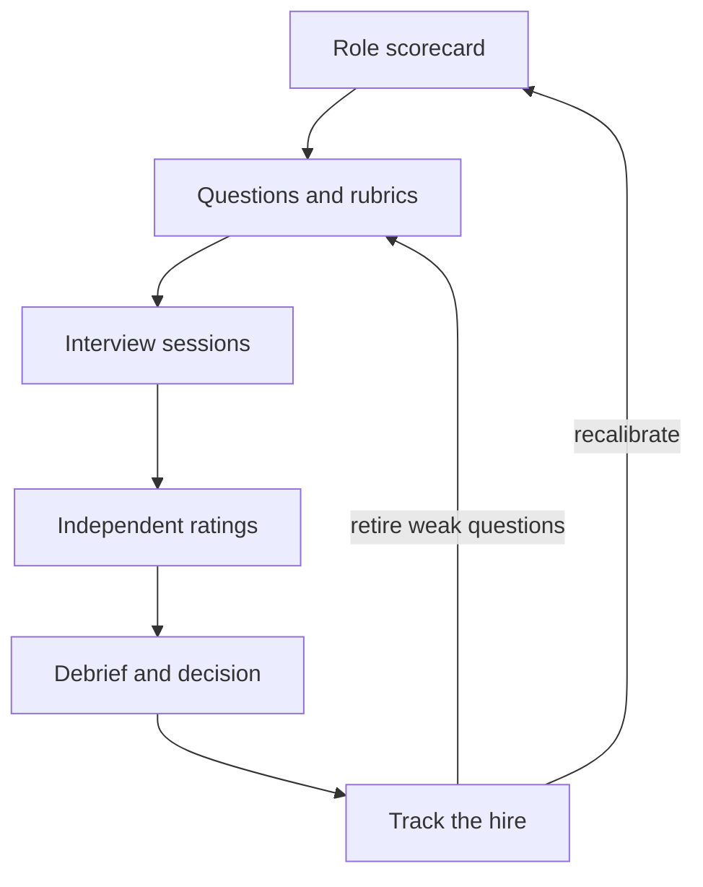

Most organizations run only the middle of this loop. Without the first box the interviewers
measure different things; without the last, nobody learns which questions predict anything.

### Deep Conceptual Explanation

#### What selection research measures

Personnel-selection research asks how well a method used before hiring predicts performance after
it. The usual statistic is a [validity coefficient](#validity-coefficient): the
correlation between scores on the method and a later measure of job performance, most often
supervisor ratings of overall performance. Zero means no prediction; 1 means perfect prediction.
[Meta-analyses](#meta-analysis) pool many studies and correct for known
distortions, chiefly range restriction: a study observes only the people who were hired, who differ
less from each other than applicants do, so the raw correlation understates how well the method
separates the applicant pool.

Two cautions apply throughout. The criterion is a rating of overall performance across many
occupations, not engineering output. And a validity coefficient is an average across studies, not
the validity of your loop, which depends on how well you build and run it.

#### The estimates, and their 2022 revision

For two decades the reference point was Schmidt and Hunter's 1998 summary of 85 years of research.
Its abstract reports meta-analytic validities for 19 selection procedures, and names three
combinations with the highest validity: general mental ability (a cognitive ability test) combined
with a work sample test, with an integrity test, or with a structured interview, each with a mean
validity in the low-to-mid .60s ([Schmidt and Hunter, 1998](#schmidt1998validity)).
Those figures are still widely quoted in hiring guides.

In 2022, Sackett, Zhang, Berry, and Lievens argued that the range-restriction corrections in the
earlier meta-analyses often overcorrected, so the validity of many procedures had been overestimated.
In their revision most procedures that ranked high before still rank high, but mean estimates fall
by roughly .10 to .20, and structured interviews come out on top
([Sackett et al., 2022](#sackett2022revisiting)). The same authors'
open-access follow-up in 2023 states the revised figures (**research finding**,
[Sackett et al., 2023](#sackett2023revisiting)). In the table, the
standard deviation measures how much validity varies between settings, and the 80 percent credibility
interval is the range within which the true validity falls in 80 percent of settings:

| Predictor | What the 2023 article states |
|---|---|
| Structured interview | Highest mean validity, .42; standard deviation .19; 80 percent credibility interval .18 to .66 |
| Empirically keyed biodata (scored background questionnaires) | Mean .38 |
| Cognitive ability | Revised estimate .31, about .20 lower than before; "no longer the stand-out predictor" |
| Work sample test | About .21 lower than before; tied with assessment centers (.33) for fourth place |
| Unstructured interview | About .19 lower than before |

Three points matter for an engineering manager. First, the predictors at the top are job-specific:
structured interviews, job knowledge tests, work samples, and biodata built for the job, while
cognitive ability, long the headline predictor, now sits below structured interviews, biodata, and
work samples. Second, the spread is wide. A credibility interval of .18 to .66 means that
in some settings a structured interview predicts weakly and in others strongly; the authors suggest
reading the figure as ".42, plus or minus .24". Third, the authors say considerable uncertainty
remains about many predictors, so the ranking should be held lightly.

#### What "structure" means

Structure is not a script read aloud. Campion, Palmer, and Campion's review identified 15 components
of interview structure, some improving what is asked and some improving how answers are evaluated,
and concluded that interviews can be improved by using many of them (**research finding**,
[Campion, Palmer, and Campion, 1997](#campion1997review)). The
content and evaluation distinction is the useful part: a loop with well-chosen questions is still
unstructured if each interviewer then decides on overall impression.

Google's published guide describes a working version in four parts: vetted questions relevant to
the role, recorded feedback on each answer, rubrics that describe poor, borderline, solid, and
outstanding answers, and interviewer training and calibration. It starts from defining the attributes
needed for success, and uses two kinds of question: behavioral ("tell me about a time when") and
hypothetical ("imagine that"), each with planned follow-ups. The guide also says structured
interviewing is hard to build and maintain (**documented practice**,
[Google re:Work, 2026](#rework-structured-interviewing)).

This book adds two requirements to that list (**this book's recommendation**): every session is
assigned named attributes from the scorecard, and the decision rule is agreed before the first
candidate.

#### Why unstructured interviews persist

If structure is better, why do most engineering interviews still end with "would I want to work
with this person"? Dana, Dawes, and Peterson offer a mechanism. In three studies, students
predicting other students' grades formed confident impressions even from interviews in which the
interviewee's answers were secretly random, and adding an unstructured interview to background
information made predictions worse than the background information alone. Most participants still
preferred a random interview to none (**research finding**, with students in a grade-prediction
task, not an employment setting;
[Dana, Dawes, and Peterson, 2013](#dana2013belief)). Interviewers
can make sense of almost anything a candidate says, and that sensemaking feels like insight.
Confidence after an interview is not evidence that the interview measured anything.

#### Work samples and technical interviews

A work sample asks the candidate to do a piece of the actual job under observation: review a real
pull request, debug a failing service, extend a small codebase. The 2023 revision lowered its
estimated validity but kept it in the top group of job-specific predictors
([Sackett et al., 2023](#sackett2023revisiting)).

Most engineering technical interviews are not work samples in this sense: the job rarely consists of
solving unfamiliar puzzles while a stranger watches. Behroozi and colleagues ran a randomized
experiment with 48 computer science students: performance on a problem-solving task fell by more
than half when an interviewer watched, and stress and cognitive load were higher than when the same
task was done in private. The authors argue that such interviews may partly measure how candidates
handle performance anxiety (**research finding**, students in a laboratory setting;
[Behroozi et al., 2020](#behroozi2020stress)). That is evidence of
a distortion, not a validity study, but it points the same way as the selection research: measure
the job, in conditions close to the job.

This is where engineering practice outruns the evidence. This book found no peer-reviewed study of
how well live-coding puzzles, take-home assignments, pair-programming interviews, or system-design
interviews predict later performance as a software engineer. The general research favors
job-specific work samples and structured questions; the software-specific formats are plausible
applications of that finding, not tested ones. Treat claims that one format "is proven" with
suspicion, including claims made in this chapter.

#### Debriefs and anchoring

A debrief combines four or five readings into a decision. In the common format, people take turns
giving their view, and the first strong opinion, often the most senior person's, becomes an anchor:
later speakers adjust toward it or mention only the evidence that fits it. Lorenz and colleagues
showed the mechanism in a different task: when people answering factual estimation questions saw others' estimates, their answers
converged, the wisdom-of-crowd effect weakened, and confidence rose (**research finding**,
estimation tasks rather than hiring;
[Lorenz et al., 2011](#lorenz2011social)). Applying this to
debriefs is an extension, but it explains a familiar pattern: a debrief that agrees quickly and
feels sure.

The protocol below is **this book's recommendation**:

```mermaid
flowchart TD
    A["Each interviewer rates alone"] --> B["Ratings hidden until all in"]
    B --> C["Facilitator shows all ratings"]
    C --> D{"Ratings disagree?"}
    D -->|"Yes"| E["Discuss evidence per attribute"]
    D -->|"No"| F["Apply decision rule"]
    E --> F
    F --> G["Record decision and reasons"]
```

Four details make it work. Ratings and notes are submitted before anyone sees anyone else's. The
facilitator is not the hiring manager, who speaks last. Discussion goes by attribute, and every claim
cites what the candidate said or did. Ratings may change after discussion, but the original is kept,
so you can later see whether debate improved them.

#### Tracking hiring quality after the offer

A hiring system that never checks its predictions cannot improve. Post-hire tracking compares each
hire's scorecard ratings with how they did against the same scorecard six and twelve months later,
plus a few observable milestones: time to first independent production change, time to joining the
on-call rotation where the role includes it, and whether the person left or was managed out in the
first year.

The data has three limits. Samples are tiny: at eight hires a year, the use is to spot gross
failures (a question nobody fails, an attribute every hire turns out weak on), not to compute
validity. You see only the people you hired, the same range restriction that distorted the research.
And onboarding and management shape the outcome, so a weak result may be the team's failure rather
than the interview's. Chapter 9 (Performance Management and Underperformance) covers judging
performance fairly.

### Engineering Organization Example

The figures in this example are **illustrative**. Northstar is fictional, and the cost assumptions
are stated so you can replace them with your own.

**What a validity of .42 buys.** Assume interview scores and later performance are both normally
distributed and correlated at .42, and that you hire the half of candidates who score above the
median. Under those assumptions, the share of hires who turn out above-median performers is about
64 percent, against 50 percent for hiring at random. At the edges of the credibility interval the
figure is about 56 percent (validity .18) and about 73 percent (validity .66). A well-run structured
loop moves the odds from a coin toss to about two in three; a badly run one may barely move them.
Neither makes mistakes rare.

*Method: for two normal variables with correlation r, the chance that both exceed their medians is
1/4 + arcsin(r)/2π; dividing by 1/2 gives the share among hires.*

**What the loop costs.** Suppose Northstar redesigns the loop for its next Billing ledger backfill,
with this scorecard: correctness of money movement (idempotency, rounding, double-entry); safe schema
change on a live database; diagnosing a production failure; working across team boundaries; and
code quality in a large Java codebase. Assumptions: four interview sessions totaling 4.25 hours
(a 90-minute work sample reviewing a ledger migration with planted defects, a 60-minute debugging
session on recorded logs, a 60-minute behavioral interview, and a 45-minute hiring-manager
conversation), 30 minutes of write-up per interviewer, and a 30-minute debrief for five people.

| Item | Engineer-hours |
|---|---|
| One loop: 4.25 interview + 2.0 write-up + 2.5 debrief | 8.75 |
| Four loops per hire | 35 |
| Twelve structured phone screens at 1 hour each including notes | 12 |
| Per hire, steady state | 47, about 1.2 engineer-weeks |
| One-time design of scorecard, work sample, and rubrics | about 24 (3 engineer-days) |
| First hire with the new loop | about 71, about 1.8 engineer-weeks |

At eight backfills a year, the steady-state cost is about 9.4 engineer-weeks, roughly 0.2 of an
engineer, plus training. Set that against the 120 seat-weeks a year that Northstar's backfills leave
empty, and against one mismatched hire who takes six months to reach the rotation. This does not
prove the structured loop pays for itself; that depends on how much better it selects, on which
Northstar has no data. It shows the cost is small enough to be worth testing.

### Decision Framework

Choose the assessment method per attribute, not per loop. The table is **this book's
recommendation**, applying the job-specific principle from the research.

| Attribute type | Example | Best method | Avoid |
|---|---|---|---|
| Skill the job uses daily | Reviewing and changing ledger code | Work sample on realistic material | Puzzles unrelated to the work |
| Knowledge the job requires on day one | How a migration locks a table | Structured technical questions with a rubric | Trivia with one right word |
| Behavior in recurring situations | Handling a cross-team disagreement | Behavioral questions with follow-ups | "Tell me about yourself" |
| Judgment in rare situations | A double-applied credit note in production | Hypothetical scenario with probes | Asking what they "would usually do" |
| Motivation and values | Willingness to take on-call | Structured questions plus a candid description of the job | "Culture fit" judged by impression |

Then set the decision rule before the first candidate. Options, from strictest to loosest:

| Rule | When it fits | Risk |
|---|---|---|
| No attribute below "meets" | Small team, critical role, a scarce skill | Rejects strong candidates with one teachable gap |
| Named must-have attributes at "meets", others average "meets" | Most roles | Must-haves chosen loosely |
| Any strong advocate with no strong objection | Very hard-to-fill roles | Brings back the anchoring the protocol removed |

For a backfill into a single-point-of-knowledge area like Northstar's ledger, use the middle rule
with that area's skill as a must-have.

### Trade-offs

**Structure against candidate experience.** Identical questions can feel mechanical. Planned
follow-ups and time reserved for the candidate's own questions recover most of the warmth.

**Realism against time.** A realistic work sample costs more to design. A take-home exercise saves
interviewer time but shifts the cost to candidates, hardest on those with a current job or caring
responsibilities, and invites outside help. A supervised work
sample of 60 to 90 minutes is a common compromise; it is a judgment, not a tested optimum.

**Speed against rigor.** Every week of process is a week of empty seat and a week for the candidate
to accept another offer. Rigor belongs in the design of the loop, not in more rounds; a fifth or
sixth interview usually adds fatigue and anchoring, not information.

**Job-specific against general.** A loop built tightly around today's work selects for today's job.
If the role will change, add one attribute for learning a new area, and accept that it is harder to
measure.

### Failure Modes

**The phantom scorecard.** The loop exists but the role was never written down, so each interviewer
measures their own idea of a good engineer. Signal: interview notes that describe the candidate
("smart", "senior") rather than evidence against named attributes. Countermeasure: no interview is
scheduled until the scorecard is signed off by the hiring manager and one engineer from the team.

**Puzzle proxy.** The interview measures speed on unfamiliar puzzles under observation; the job is
changing a large existing system. Signal: hires who pass
easily and then take months to make a safe change. Countermeasure: replace one puzzle session with a
work sample on realistic material.

**First speaker wins.** The debrief agrees within minutes with whoever spoke first. Signal: written
ratings that change after the meeting, always toward the hiring manager. Countermeasure: the
protocol above, and a record of original ratings.

**Interviewer drift.** Interviewers drift back to rating on impression. Signal: one interviewer's
ratings sit far above or below everyone else's. Countermeasure: quarterly calibration on the same
recorded answer.

**No feedback loop.** A question that predicts nothing survives for years. Signal: no one can say
what happened to last year's hires. Countermeasure: a six-month check for every hire.

**Backfill by template.** A departure is replaced with a generic job description, so the specific
knowledge the leaver carried is never named or tested. Signal: the posting for a ledger engineer
could be for any team. Countermeasure: write the scorecard from the leaver's actual duties, with the
team.

### Enterprise Application

In an organization of 50 to 150 engineers, hiring is continuous: at 10 percent annual attrition, 100
engineers means about ten backfills a year before any growth. The director runs the hiring system;
managers run their loops within it.

**Shared parts, local content.** Make the protocol, rubric format, decision rules, and post-hire
check common across teams. Let each team own its scorecards, work samples, and question banks,
because only the team knows the job.

**A trained interviewer pool.** Not every engineer should interview. Train a pool on the rubric,
notes, and the debrief protocol, with shadowing before interviewing alone, and track interview hours
per person: the people most often asked are usually the ones the team can least spare.

**Debrief facilitation outside the line.** A facilitator from another team runs debriefs; it is the
cheapest defense against anchoring by the hiring manager.

**One hiring dashboard, read carefully.** Time from approval to accepted offer, offer acceptance,
stage pass-through rates, and the six-month check. Each is gamed: time to hire falls if you lower the
bar, pass-through rises if screens get easy, and six-month ratings rise if the hiring manager is the
only rater. Pair time to hire with the six-month check, and have a second person rate.

### CTO Perspective

At executive scale, three decisions are the CTO's. The first is what the hiring system optimizes.
Speed, quality, cost, and fairness pull against each other, and if the CTO does not say which
matters most for which roles, recruiters will optimize what is measured, usually time to hire.

The second is defensibility. A hiring decision should be explainable from written evidence against
written criteria, which structure makes far easier. This book does not give legal advice, and
employment law differs by country, but a process whose reasons are recorded can be examined for
unfairness and corrected.

The third is honesty with the board and the CFO. Backfills take months to fill and more months to
ramp (Chapter 3 models the delay), so hiring is the slowest lever on capacity. A better hiring process
cannot fix this quarter's reliability problem. It can promise fewer expensive mismatches over a year
or two, and a record that shows whether it is working.

### Practical Playbook

For a director or manager introducing structured hiring for one role, then spreading it:

1. **Write the scorecard first.** With two engineers from the team, list three to five first-year
   outcomes and the four to six attributes they require. For a backfill, start from what the leaver
   actually did.
2. **Map attributes to sessions.** Each session measures one or two named attributes; must-haves are
   measured twice.
3. **Build the work sample.** Realistic material from your codebase, secrets removed, that a strong
   candidate can do well in 60 to 90 minutes. Try it on two current engineers first.
4. **Write the rubrics.** Poor, borderline, solid, and outstanding answers, with examples.
5. **Set the decision rule** before the first candidate, and share it with the panel.
6. **Train the panel.** One session on rubric, notes, and protocol; two shadowed loops before
   interviewing alone.
7. **Run debriefs by protocol.** Ratings alone, revealed together, discussed by attribute, hiring
   manager last, originals kept, reasons recorded.
8. **Describe the job as it is,** including on-call and the hard parts; a hire surprised by the job
   is a retention problem in waiting (Chapter 10).
9. **Check at six months.** Two people rate the hire against the scorecard; compare with the
   interview ratings.
10. **Review yearly.** Retire questions everyone passes or that do not match later performance;
    recalibrate interviewers; update the scorecard.

### Case Study

This case is **fictional** ([baseline data](#page-case-studies-northstar-baseline-data)).

!!! info "Northstar so far"
    The twelve months before week 1, when the new Engineering Director arrives at Northstar, the book's
    fictional order-to-cash company with 80 engineers. Eight engineers left in that year, and Billing,
    the team with the most serious incidents, lost one of its four ledger experts. See the
    [timeline](#page-case-studies-northstar-timeline).

**The process.** Before the director arrived, Northstar had no common hiring process. Each manager
ran a variant of the same loop: a 30-minute recruiter call; a 60-minute live algorithm exercise from
a shared bank of puzzles; a "team chat" with two or three engineers with no assigned topics; and a
conversation with the hiring manager. Job postings reused a generic "Senior Software Engineer"
description. Debriefs were 30-minute meetings in which the hiring manager gave a view and the others
followed in turn; written notes were optional. Nobody recorded what had happened to past hires.

**The ledger backfill.** A year before the director arrived, four Billing engineers were trusted
with ledger incidents. Nine months before arrival, one of them resigned. The replacement started 15
weeks later, matching Northstar's median. The time went like this: three weeks waiting for the
backfill to be approved, six weeks of sourcing and screening (about 40 applicants, nine recruiter
calls, four full loops), one week to agree an offer, and five weeks of the new hire's notice period.

The person hired, Tamsin Achterberg, came from a backend team at an online retailer and was the
strongest of the four finalists on the algorithm exercise. In the team chat one of the ledger
engineers asked about database migrations and noted afterward that she had never changed a schema
on a live system. Nobody asked about money movement, rounding, or on-call, because nobody had
written down that the role needed them. In the debrief Marcus Oyelaran (Billing manager) spoke first: the strongest
technical result in months, and the team could teach her the ledger. The ledger engineer's concern
became "will need some ramp on migrations". The decision took about 25 minutes and was unanimous.

By the end of the baseline quarter, about 24 weeks after her first day, Tamsin was not on the on-call
rotation, and the three remaining ledger engineers were handling most of Billing's pages. There were
two causes. Chapter 3 tells one: the three were rarely free to pair. This chapter tells the other: the loop never
measured what the role needed. The gap was invisible until after the offer, and the plan to close it
was a debrief comment rather than a ramp plan with time allocated. Tamsin is a capable engineer hired
against the wrong measure; treating her as the problem would teach the organization nothing.

**The decision in quarter 2.** At the start of quarter 2 (week 14) the director proposes running the
next two backfills as a structured pilot; whether it goes ahead is not recorded. The pilot has a
scorecard written with the team from the leaver's actual duties, a work sample on realistic material,
the debrief protocol with a facilitator from another team, and a six-month check. Marcus objects that
a 90-minute work sample will scare off candidates in a tight market. Tom Becker (Platform Operations
manager) worries that his infrastructure engineers will be pulled into interview panels. Victor
Lindqvist (CTO) asks how anyone will know within a year whether the pilot worked. The exercises take up each objection.

### Exercises

Solutions are in [chapter 7 solutions](#page-solutions-ch07-solutions). Northstar data is on the
[baseline page](#page-case-studies-northstar-baseline-data).

#### Foundational

**F1.** A hiring manager tells you their team's loop is "structured" because every candidate gets
the same four interviewers and the same algorithm question. The interviewers each write a free-text
summary and vote hire or no-hire in a meeting. Using the content and evaluation distinction, assess
how structured this loop is and name the two changes that would add the most structure.

**F2.** A colleague cites the 1998 estimate that cognitive ability combined with a structured
interview reaches a validity in the .60s, and concludes that the company should add a cognitive
ability test to every engineering loop. Using what the 2022 revision and the 2023 article say, write
the reply you would send, including what you would not claim either.

**F3.** Your recruiter reports that structured interviews have "a validity of .42, so they are right
42 percent of the time". Correct the statement, explain the credibility interval in one paragraph for
a non-specialist, and say what the figure does and does not tell you about your own loop.

#### Applied Leadership

**A1.** Write the scorecard and loop for Northstar's next Billing ledger backfill, using the chapter's
attribute types. State the outcomes for the first year, the attributes, which session measures each,
the decision rule, and what the work sample contains. Explain how your design would have surfaced the
gap in Tamsin Achterberg's loop.

**A2.** In a debrief you are facilitating, the hiring manager opens before the ratings are revealed:
"I think she's the strongest candidate we've seen this year." Two interviewers' hidden ratings are
below "meets" on a must-have attribute. Describe what you do in the next five minutes, what you
record, and what you change in the process afterward.

**A3.** Twelve months after a structured pilot, you have six hires with six-month checks. Four match
their interview ratings, one is much stronger than predicted, and one is much weaker, on the
attribute the work sample measured. The hiring manager says the work sample is "proven" by the four
matches. Decide what you can and cannot conclude, and what you would change.

#### Executive Decision-Making

**X1.** You are Northstar's director at the start of quarter 2. Marcus Oyelaran, Tom Becker, and
Victor Lindqvist have raised the three objections in the case study. Decide whether to run the pilot,
how to answer each objection, what you will measure, how each measure could be gamed, and what you
will not promise Victor.

**X2.** Rajiv Menon (CFO) proposes that all backfills be delayed by eight weeks to hold operating
expense flat, and that the delay be "used" to run a longer, more thorough interview process with two
extra rounds. Assume eight backfills a year and $185,000 fully loaded per engineer-year. Using the
chapter's figures and assumptions, evaluate the proposal and write your
recommendation to the CTO.

### Reflection Questions

1. When did you last hire someone, and could you name in writing the attributes the loop was
   measuring before the first interview?
2. Which question in your current loop do you ask because it worked on you?
3. When you feel sure about a candidate after an hour, what evidence would you have to show someone
   who was not in the room?
4. Who speaks first in your debriefs, and how often does the decision differ from their view?
5. Which of your team's current engineers would fail your own technical interview, and what does
   that say about the interview?

### Key Takeaways

- Treat the interview loop as a measurement instrument: define what it measures, run it the same way
  each time, and check its readings against later performance.
- Write the role scorecard before scheduling interviews; for a backfill, start from what the leaver
  actually did.
- Prefer job-specific methods (structured interviews, work samples on realistic material, structured
  technical questions) over puzzles and impressions; that is where the selection research points.
- Hold validity figures lightly: the 2022 revision lowered most estimates, structured interviews
  lead at about .42 with a wide spread, and software-specific formats have no validity evidence of
  their own.
- Collect ratings independently, reveal them together, let the hiring manager speak last, and set
  the decision rule before the first candidate.
- Check every hire at six months against the scorecard, and remember that a small, range-restricted
  sample can spot gross failures but cannot prove validity.

### References and Further Reading

- [Sackett et al., 2023](#sackett2023revisiting). Open-access
  follow-up stating the revised estimates; the best single source on what the research now says.
- [Sackett et al., 2022](#sackett2022revisiting). The revision that
  lowered most validity estimates.
- [Schmidt and Hunter, 1998](#schmidt1998validity). The classic
  summary, still widely quoted; read it with the revision.
- [Campion, Palmer, and Campion, 1997](#campion1997review). The
  components of interview structure, for content and evaluation.
- [Dana, Dawes, and Peterson, 2013](#dana2013belief). Why unstructured
  interviews feel informative when they are not; short and open access.
- [Behroozi et al., 2020](#behroozi2020stress). Being watched
  distorts whiteboard performance.
- [Lorenz et al., 2011](#lorenz2011social). Social influence makes a
  group converge and grow confident without becoming more accurate.
- [Google re:Work, 2026](#rework-structured-interviewing). A
  documented guide to questions, rubrics, and interviewer training.
- [Larson, 2019](#larson2019elegant). *An Elegant Puzzle*. Known for
  treating hiring as a system with a funnel to instrument and improve.

<a id="page-parts-02-people-management-08-career-development-promotion-and-compensation"></a>

## Chapter 8 — Career Development, Promotion, and Compensation

This chapter is about the three decisions that tell engineers what the organization actually values:
what each level means, who moves up, and who is paid what. It covers repairing a career ladder,
running promotions with calibration, saying "not yet" in a way the person can use, and making pay
decisions you can defend, with the basics of pay equity. Chapter 4 covers the map of roles and the
choice between management and staff tracks; Chapter 9 covers performance management. The running
example is Northstar Technologies, the fictional company in the
[case study](#page-case-studies-northstar-index), whose only ladder is one wiki page.

### Why This Matters

At team scale, the ladder is the manager's most used tool for growth conversations. Without it, "what
do I need to do to be promoted?" gets a different answer from every manager. With a vague one,
promotions follow visibility and tenure, and the quiet engineer who prevents incidents loses to the
one who fixes them loudly.

At organization scale, promotion and pay are where perceived fairness is decided. Engineers compare
notes. If one team promotes on shipped features and another on architectural judgment, "Senior" means
two things. Pay drifts, new hires come in above long-tenured peers, and the cheapest retention fix,
correcting an unjustified gap, is found only after a resignation.

At executive scale, the ladder and pay structure carry legal and financial weight. Pay that cannot be
explained by job, level, performance, and market is a liability where equal pay law applies, and pay
transparency rules are spreading.

### Learning Objectives

After this chapter you will be able to:

- Build or repair a career ladder that describes scope and impact rather than tenure and tools, and
  test it against real people before publishing it.
- Run a promotion cycle with evidence packets and calibration, and detect the biases calibration
  introduces as well as those it removes.
- Explain a "not yet" so that the person knows the gap, the evidence that would close it, and when it
  will be reviewed.
- Make and defend compensation decisions on job and level, internal equity, and market grounds, and
  know when a decision needs HR or legal advice in your jurisdiction.
- Diagnose a promotion and pay system from its data: promotion rates by team, position in band, and
  gaps between comparable people.

### The Mental Model

> **Mental model:** A career system is a measurement system. The ladder is the definition, promotion
> is the measurement, calibration checks that different measurers use the same definition, and pay is
> the price attached to the result. Errors compound downstream.

```mermaid
flowchart TD
    L["Ladder: what levels mean"] --> E["Evidence of scope, impact"]
    E --> C["Calibration across managers"]
    C --> D["Promote or not yet"]
    D --> P["Pay within level band"]
    D --> G["Growth plan with gaps"]
    G --> E
    C -.->|"Disputed meaning"| L
```

The diagram has two feedback paths. A "not yet" feeds a growth plan, which produces evidence for the
next cycle. Calibration feeds back to the ladder: when managers cannot agree whether a case meets a
criterion, the criterion is too vague, and the ladder needs work. Careful calibration cannot rescue a
broken ladder, and pay that ignores levels undoes a fair promotion.

The second idea: **a level is a claim about scope, not a reward for time served**. Scope is the size of
problem a person reliably owns: a task, a feature, a system, a domain across teams. Impact is what
changed because of their work. Tenure, tools, and effort are inputs. Five years of Kafka does not make
someone senior; designing the team's pipeline, making it operable by others, and ending two incident
patterns does.

### Deep Conceptual Explanation

#### What a ladder is for

A [career ladder](#career-ladder) (also called a leveling guide) states, for each level, the scope and impact expected
and the behaviors that produce them. It serves the engineer planning growth, the manager giving
feedback, the promotion committee, and whoever sets pay ranges.

Practitioner books treat the ladder as organizational infrastructure. Camille Fournier's account of
the management path is known for discussing career ladders as part of making a growing organization's
expectations explicit ([Fournier, 2017](#fournier2017manager)), and
Will Larson's book on engineering management is known for treating leveling and performance processes
as systems to design ([Larson, 2019](#larson2019elegant)).

**This book's recommendation**: four to six dimensions, each described at every level.

| Dimension | What grows from level to level |
|---|---|
| Scope | Task, then feature, then system, then a domain across teams |
| Technical judgment | Correct solutions, then sound trade-offs, then decisions others build on |
| Delivery and ownership | Finishes work, then owns outcomes, then makes others' delivery predictable |
| Operational responsibility | Fixes what breaks, then prevents classes of failure |
| Influence and growth of others | Helps peers, then raises the team, then shapes practice beyond it |

Each cell should describe what is observed, not what someone is. "Strong communicator" cannot be
checked; "writes design documents other teams adopt without a meeting" can.

#### Scope and impact, not tenure and tools

**Tenure language** ("three to five years of experience") becomes a minimum in practice: managers wait
for the anniversary, and fast growers leave. **Tool language** ("expert in Spark and Airflow") ages with
the stack and rewards narrow depth over judgment. Keep years out entirely; if a discipline needs tools,
put them in an appendix that can change without changing levels.

Check **scope availability** too. If Senior requires cross-team influence, some teams offer far more
chances than others. At Northstar, the book's fictional company, 86 cross-team dependency links (work items that needed
another team) were recorded at baseline. Of those, Data and Analytics
received 4 and Platform Operations 29 ([baseline data](#page-case-studies-northstar-baseline-data)).
Such a ladder promotes whoever sits where the dependencies are, unless managers create opportunities.

#### Separate tracks, comparable levels

Chapter 4 covers the choice of track. For the ladder, each track needs its own criteria, and levels need
explicit equivalence across tracks (same level, same band), or engineers conclude that management is the
real way up. Larson's book on staff-plus work is known for arguing that reaching staff level usually
takes sponsorship and visible work ([Larson, 2021](#larson2021staff)),
and his archetypes show how differently staff roles are shaped
([Larson, Staff archetypes](#larson-staff-archetypes)). A staff level
written for one archetype rejects the others. Chapter 29 covers staff roles.

#### Why one manager's judgment is not enough

Rater effects are the first reason: in developmental ratings of managers, the individual rater's
tendencies explained more of the differences between ratings than the ratee's performance did
([Scullen, Mount, and Goff, 2000](#scullen2000latent); a **research
finding**, detailed in Chapter 9).

Bias is the second reason, and declaring a process fair does not remove it; structure does. The
**research findings**, none about software engineers:

- In one large service organization, women and minorities received less salary growth than white men
  with the same performance scores ([Castilla, 2008](#castilla2008gender)).
- In three experiments with 445 people with managerial experience, presenting an organization as
  explicitly meritocratic increased the reward gap in favor of men with equal profiles
  ([Castilla and Benard, 2010](#castilla2010paradox)).
- Among 29,809 management-track employees of a retail chain, women received lower "potential" ratings
  despite higher performance ratings. The potential gap explained about half of the gender promotion
  gap, and women later outperformed, so the ratings were poor forecasts
  ([Benson, Li, and Shue, 2026](#benson2026potential)).
- In a field study of almost 9,000 employees, a reward gap between groups with equal performance
  scores shrank after the company made reward decisions accountable and transparent
  ([Castilla, 2015](#castilla2015accounting)).
- Whether university teaching was rated on a 6-point or a 10-point scale changed the gender gap in the
  most male-dominated fields ([Rivera and Tilcsik, 2019](#rivera2019scaling)).

Two lessons follow, which **this book recommends**. Promote on **demonstrated scope at the next
level**, not on a forecast of potential. And use structure: written criteria, evidence per criterion,
someone other than the nominating manager accountable for consistency, and outcomes monitored by
group. The same authors' study of the Peter Principle is summarized in Chapter 2
([Benson, Li, and Shue, 2019](#benson2019promotions)).

#### Calibration: what it fixes and what it breaks

[Calibration](#calibration) is a meeting in which managers review promotion cases
together against the same criteria, so that "Senior" means the same in every team. We found no study
that measures whether calibration meetings as engineering organizations run them improve fairness, so
the evidence is thin. The practice below is **practitioner consensus** plus this book's
recommendation.

Calibration fails predictably: the most articulate manager wins, absent managers' cases lose,
late cases get less attention, and quotas turn it into a negotiation. Countermeasures (**this book's
recommendation**):

- A written **evidence packet** per case, each claim linked to an artifact (design document, incident
  review, merge requests, peer statements) and a ladder dimension.
- **Independent readers** present the case; the nominating manager answers questions.
- A **decision rule** stated in advance: every dimension at the next level, sustained for two quarters.
- A **facilitator** who owns consistency and records disputed criteria for the ladder owner.
- **No quota**, but a published budget for the pay promotions cost. A quota limits who is recognized; a
  budget limits how fast pay moves.
- An **outcome review**: promotion rates by team, level, and any group your jurisdiction lets you
  analyze, against the eligible population.

#### A "not yet" that can be used

What a person hears after a declined case decides whether
["not yet"](#not-yet) becomes a plan or a resignation. A usable "not yet" has five parts:

1. **The decision, plainly**, first.
2. **The gap, tied to the ladder**: which dimension, what the next level requires, what was seen.
3. **Evidence that would close it**, observable and achievable in the role. "Lead the next ingestion
   design through review by another team" can be done; "show more leadership" cannot.
4. **The manager's commitment** to create the situation the evidence needs. If the gap is cross-team
   scope and the role has none, the gap is partly the manager's.
5. **A review date**, normally the next cycle, with a mid-point check.

Kim Scott's book is known for pairing caring personally with challenging directly
([Scott, 2017](#scott2017radical)); a vague "not yet" fails the
second, one without a commitment fails the first. Chapter 5 covers the one-on-one where this happens;
Chapter 9 covers the different conversation when performance at the current level is the problem.

#### Compensation: three defensible grounds

Pay in a mid-size company is usually set within **bands**: minimum, midpoint, and maximum base salary
per level and labor market. **Compa-ratio** is salary divided by the band midpoint; 0.90 means 10 percent
below. A pay decision is defensible when it rests on grounds you can name:

| Ground | Question | Evidence |
|---|---|---|
| Job and level | Is the person in the right band for the work? | Ladder level, confirmed by calibration |
| Internal equity | Are comparable people at comparable performance paid comparably? | Peer pay at the same level and market, with reasons for differences |
| Market | Can we hire and keep people at this pay? | Salary surveys, offer acceptance, exit reasons |

Differences within a band are legitimate when they follow from documented, job-related reasons:
sustained performance, time at level, scarce skills the job requires. Negotiation skill, pay history,
and who the manager is are not such reasons. A raise that corrects a gap with no such reason is a
**pay equity adjustment** (a salary change, not a stock grant). It is different from a **merit
increase**, the regular raise tied to performance, which is paid from an annual **merit budget**. The commonest equity failure in growing companies is
**compression**: new hires come in at market while existing pay rises a few percent a year, until the
newcomer earns more than the person who trained them.

#### Pay transparency and equal pay

Pay law differs by jurisdiction, and this book does not give legal advice. Many legal systems require
equal pay for equal work or work of equal value, and transparency is being written into law. The
European Union's Pay Transparency Directive, for example, gives applicants a right to information on
initial pay or its range, forbids asking about pay history, requires the criteria for pay and
progression to be accessible to workers, lets workers request average pay by sex for comparable work,
and requires larger employers to report gender pay gaps, with a joint pay assessment where an
unjustified gap of at least 5 percent persists in a category of workers
([Directive (EU) 2023/970](#eu2023paytransparency)). Treat it as a
**standard**, not evidence about outcomes; a directive binds member states, whose national laws set the
actual obligations. Ask HR or employment counsel in each country before changing pay practice.

Transparency has costs. After US state laws protecting workers' right to discuss pay with coworkers,
wages fell by about 2 percent, consistent with a model in which employers refuse individual raises to
avoid renegotiating with everyone
([Cullen and Pakzad-Hurson, 2023](#cullen2023equilibrium)). That
**research finding** concerns one kind of transparency in one country. Expect transparency to compress
pay and remove room for one-off deals: good for equity, hard on the manager who fixed retention quietly.

### Engineering Organization Example

!!! info "Northstar so far"
    Before week 1. Northstar, a fictional order-to-cash software company, has 80 engineers in six teams
    and a new Engineering Director about to arrive. Eight engineers left in the past year, and the only
    career ladder is one wiki page. See the [timeline](#page-case-studies-northstar-timeline).

The figures are **illustrative**.

**Promotion history.** Each manager decided promotions, and Victor Lindqvist, the CTO, approved them one
case at a time, with no comparison across teams and no written evidence. In the two years before the
director arrived there were 15 promotions to Senior Engineer and none to Staff Engineer.

| Team | Engineers | Engineer / Senior | Promotions in two years | Per 10 engineers |
|---|---|---|---|---|
| Orders | 14 | 7 / 7 | 3 | 2.1 |
| Billing | 13 | 7 / 6 | 1 | 0.8 |
| Payments and Integrations | 12 | 6 / 6 | 2 | 1.7 |
| Customer Experience | 15 | 8 / 7 | 6 | 4.0 |
| Data and Analytics | 11 | 6 / 5 | 1 | 0.9 |
| Platform Operations | 12 | 10 / 2 | 2 | 1.7 |
| **Total** | **77** | **44 / 33** | **15** | **1.9** |

With the three staff engineers, Northstar has 44 Engineers, 33 Senior Engineers, and 3 Staff Engineers.
Customer Experience promoted at more than four times the rate of Billing or Data and Analytics. That
alone proves nothing. But asked what "Senior" required, Daniel Cho (Customer Experience manager) said "owns
features end to end and ships them", and Farah Haddad (Data and Analytics manager) said "could stand in for me as the team's data architect": two levels
under one word.

**Pay.** US bands (Minneapolis and remote US), base salary, fictional and rounded. Bogotá engineers are
paid on separate bands set on the Colombian market, not shown.

| Level | Minimum | Midpoint | Maximum |
|---|---|---|---|
| Engineer | $100,000 | $120,000 | $140,000 |
| Senior Engineer | $130,000 | $152,500 | $175,000 |
| Staff Engineer | $170,000 | $195,000 | $220,000 |

Data and Analytics has 11 engineers: 4 in Minneapolis, 5 in Bogotá, 2 remote in the US. Two US Senior
Engineers do comparable work:

| Person | Path to Senior | Base salary | Compa-ratio |
|---|---|---|---|
| Sunil Varghese | Joined six years ago; promoted three years ago; designed the warehouse pipelines | $138,000 | 0.90 |
| Senior data engineer hired from outside | Hired five months before the director arrived, at the rate needed to win the offer | $162,000 | 1.06 |

Sunil's pay has an explanation (raises at promotion were capped at 8 percent that year, then about 3
percent a year) but no justification: history is not job, performance, or market. Bringing him to
midpoint costs $14,500 a year ($152,500 − $138,000), about $20,000 fully loaded if loading is about 1.4
times base (an assumption, not a Northstar figure). Losing him would cost more: Northstar's median from
resignation to a replacement's first day was 15 weeks
([baseline data](#page-case-studies-northstar-baseline-data)), and the pipelines are his design.

### Decision Framework

For promotion, the rule is the one stated before calibration: every dimension at the next level,
sustained, with evidence. For pay questions:

```mermaid
flowchart TD
    A["Pay question raised"] --> B{"Level correct?"}
    B -->|No| B1["Fix level first"]
    B -->|Yes| C{"Below peers, no job reason?"}
    C -->|Yes| C1["Equity adjustment"]
    C -->|No| D{"Market moved for level?"}
    D -->|Yes| D1["Adjust band, then pay"]
    D -->|No| E["Explain position, plan growth"]
```

A competing offer is not a job reason; it is market evidence. If it shows the band is wrong, move the
band for everyone at that level, not only for the person holding the offer. Chapter 10 covers the
counter-offer decision itself.

| Situation | Usual response | When to do otherwise |
|---|---|---|
| Strong performer, evidence thin in one dimension | "Not yet" with the five parts; create the opportunity | The dimension is unavailable on the team: consider a move |
| Strong case, no budget this cycle | Promote; fund the pay step or date it in writing | Never "title only" without a dated pay step |
| Peers at one level, gap over 10 percent, no job reason | Equity adjustment, next cycle or sooner | The higher-paid person was mis-leveled: fix the level |
| New hire would earn more than tenured peers | Hire at market; adjust peers in the same cycle | The rate is a market outlier: renegotiate |

### Trade-offs

**Precise against flexible ladder.** Detailed criteria make decisions consistent and reward checklist
optimizers. Broad criteria allow judgment and invite the bias the research describes. A middle course:
observable examples per cell, stated as illustrations rather than a complete list.

**Calibration against speed.** A calibrated cycle takes weeks, twice a year at most. An exceptional case
may wait six months, and some people leave. Allow rare out-of-cycle cases with the same packet and two
calibrators.

**Transparency against flexibility.** Published bands and criteria reduce unexplained gaps and the
negotiator's advantage; they also remove the manager's quiet tools and may compress pay. Publishing
internally is **this book's recommendation** once every placement can be defended; publishing before
cleaning up is how a company learns about its gaps from a chat thread.

**Market against internal equity.** Paying market for scarce skills wins hires and creates compression.
Decide which levels and skills justify a premium, write it down, and adjust peers when you pay it.

### Failure Modes

**The manager lottery.** Each manager applies their own meaning of a level.

```mermaid
flowchart TD
    A["Managers promote alone"] --> B["Lenient teams inflate"]
    B --> C["Level means less"]
    C --> D["Strict teams lose people"]
    D --> E["Strict managers relax"]
    E --> B
    C --> F["Pay tied to level drifts"]
```

It reinforces itself: strict managers' best people see peers elsewhere promoted for less and leave or
press their managers, who relax. Signal: promotion rates differing twofold across teams of similar mix,
with no written reason. Fix: calibration, with disputed criteria fed back into the ladder.

**Calibration theater.** Thin packets, the nominating manager presents, decisions follow the most
senior voice. Signal: nearly every nomination succeeds, or outcomes change when a senior manager
speaks.

**Promotion as retention.** Someone threatens to leave and is promoted to stay. The organization learns
that threats work, and the person may struggle at the new level. Signal: promotions shortly after a
resignation conversation.

**Glue work that never counts.** Mentoring, incident follow-up, and coordination go unrewarded. Signal:
the people doing it are told to "focus on technical impact". Fix: make influence and operational
responsibility ladder dimensions.

**Compression discovered by resignation.** Signal: new hires' compa-ratios above tenured peers' at the
same level. Fix: an equity review before each cycle, not after an exit interview.

### Enterprise Application

At 50 to 150 engineers, promotion and pay become a calendar-driven system, because the director can no
longer know every case. A workable design (**this book's recommendation**):

**Two cycles a year**: nominations, packet preparation (two to three weeks), calibration by level with
the director facilitating and staff engineers reading technical evidence, conversations within a week,
and pay changes on a fixed date.

**A ladder owner**, often the director with an HR partner, who keeps a change log. Changes are published
before a cycle, never during one.

**Pay governance.** HR owns bands and market data; engineering owns levels and evidence. Before each
cycle, an equity review lists everyone outside 0.90 to 1.10 compa-ratio and every comparable pair with
a gap over 10 percent, each with a reason or an adjustment. Where people are paid in several labor
markets, compare within each market but keep level definitions identical across them.

**Outcome monitoring** of promotion rates and pay changes by team, level, and protected group where
local law allows that data, reviewed by someone outside the calibration. The research on
performance-reward bias suggests decision makers are poorly placed to see their own patterns.

### CTO Perspective

Engineers read the career system more carefully than any strategy document. If those promoted are
the ones who rescued releases, rescue becomes the job.

Three decisions are the CTO's. **Track parity**: whether the top individual-contributor level is
equivalent in band and access to a director, and what that costs. **Pay posture**: where in the market
the company aims to pay, agreed with the CFO and written down, so managers stop inventing it case by
case. **Funding**: promotions and equity adjustments as lines separate from merit increases, so fixing
one person's unjustified gap does not take money from someone else's raise.

The CTO also owns the risk. An unexplained pay gap is a legal and reputational exposure that
transparency rules make more likely to surface. Treat a pay equity review like a security review:
scheduled, findings tracked to closure, results reported to the executive team.

### Practical Playbook

**Repair the ladder (one quarter).**

1. Collect the written ladder, each manager's unwritten meaning of each level, and two years of cases.
2. Draft four to six dimensions with observable descriptions at every level; remove years and tools.
3. Test the draft on twenty people across teams: place each, then ask whether peers would agree.
4. Write management-track criteria separately (Chapter 4 gives the map), with level equivalence.
5. Publish with a change log, stating that no one's level is reduced by the new text.

**Run the cycle (twice a year).**

6. Announce dates, the packet format, and the decision rule.
7. Prepare packets with the person; every claim cites an artifact and a dimension.
8. Calibrate with independent readers and a facilitator; record disputed criteria.
9. Deliver every decision within a week, in person; each "not yet" with five parts.
10. Review outcomes by team and level; send disputed criteria to the ladder owner.

**Fix pay (before each cycle).**

11. List compa-ratios by level and market; flag outliers and peer gaps.
12. Write a job-related reason for each, or schedule an adjustment from a separate equity budget.
13. When hiring above existing peers, adjust the peers in the same cycle.
14. Check legal requirements with HR in each jurisdiction before publishing bands, changing offer
    practice, or answering a formal pay-information request.

### Case Study

This case is **fictional**. It runs from quarter 2 to week 27, the start of quarter 3. By then serious
incidents had fallen from 30 a quarter to 17, and the two renewal features the CTO's mandate protected
were delivered (see the [timeline](#page-case-studies-northstar-timeline)).

**Where it starts.** The ladder is the "Engineering levels" wiki page described in Chapter 4: three
short paragraphs, the staff one describing a "recognized technical expert" with no scope, and no
manager criteria. Eight engineers left in the year before the director arrived; two were from Data and
Analytics, and one told Farah Haddad that another company had offered a senior title she had been told
was "a year or two away".

**The rewrite.** In quarter 2 the director and an HR partner drafted the five dimensions above at three
levels and tested them against twenty engineers from all six teams. Farah's meaning of Senior matched
the draft's Staff column on scope: her team had been holding Senior to a staff standard. And the
operational responsibility dimension placed several Billing engineers above their titles; the people
carrying the ledger pages had never been credited for it.

**The first calibrated cycle.** At the start of quarter 3, managers nominated nine engineers for Senior.
Two managers from other teams read each packet, with the three staff engineers (Ines Carvalho, Kwame
Mensah, and Li Na Zhou) reading technical evidence. Five were promoted, including two Billing ledger engineers and a Bogotá
data engineer. Two of Customer Experience's three nominations received "not yet", with the same gap:
features shipped well, but no design decision others had built on.

**A "not yet" in Data and Analytics.** Yusuf Demir, a data engineer in Minneapolis with three years at
Northstar, also received a "not yet". Farah gave all five parts. The gap was influence beyond the team:
excellent pipelines that only his team used. The evidence: lead the design of the ledger-export
contract Li Na Zhou (staff engineer, data and integration) had proposed, through review by Billing, and bring one Billing engineer up to speed
on it. Farah's commitment: assign him the design and ask Li Na Zhou to sponsor it. Review next cycle,
check at three months. Yusuf said it was the first time anyone had told him what Senior meant.

**The pay question.** The equity review flagged Sunil Varghese ($24,000 below the outside hire at the
same level and scope) and five more US Senior Engineers below 0.92 compa-ratio, all promoted internally.
Rajiv Menon (CFO) said the year's merit budget was set. How to fund and sequence the adjustments is exercise X1.

### Exercises

Solutions are in [chapter 8 solutions](#page-solutions-ch08-solutions). Northstar data is on the
[baseline page](#page-case-studies-northstar-baseline-data).

#### Foundational

**F1.** A ladder you inherit says, for Senior Engineer: "Five or more years of experience. Expert in
the team's stack (Java, Spring, Kafka). Strong communicator. Mentors junior engineers." Rewrite it as
three to five observable statements of scope and impact, explain what each original phrase does to
promotion decisions in practice, and say how you would test your version before publishing.

**F2.** At Northstar, Customer Experience promoted 6 of 15 engineers to Senior in two years and Billing
1 of 13. A manager argues this proves Customer Experience grows people better. List the alternative
explanations, the data that would tell them apart, and what calibration would and would not settle.

**F3.** Write the "not yet" message for an engineer whose case was declined because all their impact
is inside one service that only their team touches. Include all five parts and the manager's
commitment. Then name two things that would make the same message useless to them.

#### Applied Leadership

**A1.** You facilitate Northstar's first calibration. Daniel Cho presents his own three cases with
energy; two Billing cases have thin packets because Marcus Oyelaran (Billing manager) spent the week in an incident
review. Halfway through, the room is tired and leaning toward Daniel's cases. Decide what you do in the
meeting, what you change for the next cycle, and how you would check afterwards whether it was fair.

**A2.** A senior data engineer in Data and Analytics receives an outside offer 18 percent above her
salary and asks Farah Haddad for promotion to Staff Engineer to stay. Her work is strong at Senior; the
staff criteria are newly written. Advise Farah on the promotion question and the pay question
separately, and on what she should not say.

**A3.** You are hiring a Senior Engineer for Billing. The recruiter recommends $165,000; three Billing
Senior Engineers earn $136,000 to $141,000 and perform well. The hire is urgent because of ledger
on-call load. Decide the offer, what you do about the three existing seniors, and how you explain both
to the CFO.

#### Executive Decision-Making

**X1.** The equity review flags six US Senior Engineers below 0.92 compa-ratio, all promoted internally,
including Sunil Varghese. Bringing all six to 0.95 would cost about $52,000 a year in base salary. Rajiv
Menon says the merit budget is fixed. Decide how you fund and sequence the adjustments, what you tell
the six and their peers, what risk you accept by waiting, and when you involve HR or legal counsel.

**X2.** Victor Lindqvist (CTO) asks whether Northstar should publish its pay bands to all employees within a
year. Northstar employs engineers in the United States and in Colombia. Recommend a decision and a
sequence, state what must be true before publication, what you expect to change (including possible
pay compression), and what you will not claim to the executive team.

### Reflection Questions

1. If your engineers were asked what it takes to reach the next level, how many different answers
   would you hear, and whose is the real one?
2. Which essential work on your team is done by people who are not promoted for it?
3. When did you last promote someone because you feared they would leave?
4. If every engineer saw every other engineer's level and salary tomorrow, what would you fix first?
5. How much of your judgment of your reports' performance is a description of you?
6. When you say someone has "potential", what evidence are you describing?

### Key Takeaways

- Treat the career system as measurement: ladder, promotion, calibration, pay. Fix the earliest broken
  step first.
- Write ladder criteria as observable scope and impact; remove years and tools.
- Test a ladder on real people before publishing, and check that the scope it demands exists on every
  team.
- One manager's judgment is noisy and can be biased: require evidence per criterion, independent
  readers, and an outcome review.
- Promote on demonstrated next-level scope, not on "potential".
- A "not yet" states the decision, the gap, the evidence that closes it, the manager's commitment, and
  a review date.
- Defend each pay decision on job and level, internal equity, or market, and find compression before a
  resignation does.
- Fund equity adjustments separately from merit, and take legal advice in each jurisdiction before
  changing pay transparency practice.

### References and Further Reading

- [Scullen, Mount, and Goff, 2000](#scullen2000latent). How much of a
  rating reflects the rater; the core argument for calibration.
- [Castilla, 2008](#castilla2008gender),
  [Castilla and Benard, 2010](#castilla2010paradox), and
  [Castilla, 2015](#castilla2015accounting). Performance-reward bias,
  the paradox of declared meritocracy, and a field test of accountability and transparency.
- [Rivera and Tilcsik, 2019](#rivera2019scaling). Rating-scale design
  changes gender gaps in ratings.
- [Benson, Li, and Shue, 2026](#benson2026potential). "Potential"
  ratings and the gender promotion gap.
- [Benson, Li, and Shue, 2019](#benson2019promotions). Promotion and
  the Peter Principle; treated in Chapter 2.
- [Cullen and Pakzad-Hurson, 2023](#cullen2023equilibrium). Why pay
  transparency laws can lower average wages.
- [Directive (EU) 2023/970](#eu2023paytransparency). One major pay
  transparency regime, read in full; an example, not advice for your jurisdiction.
- [Fournier, 2017](#fournier2017manager) and
  [Larson, 2019](#larson2019elegant). Practitioner accounts of
  engineering management, including ladders and performance processes.
- [Larson, 2021](#larson2021staff) and
  [Larson, Staff archetypes](#larson-staff-archetypes). The top of the
  individual-contributor ladder.
- [Scott, 2017](#scott2017radical). Direct feedback with care, for the
  "not yet" conversation.

<a id="page-parts-02-people-management-09-performance-management-and-underperformance"></a>

## Chapter 9 — Performance Management and Underperformance

This chapter is about the part of management most managers postpone: deciding that someone is not
performing, finding out why, and acting in a way that is fair to that person and to everyone who works
with them. It covers diagnosis before action (skill, will, role fit, and the system around the
person), a documented improvement process with a real chance of success and a clear end, the cost of
acting late, and what performance ratings can and cannot tell you. Chapter 6 covers the feedback
conversation itself, and Chapter 8 covers promotion and calibration; this chapter uses both. The running
example is an infrastructure engineer in Tom Becker's Platform Operations team at Northstar
Technologies, the fictional company in the [case study](#page-case-studies-northstar-index).

### Why This Matters

At team scale, one person not doing their job is rarely one person's problem. Someone absorbs the
work, usually the most conscientious people on the team, and they notice that the manager has noticed
and done nothing. The team learns the real standard from what the manager tolerates, not from what
the manager says.

At organization scale, performance management decides whether "meets expectations" means anything.
If every review says it, ratings stop informing promotion, pay, or staffing, and managers who do raise
problems look harsh by comparison. The opposite failure is just as real: a process that labels people
as low performers when the cause was an impossible role, a broken toolchain, or an interrupt load
nobody measured.

At executive scale, the question is the system: review cadence, whether ratings are trusted, whether
forced distributions are used, and whether managers are expected to act. Once people distrust these
choices, they are hard to reverse.

### Learning Objectives

After this chapter you will be able to:

- Separate skill, will, role fit, and system causes of low performance before acting, and name the
  evidence that distinguishes them.
- Write performance expectations that a third party could check, and use them to open a documented
  improvement process.
- Run an improvement plan that gives the person a real chance of success, has a clear end, and stays
  within your organization's legal and HR boundaries.
- Estimate the cost to the team of acting late, and use it to decide when to start.
- Judge what a performance rating can support, given research on rater effects, and respond to
  proposals for forced ranking.

### The Mental Model

> **Mental model:** Low performance is a gap between an expectation and a result. Before you act on
> the person, prove that the expectation was clear and that the system allowed the result. Then act
> quickly, in writing, with an end date.

Managers tend to make one of two errors consistently. The first is blaming the person for a system
problem: the engineer who misses every commitment because they carry half the team's interrupts. The
second is blaming the system for a person problem, and waiting for a reorganization or a better
quarter to fix someone who has been told nothing. The diagnosis order below guards against both. It
starts with the cheapest checks, about the manager and the environment, and only then reaches the
person.

```mermaid
flowchart TD
    A["Gap observed"] --> B{"Expectation clear?"}
    B -->|No| B1["Clarify, restart clock"]
    B -->|Yes| C{"System allows it?"}
    C -->|No| C1["Fix the system"]
    C -->|Yes| D{"Could they do it?"}
    D -->|No| D1["Skill: train, support"]
    D -->|Yes| E{"Do they want to?"}
    E -->|No| E1["Will: find the cause"]
    E -->|Yes| F["Role fit: move or reshape"]
```

Each later branch costs more and is harder to undo: clarifying an expectation costs a conversation,
fixing a system costs some capacity, and a formal plan costs weeks, trust, and sometimes a job.
Several causes usually coexist, so run the whole checklist rather than stopping at the first yes.

### Deep Conceptual Explanation

#### Four causes, and the evidence that separates them

Diagnose before you remedy, and check the environment before the person. That is the shared point of
three classic practitioner works. Andrew Grove reduced failure to perform to capability or motivation
([Grove, 1983](#grove1983high)). Robert Mager and Peter Pipe offered a
blunt test for a skill gap: if the person's job truly depended on the task, could they do it? If so,
training is not the remedy ([Mager and Pipe, 1997](#mager1997analyzing)).
Thomas Gilbert argued that most performance deficits come from the environment (information,
resources, incentives) rather than the individual
([Gilbert, 1978](#gilbert1978human)).

This book uses four causes, extending those ideas (**this book's recommendation**):

| Cause | What it looks like | Evidence that confirms it | Evidence that rules it out |
|---|---|---|---|
| System | Blocked, overloaded, or set up to fail | Interrupt load, unclear ownership, missing access; peers in the same role struggle too | Peers with the same load and tools deliver |
| Skill | Effort visible, result wrong or slow | Improves with pairing and examples; asks for help | Did this well a year ago |
| Will | Could do it but does not | Selective effort; good work on what interests them; disengagement after an event | Gap appears across everything, including what they enjoy |
| Role fit | Sustained effort in a role that rewards other strengths | Strong in a neighboring role; struggling since the role changed | Role unchanged and the struggle is new |

"Will" describes behavior, not character, and it nearly always has a cause: a broken promise, a
conflict, burnout, a health or family problem. Some causes are the organization's doing and some are
private. A manager is entitled to the behavior and a conversation about it, not to medical or family
details. When a health or personal cause appears, the next step is usually HR and whatever support or
accommodation the employer offers, not a performance plan.

#### Expectations a third party could check

An improvement process is only as fair as its expectations. "Be more proactive" cannot be met or
failed, only judged, and the judge is the manager who already formed a view. Write each expectation
so that someone who does not know the person could tell at the end whether it was met (**this book's
recommendation**):

- **The outcome**, not the activity: "environment requests assigned to you are answered within two
  working days", not "be more responsive".
- **The level**, set against the person's level and peers, not against the team's best engineer.
- **The evidence** both sides will look at: the ticket queue, review history, design documents.
- **The support** the manager commits to: protected time, a pairing partner, a course.

Individual activity counts are not performance measures; delivery data shows where to look, and the
judgment rests on impact and behavior
([Chapter 18](#why-the-book-refuses-individual-productivity-scoring)).

#### The improvement process

Formal processes go by many names; [performance improvement plan](#performance-improvement-plan-pip),
or PIP, is the most common. In many
organizations everyone, including the person on it, reads a PIP as the first step of an exit. A plan
both sides believe is a formality cannot succeed, and the manager loses what it was supposed to
produce: evidence of whether the person can meet the bar with support.

Elaine Pulakos and Ryan O'Leary argue that performance management has been reduced to prescribed
steps in formal administrative systems, disconnected from the daily activities that decide whether it
works: clear expectations, short-term objectives, and continual guidance. They argue for more
attention to the manager-employee relationship and less redesign of formal systems
([Pulakos and O'Leary, 2011](#pulakos2011broken)). It is a position
paper, not an experiment, but it names the PIP failure: a form replacing the weekly guidance it was
meant to formalize.

A process with a real chance of success has five properties (**this book's recommendation**):

1. **It is not the first time the person hears about the problem.** The feedback conversations of
   Chapter 6 have happened, with examples, and the person was told plainly that the gap is serious.
2. **System causes are removed first**, or the plan measures the system.
3. **It is short and dated.** Six to ten weeks for most engineering roles: long enough to show a
   pattern, short enough that the team does not carry the gap another quarter.
4. **Weekly check-ins with written notes**, shared with the person: what was met, what was not, what
   the manager provided.
5. **Both outcomes are real.** Success closes the plan, said out loud. Failure leads to a decision
   described at the start: a role change if one fits, or an exit.

```mermaid
flowchart TD
    A["Concern noticed"] --> B["Specific feedback"]
    B --> C{"Improves in weeks?"}
    C -->|Yes| C1["Note it, carry on"]
    C -->|No| D["Remove system causes"]
    D --> E["Written plan, end date"]
    E --> F{"Met at end?"}
    F -->|Yes| F1["Close plan openly"]
    F -->|No| G{"Other role fits?"}
    G -->|Yes| G1["Agreed role change"]
    G -->|No| G2["Exit, with HR"]
```

Feedback that works within weeks is the common case and needs no formal plan. A role change is valid
only for a real role the person wants and can do, not as a quiet transfer of the problem.

#### Legal and HR boundaries

Employment law differs by country, state, contract, and collective agreement, so this chapter does not
tell you what is lawful. It states boundaries that hold almost everywhere (**this book's
recommendation**), and the rule that follows: involve HR, and through HR employment counsel, before a
formal plan starts, not after it fails.

- **Consistency.** Similar gaps get similar treatment. A plan for something another engineer was
  never told about is unfair and exposes the organization to discrimination claims.
- **Facts, not adjectives.** "Missed the agreed date for the Jenkins upgrade (planned the 14th, not
  started)" survives scrutiny; "lazy" does not.
- **Protected circumstances.** Health, disability, pregnancy, family leave, union activity, and recent
  complaints carry specific duties or protections in many jurisdictions. Stop and take advice.
- **No pretext.** If the decision is already made, a plan is dishonest and often legally risky.

#### The cost of acting late

Managers delay because acting is unpleasant, and others pay for the delay. Will Felps, Terence
Mitchell, and Eliza Byington reviewed research on negative group members: people who withhold effort, express persistent negative emotion, or violate important
interpersonal norms. Their model proposes that teammates react with a sense of unfairness, negative
mood, and reduced trust, leading to defensive responses such as lashing out or withdrawal that damage
cooperation ([Felps, Mitchell, and Byington, 2006](#felps2006bad)).
It is a proposed model, not a measured effect, and most underperformers are not "bad apples". But the withholding-effort path applies: a teammate who visibly does less without consequence
is a fairness signal to everyone.

The practical cost is usually measurable, as the Engineering Organization Example shows. Kim Scott's
account of candor is known for naming the manager's failure here: withholding a hard message out of a
wish to be kind, which helps nobody, including the person
([Scott, 2017](#scott2017radical)).

#### What ratings measure

Steven Scullen, Michael Mount, and Maynard Goff decomposed ratings of managers in two large samples
(2,350 and 2,142 managers, each rated on three dimensions by two bosses, two peers, two subordinates,
and themselves). Idiosyncratic rater effects, the individual rater's own tendencies, accounted for 62
and 53 percent of the differences between ratings; the ratee's actual performance accounted for 21 and
25 percent ([Scullen, Mount, and Goff, 2000](#scullen2000latent)).
In those data, a rating said more about who gave it than about who received it.

These were developmental ratings, not ratings tied to pay, and the ratees were managers. Even so,
three consequences follow (**this book's recommendation**, extending the finding):

- A single manager's rating of a single person is weak evidence. Start an improvement process because
  of documented gaps against written expectations, never because of a rating.
- More raters reduce the rater effect only if their idiosyncrasies are independent; a calibration
  meeting where the loudest manager sets the norm does not (Chapter 8).
- The words in a review should carry evidence. "Meets expectations" with no examples tells the next
  manager nothing.

#### Forced distribution and "rank and yank"

Forced distribution requires managers to place fixed shares of their people in each rating band, and
in its strongest form to remove the bottom band every year. A well-known simulation by Scullen,
Bergey, and Aiman-Smith found such a system could noticeably improve a workforce's average performance
potential, that most of the improvement came in the first several years, and that the gain depended
mainly on the percentage fired and on voluntary turnover
([Scullen, Bergey, and Aiman-Smith, 2005](#scullen2005forced)).

Read carefully, that result argues against routine forced ranking in engineering (**this book's
recommendation**). The gains are front-loaded, so a permanent annual cull
keeps paying costs after the benefits shrink. The simulation models workforce potential; it does not
report effects on cooperation, knowledge sharing, or willingness to take hard, low-visibility work,
which engineering teams depend on. And it relies on ratings, with the rater effects described above.
Forced distribution can be a defensible one-time correction where ratings have inflated into
meaninglessness; as a permanent system it ranks people against each other in work that requires them
to help each other.

### Engineering Organization Example

!!! info "Northstar so far"
    Before week 1: the baseline quarter at Northstar, the book's fictional order-to-cash company, just
    before the new Engineering Director arrives. Platform Operations has five infrastructure engineers
    and seven QA engineers who run a three-day manual test pass before each release of Core, the shared
    monolith. See the [timeline](#page-case-studies-northstar-timeline).

The figures are **illustrative**. They reconstruct the cost of a performance problem in Platform
Operations in the baseline quarter. The person is Bram Verhoeven, a senior infrastructure engineer
(see the Case Study).

Assumptions: a 13-week quarter of 40-hour weeks; five infrastructure engineers; ticket effort taken
from the queue's own time records.

| Item | Baseline quarter |
|---|---|
| Tickets assigned to Bram | 74 |
| Reassigned by Tom Becker to two other infrastructure engineers | 31 |
| Average effort per reassigned ticket | about 4 hours |
| Work absorbed by the two colleagues | 31 × 4 = 124 hours, about 3.1 engineer-weeks |
| Tom's time rerouting and following up | about 1 hour a week, 13 hours |
| Core Jenkins upgrade owned by Bram | postponed three times, not started |

Over about three similar quarters, the team carried about 9 engineer-weeks of Bram's work and 39
hours of Tom's time before anyone named the problem, taken from planned infrastructure work that already
advanced only when the queue was quiet
([Chapter 15](#page-parts-04-execution-15-planning-prioritization-and-delivery-methods)).

Bram's own reconstruction of his last six weeks, from his calendar and the queue:

| Bram's time, last six weeks | Hours | Share |
|---|---|---|
| Core Jenkins pipeline interrupts (red main, stuck agents, questions) | 108 | 45% |
| Assigned environment and access tickets | 60 | 25% |
| Planned infrastructure work | 24 | 10% |
| Meetings and other | 48 | 20% |
| **Total** | **240** | **100%** |

Bram had built Core's Jenkins pipeline and was still the person everyone asked when it broke. Core's
main branch was red (its build failing) 22 percent of working hours at baseline, so that load was
large, unrecorded, and his alone. The reassigned tickets were mostly for the six services on GitLab
CI, which he had never worked on. The slipped Jenkins upgrade needed uninterrupted days he did not have.

So the diagnosis found a system cause (45 percent of his time on unowned interrupts), a skill gap
(GitLab CI), a will component (see the Case Study), and no role-fit problem. A formal plan on day one
would have measured mainly the interrupts. Removing them first has a transition cost: others take a share.

### Decision Framework

**Whether to act now.** Act when a gap against a stated expectation has persisted beyond one feedback
cycle (two to four weeks), when others are absorbing the work, or when the gap touches a customer-facing
commitment. Waiting for the annual review delays the decision by up to a year.

**Which intervention.**

| Diagnosis | First intervention | Formal plan? | Time to evidence |
|---|---|---|---|
| Expectation unclear | Write it down, agree it, restart the clock | No | 2–4 weeks |
| System cause | Rebalance the load; fix ownership, access, tools | No | 2–6 weeks |
| Skill gap | Pairing, training, smaller scope, examples | Rarely | 4–12 weeks |
| Will, with a work cause | Name the behavior; address the cause | If behavior persists | 4–8 weeks |
| Will, with a personal or health cause | HR, support, accommodation | Not while support is in progress | Varies |
| Role fit | Reshape the role or find another, by agreement | Only if every option is refused | One quarter |
| Gap persists after the above | Documented plan, end date, HR involved | Yes | 6–10 weeks |

**When a plan has ended.** Decide at the end date against the written criteria. Met: close it and say
so. Clearly not met: role change or exit, as described at the start. Mixed is where managers lose their
nerve. Extend once, only when the trend is clearly upward and the remaining gap is specific; a second
extension usually means the manager does not want to decide.

### Trade-offs

**Speed against fairness.** Acting quickly protects the team; acting carefully protects the person.
The diagnosis order is the compromise: its checks take days, and a plan that follows them is fairer.

**Support against standards.** Removing system causes and offering pairing can look like lowering the
bar for one person. Change the conditions, not the expectation: protected time is a condition;
accepting half the output is a lower bar.

**Formal process against relationship.** A written plan changes the relationship, so some managers
keep the problem informal for a year, by which time the relationship is damaged anyway.

### Failure Modes

**Managing around.** The manager quietly reassigns the person's work instead of addressing the gap.

```mermaid
flowchart TD
    A["Gap not addressed"] --> B["Work reassigned"]
    B --> C["Reliable people overloaded"]
    C --> D["Team sees no consequence"]
    D --> E["Standard drops"]
    E --> A
    B --> F["Person never told"]
    F --> A
```

Signal: work moved away from one person with no recorded reason. Countermeasure: any reassignment for
performance reasons triggers a conversation within a week.

**The surprise plan.** The person first hears of a problem in the formal plan. Signal: the last review
said "meets expectations". Countermeasure: no plan without documented earlier feedback; if the review
was inflated, own that in the first conversation.

**The plan as exit paperwork.** The decision is made and the plan is theater. Signal: the manager
cannot describe success. Countermeasure: write the success criteria first and ask HR whether they are
achievable in the time.

**Measuring the system.** The plan measures output set by the person's interrupt load or access.
Signal: peers in the same role show the same gap. Countermeasure: the diagnosis order, before the plan.

**Rating inflation.** Nobody is rated below expectations, so ratings carry no information and honest
raters look punitive. Signal: nearly all ratings in the top two bands while problems are raised only
informally. Countermeasure: calibration with examples (Chapter 8), not forced distribution.

### Enterprise Application

In an organization of 50 to 150 engineers, a director sees several underperformance cases a year and
should run them as a system, not as private dramas.

**Make the diagnosis order the standard.** Every formal plan starts with a short note answering the
diagnosis questions, read by HR and the director before the plan starts. This catches most surprise
plans and system causes.

**Look for patterns.** Struggling engineers who share an interrupt load, a toolchain, or a manager
point to a problem that is not individual.

**Support managers.** First-line managers run few formal plans; pair each with HR and an experienced
peer.

**Track outcomes.** For each plan record the diagnosis, length, outcome, and whether system causes were
found. If every plan ends in an exit, the plans are not real; if none do, they may start too late or end
too softly. Chapter 56 covers persistent underperformance across a whole organization, and Chapter 58
covers reductions, a different process with different rules.

### CTO Perspective

The CTO sets three things. The first is the performance system: review cadence, whether ratings exist,
how calibration works, whether forced distribution is used. The second is the expectation that
managers act: where managers who address problems are seen as difficult, the problems stay. The third
is tolerance for brilliant but damaging people. A senior engineer who delivers but drives others away
has a performance problem, and every manager watches how the CTO handles the first such case.

Two shortcuts deserve resistance: the annual forced cull as a way to "raise the bar" without
headcount, and a reduction in force used to remove people whose managers never acted, which damages
trust in both processes (Chapter 58). The CTO also owns the honesty of the numbers: a board pack showing
two percent below expectations, when managers privately describe ten percent as struggling, reports
the inflation, not the workforce.

### Practical Playbook

For a manager who believes someone on the team is underperforming:

1. **Write down the gap**: the expectation, the result, the dates, the examples. If you cannot, you
   have an impression, not yet a performance problem.
2. **Check the expectation.** Was it stated in words the person would recognize? If not, state it and
   restart the clock.
3. **Check the system**: interrupt load, access, ownership, tools, compared with peers. Fix what you
   find first.
4. **Have the direct conversation** (Chapter 6): examples, impact, and what is going on.
5. **Agree a response** to the cause you found, in writing, and check in weekly for two to four weeks.
   Most cases end here.
6. **If the gap persists, involve HR** and share the written history.
7. **Write the plan**: four to six checkable expectations, your support, weekly check-ins, an end date
   six to ten weeks out, and what happens at the end.
8. **Run it honestly**, with weekly notes shared with the person and the support delivered.
9. **Decide at the end date** against the criteria, and record the decision.
10. **Repair the team effects**: rebalance work openly, thank the people who absorbed it, and fix what
    let the problem last.

### Case Study

This case is **fictional** ([the first quarter](#page-case-studies-northstar-first-quarter)). The
time reconstruction covers the baseline quarter; Tom Becker (Platform Operations manager) drafts his
proposal at the start of quarter 2 (week 14), and the decision is the reader's.

Bram Verhoeven joined Northstar six years before the director arrived and was one of Platform
Operations' five infrastructure engineers, at the Senior Engineer level. He had built Core's Jenkins
pipeline and was respected for it. Eighteen months before the director arrived, he proposed
consolidating Northstar's four build systems and expected to lead the work. Six months later the
proposal was shelved for lack of capacity. Tom Becker told him in a one-on-one, and neither raised it
again.

Over the next three quarters Bram's work slipped. Environment requests assigned to him aged, the Core
Jenkins upgrade he owned was postponed three times, and in standups he said less. Tom managed around
him: he moved Bram's aging tickets to two other infrastructure engineers, 31 of 74 in the baseline
quarter, and said nothing about why. Bram's annual review, written four months before the director
arrived, rated him "meets expectations" and called him a solid contributor. One of the two colleagues
told Tom they were tired of covering for him.

Tom's framing was that Bram had "checked out". Then they reconstructed his last six weeks before the
director arrived, and the picture changed. Nearly half his hours went to Core pipeline interrupts
nobody had assigned or counted. The tickets he let age were mostly for GitLab CI services he had never
been trained on. Bram
also said what Tom had half known: after the consolidation was shelved he stopped believing his planned
work mattered, and fixing other people's pipelines felt like the only thing anyone wanted from him.

None of that made the gap acceptable: Bram had let tickets age silently and never raised the
interrupt load. But it changed what a fair process looked like. Tom's draft proposal to the director:

| Part | Detail |
|---|---|
| System | Core Jenkins interrupts go to the team's shared intake and rotate; Bram is the escalation point, not the first responder |
| Skill | Two weeks pairing with the colleague who knows GitLab CI best, then Bram takes his share of those tickets |
| Expectations, eight weeks, checked weekly | Assigned tickets acknowledged within one working day and answered within two, or handed back with a reason; the Jenkins upgrade planned with a date and done; a written runbook for the Core pipeline |

Tom proposed calling it an expectations agreement, not a formal plan, with HR informed but not running
it, and a formal plan only if eight weeks did not close the gap. He would tell the two colleagues that
the reassignments would stop and that the situation was being addressed, without details.

There were complications. Rotating the Jenkins interrupts added load to the other four infrastructure
engineers, two of whom had just covered Bram's tickets for nine months. In week 10 the seven QA engineers moved out of Platform Operations into the product teams as quality
engineers, so the team is now five infrastructure engineers and Bram is a fifth of its capacity.
Quarter 1 helped at the edges. Core's red-build time fell from 22 to 9 percent, and 140 flaky tests
(tests that fail at random) were set aside, which cut Jenkins interrupts but did not remove them. And
because the last review said "meets expectations", any written record of a problem would begin almost
now.

The case ends with the reader's decision: approve Tom's proposal as it stands, change it, or ask for
something else.

### Exercises

Solutions are in [chapter 9 solutions](#page-solutions-ch09-solutions). Northstar data is on the
[baseline page](#page-case-studies-northstar-baseline-data).

#### Foundational

**F1.** Four engineers on different teams each missed their main commitment last quarter. The first
joined three months ago and asks many questions. The second has missed commitments only since their
team adopted a new on-call rotation. The third does excellent design reviews and lets implementation
tasks drift. The fourth was a strong backend engineer and moved to a mobile team six months ago. For
each, name the most likely cause, the evidence that would confirm it, and the evidence that would
change your mind.

**F2.** A manager's draft improvement plan contains these expectations: "show more ownership",
"communicate better with stakeholders", "improve code quality", and "be a team player". Rewrite each so
that a third party could judge after eight weeks whether it was met, and name the support the manager
should commit to for each.

**F3.** A Northstar manager proposes ranking the team by last year's review ratings to allocate a few
conference places, arguing that ratings are the most objective data available. Each person was rated
by one manager. Using the research on rater effects, explain what the ratings can and cannot support,
and propose a better basis for the decision.

#### Applied Leadership

**A1.** You are Tom Becker, preparing your first direct conversation with Bram Verhoeven about the
gap, before the time reconstruction; his last review said "meets expectations". Plan what you will say
about the gap and your own part in it, what you need to learn, and what you will not commit to yet.

**A2.** Suppose that in quarter 2 one of the two QA engineers who moved to Billing as a quality
engineer in week 10 is struggling. Their exploratory testing is valued, but their automated tests
arrive slowly and are often flaky, and the team of Marcus Oyelaran (Billing manager) has started
routing automation work around them. They had years of strong reviews in the manual regression role.
During the transition all seven QA engineers triaged the manual test suite, but only five also
automated test cases; this engineer was not one of them. Northstar's standing rule is that any plan
that changes the QA engineers' work must say what they do next. Decide how Marcus should diagnose and respond,
and what the organization owes this engineer given how the role change happened.

**A3.** Six weeks into Bram's eight-week agreement, he meets the acknowledgment target every week, has
written the runbook, and has planned the Jenkins upgrade, but the upgrade has slipped once and
two-working-day answers are met about 70 percent of the time. One of the colleagues who covered for him
asks why he "got a second chance". Decide what to do at week 8, and what to say to the colleague.

#### Executive Decision-Making

**X1.** Suppose that, under flat headcount, Helena Marsh (CEO) suggests an annual forced distribution in
engineering, with the bottom ten percent exited and backfilled each year, to "raise the bar without
adding people". Victor Lindqvist (CTO) asks for your recommendation. Using this chapter's evidence and
Northstar's data, state your recommendation, the strongest case for her proposal, what you would do
instead, and what you would measure.

**X2.** Suppose an audit of Northstar's last review cycle finds no engineer rated below expectations,
while the six managers privately describe about six engineers as struggling for over a quarter. Design
the changes to the performance system for the next two quarters, how you would avoid overcorrecting,
and what it will cost.

### Reflection Questions

1. Who on your team is someone else currently covering for, and for how long?
2. When did you last rate someone "meets expectations" while privately believing they did not?
3. What part of your team's system would make a capable engineer look like a weak one?
4. If someone you manage were put on a formal plan tomorrow, would it be the first time they heard
   about the problem?
5. What would your team say happens here when someone does not do their job?

### Key Takeaways

- Low performance is a gap between a stated expectation and a result; prove the expectation was clear
  and the system allowed the result before acting on the person.
- Run the whole diagnosis: system, skill, will, and role fit usually coexist.
- Write expectations a third party could check, with the evidence and the support named.
- A formal plan is never the first time someone hears about a problem; it is short, dated, reviewed
  weekly, and both outcomes are real.
- Involve HR before a formal plan, record facts rather than adjectives, and stop for advice when
  protected circumstances are involved.
- Acting late is not neutral: the team pays in absorbed work and a lowered standard.
- A single rating says much about the rater; never start or end a process on a rating alone.
- Forced distribution is at best a one-time correction; permanently, it ranks people against each
  other in work that requires them to cooperate.

### References and Further Reading

- [Scullen, Mount, and Goff, 2000](#scullen2000latent). How much of a
  rating reflects the rater; the key study on idiosyncratic rater effects.
- [Scullen, Bergey, and Aiman-Smith, 2005](#scullen2005forced). A
  simulation of forced distribution: the best case for it, and its limits.
- [Pulakos and O'Leary, 2011](#pulakos2011broken). Why formal
  performance management disappoints; the case for daily manager-employee communication.
- [Felps, Mitchell, and Byington, 2006](#felps2006bad). How one
  persistently negative member affects a team; a model of the mechanisms.
- [Mager and Pipe, 1997](#mager1997analyzing). *Analyzing Performance
  Problems*. A short practical method for diagnosing a gap before acting.
- [Gilbert, 1978](#gilbert1978human). *Human Competence*. Environmental
  versus individual causes of performance.
- [Grove, 1983](#grove1983high). *High Output Management*. Managerial
  output and the capability-versus-motivation view of performance problems.
- [Scott, 2017](#scott2017radical). *Radical Candor*. The cost of
  avoiding hard messages; pairs with Chapter 6.

<a id="page-parts-02-people-management-10-motivation-retention-and-senior-engineers"></a>

## Chapter 10 — Motivation, Retention, and Managing Senior Engineers

This chapter is about keeping the people whose departure would hurt most, and managing the ones who know
more than you: what turnover research tells a manager, how to collect exit and stay data about your own
organization, how to work with opinionated experts without deferring or overruling, and how to decide on
a counter-offer. Chapter 3 covers the arithmetic of attrition as a stock and flow. The running example is
the fictional Northstar Technologies ([case study](#page-case-studies-northstar-index)): its Billing
ledger experts and its longest-serving staff engineer, Ines Carvalho.

### Why This Matters

At team scale, one resignation can remove a capability rather than a person. When knowledge of a
critical system sits with three people, losing one raises the load on the other two, and load is often
what drove the first one out. Managers usually learn this from the resignation, the least useful moment.

At organization scale, departures cluster: in teams with heavy on-call load, under particular managers,
after reorganizations and contested decisions. An organization that records one reason per departure,
chosen from a dropdown on the last day, cannot see the clusters and spends on the wrong cause.

At executive scale, retention is a cost line and a risk line. Every regretted departure costs months of
empty seat and ramp-up; the people most expensive to lose are often experts consulted on everything and
owning nothing. And how the company handles counter-offers tells every engineer whether resigning is the
way to get a raise.

### Learning Objectives

After this chapter you will be able to:

- Identify what actually drives departures in your organization by combining exit data, stay data,
  and system data, instead of importing a generic list of reasons.
- Explain what the turnover research supports, including job embeddedness and decision paths, and
  where it stops.
- Manage engineers who are more expert than you, including highly opinionated ones, by separating
  technical judgment from decision rights and outcomes.
- Decide when to make a counter-offer, when to let a person go, and how to protect the team either way.
- Detect key-person and collective-turnover risk early, from leading indicators rather than resignations.

### The Mental Model

> **Mental model:** People rarely leave for one reason. They leave when accumulated pressure, an event
> that makes them reconsider, and an available alternative line up, and they stay when what binds them
> outweighs all three. A manager can see and change the pressure and the binding, rarely the
> alternative.

```mermaid
flowchart TD
    P["Accumulated pressure"] --> R["Reconsidering"]
    E["Triggering event"] --> R
    R --> S["Looking around"]
    A["Outside offer"] --> D["Resignation"]
    S --> D
    B["What binds them"] -.->|"dampens"| R
    B -.->|"dampens"| S
```

| Element | What it is at work | Can the manager see it? | Can the manager change it? |
|---|---|---|---|
| Accumulated pressure | After-hours pages, decisions ignored, no growth, pay below peers | Yes, if they look | Usually |
| Triggering event | A weekend incident, a rejected proposal, a reorganization, a manager change | Yes, as it happens | Sometimes; can at least follow up |
| Outside offer | A recruiter, a former colleague, a better-paid role | Rarely before it is too late | No |
| What binds them | Relationships, fit with the work, what they would give up | Through stay conversations | Slowly |

The second idea follows: the manager's leverage is upstream. Once an offer letter exists, the manager can
only bargain. Most of this chapter is about seeing the pressure and the binding while they can still be
changed.

### Deep Conceptual Explanation

#### What the turnover research supports

What predicts turnover depends on the setting. That is the conclusion of the two large
[meta-analyses](#meta-analysis) (statistical syntheses of many studies) that are the
usual starting points ([Griffeth, Hom, and Gaertner, 2000](#griffeth2000meta);
[Rubenstein et al., 2018](#rubenstein2018surveying)).

The consequence (**this book's recommendation**, resting on that **research finding**): a ranked list of
"top reasons engineers leave" from other companies is a weak guide to yours. Your organization is the
context, and you have to measure it. Two further ideas are directly useful to a manager.

**Decision paths.** Lee and Mitchell's unfolding model describes voluntary turnover as four distinct
decision paths, each with its own psychological process and external events, rather than one slow slide
from dissatisfaction to departure
([Lee and Mitchell, 1994](#lee1994unfolding)). A manager can
take one inference from it (**this book's recommendation**): an exit question that asks only "what were
you unhappy with?" misses departures that began with an event. Ask instead what happened in the months
before the person started looking.

**Job embeddedness.** Mitchell and colleagues defined embeddedness as a person's links to other people
and groups, their fit with job, organization, and community, and what they would sacrifice by leaving.
In two samples it predicted intent to leave and actual voluntary turnover beyond what job satisfaction,
commitment, alternatives, and job search explained
([Mitchell et al., 2001](#mitchell2001why)). A **research
finding** from settings outside software, and the basis for asking people why they stay. Hom and
colleagues' century review describes the field's turn toward this "psychology of staying" and toward
**collective turnover**, the loss of human capital as a group
([Hom et al., 2017](#hom2017hundred)): losing two of three
ledger experts is not twice the cost of losing one.

#### Motivation: autonomy, competence, relatedness

Self-determination theory proposes three psychological needs (competence, autonomy, and relatedness)
whose satisfaction supports motivation and well-being. Ryan and Deci's review cites workplace evidence
that satisfying these needs predicted performance and well-being, and reports that choice and
self-direction raise intrinsic motivation while deadlines, directives, pressured evaluations, and imposed
goals lower it ([Ryan and Deci, 2000](#ryan2000self)). Its claim that
contingent tangible rewards undermine intrinsic motivation is **contested**, as the paper itself notes;
do not read it as "pay does not matter". Pay is fairness and market position, covered in Chapter 8.

For software engineers, a systematic review by Beecham and colleagues found that motivation
depends on the engineer's characteristics (such as a need for variety), internal controls (such as
personality), and external moderators (such as career stage), and that existing models did not capture
how much these needs vary ([Beecham et al., 2008](#beecham2008motivation)).
The implication: what retains a staff engineer eleven years into a codebase is not what
retains a second-year engineer, and you learn which by asking. Of the manager-effect evidence in Chapter
1, one result belongs here: at one technology firm, people-management skill was strongly and negatively
related to attrition ([Hoffman and Tadelis, 2021](#hoffman2021people)).
Retention is the manager's job, not HR's.

#### Exit data, stay data, and system data

Each source sees a different part of the mechanism, and each fails in a known way.

| Source | What it sees | How it fails | How it is gamed or distorted |
|---|---|---|---|
| Exit interview | The story the leaver is willing to tell | Late; one data point per person; leavers avoid burning bridges | Single-reason forms default to "compensation", the socially safe answer |
| Stay interview | Why people stay and what would make them leave | Candor depends on trust in the interviewer | Managers who are scored on results coach the answers |
| System data | Pages, after-hours work, decision waits, time since last career conversation | Measures pressure, not feeling | Teams stop paging people and absorb the work silently |

A **stay interview** is a structured conversation with someone you want to keep: what keeps you here,
what would make you leave, what one thing you would change, and what you would give up if you left (the
sacrifice dimension of embeddedness). The format is **practitioner consensus**; no study cited here tests
its effect, and the book treats it as a way to collect embeddedness data. Run it as its own meeting, not
an item in a one-on-one (Chapter 5).

Chapter 18, following [Noda et al., 2023](#noda2023devex), pairs
developer feedback with system data to see daily friction
([Chapter 18](#developer-experience-devex)).
The same pairing works for retention: system data shows where pressure builds; conversations show
whether it is the pressure that matters to this person.

#### Managing engineers more expert than you

Most managers manage people who know their systems better. The mistake is to treat this as a contest
to win or concede. The useful split (**this book's recommendation**) has three parts:

| Who | Owns | Example |
|---|---|---|
| The expert | Technical judgment within a stated mandate | Where the core/customer module boundary should be |
| The manager | Priorities, constraints, decision rights, and consequences for people | Whether the boundary work is funded this half; who decides if teams disagree |
| Both, explicitly | The record of what was decided, by whom, and what would reopen it | A written decision with its assumptions |

Chapter 1 cites evidence that a supervisor's technical competence predicts worker satisfaction; you need
enough to ask good questions, not to win the argument. Good questions test reasoning: what would change
your mind, what does it cost if you are wrong, what is the smallest reversible version. Marquet's
practice of having people state their intent and reasoning, so the leader checks the thinking rather
than issuing answers, fits experts well ([Marquet, 2012](#marquet2013turn)).

A staff engineer needs a **mandate**: scope, expected output, and decision rights. Larson's work on the
staff track is known for treating staff engineering as leadership outside the management line
([Larson, 2021](#larson2021staff)), and his archetypes (tech lead,
architect, solver, right hand) name the shapes a mandate can take
([Larson, staff archetypes](#larson-staff-archetypes)). An expert with no
mandate becomes a solver by default: consulted on everything, accountable for nothing, and frustrated
that advice is taken selectively. Chapter 4 covers the track
([the staff-plus track](#the-staff-plus-track-in-parallel)).

**Highly opinionated experts.** Strong views argued on the merits are an asset. The problem is a
behavior: when the expert's certainty stops others from proposing, the team's capability shrinks around
them. Wiseman's distinction between leaders who multiply others' intelligence and those who diminish it
applies to senior engineers too ([Wiseman, 2010](#wiseman2010multipliers)).
Name the behavior and its effect, not the personality, and change the structure that rewards it: give
the expert a decision they own outright, and route other decisions to people who consult the expert but
decide themselves.

The hardest version is the **hostage dynamic**: an expert so critical that the manager will not challenge
them for fear they will leave. Each quarter of avoidance deepens the dependency. The way out is
de-risking, not confrontation: spread the knowledge on a schedule, and say why.

#### Counter-offers

A counter-offer is an improved package offered to keep someone who has resigned or holds an outside
offer. The evidence is thin. The one peer-reviewed study this book found, of 650 US research-university
faculty, states that few studies examine the process, describes retention offers as discretionary and
often inequitable, and found that women and racially minoritized faculty were less likely to receive
them, while desire to leave and telling leadership were associated with receiving one
([White-Lewis et al., 2024](#whitelewis2024counteroffers)).
It says nothing about engineers or about whether those retained stayed. Widely repeated figures on how
many acceptors leave within a year come from recruiting firms with undisclosed methods; this book does
not repeat them, and the evidence is thin. The warning that transfers: counter-offers reward the people who ask,
not necessarily the underpaid or the most valuable. The rest is **this book's recommendation**:

- A counter-offer can fix pay. It cannot fix load, a manager, or a lost decision. If the cause was
  not pay, it buys months.
- If you would pay the amount only because of the offer, either you were underpaying, in which case
  fix it for everyone in the same position, or you are buying time, in which case use the time to
  remove the dependency.
- Every counter-offer is visible within weeks. If peers in the same role learn that resigning is the
  path to a raise, you have set a policy without writing it.

### Engineering Organization Example

!!! info "Northstar so far"
    Week 20 of the Engineering Director's first year at Northstar, the book's fictional order-to-cash
    company. Serious (Sev1 and Sev2) incidents fell from 30 to 21 in the first quarter. Billing still
    relies on three ledger engineers for most of its on-call pages, after a fourth resigned before the
    director arrived. See the [timeline](#page-case-studies-northstar-timeline).

This worked example is **illustrative**. It uses the
[baseline](#page-case-studies-northstar-baseline-data) on-call and attrition figures, plus
assumptions stated in the text.

In week 20 one of Billing's three remaining ledger engineers, Tomasz Wierzbicki, tells Marcus Oyelaran
(Billing manager) he has an offer 20 percent above his current base salary. Assume $138,000, near the
top of the Engineer band (an assumption; Northstar's records do not give his salary), so the gap is
$27,600 a year.

**Cost of letting him go.** Using Northstar's median of 15 weeks from resignation to the replacement's
first day ([Chapter 3](#delays)) and the
$185,000 fully loaded cost per engineer-year:

| Item | Assumption | First-year cost |
|---|---|---|
| Empty seat | 15 weeks ÷ 52 × $185,000 | about $53,000 |
| Ramp to a safe ledger responder | Six months at half productivity (assumption) | about $46,000 |
| Recruiting | Agency or internal recruiting time (assumption) | about $25,000 |
| **Total** | | **about $124,000** |

**What the table does not show.** In the baseline quarter the three ledger engineers handled 126 of
Billing's 180 pages and 54 of its 64 after-hours pages. If two people absorb the same load, each handles
about 50 percent more pages, day and night (63 a quarter instead of 42). That is exactly the pressure
that preceded the last ledger resignation (see the Case Study). The second-order risk is a
second departure, which is collective turnover.

**Cost of a matching counter-offer.** $27,600 a year, recurring. On those numbers alone it looks
cheaper than $124,000. Three things change the comparison:

1. **Peers.** The other two do the same work. A $27,600 gap earned by holding an offer becomes known;
   aligning both costs roughly another $55,000 a year.
2. **Cause.** If his stay interview named after-hours load, a raise does not touch the cause.
3. **Duration.** If he stays nine months and leaves anyway, the company pays about $21,000 more and
   still pays the $124,000, later.

A defensible alternative is a market adjustment for all three if a pay check shows them below peers
(Chapter 8), plus a dated plan to bring two more responders onto ledger incidents with paired shifts.

### Decision Framework

Use this when someone you want to keep says they are leaving or have an offer.

```mermaid
flowchart TD
    Q1{"Would you regret it?"} -->|No| L["Let go well"]
    Q1 -->|Yes| Q2{"Is pay the cause?"}
    Q2 -->|No| Q3{"Fixable cause, credibly?"}
    Q2 -->|Yes| Q4{"Underpaid versus peers?"}
    Q3 -->|No| L
    Q3 -->|Yes| C1["Offer the fix, not money"]
    Q4 -->|Yes| C2["Adjust for all peers"]
    Q4 -->|No| C3["Counter only to buy time"]
    C3 --> K["De-risk knowledge now"]
```

| Question | How to answer it | Weak answer |
|---|---|---|
| Would you regret the departure? | Decided before the resignation, in a talent review; not re-decided under pressure | "Everyone is regretted when they resign" |
| Is pay the cause? | The stay interview and the conversation now, not the exit form | Taking "a better offer" as the cause |
| Is the cause fixable, credibly and soon? | A change you can make within weeks and they can verify | Promises you made before and did not keep |
| Is the person underpaid against peers and market? | Pay data for the role and level | Comparing only to the outside offer |
| What does the team see? | Who learns about it, and what they conclude | Assuming it stays confidential |

Whatever the outcome, two steps are non-negotiable (**this book's recommendation**): a knowledge-transfer
plan with dates, and a conversation with the people who will absorb the load.

### Trade-offs

**Counter-offer versus letting go.** A counter-offer is cheaper in the first year when the cause is pay
and the person is underpaid. It costs more when it creates pay inversions, teaches resignation as
negotiation, or delays the structural fix. Letting go costs months and risk, and is sometimes the right
price for removing a single point of failure.

**Stay interviews versus surveys.** Interviews find reasons and individual risk, at the cost of manager
hours and trust. Surveys scale and protect anonymity but cannot tell you one expert is close to leaving.

**Retaining experts versus spreading their knowledge.** Teaching reduces an expert's uniqueness, which
some feel as a threat and others as relief. In the short term pairing slows the expert and pages take
longer. Saying why, and what the expert gets instead (a mandate, a larger problem), decides how it lands.

**Deference versus overruling.** Deferring builds dependency; overruling teaches experts to stop arguing,
or to leave. A written decision with an owner and a reopening condition is slower at first.

### Failure Modes

**Dropdown diagnosis.** One reason per leaver, chosen on the last day. Signal: "compensation" dominates
the HR report. Countermeasure: code several factors per departure, and ask about events.

**Retention by resignation.** Raises go mainly to people who bring offers. Signal: pay gaps inside a role
that track who resigned, not performance. Countermeasure: a counter-offer rule that requires a peer
equity check before any offer.

**The hostage expert.** Nobody challenges a key person because losing them is unthinkable. Signal:
decisions in their area wait for them; others stop proposing. Countermeasure: a dated plan to spread
knowledge, explained to the expert as risk reduction, not punishment.

**Mandate-free seniority.** Staff engineers with a title and no scope. Signal: they are consulted on
everything and frustrated by how little changes. Countermeasure: a written mandate with decision rights
(Chapter 4).

**Retention as an HR metric.** Attrition becomes a manager's target. Signal: departures reclassified as
"non-regretted" after the fact; low performers kept to protect the number. Countermeasure: classify
regret before anyone resigns; review attrition with on-call and decision-wait data, not alone.

**Collective blindness.** Departures reviewed one at a time. Signal: two of a small group of experts
leave within a year, each called personal. Countermeasure: track departures by capability, not only team.

### Enterprise Application

In an organization of 50 to 150 engineers, retention needs a small system, not heroics by individual
managers. A workable version (**this book's recommendation**):

- **A key-person map**: for each [tier 1](#tier-1) component (the most business-critical), who can safely change it and respond to it. Fewer
  than three is a retention risk regardless of morale.
- **Regret classified in advance.** In the twice-yearly talent review, managers mark whom they would
  regret losing and why. Departures are later counted against that list.
- **Stay interviews** for everyone on the regret list once a year, and after any triggering event: a
  weekend incident, a rejected proposal, a manager change, a reorganization.
- **Exit data with several factors**, collected by someone outside the reporting line, with a short
  follow-up three months later.
- **A quarterly retention review** at director level: departures next to on-call load, after-hours
  pages, time since the last career conversation, and survey friction by team.
- **A counter-offer rule**: manager, director, and HR decide together after a peer equity check, and a
  small reserve funds market adjustments so that fixing underpayment does not wait for a resignation.

The transition cost is manager time (an hour per stay interview, a day or two to code past exit records)
and an uncomfortable first review, because the data will point at managers' decisions.

### CTO Perspective

At executive scale, three things change.

First, **the distribution matters more than the rate**. A company-wide attrition rate of 10 percent can
hide a team at 25 percent and a capability, such as the ledger, at one in four. Ask for regretted
attrition by capability.

Second, **compensation policy is retention policy**. Whether managers can counter-offer, who approves,
and whether a budget fixes underpayment proactively are executive decisions. A company that pays market
rates only to people holding offers has let recruiters set its salaries.

Third, **the CTO manages the most expert people in the company**, whose architectural judgment the CTO
can no longer check in detail. The same split applies: the CTO owns decision rights, constraints, and
consequences; the experts own the judgment. A CTO who cannot say who decides an architectural dispute
has a hostage dynamic at company scale.

Any attrition metric shown to the board will be gamed. Pair it with the regret list made in advance and
with leading indicators: on-call load, after-hours work, and how long proposals wait.

### Practical Playbook

1. **List the people you would regret losing**, and why, before anyone resigns; for each tier 1
   component, list who can restore it.
2. **Re-read last year's exit data**, coding several contributing factors and any preceding event.
3. **Run stay interviews** with everyone on the regret list, and write down what you will do.
4. **Put pressure data next to the list**: after-hours pages per person, decision waits, time since the
   last career conversation.
5. **Give every senior expert a written mandate**: scope, output, decision rights, reopening condition.
6. **Name diminishing behavior by its effect**, privately, and change the structure that rewards it.
7. **Spread every single-holder capability** with paired shifts and dates, and tell the expert why.
8. **Write the counter-offer rule** before you need it, including the peer equity check.
9. **When someone resigns**, use the framework, then make the knowledge-transfer plan and talk to the
   people who will absorb the load, the same week.
10. **Leave the door open.** People who leave well sometimes return, and always talk about you.

### Case Study

This case is **fictional**. The exit data cover the twelve months before the director arrived; the stay
interviews and the offer are set in quarter 2 (weeks 14 to 26), after
[the first quarter](#page-case-studies-northstar-first-quarter), with outcomes left open.

**What the exit records said.** Eight engineers left in the twelve months before arrival: two
each from Billing, Orders, and Data and Analytics, one each from Customer Experience and Payments and
Integrations. HR completed a leaver form for all eight, with one primary reason, and held exit interviews
with six. The forms read: compensation 4, career growth 2, personal 1, not recorded 1. HR concluded that
attrition was a pay problem.

**What the free text and managers' notes said.** Early in quarter 2 the director coded each departure
for contributing factors, allowing several per person:

| Contributing factor | Departures (of 8) |
|---|---|
| An outside offer in hand at resignation | 5 |
| No recorded career conversation in the previous six months | 5 |
| After-hours on-call or incident load | 4 |
| An event in the six weeks before resigning (weekend incident, rejected proposal, manager change) | 4 |
| Decisions in their area waiting on, or overruled by, someone else | 3 |
| Pay below peers in the same role, on HR's own data | 2 |

Only two of the four "compensation" leavers were paid below their peers. The outside offer was the
last step for five people, not the first cause. Both Billing leavers named after-hours load.

**The ledger engineer who left.** One of the four ledger-experienced responders resigned nine months
before the director arrived. The HR form says "compensation"; the offer was 18 percent above
salary. The free text says he had been paged on three consecutive weekends, and six months earlier had
asked to come off the ledger escalation path, with no change. Northstar counter-offered 10 percent after
he resigned; he declined. In this chapter's terms: pressure, an event, an alternative, and a
counter-offer aimed at the one factor that was not the cause.

**Ines Carvalho's stay interview.** Ines, a staff engineer, has eleven years at Northstar. At
baseline she answered about eight hours a week of unscheduled questions about Core, the shared Java
monolith, without owning decisions. Her first-quarter mandate covers Core module boundaries and
contract tests, and she owns the Core code standard. Her redesign of core/customer, a module four teams
change, would take about three engineer-years and is not funded. A first slice, extracting permissions
from core/customer, is funded for quarter 2, and she leads it (Chapter 21). In week 14 the director
held a stay interview with her. What keeps her: the domain, the engineers she has trained, and the
mandate, the first time her authority was written down. What would make her leave: the redesign
rejected with no path for the rest of it, and the interruptions continuing. Recruiters contact her monthly; she has not replied.

Ines is also the hostage-dynamic case. At baseline, two Orders engineers had stopped proposing designs,
and her review comments often rejected designs without explanation. The director's notes separate the
issues: her judgment on Core is the company's best, and the way it is delivered narrows the team's.

**Billing's remaining ledger experts.** Marcus Oyelaran held stay interviews with the three in weeks 14
and 15. All three named the team and the domain as reasons to stay. Two named after-hours escalation as
what would make them leave; one, Tomasz Wierzbicki, also said his pay had not been reviewed in two years.
In week 20, Tomasz told Marcus he had an offer 20 percent above his base salary.

The director holds four decisions: whether to counter Tomasz's offer; what to change in ledger
escalation regardless; what further slices of Ines's redesign, beyond the funded extraction, can be
funded; and how to address her review behavior without making her feel managed out. The exercises take
them in turn.

### Exercises

Worked solutions are in the [chapter 10 solutions](#page-solutions-ch10-solutions).

#### Foundational

**F1.** Using the Case Study's two tables, write the one-paragraph summary of Northstar's attrition that
HR should have sent the previous leadership. State which recorded reasons you would keep, which you would
recode, and the two questions you would add to the exit interview to capture events and decision
paths. Explain why one primary reason per leaver misled the company.

**F2.** Draft a 30-minute stay interview guide for one of Billing's ledger engineers. Include no more than
six questions, map each to a part of the mental model (pressure, event, binding, alternative), and say
what you would do in the same week with an answer of "the pages", an answer of "my pay", and no answer.

**F3.** For Ines Carvalho, write the three-column split from this chapter: what she owns, what the
director owns, and what is recorded jointly. Use core/customer, the Core code standard, and contract
tests as the cases. Say which of Larson's archetypes her mandate now resembles and which it resembled at
baseline.

#### Applied Leadership

**A1.** Decide what Northstar should do about Tomasz Wierzbicki's offer. Use the Engineering Organization
Example's numbers, state your assumptions about his pay against peers, and choose among a matching
counter-offer, a market adjustment for all three ledger engineers, a non-pay change, or letting him go.
Say what you tell the other two, and when.

**A2.** Plan the conversation in which the director raises Ines Carvalho's review behavior. You need her
to keep arguing hard on Core while others start proposing designs again. Write your opening two
sentences, the specific evidence you will use, the structural change you will offer alongside the
feedback, and what you will do if she says "then review it yourself".

**A3.** Marcus Oyelaran proposes a rule: no counter-offers in Billing, ever, "so nobody learns to
resign for a raise". Assess the rule against the White-Lewis findings, the ledger case, and the
counter-offer framework. Rewrite it as a policy you would sign, including who approves and what peer
check is required.

#### Executive Decision-Making

**X1.** Victor Lindqvist (CTO) asks you for one retention measure to add to the CEO's monthly board pack, next
to roadmap delivery and the [Sev1 and Sev2](#severity-sev1-sev2-sev3) count. Propose the measure, the leading indicators you would
review with it but not send to the board, and how each is likely to be gamed. Explain why you rejected
company-wide attrition rate.

**X2.** Rajiv Menon (CFO) objects to a proposed reserve for market adjustments of 1 percent of the engineering
personnel budget, about $161,000, arguing that Northstar should pay more only when someone has an offer.
Write your response to the CFO, using the ledger engineer who left, the first-year cost of a departure,
and the counter-offer evidence, and state what you would accept as a compromise.

### Reflection Questions

1. Whom would you regret losing in your organization, and did you write that down before anyone
   resigned?
2. How many of the reasons in your last year's exit data were chosen from a list on someone's last day?
3. Which expert in your area do you avoid challenging because you cannot afford to lose them, and what
   is that avoidance costing the rest of the team?
4. If your engineers compared their pay with each other tomorrow, would the differences track
   contribution or offers?
5. When did you last ask someone why they stay, and what did you change because of the answer?

### Key Takeaways

- People leave when pressure, an event, and an alternative line up; act on the pressure and the binding,
  because once there is an offer you can only bargain.
- Turnover factors matter in context; measure your own organization instead of importing a list.
- Ask why people stay: links, fit, and what they would give up predict departure beyond satisfaction.
- Code exit data for several factors and for events; a single dropdown reason defaults to pay.
- Count departures by capability as well as team; losing two of three experts is collective turnover.
- With experts, own decision rights, constraints, and consequences; let them own the judgment; write
  down the decision and what would reopen it.
- Give every staff engineer a mandate, or they become solvers by default and leave frustrated.
- A counter-offer fixes pay only. Make one only after a peer equity check, and never instead of removing
  the dependency.
- Classify regret before anyone resigns, or the attrition metric will be gamed after.

### References and Further Reading

- [Griffeth, Hom, and Gaertner, 2000](#griffeth2000meta) and
  [Rubenstein et al., 2018](#rubenstein2018surveying). The two broad
  turnover meta-analyses; for how much context moderates each predictor.
- [Lee and Mitchell, 1994](#lee1994unfolding). Turnover as several
  decision paths; behind "ask about events".
- [Mitchell et al., 2001](#mitchell2001why). Job embeddedness; the basis
  for stay interviews.
- [Hom et al., 2017](#hom2017hundred). A century of turnover research,
  including staying and collective turnover.
- [Ryan and Deci, 2000](#ryan2000self). Self-determination theory; read
  the reward claim alongside its critics.
- [Beecham et al., 2008](#beecham2008motivation). What motivates software
  engineers, and why it varies.
- [White-Lewis et al., 2024](#whitelewis2024counteroffers). A rare
  empirical study of counter-offers; the equity warning.
- [Hoffman and Tadelis, 2021](#hoffman2021people). People-management
  skill and attrition.
- [Larson, 2021](#larson2021staff) and
  [Larson, staff archetypes](#larson-staff-archetypes). The staff track
  and the shapes of a staff mandate.
- [Marquet, 2012](#marquet2013turn) and
  [Wiseman, 2010](#wiseman2010multipliers). Checking intent and
  reasoning; multipliers and diminishers.
- [Noda et al., 2023](#noda2023devex). Developer experience as daily
  friction; see Chapter 18.


---

# III. Building High-Performing Teams

<a id="page-parts-03-high-performing-teams-11-high-performance-trust-safety-and-accountability"></a>

## Chapter 11 — High Performance: Trust, Psychological Safety, and Accountability

This chapter opens Part III, where the unit of analysis moves from the individual to the team. It
defines a high-performing engineering team, explains psychological safety (what it is, what the
research measured, and what it does not mean), and shows how to combine it with accountability so
that a team is both candid and dependable. The running examples are two teams at Northstar
Technologies, the fictional company in the [case study](#page-case-studies-northstar-index):
Payments and Integrations, whose operational discipline is the best in the organization, and Orders,
whose manager was promoted from inside the team eight months before the director arrived.

### Why This Matters

At team scale, whether a problem is raised early decides whether it costs a conversation or an
outage. Someone usually notices a risky migration, an unrealistic date, or a fragile script before it
fails. Whether that person speaks, and whether anyone acts, is a property of the team more than of
the person.

At organization scale, "psychological safety" has become a slogan misused in both directions. Some
managers hear it as a demand to lower standards and resist it; others use it as a reason never to
hold anyone to a commitment. Both produce weak teams. A director with ten teams needs a precise
definition and a way to tell which teams have standards without candor and which have candor
without standards.

At executive scale, the question is what leadership does with bad news. One public search for a
culprit teaches the whole organization to report later and less.

### Learning Objectives

After this chapter you will be able to:

- Define high performance for an engineering team in terms of outcomes, sustainability, and learning,
  and recognize performance that depends on heroics.
- Explain what psychological safety is, what the main studies measured and in what settings, and why
  it is not the absence of standards.
- Combine high psychological safety with high accountability in a team's weekly practice.
- Diagnose a team that has only one of the two from observable signals, and choose a first
  intervention.

### The Mental Model

> **Mental model:** Psychological safety and accountability are two separate dials, not two ends of
> one. Safety decides whether problems are said out loud; accountability decides whether anything
> happens after they are said. High performance needs both turned up.

A team with safety but no accountability talks honestly about the deadline it is about to miss, then
misses it, and nobody is surprised. A team with accountability but no safety meets its numbers until
the day bad news arrives late, through a customer. A manager who treats the two as a trade-off ("I can
be supportive or demanding") ends up with one of these teams.

```mermaid
flowchart TD
    S["Psychological safety"] --> V["Problems raised early"]
    A["Clear, owned standards"] --> W["Agreed bar for good"]
    V --> L["Team learns and acts"]
    W --> L
    L --> O["Better outcomes"]
    O --> T["Trust in the team"]
    T --> S
```

Candor rewarded with results makes a team more candid; a problem raised and ignored or punished
teaches silence. Edmondson's work is widely known for arguing that
safety and performance standards are separate dimensions and that high performance needs both
([Edmondson, 2018](#edmondson2018fearless)); the loop is **this
book's synthesis** of that idea with the learning mechanism below.

### Deep Conceptual Explanation

#### Defining high performance

Defining a high-performing team by output (ships a lot, hits dates) rewards teams that borrow from the
future. This book uses three tests, and a team must pass all three (**this book's recommendation**):

| Dimension | Question | Evidence to look at |
|---|---|---|
| Outcomes | Does the team deliver what it commits to, at a quality users notice? | Commitments delivered; [change failure rate](#change-failure-rate) (share of releases that fail); customer-detected incidents |
| Sustainability | Could the team keep this pace for two years without losing people? | After-hours pages per person; unplanned work; attrition; single-person components |
| Learning | Does the team get better, or does the same failure happen twice? | [Recurrences](#recurrence) (repeats of a known failure); corrective action closure; time for a new engineer to become independent |

Heroics fail the sustainability test: a weekend-saved release is a good outcome from a bad system.
A team with few incidents but repeated ones fails the learning test. Chapter 18 covers delivery
measurement; here the measures only show which test a team is failing.

#### What psychological safety is

Edmondson and Lei define psychological safety as people's perceptions of the consequences of taking
interpersonal risks in a particular context, such as a workplace
([Edmondson and Lei, 2014](#edmondson2014psychological)). In an
engineering team the risks are concrete: saying "I don't understand this design", admitting "my
change caused that", telling the manager "this date is not real", reporting a near miss nobody else
saw. Three features matter in practice:

- **It is a perception about consequences**, not a trait or a feeling of comfort. An engineer can like
  everyone on the team and still judge that disagreeing with the manager is risky.
- **It belongs to a context.** The same engineer can be safe in the team retrospective and unsafe in
  the director's review, so an organization-wide average hides most of what matters.
- **It is about speaking, not outcomes.** Low risk in raising a problem does not mean the proposal
  is adopted or the mistake has no consequences for the work.

#### What the research measured

Safety research is broad, mostly survey-based, and correlational. The studies this chapter relies on:

| Study | Setting | Finding | Does not show |
|---|---|---|---|
| [Edmondson, 1999](#edmondson1999psychological) | 51 work teams in one manufacturing company | Safety went with team learning behavior; learning behavior carried the link from safety to performance. Team efficacy (belief in the team's ability) did not predict learning once safety was counted | Causation; anything about software |
| [Edmondson and Lei, 2014](#edmondson2014psychological) | Review of organizational research | Safety has been linked to voice (speaking up), teamwork, team learning, and organizational learning | Effect sizes |
| [Frazier et al., 2017](#frazier2017psychological) | Meta-analysis (a pooled analysis of many studies): 136 samples, over 22,000 people, nearly 5,000 groups | Tested whether safety relates to task performance beyond related constructs such as good leader relations and engagement. The abstract does not give effect sizes | A number for a slide |
| [Google re:Work](#rework-team-effectiveness) | Project Aristotle: 180 Google teams (115 engineering, 65 sales) | Five dynamics of effective teams, in order: psychological safety, dependability, structure and clarity, meaning, impact. How a team worked together mattered more than who was on it | Peer review; anything outside one company |

Edmondson's study is a **research finding** whose value is the mechanism: safety matters because it
changes what a team does with information. Project Aristotle is **documented practice** from one
company. Its second item, dependability (teammates reliably delivering quality work on time), sits
next to safety in the same list. Google's own summary does not support reading safety as a
replacement for accountability.

#### Evidence from software teams

Software research points the same way, and it stresses standards. Lenberg and Feldt surveyed 217
practitioners in 38 agile teams at five Swedish organizations. Both psychological safety and **norm
clarity** (how clear and accepted the team's standards of conduct are) went with self-assessed
performance and job satisfaction. Norm clarity was the stronger predictor: by about 30 percent for
performance and 71 percent for satisfaction, as the authors report it
([Lenberg and Feldt, 2018](#lenberg2018psychological)). Performance was
self-assessed and the sample small, so this is a modest **research finding**. Its message is pointed:
clear standards mattered at least as much as safety.

Two larger sources agree on direction. A survey of 1,118 people in 161 software teams reports safety
directly associated with better teamwork and less conflict
([Verwijs and Russo, 2024](#verwijs2024double)). DORA (DevOps Research
and Assessment, a long-running industry survey program) uses Ron Westrum's typology, which classifies
cultures by how they treat messengers: pathological cultures punish them, bureaucratic cultures neglect
them, generative cultures train them. DORA states that high-trust cultures with good information flow
predict delivery and organizational performance, and that its 2019 survey found psychological safety
predictive of both
([DORA, generative culture](#dora-cap-generative-culture);
[Forsgren et al., 2018](#forsgren2018accelerate)). That is **industry
research**: survey-based, correlational, vendor-sponsored (Chapter 18 discusses its limits).

The evidence supports a modest claim strongly and a large claim weakly. **Strongly supported:** safety
is consistently associated with speaking up, learning behavior, and teamwork, including in software
teams. **Weakly supported:** that raising safety causes better delivery. No controlled study of that
was found. That is enough to invest in safety as a manager, not enough to promise a CFO a number.

#### Why safety is not the absence of standards

The common misuse treats any demand as a threat: "holding me to the date makes me feel unsafe". That
confuses **interpersonal** risk (being embarrassed, punished, or excluded for speaking) with
**performance** risk (the work judged against a bar). A team where nobody fears speaking and nobody is
held to a commitment is not safe; it is comfortable, and its members usually know it.

Lencioni's fable is known for arranging team dysfunctions as a pyramid. Absence of trust sits at the
base, with avoidance of accountability and inattention to results above it: a team that cannot be
candid will not hold its members to standards
([Lencioni, 2002](#lencioni2002five)). That is **expert opinion**
told as a story. Allspaw describes a just culture as balancing safety and accountability, with
engineers not "off the hook" but expected to help make the system safer
([Allspaw, 2012](#allspaw2012blameless)).

The line, then: **safety governs how people are treated when they speak; accountability governs what
is expected of them afterward.** An engineer who reports that their change broke production is
protected from ridicule and punishment for the report, and is still expected to tell the full story
and help fix the system. Chapter 25 covers this boundary for incidents in
[blameless review](#blameless-review-and-its-critics).

#### What accountability means in a team

Accountability is often a synonym for blame ("who is accountable for this outage?"). Here it means
four narrower things (**this book's recommendation**):

1. **Clear commitments:** one owner, a definition of done, a date the owner agreed to.
2. **Visible follow-through:** progress is visible to the team without the manager asking.
3. **Early renegotiation:** an owner who sees a commitment at risk says so as soon as they know. The
   late surprise is the failure, not the slip announced early.
4. **Consequences that fit the cause:** a system problem gets a system fix; a repeated individual
   pattern of missed commitments without warning becomes a performance conversation (Chapter 9).

Point 3 is where the dials meet: early renegotiation is rational only if raising a risk is safe.
Point 4 is where friendly teams break down, postponing the hard conversation (Chapter 6).

#### Comfort, liking, and silence

**Liking is not safety.** In a team that likes its manager, criticizing the manager can feel like
betraying a friend, so concerns go unsaid or go around the manager. **Absence of conflict is not
safety either.** Months of design reviews without disagreement usually mean disagreement has become
costly; Chapter 6 covers conflict. The test for safety is not how pleasant meetings are. It is where
bad news goes first, and how long it takes to arrive.

### Engineering Organization Example

!!! info "Northstar so far"
    This example is set in the baseline quarter, the 90 days before the director arrived. Northstar had
    30 Sev1 and Sev2 incidents (its two highest severity levels), 34 percent of capacity went to
    unplanned work, and 41 percent of committed roadmap items shipped on time. See the
    [timeline](#page-case-studies-northstar-timeline).

This example reads two Northstar teams in that quarter. Incident figures come from
`incidents-last-quarter.csv`; the
near-miss count is **illustrative**. [Severity](#severity-sev1-sev2-sev3) levels are
defined in the glossary. All Northstar data is fictional.

| Signal, baseline quarter | Payments and Integrations | Orders |
|---|---|---|
| Engineers | 12 | 14 |
| Sev1 and Sev2 incidents | 6 | 7 |
| First detected by a customer | 1 of 6 | 4 of 7 |
| Recurrences of a known failure mode | 1 of 6 | 3 of 7 |
| Median time to restore | about 78 minutes | 185 minutes |
| Committed roadmap items delivered | 2 of 3 | 1 of 4 |
| Unplanned work | 33% | 36% |
| Near misses recorded by the team | 17 | No near-miss log |
| Manager's time on people work | 35% | 15% |

Medians come from six and seven incidents, which are small samples.

**Payments and Integrations** is strongest on outcomes: five of six incidents caught by monitoring,
two of three commitments delivered, one recurrence (INC-413, a partner bank outage with no fallback
route). The 17 near misses are a safety signal: engineers write down what nearly went wrong without
fear of being associated with it. Sustainability is unknown. Unplanned work is 33 percent, close to
the organization's 34, and Northstar ran no developer survey in the two years before the director
arrived.

It also has an instructive gap. Its 64 payments-gateway flags and settings were edited directly
on the configuration server without review, and two of its six incidents (INC-410 and INC-430) were
configuration changes. None of the 17 near misses concerned that file. A team can be candid about
every risk it recognizes and blind to a practice it considers normal. Safety makes problems
speakable, not visible; a standard (reviewed flag changes, from week 6 of the director's first
quarter) did that.

**Orders** is a friendly team with a well-liked manager and weak results. It delivered one of four
commitments and met its Sprint Goals in 2 of the last 6 sprints. Customers found four of its seven
incidents, and three were recurrences. One was INC-421, a bulk-upload failure that Priya Raman (Orders'
engineering manager) had fixed herself months earlier; its follow-up test, assigned to her, was never
written. The most telling safety signal is indirect.
Senior engineers Rafael Duarte and Aisha Bello raised their frustration that decisions waited for
Priya with the new director in their first conversations, not with Priya. The team was comfortable,
but not safe enough to tell its own manager the most important thing about how it worked.

**A rough cost of the difference.** Assume, generously, that a team with clear ownership would have
completed the follow-up actions and prevented all three Orders recurrences. Their restoration times
add up to about 10.5 hours of customer-facing failure. Not all of
it was full unavailability of the contractual paths, but for scale, a 99.9 percent commitment allows
about 2.2 hours of unavailability a quarter. Follow-through is not a soft topic.

### Decision Framework

The two dials give four states. The labels and signals are **this book's**, in the spirit of the
two-dimension idea credited above.

| State | Safety | Accountability | What you observe | First move |
|---|---|---|---|---|
| Learning | High | High | Bad news early and in public; dates renegotiated before they slip; few recurrences | Protect it; do not standardize it away |
| Comfortable | High | Low | Honest retrospectives that change nothing; dates slip without discussion; actions stay open | Clarify norms and owners; make follow-through visible |
| Fearful | Low | High | Green dashboards, late surprises; incidents downgraded; no near misses admitted | Change how managers and executives react to bad news |
| Coasting | Low | Low | Little discussion, little commitment; people do what is assigned | Start with the manager: leadership or fit |

Diagnose from behavior, not self-description:

```mermaid
flowchart TD
    Q1{"Bad news early?"} -->|Yes| Q2{"Dates kept or renegotiated?"}
    Q1 -->|No| Q3{"Anyone punished or mocked?"}
    Q2 -->|Yes| R1["Learning: protect"]
    Q2 -->|No| R2["Comfortable: norms, owners"]
    Q3 -->|Yes| R3["Fearful: fix reactions"]
    Q3 -->|No| Q4{"Goes around manager?"}
    Q4 -->|Yes| R4["Pleasant, unsafe upward"]
    Q4 -->|No| R5["Check engagement, fit"]
```

"Pleasant, unsafe upward" is the Orders pattern: nobody is punished, people get on, and the problem
still does not reach the person who could fix it. The first move is the manager asking for criticism
of their own decisions and acting visibly on it.

| Observable signal | Points to |
|---|---|
| Near misses and "I broke it" messages rare or absent | Low safety, or risks not recognized |
| Customers find incidents far more often than the team | Low safety or weak detection; check which |
| Commitments slip at the deadline, not before | Risks not raised (safety) or no owner of the date (accountability) |
| Corrective actions open with no discussion | Low accountability |
| Concerns about the manager reach the [skip-level](#skip-level) (the manager's manager) first | Low safety toward the manager |

### Trade-offs

**Safety against decision speed.** Inviting dissent takes time, and a team that relitigates every
decision is mistaking debate for safety. Everyone is heard, one person decides, and the decision
stands until new information arrives (Chapter 13 covers decision rights).

**Accountability against comfort.** Clear ownership feels like pressure at first to people used to
diffuse responsibility; say so in advance.

**Local practice against consistency.** The habits of Elena Sokolova (Payments and Integrations'
manager) work partly because her team chose them. Mandating the same ritual everywhere copies the form and loses the ownership. Standardize
outcomes (near misses recorded, actions owned) and let teams choose rituals.

**Measurement against honesty.** Publishing team safety scores and asking managers to raise them
invites teams to answer what management wants to hear. Chapter 14 covers team health assessment.

### Failure Modes

**Safety as a shield.** The phrase appears mostly when commitments are mentioned, to stop the
discussion. Countermeasure: restate the difference between interpersonal and performance risk, then
hold the conversation about the commitment, kindly and specifically.

**Accountability as blame.** "Who is accountable?" is the first question after every incident. Signal:
defensive write-ups, and near misses disappear. Countermeasure: ask "what made this possible?" first;
keep person-focused questions for the narrow cases Chapter 25 defines.

**The manager as shock absorber.** The manager fixes every failure and owns every follow-up. The team
feels safe and learns nothing.

```mermaid
flowchart TD
    F["Failure occurs"] --> M["Manager fixes it"]
    M --> N["Team not involved"]
    N --> X["Follow-up lapses"]
    X --> R["Same failure recurs"]
    R --> F
```

This is the loop behind INC-421. Signal: open follow-up actions owned by the manager.
Countermeasure: hand follow-through to a named engineer with a date, as Priya did in quarter 1 when
two senior engineers took over review of core/order-capture.

**Safety measured, not built.** Survey scores rise on request while near misses stay flat. Track
behavior alongside any survey.

### Enterprise Application

With 50 to 150 engineers, a director has six to fifteen teams and attends none of their
retrospectives, so safety and accountability are read from a distance and changed through managers.

**Read behavior, not sentiment.** Monthly, per team: share of incidents found by customers,
recurrences, corrective action closure, whether near misses are recorded. Together they show whether
information flows. Each is gamed (logs padded with trivia, actions closed as trivial), so sample
entries, and never rank teams on them or tie them to bonuses (Chapter 18).

**Develop managers' reactions.** A team's safety is set mostly by how its manager responds to bad
news. Ask each manager about the last time someone told them something unwelcome and what they did.
A manager with no example is not receiving any.

**Keep standards few and owned.** Norm clarity in Lenberg and Feldt, and dependability and clarity in
Google's list, point the same way. The director owns a short list of organization-wide expectations
(severity definitions, action ownership, operational minimums) and leaves the rest to teams
(Chapter 20 for standards, Chapter 12 for working agreements).

**Use skip-levels as a check, not a channel.** A concern that reaches the director first is a signal
about that team; send it back with the engineer's permission and coach the manager.

### CTO Perspective

At executive scale, safety is set by a few visible moments: the board meeting after a bad incident,
the response to an engineer who says a committed date is impossible, the treatment of the person
whose change caused an outage. A CTO who asks "who did this?" in a public incident channel defines the
organization's safety more effectively than any training program can repair.

The CTO also owns accountability above teams. When executives give customers dates before
engineering has sized the work (5 of Northstar's 17 baseline commitments), teams are held to promises
they did not make, and accountability turns into blame. Accountability starts with commitments people
actually agreed to.

Be precise with the board. "Psychological safety is associated with learning and teamwork across many
studies, including software teams" is defensible. "Google proved safety drives performance"
overstates a company self-report, and no study found for this book supports promising fewer
incidents. The case is mechanism plus local measurement: whether customer-detected incidents and
recurrences fall as information starts flowing.

### Practical Playbook

For a manager moving a team from one dial to both:

1. **Diagnose from behavior.** For last quarter, list who reported near misses, how many incidents
   customers found first, how many commitments slipped at the deadline versus before it, and whose
   follow-up actions are open.
2. **Change your reaction to bad news before asking for more of it.** Thank the messenger, ask what
   they need, and keep fault out of the first conversation.
3. **Ask for criticism of your own decisions,** privately first: "What decision of mine this month
   would you have made differently?" Act visibly on at least one answer.
4. **Write the team's norms on one page,** with the team: what done means, how commitments are made
   and renegotiated, how near misses are recorded.
5. **Give every commitment and follow-up action one owner and an agreed date.** Remove your name from
   items the team should own.
6. **Make follow-through visible** in a short weekly review the team runs. Rotate the facilitator;
   speak last.
7. **Separate system from person.** Misses go to the team review; a repeated individual pattern goes
   to a private conversation.
8. **Check after a quarter** whether near misses rose, late surprises and recurrences fell, and
   actions closed.

### Case Study

This case is **fictional**. It is set at the start of quarter 2 (week 14). By then the director's
first quarter had assigned owners to most unowned components, published severity definitions, and cut
Sev1 and Sev2 incidents from 30 to 21. The question at the end is a decision the reader faces.

**How Payments and Integrations works.** For about two years before the director arrived, Elena
Sokolova's team had held a 30-minute weekly operations review with a rotating facilitator. The
engineer coming off on-call presents the week's pages, the logged near misses, and one thing that
surprised them. Elena speaks last. The near-miss log is a shared page anyone can write in; in the
baseline quarter it had 17 entries, most written by the person who had nearly caused the problem.
Items at risk on the Kanban board are raised in the same review by their owners, usually before they
slip.

At the start of quarter 2, the director asked why direct edits on the configuration server had never
appeared in the log. The team's informal tech lead said everyone had always worked that way, so nobody
had seen it as a risk. High safety and high accountability had still left a practice nobody
could see. The fix had come from a standard, not from more candor.

**Orders after the transition.** In quarter 1 Priya Raman capped her hands-on time, Aisha Bello led
the bulk-ordering implementation, and Rafael Duarte and Aisha Bello took over review of
core/order-capture. Accountability moved toward the team. What the director did not yet
know was whether the team would now tell Priya what it had told a newcomer in its first conversations.

At the start of quarter 2, Priya asked whether Orders should copy Elena's operations review, near-miss
log and all. She had sat in on one and liked it.

The director's reading was that Orders' problem had not been fear: nobody had been punished, because
Priya absorbed incidents herself. The team had been comfortable without owning its outcomes, and its
candor stopped short of its manager. Copying the ritual would add a meeting; whether it added safety
depended on whether Orders engineers believed Priya wanted to hear that her decisions were wrong.

The director's draft advice had three parts. First, Priya asks each senior engineer privately for one
decision she should have made differently, and acts on one answer before any new meeting. Second,
Orders adopts the near-miss log and a weekly review, with follow-up actions owned by engineers, not
Priya. Third, after a quarter, they check whether near misses appear and whether risks to the
bulk-ordering date surface before the checkpoint rather than at it. Priya's concern was cost. The
feature was due at the end of quarter 2, and Orders now had 16 engineers (two quality engineers
joined in week 10), so a 30-minute weekly meeting costs eight hours a week. Exercise A1 asks you to decide.

### Exercises

Solutions are in [chapter 11 solutions](#page-solutions-ch11-solutions). Northstar data is on the
[baseline page](#page-case-studies-northstar-baseline-data).

#### Foundational

**F1.** A team lead tells you: "We have great psychological safety. Nobody has been fired for an
outage in five years. We never argue in meetings. And we don't do deadlines, because they stress
people out." Assess each of the three claims against the chapter's definitions of safety and
accountability, and say what evidence you would ask for before agreeing or disagreeing.

**F2.** Classify each team into one of the four states. For each, name the one observation that would
most change your classification: (a) green dashboards, and the last three outages were reported by
customers; (b) lively retrospectives, and an action list that has not shrunk in six months; (c) near
misses logged weekly, and dates renegotiated two weeks early; (d) engineers who do what is assigned
and never propose work.

**F3.** A vice president's slide says: "Google proved psychological safety is the number one driver of
team performance. So we will tie each manager's bonus to their team's safety survey score." Using what
Edmondson (1999), Project Aristotle, and Lenberg and Feldt actually measured, assess the first
sentence, then assess the plan.

#### Applied Leadership

**A1.** You are the director at the start of quarter 2. Priya Raman (Orders' engineering manager) asks whether Orders should adopt
Elena Sokolova's weekly operations review and near-miss log. The bulk-ordering feature is due at the
end of the quarter, and the meeting would cost eight hours a week. Decide what you recommend,
in what order, what you would measure after one quarter, and what result would change your course.

**A2.** In Payments and Integrations, the informal tech lead tells you privately that one strong
engineer has missed three commitments in two months without warning. The team does not want to
raise it in the operations review because "the review is supposed to be safe". Elena Sokolova, the
team's manager, asks how to
handle accountability without damaging what the team has built. Advise her: where the conversation
happens, what is said, and what the team should see.

**A3.** You take over a team of nine whose previous manager named the engineer responsible for each
incident at the monthly all-hands. The team's change failure rate is low, it has recorded no near
misses in a year, and its last two incidents were found by customers. Plan your first 60 days: what
you change first, what you leave alone, and which signals you expect to move, in what order.

#### Executive Decision-Making

**X1.** Hypothetically, after a bad quarter, Helena Marsh (CEO) proposes that each engineering manager's
bonus include their team's Sev1 and Sev2 count, "so managers are accountable for reliability". As CTO,
decide whether you support it, what it would do to severity ratings and reporting, and what you would
propose instead to give the CEO the accountability she wants.

**X2.** Victor Lindqvist (CTO), impressed by Payments and Integrations, wants every Northstar team to
run Elena Sokolova's weekly operations review from next quarter, with the same agenda. As director,
decide what to standardize across the six teams, what to leave to each team, and how you would know
within two quarters whether it worked. Estimate the cost in engineer-hours for Northstar's 80
engineers, and in dollars at a fully loaded cost of $185,000 per engineer per year.

### Reflection Questions

1. When did someone last tell you a decision of yours was wrong, and what did you do the following week?
2. Which bad news on your team reaches your manager before it reaches you?
3. Is your team comfortable or safe? What would you have to observe to tell the difference?
4. Which commitment slipped at the deadline last quarter, and who knew a month earlier that it would?
5. Which practice on your team does everyone consider normal and nobody would log as a risk?
6. When you protected someone from a consequence, who carried the cost instead?

### Key Takeaways

- Define high performance by outcomes, sustainability, and learning. Heroics are a cost, not evidence.
- Psychological safety is a perception that speaking up carries low interpersonal risk. It is local to
  a team and a relationship, and it is about speaking, not outcomes.
- Evidence linking safety to learning, voice, and teamwork is broad; evidence that it causes better
  software delivery is suggestive, not proven. Say so.
- Safety is not the absence of standards. In the one software study here that compared them, norm
  clarity predicted performance at least as strongly as safety.
- Safety governs how people are treated when they speak; accountability governs what is expected
  afterward. Build both.
- Diagnose from behavior: where bad news goes first, how early commitments are renegotiated, whether
  near misses are recorded, whether actions close.
- A pleasant team can be unsafe toward its manager. Ask for criticism of your own decisions and act on it.
- Safety makes problems speakable, not visible. Standards find what a candid team considers normal.

### References and Further Reading

- [Edmondson, 1999](#edmondson1999psychological). The founding field
  study of team psychological safety and learning behavior.
- [Edmondson and Lei, 2014](#edmondson2014psychological). Review of the
  construct's history and research; source of the definition used here.
- [Frazier et al., 2017](#frazier2017psychological). Meta-analysis of
  136 samples on what predicts safety and what it predicts.
- [Google re:Work](#rework-team-effectiveness). Project Aristotle's
  five dynamics; useful for pairing safety with dependability and clarity, not as proof.
- [Lenberg and Feldt, 2018](#lenberg2018psychological). Safety and
  norm clarity in 38 software teams; why standards matter as much as safety.
- [Verwijs and Russo, 2024](#verwijs2024double). Safety, conflict, and
  diversity in 161 software teams.
- [DORA, generative culture](#dora-cap-generative-culture) and
  [Forsgren et al., 2018](#forsgren2018accelerate). Westrum's typology
  in software delivery research.
- [Edmondson, 2018](#edmondson2018fearless). *The Fearless
  Organization*. Safety alongside accountability and performance, for practitioners.
- [Lencioni, 2002](#lencioni2002five). *The Five Dysfunctions of a
  Team*. Trust, accountability, and results as a fable.
- [Allspaw, 2012](#allspaw2012blameless). Just culture as a balance of
  safety and accountability; Chapter 25 develops it for incidents.

<a id="page-parts-03-high-performing-teams-12-team-charters-working-agreements-and-knowledge-sharing"></a>

## Chapter 12 — Team Charters, Working Agreements, and Knowledge Sharing

This chapter is about three agreements every team runs on, written or not: what the team is for and
where it stops (the charter), how its members work with each other (working agreements), and who knows
what (the knowledge distribution). It shows how to make them explicit without producing documents
nobody opens. The examples come from Northstar Technologies, the fictional company in the
[case study](#page-case-studies-northstar-index): Billing's ledger knowledge, the shell-script
deploys one person understands, and a charter for the Data and Analytics team.

### Why This Matters

At team scale, unclear boundaries produce work that two teams each think the other owns, and requests
that arrive from everywhere and are all accepted. Unwritten working agreements produce the same
argument, about review speed or who answers the pager, every few weeks. Knowledge held in one head
turns a resignation or a holiday into an operational risk.

At organization scale, charters are how a director sees the shape of the whole. Eight of Northstar's
24 components had disputed, shared, or orphaned ownership at baseline
([baseline](#page-case-studies-northstar-baseline-data)). Each was a missing sentence in some team's
charter.

At executive scale, knowledge concentration is a balance-sheet risk that never appears on a balance
sheet. Northstar's [tier 1](#tier-1) ledger (tier 1 is its highest business-impact
class) depended on three people; four production services deployed through a
script one person understood. A CTO who cannot name such points cannot judge what a resignation, an
acquisition, or a reorganization will break.

### Learning Objectives

After this chapter you will be able to:

- Write a team charter that states mission, boundaries, interfaces, and decision rights, short enough
  that the team and its neighbors actually use it.
- Negotiate working agreements that the team enforces on itself, and retire the ones that stop working.
- Map a team's knowledge by area, find single points of knowledge failure, and judge how serious each is.
- Choose among removing, spreading, and documenting knowledge, and design documentation that is read
  because it is written at the moment of use.
- Recognize the failure modes of charters and agreements early: shelf documents, unenforced rules,
  and knowledge plans that never get capacity.

### The Mental Model

> **Mental model:** A team runs on agreements about purpose, behavior, and knowledge. They exist whether
> or not anyone writes them down. Writing them down is worth it only when the written version is used
> to make decisions; otherwise it is a second, stale copy of the real one.

The real charter of a team is what it accepts, refuses, and escalates. The real working agreement is
what members do when nobody is checking. The real knowledge map is who gets called at 2 a.m. A written
version works only if something in the team's week consults it.

So the test for every team document is the same: name the moment someone will read it. A charter is
read when a request arrives that may not belong to the team; an agreement, in the retrospective that
checks it; a runbook, during the page it was written for. A document with no such moment decays, and
once people learn it is stale they stop consulting it even when it is right.

```mermaid
flowchart TD
    A["Doc written, no reader"] --> B["Nobody consults it"]
    B --> C["System changes"]
    C --> D["Doc goes stale"]
    D --> E["People stop trusting docs"]
    E --> F["Questions go to experts"]
    F --> G["Experts more loaded"]
    G --> A
```

The loop helps explain why Northstar's earlier request to Billing's experts to "document as you go",
with no time and no named reader, did not reduce their load: documents written that way feed the loop
rather than break it.

### Deep Conceptual Explanation

#### What a team charter is, and what the evidence says

A team charter is a short document the team writes and owns that answers four questions: why the team
exists (mission), what it owns and does not own (boundaries), how others work with it (interfaces),
and which decisions it makes alone, shares, or escalates (decision rights).

Charters help alongside a good plan, not instead of one. One of the few empirical studies of charters
followed 32 teams of MBA students through a business simulation. Teams with high-quality performance
strategies outperformed the rest. Charter quality interacted with strategy quality: the highest
sustained performance came from teams high on both, the abstract reports
([Mathieu and Rapp, 2009](#mathieu2009charters)). This is a **research
finding** in a narrow setting. It supports a modest claim: agreeing how to work
together pays off alongside a good plan for the work, not instead of one.

Google's Project Aristotle points the same way. Its guide lists structure and clarity (clear roles,
plans, and goals) among five dynamics of effective teams, after psychological safety and dependability
([Google re:Work](#rework-team-effectiveness)): **documented practice**,
one company's self-report. Patrick Lencioni is known for the argument that leaders must create clarity
about a few basic questions and repeat it until it is believed. His questions are why we exist, how we
behave, what we do, what matters most now, and who does what
([Lencioni, 2012](#lencioni2012advantage)), **expert opinion** that maps
closely onto a charter's four questions.

#### Boundaries, interfaces, and decision rights

The boundary section is the most useful part of a charter and the most often skipped. It lists what the
team owns, what it does not own although people assume it does, and what is disputed. Writing
"disputed" turns a silent conflict into an item someone above the team can decide.

The interface section says how other teams get things from this one: where requests go, the expected
response time, what is self-service, and what the team needs from others. Skelton and Pais are known
for the idea that a team should present a deliberate "team API" and choose an interaction mode with each
neighbor, rather than letting every interaction default to ad hoc requests
([Skelton and Pais, 2019](#skelton2019team)). Chapter 33 covers team types
and interaction modes. The narrower point here: once the interface is written, a request that bypasses
it is visibly an exception, and the cost of requests becomes visible.

The decision-rights section lists the decisions that recur (schema changes to owned data, accepting work
from another team, breaking an interface) and says who decides and who is consulted. Chapter 13 covers
how to choose a method for each decision and how to record it; the charter needs only the list, and the
rule that a decision not on it goes to the manager, who adds it.

#### Working agreements the team enforces on itself

A working agreement is a specific, observable commitment team members make to each other: "a review
request gets a first response within one working day", "decisions made in a call are written in the
team channel the same day". It differs from a standard (Chapter 20) in scope and enforcement: a standard
applies across teams and has an owner outside the team; an agreement belongs to the team and is
enforced by its members, including on the manager.

Three properties separate agreements that work from posters on a wall (**this book's recommendation**):

| Property | Weak | Strong |
|---|---|---|
| Observable | "We respect each other's time" | "Agenda posted a day ahead, or the meeting is cancelled" |
| Owned | Imposed by the manager | Proposed and agreed by the team, manager included |
| Checked | Never revisited | Reviewed at a fixed retrospective; kept, changed, or dropped |

Peer enforcement works only where raising a lapse is safe, which Edmondson's field study links to team
learning ([Edmondson, 1999](#edmondson1999psychological); Chapter 11).
Where telling the manager they broke the review agreement is
risky, agreements are enforced only downward and become management rules in disguise.

#### Single points of knowledge failure

A single point of knowledge failure is an area of a team's work that only one person can do safely. The
agile community measures the problem with the truck factor (or bus factor): the smallest number of
people whose sudden absence would leave a project in serious trouble.

Avelino and colleagues estimated truck factors from authorship in version history for 133 popular
open-source projects on GitHub. About 65 percent had a truck factor of 2 or less, and developers
surveyed from 67 projects mostly agreed the method had found the main authors
([Avelino et al., 2016](#avelino2016truck)). This is a **research
finding** about open source.

Rigby and colleagues measured files abandoned when knowledgeable developers left Chrome and a project at
Avaya. Projects were exposed to losses several times larger than the expected loss; simple truck-factor
estimates exaggerated the potential for loss; and naming successors reduced expected loss by up to 15
percent ([Rigby et al., 2016](#rigby2016turnover)). Two lessons follow
(**this book's recommendation**, extending the findings). The truck factor is a screen, not a measure: a
value of 1 says where to look, not how bad a loss would be, because colleagues can often learn an area
from its code. And risk is uneven: most departures cost little and a few cost a great deal, so the work
is finding those few areas.

#### Remove, spread, or write down

There are three ways to reduce a single point of knowledge failure, in order of durability (**this
book's recommendation**):

1. **Remove the need.** Replace a hand-maintained deploy script with the standard pipeline, or automate
   a manual reconciliation. Knowledge no longer needed cannot be lost.
2. **Spread it through doing.** Pair with the learner driving, and route the next change or page to a
   learner with the expert as backup. Routing reviews of an expert's area to non-experts is a cheap
   spreading mechanism: Rigby and Bird found that code review increased the number of distinct files a
   developer knew about by 66 to 150 percent, depending on the project
   ([Rigby and Bird, 2013](#rigby2013convergent)).
3. **Write it down at the moment of use.** A runbook written by the learner after a paired page and
   corrected by the expert has a known reader (the next person paged) and a test (whether it worked).

The order follows from the mental model's loop: documents spread knowledge only to people who read
them, and people read documents they trust. The knowledge-sharing chapter of *Software Engineering at
Google* treats one-to-one and written knowledge as complements: one is precise but unscalable, the
other scalable but needing upkeep. It lists single points of failure among the main obstacles to
learning, and notes that doing a task for someone is faster today and keeps the knowledge in one head
([Chen and Barolak, 2020](#chen2020knowledge)): **documented practice**
at one very large company.

#### Documentation that gets read

The same book's documentation chapter describes treating documents like code (an owner, source control
beside the code, review, deprecation when obsolete), writing for a named audience, and keeping each
document to one type such as reference or tutorial
([Manshreck, 2020](#manshreck2020documentation)), summarized here as
**documented practice**. A team can apply this without Google's tooling:

| Practice | What it prevents |
|---|---|
| One named owner per document | Orphaned pages nobody feels free to fix |
| Kept where the on-call engineer looks | Pages nobody finds |
| A "last verified" date, checked when used | Silent staleness |
| One reader and one moment | Documents that are tutorial and reference at once |
| Deleted when obsolete | A wiki where the true page is one of three |

Northstar's 2019 standards page and its 143-item debt page are ownerless wiki documents of exactly this
kind; Chapters 20 and 21 cover what happened to them.

### Engineering Organization Example

!!! info "Northstar so far"
    Week 14, the start of quarter 2. The director's first quarter cut Sev1 and Sev2 incidents (the two
    highest severity levels) from 30 to 21. Billing still has the highest incident count, and three
    ledger engineers carry most of its on-call pages. See the
    [timeline](#page-case-studies-northstar-timeline).

The figures are **illustrative** (Northstar is fictional). Billing had four ledger experts until one
left before the director arrived; a backfill, Tamsin Achterberg, joined about 24 weeks before the
director. At the start of quarter 2, Marcus Oyelaran (Billing's engineering manager) and the three
remaining ledger engineers mapped ledger knowledge as it stood at the end of the baseline quarter. They split the ledger and invoicing
work into five areas and counted, for each, how many of Billing's 13 engineers could respond to a page
alone and how many could change the area safely with ordinary review.

| Ledger area | Respond alone | Change safely | Changes last two quarters |
|---|---|---|---|
| Posting and journal rules | 3 | 3 | 14 |
| Credit notes and adjustments | 4* | 2 | 9 |
| Period close and month-end | 2 | 1 | 4 |
| Ledger schema migrations | 2 | 2 | 6 |
| Currency and rounding | 1 | 1 | 3 |

\* The three experts plus the backfill, who was not yet on the on-call rotation. Every other count is
made up of the three experts only; no other Billing engineer could do either in any area.

"Respond alone" means restoring service without escalating in a typical incident in that area. "Change
safely" means a change the person would merge with one reviewer.

Three things follow.

First, the headline "three experts" hides two areas where only one person can change the code (period
close; currency and rounding), and one where only one person can respond. The other two experts could
probably learn currency handling from the code in a crisis, so the risk is not total, but they would be
learning during an incident affecting customers' money.

Second, the areas with a truck factor of 1 change least often (four and three changes in two quarters).
That is why they concentrated: there were too few occasions to learn. Pairing waits for a natural
occasion; for rarely changed areas the team has to create one, for example a scheduled rehearsal of
month-end close in a test environment.

Third, the cost of spreading is measurable. Four hours a week of pairing from each of the three experts
is about 0.3 [FTE](#fte) (full-time equivalent engineers), assuming 40-hour weeks.
Against it, the three handled 126 of Billing's 180 pages in the baseline quarter, 54 of them after
hours. [Chapter 3](#page-parts-01-foundations-03-managerial-leverage-and-systems-thinking) covers that loop
and the routing rule that reverses it. The area map tells the routing rule where to send learners first.

The shell-script deploys are a different shape: one script, understood by one person, deploys
auth-svc, webhooks, document-store, and export-svc. That is a truck factor of 1 for four services, and
INC-416 showed the coupling when a change to the script broke rollback for all four. Here spreading is
the wrong first move. The durable remedy is removal into a standard pipeline (Chapter 23); knowledge
work only covers the months until then.

### Decision Framework

For each area on a knowledge map with one person able to do the work, walk the questions below.

```mermaid
flowchart TD
    A["Single-person area"] --> B{"Still needed in a year?"}
    B -->|No| C["Retire or automate it"]
    B -->|Yes| D{"Failure costly?"}
    D -->|No| E["Accept, note on map"]
    D -->|Yes| F{"Changes often?"}
    F -->|Yes| G["Pair and rotate driver"]
    F -->|No| H["Rehearse and write runbook"]
```

Then choose the mechanism with the table:

| Mechanism | Works when | Cost | How it is gamed |
|---|---|---|---|
| Retire or automate | The knowledge is about a tool or process that can go | Engineering project; often already on a roadmap | Declared "planned" and never funded |
| Pair, learner drives | Work recurs at least monthly | Expert and learner time, slower work for a while | Learner watches instead of drives |
| Route reviews to learners | Code changes regularly | Slower reviews at first | Rubber-stamp reviews by the learner |
| Rehearsal | Rare but costly events (month-end, restore, failover) | A half day per rehearsal | Rehearsal skips the hard step |
| Runbook by the learner | After a paired event | An hour per event | Copied from the expert without testing |
| Accept the risk | Low cost of failure, or a retirement date soon | None now | "Accepted" for areas nobody looked at |

The map itself gets gamed: make "people who can respond alone" a target and the count rises faster than
capability. Ask for evidence instead: who restored the last incident in the area, without escalating?

### Trade-offs

**Speed now against resilience later.** Every paired page and learner-routed review is slower than the
expert alone, and on Billing a slower quarter costs customers. Accept the cost on frequent, lower-severity
events; keep experts first on rare severe ones until learners have practiced.

**Written charter against flexibility.** A charter that says "we do not own search-svc" will be quoted
back at the team when it would be convenient to help. The answer is to write how exceptions are made
(the manager accepts them, records them, and reviews them), not to write a vaguer charter.

**Team-made agreements against organization-wide consistency.** Agreements that differ between teams
cost something when people move or collaborate. Keep anything that crosses team boundaries, such as
review rules for shared code or severity definitions, in standards (Chapter 20), and leave the rest to
the teams.

**Writing against removing.** An hour spent documenting a fragile script is an hour not spent retiring
it. Write for named moments only, and prefer removal where it can be funded.

### Failure Modes

**The shelf charter.** Written at an offsite, filed, never consulted. Signal: requests that the charter
says go elsewhere are accepted without anyone noticing. Countermeasure: use the charter in the
intake triage, and review it quarterly against the requests actually received.

**Agreements enforced only downward.** The manager reminds engineers of the review agreement; nobody
reminds the manager. Signal: agreements are cited only by the manager. Countermeasure: the manager asks
in the retrospective which agreement they broke, and keeps asking until someone answers.

**Agreement sprawl.** Twenty agreements nobody can recite. Signal: no one can name more than three.
Countermeasure: a limit of about seven, and adding one requires dropping or merging one.

**The documentation drive.** A quarter's push to "document everything" produces a hundred pages, and
the experts are still paged. Signal: pages written, but nobody new restores incidents. Countermeasure:
measure who restores incidents, not how many pages exist.

**The knowledge plan with no capacity.** Pairing and rehearsal are agreed and never scheduled, because
every week has more urgent work. Signal: the knowledge map is unchanged after a quarter. Countermeasure:
put the hours in the team's capacity plan as named work, as with any other prevention work (Chapter 27).

### Enterprise Application

In an organization of 50 to 150 engineers, charters and knowledge maps are how a director sees the
organization's shape without attending every team's meetings.

**Charters as a set.** Side by side, the six charters should cover every component, with none in two
"owns" lists. Overlaps and gaps are the director's to resolve. Northstar did this exercise without charters in week
4, when the director gave owners to two unowned Core modules, core/customer and core/scheduler
([first quarter](#page-case-studies-northstar-first-quarter)). One page per team, in one place, with a quarterly review date, is enough.

**A knowledge-risk register.** Each manager maps knowledge for their tier 1 areas and brings the
single-person areas to a quarterly review. The director keeps the short organization-level list, each
entry with a remedy (retire, spread, or accept) and a date. It feeds backfill priorities and the case
for retiring special tooling.

**Staff engineers as spreaders.** Staff engineers are often single points of knowledge themselves. In
the baseline, Ines Carvalho (staff engineer for the Core domain) answered about eight hours a week of unscheduled questions about Core
([baseline](#page-case-studies-northstar-baseline-data)). The leverage move, covered in Chapter 3 and
Chapter 29, is to turn repeated answers into owned documents and reviews by others, not to
answer faster.

### CTO Perspective

At executive scale the question is which knowledge the company cannot afford to lose, and whether
anyone is paying to keep it. The people who hold it are often the most valued engineers, which makes the
risk feel like a strength.

Three things change at this level. Organizational changes are knowledge events: moving a component,
merging teams, or a voluntary-departure program redistributes knowledge, and the plan should say where
each tier 1 area's knowledge goes. Retiring special tooling, such as Northstar's script deploys, removes
knowledge risk, and its business case should say so. And incentives decide the supply. If promotions
reward the engineer who rescues every ledger incident, not the one who made three others able to,
single points of failure keep forming (Chapter 3's hero loop: rescues earn praise, so the rescuer
stays the only one who can rescue).

What the CTO should not do is ask for a company-wide truck-factor number. The research treats it as a
rough screen ([Rigby et al., 2016](#rigby2016turnover)), and a target
would be gamed by listing names on maps.

### Practical Playbook

For a manager writing a charter and agreements and reducing knowledge risk over one quarter:

1. **Sample the last quarter's work**: what the team did, where requests came from, what it refused.
   Draft the charter from that, not from the team you wish you had.
2. **Write one page with the team**: mission, owns, does not own, disputed, interfaces, decision rights.
3. **Show it to the neighbors** named in the interfaces; send disputes to the director with a proposal.
4. **Agree five to seven observable working agreements** from problems the team has actually had, and
   schedule the retrospective that reviews them.
5. **Map knowledge by area**, starting with tier 1: who can respond alone, who can change safely.
6. **Walk each single-person area** through the decision framework.
7. **Put the hours in the capacity plan** as named items: pairing, rehearsals, retirement work.
8. **Change routing**: the next page, review, or change in each area goes to a learner, expert as backup.
9. **Write runbooks at the moment of use**, by the learner, with an owner and a verified date.
10. **Review at quarter end**: the charter against requests received, the agreements in the
    retrospective, the knowledge map against who actually restored incidents.

### Case Study

This case is **fictional**. It is set at the start of quarter 2, after the director's first 90 days
([first quarter](#page-case-studies-northstar-first-quarter)). It describes a draft and the decisions
it raises, and does not fix their outcome.

Data and Analytics, managed by Farah Haddad, had eleven engineers (eight data, three software). It had
the lowest [change failure rate](#change-failure-rate) (share of releases that fail) in
the organization, 12 percent, two [Sev1 or Sev2](#severity-sev1-sev2-sev3) incidents, and little
contact with other teams ([baseline](#page-case-studies-northstar-baseline-data)). It looked like the
team least in need of attention. Two facts said otherwise. Requests from other teams took 12 points of
its capacity: half its [unplanned work](#unplanned-work), and more than in any other
product team (only Platform Operations had more). And its two incidents were a month-end report that timed out at new data volume and was
reported by a customer after eight hours (INC-408), and a warehouse maintenance window that overlapped
scheduled customer exports (INC-423). Reviewing INC-423, the team found nobody had written down who
announces warehouse maintenance or who must be told.

Farah drafted a charter with the team over two sessions, starting from a sample of the previous
quarter's requests.

| Section | Draft |
|---|---|
| Mission | Customers and Northstar staff get correct, timely reporting and exports from the order and billing data |
| Owns | reporting-api, export-svc, warehouse pipelines |
| Does not own | Source data correctness in Core (Orders and Billing own it); the export deploy script (Platform Operations, until retired) |
| Disputed | search-svc: nominal owner Orders, written mostly by engineers now in this team; proposal to the director |
| Interfaces | Requests through one queue, triaged Tuesday and Thursday; first response within two working days. Maintenance windows on the warehouse announced to Payments and Integrations and Customer Experience five working days ahead |
| Decision rights | Warehouse schema: team decides, Li Na Zhou (staff engineer) consulted as standard owner for data and migration. Accepting work over a week from another team: Farah. Breaking a reporting-api contract: director informed, consumers consulted |

Of the six working agreements, two show the team's shape. Its members are in Minneapolis (four), Bogotá
(five), and remote (two), so decisions made in a call are written in the team
channel the same day, and any warehouse change touching customer exports gets a second reviewer from a
different location.

Two knowledge problems surfaced in the same sessions. export-svc is deployed by the shared shell script,
so Data and Analytics could not deploy its own service without the one infrastructure engineer in
Platform Operations who understood the script. And the month-end reporting path behind INC-408 had been
built by a data engineer who had since moved to working mostly on warehouse pipelines: the team could
run it, but only one person had changed it.

The draft raised three decisions for the director. Whether to give search-svc to Data and Analytics,
which would add an on-call surface to a team with little operational practice. Whether to fund the
retirement of the script for export-svc ahead of the other three script services, since it is tier 3 (the lowest business-impact class).
And whether the five-day maintenance notice is a team agreement or should become an organization
standard. The exercises take them up.

### Exercises

Solutions are in [chapter 12 solutions](#page-solutions-ch12-solutions). Northstar data is on the
[baseline page](#page-case-studies-northstar-baseline-data).

#### Foundational

**F1.** A team of nine you have just taken over has a two-year-old charter with a three-paragraph
mission, no boundaries section, and twelve "team values". Requests arrive by direct message to whichever
engineer the requester knows. Explain what the existing charter is and is not doing, and draft the
headings and first line of each section of a replacement to finish with the team in two sessions.

**F2.** A team's working agreements include "we value quality", "reviews within 24 hours", "no meetings
on Wednesdays", "everyone documents their work", and "be kind". For each, say whether it is observable,
how the team would know it was broken, and how you would rewrite or drop it. Then say which one you would
check first in the next retrospective, and why.

**F3.** Using the Billing knowledge map in the Engineering Organization Example, state the truck factor
of the ledger as a whole and of each area, explain why "three experts" overstates the team's resilience,
and explain why a truck factor of 1 in an area does not by itself tell you how much a departure would
cost.

#### Applied Leadership

**A1.** You are Marcus Oyelaran, Billing's engineering manager, at the start of quarter 2. Using the knowledge map, design a one-quarter
plan to make every ledger area two-deep for responding and at least two-deep for changing in the tier 1
areas. Say which mechanism you use in each area, how many hours it costs whom, what you expect restoration
times to do during the quarter, and what evidence at quarter end would show the plan worked.

**A2.** The one infrastructure engineer who understands the shared deploy script announces a planned
three-week leave starting in six weeks. Retiring the script is planned but not yet scheduled. Decide what
to do in the six weeks, what to accept as risk during the leave, and how you would avoid this becoming a
documentation exercise that produces a long, untested page.

**A3.** Farah Haddad's draft charter says requests go through one queue with a two-working-day first
response. Two weeks later, a sales engineer working for Greg Tanaka (VP Sales) sends a data request by direct message to a
Data and Analytics engineer, marked urgent for a deal. Advise Farah on how the team should respond, what
the charter's exception process should say, and how to tell whether the interface is working after a
quarter.

#### Executive Decision-Making

**X1.** As director, decide whether search-svc should move to Data and Analytics. search-svc is tier 2,
with no runbook, partial alerts, and no on-call rotation; INC-407, a search cluster node loss in the
baseline quarter, found nobody on call. Data and Analytics' own export-svc has no runbook, no alerts,
and no rotation either. Consider the knowledge
already in the team, the on-call surface, the team's current operational practice, the effect on Orders,
and what the charter would have to say in each case. State what you would need to believe for each
answer, and the transition cost of moving it.

**X2.** Victor Lindqvist (CTO) proposes that every team publish a truck-factor number quarterly, with a target
of at least 2 for every tier 1 component, reported in the operational review. Advise him: what the
number would and would not tell him, how it would be gamed, what you would report instead, and what
decision he should expect it to inform.

### Reflection Questions

1. If your team's charter were deleted tomorrow, which decision next month would be made differently?
2. Which working agreement on your team has the manager broken most recently, and who said so?
3. Which area of your team's work would you least like the person who knows it best to leave this
   month, and what have you done about it this quarter?
4. Which of your team's documents would you trust at 2 a.m., and how do you know it is current?
5. What knowledge do you hold that nobody else on the team has, and why have you kept it?

### Key Takeaways

- Charters, agreements, and knowledge distributions exist whether written or not; write them only when
  the written version will be used to make a decision.
- A charter answers four questions: mission, boundaries (including "does not own" and "disputed"),
  interfaces, and decision rights. One page is enough.
- Working agreements are observable, owned by the team, and checked at a fixed retrospective; the
  manager is bound by them too.
- Map knowledge by area, not by person; a headline count of experts hides single-person areas.
- Treat the truck factor as a screen that says where to look, not as a measure of loss or a target.
- Reduce knowledge risk by removing the need first, spreading it through doing second, and writing it
  down at the moment of use third.
- Every document has an owner, a reader, a moment of use, and a last-verified date; knowledge work
  needs named capacity in the plan.

### References and Further Reading

- [Mathieu and Rapp, 2009](#mathieu2009charters). Charters and
  performance strategies in 32 student teams.
- [Google re:Work](#rework-team-effectiveness). Project Aristotle's
  five team dynamics, including structure and clarity.
- [Lencioni, 2012](#lencioni2012advantage). *The Advantage*. Clarity as
  the core of organizational health.
- [Skelton and Pais, 2019](#skelton2019team). *Team Topologies*. Team
  APIs and interaction modes; read with Chapter 33.
- [Edmondson, 1999](#edmondson1999psychological). Psychological safety
  and team learning; why peer enforcement needs safety.
- [Avelino et al., 2016](#avelino2016truck). Estimating truck factors
  from version history in 133 open-source projects.
- [Rigby et al., 2016](#rigby2016turnover). Turnover-induced knowledge
  loss; why the truck factor is a screen and successors matter.
- [Rigby and Bird, 2013](#rigby2013convergent). Code review across
  companies, including review as a way to spread knowledge.
- [Chen and Barolak, 2020](#chen2020knowledge) and
  [Manshreck, 2020](#manshreck2020documentation). The knowledge-sharing
  and documentation chapters of
  [*Software Engineering at Google*](#winters2020software), free online
  under CC BY-NC-ND.

<a id="page-parts-03-high-performing-teams-13-decision-making-in-teams"></a>

## Chapter 13 — Decision-Making in Teams

This chapter is about how a team decides: who makes a given decision, by what method, how the
decision is written down, and how to notice when a team only appears to have decided. It treats
decision-making as something a leader designs, like a build pipeline. The running example is the ownership
of core/permissions at Northstar Technologies, the fictional company in the
[case study](#page-case-studies-northstar-index): a decision that was still open at the end of the
director's first quarter.

### Why This Matters

At team scale, slow or unclear decisions are a hidden queue. Work waits for a decision nobody knows
they own, engineers build on assumptions later reversed, and the same debate returns because nothing
recorded the last one. It shows up in lead time, not in sprint reports.

At organization scale, the costly decisions are between teams: who owns a shared module, whose
roadmap gives way. Inside a team a manager breaks ties; between teams there is often no obvious
decider. Northstar's eight components with disputed, shared, or orphaned ownership at baseline were
eight decisions nobody had made.

At executive scale, the question is whether decision rights are designed or accidental. A chief
technology officer cannot make most technical decisions, but can decide who decides, by what rule, and
on what record.

### Learning Objectives

After this chapter you will be able to:

- Match the decision method (decide, consult, consent, delegate) to the decision's reversibility and
  stakes, and explain the choice to the people affected.
- Assign decision rights explicitly with a role model such as DACI or RAPID, and recognize when the
  model has become ceremony.
- Write decision records that let a newcomer understand, keep, or reverse a decision after the people
  who made it have left.
- Detect false consensus and decision avoidance from observable signals, and break both.
- Design a group discussion so that information only one member holds reaches the decision.

### The Mental Model

> **Mental model:** Every decision has an owner, a method, a deadline, and a record. A decision
> missing any of the four is not finished, however much it was discussed.

The four parts fail in recognizable ways. Without an **owner**, the decision drifts until someone
senior notices or an incident forces it. Without an explicit **method**, people disagree about whether
they were deciding or being consulted, and the first person overruled feels betrayed. Without a
**deadline**, the decision competes with urgent work and loses every week. Without a **record**, it is
made again when the people change, often in the opposite direction.

The second idea is that the method should follow from two properties of the decision: how hard it is
to reverse, and how much it costs if it is wrong. Most leaders run every decision through the same
habit (consensus for some, deciding alone for others). The skill is to vary the method on purpose.

```mermaid
flowchart TD
    A["Decision arrives"] --> B{"Easy to reverse?"}
    B -->|Yes| C{"Owner close to work?"}
    C -->|Yes| C1["Delegate: owner decides"]
    C -->|No| C2["Decide fast, review later"]
    B -->|No| D{"Others must carry it?"}
    D -->|Yes| D1["Consult or consent"]
    D -->|No| D2["Decide after consulting"]
    D1 --> E["Record and date it"]
    D2 --> E
```

The diagram is **this book's synthesis**, a starting point rather than a rule. It stops a team
spending consensus on a reversible decision, and a manager deciding alone what others must carry out.

### Deep Conceptual Explanation

#### Four methods, defined

The words below are used loosely in practice, so the chapter fixes their meaning.

| Method | Who decides | What others do | Fits |
|---|---|---|---|
| Decide | One named person, alone | Hear the decision and the reason | Urgent, reversible, or narrow decisions |
| Consult | One named person, after asking | Give information and opinions; no veto | Most important decisions |
| Consent | The group, by absence of reasoned objection | Raise objections that show harm; preference alone is not an objection | Team agreements people must live with |
| Delegate | Someone other than the leader | The leader sets constraints and hears the result | Decisions closer to another person's information |

**Consensus** (everyone agrees) is missing on purpose: it gives every member a veto and rewards
whoever holds out longest. Consent asks instead "can everyone live with this, and if not, what harm
does it cause?" It fits a team agreement on on-call swaps, not a component ownership decision, where the
candidates have a conflict of interest.

Delegation to one person is covered in Chapter 2's five-level scale
([delegating by outcome](#delegating-by-outcome-with-an-explicit-level-of-control)),
after David Marquet's idea of moving decisions to the people with the information
([Marquet, 2012](#marquet2013turn)). This chapter adds the group case.

#### Reversibility and stakes

Jeff Bezos's 2016 shareholder letter describes reversible decisions as "two-way doors" that deserve a
lightweight process, because being wrong is cheap to undo. It argues that most decisions should
probably be made with about 70 percent of the information one would like
([Bezos, 2017](#bezos2016letter)). This is **documented practice**,
one chief executive describing his company's habits, valuable mainly for its vocabulary.

Two refinements matter for engineering teams (**this book's recommendation**). First, reversibility can
often be bought: a feature flag, a parallel run, or an interface that hides the choice turns a one-way
door into a two-way door, often more cheaply than deciding more carefully. Second, decisions that people
build on stop being reversible. A module owner can be changed on paper in a day, but the owning team's
runbooks, alerts, and habits cannot.

Peter Drucker's account of the effective executive is known for arguing that executives should make
few decisions, address the generic problem behind a recurring one, and build the action into the
decision ([Drucker, 1967](#drucker1967effective)). A decision that
recurs every month is a missing rule: decide the rule once and give an owner the cases.

#### Decision rights made explicit

Role models assign named roles to each important decision. Three are common:

| Model | Roles | What it is good at |
|---|---|---|
| RACI | Responsible, Accountable, Consulted, Informed | Mapping who does the work and who answers for it; widely used, with no single authoritative source |
| DACI | Driver, Approver, Contributors, Informed | One decision at a time, with a driver who keeps it to a date |
| RAPID | Recommend, Agree, Perform, Input, Decide | Separating the recommender from the decider, and making vetoes (Agree) explicit and rare |

Atlassian's playbook for DACI insists on one Driver and one Approver, gives Contributors a voice but no
vote, and records the outcome in a shared document
([Atlassian, DACI](#atlassian-daci)). Bain's description of RAPID says
the Agree role, for mandatory requirements such as legal ones, should be assigned sparingly. Ideally
each decision has a single decider
([Bain, RAPID](#bain-rapid)). Rogers and Blenko's article introducing
the approach argues that performance depends on making the right decisions quickly and executing them
consistently ([Rogers and Blenko, 2006](#rogers2006whohasd)). These are
**documented practice** from a software vendor and a consulting firm. Neither source offers evidence that
the tool improves outcomes, and the book found none.

What the models share matters more than how they differ: one person decides, the people with
information are named, and vetoes are rare and explicit. A RACI matrix for every decision is paperwork;
draw one only for decisions that cross teams, recur, or have already gone wrong.

#### The decision service level

A decision service level turns recurring requests into a queue with a promise. Each domain (for
example, operational rules or code standards) has one owner. Every request gets a decision within a
fixed time, such as ten working days. Every exemption (permission to miss a rule for now) is recorded
with an expiry date, so that it comes back for review.

Northstar adopted such a rule in the director's first quarter: its three staff engineers each own a
standards domain, decide within ten working days, and record exemptions for at most two quarters.
[Chapter 20](#page-parts-05-engineering-quality-20-engineering-standards-and-their-governance) covers the
standards side.

```mermaid
flowchart TD
    R["Team files request"] --> O["Domain owner reviews"]
    O --> D{"Within 10 days"}
    D -->|Approve| A["Change proceeds"]
    D -->|Exempt| X["Register with expiry"]
    D -->|Refuse| F["Reason recorded"]
    X --> E["Expiry forces review"]
    E --> O
```

The rule fixes all four parts of the mental model: an owner per domain, the method "owner decides
after consulting", a ten-day deadline, and the register as record. Its limit, which the case study
shows, is scope. A decision above every domain owner, such as which team owns a module, is in nobody's
queue, and an exemption can turn it into a decision nobody is waiting for.

#### Recording decisions

Michael Nygard's 2011 post proposed architecture decision records: one or two pages per decision, with
context, decision, status, and consequences (including the negative ones). They are kept in the
repository and numbered, so that a reversed decision is marked superseded rather than deleted. His stated motivation
is that without the rationale, newcomers can only accept old decisions blindly or reverse them blindly
([Nygard, 2011](#nygard2011adr)). Chapter 28 (Architecture
Decision-Making and Governance) covers them in depth. The format works just as well for organizational
decisions such as ownership, on-call policy, or a team's working agreement.

A record survives personnel change only if it answers the questions a successor will ask (**this book's
recommendation**):

| Field | The successor's question |
|---|---|
| Decision and date | What was decided, and when? |
| Owner and method | Who decided, and were others consulted or did they consent? |
| Options rejected | What else was considered, and why not? |
| Assumptions | What would have to change for this to be wrong? |
| Review trigger | When or on what signal should this be reopened? |

Assumptions and the review trigger are most often omitted and most useful: they give the successor a
test to run.

#### What group research says

Groups often lose the information advantage they are assumed to have. The research on **hidden
profiles** shows how. In Stasser and Titus's founding study, members of simulated groups each held
partial information that, pooled, pointed to the best option. Discussion dwelt on information members
already shared and on information that supported their existing preferences. Groups tended to pick the
option with initial plurality support
([Stasser and Titus, 1985](#stasser1985pooling)). A meta-analysis (a
pooled analysis) of 65 hidden-profile studies found the same pattern: groups mentioned common
information far more than unique information, and groups that had to pool unique information were much
less likely to reach the correct answer. Communication medium made no difference
([Lu, Yuan, and McLeod, 2012](#lu2012hiddenprofiles)).

This is a **research finding** from laboratory tasks with a demonstrably correct answer. For
engineering decisions it transfers as a warning, not a measurement. The fact only
one person knows is the thing a meeting is least likely to hear. The countermeasures are structural:
written input before discussion, asking each person what they know that others may not, and hearing
the people closest to the work first and the most senior person last.

Whether people volunteer what they know also depends on psychological safety, which Edmondson's field
study links to team learning ([Edmondson, 1999](#edmondson1999psychological);
Chapter 11).

**Groupthink**, Irving Janis's term for cohesive groups suppressing dissent, is famous, but its support
as a complete model is contested. The book uses only the narrow point: dissent that is not asked for is
often not offered. Jerry
Harvey's essay on the **Abilene paradox** is known for a related pattern: a group agrees on a course
each member privately rejects, because each believes the others want it
([Harvey, 1974](#harvey1974abilene)).

#### Reviewing a recommendation

Kahneman, Lovallo, and Sibony argued that awareness of cognitive biases has done little to improve
business decisions, and that executives making big bets typically rely on a team's proposal. Their
article is known for a checklist a decision maker applies to such a recommendation
([Kahneman, Lovallo, and Sibony, 2011](#kahneman2011bigdecision)). The
idea the book borrows: review the process behind a recommendation, not only its conclusion. Were
alternatives seriously considered, was dissent heard, and does the team have an interest in the
outcome?

The same test applies after the fact (**this book's recommendation**). A good decision can have a bad
outcome, and a bad one can get lucky. Judge a decision by its owner, method, information, and record at
the time, and judge the follow-through separately.

### Engineering Organization Example

The figures are **illustrative**: an invented product team of twelve engineers and one manager, not
Northstar. Assumptions: a decision log kept for four weeks, every decision that blocked at least one
person's work counted, waiting time measured from the first question to the answer.

| Decision class | Count | Routed to manager | Needed the manager | Median wait, working days |
|---|---|---|---|---|
| Reversible, inside the team | 22 | 14 | 2 | 1.5 |
| Hard to reverse, inside the team | 6 | 6 | 3 | 3 |
| Crossing team boundaries | 5 | 5 | 5 | 8 |
| Team agreements (process, on-call) | 3 | 3 | 0 | 6 |
| **Total** | **36** | **28** | **10** | |

Three things follow.

First, 18 of the 28 decisions routed to the manager (64 percent) did not need the manager. Twelve of
them were reversible and inside the team. At a median wait of 1.5 days, those twelve cost about 18
person-days of waiting in four weeks if each blocked one engineer. Waiting is not lost work, because
engineers switch tasks, but every switch adds work in progress. Naming owners for the reversible
classes removes most of that queue. In Chapter 2's five-level delegation scale this is level 4 or 5:
the engineer decides, and the manager hears about it afterward or not at all.

Second, the cross-team decisions waited longest (median 8 days) and every one needed someone at the
manager's level or above. This is the expected shape: cross-team decisions are fewer, slower, and the
ones a service level helps most. A ten-working-day service level would have been met by the median
decision, but a median hides the slowest one, so track the longest wait as well.

Third, the three team agreements went to the manager by habit, waited six days, and needed nobody's
authority. They are the consent method's natural territory: a written proposal, a fixed objection
window, and a go-ahead if no reasoned objection arrives.

How the log is gamed: engineers stop logging decisions they made themselves, and a manager under
scrutiny answers faster but less carefully. Keep it four weeks, redesign decision rights, and stop.

### Decision Framework

The table is **this book's recommendation**.

| Reversibility | Stakes | Who holds the information | Method | Record |
|---|---|---|---|---|
| Easy | Low | The person doing the work | Delegate; inform afterward | Commit message or ticket |
| Easy | High | Several people | Decide quickly after short consultation; set a review date | Short record with review trigger |
| Hard | Low | Anyone | Decide; avoid ceremony | Short record |
| Hard | High, one team carries it | Spread across the team | Consult, with written input first; owner decides | Full decision record |
| Hard | High, several teams carry it | Spread across teams | Consult with a named decider above the teams; deadline set at the start | Full record, shared |
| Any | Team agreement | The team | Consent with an objection window | Team agreements page |

Three tests decide whether a decision needs an explicit role model: it crosses a team boundary, it has
recurred, or it has stalled for longer than the decision service level. If none applies, name the
decider in a sentence and move on.

Who decides architecture specifically is contested (managers, staff engineers, or teams within
guardrails), and Chapter 28 discusses the options. This chapter's frame applies
either way: whoever holds the right, it should be one named person, with a deadline and a record.

### Trade-offs

**Speed against buy-in.** Deciding alone is fast; consulting is slower; consent is slower still. The
cost of speed is paid in execution, when people carry out a decision they had no part in. Andrew
Grove's account of management is known for the sequence free discussion, clear decision, full support
([Grove, 1983](#grove1983high)): the discussion buys the support, and
skipping it is a loan. For decisions others must carry out, the loan is usually expensive.

**Information against time.** Each consultation adds information and delay. The 70 percent heuristic
is a reminder, not a measurable threshold; buying reversibility often beats gathering more information.

**Records and roles against overhead.** A record costs about half an hour and pays off later, to
someone else, which is why it is skipped. Write records, and assign explicit roles, for
hard-to-reverse or contested decisions only.

**Disagree and commit against suppressed dissent.** Asking people to commit after disagreeing keeps
decisions moving, and the Bezos letter recommends it, including for the boss
([Bezos, 2017](#bezos2016letter)). Used by a leader who never commits
to anything they disagree with, it becomes a polite way to overrule. Patrick Lencioni's fable of team
dysfunction is known for the point that people commit more readily when their views have been heard,
even if they lose ([Lencioni, 2002](#lencioni2002five)).

### Failure Modes

**Decision avoidance.** A decision has no deadline, its cost is diffuse, and each candidate owner has a
good reason to wait. Every meeting ends with "let's revisit." A workaround removes the immediate pain,
which removes the pressure to decide.

```mermaid
flowchart TD
    A["Decision deferred"] --> B["Workaround added"]
    B --> C["Pain reduced"]
    C --> D["Urgency falls"]
    D --> A
    B --> E["Hidden cost grows"]
    E --> F["Incident forces it"]
```

The loop ends only when an outside event, often an incident, forces the decision on worse terms.
Signals: the same item on three consecutive agendas; a workaround tied to "until we decide".
Countermeasure: a named decider, a date, and a fixed expiry on any workaround.

**False consensus.** The meeting ends with apparent agreement that does not survive the hallway.
Signals: nobody disagreed with a contentious proposal; the most senior person spoke first; the
decision is relitigated within a week; commitments are vague ("we'll look into it"). Countermeasure:
written positions before the meeting, a closing round in which each person states what they will do,
and a record circulated the same day for objections.

**Consensus as veto.** A team that requires agreement from everyone gives control to the most
stubborn member, and important decisions stall. Signal: decisions fail for lack of one person's
agreement. Countermeasure: switch to consult or consent, and say which.

**Escalation by default.** Every disagreement goes to the manager, who becomes a queue, as in the
Engineering Organization Example. Countermeasure: owners for decision classes.

### Enterprise Application

In an organization of 50 to 150 engineers the bottleneck is no longer a single team's decisions but
the decisions between teams. Three practices scale.

**A decision-rights map for recurring cross-team decisions.** Component ownership, interface changes
to shared modules, on-call scope, standards exemptions, and roadmap conflicts between teams each get a
named decider, a method, and a service level. One page is enough. Chapter 37 (The Management Operating System) covers the operating
cadence in which these decisions are reviewed.

**An open-decisions list owned by the director.** Every cross-team decision that has missed its
service level appears on it with an owner and a date, and the list is reviewed in the weekly leadership
meeting. Its purpose is to make avoidance visible; a list that only grows is itself a finding.

**Records in a shared, searchable place.** Team records live with the code; organizational decisions
live in one shared log. Test: can a new manager find, in ten minutes, why their team owns what it owns?

The transition cost: a few weeks of more "who decides?" questions, and managers finding their informal
authority written down and narrowed.

### CTO Perspective

At executive scale, the CTO's decisions are few, and most are about decision rights themselves: which
decisions belong to teams, to staff engineers, to directors, and to the executive team, and how
conflicts between them escalate. The Bezos letter advises escalating fundamental misalignment early, rather
than letting debate run until the side with more stamina wins
([Bezos, 2017](#bezos2016letter)). That applies directly: the cost of a stalled
cross-team decision is paid by the teams below it, not by the people debating it.

The CTO should also watch their own effect: a senior person who speaks first anchors the discussion,
and the executive meeting is a group with hidden profiles too. Ask for written positions and speak
last. Finally, report on decisions as on delivery: how many cross-team decisions are open beyond their
service level, and which of them block a commitment.

### Practical Playbook

For an engineering manager or director setting up decision-making for a team or a group of teams:

1. Keep a decision log for four weeks: every decision that blocked someone, who made it, and how long
   it waited.
2. Classify the decisions by reversibility, stakes, and whether they crossed a team boundary.
3. For each reversible class inside a team, name an owner and tell the team in writing.
4. For each recurring cross-team decision, name one decider, the people to consult, and a service level.
5. Choose the method for each important decision out loud at the start: "I will decide after consulting
   you" or "this goes ahead unless someone raises a reasoned objection by Friday."
6. Collect written input before any meeting on a hard-to-reverse decision; ask each person what they
   know that others may not; speak last.
7. Close the meeting with a round: each person states the decision and what they will do.
8. Write the record the same day, including rejected options, assumptions, and a review trigger.
9. Put every workaround or exemption tied to an open decision on a dated list with a fixed expiry.
10. Review the open-decisions list weekly; anything past its service level gets a decider and a date
    in that meeting.

### Case Study

This case is **fictional**. It analyzes a decision left open in the director's
[first quarter](#page-case-studies-northstar-first-quarter) and then sets a decision for the reader
at the start of quarter 2. The outcome is deliberately not fixed.

!!! info "Northstar so far"
    Week 14, the start of quarter 2. In quarter 1 the director set minimum obligations for
    [tier 1](#tier-1) components (those on the order or payment path), assigned owners
    to most unowned components, and cut Sev1 and Sev2 incidents (the two highest severity levels) from
    30 to 21. See the [timeline](#page-case-studies-northstar-timeline).

!!! note "What you need to know for this case"
    - **The module.** core/permissions, part of the Core monolith. At baseline four teams changed it,
      none owned it, and it had no runbook, no alerts, and no on-call rotation. It is tier 1.
    - **The candidates.** Orders (manager Priya Raman) or Platform Operations (manager Tom Becker).
    - **The workaround.** A tier 1 component without an owner cannot have an on-call rotation, so the
      standards process recorded an exemption. Its compensating control (a substitute safeguard while
      the rule is not met): Platform Operations pages an incident lead whom the director's office
      assigns.
    - **The deadline.** The exemption expires with the decision, and exemptions last at most two
      quarters, so it lapses by the end of quarter 3 (week 39).

**What happened in quarter 1.** In week 4 the director assigned two of the three unowned Core
modules: core/customer to Orders and core/scheduler to Billing. core/permissions stayed undecided at
day 90, covered by the exemption above.

**Reading it as decision avoidance.** The record does not say why the decision stayed open, and this
case does not invent a story. But every element of the avoidance loop is present. Component ownership
is assigned by the director, so no staff engineer's ten-day queue contains it. The exemption reduced
the risk, and with it the urgency. Its expiry is tied to the decision, so the workaround cannot force
the decision that ends it. The ten-working-day rule worked as designed, on the exemption; the decision
that needed a service level was the ownership itself. Only the two-quarter limit remains as an outside
deadline.

**The decision at the start of quarter 2.** The facts on the table:

- In the baseline quarter, 38 merge requests touched core/permissions: Orders 17, Customer Experience
  9, Billing 8, Payments and Integrations 4. Platform Operations made none.
- Platform Operations in quarter 2 has five infrastructure engineers, since all seven QA engineers
  moved into product teams in week 10. None of the five has changed Core code.
- Priya Raman's position: Orders makes most of the changes and already owns core/customer, but it also
  carries bulk ordering, due in week 26, and takes notification-svc from quarter 2. She would accept
  core/permissions after week 26.
- Tom Becker's position: permissions belongs with identity, next to auth-svc, which his team owns. But
  his team cannot support Core Java code and would need Orders engineers for every change.
- A permissions extraction from core/customer is funded for quarter 2, led by Ines Carvalho (staff
  engineer for Core code standards). New work will land in or next to the unowned module.

Even Orders, the largest contributor, made fewer than half the changes (17 of 38). Whichever team owns
the module, most changes will come from other teams and the owner must review them. That argues for an
owner with Core review capacity and a clear interface, and it belongs in the decision record.

In DACI terms: the director is Approver. A Driver keeps the date; Ines Carvalho is one candidate,
though she has an interest in the extraction. Priya Raman, Tom Becker, and Kwame Mensah (staff
engineer who owns the on-call minimum) are Contributors. The reader's decision is what to decide, by
when, and what to record.

### Exercises

Solutions are in [chapter 13 solutions](#page-solutions-ch13-solutions). Northstar data is on the
[baseline page](#page-case-studies-northstar-baseline-data).

#### Foundational

**F1.** For each decision, choose a method (decide, consult, consent, delegate), say who decides, and
justify the choice by reversibility and stakes: renaming a team's internal library; adopting a new
message broker for three teams; the on-call swap policy within one team; whether to ship a reversible
feature-flag change to the pricing screen today; and retiring a public API version used by customers.

**F2.** A team lead says every decision in their team is made "by consensus" and that this is why the
team is happy. In the last two months, two cross-team decisions have stalled for five weeks each, and
one engineer has told you privately that she stopped raising objections because "it never ends."
Diagnose what is happening using the chapter's methods and failure modes, and say what you would
change first.

**F3.** You attend a design review in which the most senior engineer presents a proposal, asks for
comments, hears none, and declares it agreed. Two days later, a junior engineer who knows the
downstream consumer tells you privately the design will break it. Using the hidden-profile research,
explain why this happened, and redesign the review so it is less likely to happen again.

#### Applied Leadership

**A1.** You are the Northstar director at the start of quarter 2, facing the core/permissions ownership
decision described in the case study. Write the decision brief you would circulate: the method, the
roles, the deadline, the options with their costs, and the information you still need. Do not take the
decision in the brief.

**A2.** Write a decision record for the core/permissions decision in the chapter's five-field format,
assuming you decided in favor of one option of your choice. Make the assumptions and the review
trigger specific enough that someone joining Northstar a year later could tell whether the decision
still holds.

**A3.** Kwame Mensah, the staff engineer who owns Northstar's operational standards, tells you that his ten-working-day queue for operational standards decisions is
being met, but that three teams now route ownership questions to him "because he answers quickly."
Advise him on what to do with those requests, and design the change to decision rights that would
stop them arriving.

#### Executive Decision-Making

**X1.** Victor Lindqvist, Northstar's CTO, asks you to propose how cross-team technical decisions
should be made across the six teams and three staff engineers, within flat headcount. Propose a
decision-rights design, the service levels, and how you would report on it to him. Say how the design
could be gamed, what it will cost in the first quarter, and which decisions you will deliberately leave
undefined.

**X2.** Twelve months from now, a Sev1 involving core/permissions is traced to a change that two teams
each believed the other had reviewed. The decision record shows the ownership decision was made, with
a review trigger that nobody checked. Helena Marsh (CEO) asks whether the decision process failed. Decide
what evidence you would gather, how you would answer her, and what you would change.

### Reflection Questions

1. Which decision on your team has been "nearly decided" for longer than a month, and who is waiting
   for whom?
2. When did you last call a decision consensus because nobody spoke against it?
3. What do you know that your team does not, and how would they find out before their next decision?
4. Which of your workarounds exists only because a decision has not been made?
5. If you left tomorrow, which of your team's important decisions could your successor reconstruct
   from the record, and which only from memory?
6. When you say "let's discuss," do the people in the room know whether you are deciding, consulting,
   or asking for consent?

### Key Takeaways

- A decision is finished only when it has an owner, a method, a deadline, and a record.
- Choose the method from reversibility and stakes; buy reversibility where it is cheaper than certainty.
- Prefer consult (one decider after asking) for important decisions and consent for team agreements;
  avoid consensus as a default, because it hands a veto to every member.
- Use role models such as DACI or RAPID for cross-team, recurring, or stalled decisions only; their
  shared core is one decider, named contributors, and rare vetoes.
- Groups under-use information only one member holds; collect written input first and let the most
  senior person speak last.
- A workaround or exemption tied to "until we decide" is a decision-avoidance signal; give it a fixed
  expiry.
- A decision service level works only for decisions that are in someone's queue; make sure cross-team
  decisions have one.
- Record rejected options, assumptions, and a review trigger so successors can test a decision instead
  of obeying or reversing it blindly.

### References and Further Reading

- [Stasser and Titus, 1985](#stasser1985pooling). The founding
  hidden-profile study. Abstract level.
- [Lu, Yuan, and McLeod, 2012](#lu2012hiddenprofiles). Meta-analysis of
  65 hidden-profile studies and their moderators.
- [Edmondson, 1999](#edmondson1999psychological). Why people do or do
  not offer what they know.
- [Nygard, 2011](#nygard2011adr). The original short decision record.
- [Bezos, 2017](#bezos2016letter). Two-way doors, disagree and commit,
  early escalation.
- [Atlassian, DACI](#atlassian-daci),
  [Bain, RAPID](#bain-rapid), and
  [Rogers and Blenko, 2006](#rogers2006whohasd). Decision-role models.
- [Kahneman, Lovallo, and Sibony, 2011](#kahneman2011bigdecision).
  Reviewing a team's recommendation for bias. Summary level here.
- [Harvey, 1974](#harvey1974abilene). The Abilene paradox.
- [Drucker, 1967](#drucker1967effective) and
  [Grove, 1983](#grove1983high). Few decisions; discussion, decision,
  support.
- [Marquet, 2012](#marquet2013turn) and
  [Lencioni, 2002](#lencioni2002five). Decisions near the information;
  commitment after being heard.

<a id="page-parts-03-high-performing-teams-14-distributed-teams-team-health-and-dysfunction"></a>

## Chapter 14 — Distributed Teams, Team Health, and Diagnosing Dysfunction

This chapter covers three jobs. The first is designing how a team works when its members are not in
one room, using what the remote and hybrid work research shows. The second is finding out how healthy
a team is without turning the answer into a score people learn to manage. The third is diagnosing a
team that is not working, then choosing between coaching, restructuring, and changing its leader. Psychological safety
(Chapter 11), developer-experience surveys (Chapter 18), and team design (Chapter 33) are taught
elsewhere; this chapter uses them without re-teaching them. The running example is Customer Experience at Northstar Technologies,
the fictional company in the [case study](#page-case-studies-northstar-index): nine web engineers
in Minneapolis and remote, six mobile engineers in Bogotá, one manager.

### Why This Matters

At team scale, distance changes who hears what. A decision made at a desk in Minneapolis reaches
Bogotá a day later, in a summary, without the argument that produced it. Nobody intends this, but the
team grows an inner circle defined by location, and the people outside it stop raising problems.

At organization scale, most organizations of 50 to 150 engineers span several locations, if only
through home working, yet are run as if everyone sat together. The cost shows up as slower cross-team
work and teams that look fine on delivery metrics while coming apart.

At executive scale, working arrangements have become a policy fight in which both sides quote
studies. The studies answer narrower questions than either side claims. An executive who knows what
they do and do not show can set a policy that fits the work instead of the mood.

### Learning Objectives

After this chapter you will be able to:

- Explain what the strongest remote and hybrid work studies found, and what each cannot tell you.
- Design collaboration for a distributed or hybrid team by compensating, channel by channel, for what
  distance taxes.
- Run a team health assessment that the team owns, and interpret it without ranking teams or
  managing the score.
- Diagnose a struggling team from observable signals, layer by layer.
- Choose between coaching, restructuring, and leadership change, and state the transition cost of
  each.

### The Mental Model

> **Mental model:** Distance does not slow all work equally. It taxes the communication nobody
> schedules: overheard context, quick feedback, and ties between groups. And a team's health is
> information that belongs to the team; the moment it becomes a score to manage, it stops being
> information.

Planned work with clear interfaces survives distance well. Work that depends on unplanned
conversations does not: a senior noticing a junior's mistake, someone overhearing that another team is
changing an API. Distance removes these contacts silently, so the leader must replace them on purpose.

```mermaid
flowchart TD
    D["Physical distance"] --> U["Fewer unplanned contacts"]
    U --> B["Fewer cross-group ties"]
    U --> F["Less informal feedback"]
    B --> S["Information arrives late"]
    F --> J["Newer engineers learn slower"]
    S --> C["Designed compensations"]
    J --> C
    C -->|"restore contact deliberately"| U
```

The second half governs how you look at a team. A health check, a retrospective, or a survey is
useful because people answer candidly. Candor depends on what happens to the answers. Use them to
help the team and they stay honest. Use them to judge the team and they drift toward green.

### Deep Conceptual Explanation

#### What the remote and hybrid work evidence shows

Five studies carry most of the weight. Each answers a narrower question than it is usually quoted for.

| Study | Setting | Finding | Does not show |
|---|---|---|---|
| [Herbsleb and Mockus, 2003](#herbsleb2003empirical) | Globally distributed software development, two organizations | Distributed work items took about 2.5 times as long as similar colocated ones; more people involved, longer calendar time | Whether modern tools close the gap |
| [Yang et al., 2022](#yang2022remote) | About 61,000 US employees of one technology company, early 2020 | Firm-wide remote work made collaboration networks more static and siloed, with fewer bridges; synchronous communication fell, asynchronous rose | Effects on output |
| [Gibbs, Mengel, and Siemroth, 2023](#gibbs2023wfh) | Over 10,000 professionals at one IT services firm, pandemic work from home | Hours rose while output did not; coordination grew, while uninterrupted work, coaching, and supervisor one-on-ones fell | A chosen policy; a peer-reviewed estimate (it is a working paper) |
| [Bloom, Han, and Liang, 2024](#bloom2024hybrid) | Randomized trial, 1,612 employees of one technology company, two home days a week | Quits fell by about a third; no effect on performance grades, promotions, or engineers' lines of code; managers' expectations turned from negative to slightly positive | Fully remote work; cross-group ties |
| [Emanuel, Harrington, and Pallais, 2023](#emanuel2023proximity) | Software engineers at one large US firm; office closures and returns as natural experiments | Sitting near teammates raised the coding feedback engineers received, most for newer engineers; experienced engineers wrote less code | Whether remote mentoring can substitute |

These are **research findings**, each from one organization; the pandemic studies measure a forced,
sudden change. Together they are more consistent than the public argument. Hybrid with some home days
cost nothing measurable in the one randomized trial and helped retention. Full distance at scale weakens
ties between groups and raises coordination cost. Proximity transfers feedback from experienced
engineers to newer ones.

**The book's position on remote, hybrid, or colocated teams.** The evidence is contested, and no study
shows one arrangement is best for software teams in general. The evidence supports three narrower claims: a
hybrid schedule with anchor days is a low-risk default; full distance must be paid for with deliberate
cross-group and feedback mechanisms; and teams with many newer engineers gain most from time together.
The choice is a design decision about which communication the work needs (**this book's
recommendation**).

#### Designing collaboration across distance

Treat distance as a tax on specific channels, and design a compensation for each. The compensations
in this table are **this book's recommendation**, drawn from the mechanisms above.

| Channel | What distance does to it | Compensation | Its cost |
|---|---|---|---|
| Decisions | Made in the room, learned later | Written with the reasoning, in one place, before they take effect | Writing time |
| Unplanned context | Disappears | Named bridge people; a shared channel per interface; demos open to all sites | Bridges lose focus time |
| Feedback | Shrinks, most for newer engineers | Pairing schedules; review turnaround targets; mentor at the same site | Senior output |
| Trust | Builds slowly on video | In-person time for planning, hard design, conflict | Travel budget |
| Meetings | Room versus screens | One remote means all join from their own screen; facilitation rotates | Some in-room energy |

Two more rules matter. First, **watch where the manager sits.** On a split team, the manager's
location becomes the center of gravity: hallway decisions, the faster one-on-ones, the stretch
assignments. Second, **make cultural norms explicit.** Erin Meyer's
[*The Culture Map*](#meyer2014culture) is known for the argument that
national cultures differ in how directly people give negative feedback, disagree, and signal
decisions, and that misreading these differences damages trust (**expert opinion**). On a team spanning two countries, agree how disagreement and bad news are raised.

#### Team health assessment without a score to manage

A team health assessment is a structured way for a team to say how its working life is going. Two
families exist. **Validated instruments** such as the Team Diagnostic Survey assess how well a team is
structured, supported, and led, along with its work processes and members' reactions; its
measurement properties were tested on data from 321 teams
([Wageman, Hackman, and Lehman, 2005](#wageman2005team)). **Facilitated
workshops** such as Spotify's squad health check ask the team to rate about ten areas (ease of release,
technical quality, mission, learning, support, and others) as green, yellow, or red with a trend, and to
discuss why ([Kniberg and Lindwall, 2014](#kniberg2014squad)).

The rules around the instrument matter more. Kniberg and Lindwall warn that the model works only where
trust is high, because self-reported data is easy to game. Teams should not be compared, and it is a
support tool, not a judgment tool (**documented practice**). Orosz and Beck describe what happens otherwise: survey scores at one large company became
distorted once they were tied to performance reviews and to pressure from managers
([Orosz and Beck, 2023](#orosz2023measuring)). This is the general
gaming loop that [Chapter 18](#page-parts-04-execution-18-measuring-engineering-productivity) explains.

```mermaid
flowchart TD
    R["Team rates itself"] --> U{"Used to rank teams?"}
    U -->|No| T["Team discusses why"]
    T --> A["One or two actions"]
    A --> H["Leader asks: how to help?"]
    H --> R
    U -->|Yes| G["Ratings drift to green"]
    G --> X["Problems go unspoken"]
    X --> R
```

Rules that keep the loop honest (**this book's recommendation**, consistent with Kniberg and Lindwall):

1. The team owns its results and decides what leaves the room.
2. Read trends within a team, never levels across teams; a red team may simply be more candid.
3. Upward reporting carries patterns and requests ("three teams report release pain"), not scores.
4. No health result appears in anyone's objectives or performance review.
5. Pair each topic with a system signal: release pain with deployment data, support with incident load.
6. End with at most two actions and an owner; an assessment without follow-up teaches silence.

A health check is not Chapter 18's developer-experience survey, which measures friction across the
organization anonymously over groups of at least five. The health check is a conversation inside one
team; its value is the discussion more than the ratings.

#### Diagnosing dysfunction

A dysfunctional team is one whose way of working, not its workload, keeps it from results it could
otherwise reach. Diagnosis starts from **observable signals**, because "the team feels off" cannot be
acted on: retrospective actions that repeat or concentrate on one subgroup; decisions reopened or made
in side channels; a subgroup quiet in team forums and talkative in one-on-ones; incidents clustered at
internal boundaries; misses the team could have flagged earlier; transfer requests.

Patrick Lencioni's [*The Five Dysfunctions of a Team*](#lencioni2002five)
(see Chapter 11) is **expert opinion** that places the visible symptom, missed results, above causes in
relationships, and does not ask whether the team was designed to succeed.

The Team Diagnostic Survey reflects a wider view: it assesses how well a team is structured, supported,
and led, not only its processes and members' reactions. This book takes from that view a rule of order
(**this book's recommendation**): check the team's design before its relationships. In practice, check
four layers in this order:

| Layer | Question | Typical signals |
|---|---|---|
| Structure | Is this one team with one shared goal, a workable boundary, and work it can finish? | Two products on one board; incidents at internal boundaries; one subgroup's work always waiting |
| Leadership | Does the leader set direction, attend to every subgroup, and handle conflict? | Uneven one-on-ones; decisions centered on one location; problems surface late |
| Relationships | Do people trust each other enough to disagree and commit? | Silent meetings, side-channel decisions, reopened decisions |
| Individuals | Is one person's behavior or performance driving the pattern? | The pattern follows one person across contexts |

Most leaders start at the bottom, with individuals, because it is the easiest story. A structural
problem misread as an interpersonal one gets coaching that cannot work, and the coached people are
blamed. Psychological safety, in the relationships layer, is Chapter 11's subject.

#### Coaching, restructuring, or leadership change

Three remedies, in rising order of cost and irreversibility:

- **Coaching** the leader and the team: facilitated retrospectives, working agreements, a coach for the
  manager. Cheap, reversible, slow. It works when the structure is sound and the leader can and will
  change.
- **Restructuring**: splitting a team, moving a boundary or component, changing the board and cadence.
  Weeks of disruption and a delivery dip. It works when the team is really two teams or its boundary
  guarantees conflict (Chapter 33 covers team design).
- **Leadership change**: moving or replacing the manager. Months of disruption, risk of losing people
  loyal to the leader, and a signal to every other manager. Warranted when the leader has had clear
  expectations, support, and time and has not changed, or has lost trust beyond repair.

Coaching a structural problem wastes quarters; changing a leader for one punishes the wrong person.

### Engineering Organization Example

!!! info "Northstar so far"
    The director is at the start of quarter 2 (week 14). Quarter 1 cut Sev1 and Sev2 incidents (the two
    highest severity levels) from 30 to 21, and in week 10 the seven QA engineers moved into product
    teams as quality engineers. See the [timeline](#page-case-studies-northstar-timeline).

Northstar's working arrangements are **illustrative** (the company is fictional). Headquarters is in Minneapolis, where all executives and engineering managers work, with office anchor
days Tuesday to Thursday. The second engineering office is in Bogotá, at most one hour from
Minneapolis. Twelve engineers are fully remote in the United States.

| Team | Minneapolis | Bogotá | Remote US | Total |
|---|---|---|---|---|
| Orders | 12 | 0 | 2 | 14 |
| Billing | 10 | 0 | 3 | 13 |
| Payments and Integrations | 6 | 5 | 1 | 12 |
| Customer Experience | 7 | 6 | 2 | 15 |
| Data and Analytics | 4 | 5 | 2 | 11 |
| Platform Operations | 10 | 0 | 2 | 12 |
| Staff engineers | 3 | 0 | 0 | 3 |
| **Total** | **52** | **16** | **12** | **80** |

**Where distance bites.** Not time zones: every engineer shares at least six working hours with
Minneapolis. Location does. Three teams span both sites, and every Bogotá engineer reports to a
Minneapolis manager. In Customer Experience the web and mobile boundary is also the site boundary.
The team also had 20 dependency links in the baseline quarter, 17 to Orders, Billing, and Platform
Operations, which sit almost entirely in Minneapolis; 8 to Orders, which owns the pricing-svc contract
that mobile-bff consumes. INC-405 (mobile-bff deployed against an older pricing-svc contract, detected
by a customer after 140 minutes) is the kind of failure a missing cross-site bridge makes more likely.
That is a hypothesis, not a finding from the incident record.

**The cost of in-person time.** Suppose the director wants each Bogotá engineer in Minneapolis for one
working week twice a year, and each of the three managers with Bogotá engineers in Bogotá twice a year.
Assume $3,000 per person-trip (flight, hotel, meals), an **illustrative** figure:

| Item | Calculation | Cost |
|---|---|---|
| Bogotá engineers to Minneapolis | 16 × 2 × $3,000 | $96,000 |
| Managers to Bogotá | 3 × 2 × $3,000 | $18,000 |
| **Total per year** | | **$114,000** |

Against that, one departure costs the vacancy plus ramp-up, at Northstar's fully loaded $185,000 per
engineer per year:

| Cost of one departure | Assumption | Cost |
|---|---|---|
| Vacancy | Baseline median of 15 weeks from resignation to a replacement's first day | about $53,000 |
| Ramp-up | 13 more weeks at half productivity | about $23,000 |
| **Total, before recruiting fees** | | **about $76,000** |

So the travel program costs about one and a half departures a year. No study cited here shows that
visits reduce attrition (Bloom et al. studied home days, not travel), so this is a bet with a stated
break-even. Travel is [operating expense](#operating-expense) (running costs booked in
the year they occur), which Rajiv Menon (CFO) wants flat. The money must come from somewhere visible.

### Decision Framework

Choose the working arrangement by the communication the work needs, then choose the compensations.

| If the team's work is mostly… | Prefer | Required compensations |
|---|---|---|
| Well-bounded, with stable interfaces and experienced engineers | Any arrangement, including fully remote | Written decisions; review turnaround targets |
| Cross-boundary, with frequent changes to shared contracts | Same site as the neighbors it changes most, or named bridges | Bridge roles; contract tests; shared channels per interface |
| Heavy with newer engineers | Time together with mentors, on overlapping days | Pairing schedule; mentor at the same site |
| Split across sites by specialty | Avoid if you can; if not, make each site a whole subteam with its own lead | Manager presence at both sites; meeting parity |
| Under about four hours of daily overlap (this book's heuristic) | Asynchronous by default | Written handoffs; decisions that can wait a day |

For a struggling team, use the layered diagnosis and choose the remedy in this order:

```mermaid
flowchart TD
    S["Dysfunction signals"] --> Q1{"Structure sound?"}
    Q1 -->|No| R["Restructure first"]
    Q1 -->|Yes| Q2{"Leader able and willing?"}
    Q2 -->|Yes| C["Coach leader and team"]
    Q2 -->|No| Q3{"Clear expectations given?"}
    Q3 -->|No| E["Set expectations, then coach"]
    Q3 -->|Yes| L["Change the leader"]
    R --> V["Recheck in two quarters"]
    C --> V
    E --> V
```

"Structure sound" means a capable leader with a trusting team could succeed with this boundary and
board. "Clear expectations given" means the leader could repeat what was expected and by when. If not,
the failure is partly yours.

### Trade-offs

**Colocation against the hiring pool.** One office buys unplanned contact and mentoring and loses
candidates; in the one randomized trial, home days reduced quits. A second site widens the pool and adds
a boundary you manage forever.

**Writing against speed.** Written decisions make distributed teams work and slow small decisions.
Write the ones that cross a site or team boundary; let the rest stay informal.

**Mentoring against senior output.** Emanuel et al. found experienced engineers wrote less code near
teammates. Time together moves capacity from seniors to juniors; often right, but make it a choice.

**Health checks against time.** Two hours a quarter for 15 people is 30 engineer-hours: cheap if it fixes
one problem, expensive if it fixes nothing, because the next one is less candid.

**Restructuring against momentum.** A split costs weeks of disruption and new coordination between the
halves; a structural problem left alone costs a little every week, indefinitely. The first is easier to
see, so leaders under-restructure.

**Leadership change against signal.** Replacing a manager tells every other manager what the
organization tolerates: too late says performance does not matter; without prior expectations, it says
anyone can be next.

### Failure Modes

**Geographic hub and spoke.** The manager's site becomes the team. *Detection:* retrospective actions,
stretch assignments, and design ownership skewed toward one location.

**Room versus screens.** Six people in a room, four on video missing the side conversation.
*Detection:* remote participants speak less in meetings than in one-on-ones.

**Health score league table.** Results compiled across teams as a ranking; soon everyone reports green.
*Detection:* improving scores while incidents, attrition, or transfer requests do not improve.

**Assessment without follow-up.** The team names its problems and nothing changes. *Detection:* the same
red areas in consecutive assessments; shorter discussions.

**Coaching a structural problem.** A team that is really two teams gets a facilitator and an offsite.
*Detection:* coaching actions done, signals unchanged, the same boundary in incidents.

**Restructuring around a person.** A reorganization that avoids a difficult conversation.
*Detection:* the structure makes sense only if you know who is in it.

**The overdue leadership change.** Everyone below the director knows the manager is not working.
*Detection:* skip-level conversations saying the same thing three times; strong engineers asking to
transfer.

### Enterprise Application

In an organization of 50 to 150 engineers, three things move from the team to the organization.

**Site strategy.** Decide what each site is for. A site that holds whole teams with local leads works
better than one holding fragments of teams that report elsewhere. When a team must span sites, split it
along a stable boundary (a component with a published contract), not along specialties that change
together every sprint.

**Working agreements by default.** Publish an organization-wide floor (written boundary-crossing
decisions, screen-first meetings, review turnaround targets across sites); teams add their own.

**Health as a pattern detector.** Teams run their own health checks each quarter. The director asks
managers for patterns and requests, not results, and looks for the same problem in several teams, which
usually needs an organizational fix. Pair it with Chapter 18's developer-experience survey and skip-level
conversations (Chapter 5). After two quarters of dysfunction signals, the director runs the layered
diagnosis personally.

### CTO Perspective

At executive scale, the working-arrangement policy is a company decision with three audiences.

**The CEO and board** often want an office mandate because collaboration feels weaker. The CTO separates
what the evidence supports (hybrid costs little in performance; full distance weakens cross-group ties;
juniors gain from proximity) from what it does not (that any arrangement raises output overall). The
retention finding cuts against blanket mandates.

**Employees** read the policy as a statement about trust. A mandate justified by badge data reads as
surveillance; one justified by specific work (planning weeks, onboarding) reads as design.

**Managers** need exceptions decided by rule, not negotiated person by person, or the policy becomes a
favor system.

The CTO also owns the decision to have more than one site, a permanent boundary whose case should name
the hiring or cost advantage and the compensations funded. And the CTO should see health signals only as
patterns: a CTO who asks for team health scores has created the league table.

### Practical Playbook

1. **Map where people are.** By team and subgroup: site, remote, hours of overlap with the manager.
   Mark every team whose specialty boundary is also a site boundary.
2. **Name the taxed channels** for each split team and pick one compensation per channel, with an owner.
3. **Write the meeting rule and the decision rule**: screen-first meetings when anyone is remote;
   boundary-crossing decisions written with their reasoning.
4. **Fund time together** for split teams, with a stated purpose for each visit (planning, hard design,
   onboarding), and a cost you can defend.
5. **Run a team-owned health check** once a quarter: facilitated by someone outside the reporting line,
   separately for subgroups if one is quieter, ending in at most two actions.
6. **Report patterns upward, not scores.** Write the access rule before the first session.
7. **Watch the dysfunction signals** in retrospectives, incidents, one-on-ones, and transfer requests.
8. **Diagnose by layer**, structure first, with evidence for each layer.
9. **Choose the remedy** with the decision diagram; write the expectations and the recheck date, and
   tell the team what you are doing and why.

### Case Study

This case is **fictional**. It is set at the start of quarter 2 at Northstar, after the director's
[first quarter](#page-case-studies-northstar-first-quarter). The outcome is a decision the reader
faces.

**The team.** Customer Experience has 15 engineers under Daniel Cho, its engineering manager: nine web (seven in Minneapolis,
two remote) and six mobile, all in Bogotá. It owns web-app, mobile-app, and mobile-bff; notification-svc
moved to Orders at the start of quarter 2. Two former QA engineers joined as quality engineers in
week 10, when the QA group moved into product teams; both are in Minneapolis. Nobody holds a tech lead title; Hannah Lindgren leads web
informally and Mateo Arango Ríos leads mobile. Daniel spends 45 percent of his time on people, the
highest share of any Northstar manager.

**The signals.** On delivery measures the team looks healthy. It deploys 26 times a month, the most of
any team. Its median [change lead time](#lead-time) (commit to running in production)
is six days. Its [change failure rate](#change-failure-rate) (share of deployments that
fail) is 17 percent, and [unplanned work](#unplanned-work) takes 28 percent of its
capacity against an organization average of 34. Other signals disagree:

- One board and one two-week sprint for web and mobile, although mobile releases pass app-store
  review. In INC-426, offline sync corrupted drafts on one phone operating system; the fix
  waited for that review, and restoration took 1,310 minutes.
- Two of the team's four baseline [Sev2](#severity-sev1-sev2-sev3) incidents are on
  the mobile side: INC-405 at mobile-bff (described above) and INC-426 in mobile-app.
- Retrospectives run with Minneapolis in one room and Bogotá on video; 6 of the last 8 retrospective
  actions concerned web work.
- About half of Daniel's video one-on-ones with mobile engineers were rescheduled in the baseline
  quarter.
- In the baseline quarter the team committed four roadmap items and delivered two.

**The health check.** In week 16 the director asked Elena Sokolova (manager of Payments and
Integrations, a team that also spans both sites) to facilitate. She ran it twice, once for web with the quality engineers and once for mobile.
Normally only patterns and requests leave the room. Because a structural decision depended on them,
both groups agreed to show Daniel and the director their ratings this once. Web rated 5 areas green, 4 yellow,
and 1 red (speed, which they tied to waiting on Orders). Mobile rated 2 green (learning, fun), 4
yellow, and 4 red: easy to release, suitable process, support, and "pawns or
players". The mobile group's request, in Mateo's words, was "our own board, and decisions that
happen where we can hear them".

**The diagnosis.** By layer:

- *Structure:* one board and cadence for two products with different release mechanics, and a site
  boundary on top of the specialty boundary. Unsound.
- *Leadership:* Daniel invests in people, but his attention lands where he sits. A contributing factor;
  nobody ever set him expectations for leading across sites.
- *Relationships:* mobile's silence fits the structure; no evidence of conflict between individuals.
- *Individuals:* no pattern that follows one person.

**The options.**

| Option | What it means | Cost |
|---|---|---|
| A. Coach | Facilitated retrospectives, meeting rules, Daniel visits Bogotá | Low; leaves one board for two products |
| B. Restructure within the team | Separate boards, cadences, and retrospectives, each with its informal lead; mobile owns its release rhythm; a named bridge to Orders for pricing-svc | Weeks of disruption; Daniel runs subteams of 11 and 6 |
| C. Split into two teams | A new Mobile team with its own manager | Allowed under flat headcount only if the new manager's engineering seat is not backfilled: Customer Experience loses an engineer's capacity; the CTO decides |
| D. Leadership change | Replace Daniel | Unjustified by the evidence |

The director's recommendation is B with A's practices, written expectations for Daniel on leading
across sites, and a recheck at the end of quarter 3 against the same signals. C stays open if B does
not move mobile's red areas. Whether that is right is for the exercises.

### Exercises

Solutions are in [chapter 14 solutions](#page-solutions-ch14-solutions). Northstar data is on the
[baseline page](#page-case-studies-northstar-baseline-data).

#### Foundational

**F1.** An executive circulates a summary of Gibbs, Mengel, and Siemroth's study with the headline
"working from home cuts productivity" and proposes five office days for all engineers. A peer replies
with Bloom, Han, and Liang's trial: "hybrid has no effect on performance". Explain what each study
measured, under what conditions, and what neither can tell this company.

**F2.** A team of eight has four engineers in one office, three in another office one hour away in time,
and one remote engineer who joined three months ago. Name the channels distance taxes for this team,
and design one compensation for each, with its owner and cost.

**F3.** A manager of managers proposes publishing every team's quarterly health check as a traffic-light
table in the monthly engineering review, "so we can see which teams need help". Predict what happens over two
quarters, using the chapter's loop, and propose a design that still finds teams that need help.

#### Applied Leadership

**A1.** You are Elena Sokolova, Payments and Integrations' manager, preparing to facilitate the Customer Experience health check in week 16.
The six mobile engineers have never spoken much in team forums, and Daniel Cho, their manager, asked to attend. Design the
sessions: who attends, in what format, what leaves the room, and what you will say to Daniel.

**A2.** Data and Analytics has four engineers in Minneapolis, five in Bogotá, and two remote, and the
baseline notes "little contact with the other teams". Its manager says distance is no problem because
the team's delivery numbers are good. Decide what evidence would show whether distance costs the
organization something, and what you would change.

**A3.** A team of nine (not at Northstar) shows these signals: decisions are reopened after planning,
retrospectives produce the same three actions every sprint, two senior engineers communicate mainly
through code review comments, and the manager says the team "just needs to gel". Diagnose by layer and
choose a remedy, saying what evidence would change your choice.

#### Executive Decision-Making

**X1.** Helena Marsh (CEO) asks Victor Lindqvist (CTO) for a policy of four office days a week at headquarters,
arguing that collaboration has weakened, and asks whether the Bogotá office is worth keeping. Write the
CTO's response: what the evidence supports, the cost and risk of each option under flat headcount and
flat operating expense, and what you recommend.

**X2.** It is the end of quarter 3. Customer Experience split its board and cadence as recommended.
Mobile's health check now shows 3 red areas instead of 4, mobile-app had one Sev2 in the quarter, Daniel
visited Bogotá once instead of the agreed twice, and Mateo Arango Ríos, mobile's informal lead, asks whether he could become
mobile's manager. Decide whether to split the team, coach further, or change the leadership, and how to
answer Mateo.

### Reflection Questions

1. If your team's most important decision last month had been made with everyone remote, who would
   have heard about it later than they did?
2. Which of your direct reports do you see in person most often, and does that show in their
   assignments?
3. When your team last reported a problem in a health check or retrospective, what visibly happened
   next?
4. Which of your beliefs about remote work did you hold before reading any evidence?
5. When a team struggles, which layer do you check first, and why that one?
6. What would your manager have to see before changing you, and have they told you?

### Key Takeaways

- Distance taxes unplanned communication, feedback to newer engineers, and ties between groups. Name
  the channels and compensate for each on purpose.
- No study shows one working arrangement is best for software teams. A hybrid schedule is a low-risk
  default; full distance must be paid for; juniors gain most from time together.
- Avoid making a specialty boundary and a site boundary the same line. When you cannot, give each site a
  lead and put the manager's attention where they do not sit.
- A health check belongs to the team. Read trends within a team, report patterns upward, never rank
  teams, and never put results in anyone's objectives.
- Diagnose dysfunction by layer: structure, leadership, relationships, individuals, in that order.
- Do not coach a structural problem, restructure around a person, or change a leader who was never told
  what was expected. State each remedy's transition cost and a recheck date.

### References and Further Reading

- [Bloom, Han, and Liang, 2024](#bloom2024hybrid). The randomized
  trial of hybrid work.
- [Yang et al., 2022](#yang2022remote). Remote work and cross-group
  collaboration networks.
- [Gibbs, Mengel, and Siemroth, 2023](#gibbs2023wfh). Coordination costs of
  pandemic work from home.
- [Emanuel, Harrington, and Pallais, 2023](#emanuel2023proximity).
  Proximity as a transfer of feedback from senior to newer engineers.
- [Herbsleb and Mockus, 2003](#herbsleb2003empirical). Delay in globally
  distributed development.
- [Wageman, Hackman, and Lehman, 2005](#wageman2005team). A validated team
  diagnostic covering structure, support, and leadership.
- [Kniberg and Lindwall, 2014](#kniberg2014squad). The squad health check,
  with its warnings about comparison and judgment.
- [Orosz and Beck, 2023](#orosz2023measuring). How survey scores lose
  their value once tied to reviews.
- [Lencioni, 2002](#lencioni2002five). *The Five Dysfunctions of a Team*.
  A memorable model of how trust problems surface as missed results; read alongside structural views.
- [Meyer, 2014](#meyer2014culture). *The Culture Map*. How cultural
  norms for feedback and disagreement differ, for teams spanning countries.


---

# IV. Engineering Execution

<a id="page-parts-04-execution-15-planning-prioritization-and-delivery-methods"></a>

## Chapter 15 — Planning, Prioritization, and Delivery Methods

This chapter is about three decisions every engineering leader makes, usually without naming them:
how a team organizes its work (Scrum, Kanban, fixed cycles, or no named method), how competing
requests are ordered, and how much planning a piece of work deserves. It argues that the method
should follow the shape of the work, that priority should follow explicit economics rather than the
loudness of the person asking, and that planning effort should be proportional to what is actually
known. The running example is Northstar Technologies, the fictional company in the
[case study](#page-case-studies-northstar-index), where 7 of 17 committed roadmap items shipped in
the quarter they were promised.

Neighboring topics have their own chapters: flow and dependencies (Chapter 16), forecasting and
commitments (17), organization-level quarterly planning (38), outcome roadmaps (44), and the economics
of cost of delay (45). This chapter works at the level of a team and a director's portfolio of teams.

### Why This Matters

For a team, the delivery method decides what a normal week feels like: whether interrupts are
expected or treated as failures, and whether the plan is a two-week promise or a queue. A method
that does not fit the work produces a team that is always "behind" while working hard.

For an organization, prioritization decides what the engineering budget earns, because value
delayed is value lost. When priority goes to whoever escalated last, the organization pays twice:
in the value of the work that should have been first, and in the replanning and abandoned partial
work every escalation causes.

For an executive, planning is a credibility instrument. Northstar's Chief Product Officer, Amara
Okafor, wants the roadmap she committed to customers on the dates she gave; last quarter it
delivered 41 percent of its commitments. Sales teams that learn engineering dates mean little
promise earlier and more firmly to compensate, which makes the next plan worse.

### Learning Objectives

After this chapter you will be able to:

- Choose and adapt a delivery method (Scrum, Kanban, fixed-time cycles, or none) from the shape of
  a team's work: interrupts, uncertainty, and external rhythm.
- Read the official method descriptions and the research on agile methods accurately, including
  how weak that research is.
- Prioritize with explicit economics (cost of delay divided by duration) and show stakeholders what
  a volume-driven order costs.
- Match planning effort to uncertainty, and run a team roadmap cadence that keeps near-term
  commitments firm and later items honest.

### The Mental Model

> **Mental model:** A plan is a bet sized to what you know. The method is how you place and revise
> the bets; the priority order is which bets you place first, and it should be set by what waiting
> costs, not by who is waiting loudest.

Two ideas organize the chapter.

The first is that **work has a shape**. Some arrives unpredictably and must be handled within days
(incidents, escalations). Some is well understood and can be planned in detail. Some is genuinely
uncertain: nobody knows the solution or its size. Each method assumes a different shape dominates.
A team whose work is a third interrupts, run on a method that assumes a protected two-week plan,
will miss its plan every time, and the miss will be blamed on the people.

The second is the **volume loop**. Without an explicit economic rule, priority goes to whoever
pushes hardest. That loop reinforces itself:

```mermaid
flowchart TD
    O["Overcommitted roadmap"] --> S["Items slip"]
    S --> E["Stakeholders escalate"]
    E --> L["Loudest request wins"]
    L --> R["Mid-quarter replanning"]
    R --> O
    S --> T["Dates lose credibility"]
    T --> P["Earlier, firmer promises"]
    P --> O
```

Replanning abandons partial work, so more items slip; slipping teaches stakeholders that only
escalation and early, firm promises work. The loop breaks only with both a capacity-honest plan
(Chapter 27 builds the capacity model) and a priority rule stakeholders can argue with in numbers.

### Deep Conceptual Explanation

#### What the methods actually say

Much argument about methods concerns versions their authors would not recognize. Start from the
primary descriptions.

The **Agile Manifesto** of 2001 is four value preferences, not a method; the last prefers
responding to change over following a plan, and the closing line says the items on the right
still have value ([Beck et al., 2001](#beck2001manifesto)). A plan
is not the enemy; valuing it above what you learn is.

**Scrum**, in the 2020 Scrum Guide, is a lightweight framework built on empiricism. It has three
accountabilities (Developers, Product Owner, Scrum Master) and a Sprint of one month or less containing
planning, a 15-minute Daily Scrum, a review, and a retrospective. Its three commitments are the Product
Goal, the Sprint Goal, and the Definition of Done
([Schwaber and Sutherland, 2020](#schwaber2020scrum)). The guide
calls the framework immutable and says a partial implementation is not Scrum. For leaders, two
points matter: Scrum commits to a Sprint Goal, not a list of tickets, and it assumes most of a
Sprint can be protected from interruption. Story points and velocity are common practice around
Scrum; they are not in the guide.

**Kanban**, in the Kanban Guide, is a strategy for optimizing the flow of value. Its three practices
are to define and visualize the workflow, actively manage items in it, and improve it. It requires
explicit control of [work in progress (WIP)](#work-in-progress-wip-and-wip-limit)
without prescribing a number. It names four flow measures (WIP, throughput, work item age, cycle time)
and prescribes no roles or iterations
([Coleman, Vacanti, et al., 2025](#vacanti2025kanban)). Kanban assumes
the reverse of Scrum: work arrives continuously and is pulled when there is capacity.

**Shape Up**, Ryan Singer's book on how Basecamp works, uses six-week cycles for small teams.
Instead of estimating, leaders set an **appetite** (how much time the work is worth) and choose
**bets**; a project not finished in its cycle is cancelled by default rather than extended, which the
book calls the circuit breaker ([Singer, 2019](#singer2019shapeup)).
These are the book's headline ideas. The relevant inversion
is fixed time and flexible scope, the right structure for uncertain work.

#### What the evidence says, and does not

The research is weak exactly where a leader needs it: whether method A beats method B in a setting
like yours. Dybå and Dingsøyr's systematic review found 36 empirical studies of agile development up
to 2005 and concluded that the field needed more and better studies
([Dybå and Dingsøyr, 2008](#dyba2008empirical)). A review of Kanban
in software found 19 primary studies by 2013, reporting shorter lead time, better quality, and fewer
customer-reported defects, along with training and organizational challenges
([Ahmad, Markkula, and Oivo, 2013](#ahmad2013kanban)). These are
reported benefits from case studies, not controlled evidence of cause.

The most useful recent **research finding** is a survey of 556 data points by Marco Kuhrmann and 46
co-authors. Fewer than 15 percent of respondents worked in a purely traditional or purely agile way.
The practices chosen affected perceived agility more than the named method, and no method or
practice guaranteed or prevented agility
([Kuhrmann et al., 2022](#kuhrmann2022agile)). It is self-reported
and measures perceived agility, not delivery outcomes.

So there is **no research finding** that any named method outperforms another across contexts.
Choosing by the shape of the work is **this book's recommendation**, built on the methods' own
stated assumptions.

#### Prioritization as economics

The economic answer to "which work first?" is the work whose delay costs most per unit of capacity
it consumes. **[Cost of delay](#cost-of-delay)** is the value lost per week while
work is not done: revenue not earned, cost not saved, risk not retired. The idea is widely credited to
Donald Reinertsen ([Reinertsen, 2009](#reinertsen2009principles)), and
Chapter 45 develops the economics. Cost of delay divided by duration gives a ranking often called
[CD3](#cd3-and-wsjf). The Scaled Agile Framework (SAFe) uses **Weighted Shortest Job
First (WSJF)**, a relative-scoring version of the same ratio: relative cost of delay (business value,
time criticality, risk reduction or opportunity enablement) over relative job size
([SAFe, WSJF](#safe-wsjf)). WSJF is SAFe's method; SAFe credits
Reinertsen for the emphasis on cost of delay.

The rule is useful even with rough numbers, for three reasons:

- **The cost has a shape.** Some delays cost a steady amount per week; some cost nothing until a
  date and then a great deal (a renewal condition). A fixed-date item is not ranked by a ratio; it
  is scheduled backward from its date with a margin, and its capacity is reserved first.
- **Duration counts.** A modest two-week item often beats a valuable four-month one, because it
  starts paying sooner. Ranking by value alone favors large items.
- **The conversation changes.** "Sales wants it" becomes "Sales estimates a $400,000 deal and
  believes the feature decides half of it", a claim that can be checked later.

Melissa Perri's "build trap", measuring output shipped instead of outcomes achieved, is the
attached warning ([Perri, 2018](#perri2018escaping)): a cost-of-delay
estimate is a hypothesis to check after delivery, not a tool for winning a ranking meeting.

#### Planning proportional to uncertainty

Planning effort should scale with what can be known, not with how important the work feels
(**this book's recommendation**):

| Kind of work | What is known | Planning that fits | Commitment you can make |
|---|---|---|---|
| Known | Solution and size, from similar past work | Break down, sequence, estimate from history | A date with a range (Chapter 17) |
| Complicated | The problem, but not the best solution | A time-boxed investigation first, then plan | A date for the decision, not the delivery |
| Uncertain | Neither the solution nor the size | Appetite and checkpoints; scope flexes | A time box and what will be learned |

The common error is planning uncertain work as if known: a quarter-long feature broken into forty
estimated tickets in week one, summed, and promised, then defended all quarter. The opposite error
is refusing to plan repeatable work in detail because "agile means no plans", which discards cheap,
accurate forecasts.

The DevOps argument for visible work and small batches
([Kim et al., 2016](#kim2016devops)) applies to plans too. A plan
detailed for two weeks, outlined for six, and ranked beyond that is cheap to revise; a quarter
planned in detail is a large batch, and fails late and all at once.

#### Team-level roadmap cadence

A team roadmap has three horizons:

- **Now** (two to six weeks): committed, sized, staffed. Changes need an explicit trade.
- **Next** (rest of the quarter): ranked by cost of delay over duration, shaped enough to start.
- **Later**: problems and opportunities in rough order, with no dates.

A monthly team review with the product manager (what moved to now, what was learned, what the
estimates now say) keeps it honest, inside the organization's quarterly reset (Chapter 38). Fixed-date
commitments sit outside the ranking, with reserved capacity and a visible margin.

### Engineering Organization Example

!!! info "Northstar so far"
    Week 14, the start of quarter 2. Two renewal features must ship this quarter: an accounting
    integration (week 19) and bulk ordering (week 26). Quarter 1 cut Sev1 and Sev2 incidents from 30 to
    21, and Core now releases weekly. See the [timeline](#page-case-studies-northstar-timeline).

The team is Northstar's Orders team; the candidate items, their values, and their durations are
**illustrative**.

Orders has four candidates for its "next" horizon after the reserved bulk-ordering work, each with
an estimated cost of delay per week and a duration in weeks of the capacity available.

| Item | Asked for by | Cost of delay per week | Basis of the estimate | Duration (weeks) | CD3 |
|---|---|---|---|---|---|
| P1 Price-list import | VP Sales, open deal | $3,800 | $400,000 a year deal, half of it judged to depend on the feature: $200,000 ÷ 52 | 3 | 1.27 |
| P2 Saved order templates | Customer Success | $2,000 | Support tickets avoided plus a rough retention value | 2 | 1.00 |
| P3 Order search redesign | CEO, after a customer dinner | $1,000 | No quantified case; a generous guess | 8 | 0.13 |
| P4 Pricing-rules cleanup | Staff engineer, from the debt register | $4,300 | About 1.2 [FTE](#fte) (full-time equivalent engineers) of unplanned work a year at $185,000: $222,000 ÷ 52 | 6 | 0.72 |

CD3 is cost of delay in thousands of dollars per week divided by weeks. P4 is debt priced as
interest, as in Chapter 21's
[prioritizing debt against features](#prioritizing-debt-against-features).

Volume would order them P3, P1, P2, P4; the economic order is P1, P2, P4, P3. Assume the team works
the items one after another and each item's cost of delay accrues until it ships. Total cost of
delay is each item's weekly cost times its finishing week, summed:

| Sequence | Finish weeks | Total cost of delay |
|---|---|---|
| Economic: P1, P2, P4, P3 | 3, 5, 11, 19 | 3.8×3 + 2×5 + 4.3×11 + 1×19 = about $88,000 |
| Volume: P3, P1, P2, P4 | 8, 11, 13, 19 | 1×8 + 3.8×11 + 2×13 + 4.3×19 = about $158,000 |

The difference, about $70,000 over 19 weeks, is the price of ordering by volume under these
assumptions. The estimates are rough, but the decision is robust: P3 stays last unless its cost of
delay is underestimated about sixfold, and the CEO can be asked whether it is, a better question
than whether the CEO's request matters. The debt item outranks it because its interest is real
money, not because engineering asked for "time for quality". And the gain depends on working items
one at a time; a team that starts all four at once finishes all four late (Chapter 16).

### Decision Framework

The first decision is the method. Choose it from the shape of the work, then adapt:

```mermaid
flowchart TD
    A["Look at last quarter"] --> B{"Over a third interrupts?"}
    B -->|Yes| K["Kanban, interrupt lane"]
    B -->|No| C{"Solution mostly known?"}
    C -->|No| T["Fixed time, flexible scope"]
    C -->|Yes| D{"External rhythm?"}
    D -->|Yes| S["Sprints on that rhythm"]
    D -->|No| F["Continuous flow"]
```

| Signal in the work | Method that fits | Adaptation that usually matters |
|---|---|---|
| Interrupts above about a third of capacity | Kanban with an explicit lane and WIP limit for interrupts | Measure work item age; an interrupt rotation so the rest of the team can finish things |
| Mostly known work, a fixed external rhythm ([release train](#release-train): a release on a fixed schedule carrying every ready change; app store; customer reviews) | Scrum-style sprints aligned to that rhythm | Sprint Goal as the commitment, not the ticket list; an interrupt budget subtracted before planning |
| Mostly uncertain, product-shaping work | Fixed-time cycles with an appetite (Shape Up-style) | Shape before committing; cancel or re-bet rather than extend |
| Small, continuous, independently deployable changes | Continuous flow, no named method | WIP limit and a weekly ranking with product; flow measures (Chapter 16) |
| Mixed portfolio | A hybrid, chosen deliberately | Write down which practices you use and why; review each quarter |

The threshold of "about a third" is **this book's recommendation**, a judgment: above it, a
protected sprint plan is broken more often than kept. Hybrids are the norm; choose yours on purpose.

The second decision is how to rank:

- fixed-date items backward from the date, with reserved capacity;
- estimable items by cost of delay over duration;
- items whose value cannot be estimated as uncertain work, with a small time box to learn;
- many small requests by service class (a category with its own expected response time, such as
  expedite or standard) and WIP limit;
- debt by interest (Chapter 21), inside the [prevention allocation](#prevention-allocation) (capacity reserved for
removing the causes of incidents and debt; Chapter 27).

### Trade-offs

**Predictability against responsiveness.** A protected sprint is predictable for two weeks and slow
to respond; a Kanban queue responds within days and dates nothing not yet started. Choose by what
the team's customers need more.

**Economic ranking against relationships.** A visible low score can feel like being overruled by a
spreadsheet. Let stakeholders own their estimates (Sales the deal value, Customer Success retention,
engineering duration and interest), so the ranking reflects their own claims.

**Standardization against fit.** One method everywhere eases reporting and transfers, and forces an
interrupt-heavy team into sprints it cannot keep. Standardize the interface (what is committed, at
risk, done), not the method inside each team.

**Commitment against learning.** Every fixed date removes room to respond to what the team learns.
Some are worth it, such as a renewal condition; each should be a decision with a named owner.

### Failure Modes

**Cargo-cult Scrum.** Ceremonies run, points are summed, and the Sprint Goal is a list of tickets.
Signal: plans change mid-sprint and retrospectives repeat themselves. Countermeasure: protect the
Sprint (an interrupt budget and rotation) or change the method.

**Velocity as a performance measure.** Compared across teams or used to judge them, points inflate
within a quarter. Signal: velocity rises while lead time and outcomes do not. Countermeasure:
forecast from throughput (Chapter 17); never compare points across teams (Chapter 18).

**Kanban without limits.** A board without WIP limits is a status display. Signal: work item age
rises and many items are "in progress". Countermeasure: set limits; review the oldest items first.

**The loudest-voice roadmap.** The roadmap changes after every executive meeting. Signal: replans
nobody can explain in value terms. Countermeasure: requester-owned cost-of-delay estimates and an
explicit trade for any change to "now".

**Capacity fiction.** The roadmap assumes nominal capacity while a third goes to unplanned work.
Signal: commitments missed by about the unplanned share, every quarter. Countermeasure: plan against
measured capacity (Chapter 27's
[funding model](#funding-the-work)).

### Enterprise Application

At 50 to 150 engineers, a director has five to twelve teams and three layers of planning to fit
together.

**Teams choose their method** within a shared interface: every team answers the same questions in
the same format (what is committed now, what is at risk, what is ranked next and why, how much
capacity went to unplanned work).

**The director owns the portfolio rules**: the capacity model, how fixed-date commitments are
admitted and protected, and the cost-of-delay convention for items competing across teams.

**Product owns value estimates; engineering owns duration and interest.** The director's distinctive
contribution is honest capacity and duration, and pricing debt and prevention in the same units as
features.

**Cross-team items** pay their cost of delay while waiting in the slowest team's queue. At planning
time, count them, give each one lead team, and commit no more than the organization can coordinate;
Chapter 16 treats dependencies as a design problem.

### CTO Perspective

At executive level the method is invisible and the planning system is not.

**What does a date mean?** The CTO sets the convention separating commitments, targets, and
forecasts (Chapter 17). If Sales quotes forecasts as commitments, no team method will save the date.

**Who can create a commitment?** Most delivery crises start with a promise made outside
engineering. The lever is a rule agreed with the CEO, Sales, and Product: no external date without
engineering's estimate and reserved capacity, and a short list of commitments admitted per quarter.
It constrains revenue teams, so it needs executive agreement.

**Is the portfolio balanced?** Across directors, does the split between features, deal and renewal
commitments, prevention, and debt match the strategy? Chapters 38 and 45 cover allocation and
investment economics.

### Practical Playbook

1. **Measure each team's work shape** over the last quarter: unplanned share, share of items whose
   solution was known at start, and any external rhythm.
2. **Write down the practices each team actually uses**, not the label.
3. **Choose or adapt** with the decision framework, one change at a time; a method change costs
   several weeks of lower output.
4. **Make capacity honest**: subtract measured unplanned work and prevention before committing.
5. **Admit fixed-date commitments first**, each with an owner, a margin, and reserved capacity.
6. **Rank the rest by cost of delay over duration**, with requesters writing value estimates and
   engineering writing durations as ranges and debt interest in money.
7. **Plan in three horizons**, and review monthly at team level.
8. **Check estimates after delivery**, and weight each requester's next estimate by their record.

### Case Study

This case is **fictional**. It describes how Northstar planned in the baseline quarter, before the
director arrived, and the planning decision the director faces for quarter 2. The director's first
quarter is summarized on [the first quarter](#page-case-studies-northstar-first-quarter) page.

#### How the teams planned

Each team chose its own method, and nobody had compared them:

| Team | Method in the baseline quarter | Unplanned work |
|---|---|---|
| Orders | Two-week Scrum, sprint end aligned to the Core release train's code cutoff; Sprint Goal met in 2 of the last 6 sprints | 36% |
| Billing | Two-week Scrum aligned to the release train; Sprint Goal met in 1 of the last 6 sprints; scope changed mid-sprint in all 6 | 41% |
| Payments and Integrations | Kanban with WIP limits per stage and a weekly replenishment meeting with the product manager | 33% |
| Customer Experience | Two-week sprints, one board for nine web and six mobile engineers; half-day planning sessions | 28% |
| Data and Analytics | No named method: a quarterly project list plus a request queue triaged twice a week | 24% |
| Platform Operations | Interrupt-driven ticket queue for infrastructure; the QA schedule set by the train | 46% |

Unplanned shares are from the [baseline data](#page-case-studies-northstar-baseline-data). Core's
release train left every two weeks, with a code cutoff before each.

The pattern fits the decision framework. Orders and Billing ran sprints their interrupt load could
not protect; the two-week rhythm made sense because the train set it, but the plan inside each
sprint did not. Payments and Integrations, on Kanban with WIP limits, had the shortest
[change lead time](#lead-time) (commit to running in production) of the product teams:
4 days. Platform Operations had no method for its own infrastructure projects,
which advanced only when the queue was quiet.

#### How the 17 items were chosen

Before the baseline quarter, the product managers collected 31 candidate items. Amara Okafor, Greg
Tanaka (VP Sales), Sofia Alvarez (VP Customer Success), and Victor Lindqvist (CTO) ranked them in a two-hour meeting by distributing 100
points each. Engineering sized the ranked list in t-shirt sizes (rough classes such as S, M, and L), about 560
engineer-weeks. A line was drawn at the assumed capacity of 780 engineer-weeks: 80 engineers for 13
weeks, less a 25 percent allowance for support and bugs. Seventeen items fell above the line; five had dates
already given to customers, including Greg Tanaka's two deal features.

Three things were wrong, each visible in the data:

- **Capacity fiction.** Unplanned work took 34 percent, leaving about 686 engineer-weeks, and that
  also had to cover small requests and deal support that were not on the roadmap.
- **Volume ranking.** Points rewarded whoever cared most; no item had a value estimate.
- **Cross-team items.** Nine of the 17 needed more than one team. Of the 7 that shipped, 6 were
  single-team; of the 10 that missed, 8 were cross-team.

By primary team, the commitments and deliveries were:

| Primary team | Committed | Delivered |
|---|---|---|
| Orders | 4 | 1 |
| Billing | 3 | 0 |
| Payments and Integrations | 3 | 2 |
| Customer Experience | 4 | 2 |
| Data and Analytics | 2 | 2 |
| Platform Operations | 1 | 0 |

#### The two renewal commitments

Late in the baseline quarter, in renewal talks with the two at-risk customers ($9M in annual
recurring revenue together), Northstar agreed two features as renewal conditions:

- **Bulk ordering** (Orders): asynchronous processing of order files of up to 20,000 lines across
  delivery sites, replacing the upload that failed beyond row 500 in INC-421. Due at the end of
  quarter 2; five Orders engineers and two Customer Experience web engineers.
- **Accounting-system integration** (Payments and Integrations): a new erp-sync connector to the
  customer's accounting system, with daily reconciliation of posted invoices. Due at the end of week
  6 of quarter 2; four engineers.

Both have step-shaped cost of delay and were admitted first rather than ranked. They are why Orders
and Payments and Integrations gave only 10 percent of their capacity to prevention in quarter 1,
against 25 percent for Billing and 15 percent for the other teams. At day 90 both were on track.

#### The decision for quarter 2

The director's proposal for quarter 2 planning has four parts. It is a proposal for the reader to
evaluate; its results are not recorded.

1. Plan against measured capacity. The director's capacity model (Chapter 27 builds it) projects about
   46 FTE of feature capacity for quarter 2, not 80 engineers: 80, less projected unplanned work (28 percent, or
   22.4 FTE) and the 12 FTE prevention allocation. The renewal staffing comes out of that figure before
   anything else is ranked.
2. Admit the two renewal items and their margins first, then rank everything else by cost of delay
   over duration, with value estimates written by the requesters.
3. Give each cross-team item a lead team and cap the number committed.
4. Let teams change method where the shape of the work demands it, with Billing and Platform
   Operations as the first candidates, and report through one shared format.

One complication is already known. Core moved to weekly releases from week 5 of quarter 1, so
the two-week train that justified Orders' and Billing's sprint length no longer exists.

### Exercises

Solutions are in [chapter 15 solutions](#page-solutions-ch15-solutions). Northstar data is on the
[baseline page](#page-case-studies-northstar-baseline-data).

#### Foundational

**F1.** A team of eight runs two-week Scrum. Over the last quarter it spent 40 percent of its time on
unplanned work, met its Sprint Goal in one sprint of six, and its manager has asked for "better
estimation training". Using the official descriptions of Scrum and Kanban in this chapter, explain
what is going wrong, whether estimation is the problem, and what you would change first.

**F2.** Recompute the Orders example with one change: Customer Success learns that two customers worth
$600,000 a year in total have said they will leave without saved order templates (P2), and judges the
risk at one in three. Estimate P2's new cost of delay per week, re-rank the four items, and say
whether the order changes. State your assumptions.

**F3.** A colleague cites a vendor survey showing that "Scrum teams deliver 40 percent faster" as the
reason to move every team to Scrum. Using what this chapter reports about the research on agile
methods, explain what that kind of claim can and cannot support, and what evidence would change your
view.

#### Applied Leadership

**A1.** The Billing team of Marcus Oyelaran (its engineering manager) planned six sprints last quarter and changed scope mid-sprint in
all six. He wants to keep Scrum because "the team likes the rhythm". Prepare for the conversation:
what you want to learn from him, what data you bring, and what options you would put on the table,
including keeping Scrum.

**A2.** Suppose Greg Tanaka (VP Sales) asks for a third deal feature to be committed for quarter 2,
with a date he has already mentioned to the prospect (a hypothetical). Orders' "now" horizon is full with bulk ordering. Write the reply
you would send him, including what you need from him to rank the request and what it would displace.

**A3.** Design the team-level roadmap cadence for Data and Analytics, which has no named method, a
24 percent unplanned share, and a mix of quarter-long warehouse projects and small report requests.
Say what you would keep from how it works today.

#### Executive Decision-Making

**X1.** The CEO, Helena Marsh, proposes that from next year every customer-facing date must be approved
by the CTO before Sales can mention it. Greg Tanaka (VP Sales) objects that this will lose deals. As CTO, decide
whether to accept the rule as proposed, change it, or reject it, and write the one-paragraph rationale
you would give the executive team.

**X2.** Victor Lindqvist (CTO) asks you to standardize every Northstar team on a single delivery method from
quarter 3 "so that we can compare teams". Recommend what to standardize and what not to, explain what
comparison he can and cannot get, and state the transition cost.

### Reflection Questions

1. Which team in your organization is running a method that does not fit its work, and what has the
   misfit been blamed on?
2. When did a loud request last displace a quieter one in your plans? What would its cost of delay
   have been, and did anyone check afterward?
3. Which of your current commitments are fixed-date items with real consequences, and which are
   dates that someone chose and nobody revisited?
4. How much of your last quarterly plan was detailed planning of work nobody understood yet?
5. If you had to publish the value estimate behind every item on your roadmap, which ones would you
   be uncomfortable defending?
6. What would your sales or customer teams do differently if engineering dates became reliable?

### Key Takeaways

- Choose the delivery method from the shape of the work: interrupt load, uncertainty, and any
  external rhythm. The label matters less than the practices.
- Read the primary descriptions. Scrum commits to a Sprint Goal and assumes a protected Sprint;
  Kanban limits WIP and assumes continuous arrival; fixed-time cycles fix time and flex scope.
- The research does not show any named method is better across contexts; hybrids are the norm.
  Choose the hybrid deliberately and review it.
- Rank by cost of delay divided by duration, with value estimates owned by the requesters and
  checked after delivery.
- Admit fixed-date commitments first, with owners, margins, and reserved capacity; do not rank them
  against everything else.
- Plan in proportion to what is known: detail for known work, time boxes and decision dates for
  uncertain work.
- Plan against measured capacity. A roadmap built on nominal capacity misses by about the unplanned
  share.
- Standardize the reporting interface across teams, not the method inside them.

### References and Further Reading

- [Schwaber and Sutherland, 2020](#schwaber2020scrum). *The 2020 Scrum
  Guide*. The official definition; read it before debating Scrum.
- [Coleman, Vacanti, et al., 2025](#vacanti2025kanban). *The Kanban
  Guide*. Kanban's practices and flow measures.
- [Beck et al., 2001](#beck2001manifesto). The Agile Manifesto.
- [Singer, 2019](#singer2019shapeup). *Shape Up*. Fixed-time cycles
  and appetite.
- [Dybå and Dingsøyr, 2008](#dyba2008empirical). For calibrating
  claims about agile evidence.
- [Kuhrmann et al., 2022](#kuhrmann2022agile). Hybrids are the norm.
- [Ahmad, Markkula, and Oivo, 2013](#ahmad2013kanban). Kanban's
  reported benefits and challenges.
- [Reinertsen, 2009](#reinertsen2009principles). The book most
  associated with cost of delay.
- [SAFe, WSJF](#safe-wsjf). SAFe's Weighted Shortest Job First.
- [Perri, 2018](#perri2018escaping). *Escaping the Build Trap*.
  Output is not outcome.
- [Kim et al., 2016](#kim2016devops). *The DevOps Handbook*. Visible
  work and small batches.

<a id="page-parts-04-execution-16-flow-lead-time-dependencies-and-unplanned-work"></a>

## Chapter 16 — Flow: Lead Time, Dependencies, and Unplanned Work

This chapter is about why work takes as long as it does. Most of the time between "we decided to
build this" and "a customer can use it" is spent waiting: in a backlog, a review queue, another team's
plan, a release. The chapter shows how to map where that time goes, how work in progress and batch
size govern it, how to make unplanned work visible and sort it by cause, and how to treat cross-team
dependencies as a design problem. The running example is Northstar Technologies, the fictional
company in the [case study](#page-case-studies-northstar-index).

Chapter 23 will look inside one step, Northstar's Core [release train](#release-train)
(a release that leaves on a fixed schedule carrying every ready change). This chapter follows a feature
along its whole path. The capacity model for quality-driven unplanned work is in Chapter 27,
systems-thinking basics in Chapter 3, and team design in Chapters 33 and 34.

### Why This Matters

On one team, flow problems look personal: a story stalls because someone is busy.

At 50 to 150 engineers, the same delays are structural. A feature crosses three teams, each with its
own backlog. Each handoff adds a queue that nobody owns or measures. Every manager can show that their
team was busy the whole time, which is the problem: busy teams with full queues produce long lead
times. Unplanned work makes it worse, because interrupts land hardest on the teams everyone else
depends on.

At executive scale, flow is what turns a roadmap into dates. Northstar delivered 7 of 17 committed
roadmap items in the quarter promised, and about a third of engineering capacity went to unplanned
work. The CEO hears "engineering is slow". The usual truth is that engineering is full, and most of a
feature's calendar time is spent in queues between teams. A director who cannot show where the time goes
will be offered more people, which adds handoffs and lengthens queues.

### Learning Objectives

After this chapter you will be able to:

- Map a value stream for a real piece of work, separate wait time from work time, and locate the
  queues where lead time accumulates.
- Use Little's law to predict what reducing work in progress will do to lead time, and state the
  assumptions the prediction needs.
- Explain why high utilization and large batches lengthen lead time, and decide where to keep slack.
- Make unplanned work visible, classify it by source, and give each category an owner.
- Treat a recurring cross-team dependency as a design problem: remove it, loosen it, or coordinate
  it, knowing what each costs.

### The Mental Model

> **Mental model:** Lead time is mostly waiting, and waiting is set by how much work is in the system
> and how full the people are. Shorten lead time by reducing work in progress, batch size, and
> handoffs, not by asking people to work faster.

Two ideas organize the chapter.

First, **a feature's lead time is the sum of its waits and its work, and the waits dominate**. An
engineer may spend three days coding a change that takes two months to reach customers. Speeding up
the three days barely moves the two months.

Second, **queues are a consequence of system design, not of effort**. How long work waits depends on
how much is in progress, how big each batch is, how close to full the people serving the queue are,
and how many queues the work passes through. Each is a decision someone made, usually without
noticing. Goldratt's constraint argument
([Goldratt and Cox, 1984](#goldratt1984goal)) adds the corollary a
director needs: improving a step that is not the constraint does not shorten the whole path (Chapter 3).

### Deep Conceptual Explanation

#### Where lead time accumulates

Lead time here means elapsed time from when the organization commits to a piece of work to when
customers can use it. The book uses two senses of the term, and this chapter uses the second
([glossary](#lead-time)):

| Term | Starts | Ends | Northstar figures that use it |
|---|---|---|---|
| Change lead time (DORA's "lead time for changes") | Commit | Running in production | The baseline team table: Core 19 days, Payments and Integrations 4, Customer Experience 6 (Chapters 14, 15, 18) |
| Lead time, commitment to customer | The organization commits to the work | Customers can use it | This chapter: the 76-day standing-orders feature; medians of 11, 24, and 41 days by number of dependencies |

The commit-to-production slice is often the smallest part of the second. That is how a team with a
four-day change lead time can take months to deliver a feature.

A **value stream map** follows one item through every step and records, for each step, how long the
item spent there and how much of that time someone actively worked on it. The guide to work
visibility from DORA (DevOps Research and Assessment, an industry research program) describes the
technique. People from every part of the stream map a manageable number of process blocks. For each
block they record lead time, process time, and the share of work arriving complete and accurate, so
rework shows up
([DORA, work visibility](#dora-cap-work-visibility)). The guide
insists on recording the process as it actually runs and warns that mapping only part of the stream
produces local optimization. This is **industry research** guidance; the technique itself is
documented practice.

**Flow efficiency** is work time divided by lead time. Do not treat any published "typical" figure as
a benchmark: it depends on how generously "work" is counted. Use it to compare your own stream over time. The real output of
the map is the location of the waits, which in cross-team work cluster at intake, at handoffs between
teams, and at release.

#### Little's law and work in progress

John Little proved in 1961 that, for a queueing system in a steady state, the average number of items
in the system equals the average arrival rate times the average time an item spends there: L = λW
([Little, 1961](#little1961proof)). In his fiftieth-anniversary
review, Little notes that operations management writes it as work in process equals throughput times
cycle time. Over a finite window in which the system starts and ends empty, it holds exactly for the
measured data ([Little, 2011](#little2011law)). This is a
**research finding** in the strongest form available: a theorem, not a correlation.

For a delivery team: **average lead time = average work in progress ÷ average throughput**. A team
that finishes 9 items a week with 45 started and not finished has an average lead time of 5 weeks.
Hold throughput and carry 27 items, and the average falls to 3 weeks. Nothing got faster; less of it
waited.

Three cautions keep the law honest:

1. **It relates averages.** Northstar reports medians; a few very old items can make the mean much
   larger.
2. **It describes; it does not predict.** Little's review calls finite-window use measurement, not
   forecasting, and says the law does not settle trade-offs. "Less work in progress, shorter lead
   time" needs throughput to hold. It usually holds or rises, because people switch between fewer
   items, but that is **practitioner consensus**, not the theorem. Check it.
3. **Count everything in progress**, including items blocked on other teams, waiting for review, or
   parked for a release. Leaving them out is the easiest way to make the law look wrong.

**WIP limits**, caps on how many items may sit in each stage of a board, turn the law into practice.
DORA's guide states that its research associates them with better delivery performance, especially
with visual displays and monitoring feedback
([DORA, WIP limits](#dora-cap-wip-limits)): **industry research**,
survey-based and correlational. It names the classic failures: limits too high to bind, limits raised
whenever someone is idle, and boards that omit upstream and downstream work.

#### Utilization and queues

In the simplest queueing model (one server, random arrivals and service times), average time waiting
equals the service time multiplied by ρ ÷ (1 − ρ), where ρ is utilization. At 80 percent utilization
an item waits about four service times; at 90 percent, nine; at 95 percent, nineteen. Real teams are
not this model, but the shape carries over: near full utilization, waits grow much faster than load.
Reinertsen's book on product development flow is widely known for arguing that development
organizations ignore this because their queues are invisible
([Reinertsen, 2009](#reinertsen2009principles)); treat that as
**expert opinion** built on standard queueing results.

The consequence is uncomfortable. A team allocated 100 percent to planned work cannot absorb other
teams' requests, so those wait, and every team that depends on it inherits the wait.

```mermaid
flowchart TD
    U["Teams fully allocated"] --> Q["Request queues grow"]
    Q --> L["Lead times rise"]
    L --> E["Escalations, expedites"]
    E --> W["More work in progress"]
    W --> Q
    E --> I["Unplanned interrupts"]
    I --> U
```

Full teams build queues; long queues produce escalations; expediting starts more work and interrupts
planned work, which keeps teams full. Breaking the loop means deliberate slack on the teams others
depend on and limits on what is started, not more status meetings.

#### Batch size

A batch is the work that moves through a step together: a release, a large pull request, a quarter's
requirements handed to another team. Larger batches wait for their slowest part, fail in ways that are
harder to diagnose, and delay feedback. *Continuous Delivery* made the case for small, frequent,
automated releases ([Humble and Farley, 2010](#humble2010continuous)).
DORA's guide recommends pieces that can be finished and checked in hours or a few days, treating
anything over a week as too big
([DORA, small batches](#dora-cap-small-batches)). Chapter 23 applies
this at release. The same logic applies to handoffs: one large specification per quarter to another
team is a quarterly batch, whatever the release cadence.

#### Unplanned work: visible and classified

Unplanned work is work that enters a team's queue after it has decided what to work on, and displaces
something planned. *The Phoenix Project* popularized a split of IT work into business projects,
internal projects, changes, and unplanned work, and the idea that unplanned work silently consumes the
rest ([Kim, Behr, and Spafford, 2013](#kim2013phoenix)). What matters
for a director is that unplanned work must be recorded as a type before it can be managed.

1. **Tag at intake.** The team flags each item planned or unplanned when it enters the board. A chat
   request gets a ticket.
2. **Classify by source**, with one scheme across teams. This book uses four categories: *failure
   recovery* (incidents, hotfixes, escaped defects), *requests from other teams*, *toolchain and
   environment breakage*, and *expedited business requests* that jump the queue.
3. **Give each category an owner.** Failure recovery belongs to the quality program (Chapter 27 sizes
   it). Requests from other teams fall through self-service and dependency redesign;
   toolchain breakage through platform investment; expedites through an agreed policy.

A director who sees only "34 percent unplanned" will hand it all to the quality program. If half is
requests between teams, the quality program cannot touch that half.

A team that receives many requests becomes an **interrupt sink**: other teams' work and failures
arrive there. Standard protections are a rotating interrupt role (one or two people a week absorb
requests so the rest can plan), one intake with a stated response time, and the most frequent request
types turned into self-service.

#### Dependencies as a design problem

A cross-team dependency exists when an item cannot finish until another team acts. Many recur: same
two teams, same kind of change, every month. A recurring dependency is a property of how
responsibilities are divided, and coordinating it item by item pays its cost forever.

Each boundary adds calendar time. Herbsleb and Mockus found that work items spanning sites took about
two and a half times as long as similar single-site items (Chapter 14 describes the study;
[Herbsleb and Mockus, 2003](#herbsleb2003empirical)). That **research
finding** is about geographic distribution; transferring it to team boundaries within one site is
plausible, not demonstrated.

**Dependency mapping** makes the structure visible: for one quarter, count every item that needed
another team, by requesting and providing team. Rows with high totals are teams that cannot finish
alone; columns with high totals are on everyone's critical path. Three responses, in order of
preference for recurring dependencies:

- **Remove it**: move ownership to the team that needs the change, or provide self-service. *Team
  Topologies* is known for arguing that teams should be designed for fast flow with few deliberate
  interactions ([Skelton and Pais, 2019](#skelton2019team)); Chapter
  33 covers team types and cognitive load.
- **Loosen it**: replace a synchronous dependency with a stable contract (versioned API, contract
  test, feature flag) so each team ships on its own schedule.
- **Coordinate it**: plan jointly, reserve capacity on the providing team, track it on a shared board.
  Right for one-offs, expensive for everything else.

### Engineering Organization Example

!!! info "Northstar so far"
    This example is set in the baseline quarter, before the director arrived. Northstar delivered 7 of
    17 committed roadmap items on time, 34 percent of capacity went to unplanned work, and Core shipped
    on a two-week release train. See the [timeline](#page-case-studies-northstar-timeline).

This example is **illustrative**. It maps a feature Northstar shipped in the baseline quarter: *standing orders*, which let a distributor's customer schedule a repeating
order. It touched Orders (order capture, and core/scheduler, then unowned), Billing (invoicing),
Customer Experience (web and mobile screens), and Platform Operations (a test environment and the
release train). It was reconstructed from tickets, merge requests, and release notes. Assumptions:
only the critical path is mapped; "work" counts calendar days in which someone actively worked on the
item, which overstates effort.

```mermaid
flowchart TD
    A["Approved"] -->|"wait 12d"| B["Refinement 3d"]
    B --> C["Orders build 6d"]
    C -->|"wait 3d"| D["Review"]
    D -->|"wait 14d"| E["Billing change 4d"]
    E -->|"wait 5d"| F["Web screens 5d"]
    F -->|"wait 6d"| G["Test env 1d"]
    G -->|"wait 9d"| H["Train regression 3d"]
    H -->|"wait 4d"| I["Mobile release 1d"]
```

| Step | Team | Wait (days) | Work (days) | Cause of the wait |
|---|---|---|---|---|
| Intake to refinement | Orders | 12 | 3 | Queue for a refinement slot |
| Build in Core, review | Orders | 3 | 6 | Review queue |
| Invoicing change | Billing | 14 | 4 | Not in Billing's plan |
| Web screens | Customer Experience | 5 | 5 | Waited for the Orders API |
| Test environment | Platform Operations | 6 | 1 | Interrupt queue |
| Train regression | Platform Operations | 9 | 3 | Missed one train; three-day manual regression |
| Mobile release | Customer Experience | 4 | 1 | Separate app cycle |
| **Total** | | **53** | **23** | **Lead time 76 days** |

Flow efficiency is 23 ÷ 76, about 30 percent, generous given how work was counted. Almost half the
waiting (25 of 53 days) sat in queues at other teams. Release waits took about a quarter, intake
another quarter, and review the rest.

Now predict. A weekly train roughly halves the average wait for a release cut (Chapter 23 will show
why). Here the 9-day train wait might become 4 or 5, so lead time falls from 76 to about 71 days,
roughly 6 percent. Had Billing planned the invoicing change in the same cycle as Orders, its 14-day wait could
have been 2 or 3 days; a self-service test environment turns 6 days into under 1. Together those
remove about 16 days, three times the train change, and nobody works faster.

Little's law gives the team view. Suppose (these numbers are **hypothetical**, not Northstar baseline)
Orders finishes about 9 items a week and carries about 45 in progress, many blocked on other teams.
Average lead time is 5 weeks. Capping work in progress at 27 and swarming on blocked items (several people working together to
unblock them) would move
the average toward 3 weeks if throughput holds. Measure throughput four weeks before and after.

### Decision Framework

Choose the intervention from where the map puts the time:

| What the data show | Lever | Watch for |
|---|---|---|
| Most waiting in queues at other teams | Dependency redesign: remove, loosen, or reserve capacity | Ownership moves need a team able to absorb them |
| Many items started, few finished, ages rising | WIP limits and a stop-starting policy | Limits that never bind; hidden side work |
| Long wait for release | Smaller, more frequent releases (Chapter 23) | Deploy count rising while batch size does not |
| A depended-on team with a high unplanned share | Interrupt rotation, intake, self-service | Rotation becoming a dumping ground |
| Long intake wait | Smaller, more frequent refinement; accept fewer items | Committing beyond throughput |
| Unplanned work mostly failure recovery | Quality program (Chapter 27) | Reclassification instead of reduction |

For a recurring dependency:

```mermaid
flowchart TD
    D["Dependency recurs?"] -->|No| C["Coordinate per item"]
    D -->|Yes| O["Same reason to change?"]
    O -->|Yes| M["Move ownership"]
    O -->|No| K["Stable contract possible?"]
    K -->|Yes| R["Decouple by contract"]
    K -->|No| P["Plan jointly, reserve capacity"]
```

"Same reason to change" asks whether the requesting team mostly changes the other team's code for its
own business reasons. If so, the boundary is in the wrong place. If not, look for a contract that lets
each side move alone. Only when neither works should the dependency become standing coordination
with reserved capacity on the providing team.

### Trade-offs

**Slack against utilization.** Leaving 15 to 20 percent of a critical team's time unallocated looks
like waste on a capacity spreadsheet and is what keeps its queue short for everyone else. The cost is
visible and the benefit is spread across other teams' lead times, so slack is cut first. Defend it
with the queue arithmetic and the dependency matrix.

**WIP limits against local busyness.** A limit means someone sometimes has nothing to start. Helping
finish work elsewhere feels slower to the individual and is faster for the organization; people
judged on personal output will resist.

**Removing dependencies against specialization.** Moving ownership removes a queue but spreads
knowledge and raises the receiving team's cognitive load (Chapter 33). Giving core/scheduler to
Billing in quarter 1 made that trade.

**Contracts against speed of change.** A versioned contract lets teams ship independently and makes
the interface slower to change. Use it where the interface is stable and release rhythms differ.

**Transition cost.** New WIP limits usually lower apparent activity for a few weeks while started work
drains. Say so in advance, or the change is reversed at the next planning review.

### Failure Modes

**The workshop map.** Drawn from memory, it shows the process as designed. Signal: no wait longer
than a few days. Countermeasure: reconstruct real items from tool timestamps.

**Optimizing the visible step.** Coding gets faster while waits sit between teams. Signal: work time
falls, lead time does not. Countermeasure: publish the wait breakdown, not only median lead time.

**WIP limits that never bind.** Set at current work in progress. Signal: nothing ever waits for a
slot. Countermeasure: set limits below current levels and lower them until they expose the bottleneck.

**The unplanned lump.** Unplanned work is one number handed to the quality program. Signal: quality
measures improve, unplanned share does not. Countermeasure: classify by source, one owner per category.

**The unfunded interrupt sink.** A platform team absorbs others' requests and is judged on its
roadmap. Signal: high unplanned share, slipping projects, its most helpful engineers leaving.
Countermeasure: fund the interrupt role and measure its request queue.

**Expedite inflation.** Everything urgent jumps the queue. Signal: more than a small fraction of items
are flagged expedite. Countermeasure: a capped expedite policy owned by someone who can say no.

### Enterprise Application

In an organization of 50 to 150 engineers, flow work has four parts.

**Instrument consistently.** One definition of lead time (commitment to customer availability), one
planned/unplanned flag, one four-category classification, one way to record dependencies. Teams
classifying differently is a known weakness of Northstar's baseline sample; fixing definitions is
cheaper than arguing over numbers.

**Map one value stream per quarter**, from work that crossed several teams, with people from each team
and data from the tools. Rotate so that within a year the maps cover the main paths.

**Run a quarterly dependency review.** Find recurring pairs in the matrix and decide remove, loosen, or
coordinate, with an owner. Structural changes go through Chapter 34's org-design process.

**Protect the critical teams**: those in the most matrix columns and with the highest unplanned
shares. Give them rotations, intake with response times, and a self-service roadmap.

Review flow measures monthly and dependency structure quarterly; Chapter 37 covers the cadence.

### CTO Perspective

A CTO who reports utilization ("everyone is busy") is reporting the cause of long lead times as if it
were a virtue.

Three things change at this level. The CTO owns the structure that creates dependencies: team
boundaries, platform investment, and architecture set how many queues a typical feature crosses, and
only the CTO can trade them across the organization. The CTO owns the expedite policy, because most
expedites come from the executive team; accepting every urgent request from sales and the CEO sets the
organization's unplanned share. And the CTO decides where slack lives. Leaving 15 percent of a
platform team unallocated is a budget conversation, to be made with the dependency matrix and the
queue arithmetic.

Board questions are about predictability, and the honest answer usually names queues and
dependencies rather than effort. Chapter 17 turns flow data into forecasts; Chapter 45 prices delay.

### Practical Playbook

1. **Pick a feature** that crossed at least three teams and shipped last quarter.
2. **Reconstruct its critical path** from tickets, merge requests, and releases: team, wait, and work
   per step.
3. **Review it for two hours** with someone from each team. Correct the facts; do not redesign in the
   room.
4. **Classify the waits** (intake, cross-team, review, release) and publish the breakdown.
5. **Measure work in progress and throughput** per team for four weeks, counting everything started
   and not delivered. Compare the Little's law lead time with observed lead time and reconcile.
6. **Set WIP limits** below current levels on teams with the oldest items, and agree what people do
   at the limit.
7. **Re-code the unplanned sample** into four categories with one definition; assign owners.
8. **Build the dependency matrix**; list pairs with more than five links.
9. **Decide remove, loosen, or coordinate** for each recurring pair, with an owner and a date.
10. **Protect the interrupt sink** and **write an expedite policy**: who may expedite, how many at
    once, how it is reported.
11. **Map a similar feature next quarter** and compare waits, not just lead time.

### Case Study

This case is **fictional**. It is set at the start of quarter 2 (week 14), after
[the director's first quarter](#page-case-studies-northstar-first-quarter). Quarter 1 cut Sev1 and
Sev2 incidents from 30 to 21, and Core has shipped weekly since week 5.

Amara Okafor (CPO) asked why the accounting-system integration, a renewal commitment due at the end
of week 19 (the sixth week of quarter 2), still looked tight although Core now shipped weekly. Four Payments and Integrations
engineers were building a new erp-sync connector with daily reconciliation of posted invoices. It
needed Billing (posted-invoice data) and Platform Operations (test environments mimicking customers'
accounting systems). The director brought the standing-orders map (most waiting sat in other teams'
queues) and two more pieces of evidence.

**The dependency count.** Li Na Zhou (staff engineer for data and integration) and the managers
counted the baseline quarter's work items of a week or more: 164 items, 61 needing at least one other
team, 86 dependency links. The full team-by-team matrix is on the
[baseline page](#cross-team-dependencies); the pairs that
matter most:

| Pair | Links, by direction | Total |
|---|---|---|
| All teams to Platform Operations | Orders 8, Billing 7, Customer Experience 6, Payments and Integrations 5, Data and Analytics 3 | 29 |
| Orders and Billing | Orders to Billing 9, Billing to Orders 6 | 15 |
| Customer Experience and Orders | Customer Experience to Orders 8, Orders to Customer Experience 3 | 11 |
| Payments and Integrations and Billing | Billing to Payments and Integrations 5, the reverse 4 | 9 |

Median lead time (commitment to customer) was 11 days for the 103 items with no dependency, 24 for the
42 with one, and 41 for the 19 with two or more. Platform Operations received 34 percent of all links.

**The unplanned work breakdown.** The baseline's two-week sample was re-coded with one shared
definition. Figures are percentage points of each team's capacity; rows sum to the baseline shares.

| Team | Failure recovery | Other teams' requests | Toolchain and environment | Expedited | Total |
|---|---|---|---|---|---|
| Orders | 18 | 8 | 6 | 4 | 36 |
| Billing | 24 | 7 | 6 | 4 | 41 |
| Payments and Integrations | 15 | 9 | 3 | 6 | 33 |
| Customer Experience | 12 | 6 | 4 | 6 | 28 |
| Data and Analytics | 6 | 12 | 3 | 3 | 24 |
| Platform Operations | 14 | 20 | 10 | 2 | 46 |
| Staff engineers | 8 | 10 | 2 | 0 | 20 |

In engineers, that is about 27 [FTE](#fte) (full-time equivalent engineers). Failure
recovery is 43 percent of it, other teams' requests 29, toolchain 15, and expedites 12. The quality
program targets the first category; the other 57 percent are flow and design problems. Platform Operations was the clearest interrupt sink: 20 of its
46 points were other teams' requests, mostly test environments, access, and pipeline changes across
four build systems.

The director proposed four decisions, and Amara and Victor Lindqvist (CTO) agreed:

1. **Book the Billing dependency.** Billing reserved capacity in weeks 1 to 3 for the posted-invoice
   export the reconciliation reads, with a Billing engineer reviewing the integration side.
   Coordination, accepted because the integration is a one-off.
2. **Loosen Payments and Integrations and Billing.** Their 9 links were mostly ledger fields the
   integrations needed. Li Na Zhou was asked to propose a ledger-export contract with contract tests.
3. **Protect Platform Operations.** Two infrastructure engineers rotate weekly as the interrupt role;
   one intake with a two-working-day response target; self-service test environments first.
4. **Tighten work in progress on Payments and Integrations.** Elena Sokolova, its manager, lowered her Kanban
   board's stage limits so the four integration engineers were not pulled onto new items; anyone at a
   limit helps unblock existing work first.

The decisions cost something. Throughput on the team's other work dipped while started items
drained, and Elena defended the limits against a sales request for a new integration. Tom Becker
(Platform Operations' manager) said the rotation fragmented the two engineers' weeks. By week 18, a
re-sample showed Platform Operations' median wait for environment requests down from about 6 days to
2, and other teams' requests down from 20 to 14 points of its capacity. The director called both
encouraging but unproven: one two-week sample, self-service half built.

### Exercises

Solutions are in [chapter 16 solutions](#page-solutions-ch16-solutions). Data files are linked from
the [Northstar baseline page](#page-case-studies-northstar-baseline-data).

#### Foundational

**F1.** A team of eight finishes about 6 items a week and has 30 items started but not delivered, 9 of
them blocked on other teams. Its manager says lead time is "about two weeks", because that is how long
items spend in development. Estimate average lead time with Little's law, explain the discrepancy, and
say what you would verify before telling the manager.

**F2.** Using the standing-orders map, a colleague argues that the best investment is cutting the
three-day regression pass to one day, because it is "the only pure waste". Estimate the effect on the
feature's lead time, compare it with two other changes, and explain what the colleague gets right and
wrong.

**F3.** Classify each item into the chapter's four categories of unplanned work and name who owns the
countermeasure: a hotfix after a Core release; Customer Experience asking for a new order API field; a
broken shared test database; a sales director wanting a demo environment by tomorrow; a
customer-reported invoice error; a pipeline change forced by a build tool upgrade.

#### Applied Leadership

**A1.** Tom Becker, Platform Operations' manager, says Platform Operations cannot build self-service test environments because it is
already at 46 percent unplanned and behind on planned projects. Prepare the conversation: what you
want to learn from him, what data you bring, what you offer, and what you will not accept.

**A2.** The team of Elena Sokolova (Payments and Integrations' manager) has been at its new WIP limit for three weeks. A sales director escalates
to you because an integration promised to a prospect has not been started. Decide your response, what
you say to the sales director and to Elena, and what this reveals about the expedite policy.

**A3.** The director wants to act on two team pairs from the case study's dependency matrix this
quarter, and has capacity for only two structural changes. Choose the two pairs (the full matrix is
on the baseline page). For each, decide
remove, loosen, or coordinate, justify the choice from the data, and name the transition cost and who
bears it.

#### Executive Decision-Making

**X1.** The CEO offers Victor Lindqvist (CTO) budget for six more engineers in Payments and Integrations to
make the accounting-system integration "go faster", despite the flat-headcount constraint. You are
advising Victor. Using Little's law, the
dependency data, and the standing-orders map, say what six engineers would and would not change, and
what you would ask for instead.

**X2.** The board wants one measure of engineering delivery speed each quarter. One director proposes
median lead time from commitment to customer; another proposes throughput, items delivered per
quarter. Choose one or propose an alternative, explain how it would be gamed, and say what you would
pair it with.

### Reflection Questions

1. If you mapped the last feature your organization shipped, where would the longest wait be? When did
   you last check?
2. Which team is on everyone's critical path, and how much of its time is unallocated?
3. How many items is your team working on now, counting everything started and not delivered? Would
   your manager give the same number?
4. Who can make an item jump the queue, and how often do they?
5. Which cross-team dependency has been coordinated for over a year, and why has nobody redesigned it?

### Key Takeaways

- Lead time is mostly waiting. Map where the waiting is before choosing a fix.
- Reconstruct value stream maps from tool data for real items, not from memory.
- Average lead time equals average work in progress divided by throughput. Count everything started,
  reduce it, and check that throughput holds.
- Waits grow sharply near full utilization. Keep slack on the teams others depend on.
- Small batches shorten waits at every step, including handoffs, not only at release.
- Tag unplanned work at intake and classify it by source; the quality program can only address
  failure recovery.
- Fund and protect interrupt sinks with rotations, intake with response times, and self-service.
- A dependency that recurs for a quarter is a design problem: remove it, loosen it with a contract,
  and coordinate only what remains.

### References and Further Reading

- [Little, 1961](#little1961proof). The original proof of L = λW.
- [Little, 2011](#little2011law). Little's own fiftieth-anniversary
  review: the finite-window version, uses in operations management, and the law's limits as a
  forecasting tool.
- [DORA, work visibility](#dora-cap-work-visibility),
  [WIP limits](#dora-cap-wip-limits), and
  [small batches](#dora-cap-small-batches). Practical guides with
  pitfalls.
- [Herbsleb and Mockus, 2003](#herbsleb2003empirical). Evidence that
  work spanning sites takes longer as more people are involved.
- [Goldratt and Cox, 1984](#goldratt1984goal). *The Goal*. Constraint
  thinking as a novel.
- [Kim, Behr, and Spafford, 2013](#kim2013phoenix). *The Phoenix
  Project*. The four types of work, told as a story.
- [Reinertsen, 2009](#reinertsen2009principles). Queues, batch size,
  and utilization in product development.
- [Humble and Farley, 2010](#humble2010continuous). *Continuous
  Delivery*. Small, automated releases.
- [Skelton and Pais, 2019](#skelton2019team). *Team Topologies*.
  Designing teams and interactions for flow.

<a id="page-parts-04-execution-17-predictability-and-managing-uncertainty"></a>

## Chapter 17 — Predictability and Managing Uncertainty

Every engineering leader is asked "when will it be done?" This chapter is about answering honestly:
forecasting delivery as a range with a probability, built from what teams have actually delivered;
keeping forecasts, targets, and commitments apart; and ordering uncertain work so the biggest
unknowns are resolved first. The running example is Northstar Technologies, the fictional company in
the [case study](#page-case-studies-northstar-index), whose committed roadmap delivered 7 of 17
items in the promised quarter.

Planning methods and prioritization are in Chapter 15, flow (lead time, work in progress,
dependencies, unplanned work) in Chapter 16, and negotiating with stakeholders in Chapter 46. This
chapter asks what you can promise from a prioritized backlog and a measured delivery system.

### Why This Matters

At team level, an unreliable estimate costs an awkward conversation and some late evenings.

At organization level, a missed date travels: product told sales, sales told a customer, finance
assumed revenue. When engineering's dates are unreliable, other functions add their own buffers or
stop believing engineering, and leaders demand detailed plans and daily status, which make delivery
slower and less predictable still.

At executive scale, predictability is a matter of credibility with the board and with customers.
Northstar's Chief Product Officer, Amara Okafor, wants "the roadmap she committed to customers, on
the dates she gave"; two renewals worth $9M depend on two dated features. A CTO who cannot say how
likely a date is cannot price the risk of promising it.

Predictability is not speed, nor hitting every date: a team that commits to very little hits every
date and is nearly useless. Leaders need **calibration**: when the team says it is 85 percent sure, it is right about 85 percent of the time.

### Learning Objectives

After this chapter you will be able to:

- Explain, with the research on estimation and the planning fallacy, why single-point estimates of
  software work are systematically optimistic and their stated uncertainty too narrow.
- Build a delivery forecast as a range with probabilities, using a team's historical throughput and a
  Monte Carlo simulation, and state the assumptions it rests on.
- Use reference-class forecasting to correct a plan with the track record of similar past work.
- Distinguish forecasts, targets, and commitments, and communicate each so that others can rely on it.
- Structure uncertain work (spikes, walking skeletons, experiments) so that the riskiest unknowns are
  retired early, and judge when adding people will help a late project and when it will hurt.

### The Mental Model

> **Mental model:** A delivery date is a probability distribution, not a number. Forecast the
> distribution from history, commit only from its cautious end, and spend the early weeks shrinking
> it.

First, "when will it be done?" has no single answer when it is asked, only a range of possible
dates. A single date is one point from that range, at best the middle and often earlier, presented
as the whole. Second, the habits around single-point dates form a loop that makes them worse:

```mermaid
flowchart TD
    E["Single-point estimate"] --> C["Treated as commitment"]
    C --> N["No room for variance"]
    N --> L["Late delivery"]
    L --> T["Trust falls"]
    T --> P["Pressure on estimators"]
    P --> E
```

A most-likely estimate becomes a promise with no allowance for the spread of outcomes, so it is
missed about half the time even when the estimate was good. Each miss lowers trust, and lower trust
brings pressure for dates that sound acceptable, pushing the next estimate earlier. Jørgensen's
review calls this estimation under conflicting goals: when an estimate must also please a manager
or win a bid, realism loses ([Jørgensen, 2004](#jorgensen2004review)).

The way out organizes the chapter: forecast from what has happened; separate what you predict from
what you want and what you promise; and order the work so the range narrows quickly.

### Deep Conceptual Explanation

#### What the research says about estimating

The **planning fallacy** is the tendency to underestimate how long one's own tasks will take, even
when similar tasks took longer in the past. The term comes from Kahneman and Tversky in 1979
([Jørgensen, 2004](#jorgensen2004review)). In five
studies, Buehler, Griffin, and Ross found that people's predictions of their own completion times
were consistently too optimistic, while their predictions of other people's times were not. People
predicting their own work concentrated on plans and scenarios for the task at hand rather than on
past experience; when instructed to connect the prediction to their past experience, the bias
disappeared in the study. They also explained away past failures as caused by external, one-off
circumstances, which made that past seem irrelevant
([Buehler, Griffin, and Ross, 1994](#buehler1994exploring)). This is a
**research finding** about individuals' own academic and everyday tasks, not software teams.

For software, Jørgensen's review found expert judgment to be the most common estimation method, with
no substantial evidence that formal models do better. It also reports, from earlier studies, that
experts' uncertainty ranges are far too narrow: in one study of industrial projects, fewer than half
of actual efforts fell inside the estimators' ranges
([Jørgensen, 2004](#jorgensen2004review)). A later review adds two
cautions. Underestimation dominated in engineering and management studies but not in psychology
studies, so "people always underestimate" is too strong. And many studies do not separate effort
(work hours) from completion (delivery dates), which are different questions
([Halkjelsvik and Jørgensen, 2012](#halkjelsvik2012origami)).

This book's conclusion: do not fix estimates by asking people to try harder. Use history, and treat
any expert range as narrower than it should be.

#### Inside view and outside view

The **inside view** forecasts a project by looking at its details: the tasks, the people, the plan.
The **outside view** ignores those details and asks how long comparable projects took. Flyvbjerg,
building on Kahneman and Tversky and on Lovallo and Kahneman, turned the outside view into a method
called **reference-class forecasting**, with three steps: choose a class of past projects similar
enough to compare and numerous enough to be meaningful; establish the distribution of their outcomes;
place the new project in that distribution
([Flyvbjerg, 2006](#flyvbjerg2006nobel)). The paper separates two
causes of forecast error that need different remedies: **optimism bias**, an honest cognitive error,
and **strategic misrepresentation**, deliberately low numbers made to win approval.

Its example is the UK Department for Transport. From 2004 it added "optimism bias uplifts" to project
budgets, based on the overruns of past projects of the same type and larger as tolerance for overrun
shrinks. For roads, the uplift was 15 percent for a 50 percent chance of staying within budget, 45 percent for a 90
percent chance. This **research finding** comes from public infrastructure; the method transfers to
software, the numbers do not.

In an engineering organization the reference class is your own past work. "What share of committed
items did we deliver in quarter over the last four quarters?" and "how much did our last five
features grow after kickoff?" are outside-view questions.

#### Forecasting from throughput

**Throughput** is the number of items a team finishes per week (Chapter 16 covers measuring it).
Throughput history is the most useful reference class a manager has, because it already contains
everything that slowed the team: interrupts, absences, review queues, failed releases.

A **[Monte Carlo simulation](#percentile-forecast-and-monte-carlo-simulation)**,
meaning a random experiment repeated many times to see the spread of results, turns that history into a forecast for a backlog of N items:

```mermaid
flowchart TD
    H["Weekly throughput history"] --> S["Draw one past week"]
    S --> A["Add to items done"]
    A --> Q{"Backlog finished?"}
    Q -->|No| S
    Q -->|Yes| R["Record weeks taken"]
    R --> M{"Enough trials?"}
    M -->|No| Z["Reset, next trial"]
    Z --> S
    M -->|Yes| P["Read percentiles"]
```

Each trial treats the future as a random reshuffle of past weeks. Thousands of trials give a
distribution: the 50th percentile is the date hit half the time, the 85th the date hit 85 times in
100. The same history answers the reverse question: how many items will be done by a fixed date.
Vacanti's practitioner guide to flow forecasting covers this method and warns against forecasting from
averages ([Vacanti, 2018](#vacanti2018when)).

!!! tip "Running a Monte Carlo forecast in a spreadsheet"
    1. Put the weekly throughput history in one column, say `A1:A26`.
    2. In a new sheet, make row 1 one trial. In `B1` enter
       `=INDEX(History!$A$1:$A$26, RANDBETWEEN(1, 26))`, the items finished in a randomly drawn
       past week. In `C1` enter `=B1 + INDEX(History!$A$1:$A$26, RANDBETWEEN(1, 26))`, a running
       total, and fill it right for 40 or more columns (one per future week).
    3. In column `A` of the trial row, count the weeks taken to reach the backlog size N:
       `=COUNTIF(B1:AO1, "<" & N) + 1`.
    4. Fill the row down for 1,000 to 10,000 trials. Each recalculation draws new weeks.
    5. Read the forecast: `=PERCENTILE(A1:A10000, 0.85)` is the 85th percentile in weeks; repeat for
       0.5 and 0.95.

    For "how many by week W", read each trial's running total for week W and take a low percentile
    (the 5th for 95 percent confidence, the 15th for 85). Free templates and tools that do the same exist; the logic is all here.
    Throughput counts make sense only if items are sliced to a broadly similar size; agree a slicing
    rule (for example, nothing over a week of work) before you collect the history.

A plan built on average throughput lands near the median, so it is late about half the time: the
arithmetic behind the loop in the mental model. The method needs no size estimate per item, only a
similar size mix to the past. State its assumptions with every forecast:

- **The future resembles the sampled past.** Team changes and new kinds of work break this; rerun
  when the system changes.
- **Weeks are independent.** They are not (a bad incident week is often followed by another), so
  the ranges come out somewhat too narrow.
- **The scope is known.** It never is. Model growth explicitly, from your own history.

#### Forecasts, targets, and commitments

McConnell separates an **estimate** (a prediction), a **target** (a business objective, possibly
unachievable), and a **commitment** (a promise of defined functionality at a stated quality by a
date). He notes that executives asking for an estimate often want a commitment or a plan to meet a
target ([McConnell, 2006](#mcconnell2006software)). Jørgensen's review
makes the research-side point: bid, planned effort, and most-likely effort serve conflicting goals
and are often not kept apart ([Jørgensen, 2004](#jorgensen2004review)).
This book uses three terms:

| | Forecast | Target | Commitment |
|---|---|---|---|
| What it is | A probability statement about the future | An outcome the organization wants | A promise to someone who will rely on it |
| Who owns it | The team and its manager | Leadership | A named person, usually a director or above |
| Form | A range with probabilities | A single outcome | A date and a defined scope |
| Changes when | New information arrives, weekly | Strategy changes | Rarely; renegotiated early and explicitly |
| Missing it means | The forecast is updated | Learning about ambition or capacity | A broken promise with consequences |

By this book's recommendation, commit from the cautious end of a forecast (85th or 95th percentile),
with the scope written down and everything above that line labeled a target. Pressure to "commit to
the target" is pressure to make a promise history says will probably be broken; saying so, forecast
in hand, is a core skill of the role.

#### Retiring risk early

Throughput forecasting handles **variability**, the normal spread in how fast familiar work gets done.
It does not handle **uncertainty in the work itself**: whether a design will perform, two systems
will integrate, or customers will use the result. For those the lever is sequencing.

- A **spike** is a time-boxed investigation of one technical question ("can pricing-svc price a
  20,000-line order file within the processing window?"). Its output is a decision; the code is discarded.
- A **walking skeleton** connects the main components end to end before any is complete; Alistair
  Cockburn, who named it, describes a thinly connected functioning architecture
  ([Cockburn, 2004](#cockburn2004crystal)). Integration problems
  surface in week two, not week twenty.
- An **experiment**, in the sense popularized by *The Lean Startup*, tests a business assumption
  with the smallest thing that yields evidence ([Ries, 2011](#ries2011lean)).
  Product discovery itself belongs to Chapter 44.

In a well-sequenced plan the forecast range narrows quickly in the first third of the work. If it is
as wide at the halfway point as at the start, the hard questions were deferred.

#### Adding people to late work

When a dated item falls behind, the usual proposed remedy is more people. **Brooks's law**, as it is
commonly stated, holds that adding people to a late software project makes it later
([Brooks, 1995](#brooks1995mythical)). A secondary account reports
that Brooks called it an oversimplification and explained it by ramp-up time, communication overhead
growing with team size, and tasks that cannot be divided.

Treat it as **expert opinion** that names mechanisms. Adding people helps when the work divides
cleanly, the newcomers know the code, and enough time remains for ramp-up to pay back. It hurts late,
on coupled work, and when the people onboarding newcomers are on the critical path. Moving scope out
is usually faster than moving people in.

### Engineering Organization Example

!!! info "Northstar so far"
    Week 1, the director's first day. In the baseline quarter Northstar delivered 7 of its 17 committed
    roadmap items on time. Two renewal features, on which $9M of annual recurring revenue depends, are due in quarter 2:
    the accounting integration in week 19 and bulk ordering in week 26. See the
    [timeline](#page-case-studies-northstar-timeline).

This example is **illustrative**: the throughput and scope numbers are invented for it. It is the
calculation a director could run on arrival, with data that existed on day one. (Northstar's record
shows only that both renewal features were on track at day 90.)

Bulk ordering, owned by Orders, is committed to a renewal customer for the end of quarter 2 (week 26
from the director's first day) and broken into 44 backlog items. Orders' recent history:

```text
Orders: planned items finished per week, history weeks H1-H26
H1-H13:   6  4  7  3  5  8  2  6  5  4  7  6  0
H14-H26:  5  9  4  6  3  5  7  4  6  2  8  5  6
Total 133, mean 5.1, median 5, range 0-9
```

Assumptions, stated:

- Bulk ordering is staffed by five Orders engineers and two Customer Experience web engineers, half
  of Orders' headcount, so it gets about half of Orders' historical planned throughput.
- Orders' 10 percent [prevention allocation](#prevention-allocation) (capacity
  reserved for removing the causes of incidents), assumed to continue into quarter 2, scales
  throughput by 0.9. The combined factor is 0.45, about 2.3 items a week.
- Unplanned work is excluded from the counts; its effect is already in how few planned items got done.
- Orders' last four features grew 15 to 35 percent in item count after starting; 25 percent growth
  turns 44 items into 55.

The **single-point plan** divides 44 by 2.3 and gets 19.1, "about week 19, seven weeks to spare." A
Monte Carlo simulation with 10,000 trials, each week drawn at random from the 26 and multiplied by
0.45, gives the following (reruns may differ by one week or one item):

| Question | 50% | 85% | 95% |
|---|---|---|---|
| Weeks to finish 44 items | 20 | 21 | 23 |
| Weeks to finish 55 items | 24 | 27 | 28 |
| Items finished by week 26 (at least) | 60 | 55 | 52 |

Read the last row as confidence of finishing at least that many: a 95 percent chance of at least 52
items, but only a 50 percent chance of 60.

Three readings matter. First, the single-point plan sits within a week of the simulation's median, as
it should; the simulation adds what the median means, a 50 percent chance. Second, the 44 items are
very likely done by week 26, but the 55-item version that history says to expect is done in only
about five trials in six: the risk to the renewal is scope growth, not throughput. Third, the
simulation is narrower than reality. It assumes independent weeks and an unchanged team, yet two
quality engineers join Orders during the quarter, and bulk upload has a known recurring failure
(INC-421, a bulk-upload failure that dropped lines beyond row 500). Read the range as a minimum.

What the director can do: agree the 44 items in writing as the contractual scope with Amara Okafor
and the customer; label growth a target; and publish the forecast weekly. Then put the riskiest work
first: a one-week spike on pricing large orders, and a walking skeleton from upload through
order-capture, pricing-svc, and invoicing, so a surprise surfaces in week 2 rather than week 22.

### Decision Framework

The first decision is what kind of uncertainty you face, because each kind has a different remedy:

```mermaid
flowchart TD
    A{"What is uncertain?"} -->|"Can it work?"| SP["Technical spike"]
    A -->|"Do parts connect?"| WS["Walking skeleton"]
    A -->|"Will customers use it?"| EX["Business experiment"]
    A -->|"How long it takes"| FC["Throughput forecast"]
```

Most large items carry more than one kind. Retire the first three before relying on the fourth; a
throughput forecast for work whose feasibility is unknown is precise about the wrong question.

The second decision is which forecasting method fits the data you have:

| Situation | Method | Watch for |
|---|---|---|
| Three or more months of throughput, familiar work | Monte Carlo on throughput | System changes that make history stale |
| New team or new kind of work | Reference class from comparable work, wide range | A flattering reference class |
| Multi-team initiative | Reference class for the whole, team forecasts for the parts | Assuming the whole is on time because each part's median is |
| Single small item | Cycle-time percentiles (Chapter 16) | Treating the 50th percentile as a promise |
| Pure research | Time box and decision date, no delivery forecast | Pretending a time box is a forecast |

The third decision is what confidence a commitment needs. This book's recommendation: commit at the
85th percentile for ordinary external dates, the 95th where a contract or renewal depends on the
date, and do not commit externally at all until the risk-retiring work in the first decision is done.

### Trade-offs

**Precision against cost.** Bottom-up estimates feel rigorous and consume the time of the people who
would do the work. Throughput forecasting is cheap but needs history and comparable work. Keep
detailed estimates for work unlike anything done before.

**Confidence against ambition.** Committing at the 95th percentile protects credibility and looks
like idle capacity on paper. Pair the commitment with a target: one protects the customer, the other
keeps ambition visible.

**Early risk work against visible progress.** Spikes and skeletons show stakeholders little at
first; building easy screens first shows progress sooner and defers the expensive surprises. Explain
the sequencing in advance, or the early weeks will read as slow.

**Fixed date against fixed scope.** With a contractual date, scope is the variable; with fixed scope,
the date is. Trying to fix both, with a fixed team, removes every degree of freedom and turns the
forecast into a fiction.

**Transparency against misuse.** Publishing forecasts with probabilities invites people to hear the
optimistic end. Lead with the cautious number, and say the median second.

### Failure Modes

**The median promise.** A plan is built from average velocity or a most-likely estimate and
communicated as a date. It is missed about half the time. Signal: delivery dates that slip by a
similar amount every quarter. Countermeasure: communicate percentiles; commit only from the cautious
end.

**Estimate bargaining.** A manager hears an estimate, asks "can't it be faster?", and the engineer
gives a smaller number with nothing else changed. Jørgensen's review describes this pattern as a
conflict between being realistic and pleasing the manager. Signal: estimates that fall in meetings
without scope changing. Countermeasure: discuss scope and risk, never the number.

**Sandbagging.** Once a predictability measure such as "share of commitments delivered" is used to
judge teams, teams commit to less and pad what they commit. The measure rises; delivery does not.
Signal: commitment rates near 100 percent while throughput falls. Countermeasure: measure
**calibration** (did 85 percent forecasts come true about 85 percent of the time?) alongside
throughput, and do not rank teams on either. Chapter 18 covers metric gaming in general.

**The frozen forecast.** A kickoff forecast is never updated. Signal: reports say "on track" until
they say "late." Countermeasure: rerun weekly and report the trend of the 85th percentile date.

**Deferred risk.** Familiar parts are built first; the integration problem arrives late. Signal: the
range is as wide at the midpoint as at the start. Countermeasure: spikes and a walking skeleton in
the first fifth of the work.

**Reference-class shopping.** The planner picks the flattering comparison. Countermeasure: define the
reference class before looking at outcomes, and use all comparable items.

### Enterprise Application

**Each team** keeps its weekly throughput, its feature growth history, and a weekly-refreshed
forecast for each dated item. A spreadsheet is enough.

**The director** owns the commitments: asks teams for forecasts rather than estimates, compares the
plan with the organization's reference class, and decides which items become external commitments.
At Northstar about four in ten committed items landed in quarter; committing seventeen again bets
that this quarter is unlike the last four.

**Multi-team initiatives** need care, because dependencies compound. Suppose two teams each have an
85 percent chance of finishing their part by a date, and both parts are needed. The initiative is on
time with about 72 percent probability if the two are independent, and less if one waits for the
other. Chapter 16 covers dependencies; for forecasting, cross-team commitments need a larger margin
or fewer dependencies.

**The cadence** (Chapter 37 places it in the management operating system): a weekly forecast refresh
for dated items, a monthly review of calibration across teams, and a quarterly planning session that
starts from the reference class rather than from a wish list.

### CTO Perspective

At executive level, predictability becomes a property of the organization's promises to the outside
world.

**Few commitments, kept.** Contractual dates, regulatory deadlines, and board milestones carry the
CTO's credibility. Keep the list short, back each item with a cautious forecast, and name its owner.

**Who may commit.** Sales and product will promise dates. Do not forbid it; set the rule: no external
date without an engineering forecast at the agreed confidence, and no scope change without
re-forecasting.

**Portfolio view.** At executive scale, outcomes are mostly decided by which bets are made, not by
how each is estimated. Reference-class thinking applies to the portfolio: if large initiatives have
historically taken 1.5 times their plan, budget for that at the portfolio level rather than
pretending each will be the exception. Chapter 45 covers the economics of choosing among them.

**Reporting.** Report to the board in ranges with stated confidence, and report calibration over
time. "We said 85 percent and hit 9 of the last 11" is a stronger statement than any single date.

### Practical Playbook

1. Collect 13 to 26 weeks of throughput per team (finished planned items). If sizes vary wildly,
   agree a rough slicing rule first.
2. Collect the outside view: committed items delivered in quarter over four quarters, and the growth
   of the last five features after starting.
3. For each dated item, forecast current scope and growth-adjusted scope; record the 50th, 85th, and
   95th percentiles.
4. Classify the item's uncertainty: technical, integration, business, or pace. Schedule a spike,
   walking skeleton, or experiment for each of the first three in the first fifth of the work.
5. Write each commitment as a date and a defined scope from the 85th or 95th percentile; label the
   rest a target. Publish forecasts, targets, and commitments in separate columns.
6. Rerun forecasts weekly. When a commitment's 85th percentile crosses its date, raise it that week
   with options: cut scope, accept the risk, or move the date.
7. Before adding people to a late item, list what they would do in their first two weeks and who would
   onboard them. If the onboarders are on the critical path, cut scope instead.
8. Once a quarter, check calibration: for every forecast made at 85 percent, did the event happen?
   Adjust the confidence levels you commit at, not the estimators.

### Case Study

This case is **fictional**. It is set in the baseline quarter, before the director arrived, when 7
of 17 committed roadmap items were delivered (see the
[baseline data](#page-case-studies-northstar-baseline-data)). Chapter 15 tells how the 17 were
chosen; this chapter adds the forecasting record.

Chapter 15 describes the sizing, which showed ample slack on paper. Nobody checked it against
history, although the three previous quarters had delivered 6 of 15, 8 of 18,
and 7 of 16 committed items. With the baseline's 7 of 17, the four-quarter record is 28 of 66, or 42
percent. All 17 items went to sales and customer success as committed, and Greg Tanaka (VP Sales)
used several dates in open deals.

The quarter-end roadmap review sorted the 10 misses by main cause: four grew in scope after work
started, three were blocked on another team, two were displaced by incident work, and one was
deprioritized. None was a team working slowly on what it had planned.

Two observations are the core of this chapter. First, the sizes may have been fair estimates of
effort, but effort is not completion: a sum of sizes says nothing about waiting for other teams,
growth, or interrupts, which is where the quarter went. The apparent slack was a sum of most-likely
efforts treated as a delivery forecast. Second, the outside view was in Northstar's own records: a
committed item had about a 40 percent chance of landing in its quarter, and the planning method had
not changed. A plan assuming otherwise needed a reason, and none was given.

The [first quarter](#page-case-studies-northstar-first-quarter) record shows what followed: in
week 4, Amara Okafor accepted a dip in feature capacity on condition that the two renewal commitments
kept their dates, and both were on track at day 90. Rebuilding quarterly planning is left to the
exercises.

### Exercises

Solutions are in [chapter 17 solutions](#page-solutions-ch17-solutions). Northstar data is on the
[baseline page](#page-case-studies-northstar-baseline-data); the Orders throughput history is in
the Engineering Organization Example above.

#### Foundational

**F1.** Using the 26 weeks of Orders throughput in this chapter, without the 0.45 adjustment, a
product lead divides a 40-item backlog by the average and announces "eight weeks." Run, or reason
through, a Monte Carlo forecast for the same backlog. Explain what probability the eight-week date
carries, what the 85th percentile looks like, and which assumptions of the simulation are most
likely to be wrong for Orders in the coming quarter.

**F2.** Classify each statement as a forecast, a target, or a commitment, and say what is wrong with
any that is presented as something it is not: Amara Okafor (CPO) tells the board "bulk ordering ships by the
end of quarter 2"; Greg Tanaka (VP Sales) tells a prospect "we expect the export feature in quarter 3"; Priya
Raman (Orders' manager) tells her team "let's aim to finish the upload rework in four weeks"; an engineer says "probably
two weeks, if the pricing service holds up."

**F3.** In week 16, bulk ordering's forecast slips. Greg Tanaka (VP Sales) proposes moving four engineers from
Data and Analytics into Orders for the rest of the quarter. Assess the proposal against Brooks's
law's mechanisms and Northstar's situation, and propose what you would do instead or in addition.

#### Applied Leadership

**A1.** Payments and Integrations owns the accounting-system integration, committed to the second
renewal customer for the end of week 19. The team has never integrated with this
customer's accounting system, and erp-sync has no contract tests. Design the first three weeks of the
work to retire risk: which spikes, which walking skeleton, which experiment with the customer, and what
decision each one feeds. State when you would be ready to tell Amara Okafor how confident you are.

**A2.** Design Northstar's quarterly planning process for quarter 3, when the renewal commitments are
behind it and six teams will propose roadmap items again. Your design must use the four-quarter
reference class, separate commitments from targets, say who may make external commitments, and
explain how you will handle managers who say their team's work is too unique to forecast from history.

**A3.** It is week 18. The weekly forecast for bulk ordering, now scoped at 60 items, gives a
62 percent chance of finishing by week 26; the 44 contractual items are forecast at 93 percent. Write
the update to Amara Okafor: what you tell her, in what order, what options you offer, and what you
recommend. Assume she has been burned by engineering dates before.

#### Executive Decision-Making

**X1.** The CEO, Helena Marsh, asks you as CTO to present the board with a dated annual roadmap of
twelve items "that engineering commits to." Respond: what you will present, how you will express
confidence, and how you will meet the board's wish for certainty without losing its trust.

**X2.** After the renewals close, Greg Tanaka (VP Sales) wants authority to promise delivery dates to prospects
for roadmap items, because deals are stalling without them. Propose a policy for external date
commitments at Northstar: who can commit, on what evidence, at what confidence, what happens when a
forecast crosses a committed date, and how you will know whether the policy is working after two
quarters.

### Reflection Questions

1. When someone in your organization last asked for an estimate, did they want a forecast, a target,
   or a commitment, and which did you give them?
2. What is your organization's reference class for its roadmap, and what would it show?
3. Whose estimates get bargained down in your meetings, and who does the bargaining?
4. If your teams' forecasts were perfectly calibrated tomorrow, which leaders would be uncomfortable
   with what they showed?
5. Which of your current projects is building the familiar parts first? What would it cost to move the
   hardest unknown to next week?
6. When did adding people to a late project last work for you, and what was different about it?

### Key Takeaways

- A delivery date is a distribution. A single-point estimate sits at its middle at best and is
  missed about half the time even when good.
- The research on estimation shows optimism about one's own work and ranges that are too narrow.
  Correct with history, not exhortation.
- Forecast from throughput with Monte Carlo simulation, and state its assumptions; it is narrower than
  reality, especially when scope grows.
- Take the outside view: your own record of similar work is the best correction to any plan.
- Keep forecasts, targets, and commitments separate, each with an owner. Commit from the cautious end
  of the forecast, with scope written down.
- Sequence uncertain work so the riskiest questions are answered first: spikes, walking skeletons,
  experiments. A range that does not narrow early is a warning.
- Moving scope out is usually faster than moving people in; Brooks's law names the mechanisms.
- Measure calibration, not commitment hit rate, and never rank teams on predictability.

### References and Further Reading

- [Buehler, Griffin, and Ross, 1994](#buehler1994exploring). Core
  studies of the planning fallacy and what reduces it.
- [Flyvbjerg, 2006](#flyvbjerg2006nobel). Reference-class forecasting,
  optimism bias, and strategic misrepresentation, with a public-sector application. Free on arXiv.
- [Jørgensen, 2004](#jorgensen2004review). Expert estimation in
  software and twelve evidence-based guidelines; a good entry to the research.
- [Halkjelsvik and Jørgensen, 2012](#halkjelsvik2012origami). A broader
  review of time predictions across disciplines, with cautions about overgeneralizing.
- [McConnell, 2006](#mcconnell2006software). *Software Estimation*. The
  distinction between estimates, targets, and commitments, from a practitioner's side.
- [Vacanti, 2018](#vacanti2018when). *When Will It Be Done?* A
  practitioner guide to percentile and Monte Carlo forecasting from flow data.
- [Cockburn, 2004](#cockburn2004crystal). *Crystal Clear*. A small-team
  method by the practitioner who named the walking skeleton.
- [Ries, 2011](#ries2011lean). *The Lean Startup*. Experiments to test
  assumptions before building.
- [Brooks, 1995](#brooks1995mythical). *The Mythical Man-Month*. The
  classic essays on software project scheduling, including Brooks's law.
- [Reinertsen, 2009](#reinertsen2009principles). *The Principles of
  Product Development Flow*. An economic treatment of product development flow; background for
  Chapters 16 and 45.

<a id="page-parts-04-execution-18-measuring-engineering-productivity"></a>

## Chapter 18 — Measuring Engineering Productivity: DORA, SPACE, and Their Limits

Sooner or later someone senior asks how productive engineering is, and wants one number. This chapter
explains what the best-known measurement frameworks measure, how their evidence was produced, how every
metric gets gamed, and why the book refuses to score individual engineers with delivery metrics. Related
topics have their own chapters. They are flow and lead time from commitment to customer (Chapter 16), quality
measures ([Chapter 19](#page-parts-05-engineering-quality-19-defining-measuring-and-owning-quality)), the
quality scorecard ([Chapter 27](#page-parts-05-engineering-quality-27-quality-transformation-at-enterprise-scale)),
scorecards in the operating system (Chapter 38), individual performance (Chapter 9), and claims about AI
and productivity (Chapter 54).

### Why This Matters

**For a team**, measurement is a feedback loop. A team that sees its
[change lead time](#lead-time) (commit to running in production) and its
[change failure rate](#change-failure-rate) (share of deployments that fail) can tell
whether last month's pipeline work helped.

**For an organization of 50 to 150 engineers**, measurement is how a director sees work they no longer
touch. It is also where damage starts: numbers useful as feedback get copied into slides, compared across
teams, and attached to goals. Then people optimize the number, and the director loses the view it gave.

**For executives**, the question arrives in financial form. Engineering is often the largest operating
expense the CFO cannot explain line by line. Sales has quota attainment; why does engineering not have
output per engineer? The question is legitimate. "Engineering cannot be measured" invites someone else to
pick the metric; a per-engineer activity count destroys the information it is meant to provide. The third
answer: measure the system, in pairs, for improvement, and translate it into what executives must decide.

### Learning Objectives

After this chapter you will be able to:

- State what each DORA metric measures, how DORA's research was produced, and what that evidence cannot
  tell you about your own organization.
- Build a balanced measurement set that combines system data with developer-experience measures, using
  SPACE and DevEx as checklists rather than scorecards.
- Predict how each metric will be gamed, and pair it with a measure that exposes the gaming.
- Explain, with reasons an executive will accept, why you will not score individual engineers with
  delivery or activity metrics, and offer something better.

### The Mental Model

> **Mental model:** A metric is a question you ask a system, not a verdict on a person. Any number used
> to reward or rank will be optimized, so measure systems rather than individuals, in pairs, and for learning.

The first idea is the **chain from effort to impact**. Kent Beck and Gergely Orosz describe software work
as a chain: effort (planning, coding) produces output (code, features), output changes customer behavior
(outcome), and changed behavior produces business value (impact)
([Orosz and Beck, 2023](#orosz2023measuring)). Effort and output are easy
to count and easy to inflate. Outcomes and impact are what the business wants, and hard to attribute to
one person. Delivery metrics such as DORA's sit between output and outcome: they measure how safely and
quickly changes reach users, not whether the changes were worth making.

The second idea is the **gaming loop**. Donald Campbell is usually credited with the observation that an
indicator relied on for decisions comes under pressure that bends both the number and the activity it
was meant to track ([Campbell, 1979](#campbell1979assessing)). The popular
version, "when a measure becomes a target", is called Goodhart's law. The book credits both for the idea,
not for any exact wording.

```mermaid
flowchart TD
    M["Metric chosen"] --> T["Tied to reward"]
    T --> P["People optimize number"]
    P --> N["Number improves"]
    N --> G["Goal unchanged"]
    G --> L["Metric loses meaning"]
    L --> M
    P --> X["Paired metric moves"]
    X --> D["Gaming visible"]
```

The loop is not about bad people; it is what intelligent people do when a number decides their bonus or
promotion. The defense is design: choose the level of measurement, pair measures so that gaming one moves
the other, and keep learning measures apart from judging ones.

### Deep Conceptual Explanation

#### What the DORA metrics measure

DORA (DevOps Research and Assessment, now part of Google Cloud) publishes the most widely used delivery
metrics, the [DORA metrics](#dora-metrics). Its current guide (January 2026) lists
**five** metrics in two groups, not the "four keys" many dashboards still show
([DORA, metrics guide](#dora-metrics-guide)):

| Group | Metric | What it measures |
|---|---|---|
| Throughput | Change lead time | Time from commit to version control to deployment in production |
| Throughput | Deployment frequency | Deployments over a period, or time between them |
| Throughput | Failed deployment recovery time | Time to recover from a deployment that needs immediate intervention |
| Instability | Change fail rate (DORA's term; this book says change failure rate) | Share of deployments needing immediate intervention, such as a rollback or hotfix |
| Instability | Deployment rework rate | Share of deployments that are unplanned and caused by a production incident |

Three properties matter. The metrics describe **a delivery system**: the guide applies them to one
application or service at a time and warns that comparing very different applications misleads. They say
nothing about **whether the right things were built**. And the guide warns that making them goals makes
gaming more likely, and that the aim is improvement over time, not competition between teams.

Definitions change. Recovery time sits under throughput in this version and rework rate is new, so an
older dashboard may show different metrics under the same labels. Local definitions differ too: Northstar
counts a release as failed if a hotfix, rollback, or linked incident follows within 72 hours, which is not
DORA's definition ([Chapter 23](#change-approval-and-pipeline-outcomes)).
Compare an organization with itself over time, under one written definition.

#### How the research was produced, and what it cannot tell you

DORA's claims rest on an annual survey. The 2023 report's methodology describes recruiting through blog
posts, email, social media, and snowball sampling (people forwarding the survey), topped up with a
panel to reach under-represented groups and industries. Nearly 3,000 professionals responded that year,
more than 36,000 over the program's life. Survey items are grouped into constructs validated with factor
analysis, and hypothesized models are tested with Bayesian structural equation models
([DORA, 2023](#dora2023accelerate)). *Accelerate* presents earlier years
of the program for a general audience
([Forsgren, Humble, and Kim, 2018](#forsgren2018accelerate)).

This is serious **industry research**, and its limits follow from its design:

- **Self-report.** Respondents estimate their own lead time and failure rate; nobody checks pipelines.
- **Self-selection.** People who answer a DevOps survey are not a random sample of organizations.
- **Changing samples.** DORA's FAQ says each year's respondents differ (though probably overlap), that some
  year-to-year shifts may be sampling artifacts, and that a new finding is suspect until replicated
  ([DORA, FAQ](#dora-faq)).
- **Causal claims rest on models.** The 2023 methodology discusses confounding openly and specifies causal
  models to decide what to control for, while acknowledging that not every bias can be captured.

So when the guide states that speed and stability are not trade-offs, read it as: across many
self-selected organizations, those reporting fast delivery also tend to report stable delivery. That is
good evidence that the trade-off is not a law. It is not evidence that deploying more often will reduce
*your* failures; the mechanism (smaller batches are easier to test, diagnose, and roll back) is plausible
and has to be tested in your own data. The evidence on this is contested, and that is the book's
position.

#### SPACE: a checklist of dimensions

[SPACE](#space) says developer productivity has several dimensions and cannot be
captured by one metric. The article, by Nicole Forsgren, Margaret-Anne Storey, and colleagues at GitHub
and Microsoft Research, argues in its abstract that productivity is more than an individual's activity
or the efficiency of engineering systems
([Forsgren et al., 2021](#forsgren2021space)). A post by Forsgren names
the five dimensions ([Forsgren, 2023](#forsgren2023navigating)). A GitHub
summary gives their long forms, advises using at least three, and calls activity the most common and most
misused measure ([Alwell, 2021](#alwell2021measuring)).

The table makes each dimension usable. The measures and questions are **this book's illustration**, not
part of SPACE:

| Dimension | What it asks | One system measure | One survey question | How it is gamed |
|---|---|---|---|---|
| Satisfaction and well-being | Are people fulfilled, healthy, and likely to stay? | After-hours pages per person; attrition | "How likely are you to be working here in a year?" | Managers lobbying for answers |
| Performance | Did the work achieve its outcome? | Change failure rate; customer-reported defects | "How often does work you ship do what it was meant to?" | Redefining the outcome after the fact |
| Activity | How much work was done? | Deployments or merged pull requests, team level only | Rarely worth asking | Splitting work into trivial pieces |
| Communication and collaboration | How well do information and work move between people and teams? | Review wait; wait on other teams | "How easy is it to get help from another team?" | Rubber-stamp reviews to cut the wait |
| Efficiency and flow | Can people make progress without interruption and delay? | Change lead time; pipeline duration; unplanned work share | "How often are you interrupted during focus time?" | Starting the clock late; relabeling interrupts |

Read SPACE as a **checklist against blind spots**. A set that is all activity (commits, pull requests,
tickets) misses burnout and whether work reaches anyone; a set that is all satisfaction misses whether
anything ships. Several dimensions, including one gathered by survey, make the set harder to game, because
improving one dimension at another's expense becomes visible.

#### Developer experience (DevEx)

A 2023 article by Abi Noda, Margaret-Anne Storey, Nicole Forsgren, and Michaela Greiler frames
[developer experience](#developer-experience-devex) as how developers experience their
daily work and its friction. It proposes measuring it by combining developer feedback with
engineering-system data ([Noda et al., 2023](#noda2023devex)). The first
author's company names the three dimensions as **feedback loops** (how quickly
and well tools and people respond), **cognitive load** (the mental effort to complete tasks and navigate
systems), and **flow state** (focus without interruption)
([DX, DevEx report](#dx-devex-report)). That company sells this kind of
measurement, and the claim that better developer experience improves business outcomes is the authors'
argument, not a quantified result.

DevEx points at **causes** a manager can change. A long change lead time is an outcome; a 21-hour wait for
first review is a feedback loop, and fixing it is a decision. Pairing a survey question ("how often do slow
reviews block you?") with the system measure is stronger than either: the survey finds friction no system
logs, and the system data keeps the survey from becoming a popularity poll.

#### The 2023 dispute about measuring individuals

In August 2023 McKinsey published "Yes, you can measure software developer productivity"
([Gnanasambandam et al., 2023](#mckinsey2023productivity)). It proposes building on DORA and SPACE with
"opportunity-focused" measures: time in the inner loop (coding, building, unit testing) versus the outer
loop (integration, release, deployment), a benchmark survey, a talent capability score, and **contribution
analysis**, which assesses individuals' contributions to a team's backlog from tools such as Jira,
normalized with a proprietary algorithm. It reports results at nearly 20 companies, including 20 to 30
percent fewer customer-reported defects, with no method, baseline, or comparison group, so those figures
are claims, not evidence. It also notes that deployment frequency is not useful for tracking individuals
and that counting commits invites gaming.

Orosz and Beck's response argues that most of the new measures sit at the effort and output end of the
chain, that measuring individuals changes behavior, and that the framework will likely harm engineering
culture ([Orosz and Beck, 2023](#orosz2023measuring)). Their sharpest
evidence is Beck's account of Facebook's developer surveys: useful for about a year, then turned into a
score, used in performance reviews, and rolled up to managers, after which pressure and negotiation left
the company knowing less than before. They also concede the executive's point: leaders who refuse to
answer will have someone else's answer imposed.

Neither side offers controlled evidence; the book labels both **expert opinion**. The question is
contested, and the next section states the book's position.

#### How each metric is gamed, and its pair

Gaming is rarely fraud; it is mostly reclassification, splitting, timing, and selective attention.

| Metric | How it is gamed | Pair it with |
|---|---|---|
| Deployment frequency | Splitting changes into trivial deploys; deploying empty or configuration-only changes | Lead time per change; change failure rate |
| Change lead time | Starting the clock late (squashing commits before merge); doing easy work first | Commitment-to-delivery lead time (Chapter 16); age of oldest open work |
| Change failure rate | Not linking failures; calling them "configuration issues"; deploying less | Deployment frequency; audited incidents with no linked deployment |
| Failed deployment recovery time | Closing the incident when a workaround starts; opening a new one for the rest | Customer-reported duration; reopened incidents |
| Deployment rework rate | Labeling an incident fix as planned work | Incidents followed by a deployment within a day |
| Pull requests or commits per person | Splitting work; avoiding review, pairing, and incident work | Do not use for individuals |
| Survey scores | Managers lobbying for answers; strategic answering once scores matter | Response rate; system data on the same friction |
| Incident counts by severity | Rating incidents below the tracked level | Customer-detected share; [severity audit](#severity-definitions-that-resist-reclassification) |

These are the general rules for delivery measurement, and Chapter 27 applies them to quality in its
[scorecard rules](#scorecard-design-rules).
Prefer system data to human classification and audit what
remains; report distributions, not only medians; prefer measures built from many events; and publish the
definition, its weaknesses, and its owner next to the number.

#### Why the book refuses individual productivity scoring

The book's position on a contested question: **measure delivery and developer experience at team and system
level, for improvement; do not score individual engineers with delivery or activity metrics.** This is
**this book's recommendation**, for five reasons:

1. **Attribution.** Software is produced through shared code, reviews, and pipelines. A change ships fast
   because someone reviewed it quickly and someone built the pipeline; credit to the committer is taken
   from them.
2. **Only effort and output can be counted per person.** The work that most raises a team's output
   (reviewing, mentoring, incident response, design, deleting code) lowers the person's own count.
3. **Gaming is certain and cheap.** Splitting one change into five pull requests takes minutes.
4. **The numbers are noise.** One engineer's quarter has too few events and too much variation in task
   difficulty to separate skill from assignment.
5. **It destroys the instrument.** Once data judges people, people change what they report and how they
   work. The Facebook account illustrates exactly this.

This is not refusing to assess people. Individual performance is judged through evidence of impact and
behavior (Chapter 9); delivery data can open a conversation, not deliver the verdict.

### Engineering Organization Example

!!! info "Northstar so far"
    This example uses the baseline quarter, before the director arrived: 30 Sev1 and Sev2 incidents (the
    two highest severity levels), 34 percent of capacity on unplanned work, and Core shipping on a
    two-week release train. The case study below moves to the start of quarter 2 (week 14). See the
    [timeline](#page-case-studies-northstar-timeline).

This example is **illustrative**. It uses Northstar's fictional baseline to show what a "deployments per
engineer" league table would say. Deployments per month are from `teams.csv`; quarterly figures assume
three equal months.

| Team | Engineers | Deploys per month | Per engineer | Change failure rate | Failures in a quarter (approx.) | 95% interval |
|---|---|---|---|---|---|---|
| Payments and Integrations | 12 | 22 | 1.83 | 21% | 14 of 66 | 13–33% |
| Customer Experience | 15 | 26 | 1.73 | 17% | 13 of 78 | 10–26% |
| Platform Operations | 12 | 14 | 1.17 | 15% | 6 of 42 | 7–28% |
| Data and Analytics | 11 | 11 | 1.00 | 12% | 4 of 33 | 5–27% |
| Orders | 14 | 11 | 0.79 | 29% | 10 of 33 | 17–47% |
| Billing | 13 | 8 | 0.62 | 34% | 8 of 24 | 18–53% |

The intervals are Wilson score intervals, a standard way to state the uncertainty of a proportion from a
small count. Four readings:

**The ranking measures architecture.** Orders and Billing ship most changes through the Core
[release train](#release-train), a release that left on a fixed schedule twice a month
carrying every ready change. Their low counts describe the train; ranking their engineers lower would blame them
for a system they did not choose.

**The denominator is wrong.** Seven of Platform Operations' 12 people are QA engineers who do not deploy.
Per deploying engineer, the team is at 2.8, the highest in the organization.

**The rates are too noisy to rank.** Every team's interval overlaps every other team's. One quarter of
rates cannot even separate Billing from Customer Experience; the case that the Core train is the problem
rests on the incident data and the mechanism, not on a ranking.

**Counts and rates disagree.** Payments and Integrations has a lower failure rate than Orders but more
failed deployments (about 4.6 a month against 3.2), because it deploys twice as often. Which is better
depends on how large each failure is and how fast it is recovered.

If this table entered the budget pack, teams would rise fastest by splitting deployments. The number would
rise; the director would learn nothing.

### Decision Framework

Every request for a metric has a decision behind it. Find the decision first.

```mermaid
flowchart TD
    R["Metric requested"] --> Q{"Which decision?"}
    Q -->|None| N["Decline or defer"]
    Q -->|About a person| P["Performance process"]
    Q -->|Team or system| S{"System data exists?"}
    S -->|Yes| Y["Define, pair, publish"]
    S -->|No| Z["Survey or instrument"]
```

"Performance process" means the manager's evidence-based assessment (Chapter 9), not a number.

| Question | Measure | Level | Pair | Source |
|---|---|---|---|---|
| Are we delivering safely and fast? | DORA throughput and instability | Service, rolled up to team | Each other | Pipeline and incident events |
| Are we delivering what we promised? | Committed items delivered and forecast calibration (Chapter 17) | Organization; teams against own trend | Throughput | Planning tool |
| Where is the friction? | Review wait, pipeline time, main-branch red time, flaky failures | Repository, team | DevEx survey on the same friction | Code host, CI |
| Are people sustainable? | Satisfaction, burnout, on-call load | Team, minimum group size | Attrition, response rate | Survey, paging tool |
| Where does the money go? | Capacity by category (features, prevention, unplanned) | Organization | Outcomes per category | Planning tool, time sampling |

The last row is usually what a CFO's productivity question is really about.

### Trade-offs

**System against perceptual data.** System data is cheap once instrumented and blind to friction that
leaves no trace (unclear requirements, waiting on an answer in chat). Surveys see that friction, cost
people's time, and degrade if over-used or weaponized. Use both; ask fewer, better questions.

**Standard against local definitions.** DORA's definitions allow comparison with research; local ones may
fit the business better (Northstar's 72-hour window catches slow-burning failures). Pick one per metric,
write it down, and change it only with a dated note.

**Transparency against gaming pressure.** Publishing every team's numbers company-wide adds accountability
and pressure to optimize. A middle course: team numbers visible to the team, its manager, and the
director's staff; aggregates reported upward.

**Instrumentation cost against quality.** One event stream from four CI systems is real work; a
hand-joined spreadsheet is cheaper and silently wrong.

**Buying against building.** Commercial engineering-analytics tools assemble data quickly and arrive with
per-person views and leaderboards switched on. Switch them off before anyone sees them.

### Failure Modes

**The leaderboard.** Per-engineer or per-team rankings appear in a slide, usually with good intent.
Signal: people ask how the number is computed so they can move it. Countermeasure: no rankings; teams
compare with their own trend.

**The single number.** A composite "productivity index" replaces the set. Signal: nobody can say what
moved it. Countermeasure: keep the pairs separate and show them together.

**Survey weaponization.** Experience scores enter managers' objectives; managers lobby; candor falls.
Signal: scores rise while attrition and incident load do not improve. Countermeasure: results belong to the
team and its manager, never to anyone's rating.

**Definition drift.** A definition changes silently (a new deployment counter, a new incident category).
Signal: a step change nobody can explain. Countermeasure: a definitions page with an owner and change log.

**Benchmark envy.** An executive sets a published "elite" lead time as a target. Signal: a target with no
mechanism. Countermeasure: answer with the mechanism (batch size, review wait, release cadence) and a plan.

**Dashboard without decisions.** Metrics nobody discusses. Countermeasure: every metric has a forum and an
owner, or is switched off (Chapter 37).

### Enterprise Application

At 50 to 150 engineers, measurement needs an owner, a definitions page, and plumbing.

**Ownership.** One person, often a staff engineer with platform engineers, owns definitions and the data
pipeline. The director decides which metrics exist and where they are used; managers act on their team's.

**Plumbing.** Every pipeline emits the same deployment event (service, version, time, commit range,
result) to one store, and incidents are linked to deployments in the incident tool. Until then, every
number carries an asterisk.

**Developer-experience survey.** Twice a year, about 15 questions, anonymous, reported only for groups of
at least five (a threshold that is this book's recommendation). Teams pick one or two frictions to fix;
the director looks for friction shared across teams, usually platform work.

**Cadence and access.** Delivery metrics reviewed monthly by team and quarterly for the organization
(Chapter 38 covers scorecards and capacity allocation; the
[quality scorecard template](#page-templates-engineering-quality-scorecard) runs alongside). Access rules
are written before the first dashboard ships, including that no per-person view exists.
### CTO Perspective

At executive level, "how productive is engineering?" usually means one of three questions, and none is
answered by a per-engineer count.

**Are we getting value for the money?** Answer with where capacity goes (new capability, prevention,
unplanned work) and what the largest investments produced. That is the language of Chapter 45's economics
and Chapter 52's budgeting, and a CFO can use it.

**Can we go faster?** Answer with the constraint: where work waits and what removing the wait would cost.
DORA's throughput metrics and the friction measures locate it.

**Are we competitive?** Benchmarks tempt most here and mislead most: self-selected respondents, other
definitions.

The CTO also protects the instrument. A per-engineer number admitted to the board pack is hard to remove,
and every later productivity claim, including the AI tool claims of Chapter 54, will be argued in it.

### Practical Playbook

1. **List the decisions** measurement must support: delivery health, friction, capacity allocation,
   executive reporting. Drop metrics that support none.
2. **Inventory sources**: each pipeline, incident tool, and planning tool, what it records, who joins it.
3. **Define each metric** on one page: formula, source, unit of analysis, owner, gaming paths, pair. Use
   DORA's current definitions unless you record a reason not to.
4. **Instrument deployment events** from every pipeline into one store, starting where most change flows.
5. **Publish a baseline quarter** before any target, with event counts or intervals next to rates.
6. **Run the developer-experience survey**, paired with system data on the same friction; results go back
   to teams within two weeks and never into performance ratings.
7. **Write the access rules** before the first dashboard.
8. **Prepare the executive answer**: capacity by category, delivery trend, investment outcomes, and the
   reasons for not reporting per-person output.
9. **Review the set every six months**: retire unused metrics, check for drift and gaming.

### Case Study

This case is **fictional**. It describes how Northstar measures delivery at baseline and a decision the
reader faces at the start of the director's second quarter. Quarter 1 cut Sev1 and Sev2 incidents from
30 to 21 and moved Core to weekly releases
([the director's first quarter](#page-case-studies-northstar-first-quarter)).

**How delivery is measured today.** Deployment counts and lead times come from pipeline logs in four CI
systems, joined by hand; the four shell-script services log nothing, so their numbers are estimates from
chat history. Change failure rate links releases to hotfixes, rollbacks, and incidents within 72 hours,
manually, so unlinked failures are missed. Unplanned work comes from a two-week sample of ticket types.
One Platform Operations infrastructure engineer spends about two days a month assembling these numbers in
a spreadsheet. Before the director arrived, the only engineering figures in the CEO's monthly board pack
were committed roadmap items delivered and the Sev1 and Sev2 count. No developer survey had been run in
the previous two years.

The first quarter's headline delivery figures (Core change failure rate from 31 to 22 percent) came from
the same hand-joined data, and were reported with that caveat.

**The request (a decision the reader faces).** At the start of quarter 2, preparing next year's budget,
Rajiv Menon (CFO) asks for an output-per-engineer figure by team for the budget pack. Operating expense is
flat, the board has asked whether 80 engineers are used well when 41 percent of committed roadmap items
shipped on time in the baseline quarter, and a consultancy article he was sent says this can be measured.
Helena Marsh (CEO) supports the request.

**The director's proposed measurement set.** The director's draft reply declines the per-engineer figure
and offers:

| Area | Measures | Level | Source and status |
|---|---|---|---|
| Delivery | Four DORA metrics now (all but rework rate), rework rate later | Component, rolled up to team | Shared deployment-event store (to build); DORA definitions shown beside the 72-hour rule for two quarters |
| Commitments | Committed roadmap items delivered and forecast calibration (Chapter 17); unplanned work share | Organization; teams against own trend | Planning tool; quarterly time sampling |
| Quality | Chapter 27's scorecard pairs | Organization, team | Already running |
| Friction | Review wait (21 working hours at baseline), Core pipeline duration (74 minutes), main-branch red time, failures unrelated to the change | Repository | Code host and CI |
| Experience | Twice-yearly survey: feedback loops, cognitive load, flow, satisfaction | Team, at least five respondents | New; first run in quarter 2 |
| Investment | Capacity by category: features, [prevention](#prevention-allocation) (12 [FTE](#fte), full-time equivalent engineers), unplanned work | Organization | Planning tool, time sampling |
| Excluded | Per-engineer counts; story points across teams; survey scores in reviews | | Written into the access rules |

The director estimates about six engineer-weeks of Platform Operations time, paid from
the prevention allocation, to build the shared deployment-event store, which retires the monthly hand join.

Refusing alone does not win the conversation. The director must show that the investment view answers
Rajiv's real question (is the money going to the right places, and is that improving?) and commit to a
date for the first report. Exercise X1 asks whether it does.

### Exercises

Solutions are in [chapter 18 solutions](#page-solutions-ch18-solutions). Data are on the
[Northstar baseline page](#page-case-studies-northstar-baseline-data).

#### Foundational

**F1.** A dashboard built three years ago at your company shows "the four DORA keys": deployment frequency,
lead time for changes, change failure rate, and time to restore service. Using DORA's current guide,
explain what has changed and what each current metric measures. Then decide which definition you will report
next quarter and how you will bridge the trend across the definition change.

**F2.** A colleague says: "DORA proved that deploying more often reduces failures, so we should set a target
of daily deployments for every team." Using what you know about how the DORA research was produced, explain
what the evidence does and does not support, and propose how your organization could test the claim in its
own data.

**F3.** Northstar wants to report change failure rate by team every quarter. Using the team table in this
chapter, explain which comparisons between teams one quarter of data can support and which it cannot. Then
propose how the report should present the numbers so that readers do not over-interpret them.

#### Applied Leadership

**A1.** Daniel Cho (Customer Experience's engineering manager) proposes adding "pull requests merged per engineer per week" to his
team's dashboard "just for visibility, not for evaluation." Two of his senior engineers spend much of their
time reviewing and coordinating mobile releases. Decide whether to allow it, and write what you would say to
Daniel, including what you would offer instead.

**A2.** Design the first Northstar developer-experience survey: no more than 15 questions, mapped to
dimensions, each paired with a system measure where one exists. State the anonymity rules, who sees what,
how results return to teams, and what you commit never to use the results for. Use Northstar's known
frictions as a guide.

**A3.** Six months after the deployment-event store is built, deployment frequency has doubled in two
Northstar teams, while their change lead times have not moved and the share of deployments with no code
change has risen. Explain what is probably happening, how you would confirm it without accusing anyone, and
what you would change in the measurement design.

#### Executive Decision-Making

**X1.** You are the director. Write the reply to the request from Rajiv Menon (CFO) for an output-per-engineer figure by
team (no more than one page). It must answer the board's underlying question, explain in business terms why
you will not provide a per-engineer number, propose what you will provide and when, and state what you need
from him. Assume Helena Marsh (CEO) has already said she supports his request.

**X2.** A vendor offers Northstar an engineering-analytics platform for $90,000 a year that would connect to
all four CI systems, the code hosts, and the planning tool within a month, replacing the planned six
engineer-weeks of internal work. Its default views include per-developer activity rankings. Using the
constraints in the Northstar overview, decide whether to buy it, what conditions you would set, and what
evidence after one quarter would show you were wrong.

### Reflection Questions

1. Which metric in your organization would change most if people stopped believing it affected their
   rating? What does that say about the number today?
2. When were you last asked for a productivity number, and what decision was it meant to support? Did
   anyone ask?
3. Which of your metrics have a written definition, an owner, and a change log?
4. What important engineering work in your organization is invisible to every metric you collect?
5. If your developer-experience survey results were shown to your CEO next week, would people answer the
   next survey the same way?

### Key Takeaways

- Ask what decision a metric supports before collecting it; drop metrics that support none.
- DORA's current guide has five metrics in throughput and instability groups; they describe a delivery
  system, per service, and say nothing about whether the right things were built.
- DORA's evidence is survey-based, self-selected, and correlational. It shows the speed-stability trade-off
  is not a law; it does not predict the effect of a change in your organization.
- Use SPACE and DevEx as checklists: several dimensions, at least one perceptual, paired with system data.
- Every metric is gamed in predictable ways; publish each with its gaming paths and a pair.
- Do not score individual engineers with delivery or activity metrics: attribution fails, counts reward
  the wrong work, the numbers are noise, and the instrument stops working.
- Answer executive productivity questions with capacity by category, delivery trends, and investment outcomes.
- Fix the plumbing: a hand-joined number is a number nobody can audit.

### References and Further Reading

- [DORA, metrics guide](#dora-metrics-guide). The five current metrics and
  DORA's warnings against goals and team comparisons; re-check before use.
- [DORA, 2023](#dora2023accelerate). The methodology section shows how the
  survey evidence is produced.
- [DORA, FAQ](#dora-faq). DORA's caveats on changing samples and replication.
- [Forsgren, Humble, and Kim, 2018](#forsgren2018accelerate). *Accelerate*,
  the earlier research for a general audience.
- [Forsgren et al., 2021](#forsgren2021space). SPACE: why productivity
  cannot be one metric. Short secondary accounts:
  [Forsgren, 2023](#forsgren2023navigating) and
  [Alwell, 2021](#alwell2021measuring).
- [Noda et al., 2023](#noda2023devex) and
  [DX, DevEx report](#dx-devex-report). The developer-experience framework;
  note the vendor interest.
- [Gnanasambandam et al., 2023](#mckinsey2023productivity) and
  [Orosz and Beck, 2023](#orosz2023measuring). The 2023 dispute; read both.
- [Campbell, 1979](#campbell1979assessing). The source usually credited for
  the distortion of indicators used in decisions.


---

# V. Software Quality and Engineering Excellence

<a id="page-parts-05-engineering-quality-19-defining-measuring-and-owning-quality"></a>

## Chapter 19 — Defining, Measuring, and Owning Software Quality

Few engineering organizations can say what quality means for their own product. This chapter
separates the three meanings of quality that leaders mix up (external, internal, and delivery
quality) and turns each into a few measurable properties of a specific product. It compares four ways
of owning quality (central QA, embedded quality engineers, team ownership, and platform-enabled
ownership) and says when each fits. And it shows how to choose a few quality measures, with an
honest account of how each misleads. The running example is Northstar Technologies, the fictional
company in the [case study](#page-case-studies-northstar-index). Chapter 27 combines these choices
into a full transformation program.

### Why This Matters

At team scale, an undefined notion of quality produces arguments that never resolve: more tests,
fewer incidents, fewer complaints, each a different property. The loudest view wins.

At organization scale, the cost is ownership. If quality is "what QA checks", it belongs to the
people who run the checks, and the teams that write the code learn about their defects late,
second-hand, and in a batch. Northstar's managers describe quality as the job of the QA group and the
release train. Yet 14 of last quarter's 30 Sev1 and Sev2 incidents were first reported by a customer.
(Sev1 and Sev2 are the two highest [severity](#severity-sev1-sev2-sev3) ratings. At
Northstar, Sev1 means an order or payment path is down for any customer, or a customer can see a wrong
financial record. Sev2 is a narrower or partial failure.) A definition that lives in a test plan cannot
catch what the plan never described.

At executive scale, the cost is credibility. A chief technology officer (CTO) who reports that quality is improving because bug
counts fell, while customers report more outages, has used the wrong meaning of the word. Executives
need a definition tied to what customers and contracts care about, and measures that cannot be
improved by reclassification.

### Learning Objectives

After this chapter you will be able to:

- Define quality operationally for a specific product, separating external, internal, and delivery
  quality, and state each as a short list of measurable attributes.
- Compare the four ownership models (central QA, embedded quality engineers, team-owned quality, and
  platform-enabled quality) and choose a mix that fits your product's risks and your teams'
  capabilities.
- Classify escaped defects by detection point and use the result to decide who should own which
  kind of check.
- Select a small set of quality measures, pair each with one that exposes its distortion, and
  explain how each can mislead.
- Recognize the failure modes of quality ownership early enough to correct them.

### The Mental Model

> **Mental model:** Quality is not one property and not one team's job. Name the few properties your
> customers and contracts depend on, measure each with a pair of signals, and give ownership of each
> to the people whose decisions change it.

The first half is about definition. "Quality" covers three different things that move on different
timescales:

- **External quality** is what customers experience: correct results, availability, performance,
  intact data. It is the outcome that matters commercially.
- **Internal quality** is how easy the system is to change safely: clear structure, a test suite
  that fails when behavior breaks, manageable technical debt (Chapter 21).
- **Delivery quality** is how reliably the organization turns intent into working change: how often
  changes fail, how fast failures are repaired, how predictable releases are.

They are linked in a loop, which is why improving one in isolation disappoints:

```mermaid
flowchart TD
    I["Internal quality"] -->|"safer change"| D["Delivery quality"]
    D -->|"fewer bad changes"| E["External quality"]
    E -->|"incidents, interrupts"| W["Unplanned work"]
    W -->|"less time to improve"| I
```

Poor internal quality makes changes risky, failures generate interrupts, and interrupts consume
the time that would have improved the code. This is a reinforcing loop
([Chapter 3](#page-parts-01-foundations-03-managerial-leverage-and-systems-thinking) introduces the idea):
it makes quality decline without anyone deciding to lower standards.

The second half is about ownership. A property should be owned by whoever makes the decisions that
change it. The authoring team decides how much of its logic is tested; a platform team decides
whether contract tests are cheap to write; product and engineering together decide whether a
requirement was understood. Assigning all of these to one quality assurance (QA) group puts ownership
where the information arrives last.

### Deep Conceptual Explanation

#### Why quality resists definition

The difficulty is not specific to software. David Garvin's 1984 article identified five approaches
to defining product quality, drawn from philosophy, economics, marketing, and operations management.
They are transcendent (excellence you recognize but cannot define), product-based (the amount of a desirable
attribute), user-based (fitness for the user's purpose), manufacturing-based (conformance to
specification), and value-based (performance relative to price). He then proposed eight dimensions
of quality, among them performance, reliability, conformance, and serviceability
([Garvin, 1984](#garvin1984product)).

The approaches map onto familiar arguments: the QA lead counting passed test cases is
manufacturing-based, the customer success lead counting complaints is user-based. Each is
incomplete, and an organization that does not choose measures whatever is easiest to count, usually
conformance.

Conformance is a dangerous default for software because the specification is part of what can be
wrong. At Northstar, 27 of 212 [escaped defects](#escaped-defect) last quarter (13
percent) were built exactly as specified and still failed the customer. An escaped defect is a
customer-reported bug confirmed as a defect: one that got past every check before release. No
conformance test finds those 27.

#### Making quality operational

A definition becomes operational when it names the properties that matter for this product and
states each as something observable. ISO/IEC 25010, the product quality model in the SQuaRE family
of standards, defines nine quality characteristics divided into subcharacteristics. It presents them
as a reference model for specifying, measuring, and evaluating product quality, including eliciting
requirements and setting test objectives
([ISO/IEC 25010:2023](#iso25010-2023)). Treat it as a **standard**: a
checklist that stops you forgetting a property, not evidence that any property matters for you.

Do not adopt the whole model; a product does not need nine priorities. For each critical user path,
ask which two or three properties customers and contracts depend on, and write each with a
threshold. "Invoicing is reliable" is a wish. "Invoices on the payment path have correct totals,
taxes, and currency, and after-the-fact corrections stay below an agreed rate per thousand invoices"
is a property a team can own.

Three rules keep the list honest:

1. **Tie each attribute to a path and a consequence.** Northstar's contracts make availability of
   the order and payment paths a commercial term. So availability is on the list for those paths and
   not, at the same weight, for the reporting API.
2. **Include at least one attribute that conformance testing cannot verify**, such as "a customer can
   complete a bulk order without calling support". This keeps the user's view in the definition.
3. **Keep internal and delivery attributes on a separate list.** They are means, not outcomes.

Where the property is a service level, it becomes a service level indicator and objective; Chapter 24
owns their design. This chapter only asks that the attribute be named and owned.

#### The four ownership models

Organizations distribute responsibility for quality in four recognizable ways, and most mix them.

**Central QA.** A separate group tests what development teams produce, usually before a scheduled
release. Its strengths are independence, accumulated knowledge of customer workflows, and a clear
home for mandated sign-off. Its weaknesses follow from its position at the end: it tests in batches,
finds problems after the authors have moved on, and lets development teams treat testing as someone
else's job.

**Embedded quality engineers.** Quality specialists sit in product teams. They own test strategy for
the team's risk areas, do exploratory testing, coach developers, and build automation, rather than
executing every check themselves. Without a clear mandate, they become a one-person QA department
inside the team.

**Team-owned quality.** There is no separate quality role; developers write their own tests and
answer for their components' defects and incidents. The feedback loop is as short as possible, but
specialized skills (exploratory, performance, and complex-domain test design) disappear under
schedule pressure unless someone builds them. *Software Engineering at Google* is widely known for
describing an organization in which engineers test their own code, backed by heavy investment in
shared testing infrastructure
([Winters, Manshreck, and Wright, 2020](#winters2020software)). That
is **documented practice** at one very large company, not evidence that the model transfers.

**Platform-enabled quality.** A platform team makes good testing the easy path: fast pipelines, test
environments, contract-testing tooling, test data, automated rollback. Teams still own their quality;
the platform lowers its cost. *Team Topologies* is known for the idea of platform teams that provide
self-service capabilities and enabling teams that help other teams acquire skills
([Skelton and Pais, 2019](#skelton2019team)); Chapter 33 develops
those team types. *Continuous Delivery* is known for the argument that quality is built in through an
automated deployment pipeline rather than inspected in at the end
([Humble and Farley, 2010](#humble2010continuous)).

#### What the evidence says about the models

The evidence is thin. No study **directly compares** central, embedded, and team-owned QA on outcomes
such as escaped defects. What exists is indirect.

A case study of three software product companies examined who actually tested and how many defects
each group found. Two organized testing as a team effort; one had a specialized testing group.
Testing was not done only by specialists, and testing by people with customer contact and domain
expertise was an important form of validation. Defects found by developers had the highest fix
rates, those reported by specialized testers the lowest
([Mäntylä, Itkonen, and Iivonen, 2012](#mantyla2012who)). This is a
**research finding** from three companies. Fix rate is not detection effectiveness, and the study
does not say which model let fewer defects escape. It does support two mechanisms: domain knowledge
is a testing asset wherever it sits, and defects raised inside the team are more likely to be acted
on.

A study of Mozilla Firefox's mostly manual system testing from 2006 to 2012 found that rapid releases
narrowed testing to the features and regressions with the highest risk. The faster cadence also made
a large testing community harder to sustain, so Mozilla added contractors
([Mäntylä et al., 2013](#mantyla2013rapid)). It is one open-source
project: evidence that a central manual testing function changes shape when release cadence rises,
not a verdict on the function.

The case for central independence is real in specific contexts: regulated products that require an
independent check, safety-critical systems, and specialized testing (performance, accessibility,
security) that no single team does often enough to do well. The question is contested, so the
position here is **this book's recommendation**, not a research finding. Teams own the quality
outcomes of their changes. Quality engineers are embedded where risk or domain complexity justifies
them. A platform makes testing cheap. Central QA is kept for specialized or independently mandated
testing.

#### Detection points tell you who should own a check

The most useful input to an ownership decision is a classification of escaped defects by the earliest
point at which a reasonable check would have caught them. Each detection point has a natural owner
(the Engineering Organization Example tabulates Northstar's 212 escaped defects this way). Unit logic
belongs to the team that wrote it.
Contract defects need the teams on both sides and tooling that makes contract tests cheap.
End-to-end flow defects are where testers with domain knowledge add most. Migration and configuration
defects are caught by pipeline checks a platform builds and teams use. Misunderstood requirements are
caught by how product and engineering work together, not by testing. Chapter 22 owns how to design
the tests at each level; the point here is who answers for each level.

#### Choosing measures, and how each misleads

Choose five to seven measures covering all three meanings, each paired with a measure that exposes
its distortion. Chapter 18 owns the delivery metrics and the general mechanics of metric gaming; this
table covers measures specific to quality.

| Measure | Meaning | How it misleads | Pair it with |
|---|---|---|---|
| Escaped defects by detection point | External | Depends on support triage; defects argued into "feature requests" | Sampled triage audit |
| Customer-detected share of incidents | External | Falls if incidents are rated below the tracked severity | Severity distribution over time |
| Path correctness rate (for example, invoice corrections) | External | Depends on which corrections are logged | Customer escalations on that path |
| Change failure rate | Delivery | Falls if teams deploy less or failures go unlinked | Deployment frequency |
| Regression share of escaped defects | Internal | Falls if new features get buggier | Escaped defect count |

**Line coverage** is a poor target (Chapter 22 summarizes the evidence); keep it a team diagnostic.
Northstar's managers quote 41 percent coverage for Core, the main monolith; the number says how much code runs under test,
not whether the tests would notice a fault.

**Defect counts per team** mislead through exposure: a team with a large customer-facing surface
receives more reports than a team whose code customers rarely touch. For
[change failure rate](#change-failure-rate), the share of releases that fail, use the
current definitions in the guide from DORA (DevOps Research and Assessment). The guide also warns that
setting its metrics as goals invites gaming, and that they describe a service or application rather
than rank teams
([DORA, metrics guide](#dora-metrics-guide); see also
[Forsgren, Humble, and Kim, 2018](#forsgren2018accelerate)).

### Engineering Organization Example

!!! info "Northstar so far"
    Weeks 1 to 3 of the director's first year. The baseline quarter has just closed: 30 Sev1 and Sev2
    incidents, 99.62 percent availability against a 99.9 percent commitment, and $410,000 in service
    credits. Nothing has changed yet. See the [timeline](#page-case-studies-northstar-timeline).

This analysis is **illustrative**: the figures are Northstar's fictional baseline, and the proposals
are the director's.

**Who finds the problems today.** [Core](#core), Northstar's Java monolith, ships
on a two-week [release train](#release-train). Before each release, seven QA
engineers in Platform Operations run about 1,900 manual regression cases over three days, at about
$440,000 a year in QA time. Yet 212 defects escaped last quarter, and 81 of them (38 percent) were
regressions, exactly what a regression pass exists to catch. The pass is a late sample of known
workflows against a large batch.

**Who should own detection.**

| Detection point | Count | Share | Natural owner |
|---|---|---|---|
| Unit-level logic | 57 | 27% | Authoring team |
| Integration or contract | 49 | 23% | Teams on both sides, platform tooling |
| End-to-end or UI flow | 41 | 19% | Team, embedded quality engineers |
| Data migration or configuration | 38 | 18% | Team, platform pipeline checks |
| Requirement misunderstood | 27 | 13% | Product and engineering |

Half the escaped defects (106 of 212) sit at unit and contract level, where the authoring teams' own
automated tests are the cheapest check. Only the end-to-end group (41) is the kind a separate testing
function is best placed to find, and the asset that finds it is domain knowledge. The data do not
support "quality belongs to QA". They support a mix.

**Normalizing defect counts, and how it misleads.** Dividing each team's escaped defects by its size,
or by its deployments, looks fair. It is not.

| Team | Escaped defects | Engineers | Per engineer | Deployments in the quarter | Per deployment |
|---|---|---|---|---|---|
| Billing | 58 | 13 | 4.5 | 24 | 2.4 |
| Orders | 51 | 14 | 3.6 | 33 | 1.5 |
| Customer Experience | 44 | 15 | 2.9 | 78 | 0.56 |
| Payments and Integrations | 31 | 12 | 2.6 | 66 | 0.47 |
| Data and Analytics | 19 | 11 | 1.7 | 33 | 0.58 |
| Platform Operations | 9 | 12 | 0.75 | 42 | 0.21 |

Deployments in the quarter are three times the baseline monthly figure.

Both views put Billing and Orders on top, for a reason neither shows: those teams ship most changes
through the Core release train, so each release carries two weeks of several teams' work. And
Platform Operations' low count reflects how few of its changes reach customers directly. Ranking
managers on either table would rank their positions in the architecture.

**A measure set.** Six measures come from data Northstar already has:

1. escaped defects by detection point, with a sampled triage audit;
2. customer-detected share of Sev1 and Sev2 incidents (47 percent);
3. an invoice correctness rate on the payment path;
4. change failure rate paired with deployment frequency;
5. regression share of escaped defects (38 percent);
6. the share of [tier 1](#tier-1) components (the 15 on the order or payment path)
   that meet the four [operational minimums](#tier-1-operational-minimums): an owning
   team, complete user-facing alerts, a runbook, and on-call. Today 3 of 15 meet all four, and 6 of 15
   have a runbook.

Coverage stays a team diagnostic.

**An ownership mix.** One defensible allocation of the seven QA engineers:

- two each to Orders and Billing, which have the highest escaped-defect counts and the Core modules
  with the most complex rules;
- two to Customer Experience, for end-to-end and mobile flows;
- one to Payments and Integrations, for bank and accounting integrations.

Data and Analytics stays team-owned. Platform Operations' five infrastructure engineers become the
platform-enabled part: test environments, contract tooling, and pipeline checks for migrations and
configuration. This is the mix Northstar later adopted. Chapter 27 describes how the move was
announced and what the delay cost.

### Decision Framework

Choose the ownership model per product area, not once for the company:

```mermaid
flowchart TD
    A{"Independent check mandated?"} -->|Yes| B["Central check, narrow scope"]
    A -->|No| C{"Teams can test own changes?"}
    C -->|No| D["Embedded engineers, coaching"]
    C -->|Yes| E{"Deep domain or flow risk?"}
    E -->|Yes| F["Embedded quality engineers"]
    E -->|No| G["Team-owned, platform-enabled"]
```

"Mandated" means required by regulation, contract, or a safety case, not preferred by a manager. In
every branch, if several teams pay the same testing cost (environments, test data, contract tooling),
a platform should absorb it.

| Model | Fits when | Fails when | Early warning |
|---|---|---|---|
| Central QA | Mandated independence; specialized testing; rare, high-risk releases | It is the main filter for frequent changes | Release cadence set by the test calendar |
| Embedded quality engineers | Complex domain rules; long user flows; teams new to testing | The engineer becomes the team's tester | Their time goes to executing manual cases |
| Team-owned | Testing skill and fast pipelines; low domain complexity | Teams lack skill or time | No exploratory or performance testing anywhere |
| Platform-enabled | Several teams share testing costs | Tools nobody adopts; platform assumed to "own quality" | Platform paged for product defects |

For measures, apply three tests: Does it describe an attribute in the quality profile? Can its owner
change it through their own decisions? Would a paired measure move if this one were gamed? Drop any
measure that fails two.

### Trade-offs

**Independence against speed of feedback.** An independent tester has no stake in the change passing.
The cost is distance: defects are found days later, by someone else, in a batch. For frequent changes
speed usually matters more; for rare, irreversible ones (a ledger migration), independence may be
worth the delay.

**Specialist depth against self-sufficiency.** Embedded quality engineers bring skill and cost
headcount. Team ownership costs nothing extra on paper and loses specialist skills unless someone
builds them.

**A small measure set against completeness.** Six measures cannot describe everything; more measures
are harder to game in aggregate and harder to act on. Keep diagnostics such as coverage and flaky-test
rate available to teams but off the scorecard.

**Transition cost.** Changing ownership models costs a quarter or more of reduced effectiveness:
testers retrain toward automation and strategy, and teams taking on testing go slower at first. The
people in the old model carry knowledge the new one needs.

### Failure Modes

**Quality as a department.** Quality is the QA group's job, and managers measure their teams by
features shipped. Signal: teams cannot name their own escaped defects or change failure rate, as at
Northstar. Countermeasure: put each team's external measures in its own review, owned by its manager.

**The single number.** Leadership tracks bug count; teams improve it by reclassifying or delaying
triage. Signal: the number improves while escalations do not. Countermeasure: paired measures and a
sampled classification audit.

**The coverage target.** Teams write tests that execute code without asserting much. Signal: coverage
rises, escaped defects in covered code do not fall. Countermeasure: keep coverage diagnostic; direct
test investment by detection point.

**The embedded tester.** Quality engineers move into teams and keep running manual cases for the
developers. Signal: the quality engineer is the release gate. Countermeasure: a written mandate and a
manager who protects it.

**The platform that owns nothing.** Product teams treat the platform as the owner of quality and page
it when tests fail. Countermeasure: the platform owns its tooling; teams own their tests and outcomes.

**Ranking by exposure.** Defect counts compare managers, rewarding teams whose code customers rarely
touch. Countermeasure: compare each team with its own baseline.

### Enterprise Application

In an organization of 50 to 150 engineers, the director owns three one-page artifacts: the quality
profile (named attributes per critical path), the measure set with its pairs, and the ownership map
(who owns which detection point, per area). All three are reviewed at least quarterly.

Engineering managers own their teams' external and delivery measures. A manager who cannot explain
last month's escaped defects by detection point has not yet taken ownership. Staff engineers own cross-cutting internal attributes: testability of shared
modules, contract boundaries, the test architecture (Chapter 22). A remaining quality lead changes
the question from "did this release pass?" to "where are our checks missing, and who should add
them?"

Northstar's Platform Operations combines five infrastructure engineers
and seven QA engineers under one manager and carries the highest unplanned-work share (46 percent),
because other teams' failures arrive there as interrupts. Housing central QA inside a platform team
makes quality look like infrastructure, something provided to product teams rather than done by them.
Product teams should own outcomes and the platform capabilities, visibly in the org chart.

### CTO Perspective

At CTO level the quality definition is a business instrument. With the chief executive (CEO) and
chief product officer (CPO), the CTO decides
which properties of which products are commercial commitments (Northstar's 99.9 percent availability
on the order and payment paths is one), which are internal standards, and which may vary. That
tiering decision should be explicit.

The CTO also sets the ownership philosophy, which shapes hiring and careers. A remaining QA career
track needs a defined senior role (strategy, tooling, specialized testing). If the company moves to
team ownership, fund the platform and enabling work that makes it practical. Otherwise the change is
a cost cut presented as a quality improvement.

Report upward in business terms: availability against commitment, customer-detected share,
correctness on paid-for paths, and the trend. The board does not need coverage or bug counts. Refuse
targets that invite reclassification, such as a fixed defect count, and commit to rates with stated
confidence.

### Practical Playbook

1. **Write the quality profile.** For each critical path, two or three external attributes with
   thresholds; add two delivery and two internal attributes. Check against ISO/IEC 25010 for gaps.
2. **Classify a quarter of escaped defects** by earliest practical detection point; sample at least
   100 if volume is large.
3. **Map detection points to owners,** today's and the intended, and list every mismatch.
4. **Choose the ownership model per area** with the decision framework, and write a mandate for each
   quality engineer role.
5. **Choose five to seven measures,** each tied to an attribute and paired. Keep coverage as a team
   diagnostic.
6. **Baseline before targets.** Measure for one or two months and audit human classifications
   (severity, triage) first.
7. **Put the measures in each team's own review** before any cross-team view exists.
8. **Price the transition** and agree it with product before starting.
9. **Review quarterly,** and retire attributes no decision used.

### Case Study

This case is **fictional**. It takes place in the director's first month at Northstar, while the
director was also classifying the baseline quarter's incidents, and uses only the
[baseline data](#page-case-studies-northstar-baseline-data).

In the first one-to-ones, the director asked each manager: "Who is responsible for the quality of
what your team ships?" Four answers named the QA group or the release train. Tom Becker (Platform
Operations), who manages the QA engineers, said they caught problems "before the train leaves".
Elena Sokolova (Payments and Integrations) said her team was, and could name its last three escaped
defects. Her team deploys 22 times a month, and
its change failure rate (21 percent) is well below the 29 and 34 percent of the two teams that ship
through the Core train.

In week 3, the director ran a two-hour session with the managers, the staff engineers, and two QA
engineers. Instead of debating roles, the group took a sample of escaped defects and asked where the
earliest reasonable check would have been and who would have run it. Most of the room expected "QA
should have caught it". The sample said otherwise: half were unit or contract problems the authoring
team's tests could have caught cheaply, and about one in eight came from a misunderstood requirement.

The QA engineers changed the conversation: the end-to-end defects came mostly from workflows the
regression suite did not cover, because nobody had told them the workflows had changed. Their problem
was distance from the teams, not effort, and hearing it from them moved the managers more than the
data did.

Marcus Oyelaran (Billing) objected that his team, with three people carrying most on-call pages, had
no capacity to take on testing it had never owned. The director recorded the concern as a transition
cost, not a reason to keep the old model. The session ended with a draft quality profile for the
order and payment paths, the six measures, and an ownership map with two open disputes. No role
changes were announced. That was right for the analysis and hard on the QA engineers, who left
knowing their roles would change without knowing how. The new roles were announced only in week 10,
after two QA engineers had asked whether they were being automated out of a job.

### Exercises

Solutions are in [chapter 19 solutions](#page-solutions-ch19-solutions). Data are on the
[Northstar baseline page](#page-case-studies-northstar-baseline-data).

#### Foundational

**F1.** Northstar's head of customer success says quality is "fewer angry customers", the QA lead
says it is "the regression suite passing", and Ines Carvalho (staff engineer, Core domain) says it is
"code we can change without fear". Identify which of the three meanings of quality (and which of Garvin's approaches) each person
holds, explain why each is incomplete on its own, and propose one measure for each that the others
would accept as legitimate.

**F2.** Write a quality profile for Northstar's payment path: three external attributes stated as
observable properties with thresholds, one attribute that conformance testing could not verify, and
one sentence per attribute naming its owner. Say what you left out and why, and mark any invented
threshold as illustrative.

**F3.** A manager proposes ranking Northstar's six teams by escaped defects per engineer and
rewarding the best. Using the team table in this chapter, state the ranking, then explain at least
two reasons it would mislead, and propose a way to use the same data that would not.

#### Applied Leadership

**A1.** Tom Becker argues that moving QA engineers into product teams will destroy their independence
and that defects will rise, because developers "always test the happy path". Prepare: which parts
of his argument the evidence supports, which it does not, what data you bring, and what you concede.

**A2.** Design the mandate for an embedded quality engineer in Northstar's Billing team. Specify what
they own, what they explicitly do not do, how their time should divide in their first quarter and
after it, and what signal would tell you after six months that the role has collapsed back into
manual testing.

**A3.** Elena Sokolova's team already owns its quality well and does not want an embedded quality
engineer, but the detection-point analysis shows integration and contract defects at its boundaries
with Core. Decide whether to place a quality engineer there, and how you would get the contract
defects owned without undermining the team's existing ownership.

#### Executive Decision-Making

**X1.** Victor Lindqvist (CTO) asks you to justify keeping any quality specialists at all, since several
companies he admires have "no QA". You have seven QA engineers, a $440,000-a-year manual regression
pass, and a 99.9 percent contractual commitment. Write the recommendation you would give him, with the
evidence and its limits, and say what would change your mind.

**X2.** The board asks for a single quality number to track quarterly. Propose what you would give
the board instead, in no more than five measures, say how each could be distorted under board
attention, and explain how you would protect the measures that teams use for improvement from
becoming board targets.

### Reflection Questions

1. If you asked your managers who is responsible for quality, how many would name someone outside
   their own team? What does that tell you about where defect information arrives?
2. Which of your quality measures is computed by people with a stake in the result? How would you know
   if it were drifting?
3. Which quality attribute of your product is written into a contract or a sales promise, and does any
   team own it by name?
4. Where do people with customer contact and domain knowledge test your software today, formally or
   informally? What would you lose if they stopped?
5. Which check in your organization exists mainly because no one upstream owns the problem it catches?

### Key Takeaways

- Say which quality you mean: external, internal, or delivery. They move on different timescales.
- Make quality operational as a short profile per critical path: a few attributes, each observable,
  with a threshold and a named owner.
- Assign ownership by detection point: authoring teams for unit and contract logic, quality engineers
  for complex flows, a platform for shared checks, product and engineering for requirements.
- No study directly compares the QA models; the indirect evidence favors domain knowledge and short
  feedback loops wherever testing sits.
- Keep central QA for mandated or specialized testing, not as the main filter for frequent change.
- Choose five to seven paired measures, and keep line coverage off the scorecard.
- Do not rank teams by defect counts; exposure and architecture explain much of the difference.
- Price the transition between models, and say what people in the old model do next. Include at
  least one attribute in the profile that conformance testing cannot verify.

### References and Further Reading

- [Garvin, 1984](#garvin1984product). The classic map of competing
  definitions of quality; useful when people in one meeting mean different things.
- [ISO/IEC 25010:2023](#iso25010-2023). The SQuaRE product quality
  model; a checklist for writing a quality profile.
- [Mäntylä, Itkonen, and Iivonen, 2012](#mantyla2012who). Testing as a
  cross-cutting activity in three companies; the closest research to the ownership question.
- [Mäntylä et al., 2013](#mantyla2013rapid). How Firefox's manual
  system testing changed under rapid releases.
- [Inozemtseva and Holmes, 2014](#inozemtseva2014coverage). The study
  to cite when someone proposes a coverage target.
- [DORA metrics guide](#dora-metrics-guide) and
  [Forsgren, Humble, and Kim, 2018](#forsgren2018accelerate). Current
  delivery-metric definitions and the research program behind them.
- [Humble and Farley, 2010](#humble2010continuous). Building quality in
  through an automated pipeline.
- [Winters, Manshreck, and Wright, 2020](#winters2020software). Free
  online; engineer-owned testing supported by shared infrastructure at very large scale.
- [Skelton and Pais, 2019](#skelton2019team). Platform and enabling
  teams, the structures behind platform-enabled quality.

<a id="page-parts-05-engineering-quality-20-engineering-standards-and-their-governance"></a>

## Chapter 20 — Engineering Standards and Their Governance

Every engineering organization above a few teams has standards, written or not. Some are real: what
actually happens to every change because a tool or a habit makes it happen. Others are aspirational:
rules on a wiki page that nobody checks. This chapter is about closing that gap: how to write a
standard, enforce it through defaults and automation before review boards, measure it without
compliance theater, retire it, and govern the set without creating a queue. The running example is
the fictional [Northstar Technologies](#page-case-studies-northstar-index).

### Why This Matters

In one team, a standard is a conversation, and drift is noticed. At 50 to 150 engineers, the
conversation no longer reaches everyone. Components change hands, and teams that never talk depend on
each other's services at three in the morning. Without shared minimums, every incident review
discovers a component with no alerts, no runbook, or no owner. Standards are how an organization makes
a few properties true everywhere without supervising every change.

Scale also makes bad standards expensive. A rule costing each engineer ten minutes a week costs an
80-person organization about 690 hours a year, more than a third of an engineer-year (assuming about
1,840 working hours per engineer-year), before anyone asks what it prevents. A board that approves
changes adds waiting time to all of them. And a page of 52 "musts" that nobody follows teaches
engineers that "must" is decorative, which weakens the few rules that matter.

At executive scale, standards are a governance instrument. A chief technology officer (CTO) cannot inspect quality directly and
relies on a few properties guaranteed everywhere. Whether those guarantees are real or ceremonial
decides whether the CTO's reports to the board are true.

### Learning Objectives

After this chapter you will be able to:

- Write a standard that states intent, scope, requirement level, owner, verification, exemption path,
  and review date, and rewrite a vague rule into that form.
- Choose an enforcement mechanism for each standard, preferring paved roads and automated checks to
  review boards, and justify it by the cost of false alarms and of violations.
- Tier standards so that they apply in proportion to risk, and keep the mandatory set small.
- Measure adoption and effect without compliance theater, and recognize decoupling between written
  rules and practice.
- Design governance that keeps standards current and retires them without becoming a queue.

### The Mental Model

> **Mental model:** A standard is a product with users, a running cost, and a lifetime. Make the
> standard way the easiest way, check what a machine can check, review only what needs judgment, and
> retire whatever no longer pays for itself.

First, **every standard has a cost and must earn it**. *Software Engineering at Google* makes
this a guiding principle of its style rules: each rule costs something to learn and to maintain, so the
set is kept deliberately small ([Schwartz, 2020](#schwartz2020style)).
That is **documented practice** from one very large organization, not proof that small rule sets
produce better outcomes, but the reasoning transfers: a rule whose purpose nobody can explain is
followed mechanically, worked around, or ignored.

Second, the **enforcement ladder**. The same property can be made true in five ways, in falling order
of reliability: a **default** (the paved road does it), an **automated check**, **human review**, an
after-the-fact **audit**, and **exhortation** (a wiki page asks). Go down the ladder only as far as the
property requires. Most organizations climb it the other way, adding review when exhortation fails and
a board when review fails.

The lifecycle that keeps a standard honest:

```mermaid
flowchart TD
    P["Proposal with evidence"] --> D["Owner decides"]
    D --> W["Paved road or check"]
    W --> M["Measure effect and exemptions"]
    M --> R{"Review date"}
    R -->|"Still pays"| W
    R -->|"Needs change"| P
    R -->|"No longer pays"| X["Retire"]
```

Retirement is a normal outcome, not a failure.

### Deep Conceptual Explanation

#### Anatomy of a standard

Most written standards state only a property. A complete standard has seven parts:

| Part | Question | Example |
|---|---|---|
| Intent | What failure does it prevent? | "On-call engineers can diagnose a component they did not build." |
| Scope | What does it apply to? | "Tier 1 components." |
| Level | Must, should, or may? | "Must." |
| Owner | Who decides questions and exemptions? | A named staff engineer |
| Verification | How do we know it holds? | "Readiness check in the pipeline; quarterly sample." |
| Exemption path | What does a team that cannot comply do? | "Request to owner; decision in 10 working days; maximum two quarters." |
| Review date | When do we decide whether to keep it? | "End of Q3." |

**Intent** is most often missing and matters most. Without it, edge cases cannot be judged and the
rule can only be obeyed or evaded; with it, the rule can be met in a better way than its author
imagined.

**Level** needs precise words. RFC 2119, the internet standards document on requirement words,
defines "must" as an absolute requirement. "Should" is a recommendation that may be ignored for valid
reasons once the implications are weighed, and "may" is optional. It advises using the imperatives
sparingly, only where needed for interoperation or to limit harm ([Bradner, 1997](#bradner1997rfc2119)). That **standard** was
written for protocols and fits engineering standards well: reserve "must" for properties whose
violation harms someone outside the violating team. Schwartz draws the same line between **rules**,
which are mandatory and set aside only by approved exception, and **guidance**, which leaves room for
judgment. Keep them visibly separate. Six rules that matter, mixed with 46 preferences, get read as 52
preferences.

**The exemption path** makes a "must" credible. Without one, teams that cannot comply go silent, and
silent non-compliance is invisible. A recorded exemption with owner, reason, compensating control, and
expiry turns a gap into managed risk, and exemption requests are a standard's best feedback; Schwartz
notes that frequent requests can signal that a rule needs revisiting. **The review date** makes
retirement routine by putting the burden of proof back on the standard.

#### Paved roads before review boards

A paved road is the supported default: a service template with health checks, logging, and alert rules;
a shared pipeline that runs the agreed checks and records every deployment. A team on it meets most
standards without thinking. It is the cheapest enforcement because it removes the per-change cost, and
it reframes autonomy: teams may leave the road, and the road's quality persuades them to stay.
*Team Topologies* is known for the organizational form: **platform teams** provide internal services that
reduce other teams' cognitive load, and **enabling teams** help teams acquire a capability and then
step away ([Skelton and Pais, 2019](#skelton2019team)). Chapter 33 covers team types; here the point is that whoever owns the paved road makes
standards cheap.

#### Automated checks, and why most fail

The best public account of what makes checks work is an experience report from the team that built
Google's static analysis platform ([Sadowski et al., 2018](#sadowski2018lessons)),
**documented practice** from one company. It defines an **effective false positive** as a finding on
which developers took no action, whatever the tool's technical correctness. It then describes failures.
A nightly dashboard of findings saw little use because it sat outside developers' workflow. A
company-wide fix-it week reviewed 3,954 warnings and fixed 640, about 16 percent. A code-review
integration was dropped because noisy findings cost the tool developers' trust and per-person
customization made results inconsistent across a team.

What worked was a two-level policy. Checks that break the build must be understandable, actionable,
never wrong on correct code, and about correctness; existing violations are cleaned up first, because
developers ignored warnings. Checks shown in code review may be wrong up to 10 percent of the time (a
threshold the authors say was first chosen somewhat arbitrarily). A "Not useful" button reaches the
check's owners, and a check above a 10 percent not-useful rate is switched off until fixed.
Configuration is per project, not per person. Peer-reviewed work points the same way. In interviews
with 20 developers, all of whom thought static analysis beneficial, false positives and the way warnings
are presented were among the barriers to use ([Johnson et al., 2013](#johnson2013why)),
a **research finding** from a small qualitative sample.

This book draws four lessons. Put checks in the workflow, at the moment of change. Gate only on what is
never wrong. Clean up or baseline existing violations before enforcing. Give every check an owner and a
feedback channel, because a check is a standard in executable form.

Some standards concern whole-system properties: no module reads another's database, build time stays
under a limit. *Building Evolutionary Architectures* popularized the **fitness function**, an automated
test of such a property run continuously as the system changes
([Ford, Parsons, and Kua, 2017](#ford2017building)). It
moves architectural rules from meetings into the pipeline. Which architectural decisions deserve that
protection, and who makes them, is Chapter 28's subject.

#### Tiering

An internal export job and the payment path should not carry the same obligations. Uniform rules
produce either unaffordable burden on low-risk systems or quiet non-enforcement on high-risk ones.
Tiering assigns each component a tier by business impact and scopes each standard to tiers. At
Northstar, a component is [tier 1](#tier-1) if it is on the order or payment path (15
of 24 components in year 1); tier 2 and tier 3 carry lighter obligations, such as business-hours
on-call. SLSA (Supply-chain Levels for Software Artifacts), a supply-chain security **standard**, shows
the shape: separate tracks, each with ascending levels with
explicit content (version 1.2's build track runs from L0, no guarantees, to L3, a hardened build
platform) ([SLSA Specification](#slsa-spec)). An engineering
organization needs the same two features: named levels with explicit obligations, and a public
mapping of components to levels.

Expect **tier deflation**: teams arguing components down to escape obligations. Assign tiers by a
business criterion (is it on the order or payment path?) decided outside the owning team.

#### Governance bodies, and how they become queues

Standards are governed by some mix of **guilds** (voluntary communities of practice, good at sharing
and surfacing problems, usually without decision rights), **councils** (groups with decision rights
meeting on a cadence), and **named owners** per standard. Councils are chosen most often and become
queues most easily. A council meeting every two weeks that can handle four requests per meeting has a
capacity of four per fortnight. If three requests arrive a week, six arrive per fortnight, and the
backlog grows by two every meeting, without limit. Teams learn the wait and route around it.

```mermaid
flowchart TD
    B["Central approval board"] --> Q["Queue grows"]
    Q --> W["Teams wait or bypass"]
    W --> I["Failures from bypasses"]
    I --> N["New rules added"]
    N --> B
```

This is a reinforcing loop: each turn makes the next one worse
([Chapter 3](#page-parts-01-foundations-03-managerial-leverage-and-systems-thinking) introduces the idea).
Three design choices, this book's recommendation, keep governance out of it:

- **Decide by owner, not by meeting**, with any council deciding only changes to the mandatory set.
- **Publish a decision service level** (say ten working days).
- **Push repeated questions down the ladder**: change the standard or the paved road instead of
  approving the same exemption again.

The Amazon Web Services (AWS) Well-Architected Framework describes its reviews as
constructive conversations rather than an audit mechanism
([AWS Well-Architected Framework](#aws-well-architected)), a useful
posture for any review a standard requires.

#### Measuring without compliance theater

The obvious measure, share compliant, is the most exposed to gaming, because the people measured often
produce the data. A box can be ticked without the work; a runbook can exist and be useless. Meyer and
Rowan argued that organizations adopt formal structures for legitimacy and then **decouple** them from
the work actually done, replacing inspection and evaluation with a logic of confidence and good faith
([Meyer and Rowan, 1977](#meyer1977institutionalized)). That is
sociological theory about organizations in general; applying it to engineering standards is this book's
analogy, and a close one. An unchecked standards page, a checklist everyone ticks, and a guild that
decides nothing are structures decoupled from practice. The general problem of indicators distorted by
use is usually credited to Campbell ([Campbell, 1979](#campbell1979assessing));
Chapter 18 covers metric gaming.

Four choices resist theater. **Prefer system evidence**: a pipeline record of a rollback step beats a
team's confirmation. **Measure the intent, not the artifact**: whether on-call engineers used runbooks
in incidents and found them right, not how many exist. **Sample attestations** against the changes they
describe. **Track exemptions as data**: full compliance with no exemption requests means either a
perfect standard or one nobody checks.

#### Standards and autonomy

Some autonomy should go: a team's freedom to deploy without an audit trail is one the organization
cannot afford. Schwartz describes consistency as layered, from file to team to project to codebase.
That suggests a rule: standardize at organization level what crosses team boundaries (service
interfaces, operational properties other teams' on-call engineers depend on, security, pipeline
guarantees), and leave to teams what stays inside them. Standardize **properties before tools**: "every
production change goes through an auditable pipeline with automated rollback" can be met several ways;
"everyone uses tool X" starts a fight about X.

### Engineering Organization Example

!!! info "Northstar so far"
    Week 3 of the director's first year. The baseline quarter had 30 Sev1 and Sev2 incidents and
    $410,000 in service credits. The director has classified those incidents and is publishing
    severity definitions; this chapter's story then runs to day 90. See the
    [timeline](#page-case-studies-northstar-timeline).

All figures are **illustrative** (see the [baseline](#page-case-studies-northstar-baseline-data)).

Northstar's one standards document is a wiki page written in 2019 by an architect who left in 2021. It
has 52 rules (24 on style and naming, 10 on testing, 8 on APIs and data, 6 on operations, 4 on
security), all "must", none with intent, scope, owner, exemption path, or review date. One reads "Every
module must have at least 70 percent line coverage." [Core](#core), Northstar's Java monolith, is at 41 percent, and nobody treats that as
news.

| Build system | Components | What it checks |
|---|---|---|
| Jenkins | Core and four services | A 2019 style configuration, warnings only; about 2,300 standing warnings in Core |
| GitLab CI | Six services | A linter that fails the build on 9 rules |
| GitHub Actions | Two frontends | The frontend engineers' own linter, unrelated to the page |
| Shell scripts | Four services | Nothing |

Thirteen of the 52 rules are checked by a tool somewhere; none is checked the same way everywhere. The
Engineering Practices Guild, formed in 2022, averages five attendees and has never changed the page. In
a sample of 40 merge requests already merged, 38 had every checklist box ticked, and 11 of those changed
production code with no test change while "tests added or updated" was ticked.

Meanwhile the properties the CTO's mandate needs are not on the page. The director proposes four
[operational minimums](#tier-1-operational-minimums) for every tier 1 component: an
owning team, complete user-facing alerts, a runbook, and an on-call rotation. The component inventory
(`components.csv`) shows how far the 15 tier 1 components are from them:

| Minimum | Tier 1 components that meet it |
|---|---|
| Clear owning team | 11 of 15 |
| Runbook | 6 of 15 |
| Complete alerting | 3 of 15 |
| On-call rotation | 12 of 15 |
| All four | 3 of 15 (pricing-svc, payments-gateway, bank-connectors) |

And auth-svc, the login service, still deploys by a shell script.

The director and the three staff engineers triaged the 52 rules with three questions: does breaking it
harm someone outside the team; can a tool check it without false alarms; has anyone cited it in the last
year? Result: **14 kept as mandatory** (9 to be tool-checked, 5 sampled in review), **17 rewritten as
guidance** with intent added, and **21 retired**, including the coverage rule (Chapter 22 argues for a
test portfolio designed from risk rather than a coverage target). Add the five tier 1 minimums and the
mandatory set falls from 52 unverified rules to 19, each checked, sampled, or reported per component.

Cost: writing the 19 in full is about two weeks of staff time. Automating the 9 checkable rules in
Jenkins and GitLab CI, including clearing existing violations, is about one engineer for most of a
quarter, roughly $40,000 of capacity at $185,000 per engineer-year, and would be cheaper on one
consolidated pipeline. Bringing 12 tier 1 components up to the minimums comes from the
[prevention allocation](#prevention-allocation), not from new budget. That is 12
[FTE](#fte) (full-time equivalent engineers) reserved in quarter 1 for work that
removes the sources of incidents, agreed in week 4.

### Decision Framework

Two decisions per candidate standard.

**Mandatory or guidance?** "Must" only if violating it harms someone outside the violating team, the
organization will check it, and an exemption path can be stated. Otherwise it is guidance, however good
the practice.

**Which enforcement?** Go down the ladder only as far as needed:

```mermaid
flowchart TD
    S{"Can a default do it?"} -->|Yes| T["Paved road"]
    S -->|No| A{"Machine-checkable?"}
    A -->|Yes| D{"Ever wrong?"}
    D -->|Never| E["Build gate"]
    D -->|Sometimes| F["Review-time warning"]
    A -->|No| B{"Harm if ignored?"}
    B -->|High| C["Review, sampled"]
    B -->|Low| G["Guidance only"]
```

| Mechanism | Use for | Watch for |
|---|---|---|
| Paved road | Properties every component needs, providable once | Teams leaving a road worse than their own |
| Build gate | Correctness and security checks with no false alarms | Gates before cleanup; bypass flags |
| Review-time warning | Useful checks that are sometimes wrong | Not-useful rate above threshold |
| Sampled review | Judgment-heavy, high-harm properties (irreversible migrations) | Rubber-stamping |
| Guidance | Practice whose violation stays inside the team | Guidance cited as a rule |

Tier obligations are set by Chapter 24's readiness bar; each standard here names the tiers it applies
to. Named owners decide exemptions within a published service level.

### Trade-offs

**Consistency against local fit.** Shared standards let engineers and tools move across teams and make
metrics comparable, but some fit badly: mobile release processes differ for reasons outside the team's
control. Exemptions and rewritten intent handle those cases.

**Automation against review.** A gate costs effort once and almost nothing per change; review costs
little to start and something forever, less consistently. Automate frequent checkable properties;
review rare judgment-heavy ones, because automating those yields noisy checks that destroy trust.

**Gates against flow.** A gate failing for reasons unrelated to the change behaves like a flaky test.
Northstar's Core pipeline already fails 9 percent of the time for such reasons; adding gates before that
falls adds frustration faster than safety.

**Small mandatory set against coverage of risk.** A short list is credible and leaves some risks to
guidance. Accept it: reliably enforcing 19 standards is safer than nominally enforcing 52.

**Paved road investment against freedom.** Without sustained platform investment, "use the template"
means "use the template nobody maintains", and autonomy becomes the rational choice.

### Failure Modes

**The wiki of musts.** Many mandatory rules, none checked. Signal: nobody can say which were violated
last month. Countermeasure: triage to a small verified set.

**Checkbox compliance.** Checklists ticked regardless of the change. Signal: near-100 percent completion
unrelated to content. Countermeasure: system evidence; sample the rest.

**The council queue.** Wait time exceeds teams' patience. Signal: rising waits, and production work that
never went to the board. Countermeasure: owner decisions, a service level, a board deciding only the
mandatory set.

**The noisy gate.** Signal: routine bypass flags, or the check set to warning-only "temporarily".
Countermeasure: measure not-useful rate; fix or remove.

**Warning wallpaper.** Thousands of standing warnings hide new ones, like Northstar's 2,300.
Countermeasure: baseline, fail on new warnings, burn down the baseline by owner.

**Tier deflation.** Signal: tier-change requests cluster after a new tier 1 obligation. Countermeasure:
business criterion, decided outside the team.

**Exemption sprawl.** Signal: the register grows and nothing leaves it. Countermeasure: every exemption
expires; repeated identical ones change the standard.

**Standards instead of ownership.** A runbook rule where 8 of 24 components lack a clear owner yields
runbooks written by nobody in particular. Ownership comes first (Chapter 19).

### Enterprise Application

In an organization of 50 to 150 engineers, the director cannot maintain standards personally.

- **The director** owns the mandatory set, the tiering policy, the exemption register, and the
  quarterly review, and approves every addition, because each spends every team's capacity.
- **Staff engineers** own standards or families of them: intent, verification, checks, exemption
  decisions, and proposed retirements. This is a natural mandate: cross-team technical judgment
  without owning components.
- **Engineering managers** own compliance for their components and the honesty of their teams'
  attestations. In the monthly quality review each manager holds with the director, compliance appears
  per component, not as a team score.
- **The platform team** owns the paved road, measured by adoption by choice.
- **The guild** shares practice and proposes standards. It should not approve: voluntary groups with
  decision rights produce either queues or rubber stamps.

Two artifacts make this run: a **standards register** (each mandatory standard with its seven parts,
compliance, and open exemptions) and an **exemption register** (owner, reason, compensating control,
expiry), reviewed together quarterly. The
[engineering quality scorecard template](#page-templates-engineering-quality-scorecard) can carry
tier 1 minimums as a section, so compliance is read beside outcomes.

### CTO Perspective

**Keep the enterprise list short.** Northstar's candidates are the four tier 1 operational minimums,
an auditable pipeline for every production change, and a tracked review for every Sev1 (the highest
[severity](#severity-sev1-sev2-sev3): an order or payment path down, or a wrong
financial record visible to customers). The
CTO's job is to keep that list short, enforce it everywhere, and leave the rest to directors. A list of
dozens recreates the wiki of musts at a higher altitude.

**Report truthfully.** "Every production change goes through an auditable pipeline" must be true,
including for the four script-deployed services. Decoupling is most dangerous here, where a standard
can be adopted in order to be able to say it exists. The CTO should hold system evidence for every
enterprise minimum and report exemptions rather than hide them.

**Tiering is a business decision.** Which systems are tier 1 says which customer promises matter most.
At Northstar, tier 1 follows the order and payment paths that the availability commitment covers; the
CTO sets that criterion.

**Standards cost money.** Each enterprise standard spends capacity in every team. Before adding one,
ask each director what they would retire.

**External frameworks.** The Secure Software Development Framework (SSDF) of NIST, the US National
Institute of Standards and Technology, presents itself as a core set
of secure development practices and a common vocabulary for software purchasers and suppliers
([Souppaya, Scarfone, and Dodson, 2022](#nist2022ssdf)), a **standard**
that customers' security reviews may draw on. Mapping the internal register onto such a framework is
cheaper than a parallel compliance program, and keeps evidence in the systems engineers already use.

### Practical Playbook

1. **Inventory**: every written rule, every pipeline check by build system, every checklist and
   governance body.
2. **Sample reality**: compare 30 to 50 recent changes with the rules and checklists.
3. **Triage**: harm outside the team? checkable without false alarms? cited in the last year? Sort into
   mandatory, guidance, retire.
4. **Write each mandatory standard in full.** If you cannot write its intent, retire it.
5. **Tier components** by a business criterion, confirmed outside the owning team.
6. **Assign owners** with exemption authority; publish the decision service level.
7. **Build down the ladder**: paved road first, then checks; clean up or baseline before any gate.
8. **Open the exemption register before announcing**, so the first team that cannot comply can say so.
9. **Measure** with system evidence, sampled attestations, and exemption counts, per component.
10. **Review quarterly**: retire, rewrite, or renew; ask what the mandatory set costs.

### Case Study

This case is **fictional** and runs through the director's first quarter, alongside the wider quality
program that Chapter 27 describes as a whole.

In week 3, the director read the standards page aloud to the staff engineers and asked, rule by rule,
who would notice a violation tomorrow. For 39 of the 52 (every rule no tool checked), the answer was
nobody. The triage followed, and each staff engineer took a standards domain beside their other work
in the quality program. Kwame Mensah (infrastructure and reliability) took the operational minimums and
pipeline standards, Ines Carvalho (Core domain) the Core code standards, and Li Na Zhou (data and
integration) the data, migration, and configuration standards. Every request would get a decision
within ten working days.

The guild objected; its regulars had expected to become the approving body. The director kept it as
the place standards are proposed, explained the queue arithmetic, and declined to give it approval
rights. A Payments and Integrations engineer from the guild later wrote the first new guidance page.

The tier 1 minimums were announced in week 5 with the exemption register already open. Two exemptions
followed. core/permissions could not have on-call until someone owned it; its exemption carried a
compensating control (Platform Operations would page an incident lead assigned by the director's
office) and expired with the ownership decision. auth-svc could not use an auditable pipeline until it
left scripts; its exemption expired at the end of quarter 2.

Two things went badly. The first Jenkins check went live without clearing the Core backlog, produced 180
build failures on day one, and was reverted within hours; it returned two weeks later, failing only on
new violations. And Marcus Oyelaran (Billing manager) argued that runbook work landing on Billing's
three overloaded on-call engineers would read as more process, on top of the 25 percent of Billing's
capacity already reserved for prevention. The
director counted it inside the allocation instead.

| Measure | Baseline | Day 90 |
|---|---|---|
| Mandatory rules | 52, none fully verified | 19, each with owner and verification |
| Tier 1 meeting the four operational minimums | 3 of 15 | 8 of 15 |
| Tier 1 with a runbook | 6 of 15 | 11 of 15 |
| Checkable mandatory rules automated | 0 of 9 consistently | 4 of 9 |
| Active exemptions | none (no process) | 2, both expiring |

The report to the CTO said the mandatory set was now small enough to be true, and that runbook
compliance still rested partly on attestation: whether the runbooks were any good would be known only
when incident reviews recorded whether on-call engineers used them.

### Exercises

Solutions are in [chapter 20 solutions](#page-solutions-ch20-solutions). The component inventory
is linked from the [Northstar baseline page](#page-case-studies-northstar-baseline-data).

#### Foundational

**F1.** Northstar's standards page says "Every module must have at least 70 percent line coverage."
Core is at 41 percent and nobody has acted on the gap for years. Decide whether to keep, rewrite, or
retire the rule. If you keep or rewrite it, write it with all seven parts of a complete standard. If you
retire it, say what, if anything, replaces it and why.

**F2.** Place each candidate standard on the enforcement ladder and justify it: (a) code is formatted
by the standard formatter; (b) database migrations are backward compatible with the previous release;
(c) tier 1 services emit structured logs with a request identifier; (d) public API changes are reviewed
by a consumer team; (e) no secrets are committed. For each, state the cost of a false alarm and of a
missed violation.

**F3.** Of 40 sampled merge requests, 38 had every checklist box ticked, including 11 that ticked "tests
added or updated" with no test change. A manager argues the checklist works because almost everyone
completes it. Explain what the sample does and does not show, and propose what should replace the
checklist item.

#### Applied Leadership

**A1.** Daniel Cho (Customer Experience manager) asks for a permanent exemption for the mobile app from the standard that every
production change goes through the shared pipeline with automated rollback, because app store releases
cannot be rolled back like services. Decide whether to grant it, in what form, with what compensating
controls, and what the request tells you about the standard.

**A2.** Guild members propose that the guild approve every new third-party library before it enters any
Northstar codebase, citing a recent vulnerability in a dependency. They are motivated and willing to
meet weekly. Respond: what problem the proposal addresses, how it would behave at Northstar's rate of
change, and what you would offer instead.

**A3.** After the tier 1 minimums are announced, Priya Raman (Orders manager) proposes moving core/pricing-rules to tier
2 because it is "configuration, not a service". It has no runbook and partial alerting. Decide how to
handle the request, who decides, and what criterion settles it, then say what you will watch for across
the organization in the following month.

#### Executive Decision-Making

**X1.** Victor Lindqvist (CTO) is preparing for a security review with one of the two renewal customers and
wants to say that "every production change at Northstar goes through an auditable pipeline with
automated rollback." Four services still deploy by script, one tier 1, under an exemption expiring at
the end of quarter 2. Advise him what to say, what not to say, and what evidence to bring, and explain
the risk of making the statement without evidence.

**X2.** A year from now Northstar acquires a company with 30 engineers, its own standards and tooling,
and a well-run architecture council its engineers value. As CTO, decide which Northstar standards apply
to it, on what timeline, and what happens to its council. Say what you would standardize immediately,
what you would leave alone, and how you would decide later cases.

### Reflection Questions

1. Which rule in your organization would nobody notice being broken tomorrow, and why does it still
   exist?
2. Where do you rely on attestation for a property a system could record directly?
3. How long is the queue in front of your governance bodies, and what are teams doing while they wait?
4. Which of your standards could state their intent in one sentence?
5. When a team cannot comply with a standard, what actually happens: a path, or silence?
6. Which standards exist mainly so that someone can say they exist?

### Key Takeaways

- A standard has seven parts: intent, scope, level, owner, verification, exemption path, review date.
  Without intent it cannot be judged or improved.
- Reserve "must" for properties whose violation harms someone outside the team; keep rules and guidance
  separate.
- Enforce down the ladder (default, check, review, audit, exhortation) only as far as needed.
- Gate only on checks that are never wrong, put checks in the workflow, clean up before enforcing, and
  switch off checks people find useless.
- Tier by a business criterion decided outside the owning team.
- Govern through named owners with a decision service level; councils approving individual cases become
  queues.
- Measure intent and exemptions, prefer system evidence, sample attestations; universal compliance with
  no exemptions is a warning sign.
- Give every standard a review date; retirement is normal.

### References and Further Reading

- [Schwartz, 2020](#schwartz2020style). "Style Guides and Rules",
  chapter 8 of *Software Engineering at Google*: rules versus guidance, rules that earn their cost,
  change process, tool enforcement.
- [Sadowski et al., 2018](#sadowski2018lessons). The best public
  experience report on making automated checks stick.
- [Johnson et al., 2013](#johnson2013why). Interview study of why
  developers do not use static analysis tools.
- [Meyer and Rowan, 1977](#meyer1977institutionalized). The classic
  paper on formal structure adopted for legitimacy and decoupled from practice.
- [Bradner, 1997](#bradner1997rfc2119). RFC 2119: a model for writing
  requirement levels.
- [SLSA Specification](#slsa-spec). Tracks and levels as a model for
  tiered, verifiable guarantees.
- [Ford, Parsons, and Kua, 2017](#ford2017building). Fitness functions
  as automated architectural standards.
- [Skelton and Pais, 2019](#skelton2019team). Platform and enabling
  teams as owners of paved roads.
- [AWS Well-Architected Framework](#aws-well-architected). Reviews as
  conversations rather than audits.
- [Souppaya, Scarfone, and Dodson, 2022](#nist2022ssdf). NIST SSDF, a
  practice set to map internal standards onto.
- [Campbell, 1979](#campbell1979assessing). The usual source for
  indicators distorted by use.
- [Winters, Manshreck, and Wright, 2020](#winters2020software).
  *Software Engineering at Google*, free online; its static analysis and large-scale change chapters
  extend this one.

<a id="page-parts-05-engineering-quality-21-technical-debt"></a>

## Chapter 21 — Technical Debt: Identification, Economics, and Prioritization

This chapter treats technical debt as an
economic object: something with a recurring cost in time and risk, a price for removal, and a claim
on the same engineers as features. It covers where the metaphor helps and misleads, how to measure
interest instead of ugliness, how to rank debt against features, and how to secure capacity that
survives a roadmap crunch. The running example is the debt register of Northstar Technologies, the
fictional company in the [case study](#page-case-studies-northstar-index).

This chapter owns the economics and the register; Chapter 27 shows how debt work fits into a wider
quality program. Chapter 45 treats cost of delay in depth.

### Why This Matters

On one team, debt is concrete: a good tech lead trades a little feature work for a fix without
asking anyone. Across 50 to 150 engineers, that judgment stops working. The team that pays the
interest is often not the team that took the loan: a shared module nobody owns slows four teams, and none can justify
fixing it alone. Debt arguments reach the director as competing requests for "refactoring time,"
backed by conviction rather than numbers. Product leaders, who see only that estimates keep growing,
conclude that "tech debt" is what engineers say when they want to do interesting work.

At executive level the stakes are capital allocation. A chief technology officer (CTO) who cannot say what debt costs per year,
what removing the worst of it would cost, and what the business gets back will see debt work cut
first. A CTO who can say it in money and capacity gets a standing budget. The difference is whether
the organization records **interest** (what the debt costs, recurrently) or only **principal** (what
it would cost to fix), and whether a debt item and a feature can be put on the same scale.

The external evidence that debt is costly is real but thinner than it is usually presented, and it
cannot tell you what your debt costs. Only your own measurement can.

### Learning Objectives

After this chapter you will be able to:

- Use the debt metaphor precisely, as Cunningham introduced it, and say where it breaks down.
- Identify debt beyond code (architecture, test, infrastructure, documentation, knowledge) and
  explain why it is often the most expensive kind.
- Build a debt register whose entries record interest as recurring cost, with evidence, instead of
  opinions about code quality.
- Prioritize debt against feature work with a common economic frame and explain the ranking to
  product and finance.
- Secure standing capacity for debt work and detect when it is spent on the wrong things.

### The Mental Model

> **Mental model:** Debt is defined by its interest, not by its principal. You pay interest only on
> debt that work touches, so the debt worth paying down is where change keeps flowing.

Two consequences follow, and most debt mistakes violate one of them.

First, **ugliness is not cost**. A tangled module that nobody changes, that rarely fails, and that no
planned feature needs is ugly and nearly free. A small inconsistency in a migration script that bites
every second release is cheap to look at and expensive to own. Ranking by how bad code looks ranks by
principal, the least important number.

Second, **interest is paid at the point of contact**: slower changes, extra testing, failed releases,
and incidents, in the places where people are working. That makes interest measurable from data the
organization already produces.

```mermaid
flowchart TD
    S["Shortcut taken"] --> D["Debt in component"]
    D --> T{"Work touches it?"}
    T -->|No| Z["Dormant: little cost"]
    T -->|Yes| I["Interest paid"]
    I --> C["Less capacity"]
    C --> P["Schedule pressure"]
    P --> S
```

The loop is how debt compounds. The dormant branch is why a full inventory is the wrong starting
point: most of what it lists costs little.

### Deep Conceptual Explanation

#### Where the metaphor came from

The term comes from Ward Cunningham's 1992 OOPSLA experience report on the WyCash portfolio system.
In a short passage he compares shipping first-time code to going into debt: a little debt speeds
development, provided it is paid back promptly with a rewrite. The danger is debt that is not repaid,
because time spent on not-quite-right code counts as interest, and an engineering organization can
be brought to a standstill under that load
([Cunningham, 1992](#cunningham1992wycash)).

Two features of the original are worth keeping: the debt is taken **deliberately**, to ship early
and learn, and the cost that matters is the **interest**. The report gives a metaphor, not evidence.

The term then stretched. Twenty years later, the abstract of an IEEE Software special issue's
introduction says the metaphor had been introduced to explain the need for refactoring to
non-technical stakeholders. By then it covered so many phenomena that the field needed an organizing
structure ([Kruchten, Nord, and Ozkaya, 2012](#kruchten2012technical)).
A systematic mapping of 94 publications from 1992 to 2013 reached a similar conclusion. Different
people used "debt" in different ways, which made it ambiguous, and code-level debt had received most
of the attention ([Li, Avgeriou, and Liang, 2015](#li2015systematic)).
That is **research** about the literature, and a decade old.

#### Where the metaphor breaks down

Martin Fowler's refinement classifies debt as reckless or prudent and deliberate or inadvertent. His
most useful point is that prudent, inadvertent debt is unavoidable even for good teams, because they
learn what the design should have been only by building it
([Fowler, 2009](#fowler2009debtquadrant)). This is **expert
opinion**, and it removes the moral charge: much debt is the residue of learning, not a failure.

The quadrant also shows how far "debt" stretches. Reckless, inadvertent debt is not a loan anyone
chose; calling it debt can hide a skills or review problem behind a financial word. Beyond that, the
analogy fails in ways that change decisions:

- **No fixed rate.** Technical interest varies with how much work flows through the component. The
  same debt can be free one year and crippling the next, when the roadmap moves into that area.
- **Uncertain, growing principal.** The cost of removal grows as more code depends on the shortcut.
- **Default is possible.** Retiring a system cancels its debt. Consider that first.
- **The borrower and the payer differ.** A team that ships a shortcut in a shared module may pay
  little of the interest, which is why unowned components accumulate the worst debt (Chapter 33
  discusses how team boundaries produce this).
- **Not every gap is debt.** A system that became wrong because the business changed carries a cost,
  but nobody borrowed. Treating every gap as debt turns the register into a wish list.

The rule this book draws (**this book's recommendation**): use the metaphor to communicate and the
economics to decide. With a chief financial officer (CFO), "we are paying interest" works. In a register, the entry must say
how much, in whose time, and with what evidence.

#### Debt beyond code

Because research and tooling concentrate on code, organizations look for debt with static analysis
and find what static analysis finds. Li and colleagues classified debt into ten types; the table uses
this book's own working categories:

| Kind | What it looks like | How interest shows up |
|---|---|---|
| Code | Duplication, tangled modules | Slower changes and more defects where work flows |
| Architecture | Wrong boundaries, shared databases | Cross-team coordination, large releases, cascading failures |
| Test | Flaky or slow suites, manual regression | Reruns, waiting, escaped defects, red main branch |
| Infrastructure | Hand-built deploys, several CI systems | Manual toil, failed rollbacks, security exposure |
| Documentation | No runbooks, stale design notes | Longer restores, slower onboarding |
| Knowledge | Components understood by one person or nobody | Single points of failure, stalled changes |

Ernst and colleagues surveyed 1,831 engineers and architects on long-lived projects in three large
organizations. Respondents named architectural decisions as the most important source of technical
debt, valued the metaphor for communication, and did not find existing tools helpful for managing
the details ([Ernst et al., 2015](#ernst2015measure)). That is a
**research finding** about perception, not measured cost, and a useful corrective to code-scanner
dashboards, which cannot see a wrong service boundary or a deploy script only one person understands.

#### Measuring interest instead of ugliness

Interest has two parts, and a register should record both:

1. **Time interest**: engineering hours lost per period. Sources, in rough order of reliability:
   system data (pipeline reruns, manual deploy steps, time the main branch is red); work-item data
   (cycle times for changes touching a component, compared with similar work elsewhere); and
   structured self-report.
2. **Risk interest**: incidents, security exposure, and customer impact the debt causes or makes
   likely, from incidents classified by trigger and component, recurrences, and audit findings.

A third part, **option cost**, is debt that slows a specific planned feature. Record it against that
feature's cost of delay rather than estimating it in general.

How large is time interest in practice? The most cited figure is self-reported. Besker, Martini, and
Bosch ran a longitudinal study that surveyed 43 developers, with follow-up interviews of 16.
Developers reported wasting on average 23 percent of their development time because of technical debt
([Besker, Martini, and Bosch, 2018](#besker2018technical)). The
journal version adds a validation on an independent dataset, and reports that developers were often
forced to introduce new debt and that the extra time went most often to additional testing
([Besker, Martini, and Bosch, 2019](#besker2019productivity)). This is
a **research finding with a narrow base**: self-reported time from a small sample. It shows that
developers experience debt as a large drag, not that a quarter of any engineering budget is lost.

Different evidence comes from Tornhill and Borg, who analyzed 39 proprietary codebases (30,737
files), combining code analysis, version-control history, and issue data. Low-quality code had about
15 times more defects than high-quality code, and issues in it took on average 124 percent more
development time, with much less predictable cycle times
([Tornhill and Borg, 2022](#tornhill2022codered)). This **research
finding** is observational (harder problems may produce worse code and take longer), and "quality" is
one commercial tool's code-health measure. Its value for leaders is the method: it measures interest
where change meets the code.

The evidence is thin: no large peer-reviewed study measures the organizational cost of debt across
many companies with system data. Quote external figures only with their samples, and use them to
motivate measurement, not to replace it.

Two cautions. Self-reported debt time inflates once debt claims win capacity; pair it with system
data. And unplanned work is not the same as debt interest: much of it has other causes.

#### Prioritizing debt against features

Debt competes with features for the same people, so it needs the same scale: what waiting costs per
unit of time, and how much capacity the work consumes.

For features, that is **cost of delay**, the value lost per period while work is not done, an idea
widely credited to Donald Reinertsen's *The Principles of Product Development Flow*
([Reinertsen, 2009](#reinertsen2009principles)); Chapter 45 develops
it. A popular operational form is **Weighted Shortest Job First (WSJF)**, which the Scaled Agile
Framework (SAFe) defines as relative cost of delay divided by relative job size
([SAFe, WSJF](#safe-wsjf)). WSJF as a named method belongs to SAFe.

For debt, the analog is direct:

- **Cost of delay** is interest per period: time interest, plus a conservative money value for risk,
  plus any option cost against a named feature.
- **Job size** is principal: the effort to remove or reduce the debt, as a range.
- **Ratio**: annual interest over principal. Above 1, the fix pays back within a year if the
  estimates hold.
- **Trigger**: the date or threshold at which interest jumps (a departing expert, a renewal, a volume
  peak, an end-of-life date). A near trigger overrides the ratio.

This is the rule in the [technical debt register template](#page-templates-technical-debt-register).
Its value is not precision: it puts debt and features in one unit, so product leaders argue about
inputs rather than the category's legitimacy. And it favors cheap fixes for items that cost a lot every
month over grand refactors.

The ratio does not decide alone. Every entry has four options, cheapest effective first: **remove**
(pay the principal), **reduce** (pay part of it to cut most of the interest), **contain** (stop it
spreading, for example by freezing a format), and **accept** (record that the interest is tolerable,
with a review date).

### Engineering Organization Example

!!! info "Northstar so far"
    Week 3 of the director's first year. The baseline quarter had 30 Sev1 and Sev2 incidents and
    $410,000 in service credits, and about a third of capacity went to unplanned work. In week 4 the
    director will reserve 12 FTE for prevention, with Billing's share at 25 percent. See the
    [timeline](#page-case-studies-northstar-timeline).

The template's Northstar register lists five entries. Here the director adds two non-code entries
and prices the top of the register. Every number is **illustrative**. Northstar figures come from the
[baseline](#page-case-studies-northstar-baseline-data), including its extended section on technical
debt, which supplies the pipeline volume of [Core](#core) (the Java monolith) and CI
maintenance effort.

Assumptions:

- An engineer-day costs about $800 ($185,000 a year over 230 working days).
- Core's pipelines run about 1,000 times a month (baseline). At the baseline's 9 percent
  of runs failing for reasons unrelated to the change, that is about 90 spurious failures a month,
  each assumed to cost 30 minutes of an engineer's attention. The 74-minute rerun wait is ignored.
- Running four continuous integration (CI) systems costs about 1.5 [FTE](#fte)
  (full-time equivalent engineers) of infrastructure time a year (baseline).
- Risk is valued conservatively. Service credits averaged about $13,700 per Sev1 or Sev2 incident
  last quarter ($410,000 ÷ 30), and the model counts half of that per incident. Sev1 and Sev2 are the
  two highest [severity](#severity-sev1-sev2-sev3) ratings: an order or payment path
  down, or wrong financial records, for Sev1; narrower failures for Sev2.

| ID | Kind | Annual time interest | Annual risk value | Principal (midpoint) | Ratio | Trigger |
|---|---|---|---|---|---|---|
| TD-001 Core release process | Process, test | QA pass ≈ $440,000 | 9 incidents a quarter; not counted | 2 engineer-years ≈ $370,000 | 1.2 | Renewals in 2 quarters |
| TD-002 Deploy scripts | Infrastructure, knowledge | 36 engineer-days ≈ $29,000 | Tier 1 auth on one person | 40 engineer-days ≈ $32,000 | 0.9 | One engineer leaving |
| TD-004 Migration practice | Process | Repairs; not counted | 12 incidents × $6,850 ≈ $82,000 | 25 engineer-days ≈ $20,000 | 4.1 | Year-end volumes |
| TD-006 Four CI systems | Infrastructure | 1.5 FTE ≈ $278,000 | Not counted | 2 engineer-years ≈ $370,000 | 0.75 | None known |
| TD-007 Flaky Core tests | Test | 68 engineer-days ≈ $54,000 | Not counted | 25 engineer-days ≈ $20,000 | 2.7 | None known |

How two figures are derived:

- TD-007: 90 failures × 0.5 hours × 12 months = 540 hours, about 68 engineer-days or $54,000 a year.
- TD-004: 3 migration-triggered incidents last quarter, about 12 a year if nothing changes, at half
  the average credit.

Three observations.

First, the ranking surprises. The items engineers discuss most, the release process and the CI
systems, have the largest principal and middling ratios. The highest ratios belong to small items
nobody had proposed: migration checks and flaky-test repair, about a month of one engineer each.

Second, the ratio is not the whole story. TD-001's ratio counts only QA time and ignores nine
incidents a quarter; with any risk value it rises above 2. TD-002's ratio is below 1, but its trigger
could arrive any week and would leave a tier 1 service unmaintainable. Both move up by judgment, with
the reason written in the decision field.

Third, TD-003 (three Core modules shared by four teams with no owner) has a principal of about one day
for the ownership decision. A debt with near-zero principal is not a project; it is a decision someone
has been avoiding.

### Decision Framework

Every candidate passes the same gate, and every entry gets one of four options:

```mermaid
flowchart TD
    A["Candidate debt item"] --> B{"Recurring cost shown?"}
    B -->|No| N["Not registered"]
    B -->|Yes| C{"Trigger near?"}
    C -->|Yes| R["Remove or reduce now"]
    C -->|No| D{"Ratio above 1?"}
    D -->|Yes| Q["Queue by ratio"]
    D -->|No| E{"Spreading?"}
    E -->|Yes| K["Contain"]
    E -->|No| X["Accept, set review"]
```

"Not registered" does not mean forbidden. Small improvements made during feature work need no entry.
The register is for items that need capacity beyond that, or a decision by someone outside the team.

| Situation | Preferred option | Why |
|---|---|---|
| High interest, small principal | Remove now from standing capacity | Pays back within months |
| High interest, large principal | Reduce: the slice that removes most interest | Large programs stall; slices show results |
| Low interest, spreading | Contain: freeze, wrap, or deprecate | Stops principal growing cheaply |
| Low interest, stable | Accept with a review date | Dormant debt costs little |
| Interest falls on another team | Escalate to the director | The paying team cannot fund it alone |
| System near retirement | Accept or retire faster | Default cancels the debt |

Who decides follows who pays: a team decides within its own components and share; cross-team debt,
or debt larger than a team's quarterly share, goes to the director.

### Trade-offs

**Precision against adoption.** Demanding measured interest for every entry yields five entries and
misses real costs that are hard to measure; accepting any estimate fills the register with guesses.
Middle course: a stated estimate with its source is enough to enter, and system data is required
before an item consumes more than one engineer-quarter.

**Standing share against project funding.** A fixed share per team protects small, frequent items
from roadmap pressure. Large items (TD-001, TD-006) exceed any team's share and need project funding
with a business case. Most organizations need both.

**Team autonomy against central priority.** Teams know their own debt; the director sees cross-team
interest no team sees. Free spending risks interesting work winning over costly work; central control
kills ownership. Let teams choose within their share and account for it monthly; direct only
cross-team entries.

**Debt work against prevention.** Northstar's [prevention allocation](#prevention-allocation)
funds work aimed at defect inflow. Some debt items
are prevention (TD-004); others are not (a slow but reliable build). When capacity is scarce, debt
that reduces defect inflow comes first.

### Failure Modes

**The debt wiki.** A "tech debt week" produces a hundred uncosted items that nobody reads again.
Signal: the list grows and almost nothing closes. Countermeasure: archive every entry without an
interest estimate and an owner; keep the register short.

**Principal-first ranking.** The biggest refactor wins, takes two quarters, and returns little
because the code changes rarely. Signal: the top entries have the largest estimates. Countermeasure:
rank by interest over principal; ask where changes actually flow.

**The rewrite pitch.** A team proposes to remove the debt by rewriting the component, which carries
the full principal and delivers nothing until finished. Signal: no intermediate deliverable.
Countermeasure: require a first slice that reduces measurable interest within one quarter.

**Allocation leakage.** The standing share is quietly spent on features under deadline pressure, or
on enjoyable work with no recorded interest. Signal: the monthly account cannot name the entries it
moved. Countermeasure: report spending against entries; make borrowing an explicit, recorded decision.

**Debt as a blame word.** "That's tech debt" becomes a way to say a previous team was careless, and
people stop registering debt they created. Signal: entries describe people, not mechanisms.
Countermeasure: treat most debt as prudent learning and thank teams for registering their own.

**Interest inflation.** Once capacity follows estimates, estimates rise. Signal: claimed interest
grows faster than the system data behind it. Countermeasure: pair self-report with pipeline, ticket,
and incident data, and have a staff engineer spot-check the top entries each quarter.

### Enterprise Application

In an organization of 50 to 150 engineers, the register works only inside the planning cycle.
**Teams** keep their entries, estimate interest from their data, and spend a standing share on their
top entries without asking permission. **Staff engineers** own cross-cutting entries, review estimates
at the top of the register, and turn large entries into sliced plans. **The director** reviews the top
quarterly, funds entries that exceed team shares, assigns owners to shared components (an unowned
entry cannot be scheduled), and reports upward.

The size of the share is a judgment, not a research result; no study identifies a correct
percentage. At Northstar the standing share comes out of the prevention allocation (12 FTE in quarter
1, sized per team), not on top of it. **This book's recommendation**: start at 10 to 20 percent per team, higher where
unplanned work and recorded interest are high, and adjust each quarter on two signals: whether the
top entries move and whether their interest falls. A share never spent on register entries is too
large or poorly governed; a register whose top never moves is underfunded.

Three mechanics make the share survive pressure. It is a line in the quarterly plan, visible to
product. Its spending is reported monthly against named entries, in the same review as features
(Chapter 37 covers that cadence). And borrowing from it, sometimes the right call, is recorded with a
date for paying it back. A share that can be borrowed silently will be.

Large entries such as TD-001 and TD-006 (about two engineer-years each) are funded as projects with
a business case, a receiving owner, and interim slices, as Northstar funded the release-train work
through a release working group with owners from the teams.

### CTO Perspective

At executive level, debt sounds like a balance-sheet item, something owed. The argument that wins is
about cash flow: what the debt costs every year, and what removing it returns.

**Report interest, not inventory.** "We have 140 items of technical debt" invites "so what?" "Debt
in our release process and test suite costs about $500,000 a year in engineering time and sits behind
a third of our incidents, and removing the worst of it costs about $400,000" is a capital decision a
CFO can evaluate. Chapter 52 shows how to budget it.

**Portfolio across directors.** Ask each director for the top five entries by interest and their
trend, never the register's size, which rewards short registers rather than low debt.

**Policy on deliberate debt.** Some debt should be taken on purpose, to hit a market window or to
learn before investing. Make that safe by requiring deliberate debt to be registered when taken, with
expected interest and a payback date, and by honoring the payback in the next plan. That is
Cunningham's original loan; debt taken without a record is how organizations reach the standstill he
warned about.

**Retirement as a lever.** Retiring a feature with few users removes principal and interest at once,
and only the business can make that call.

### Practical Playbook

1. **Start from interest.** Pull a quarter of incidents by component, pipeline failure and rerun data,
   and cycle times by component. Find where change flows and where it is slow or fails.
2. **Ask teams for up to five candidates each**, with a recurring cost and its source. No cost, no
   entry.
3. **Ask explicitly about non-code debt**: tests, deploys, runbooks, components one person
   understands.
4. **Price the top of the register** at a standard engineer-day cost, with risk valued conservatively
   and every assumption stated on the entry.
5. **Rank by interest over principal, then apply triggers**, writing down every override.
6. **Choose remove, reduce, contain, or accept** for each top entry, with an owner and a review date.
7. **Secure the standing share** in the quarterly plan with product's agreement; fund larger entries
   as projects.
8. **Review monthly, re-rank quarterly**, retiring entries whose interest has gone.
9. **Report interest removed** to the CTO each quarter, with its uncertainty.

### Case Study

This case is **fictional**. It continues the Northstar story from the
[baseline](#page-case-studies-northstar-baseline-data) and the
[register template](#page-templates-technical-debt-register).

In week 3, the director found Northstar's existing debt list: a wiki page of 143 items from a "tech
debt week" eighteen months earlier, nine closed, none with an owner or a cost. The most-voted item
was a redesign of the core/customer module, proposed by Ines Carvalho (staff engineer, Core domain) at
about three engineer-years.

Ines's case was strong on the code. The director asked what it cost per year and where. Nobody knew;
the module had no owner, no alerts, and no change-level data. The director did not reject the
proposal. Ownership came first (core/customer went to Orders in week 4, as in TD-003). Priya Raman's
Orders team then tagged every change touching the module for a quarter, recording review wait and
rework.

Meanwhile the priced register put two small items on top. The first was the migration checks
(TD-004) of Li Na Zhou (staff engineer, data and integration): a pipeline step that rejects a release
when a migration and its dependent code are out of order, and flags migrations likely to lock large
tables. They took about five weeks and landed in week 11. That was two weeks after the week-9 Billing
Sev1 they would have prevented, the repeat of INC-427 in which credit notes were applied twice
([Chapter 25](#case-study) tells it in full).

The second was flaky-test repair (TD-007). A release working group led by Kwame Mensah (staff
engineer, infrastructure and reliability) quarantined the flakiest Core tests from week 4, each with
an owning team and a fix-or-delete deadline. Pipeline failures unrelated to the change fell from 9 to
4 percent over the quarter.

Marcus Oyelaran (Billing manager) objected that Billing's share was going to "other people's debt." The register
answered him: three of the top five entries charged interest that landed on Billing, in migration
repairs, release failures, and red-branch time.

What went wrong: in the second month, Customer Experience spent its whole share on an unregistered
frontend framework upgrade whose interest nobody could state. The director let it stand and asked
that the next quarter's upgrade work enter the register first. It did.

At quarter end, changes touching core/customer took longer in review than comparable changes, but
only about 30 changes had touched it. The redesign was split: a permissions extraction, which most of
the slow changes touched, was funded for the next quarter, led by Ines; the rest was accepted with a
review date.

### Exercises

Solutions are in [chapter 21 solutions](#page-solutions-ch21-solutions). Data files are linked
from the [Northstar baseline page](#page-case-studies-northstar-baseline-data).

#### Foundational

**F1.** A team lead tells you the payments module is "full of tech debt" and asks for six weeks to
clean it up. The module is 30,000 lines, has no tests for its retry logic, and has been changed
twice in the last year, both times without incident. Using the debt metaphor precisely, explain
whether and how this is debt, what its interest is, and what you would ask for before deciding.

**F2.** Classify each of these Northstar facts into a kind of debt (code, architecture, test,
infrastructure, documentation, or knowledge), and for each say what interest it charges and what
data would measure it: 17 of 24 components without a runbook; auth-svc deployed by scripts one
person understands; Core main branch red 22 percent of working hours; core/scheduler shared by four
teams with no owner.

**F3.** A colleague cites "developers lose 23 percent of their time to technical debt" to argue that
Northstar is losing about 18 engineers' worth of capacity. Evaluate the argument: what the source
measured, how it was measured, what it can and cannot support, and what Northstar should measure
instead.

#### Applied Leadership

**A1.** Ines Carvalho presents the core/customer redesign (about three engineer-years) to the
engineering leadership meeting, with strong technical arguments and support from two managers. You
have no interest data for the module. Plan your response in the meeting and the next quarter: what
you agree to, what you ask for, and how you avoid both rejecting a good engineer's proposal and
funding a rewrite on conviction.

**A2.** Amara Okafor, the CPO, has agreed to the quarter's 12 FTE prevention allocation (25 percent
of Billing's capacity, 10 percent in the two renewal teams, 15 percent elsewhere). She now asks why
any of it should go to "debt" rather than to incident fixes while two renewal commitments are due.
Prepare the conversation using the priced register in this chapter: what you show her, what part of
the allocation you propose for register entries and why, what you will not give up, and how you will
report the results to her each month.

**A3.** Three months after introducing a standing share, you find that two teams spent most of
theirs on items not in the register, and one team spent none because its manager kept borrowing it
for features. Diagnose what each pattern tells you about the mechanism, and redesign the governance
without turning it into a permission process.

#### Executive Decision-Making

**X1.** As CTO, you are asked by the CFO to choose between funding TD-006 (consolidating four CI
systems, about two engineer-years) and a revenue feature with an estimated cost of delay of $60,000
a month and a similar size. Using a common economic frame, make the decision, state the assumptions
that would reverse it, and say what you would tell the team whose proposal lost.

**X2.** The board asks the CTO for a single number that shows whether technical debt at Northstar is
getting better or worse. Propose the number (or the smallest set of numbers) you would report,
explain how each could be gamed by directors, and describe how you would prevent that while keeping
the report to one slide.

### Reflection Questions

1. Where does the team that pays the interest differ from the team that could remove the debt? Who
   would have to decide for it to be fixed?
2. When you last borrowed from a debt allocation to hit a date, was it recorded, and repaid?
3. Which component would you retire tomorrow if the business agreed, and how much debt would go
   with it?
4. If interest estimates started deciding capacity, whose would rise first, and how would you know?
5. What deliberate debt has your organization taken in the last year, and could anyone list it?

### Key Takeaways

- Use the metaphor to communicate and economics to decide; every entry states interest, principal,
  evidence, and a decision.
- Interest is paid where work touches the debt. Dormant debt is cheap; debt on busy paths is
  expensive, however tidy it looks.
- Test, infrastructure, documentation, knowledge, and architecture debt are often larger and less
  visible than code debt.
- Measure interest from system data first; treat self-report as a lead, and expect it to inflate
  once capacity follows it.
- Rank by annual interest over principal, override with near triggers, and try the cheapest effective
  option first.
- Put a standing share in the plan, report it monthly against named entries, and record borrowing
  with a payback date.
- Fund large entries as projects with slices that cut interest within a quarter.

### References and Further Reading

- [Cunningham, 1992](#cunningham1992wycash). The WyCash experience
  report; the origin of the metaphor and of interest as the danger.
- [Fowler, 2009](#fowler2009debtquadrant). "Technical Debt Quadrant";
  prudent versus reckless, deliberate versus inadvertent.
- [Kruchten, Nord, and Ozkaya, 2012](#kruchten2012technical). Guest
  editors' introduction to an IEEE Software special issue, read at abstract level only; a map of how
  far the term had stretched.
- [Li, Avgeriou, and Liang, 2015](#li2015systematic). A systematic
  mapping of debt research to 2013.
- [Ernst et al., 2015](#ernst2015measure). A large practitioner
  survey; architecture as the debt practitioners consider most important.
- [Besker, Martini, and Bosch, 2018](#besker2018technical) and
  [2019](#besker2019productivity). The most cited estimate of time
  lost to debt; read the method and sample before quoting it.
- [Tornhill and Borg, 2022](#tornhill2022codered). Code health linked
  to defects and issue time across 39 codebases; a model for measuring interest at the point of change.
- [Reinertsen, 2009](#reinertsen2009principles). The book widely
  credited with cost of delay as a decision tool.
- [SAFe, WSJF](#safe-wsjf). The framework's definition of Weighted
  Shortest Job First; a method, not evidence that it works.

<a id="page-parts-05-engineering-quality-22-testing-strategy-and-test-architecture"></a>

## Chapter 22 — Testing Strategy and Test Architecture

Most engineering leaders inherit a test suite rather than design one. This chapter treats the suite
as a portfolio: investments that each buy early warning about one kind of defect, at a price in feedback time and maintenance. It covers how to choose that portfolio
from where defects actually escape, how to run flaky tests as a reliability problem, what coverage and
mutation testing can tell you, and how to take a manual regression gate out of the release path. The
running example is Northstar Technologies, the fictional company in the
[case study](#page-case-studies-northstar-index). Quality definitions and QA ownership models belong
to Chapter 19; pipelines and release mechanics to Chapter 23.

### Why This Matters

For a team, the suite decides how fast an engineer learns a change is wrong. A suite that answers in
five minutes and is believed gets used on every change. One that answers in an hour and is wrong one run
in ten gets worked around: changes are batched and failures rerun unread.

For an organization of 50 to 150 engineers, the suite is a commons. Every team adds tests; no team owns
the whole. At Northstar the main branch of [Core](#core), the Java monolith, is red for 22
percent of working hours, and 9 percent of
pipeline runs fail for reasons unrelated to the change.

At executive scale, testing is money. Northstar spends about 2.4 engineer-years a year (about $440,000)
on a three-day manual regression pass, has about 11,400 automated tests, and still had 212
[escaped defects](#escaped-defect) last quarter (customer-reported bugs confirmed as
defects), 81 of them regressions. Asked what that buys, a director who
answers with coverage percentages cannot defend or redirect the spend; one who answers with which
defects are caught where, how fast, and at what cost can do both.

### Learning Objectives

After this chapter you will be able to:

- Design a test portfolio from risk and feedback time, using escaped-defect data, instead of from a
  pyramid picture.
- Distinguish test size from scope, and treat hermeticity as a design requirement.
- Run flaky tests as a reliability problem with an owner, a budget, and an escalation path.
- Explain what coverage does and does not measure, and use mutation testing as a check.
- Decide what manual testing remains valuable, and move regression gates out of the release path.
- Plan contract, test-data, and migration testing for the boundaries where defects escape.

### The Mental Model

> **Mental model:** A test is an investment that buys early, believable warning about one class of
> defect. Choose tests by the defects you need to catch and the feedback time you can afford, and
> treat any test that is not believed as a liability.

Two quantities organize the rest.

**Risk by detection point.** Every defect has an earliest point at which a reasonable check would have
caught it: a unit test, a check at a component boundary, an end-to-end flow, a migration rehearsal, or
a conversation about requirements. Chapter 19 classifies Northstar's escaped defects this way, and
this chapter's example sets the split beside Core's tests. That profile tells you where the portfolio
is thin.

**Feedback time and trust.** A check that runs in minutes on every change shapes every engineer's work.
One that runs three days before a release shapes almost nothing. One that fails at random is worse
than slow: it teaches people to ignore failures.

```mermaid
flowchart TD
    E["Escaped defects"] --> C["Classify by detection point"]
    C --> G["Find thin layers"]
    G --> I["Add fastest reliable check"]
    I --> T{"Believed?"}
    T -->|Yes| F["Faster feedback"]
    T -->|No| L["Fix or delete"]
    L --> I
    F --> E
```

Better checks change the escape profile, which moves the next investment; the portfolio has no fixed
shape.

### Deep Conceptual Explanation

#### Pyramids, trophies, and honeycombs

The **test pyramid**, popularized by Mike Cohn and described by Martin Fowler, argues for many fast unit
tests and very few user-interface tests, because broad UI tests tend to be slow, brittle, and
non-deterministic. Fowler adds that if high-level tests were fast, reliable, and cheap to change, the
case for the pyramid would weaken ([Fowler, 2012](#fowler2012testpyramid)).
The shape follows from the costs.

Kent C. Dodds's **testing trophy**, written for frontend code, makes integration tests the widest band
and frames the choice as confidence gained per unit of time
([Dodds, 2021](#dodds2021trophy)). Spotify's **testing honeycomb**
argues that a small microservice's complexity lies in its interactions, so most tests should exercise
it through its interfaces, with few tests of internals and ideally none that depend on other live
systems ([Schaffer, 2018](#schaffer2018honeycomb)). Google's published
guideline is closer to the pyramid: roughly 80 percent unit, 15 percent integration, 5 percent
end-to-end by count, with the "ice cream cone" (mostly end-to-end) and the "hourglass" (thin middle) as
antipatterns ([Bender, 2020](#bender2020testing)).

Read these as **expert opinion and documented practice** from particular kinds of system; no research
shows that one distribution yields fewer escapes. What transfers is the reasoning: check where it is
fastest and most reliable for the defects your system produces, in proportions set by your own data.

#### Size, scope, and hermeticity

*Software Engineering at Google* separates two properties most teams blur
([Bender, 2020](#bender2020testing)). **Size** is the resources a test may use: small tests stay in one process with
no sleeping, blocking, disk, or network; medium tests stay on one machine; large tests span machines.
**Scope** is how much code a test is meant to validate. A narrow-scope test can still be large, for
example a "unit" test that reaches a shared database. The same chapter asks that all tests be
**hermetic**: they set up and tear down what they need and do not depend on shared state or test order.

Size, not scope, predicts speed and flakiness, because every resource touched adds nondeterminism.
About 1,350 of the 11,400 tests in Core run
against one shared test database. Written as unit tests, they behave like large ones: slow,
interfering, failing when another run leaves data behind.

#### Contracts at boundaries

Twenty-three percent of Northstar's escapes sit at boundaries such as invoicing and the payments
gateway. The usual defense, a shared environment running everything together, is slow, fragile, and
unclear about whose change broke what.

**Consumer-driven contracts** are the alternative. In Ian Robinson's description, each consumer states,
as executable expectations, the parts of a provider's interface it depends on; the provider runs all
consumers' expectations in its own build and so learns which change would break which consumer
([Robinson, 2006](#robinson2006cdc)). The provider learns of a
breaking change in its own pipeline, in minutes, with the consumer named, instead of from an incident.

The idea works inside a monolith too. Core's three unowned modules (customer, permissions, scheduler)
are changed by four teams, and a tested module contract is one of the few safety nets available before
ownership is settled. The risk is real. In a study of continuous testing at Google, Memon and
colleagues report that very few tests ever fail and that failing tests sit close to the code they
test. Code recently modified by more than three developers breaks more often
([Memon et al., 2017](#memon2017taming)). That is **industry research**
from one company, and an association rather than a cause.

Contracts check an interaction, not a whole business flow, and a contract that checks field names but
not what a currency field means will pass while invoices go out wrong.

#### Flaky tests as a reliability problem

A **flaky test** passes and fails on the same code. The first extensive study, by Luo and colleagues,
analyzed 201 commits fixing likely flaky tests in 51 open-source projects and classified root causes and
fixes ([Luo et al., 2014](#luo2014flaky)). A later survey of 76 papers
makes the essential point: flakiness undermines any practice that assumes a test's result depends only
on the code it covers ([Parry et al., 2022](#parry2022flaky)). Every
merge gate assumes that.

Flakiness is common even where testing is mature. Google's 2016 account reports about 1.5 percent of
test runs flaky and almost 16 percent of tests showing some flakiness. New flakiness arrived about as
fast as it was fixed, and engineers sometimes dismissed real failures as flakes
([Micco, 2016](#micco2016flaky)). *Software Engineering at Google*
later adds that tests lose value as flakiness approaches 1 percent
([Bender, 2020](#bender2020testing)). These are **documented
practice** at one company, not benchmarks. The mechanism is general: when alarms are often false,
people stop responding to alarms.

Three consequences follow. First, flakiness is a **reliability problem** with a rate, a cost, and an
inflow. It needs an owner and a budget with a consequence, borrowing the
[error budget](#error-budget-and-burn-rate) idea (an agreed allowance of failure)
from Chapter 24. Second, cheap mitigations hide it. Retries and "fail only after three consecutive
failures" turn the gate green while delaying detection of real breakage. Quarantine protects
everyone's flow but, as Google's account notes, can mask a real bug. Third, flakiness has a **creation rate**. Prevention sits where tests are
written: hermetic fixtures by default, new tests run many times before they join the gate, and review
that asks how a test could fail without the code being wrong.

```mermaid
flowchart TD
    D["Flake detected"] --> Q["Quarantine with owner"]
    Q --> T{"Fixed by deadline?"}
    T -->|Yes| R["Return to gate"]
    T -->|No| X{"Still valuable?"}
    X -->|Yes| E["Escalate to manager"]
    X -->|No| DEL["Delete test"]
    E --> Q
```

#### What coverage measures

Line coverage says which lines the tests executed, not whether any test would fail if those lines were
wrong. Inozemtseva and Holmes generated 31,000 test suites for five large Java systems and measured
fault detection with mutation testing. Once suite size was controlled for, coverage showed only a low to
moderate correlation with effectiveness, stronger coverage criteria did no better, and the authors
advised against using coverage as a quality target
([Inozemtseva and Holmes, 2014](#inozemtseva2014coverage)). That is a
**research finding** from open-source Java systems with generated suites; other studies report
different strengths of relationship.

Use coverage to find code no test executes; a gap is informative, a covered line is not.

#### Mutation testing as a check

**Mutation testing** asks what coverage cannot: if the code were wrong, would a test notice? A tool makes
small deliberate changes (flipping a comparison, removing a call) and reruns the tests. A change no test
detects is a surviving mutant, pointing at behavior nobody checks.

Do mutants stand in for real faults? Just and colleagues studied 357 real faults in five open-source
applications and found a statistically significant correlation between mutant
detection and real-fault detection, independent of coverage, while noting the technique's limits
([Just et al., 2014](#just2014mutants)). That is a **research finding**
with a narrow population and the best available evidence that mutation scores mean something.

The objection is cost. Google's published answer mutates only changed code during code review, filters
mutants developers find uninteresting, and caps mutants per line and per review. The authors report use
by more than 24,000 developers with orders of magnitude fewer mutants
([Petrović et al., 2022](#petrovic2021mutation)). That shows
practicality, not defect reduction. The transferable lesson is scope: changed lines in high-risk modules,
results shown to reviewers, and never a mutation-score target.

#### Manual testing and moving gates out of the release path

Automated checks confirm known behavior; they miss what nobody specified, such as a confusing flow or
two features failing together. That is the job of **exploratory testing**, in which a skilled person
works to a time-boxed charter ("explore bulk order upload with malformed files for 90 minutes"), learning and
designing tests as they go. This is **practitioner consensus**; no controlled industrial study
compares it with scripted testing.

Separate **manual regression**, which repeats a script, from **manual exploration**. Regression is the
most automatable work in the organization, and as a gate it lengthens every release and enlarges every
batch. Exploration finds what automation cannot, and it need not be a gate. *Continuous Delivery* makes
the general case for an automated pipeline that runs fast checks on every change and keeps software
releasable ([Humble and Farley, 2010](#humble2010continuous)). At
Northstar, the three-day manual pass is one reason Core ships only every two weeks, in large batches
that cause many of its incidents. Chapter 23 covers release mechanics.

Moving a gate out of the path means relocating each check, not dropping it. Scripted cases that guard
stable, high-value flows become automated tests on every change. Cases needing judgment become
exploration charters on the change, run before or after it ships behind a flag. Duplicates and cases
for unused features are deleted. For a period the organization pays for both. And the people running
the pass know customers' use of the product best; Chapter 19 covers keeping that knowledge in the
teams.

#### Test data and migration testing

Migrations and configuration produce 18 percent of Northstar's escapes and caused 8 of its 30
incidents (5 configuration, 3 migration). They escape because test environments do not resemble
production in the one respect that matters: data. A migration tested on an empty schema will not meet
the eleven-year-old customer record with a null where the code assumes a value.

Three practices help, all **this book's recommendation**. **Migration rehearsal**: run each migration
against a recent, anonymized, production-scale copy and check row counts, invariants (every invoice
has a ledger entry), and duration. **Ordering checks**: when code and a migration ship together, test
new code on the old schema and old code on the new one; expand-and-contract migrations make this
possible. **Configuration as code**: version configuration, validate it against a schema in the
pipeline, and test risky changes like code.

### Engineering Organization Example

!!! info "Northstar so far"
    Week 3 of the director's first year. The baseline quarter had 30 Sev1 and Sev2 incidents, the two
    highest [severity](#severity-sev1-sev2-sev3) ratings. Core ships on a two-week
    train after a three-day manual pass run by seven QA engineers. In week 4 the director reserves 12
    FTE (full-time equivalent engineers) for prevention. See the
    [timeline](#page-case-studies-northstar-timeline).

This example is **illustrative**. It uses Northstar's
[baseline](#page-case-studies-northstar-baseline-data), including the extended baseline's split of
Core's tests and their stage runtimes.

The director asks whether Core's test investment matches where defects escape.

| Earliest detection point | Escaped defects | What Core has | Feedback time |
|---|---|---|---|
| Unit-level logic | 57 (27%) | about 9,800 in-process unit tests | about 9 minutes |
| Integration or contract | 49 (23%) | about 1,350 shared-database tests; no contract tests | about 38 minutes |
| End-to-end flow | 41 (19%) | about 250 browser tests; 1,900 manual cases | 21 minutes; 3 days |
| Migration or configuration | 38 (18%) | nothing automated | production |
| Requirement misunderstood | 27 (13%) | not a testing problem | weeks |

The heaviest manual effort guards end-to-end flows (19 percent of escapes); migration and configuration
(18 percent) has no automated check. The integration layer has volume
without design: about 38 of the 74 pipeline minutes, most of the flaky failures on the director's
sampling, and no contract checks, although boundaries produce 23 percent of escapes. The unit layer still
lets through 57 defects a quarter; 41 percent coverage cannot say how many were in code tests run but do
not check, and a mutation run on invoicing and ledger would.

The direct cost of spurious red runs is small: about $53,000 a year, under a third of an
engineer-year. The larger costs are indirect: merges waiting while main is red (22 percent of working
hours), and the habit of rerunning failures unread, which is how real regressions get through.

??? note "How the $53,000 is estimated"
    Core merges about 85 changes a week, each running the full pipeline: about 17 runs per working
    day. At 9 percent non-change failures, that is about 1.5 spurious red runs a day, or about 350 a
    year over 230 working days. At an assumed 1.5 engineer-hours each, that is about 530 hours, priced
    at $185,000 per engineer-year.

The director's draft reallocation, **this book's recommendation** for Northstar:

| Investment | Addresses | Rough cost |
|---|---|---|
| Contracts on the six busiest Core-to-service boundaries | 23% boundary escapes | 2 engineers, one quarter |
| Migration rehearsal and ordering checks | 18% escapes; 8 incidents | 1.5 engineers, one quarter |
| Make shared-database tests hermetic, or delete them | Flakiness; 38 minutes | 2 engineers, two quarters |
| Triage 1,900 manual cases: automate, explore, delete | The release-path gate | 7 QA engineers, part-time, one quarter |
| Flakiness owner and budget | 9% non-change failures | 20% of one person, rotating |

Nothing here raises a coverage number; all of it changes where defects are caught.

### Decision Framework

For each class of risk, choose the fastest check reliable enough to be believed. Start from the defect,
not the tool.

```mermaid
flowchart TD
    A["Defect class"] --> B{"Logic in one unit?"}
    B -->|Yes| U["Small unit test"]
    B -->|No| C{"Crosses a boundary?"}
    C -->|Yes| K["Contract test"]
    C -->|No| D{"Data or config?"}
    D -->|Yes| M["Rehearsal or validation"]
    D -->|No| E["Few E2E plus exploration"]
```

| Question | Prefer | When the alternative is right |
|---|---|---|
| Unit or integration emphasis? | The layer where escapes concentrate | Thin services: integration-heavy; rich logic: unit-heavy |
| Shared environment or contracts? | Contracts plus a few end-to-end journeys | One team owns both sides of few services |
| Retry or fix flaky tests? | Quarantine with owner and deadline, list capped | Retry only as a short, visible stopgap |
| Coverage target? | None; review gaps in high-risk code | A floor on new code in a regulated module, paired with mutation results |
| Manual regression as gate? | Automate stable flows; explore new ones | Regulation requires documented human sign-off; keep it scoped |

### Trade-offs

**Speed against realism.** Small hermetic tests are fast and test a world you built; large tests meet
the real world and are slow and noisy. The escape data says which way to lean.

**Contracts against coordination.** Consumers must write expectations and providers accept being
blocked; where ownership is disputed, that negotiation is the hard part.

**Quarantine against hidden bugs.** Quarantine protects flow and risks hiding a real defect. The
mitigation is a two-part rule. First, cap the list: when it is full, a new quarantine needs a fix or a
deletion first. Second, give each quarantined test an owner and a fix-or-delete deadline. Review list
size and age weekly.

**Rescue against replace.** A week spent making old tests hermetic is a week not spent on contracts. A
slow, flaky test that duplicates a unit test is not worth rescuing.

**Automation against judgment.** Automating the manual pass saves Northstar 2.4 engineer-years a year and
removes the moment when someone who knows customers looks at the product. Keep the person; move the
moment to exploration of changes.

**Realistic data against privacy.** Production-shaped data finds the defects that matter and creates a
privacy obligation; anonymization must itself be tested.

### Failure Modes

**The pyramid as policy.** A mandated ratio of test types; teams with interaction defects write unit
tests that mock everything. Signal: ratio met, escape profile unchanged. Countermeasure: set investment
per system from escape classification.

**Retry as a cure.** Retries turn the gate green while flakiness grows unseen. Signal: retries rising,
reported flakiness falling. Countermeasure: count retried passes as failures; give retries an expiry date.

**The quarantine graveyard.** Tests enter quarantine and never return, and coverage quietly vanishes.
Signal: quarantine size and median age rising. Countermeasure: the two-part rule from Trade-offs (a
capped list, and a per-test owner and deadline); past the deadline, fix or delete by decision.

**The shared-environment tar pit.** One integration environment, always partly broken, owned by nobody.
Signal: daily "is it just me?" messages. Countermeasure: contracts and hermetic service tests.

**Automating the script, losing the tester.** The pass is automated and the QA engineers leave or are
moved without a plan. Signal: escapes in new features rise. Countermeasure: the role change in Chapter
19, announced early, with exploration charters on significant changes.

**Migrations tested on empty databases.** Migrations pass the pipeline and fail in production. Signal:
"unexpected data" in incident reviews. Countermeasure: mandatory rehearsal for
[tier 1](#tier-1) data, the data of components on the order or payment path.

### Enterprise Application

At 50 to 150 engineers the test suite is a platform needing platform ownership.

**The director owns** a short testing strategy (escape classification, investment priorities,
flakiness budget, coverage policy, manual-testing plan), reviewed quarterly with the managers.
**Each team owns** its tests' speed and flakiness; flaky tests consume a shared budget, and the monthly
review says so with numbers. **A platform team owns** test infrastructure (hermetic fixtures, flakiness
detection, quarantine tooling); at Northstar, Platform Operations with Kwame Mensah (staff engineer,
infrastructure and reliability). **Staff engineers own** cross-team standards. At Northstar, Ines
Carvalho (Core domain) leads contract tests and Li Na Zhou (data and integration) migration and
configuration safety.

Two policies work well at this scale: a **flakiness budget** per suite (for example, non-change failures
below 2 percent of main-branch runs, weekly) whose breach redirects the owning teams' next work, and a
**new-test admission check** that runs each new test repeatedly before it joins the gate.

Both can be gamed: flakiness falls if tests are deleted without replacement, and pipeline time falls
if slow tests move to a nightly job nobody reads. Pair them with escapes, as the
[engineering quality scorecard template](#page-templates-engineering-quality-scorecard) shows.

### CTO Perspective

At CTO level testing is a cost line, a risk control, and an enabler of speed at once.

**Spend as a portfolio.** The CTO should see roughly what goes to manual testing, test maintenance, and
test infrastructure, and what each buys in detection.

**Gates as policy.** Gates created after bad incidents make releases larger and slower for years. Treat
each new mandatory gate as an experiment with an expiry date and a measured effect on batch size.

**Contracts as a standard.** Consumer-driven contracts at tier 1 boundaries are an enterprise minimum
worth enforcing, and one of the few testing practices that needs top-down sponsorship, because costs and
benefits land on different teams.

**Customer and regulatory evidence.** Satisfy evidence requirements with automated test records and a
documented exploratory process, not a manual gate the clause does not require.

**People.** Every engineer watches how QA engineers are treated during automation.

### Practical Playbook

1. Classify at least 100 escaped defects by earliest practical detection point, with a staff engineer.
   Repeat quarterly.
2. Inventory tests by size (in-process, single-machine, multi-machine, manual) with runtime and failure
   rate, and set them beside the escapes to find thin layers.
3. Measure flakiness: non-change failure rate, red-main share, retries, and the tests responsible.
4. Name a flakiness owner, set a budget, quarantine the worst tests under a capped list with a per-test
   owner and fix-or-delete deadline, and add a new-test admission check.
5. Introduce consumer-driven contracts on the busiest tier 1 boundary whose teams are willing.
6. Require migration rehearsal on production-shaped data for tier 1 data, and schema-validate
   configuration in the pipeline.
7. Triage the manual suite with the people who run it, after agreeing their role change (Chapter 19).
8. Shrink the manual pass as automated equivalents land, then move what remains out of the release path.
9. Drop coverage targets; report gaps in high-risk modules and pilot mutation testing on changed lines.
10. Each quarter, check whether the escape profile moved, and reallocate.

### Case Study

This case is **fictional**: the testing workstream of the director's first quarter, weeks 3 to 13, from
the [baseline](#page-case-studies-northstar-baseline-data) and the
[record of the director's first year](#page-case-studies-northstar-first-quarter).

In week 3, Kwame Mensah pulled a month of Core pipeline history. About 140 tests accounted for most
non-change failures, almost all using the shared test database. Kwame proposed retries; the director
allowed them for two weeks only. The release working group he led, with owners from the teams,
quarantined the 40 worst in week 4 and all 140 by day 90, each with an owner and a fix-or-delete
deadline.

The Billing team of Marcus Oyelaran (Billing manager) owned 38 of the 140 and said it had no capacity.
The director pointed to the budget rule (past the deadline, fix or delete by decision). The director also pointed
to the 25 percent of Billing's capacity reserved for prevention since week 4. Billing deleted 15 tests that duplicated unit tests and rewrote 23 against
containerized databases.

Ines Carvalho started contracts on order capture to the pricing service, both owned by Orders. The
second, invoicing to the payments gateway, required the team of Elena Sokolova (Payments and
Integrations manager) to accept being blocked by Billing's expectations. Elena agreed on
condition that Billing reviewed every expectation for meaning, not just shape. In week 8 that contract
caught a gateway change that would have rounded multi-currency amounts differently.

Migration safety came too late for one incident: the week-9 Billing Sev1, a repeat of INC-427 in which
credit notes were applied twice ([Chapter 25](#case-study) tells it). Li Na Zhou's rehearsal, still a pilot, became
mandatory for tier 1 data in week 10, and the ordering check landed in week 11.

All seven QA engineers triaged the manual suite with the teams, and five also automated cases; two
chose to run the weekly regression subset. By day 90 they had classified about
1,100 of 1,900 cases: about 400 to automate, 450 to delete, and 250 to convert into exploration charters.
Meanwhile the pass itself became the one-day, risk-based run of about 600 cases before each weekly train
that Chapter 23 describes: still in the release path, smaller, not gone.

| Measure | Baseline | Day 90 |
|---|---|---|
| Core non-change pipeline failures | 9% | 4% |
| Core main branch red, share of working hours | 22% | 9% (last four weeks) |
| Tier 1 boundaries with contracts | 0 | 4 |
| Tier 1 migrations rehearsed | none | all, from week 10 |
| Manual regression pass per release | 3 days, about 1,900 cases | 1 day, about 600 cases |

The director claimed no effect on escaped defects: one quarter is too short, and one contract catch is
an anecdote. The mechanisms had moved. Next quarter: finish the triage, take the pass out of the release
path, and pilot mutation testing in invoicing and ledger.

### Exercises

Solutions are in [chapter 22 solutions](#page-solutions-ch22-solutions). Northstar data is on the
[baseline page](#page-case-studies-northstar-baseline-data).

#### Foundational

**F1.** Using Northstar's escape classification and the test inventory in this chapter's example, a
manager argues that next quarter's testing investment should go into browser tests "because customers find the
bugs in the UI." Respond with the data. Where would you put ten engineer-weeks, and what evidence would
change that allocation after one quarter?

**F2.** Core's main pipeline runs about 17 times per working day with a 9 percent non-change failure
rate. A team lead proposes automatic retries of up to three attempts on every failed test, promising to
halve red-main time within a week. Estimate what retries would do to the measured numbers and to the
real problem, and propose an alternative with a measurable target.

**F3.** The chief financial officer (CFO) reads that Core's line coverage is 41 percent and asks why it should not reach 80 percent
by year end, reported monthly. Reply briefly: what coverage measures and does not, what you would report
instead, and what coverage commitment you would accept.

#### Applied Leadership

**A1.** You want consumer-driven contracts between Core invoicing (Billing) and the payments gateway
(Payments and Integrations). Elena Sokolova says her team will not be blocked by tests it did not write
and does not understand. Marcus Oyelaran says Billing has no capacity to write expectations. Plan the
first contract: who writes what, who fixes a failing contract, how disputes are resolved, and what you
trade for agreement.

**A2.** Design the triage of the 1,900 manual regression cases with Tom Becker (Platform Operations
manager) and the seven QA
engineers. Specify the categories and criteria, who decides contested cases, how releases stay safe
while the pass shrinks, and how you will know whether the exploration charters find anything.

**A3.** Write a one-page flakiness policy for the Core suite: measure, budget, owner, consequence of a
breach, and quarantine rules. Then anticipate the strongest objection from a team lead who owns many
flaky tests and is behind on a renewal commitment, and show how the policy handles it.

#### Executive Decision-Making

**X1.** One of the two customers in the $9M renewal asks for a clause requiring "full manual regression
testing before every production release." Sofia Alvarez (VP Customer Success) wants to accept it to
close the renewal. As CTO, decide how to respond, what you offer instead, and how you explain it to the
CEO.

**X2.** For two quarters you can fund one investment of about four engineers. Option A: make Core's 1,350
shared-database tests hermetic, cutting an estimated 25 pipeline minutes and most flakiness. Option B:
build migration rehearsal on production-shaped data and configuration validation for all tier 1
components. Using the baseline, recommend one, state what you give up, and name the leading indicator
that would show within six weeks whether you chose well.

### Reflection Questions

1. How do engineers react to a red build in your organization, and what does that say about whether they
   believe the tests?
2. Which of your gates was created after a specific incident, and has anyone measured its cost since?
3. Who knows best how customers use the product, and where does that knowledge show up in your testing?
4. When a contract between two teams' components breaks, how long until the right team knows?
5. Which testing number do you report upward, and would it change if your tests stopped checking
   anything?

### Key Takeaways

- Design the portfolio from escaped-defect classification and feedback time; pyramid, trophy, and
  honeycomb each fit some systems and none is proven best.
- Classify tests by size as well as scope; size predicts speed and flakiness, and hermeticity is the
  main defense.
- Put contract tests at the boundaries where defects escape instead of relying on a shared environment.
- Run flakiness as a reliability problem with an owner, a budget, quarantine deadlines, and admission
  checks; count retried passes as failures.
- Use coverage to find untested code, never as a target; use mutation testing on changed high-risk code.
- Keep human testing for exploration, and move scripted regression out of the release path in steps,
  with a plan for the people who run it.
- Test migrations and configuration on production-shaped data.

### References and Further Reading

- [Bender, 2020](#bender2020testing). Chapter 11 of *Software Engineering
  at Google* ([Winters, Manshreck, and Wright, 2020](#winters2020software)):
  size, scope, hermeticity, flakiness, and coverage at one very large organization.
- [Fowler, 2012](#fowler2012testpyramid),
  [Dodds, 2021](#dodds2021trophy), and
  [Schaffer, 2018](#schaffer2018honeycomb). Pyramid, trophy, honeycomb.
- [Robinson, 2006](#robinson2006cdc). The original consumer-driven
  contracts pattern.
- [Luo et al., 2014](#luo2014flaky) and
  [Parry et al., 2022](#parry2022flaky). The first large empirical study
  of flaky tests, and a survey of the research since.
- [Micco, 2016](#micco2016flaky). Google's flakiness rates, costs, and
  mitigations, including the risks of retries and quarantine.
- [Memon et al., 2017](#memon2017taming). Which tests fail at Google.
- [Inozemtseva and Holmes, 2014](#inozemtseva2014coverage). Coverage
  versus test-suite effectiveness.
- [Just et al., 2014](#just2014mutants) and
  [Petrović et al., 2022](#petrovic2021mutation). Whether mutants stand in
  for real faults, and how to run mutation testing at scale.
- [Humble and Farley, 2010](#humble2010continuous). *Continuous
  Delivery*: fast automated checks on every change.

<a id="page-parts-05-engineering-quality-23-code-review-ci-cd-and-release-engineering"></a>

## Chapter 23 — Code Review, CI/CD, and Release Engineering

This chapter is about the path a change travels from a branch to a customer: review, integration,
pipeline, deployment, and release. Few leaders design that path on purpose. It accretes: a review
rule after one incident, a manual gate after another, a deploy script written by someone who has
since left. Yet the path decides how large each change is, how long it waits, how it fails, and how
fast it can be undone. At Northstar, the running example, the director has found that the Core
monolith's two-week release train is the main source of incidents, and has decided to move it to weekly
and then more frequent releases; this chapter works out how. Test strategy belongs to Chapter 22, and
the metrics from DORA (DevOps Research and Assessment) to Chapter 18.

### Why This Matters

For a team, the delivery path is a daily irritation: a slow pipeline, a red build, a review that
waits. Each cost looks small.

For an organization of 50 to 150 engineers, the same path sets batch size for everyone.
[Core](#core), Northstar's Java monolith, ships every two weeks, so each release
carries about 170 merge requests from four teams (a fictional figure, like all Northstar data). When a
release fails, nobody knows which change caused it, and rollback removes everyone's work. In the
baseline quarter, 19 of Northstar's 30 Sev1 and Sev2 incidents entered production through the delivery
path. (Sev1 and Sev2 are the two highest [severity](#severity-sev1-sev2-sev3)
ratings: an order or payment path down or a wrong financial record for Sev1, narrower failures for
Sev2.)

| Route into production | Incidents |
|---|---|
| Core release train | 9 |
| Configuration changes | 5 |
| Database migrations | 3 |
| Service deployments | 2 |

The chapter uses ten of these incidents. Their numbers come from Northstar's incident log
(`incidents-last-quarter.csv`, linked from the [baseline page](#page-case-studies-northstar-baseline-data)):

| Incident | What happened | Team |
|---|---|---|
| INC-404 | auth-svc token lifetime changed in production config; mobile sessions dropped | Platform Operations |
| INC-405 | mobile-bff deployed against an older pricing-svc contract; cart totals blank | Customer Experience |
| INC-410 | payments-gateway flag enabled for all tenants instead of one | Payments and Integrations |
| INC-412 | Email template variable renamed; order confirmations sent blank | Customer Experience |
| INC-416 | Shared deploy-script change broke rollback for four services | Platform Operations |
| INC-419 | Pricing-rule migration ran before the code that expected it | Orders |
| INC-426 | Mobile offline sync corrupted drafts; the fix waited for app store review | Customer Experience |
| INC-427 | Credit notes applied twice after a Core release; manual data repair | Billing |
| INC-428 | Every Jenkins-based deploy failed; cause never found | Platform Operations |
| INC-430 | payments-gateway rate limit lowered tenfold by a mistyped value | Payments and Integrations |

At executive scale the delivery path is an undesigned risk control. Asked how changes reach
production, a chief technology officer (CTO) who can answer "reviewed, built once, deployed progressively, reversible in
minutes" has a different conversation from one who says "the release manager checks".

### Learning Objectives

After this chapter you will be able to:

- State what code review reliably achieves according to the evidence, and what it does not, and set
  review policy accordingly.
- Specify the properties of a trustworthy pipeline and a healthy main branch, and diagnose a pipeline
  whose signal engineers have stopped believing.
- Separate deploy from release with feature flags and progressive delivery, and manage flags as a
  source of risk in their own right.
- Choose a release strategy by risk tier and change type, including where a human gate is still right.
- Plan a staged move from a release train to frequent deployment, with entry criteria for each stage.

### The Mental Model

> **Mental model:** Deploying is moving code; releasing is exposing behavior. Make deploys small,
> boring, and reversible, and make release a separate, gradual decision.

Two ideas organize the chapter.

**The delivery path sets batch size, and batch size sets risk.** A change that travels alone is easy
to review, test, diagnose, and reverse. A change that travels with 170 others is none of those. Every
gate on the path makes changes wait, and waiting changes pile up into batches. *Continuous Delivery*
builds on the opposite move: keep the software always releasable and automate the path to production
so that releases can be small
([Humble and Farley, 2010](#humble2010continuous)).

**Deployment and release are different events.** Deployment puts a new version into production.
Release exposes new behavior to users. When they are one event, every deploy is a bet on every
feature it carries. When they are separated, code goes to production dark and the feature is turned
on for staff, then a few customers, then everyone, and off again without a deploy. *The DevOps
Handbook* is widely known for making this separation a core practice
([Kim et al., 2016](#kim2016devops)).

```mermaid
flowchart TD
    M["Merge to main"] --> B["Build once"]
    B --> D["Deploy dark"]
    D --> S["Flag on: staff"]
    S --> C["Flag on: few tenants"]
    C --> H{"Healthy?"}
    H -->|Yes| A["Flag on: all"]
    H -->|No| O["Flag off"]
    A --> R["Remove flag"]
```

Everything after "Deploy dark" is release, reversible without a deploy.

### Deep Conceptual Explanation

#### What code review achieves

Organizations usually justify review as defect detection; the evidence says that is the stated
motivation, not the main outcome. Bacchelli and Bird studied tool-based review at Microsoft and found
that finding defects was the main reason developers gave for reviewing, but that reviews found fewer
defects than expected and delivered other benefits: knowledge transfer, team awareness, and
alternative solutions. Understanding the change was the central difficulty
([Bacchelli and Bird, 2013](#bacchelli2013expectations)).

Comparing review at Google, Microsoft, AMD, and in open source, Rigby and Bird found that review
increased the number of distinct files a developer knew about by 66 to 150 percent, depending on the
project ([Rigby and Bird, 2013](#rigby2013convergent)). In three
open-source systems, McIntosh and colleagues linked review coverage (the share of changes reviewed)
and participation (how involved reviewers were) with quality. Low coverage or participation was
estimated to add up to two and five post-release defects per component
respectively ([McIntosh et al., 2014](#mcintosh2014impact)). All three
are observational **research findings**. Sadowski and colleagues' study of
review at Google, drawing on logs of about 9 million reviewed changes, is best read as **documented
practice** ([Sadowski et al., 2018](#sadowski2018modern)).

For policy this means three things. Review every change, mainly for knowledge and design. Do not rely
on review as a defect gate, because a reviewer reading a diff will not reliably catch an integration
failure, a data-dependent bug, or a configuration mistake. And make changes easy to understand.
Practitioners widely believe smaller changes get better reviews; treat that as **practitioner
consensus**, not a research finding.

#### What review costs

Review's main cost is waiting. The median Core merge request waits 21 working hours for a first
review, and any one engineer's approval suffices. Waiting changes are unintegrated changes, so
branches live longer. DORA lists multi-approval review and asynchronous review queues among the
pitfalls of trunk-based development
([DORA, trunk-based development](#dora-cap-trunk-based)). Adding an
approver after an incident doubles the queue. Better levers are turnaround, smaller changes, and
owner-based reviewers; at Northstar the last needs owners for the three unowned Core modules
(customer, permissions, scheduler) first.

#### A trustworthy pipeline and a healthy main branch

A pipeline is trustworthy when green means the change is safe to deploy and red means something is
wrong with the change. A pipeline that fails for unrelated reasons teaches engineers to rerun real
failures too. This book's working definition has six properties:

| Property | Meaning | Northstar baseline |
|---|---|---|
| Fast first signal | Commit stage reports within about ten minutes | One 74-minute stage |
| Deterministic | Failures come from the change | 9 percent of runs fail for unrelated reasons |
| Build once | One artifact, promoted through environments | Varies across four CI systems |
| Everything as code | Pipeline, deploy, configuration, rollback in version control, reviewed | Shell scripts on a build host; payments configuration edited on the server |
| Observable | Every deploy emits an event | Four shell-script services log nothing |
| Reversible | Rollback automated and exercised | INC-416: a script change broke rollback for four services |

DORA's continuous integration guidance supplies the ten-minute figure; it cites research pointing to
about ten minutes as an upper limit for test feedback. It defines CI as merging to the main branch at
least daily with automated build and tests on every change, and treats a broken build as the top
priority
([DORA, continuous integration](#dora-cap-continuous-integration)).
That is **industry research**. Peer-reviewed evidence is observational: in open-source projects CI
appears to help projects release more often
([Hilton et al., 2016](#hilton2016usage)) and is associated with
integrating more contributions without an observable loss of quality
([Vasilescu et al., 2015](#vasilescu2015quality)).

Core's main branch is red for 22 percent of working hours, about 9 hours a week. An **illustrative**
estimate puts up to about 10 hours a week of that on unrelated failures alone, so the 22 percent may
be mostly a pipeline problem.

??? note "How the 10 hours are estimated"
    The full pipeline runs on every merge, about 85 a week. At 9 percent unrelated failures that is
    about 8 false reds, and at one 74-minute rerun each, up to about 10 hours. Reds overlap, so this is
    an upper bound.

```mermaid
flowchart TD
    M["Merge"] --> CS["Commit stage"]
    CS --> G{"Main green?"}
    G -->|Yes| X["Extended stage"]
    X --> AR["Promote artifact"]
    G -->|No| F{"Flaky test?"}
    F -->|Yes| Q["Quarantine, ticket"]
    F -->|No| RV["Revert first"]
    Q --> CS
    RV --> CS
```

The rule this chapter owns is **revert first**: when a change turns main red, revert it within minutes
and fix it off main, unless a fix is already in hand. A red caused by a flaky test is not a reason to
revert; that test leaves the blocking set under the quarantine rule in
[Chapter 22](#flaky-tests-as-a-reliability-problem), which
pairs a capped quarantine list with a per-test owner and fix-or-delete deadline.

#### Trunk-based development or long-lived branches

One practitioner position builds features on branches and merges them when complete. The other merges
small changes daily to the main branch (the "trunk") and hides unfinished work behind flags. DORA reports that its 2016 and 2017
survey data showed higher delivery and operational performance among teams with three or fewer active
branches, daily merges to trunk, and no code freezes
([DORA, trunk-based development](#dora-cap-trunk-based)), which is
**industry research**, correlational. This book recommends trunk-based development for services and
Core, with two exceptions. Software shipped on someone else's schedule needs release branches: in
INC-426 the mobile fix waited for app store review. And a team cannot give up branches until it can
hide unfinished work.
Core has 11 feature branches older than 30 days precisely because it has no flags.

#### Flags: separating deploy from release

A [feature flag](#feature-flag) is a runtime switch between code paths. Pete
Hodgson's widely used article separates short-lived release toggles for unfinished work from
experiment, ops, and permissioning toggles, some of which live for years. It treats flags as inventory
with a carrying cost that needs expiry dates and removal work. And it advises testing the production
configuration and the fallback rather than every combination
([Hodgson, 2017](#hodgson2017featuretoggles)). A **research** study
agrees: across 39 Chrome releases, Rahman and colleagues found that toggles reconcile rapid releases
with long-term feature work, and also add technical debt and maintenance
([Rahman et al., 2016](#rahman2016feature)).

The leadership point is that **a flag change is a production change**. In INC-410 a flag meant for
one tenant was enabled for all; in INC-430 a rate limit was lowered tenfold by a typo. Both were edits
to a configuration file on the payments-gateway server, outside review and outside the pipeline.

The costliest public example is in a regulator's findings. The U.S. Securities and Exchange
Commission's 2013 order against Knight Capital describes three failures. New code reused a flag
formerly used by long-retired code. In a staged deployment, one of eight servers never received the
new code. And nobody reviewed the deployment. Orders carrying the reused flag ran the old code on that
server, and in about 45 minutes the firm took positions that cost it about $460 million. Removing the
new code from the seven correct servers made things worse, because the flag then activated the old
code there too ([SEC, 2013](#sec2013knight)). This book's lessons:
never reuse a flag, verify that a deployment reached every instance, delete dead code, and know what
a rollback will do.

#### Progressive delivery and rollback

Progressive delivery exposes a change to a growing share of traffic and stops when it misbehaves.
A **canary** sends a small subset of traffic to the new version and compares it with the rest.
Google's site reliability engineering (SRE) workbook chapter treats this as an experiment between
canary and control. It warns that metrics must be split by population, because an aggregate can hide
a serious problem in a small canary. It also notes that a single **blue-green** cutover is a
before-and-after comparison that is hard to evaluate, unless traffic is split gradually
([Warner and Davidovič, 2018](#warner2018canarying)), which is
**documented practice** from one company. A **rolling** deploy compares nothing and stops only if a
health check fails. A **flag rollout** grows exposure by tenant after the deploy.

The fastest rollback is a flag. Redeploying the previous artifact works only if it still matches the
database, and migrations are the usual reason it does not. The discipline is **expand and contract**:
add new schema beside old, deploy code that handles both, migrate, and remove the old schema in a
later release. INC-419, a migration that ran before the code expecting it, is the failure it prevents.

#### Change approval and pipeline outcomes

DORA reports finding that heavyweight external change approval hurts delivery performance, with no
evidence that it lowers change fail rates, and explains this by batch size
([DORA, change approval](#dora-cap-change-approval)). It keeps
recorded peer review as the approval that satisfies **segregation of duties**, the audit rule that no
one person can both write and deploy a change unchecked. The pipeline's outcomes are DORA's
**throughput** measures (how fast changes flow, such as lead time and deployment frequency) and
**instability** measures (how often they fail, such as change fail rate)
([DORA, metrics guide](#dora-metrics-guide)). Chapter 18 owns them.

Two points belong here. A pipeline that emits no deploy events cannot be measured. And Northstar's
[change failure rate](#change-failure-rate) counts a release as failed if a hotfix,
rollback, or linked incident follows within 72 hours. That local definition differs from DORA's change
fail rate, so compare Northstar with itself over time, not with published benchmarks.

### Engineering Organization Example

!!! info "Northstar so far"
    Week 4 of the director's first year. Core ships every two weeks after a three-day manual regression
    pass, and 31 percent of its releases are followed by a hotfix, rollback, or incident. This week a
    release working group led by Kwame Mensah (staff engineer, infrastructure and reliability) takes on
    the train; the first weekly release runs in week 5. See the
    [timeline](#page-case-studies-northstar-timeline).

This example is **illustrative**. It decomposes Core's 19-day median
[change lead time](#lead-time) (first commit to running in production) to show what
changing cadence will and will not fix. Assumptions: merges arrive evenly; regression plus release takes about
four calendar days; a change spends about five days from first commit to merge (a 21-hour review wait,
rework, a second review); the remainder is changes that miss a train because they were pulled or
blocked by a red main.

| Component | Two-week train | Weekly, one-day regression | Daily deploy |
|---|---|---|---|
| First commit to merge | 5 days | 5 days | 5 days |
| Waiting for the cut (half the interval) | 7 days | 3.5 days | 0.5 days |
| Regression and release | 4 days | 1.5 days | under 1 day |
| Missed trains, red main | 3 days | 1.5 days | under 1 day |
| **Approximate median** | **19 days** | **11.5 days** | **about 6 days** |
| Merge requests per release | about 170 | about 85 | about 17 |

First, cadence is the largest single lever: a weekly train removes about seven days and halves batch
size. Second, a one-day regression pass is the precondition; three days of regression in a five-day
week leaves no room to fix what it finds. The weekly train needs a risk-based subset of roughly 600
cases, chosen from where escaped defects and train incidents came from, while the rest is automated or
retired. That is about what the seven QA engineers can run in one day at their baseline pace of about
90 cases per person-day.

Third, once cadence improves, review becomes the bottleneck: at daily deployment, five of six days
are spent before merge.

### Decision Framework

Choose the release strategy by the component's risk and the type of change. Northstar's tiers are a
usable start: a [tier 1](#tier-1) component is on the order or payment path, and tiers
2 and 3 carry lighter obligations.

```mermaid
flowchart TD
    C["A change"] --> I{"Irreversible?"}
    I -->|Yes| H["Rehearse, human review"]
    I -->|No| T{"Tier 1?"}
    T -->|Yes| K["Flag and canary"]
    T -->|No| U{"User-visible?"}
    U -->|Yes| R["Rolling, flag rollout"]
    U -->|No| P["Rolling, auto rollback"]
```

| Situation | Strategy | Way back | Human gate? |
|---|---|---|---|
| Tier 1 code | Deploy dark, canary with population-split metrics, flag rollout by tenant | Flag off; previous artifact | No; automated analysis |
| Tier 1 configuration or flag | Version control, review, schema and bounds validation, rollout per tenant | Revert through the same path | Peer review only |
| Tier 2 or 3 code | Rolling deploy, health checks, automatic rollback | Previous artifact | No |
| Contract between components | Consumer contract check in the provider's pipeline; versioned interface | Old version kept until consumers move | No |
| Reversible schema change | Expand and contract across two or more releases | Previous artifact still works | No |
| Irreversible data change | Rehearsal on a production-like copy, back-out plan, scheduled window | Restore or compensating change | Yes, owning-team reviewer |
| Mobile app | Release branch, staged store rollout, server-side flags | Server-side flag | Yes, at submission |

The rule is **this book's recommendation**: put human judgment where changes are rare and cannot be
undone, and use automation and progressive exposure everywhere else. INC-405, in which mobile-bff was
deployed against an older pricing-svc contract, is the case for the contract row: the two components
build on different CI systems, and nothing checked the contract between them.

### Trade-offs

**Review depth against flow.** More reviewers catch a little more and cost waiting on every change.
One knowledgeable, fast reviewer usually beats two in a queue. The exception is code where one
mistake is catastrophic and hard to detect automatically, such as permissions logic. There a
specialist second reviewer is worth the wait.

**Flags against complexity.** Flags buy the separation of deploy from release. Each also adds a code
path to test and later remove. Flags without expiry dates trade today's release risk for next year's
maintenance risk.

**Pipeline speed against coverage.** A fast commit stage with a slower extended stage gives quick
feedback but lets some failures reach main. That is acceptable when reverts are cheap; checks whose
failures are costly to undo belong in the commit stage despite the time.

**Standard pipeline against team choice.** Four CI systems mean four ways to fail (INC-428 stopped
every Jenkins deploy at once). Standardizing the six properties before the tool lets risk fall while
teams migrate at different speeds.

**Cadence against coordination.** Leaving the train removes the coordination point teams used to
sequence migrations and contract changes; contract checks and migration discipline must replace it.

### Failure Modes

**The rubber-stamp review.** A turnaround target is met by approving without reading. Signal: large
changes approved within minutes. Countermeasure: pair turnaround with a monthly sample of large
approved changes.

**The red main nobody owns.** Everyone assumes someone else is fixing the build. Signal: red time and
reruns rising. Countermeasure: revert-first, a named build steward each day, red time on the team
scorecard. When the reds come from flaky tests, the fix is Chapter 22's quarantine rule, not more
reruns.

**Flag debt.** Flags accumulate, many on for everyone, some with forgotten purposes. Northstar's
payments-gateway has 64 flags and settings, 23 over a year old. Countermeasure: expiry date at
creation, a removal ticket created with the flag, and a test that fails when a release toggle
outlives its date.

**The untested rollback.** Rollback fails when needed, as in INC-416, or does something nobody
predicted, as in the Knight Capital response. Signal: nobody knows when rollback last ran in
production. Countermeasure: exercise it routinely on tier 1 components.

**The renamed train.** Continuous delivery is announced, but changes still queue behind a manual gate.
Signal: deploy count rises while merge requests per deploy and lead time barely move. Countermeasure:
measure batch size and lead time, not deploy count alone.

### Enterprise Application

In an organization of 50 to 150 engineers, the delivery path is shared infrastructure with many
users, and its policy must be set centrally.

**The director sets the minimums**: every production change, including configuration and flags, goes
through version control, review, and an auditable pipeline; every tier 1 component has exercised,
automated rollback; main-branch rules apply in every repository. The director also funds the tooling
that makes the minimums cheap, because a standard without tooling is a tax.

**A platform team owns the paved road**: pipeline templates, the flag service, deploy and rollback
tooling, the deploy event stream. At Northstar that is Platform Operations' infrastructure group, with
Kwame Mensah setting direction. Its measure is how many components use the road and how fast their
pipelines are.

**Product teams own their use of it**: pipeline health, flag lifecycle, release strategy within the
tier rules, and review turnaround.

**Auditors** asking about segregation of duties are usually satisfied by recorded peer review plus an
automated, logged deployment.

### CTO Perspective

At CTO level, release engineering is a risk control and a cost, and both need business terms.

**Blast radius is the board-level concept**: how much of the customer base one bad change can affect,
and for how long. Canarying, per-tenant flags, and fast rollback all shrink it, and the CTO can report it: the share of tier 1 changes
released progressively, and median time from detection to rollback.

**Resist the freeze reflex.** After a visible outage, executives often ask for a freeze or a change
board. A short freeze around a known high-risk period can be sensible. As standing policy it produces
larger releases afterwards, and DORA's change approval findings point the same way. The CTO's job is
to offer a better control and explain why it is safer.

**Fund release safety as one program.** Fund the flag service, CI consolidation, and canary tooling
together against measured outcomes (change fail rate, recovery time, lead time), not as separate
tool purchases.

### Practical Playbook

A staged move from a release train to frequent deployment, each stage gated by criteria, not dates.

```mermaid
flowchart TD
    T2["Two-week train"] -->|"Red main under 10%"| T1["Weekly train"]
    T1 -->|"Flags in Core"| TW["Twice weekly"]
    TW -->|"Canary working"| DD["Daily deploy"]
```

**Stage 0: make the signal trustworthy (weeks 1 to 4).**

1. Measure duration, unrelated-failure rate, red time, merges per week, and review wait.
2. Split the pipeline into a commit stage of ten to fifteen minutes and an extended stage.
3. Adopt revert-first, and quarantine flaky tests under Chapter 22's rule (capped list, per-test owner
   and fix-or-delete deadline).
4. Put every pipeline, deploy script, and configuration file under version control with review, and
   exercise rollback once for every tier 1 component.

**Stage 1: weekly train (from about week 5).** Entry: main red under 10 percent of working hours.

5. Choose a one-day, risk-based regression subset from defect and incident data.
6. Automate the highest-value remaining cases each week, starting where train incidents came from.
7. Require expand and contract for every schema change.

**Stage 2: twice weekly (next quarter).** Entry: change fail rate falling for eight weeks; flags in Core.

8. Introduce release toggles in Core; stop opening long-lived branches and retire existing ones.
9. Set review norms: first response within four working hours, owner-based reviewers, a size guideline.
10. Turn manual regression from a gate into scheduled exploratory testing of risk areas.

**Stage 3: daily deploy (the quarter after).** Entry: canary analysis on order-capture; deploy events
from every pipeline.

11. Deploy from green main daily with canary and automated rollback; release by tenant through flags.
12. Step back a stage if change fail rate rises for two consecutive months, and say so openly.

### Case Study

This case is **fictional**. It follows the release workstream of the director's first quarter, weeks
4 to 13, from the [baseline](#page-case-studies-northstar-baseline-data).

The release working group, led by Kwame Mensah with owners from the teams, began by measuring: most
red periods began with a test that passed on rerun. The group split the pipeline into a 15-minute
commit stage and a 38-minute extended stage in parallel shards. From week 4 it quarantined the worst
flaky tests under Chapter 22's rule, each with an owner and a fix-or-delete deadline. Teams adopted
revert-first. Red time fell below
10 percent in week 4 and averaged 9 percent over the last four weeks of the quarter.

The first weekly train ran in week 5. Two QA engineers chose about 600 regression cases, weighted
toward invoicing, ledger, and order capture; all seven triaged the manual suite with the teams, and
five also automated cases. Core made eleven releases in the quarter instead of six or seven. In week 6, after reviewing INC-410 and INC-430
together, Payments and Integrations moved its flags and settings into version control with schema and
bounds checks and per-tenant rollout. Its deployment frequency did not fall.

One thing went badly: the week-9 Billing Sev1, a repeat of INC-427, in which credit notes were applied
twice after a migration and dependent code shipped in the same train ([Chapter 25](#case-study) tells it in full).
Release engineering made it longer. Rolling the train back failed, because the migration had already
changed the schema the previous version read, so service was restored by a forward fix. Expand and
contract had been a written rule that nothing enforced. An interim rule followed (no release may
contain a ledger migration and code that depends on it) until a pipeline check landed in week 11.

At the quarterly reset the group proposed stage 2, and the director added one condition: Core's flag
mechanism would be a paved road with expiry dates required from the first flag, so that Core would
not reproduce the payments-gateway's 23 flags and settings more than a year old.

### Exercises

Solutions are in [chapter 23 solutions](#page-solutions-ch23-solutions). Northstar data is on the
[baseline page](#page-case-studies-northstar-baseline-data).

#### Foundational

**F1.** After INC-427 (credit notes applied twice after a Core release), Marcus Oyelaran (Billing
manager) proposes that
every Core merge request require two approvals, one of them from a senior engineer, "so that defects
like this are caught in review". Using what the research says code review does and does not achieve,
evaluate the proposal. Say what you would change in Core's review practice instead, and what you would
expect each change to do to lead time.

**F2.** Northstar's quarter had five configuration-change incidents: INC-404, INC-410, INC-412,
INC-416, and INC-430. The incident table in Why This Matters describes each, and
`incidents-last-quarter.csv` has detection and restore times. For each, identify which property of a trustworthy delivery path was missing
and which single control would most likely have prevented the incident or limited its impact. Then
say which of your controls would also have helped in the Knight Capital deployment.

**F3.** A colleague says that moving Core from a two-week to a weekly train will halve its lead time
from 19 to about 9 days. Using the lead-time decomposition in this chapter, explain whether that is
right, what a weekly train cannot fix, and which measure you would watch to confirm that batch size
actually fell.

#### Applied Leadership

**A1.** Priya Raman (Orders) and Marcus Oyelaran (Billing) complain that Core main is red so often
that their engineers have stopped trusting the pipeline and rerun failures by habit. Tom Becker
(Platform Operations) says
his infrastructure engineers own the Jenkins servers, not the tests. Design the main-branch policy
for Core, decide who owns which part of it, and plan the conversation in which you introduce
revert-first to engineers who see it as an accusation.

**A2.** After INC-410 and INC-430, the payments-gateway's 64 flags and settings will move into version
control with review. Elena Sokolova (Payments and Integrations manager) worries that this will slow her team, which deploys 22 times a
month and often changes rate limits during partner-bank incidents. Design the change process so that
routine changes are safe and emergency changes are still fast, and say how you will know if it works.

**A3.** For the first weekly train, the QA engineers must cut manual regression from about 1,900 cases
to about 600. One senior QA engineer refuses to sign off on a release "with two thirds of the
regression suite untested". Kwame Mensah says the three-day pass caught none of the nine
train-triggered incidents. Decide how the subset is chosen, who is accountable for the release, and
what you say to the QA engineer.

#### Executive Decision-Making

**X1.** In week 9, after a Sev1 at the largest customer, Helena Marsh (CEO) asks Victor Lindqvist
(CTO) to introduce a weekly change advisory board that approves every production change, and a
freeze on Core releases until the board is running. You are Victor. Write what you say in the
meeting and the follow-up note, including what you offer instead and what you would accept.

**X2.** Victor must decide between two policies for the next year: mandate a single CI system for all
24 components now, retiring Jenkins, the shell scripts, and either GitLab CI or GitHub Actions; or
mandate the six pipeline properties for every tier 1 component and let teams keep their tools for a
year. Using INC-416, INC-428, the baseline data, and the budget constraints, recommend one, say what
you give up, and say what evidence after one quarter would change your mind.

### Reflection Questions

1. If your organization stopped requiring code review tomorrow, what would you lose first: defects
   caught, or people who understand each other's code? How do you know?
2. When your main branch is red, who notices, who acts, and how long does it take? Do your engineers
   still believe red?
3. Which gate in your delivery path exists because of one incident years ago, and does it still
   prevent anything?
4. How many feature flags exist in your systems, and who could tell you which are safe to delete?
5. When did you last see a rollback fail, and what changed afterwards?
6. If a board member asked how much of your customer base one bad change could affect, what number
   would you give, and how would you measure it?

### Key Takeaways

- Review every change, mainly for knowledge transfer and design; review is a weak defect gate on its
  own, so do not answer incidents by adding approvers.
- Review cost is mostly waiting; turnaround and change size matter more than approver count.
- A pipeline is trustworthy only if red means the change is wrong. Get speed and determinism first,
  and take flaky tests out of the blocking path the day they appear.
- Separate deploy from release: deploy small and dark, release gradually, keep a fast way back.
- Treat every flag and configuration change as a production change, with review, validation, staged
  rollout, and a removal date.
- Choose release strategy by tier and change type; reserve human gates for rare, irreversible changes.
- Move from a train to frequent deployment in stages with entry criteria, and measure batch size and
  lead time, not deploy count.
- Once cadence improves, review turnaround becomes the bottleneck; plan for it.

### References and Further Reading

- [Bacchelli and Bird, 2013](#bacchelli2013expectations),
  [Rigby and Bird, 2013](#rigby2013convergent),
  [McIntosh et al., 2014](#mcintosh2014impact), and
  [Sadowski et al., 2018](#sadowski2018modern). The core evidence on
  what modern code review delivers; start with Bacchelli and Bird.
- [Humble and Farley, 2010](#humble2010continuous) and
  [Kim et al., 2016](#kim2016devops). The deployment pipeline, small
  batches, and decoupling deployment from release.
- [Hilton et al., 2016](#hilton2016usage) and
  [Vasilescu et al., 2015](#vasilescu2015quality). Observational
  studies of continuous integration in open source.
- DORA capability guides on [continuous integration](#dora-cap-continuous-integration),
  [trunk-based development](#dora-cap-trunk-based), and
  [change approval](#dora-cap-change-approval), and the
  [metrics guide](#dora-metrics-guide). Short, with research basis and
  pitfalls.
- [Hodgson, 2017](#hodgson2017featuretoggles) and
  [Rahman et al., 2016](#rahman2016feature). Flag types and lifetimes;
  research on flags' value and debt.
- [Warner and Davidovič, 2018](#warner2018canarying). The SRE workbook
  chapter on canarying, free online.
- [SEC, 2013](#sec2013knight). The regulator's account of the Knight
  Capital deployment: a short argument for flag hygiene and deployment verification.
- [Winters, Manshreck, and Wright, 2020](#winters2020software).
  *Software Engineering at Google*, free online; one organization's code review and CI practice at
  very large scale.

<a id="page-parts-05-engineering-quality-24-reliability-slos-and-operational-readiness"></a>

## Chapter 24 — Reliability Engineering: SLOs, Error Budgets, Observability, and Operational Readiness

This chapter turns "be more reliable" into decisions an engineering organization can make every
week: service level objectives (SLOs) that describe what users experience, error budgets that settle
arguments between product and engineering, alerts on the budget instead of on every symptom, and a
readiness bar that says who runs a service and at what cost to the people on call. The running
example is Northstar Technologies, the fictional company in the
[case study](#page-case-studies-northstar-index), whose contract promises 99.9 percent and whose
measurements cannot yet say whether it keeps that promise. Chapter 27 places this work inside a
whole quality transformation, and Chapter 25 owns what happens once an incident has started.

### Why This Matters

For a team, reliability is a stream of small decisions: ship or fix, page or wait. Without an agreed
target, each is settled by whoever argues loudest.

For an organization of 50 to 150 engineers, the missing target becomes a coordination failure.
Product hears "we need a reliability quarter" with no way to judge how much is enough. Twenty-four
components each have their own idea of healthy, and nobody can add them up into the number the
contract cares about.

At Northstar that number is 99.9 percent availability per quarter on the order and payment paths,
with service credits. Last quarter the measured figure was 99.62 percent, about 8.2 hours of
unavailability against an allowance of about 2.2, and the company paid $410,000 in credits. The
measurement itself is weak: synthetic checks from one region that never exercise the mobile path.
Customers found 14 of the 30 Sev1 and Sev2 incidents before any alert fired, with a median detection
time of 108 minutes against 6 minutes when monitoring caught the problem. (Sev1 and Sev2 are the two
highest [severity](#severity-sev1-sev2-sev3) ratings: an order or payment path down
or a wrong financial record for Sev1, narrower failures for Sev2.)

At executive scale, reliability is a commercial promise. The chief technology officer (CTO) needs to know whether the company
can keep what it signed, at what cost, and how fast anyone would know it was breaking.

### Learning Objectives

After this chapter you will be able to:

- Write SLOs that reflect user experience, starting from user journeys, and that can be measured
  with data you have or can get within a quarter.
- Calculate an error budget and its burn rate, and design alerting that pages on fast budget
  consumption and files tickets on slow consumption.
- Use an error budget policy as a decision mechanism between product and engineering, and recognize
  when it will not work.
- Define operational readiness per service tier and review it without blocking delivery.
- Design on-call rotations whose load is measured, bounded, and sustainable.

### The Mental Model

> **Mental model:** Reliability is a budget, not a virtue. Decide how much unreliability users will
> tolerate, measure how fast you are spending it, and let the balance decide what the team works on.

Google's site reliability engineering (SRE) book argues that 100 percent is probably never the right reliability target and that
reliability should be matched to the risk the business is willing to accept
([Alvidrez, Embracing Risk](#google2017embracing)). The gap between
target and perfection is a budget: at 99.9 percent, 0.1 percent of events may fail, paying for
releases, migrations, and misbehaving dependencies. When it runs out, the next work buys reliability.

The budget only works if the measure is honest. An SLO that measures something users do not care
about will be met while customers leave, so the outer loop below matters as much as the inner one.

```mermaid
flowchart TD
    U["User journeys"] --> S["SLIs measured"]
    S --> O["SLO target"]
    O --> B{"Budget left?"}
    B -->|Yes| F["Ship features"]
    B -->|No| R["Reliability work"]
    F --> S
    R --> S
    S --> C{"SLI matches complaints?"}
    C -->|No| U
```

### Deep Conceptual Explanation

#### SLI, SLO, SLA

The SRE book's chapter on service level objectives supplies the vocabulary most organizations use
([Jones et al., Service Level Objectives](#google2017service)). A
**service level indicator (SLI)** is a carefully defined quantitative measure of some aspect of the
service. A **service level objective (SLO)** is a target value or range for an SLI. A **service level
agreement (SLA)** is a contract that attaches consequences to meeting or missing its SLOs; without a
consequence, the chapter treats the commitment as an SLO. This is **documented practice**, widely
adopted.

The three have different owners. The SLA belongs to sales, legal, and finance and changes at renewal.
The SLO belongs to engineering and product together and should change whenever it stops predicting
customer pain. The SLI belongs to the owning team and changes when measurement improves. Northstar has
an SLA and no SLO, so the only number anyone watches is the one that costs money after the fact.

#### Choosing SLIs from user journeys

The SRE Workbook's chapter on implementing SLOs recommends expressing an SLI as good events divided by
valid events, so that the error budget is simply 100 percent minus the SLO. It separates the **SLI
specification** (the outcome users care about) from the **SLI implementation** (how it is measured).
Server logs, load balancers, probes, and client instrumentation each give different coverage at
different cost. The chapter lists common SLI types, including availability, latency, freshness, and
correctness. It recommends modeling multi-step **critical user journeys**, and suggests a four-week
rolling window as a default
([Thurgood and Ferguson, Implementing SLOs](#thurgood2018implementing)).

The leadership skill is choosing which journeys and which SLI types. Ask what a user loses when this
breaks. A Northstar distributor loses the ability to take orders and to get paid: availability and
latency journeys. But the 14 customer-detected incidents reveal a third loss:

| What the customer noticed | Incidents | Seen by an order or payment availability SLI? |
|---|---|---|
| Orders could not be submitted | INC-403 (legacy price lists rejected), INC-429 (next-year delivery dates rejected) | INC-403 yes; INC-429 only if wrongly rejected orders count as bad |
| Wrong money or wrong order data | INC-401 (invoice rounding), 405 (blank cart totals), 409 (duplicate invoices), 412 (blank confirmation emails), 414 (missing tax rate), 417 (payments in the wrong period), 421 (bulk-order lines dropped), 427 (credit notes applied twice) | No: requests succeeded with wrong results |
| Other paths | INC-408 (month-end report timeout), 411 (catalog import rejected), 418 (webhook signature change), 426 (mobile drafts corrupted) | No |

Eight of the 14 were correctness failures: invoices rounded wrongly or duplicated, payments posted to
the wrong period, credit notes applied twice, order lines silently dropped. An availability SLO would
have reported a healthy quarter through most of them. The SLI types must follow how your users are
actually hurt, which you learn from incident and support history, not from a list of standard
signals.

#### Error budgets as a decision mechanism

The SRE book presents the error budget as a shared, objective metric that lets product development
and SRE decide how much risk to take without negotiation by politics. Releases proceed while budget
remains and slow or stop when it is exhausted
([Alvidrez, Embracing Risk](#google2017embracing)). The Workbook adds
governance: the product manager, the developers, and the SREs should all approve the **error budget
policy**, and if they will not enforce it, the SLOs need revisiting. Its example policy halts changes
other than the most urgent (P0) issues and security fixes when the four-week budget is exceeded. It
requires a postmortem for any single incident that consumes more than 20 percent of the budget, says
the policy is not a punishment, and escalates disagreements to the CTO
([Thurgood, Example Error Budget Policy](#thurgood2018policy)). This is
**documented practice** at one company, with no published outcome data.

Its value is a decision made in advance, in calm, by the people who will live with it.

#### When error budgets do not work

In this book's judgment, budgets break down under six conditions:

1. **The service is far below target.** At 99.62 against 99.9, Northstar's budget would be gone on
   the first day of every window, and a freeze rule would freeze the fixes too. Below target the
   budget is a diagnostic, and the response is a funded program of prevention work.
2. **The SLI does not match user pain.** The budget protects the wrong thing and product leaders learn
   to ignore it.
3. **Traffic is low.** A single failure produces a huge burn rate; the Workbook suggests synthetic
   traffic, combining services, or a lower SLO or longer window
   ([Thurgood et al., Alerting on SLOs](#thurgood2018alerting)).
4. **A dependency spends the budget.** The Workbook records two schools of thought on whether a
   dependency miss should freeze changes. Freezing feature releases will not bring a partner bank
   back; resilience work on that dependency might.
5. **Nobody can enforce it.** If product did not agree, the first exhausted budget becomes an
   escalation, and the policy dies in that meeting.
6. **The numbers are gamed**, as the Failure Modes section shows.

#### Alerting on the budget

The Workbook's chapter on alerting on SLOs judges alerting strategies by **precision** (share of
alerts that mattered), **recall** (share of significant events that alerted), **detection time**, and
**reset time**. It recommends alerting on **burn rate**: how fast the service consumes its budget
relative to the SLO. A burn rate of 1 spends exactly the budget over the window. Its starting point
for a 99.9 percent SLO over 30 days uses **multiwindow** alerts: each long window is confirmed over a
short window about a twelfth as long, so the alert stops soon after the problem does
([Thurgood et al., Alerting on SLOs](#thurgood2018alerting)).

| Action | Burn rate | Long window | Short window | Budget spent in the long window |
|---|---|---|---|---|
| Page | 14.4 | 1 hour | about 5 minutes | 2% |
| Page | 6 | 6 hours | about 30 minutes | 5% |
| Ticket | 1 | 3 days | about 6 hours | 10% |

Where 14.4 comes from: spending 2 percent of a 30-day (720-hour) budget in one hour means burning at
0.02 × 720 = 14.4 times the allowed rate.

```mermaid
flowchart TD
    E["Error ratio now"] --> R["Divide by budget"]
    R --> F{"Fast burn?"}
    F -->|"Yes, confirmed"| P["Page on-call"]
    F -->|No| L{"Slow burn?"}
    L -->|Yes| T["Open ticket"]
    L -->|No| D["Dashboard only"]
```

Burn-rate alerting replaces dozens of cause-based alerts (CPU, queue depth, log volume) with a few on
what users experience. The SRE book's monitoring chapter draws the same line: page mainly on symptoms,
use causes for debugging, and make every page urgent, actionable, and in need of human judgment
([Ewaschuk, Monitoring Distributed Systems](#google2017monitoring)).

#### Monitoring and observability

Monitoring answers questions you knew to ask: dashboards and alerts on predefined signals, such as the
SRE book's four golden signals of latency, traffic, errors, and saturation
([Ewaschuk](#google2017monitoring)). Observability, as Charity Majors,
Liz Fong-Jones, and George Miranda use the term, is the ability to ask new questions of a running
system about failures nobody anticipated
([Majors, Fong-Jones, and Miranda, 2022](#majors2022observability)).
That is **expert opinion** from authors at an observability vendor; the distinction is widely used.

SLOs tell you **that** users are hurting; observability decides how long it takes to learn **why**.
Northstar shows both gaps: 14 incidents found by customers, and INC-428, where deploys failed for
every Jenkins-based service and the cause was never determined.

#### Operational readiness

The SRE book describes Google's **Production Readiness Review** as a prerequisite for an SRE team
taking on a service, covering architecture and dependencies, monitoring, emergency response, capacity,
change management, and performance. It also records that the model did not scale, since each
onboarding took two or three SREs several quarters, and that Google moved toward shared frameworks and
platforms ([Cruz and Bhambhani, Evolving SRE Engagement Model](#google2017engagement)).
Amazon Web Services (AWS) describes its **Operational Readiness Review** as questions distilled from its own post-incident
analyses, answered by teams as self-assessments throughout a service's life so that lessons spread
without slowing builders down ([AWS, Operational Readiness Reviews](#aws2022orr)).
Both are **documented practice**. The Well-Architected Framework, the closest thing here to a
**standard**, describes a review as a constructive conversation, not an audit
([AWS Well-Architected Framework](#aws-well-architected)).

Two lessons transfer: grow the questions from **your own incidents**, and let the **team own** the
review as a conversation, because a central gate becomes the bottleneck Google describes.

#### On-call design and load

The Workbook's on-call chapter targets at most two incidents per 12-hour shift. It gives minimum
staffing of eight engineers for a single-site 24/7 rotation, or five per site for multi-site. It names
pager-load inputs (production bugs, alerting thresholds, and human processes such as manual changes),
and says out-of-hours on-call should be compensated
([Cook et al., On-Call](#cook2018oncall)). The SRE book caps on-call at
a quarter of an SRE's time and warns that underload is also a risk, because rarely used skills decay
([Spadaccini, Being On-Call](#google2017oncall)).

The health research is thinner and not about software. A 2004 review concluded that on-call scheduling
can pose risks to sleep, mental health, and personal life, with critical gaps in the literature
([Nicol and Botterill, 2004](#nicol2004oncall)). A 2017 systematic
review of eight studies found that on-call work from home appears to reduce sleep quantity and, in most
cases, quality, with too little data on stress physiology
([Hall et al., 2017](#hall2017oncall)). These are **research
findings** from other occupations; the evidence for software engineers specifically is thin. The
direction is still clear: on-call load is a cost borne by specific people,
and it should be measured like any other cost.

### Engineering Organization Example

!!! info "Northstar so far"
    Week 3 of the director's first year. Northstar has just published severity definitions written by
    the director, Kwame Mensah (staff engineer, infrastructure and reliability), and Sofia Alvarez (VP
    Customer Success). In week 4 the director reserves 12 FTE (full-time equivalent engineers) for
    prevention work. See the [timeline](#page-case-studies-northstar-timeline).

This design is **illustrative**: Northstar's first SLOs. Assumptions: about 600,000 valid order
submissions (web and mobile) and about 240,000 payment attempts per 28 days, with traffic treated as
flat (real daytime peaks burn faster).

| Journey | SLI: good ÷ valid | Measured at | SLO, 28-day rolling |
|---|---|---|---|
| Submit an order | Successful submissions; wrongly rejected valid orders count as bad | Load balancer (web), mobile-bff (mobile) | 99.9% |
| Order latency | Successful submissions done within 2 seconds | Same | 99% |
| Collect a payment | Attempts reaching a final state (settled or bank-declined) within 60 seconds | payments-gateway | 99.9% |
| Invoice correctness (second wave) | Invoices and postings passing automated reconciliation | Nightly job, not yet built | 99.99% |

**Budgets.** The order journey may fail 600 times in 28 days and the payment journey 240 times. In
time terms, 0.1 percent of 28 days is about 40 minutes of total outage.

**INC-403 replayed.** Order submission failed for customers with legacy price lists for 380 minutes.
That one partial outage would have spent about 94 percent of the 28-day order budget. The one-hour page
would have fired about nine minutes in, against the customer's report at 22 minutes. The single-region
probe, whose test account did not use a legacy price list, would have seen nothing.

**INC-413 replayed.** A partner bank outage queued payments for 150 minutes. It would have spent about
3.7 times the payment budget, with no Northstar change involved. Whether that should freeze releases is
a policy question; whether it justifies a fallback route is not.

??? note "How the replays are calculated"
    INC-403: assume 10 percent of submissions failed. At about 14.9 submissions a minute, about 5,650
    were made in 380 minutes and 565 failed, against a budget of 600. The burn rate was 100, so the
    hour's error ratio passed the 1.44 percent page threshold (14.4 × 0.1 percent) about nine minutes in.
    INC-413: at about 6 attempts a minute, roughly 890 attempts missed the 60-second threshold in 150
    minutes, against a budget of 240.

**Blind spots.** The invoice reconciliation SLI is the only one that could have seen INC-401, 409,
417, and 427, and it depends on a job Northstar does not run. That job may be the most valuable
reliability investment in Billing's backlog, and no standard signal list would have suggested it.

**Alerts.** Northstar adopts the Workbook's burn rates unchanged; over 28 days rather than 30, a
one-hour burn at 14.4 spends about 2.1 percent of the budget instead of 2.

### Decision Framework

**Which SLI type per journey.** Follow the incident and support history:

| Users mostly hurt by | Primary SLI | Typical measurement point |
|---|---|---|
| Not being able to act | Availability | Load balancer or server; probes for low traffic |
| Slowness | Latency at thresholds, including the tail | Server; client instrumentation for mobile |
| Wrong results | Correctness | Reconciliation or invariant checks |
| Stale data | Freshness | Age of newest processed record |

**Whether to enforce an error budget policy now:**

| Condition | Stance |
|---|---|
| Near target, SLI trusted, product agreed | Full policy: exhaustion triggers reliability-first work |
| Far below target | Reporting mode: publish the budget, fund recovery, no automatic freeze |
| SLI not yet trusted | Shadow mode for one or two windows |
| Spend mainly from a dependency | Resilience work on it; no freeze of unrelated changes |
| Product has not agreed | No policy; resolve the disagreement first |

**Readiness bar per tier.** This is the book's recommendation; the CTO sets tier policy. At Northstar a
component is [tier 1](#tier-1) if it is on the order or payment path: 15 of the 24
components, with 8 in tier 2 and 1 in tier 3 (`components.csv`, linked from the
[baseline page](#page-case-studies-northstar-baseline-data), lists them). The first four rows are
the [tier 1 operational minimums](#tier-1-operational-minimums); tested rollback
belongs to the pipeline standard Chapter 20 tracks.

| Requirement | Tier 1 | Tier 2 | Tier 3 |
|---|---|---|---|
| Named owning team | Yes (blocks) | Yes | Yes |
| User-facing alerts | SLO burn rate (blocks) | Symptom alerts | Health check |
| Runbook for known failures | Yes (blocks) | Yes | Restart notes |
| On-call | 24/7 (blocks) | Business hours | None |
| Rollback tested in 90 days | Yes (dated gap) | Recommended | No |

```mermaid
flowchart TD
    A["Team self-assessment"] --> B["Review conversation"]
    B --> C{"New tier 1 launch?"}
    C -->|Yes| D{"Owner, alerts, runbook, on-call?"}
    D -->|Yes| E["Launch with dated gaps"]
    D -->|No| F["Launch waits"]
    C -->|No| G["Gaps on backlog"]
    G --> H["Monthly gap review"]
    E --> H
```

Against this bar, Northstar's 15 proposed tier 1 components fall well short: 3 have complete
alerting, 6 have a runbook, and 3 have nobody on call (8 of all 24 components lack a rotation); 3
of the 15 meet all four minimums. Only those four ever block, and only new tier 1 launches. Gaps in
existing components, and untested rollback, become dated gaps owned by the team. The review stays a
conversation, yet nothing reaches the payment path without someone to answer at 3 a.m.

### Trade-offs

**Tight targets against change.** A higher SLO leaves less budget for releases and costs more to meet.
An internal target above the contract buys warning time at the price of more frequent triggers; raise
it only once the service is reliably in budget.

**Request-based against time-based.** Counting requests captures partial outages; the contract's
probes count minutes. Northstar needs both until the contract changes: one to manage, one to settle
credits.

**Precision against recall.** Burn-rate alerting manages this trade without removing it; quiet paths
need synthetic traffic or longer windows.

**Central review against team ownership.** A central team brings consistency and becomes a queue;
self-assessment scales and is easier to game. The middle course: teams assess, a staff engineer joins
tier 1 conversations, and gaps are reviewed monthly.

**On-call breadth against depth.** The three Billing engineers who carry most pages are the team's
experts and its single point of failure. Spreading the load costs pairing time and slower first
responses for a quarter.

### Failure Modes

**The vanity SLO.** The SLO measures something easy and stays green while escalations rise.
Countermeasure: compare each window's misses with tickets and incidents, and change the SLI when they
disagree.

**SLI shrinkage.** "Valid" quietly narrows: maintenance excluded, then client errors, then a noisy
customer. Signal: valid volume falls while traffic does not. Countermeasure: every exclusion written and
reported next to the SLO.

**The 4xx blind spot.** Valid requests rejected by a bug return a client-error code and count as good;
INC-429 would have looked healthy. Countermeasure: classify rejections by reason and count unexpected
ones as bad.

**The permanent freeze.** A policy written for a healthy service is applied to one far below target;
everything stops or everyone ignores it. Countermeasure: reporting mode until in budget.

**Alert accretion.** Each incident review adds an alert and none are removed; pages rise without
incidents rising. Countermeasure: trial new pages in non-paging mode, as the Workbook's on-call chapter
suggests, and delete alerts that never led to action.

**Readiness theater.** Runbooks written to pass the review, rollback never tested. Signal: the runbook
went unused in the last incident. Countermeasure: game-day drills and scheduled rollback tests for
tier 1.

**Tier dodging.** Teams argue components down a tier to escape requirements. Countermeasure: the tier
follows user impact, decided under the CTO's policy.

**The invisible pager.** On-call load is never measured, and the people who carry it leave.
Countermeasure: report pages per shift and after-hours pages per person monthly, beside the SLOs.

### Enterprise Application

**The director** owns the list of critical journeys, the tiering of components, the error budget
policy and its agreement with product, the readiness standard, and a monthly page combining SLOs,
budgets, readiness gaps, and on-call load.

**Engineering managers** own their journeys' SLIs and their accuracy, their components' readiness
gaps, and their rotations: who is on call, how loaded, and how knowledge is spreading.

**Staff engineers** own the cross-cutting design: SLI measurement, alert rules, the readiness question
bank, and tier 1 review conversations. At Northstar, Kwame Mensah leads this as part of the
director's work on detection.

Three practices make it run. **One SLO document per journey**, with the Workbook's fields (authors,
approvers, review date, implementation, rationale); the rationale survives turnover. **A readiness
question bank grown from incidents**: every review (Chapter 25) asks whether a question would have
caught the failure. Northstar's first bank writes itself: certificate expiry monitored (INC-425),
migrations safe before or after the code (INC-419), rollback tested (INC-416), someone on call
(INC-407). And **a reliability section in the existing monthly review**, not a new meeting.

### CTO Perspective

SLOs change three executive conversations.

**Contracts.** If engineering has no SLO, the company signs promises it cannot measure. No SLA should
be offered on a journey without an SLO measured the same way, and the SLA should be looser than the
SLO. A customer asking for 99.95 percent on a path running at 99.62 is asking for a price, and the CTO
should be able to name it.

**Investment.** An error budget turns "reliability versus features" into a number the chief product
officer (CPO) and chief financial officer (CFO) can reason about. A budget consistently unspent means
over-investment in that journey; one consistently overspent means the trade has already been made, by
default.

**People.** On-call is a working-conditions policy with legal and health implications: compensation,
rest after night pages, rotation size. It belongs in the CTO's policy set, reviewed with HR.

Two cautions: a single company-wide availability figure hides the journeys where customers are hurt,
and an SLO never missed means the target is too low or the SLI is blind.

### Practical Playbook

A first 60 days for introducing SLOs:

1. List the three to five journeys whose failure stops customers' work or costs them money; confirm
   with product and customer success.
2. Classify last quarter's customer-detected incidents by what the customer lost, and choose SLI types
   from the result.
3. Write each SLI specification, then the cheapest honest implementation buildable within a month.
4. Run SLIs in shadow mode for one 28-day window; fix those whose misses disagree with tickets.
5. Set SLOs from user needs and the contract, not from current performance alone.
6. Write the error budget policy with the head of product: reporting or full mode, treatment of
   dependency spend, and an arbiter.
7. Replace cause-based pages on those journeys with multiwindow burn-rate alerts, each trialed
   without paging for a week.
8. Publish the tier policy and readiness standard; every tier 1 team self-assesses within 30 days.
9. Measure pages per shift and after-hours pages per person; put every tier 1 component on a rotation.
10. Add budgets, gaps, and on-call load to the monthly review.

### Case Study

This case is **fictional**. It follows Northstar's SLO work during the director's first quarter,
weeks 3 to 13, from the [baseline](#page-case-studies-northstar-baseline-data).

In week 3, Kwame Mensah and the director classified the 14 customer-detected incidents by what each
customer lost. Eight were correctness failures, and five of those belonged to the Billing team of
Marcus Oyelaran (Billing manager): four in invoicing and the ledger, one in tax-svc. An invoice
reconciliation job joined the order and payment SLIs as a first-quarter deliverable, owned by Billing,
with Li Na Zhou (staff engineer, data and integration) advising.

The team of Elena Sokolova (Payments and Integrations manager) built the payment SLI in two weeks from gateway logs. Its first shadow window
showed payments stuck for minutes in a retry queue during partner-bank slowdowns, unseen by the probe.

The first order SLI counted every client-error response as good; a replay of INC-429 looked
perfect. The team began counting unexpected validation failures as bad.

The budget policy took two meetings with Amara Okafor (CPO). She refused a freeze rule while the renewal
commitments were in flight, and the director agreed, since the order journey was so far below target
that a freeze would have been permanent. They wrote a reporting-mode policy: budgets published weekly,
any incident spending more than a fifth of a journey's budget reviewed with a tracked action,
dependency spend routed to resilience work, and the full policy to start after the first 28-day window
in budget. Victor Lindqvist (CTO) was named arbiter.

Daniel Cho (Customer Experience manager) argued that notification-svc should not be tier 1, since a blank confirmation email stops
neither an order nor a payment. The director agreed, moved it to tier 2, assigned it to Orders (whose
engineers made most of its commits, with Billing's), and required a correctness check on rendered
templates instead of a 24/7 rotation, from quarter 2. Readiness counts for year 1 still use the
original list of 15, so that quarters compare. The shared
modules stayed tier 1: core/customer had gone to Orders in week 4; core/permissions was still
unowned at day 90, under a recorded exemption.

What went wrong: the first payment burn-rate alerts paged four times in one week at night, on single
failures in low traffic. The team added overnight synthetic payments, as the Workbook suggests.

By day 90, 8 of the 15 tier 1 components met all four operational minimums, up from 3, and 11 had a
runbook. Customers first reported 29 percent of Sev1 and Sev2 incidents, down from 47 percent.

### Exercises

Solutions are in [chapter 24 solutions](#page-solutions-ch24-solutions). Data files are linked
from the [Northstar baseline page](#page-case-studies-northstar-baseline-data).

#### Foundational

**F1.** Northstar's contract measures 99.9 percent per calendar quarter with synthetic checks; the
proposed internal SLOs are request-based over a 28-day rolling window. Calculate the quarter's
allowance in minutes and the order journey's 28-day budget in failed submissions, using the chapter's
assumptions. Then describe a realistic incident that would consume most of one budget and almost none
of the other, and say which measure better reflects what customers experienced.

**F2.** Using `incidents-last-quarter.csv`, take the 16 incidents that monitoring or an engineer
detected. For each, say whether one of the four proposed SLIs (order availability, order latency,
payment final state, invoice correctness) would have spent budget, and which. What does the result
suggest about journeys or components still missing an SLI?

**F3.** The payment journey has a 99.9 percent SLO over 28 days. For two hours, 0.5 percent of payment
attempts fail. Compute the burn rate and the share of the 28-day budget consumed, and decide which of
the Workbook's starting alerts would fire. Was that the right outcome for a distributor waiting to be
paid?

#### Applied Leadership

**A1.** Marcus Oyelaran tells you that three of his 13 Billing engineers take most after-hours pages
because only they understand the ledger, and one of them has asked to leave the rotation. Design a
rotation plan for the next two quarters that reduces their load without lengthening Billing's
restoration times. Say what you will measure, what it costs the team, and what you tell the engineer.

**A2.** Run the readiness review for auth-svc. It is proposed tier 1, deployed by shell scripts that one
person understands, its author has left, it has partial alerting and no runbook, and Platform
Operations keeps it running with five infrastructure engineers. Decide what the review concludes,
which gaps block what, who owns each, and what you escalate to the CTO.

**A3.** Six weeks into the reporting-mode policy, the order journey is still far below its SLO. Amara
Okafor asks you to stop publishing the weekly budget because her product managers find it
demoralizing and sales has started quoting it to explain delays. Prepare your response: what you will
and will not change, and how you keep the budget useful without turning it into an excuse.

#### Executive Decision-Making

**X1.** One of the two renewal customers asks for contractual availability on the order and payment
paths to rise from 99.9 to 99.95 percent, measured to include the mobile app, in exchange for a
three-year renewal. Sales wants to agree this week. As CTO, decide what you tell the CEO, which
conditions you would accept, and what you need to know first.

**X2.** The CFO proposes ending paid out-of-hours on-call for tier 2 components and moving them to
business-hours support, which would leave all eight tier 2 components, plus the one tier 3 component,
without out-of-hours cover. As CTO, accept, reject, or amend the proposal. State the risks on both
sides, the data you would ask for, and how you would explain the decision to the engineers affected.

### Reflection Questions

1. If you published one SLO tomorrow, which journey would you choose, and would your customers agree
   it matters most?
2. Which current alerts would you delete if you could page only on symptoms users feel? Who would
   object, and what are they afraid of missing?
3. When did your product leaders last agree, in advance, to slow down if reliability fell below a
   threshold? If never, who really decides reliability investment?
4. How many people carry most of your pages, and what happens to restoration times if two of them
   leave?
5. Is there a way your customers are hurt that none of your dashboards would show?

### Key Takeaways

- Start SLIs from user journeys and from how customers have actually been hurt; expect correctness,
  not only availability.
- Express SLIs as good events over valid events, and write down every exclusion from "valid".
- Keep SLA, SLO, and SLI distinct, with different owners; never sell an SLA without an SLO measured
  the same way.
- Agree the error budget policy with product before it is needed; its value is the decision made in
  advance.
- Below target, run the budget in reporting mode and fund recovery; a freeze on a failing service
  becomes permanent or ignored.
- Page on fast burn, ticket slow burn, and retire cause-based pages.
- Grow readiness questions from your own incidents, let teams self-assess, and block only new tier 1
  launches lacking an owner, user-facing alerts, a runbook, or on-call.
- Measure on-call load per person, cap it, and treat it as a cost borne by specific people.

### References and Further Reading

- [Jones et al.](#google2017service) and
  [Alvidrez](#google2017embracing): the SLO vocabulary and the case
  for error budgets.
- [Thurgood and Ferguson](#thurgood2018implementing),
  [Thurgood et al.](#thurgood2018alerting), and
  [Thurgood](#thurgood2018policy): the most practical chapters on
  choosing SLIs, burn-rate alerting, and writing a budget policy.
- [Ewaschuk, Monitoring Distributed Systems](#google2017monitoring):
  symptoms versus causes and what deserves a page.
- [Cruz and Bhambhani](#google2017engagement) and
  [AWS, Operational Readiness Reviews](#aws2022orr): two designs for
  readiness review, and why the central one stopped scaling.
- [AWS Well-Architected Framework](#aws-well-architected): reviews as
  conversations.
- [Cook et al.](#cook2018oncall) and
  [Spadaccini](#google2017oncall): on-call load and rotation sizing.
- [Nicol and Botterill, 2004](#nicol2004oncall) and
  [Hall et al., 2017](#hall2017oncall): the health and sleep research on
  on-call work, mostly outside software.
- [Majors, Fong-Jones, and Miranda, 2022](#majors2022observability):
  the case for observability as distinct from monitoring.
- [Beyer et al., 2016](#beyer2016sre) and
  [Beyer et al., 2018](#beyer2018workbook): the free SRE books most of
  the above come from; read them as one company's practice.

<a id="page-parts-05-engineering-quality-25-incidents-postmortems-and-change-failure-analysis"></a>

## Chapter 25 — Incidents, Postmortems, and Change Failure Analysis

What separates organizations is not whether they have incidents but what an incident leaves behind:
a fixed weakness and engineers who describe their mistakes honestly, or an unfinished action list and
a team that has learned to keep quiet. This chapter covers the three systems that decide which:
incident response (roles, severity, communication), blameless review (what the organization learns),
and change failure analysis (where a failure could most cheaply have been stopped). The running
example is the fictional [Northstar Technologies](#page-case-studies-northstar-index). Chapter 24
owns SLOs and operational readiness, Chapter 23 owns CI/CD, and Chapter 57 owns crisis leadership.
Chapter 27 uses incident data to diagnose a quality decline; this chapter builds the system that
produces that data and acts on it.

### Why This Matters

At team scale, the leadership work is to make incident pressure produce learning rather than fear.

At organization scale, incidents become a data stream, and an inconsistent stream cannot be compared.
At Northstar, the running example, the baseline quarter had 30 Sev1 and Sev2 incidents, each rated and
reviewed differently. (Sev1 and Sev2 are the two highest
[severity](#severity-sev1-sev2-sev3) ratings; Sev3 is a lower level, not counted in the headline figure.) The on-call
engineer assigned severity with no written definition. Of 96 corrective actions recorded over two
quarters, 31 closed (32 percent), and none had an owner above the engineer who wrote it. Eleven of the
30 incidents (37 percent) repeated a known failure mode, and those 11 took just over half the quarter's
restoration time (4,920 of 9,558 minutes). Northstar spent most of its recovery effort on failures it
had already met.

At executive scale, the question is "how exposed are we, are we improving, and can I believe the
numbers". An incident system whose severity labels move under pressure, whose reviews name people, or
whose actions never close cannot answer it.

### Learning Objectives

After this chapter you will be able to:

- Run incident response with separated roles and severity definitions that resist downward
  reclassification.
- Communicate during an incident with customers, customer-facing staff, and executives on a cadence
  agreed in advance.
- Facilitate a blameless review that finds contributing factors rather than one root cause, and
  explain why that is not a lack of accountability.
- Design follow-up action tracking that closes the loop, and measure recurrence to test it.
- Classify change failures by prevention point, weigh them by cost as well as count, and choose the
  intervention with the most leverage.

### The Mental Model

> **Mental model:** An incident is paid for twice: once in the outage and once in the review. The
> second payment buys something only if people tell the truth and the actions land.

Two ideas organize the chapter. First, **incidents are produced by systems and reported by people**.
Richard Cook's short treatise on complex systems argues that an overt failure needs several small
faults to combine. Complex systems always carry latent faults, and hindsight makes earlier signals look
more obvious than they were ([Cook, 1998](#cook1998complex)).
If so, the people nearest a failure are its best witnesses, and an organization that punishes its
witnesses loses its evidence.

Second, **learning is a loop that can break at any point**. Most organizations invest in detection
and response and neglect the steps after the review.

```mermaid
flowchart TD
    S["Signal"] --> Q{"Meets incident criteria?"}
    Q -->|No| W["Log and watch"]
    Q -->|Yes| D["Declare; set severity"]
    D --> R["Commander assigns roles"]
    R --> M["Mitigate and restore"]
    M --> V["Blameless review"]
    V --> A["Owned actions"]
    A --> F["Monthly follow-up"]
    F --> C{"Failure mode recurs?"}
    C -->|Yes| V
```

The return arrow matters most: a recurrence means an earlier review, or its follow-through, failed.

### Deep Conceptual Explanation

#### Roles: separate coordinating from fixing

The common failure is that the most knowledgeable engineer tries to diagnose, change the system,
answer executives, and update customer success at once. Google's chapter on managing incidents
describes the alternative it uses: an **incident commander** who holds the overall state and assigns
work, an **operations** lead whose team alone changes the system, a **communications** role that sends
regular updates, and a **planning** role that files bugs, arranges handoffs, and records changes to
revert later. It also recommends explicit handoff of command, a shared live incident document, and
declaring early, with criteria such as needing a second team, customer-visible impact, or an issue
unsolved after about an hour ([Stribblehill, Managing Incidents](#google2017managing)).
This is **documented practice** from one organization, not outcome evidence; the logic is that one
person cannot debug and coordinate at once.

So on a Sev1 the [incident commander](#incident-commander) does not debug.
Commanders come from a trained rotation, not from seniority alone. And declaring early is cheap. At Northstar, median time to detect was 6 minutes
when monitoring caught an incident and 108 minutes when a customer reported it, so criteria that wait
for certainty widen the gap.

#### Severity definitions that resist reclassification

Severity sets the response during an incident and becomes a measure afterwards. Once the measure is
watched, the person assigning it, usually from the team that will be counted, feels pressure to lower
it. At Northstar it happened within weeks. In week 7, four consecutive incidents were rated Sev3, one
of them a two-hour payment delay for nine customers, until the director re-rated it.

Northstar's data shows what happens without definitions. INC-409 (duplicate invoices after a release)
was Sev1; INC-427 (credit notes applied twice, manual data repair, about 18 hours to restore) was Sev2.
Both put wrong financial records in front of customers. INC-425 (an expired certificate on the card
processor endpoint, 70 minutes) was Sev1, while INC-401 (multi-currency invoice totals rounded wrongly,
almost five hours) was Sev2. Together the ratings cannot be compared.

Definitions that resist reclassification have four properties (this book's recommendation):

1. **Observable customer impact**, not cause or effort. "Payment path unavailable for any customer"
   can be checked in minutes; "major bug" cannot.
2. **A class for wrong data**, not only unavailability. For an order-to-cash business a wrong invoice
   is often worse than a slow page.
3. **Asymmetry.** Anyone may raise severity; lowering it during the incident needs the incident
   commander and a recorded reason. In doubt, take the higher level.
4. **Audit.** The review confirms the final rating against the definition, and someone outside the
   team checks a weekly sample.

#### Communicating during an incident

**Responders** need state, hypothesis, and assignments; the live document serves them.
**Customer-facing staff and executives** need impact, what is being done, what is unknown, and the next
update time, but not the hypothesis of the moment: a retracted explanation costs credibility.
Northstar's VP of Customer Success, Sofia Alvarez, wants honest status during incidents. In practice
that means a fixed cadence on a Sev1 (for example every 30 minutes, even with no news). It also means
a list of affected accounts among the largest 40 customers, so her team calls them before they call
in. **Customers** need to know the provider knows,
what they can and cannot do, and when they will hear next.

Two rules carry most of the weight (this book's recommendation). The first customer notice for a Sev1
goes out within a fixed time of declaration from a prepared template, without waiting for a cause. And
no cause is stated publicly until the review confirms it. At Northstar customers found 14 of 30
incidents first, so in those cases any message could only arrive after the customer already knew.
Routine executive updates should use the customer success format, so nobody holds a different version
of the truth; crisis communication belongs to Chapter 57.

#### Blameless review and its critics

Google's postmortem chapter describes a blameless postmortem as one that looks for contributing causes
without indicting any individual or team, and recommends defining review triggers (user-visible
downtime, data loss, a monitoring failure) before incidents happen
([Lunney and Lueder, Postmortem Culture](#google2017postmortem)).

John Allspaw's 2012 essay gives the argument most practitioners cite
([Allspaw, 2012](#allspaw2012blameless)). It is about information: an
engineer who expects reprimand has every reason to leave out what they saw, expected, and assumed, and
without those details the failure is likely to recur. The essay borrows two ideas from safety research:
the "second story", in which human error is an effect of weaknesses in the system rather than its
cause, and the warning that hindsight bias and the habit of attributing outcomes to people rather than
situations cloud reviews and have to be actively worked against.

The usual objection is that blameless becomes accountability-free. The essay answers that engineers
are not off the hook; they are expected to help make the organization safer. This book makes that
concrete: accountability attaches to **telling the truth in the review** and to **follow-through on
the actions**: accountability for the system, not for the person nearest the failure. Write the
boundary down in advance and keep it narrow: sabotage, dishonesty in the review, or repeated refusal of
an agreed safety practice are management matters. Drawn after an incident, around the person involved,
it reads as blame with extra steps.

#### Why "root cause" misleads

Cook argues that complex-system failures have several contributors, each insufficient alone. A search
for the single cause reflects a social need to blame more than a technical understanding, and remedies
aimed at the last step before failure rarely prevent the next accident
([Cook, 1998](#cook1998complex)). Read this as **expert opinion** from
safety science, written mainly about healthcare, not an empirical result about software. From the
software side, the abstract of Courtney Nash's 2022 talk on the VOID, an open database of public
software incident reports, argues that root cause analysis can make people less likely to admit
mistakes. It adds that mean time to repair (MTTR) can be an unreliable metric
([Nash, 2022](#nash2022void)). That is **industry research**.

The single-cause habit survives because it yields one clear action, but analysis stops at the first
satisfying answer, usually a person or a step. Instead:

- Record the **trigger** as a fact. INC-430's trigger is a mistyped rate-limit value; that needs no
  softening.
- Record the **contributing factors**: why a value ten times too low could deploy without a range
  check, and why nothing compared it with the previous value. The
  [incident review template](#page-templates-incident-review) asks for factors across code,
  pipeline, process, monitoring, ownership, documentation, and staffing. Its INC-427 example lists four
  (no ordering check, unknown migration duration at production volume, no ledger invariant alert, a
  batch of about 170 changes) where a single-cause review would list one.

#### The evidence on blameless review

The evidence here is thin and contested: no peer-reviewed study measures the effect of blameless review
on incident outcomes in software. The software research is qualitative and descriptive. Sillito and Kutomi analysed 30
incidents from interviews and published postmortems
([Sillito and Kutomi, 2020](#sillito2020failures)). An interview study
at a national space research center found failure learning informal and ad hoc, with recurring failures
persisting where no structured process existed
([Anandayuvaraj et al., 2026](#anandayuvaraj2026learning)). Neither
compares blameless with blaming reviews.

The transferable evidence comes from healthcare, where **just culture** began, and it is thin. Just
culture separates honest error, which is not punished, from reckless conduct, which is. A 2023
integrative review called the evidence on implementing just culture scant, noted that most of the
literature is theoretical, and called for research on patient safety outcomes
([Murray et al., 2023](#murray2023just)). A 2022 systematic review found
that a focus on safety rather than individual blame enhanced trust in error reporting, and that less
experienced staff reported more fear of blame
([van Marum et al., 2022](#vanmarum2022barriers)). Edmondson's study of
51 teams in one manufacturing company associated [psychological safety](#psychological-safety)
(a shared belief that the team is safe for interpersonal risk-taking; Chapter 11 covers it) with
learning behavior, which in turn was associated with performance
([Edmondson, 1999](#edmondson1999psychological)). These support the
**mechanism** (fear suppresses reporting) rather than the **outcome** (fewer or shorter incidents).

**This book's recommendation:** blameless toward individuals, strict about truthfulness and
follow-through, honest that the outcome benefit is unproven, and measured locally through recurrence,
action closure, and whether reviews grow more detailed or shorter over time.

```mermaid
flowchart TD
    B["Person blamed"] --> G["Guarded accounts"]
    G --> S["Shallow review"]
    S --> L["Latent faults stay"]
    L --> I["Repeat incident"]
    I --> B
```

This loop simplifies the cycle Allspaw describes: one blaming review degrades every review after it.

#### Follow-up actions and recurrence

Northstar's 32 percent closure has structural causes. Cross-team actions (a pipeline check, a
monitoring standard) were owned by engineers who control no capacity. Actions outside the team's plan
lost to work inside it. Reviews produced too many small actions; the template caps them at five, each
tied to a contributing factor. And nothing checked recurrence. When INC-427 was reviewed, a recurrence
check found that the review of INC-406 (a ledger index migration that locked a table) had recommended
migration checks, and the action was never scheduled.

Both measures are gamed predictably: closure rises when actions are trivial or quietly closed as
"won't do"; recurrence falls when failure modes are described too narrowly to match. Pair
them: closure of the actions marked most important, recurrence by broad category, and a monthly sample
of "won't do" closures. Dropping an action is legitimate. Dropping it silently is not.

#### Classifying change failures to find the prevention point

DORA defines change fail rate as the ratio of deployments that need immediate intervention
([DORA, metrics guide](#dora-metrics-guide)). The rate says how often
changes fail, not where to intervene. For that, classify each failure by **prevention point**: the
earliest step at which a reasonable, affordable control would have stopped or contained it. Orthogonal
Defect Classification, developed at IBM, is the research precedent: classify defects by their meaning
so the distribution of classes gives feedback on the process while it runs
([Chillarege et al., 1992](#chillarege1992orthogonal)).

```mermaid
flowchart TD
    F["Change failure"] --> P{"Reviewed before?"}
    P -->|Yes| T["Follow-through gap"]
    P -->|No| C{"Pre-merge check could catch?"}
    C -->|Yes| K["Test or contract gap"]
    C -->|No| R{"Rollout could contain?"}
    R -->|Yes| O["Rollout control gap"]
    R -->|No| D["Detection and recovery"]
```

The first question is first on purpose: a failure mode already reviewed is a follow-through problem,
and more tests will not fix the process that let the earlier action lapse. Three rules keep the
classification honest (this book's recommendation): classify from the review, not the ticket title;
have two people classify a quarterly sample independently and discuss disagreements; and weigh each
category by cost (restoration time, customers affected) as well as count. Chapter 19 classifies
Northstar's escaped defects by detection point; the example below does the same for incidents.

### Engineering Organization Example

!!! info "Northstar so far"
    Week 3 of the director's first year. The director has classified the baseline quarter's incidents
    with Kwame Mensah (staff engineer, infrastructure and reliability) and is publishing severity
    definitions. In week 4 the director reserves 12 FTE (full-time equivalent engineers) for
    prevention work. See the [timeline](#page-case-studies-northstar-timeline).

This classification is **illustrative**. It assigns each of Northstar's 19 change-induced incidents to
a control point from the one-line summaries in `incidents-last-quarter.csv`, using the diagram's later
questions. The first question needs review history, which the file records only as a recurrence flag,
so recurrences get their own column. Several rows could reasonably go another way.

| Control point | Incidents | Count | Restore minutes | Customer-detected | Recurrences |
|---|---|---|---|---|---|
| Logic and regression tests | 401, 403, 409, 411, 417, 421, 422 | 7 | 3,085 | 6 | 5 |
| Migration safety | 406, 419, 424, 427 | 4 | 1,970 | 1 | 3 |
| Contract checks | 405, 412, 418 | 3 | 775 | 3 | 1 |
| Configuration guards | 404, 410, 430 | 3 | 113 | 0 | 0 |
| Load test or canary | 415 | 1 | 160 | 0 | 0 |
| Testing pipeline changes | 416 | 1 | 120 | 0 | 0 |
| **Total** | | **19** | **6,223** | **10** | **9** |

??? note "The 19 incidents in the table"
    - INC-401: invoice totals rounded wrongly for multi-currency orders after a release.
    - INC-403: order submission failed for customers with legacy price lists.
    - INC-404: token lifetime changed in production config; mobile sessions dropped.
    - INC-405: mobile-bff deployed against an older pricing-svc contract; cart totals blank.
    - INC-406: a ledger index migration locked a table during business hours.
    - INC-409: duplicate invoices from a retried batch job after a release.
    - INC-410: a feature flag enabled for all tenants instead of one.
    - INC-411: catalog import rejected valid unit-of-measure values.
    - INC-412: an email template variable renamed; order confirmations sent blank.
    - INC-415: a memory regression in order validation; pods restarted under load.
    - INC-416: a shared deploy-script change broke rollback for four services.
    - INC-417: payments posted to the wrong accounting period after a release.
    - INC-418: webhook signature format changed without versioning.
    - INC-419: a pricing-rule migration ran before the code that expected it.
    - INC-421: bulk order upload dropped lines beyond row 500.
    - INC-422: PDF invoices missing the tax breakdown for one region.
    - INC-424: a long migration exceeded replication lag; replicas served stale balances.
    - INC-427: credit notes applied twice after a release; manual data repair.
    - INC-430: a rate limit lowered tenfold by a mistyped value.

Four observations change what a count alone suggests. **Configuration guards** would prevent three
cheap incidents (113 minutes, all caught by monitoring): worth doing, not first. **Migration safety** is
the most expensive per incident, almost 500 minutes each; three of the four were in Billing's ledger and
invoicing, and three (INC-406, INC-424, INC-427) were recurrences. **Contract failures** were all found
by customers; no alert caught the blank emails or the rejected webhooks. And **all seven logic-test
failures** shipped on the release train of [Core](#core), the Java monolith, and
customers found six. Tests would have prevented some; smaller releases would have made the rest faster
to diagnose (Chapter 23 makes the batch-size argument).

The last column changes the reading most. Nine of the 11 recurrences were change-induced, including 5
of the 7 "test gaps", so much of what looks like missing tests may be missing follow-through. Recurrences
restored in a median 290 minutes against 160 for first-time failures. The first month's money belongs
in follow-through on existing migration and release-train actions, before new prevention work.

### Decision Framework

How much process an event needs (thresholds are this book's recommendation for an organization of
Northstar's size). A tier 1 path is one through a [tier 1](#tier-1) component: at
Northstar, the order and payment paths.

| Situation | Roles | Customer communication | Review | Action owner |
|---|---|---|---|---|
| Sev1, or wrong financial data visible to customers | Commander, operations, communications, scribe | Fixed time to first notice; fixed cadence | Full, within five working days, neutral facilitator | Manager; director if cross-team |
| Sev2 on a tier 1 path | Commander and operations; communications if customers are told | If customers are affected | Full | Manager |
| Sev2 elsewhere | One person may hold several roles | Usually none | Short written review | Team |
| High-potential near miss | None | None | Short, if new or recurring | Team |
| Recurrence of a reviewed failure mode | As severity requires | As severity requires | Start with the earlier actions | One level above the earlier owner |

**Who facilitates?** A neutral facilitator from another team gets more candid accounts and spreads
learning; the owning manager knows the system and owns
follow-through. Split it: the outsider runs the meeting, the manager owns the document and actions.
**What gets reviewed?** Define triggers in advance, and include recurrences and high-potential near
misses regardless of severity.

### Trade-offs

**Early declaration against noise.** Low thresholds shorten mobilization and page people for events
that prove minor. A false alarm costs an hour; a late declaration on the payment path costs service
credits. On tier 1 paths, err toward declaring.

**Strict definitions against judgment.** Written criteria make ratings comparable and misclassify
unusual events. Let the commander rate above the definition, never below, with a reason.

**Review depth against volume.** Depth should follow severity, novelty, and recurrence.

**Transparency against candor.** Reviews published verbatim get written for their audience. Keep the
review internal; write a separate external summary.

**Central tracking against ownership.** A central action list makes closure visible and can make
actions feel like someone else's job. Track centrally; plan locally, with every action in the owning
team's plan.


### Failure Modes

**Severity drift.** Sev1 and Sev2 counts fall while customer-detected incidents and credits hold steady.
Countermeasure: asymmetric definitions, weekly audit, paired measures.

**Hero response.** A few engineers carry most of the response (in Northstar's Billing team, three
people carry most pages), and they burn out. Signal: the same names in most timelines.
Countermeasure: commander rotation, runbooks, pairing newer engineers into response.

**The ceremonial review.** Templates are filled and nothing changes. Signal: closure below half and a
flat recurrence rate. Countermeasure: capped actions, manager owners, monthly review, recurrence checks.

**Blame by other means.** Nobody says "fault", but "human error" appears as a cause or the CEO's first
question is "who". Signal: reviews getting shorter and fewer volunteers to lead them.
Countermeasure: the facilitator checklist in the [incident review template](#page-templates-incident-review),
and executives briefed in advance.

**Root cause tunnel vision.** One cause is fixed and the condition that produces the next incident
through a different trigger survives. Signal: recurrences with different triggers. Countermeasure:
require contributing factors beyond the triggering change, including what made the incident longer.

**Action-item inflation.** Ten actions per review signal seriousness and bury the important ones.
Signal: rising action count, flat closure. Countermeasure: a hard cap, each action tied to a factor.

### Enterprise Application

In an organization of 50 to 150 engineers, the incident system needs a few shared standards and a
clear split of ownership.

**The director owns** severity definitions, review triggers, the commander rotation and its training,
the monthly cross-team action review, and the written boundary between blameless review and
performance management. **Engineering managers own** their components' reviews and actions, and put
those actions in their team's plan; asked why an action slipped, a manager should name a trade-off,
not a surprise. **Staff engineers own** cross-cutting contributing factors (migration safety, contract
testing, configuration guards) and make natural facilitators outside their own area. **Customer
success owns** the account list and the calls to the largest customers, using the communications
lead's updates.

Three standards carry most of the value: one severity definition, one review template, and one action
tracker with recurrence links. Teams may extend them, not replace them. At Northstar, the weekly
operational review (director, managers, staff engineers, on-call leads) is where this system meets the
management system: last week's incidents, the severity audit, actions due, and any recurrence, in 30
minutes.

### CTO Perspective

At executive level three things change.

**Incidents become a disclosure question.** Contracts, regulated customers, and security obligations
set what must be said, to whom, and how fast; the CTO should settle in advance who approves customer
statements.

**The CTO sets the tone of the first question.** When a Sev1 hits the largest customer, the CEO's first
question becomes, within a week, how every engineer understands the incident system. A CTO who has
prepared the executive team ("we will tell you what happened, what the system allowed, and what we are
changing; we will not name a culprit") protects the information the company needs.

**Measures must survive scrutiny.** Report Sev1 counts, availability, and credits with their
definitions and paired measures, and be willing to show a re-rating that made the numbers worse. A
quarter in which incidents fell and credits rose loses a board's trust quickly.

Be honest about evidence: "this preserves the information we need, and we measure whether reviews
work" is defensible to a skeptical board member; "research proves blameless review works" is not.

### Practical Playbook

1. Write severity definitions in observable customer impact, with a class for wrong financial or
   customer data. Anyone can raise; only the incident commander can lower, with a reason.
2. Write declaration criteria and review triggers in advance, including any recurrence.
3. Train a commander rotation of 8 to 15 people; each runs a practice incident before a live shift.
4. Prepare communication templates for customers, customer success, and executives, with a fixed time
   to first notice and a fixed Sev1 cadence.
5. Adopt one review template (start from the [incident review template](#page-templates-incident-review)):
   contributing factors, a recurrence check, at most five actions.
6. Triage the action backlog: keep the few on recurring or expensive failure modes, each with a manager
   owner and date; drop the rest explicitly, telling authors why.
7. Review open actions monthly. A slipped action on a recurring failure mode gets an interim control
   the same day, or an explicit decision to accept the risk.
8. Classify change failures by prevention point each quarter, weighted by cost, with a two-person check.
9. Report paired measures: severity with customer-detected share, closure with recurrence, restoration
   time as median and 90th percentile.
10. Write down the narrow boundary between blameless review and performance management, and brief
    executives on it.

### Case Study

This case is **fictional**. It follows Northstar's incident system from the
[baseline](#page-case-studies-northstar-baseline-data) through the director's first quarter, and
tells in full the week-9 Sev1 that other chapters refer to.

In week 3 the director published severity definitions written with Kwame Mensah and Sofia Alvarez:
Sev1 covered the order or payment path unavailable for any customer, and any wrong financial record
visible to customers. Applied to the baseline quarter, they moved INC-401 and INC-427 to Sev1 and left
three incidents as judgment calls: INC-414 (a missing tax rate), INC-422 (invoices missing a tax
breakdown), and INC-424 (stale balances on replicas). These were cases the wording then had to settle. The
director published the re-rating, which made the numbers worse: seven Sev1 incidents became nine.
(Elsewhere the book quotes the original ratings; the total of 30 is the same.) To objecting managers, the director said a flattering
baseline would make every later improvement unbelievable.

In weeks 4 and 5, twelve people (the six managers, three staff engineers, and three senior engineers)
trained as incident commanders. Marcus Oyelaran (Billing manager) asked to be left out because Billing was overloaded;
the director kept him in and took him off two roadmap reviews instead.

Of the 96 recorded actions, 65 were open. The director and staff engineers kept 14, after merging 9
duplicates into them, and dropped 42 explicitly, each author getting a one-line reason. Every kept
action got a manager owner. Among them was the action from INC-427: a pipeline check blocking code that
depends on an unfinished migration. Li Na Zhou (staff engineer, data and integration) owned it with
Billing, due in week 7.

It slipped: the check had to go into the Jenkins pipeline that the release working group was changing.
The week 8 action review accepted a new date and put no interim control in place.

In week 9 came the repeat of INC-427, a Sev1 in Billing. Credit notes were applied twice, because a
ledger migration and code that depended on it shipped in the same weekly train. Rolling the train back
failed, because the migration had already changed the schema the previous version read, so service
was restored by a forward fix. Helena Marsh (CEO) called the director to ask who had made the change.
The director answered with the mechanism: two changes that should have been ordered had shipped
together, and the check promised after INC-427 had slipped. The engineer involved led the review. Its
first contributing factor was that the organization had known this failure mode since INC-406,
reviewed it twice, and let the action slip without a substitute. An interim control (no release may
contain a ledger migration and code that depends on it) was agreed in a day. The pipeline check landed
in week 11.

At day 90, 5 of the quarter's 21 incidents were recurrences (24 percent, against 37 percent). Of the 14
retained actions and the 23 raised by the quarter's reviews, 26 had closed (70 percent). Both rest on
few events and were reported as encouraging, not conclusive. The lesson carried forward: a slipped
action on a recurring failure mode needs an interim control the same day.

### Exercises

Solutions are in [chapter 25 solutions](#page-solutions-ch25-solutions). The incident data is linked
from the [Northstar baseline page](#page-case-studies-northstar-baseline-data).

#### Foundational

**F1.** Using `incidents-last-quarter.csv` and the case study's severity definitions (Sev1: order or
payment path unavailable for any customer, or any wrong financial record visible to customers), re-rate
INC-401, INC-409, INC-414, INC-422, INC-424, INC-425, and INC-427. For each judgment call, state what
information you would need, and propose wording that would settle it without making Sev1 meaningless.

**F2.** A draft review of INC-430 reads: "Root cause: the engineer mistyped the rate-limit value and did
not double-check it before deploying. Action: remind all engineers to double-check configuration
values." Rewrite the cause and action sections in the form this chapter recommends. Show where
hindsight bias appears in the draft and which questions the facilitator should have asked.

**F3.** Classify Northstar's nine release-train incidents (`trigger` is `monolith-release`) by prevention
point without looking at the chapter's table, then compare. For each disagreement, say what information
from the review would decide it, and whether the disagreement changes which intervention has the most
leverage.

#### Applied Leadership

**A1.** It is 10:40 on a Tuesday. Payments are being posted to the wrong accounting period after a Core
release, and you are incident commander. Marcus Oyelaran has joined and started debugging; the CEO has
posted "who shipped this?" in the incident channel; Sofia Alvarez wants updates every ten minutes for
three named customers. Describe your first twenty minutes, in order, and what you say to each of the
three.

**A2.** After the action triage, Elena Sokolova (Payments and Integrations manager) points out that 6 of the 42 dropped actions came from her
team's reviews, and her engineers now ask whether writing actions is worth the effort. Billing's actions
dominate the kept list. Prepare your response to her and her engineers, and decide whether to change
the triage.

**A3.** A manager asks for a formal warning for an engineer who shipped a ledger migration and dependent
code in the same release for the second time in six months. The engineer says the release checklist
never mentioned migration ordering and the first incident's action was never done. Decide what you do,
where the boundary of blameless review sits here, and how you explain it to the manager and the team.

#### Executive Decision-Making

**X1.** One of Northstar's two largest customers, whose renewal is in question, suffers a Sev1 and
demands, within 48 hours, a written root cause analysis naming the root cause and the person
responsible. The contract requires an incident report within five business days and does not specify
its content. As CTO, decide what you send and when, and how you protect both the renewal and the
internal review. Outline the customer document.

**X2.** Victor Lindqvist (CTO) proposes tying 20 percent of each engineering manager's bonus to two
numbers: action closure above 80 percent and zero recurrences. Helena Marsh supports it as a sign of seriousness.
Decide whether to support, modify, or oppose it. Predict how each number would be gamed, and propose an
alternative that keeps executive accountability for follow-through.

### Reflection Questions

1. When a change causes an incident, how soon is the person who made it named, and by whom?
2. Which of last quarter's severity ratings would change if an outsider re-rated them against a written
   definition? Who would object?
3. What fraction of your incident actions from six months ago are closed, and how would you find out?
4. Has your organization drawn the line between blameless review and performance management? Before or
   after a specific incident?
5. In your last serious incident, who was the first customer to know, and how did they find out?

### Key Takeaways

- Separate roles: the commander coordinates and does not debug; one group changes the system; one
  voice communicates.
- Define severity by observable customer impact, include wrong data, make it asymmetric, and audit it.
- Communicate on a fixed cadence from prepared templates; keep causes out of public messages until the
  review confirms them.
- Record the trigger as fact and the contributing factors as analysis; a single root cause ends the
  search too early.
- Be blameless toward individuals, strict about truthfulness and follow-through, and honest that
  outcome evidence for blameless review is thin.
- Cap actions, give cross-team actions a manager owner, review them monthly, and drop them explicitly.
- Treat every recurrence as a failed earlier review, and check follow-through first.
- Classify change failures by prevention point and weigh the categories by cost, not only count.

### References and Further Reading

- [Stribblehill, Managing Incidents](#google2017managing). Chapter 14 of
  the free *Site Reliability Engineering* book ([Beyer et al., 2016](#beyer2016sre)):
  incident roles, declaration, handoff, and the live document.
- [Lunney and Lueder, Postmortem Culture](#google2017postmortem).
  Blameless postmortems and review triggers.
- [Allspaw, 2012](#allspaw2012blameless). The essay that brought
  blameless postmortems and just culture into software operations.
- [Cook, 1998](#cook1998complex). A short treatise on multiple causes,
  latent faults, and hindsight bias.
- [Nash, 2022](#nash2022void). What public incident reports suggest
  about MTTR and root cause analysis.
- [Sillito and Kutomi, 2020](#sillito2020failures) and
  [Anandayuvaraj et al., 2026](#anandayuvaraj2026learning). Qualitative
  studies of incident response and of learning from failure.
- [Murray et al., 2023](#murray2023just) and
  [van Marum et al., 2022](#vanmarum2022barriers). Healthcare reviews
  showing how thin the outcome evidence for just culture is.
- [Edmondson, 1999](#edmondson1999psychological). Psychological safety.
- [Chillarege et al., 1992](#chillarege1992orthogonal). Classifying
  defects to get process feedback.
- [DORA metrics guide](#dora-metrics-guide). The current definition of
  change fail rate.

<a id="page-parts-05-engineering-quality-26-security-and-software-supply-chain-quality"></a>

## Chapter 26 — Security and Software Supply-Chain Quality

This chapter treats security the way the rest of Part V treats reliability: as a quality attribute of
the software and of the system that produces it, with owners, a capacity budget, and measures that
resist gaming. It is written for the engineering leader who is accountable for whether the
organization knows what it runs, how it got there, and who answers for it, without being a security
specialist. The running example is Northstar Technologies, the fictional company in the
[case study](#page-case-studies-northstar-index). Chapter 23 owns the pipeline itself, Chapter 25
owns incident response, and Chapter 53 owns enterprise security strategy and regulation.

### Why This Matters

At team level, security problems look like engineering problems: an outdated library, a credential in
a configuration file, an endpoint without rate limiting. Once noticed, most are cheap to fix.

At organization level, the difficulty is that nobody can say, with evidence, which components carry
which risks. When a widely used library announces a critical vulnerability, "are we affected, where,
and when will it be fixed?" takes days to answer without an inventory and hours with one. That
difference is a property of the engineering system, not of the security team.

Northstar shows the shape. None of its 30 Sev1 and Sev2 incidents last quarter was a breach, yet three
were security mechanisms failing as availability incidents. (Sev1 and Sev2 are the two highest
[severity](#severity-sev1-sev2-sev3) ratings: an order or payment path down or a
wrong financial record for Sev1, narrower failures for Sev2.) INC-404 dropped mobile sessions when
someone changed the token lifetime in auth-svc's production configuration. INC-418 broke customer
integrations when the webhook signature format changed without versioning. INC-425, a Sev1, stopped
card payments when the certificate for the card processor endpoint expired. Tokens, signatures, and
certificates are security controls, and at Northstar they suffer the same weak ownership and change
discipline as everything else.

At executive scale, security arrives as a commercial question: questionnaires, requests for software
bills of materials, secure development clauses in contracts. A director with an inventory, a
remediation record, and a pipeline that produces evidence answers in days. One without them answers by
hand, every time, and is exposed when the answer is wrong.

### Learning Objectives

After this chapter you will be able to:

- Treat security as a quality attribute with named owners, an explicit share of capacity, and
  measures of exposure rather than activity.
- Map engineering practice to the NIST Cybersecurity Framework (CSF) 2.0 and the Secure Software
  Development Framework (SSDF) as a gap analysis that produces a funded plan, not a checklist.
- Assess supply-chain integrity with the Build and Source tracks of SLSA (Supply-chain Levels for
  Software Artifacts) and raise it one level at a time, starting with tier 1 components.
- Design a vulnerability remediation policy with service levels, prioritization inputs, and a visible
  exception process.
- Choose between security champions, a central application security function, or a mix, for your
  organization's size and maturity.

### The Mental Model

> **Mental model:** Security is produced by the same delivery system as every other quality. You
> cannot secure what you cannot list, trace, or assign: inventory, provenance, and ownership come
> before any control.

Three questions organize the chapter. **What are we running?** Components, dependencies, secrets,
certificates, and tiers. **How did it get there?** The path from reviewed source through a build to the
running artifact. **Who answers for it?** A named team that fixes, rotates, and accepts residual risk
explicitly. Security without ownership becomes a queue of findings in someone else's tool.

It helps to think in stocks and flows
([Chapter 3](#page-parts-01-foundations-03-managerial-leverage-and-systems-thinking) introduces them). Known,
unfixed vulnerabilities are a stock. Disclosures in
dependencies and flaws in your own code flow in; fixes that reach production flow out.

```mermaid
flowchart TD
    D["New disclosures"] --> S["Open vulnerabilities"]
    C["Own code flaws"] --> S
    S --> T["Triage and fix"]
    T --> P["Fix in production"]
    L["Slow pipeline"] -.-> T
    O["No owner"] -.-> T
```

The dotted arrows are the point. The drain is rarely limited by security knowledge. It is limited by
unowned components, slow pipelines, and large upgrades deferred until they become emergencies, which
is why a quality transformation and a security program usually need the same first moves.

### Deep Conceptual Explanation

#### Security as a quality attribute

Treating security as a quality attribute means giving it an owner, a budget, and a measure.

The **owner** is the team that owns the component. A central team can find problems and set policy;
only the owning team can change the code and will be there for the next upgrade. The Well-Architected
Framework of Amazon Web Services (AWS), which is vendor guidance, places security as one of six pillars beside
reliability and cost, and describes its reviews as conversations about design rather than audits
([AWS, Well-Architected Framework](#aws-well-architected)). The
framing transfers: security is a property of the design, reviewed with its owners.

The **budget** is capacity. Upgrades, rotation, and remediation compete with features. This book
recommends funding routine security work from the standing
[prevention allocation](#prevention-allocation), the capacity reserved per team for
work that removes sources of incidents. Give it a visible earmark, rather than making it a separate
initiative that can be cut alone.

The **measure** describes exposure, not activity; the measurement section below explains why.

#### Frameworks as maps, not checklists

**The [CSF](#nist-csf) 2.0**, from NIST (the US National Institute of Standards and
Technology), organizes cybersecurity outcomes under six functions: Govern, Identify, Protect, Detect,
Respond, and Recover. Govern sits at the center because it informs the others, and version 2.0 adds
emphasis on governance and supply chains. The document states that its outcomes are not a checklist of actions and that the order of
functions implies neither sequence nor importance. It proposes a Current Profile (outcomes achieved
today), a Target Profile (outcomes chosen as priorities), and a gap analysis that yields a prioritized
action plan ([NIST, 2024](#nist2024csf)). Treat it as a **standard**:
shared vocabulary and a sensible process, not evidence that any control reduces risk.

**The [SSDF](#ssdf)** (NIST SP 800-218) describes high-level secure development
practices to be integrated into whatever life cycle an organization already uses. It aims to reduce
vulnerabilities in released software, limit the impact of the rest, and address root causes
([Souppaya, Scarfone, and Dodson, 2022](#nist2022ssdf)). Its four
practice groups are Prepare the Organization, Protect the Software, Produce Well-Secured Software, and
Respond to Vulnerabilities ([NIST, SSDF project](#nist-ssdf-project)).

The difference between using these frameworks and performing them is the direction of reasoning.
**Checklist theater** starts from the framework: every row gets an answer written to look complete,
and nothing in engineering changes. **Gap analysis** starts from the system. Which outcomes matter for
[tier 1](#tier-1) paths (at Northstar, the order and payment paths)? Which do we
achieve today with evidence? Which three gaps would reduce the most exposure this quarter? The CSF's
own profile process describes the second; the failure lies in how organizations use it. A short
mapping, which is this book's and not NIST's, lets a leader answer framework questions from systems
that already exist:

| Engineering practice | CSF 2.0 function | SSDF group |
|---|---|---|
| Component, dependency, and certificate inventory | Identify | Prepare the Organization |
| Ownership and risk acceptance rules | Govern | Prepare the Organization |
| Protected branches, reviewed changes, auditable pipelines | Protect | Protect the Software |
| Secrets management and rotation | Protect | Protect the Software |
| Threat modeling, dependency choice | Protect | Produce Well-Secured Software |
| Alerts on expiry and authentication failures | Detect | Respond to Vulnerabilities |
| Remediation service levels and exceptions | Respond | Respond to Vulnerabilities |

#### Supply-chain integrity with SLSA

The software supply chain is everything between a developer's change and the running artifact:
repository, dependencies, build platform, artifact store, deployment. The leader's question is whether
the organization could prove, for any running artifact, which reviewed source and which build produced
it.

[SLSA](#slsa) gives that question levels on two tracks
([SLSA, v1.2](#slsa-spec)). Older articles describe a single ladder of
levels 1 to 4; that structure was replaced.

| Track | Level | What it guarantees |
|---|---|---|
| Build | L0 | Nothing |
| Build | L1 | Provenance shows how the package was built |
| Build | L2 | Signed provenance from a hosted build platform |
| Build | L3 | A hardened platform isolates builds and keeps signing secrets away from user-defined steps |
| Source | L1 | The source is version controlled |
| Source | L2 | History and provenance are retained |
| Source | L3 | Technical controls are enforced on protected branches |
| Source | L4 | Every change has two-party review |

Two features make SLSA useful to leaders. Levels attach to artifacts, so tier 1 and tier 3 can have
different targets. And the lower levels are mostly a side effect of a decent pipeline. A component
built by hosted CI that emits provenance is near Build L1. One built on a shared host by a script is at
L0 and may not even show which revision it came from. The fastest supply-chain gain is often
pipeline consolidation.

```mermaid
flowchart TD
    SRC["Source repo"] --> BLD["Build platform"]
    DEP["Dependencies"] --> BLD
    BLD --> ART["Artifact and provenance"]
    ART --> DPL["Deploy"]
    SRC -.-> ST["Source track"]
    BLD -.-> BT["Build track"]
```

#### Software bills of materials

A software bill of materials ([SBOM](#sbom)) is a machine-readable list of a
product's components and their relationships. The 2021 minimum elements from NTIA (the US National
Telecommunications and Information Administration) cover three areas. Data fields identify each
component, its supplier, version, and dependencies. Automation support means standard formats such as
SPDX and CycloneDX. And practices set frequency, depth, and distribution
([NTIA, 2021](#ntia2021sbom)). The US Cybersecurity and Infrastructure
Security Agency (CISA) has since drafted an update
([CISA, 2025](#cisa2025sbom-draft)).

The SBOM's main value is internal. Generated at build time for every artifact, it answers "are we
affected?" in minutes. Assembled by hand for a customer, it is wrong by the next release.

#### Dependencies and remediation

Most code in a modern service is someone else's, including transitive dependencies nobody chose.
Decan, Mens, and Constantinou studied nearly 400 npm security reports over six years, asking when
vulnerabilities were found and fixed and how far they reached dependent packages given those
packages' version constraints ([Decan, Mens, and Constantinou, 2018](#decan2018impact)).
The abstract supports a mechanism rather than a number: an upstream fix protects you only when your
constraints and upgrade habits let it in.

A remediation policy has four parts:

1. **Service levels by severity.** This book's suggested starting point: known-exploited, or critical
   on internet-facing tier 1, 7 days; other critical, 30 days; high, 90 days; medium and low through
   routine upgrades.
2. **Prioritization beyond scores.** CISA states that organizations should use its
   [Known Exploited Vulnerabilities](#known-exploited-vulnerability-kev) (KEV) catalog as an input to vulnerability prioritization
   ([CISA, KEV catalog](#cisa-kev)). Exploitation, exposure, and
   whether the vulnerable code is reachable matter more than the base score.
3. **Visible exceptions.** When a fix cannot meet its service level, the owning manager records the
   risk, a compensating control, and an expiry. An organization with no exceptions is hiding them.
4. **Routine upgrades.** Teams that upgrade in small steps remediate most issues as a by-product. Teams
   that upgrade yearly face a major migration with every critical disclosure.

#### Secrets and certificates

Credentials and keys leak through ordinary habits. Meli, McNiece, and Reaves found secret leakage
affecting over 100,000 public GitHub repositories, with thousands of new secrets leaked daily
([Meli, McNiece, and Reaves, 2019](#meli2019git)). That is a
**research finding** about public repositories; private ones are read by every engineer and tool with
access, so this book does not treat them as safe.

Three properties matter more than tool choice: secrets live in a secrets manager and are injected at
runtime; every secret and certificate has an owner and an expiry alert; and rotation is rehearsed, so
rotating a leaked key takes minutes. INC-425 was not an attack. It was an expiry date nobody owned.

#### Threat modeling at team level

The Threat Modeling Manifesto, written in 2020 by practitioners including Adam Shostack, frames threat
modeling around four questions: what are we working on, what can go wrong, what are we going to do
about it, and did we do a good enough job. Its values prefer fixing design issues over checkbox
compliance, and continuous refinement over a single delivery
([Braiterman et al., 2020](#threatmodeling-manifesto2020)). That is
**practitioner consensus**, not outcome evidence.

At team level it works as a short conversation attached to design changes that cross a trust
boundary: a new integration, an authentication change, a new flow of payment data. INC-418 shows what
one question ("what breaks for verifiers if the signature format changes?") would have surfaced.

#### Champions and central teams

Practitioners argue for **security champions** (engineers in product teams with a part-time security
role) or for a **central application security team** that sets policy, runs tools, and reviews
high-risk designs. The research is thin but pointed. A case study of five teams in a large e-commerce
company found that adoption of secure practices varied widely after champions were appointed.
Champions felt unsupported by security experts and management, and the authors concluded that
appointing champions is not enough without organizational commitment
([Gutfleisch et al., 2023](#gutfleisch2023champions)). A survey of 73
champions at a Norwegian software company found voluntary and assigned champions differed in
motivation and tasks, with problems in onboarding and training
([Nguyen-Duc et al., 2023](#nguyenduc2023champions)). Both are
single-organization **research findings**. Together they suggest a champion is
a channel, not a program.

#### Measuring security without vanity counts

Vulnerabilities found, scans run, training completion, and findings closed all measure activity and
are easy to inflate. Chapter 18 owns metric gaming in general; the security twist is that the people
who classify findings are often the people measured on them. Prefer exposure and coverage, paired:

| Measure | How it is gamed | Pair with |
|---|---|---|
| Open criticals past service level, by age | Downgrades; "not affected" without analysis | Sample audit of those decisions |
| Disclosure to fix in production (median, 90th percentile) | Moving hard cases to exceptions | Exception count and age |
| Tier 1 share with scanning, SBOM, auditable pipeline | Scans nobody reads | Share of findings with an owner's decision |
| Secrets and certificates with owner and expiry alert | Inventory omits hard cases | Expiry and leaked-credential incidents |

Counts rise when scanning becomes honest, so a falling count in a program's first quarter more likely
means narrow scanning than good security. And no peer-reviewed outcome evidence shows that SBOMs, SLSA
levels, or remediation service levels reduce breach rates. These measures show shrinking
exposure and faster answers; they cannot prove an attack was prevented.

### Engineering Organization Example

!!! info "Northstar so far"
    Week 2 of the director's first year. The baseline quarter had 30 Sev1 and Sev2 incidents and
    $410,000 in service credits, and the director is classifying them. Northstar has no chief
    information security officer; security is a two-person function inside corporate IT. See the
    [timeline](#page-case-studies-northstar-timeline).

The following is **fictional**. The security facts come from the extended baseline (Security section
of the [baseline data](#page-case-studies-northstar-baseline-data)); the capacity estimates are
illustrative.

In week 2, the director asks Kwame Mensah (staff engineer, infrastructure and reliability) to run one open-source dependency scanner across all 24
components, and Joon Park, Northstar's IT security lead, to share what the security function knows:

| Fact | Value |
|---|---|
| Components with dependency scanning in their pipeline | 8 of 24 (six GitLab CI services, two frontends) |
| Tier 1 components with scanning | 6 of 15 |
| Open criticals in dependencies (one-off scan) | 11, of which 3 in the KEV catalog |
| Open highs | 58 |
| Oldest open critical | disclosed 19 months ago, in a Core XML library |
| Live credentials in git history | 9 (3 production) among 26 credential-like strings |
| Script services with production secrets in a plain file on the build host | 4 |
| Certificates and keys found after INC-425 | 34; 7 with no owner; none with expiry alerting |
| Security function | 2 people in IT, outside engineering |

The director converts this into capacity:

| Work | Engineer-days |
|---|---|
| Nine criticals at about 4 days each | 36 |
| Two criticals in Core (the Java monolith) that need a framework upgrade | 30 |
| Rotate secrets; move four services to a secrets manager | 25 |
| Scanning in the Jenkins builds; weekly scan for script-deployed services | 15 |
| Certificate inventory with alerting | 10 |
| **Total** | **116, about 1.8 FTE over a 65-working-day quarter** |

FTE means full-time equivalent engineers. The director earmarks 2 FTE of the 12 FTE prevention
allocation agreed in week 4, spread across owning teams. The 58 highs follow under the 90-day service
level.

The estimates are rough on purpose. Once inventoried, remediation is a quantity that can be planned
inside a quality program rather than competing with it.

### Decision Framework

The first decision is what to fix first. Severity alone is the wrong sort order.

```mermaid
flowchart TD
    A["Open vulnerability"] --> B{"Known exploited?"}
    B -->|Yes| F["Fix in 7 days"]
    B -->|No| C{"Tier 1 and exposed?"}
    C -->|Yes| G["Fix in 30 days"]
    C -->|No| D{"Code path used?"}
    D -->|Yes| H["Routine upgrade"]
    D -->|No| E["Record and revisit"]
```

The thresholds are this book's recommendation; the order of questions (exploitation, then exposure and
tier, then reachability) is what transfers.

The second decision is how to organize:

| Situation | Model |
|---|---|
| Under about 30 engineers, no security staff | Director-owned policy, one part-time security lead, external testing |
| 50 to 150 engineers, weak ownership | Small central function plus champions with protected time |
| 50 to 150 engineers, strong pipelines | Controls built into the standard pipeline, champions, central design review for high risk |
| Regulated or high-value target | Dedicated application security (AppSec) team with review authority, plus champions |

The third is SLSA targets by tier. A reasonable default: tier 1 to Build L2 and Source L3 within a
year, tier 2 to Build L1, tier 3 to whatever the standard pipeline gives. Source L4 suits code where
one compromised account would be catastrophic, such as authentication and payments.

### Trade-offs

**Gates against flow.** A blocking scanner gate stops vulnerable code shipping, and also fails builds
for findings the team cannot fix today, which teaches suppression. Block only on new criticals the
change introduces; manage existing exposure through service levels.

**Centralization against ownership.** A central team that fixes other teams' vulnerabilities is fast
for a quarter and a dependency forever. One that only files tickets builds resentment. The middle: the
central team owns policy, tooling, and hard cases, and pairs on each team's first fixes.

**Coverage against depth.** Shallow scanning everywhere finds known dependency issues; deep review of
critical paths finds design flaws. Early, coverage wins, because without an inventory you do not know
where depth is needed.

**Compliance effort against engineering time.** Gap analysis costs days and produces a plan.
Row-by-row compliance can consume weeks of staff engineer time per questionnaire. Build evidence once,
from systems.

**Remediation speed against stability.** Rushing a framework upgrade to meet a 7-day target can cause
the outage the vulnerability never would. A compensating control with a recorded exception is often
safer, and the exception process makes that choice visible.

### Failure Modes

**Checklist theater.** A framework spreadsheet answered "yes" or "partial" for an audit. Signal: no
engineering plan changed. Countermeasure: every gap analysis ends in at most five funded, owned
actions.

**The scanner graveyard.** Findings accumulate in a dashboard nobody opens. Signal: open count grows
and median age rises. Countermeasure: route findings to owning teams' queues; measure age.

**Severity laundering.** Under targets, findings are downgraded or marked "not affected" without
analysis. Signal: not-affected share rises when targets arrive. Countermeasure: monthly sample audit
from outside the team.

**Champions without time.** Named at an all-hands, given a channel, no capacity. Signal: attendance
falls; design reviews do not cite them. Countermeasure: protected time and a central counterpart.

**The orphaned control.** A certificate, key, or token setting belongs to nobody and fails as an
availability incident. Signal: incidents involving expiry, auth configuration, or signatures.
Countermeasure: owner and expiry alert for every secret and certificate.

**The heroic upgrade.** Yearly upgrade campaigns turn every critical into an emergency migration.
Signal: remediation times are bimodal. Countermeasure: continuous small upgrades.

### Enterprise Application

In an organization of 50 to 150 engineers, put security into the management system that already runs
quality rather than building a parallel one.

**The director owns** the remediation policy, exception rules, capacity earmark, organizational model,
and ownership decisions for orphaned components, where unfixed vulnerabilities and unowned
certificates collect.

**Engineering managers own** their components' exposure: criticals past service level, exceptions and
expiries, rotation, and threat-modeling conversations for trust-boundary changes. They report it in the
monthly quality review, not a separate security meeting.

**Staff engineers own** the cross-cutting patterns: secrets management, provenance and SBOM generation
in the standard pipeline, upgrade tooling.

**The security function**, wherever it reports, owns policy content, tooling, penetration testing,
security incident response, and the audit of human classifications.

**Champions**, one per team, get protected time (this book suggests about 10 percent) and a monthly
session with the security function. Add three lines to the
[scorecard](#page-templates-engineering-quality-scorecard): tier 1 coverage, criticals past service
level with exception count, and secrets and certificates with owner and alerting.

### CTO Perspective

Chapter 53 owns enterprise security strategy, regulation, and board-level risk. This section notes
only how the engineering view shifts on the way up.

**From exposure to assurance.** A director manages exposure. A chief technology officer (CTO) must also provide evidence that
customers, auditors, and the board can rely on. The same systems serve both if they produce evidence
as a side effect; assurance assembled by hand does not scale.

**From practices to minimums.** With several directors, the CTO sets tiering and a few enforced
minimums (for example, every tier 1 artifact has provenance and an SBOM, and every production secret
lives in the secrets manager) and leaves the path to each director.

**From incidents to contracts.** SBOM requests and secure development attestations become sales and
legal matters. How much evidence pipeline to fund ahead of demand is a commercial bet.

**Risk acceptance at the right level.** A director can accept a 60-day exception on a tier 2 service.
Leaving a tier 1 payment component without provenance for a year belongs higher.

### Practical Playbook

A 90-day plan that runs inside a quality program.

**Days 1–15: inventory.**

1. Scan every component's dependencies, including those outside any pipeline. Record criticals, KEV
   listings, and age.
2. Scan git history for credentials; rotate anything live immediately.
3. Inventory certificates and secrets with owner and expiry.
4. Record the SLSA Build and Source level each component actually meets.

**Days 15–30: decide.**

5. Publish service levels, prioritization rules, and the exception process.
6. Assign owners to every component holding secrets or certificates, orphans first.
7. Earmark security capacity inside the prevention allocation and tell product the cost.
8. Write a one-page CSF Current and Target Profile for tier 1, ending in at most five funded actions.

**Days 30–90: reduce exposure and make it routine.**

9. Fix KEV-listed and tier 1 criticals, using compensating controls with exceptions where a fix is
   risky.
10. Add scanning and SBOM generation to every existing pipeline; schedule scans elsewhere.
11. Move production secrets into a secrets manager; add expiry alerts.
12. Name champions with protected time; start threat modeling on in-flight trust-boundary designs.
13. Route findings to teams' queues, audit not-affected decisions monthly, and report to the CTO in
    exposure terms.

### Case Study

This case is **fictional**. It continues the Northstar story from the
[baseline](#page-case-studies-northstar-baseline-data).

In week 3, Joon Park forwarded a questionnaire from one of the two renewal customers asking for an
SBOM, evidence of secure development practices with reference to the SSDF, and Northstar's time to fix
critical vulnerabilities. Honest answers on week 2 data were "no", "partly, undocumented", and
"unknown; the oldest open critical is 19 months old". The director treated the questionnaire as a
forcing function, not the goal. Three moments were harder than the plan.

**auth-svc.** The orphaned, script-deployed token service held one of the KEV-listed criticals and was
behind INC-404. Nobody would deploy a library upgrade through a script without rollback. The director
assigned auth-svc formally to Platform Operations with Kwame Mensah as technical lead, restricted the
vulnerable endpoint at the load balancer within five days, and recorded an exception until the
migration to a real pipeline, still under way at day 90.

**The webhook keys.** Versioning the signature format after INC-418 revealed that webhook signing keys
had never been rotated, and one was among the live production credentials in git history. Payments and
Integrations ran a dual-key rotation with every customer integration. It took three weeks, not three
days. Afterward the team of Elena Sokolova (Payments and Integrations manager) asked to own webhooks formally, with time to migrate it off
scripts.

**Severity pressure.** In week 8, open criticals had fallen from 11 to 4. Joon Park's sample audit
found two of the seven closures were "not affected" decisions with no analysis. Both were reopened;
one proved unreachable, the other was fixed in week 10.

| Measure | Baseline | Day 90 |
|---|---|---|
| Components with dependency scanning | 8 of 24 | 20 in pipeline; 4 by weekly scan |
| Open criticals | 11 | 3, all with recorded exceptions |
| KEV-listed open | 3 | 1 (auth-svc, restricted at the load balancer) |
| Live credentials in git history | 9 | 0 |
| Script services with secrets in plain files | 4 | 2 |
| Certificates with owner and expiry alerting | none alerted | 34 of 34 |
| Tier 1 artifacts with an SBOM per build | 0 | 6 of 15 |

The director's reply to the customer said what was true: an inventory existed, remediation had a
policy and a record, SBOMs covered part of the product with a date for the rest, and the gaps were
named. The customer asked for a quarterly update. Whether Northstar became harder to attack, nobody can
say; no breach occurred before or after, and an absent event is weak evidence. What changed measurably
was the time to answer "are we affected?" and the number of security controls without an owner.

### Exercises

Solutions are in [chapter 26 solutions](#page-solutions-ch26-solutions). Northstar data is on the
[baseline page](#page-case-studies-northstar-baseline-data); this chapter's security facts are in
the Engineering Organization Example.

#### Foundational

**F1.** Northstar's INC-404 (token lifetime changed in production configuration), INC-418 (webhook
signature format changed without versioning), and INC-425 (expired card processor certificate) were
all recorded as availability incidents, not security incidents. For each, identify the security
control involved, the ownership or change-management gap that let it fail, and one measure that would
have shown the risk before the incident.

**F2.** A security vendor proposes a quarterly board report for Northstar with these measures: total
vulnerabilities found, scans run, percentage of engineers who completed security training, and number
of findings closed. For each, explain how it could improve while exposure gets worse, and propose a
replacement or a paired measure.

**F3.** Using `components.csv`, estimate the SLSA Build and Source level that each of Northstar's four
CI groups (Jenkins, GitLab CI, GitHub Actions, shell scripts) most plausibly meets today, state your
assumptions, and say which single change would raise the most tier 1 components by one Build level.

#### Applied Leadership

**A1.** The Billing team of Marcus Oyelaran (Billing manager) owns two Core criticals that need a framework upgrade estimated
at 30 engineer-days. He argues that the vulnerable paths are internal-only, that his team already
carries the largest prevention allocation, and that the upgrade risks another ledger incident. Decide
what you approve (fix, exception, or compensating control), what evidence you need first, and how you
record the decision.

**A2.** Design Northstar's security champion role: who is eligible, how champions are chosen, how much
time they get, what they do in their team, how they connect to Joon Park's two-person function, and how
you will know after two quarters whether the role is working rather than nominal.

**A3.** The renewal customer's questionnaire asks Northstar to "confirm alignment with NIST SSDF".
Draft the structure of the response you would send in week 6, given the program's day-30 state. Decide
what you will claim, what you will describe as in progress, and what you will decline to claim.

#### Executive Decision-Making

**X1.** The chief financial officer (CFO) proposes buying a commercial application security platform for $180,000 a year, most
of the remaining discretionary tooling budget, arguing it would "solve the questionnaire problem". The
alternative is to spend the quarter on pipeline consolidation and SBOM generation with existing tools.
As director, recommend one in a memo to the CTO, with what you give up and what would change your mind.

**X2.** After reading about a supply-chain attack at another company, a board member asks Victor
Lindqvist (CTO) to commit that "all Northstar software will be SLSA Level 4 by year end". Write the CTO's
response in the meeting (no more than 150 words) and a follow-up note proposing what the board should
track instead.

### Reflection Questions

1. If a critical vulnerability were announced tomorrow in a library you probably use, how long would it
   take to list every affected component, and who would do it?
2. Which security controls in your systems (certificates, keys, token settings) have no owning team?
3. Who decides that a vulnerability is "not affected", and has anyone ever checked one of those
   decisions?
4. Which of your security numbers would rise if scanning became honest, and how would leadership react?
5. How much of your last questionnaire answer came from a system rather than from someone's memory?

### Key Takeaways

- Treat security as a quality attribute: an owning team, a capacity earmark, and measures of exposure.
- Inventory, provenance, and ownership come before controls.
- Use CSF 2.0 and the SSDF for gap analysis that ends in a few funded actions, not for checklists.
- Raise supply-chain integrity one SLSA level at a time, by tier; one real pipeline delivers most early
  gains.
- Generate SBOMs per build; a hand-assembled SBOM is wrong by the next release.
- Prioritize by exploitation, exposure, and reachability, with service levels and visible exceptions.
- Give every secret and certificate an owner and an expiry alert; security controls fail as
  availability incidents long before they fail as breaches.
- Champions need time and a central counterpart; appointing them is not a program.
- Audit "not affected" decisions, because that is where security metrics are gamed.

### References and Further Reading

- [NIST, 2024](#nist2024csf). CSF 2.0: functions, profiles, and the
  statement that the Core is not a checklist.
- [Souppaya, Scarfone, and Dodson, 2022](#nist2022ssdf),
  [NIST, SSDF project](#nist-ssdf-project), and
  [NIST, 2025](#nist2025ssdf-draft). The SSDF (version 1.1), its
  practice groups, and the version 1.2 revision, released as an initial public draft in December 2025.
- [SLSA, v1.2](#slsa-spec). Build and Source tracks.
- [NTIA, 2021](#ntia2021sbom) and
  [CISA, 2025](#cisa2025sbom-draft). SBOM minimum elements, and
  CISA's updated minimum elements, a draft for comment published in August 2025.
- [CISA, KEV catalog](#cisa-kev). Exploitation evidence for
  prioritization.
- [Braiterman et al., 2020](#threatmodeling-manifesto2020). Threat
  modeling's four questions and values.
- [Decan, Mens, and Constantinou, 2018](#decan2018impact) and
  [Meli, McNiece, and Reaves, 2019](#meli2019git). Vulnerability
  propagation in dependencies; secret leakage at scale.
- [Gutfleisch et al., 2023](#gutfleisch2023champions) and
  [Nguyen-Duc et al., 2023](#nguyenduc2023champions). Two studies of
  security champions; read before designing a program.
- [AWS, Well-Architected Framework](#aws-well-architected). Security
  as one pillar among six, reviewed through conversation.

<a id="page-parts-05-engineering-quality-27-quality-transformation-at-enterprise-scale"></a>

## Chapter 27 — Quality Transformation at Enterprise Scale

This chapter is about a situation most engineering directors inherit at least once: an organization
of dozens of engineers whose software quality has declined until customers, finance, and the
executive team have noticed. It shows how to diagnose the decline as a system, sequence a
transformation that reduces the creation of new defects before spending effort on old ones, design
the scorecard and accountability that run it, and fund the work honestly. The running example is
Northstar Technologies, the fictional company in the [case study](#page-case-studies-northstar-index).

This is the capstone of Part V. Chapters 19 to 26 own the practices; this chapter links to them and
teaches how to combine them into one program.

### Why This Matters

At the scale of one team, a quality problem is visible and local. The team knows which module is
fragile and which release went wrong, and the manager can shift a sprint toward fixes.

At 50 to 150 engineers, the same decline is spread across teams that each see only part of it. Its
costs land elsewhere: another team's interrupts, a support queue, service credits, a renewal
conversation. Every manager can explain their own part, and nobody owns the whole.

Northstar shows the shape. Last quarter it had 30 Sev1 and Sev2 incidents, and customers found almost
half before any alert fired. (Sev1 and Sev2 are the two highest
[severity](#severity-sev1-sev2-sev3) ratings: an order or payment path down or a
wrong financial record for Sev1, narrower failures for Sev2.) About a third of engineering capacity went to unplanned work. The
company paid $410,000 in service credits, and two customers worth $9M in annual recurring revenue
named reliability as their reason for hesitating to renew.

At executive scale the questions are revenue at risk, time to recovery, cost, and the effect on
roadmap commitments. A transformation plan has to answer all four in numbers. Plans rarely fail for
lack of known practices; they fail on sequencing (working the backlog while inflow continues),
measurement (targets met by reclassification), accountability (quality owned by a QA group instead
of the teams that change the code), and funding (assuming the work is free).

### Learning Objectives

After this chapter you will be able to:

- Diagnose a quality decline as a system of reinforcing loops, and locate the constraint that
  produces most of the damage, using incident and defect data your organization already has.
- Sequence a 90-day transformation that reduces defect inflow before it drains the defect stock,
  and explain the sequence to peers who want the backlog fixed first.
- Design a transformation scorecard with paired measures and tie it to management accountability
  without turning it into a blame instrument.
- Fund quality work with an explicit capacity model, show its effect on feature throughput quarter
  by quarter, and negotiate the trade-off with product and finance in numbers.
- Recognize the common failure patterns of quality programs early enough to correct them.

### The Mental Model

> **Mental model:** Quality is a stock that changes through flows. Shut off the inflow before you
> drain the stock, and work on the constraint before anything else.

This applies three tools that [Chapter 3](#page-parts-01-foundations-03-managerial-leverage-and-systems-thinking)
teaches: stocks and flows, reinforcing loops, and constraints. Here they are applied to quality.

The **stocks** are known defects, unowned components, and fragile code
([Meadows, 2008](#meadows2008thinking)). Every change that ships a
defect adds to the stock; fixing work drains it. If inflow exceeds the drain, heroic draining only
slows the rise.

The **reinforcing loop** makes a decline accelerate, because its output feeds its cause:

```mermaid
flowchart TD
    D["Defects and incidents"] --> U["Unplanned work"]
    U --> C["Less planned capacity"]
    U --> R["Less prevention"]
    C --> P["Schedule pressure"]
    P --> S["Shortcuts"]
    S --> D
    R --> D
```

Shortcuts here means skipped tests, bigger batches, and deferred fixes. Prevention means tests,
alerts, and clear ownership. Both loops run in either direction: a team caught in them gets worse
each quarter without anyone deciding to lower standards, and a team that breaks them gets better,
because recovered capacity goes into further prevention.

The **constraint** ([Goldratt and Cox, 1984](#goldratt1984goal)) in
a quality decline is the mechanism through which most of the damage enters; at Northstar, the Core
release train. Better tests in a well-behaved service may be good engineering, but will not move
the incident count.

### Deep Conceptual Explanation

#### Outcome, lever, and investment

Chapter 19 separates external quality (what customers experience), internal quality (how safely
the system can be changed), and delivery quality (how reliably intent becomes working change). They
move on different timescales. Manage external quality as the **outcome**: it is what the mandate is
about, and it is slow and noisy. Use delivery quality as the **lever**: change failure rate and
recovery time respond within weeks. Treat internal quality as an **investment** with a longer
payback (Chapter 21 prices it). Programs that start with refactoring tend to spend two quarters
without a visible result and lose their mandate.

#### Inflow before stock

Take a **hypothetical** backlog of 600 defects, with teams closing about 200 a quarter, roughly
matching inflow. The tempting response is a campaign: ten engineers for a quarter on old defects. It
drains the stock, leaves the inflow untouched, and adds schedule pressure, one of the inflow's causes.
A plausible result: the backlog drops to 450, then climbs back over two quarters.

The alternative is to classify where the inflow comes from and close the largest openings first.
Chapter 19 classifies Northstar's [escaped defects](#escaped-defect) (customer-reported
bugs confirmed as defects) by the earliest point a reasonable check would have caught them. About half
sit at unit and contract level. By trigger, 19 of 30 incidents came from Northstar's own changes, 9 of
those through the release train of [Core](#core), the Java monolith.

The classification also shows inflow that is not a testing problem: misunderstood requirements are
fixed by how product and engineering collaborate, and third-party failures (6 of 30 incidents) by
resilience and detection. Work the backlog down after inflow falls, by customer impact, not age. A
stock that has stopped growing can be drained by normal capacity; a growing one cannot.

#### Finding the constraint

A few mechanisms usually produce most of the damage. Find them with data, because every team has an
opinion and the opinions conflict. Four sources are usually enough, and most organizations have them:

1. **Incidents**, classified by trigger, detection (who noticed first), and recurrence.
2. **Escaped defects**, classified by earliest practical detection point.
3. **Pipeline data**: lead time, deployment frequency, release failure rate, pipeline duration, and
   how often the main branch is broken.
4. **Ownership inventory**: every deployable component, its owning team, alerts, runbook, on-call.

At Northstar the four converge. The Core monolith ships every two weeks after a three-day manual
regression pass; median lead time is 19 days, and 31 percent of releases are followed by a hotfix,
rollback, or incident. Nine of 30 incidents came through it, with a median restore of almost five
hours against about three overall. The release train is the constraint.

The reason is batch size. A two-week Core release carries about 170 changes from four teams. When
it fails, nobody knows which change caused it, and rollback removes everybody's work. Because
releases are risky, the manual pass grows, which makes releases rarer and larger: the response to
risk increases the risk. *Continuous Delivery* argues for the opposite move, small automated
batches ([Humble and Farley, 2010](#humble2010continuous)); Chapter
23 covers the [pipeline mechanics](#a-trustworthy-pipeline-and-a-healthy-main-branch).

Two other mechanisms amplify every failure without being the main source. **Detection** is weak:
customers found 14 of 30 incidents, and those took far longer to detect than the ones monitoring
caught (Chapter 24 gives the figures). **Ownership** has gaps: 8 of 24 components have disputed, shared, or no
owner, and 8 have nobody on call.

#### The speed objection

The common objection is that the program will slow delivery. For a quarter it usually does, and the
capacity model below says by how much. The industry research of DORA (DevOps Research and
Assessment), summarized in *Accelerate*
([Forsgren, Humble, and Kim, 2018](#forsgren2018accelerate)) and its
current guide ([DORA, metrics guide](#dora-metrics-guide)), reports
that speed and stability tend to move together. The data are survey-based and correlational, so this
is not a law (Chapter 18 covers the metrics). Refuse "quality or speed" as a framing; ask which
practice costs speed, how much, for how long, and what it buys.

#### Scorecard design rules

A scorecard used for decisions will be optimized, an idea usually credited to Donald Campbell
([Campbell, 1979](#campbell1979assessing)). Quality metrics are especially exposed because the people measured also produce
the data: on-call assigns severity, support decides what counts as a defect. Four design rules:

- **Pair measures** so that gaming one moves the other. Change failure rate with deployment
  frequency: a team that stops deploying to protect its failure rate is visible. Incident count with
  customer-detected share: reclassifying incidents downward still leaves customers finding problems.
- **Prefer measures computed from systems** (pipeline logs, alert timestamps) over measures that
  depend on human classification, and audit the classification ones, severity above all
  (Chapter 25 covers [severity definitions that resist reclassification](#severity-definitions-that-resist-reclassification)).
- **Separate learning measures from judging measures**. The scorecard in the monthly quality review
  is for learning and decisions; individual performance is not judged on it.
- **Look at distributions, not only averages**. Median time to restore can improve while the worst
  incidents get worse.

For a transformation, add two more: publish a quarter of baseline before setting targets, and judge
early progress on measures built from many events (releases, pipeline runs) over those built from
few (incidents).

#### Accountability design

Transformations stall when quality is owned by someone other than the people who change the code.
Attach accountability to the **system and the
follow-through**: a manager answers for whether their components have owners, alerts, and runbooks,
whether follow-up actions close, and whether change failure rate trends down. The engineer whose
change triggered an incident is the best witness to how the system allowed it, not its culprit.
Chapter 25 owns [blameless review](#blameless-review-and-its-critics);
the transformation depends on it holding under executive pressure.

#### Changing roles without losing the people

Most quality programs change someone's job, usually the testers whose manual pass is being
automated. Handled badly, the change loses their knowledge and tells every engineer what happens when
work is automated. Five moves (this book's recommendation) keep both the people and the knowledge:

1. **Announce early, with the destination.** Uncertainty costs more than the news. Once the decision
   is made, say where each person is going and when, even if details are open. Say plainly what is
   not happening, if it is true that nobody loses a job.
2. **Offer a role, not a reassignment.** Each person gets a team, a manager, and a written mandate
   that says what they own and what they stop doing (Chapter 19 sets out the embedded quality
   engineer's mandate).
3. **Fund the retraining.** Learning automation and test design takes time out of the quarter. Count
   it inside the prevention allocation, and pair each person with developers on real work.
4. **Let people choose the transition work.** Keeping a shrinking part of the old work and starting
   automation at once both help the program.
5. **Define the path for anyone who declines.** Agree it one to one: a time-limited stay on the
   remaining manual work, a move to another function, or a supported exit with notice. Nobody should
   learn their option from the org chart.

At Northstar, constraint 5 of the case required any plan to say what the seven QA engineers would do
next. The plan moved each into a product team as a quality engineer reporting to that team's
manager: two to Orders, two to Billing, two to Customer Experience, and one to Payments and
Integrations. The director delayed the announcement until week 10, after two QA engineers had asked
whether they were being automated out of a job. That delay is the part not to copy. The transition
work was chosen, not assigned: two chose to run the roughly 600-case weekly regression subset, all
seven triaged the manual suite with the teams, and five also automated cases.

#### Funding the work

Prevention competes with features for the same engineers, and a plan that pretends otherwise is
abandoned at the first roadmap slip. The honest model has three parts:

1. **Unplanned work**, a cost already being paid: 34 percent of Northstar's capacity.
2. **Prevention**, an investment with a lag: capacity now, returned later. At Northstar it is one
   allocation; security, debt, standards, and testing work are paid out of it, not on top of it.
3. **Feature capacity**: what remains.

Prevention starts before unplanned work falls, so feature capacity dips first. If prevention works,
unplanned work later falls by more than prevention costs. The director negotiates the depth of the
dip with product and finance.

### Engineering Organization Example

!!! info "Northstar so far"
    Weeks 1 to 4 of the director's first year; this chapter then follows the whole first quarter. The
    baseline quarter had 30 Sev1 and Sev2 incidents, 99.62 percent availability against a 99.9 percent
    commitment, $410,000 in service credits, and 34 percent of capacity on unplanned work. See the
    [timeline](#page-case-studies-northstar-timeline).

The following model is **illustrative**. The figures for the first quarter come from Northstar's
baseline; the later quarters are the director's projection, and every assumption is stated.

Assumptions:

- 80 engineers. Capacity is measured in full-time-equivalent engineers ([FTE](#fte)).
- Unplanned work starts at 34 percent of capacity (27.2 FTE).
- The director proposes a prevention allocation of 12 FTE in quarters 1 and 2, falling to 8 FTE in
  quarter 3 and 6 FTE in quarter 4 as the work moves from building capabilities to maintaining them.
- The projected decline in unplanned work assumes the release-train change and detection work
  remove about a third of change-induced incidents by the end of quarter 2, with defect inflow
  falling in step. The projection is a planning assumption, not a forecast with known accuracy, and
  it is revisited every month.

| Quarter | Unplanned work | Prevention | Feature capacity | Change from baseline |
|---|---|---|---|---|
| Baseline | 34% = 27.2 FTE | 0 | 52.8 FTE | — |
| Q1 | 33% = 26.4 FTE | 12 FTE | 41.6 FTE | −21% |
| Q2 | 28% = 22.4 FTE | 12 FTE | 45.6 FTE | −14% |
| Q3 | 22% = 17.6 FTE | 8 FTE | 54.4 FTE | +3% |
| Q4 | 18% = 14.4 FTE | 6 FTE | 59.6 FTE | +13% |

First, the dip is real: in quarter 1, product teams have about a fifth less feature capacity. A
plan that does not tell the Chief Product Officer this in month one will tell it in month three,
after commitments slip, and it will read as a failure rather than a decision.

Second, the plan pays back within the year only if the unplanned-work assumption holds. If unplanned
work falls only to 26 percent by quarter 4, feature capacity is 53.2 FTE, roughly baseline. Present
that pessimistic case alongside the planned one.

Third, the money is not small. At Northstar's average fully loaded cost of $185,000 per engineer,
the 38 FTE-quarters of prevention in the plan (one FTE for one quarter each) cost about $1.76M. Against that: service credits
running at $1.64M a year, $9M of revenue in at-risk renewals, and, if the plan works, about 13 FTE of
unplanned work removed by quarter 4, worth about $2.4M a year in recovered capacity. This is the
shape of the business case in Chapter 52, and of Project 8.

Allocation need not be uniform. It should follow where the inflow comes from and where commitments
sit; the case shows Northstar's split by team.

### Decision Framework

The first decision is which mechanism to attack first. Use the diagnostic data, not intuition:

```mermaid
flowchart TD
    A["Classify incidents and defects"] --> B{"Mostly own changes?"}
    B -->|Yes| C{"Large batches?"}
    C -->|Yes| C1["Batch size"]
    C -->|No| C2["Change safety"]
    B -->|No| D{"Mostly external or latent?"}
    D -->|Yes| D1["Resilience"]
    D -->|No| D2["Improve the data first"]
```

| Constraint | Typical interventions |
|---|---|
| Batch size | Shrink releases, automate the path to production, separate deploy from release (Chapter 23) |
| Change safety | Contract tests at boundaries, migration and configuration checks (Chapter 22), progressive rollout |
| Resilience | Timeouts and fallbacks, capacity testing, SLOs for dependencies (Chapter 24) |
| Improve the data first | One quarter of disciplined classification before choosing |

Two checks run alongside any constraint, because they are cheap and amplify everything else. If
customers detect more than about a quarter of incidents, put user-facing alerts on
[tier 1](#tier-1) paths (at Northstar, the order and payment paths). If
orphaned components appear in incidents, assign tier 1 owners now; ownership is a precondition, not
a project.

The second decision is the **shape of the program**:

| Shape | Works when | Fails when |
|---|---|---|
| Feature freeze | Imminent contractual or regulatory crisis; short, with a defined exit | Used as the strategy; inflow returns after |
| Quality sprint | Clearing a bounded backlog after inflow is fixed | Inflow unchanged; becomes a ritual |
| Tiger team | Specialized cross-team work, such as pipeline consolidation | Never hands back; becomes a dependency |
| Standing allocation | Decline caused by many teams' changes | Share unprotected in planning, or spent elsewhere |
| Team-owned targets | Teams have the capability and need focus | Teams lack capability; targets produce gaming |

Northstar combines a standing allocation sized per team, a release working group for the
cross-team train change, and team targets from quarter 2, once the scorecard has an honest baseline.

The third decision is **what to stop**, because a program that only adds work is crowded out: most of
the manual regression pass, duplicated status meetings, and roadmap items whose business case has
lapsed.

### Trade-offs

**Speed of improvement against feature delivery.** A larger allocation shortens the decline and
deepens the dip. With $9M of renewals at stake, Northstar can justify a deep dip; where quality is an
irritant rather than a threat, 8 percent and a slower curve may be right.

**Central capability against team ownership.** A central group consolidates four CI systems faster
than six teams coordinating, and risks becoming the place where quality lives. Mitigate with
explicit hand-back: a receiving team, a date, and a check that the team can operate it alone.

**Standards and gates against flow.** Each manual gate adds waiting time and batch size, as the
Northstar train shows. Prefer automated checks and progressive rollout to human approval for routine
changes (Chapter 23 reviews the
[evidence on change approval](#change-approval-and-pipeline-outcomes)).

**Transparency against gaming.** Broad publication of team scorecards adds accountability and
pressure to optimize. A middle course: team scorecards visible to managers and staff engineers,
organization-level aggregates reported upward.

**People in changing roles.** Northstar's seven QA engineers know real customer workflows better
than anyone in engineering. Moving them into product teams costs a transition period and retraining,
and keeps that knowledge; automating around them is cheaper this quarter and loses it.

### Failure Modes

**The quality sprint.** A fix-it fortnight closes many tickets; the inflow is unchanged and the
backlog returns. Signal: the main metric is tickets closed. Countermeasure: make inflow (new defects,
change failure rate) the primary outcome.

**Metric theater.** Incident counts fall, customer escalations do not; more incidents are rated
Sev3, the level below the headline count. Signal: the severity distribution shifts while customer-detected share and credits do not.
Countermeasure: impact-based severity definitions, a weekly audit of sampled severity decisions,
paired measures.

**Practice mandates instead of inflow targets.** After a bad release, an executive requires sign-off
for every Core change, or teams are told to reach 80 percent line coverage. Batches grow, or tests
run code without asserting behavior. Signal: lead time or coverage rises while change failure rate
and escaped defects do not fall. Countermeasure: give every gate an expiry date and measure its
effect on batch size; tie test investment to where defects escape (Chapter 22,
[what coverage measures](#what-coverage-measures)).

**The action-item graveyard.** Reviews produce actions, a third close, failure modes recur:
Northstar's 32 percent closure and 37 percent recurrence. Countermeasure: fewer, manager-owned
actions reviewed monthly (Chapter 25,
[follow-up actions and recurrence](#follow-up-actions-and-recurrence)).

**The silent dip.** Prevention is funded by quietly taking feature capacity; product finds out when
dates slip and stops trusting engineering. Countermeasure: present the capacity model before the
quarter and get the trade agreed in writing.

**The blame relapse.** A Sev1 hits the largest customer and the CEO asks who did it. If the answer
names a person, engineers learn the blameless language was decorative, and the next reviews get
shorter and vaguer. Countermeasure: prepare the executive team in advance, and answer with what the
system allowed and what is changing.

### Enterprise Application

At 50 to 150 engineers, the director cannot run the transformation through personal attention; it
has to run through the management system.

**The director owns** the diagnosis, the constraint, the capacity model and its negotiation, the
scorecard design and its cadence, and the organizational changes: owners for orphaned components,
the QA role change, any team boundary changes (Chapter 33 covers team design).

**Engineering managers own** their team's scorecard outcomes, incident actions, the operational
readiness of their components, and the use of their prevention allocation, which they explain in
the monthly review.

**Staff engineers own** the technical direction of cross-cutting work. At Northstar the three had no
defined mandate; the transformation gives them one. Kwame Mensah leads release and detection work,
Ines Carvalho Core module boundaries and contract tests, Li Na Zhou migration and configuration
safety.

The cadence, in its simplest workable form (Chapter 37 places it in the management operating
system):

| Cadence | Who | Purpose | Length |
|---|---|---|---|
| Weekly operational review | Director, managers, staff engineers, on-call leads | Last week's incidents, follow-ups due, scorecard movements worth discussing | 30 minutes |
| Monthly quality review | Director with each manager, staff engineers attending | One team's scorecard in depth: what changed, why, what the allocation bought | 45 minutes per team |
| Quarterly reset | Director, managers, CTO, CPO | Capacity model update, allocation for the next quarter, constraint re-check | half a day |

The quality review inspects the system the manager runs. Andrew Grove's argument that a manager's
output is the output of the organization under their influence
([Grove, 1983](#grove1983high)) applies: a manager whose team's change
failure rate is falling has produced something. The [engineering quality scorecard template](#page-templates-engineering-quality-scorecard)
shows a filled-in version for Northstar.

### CTO Perspective

At CTO level, a quality transformation is one of several investments competing for the same
capital, and quality has to be expressed in business terms.

**Quality as risk.** Report reliability to the board as exposure: contractual availability against
commitment, service credits, revenue in accounts where reliability is a stated concern, and the
trend. Incident counts are supporting detail.

**Portfolio and tiering.** Running an internal tool at lower reliability than the payment path is
good management when deliberate. The CTO sets the tiering policy and a few enforced minimums, and
leaves the how to directors. At Northstar the minimums are the four
[tier 1 operational minimums](#tier-1-operational-minimums), plus an auditable
pipeline tracked as a separate standard (Chapter 20).

**Time horizon.** The CTO also asks whether Core should keep its shape and whether the decline will
recur in the next growth phase (Chapter 51).

**Credibility.** A CTO who promises a board "zero Sev1 incidents" has made a promise no organization
keeps, and has invited reclassification. Commit to rates and trends with stated confidence.

### Practical Playbook

A 90-day plan for an organization of 50 to 150 engineers. The
[90-day quality plan template](#page-templates-ninety-day-quality-plan) turns it into a
working document.

**Days 1–15: diagnose.**

1. Classify the last two quarters of incidents by trigger, detection, and recurrence, yourself or
   with one staff engineer, so that you understand the data.
2. Classify a sample of at least 100 escaped defects by earliest practical detection point.
3. Measure each component's pipeline: lead time, deployment frequency, change failure rate,
   duration, main-branch red time.
4. Build the ownership inventory: every component, its owner, tier, alerts, runbook, on-call.
5. Ask each manager, staff engineer, the head of support, and the product leads what causes the
   problems; compare their beliefs to the data.

**Days 15–30: decide and agree.**

6. Name the constraint and the two parallel workstreams (usually detection and ownership).
7. Assign owners to unowned tier 1 components by decision, not consensus; record an exemption with
   a review date for disputed cases.
8. Write severity definitions based on customer impact.
9. Agree the capacity model, planned and pessimistic, with the CTO and head of product.
10. Publish the scorecard baseline to managers. No targets yet.

**Days 30–60: reduce inflow.**

11. Start the constraint work. At Northstar: automate the highest-value regression cases, move Core
    to weekly releases, separate deploy from release with flags.
12. Put user-facing alerts on every tier 1 path; track customer-detected share weekly.
13. Cut open incident actions to a short manager-owned list; drop the rest explicitly.

**Days 60–90: consolidate.**

14. Review the scorecard trend against baseline, with honest uncertainty.
15. Set next quarter's team targets from the baseline, with paired measures.
16. Start draining the defects with the highest customer impact.
17. Report to the CTO: what changed, what did not, the updated model, the next constraint.

### Case Study

This case is **fictional**. It continues the Northstar story from the
[baseline](#page-case-studies-northstar-baseline-data); the full record of the quarter is
[the director's first year](#page-case-studies-northstar-first-quarter).

In week 2, the new director spent two afternoons with Kwame Mensah (staff engineer, infrastructure and
reliability) classifying incidents. Two things
surprised the managers when they saw the result. Nine of thirty incidents came through the Core
release train, and its incidents took longest to restore. And 11 of the 30 were recurrences of
failure modes the organization had already reviewed, including a bulk-upload failure (INC-421) that
matched an incident two quarters earlier almost exactly.

The managers' explanations had been different. Marcus Oyelaran (Billing) believed his team's
incidents came from unclear requirements. The data showed seven of his team's eight incidents were
triggered by Core releases or migrations. Tom Becker (Platform Operations) believed the problem was
too little manual testing; the data showed that the three-day manual pass had not caught any of the
nine train-triggered incidents.

The director put the capacity model to Victor Lindqvist (CTO) and Amara Okafor (CPO) in week 4. Amara accepted
the quarter 1 dip on two conditions: the two renewal commitments kept their dates, and she saw the
model updated monthly. The director sized the 12 FTE prevention allocation per team: Billing at 25
percent, Orders and Payments and Integrations at 10 percent (because of the renewal commitments),
and the others at 15 percent. A release working group led by Kwame, with owners from the teams, took
the release-train work. Also in week 4, core/customer went to Orders and core/scheduler to Billing.

Three things went wrong.

In week 7, the weekly review noticed four consecutive incidents rated Sev3, one of them a two-hour
payment delay for nine customers. The severity definitions were being read creatively under
scorecard pressure. The director re-rated it in the review, explained why, and added severity audit
to the weekly meeting.

In week 9, a Sev1 in Billing, the repeat of INC-427 in which credit notes were applied twice, brought
a call from the CEO asking who had made the change. The director answered with the mechanism, and the
engineer involved led the review ([Chapter 25](#case-study) tells it in full).

And the QA transition caused anxiety, because the plan described under "Changing roles without
losing the people" was announced only in week 10.

At day 90, the numbers were these:

| Measure | Baseline quarter | Transformation quarter |
|---|---|---|
| Sev1 and Sev2 incidents | 30 | 21 |
| of which via Core releases | 9 | 4 |
| Customer-detected share | 47% | 29% |
| Core releases | 2 per month | 11 in the quarter (weekly from week 5) |
| Core change failure rate | 31% | 22% |
| Unplanned work | 34% | 31% |
| Renewal commitments on track | — | both |

The director's report to the CTO called the direction encouraging and the evidence not yet
conclusive. Incidents are rare, and a count of 30 can move by several between quarters with no
change in the underlying rate, so the fall to 21 was consistent with improvement without proving it.
The stronger evidence was in the mechanisms: Core change failure rate and customer-detected share
had both moved, and both rest on many more events. The report proposed keeping the allocation
through quarter 2 and setting team targets from the new baseline.

### Exercises

Solutions are in [chapter 27 solutions](#page-solutions-ch27-solutions). Data files are linked
from the [Northstar baseline page](#page-case-studies-northstar-baseline-data).

#### Foundational

**F1.** Using `incidents-last-quarter.csv`, classify Northstar's 30 incidents by trigger, detection
source, and recurrence. Then answer: which single intervention, if it fully worked, would address the
largest share of the quarter's incidents? A colleague argues that the answer is to extend the manual
regression pass from three days to five. Use the data to respond.

**F2.** A team proposes this quality scorecard: test line coverage, number of bugs closed per sprint,
incident count, number of releases, and number of postmortems written. For each measure, describe
specifically how a team under pressure could improve the number without improving quality, and
propose a replacement or a paired measure that resists that behavior.

**F3.** In the quarter after a transformation starts, Sev1 and Sev2 incidents fall from 30 to 24. The
CTO asks whether the program is working. Explain what this one number can and cannot tell you, and
list the other evidence you would want before answering. Be specific about which measures in the
Northstar baseline are based on many events and which on few.

#### Applied Leadership

**A1.** Marcus Oyelaran, the Billing manager, objects to his team's 25 percent prevention allocation.
He says the team is already behind on two roadmap items, morale is low, and spending a quarter of
capacity on "process work" will make it worse. Prepare for the conversation: what you need to learn
from him first, what data you bring, what you are willing to change, and what you are not.

**A2.** Design the transition for Northstar's seven QA engineers as the manual regression pass is
automated over two quarters. Your design must keep their product knowledge in the organization,
give each person a credible role, say what happens to anyone who does not want the new role, and
specify how you will announce it and when.

**A3.** Write the one-page memo to Amara Okafor (CPO) proposing the quarter 1 capacity model. State
the trade, the numbers, the pessimistic case, what product gets in return, and what you are asking
her to decide. Assume she is skeptical because a previous quality initiative cost a quarter and
produced nothing she could see.

#### Executive Decision-Making

**X1.** At a board meeting, a board member says that the company should commit to "zero Sev1
incidents next year" and asks the CTO to accept it as a goal. You are the CTO. Respond in the
meeting (in no more than 150 words), and then write the follow-up note proposing what the board
should track instead, with a rationale.

**X2.** Northstar's engineering leadership must choose one of two investments for the next two
quarters, within a $250,000 discretionary tooling budget plus existing headcount. Option A: buy a
commercial observability platform ($240,000 per year) and roll it out to all tier 1 services. Option
B: assign four engineers for two quarters to consolidate the four CI systems onto one, using existing
licenses. Using the baseline data, recommend one, explain what you give up, and say what evidence
would make you change your mind by the end of the first quarter.

### Reflection Questions

1. Which quality measure in your organization would you be most reluctant to see published? What
   does that reluctance tell you about how it is currently produced or used?
2. Where in your organization does the response to risk increase the risk, as the Northstar release
   train does? Who would object if you removed that response, and why?
3. How do engineers in your organization learn that a change they made caused a customer problem?
   How long does it take, and through whom does the information travel?
4. If your largest customer suffered a Sev1 tomorrow, what would your executive team ask first, and
   would your answer protect the engineers' willingness to report the next one honestly?
5. What would you stop doing to fund prevention work, and who would notice?

### Key Takeaways

- Diagnose quality decline as a system: stocks (defects, unowned components) changed by flows
  (changes that ship defects, fixing work), with reinforcing loops through unplanned work.
- Reduce inflow before draining the stock. A backlog campaign without inflow reduction refills.
- Find the constraint with data you already have: incidents by trigger, detection, and recurrence;
  defects by detection point; pipeline measures; ownership inventory.
- Large, infrequent releases are a common constraint: the response to their risk makes them larger.
- Pair scorecard measures, prefer system-generated data, and audit human classifications.
- Attach accountability to the system and the follow-through, not to the person who made the change.
- Fund prevention explicitly with a single capacity model, show the dip and the payback, and agree
  the trade with product before the quarter starts.
- Treat a fall in incident counts over one quarter as encouraging, not conclusive. Mechanism measures
  based on many events are better early evidence.

### References and Further Reading

- [Meadows, 2008](#meadows2008thinking). *Thinking in Systems*.
  Stocks, flows, and feedback loops; this chapter's diagnostic vocabulary.
- [Goldratt and Cox, 1984](#goldratt1984goal). *The Goal*. A novel
  that teaches constraint thinking.
- [Kim, Behr, and Spafford, 2013](#kim2013phoenix). *The Phoenix
  Project*. The same ideas in an IT organization in decline; useful for explaining unplanned work to
  non-engineers.
- [Humble and Farley, 2010](#humble2010continuous). *Continuous
  Delivery*. The case for small batches and an automated pipeline.
- [Forsgren, Humble, and Kim, 2018](#forsgren2018accelerate) and the
  [DORA metrics guide](#dora-metrics-guide). The DORA research and
  its current metric definitions; Chapter 18 discusses both.
- [Campbell, 1979](#campbell1979assessing). The source usually
  credited for the problem of indicators that become targets.
- [Grove, 1983](#grove1983high). *High Output Management*. A
  manager's output as the output of the organization they influence.
- [Google SRE, Embracing Risk](#google2017embracing), in the free
  [*Site Reliability Engineering*](#beyer2016sre) book: why 100
  percent reliability is rarely the right target, for the board conversation in X1.


---

# VI. Technical Leadership and Architecture

<a id="page-parts-06-technical-leadership-28-architecture-decision-making-and-governance"></a>

## Chapter 28 — Architecture Decision-Making and Governance

Every engineering organization makes architecture decisions. The question is who makes them and
whether anyone can later find out why. This chapter covers assigning architectural
[decision rights](#decision-rights) (who may decide what) among managers, staff
engineers, and teams; recording decisions so they outlive their authors;
reviewing designs without building a queue; and turning the most important decisions into automated
checks. Chapter 13 covers decision methods in general and Chapter 20 covers standards governance.
This chapter applies both to architecture and takes a position on a contested question: who decides
architecture. The running example is the fictional
[Northstar Technologies](#page-case-studies-northstar-index).

### Why This Matters

At team scale, architecture decisions are cheap to make and expensive to lose. A team chooses a
schema in an afternoon; two years later a new engineer cannot tell whether the choice was deliberate,
and works around it or removes it, losing whatever the authors knew.

At organization scale, the expensive decisions sit between teams (interfaces, data ownership, shared
infrastructure) and often have no clear decider, so whoever ships first, escalates, or is on call
decides.

At executive scale, architecture governance is a speed question disguised as a quality question. A
review board added to stop bad designs often yields slower teams and the same designs, built around
the board; no governance yields fast teams and a system nobody can change. The work is to put the
right amount of control on each decision, and no more.

### Learning Objectives

After this chapter you will be able to:

- Classify architecture decisions by reach and reversibility, and route each class to one named
  decider.
- Assign architectural decision rights among teams, staff engineers, managers, and executives, and
  state the conditions under which that split should change.
- Write architecture decision records a successor can use, and keep the log alive.
- Design review that gives fast feedback without becoming a gate.
- Recognize when an architecture review board has become a queue or a rubber stamp, and redesign it.
- Convert critical decisions into fitness functions the pipeline checks.

### The Mental Model

> **Mental model:** An architecture decision is a bet that other people will build on. Govern it in
> proportion to how many people will build on it and how hard it is to undo, and give it one decider.

Two ideas organize the chapter. First, **architecture is a set of decisions, not a set of diagrams**.
Jansen and Bosch argued that architectures erode partly because the decisions behind them stay
implicit, and proposed treating an architecture as a composition of explicit design decisions ([Jansen and Bosch, 2005](#jansen2005architecture)).
Governing architecture therefore means governing decisions: who makes them, how they are recorded,
and how they are kept true.

Second, **control should follow reach and reversibility**. A decision inside one team that can be
undone in a week needs a commit message; one that three teams will build on for years needs a named
decider, written consultation, a record, and perhaps an automated check. Most governance failures
apply one level of control to every decision.

```mermaid
flowchart TD
    D["Design decision"] --> X{"Crosses a team boundary?"}
    X -->|No| H{"Hard to reverse?"}
    H -->|No| T["Team decides; commit note"]
    H -->|Yes| R["Team decides; ADR"]
    X -->|Yes| O{"Organization-wide?"}
    O -->|No| S["Domain decider; ADR"]
    O -->|Yes| B["Small forum; ADR"]
    S --> F["Fitness function if critical"]
    B --> F
```

The diagram routes decisions to deciders, not meetings; only organization-wide decisions reach a
forum, and even there one person signs.

### Deep Conceptual Explanation

#### What makes a decision architectural

An architectural decision is a design choice with a measurable effect on a system's architecture and
quality. That is the definition used by the community around the
[architecture decision record (ADR)](#architecture-decision-record-adr), a short
written record of one decision ([adr.github.io](#adr-github-io)).
A working test for
"significant" (**this book's recommendation**): reversing the decision would require changes by more
than one team, a data migration, or a coordinated release. A library choice inside a service usually
fails it; the format of an event other teams consume passes it.

#### Who decides architecture

Practitioners disagree on this, and each position has a real argument.

- **Managers decide**, because they own outcomes, staffing, and dates. The weakness: the manager is
  rarely the person with the best technical information, and every design becomes an escalation.
- **Technical leaders decide** (staff engineers, architects, tech leads), because they hold the
  technical information. Larson describes setting technical direction as core staff engineer work,
  with feedback loops of months and years
  ([Larson, What do Staff engineers actually do?](#larson-staffeng-actually-do)),
  and names the architect as one of four staff archetypes
  ([Larson, Staff archetypes](#larson-staff-archetypes)). The weakness:
  authority without accountability for consequences produces an ivory tower.
- **Teams decide within guardrails**, because they live with the result. The weakness: guardrails do
  not settle cross-team questions, and two teams with equal rights on an interface deadlock or decide
  by who ships first.

The most useful theory is economic: real authority follows information. Aghion and Tirole separate
**formal authority**, the right to decide, from **real authority**, effective control. A superior who
lacks the information, is overloaded, or faces urgent decisions ends up ratifying what the informed
subordinate proposes. Giving the informed party more real authority raises their initiative and costs
the superior control ([Aghion and Tirole, 1997](#aghion1997formal)).
This is **expert opinion (economic theory)**, not a study of software teams. It fits a familiar
pattern: the manager formally approves the design, the senior engineer actually decides it. Larson's
caution that people overestimate how much formal authority helps them points the same way
([Larson, Where do Staff-plus engineers fit](#larson-staffeng-reporting)).

**This book's position.** Split the right by what the decision is mainly about, and give each decision
one decider. In the table, an **agreement right** is a narrower right than deciding: the holder must
agree before the decision stands, but only on the named grounds (for example capacity and dates).

| Decision is mainly about | Decider | Consulted | Agreement right |
|---|---|---|---|
| Design inside one team's components | The owning team (its technical lead, if any) | Readers from dependent teams | None |
| An interface or data contract between teams | A technical leader with a written mandate for the domain, or the providing team's technical lead | Every consuming team, in writing | Affected managers, on capacity and dates only |
| Organization-wide direction (platforms, data stores, build systems) | A small forum of technical leaders, one named signer | All managers | Director or CTO, on cost and risk |
| A trade-off of date, money, or risk appetite | Director or CTO | Technical leaders, in writing | None |

The conditions matter as much as the table. A technical leader holds the right only with three
things: a written mandate for the domain, time to do the work, and accountability for consequences.
Accountability means a review trigger they must act on and involvement when the decision fails in
production. Without these, the manager decides by default and should say so. In small organizations
the manager may be the best technical leader; the split still says which hat they wear. Sometimes
technical leaders disagree, or a technical question turns into one of risk appetite ("ship the
shortcut and accept the debt?"). Then the decision moves to whoever owns that trade-off. No study compares these arrangements in software
organizations; the position rests on the authority model, practitioner sources, and this book's
reasoning.

Two corollaries. A cross-team proposer should not be the only approver. And a
manager's agreement right covers capacity and dates, not design: a capacity objection used to block a
disliked design is a technical veto the manager does not hold.

#### Architecture decision records

Nygard's short records (context, decision, status, consequences, kept numbered in the repository,
superseded rather than deleted) exist so that successors need not accept or reverse old decisions
blindly ([Nygard, 2011](#nygard2011adr)). Chapter 13 covers the format
and the fields a successor needs; this section covers running a decision log.

ADRs usually fail not through a bad template but through a log that stops. Thoughtworks' Technology
Radar placed lightweight ADRs in Adopt from November 2017 to May 2018, recommending source control over
a wiki ([Thoughtworks, Lightweight ADRs](#thoughtworks-radar-lightweight-adr));
that is **practitioner consensus**, not evidence of effect. Buchgeher and colleagues mined open source
GitHub repositories. Their abstract reports ADR adoption low though growing, about half the
repositories with ADRs holding only one to five records, and systematic use associated with recording
as a team activity over time ([Buchgeher et al., 2023](#buchgeher2023adr)).
This **research finding** covers open source only and measures no outcomes.

What keeps a log alive (**this book's recommendation**):

1. **A trigger, not a guideline.** "A merge request that changes a cross-team interface links an ADR"
   is something a reviewer can check.
2. **One decider per record**, named, with the date. Without one, the record is a meeting summary.
3. **Status that moves**: proposed, accepted, superseded, rejected. Rejected records stop the same idea
   being relitigated every year.
4. **A review trigger**, such as "reopen if a third team consumes this".
5. **A short comment window**: three to five working days, after which the decider decides.

```mermaid
flowchart TD
    P["ADR proposed"] --> C["Comment window"]
    C --> D{"Decider decides"}
    D -->|Accept| A["Accepted"]
    D -->|Reject| J["Rejected, kept"]
    A --> K["Check in pipeline"]
    A --> T{"Review trigger fires?"}
    T -->|Yes| N["New ADR supersedes"]
    N --> C
```

The loop through the review trigger separates a decision log from an archive: accepted decisions are
reopened under stated conditions, by a new record, never by silent drift.

#### Lightweight design review

ADRs record decisions; design documents work them out. Ubl describes Google's design docs as informal,
written before coding, and centered on trade-offs and alternatives. They are reviewed in stages, from
comments by a team list up to a formal meeting. He warns that formal review can slow development and
says to skip the doc when the solution is obvious
([Ubl, 2020](#ubl2020designdocs)). *Software Engineering at Google*
treats the design doc as one documentation type, kept in source control with owners
([Manshreck, Documentation](#manshreck2020documentation)). Both are
**documented practice** from one very large company.

The transferable principle: review should be **feedback from readers, not approval by a gate**.

| Feature | Feedback review | Approval gate |
|---|---|---|
| Who acts on comments | Author and named decider | Reviewers, who must be satisfied |
| If reviewers are silent | Decision proceeds after the window | Proposal waits |
| When review happens | Before building, while change is cheap | Often after building |

Gates are right for a few decisions: organization-wide and hard to reverse, or with regulatory or
security consequences. Elsewhere a comment window and a named decider give most of the benefit at a
fraction of the wait.

#### When an architecture board becomes a queue

Chapter 20 shows how a council whose capacity is below its arrival rate becomes an unbounded queue
that teams route around
([Chapter 20](#page-parts-05-engineering-quality-20-engineering-standards-and-their-governance)).
Architecture boards share that arithmetic and add three failures of their own.

**Late review.** Because the board is slow, teams submit after they have started building. The board
then reviews work that is expensive to change, and approving a flawed design becomes cheaper than
sending it back. Its power to change designs falls as its workload rises.

```mermaid
flowchart TD
    Q["Board wait grows"] --> L["Teams submit late"]
    L --> E["Changes now expensive"]
    E --> A["Board approves anyway"]
    A --> S["Review seen as stamp"]
    S --> L
```

**Knowledge concentration.** A board of the five most senior engineers sees every significant design,
so only those five learn to make such decisions.

**Approval with conditions.** A board that cannot say no without blocking a team says yes with
conditions ("add a circuit breaker"). Nobody checks them, so the record says the risk was controlled
and the system says otherwise.

Signals: median time to decision, the share of submissions already in build, conditions verified,
and cross-team designs that never reached the board. A working board sees designs early, sometimes
says no, and has a shrinking agenda.

#### Fitness functions: decisions the pipeline remembers

A record says what was decided; it does not stop the next change from undoing it. *Building
Evolutionary Architectures* popularized the **architectural fitness function**, an automated check of
an architectural characteristic run continuously as the system changes
([Ford, Parsons, and Kua, 2017](#ford2017building)).
Thoughtworks' Radar listed it in Trial in 2017 and 2018, noting that such checks can be built from
existing unit tests, metrics, and monitors
([Thoughtworks, Architectural fitness function](#thoughtworks-radar-fitness-function)).

The pairing (**this book's recommendation**): when an accepted ADR has a consequence a future change
could silently undo, the ADR names a check, owned by the decider. "No service outside Billing reads
ledger tables" becomes a database grant check that fails the pipeline; "the export stays backward
compatible" becomes [contract tests](#contract-test) (automated checks that the
provider still returns what each consumer relies on) that each consumer contributes. Most ADRs need no check. The few that do
are where governance moves from meetings into code.

A cross-team interface is also an agreement between teams. Conway argued that organizations produce
designs copying their communication structures
([Conway, 1968](#conway1968committees);
[Conway's law](#conways-law-and-the-reverse-conway-maneuver), taught in Chapter 33). When two teams cannot agree on one, check whether they disagree about
the design or about who owns the data; the second is an ownership decision (Chapter 33 covers the
structural side).

### Engineering Organization Example

The figures are **illustrative**: an invented organization of 120 engineers in 14 teams, not
Northstar. Its architecture review board meets weekly for two hours and reviews four proposals per
meeting, 30 minutes each. Its rule: every "significant" design goes to the board.

The director counted one quarter's design decisions (13 weeks), classifying them with the routing
diagram above.

| Class | Decisions per quarter | Went to the board | Per week |
|---|---|---|---|
| Inside one team, reversible | 120 | 0 | |
| Inside one team, hard to reverse | 50 | 50 | 3.8 |
| Cross-team interface or data | 30 | 30 | 2.3 |
| Organization-wide | 10 | 10 | 0.8 |
| **Total** | **210** | **90** | **6.9** |

The board is overloaded by almost half. About 6.9 proposals arrive a week against a capacity of 4.

| Queue measure | Value |
|---|---|
| Backlog growth per week | 6.9 − 4 = 2.9 |
| Backlog after a quarter | 2.9 × 13 ≈ 38 |
| Wait for a proposal arriving in week 13 | 38 ÷ 4 ≈ 9.5 weeks |

Long before that, teams submit late or not at all. The redesign routes each class to a decider:

- **Inside one team, hard to reverse (50):** the team decides and writes an ADR; a staff engineer is a
  named reader with a three-working-day comment window. Board load: zero.
- **Cross-team (30):** a domain decider (four staff engineers with written mandates) decides within ten
  working days, after a five-day comment window. Load: about 7.5 decisions per staff engineer per
  quarter, roughly one every two weeks each.
- **Organization-wide (10):** the board, now a forum of technical leaders with one named signer. Load:
  10 of a quarterly capacity of 52 (4 × 13), about 19 percent.

Spare board capacity goes to sampling team ADRs after the fact and turning recurring questions into
standards. The transition cost: four staff
engineers accept decision rights and the accountability with them, and managers lose the board as a
shield against unpopular designs. How it is gamed: teams classify hard decisions as reversible to skip
ADRs; the sampled review catches this within a quarter, if someone reads the sample.

### Decision Framework

Use the routing diagram to classify, then this table to choose the process. Thresholds are **this
book's recommendation** for an organization of 50 to 150 engineers.

| Decision class | Decider | Review form | Record | Check |
|---|---|---|---|---|
| Inside a team, reversible | Engineer or team | Normal code review | Commit message or ticket | None |
| Inside a team, hard to reverse | Team's technical lead | 3-day comment window, outside reader | ADR in the repository | If silently undoable |
| Cross-team interface or data | Domain technical leader | All consumers in writing, 5 days; decision in 10 working days | ADR with the provider, linked from consumers | Contract test or access check |
| Organization-wide | Named signer in a small forum | Design doc, early review | ADR in a shared log | Fitness function if measurable |
| Date, money, or risk trade-off | Director or CTO | Options paper with technical views | ADR stating the trade-off | Dated review trigger |

For a borderline case, ask: would reversal need another team's work, will an unconsulted consumer
depend on it, could a later change break it unnoticed? Any yes moves it one row down.

### Trade-offs

**Speed against coherence.** Team decisions are fast; forums are consistent. The routing table spends
coherence where reversal is expensive. A weak platform may justify more central decisions for a while.

**Central expertise against distributed judgment.** A board of the most senior engineers decides well
and trains nobody. Domain deciders spread the learning and make more early mistakes; sampled review of
team ADRs is the compromise.

**Records against overhead.** An ADR costs an hour or two; a trigger tied to cross-team interfaces
keeps the log small.

**Automated checks against flexibility.** A fitness function makes a decision hard to violate and
hard to revisit. Every check needs an owner who can change it through a superseding ADR.

**Technical authority against managerial accountability.** When staff engineers decide interfaces, a
manager may carry the delivery cost of a design they did not choose. The agreement right on capacity
and dates is the price, and it must stay narrow.

### Failure Modes

**The ivory tower.** Deciders never carry the consequences. Signal: teams speak of "what architecture
wants". Countermeasure: deciders own the check and the review trigger, and join the incident review
when their decision contributes.

**Decision by incident.** Changes made during outages go unrecorded. Signal: the system differs from
every diagram. Countermeasure: incident reviews ask whether an architectural decision was made, and
open an ADR if so.

**The executive overrule.** A senior leader settles a design dispute in a hallway, without a record.
Each such overrule teaches technical leaders that their formal right is not real, the loss of
initiative the authority model predicts. Signal: proposals get cleared with the executive first.
Countermeasure: overrule through a superseding ADR that states the trade-off.

**The ADR graveyard.** Five entries, then nothing. Signal: the newest record is months old while
cross-team changes continue. Countermeasure: a code review trigger and a quarterly count of
cross-team changes without a linked ADR.

**Proposer as approver.** One person writes and approves a cross-team design. Signal: consumers learn
of decisions when their builds break. Countermeasure: a decider other than the sole author, or a
comment window the record shows was used.

**The rubber-stamp board.** Late submissions and unverified conditions, as above. Signal: no
rejections in a quarter.

### Enterprise Application

In an organization of 50 to 150 engineers, architecture governance needs four pieces, owned clearly.

**The director owns the decision-rights map**: domains, the technical leader for each, what managers'
agreement rights cover, and how disagreements escalate. One page, recorded as an ADR, reviewed when a
domain decider leaves.

**Staff engineers own domains** under written mandates: the interfaces and data contracts, a decision
service level (ten working days is a reasonable default), and the fitness functions protecting
accepted decisions. Chapter 29 (Staff and Principal Engineers) covers scoping those roles.

**Teams own their decision logs** in their repositories, linked to the cross-team records that
constrain them.

**A small forum decides organization-wide questions**: three to five technical leaders, a named signer
per decision, a published agenda. It also samples team ADRs monthly and converts repeated questions
into standards (Chapter 20's ladder).

The transition takes a quarter and brings, at first, more "who decides?" questions. Managers see
informal technical authority narrowed; staff engineers find a mandate brings accountability. The
first overrule tests whether the map is real.

### CTO Perspective

At executive level, architecture governance becomes three questions.

**Which decisions does the CTO keep?** Few: costly platform choices, risk-appetite trade-offs, and
disputes between domain deciders. Everything else stays below, including interesting technical
arguments.

**How does the CTO overrule?** Sometimes the CTO must. Overrule visibly, in a superseding record that
states the decision, the reason, and what the technical leaders advised. A visible overrule preserves
the right below; a hallway overrule hollows it out.

**How does the CTO know governance works?** Not by counting ADRs. Better measures: cross-team
decision time (median and slowest), the share of cross-team interface changes with a linked record,
and incidents whose reviews name an unrecorded or violated decision. Each is gamed (records written
after the fact, checks loosened to stop failing), so pair the counts with a quarterly read of a
sample.

### Practical Playbook

1. Sample twenty of last quarter's cross-team changes: who decided, how, and where is it written?
   The answers are your current governance.
2. Write the decision-rights map: domains, a technical decider for each, managers' agreement rights
   (capacity and dates only), and the escalation path. Record it as the first ADR.
3. Give each domain decider a written mandate, time in their plan, and a decision service level.
4. Put an ADR template in every repository, starting from Nygard's fields plus decider, options
   rejected, assumptions, and review trigger. The [architecture decision record template](#page-templates-architecture-decision-record) gives these fields with a worked Northstar example.
5. Add a code review trigger: a change to a cross-team interface links an accepted or proposed ADR.
6. Set comment windows: three working days inside a team, five across teams. Silence means proceed.
7. Measure any review board for a month (wait, share already in build, conditions verified), then
   narrow it to organization-wide decisions.
8. For each accepted ADR whose consequence can be silently undone, name a check and its owner.
9. Require every executive overrule to take the form of a superseding record.
10. Review the log quarterly: fired review triggers, cross-team changes without records, and a
    sample of team ADRs.

### Case Study

!!! info "Northstar so far"
    Week 14, the start of quarter 2 of the director's first year. [Sev1 and Sev2](#severity-sev1-sev2-sev3) incidents (the two most serious levels) fell from 30
    to 21 in quarter 1 after ownership, severity, and weekly release changes. Both renewal commitments
    are on track: the accounting integration is due in week 19. See the
    [timeline](#page-case-studies-northstar-timeline).

This case is **fictional**. It describes how architecture was decided at
[Northstar](#page-case-studies-northstar-index) before the director arrived, then sets a quarter 2
decision for the reader, continuing
[Chapter 16](#page-parts-04-execution-16-flow-lead-time-dependencies-and-unplanned-work). The outcome is
deliberately not fixed.

**How Northstar decided architecture.** Nobody did, on the record. A 2019 standards page was written
by a principal architect who left in 2021. The three staff engineers had no mandate. Ines Carvalho
(staff engineer, Core domain) was consulted on most changes to Core, the Java monolith, without owning
decisions. In Billing, technical direction was decided during incidents
([baseline data](#page-case-studies-northstar-baseline-data)). The principal architect had chaired
a monthly architecture review that approved service extractions; it stopped when they left. At the
director's arrival no repository held a decision record or design document.

Decisions were made by whichever team built first, in chat threads, or during incidents. When a
dispute reached Victor Lindqvist (CTO), he settled it in conversation, unrecorded. [INC-418](#inc-numbers) shows the
cost: the webhook signature format changed without versioning and customer integrations rejected
events. Nobody had decided that the format was a contract.

The ledger shows the same gap. The older erp-sync connectors and Data and Analytics' warehouse
pipelines read 12 core/ledger tables directly through the read replicas. Every ledger migration
changes an interface nobody wrote down. INC-424 (replicas serving stale balances after a migration)
showed the replicas themselves can lag.

**The decision at the start of quarter 2.** Payments and Integrations, managed by Elena Sokolova, is
building the new erp-sync connector for the accounting-system renewal commitment, due at the end of
week 19. Billing, managed by Marcus Oyelaran, has reserved two engineers in weeks 14 to 16 (six
engineer-weeks) for the posted-invoice export the reconciliation reads. Most of the nine dependency
links between the two teams were ledger fields. Li Na Zhou, staff engineer for data, migration, and
configuration standards, was asked to propose a ledger-export contract with contract tests.

In week 14 Li Na Zhou opened [ADR-0001](#adr-0001), Northstar's first decision
record, status Proposed. Its options:

| Option | What it means | Billing effort | Payments effort | Ready by week 19? | Main risk |
|---|---|---|---|---|---|
| A. Read the tables | The new connector reads posted invoices from the replicas, like the old ones | 1 engineer-week (review) | 3 | Yes | Every ledger migration can break three consumers silently |
| B. Versioned export contract | Billing publishes a documented, versioned posted-invoice export; consumers add contract tests; direct reads end for new work | 5 engineer-weeks | 2, plus contract tests | Yes, with about one week of slack | Billing owns a new interface with no technical lead |
| C. Ledger posting events | Billing emits an event per posting; consumers build their own views | about 16 engineer-weeks, including Platform Operations | 4 | No; earliest about week 24 | New infrastructure on the renewal's critical path |

Efforts are in engineer-weeks. Option B fits Billing's 6 reserved engineer-weeks; option C would need
10 more from Billing or Platform Operations after week 16.

Li Na Zhou recommended B for the new connector, with the warehouse pipelines moving to the export in
quarter 3. C is deferred under a review trigger: a third consumer, or posting volume above an agreed
threshold. A fitness function guards the decision: a weekly check that no new database grant gives a
non-Billing service read access to ledger tables.

Two facts complicate it. In week 14 Victor Lindqvist told Elena Sokolova in passing to "read the
tables now and clean it up later", to protect week 19. And nobody knows who decides. Li Na Zhou holds
the domain but wrote the proposal. Billing provides the interface but has no technical lead, and
Marcus Oyelaran's capacity is the constraint. Elena Sokolova's team carries the date. The director
owns a decision-rights map that does not yet exist.

Who owns core/permissions stays open (Chapter 13). The reader's decisions are who decides ADR-0001,
by when, how Victor Lindqvist's remark is handled, and what the record must say.

### Exercises

Solutions are in [chapter 28 solutions](#page-solutions-ch28-solutions). Northstar data is on the
[baseline page](#page-case-studies-northstar-baseline-data) and in the
[first quarter](#page-case-studies-northstar-first-quarter) record.

#### Foundational

**F1.** Classify these six Northstar decisions with the routing diagram, naming the decider and
record for each: renaming a variable in an email template in notification-svc; changing the
webhook signature format (INC-418); adding an index to a ledger table; choosing a JSON library inside
erp-sync; consolidating the four build systems into one; and adding a field to the posted-invoice
export. For each borderline case, state what fact would move it.

**F2.** Rewrite ADR-0001 from the case study as a complete record of no more than two pages, using
Nygard's fields plus decider, options rejected, assumptions, review trigger, and any fitness function.
Leave the decision itself as Proposed, but write the consequences section for option B honestly,
including what Billing takes on and what the warehouse pipelines lose.

**F3.** An architecture board reports that it approved 41 of 43 proposals last quarter, 30 with
conditions, at a median of 19 working days to decision. List the further data you would ask for before
concluding anything, what each would tell you, and which result would convince you the board works.

#### Applied Leadership

**A1.** You are the director at Northstar in week 14. Decide who is the decider for ADR-0001 and what
agreement rights Marcus Oyelaran and Elena Sokolova hold. Justify the choice against the chapter's
conditions for technical decision rights, address the fact that Li Na Zhou wrote the proposal, and
set a date by which the decision is made.

**A2.** Victor Lindqvist's remark to Elena Sokolova ("read the tables now and clean it up later") is
now known to the whole Payments and Integrations team, and two engineers have started on option A.
Plan your conversation with Victor and what you tell the team, so that the decision is made properly
without making Victor's view invisible or overruling him in a hallway yourself.

**A3.** Suppose ADR-0001 was accepted with option B. Six months later Billing's engineers say the
export contract slows every ledger change, and one proposes letting the warehouse read the tables
again "just for month-end reporting". Decide how the request is handled, who decides, and what the
record shows either way.

#### Executive Decision-Making

**X1.** Victor Lindqvist proposes a weekly Architecture Review Board, chaired by himself, that every
cross-team design must pass before building starts, citing the webhook incident and the ledger
replicas. Like the board in this chapter's example, it could review four proposals a meeting. The
baseline quarter recorded 61 cross-team work items of a week or more and 86 dependency links between
teams. As director, decide whether to support, modify, or oppose the board. Estimate its load from
those figures, and propose what you would put in its place or alongside it.

**X2.** A year from now the decision log holds 60 records. The CEO asks whether architecture
governance has been worth the staff engineers' time, given flat headcount. Decide what evidence you
would assemble, what you would refuse to claim, and what you would stop doing if the evidence were
weak.

### Reflection Questions

1. Name the last cross-team architecture decision in your organization. Who decided it, and could a
   new engineer find out why?
2. Where does formal authority over architecture sit in your organization, and where does real
   authority sit? What would happen if they were made to match?
3. When did a senior leader last overrule a technical decision, and how did the people who had
   proposed it find out?
4. If your architecture review disappeared tomorrow, which decisions would get worse, and which would
   simply get faster?
5. Which of your accepted architecture decisions could be silently undone by a single merge request?

### Key Takeaways

- Govern architecture as a set of decisions; scale control to reach and reversibility.
- Give every architecture decision one named decider; send only organization-wide decisions to a
  forum.
- Technical leaders decide cross-team technical questions when they have a written mandate, time, and
  accountability; managers hold agreement rights on capacity and dates only.
- Send date, money, and risk-appetite trade-offs to their owner, and make overrules visible as
  superseding records.
- Keep ADRs in the repository, triggered by code review, each with a review trigger; without a trigger
  the log dies.
- Prefer feedback review with a comment window to approval gates.
- Late submissions, unverified conditions, and no rejections mean a board has become a queue or a stamp.
- Turn decisions a future change could silently undo into fitness functions owned by the decider.

### References and Further Reading

- [Nygard, 2011](#nygard2011adr). The original decision record.
- [adr.github.io](#adr-github-io). Definitions and templates.
- [Thoughtworks, Lightweight ADRs](#thoughtworks-radar-lightweight-adr).
  Records in source control.
- [Buchgeher et al., 2023](#buchgeher2023adr). How ADRs are used,
  and abandoned, in open source.
- [Jansen and Bosch, 2005](#jansen2005architecture). Architecture as
  explicit decisions.
- [Aghion and Tirole, 1997](#aghion1997formal). Formal and real
  authority.
- [Ubl, 2020](#ubl2020designdocs) and
  [Manshreck, Documentation](#manshreck2020documentation). Design docs
  and staged review.
- [Ford, Parsons, and Kua, 2017](#ford2017building) and
  [Thoughtworks, Architectural fitness function](#thoughtworks-radar-fitness-function).
  Architectural characteristics as automated checks.
- [Larson, Staff archetypes](#larson-staff-archetypes),
  [What do Staff engineers actually do?](#larson-staffeng-actually-do),
  [Where do Staff-plus engineers fit](#larson-staffeng-reporting).
  Staff engineers and technical direction.
- [Conway, 1968](#conway1968committees). Interfaces mirror
  communication.

<a id="page-parts-06-technical-leadership-29-staff-and-principal-engineers"></a>

## Chapter 29 — Staff and Principal Engineers

A staff engineer is a bet: that one person's technical judgment, applied across teams they do not
manage, will be worth more than the same salary spent on another pair of hands. The bet pays only when
the role has a scope, a sponsor, and decisions it owns. Without them, strong engineers drift into one of
two shapes: the roaming critic, who comments on everything and owns nothing, or the overloaded hero, who
fixes everything and teaches nobody. This chapter covers designing, partnering with, and measuring
staff-plus roles. The running example is the
fictional [Northstar Technologies](#page-case-studies-northstar-index) and its three staff engineers.
Chapter 4 has the level map and the choice between tracks
([the staff-plus track](#the-staff-plus-track-in-parallel));
Chapter 8 owns ladders and promotion; Chapter 28 (Architecture Decision-Making and Governance) owns the
assignment of architectural decision rights and decision records.

### Why This Matters

At team scale, a staff engineer changes what a team can attempt: a ledger migration or a shared-module
boundary change becomes feasible when someone with deep context helps design it. Used badly, the same
person teaches the team to stop thinking: if every design goes to them, nobody else learns to design.

At organization scale, staff engineers are the main way technical direction crosses team boundaries
without going through a manager. A shared module nobody owns, a migration discipline, a pipeline every
team uses: either someone with standing owns them or they are fixed one incident at a time. At
Northstar's baseline, three staff engineers spent about a fifth of their time on unplanned work and
owned no decisions.

At executive scale, the question is cost and risk. Staff engineers are expensive and their output is
hard to see. An executive who cannot say what each is accountable for is paying for advice nobody
commissioned, and is exposed when one leaves with knowledge never written down.

### Learning Objectives

After this chapter you will be able to:

- Identify the staff-plus archetypes in your organization and choose the one each role should be.
- Write a staff-plus scope with a domain, a sponsor, owned decisions, and outcomes, so the role has
  both leverage and accountability.
- Partner with a staff engineer as their manager, including how disagreements are raised and settled.
- Detect the roaming critic and the overloaded hero early, and redesign the role rather than blame the
  person.
- Decide when principal or distinguished roles are justified.
- Measure staff impact through adopted decisions and changed capability, and predict how each measure
  is gamed.

### The Mental Model

> **Mental model:** A staff engineer's leverage is the number of good decisions made by other people
> because of them. A scope that does not say which decisions they own, and which they only inform,
> produces either a critic or a hero.

Two ideas organize the chapter. First, **leverage comes from owned decisions, not from expertise**.
Expertise without a decision to own gets spent on questions, reviews, and incidents, each helping one
person once. A boundary rule or standard, with the hard cases decided against it, helps every team in
the domain.

Second, **the two failure cases share a cause**. A strong engineer with no scope fills whatever gap is
nearest. If the nearest gap is other people's designs, they become a critic; if it is outages and
urgent fixes, they become a hero. Both feel productive. Both shrink the capability around them.

```mermaid
flowchart TD
    N["No owned decisions"] --> P["Pulled to nearest gap"]
    P --> C["Critiques others' designs"]
    P --> H["Fixes urgent problems"]
    C --> S["Others stop proposing"]
    H --> D["Others stop learning"]
    S --> M["More routed to them"]
    D --> M
    M --> P
```

The loop is reinforcing. The way out is not effort but structure: decisions to own, and the rest routed
to people who consult them and decide.

### Deep Conceptual Explanation

#### What the evidence covers, and what it does not

This chapter found no peer-reviewed study of staff or principal roles and their effect on outcomes.
The research that exists is adjacent. A meta-analysis of 42 samples found shared leadership (leadership
exercised by team members, not only the formal leader) positively related to team effectiveness, more
for attitudes and team processes than for performance, and more when work was complex
([Wang, Waldman, and Zhang, 2014](#wang2014shared)). An interview study
of thirteen agile leaders in ten software companies concluded that leadership there is shared
dynamically, a property of the team rather than a role
([Gren and Ralph, 2022](#gren2022agile)). Both support only a weak
claim (**research finding**, correlational or qualitative): technical leadership without management
authority is common and can go with better teams. On the hero case, an automated estimate put about 65
percent of 133 popular open-source projects at a
[truck factor](#single-point-of-knowledge-failure) of two or fewer developers. The
truck factor is how many people could leave before a project stalls (Chapter 12 teaches it)
([Avelino et al., 2016](#avelino2016truck)). The projects are open
source, not companies.

Everything else here is **expert opinion** or **this book's recommendation**, drawn mainly from Will
Larson's *Staff Engineer*, largely free online ([Larson, 2021](#larson2021staff)),
and Tanya Reilly's *The Staff Engineer's Path* ([Reilly, 2022](#reilly2022staff)).

#### Archetypes

Larson describes four staff archetypes: the **tech lead**, who guides the approach and execution of one
or a few teams; the **architect**, who owns direction and quality across a critical area; the
**solver**, who goes deep on hard problems, one after another, wherever they arise; and the **right
hand**, who extends an executive's attention and authority across the organization. He notes that most
companies emphasize one or two, and that the right hand appears mainly in very large organizations
([Larson, Staff archetypes](#larson-staff-archetypes)).

The archetypes are useful because each implies a different scope, sponsor, and failure:

| Archetype | Scope | Natural sponsor | Typical failure |
|---|---|---|---|
| Tech lead | One or a few teams' technical work | Those teams' manager | Writes the hard parts alone; team does not grow |
| Architect | A critical domain across teams | Director or CTO | Direction detached from delivery; decrees nobody adopts |
| Solver | A stream of hard problems | Whoever sets priorities | Hero: pulled to every fire, finishes nothing durable |
| Right hand | An executive's agenda | That executive | Authority without accountability; resented as a proxy |

Reilly organizes staff work into big-picture thinking, project execution, and leveling up others, and
calls the staff engineer a force multiplier
([Reilly, 2022](#reilly2022staff)). Larson's list
(direction, mentorship, engineering perspective, exploration, glue, less coding) is in Chapter 4. Both
agree on the point that matters here: the output is other people's decisions and capability.

#### Scoping for leverage and accountability

A scope that works has five parts (**this book's recommendation**):

1. **Domain.** A named technical area: a set of modules, a cross-cutting concern, a platform. Not "Core"
   or "quality", which are too large to own, and not a single project, which ends.
2. **Sponsor.** The person whose authority the staff engineer borrows and who answers for the role. Larson
   argues that a staff engineer's authority is loaned by the organization and depends on staying aligned
   with the sponsor, usually their manager
   ([Larson, Staying aligned with authority](#larson-staffeng-authority)).
3. **Owned decisions.** The decisions the staff engineer makes, and the ones they are only consulted on.
   Chapter 28 assigns decision rights and names the conditions (written mandate, time, accountability
   for consequences); the scope records this person's share.
4. **Outcomes.** Two or three, for two quarters, stated as changes in the domain ("every
   [tier 1](#tier-1) data migration rehearsed before release", where tier 1 means the
   most business-critical components), not as activities ("advise on migrations").
5. **What stops.** The work the staff engineer no longer does: unscheduled questions, incidents outside
   their domain, reviews that others can do. A scope without a stop list adds load to the old load.

**Reporting line.** Larson suggests the reporting line follow the archetype
([Larson, Where do Staff-plus engineers fit?](#larson-staffeng-reporting));
Chapter 4 applies this to Northstar.

**Choosing what to work on.** Larson warns against "snacking" (easy, low-impact work), "preening"
(visible, low-impact work), and "chasing ghosts" (imposing past experience on a different present), and
puts existential problems first, then neglected areas, growing others, and work only you can do
([Larson, Work on what matters](#larson-staffeng-what-matters)). A
manager can use the list to review a staff engineer's quarter.

#### Partnering, including disagreement

Chapter 10 gives the general split for managing engineers more expert than you: the expert owns
technical judgment within a mandate, the manager owns priorities and decision rights, both own the
record ([managing engineers more expert than you](#managing-engineers-more-expert-than-you)).
Two additions matter for staff engineers.

**No surprises, in both directions.** Larson advises staff engineers never to surprise their manager
and to feed the manager context from across the organization
([Larson, Staying aligned with authority](#larson-staffeng-authority)).
The manager's half is to share priority changes before they reach the teams.

**Disagree on the merits, early, in writing.** A meta-analysis of 116 studies found stable negative
links between relationship conflict and group outcomes but no strong negative association between task
conflict and performance
([de Wit, Greer, and Jehn, 2012](#dewit2012paradox)). Status conflict,
disputes over relative standing, hurt group performance and undermined information sharing more than
other conflict types did
([Bendersky and Hays, 2012](#bendersky2012status)). The design
implication (**this book's recommendation**): keep manager and staff disagreements about the problem,
and remove the status question by deciding in advance who decides what.

```mermaid
flowchart TD
    D["Manager and staff disagree"] --> Q1{"Inside staff's owned decisions?"}
    Q1 -->|Yes| S["Staff decides, writes why"]
    Q1 -->|No| Q2{"Staffing, dates, or people?"}
    Q2 -->|Yes| M["Manager decides, writes why"]
    Q2 -->|No| E["Both write it up"]
    E --> R["Sponsor decides in 10 days"]
    S --> A["Loser may appeal once"]
    M --> A
```

One written appeal keeps the losing argument on record without making every decision a negotiation.
Routine appeals mean the scope is wrong.

#### The roaming critic

**What it looks like.** Review comments that reject without reasons, opinions on every design channel,
no design document of their own in two quarters. Engineers route around the person or stop proposing.

**Why it happens.** Critique is the only lever available to someone with judgment and no owned
decisions. Wiseman's well-known distinction between leaders who multiply the intelligence of the people
around them and those who diminish it applies to senior engineers
([Wiseman, 2010](#wiseman2010multipliers)): the critic is usually
right and still diminishes.

**What changes it.** Give the person decisions they own outright; require review comments to state the
reason and the condition for agreement; outside the owned decisions, the proposer decides after
consulting. Keep feedback on the task and its effects: in a meta-analysis more than a third of feedback
interventions decreased performance, and the authors' theory holds that effectiveness drops as feedback
draws attention to the self ([Kluger and DeNisi, 1996](#kluger1996effects)).
Directives and pressured evaluation also undermine motivation, while choice supports it
([Ryan and Deci, 2000](#ryan2000self)). Chapter 6 owns difficult feedback.

#### The overloaded hero

**What it looks like.** The person is in every major incident, answers every question within minutes,
and carries a backlog of half-finished durable work. Their calendar has no two-hour block. The
organization praises them.

**Why it happens.** Fixing gives fast feedback; staff work's feedback loops run for weeks to years
([Larson, What do Staff engineers actually do?](#larson-staffeng-actually-do)).
The organization rewards the visible fix and never sees the runbook that was not written. Reilly makes
the related point that coordinating and unblocking work is technical leadership that often goes
unrecognized at promotion, and should be tracked and shared deliberately
([Reilly, Being Glue](#reilly-being-glue)).

**What changes it.** Cap the unscheduled time (office hours, a rotation), name the people who take the
incidents and questions the hero used to take, and judge the hero by how many problems no longer reach
them.

#### Principal and distinguished levels

Above staff, most ladders add principal and sometimes distinguished engineer. The content differs by
company; this book's synthesis, consistent with Chapter 4's level table:

| Level | Scope | Horizon | Typical sponsor |
|---|---|---|---|
| Staff | A domain or problem across teams | One to four quarters | Director |
| Principal | A company-critical domain, or several staff domains | One to three years | VP Engineering or CTO |
| Distinguished | Company-wide technical direction | Several years | CTO or CEO |

Two cautions. A principal role is justified by a problem of that size, not by tenure; a company with one
product and eighty engineers rarely has a domain a well-sponsored staff engineer cannot hold. And the
higher the level, the stronger the pull toward architecture by decree; principal engineers stay
credible through design and incident reviews of real work, and some code.

#### Measuring staff impact

Staff impact is measured by what changed in the domain and in other people, over two quarters or more
(**this book's recommendation**). Every measure is gamed, so use them in pairs:

| Measure | What it shows | How it is gamed | Pair it with |
|---|---|---|---|
| Owned decisions made on time | The role is deciding | Deciding easy cases fast, deferring hard ones | Count of escalated or reopened decisions |
| Decisions others make against the staff engineer's rules | Leverage through standards | Rules so loose they bind nothing | Spot review of three decisions a quarter |
| Unscheduled hours per week | Hero load shrinking | Questions moved to private chat | Who now answers them, and how well |
| Designs proposed by others in the domain | Critic pattern receding | Proposals invited and then overridden | Share accepted, and reasons given on rejections |

Domain outcomes (incidents, lead time) matter most but are slow and shared with teams. Promotion
evidence is Chapter 8's topic.

### Engineering Organization Example

!!! info "Northstar so far"
    Week 13, day 90 of the director's first year. [Sev1 and
    Sev2](../../glossary.md#severity-sev1-sev2-sev3) incidents (the two most serious levels) fell from 30
    to 21 in quarter 1 after ownership, severity, and weekly release changes, and both renewal
    commitments are on track. See the [timeline](#page-case-studies-northstar-timeline).

This example is a diagnosis of Northstar, the book's fictional company, using the chapter's tools. Its
figures are **illustrative** and consistent with the
[baseline](#page-case-studies-northstar-baseline-data) and the
[first quarter](#page-case-studies-northstar-first-quarter). In weeks 12 and 13 the director sampled
the calendars and chat logs of the three staff engineers: Ines Carvalho (Core domain), Kwame Mensah
(infrastructure and reliability), and Li Na Zhou (data and integration). Average hours per week:

| Work | Ines Carvalho | Kwame Mensah | Li Na Zhou |
|---|---|---|---|
| Mandated program work | 21 (contract tests and boundaries 11, permissions extraction planning 10) | 23 (release working group 14, pipeline work 9) | 18 (ledger-export contract 10, migration and configuration follow-up 8) |
| Standards decisions | 3 | 4 | 4 |
| Reviews and sponsoring | 6 | 3 | 6 |
| Unscheduled questions and incident pulls | 8 | 7 | 9 |
| Other | 2 | 3 | 3 |
| Total | 40 | 40 | 40 |

Unscheduled work is 24 of 120 hours, 20 percent: the same share as the staff engineers' unplanned load
at baseline. The first quarter's mandates added program work but removed nothing. Ines's eight hours
of unscheduled questions about Core, Northstar's monolith, are unchanged from the baseline figure.

**What the hours are worth.** The unscheduled hours cost about $111,000 a year: 24 hours a week is 0.6
of an engineer at the average [fully loaded cost](#fully-loaded-cost) of $185,000
(salary plus benefits, taxes, and equipment; a floor for staff engineers). Worse, each answer helps one
person once. Two written boundary rules for core/customer, each removing a quarter of Ines's questions,
would give her back about four hours a week.

**Design reviews.** In weeks 7 to 12, 14 Core design proposals reached Ines: Billing 5, Customer
Experience 4, Payments and Integrations 3, Orders 2. She rejected 8, 5 of them with no stated reason.
Neither of the two Orders engineers who had stopped proposing designs at baseline submitted one. Orders
makes about 45 percent of core/permissions changes (17 of 38 in the baseline quarter). It also owns
core/customer, the module Ines's funded extraction works in. Yet it sent the fewest proposals.

The sample shows both failure cases: Ines a critic in reviews and a hero for questions, Li Na the hero
for integrations, Kwame still pulled into incidents. None has a scope that outlasts the quality program.

### Decision Framework

Choose the archetype for each staff role from the problem, then check the scope against five tests.

| Problem shape | Archetype | Sponsor | Reporting line |
|---|---|---|---|
| One or two teams need technical direction they cannot supply | Tech lead | Team manager | That manager |
| A shared domain decays because nobody owns its direction | Architect | Director | Director |
| Recurring hard problems with no common thread | Solver, with a capped queue | Director | Director |
| An executive's agenda spans many teams and needs technical judgment | Right hand | That executive | That executive |

| Test | Passes when |
|---|---|
| Owned decisions | At least one class of decision is the staff engineer's alone, in writing |
| Outcomes | Two or three outcomes for two quarters, each observable without asking the staff engineer |
| Stop list | Named work the staff engineer no longer does, with who does it instead |
| Overlap | No outcome overlaps another staff engineer's or a manager's without a stated split |
| Disagreement rule | Managers in the domain know what the staff engineer decides and how to appeal |

A scope failing two tests is the mandate-less role retitled (**this book's recommendation**).

### Trade-offs

**Owned decisions against team autonomy.** Every decision a staff engineer owns is one a team does not.
Owning a boundary rule speeds up teams that touch the boundary and slows the team that wanted an
exception. Keep owned decisions few and cross-cutting.

**Architect against solver.** An architect scope produces durable direction slowly; a solver clears
today's hard problem. Organizations under incident pressure, as Northstar was, need some solver time.
Make it a capped, scheduled share rather than the default.

**Reporting to the director against reporting to a manager.** Reporting to the director gives access
and authority; at Northstar it also gives the director nine direct reports. Reporting to a team manager
ties the staff engineer to one team's priorities, which suits a tech lead and starves an architect.

**Coding against leading.** Staff engineers who stop coding lose touch with the system; those who code
heavily become a team's best engineer again. A small, real share on the domain's hardest change is the
usual answer.

**Recognizing glue work against diluting the level.** Counting coordination corrects a real bias
(Reilly); counting only coordination produces staff engineers whose judgment nobody adopts.

**Transition cost.** Rescoping takes several conversations per staff engineer and a quarter in which
teams lose the instant answer before they gain the written rule.

### Failure Modes

**The roaming critic.** Rejections without reasons, proposals drying up. Detect early by counting
design proposals by team and the share of rejections with a stated reason; a team whose proposals fall
to near zero has given up, not improved.

**The overloaded hero.** Every incident, every question, no finished durable work. Detect with a two-week
calendar sample: unscheduled hours above about a fifth of the week, and no two-hour blocks, are early
signals (**this book's recommendation**).

**The scope that is a project.** "Lead the permissions extraction" ends when the extraction ships, and
the staff engineer is scopeless again. Detect by asking what the staff engineer owns the week after the
project finishes.

**The shadow manager.** A staff engineer who assigns work and sets priorities in a manager's team
without agreement. Detect when engineers name the staff engineer as the person who decides their week.

**Title as retention.** A title given to keep someone, with no scope: retention solved for a quarter, a
roaming critic created for years. Chapter 10 owns retention and the hostage dynamic.

**The invisible staff engineer.** Detect when the sponsor cannot name one decision the staff engineer
made last quarter.

### Enterprise Application

In an organization of 50 to 150 engineers, three to eight staff engineers is a common range; Northstar's
ratio is one per about 27. Three practices make the role work at that size (**this book's
recommendation**).

**A published one-page scope per staff engineer, reviewed twice a year**, so every manager in the
domain can read what the staff engineer decides, and scopes that have become projects are caught.

**A staff group with a shared cadence.** The staff engineers meet the director every two weeks on open
cross-domain decisions and overlaps. It is not a review board teams queue for (Chapter 28).

**A visible stop list.** When a staff engineer stops answering a class of question, managers say who
answers now. Otherwise the questions return within a month.

At this size there is usually no principal engineer. The first principal role appears when a domain
spans several staff scopes and several years, and a VP or CTO can sponsor it.

### CTO Perspective

At executive scale the staff-plus track is a portfolio. The CTO asks three questions. Are the company's
most important technical risks each covered by a named staff-plus scope? Is each staff-plus person
accountable for outcomes, or advising on request? And would the organization survive the departure of
any one of them, given that their knowledge is concentrated by design?

The CTO also sets parity between the tracks (Chapters 4 and 8) and decides whether principal and
distinguished roles exist. And because staff authority is borrowed through the sponsor, the CTO is the
sponsor of last resort: a hallway override of a principal engineer's decision shrinks every staff
engineer's authority. The executive's discipline is to disagree through the same written path the
managers use.

A staff engineer costs more than a senior engineer; the return shows in decisions others make well and
risks that stop recurring, over two quarters or more. An executive who wants a faster signal will get
activity counts.

### Practical Playbook

1. Sample each staff engineer's time for two weeks, including unscheduled questions and incidents.
2. Name the archetype each one's work looks like, and the one the organization needs.
3. Draft a one-page scope: domain, sponsor, owned decisions, two or three outcomes, and a stop list
   naming who takes each stopped item.
4. Review it with the staff engineer, then with each manager in the domain; resolve overlaps in writing.
5. Publish the scopes and the disagreement rule.
6. Replace unscheduled questions with office hours or a rotation.
7. Agree a pair of measures per outcome, with how each is gamed.
8. Hold a fortnightly staff review; meet each staff engineer one-on-one on the domain, not status.
9. Review each scope at two quarters: renew, rescope, or end. For a critic or hero pattern, change the
   structure first, then give specific feedback on effects.

### Case Study

This case is **fictional** and is set at the start of quarter 2 (week 14). It continues the
[first quarter](#page-case-studies-northstar-first-quarter), Chapter 4's case, and Chapter 10's
stay interview with Ines Carvalho (a conversation about what would keep her). Its outcomes are open:
they are decisions the reader faces.

**Where things stand.** In the first quarter the staff engineers received transformation mandates
(Kwame Mensah release and detection, Ines Carvalho Core module boundaries and contract tests, Li Na
Zhou migration and configuration safety) and standards domains with a ten-working-day decision rule. In
quarter 2 Ines leads the funded permissions extraction; the owner of core/permissions is undecided.
The time sample shows the mandates added work without removing any.

**Decision 1: standing scopes.** The director drafts scopes that outlast the quality program:

| | Kwame Mensah | Ines Carvalho | Li Na Zhou |
|---|---|---|---|
| Archetype target | Architect for delivery and reliability | Architect for Core | Architect for data integrity, with a capped solver share for integrations |
| Domain | Pipelines and operational readiness of tier 1 | Core module boundaries and shared modules | Migrations, configuration, and integration contracts |
| Owned decisions | Operational and pipeline standards; release policy | Core code standard; module boundary rules | Data, migration, and configuration standards; contract versioning rules |
| Stop list | Incident pulls outside his shifts as [incident commander](#incident-commander) (the person who leads the response) | Unscheduled Core questions | First-come integration questions |
| Sponsor | Director | Director | Director |

Open choices for the reader: whether Ines's boundary rules apply to core/permissions before its owner
is chosen (Chapter 13 frames that ownership decision, still open); whether Li Na decides ADR-0001, the open record on how integrations read ledger data (Chapter 28); whether a fourth scope is needed for the frontends, which no
staff engineer covers; and whether all three keep reporting to the director (nine direct reports).

**Decision 2: coaching Ines out of the critic pattern.** Chapter 10 asks the reader to plan the
conversation that raises Ines's review behavior. This chapter takes up what follows: suppose Ines has
agreed to try a change. The director's draft coaching plan:

- **Structure first.** Ines owns the core/customer boundary rules outright. For other Core designs, the
  proposer decides after consulting her, and her rejections state a reason and the condition under
  which she would agree.
- **Office hours.** Two fixed one-hour slots a week replace unscheduled questions, against the
  baseline's eight hours.
- **Practice.** Ines co-reviews one Orders design a fortnight with Rafael Duarte, a senior engineer in
  Orders who shares
  core/order-capture review ownership, and writes the boundary rationale in the decision record.
- **Measures, with gaming named.** Core design proposals by team, with the share accepted; rejections
  with a stated reason, with the director reading three a month against boilerplate; unscheduled hours,
  with the teams asked whether questions moved to private chat.
- **Checkpoints.** Week 20 and week 26. The plan does not say what happens if the numbers do not move;
  that is part of the reader's decision.

The tension is real: Ines's judgment on Core is the organization's best, she leads the extraction, and
recruiters contact her monthly. Treating the critic pattern as structural is this chapter's
recommendation; it does not guarantee that she accepts it or that Orders starts proposing again.

### Exercises

Solutions are in [chapter 29 solutions](#page-solutions-ch29-solutions).

#### Foundational

**F1.** Using Larson's four archetypes, classify each of Northstar's three staff engineers at baseline,
during the first quarter, and in the director's draft standing scopes. For each, say what evidence in
the time sample supports your classification, and where the archetype the organization needs differs
from the one the person's week shows.

**F2.** A staff engineer at another company tells you: "I review every design in our area, I'm in every
major incident, and my manager says I'm the most valuable engineer we have. But I haven't shipped a
design of my own in a year." Diagnose which failure case or cases this is, name the structure that
produces it, and list the first three changes you would make to the role.

**F3.** For Li Na Zhou's draft scope (migrations, configuration, and integration contracts), propose
three measures of her impact for the next two quarters. For each, state what it shows, how it could be
gamed, and the measure you would pair with it. Explain why "number of questions answered" is not one of
them.

#### Applied Leadership

**A1.** In week 16, Priya Raman (Orders manager) tells you that Ines Carvalho has blocked an Orders change to the
core/customer interface needed for bulk ordering, due in week 26, because it conflicts with her
extraction plan. Ines says the change would have to be undone within a quarter. Using the disagreement
rule in this chapter, decide who decides, what each must write, and what you do if both appeal to you.

**A2.** It is week 20, the first checkpoint of Ines's coaching plan. Core design proposals from Orders
went from zero to one; rejections with a stated reason went from 3 of 8 to 5 of 6; Ines's unscheduled
hours fell to about five a week, and two Billing engineers say they now message her privately. Assess
the progress, decide what to change in the plan, and write what you say to Ines.

**A3.** At the end of quarter 2, Kwame Mensah asks to be promoted to principal engineer. He cites the
release working group, the weekly Core release, and the fall in unrelated (flaky) pipeline failures
from 9 to 4 percent. Northstar has had no principal role since its principal architect left in 2021. Decide what you answer, what a principal
role at Northstar would need to exist, and how you keep him engaged either way.

#### Executive Decision-Making

**X1.** Victor Lindqvist (CTO) proposes using the next backfill to hire an external principal architect to
"own architecture" above the three staff engineers, arguing that the board expects one. Headcount is
flat at 80 engineers. Advise Victor: whether to do it, what the role would own that the staff engineers
do not, what it would cost Northstar beyond salary, and what you would do instead.

**X2.** Rajiv Menon (CFO) asks why Northstar pays three staff engineers near the Staff band midpoint of
$195,000 instead of using the same money for more Senior Engineers. Prepare your answer for the
budget review: the evidence you would show after two quarters of standing scopes, what you would admit
you cannot yet show, and which result would lead you to change the staff roles.

### Reflection Questions

1. Can each staff engineer in your organization name one decision they own outright? Can their manager
   name the same one?
2. Which of your strongest engineers is praised for being in every incident, and what has not been
   built because of it?
3. When a staff engineer and a manager disagree in your organization, who decides, and does everyone
   give the same answer?
4. Whose proposals have stopped arriving, and who were they being sent to?
5. Is your principal or distinguished level justified by a problem of that size, or by the tenure of
   the people in it?

### Key Takeaways

- Staff leverage is the number of good decisions other people make because of the staff engineer.
- Give every staff role a domain, a sponsor, owned decisions, two or three outcomes, and a stop list.
- The roaming critic and the overloaded hero have one cause, judgment without owned decisions; fix
  the structure before the person.
- Decide in advance who decides what, so disagreements stay about the problem rather than standing.
- Pick the archetype from the problem; make solver time a capped share, not the default.
- Create principal roles for problems of that scope, not for tenure.
- Measure staff impact over two quarters in pairs of measures, and name how each is gamed.
- Admit the evidence base: research supports shared technical leadership in general, not any specific
  staff role design.

### References and Further Reading

- [Larson, 2021](#larson2021staff). *Staff Engineer*: the main
  practitioner account of the staff-plus track, mostly free at staffeng.com. Pages used here: [Staff archetypes](#larson-staff-archetypes),
  [What do Staff engineers actually do?](#larson-staffeng-actually-do),
  [Where do Staff-plus engineers fit?](#larson-staffeng-reporting),
  [Staying aligned with authority](#larson-staffeng-authority), and
  [Work on what matters](#larson-staffeng-what-matters).
- [Reilly, 2022](#reilly2022staff). *The Staff Engineer's Path*: big
  picture, execution, and leveling up others; and [Being Glue](#reilly-being-glue),
  on recognizing coordination work.
- [Wiseman, 2010](#wiseman2010multipliers). *Multipliers*: leaders who
  amplify or diminish others' thinking.
- [Wang, Waldman, and Zhang, 2014](#wang2014shared) and
  [Gren and Ralph, 2022](#gren2022agile). Shared leadership: a
  meta-analysis and an interview study of agile software teams.
- [Avelino et al., 2016](#avelino2016truck). Knowledge concentration
  (truck factors) in open source.
- [de Wit, Greer, and Jehn, 2012](#dewit2012paradox),
  [Bendersky and Hays, 2012](#bendersky2012status),
  [Kluger and DeNisi, 1996](#kluger1996effects), and
  [Ryan and Deci, 2000](#ryan2000self). Conflict, feedback, and
  motivation research behind the partnership and coaching advice.

<a id="page-parts-06-technical-leadership-30-technical-strategy-and-technology-selection"></a>

## Chapter 30 — Technical Strategy, Technology Selection, and Build versus Buy

Every engineering organization has a technical strategy. Most never write it down, so it lives in
what gets approved, what gets bought, and what is left to rot. This chapter makes that strategy
explicit at director and staff-engineer level: a diagnosis, a few guiding policies, and actions that
follow. Two recurring decisions test it: which technologies to adopt, and whether to build, buy, or
adopt open source. A technology risk register for end-of-life, concentration, and skills risk keeps it
honest.
The running example is the fictional [Northstar Technologies](#page-case-studies-northstar-index).
Chapter 51 owns enterprise technology strategy and the three-year roadmap, Chapter 45 owns engineering
economics in depth, and [Chapter 26](#page-parts-05-engineering-quality-26-security-and-software-supply-chain-quality)
owns supply-chain security.

### Why This Matters

At team scale, technology choices look local. A team adds a queue, a datastore, or a library because
it solves this quarter's problem. Each choice is reasonable. The sum is an estate that nobody chose:
four build systems, three ways to store configuration, a library nobody has updated in years.

At organization scale, the cost of that sum arrives as operational load and fragility. Every technology
needs monitoring, upgrades, security patches, and people who understand its failure modes. At Northstar,
four CI systems cost about 1.5 [FTE](#fte) (full-time equivalent engineers) a year to run, and the oldest open critical vulnerability sat in a
Core XML library for 19 months because nobody was responsible for watching it. These are strategy
failures, not team failures: no policy said what to converge on or who watches what ages.

At executive scale, technology choices become commitments that outlive the people who made them.
A vendor contract, a framework, or a homegrown engine sets cost and risk for years. Leaders are judged
on whether the estate they hand over is understood, supportable, and cheaper to change than the one
they inherited.

### Learning Objectives

After this chapter you will be able to:

- Write a technical strategy with a diagnosis, guiding policies, and coherent actions, and test it for
  the signs of bad strategy.
- Evaluate build, buy, and adopt-open-source options using three-year total cost of ownership and
  strategic differentiation, including exit cost.
- Run a technology selection process that limits novelty and records why a technology was chosen.
- Build and maintain a technology risk register covering end-of-life, concentration, and skills risk,
  with owners and triggers.

### The Mental Model

> **Mental model:** A technical strategy is a diagnosis plus the few rules that make hundreds of later
> technology decisions consistent. Selection, build-versus-buy, and the risk register are where the
> strategy is applied, and where you find out whether it was right.

The structure comes from Richard Rumelt's idea of a strategy "kernel": a **diagnosis** of the
challenge, a **guiding policy** for dealing with it, and **coherent actions** that carry the policy
out. Rumelt is equally known for naming bad strategy: goals presented as strategy, fluffy language, and
failure to face the actual problem ([Rumelt, 2011](#rumelt2011good)).
Will Larson applies the kernel to engineering. He argues that coherent actions are the most important
part, that guiding policies should be applicable, enforced, and create leverage, and that many written
strategies fail because they describe an ideal future instead of diagnosing today
([Larson, 2023](#larson2023engstrategy)). Both are **expert opinion**.

```mermaid
flowchart TD
    D["Diagnosis of today"] --> P["Guiding policies"]
    P --> A["Coherent actions"]
    A --> S["Selection decisions"]
    A --> B["Build, buy, adopt"]
    S --> R["Risk register"]
    B --> R
    R -->|"new evidence"| D
```

The loop matters more than the boxes. A strategy written once and filed is a document. A strategy whose
diagnosis is revised when the risk register or a selection decision exposes something new is a
management tool. Larson suggests reviewing impact about two months after publishing; this book
recommends a quarterly re-read of the diagnosis against the register.

### Deep Conceptual Explanation

#### Writing the strategy

**Diagnosis.** A good diagnosis names the few things that make the situation hard, with evidence. "Our
platform is legacy" is not a diagnosis. "63 percent of our serious incidents are triggered by our own
changes, and four teams change three modules nobody owns" is. The diagnosis should be uncomfortable
for someone; if everyone agrees immediately, it is probably too vague to act on.

**Guiding policies.** A policy is a rule that removes a class of decisions. Larson suggests that
policies answer three questions: how resources are allocated, which rules all teams follow, and how
decisions are made ([Larson, 2023](#larson2023engstrategy)). A policy
without a cost is suspect. "We value reliability" costs nothing; "no new datastore for a tier 1
component without retiring one" costs teams options they would like to have.

**Coherent actions.** Actions are funded, owned, and dated, and they reinforce each other. Larson sorts
them into enforcements (how the policy is applied), escalations (how exceptions are decided), and
transitions (how the organization gets from today's state to the policy's). A strategy with policies
but no transitions tells every team that its current system violates the rules and gives no path out.

**Director versus staff level.** A director's strategy covers shared technology: runtimes, build and
deploy, data stores, external dependencies, ownership. Staff engineers often work bottom-up; Larson
advises them to write several design documents and extract what they share, because documented
precedent builds consensus a directive does not. The best director strategies cite those precedents.

#### Build, buy, or adopt

Three options exist for almost any capability: build it, buy it (a commercial product or service), or
adopt open source (and operate it yourself). Many real choices are hybrids, such as buying content or
data while building the engine around it.

Two questions decide most cases (**this book's recommendation**, a synthesis of common practice):

1. **Does the capability differentiate us?** Differentiating capabilities are those customers choose
   you for, or where your way of doing it is the product. Build those. Commodity capabilities
   (authentication, observability, tax rates, email delivery) rarely repay building, because a vendor
   spreads the cost across many customers and tracks external change for you.
2. **What is the three-year total cost of ownership, including exit?** Total cost of ownership (TCO)
   is every cost of a choice over its life: licenses or subscriptions, the engineering time to build
   and integrate, the ongoing time to operate and upgrade, and the cost to leave. Building looks cheap
   because the first version is cheap; the cost is in years two and three. Buying looks expensive
   because the subscription is visible; the hidden costs are integration, vendor management, and exit.

Exit cost deserves its own line. Opara-Martins, Sahandi, and Tian surveyed 114 participants about cloud
migration and concluded that lock-in risk grows as resources move to the cloud. They stress
interoperability, portability, and standards, and propose mitigations: contract terms, vendors that
support standard formats and APIs, and understanding dependencies among services
([Opara-Martins et al., 2016](#opara-martins2016lockin); **research
finding**, survey-based, as the abstract reports it). The practical consequence: when you buy, put the vendor behind
an interface you own, and know how you would get your data out.

Adopting open source shifts cost rather than removing it. You pay no license, but you inherit upgrade
work and the project's health. Kula and colleagues studied more than 4,600 GitHub projects. Their
abstract reports that 81.5 percent kept outdated dependencies, that developers were unlikely to respond
to security advisories, and that 69 percent of those surveyed did not know they used vulnerable
dependencies ([Kula et al., 2018](#kula2018developers); **research
finding** in open-source projects). Decan, Mens, and Constantinou examined nearly 400 security reports
over six years in the npm dependency network, asking how vulnerabilities are found and fixed and how far
they reach dependent packages ([Decan et al., 2018](#decan2018impact)):
the exposure of an adopted package includes everything it depends on. Before adopting, check whether
the project is maintained and how it handles security; the OpenSSF Scorecard automates checks such as
maintenance activity, security policy, code review, and pinned dependencies
([OpenSSF Scorecard](#openssf-scorecard)). A good score is a hygiene
signal, not proof that a project is safe or will stay maintained.

#### Technology selection

Most selection failures are failures of restraint, not of evaluation. Dan McKinley's essay "Choose
Boring Technology" argues that a company has only a few "innovation tokens" to spend on unproven
technology, that "boring" means a technology whose failure modes are well understood, and that each
addition carries operational and cognitive cost that outlasts its convenience
([McKinley, 2015](#mckinley2015boring); **expert opinion**, widely
shared among practitioners). His practical advice: ask whether existing tools can solve the problem,
write down why they cannot, discuss additions openly, and commit to migrating off whatever the new
technology replaces.

Two instruments make restraint routine:

- **A technology radar.** Thoughtworks publishes a twice-yearly radar that places technologies in rings
  (Adopt, Trial, Assess, and an outer ring now called Caution) and encourages organizations to build
  their own ([Thoughtworks, Radar FAQ](#thoughtworks-radar-faq)). An
  internal radar turns the guiding policy into a list: what teams may use without asking, what needs a
  trial with an owner, and what is being retired.
- **Characteristics, not features.** Richards and Ford are known for the argument that architecture is
  about trade-offs among quality characteristics (availability, operability, security, and so on)
  rather than features ([Richards and Ford, 2020](#richards2020fundamentals)).
  Evaluate candidates against the two or three characteristics your diagnosis says matter.
  The AWS Well-Architected Framework offers six pillars as a checklist of characteristics and describes
  its review as a conversation about decisions, not an audit
  ([AWS, Well-Architected](#aws-well-architected); **standard**,
  vendor guidance).

Record each decision (Chapter 28 covers decision records and decision rights), naming the policy it
applies and the exit path.

#### The technology risk register

A technology risk register lists the ways the estate can fail you that are not bugs. It differs from
the debt register in [Chapter 21](#page-parts-05-engineering-quality-21-technical-debt), which prices recurring
interest on shortcuts already taken. The risk register tracks **exposure to events**, many outside your
control. Three kinds matter most:

- **End-of-life (EOL).** A runtime, framework, library, or product stops receiving fixes. Dates are
  usually published, but sometimes as minimums: the Eclipse Adoptium roadmap gives each long-term-support
  Java release an end-of-availability date stated as "at least" a given month
  ([Adoptium](#adoptium-support)). Treat a
  date as a horizon, and start migration while there is still time to test it.
- **Concentration.** One vendor, one route, one instance, or one controller whose failure stops a
  critical path. Concentration is not always wrong; the register makes it a choice.
- **Skills.** Knowledge held by one or two people. In open source, about 65 percent of 133 popular
  projects had a [truck factor](#single-point-of-knowledge-failure) of two or less:
  losing two developers would leave them in serious trouble
  ([Avelino et al., 2016](#avelino2016truck); **research finding**).
  [Chapter 12](#page-parts-03-high-performing-teams-12-team-charters-working-agreements-and-knowledge-sharing)
  teaches how to reduce single points of knowledge; the register records where they threaten technology.

Each entry needs an owner, a trigger or horizon, a response (mitigate, transfer, accept, or exit), and a
review date. The research on outdated dependencies is the argument for the register: left alone, most
codebases do not keep up, and most teams do not know what they are exposed to.

### Engineering Organization Example

!!! info "Northstar so far"
    Week 14, the start of quarter 2 of the director's first year. [Sev1 and
    Sev2](../../glossary.md#severity-sev1-sev2-sev3) incidents (the two most serious levels) fell from 30
    to 21 in quarter 1 after ownership, severity, and weekly release changes. Both renewal commitments
    are on track (weeks 19 and 26). See the [timeline](#page-case-studies-northstar-timeline).

This example applies the chapter to Northstar, the book's fictional company. Its facts come from the
[baseline data](#page-case-studies-northstar-baseline-data) and
[the director's first year](#page-case-studies-northstar-first-quarter); the strategy draft and all
scores are **illustrative**. In week 14 the director drafts a one-page technical strategy with the three
staff engineers: Ines Carvalho (Core domain), Kwame Mensah (infrastructure and reliability), and Li Na
Zhou (data and integration).

**Diagnosis.** Three findings, each with evidence. First, change is unsafe: 19 of 30 baseline Sev1 and
Sev2 incidents (63 percent) were triggered by Northstar's own changes, shipped through four different
build systems.
Second, the estate ages unwatched: the oldest critical vulnerability was 19 months old, and nobody owned
runtime or framework versions. Third, knowledge is concentrated: shell-script deploys for four services,
the Jenkins controller, and ledger currency and rounding each depend on one person.

**Guiding policies.**

1. *Converge before adding.* No new runtime, datastore, or build system for a
   [tier 1](#tier-1) component (one on the order or payment path) without a
   retirement plan for one already in use. (Cost: teams lose the freedom to pick tools.)
2. *Own the order-to-cash logic; buy what changes for reasons outside Northstar.* Pricing, invoicing, and
   ledger rules are built in-house. Content that external parties change (tax rates, partner
   formats) is bought or adopted when a mature option exists.
3. *Every tier 1 component runs on supported versions and has two people who can change it.*

**Coherent actions.** A technology risk register reviewed monthly by the director and staff engineers
(enforcement); exceptions to policy 1 decided by the director within 10 working days, the same window
as the standards process in [Chapter 20](#page-parts-05-engineering-quality-20-engineering-standards-and-their-governance)
(escalation). An exception is a risk trade-off, so the director decides it, per the trade-off row of
[Chapter 28](#page-parts-06-technical-leadership-28-architecture-decision-making-and-governance)'s decision-rights table. Then a
supported-version plan for Core and a second responder for each one-person system
(transitions). CI consolidation itself remains the decision discussed in Chapters 23 and 27, with the
quarter 2 roadmap and target choice in [Chapter 32](#page-parts-06-technical-leadership-32-platform-engineering-developer-experience-and-modernization).

The first register uses three-point scales. Likelihood: 3 means the trigger is expected within two
quarters or is already happening. Impact: 3 means a tier 1 path or financial correctness is at stake.

| ID | Item | Kind | Likelihood | Impact | Score | Owner | Response |
|---|---|---|---|---|---|---|---|
| TR-01 | Core application framework, major version past community support | EOL | 3 | 3 | 9 | Ines Carvalho | Scope migration; patch fixes under exception meanwhile |
| TR-02 | Single Jenkins controller, about 60 plugins; [INC-428](#inc-numbers), all Jenkins deploys failing until a restart, cause unknown | Concentration, skills | 3 | 3 | 9 | Tom Becker (Platform Operations manager) | Configuration as code; second responder beside Bram Verhoeven, the senior infrastructure engineer who built it |
| TR-03 | Core Java runtime: free updates from the chosen distribution promised for at least 12 more months | EOL | 2 | 3 | 6 | Ines Carvalho | Plan with TR-01 |
| TR-04 | Core XML library, unmaintained upstream; held the oldest critical | EOL, security | 3 | 2 | 6 | Ines Carvalho | Replace (exit) |
| TR-05 | Configuration server, single instance, two major versions behind | EOL, concentration | 2 | 3 | 6 | Kwame Mensah | Upgrade with a standby |
| TR-06 | Shell-script deploys understood by one engineer | Skills | 2 | 3 | 6 | Tom Becker | Migration proposed (Chapter 32 roadmap, phase 1) |
| TR-07 | Ledger currency and rounding: one person can respond or change | Skills | 2 | 3 | 6 | Marcus Oyelaran (Billing manager) | Pairing plan |
| TR-08 | One partner bank route, no fallback (INC-413: a partner bank outage left payments queued) | Concentration | 2 | 3 | 6 | Elena Sokolova (Payments and Integrations manager) | Evaluate a second route |
| TR-09 | tax-svc rate tables maintained by hand by one engineer (INC-414) | Skills, correctness | 3 | 2 | 6 | Marcus Oyelaran | Build-versus-buy decision (Case Study) |

Three observations. First, two items score 9 and both are in the build and runtime layer that every
team depends on, which confirms the first finding of the diagnosis. Second, the scores cluster at 6.
Three-point scales do this; the register's value is in the owners and responses, not the ranking.
Third, the work is not small. The director's illustrative estimate for TR-01 is 120 to 180
engineer-days, about $96,000 to $144,000. (This chapter prices an engineer-day at $800: $185,000 over 230
working days.) That is separate from the 30-day patch-level fix of two Core criticals in Chapter 26.
TR-02's mitigation is about 20 engineer-days ($16,000). Both compete for capacity with the
[prevention allocation](#prevention-allocation), the capacity reserved per team for
removing the sources of incidents. That is why they belong in the strategy rather than in a backlog.

### Decision Framework

The build, buy, or adopt decision follows two questions and one check:

```mermaid
flowchart TD
    A["Capability needed"] --> B{"Differentiates us?"}
    B -->|Yes| C{"Can we staff it?"}
    C -->|Yes| D["Build"]
    C -->|No| E["Narrow scope first"]
    B -->|No| F{"Mature option exists?"}
    F -->|Yes| G{"Exit cost tolerable?"}
    F -->|No| H["Build minimal, revisit"]
    G -->|Yes| I["Buy or adopt"]
    G -->|No| J["Buy behind interface"]
```

"Can we staff it?" means two people who can change it, not one. "Exit cost tolerable?" means you can
name the interface, the data export, and the rough cost of switching.

For technology selection, place each candidate on the internal radar:

| Situation | Ring | Required |
|---|---|---|
| Already used widely, failure modes known | Adopt | Nothing beyond normal review |
| Solves a problem existing tools cannot, with a written reason | Trial | Owner, time box, success criteria, retirement plan for what it replaces |
| Interesting, no current problem | Assess | Reading or a spike outside production |
| Being retired or known to hurt | Caution | Exception from the director for new use |

For the risk register, the response depends on whether you can act before the trigger:

| Horizon to trigger | Response |
|---|---|
| Longer than the migration takes, plus a quarter | Schedule the migration; review quarterly |
| Shorter than the migration | Buy extended support or add a compensating control, and escalate |
| Unknown (concentration, skills) | Reduce exposure now: second person, standby, or second vendor |

### Trade-offs

**Standardization against fit.** Converging on few technologies lowers operational load but forces
some teams into a worse tool. McKinley's argument is that the company-wide cost usually exceeds the
local gain; the trade-off is real for genuinely different workloads, which is what the Trial ring is for.

**Build control against buy speed.** Building keeps control of roadmap, data, and behavior; buying
moves faster and transfers tracking of external change. The cost of buying is dependency on a vendor's
priorities, pricing, and availability. On a tier 1 path, the vendor's availability becomes part of
yours.

**Open source cost against license cost.** Adopting open source swaps a license fee for upgrade work and
exposure to the project's health. A well-maintained project with a large community is often safer than
a small vendor; an abandoned library is worse than either.

**Register completeness against attention.** A register with 80 items is a list nobody reads. Keep the
tier 1 items and anything that could stop a release or a renewal; review the rest annually.

### Failure Modes

**The vision document.** A strategy that describes a target architecture with no diagnosis and no
transitions. Signal: teams cannot say which current decision it changes. Countermeasure: require each
policy to name a decision it would have changed last quarter.

**Goals as strategy.** "Become cloud-native" or "modernize the stack" presented as strategy. Rumelt's
test applies: a goal is not a plan for overcoming an obstacle. Signal: no trade-offs, no one objects.

**Resume-driven selection.** A technology chosen because engineers want experience with it. Signal: the
written reason describes the technology, not the problem. Countermeasure: the Trial ring's retirement
plan and owner.

**Build bias.** Engineers underestimate years two and three and overestimate differentiation. Signal:
the build estimate covers the first version only. Countermeasure: three-year TCO with operating time.

**Buy and forget.** A purchased product with no owner, no exit path, and no review of the contract
before renewal. Signal: nobody can say how to export the data. Countermeasure: an owner and an interface.

**The scoring game.** Register owners rate items low to avoid work, or high to get funding. Signal: all
scores move together, or no score changes for two quarters. Countermeasure: the staff engineers
challenge scores in the monthly review, and the horizon (a date) is recorded, not just the score.

**The orphaned register.** Kept for an audit, reviewed by nobody. Signal: review dates in the past.

### Enterprise Application

In an organization of 50 to 150 engineers, the director's technical strategy covers the shared layers
(runtimes, build and deploy, data stores, vendors on tier 1 paths) and leaves component design to
teams. One to two pages is enough; longer strategies are not read.

Staff engineers carry most of the work. At Northstar the natural split follows the standard owners
from Chapter 20: Ines Carvalho for Core runtime and framework, Kwame Mensah for build, deploy, and
configuration infrastructure, Li Na Zhou for data and integration vendors. The director owns the
policies, the escalations, and the budget conversation.

The radar can be a single page updated quarterly. The risk register should be reviewed monthly in an
existing meeting (the operating cadence of Chapter 37), not a new one. Build-versus-buy decisions above
the discretionary tooling budget go to the CFO with the three-year TCO; below it, the director decides
with the owning manager, and the decision record is public.

The transition cost is mostly attention: perhaps two hours a month of each staff engineer for the
register, and the friction teams feel when policy 1 blocks a tool they wanted.

### CTO Perspective

A CTO sees the same instruments at portfolio scale. The questions change from "which library" to
"which vendors could hurt us, and what is our exposure if one fails or raises prices", and from "this
team's runtime" to "how much of our engineering capacity goes to keeping the estate current".
Chapter 51 covers the enterprise strategy and three-year roadmap that set the context for a director's
technical strategy.

Three things the CTO should ask of a director's strategy. Does the diagnosis match the incident and cost
data? Do the policies trade something away? Is the risk register current, and which items need money or
a contract decision above the director's authority? Vendor concentration and end-of-life items on
revenue paths belong in the CTO's own risk reporting to the CEO and board, alongside security.

### Practical Playbook

1. Collect evidence for the diagnosis: incidents by trigger, components by owner and runtime version,
   vendors on tier 1 paths, and people who are sole experts.
2. Write a diagnosis of three findings or fewer, each with a number. Workshop it one-on-one with the staff
   engineers and two managers before writing policies.
3. Write two to four guiding policies. For each, name its cost and one decision from last quarter it
   would have changed.
4. List coherent actions as enforcements, escalations, and transitions, each with an owner and a date.
5. Publish an internal radar with the four rings. Seed it from what is already in production.
6. Build the risk register: every tier 1 component's runtime and framework EOL horizon, every single
   vendor or instance on a tier 1 path, every one-person system. Assign owners.
7. For each build-versus-buy decision, write a one-page comparison with three-year TCO, differentiation,
   exit cost, and staffing.
8. Review the register monthly and the strategy quarterly. Change the diagnosis when the evidence changes.

### Case Study

This case is **fictional**. INC-414 and tax-svc's ownership, tier, and readiness come from Northstar's
record; the costs, quotes, and staffing below are **illustrative**.

In week 14, Marcus Oyelaran (Billing manager) brings register item TR-09 to the director.
tax-svc, a tier 1 Billing service built on Jenkins with no runbook and partial alerting, calculates sales
tax on orders and invoices. In the baseline quarter, INC-414 happened because the tax rate table lacked
the effective date for a new jurisdiction. A customer found it; it took 300 minutes to detect and 450 to
restore.

The rate tables hold about 2,300 rows and are updated monthly by hand by one Billing engineer, from
jurisdictions' published notices. Rate upkeep and tax tickets take about 0.6 FTE a year. The team looked
for open-source options and found calculation libraries but no project with maintained rate content, so
adopting open source would leave the hard part, the content, unsolved.

Three options, each over three years, at $800 an engineer-day and $185,000 an FTE-year:

| Option | Upfront | Annual | Three-year TCO |
|---|---|---|---|
| A. Build out: effective-dated tables, validation, import tooling; rates still researched in-house | 120 engineer-days, $96,000 | 0.5 FTE, $92,500 | $373,500 |
| B. Buy a commercial tax engine (API) | Integration 80 engineer-days, $64,000 | Subscription $150,000 plus 0.15 FTE ($27,750) | $597,250 |
| C. Hybrid: keep tax-svc, buy a rate-content subscription | 70 engineer-days, $56,000 | Subscription $45,000 plus 0.25 FTE ($46,250) | $329,750 |

Three-year TCO is the upfront cost plus three years of the annual cost.

The table leaves out four things the director has to weigh.

- **Differentiation.** Tax calculation is not why distributors buy Northstar, but wrong tax on an invoice
  is a wrong financial record, which the severity definitions written in week 3 make a Sev1.
- **Skills.** Option A keeps rate research with one person; B and C transfer it to a vendor.
- **Concentration and the order path.** B puts a vendor API on the order path. The order path's
  proposed [SLO](#sli-slo-and-sla) (service level objective, an internal reliability
  target) is 99 percent of submissions within 2 seconds. It needs cached rates as a fallback, which is extra build work
  not in the table, and a contract with availability at least as strict as Northstar's own 99.9 percent.
- **Budget and capacity.** B's subscription alone would use 60 percent of the $250,000 discretionary
  tooling budget, the same budget the observability purchase in Chapter 27 would draw on. All three
  options take Billing engineer-days in quarter 2, when Billing has reserved weeks 14 to 16 for the
  ledger export behind the accounting integration (due week 19).

Policy 2 of the strategy points toward buying the content, which favors B or C. Which of the two, when,
and with what exit path is the decision the reader faces in the exercises. The outcome is open.

### Exercises

Worked solutions are in the [chapter 30 solutions](#page-solutions-ch30-solutions).

#### Foundational

**F1.** A colleague's draft technical strategy reads: "Our vision is a modern, cloud-native platform.
We will embrace microservices, improve developer experience, and invest in observability. Success means
faster delivery and fewer incidents." Using the diagnosis, guiding policy, and coherent action
structure, identify what is missing, and rewrite the first paragraph as a diagnosis using Northstar's
baseline data.

**F2.** Recompute the three-year TCO of the three tax-svc options in the case study. Then extend the
horizon to five years, assuming the subscriptions rise 5 percent a year and the in-house rate research
grows from 0.5 to 0.6 FTE in option A from year 3. State which option is cheapest at three and at five
years, and which assumption changes the ranking most.

**F3.** Northstar's register has seven of nine items scored 6. Propose a scoring change, or a different
way of ordering the register, that would help the monthly review decide where to spend the next 20
engineer-days. Say how your change could be gamed.

#### Applied Leadership

**A1.** In week 16 a Customer Experience engineer proposes adopting a new graph database for a mobile
recommendations feature, citing a prototype that was faster than the existing relational store. Under
Northstar's draft policy 1, decide what you say, which radar ring the database goes in, and what the
team would need to show to move it to Trial.

**A2.** Choose between options B and C for tax-svc and write the one-page decision record: the policy
it applies, the exit path, the fallback on the order path, who owns the vendor relationship, and what
evidence after two quarters would make you reverse it. Account for Billing's quarter 2 commitments.

**A3.** Tom Becker (Platform Operations manager) says the Jenkins controller item (TR-02) should not be on the register because "the
CI consolidation decision will make it irrelevant". Bram Verhoeven spends 45 percent of his time on
Jenkins interrupts. Decide whether TR-02 stays, what mitigation you fund now, and how you keep the
register from becoming a substitute for the consolidation decision.

#### Executive Decision-Making

**X1.** Ines Carvalho estimates the Core framework migration (TR-01) at 120 to 180 engineer-days and asks
to start in quarter 3. She is already leading the permissions extraction, and
[constraint 3](#the-five-constraints) rules out a funded Core rewrite. Victor Lindqvist
(CTO) asks whether to buy extended commercial support for the old framework line
instead (illustrative quote: $60,000 a year). Recommend a course for the next four quarters, with the
trigger that would change it.

**X2.** The vendor behind option B offers a 30 percent discount for a three-year commitment if Northstar
signs this quarter. Rajiv Menon (CFO) likes the discount. Elena Sokolova warns about adding another
external dependency to the order path after INC-413 (the partner bank outage) and INC-425 (an expired
certificate on the card processor endpoint). As CTO, decide whether to accept, and state what
contract terms, technical safeguards, and approval route the decision needs.

### Reflection Questions

- Which technology in your organization was chosen without anyone writing down why, and what would its
  removal cost today?
- If your current strategy disappeared, which decision next month would be made differently? If none,
  what is the strategy for?
- What capability do you build in-house that a customer would never notice if you bought it?
- Who in your organization would notice first that a runtime or a vendor contract is about to expire?
- Which of your guiding policies has a cost that someone has actually paid?

### Key Takeaways

- A technical strategy is a diagnosis, a few guiding policies, and coherent actions; without the
  diagnosis it is a vision, and without actions it is a wish.
- Each guiding policy should remove a class of decisions and cost someone something.
- Build what differentiates you and what you can staff with two people; buy or adopt content that
  changes for reasons outside your control.
- Compare options on three-year total cost of ownership, including operating time and exit cost, not
  on the first version or the first invoice.
- Adopting open source swaps license cost for upgrade work and project-health risk; check maintenance
  before adopting.
- Limit novelty: a radar with Adopt, Trial, Assess, and Caution rings turns the policy into a list.
- Keep a technology risk register for end-of-life, concentration, and skills risk, with owners,
  horizons, and responses, reviewed monthly.
- Revise the diagnosis when the register or a selection decision shows that the evidence has changed.

### References and Further Reading

- [Rumelt, 2011](#rumelt2011good), *Good Strategy Bad Strategy*. The
  kernel of diagnosis, guiding policy, and coherent action, and the signs of bad strategy.
- [Larson, 2023](#larson2023engstrategy), "Writing an engineering
  strategy." Applies the kernel to engineering, with structure for policies and actions.
- [McKinley, 2015](#mckinley2015boring), "Choose Boring Technology."
  Innovation tokens and the long-term cost of adding technology.
- [Thoughtworks, Radar FAQ](#thoughtworks-radar-faq). Rings and
  quadrants for a technology radar, and building your own.
- [Richards and Ford, 2020](#richards2020fundamentals), *Fundamentals of
  Software Architecture*. Evaluating choices as trade-offs among architecture characteristics.
- [AWS, Well-Architected](#aws-well-architected). Six pillars as a
  checklist for evaluating a design or a vendor.
- [Opara-Martins et al., 2016](#opara-martins2016lockin). Survey-based
  analysis of vendor lock-in and proposed mitigations.
- [Kula et al., 2018](#kula2018developers). Evidence that open-source
  projects keep outdated dependencies and often miss security advisories.
- [Decan et al., 2018](#decan2018impact). How vulnerabilities propagate
  through a package dependency network.
- [Avelino et al., 2016](#avelino2016truck). Truck factors in open-source
  projects, for the skills side of the register.
- [Adoptium](#adoptium-support). An example of published end-of-life
  horizons stated as minimums.
- [OpenSSF Scorecard](#openssf-scorecard). Automated health and security
  checks for open-source projects before adoption.

<a id="page-parts-06-technical-leadership-31-service-boundaries-and-ownership"></a>

## Chapter 31 — Service Boundaries: Microservices, Modular Monoliths, and Ownership

"Should we move to microservices?" is usually the wrong question. The useful questions are smaller:
where should a boundary go, how strong should it be, and which team answers for what sits behind
it. This chapter treats the microservices and modular-monolith positions fairly, reads boundaries
from change history and team structure, and sets out an ownership model with no orphaned
components. The running example is the fictional
[Northstar Technologies](#page-case-studies-northstar-index): a Java monolith called
[Core](#core) with eight modules, fourteen services, and three components still
disputed or orphaned. Chapter 33 covers Conway's law and team types, Chapter 32 platform engineering
and legacy modernization, and Chapter 24 operational readiness.

### Why This Matters

At team scale, a boundary decides what a team can change without asking anyone. A team whose
everyday changes need another team's review, release, or data migration has a planning problem
that no sprint ritual will fix.

At organization scale, boundaries and ownership decide where incidents land and who answers them.
At baseline, 8 of Northstar's 24 components were disputed, shared, or orphaned, and 8 had nobody on
call ([baseline data](#page-case-studies-northstar-baseline-data)). One orphan, auth-svc, is
[tier 1](#tier-1): on the order or payment path, with the strictest obligations.
Components lose owners quietly, and the loss shows up later as an incident nobody is paged for.

At executive scale, architecture style becomes a multi-year bet with a narrative attached. Proposals
to "move to microservices" or "go back to the monolith" arrive with confident claims and thin
evidence. The leader's job is to turn them into questions about change, teams, and operational
capability that the organization's own data can answer.

### Learning Objectives

After this chapter you will be able to:

- Present the microservices and modular-monolith positions fairly, name the conditions that favor
  each, and state how strong the evidence is.
- Separate the module, deployment, data, and ownership boundaries bundled in the word "service,"
  and choose the weakest one that solves the problem.
- Draw boundaries from change history (co-change analysis) and team structure, and say what that
  data cannot show.
- Establish an ownership model with exactly one owning team per component and a deadline for
  resolving orphans and disputes.
- Turn an extraction or consolidation proposal into a decision with criteria, costs, and a revisit
  date.

### The Mental Model

> **Mental model:** A boundary earns its cost when the things on either side change for different
> reasons, at different times, by different teams. Choose the weakest boundary that achieves that,
> and give everything behind it one owner.

Two ideas organize the chapter. First, **boundaries are about change, not size**. David Parnas
argued in 1972 that how well a system is divided into modules depends on the criteria used to
divide it ([Parnas, 1972](#parnas1972criteria)); the criterion his
paper is known for is that each module should hide a design decision likely to change. "Small" is
not a criterion: a small service that changes whenever its neighbor does has the costs of a boundary
and none of the benefits.

Second, **boundaries come in strengths, and each step up costs more**. Much of a service boundary's
value (a stable interface, one owner) is available at lower steps. The last two steps buy independent
deployment, scaling, and fault isolation, paid for in network calls, consistency work, and operations.

```mermaid
flowchart TD
    A["Package by convention"] --> B["Enforced module"]
    B --> C["Owned module, contract"]
    C --> D["Separate deployable"]
    D --> E["Service owning data"]
```

| Step | What it adds | What it costs |
|---|---|---|
| Enforced module | Build fails on undeclared cross-module calls | A dependency rule set and its upkeep |
| Owned module with a contract | One owning team, owner review, a tested interface | Review load on the owner; [contract tests](#contract-test) (automated checks that the interface still gives each consumer what it relies on) |
| Separate deployable | Own release cadence and rollback | Pipeline, versioning, compatibility |
| Service owning its data | Independent scaling, fault isolation | Network failures, no shared transactions, data migration, on-call |

### Deep Conceptual Explanation

#### Four decisions hidden in one word

"Make it a service" bundles four decisions: the **module boundary** (which code may call which), the
**deployment boundary** (what ships and rolls back together), the **data boundary** (who may write
which tables), and the **ownership boundary** (which team is paged and reviews changes). Each can be
decided separately. A modular monolith has strong module and ownership boundaries and one
deployment; a "distributed monolith" has many deployments and no real module boundaries, because
services share a database or must be released together. A migration that moves only the
deployment boundary leaves the expensive problems where they were.

#### The case for microservices

James Lewis and Martin Fowler's 2014 essay describes the style as an application built from small,
independently deployable services organized around business capabilities, with characteristics
that include decentralized data management, design for failure, and "products not projects": the
team that builds a service keeps running it
([Lewis and Fowler, 2014](#lewis2014microservices)). That is a
practitioner description, not evidence. Its strongest argument is organizational: a team owning a
capability end to end, data included, can change and release it alone.

Studies of why organizations migrate agree on motives. An interview study of 14 systems at 10
companies found maintainability and scalability to be the main drivers, and finding the right
service cut a major challenge; most companies rewrote rather than split existing code, often for
lack of a decomposition method
([Fritzsch et al., 2019](#fritzsch2019migration)). A practitioner
survey ranked the same two motives highest, with a slow return on investment judged worth the
reduced long-run maintenance ([Taibi et al., 2017](#taibi2017processes)).
In one company's four-year history, measured technical debt spiked when services were built, then
grew more slowly than in the monolith
([Lenarduzzi et al., 2020](#lenarduzzi2020migrating)). Mature
microservice teams (21 interviews, a 37-person survey) often cut services by resource consumption
rather than business capability, and named shared infrastructure built early as a main success
factor ([Wang et al., 2021](#wang2021promises)). These are **research
findings** within narrow samples: organizations that chose to migrate, reporting their own motives
and results.

#### The case for the modular monolith

Fowler's "Monolith First" reports his observation that almost all successful microservice stories
he knew began with a monolith that was later broken up, while systems built as microservices from
scratch often ran into trouble. His reasons: early on, speed of feedback matters most, and good
boundaries are hard to find up front and harder to move across services than within one codebase
([Fowler, 2015](#fowler2015monolithfirst)). He says the evidence is
sparse, links a dissenting view, and warns that many monoliths are too entangled to split cleanly.
This is **expert opinion**, honestly labeled by its author.

The most cited recent example shows why claims must be read at source. In 2023 a Prime Video engineer
described
moving one service, a tool monitoring the audio and video quality of live streams, from serverless
components (Step Functions orchestration, Lambda functions, frames passed through S3) into a single
process on containers. The first design hit a hard scaling limit at about 5 percent of the
expected load and cost too much at scale; after the move the team reported infrastructure costs
down by over 90 percent. The components stayed the same, and the post concludes that the choice
between microservices and a monolith has to be made case by case
([Kolny, 2023](#kolny2023primevideo); the original address no longer
resolves, and an archived copy exists). This is **documented practice**, self-reported, about one
service whose components exchanged large volumes of data per second of video. It shows that a
network boundary in a data-heavy inner loop can be expensive, not that a company abandoned
microservices, as it was widely retold.

#### What the evidence supports

No controlled comparison of the two styles across organizations was found. The studies above sample
organizations that migrated and report motives, challenges, and self-assessed benefits. Research
on whether system structure mirrors organizational structure, the "mirroring hypothesis," is covered
in Chapter 33. The defensible position (**this book's recommendation**) is that the choice follows
from change patterns, team structure, and operational capability. Where the platform cannot yet
give every service a pipeline, monitoring, and an on-call rotation, an organization of under about
100 engineers is usually better served by a well-modularized monolith with a few services extracted
for clear reasons than by many services.

#### Drawing boundaries from change patterns

Version history records which parts of a system change together. Harald Gall and colleagues used
the release history of a large telecommunications switching system to detect **logical coupling**,
modules that repeatedly change together, and to point at restructuring opportunities that code
metrics missed ([Gall et al., 1998](#gall1998logical)). Thomas
Zimmermann and colleagues mined version histories for association rules ("programmers who changed
these functions also changed..."), which revealed coupling that program analysis cannot detect; on
eight open source projects their prototype's top three suggestions contained a correct location more
than 70 percent of the time ([Zimmermann et al., 2005](#zimmermann2005mining)).
These are **research findings** that history carries real coupling signal, not that any given
threshold marks a good boundary.

A practical co-change analysis counts, for each pair of modules, the merged changes that touched
both in a period. This book expresses that as a **coupling share**: co-changes divided by the
changes of the less-changed module. A share of 60 percent means most changes to the smaller module
also needed the other. The analysis has three blind spots. It misses **runtime and data coupling**:
modules that share tables can break each other without ever changing together. It reflects **the
old organization**: changes cluster around whoever held the work. And it is **noisy**: mass renames
and dependency upgrades touch everything and must be excluded.

#### Drawing boundaries from team structure

Systems tend to copy the communication structures of the organizations that build them
([Conway's law](#conways-law-and-the-reverse-conway-maneuver), taught in Chapter 33;
[Conway, 1968](#conway1968committees)). For boundary work, one
consequence matters: a boundary inside one team is
cheap, because one conversation settles any change; a boundary between teams needs an interface and
a contract. Matthew Skelton and Manuel Pais argue for sizing
software responsibilities to what one team can hold in mind
([Skelton and Pais, 2019](#skelton2019team)).

Overlaying co-change on ownership gives four cases:

| | One owning team | Different owning teams |
|---|---|---|
| **High co-change** | Fine; keep together | Problem: move the boundary or the ownership |
| **Low co-change** | Fine; could be separate modules | Good boundary; a service only if there are other reasons |

#### Ownership without orphans

An owner is a team, not a person. Owning a component means being paged for it, reviewing other
teams' changes to it, keeping its dependencies current, holding its roadmap and readiness, and
deciding when to retire it. Orphans appear by predictable routes, and Northstar's inventory shows
them: an author leaves (auth-svc), authors move teams (search-svc), or a component is assigned by
default to a team that is never paged for it (webhooks at baseline).

Shared ownership is the commonest orphan in disguise: "shared by four teams" means every team changes
the code and none answers for it. Contribution can be shared; ownership cannot. The workable pattern
is one owner with open contribution: any team may change the module, and the owner reviews, sets its
interface, and carries its pager.

### Engineering Organization Example

!!! info "Northstar so far"
    Week 14, the start of quarter 2 of the director's first year. [Sev1 and
    Sev2](../../glossary.md#severity-sev1-sev2-sev3) incidents (the two most serious levels) fell from 30
    to 21 in quarter 1. Core now releases weekly, and in week 4 four unowned components got owners. See
    the [timeline](#page-case-studies-northstar-timeline).

This example is a co-change analysis of Northstar's Core. Its figures are **illustrative**. In the
baseline quarter about 1,100 merge requests were merged into Core main, about 85 a week. Ines Carvalho,
the staff engineer for the Core code standard, counted for each module the requests that changed a file
in its source directory, excluding 14 mass changes. Many requests touched only shared code outside the
eight modules and many touched several, so the counts do not sum to the total. The owners are those set
in week 4, when the director assigned owners to core/customer and core/scheduler.

| Module | Owner (after week 4) | Merge requests | From teams other than the owner |
|---|---|---|---|
| core/order-capture | Orders | 250 | 52 (21%) |
| core/pricing-rules | Orders | 110 | 7 (6%) |
| core/catalog | Orders | 80 | 5 (6%) |
| core/invoicing | Billing | 230 | 38 (17%) |
| core/ledger | Billing | 170 | 12 (7%) |
| core/scheduler | Billing | 45 | 19 (42%): Orders 11, Payments 6, Data 2 |
| core/customer | Orders | 33 | 18 (55%): Billing 8, Customer Experience 6, Payments 4 |
| core/permissions | undecided | 38 | Orders 17, Customer Experience 9, Billing 8, Payments 4 |

The headline: **two clusters already match two teams.** Orders' modules change together, and so do
Billing's, which is the cheap case. The co-change pairs that show it, and the exceptions:

| Pair | Co-changes | Coupling share | Same owner? |
|---|---|---|---|
| customer and permissions | 22 | 67% (of 33) | No (permissions has none) |
| scheduler and invoicing | 27 | 60% (of 45) | Yes, Billing |
| order-capture and pricing-rules | 58 | 53% (of 110) | Yes, Orders |
| invoicing and ledger | 70 | 41% (of 170) | Yes, Billing |
| customer and order-capture | 12 | 36% (of 33) | Yes, Orders |
| catalog and pricing-rules | 27 | 34% (of 80) | Yes, Orders |
| order-capture and invoicing | 38 | 17% (of 230) | No |
| ledger and order-capture | 5 | 3% (of 170) | No |

Read against the four cases, the table says four things.

1. **Two clusters already match two teams.** Splitting order-capture from pricing-rules into services
   would turn about 58 single changes a quarter into coordinated pairs.
2. **The week 4 ownership assignments fit the history.** scheduler changes with invoicing 60 percent of
   the time, and went to Billing. customer changes with order-capture more than with any other owned
   module, and went to Orders.
3. **customer and permissions behave like one unit split in two.** The funded permissions extraction
   (Chapter 21) should cut this coupling by moving permission logic out of customer. It informs the open
   ownership decision without settling it. The owner of permissions will review changes from four
   teams, mostly arriving with customer changes, and Platform Operations made none of the 38.
4. **The Orders and Billing seam is wide in absolute terms.** order-capture and invoicing changed
   together 38 times, about three a week, each needing both teams. The share is low only because
   invoicing changes often. ledger and order-capture changed together only 5 times. Yet the incidents
   between the two teams (Chapter 25) travel through data and runtime calls the table cannot show:
   Core's modules share one database schema, and no module owns its tables by rule.

Three cross-team changes a week argue for owner review and a tested contract on the seam
([Chapter 22](#page-parts-05-engineering-quality-22-testing-strategy-and-test-architecture)), not for a
network boundary that would turn each into coordinated releases.

### Decision Framework

Conditions that favor each style (**this book's recommendation**, drawn from the sources above):

| Condition | Favors a service | Favors a module in the monolith |
|---|---|---|
| Change pattern | Changes for different reasons and at a different rate from its neighbors | High co-change with neighbors |
| Ownership | One team owns it and almost all its changes | Several teams change it, or ownership is unsettled |
| Runtime needs | Different scaling, availability, or security isolation | Same profile as the rest |
| Data | Can own its tables; few cross-boundary transactions | Shares tables or needs transactions across the boundary |
| Interaction volume | Coarse, infrequent calls | Chatty, data-heavy calls in a tight loop |
| Platform | Every service gets a pipeline, monitoring, on-call, and readiness checks | Each new deployable adds manual operations |
| Release constraint | The monolith's release cadence blocks this team | The monolith releases often and safely |

A decision path for any single extraction proposal:

```mermaid
flowchart TD
    S["Extraction proposal"] --> Q1{"Different change reason?"}
    Q1 -->|No| K["Keep in module"]
    Q1 -->|Yes| Q2{"Low co-change?"}
    Q2 -->|No| R["Move boundary first"]
    Q2 -->|Yes| Q3{"One owning team?"}
    Q3 -->|No| O["Settle ownership first"]
    Q3 -->|Yes| Q4{"Needs separate runtime?"}
    Q4 -->|No| M["Enforced module"]
    Q4 -->|Yes| Q5{"Platform can run it?"}
    Q5 -->|No| P["Build platform first"]
    Q5 -->|Yes| X["Extract service"]
```

The path also works in reverse: services that always change together, share one owner, and
exchange data in a tight loop are candidates to merge, close to what the Prime Video team did with
one service's components. Many proposals stop at "move boundary first" or "settle ownership first,"
both work inside the monolith.

### Trade-offs

**Independent deployment against coordination cost.** A service lets one team release alone, and
every change crossing its interface now needs versioning and backward compatibility. Worth it when
crossings are rare; ruinous when they are weekly.

**Fault isolation against new failure modes.** A crashed service need not take the monolith down;
in exchange come timeouts, retries, partial failures, and eventual consistency (data on two sides
agrees only after a delay), each needing design and monitoring.

**Team autonomy against shared infrastructure.** Services free teams to choose tools; Wang and
colleagues' mature teams credited shared infrastructure built early. Northstar's four build systems
are autonomy without a platform (Chapter 32).

**Strict ownership against flexibility.** One owner makes accountability clear and can create
queues; open contribution with owner review keeps both, at the cost of the owner's review load.

**Transition cost.** Every extraction has a period in which old and new paths run together, data is
synchronized, and two teams' attention is split. At Northstar,
[constraint 3](#the-five-constraints) (no funded rewrite of Core) rules out the
rewrites most of Fritzsch and colleagues' respondents chose.

### Failure Modes

**The distributed monolith.** Services that share a database or must be released in a fixed order.
Signal: release notes listing services that "must go together." Countermeasure: data ownership
first, then consumer contracts.

**Extraction by fashion.** A service extracted because "we are moving to microservices." Signal: the
proposal has no co-change data and no named owner. Countermeasure: the decision path, before funding.

**The orphan factory.** Services created by projects and left behind when the project ends. Signal:
components whose last change author is no longer in the owning team; nominal owners never paged.
Countermeasure: registration at creation and a quarterly ownership check.

**Ownership on paper.** A component listed under a team that never changes it, never reviews
changes, and is not on its rotation. Signal: the nominal owner made under 10 percent of last
quarter's changes and holds no runbook. Countermeasure: the ownership test in the Playbook.

**The entity service.** Boundaries drawn around data nouns ("customer service," "order service")
rather than capabilities, so every business change touches several services. Signal: high co-change
across services. Countermeasure: redraw around the change pattern.

**Co-change worship.** Treating last year's history as the design. Signal: nobody asks what will
change next year. Countermeasure: use history as evidence, then ask Parnas's question about which
design decisions are likely to change.

### Enterprise Application

In an organization of 50 to 150 engineers, the director typically owns three things here.

**The component registry.** One list of every deployable and major module, with owning team, tier,
on-call rotation, and readiness. Northstar's `components.csv` is such a list; its value was showing
the gaps. It is updated when a component is created, when a team changes, and quarterly.

**The ownership rules.** Every component has exactly one owning team. A component without one is
held by the director's office as an interim owner, which must name an incident lead and a reassignment
date. Disputes are decided by the director within a fixed period, with the decision recorded
(Chapter 13 covers decision records).

**The boundary decision process.** Extractions and consolidations go through the decision path,
with co-change data, a named owner, and a readiness plan
([Chapter 24](#page-parts-05-engineering-quality-24-reliability-slos-and-operational-readiness)). Staff
engineers own the analysis; managers own the staffing; the director decides.

Watch deployables per team: at Northstar the median team runs two or three, plus its Core modules.
Each new service is a permanent claim on one team's operational attention.

```mermaid
flowchart TD
    N["New component"] --> R["Registered owner team"]
    R --> C["Quarterly ownership check"]
    C --> T{"Trigger event?"}
    T -->|No| C
    T -->|Yes| D["Interim owner: director"]
    D --> A["Reassign by deadline"]
    A --> R
```

Trigger events are an author leaving, a team change or reorganization, a failed ownership test,
or a dispute. The loop's weak point is the interim step; without a deadline, "interim" becomes the
permanent state, as core/permissions shows.

### CTO Perspective

At executive level, architecture style becomes a story told to the board and to acquirers; the
CTO's job is to keep it honest.

**Refuse the binary.** "Microservices" and "monolith" are not strategies. A strategy says which
capabilities need independent change or scaling and what the platform must provide before more
services are added. A CTO who can answer "why is this a service?" for each service, and "why is this
not?" for the largest modules, has a defensible architecture.

**Price boundaries in operations.** Every service adds a pipeline, alerts, an on-call surface, and
dependency upkeep. At Northstar's $185,000 fully loaded cost per engineer, a service needing a tenth
of an engineer to run costs about $18,500 a year before cloud costs. The tenth is an assumption to
replace with your own; the point is that the cost recurs.

**Read evidence at source.** Board members will have seen the Prime Video headline. Saying what the
post actually reports, and whether it applies, is worth more than either slogan.

**Tie ownership to accountability.** A CTO should be able to say at any time how many components
lack a clear owner, and why; that is where incidents go unanswered.

### Practical Playbook

1. Build the component registry: every deployable and major module, with owning team, tier,
   on-call rotation, runbook, and the teams that changed it last quarter.
2. Apply the ownership test: does the owner carry the pager, review changes, hold the runbook, and
   keep dependencies current? Record every failure.
3. Give every unowned component an interim owner (the director's office) with an incident lead and
   a reassignment date within one quarter.
4. Decide disputes by a deadline, record the decision, and answer the losing team's concerns in
   writing.
5. Run a module-level co-change analysis over one or two quarters, excluding mass changes by a
   written rule.
6. Overlay it on ownership; act first on high co-change across owners.
7. Strengthen boundaries one step at a time: enforced module dependencies, owner review, then
   contract tests on cross-team seams.
8. Send every extraction or consolidation proposal through the decision path with co-change data,
   a named owner, a readiness plan, and a transition cost.
9. Re-run the co-change analysis after any boundary change to confirm the coupling fell.
10. Report quarterly: unowned components, overdue disputes, and deployables per team.

### Case Study

This case is **fictional**. It continues the [first quarter](#page-case-studies-northstar-first-quarter)
and sets a decision at the start of quarter 2 (week 14). Its outcome is open.

**Ownership at the start of quarter 2.** The baseline listed eight components as disputed, shared, or
orphaned. In week 4 core/customer went to Orders, core/scheduler to Billing, auth-svc to Platform
Operations, and webhooks to Payments and Integrations. notification-svc moves to Orders, and to tier
2, from quarter 2. Three remain:

| Component | Tier | State | What is recorded |
|---|---|---|---|
| core/permissions | 1 | Owner undecided (Orders or Platform Operations) | Exemption with an interim incident lead; Priya Raman (Orders manager) would accept it after week 26; the team of Tom Becker (Platform Operations manager) cannot support Core Java. Chapter 13 sets this decision |
| search-svc | 2 | Disputed | Nominal owner Orders; authors now in Data and Analytics, whose draft charter lists it as disputed (Chapter 12) |
| document-store | 2 | Orphaned, no nominal owner | Deployed by the shared shell script; one open critical vulnerability at baseline. Its two callers are invoice-render (Billing), which stores rendered invoices, and core/order-capture (Orders), for order attachments |

**Ines Carvalho's draft boundary proposal.** At the start of quarter 2 Ines Carvalho drafted, from the
co-change analysis above, a proposal for which Core modules to keep and which to consider extracting.
Constraint 3 (no funded Core rewrite) and the two renewal dates (weeks 19 and 26) bound it.

| Module | Draft proposal | Reason given |
|---|---|---|
| order-capture, pricing-rules, catalog | Keep in Core, Orders | 53 and 34 percent coupling within the cluster; one owner |
| invoicing, ledger, scheduler | Keep in Core, Billing | 41 and 60 percent coupling within the cluster; one owner |
| customer and permissions | Keep in Core; carry out the funded permissions extraction inside Core; re-measure coupling at the end of quarter 2 | 67 percent coupling; ownership of permissions open |
| order-capture and invoicing seam | Owner review and a contract test on the seam | 38 cross-team co-changes a quarter |
| All eight | Enforce module dependencies in the Core build (new undeclared cross-module calls fail the build) | Turns convention into a checked boundary |
| catalog | Named as the only plausible future extraction; no case today | One owner, tier 2, low cross-team change; no different runtime need recorded |

The proposal extracts nothing in quarter 2. Ines makes three points. Core now releases weekly, which
removed the strongest reason teams gave for wanting out. Most coupling sits inside single-owner
clusters. And the problems the data shows are ownership and module problems that a service would carry
with it. Rafael Duarte, a senior engineer in Orders, argues for extracting order-capture: Orders makes
about 25 of Core's roughly 85 weekly merges and still waits for the shared weekly train. Marcus Oyelaran
(Billing manager) wants no Core boundary work before the accounting integration ships in week 19.

The director must decide in quarter 2 whether to adopt, modify, or reject the proposal, what would
trigger a revisit, and how the three ownership gaps close. The exercises take this up; the outcome
is not fixed.

### Exercises

Solutions are in [chapter 31 solutions](#page-solutions-ch31-solutions). Data files are linked from
the [Northstar baseline page](#page-case-studies-northstar-baseline-data).

#### Foundational

**F1.** Using the chapter's co-change table, recompute the coupling for customer and permissions,
order-capture and invoicing, and ledger and order-capture with a different definition: co-changes
divided by the average of the two modules' change counts. Compare the rankings under both
definitions, explain which definition suits which question, and say what neither shows about the
Orders and Billing incidents.

**F2.** A colleague's slide reads: "Even Amazon is abandoning microservices: Prime Video cut costs 90
percent by going back to a monolith." Rewrite it in two or three accurate sentences using only what
the original post reports. State what the case is and is not evidence for, and whether it bears on
Northstar's Core.

**F3.** Apply the chapter's ownership test (pager, review, runbook, dependencies) to six Northstar
components using `components.csv` and the ownership changes after week 4 listed in the case study: core/customer, core/scheduler,
notification-svc, export-svc, search-svc, and document-store. For each, say which parts of the test
it fails on the data available and what information you would need to complete the assessment.

#### Applied Leadership

**A1.** Tom Becker (Platform Operations manager) proposes extracting core/permissions from Core into a new service beside auth-svc,
owned by Platform Operations, arguing that a separate service would let his infrastructure engineers
own it without learning Core's Java code. Using the co-change data, the decision path, and the record
of who changes the module, evaluate the proposal. Say what you would ask Tom to bring back, and
how your answer affects the still-open ownership decision without making it.

**A2.** document-store has no owner. Marcus Oyelaran refuses it because Billing is carrying the
accounting integration due in week 19 and its on-call load is the organization's heaviest; Priya
Raman points out that most traffic comes from invoice-render. Lay out at least three options
(assign, merge into a caller, retire, or another), choose one, and write the message to both managers
that explains the choice and its transition cost.

**A3.** Rafael Duarte proposes extracting core/order-capture as a service in quarter 3 so Orders can
release without the Core train. Core now releases weekly and its change failure rate fell from 31 to
22 percent in the first quarter. Evaluate the proposal against the decision framework, estimate the
coordination cost on the order-capture and invoicing seam, and decide what you tell Rafael, including
what evidence would change your answer.

#### Executive Decision-Making

**X1.** A board member who read about the Prime Video case asks Victor Lindqvist whether Northstar
should fold its fourteen services into Core to save money; another, a former CTO, asks why Northstar
has not "finished moving to microservices." Prepare Victor's one-page answer: Northstar's position
on boundaries, the evidence behind it, what it costs, and what would change it.

**X2.** Decide on Ines Carvalho's draft boundary proposal at the start of quarter 2: adopt, modify,
or reject it. Address Rafael Duarte's and Marcus Oyelaran's objections, the renewal dates, constraint
3, the measures and thresholds that would trigger a revisit, and the deadline by which search-svc and
document-store must have owners. State what you will report to Victor Lindqvist at the end of the
quarter.

### Reflection Questions

1. Which of your services would you not extract if deciding today, and what would folding one back
   cost?
2. Which component is owned on paper by a team that has not changed it in a year? Who would be paged
   if it failed tonight?
3. When did your organization last measure which modules change together, rather than assume it?
4. Is your strongest reason for a service a technical need, or a wish to avoid another team's
   release process? Would fixing the release process remove the reason?
5. Which architectural headline have you repeated without reading the source?

### Key Takeaways

- Draw boundaries around what changes for different reasons and at different rates, not around
  size or data nouns.
- Separate module, deployment, data, and ownership boundaries; choose the weakest boundary that
  solves the problem.
- The evidence on microservices against modular monoliths is qualitative and drawn from
  organizations that migrated; let your own change history, teams, and platform decide.
- Co-change analysis shows what changes together; it does not show runtime or data coupling, and it
  reflects the old organization.
- High co-change across owners is the case to fix first, usually by moving ownership or a module
  boundary, not by adding a network call.
- Every component has exactly one owning team that carries its pager; contribution can be shared,
  ownership cannot.
- Unowned components go to an interim owner with a deadline; an interim with no deadline becomes
  permanent.
- Price each service in recurring operations, not only in build cost.

### References and Further Reading

- [Lewis and Fowler, 2014](#lewis2014microservices). The essay that
  named the microservice style.
- [Fowler, 2015](#fowler2015monolithfirst). Monolith first, with its
  author's caveats.
- [Kolny, 2023](#kolny2023primevideo). The Prime Video post; read it
  before citing the headline.
- [Parnas, 1972](#parnas1972criteria). Choosing decomposition criteria.
- [Gall et al., 1998](#gall1998logical) and
  [Zimmermann et al., 2005](#zimmermann2005mining). The research basis
  for co-change analysis.
- [Fritzsch et al., 2019](#fritzsch2019migration),
  [Taibi et al., 2017](#taibi2017processes),
  [Wang et al., 2021](#wang2021promises), and
  [Lenarduzzi et al., 2020](#lenarduzzi2020migrating). Why
  organizations migrate and what they report afterwards.
- [Conway, 1968](#conway1968committees) and
  [Skelton and Pais, 2019](#skelton2019team). Organization and
  architecture; developed in Chapter 33.

<a id="page-parts-06-technical-leadership-32-platform-engineering-developer-experience-and-modernization"></a>

## Chapter 32 — Platform Engineering, Developer Experience, and Legacy Modernization

Past a few teams, every engineering organization has shared machinery: build systems, test
environments, deployment paths, and an old system at the center that everyone changes and nobody
fully understands. This chapter covers how to tell whether a platform team is working, how to choose
developer-experience improvements by the feedback loops and mental burden they remove, and how to
modernize a legacy system without a rewrite. The running
example is the fictional [Northstar Technologies](#page-case-studies-northstar-index), where
Platform Operations has just lost its QA half. Chapter 18 owns developer-experience measurement,
Chapter 23 CI/CD mechanics, Chapter 21 debt economics, and Chapter 31 service boundaries; this chapter
uses them without re-teaching them.

### Why This Matters

At team scale, shared tooling decides how long an engineer waits between making a change and
learning whether it works. A 74-minute pipeline or a six-day wait for a test environment is paid on
every change, by every team, every week. Small reductions there compound more than most feature work.

At organization scale, a platform team is a monopoly supplier: product teams cannot buy their build
system elsewhere, so the usual signal of a failing supplier (customers leave) is missing. Without a
substitute signal, a platform team can be busy and useless, or useful and unable to show it.

At executive scale, the legacy system is usually the largest technical asset and the largest source
of drag, and it attracts recurring proposals to replace it outright. Northstar's
[Core](#core) is 1.4 million lines of Java, eleven years old, and the company has
decided not to fund a rewrite ([constraint 3](#the-five-constraints) of the case).
That decision holds only if leaders can show Core getting cheaper to change each quarter.

### Learning Objectives

After this chapter you will be able to:

- Run a platform as an internal product, with voluntary adoption and shortened feedback loops as its
  measures of success instead of mandated usage.
- Build a feedback-loop inventory and use loop latency, frequency, and cognitive load to rank
  developer-experience investments.
- Design platform adoption metrics that resist the obvious ways they are gamed.
- Plan an incremental modernization of a legacy system, sequenced around business commitments, with
  explicit transitional costs.
- Make the case against a rewrite, and state the conditions under which a rewrite would be right.

### The Mental Model

> **Mental model:** A platform is a product whose customers cannot easily leave, so measure it as if
> they could. A legacy system is a product nobody can stop selling, so modernize it the way it is run:
> one reversible, value-returning step at a time.

Two ideas organize the chapter.

First, **adoption is the market signal a platform lacks**. If teams could keep the old path and
choose the platform anyway, it is cheaper for them. If they use it because they were told to, nobody
learns whether it is any good. The rule this book recommends: mandate outcomes, not tools. For example,
every [tier 1](#tier-1) service (the most business-critical tier) deploys through an
auditable pipeline with automated rollback. Then let the platform win by being the cheapest way to meet the outcome.

Second, **modernization is a stream, not a project**. A rewrite pays nothing until the end.
Incremental replacement pays something at each step, teaches the team about the old system, and can
stop at any point with value kept. Its costs are transitional code and the risk of stalling halfway,
with two systems where there was one.

```mermaid
flowchart TD
    A["Friction signals"] --> B["Rank by loop time"]
    B --> C["Build thinnest capability"]
    C --> D["Teams opt in"]
    D --> E["Measure adoption and loops"]
    E --> A
    D -->|"low uptake"| F["Talk to non-adopters"]
    F --> B
```

In this platform product cycle, low uptake is treated as user research, not resistance to overrule.

### Deep Conceptual Explanation

#### What a platform is, and what makes it a product

Evan Bottcher describes a digital platform as a foundation of self-service APIs, tools, services,
knowledge, and support, arranged as a compelling internal product that lets delivery teams ship with
less coordination. He argues it cannot succeed on mandate alone, because internal infrastructure
teams hold a monopoly; teams should choose it because it is easier than building their own
([Bottcher, 2018](#bottcher2018platforms); expert opinion). The CNCF
platforms white paper, a community document, agrees: design and evolve platforms like products, with
users involved early, and do not rely on top-down mandates. It adds that a platform can be as thin as
a page of links to standard procedures
([CNCF TAG App Delivery, n.d.](#cncf-platforms-whitepaper);
practitioner consensus).

*Team Topologies* is known for the idea that a platform team exists to reduce the
[cognitive load](#cognitive-load) of the teams delivering to customers, and that the
best platform is the thinnest one that does that
([Skelton and Pais, 2019](#skelton2019team)). Chapter 33 teaches
cognitive load as a design tool. Here it means only what a team must know and hold in mind, beyond its
own domain, to get a change into production safely.

| Property | Product-run platform | Infrastructure queue |
|---|---|---|
| Unit of work | A capability users invoke themselves | A ticket a platform engineer fulfils |
| Success signal | Teams choose it; their loops get shorter | Tickets closed; tool uptime |
| Roadmap source | Observed friction in users' workflows | Loudest requester, plus the team's own interests |

#### What the evidence says about platforms

The best available evidence is industry research, and it is mixed in an instructive way. In DORA's
2024 survey, respondents using an internal developer platform reported 8 percent higher individual
productivity and 10 percent higher team performance, and organizational performance was 6 percent
higher. Throughput was 8 percent lower and change stability (how rarely changes fail in production) 14 percent
lower among platform users,
which the authors call surprising and explain only with hypotheses: more handoffs, platforms letting
bad changes through, or troubled organizations being the ones that build platforms
([DORA, 2024](#dora2024accelerate), pp. 49–54; industry research).

Where developers could complete tasks without involving an enabling team (developer independence),
productivity was about 5 percent higher. Respondents required to use the platform exclusively for the
whole application lifecycle reported 6 percent lower throughput, and not collecting user feedback had
a negative effect ([DORA, 2024](#dora2024accelerate), pp. 51–53).
DORA's capability page lists matching pitfalls: no user research, rigid central standards, operating
as a ticket queue, launching too late, and a one-size-fits-all "golden cage"
([DORA platform engineering capability](#dora-cap-platform-engineering)).

The data are cross-sectional and self-reported and the effects modest. They support two narrow
claims, neither controlled: self-service and user feedback go with better outcomes, and compelled
exclusive use with lower throughput. The stability finding is a warning: a platform that makes
deploying easier without making changes safer can raise the failure rate.

#### Developer experience: choose by feedback loop and cognitive load

Chapter 18 owns the DevEx framework, which treats developer experience as the friction developers meet
in daily work, measured by combining their feedback with system data
([Noda et al., 2023](#noda2023devex)); its three dimensions are
feedback loops, cognitive load, and flow state
([DX, n.d.](#dx-devex-report)). See
[Chapter 18](#page-parts-04-execution-18-measuring-engineering-productivity) for survey design. This chapter
uses two of those dimensions as a selection rule.

A **feedback loop** is the time from an engineer's action to the information that says whether it
worked. A loop short enough to wait on keeps the engineer in the task; one long enough to force a task
switch adds switching cost and makes batching rational, and bigger batches raise risk per change. The
selection rule this book recommends:

1. List the loops the platform owns or could own, with median latency and frequency.
2. Prefer loops that are frequent and long enough to force a context switch.
3. Then weigh **cognitive load removed**: how many systems, conventions, or people a team must know to
   complete the path, before and after.
4. Discount anything still needing a ticket. A capability that needs a platform engineer to act is a
   faster queue, not self-service.

DORA's capability page reports that its 2025 data identified clear feedback on the outcome of a
developer's own tasks as the platform capability most associated with a positive user experience
([DORA platform engineering capability](#dora-cap-platform-engineering);
industry research, as DORA summarizes it), which fits the rule.

#### Adoption metrics, and how they are gamed

The CNCF white paper groups platform measures into user satisfaction (active users, retention,
surveys), organizational efficiency (time to fulfil a request, time for a new service to reach
production), and delivery outcomes such as the DORA metrics
([CNCF TAG App Delivery, n.d.](#cncf-platforms-whitepaper)). Every
adoption number can be gamed:

| Measure | What it tells you | How it is gamed |
|---|---|---|
| Share of services on the platform | Reach | Count services already there; migrate by decree |
| Requests completed without a ticket | Self-service reality | Reclassify tickets as "consultations"; a form that files a ticket |
| Repeat use by the same team | Whether first use was worth repeating | One team's automation inflates counts |
| Loop latency | The outcome the platform exists for | Measure only the platform's part of the loop |
| Survey on ease of shipping | Perceived friction by team | Survey only adopters |

The defense is Chapter 18's: pair each adoption measure with an outcome it cannot move alone, report
the denominator and baseline, and publish who is not adopting and why.

#### Legacy modernization without a rewrite

Martin Fowler's strangler fig pattern, named after a vine that grows around a host tree, is the
standard reference for incremental replacement: build new behavior alongside the legacy system and
move responsibility across piece by piece. Fowler argues that replacement plans fail because they take
long and users cannot wait, that existing behavior is hard to specify and partly unwanted, and that
small steps carry less risk, return value earlier, and teach the team about the old system. He insists
on **transitional architecture**, code that lets old and new coexist and is removed later, which
people resist as waste, and warns that legacy systems rarely have clean seams
([Fowler, 2024](#fowler2024stranglerfig); expert opinion).

Joel Spolsky's 2000 essay argues, from Netscape's rewrite and similar cases, that messy-looking code
often encodes years of fixes for real problems, that a rewrite discards them, and that the company
ships an aging product meanwhile ([Spolsky, 2000](#spolsky2000never);
expert opinion, argued from a handful of cases).

The empirical literature is thin. Khadka and colleagues interviewed 26 practitioners and surveyed 198;
the abstract reports that practitioners value their legacy systems highly and that modernization
challenges are business and organizational as well as technical
([Khadka et al., 2014](#khadka2014legacy); research finding). So a
purely technical modernization plan is incomplete. This book found no controlled or
large-sample evidence comparing rewrites with incremental replacement; the preference here rests on
expert opinion and reasoning.

Two ideas keep incremental modernization honest. Fowler cautions that many monoliths are too
entangled to split cleanly ([Fowler, 2015](#fowler2015monolithfirst)),
so first steps are often inside the monolith: creating seams, not services. And automated checks that
guard an architectural property on every build (the fitness functions associated with
[Ford et al., 2017](#ford2017building)) act as a ratchet so
the old shape does not grow back.

```mermaid
flowchart TD
    A["Slows the business?"] -->|no| B["Leave it alone"]
    A -->|yes| C["Cheap to change in place?"]
    C -->|yes| D["Improve in place"]
    C -->|no| E["Seam available?"]
    E -->|yes| F["Strangle at the seam"]
    E -->|no| G["Create a seam inside"]
    G --> F
```

The diagram omits "rewrite" on purpose. A full rewrite becomes reasonable when the component is small
and its behavior can be pinned down by tests, when its runtime is dying, or when the domain has changed
so much that preserving behavior is not the goal. For a large, central, revenue-carrying system they
rarely do.

### Engineering Organization Example

!!! info "Northstar so far"
    Week 14, the start of quarter 2 of the director's first year. [Sev1 and
    Sev2](../../glossary.md#severity-sev1-sev2-sev3) incidents (the two most serious levels) fell from 30
    to 21 in quarter 1. In week 10 the seven QA engineers left Platform Operations for product teams,
    leaving it five infrastructure engineers. See the [timeline](#page-case-studies-northstar-timeline).

This example ranks the work Platform Operations could take on at the start of quarter 2 at Northstar,
the book's fictional company. The figures come from Northstar's record; the environment request
frequency is an **illustrative** assumption.

| Loop | Latency | Frequency | Owner |
|---|---|---|---|
| Core pipeline on merge | 74 minutes (shared-database tests 38 of them) | about 1,000 runs a month | Platform Operations |
| Rerun after an unrelated failure | another 74 minutes | 4 percent of runs at day 90, about 40 a month | Platform Operations |
| First review on a Core merge request | 21 working hours (median) | about 85 a week | Product teams |
| Test environment request | about 6 days (median, baseline) | about 25 a month (assumed) | Platform Operations |

All four force a context switch. Reading them with the selection rule:

- **Environment requests** are the longest loop the platform owns: about 150 request-days of waiting a
  month. They block testing, which pushes teams toward bigger batches, and self-service removes a
  ticket, which is what DORA's developer-independence finding points at. They rank first.
- **The Core pipeline** runs about 1,000 times a month. Its largest stage is the shared-database tests,
  which [Chapter 22](#page-parts-05-engineering-quality-22-testing-strategy-and-test-architecture) proposes to
  make hermetic: each test run gets its own isolated database instead of sharing one. The platform's
  lever is disposable test databases, the same capability as self-service environments: a second use
  of the first investment.
- **Review wait** belongs to the product teams and Chapter 23; listing it stops the platform claiming it.

Cognitive load makes the case for CI consolidation. From
`components.csv`, Northstar has 17 deployable units:
Core and four services on Jenkins, six services on GitLab CI, two frontends on GitHub Actions, and four
services on shell scripts. Once notification-svc moves to Orders in quarter 2, the build systems each
team must know are: Orders 2, Billing 1, Payments and Integrations 2, Customer Experience 2, Data and
Analytics 2, and Platform Operations all 4.

The run-cost case is weaker, and leaders should say so. Four CI systems cost about 1.5
[FTE](#fte) (full-time equivalent engineers) a year, and one would cost about 0.5. The
saving is about $185,000 a year against about $370,000 of work (two engineer-years): a two-year
payback, meaning the saving takes two years to repay the cost. The case rests on what run cost does not
price: the auditable pipeline with automated rollback that tier 1 services need, comparable delivery
data, lower cognitive load, and less dependence on one person.

### Decision Framework

Use the first table to rank platform candidates and the second to choose a modernization move.

| Question about a platform candidate | Favors building | Favors not building |
|---|---|---|
| How long and frequent is the loop it shortens? | Frequent, forces a switch | Rare, or already short |
| How many teams run through it? | Most | One (help that team instead) |
| Can users finish the task without a ticket afterward? | Yes | No: a faster queue |
| Does a standard require the outcome? | Yes: cheapest way to comply | No standard, little demand |
| Can it be assembled thinly? | Thin layer over existing tools | Large custom build |
| Will someone adopt it in the first month? | A named team asked for it | Nobody asked |

| Legacy component | Move | Measure |
|---|---|---|
| Rarely changes, rarely fails | Leave alone; keep patched | Vulnerability backlog, change rate |
| Changes often, can be made cheap to change in place | Improve in place: tests, pipeline, flags, ownership | Lead time and failure rate of its changes |
| Changes often, has or can get a seam, business reason to separate | Strangle one slice at a time | Behavior moved; transitional code still alive |
| Small and specifiable by tests, or on a dying runtime | Rewrite is a candidate; time-box it | Parity tests passing; date old path deleted |

This book's rule of thumb: approve no modernization step without the date its transitional code is
removed and the measure that says it worked.

### Trade-offs

**Voluntary adoption versus speed.** Opt-in reveals whether the platform is good but keeps old paths
running longer. A firm deadline reaches one system sooner but hides quality, and DORA's exclusive-use
finding suggests compelled use can cost throughput. The usual compromise: a mandated outcome, a long
deadline, and a platform that is plainly the cheaper way to comply.

**Thin versus complete.** A thin layer over existing tools is cheap and easy to abandon; a complete
platform hides more complexity but becomes its own legacy system. Platform teams drift toward
completeness because building is more interesting than adoption work.

**Self-service versus control.** Each self-service capability removes a human check. That is the point,
and it may explain DORA's stability decrease. Put guardrails in the path (policy checks, automated
rollback) rather than reinstating the approval.

**Transitional cost versus risk.** Strangling Core means months of routing code or compatibility
layers, with their own failure modes. A rewrite avoids them on paper and concentrates all risk at
cutover.

**Interrupt protection versus investment.** Engineers on rotation are not building the self-service
that would reduce future interrupts.

### Failure Modes

**Ticket-ops with a portal.** A form that files a ticket for a platform engineer. Detect it by counting
requests that still need a human after the "self-service" launch.

**Adoption by decree.** A deadline before the platform is good, then grudging migrations and
workarounds. Detect it by asking non-adopters why and tracking shadow tooling.

**Four becomes five.** A consolidation that stalls, leaving the new system plus remnants of the old
ones. Detect it by tracking units left on each old system monthly, against a switch-off date.

**The strangler that never strangles.** A few slices move, priorities change, both systems run
indefinitely. Detect it by tracking transitional code and the behavior still served by the old path.

**Rewrite by stealth.** A "new service" that quietly reimplements much of the legacy system with no
parity tests or cutover plan. Detect it by asking what will be deleted from the old system, and when.

**Vanity adoption.** A figure that includes units already on the target or counts registrations rather
than repeat use. Detect it by demanding baseline and denominator.

**The golden cage.** One path for every team, including those it fits badly. Detect it through
exemption requests and survey results broken down by team.

### Enterprise Application

In an organization of 50 to 150 engineers, a platform team usually exists already under another name:
infrastructure, DevOps, tools, release engineering. The task is to change what it is accountable for.

First, **give it users, not requesters.** Name the product teams as customers, derive the roadmap from
their friction, and review it with them quarterly, starting, as the CNCF paper recommends, with common
capabilities and a small group of engaged teams.

Second, **protect its capacity.** Its unplanned share is high because other teams' failures arrive
there. [Chapter 16](#page-parts-04-execution-16-flow-lead-time-dependencies-and-unplanned-work)'s rotation and
single intake create planned capacity; the platform roadmap spends it.

Third, **connect it to standards and debt.**
[Chapter 20](#page-parts-05-engineering-quality-20-engineering-standards-and-their-governance) says standards
should be tool-checked where possible, and the platform is where those checks run. Large items such as
CI consolidation belong in the debt register and are funded as projects.

Modernization here is a coordination plan as much as a technical one: who owns each seam, who moves
which slice, and who pays for the transitional code.

### CTO Perspective

At executive scale, platform work and modernization are investment lines competing with features for
the same engineers. The CTO's job is to make both legible to people who will never read a pipeline.

For the platform, report a few outcomes quarterly: loops shortened, requests no longer received,
adoption with its denominator, and toolchain run cost. Adoption alone invites "so what"; satisfaction
alone invites "at what cost".

For modernization, the CTO answers the rewrite question repeatedly: from new executives, frustrated
engineers, and boards who see a competitor launch on a newer stack. The defensible answer is a plan
with visible quarterly progress, a statement of what would make a rewrite right, and evidence that the
old system is getting cheaper to change. Without the last, "no rewrite" sounds like inertia.

Buying matters more at this level. A commercial portal or managed CI service passes the same test as
internal work, or fails it: will teams use it unforced, and which loop does it shorten?

### Practical Playbook

1. **Inventory the loops:** median latency, frequency, owner, and whether a ticket is involved. Use
   existing data before surveys.
2. **Count cognitive load:** the systems and people each team must know to ship, checked by the teams.
3. **Rank by the selection rule.** Frequent, switch-forcing loops first; cognitive load second.
4. **Write a product roadmap.** Each item names its users, the loop it shortens, adoption and outcome
   measures, and the first team that agreed to try it.
5. **Mandate outcomes, not tools.** Keep old paths until the platform is the cheaper way to comply.
6. **Report adoption honestly:** baseline, denominator, repeat use, non-adopters with reasons.
7. **Map the legacy system** by change rate, failures, and teams touching each module.
8. **Choose one seam and one slice,** with a removal date for transitional code and an automated check.
9. **Sequence around commitments.** Leave what a dated customer commitment depends on until after.
10. **Review quarterly with executives:** loops shortened, systems retired, transitional code removed.

### Case Study

This case is **fictional**. Platform Operations' composition, the interrupt rotation, the
deployment-event store, Bram Verhoeven's situation, and Core's constraints come from the
[baseline](#page-case-studies-northstar-baseline-data) and
[first quarter](#page-case-studies-northstar-first-quarter) pages; the roadmap draft and its
estimates are **illustrative**. The case is set in week 14, the first week of quarter 2; the decisions
are the reader's.

**The team.** Since the QA engineers moved into product teams in week 10, Platform Operations is its
manager, Tom Becker, and five infrastructure engineers, three in Minneapolis and two remote. Two rotate weekly as the
interrupt role behind a single intake. Bram Verhoeven, who built Core's Jenkins pipeline and once
proposed consolidating the build systems, is one of the five; Tom's proposed expectations agreement for
him ([Chapter 9](#page-parts-02-people-management-09-performance-management-and-underperformance)) awaits the
director's decision. The team's baseline share of [unplanned work](#unplanned-work) was 46 percent, the
highest anywhere.

**The draft roadmap.** Tom Becker and Kwame Mensah, the staff engineer who owns the pipeline
standards, bring the
director a roadmap. Three engineers off rotation for 13 weeks give 39 engineer-weeks; they assume about
a quarter is lost to toolchain breakage, leave, and meetings, leaving about 29.

| Item | Changes | Estimate, quarter 2 |
|---|---|---|
| Finish self-service test environments, with disposable test databases | Environment wait, about 6 days at baseline | about 8 engineer-weeks remaining |
| Deployment-event store (Chapter 18) | Retires the monthly hand join of four CI systems' logs | about 6 engineer-weeks, from the [prevention allocation](#prevention-allocation) (capacity reserved for removing the sources of incidents) |
| CI consolidation phase 1: pipeline template with automated rollback, then the four shell-script services | Removes the script path; auth-svc gets the automated rollback every tier 1 service needs | about 12 engineer-weeks (template 4, scripts 8, the debt register's estimate) |
| **Total** | | **about 26 of 29** |

The draft proposes GitLab CI as the target, since six services already use it and licenses exist.
Later quarters would move the four Jenkins services, the two frontends, and Core last. The whole
consolidation is about two engineer-years, about 92 engineer-weeks at 46 working weeks a year, leaving
about 80 after phase 1: more than two further quarters of all Platform Operations' planned capacity.
The draft therefore assumes product teams migrate their own services from the template, with Platform
Operations pairing on each team's first migration.

**Commitments respected.** The erp-sync pipeline (accounting integration, due week 19) is untouched
until then; Core's Jenkins pipeline, which bulk ordering (due week 26) ships through, does not move
before quarter 3. No team migrates until the template has run one service in production for a month.

**Adoption measures.** Tom's first draft reported "pipeline adoption: 6 of 17 units (35 percent)".
Kwame objected that the six GitLab CI services predate the project, so the figure measured the choice of
target. The revised set:

| Measure | Baseline | Paired outcome |
|---|---|---|
| Units migrated to the template since week 14 (of the 11 not on GitLab CI) | 0 | Change failure rate of migrated units |
| Environment requests completed without a ticket | none | Median environment wait; other teams' requests (20 percent of Platform Operations' capacity at baseline) |
| Product teams using self-service environments two months running | 0 of 5 | Feedback-loop and cognitive-load items in Chapter 18's survey, first run in quarter 2 |
| Build systems each team must know | 1 to 2 per product team; 4 for Platform Operations | Toolchain run cost, about 1.5 FTE a year |

**Core under constraint 3 (no funded rewrite).** The draft's last page, written with Ines Carvalho, proposes no rewrite.
Quarter 2 modernization is three things: the funded permissions extraction from core/customer that Ines
leads, treated as the first strangler slice with a removal date for its transitional code; disposable
test databases, which unblock Chapter 22's move to isolated test databases; and a build check that fails
Core if new code outside core/permissions reads its tables directly. In the baseline quarter four teams
made 38 merge requests to core/permissions; success is how many changes still need to touch it after the
extraction. core/permissions still has no owner. The core/customer redesign (about three engineer-years)
stays unfunded; the draft proposes slicing it once the permissions seam has held.

**Complications.** Consolidation is the project Bram proposed before the director arrived; a leading
role could restore his belief that planned work matters, or reward the gap Tom's agreement is meant to
close. Tom says 26 of 29 engineer-weeks leaves little slack, and Customer Experience asks why its
frontends are not first.

The reader decides: whether to approve the roadmap and target as drafted, whether to require migration
by a date or rely on adoption, how to report progress to Victor Lindqvist (CTO), and how the consolidation
should and should not interact with Bram's agreement.

### Exercises

Solutions are in [chapter 32 solutions](#page-solutions-ch32-solutions). Northstar data is on the
[baseline page](#page-case-studies-northstar-baseline-data).

#### Foundational

**F1.** Platform Operations' intake shows, in one month: test environments (about 25), access to
production logs (about 15), pipeline variable changes on GitLab CI (about 12), help debugging a failed
Jenkins build (about 20), and new service scaffolding (2). Decide which should become self-service
first and which should not at all, and why.

**F2.** At the end of quarter 3, Tom Becker reports pipeline adoption up from 35 to 65 percent of
deployable units. Using the 17 units in the component inventory, explain what the number could and
could not mean, how it could rise without the platform improving, and which two measures you would
require beside it.

**F3.** A Billing engineer proposes rewriting invoice-render, a tier 2 service with no runbook and no
alerts, from scratch in another language over six weeks, because "nobody understands it". Using the
modernization table, decide whether this is a reasonable rewrite, a stealth rewrite, or a case for
improving in place, and say what you would ask for before agreeing.

#### Applied Leadership

**A1.** In week 20, Tom Becker asks the director to announce that every team must be on the new
pipeline template by the end of quarter 4, because "voluntary adoption will take forever and we cannot
run four systems for two more years". Write the director's response: what you would mandate, what you
would not, and what you would offer Tom instead of the announcement.

**A2.** Data and Analytics declines to migrate export-svc (tier 3, shell scripts) in quarter 2: 12
percent of its capacity goes to other teams' requests and the service rarely changes. The script path cannot be
retired while export-svc uses it. Decide what to do, weighing the team's reasons, the cost of keeping
the script path, and how other teams will read the decision.

**A3.** After bulk ordering ships in week 26, Priya Raman (Orders manager) proposes that Orders spend 30 percent of its
capacity for two quarters "re-platforming" core/order-capture as a new service, because it has the most
incidents. Evaluate the proposal against constraint 3 and this chapter's framework, and state the
conditions under which you would approve a version of it.

#### Executive Decision-Making

**X1.** As CTO, you receive a proposal to buy a commercial developer portal at $180,000 a year. Tom
Becker supports it: a service catalog, scaffolding, and a home for the deployment-event store's
dashboards. The discretionary tooling budget is $250,000 for the year. Decide whether to buy, defer, or
decline, and state the adoption evidence you would require before renewing.

**X2.** Two years from now, a competitor has launched on a modern cloud-native stack, a board member
asks whether Core should finally be replaced, and Helena Marsh (CEO) wants your position in writing. Prepare
it: what you say about a rewrite, what modernization evidence you show, and what would change your mind.

### Reflection Questions

1. Which of your shared tools would teams stop using tomorrow if allowed? What does that say about how
   you measure the team that runs them?
2. When did your organization last finish a migration, in the sense of switching the old system off?
   What made that one finish?
3. Which feedback loop in your organization is long enough to force a context switch, frequent enough
   to matter, and owned by nobody?
4. If you argue against a rewrite, what would you have to see to change your mind? Have you said so?
5. Where does your platform roadmap come from: users' friction, the loudest requester, or the team's
   own interests?

### Key Takeaways

- Run a platform as a product whose customers could leave; adoption is its market signal.
- Mandate outcomes through standards, not tools.
- Rank developer-experience work by loop latency and frequency, then cognitive load removed; a
  capability that still needs a ticket is a faster queue.
- Pair every adoption figure with its baseline, denominator, and an outcome it cannot move alone.
- Platform evidence is industry research with mixed signs; compelled exclusive use goes with lower
  throughput.
- Modernize one reversible slice at a time, budgeting for transitional code and its removal.
- Every migration needs a switch-off date, or four systems become five.
- The case against a rewrite rests on opinion and reasoning; state what would change it.

### References and Further Reading

- [Bottcher, 2018](#bottcher2018platforms). The platform as a
  compelling internal product.
- [CNCF TAG App Delivery, n.d.](#cncf-platforms-whitepaper). Platform
  attributes and measures.
- [DORA, 2024](#dora2024accelerate). Platform chapter, pp. 47–55.
- [DORA platform engineering capability](#dora-cap-platform-engineering).
  Pitfalls for platform teams.
- [Skelton and Pais, 2019](#skelton2019team). Platform-team vocabulary.
- [Noda et al., 2023](#noda2023devex) and
  [DX, n.d.](#dx-devex-report). The DevEx framework.
- [Fowler, 2024](#fowler2024stranglerfig). The strangler fig pattern.
- [Spolsky, 2000](#spolsky2000never). Against rewrites; opinion.
- [Khadka et al., 2014](#khadka2014legacy). Practitioners on legacy
  modernization.
- [Fowler, 2015](#fowler2015monolithfirst) and
  [Ford et al., 2017](#ford2017building). Entangled monoliths;
  fitness functions.


---

# VII. Organizational Design

<a id="page-parts-07-organization-design-33-conways-law-team-topologies-and-cognitive-load"></a>

## Chapter 33 — Conway's Law, Team Topologies, and Cognitive Load

Every boundary between teams is also a boundary in the system, whether anyone drew it there on
purpose or not. This chapter covers three tools for drawing those boundaries deliberately. The first is
[Conway's law](#conways-law-and-the-reverse-conway-maneuver), the observation that
systems copy the communication structure of the organizations that build them. The second is the
[team types and interaction modes](#team-types-and-interaction-modes) of *Team
Topologies*. The third is team [cognitive load](#cognitive-load), the total of domains,
systems, and interruptions a team must hold in its head. Each is useful and each is weaker as evidence
than its popularity suggests. The running example is the fictional
[Northstar Technologies](#page-case-studies-northstar-index). Chapter 31 covers service boundaries,
Chapter 34 spans and dependency mapping, Chapter 35 designs at different scales, and Chapter 36
reorganizations.

### Why This Matters

At team scale, the question is whether a team can understand, change, and operate everything it owns.
A team that owns six domains and seven components, several inherited without runbooks, does not have a
motivation problem. Its structure guarantees shallow knowledge, slow reviews, and incidents in the
parts nobody knows well.

At organization scale, team boundaries decide where coordination is cheap and where it is expensive.
Inside a team, coordination is a stand-up; across teams it is queues and tickets, with waits. When the expensive boundaries fall where the system
is most tightly coupled, every change pays for the mismatch.

At executive scale, the organization chart is an architectural decision. A CTO who reorganizes for
reporting convenience changes which parts of the system get coherent design and which become nobody's.
A CTO who wants a different architecture without changing who talks to whom is usually disappointed.

### Learning Objectives

After this chapter you will be able to:

- Apply Conway's observation in both directions (organization shapes system; system constrains which
  organizations work) and state how strong the evidence for each direction is.
- Use the four team types and three interaction modes as a diagnostic vocabulary, and name where the
  model is thin.
- Estimate a team's cognitive load from observable proxies, and say which kind of load each action
  would remove.
- Size teams from communication cost and ownership scope, without leaning on numbers the evidence
  does not support.
- Choose between moving a component, adding a platform capability, an enabling engagement, and a
  team split, with the transition cost of each.

### The Mental Model

> **Mental model:** Coordination needs come from the system; coordination capacity comes from the
> organization. Where the two match, work is cheap. Where they do not, the system drifts toward the
> organization or the work slows down, and the team in the gap carries the load.

**Congruence, not structure.** The useful question is not "is this the right org chart?" but "do
the people whose code depends on each other have a cheap channel to coordinate?" Conway, the mirroring
research, and the congruence studies describe this one relationship from different sides.

**Load is the budget.** A team's capacity to understand things is limited, and every component,
domain, tool, and interrupt draws on it. A platform removes load from its users, an enabling engagement
turns an unfamiliar skill into a familiar one, and a team boundary decides which domains share a budget.

```mermaid
flowchart TD
    ORG["Team boundaries"] --> COMM["Cheap communication paths"]
    COMM --> DES["System design"]
    DES --> DEP["Technical dependencies"]
    DEP --> NEED["Coordination needs"]
    NEED --> GAP{"Needs match paths?"}
    GAP -->|yes| FAST["Changes stay cheap"]
    GAP -->|no| SLOW["Waits, incidents, drift"]
    SLOW --> ORG
```

The loop runs both ways. Reading it from the top gives Conway's original direction: teams produce
designs shaped like their communication. Reading it from the middle gives the reverse: an existing
system creates coordination needs that any organization working on it must meet or pay for.

### Deep Conceptual Explanation

#### What Conway argued, and the evidence since

Melvin Conway's 1968 essay argues that organizations which design systems are constrained to produce
designs that copy their communication structures
([Conway, 1968](#conway1968committees)): two subsystems get a
well-negotiated interface only if their designers talk. Two further points are usually dropped.
Organizing a design team already makes design decisions, because any assignment of people rules some
designs out. And since the right design changes as understanding grows, the organization must stay
flexible. The essay supports this with argument and anecdotes, not data: its label is **expert
opinion**.

Researchers call the idea the **mirroring hypothesis**: organizational ties (communication,
co-location, employment) correspond to the technical dependencies in the work. The forward direction
has direct evidence. MacCormack, Baldwin,
and Rusnak compared matched pairs of products with the same function, one built by a tightly coupled
commercial firm and one by a loosely coupled open source community. In every pair, the loosely coupled
organization's product was significantly more modular, measured by how far a change in one component
could propagate ([MacCormack et al., 2012](#maccormack2012mirroring)).
That is a **research finding** for the forward direction.

Mirroring is common but not universal, according to Colfer and Baldwin's review of 142 empirical
studies ([Colfer and Baldwin, 2016](#colfer2016mirroring)). It was
prevalent in industry and firm studies but not universal. In fast-changing industries, **partial
mirroring**, with knowledge boundaries drawn more broadly than operational boundaries, is likely the
better strategy. Firms can deliberately "break the mirror" with modular partitions or relational
contracts, and studies of open collaborative projects, mostly software, did not support the
hypothesis. They also argue that mirroring conserves scarce cognitive resources, which links it to the
rest of this chapter. The practical reading: a team can own a narrow set of components while
understanding its neighbors' interfaces and domain, and in a changing system that is often best.

#### Socio-technical congruence: the system-to-organization direction

Work goes faster when coordination matches technical dependencies. Cataldo, Herbsleb, and Carley made
the idea measurable. They derive **coordination requirements** from
technical dependencies and compare them with the coordination that actually happens. When developers'
coordination matched their coordination needs, modification requests were resolved significantly
faster, and logical dependencies (files that change together) mattered far more than call or data
dependencies ([Cataldo et al., 2008](#cataldo2008congruence)). This
**research finding**, from a single study, gives a leader a test: find which teams' changes touch the same
code, and check whether those teams have a cheap channel. Herbsleb and Mockus found that work spread
across sites took about two and a half times as long as similar colocated work, and that more people
involved meant longer calendar time
([Herbsleb and Mockus, 2003](#herbsleb2003empirical)). Applying that to
team boundaries within one site is an inference, but the direction is consistent.

#### The reverse Conway maneuver, and its evidence gap

If the system copies the organization, design the organization you want the system to copy: the
**reverse Conway maneuver**, which *Team Topologies* is known for promoting
([Skelton and Pais, 2019](#skelton2019team)). The logic
follows; the evidence does not yet. MacCormack's comparison concerns new products built by different
organizations, not a firm reorganizing around code it already has. An existing system pushes back:
teams aligned to value streams that all run through one shared module still coordinate on that module.
**This book's recommendation**: treat a reorganization as a necessary but slow lever on architecture.
It makes the target design cheaper to reach; someone still has to do the code work.

#### Team types and interaction modes as vocabulary

*Team Topologies* proposes four team types and three interaction modes, summarized on the authors'
site ([Team Topologies key concepts](#teamtopologies-key-concepts)):

| Team type | Purpose |
|---|---|
| Stream-aligned | Aligned to a flow of work, usually from a segment of the business domain |
| Platform | Provides a compelling internal product that speeds up stream-aligned teams |
| Enabling | Helps stream-aligned teams overcome obstacles; detects missing capabilities |
| Complicated subsystem | Owns a part that needs deep specialist expertise |

| Interaction mode | What it is |
|---|---|
| Collaboration | Two teams work closely for a set period to discover something new |
| X-as-a-service | One team provides something; the other consumes it with little contact |
| Facilitation | One team helps and mentors another |

The vocabulary makes implicit choices testable. "Platform Operations is our platform team": does it
provide something other teams consume as a service, or run a ticket queue? "Orders and Billing
collaborate": since when, and until when? Collaboration without an end date is a missing boundary.

Where the model is thin:

- **A taxonomy, not a finding.** This book found no peer-reviewed validation that organizations using
  these types outperform others; the evidence is thin. Label: **practitioner consensus**,
  consistent with the mirroring and congruence research, untested as a package.
- **Most real traffic fits no mode.** Ad hoc requests, standards governance, incident escalation, and
  shared release trains are common, not exceptions.
- **Little about management.** Reporting lines, spans, and careers are outside it (Chapter 34).
- **It assumes a stream can be found.** In a monolith, several streams run through the same modules.
- **Platform as a product needs product skills** that infrastructure teams rarely have (Chapter 32).

#### Cognitive load: origin and transfer

Cognitive load theory comes from learning research. Sweller argued that conventional problem solving
consumes so much limited processing capacity that little is left for building the schemas that
distinguish experts from novices, supported by a computational model and experiments
([Sweller, 1988](#sweller1988cognitive)): a **research finding** about
individual learners. *Team Topologies* borrows it for teams. It separates load intrinsic to the
problem, extraneous load from the environment, and germane load spent on learning, and argues that a
team's responsibilities should fit the load it can carry
([Skelton and Pais, 2019](#skelton2019team); **expert opinion**).

**Label the transfer.** A learner's working memory is not a team's capacity to own systems. "Team
cognitive load" is an analogy with no validated instrument this book could find. It is still useful because its proxies are observable: domains and components owned, how many
only one or two people can change safely, and time lost to interrupts and toolchain friction.
Developer-experience surveys treat cognitive load as one dimension
([DX, DevEx report](#dx-devex-report); Chapter 18); use them as one
input. The kinds of load call for different actions:

| Load | Northstar example | What removes it |
|---|---|---|
| Intrinsic: the domain | Pricing rules, ledger posting, multi-currency rounding | Fewer domains per team; a complicated-subsystem team for the hardest |
| Extraneous: the environment | Four build systems, environment requests, script deploys | Platform capabilities consumed as a service |
| Germane: learning | Orders learning core/customer after inheriting it | Time-boxed facilitation |

#### Team size

Chapter 4 deferred team sizing here, and the evidence for specific numbers is thin. Conway already
noted that possible communication paths grow roughly with the square of headcount: *n* people form
*n*(*n*−1)/2 pairs, so 8 people have 28 pairs and 16 have 120. Brooks is known for the argument that
adding people adds communication and ramp-up overhead
([Brooks, 1995](#brooks1995mythical)). Numbers attributed to Dunbar's
research on social group size are often used to cap teams. This book does not use them, because that
research is about social groups, not software teams.

**This book's recommendation**, not a finding: everyone on a team should know its whole scope well
enough to review and be on call for it, and the stand-up should be coordination, not a status
broadcast. That tends to mean five to nine engineers. Keep the **team** (shared goal and board) apart
from the **reporting group** (shared manager): a manager can run two small teams (Chapter 34 owns
spans).

### Engineering Organization Example

!!! info "Northstar so far"
    Week 14, the start of quarter 2 of the director's first year. [Sev1 and
    Sev2](../../glossary.md#severity-sev1-sev2-sev3) incidents (the two most serious levels) fell from 30
    to 21 in quarter 1. In week 4 orphaned components got owners, and in week 10 the seven QA engineers
    joined product teams. See the [timeline](#page-case-studies-northstar-timeline).

This example assesses one team at Northstar, the book's fictional company. In week 14 the director asks
Priya Raman (Orders manager) to assess the cognitive load of Orders: 14 engineers plus, since week 10,
two quality engineers. All figures are **illustrative**.

**Scope.** Orders now owns seven components across six domains: order capture, catalog, pricing (two
components), search, customer data (from week 4), and notifications (from quarter 2). Four are
[tier 1](#tier-1), the most business-critical tier. Bulk ordering, due in week 26,
occupies 5 Orders engineers. Priya has said she would accept the still unowned core/permissions after
week 26.

**Knowledge map.** As Billing did for its ledger (Chapter 12), Priya counts the Orders engineers who
could change each component safely today. Operational columns are from the baseline component file.

| Component | Tier | Engineers who can change it safely | Runbook, alerts at baseline | Sev1 and Sev2, baseline quarter |
|---|---|---|---|---|
| core/order-capture | 1 | 9 | yes, partial | 4 |
| core/pricing-rules | 1 | 4 | no, partial | 1 |
| pricing-svc | 1 | 5 | yes, yes | 0 |
| core/customer | 1 | 2 | no, no | 0 |
| core/catalog | 2 | 3 | no, partial | 1 |
| search-svc | 2 | 0 (its authors are in Data and Analytics) | no, partial | 1 |
| notification-svc | 2 | 3 have committed to it; none has operated it | no, no | 0 under Orders (its incident, INC-412, was Customer Experience's) |
| **Total** | | | | **7** |

**Capacity arithmetic.** Assumptions: a 13-week quarter; unplanned work at Orders' baseline 36
percent (the organization's fell from 34 to 31 percent in quarter 1; Orders' quarter 2 figure is not
known); prevention at the quarter 1 share of 10 percent; quality engineers and Priya not counted.

| Item | Engineer-weeks |
|---|---|
| 14 engineers × 13 weeks | 182 |
| Unplanned work at 36 percent | −65.5 |
| Bulk ordering, 5 engineers × 13 weeks | −65 |
| Prevention at 10 percent of 182 | −18.2 |
| **Left for everything else** | **33.3, about 2.6 engineers** |

Those 2.6 engineers must cover the rest of Orders' roadmap. They must also give core/customer the
[tier 1 operational minimums](#tier-1-operational-minimums) (owner, runbook, alerts,
on-call), give notification-svc a runbook and alerts, and support the permissions extraction from
core/customer led by Ines Carvalho (staff engineer, Core domain).

**Reading it by kind of load.** Intrinsic load is spread across six domains, with two components at
two or fewer capable engineers. Germane load is high and unfunded: nobody has time to learn
core/customer or notification-svc. Extraneous load is falling (weekly Core releases, fewer flaky tests)
but Jenkins and the release train remain. And 16 people form 120 pairs. The options are in the Case
Study and exercise X1.

### Decision Framework

Start from the symptom, find the kind of load or mismatch behind it, then choose the smallest move
that removes it.

```mermaid
flowchart TD
    S["Team slow or overloaded"] --> Q1{"Mostly environment friction?"}
    Q1 -->|yes| P["Platform capability, as a service"]
    Q1 -->|no| Q2{"Gap in one skill?"}
    Q2 -->|yes| E["Time-boxed facilitation"]
    Q2 -->|no| Q3{"Too many domains?"}
    Q3 -->|yes| Q4{"A domain fits a neighbor?"}
    Q4 -->|yes| M["Move the component"]
    Q4 -->|no| T["Split along a seam"]
    Q3 -->|no| C["Check coordination with neighbors"]
```

| Signal | Likely cause | Move | Transition cost |
|---|---|---|---|
| Interrupts and environment waits dominate | Extraneous load | Self-service platform capability; publish the team's interface | Platform team builds instead of answers for a quarter |
| One unfamiliar technology or practice | Germane load without support | Facilitation with an exit criterion | The facilitator's time; the team's slower pace while learning |
| Many domains, few people per component | Intrinsic load too broad | Move a component to a team whose domain it fits | Knowledge transfer, an on-call change, a period of shared support |
| Many domains and a natural seam | Team too big for one scope | Split into two stream-aligned teams | A second manager (flat headcount: an engineer's seat), weeks of disruption, a new boundary to coordinate across |
| Two teams' changes keep touching the same code | Congruence gap | Collaboration for a set period with a goal, then a contract or a move | Both teams slower during the period |
| A hard, specialist part slows a stream team | Intrinsic load concentrated | Complicated-subsystem team, only if the specialty is real and lasting | A new interface; specialists drift from customer outcomes |

Two rules apply throughout. Prefer moves that remove load over moves that add people, because the
headcount rarely exists. And do not change a boundary to fix a problem that a missing contract,
runbook, or alert would fix.

### Trade-offs

**Ownership against load.** Giving every component a clear owner (Chapters 20 and 24) is right, and
it raises the receiving team's load. Northstar's week 4 decisions fixed orphaned components by adding
them to teams that were already full. The trade-off is real, and the fix is to fund the learning,
not to leave components orphaned.

**Stream alignment against specialist depth.** Splitting the ledger expertise across stream teams
spreads three experts thinner. Concentrating it in a complicated-subsystem team creates an interface
every billing change must cross. Chapter 12's knowledge spreading is often the better first step.

**Stable teams against changing boundaries.** Conway argued organizations must stay flexible as the
design changes; *Team Topologies* emphasizes keeping teams together. Both are right at different time
scales: move components between stable teams often, and move people between teams rarely.

**Mirroring against breaking the mirror.** Following the mirror (one team per component cluster) is
cheap to coordinate. Breaking it deliberately with strong contracts (Chapter 22's contract tests, a
versioned interface) lets teams share a boundary without sharing a team. It costs interface
discipline.

**Transition cost.** Every boundary change costs weeks: on-call handover, review rights, lost context,
a throughput dip, and anxiety about reporting lines (Chapter 36). If a change is not worth a quarter of
disruption, do not make it mid-commitment.

### Failure Modes

**The org chart redraw.** Teams get *Team Topologies* labels and nothing else changes. Detect it: ask
each "platform" team which capability another team consumes without filing a ticket.

**The reverse Conway fantasy.** A reorganization announced as the way to get a new architecture, with
no funded code work. Detect it: the reorganization plan has no list of modules to split, contracts to
write, or months of engineering attached.

**Load laundering.** Orphaned components are assigned to whichever team can be talked into them, and
the organization reports "100 percent ownership". Detect it: owned components where nobody on the
owning team can change them safely, as with search-svc in Orders.

**The interrupt-sink platform.** A team called platform whose real job is answering everyone's
requests. Detect it: its unplanned share is the highest in the organization and it receives the most
dependency links (Platform Operations: 46 percent and 29 of 86, Chapter 16).

**Permanent collaboration.** Two teams "collaborating" for years because nobody decided the boundary.
Detect it: no end date, and a release-channel argument about whose change broke whose code.

**The gamed load survey.** Teams report high load to shed work or win headcount, or low load out of
pride. Detect it: compare survey answers with the objective proxies (components per engineer,
knowledge counts, unplanned share), and never tie the score to headcount directly.

### Enterprise Application

At 50 to 150 engineers, the director should not redesign every team at once. Three practices scale.

First, keep a **team-and-component map**: every component, its owning team, its tier, how many
engineers can change it safely, and its on-call coverage. Northstar's component file is most of this
already; adding the knowledge count turns an ownership list into a load picture.

Second, review **congruence** quarterly. Use the dependency matrix from Chapter 16 and, where
available, co-change data from version control (which teams' merge requests touch the same modules).
For each pair with heavy coupling, ask whether the teams have a defined interaction mode and an end
date for any collaboration. Northstar's core/permissions had 38 merge requests from four teams in the
baseline quarter and no owner: a coupling with no channel.

Third, publish each team's **type and interface** in its charter (Chapter 12): what it provides as a
service, what it facilitates, and which collaborations it is in until when. The point is not the label
but deliberate interactions with visible cost.

At this size a dedicated enabling team is rarely affordable. Staff engineers often fill that role,
which works only if each engagement has a team, a goal, and an exit (Chapter 29 owns staff roles).

### CTO Perspective

At executive scale, team design is architecture strategy carried out through people.

**The organization chart is a long-lived design decision.** A CTO choosing between organizing by
product line, by customer segment, or by platform layer is choosing which future changes will be cheap.
Ask what the next two years of change will cross, and put team boundaries where change rarely crosses.

**Reorganizations are expensive and partial.** The mirroring evidence supports the claim that
organization shapes architecture. It does not promise that a reorganization will reshape an existing
system quickly. Fund the engineering work alongside the reorganization, and expect a year, not a
quarter. Chapter 36 owns the change process.

**Cognitive load is a capacity constraint the budget does not show.** A CFO sees 80 engineers. The CTO
should see how many domains each team carries and where knowledge is one person deep. When asked why 14
engineers cannot take one more product, the honest answer is load, and the knowledge map is the evidence.

### Practical Playbook

1. **List components and domains per team**, with tier, on-call, runbook, and alerts. Use the existing
   ownership inventory if there is one.
2. **Add a knowledge count** to each component: engineers who could change it safely today. Flag every
   tier 1 component with two or fewer.
3. **Classify the load** for each overloaded team as mostly intrinsic, extraneous, or germane, using
   unplanned-work categories and the team's own account.
4. **Label each team's closest type** and write down where the label is untrue. Do not rename teams.
5. **Map interactions** from the dependency matrix; mark each heavy pair as collaboration (with an end
   date), service (with an interface), facilitation (with an exit), or undefined.
6. **Choose the smallest move** per overloaded team using the decision framework; price its transition
   cost in engineer-weeks and calendar weeks.
7. **Sequence around commitments.** Do not move a boundary that a committed delivery depends on
   before that delivery lands, unless the boundary is what is blocking it.
8. **Recheck after a quarter**: knowledge counts, unplanned share, cross-team links, incidents in
   recently moved components.

### Case Study

This case is **fictional** and set at Northstar at the start of quarter 2 (week 14); the outcomes are
open. Since the QA engineers moved into product teams in week 10, Platform Operations is five
infrastructure engineers under its manager, Tom Becker.

| Team | Closest type | Where the label is untrue |
|---|---|---|
| Orders | Stream-aligned (ordering) | Six domains, seven components |
| Billing | Stream-aligned (invoice to ledger) | The ledger behaves like a complicated subsystem with three experts |
| Payments and Integrations | Stream-aligned | Two streams (payments, customer integrations) |
| Customer Experience | Organized by channel | Depends on Orders more than on any other team; its structure is Chapter 14's open question |
| Data and Analytics | Mixed | Customer reporting plus other teams' requests (12 percent of its capacity) |
| Platform Operations | Platform in name | Interrupt sink; also runs auth-svc, a tier 1 service on every login path |
| Staff engineers | Enabling, perhaps | Three individuals with decision rights over standards |

**Conway at Northstar.** notification-svc was owned by Customer Experience while most commits came
from Orders and Billing. [INC-412](#inc-numbers), in which a renamed template variable
sent blank order confirmations, is a congruence gap between the people changing the code and the people
operating it. The quarter 2 move to Orders
aligns ownership with the main committers and adds to Orders' load. search-svc is nominally Orders',
written by engineers now in Data and Analytics, with nobody on call, as INC-407 showed when a search
cluster node was lost. core/permissions was
changed by four teams and designed by none. INC-405 (mobile-bff deployed against an older pricing-svc
contract) crossed the Customer Experience and Orders boundary with no contract.

**Platform Operations as interrupt sink.** It received 29 of 86 dependency links (a link is one work
item of a week or more in which one team needed another; Chapter 34 teaches the method). It spent 46
percent of its capacity on unplanned work. The quarter 2 interrupt rotation and self-service test environments (Chapter 16) are
its first platform behavior: something consumed as a service rather than requested. By week 18 other
teams' requests fell from 20 to 14 percent of its capacity. Still missing: a list of capabilities teams consume, a
roadmap, and a decision on whether auth-svc belongs with an infrastructure team (Chapter 31).

```mermaid
flowchart TD
    REQ["Ad hoc requests"] --> PLT["Platform Operations"]
    PLT --> ROT["Interrupt rotation"]
    PLT --> SELF["Self-service environments"]
    SELF --> XAS["Consumed as a service"]
    ROT --> XAS
    XAS --> FREE["Capacity for capabilities"]
```

**Staff engineers as enabling.** Kwame Mensah's release working group, which quarantined flaky tests
with owners from each team, is facilitation with a goal. Ines Carvalho's baseline eight hours a week of
unscheduled Core questions were a dependency. The director's working rule: an engagement counts as
enabling only if it names a team, a capability, and a date after which the team no longer needs the
staff engineer (Chapter 29 owns staff roles).

**Orders: the decision.** The assessment above leaves about 2.6 engineers for everything except bulk
ordering and prevention.

| Option | What it removes | Transition cost |
|---|---|---|
| A. Fund learning only | Some germane load | Scarce capacity; keeps six domains |
| B. Move search-svc to Data and Analytics | A zero-knowledge component | Adds load to a team giving 12 percent of its capacity to requests |
| C. Split Orders after week 26 (ordering; pricing and catalog) | Halves domains per team | A second manager under flat headcount (an engineer's seat, not backfilled); a new boundary; weeks of disruption |
| D. Defer core/permissions | Prevents more load | A tier 1 module unowned longer, under its exemption |

The director leans toward three things. B waits for the next structural review, since quarter 2 moves
no people (Chapter 35 takes up the year-2 design). C is reconsidered after bulk ordering ships, and D
holds in any case. Three facts bear on it: Data and Analytics' draft charter lists search-svc as
disputed; option C would need a seventh manager, which Victor Lindqvist (CTO) would have to approve; and
Rafael Duarte, a senior engineer in Orders, has asked about the management track (Chapter 4). Exercise X1
asks you to decide.

### Exercises

Worked solutions: [Chapter 33 solutions](#page-solutions-ch33-solutions).

#### Foundational

**F1.** Using the Case Study's team-type table and the component file, classify each Northstar team and
the staff engineers by the four team types. For each, name one observable fact that supports the
label and one that contradicts it. Then pick the single mismatch you think costs Northstar the most
right now, and say what evidence would convince you that you were wrong.

**F2.** notification-svc was owned by Customer Experience while most of its commits came from Orders
and Billing, and INC-412 sent blank order confirmations after a template variable was renamed. Explain
the incident using Conway's observation and socio-technical congruence. Then predict which problems the
quarter 2 move to Orders will fix and which it will not, given that Billing still commits to it.

**F3.** A manager proposes that no Northstar team may exceed 15 people, citing a well-known number from
research on social group size, and argues that Orders (16 reports) is therefore over the limit while
Billing (15 reports) is fine. Evaluate the argument: what the cited research is about, what the
communication arithmetic says about teams of 8, 15, and 16, and what you would use instead.

#### Applied Leadership

**A1.** Run the chapter's cognitive load assessment for Billing at the start of quarter 2. Billing owns
core/invoicing, core/ledger, and tax-svc (all tier 1), invoice-render (tier 2), and since week 4
core/scheduler (tier 2), with 13 engineers and two quality engineers. Its baseline unplanned work was 41
percent. Three ledger engineers handled 126 of Billing's 180 pages in the baseline quarter. The ledger
knowledge map from the baseline page:

| Ledger area | Engineers who can respond alone | Engineers who can change it safely |
|---|---|---|
| Posting and journal rules | 3 | 3 |
| Credit notes and adjustments | 4 | 2 |
| Period close | 2 | 1 |
| Schema migrations | 2 | 2 |
| Currency and rounding | 1 | 1 |

Classify the load, identify the top risk, and choose one move with its transition cost.

**A2.** Platform Operations is five infrastructure engineers, runs a two-person interrupt rotation, and
saw requests from other teams fall from 20 to 14 percent of its capacity by week 18. Tom Becker asks what "being a
platform team" should mean for the next two quarters. Write the interaction mode you would set with
each product team, the first two capabilities to offer as a service, and what you would do about
auth-svc.

**A3.** Ines Carvalho (staff engineer, Core domain) leads the funded permissions extraction from core/customer, which Orders now
owns. Assume she still answers about eight hours a week of unscheduled Core questions, as at baseline. Design her quarter 2
work as one or more enabling engagements: which team, which capability, what exit criterion, and what
happens to the unscheduled questions. Say how you would know in week 20 whether it is working.

#### Executive Decision-Making

**X1.** Decide Orders' structure for quarters 2 and 3 among the four options in the Case Study, or a
combination. Bulk ordering is due in week 26 with 5 Orders engineers on it, headcount is flat, and
core/permissions is still unowned. Write the recommendation you would take to Victor Lindqvist (CTO),
including sequencing, transition costs in engineer-weeks, and what you would measure to know it worked.

**X2.** Victor Lindqvist reads about the reverse Conway maneuver and proposes reorganizing all six teams
around four value streams at the start of quarter 3, so that Core, the Java monolith, "breaks apart
along the new lines". [Constraint 3](#the-five-constraints) means no rewrite of Core is
funded. Assess the proposal against the evidence in this chapter, name what it
would cost, and propose what you would do instead or first. (Customer Experience's own structure is
Chapter 14's open question; treat it as given.)

### Reflection Questions

- Which boundary in your organization exists because of a past reporting decision rather than the
  system's structure, and what does it cost each change that crosses it?
- If you listed every component your team owns with the number of people who could change it safely,
  which line would you least like your manager to read?
- Where are you calling something "collaboration" that has no end date?
- Which team in your organization is a platform in name and an interrupt queue in practice?
- What evidence would persuade you that your organization's structure, not its people, is the main
  reason a team is slow?

### Key Takeaways

- Conway's observation holds as a strong tendency: the mirroring and congruence research supports it,
  with real exceptions. Treat it as a tendency to manage, not a law.
- Look for congruence gaps: code that changes together, owned by teams with no cheap channel.
- The reverse Conway maneuver makes a target architecture cheaper to reach; it does not do the code
  work. Fund both.
- Use team types and interaction modes as vocabulary for deliberate choices, and say where each label
  is untrue.
- Team cognitive load is an analogy from learning research; measure it through proxies: domains per
  team, knowledge counts, unplanned share.
- Match the move to the load: platform capabilities for extraneous load, facilitation for germane
  load, moving or splitting for intrinsic load spread too wide.
- An orphaned component assigned to a full team is owned on paper only; fund the learning.
- Size teams so everyone can review and support the whole scope; separate team size from management
  span.
- Price every boundary change in transition cost; sequence it around committed deliveries.

### References and Further Reading

- [Conway, 1968](#conway1968committees). The original essay; short,
  and an argument rather than a study.
- [MacCormack et al., 2012](#maccormack2012mirroring). Matched-pair
  test of mirroring in software products.
- [Colfer and Baldwin, 2016](#colfer2016mirroring). Review of 142
  studies; partial mirroring and breaking the mirror.
- [Cataldo et al., 2008](#cataldo2008congruence). Socio-technical
  congruence as a measurement.
- [Herbsleb and Mockus, 2003](#herbsleb2003empirical). The
  calendar-time cost of crossing boundaries.
- [Skelton and Pais, 2019](#skelton2019team). Team types, interaction
  modes, and team cognitive load as vocabulary.
- [Team Topologies key concepts](#teamtopologies-key-concepts). The
  authors' own summary.
- [Sweller, 1988](#sweller1988cognitive). The learning-research origin
  of cognitive load.
- [Brooks, 1995](#brooks1995mythical). Communication overhead as
  teams grow.
- [DX, DevEx report](#dx-devex-report). Cognitive load as a
  developer-experience dimension.

<a id="page-parts-07-organization-design-34-spans-layers-and-dependency-mapping"></a>

## Chapter 34 — Spans, Layers, and Dependency Mapping

This chapter is about three numbers that shape an engineering organization more than most strategies
do. [Span](#span-of-control) is how many people report to each manager.
[Layers](#layer) are the levels of management between an engineer and the person who
can settle a cross-team disagreement. Dependencies measure how often one team's work waits on
another. They are usually set by accident: a team grows, a manager leaves, a reorganization
copies last year's chart. This chapter treats them as one design problem. Chapter 33 owns team types
and cognitive load, Chapter 16 owns the dependency matrix and flow, and Chapter 35 applies all of it
at four company sizes. The running example is Northstar Technologies, the fictional company in the
[case study](#page-case-studies-northstar-index).

### Why This Matters

At team scale, span decides what a manager can actually do. A manager with six engineers can hold
weekly one-on-ones, read design documents, and notice a struggling engineer in the first month. A
manager with sixteen does triage. Chapter 5 found that when a span forces one-on-ones below every two
weeks, the span is the problem, not the meeting.

At organization scale, layers and boundaries decide how long decisions take and how much is lost on the
way. Every disagreement between two teams travels up to the lowest manager they share. When boundaries
cut through the work, those trips happen weekly. Chapter 16 measured the flow cost at Northstar: work
items with no dependency on another team took a median of 11 days, items with two or more took 41.
Part of that gap is a design choice.

At executive scale, spans and layers are where headcount quietly goes. Under a flat-headcount rule,
every manager or layer added is paid for with an engineering seat.

### Learning Objectives

After this chapter you will be able to:

- Set a manager's span from the nature of the work and the manager's other duties, and defend it
  without appealing to a universal number.
- Count the cost of an added management layer in decision latency and information loss, and compare
  it with the cost of overloaded spans.
- Build and read a dependency map that shows which team boundaries cut through recurring work.
- Redesign boundaries from the map, and test the redesign by recounting the links it would create as
  well as those it removes.
- Present a span, layer, and boundary proposal under a headcount constraint, with its transition cost.

### The Mental Model

> **Mental model:** Spans, layers, and boundaries are one system. Narrow spans buy coaching time and
> pay for it in layers; layers buy coaching capacity and pay for it in decision hops; boundaries decide
> how many decisions need hops at all. Fix the boundaries first, then choose spans, then add layers only
> for what remains.

```mermaid
flowchart TD
    A["Narrower spans"] --> B["More managers"]
    B --> C["More layers"]
    C --> D["More decision hops"]
    D --> E["Slower, lossier decisions"]
    F["Wider spans"] --> G["Less time per person"]
    G --> H["Weaker coaching, late signals"]
    I["Boundaries cut work"] --> J["More cross-team links"]
    J --> D
```

For a fixed headcount, spans and layers trade against each other: fewer people per manager means more
managers and, past some count, someone to manage them. Boundaries multiply both costs. A boundary that
splits work which changes together turns engineering decisions into cross-team decisions, which travel
up layers. Redrawing the chart for span alone often moves the problem rather than solving it.

### Deep Conceptual Explanation

#### Why there is no universal span

The idea that a manager can handle only a few people is old. Graicunas, writing in the 1930s, counted
the possible relationships between a manager and subordinates (with each person, between pairs, and
with groups) and showed that they grow far faster than the number of subordinates; he is known for
suggesting a maximum of about four or five
([Graicunas, 1937](#graicunas1937relationship)). This is history, not
evidence: the count assumes every possible relationship is active, and it ignores what the
subordinates do.

Modern evidence offers no single right number. Rajan and Wulf, using data from over 300 large US
firms, report that more positions came to report directly to the CEO and fewer levels separated
division heads from the CEO ([Rajan and Wulf, 2006](#rajan2006flattening)).
That **research finding** is about the top of large companies. It says nothing about how many
engineers a manager should have.

Gallup's survey data concludes that manager talent matters more than span. It comes closest to a span
study of ordinary managers. Its US panel's average span rose from 10.9 to 12.1 between 2024 and 2025,
with a median of about six. Less talented managers lost engagement as team size and their own hands-on
work grew. Two findings matter for engineering. More reports went with lower engagement for remote and
hybrid managers but barely mattered on-site. And managers spending more than the median 40 percent of
their time on individual work showed lower engagement, worse in larger teams
([Harter, 2026](#harter2026span)). This is **industry research**:
self-reported, correlational, all occupations, not software.

Software-specific evidence on span is thin: this book found no study that measured outcomes. The
practitioner benchmark most engineering leaders quote is Larson's: managers should support six
to eight engineers, and managers of managers four to six managers ([Larson, 2018](#larson2018sizing)). This is **expert
opinion**, from fast-growing technology companies.

Chapters 1 and 4 used "about eight to ten" reports as this book's threshold. Above it, people work
crowds out the rest of a manager's job. This chapter keeps that as the default for a typical engineering manager and makes it
conditional. **This book's recommendation** is to set a span from five factors:

| Factor | Pushes span down (5–7) | Default (8–10) | Pushes span up (10–12) |
|---|---|---|---|
| Manager's other work | Holds technical direction or codes | Delivery plus people | People only; tech leads own direction |
| Change in the team | New team, reorganization, incidents | Normal | Stable for a year |
| Experience mix | Many new or junior engineers | Mixed | Mostly senior, self-directed |
| Interdependence of the work | Each person on distinct, risky work | Shared backlog | Repetitive, well-defined work |
| Location | Across sites or time zones | Hybrid, one site | Co-located |

Above about twelve, the job changes kind regardless of the factors: the manager stops knowing each
person's work and runs a queue. Below five, there is rarely enough people work to justify a full-time
manager, and the role should be combined with technical leadership deliberately (Chapter 1).

#### What a layer costs

A layer is a level of management between the engineer and the person who can decide for the whole
organization. Adding one has two costs that rarely appear in the proposal.

**Decision latency.** A decision that crosses two teams goes up to their lowest common manager and
back. Each hop waits for that manager's next forum (a one-on-one, a staff meeting) and for the time it
takes to brief them. As an **illustrative** model, assume each forum meets weekly:

| Step | Working days |
|---|---|
| Average wait for the next weekly forum | 2.5 |
| Briefing the manager | 1 |
| One hop | 3.5 |
| An escalation that climbs two levels | about 7 |

One more layer adds three or four days to every escalation that crosses it.

**Information loss.** Each summary sent up a level drops detail. Williamson's classic model treats this
as "control loss", compounding as levels are added, and argues that larger organizations show their
leaders a more distorted picture
([Williamson, 1967](#williamson1967hierarchical)). That is **expert opinion
(economic theory)**, not measurement, and later work disputes its
conclusions about firm size. As an **illustration**: if each level passes on 80 percent of what
matters, two levels pass 64 percent and three about 51.

Against those costs, a layer buys coaching capacity. A director with twelve managers, well above
Larson's four to six, is developing none of them. Both costs are real; ask the layer question with
numbers.

#### Boundaries decide how many decisions cross layers

Boundaries that cut through the work's dependencies are a cost to measure (**this book's
recommendation**). The research points that way without giving a size. Systems tend to copy their
organizations' communication structures
([Conway's law](#conways-law-and-the-reverse-conway-maneuver), taught in Chapter 33;
[Conway, 1968](#conway1968committees)). Work is resolved faster when
coordination matches technical dependencies
([Cataldo et al., 2008](#cataldo2008congruence)). Sosa, Eppinger, and
Rowles found the same mismatch outside software, mapping an aircraft engine's design interfaces against
which teams actually talked ([Sosa et al., 2004](#sosa2004misalignment);
**research finding**). How large the effect is in your organization is unknown until you measure it.

#### From dependency map to boundary design

Chapter 16 teaches how to build a dependency matrix. Rows are requesting teams, columns are providing
teams, and each cell counts **dependency links** for one quarter: work items of a week or more in which
the requesting team needed the providing team to do something. Chapter 16 also gives three responses
to a recurring link: remove, loosen, or coordinate. This chapter adds three design steps.

1. **Classify the heaviest links by what changed.** A count of nine says a pair is busy; a list of
   nine says why. Group each link by the component and the reason.
2. **Draft a boundary change and recount.** Reassign each past link to the proposed teams. Links
   inside one team disappear from the matrix; work that the new line splits appears as new links. A
   redesign that removes six links and creates five is not worth a reorganization.
3. **Check spans and layers against the new teams.** A move that cuts links but pushes a manager to
   eighteen reports has traded one problem for another. *Team Topologies* is known for designing teams
   for fast flow with few deliberate interactions
   ([Skelton and Pais, 2019](#skelton2019team)). But a team that
   absorbs every dependency also absorbs its [cognitive load](#cognitive-load), the
   mental effort its work demands (Chapter 33).

The recount is the step most redesigns skip. Every boundary cuts something; the question is how often
the work it cuts changes together.

### Engineering Organization Example

!!! info "Northstar so far"
    Week 14, the start of quarter 2 of the director's first year. [Sev1 and
    Sev2](../../glossary.md#severity-sev1-sev2-sev3) incidents (the two most serious levels) fell from 30
    to 21 in quarter 1, and the seven QA engineers joined product teams in week 10. Both renewal
    commitments are on track (weeks 19 and 26). See the [timeline](#page-case-studies-northstar-timeline).

This example diagnoses Northstar, the book's fictional company, with the chapter's tools. All figures
are **illustrative**, from Northstar's [baseline data](#page-case-studies-northstar-baseline-data)
and [first quarter](#page-case-studies-northstar-first-quarter).

**Spans today.** Since week 10, when the seven QA engineers moved into product teams, the six managers'
spans are:

| Manager (team) | Engineers |
|---|---|
| Priya Raman (Orders) | 16 |
| Marcus Oyelaran (Billing) | 15 |
| Elena Sokolova (Payments and Integrations) | 13 |
| Daniel Cho (Customer Experience) | 17 |
| Farah Haddad (Data and Analytics) | 11 |
| Tom Becker (Platform Operations, infrastructure only) | 5 |
| Engineers under the six managers | 77 |

The headcount reconciles as follows. The 77 engineers under managers plus 3 staff engineers make
Northstar's 80 engineers. Add 6 managers and the director, and the organization has 87 seats. The
director has nine direct reports: six managers and three staff engineers.

Apply the five factors. Priya caps her hands-on work at 8 hours a week and is in her first year as a
manager. Her span should sit at the low end, and it is the second highest. Daniel's team spans two
sites, with all six mobile engineers in Bogotá. His span should also be low, and it is the highest.
Tom, at the floor of five, barely has enough people work to fill a manager's job. Farah, at 11, still
acts as her team's data architect and leads engineers in two sites. Elena, at 13, is above twelve. By
these factors every one of the six spans is outside the range this chapter would set: five too large,
one too small.

**What fixing spans would cost.** Bringing every manager to ten or fewer means about eight managers for
77 engineers. Under the flat-headcount rule, a new manager is allowed only if the promoted engineer's
seat is not backfilled. Each extra manager therefore costs one engineering seat. Two new managers move
about $370,000 a year of capacity from building to managing, at Northstar's
[fully loaded cost](#fully-loaded-cost) of $185,000 per engineer. And every new
manager reports to the director, so the layer question follows directly from the span fix.

**Where the links are.** Chapter 16's matrix counts 86 dependency links in the baseline quarter. The
four heaviest single directions are Orders to Billing (9), Orders to Platform Operations (8), Customer
Experience to Orders (8), and Billing to Platform Operations (7). As a pair, Orders and Billing
exchanged 15 links (9 plus 6), the most of any pair. At the start of quarter 2 the managers classified
those links:

| Link | Count | What the work was |
|---|---|---|
| Orders → Billing | 9 | 6 order-to-invoice mapping changes in core/invoicing; 3 tax-svc |
| Billing → Orders | 6 | 4 order data or status events from order-capture; 2 pricing-rules |
| Customer Experience → Orders | 8 | 6 order API changes for order-entry screens (4 web, 2 mobile); 2 search-svc or pricing-svc |
| Orders → Platform Operations | 8 | 5 test environments; 3 release train or pipeline |
| Billing → Platform Operations | 7 | 4 test environments with ledger data; 3 migration or pipeline |

The 15 links to Platform Operations are requests for environments and pipeline changes. That is a
self-service problem, already addressed by Chapter 16's interrupt rotation and self-service
environments. The other 23 are about where order logic ends and invoicing or screens begin: a boundary
problem. Three candidate moves, recounted on the baseline quarter:

| Candidate move | Links removed | Links created | Net | Span effect |
|---|---|---|---|---|
| M1: web order-entry screens and 2 web engineers move from Customer Experience to Orders | 4 (web order API links) | 0 counted; shared web shell work now crosses | −4 | Orders 18, Customer Experience 15 |
| M2: split Orders into order capture, and catalog and pricing | 0 | 4 (baseline items that touched both) | +4 | Two teams, about 9 and 6 |
| M3: order-to-invoice mapping moves from Billing to Orders | 6 | 2 (mapping changes Billing made for its own reasons) | −4 | None |

M2's count understates its cost. Below the matrix's one-week threshold, about 58 merge requests a
quarter changed both order capture and pricing rules (Chapter 31). Each would cross owners after the
split.

M1 removes links but makes Orders bigger. M2 fixes the span but creates links. Together they net zero
links, fix one span, and reduce another. M3 removes the most links, but it puts invoice correctness
into the team that did not build it. Invoice correctness was the source of the week 9 Sev1, when credit
notes were applied twice and the rollback failed. The obvious alternative to M3 is to loosen the link:
an order-to-invoice contract owned by Billing, with [contract tests](#contract-test)
on both sides (automated checks that the provider still returns what each consumer relies on). Li Na
Zhou (staff engineer, data and integration) proposed the same pattern for the ledger export in Chapter
16. It removes no links from the count, but removes the waiting from each.

### Decision Framework

Decide in this order: boundaries, then spans, then layers. Each step uses the previous one's output.

```mermaid
flowchart TD
    A["Map one quarter's links"] --> B{"Heavy pair recurs?"}
    B -->|No| S["Set spans"]
    B -->|Yes| C{"Same reason to change?"}
    C -->|Yes| D["Move ownership"]
    C -->|No| E["Contract or self-service"]
    D --> F["Recount the matrix"]
    E --> S
    F --> S
    S --> G{"Any span outside range?"}
    G -->|Yes| H["Split or rebalance teams"]
    G -->|No| L{"Leader over six managers?"}
    H --> L
    L -->|Yes| M["Consider a layer"]
    L -->|No| N["Keep it flat"]
```

For the layer itself, ask four questions:

| Question | Favors a layer | Favors staying flat |
|---|---|---|
| Is the leader above about six to eight managers, several new? | Yes | No, or most are experienced |
| Is there a group of teams with many links inside and few outside? | Yes: the layer resolves those links one level down | No: the layer adds a hop to most links |
| Is there a person ready for the role without leaving a hole? | Yes | No: the layer becomes a messenger |
| Can the organization afford the seat? | Headcount allows it | Every seat comes from engineering |

The matrix answers the second question, the one most often skipped: a layer over teams that mostly
talk to each other shortens their decisions; over teams that talk to outsiders, it lengthens everyone's.

### Trade-offs

**Coaching capacity against decision speed.** Narrow spans give each engineer more of a manager; the
extra layer they eventually require slows every decision that crosses it. A flattening that removes
managers removes coaching along with overhead.

**Removing links against creating them.** Every boundary move cuts some work. The recount makes the
trade visible; without it, the move is judged by the links it removes, which is always flattering.

**Fewer links against cognitive load.** A team that owns everything it depends on has no dependencies
and too much to understand (Chapter 33). A move that pushes a team past what one manager can lead is
not a fix.

**Stability against fit.** Every reorganization costs weeks of reduced output (Chapter 36). A boundary
that is somewhat wrong but stable can beat a better one changed twice a year.

**Promotion from within against capacity.** Under flat headcount, a new manager promoted from a team
gains a leader who knows the work and loses one of the team's strongest engineers. The capacity loss is
immediate; the leadership benefit takes two or more quarters.

### Failure Modes

**The span-only reorg.** Teams are split to bring spans to target along the most convenient line, often
by headcount or by front end and back end. Links between the new halves appear within a month. Detect
it by recounting the matrix one quarter after the change and comparing with the projection.

**The messenger layer.** A manager of managers is added who has no decision rights of their own and
relays questions upward. Decisions take one hop longer and nobody is faster. Detect it by asking the
new layer's teams which decisions now stop there; if the answer is "none", the layer is overhead.

**The silent overload.** A manager at sixteen or seventeen reports is praised for coping. One-on-ones
become status, career conversations stop, and the first sign is a resignation. Detect it with the
measures Chapter 5 uses: one-on-ones held, share that are mainly status, and news raised.

**The dumping-ground team.** Orphaned dependencies land in the team that complained least, often the
platform team. Detect it in the matrix's received column and that team's unplanned share.

### Enterprise Application

At 50 to 150 engineers, three practices make spans, layers, and boundaries governable.

**A span table, reviewed quarterly.** One row per manager: reports, the five factors, and whether the
span is in range. It makes overload visible before an exit interview does.

**A dependency matrix as a standing instrument.** Rebuilt each quarter, dated and owned, with the
heaviest five pairs classified: boundary problem, self-service problem, or acceptable coordination.

**Layer decisions recorded with their reason.** At this size an organization usually adds its first
managers of managers. The record should say which group of teams the layer covers, which decisions it
owns, how many of the group's links are internal, and when to check whether it helped (Chapter 4:
too early inserts a messenger, too late leaves new managers unsupervised).

A director with eight to twelve reports, several of them new, and two or three teams that argue
weekly has an argument for a layer over those teams, not over everyone.

### CTO Perspective

At executive scale, spans and layers become a budget line and a speed limit. A rough count: with spans
of eight at the first level and six above, 500 engineers need about 63 first-line managers and about
11 directors under a few VPs. Each level adds a hop to every decision that crosses its boundary.
Chapter 35 works through the scales.

The CTO's job is to keep layers no higher than the boundaries require, by asking three questions.
Which decisions reach me that belong two levels down, and which boundary sent them? Which spans are
above twelve or below five, and is each deliberate? Do the heaviest links sit inside groups that share
a leader? Flattening is fashionable, but a flatter structure is only faster if boundaries let teams
decide alone; otherwise it moves their arguments up to a busier person.

### Practical Playbook

1. **List every manager's direct reports,** including staff engineers and dotted lines, and who
   carries technical direction or code.
2. **Score each span on the five factors** and set a target range per manager. Flag every span outside
   its range, and every span above twelve regardless.
3. **Build or reuse the dependency matrix** for the last full quarter (Chapter 16), and classify the
   five heaviest directions by component and reason.
4. **Separate boundary problems from self-service problems.** Links that ask another team to do routine
   work (environments, access, pipeline changes) need self-service; links that change another team's
   logic for your reasons need a boundary or contract decision.
5. **Draft two or three boundary moves and recount the matrix** on each. Record links removed, links
   created, and the span effect.
6. **Fix spans with those moves where possible,** splitting along seams the recount supports.
7. **Only then ask the layer questions,** using the matrix to find groups with many links inside.
8. **Price the proposal in seats** and state the cost.
9. **Set a check date.** One quarter after the change, recount the matrix, rerun the span table, and
   compare with the projection.

### Case Study

This case is **fictional**. It is set at Northstar in quarter 2 (weeks 14 to 26), after
[the director's first quarter](#page-case-studies-northstar-first-quarter). It ends with an option
set, not a decision.

**The situation.** Priya Raman (Orders manager) has 16 reports in her first year as a manager. Daniel
Cho (Customer Experience manager) has 17, and his one-on-ones are under review (Chapter 5). In week 17
Mateo Arango Ríos, the team's informal mobile lead in Bogotá, tells the director he has done a lead's
job for over a year. Orders and Billing exchanged 15 links in the baseline quarter. Their friction has
only ever been handled above both managers. Two incidents show it: [INC-417](#inc-numbers),
payments posted to the wrong accounting period after a release of
[Core](#core), Northstar's monolith, started a thread about release
channels; the review of INC-427, credit notes applied twice after a release, opened with blame. The
accounting-system integration is due in week 19 and bulk ordering in week 26. No team can be
reorganized before then without risking a renewal.

**What the director does in quarter 2.** Two things. First, the analysis in this chapter: the span
table, the classification of the heaviest links, and the recount of candidate moves M1 to M3. Second,
the one boundary change cheap enough to make mid-commitment. Billing takes ownership of an
order-to-invoice contract with contract tests on both sides, the alternative to M3. It moves no people
and no manager, and it leaves invoice correctness with the team that answers for it. Everything else
becomes an option set for later.

**The option set.** The director records each candidate with what the recount says:

| Option | What the recount says | Status |
|---|---|---|
| Order-to-invoice contract | Removes waiting, not links, on the heaviest pair | Done in quarter 2 |
| M1: web order-entry screens to Orders | −4 links; Orders grows to 18 | Not pursued: worsens the second-worst span |
| M2: split Orders | +4 links and about 58 cross-owner merge requests a quarter; fixes Orders' span for one seat | Kept as an option; a seam with pricing rules staying in order capture would keep that pair together |
| M3: mapping to Orders | −4 links; moves invoice correctness away from Billing | Rejected in favor of the contract |
| Customer Experience span (17) | The matrix counts the team as one, so web and mobile links are unmeasured | Open; Chapter 14 sets out the options |

```mermaid
flowchart TD
    DIR["Director: 9"] --> G1["New layer?"]
    DIR --> OT["3 other teams"]
    DIR --> ST["Staff: 3"]
    G1 --> OR["Orders: 16"]
    G1 --> BI["Billing: 15"]
    G1 --> PA["Payments: 13"]
```

**The layer question.** The dependency matrix gives the director a test for a manager of managers.
Orders, Billing, and Payments and Integrations exchanged 27 links among themselves: Orders and Billing
15, Billing and Payments 9, Orders and Payments 3. They exchanged 48 with the other three teams. A
senior manager over the three would settle the Orders and Billing friction one level below the
director. The same layer would add a hop to 48 links. Promoted from within, the role also costs a seat
and puts a peer over peers.

| Option | For | Against |
|---|---|---|
| No layer, director at 9 | No new hop; no seat spent | A first-year manager at 16 and four more managers above range; the director's time is the queue |
| Senior manager over order-to-cash | Disputes settled one level down; 27 links inside | 48 links gain a hop; a seat; a peer promoted over peers |
| Second director, hired | Two directors of about 40 engineers | Breaks flat headcount; little for two directors to do |

The director's question is not which chart looks best. It is which open item a later design must name
a trigger for: Orders' span, especially if core/permissions (an unowned Core module) arrives; the
unmeasured web and mobile links; and the Orders and Billing pair if the contract does not shorten its
waits. Chapter 35 takes this option set into the year-2 design the director drafts in week 44.

### Exercises

Solutions are in [chapter 34 solutions](#page-solutions-ch34-solutions). Data are on the
[Northstar baseline page](#page-case-studies-northstar-baseline-data) and in Chapter 16's case
study.

#### Foundational

**F1.** Score Northstar's six managers on the five span factors as of week 14, using what the case pages
and this chapter say about each (first year as manager, sites, informal leads, hands-on work, recent
changes). For each, give a target range and say whether the current span is inside it. Identify the one
manager whose span is too small rather than too large, and say what you would do about it.

**F2.** A director proposes to cut decision latency by removing the senior-manager layer from a
120-engineer organization: 14 managers would report directly to her. Using the illustrative latency
and information-loss arithmetic in the chapter, estimate what she gains and what she loses, and state
which facts about the teams' dependencies would change your answer.

**F3.** Recount the links for a fourth candidate move: data export work for month-end reporting moves
from Data and Analytics to Billing. The baseline matrix records 2 links from Data and Analytics to
Billing and 2 from Billing to Data and Analytics; Data and Analytics received 4 links in all. Make and
state your own assumptions about which of these links the move affects. Say whether the move is worth
making on links alone and what else you would want to know.

#### Applied Leadership

**A1.** In week 15 Priya Raman hears that the director's analysis includes splitting Orders, and asks
to see the director before anyone else is told. She has sixteen people who trust her, bulk ordering due
in week 26, and no decision has been made. Plan the conversation: what you share, what you ask her, and
what you will not promise.

**A2.** Marcus Oyelaran (Billing manager) objects to the order-to-invoice contract: Billing will end up
writing and maintaining contract tests for Orders' changes, while his team carries 41 percent unplanned
work. Decide how to respond, and whether his objection should change the choice between moving the
mapping and loosening it.

**A3.** Three months after Orders is split into order capture and catalog and pricing (move M2), the
recounted matrix shows the two new teams exchanging 11 links in the quarter, not the 4 projected.
Diagnose the likely causes, say what data you would look at first, and decide whether to reverse,
adjust, or wait.

#### Executive Decision-Making

**X1.** You are Victor Lindqvist (CTO) in week 26. Bulk ordering is about to ship. The director brings
this chapter's analysis: every span out of range, the M1 to M3 recount, the contract already in place,
and the three layer options. Rajiv Menon (CFO) reminds you that every promotion to manager is a lost
engineering seat. Decide what to approve now, what to leave for the year-2 design, what triggers would
reopen the Orders split or a layer, and what evidence you require.

**X2.** Helena Marsh (CEO) asks why engineering has "so many managers" after reading that large firms
are flattening. Northstar has 6 managers over 77 engineers, plus 3 staff engineers reporting to the
director. Prepare your answer, including what the flattening evidence does and does not say and what
you would accept as a sign that Northstar has too many managers.

### Reflection Questions

- What is the largest span you have managed or worked under, and what stopped happening at that size
  that you only noticed later?
- When a decision in your organization crosses two teams, how many people must agree, and how long does
  it take? Have you ever measured it?
- If you rebuilt your dependency map today, which team would you expect in the heaviest column, and
  why would you be surprised if it were someone else?
- What would you have to believe for a boundary move that removes no dependency links to be worth
  doing anyway?

### Key Takeaways

- Design boundaries first, spans second, layers last. Each choice limits the next.
- There is no universal span. Start from about eight to ten for an engineering manager and move it
  with the manager's other work, the team's change, its experience, its interdependence, and its sites.
- Spans above twelve change the job into queue management; spans below five rarely justify a
  full-time manager.
- A layer costs a decision hop and some information on every decision that crosses it. It pays off
  only over a group of teams with many links inside and few outside.
- Classify heavy dependency links by component and reason. Routine requests need self-service;
  changes to another team's logic need a boundary or a contract.
- Recount the matrix on every proposed boundary. A move judged only by the links it removes always
  looks good.
- Under a headcount constraint, price every new manager and layer in engineering seats.
- Rebuild the span table and the dependency matrix each quarter, and compare the result with what the
  last redesign promised.

### References and Further Reading

- [Graicunas, 1937](#graicunas1937relationship). The historical origin
  of span limits; history, not evidence.
- [Rajan and Wulf, 2006](#rajan2006flattening). Evidence that large
  firms widened spans at the top; a check on overreading "flat".
- [Harter, 2026](#harter2026span). Gallup's data on span, manager
  talent, hands-on workload, and remote work.
- [Larson, 2018](#larson2018sizing). Practitioner benchmarks for
  managers and managers of managers.
- [Williamson, 1967](#williamson1967hierarchical). The classic model of
  control loss across layers.
- [Conway, 1968](#conway1968committees). Systems copy communication
  structures; developed in Chapter 33.
- [Sosa, Eppinger, and Rowles, 2004](#sosa2004misalignment). Design
  interfaces against team interactions; the research behind dependency mapping.
- [Cataldo, Herbsleb, and Carley, 2008](#cataldo2008congruence).
  Faster resolution when coordination matches dependencies.
- [Skelton and Pais, 2019](#skelton2019team). Team design for flow with
  few deliberate interactions.

<a id="page-parts-07-organization-design-35-designing-organizations-at-four-scales"></a>

## Chapter 35 — Designing Organizations of 20, 50, 100, and 500 Engineers

This chapter is about producing an organization design: for a given headcount, architecture, and
product portfolio, which teams exist, who leads them, and which roles sit above and beside them. It
describes what tends to break as an organization passes roughly 20, 50, 100, and 500 engineers, which
structures answer each breakage, and the order in which to introduce managers of managers, platform
teams, and [staff-plus](#staff-plus-engineer) roles (senior engineers whose job is
technical leadership beyond their own work). Chapter 33 covers team types and cognitive load, Chapter 34
spans, layers, and dependency mapping, and Chapter 36 carrying out a reorganization. The case is a proposed year 2
organization for Northstar Technologies, the fictional company in the
[case study](#page-case-studies-northstar-index), and the starting point for Project 4.

### Why This Matters

At team scale, structure decides who a person waits for. An engineer whose every change touches two
other teams' code waits for those teams' priorities, and no individual effort removes that wait.

At organization scale, structure is the largest lever a director holds on coordination cost, and the
most expensive to move. Northstar's baseline shows the cost of a structure that grew without design:
items with no cross-team dependency had a median lead time of 11 days, items with one took 24, and
items with two or more took 41 (see the [baseline data](#page-case-studies-northstar-baseline-data)).
Three Core modules changed by four teams had no owner. Three staff engineers had titles and no mandate.

At executive scale, the question is timing. Structures a 500-person organization needs are overhead
at 50, and structures that work at 50 fail at 500. Added too early, layers and platform groups are
machinery nobody needs; added too late, leaders spend their weeks routing work. Designing ahead of need,
by one or two quarters, is the skill.

### Learning Objectives

After this chapter you will be able to:

- Describe what typically breaks as an organization passes 20, 50, 100, and 500 engineers, and which
  structure answers each breakage.
- Produce an organization design from three inputs (headcount, architecture, product portfolio) plus
  the constraints, and show the arithmetic.
- Sequence the introduction of managers of managers, platform teams, and staff-plus roles by observed
  trigger rather than by headcount.
- Present a design as options with stated costs, and separate the decisions it makes from the inputs it
  depends on.
- Recognize the common design failures early, including the premature layer and the platform team as a
  dumping ground.

### The Mental Model

> **Mental model:** Coordination load grows faster than headcount. Each scale transition is a set of
> specific breakages in how work and decisions move, and each structure is a way to contain coordination
> inside a boundary. Add structure in answer to observed breakage, one step ahead, not to a headcount
> number.

```mermaid
flowchart TD
    A["Headcount grows"] --> B["Coordination paths multiply"]
    B --> C["Waits and unowned decisions"]
    C --> D["Leaders become routers"]
    D --> E{"Breakage observed?"}
    E -->|Yes| F["Add one structure"]
    F --> G["Coordination inside boundaries"]
    G --> A
    E -->|No| A
```

The loop fails in two ways. Without new structure, leaders become the coordination mechanism until
their calendars fill. With structure added by headcount formula, the boundaries may miss where
coordination happens, and the organization pays for both.

The second idea is that a design has three inputs and they must agree. The architecture says which
work is coupled. The product portfolio says which outcomes the business is buying. The headcount says
how many teams the budget allows. A design that fits only one of the three, such as teams by product
line on an architecture where every product line changes the same monolith module, moves the
coordination cost somewhere less visible rather than removing it.

### Deep Conceptual Explanation

#### Why coordination grows faster than headcount

The usual argument is arithmetic, made famous by Brooks: n people have n(n−1)/2 possible communication
paths, so 10 people have 45 and 50 have 1,225
([Brooks, 1995](#brooks1995mythical)). The formula is an upper bound,
not a measurement, but it points the right way: structure exists to make most paths unnecessary.

Chapter 33 covers the empirical support for that direction, starting from
[Conway's law](#conways-law-and-the-reverse-conway-maneuver): systems copy the
communication structures of the organizations that build them
([Conway, 1968](#conway1968committees)). One result belongs here,
because it concerns structure at scale.

**Diffuse ownership predicts failures (research finding).** Nagappan, Murphy, and Basili studied
Windows Vista. For each component they measured organizational facts, such as how many engineers
edited it, how many of them had left, and how many separate organizations made a large share of its
edits. Together these predicted which components would fail after release. They predicted better than
code-based measures such as the size of changes, complexity, or test coverage. Most components flagged
did fail, and most failures were flagged
([Nagappan, Murphy, and Basili, 2008](#nagappan2008organizational)).
It is one system at one company, and the authors say the result cannot be assumed to generalize.

What the evidence does not give is a number. There is no validated optimal team size, span, or
threshold for adding a layer; widely repeated group-size limits borrowed from anthropology do not come
from studies of software organizations, and this book does not use them. The evidence here is thin.
The scale
points 20, 50, 100, and 500 are bands where practitioners commonly report the same breakages, not
thresholds (**practitioner consensus**; the specific answers are **this book's recommendation**).

#### What breaks at each transition

The table summarizes the breakages and answers. Each row is a band, and an organization with a
monolith and one product breaks later than one with thirty services and four products.

| Band | What breaks | Structural answer | What not to add yet |
|---|---|---|---|
| About 20 | One leader reviews, decides, and hires; one standup no longer fits; on-call is heroics | Split into two or three teams by product area or system boundary; first managers; written ownership of every component | Managers of managers; a platform team |
| About 50 | Cross-team dependencies dominate lead time; shared build and deploy owned by nobody; one senior engineer becomes the architecture bottleneck | A director over five to eight teams; a small team that owns the shared delivery path; the first staff engineer with a written mandate; a common planning cadence | A second management layer |
| About 100 | The director cannot develop every manager and route every cross-team decision; platform requests queue; technical direction is decided by whoever is in the room | Groups led by managers of managers, aligned to architecture and product; a platform team run as a product; staff-plus roles with mandates per group | Separate functional departments for testing or operations |
| About 500 | Information is lost through layers; groups duplicate platforms; planning becomes a negotiation between fiefdoms | A platform organization with internal products; a technical direction function of principal engineers; portfolio planning across groups; explicit decision rights | Uniform processes imposed on every group |

Two patterns run through the table. Each transition moves a job from a person to a structure: the
founder's reviews become team ownership, the director's routing becomes group boundaries. And the right
answer at one band becomes the problem at the next. The small team that owns the delivery path at 50 is a bottleneck
at 100 unless it learns to run its work as a product with self-service.

Fournier's account of the management path is known for describing how the job changes from managing
engineers to managing managers to running an organization
([Fournier, 2017](#fournier2017manager)). A design that creates
managers of managers creates people doing that job for the first time; it should say who develops them.

#### Three inputs, one design

**Architecture.** List the components and who changes each one. Northstar's
components file is the model: owner, ownership
status, tier. Where several teams change one component, either the boundary or the component is wrong.

**Product portfolio.** List the outcomes the business funds and their expected life. A product line
with years of investment ahead deserves a stable team; a one-quarter commitment deserves a project
inside an existing team.

**Headcount and constraints.** Count the people you have, not the people you want, plus locations,
scarce skills, and budget rules. Teams, managers, and leaders must add up to the headcount, every time.

Larson's *An Elegant Puzzle* is known for treating organization design as an engineering problem
([Larson, 2019](#larson2019elegant)). GitLab's public handbook documents
a written structure rule: a target range for direct reports, the same at every level to avoid an extra
layer, sized for where the organization will be six months ahead
([GitLab, Organizational Structure](#gitlab2026structure)). That is
one company's practice, not evidence for its range; Chapter 34 owns how to set spans.

#### Sequencing managers of managers, platform teams, and staff-plus roles

**Managers of managers** answer a capacity limit on people leadership. The trigger is first-line
managers not being developed or held to account because their leader has more managers than they can
coach, or cross-team decisions waiting for one person. The cost is a layer (Chapter 34 counts it) and,
under flat headcount, an engineering seat.

**Platform teams** answer repeated work: several teams solving the same delivery problem separately,
or queuing for the one person who knows it. Skelton and Pais's *Team
Topologies* is known for the platform team as a team that provides internal services other teams use
by self-service, run like a product ([Skelton and Pais, 2019](#skelton2019team)).
Chapter 32 covers platform engineering as a product.

**Staff-plus roles** answer cross-team technical decisions with no owner. Chapter 29 owns the
archetypes and the reporting-line choice; the design question here is whether each role has a written
mandate and a place on the chart.
GitLab documents a dual career path that advances technical people where there is no business need
for another management layer ([GitLab, Organizational Structure](#gitlab2026structure)).

```mermaid
flowchart TD
    A["Name the breakage"] --> B{"Same work done twice?"}
    B -->|Yes| P["Platform team"]
    B -->|No| C{"Technical decisions unowned?"}
    C -->|Yes| S["Staff-plus mandate"]
    C -->|No| D{"Managers undeveloped?"}
    D -->|Yes| M["Manager of managers"]
    D -->|No| N["Fix process, not structure"]
```

The order of the questions is deliberate (**this book's recommendation**). A platform team and a staff
mandate are cheaper and easier to reverse than a management layer, so check them first. The last
branch matters most: many breakages blamed on structure are planning, decision, or dependency problems
that Chapters 13 and 16 solve without moving anyone.

### Engineering Organization Example

The three organizations below are **illustrative** and fictional, invented to show the arithmetic at
20, 50, and 500 engineers. Northstar, at about 100 people, is the case study.

**Fernwick (20 engineers).** A payroll software startup. All 20 engineers report to the cofounder CTO,
who reviews most designs and is on call for everything. Three product areas (payroll engine, employee
app, integrations) share one board.

| Design | Count |
|---|---|
| Teams | Payroll engine 7, employee app 7, integrations and delivery 6 |
| Leads | Three engineers promoted to manager, one per team (6, 6, and 5 reports), each still a working lead for a year, within Chapter 34's span for a manager who codes |
| CTO direct reports | 3 managers |
| Total | 20 engineers, of whom 3 now manage |

The integrations team also owns build and deploy: a separate platform team of two would be a single
point of failure.

**Brackenridge Freight (50 engineers).** Six teams under a director; shared CI maintained in spare
time by two engineers on different teams; one senior engineer consulted on every cross-team design.

| Change | Arithmetic |
|---|---|
| Six product teams become five, plus a delivery platform team | 50 engineers = 5 teams of 8 to 9 (43) + platform 5 + 2 staff |
| Platform team | 5 engineers; its product is the build and deploy path and test environments, measured by adoption and wait time |
| First staff engineers | The consulted senior engineer, with a written mandate for cross-team design review; a second for reliability |
| Management | Director with 6 managers; no second layer |

Check: 43 + 5 + 2 = 50.

**Halvard Systems (500 engineers).** A multi-product software company. Assumptions, chosen for this
example and not benchmarks: 8 engineers per first-line manager and 6 managers per director.

| Layer | Arithmetic | Count |
|---|---|---|
| Engineers | given | 500 |
| First-line managers | 500 ÷ 8 = 62.5 | about 63 |
| Directors | 63 ÷ 6 = 10.5 | about 11 |
| Vice presidents | four product groups and one platform organization | 5 |
| Principal engineers | one per VP group, plus two in a technical direction function | 7 |

The platform organization holds 70 engineers (14 percent), a choice tied to Halvard's estate of shared
services, not a target. Three management layers (manager, director, VP) sit between an engineer and
the CTO.

At this scale the dominant problem is coordination across groups, and every answer costs autonomy.
Dingsøyr and colleagues studied one Norwegian programme in depth: 12 co-located teams and 175 people.
They found many coordination arenas in use. Among them were a Scrum of Scrums (a regular meeting of
one representative per team), a "Metascrum" above it, demos, forums, and instant messaging. The arenas
changed over the programme's life, and extra roles and arenas reduced team autonomy
([Dingsøyr et al., 2018](#dingsoyr2018exploring); **research
finding**, one case). At 500, that trade is the design's main tension.

### Decision Framework

Start from the symptom; check the cheaper answer first.

| Symptom | Evidence to collect | Cheaper answer first | Structural answer |
|---|---|---|---|
| Lead time grows with dependencies | Dependency matrix (Chapter 16) | Contracts, interface ownership | Redraw team boundaries along coupling |
| Components changed by many teams, owned by none | Changes per component by team | Assign an owner and review rule | Move the component or split it |
| Leader is the routing point | Decisions waiting on one person per week | Decision rights (Chapter 13) | Manager of managers or group lead |
| Same tooling built repeatedly | Duplicate pipelines, environment waits | Shared standard and one owner | Platform team with a product |
| Cross-team technical decisions stall | Open design disputes and their age | Decision record, a named arbiter | Staff-plus role with a mandate |
| Manager overloaded | Reports, one-on-ones held, hiring load | Tech lead within the team | Split the team, new manager |

Three rules govern the choice (**this book's recommendation**). Design for two to four quarters ahead.
Prefer the most reversible structure when evidence is thin. Present any decision someone else owns as
an input with branches.

### Trade-offs

**Stream-aligned capacity against shared capability.** Every engineer moved into a platform team or a
staff role leaves a product team. Under flat headcount the platform team is paid for in roadmap
capacity this year and repays it, if at all, over later years.

**Fewer layers against developed managers.** A flat organization decides faster, but its senior
leader cannot coach a dozen managers. The research on corporate flattening describes the top of large
firms, not engineering teams, and gives no right number (Chapter 34).

**Architecture alignment against product alignment.** Teams aligned to components keep ownership sharp
and coordination of features costly. Teams aligned to products do the opposite. A monolith pushes
toward components; a modular system allows products.

**Design for the people you have against the design you need.** Building teams around specific people
avoids painful moves but fixes today's skills into the structure. Design the boundaries first, then
place people, then adjust where a placement would lose someone critical.

**Stability against fit.** Each redesign costs weeks of lost context and new relationships (Chapter
36). A slightly wrong structure that holds for two years may beat a better one changed every two
quarters.

### Failure Modes

**The headcount formula.** Structure added because a number was crossed ("we are 100, so we need
groups"). Signal: the new boundaries cut across the dependency map. Detection: before approving any
design, overlay the dependency links on the proposed boundaries and count how many cross them.

**The premature layer.** Managers of managers over two or three small teams each. Signal: group leads
who run status meetings and relay information. Detection: ask each proposed group lead what they will
decide that nobody decides now.

**The platform dumping ground.** Everything nobody owns is assigned to the platform team, which becomes
an interrupt queue. Signal: Northstar's Platform Operations at baseline, with 46 percent
[unplanned work](#unplanned-work) and 29 of 86 dependency links landing on it. (A
dependency link is one work item of a week or more in which one team needed another; Chapter 34.) Detection: a platform team without a written product
statement and an adoption measure is a dumping ground in waiting.

**The title without a mandate.** Staff titles awarded as promotions with no scope. Signal: Northstar's
three staff engineers at baseline, consulted on everything and owning nothing. Detection: each
staff-plus role has a one-paragraph mandate, a decision scope, and a reporting line chosen for it.

**Functional silos at 50.** Splitting by function (frontend, backend, testing, operations) so that
every feature crosses three teams. Northstar's former QA group inside Platform Operations is the
pattern. Detection: count the teams a typical feature passes through.

**Copying a famous company's model.** Borrowed boundaries without the architecture or product they
were fitted to. Detection: ask which of your three inputs the copied design fits.

### Enterprise Application

In an organization of 50 to 150 engineers, the design question is usually not whether to add structure
but which one first, under a budget that rarely grows as fast as the work. Four practices help.

**Keep a written design.** One versioned page listing teams, missions, components owned, managers,
and staff mandates. Without it, ownership disputes have no reference.

**Rerun the dependency overlay each half-year.** Chapter 34 owns the method; this chapter's use is as a
trigger. Rising links across a boundary mean the boundary is drifting from the architecture.

**Fund the platform from measured waste.** Northstar's four CI systems cost about 1.5
[FTE](#fte) (full-time engineers) a year at baseline: measured waste is the cleanest argument for platform capacity under flat headcount.

**Name the next structure in advance.** Agree with the CTO what evidence would trigger the next
change, such as a second management layer, so that it is prepared in the open.

### CTO Perspective

A CTO designs the organization twice: the one that runs today, and the one the plan implies in two
years, which today's hiring, promotion, and architecture decisions prepare or block. Larson's *The Engineering Executive's Primer* is known for treating structure
as one of the engineering executive's core responsibilities, alongside planning and hiring
([Larson, 2024](#larson2024primer)).

At executive scale, three questions dominate. Is the platform investment proportionate to the shared
estate, and is anyone measuring whether teams adopt it? Do the principal and staff engineers have
decision rights, or only influence? And is the next management layer being prepared, with candidates
developing now, or will it be filled in a hurry from outside?

The CTO also owns the honesty of the evidence. The research on organizational structure and quality
([Nagappan, Murphy, and Basili, 2008](#nagappan2008organizational))
is strong enough to justify fixing diffuse ownership. Nothing in the literature justifies telling a
board that a reorganization will raise output by a percentage.

### Practical Playbook

To produce an organization design:

1. Write down the constraints: headcount (engineers and managers separately), budget rules, locations,
   and any decisions owned by someone else.
2. List components with the teams that change each one, and the dependency links between teams over
   the last two quarters.
3. List the product outcomes funded for the next four quarters and their expected life.
4. Name the breakages you observe, each with evidence: waits, unowned components, overloaded leaders,
   duplicated tooling, stalled technical decisions.
5. For each breakage, test the cheaper answer first (process, decision rights, ownership).
6. Draft team boundaries along coupling, then check them against the product outcomes.
7. Decide on platform, staff-plus, and management-layer additions using the sequencing questions.
8. Do the arithmetic: every person placed, totals equal to headcount, spans recorded.
9. Write at least two options and a do-nothing baseline, each with its cost in seats, transition
   disruption, and risk.
10. Separate decisions the design makes from inputs it depends on, with a branch for each input.
11. Name the evidence that would show the design is working after two quarters, and the trigger for the
    next change.
12. Hand the chosen option to the reorganization plan (Chapter 36).

### Case Study

!!! info "Northstar so far"
    Week 44, in quarter 4 (weeks 40 to 52) of the director's first year. Quarter 3, the latest measured,
    had 14 [Sev1 and Sev2](#severity-sev1-sev2-sev3) incidents against 30 at baseline, and both renewal commitments are delivered.
    Customer Experience still runs web and mobile under one manager, and core/permissions has had no
    owner since its exemption lapsed in week 39. See the [timeline](#page-case-studies-northstar-timeline).

This case is **fictional**. It is a proposal the reader evaluates, and its outcome is deliberately not
fixed. The starting state comes from [the director's first year](#page-case-studies-northstar-first-quarter).

**The starting point.** Since the QA engineers moved into product teams in week 10, Northstar's 80
engineers sit in six teams plus 3 staff engineers (the table below shows the numbers). The whole
organization is 87 people and stays flat under the first of the
[five constraints](#the-five-constraints). Promoting an engineer into a new manager
role is allowed only if that engineer's seat is not backfilled. The director has 9 direct reports: 6
managers and 3 staff engineers.

**The breakages the director names.**

- Customer Experience, under Daniel Cho, runs two products with different release mechanics from one
  board across two sites. Chapter 14's health check found mobile red on 4 of 10 indicators.
- core/permissions, a [tier 1](#tier-1) module of Core (on the order or payment path),
  has no owner.
- search-svc's ownership is disputed between Orders and Data and Analytics (Chapter 12).
- Platform Operations, under Tom Becker, has five engineers and a two-person interrupt rotation
  (Chapter 16), and still answers requests as a ticket queue.

Chapter 34's quarter 2 analysis adds three open items: every manager's span is out of range, the web
and mobile links were never measured, and Orders and Billing remain the heaviest pair.

**The proposal.** In week 44 the director drafts a year-2 organization for Victor Lindqvist (CTO). It
would take effect in week 53, the first week of year 2. The CTO decides.

| Team | Manager | Engineers now | Engineers proposed | Change |
|---|---|---|---|---|
| Orders | Priya Raman | 16 | 16 | takes core/permissions (her stated condition, after week 26, is met); search-svc leaves |
| Billing | Marcus Oyelaran | 15 | 15 | none |
| Payments and Integrations | Elena Sokolova | 13 | 13 | none |
| Customer Experience | Daniel Cho | 17 | split | becomes Web and Mobile |
| Web | Daniel Cho | | 11 | 9 web engineers and the 2 quality engineers |
| Mobile | Mateo Arango Ríos | | 5 | the Bogotá mobile engineers; Mateo, their informal lead, becomes manager and his seat is not backfilled |
| Data and Analytics | Farah Haddad | 11 | 11 | takes search-svc |
| Platform Operations, renamed Developer Platform | Tom Becker | 5 | 5 | the infrastructure engineers, run as an internal product |
| Staff engineers | the director | 3 | 3 | written architecture mandates |
| Engineers | | 80 | 79 | |

Proposed totals: 79 engineers, 7 managers (one of them an engineer-turned-manager), and the director,
87 in all. The director has 10 direct reports (7 managers, 3 staff). Six people change manager (Mateo
and the five mobile engineers) and two components change owner. Mobile gives up a sixth of its
engineers' capacity for a manager on its own site.

**Alternatives in the draft.**

| Alternative | Arithmetic | Main cost |
|---|---|---|
| B. Keep Customer Experience whole, two subteams (Chapter 14's option B) | 80 engineers, 6 managers, director 9 reports | Daniel leads across sites; mobile's red indicators may persist |
| C. Also split Orders (Order Capture 9, Catalog and Pricing 6, a manager from Orders) and grow the platform to 8 with one transfer each from Billing, Payments and Integrations, and Data | 78 engineers, 8 managers | About ten more people move; Chapter 34's move M2, with its cost: 4 new links a quarter and about 58 merge requests crossing a new boundary, unless pricing-rules stays with Order Capture |
| D. Two managers of managers above the teams | 77 engineers, 9 managers, director 5 reports | A layer between the director and the reliability work; two seats; two leads new to the job |

**Testing the proposal with Chapter 34's tools.**

| Chapter 34's test | What the proposal does |
|---|---|
| Spans in range | Fixes the worst one (Customer Experience, 17). Leaves Orders 16, Billing 15, Payments and Integrations 13 above range. Data and Analytics stays at 11 while gaining search-svc. Developer Platform stays at 5, the floor |
| Heaviest links | Leaves Orders and Billing (15) to the quarter 2 contract. Moving search-svc turns some Customer Experience to Orders links into links to Data and Analytics |
| Links it may create | Web and Mobile links, unmeasured because the matrix counted Customer Experience as one team. core/permissions reviews, since 21 of its 38 baseline merge requests came from Customer Experience, Billing, and Payments and Integrations |
| Seats | One engineering seat |
| Layer | None; director at 10 |

**The director's reasoning.** The proposal answers the breakages with the fewest moves. It makes one
split where the evidence is strongest (two products, two sites, red health signals) and two ownership
assignments that end recorded disputes. It leaves Orders at 16 with an added module, which is its main
risk. Alternative C answers that, at the price of a second split before the first has settled. On D,
the director judges that the managers are getting monthly development time and that cross-team
decisions are not queuing on the director. A layer would answer a breakage not yet observed. The draft
names triggers for revisiting C and D: Orders' lead time or on-call load rising after core/permissions
arrives, approved headcount growth, or manager development falling behind. Developer Platform keeps
three builders after the interrupt rotation, so its first product must be small.

How to carry out the change is Chapter 36's subject. Whether this is the right proposal is the subject
of the exercises and Project 4.

### Exercises

Solutions are in [chapter 35 solutions](#page-solutions-ch35-solutions). Northstar data is on the
[baseline page](#page-case-studies-northstar-baseline-data).

#### Foundational

**F1.** A 22-engineer startup has one team, one board, and a founder CTO who reviews every pull
request. Deployments wait on average two days for review, and the CTO is the only person who can
approve a schema change. The CTO proposes hiring a VP of Engineering. Name the breakage, the cheaper
answer to test first, and the structure you would add, with arithmetic.

**F2.** Count how many dependency links would cross a team boundary under alternative C, treating
Order Capture and Catalog and Pricing as two teams. The baseline quarter had 86 links, all between the
six existing teams. Orders requested 23 (9 from Billing, 2 Payments, 3 Customer Experience, 1 Data, 8
Platform) and received 18. Chapter 34's recount found 4 Orders work items of a week or more that touched
both order capture and pricing, catalog, or search. State what you must assume about how Orders' links
split between the two new teams, and what the count tells you about the design, including what it
cannot see.

**F3.** A colleague cites the n(n−1)/2 formula to argue that teams must never exceed seven people.
Assess the argument using what the chapter says about the formula, the evidence, and the absence of a
validated team size.

#### Applied Leadership

**A1.** You are Tom Becker (Platform Operations manager) in week 46, reviewing the proposal. Developer Platform keeps its five
engineers, and two remain on the interrupt rotation. Write the platform team's product statement for
year 2, the two measures of adoption you would report, what you would refuse to take on, and whether
you would argue for alternative C's three transfers.

**A2.** Priya Raman (Orders manager) objects to alternative C: she built Orders' domain knowledge into one team, and the
split separates pricing rules from order capture, which change together often: 53 percent of
pricing-rules merge requests in the baseline quarter also touched order-capture (Chapter 31), though
only 4 of Orders' work items of a week or more touched both (Chapter 34). Decide whether these facts change the boundary, and what you would ask to see
before deciding.

**A3.** Write the one-paragraph mandates for the three staff engineers under the proposal: Ines
Carvalho (Core domain), Kwame Mensah (infrastructure and reliability), and Li Na Zhou (data and
integration), choosing an archetype for each and stating their decision scope and reporting line. Explain one
case where the mandate should say "advises" rather than "decides".

#### Executive Decision-Making

**X1.** Victor Lindqvist (CTO) prefers alternative D because "we will be 100 engineers in two years and I don't
want to reorganize twice". Headcount growth is not approved. Prepare the director's response: the cost
of D now, the cost of moving to D later, and the triggers you would commit to.

**X2.** You are CTO of Halvard Systems at 500 engineers. Two product groups have built separate
deployment platforms, and the platform organization's adoption is 40 percent. A VP proposes making
the platform mandatory. Decide what you would do, what evidence you would gather, and how the decision
changes the organization design.

### Reflection Questions

1. Which structure in your organization exists because a headcount number was crossed rather than
   because a breakage was observed?
2. If you overlaid last quarter's dependency links on your current team boundaries, how many would
   cross them?
3. Which of your staff or principal engineers could state their mandate in one sentence, and would
   their manager agree?
4. What would your platform team's users say its product is?
5. Which decision in your next design depends on someone else's choice, and have you said so?
6. What would have to be true for you to recommend no structural change at all?

### Key Takeaways

- Coordination load grows faster than headcount; structure exists to make most communication paths
  unnecessary.
- Add structure in answer to an observed breakage, one or two quarters ahead, not to a headcount
  number. No validated number exists.
- A design has three inputs, architecture, product portfolio, and headcount, and must fit all three.
- Diffuse ownership across an organization is a quality risk, not only a speed risk; give every
  component one owner.
- Check the cheaper structures first: a platform team with a product, then staff-plus mandates, then a
  management layer.
- Do the arithmetic for every option, and show that it adds up to the headcount.
- Separate the decisions a design makes from the inputs it depends on, and show a branch for each.
- Every design names the evidence that will show it worked and the trigger for the next change.

### References and Further Reading

- [Nagappan, Murphy, and Basili, 2008](#nagappan2008organizational).
  Organizational measures predicting failures in Windows Vista; the strongest evidence here.
- [Dingsøyr et al., 2018](#dingsoyr2018exploring). Coordination
  across 12 teams and 175 people.
- [Conway, 1968](#conway1968committees) and
  [Brooks, 1995](#brooks1995mythical). The classic arguments.
- [Rajan and Wulf, 2006](#rajan2006flattening). Flattening
  corporate hierarchies.
- [Larson, 2019](#larson2019elegant) and
  [Larson, 2024](#larson2024primer). Organization design as an
  engineering and executive problem.
- [Skelton and Pais, 2019](#skelton2019team). Platform teams and team
  types.
- [Fournier, 2017](#fournier2017manager). How the management job
  changes by level.
- [GitLab, Organizational Structure](#gitlab2026structure). A
  documented structure rule and dual career path; summarize, do not copy.

<a id="page-parts-07-organization-design-36-reorganizations-evolution-and-succession"></a>

## Chapter 36 — Reorganizations, Organizational Evolution, and Succession

This chapter is about changing an organization that already exists: deciding whether a
reorganization is the right tool, pricing it, finishing it in weeks rather than quarters, preferring
small redesigns to periodic big ones, and making sure every critical role has someone who could step
into it. Chapter 33 supplies the vocabulary of team types and cognitive load, Chapter 34 spans and the
dependency map, and Chapter 35 the target design. Layoffs and mergers, which carry different moral and legal weight,
belong to Chapter 58. The running example is the year-2 reorganization proposed at Northstar
Technologies, the fictional company in the [case study](#page-case-studies-northstar-index).

### Why This Matters

At team scale, a reorganization is something that happens to people. An engineer learns that their
manager, teammates, code, or on-call rotation will change. Each is a loss of accumulated context that
takes weeks to rebuild, and the dip in output lands on whatever the team had promised.

At organization scale, structure decides which conversations are cheap and which are expensive
(Chapter 33), so a wrong structure taxes every cross-team piece of work, every quarter. Leaving a
broken structure alone is not free either. The skill is telling a structural problem from a people,
process, or priority problem.

At executive scale, a reorganization is a lever a leader can pull alone: visible, decisive-feeling,
with costs spread across small losses nobody adds up. Succession is the quieter counterpart. An organization in which the director, a staff
engineer, or the one person who understands the ledger cannot be replaced for six months is fragile,
whatever its chart says.

### Learning Objectives

After this chapter you will be able to:

- Decide whether a reorganization is the right tool, testing first whether the problem is structural
  and whether a smaller change would do.
- Estimate a reorganization's transition cost in engineer-weeks, with stated assumptions, and compare
  it with the expected benefit and with smaller alternatives.
- Plan and communicate a reorganization so that it is finished within weeks, with on-call continuity
  protected.
- Run organizational evolution as a cadence of small, reversible redesigns.
- Build and maintain succession coverage for every critical role, and turn its gaps into development
  work.

### The Mental Model

> **Mental model:** A reorganization is a large, irreversible batch of change with a predictable
> transition cost and an uncertain benefit. Make the batch as small as the problem allows, and when
> you must ship a big one, ship it fast and finish it.

As in software delivery, a large batch is hard to stabilize and to revert: moving forty people changes
reporting lines, ownership, on-call, and relationships in one step. A small redesign (one component changes owner, one person moves, one boundary is
redrawn) carries the same kind of cost at a fraction of the size, and its effect can be observed
before the next step.

```mermaid
flowchart TD
    P["Symptom observed"] --> S{"Structural cause?"}
    S -->|No| O["Fix people or process"]
    S -->|Yes| M{"Smaller change enough?"}
    M -->|Yes| E["Small redesign, observe"]
    M -->|No| R["Reorganize: price it"]
    R --> F["Decide, announce, finish"]
    E --> V["Review at next cadence"]
    F --> V
    V --> P
```

Most symptoms that prompt a reorganization (missed dates, two managers in conflict, a slow team) have
causes a new chart does not touch, and many structural ones yield to moving one component or person.
A full reorganization fits broad misfit: many wrong boundaries, or a changed strategy.

The second idea: a structure is only as durable as the people in its critical roles. Succession
coverage asks what happens to the chart when a name on it disappears.

### Deep Conceptual Explanation

#### What the evidence says about restructuring

Research does not answer the question a director most wants answered: does reorganizing improve
delivery? What exists is narrower, and points one way: change has costs, and how it is run changes
their size.

A systematic review of 39 longitudinal studies (2000 to 2012) found that restructuring, with and
without staff reductions, mainly harmed employee well-being, in most studies over both the short and
the long term ([de Jong et al., 2016](#dejong2016restructuring)).
Factors that intervened included job control, communication, provision of information, training,
procedural justice (whether people see the process as fair), job insecurity, and acceptance of the
change. Those are research findings with a caution: many restructurings studied were mergers or
downsizings, larger than redrawing team boundaries, and the outcome is well-being, not delivery.

A review of 79 quantitative studies of reactions to organizational change sorts their antecedents into
the people and context before the change and features of the change itself: its process, perceived
benefit or harm, and content ([Oreg, Vakola, and Armenakis, 2011](#oreg2011recipients)).
The abstract supports a narrower point: how a change is run is a lever separate from what it is.

In software, one study of a large project found proximity to an organizational change significantly
associated with a higher probability of customer-reported defects, and recent departures associated
with more of them ([Mockus, 2010](#mockus2010volatility)). It is one
observational project, but it names the risk to plan for: quality drops where knowledge moved.

This book does not rely on consulting-firm surveys claiming most reorganizations fail. Their authors
sell reorganization advice and define failure in different ways, so the evidence on failure rates is
thin.

#### Is a reorganization the right tool?

A reorganization is one of four levers. The others are the people (coaching, a role change, a hire),
the process (cadences, decision rights, interfaces), and the priorities. This book's recommendation
is to reorganize only when three tests pass:

1. **The problem is structural.** The evidence points at boundaries: work that repeatedly needs two or
   more teams, components with no owner or several, spans far out of range (Chapter 34), or
   [cognitive load](#cognitive-load) beyond what a team can carry (Chapter 33). Friction between managers or a missed roadmap is
   not structural evidence by itself.
2. **A smaller change will not do.** Moving one component, person, or interface would leave most of
   the misfit in place.
3. **The benefit outlasts the transition.** The expected gain over the next year exceeds the
   transition cost, with the cost estimated honestly and the gain treated as a forecast.

Will Larson's writing is the best-known practitioner treatment. He argues that reorganizations are
expensive and belong to structural problems, not to people or process problems
([Larson, 2019](#larson2019elegant); **expert opinion**). Two
reasons that fail the tests are common: reorganizing around a person (a team created as a promotion,
or dissolved to avoid a performance conversation), and reorganizing so a new leader's organization
feels different.

#### Pricing the transition

The [transition cost](#transition-cost) is the capacity lost while people rebuild
context, relationships, rotations, and planning rhythm. This chapter measures it in engineer-weeks (one
engineer's working week).

| Cost | Who bears it | How to estimate |
|---|---|---|
| Ramp-up | People who change team or ownership | Weeks at reduced output per person |
| Handoff | People who hand over or train | A fraction of their time for the handoff period |
| Management | Managers and the director | Hours of design, conversations, follow-up |
| Risk | Customers and the business | Defects near changed boundaries; attrition |

No research gives reliable ramp-up figures for engineers who change teams; the figures in this chapter
are this book's assumptions, to be replaced with an organization's own onboarding data. The risk line
is the one most often left out. The Mockus finding argues for planning it explicitly: freeze
nonessential changes on [tier 1](#tier-1) components (the most business-critical
tier) while their ownership moves, and require the operational
readiness check of [Chapter 24](#page-parts-05-engineering-quality-24-reliability-slos-and-operational-readiness)
before an on-call rotation changes hands.

#### Finishing in weeks

Most of the damage happens between the first rumor and the moment everyone knows where they sit and
has started the new work: people cannot plan, managers cannot commit, and the best engineers talk to
recruiters. The de Jong review's intervening variables
(communication, information, procedural justice, control) are what a fast, well-run announcement
provides. This book's recommendation has three properties:

- **Consult on the problem, decide the names privately.** Ask widely what is broken and what the
  criteria should be. Do not run the assignment of people as a public discussion; it turns every name
  into a negotiation.
- **Tell each affected person before any group.** Everyone whose manager, team, or ownership changes
  hears it one to one, on announcement day and before the group does.
- **Set dates for the work, not only the chart.** Reporting lines on one date; each component's
  ownership, rotation, planning, and budget line on its own date. The reorganization is finished when
  those dates have passed.

```mermaid
flowchart TD
    A["Problem and criteria shared"] --> B["Design decided privately"]
    B --> C["Every name and component"]
    C --> D["One-to-ones, same day"]
    D --> E["Group announcement, FAQ"]
    E --> F["Effective within 2 weeks"]
    F --> G["Handoffs by week 6"]
    G --> H["Review at 90 days"]
```

Patrick Lencioni argues that leaders should agree on a few answers and repeat them far more often
than feels necessary ([Lencioni, 2012](#lencioni2012advantage);
**expert opinion**).
Here: why the structure changes, what does not, where each person sits, and when uncertainty ends.

A manager who inherits a team is in a new role. Michael Watkins treats the first months in a new role
as a period that needs its own plan: diagnose, secure early wins, build key relationships deliberately
([Watkins, 2003](#watkins2003first); **expert opinion**). Each
changed manager therefore gets a short transition plan, reviewed by the director, as
[Chapter 2](#page-parts-01-foundations-02-from-individual-contributor-to-leader) recommends for a first
management role.

#### Organizational evolution

The alternative to the periodic large reorganization is continuous small redesign. The organization
reviews its structure quarterly, using the dependency map
([Chapter 16](#page-parts-04-execution-16-flow-lead-time-dependencies-and-unplanned-work) and Chapter 34),
the ownership inventory, and span counts, and allows itself a few changes per review: a component
changes owner, an interface is formalized, a person moves with consent, a mission is narrowed. Each
costs a few engineer-weeks, and its effect is visible by the next review.

Evolution has limits: local fixes can drift into a structure nobody would design, and a new team
type or management layer cannot be made in small steps. Those need a deliberate reorganization.

#### Succession coverage

A review of CEO succession research notes that studies have mostly treated succession as an event,
although practice treats it as a continuous process
([Berns and Klarner, 2017](#berns2017succession)). The same holds for
an engineering manager or staff engineer: succession is the ongoing work of making sure someone else
can do the job, not a plan filed once.

A **critical role** is one whose sudden vacancy would stop a team, a system, or a class of decisions:
every manager, every staff engineer, the director, and the holders of concentrated knowledge on tier
1 systems. Knowledge concentration and the
[truck factor](#single-point-of-knowledge-failure) (how many people could leave
before a project stalls) are taught in
[Chapter 12](#page-parts-03-high-performing-teams-12-team-charters-working-agreements-and-knowledge-sharing)
([Avelino et al., 2016](#avelino2016truck)). One finding matters here.
In Chrome and a project at Avaya, designated successors reduced expected loss from turnover by as much
as 15 percent ([Rigby et al., 2016](#rigby2016turnover)). These are
research findings about code. That prepared successors also reduce the cost of losing a manager is
this book's inference.

| Readiness | Meaning |
|---|---|
| Ready now | Could hold the role for three months or more from next week, with support |
| Ready with development | Could hold it in 6 to 18 months, given named development work |
| Interim only | Could keep it running for a few weeks while a decision is made |
| None | Nobody identified |

[Succession coverage](#succession-coverage) is adequate (this book's rule) when all
three hold:

1. Someone can step in now: at least one person is ready now or interim.
2. Someone is being developed: at least one person is ready with development.
3. Neither of them already holds another critical role or is the main cover for one.

A person covering two roles is coverage on paper only.

### Engineering Organization Example

An illustrative organization of 60 engineers in six teams sees 30 work items a quarter that need two
or more teams. The director believes 12 would become single-team work if three teams were redrawn
around customer journeys, moving 14 engineers and changing two managers. All numbers are invented;
the assumptions are this book's.

| Part | Assumption | Engineer-weeks |
|---|---|---|
| Ramp-up | 14 engineers at 50 percent output for 4 weeks, then 75 percent for 4: 3 each | 42 |
| Handoff | 30 engineers on four affected teams at 10 percent for 6 weeks: 0.6 each | 18 |
| Management | 4 managers at 20 percent for 12 weeks: 2.4 each | 9.6 |
| Total | | about 70 |

Share of a quarter: about 70 of 780 engineer-weeks (60 engineers × 13 weeks), about 9 percent.

The transition costs about 9 percent of one quarter, before the risk line. On the Mockus finding,
expect more customer-reported defects at the redrawn boundaries for some weeks.

**Benefit.** Assume each cross-team item costs about 2 engineer-weeks more than single-team work.
Converting 12 items saves 24 engineer-weeks a quarter. The benefit is a forecast; the cost is nearly
certain.

**The smaller alternative.** Eight of the 12 items touch one component that two teams change. Giving it
a single owner moves two engineers. The comparison:

| Option | Cost (engineer-weeks) | Saving per quarter | Payback |
|---|---|---|---|
| Single owner for the component | 12 (6 ramp-up for 2 engineers, 6 handoff for 10) | 16 (8 items × 2) | about 0.75 quarters |
| Full reorganization | 70 | 24 (12 items × 2) | about 2.9 quarters |
| Increment of the full reorganization over the smaller option | 58 | 8 | about 7 quarters |

The full reorganization captures four more items, and its extra cost takes about seven quarters to
repay. A proposal without this comparison is not ready for a decision.

### Decision Framework

| Situation | Structural? | Prefer |
|---|---|---|
| One component changed by many teams, owned by none | Yes, narrow | Assign an owner; formalize its interface |
| Cross-team items concentrated on one pair of teams | Yes, narrow | Move the boundary between the two |
| Cross-team items across most pairs; strategy changed | Yes, broad | Reorganize, priced and fast |
| A manager's span far over range | Yes, narrow | Split the team or add a lead (Chapter 34) |
| A slow team with sound boundaries | No | Coaching, process, or a people decision |
| Two managers in conflict | No | Address the conflict; do not redraw around it |
| A new leader wants things to feel different | No | Diagnose first |
| A critical role has no cover | No | Succession work, not a new chart |

```mermaid
flowchart TD
    Q["Proposal on the table"] --> C1{"Costed in eng-weeks?"}
    C1 -->|No| N1["Not ready"]
    C1 -->|Yes| C2{"Smaller option compared?"}
    C2 -->|No| N1
    C2 -->|Yes| C3{"Every name and owner?"}
    C3 -->|No| N1
    C3 -->|Yes| C4{"Handoff dates set?"}
    C4 -->|No| N1
    C4 -->|Yes| GO["Ready to announce"]
```

The gates check readiness to announce, not the design: announcing without names or handoff dates
starts an uncertain period with no end.

### Trade-offs

**Speed against consultation.** Speed shortens the uncertain period; consultation improves the design
and the sense of fairness, which the same evidence values. Consulting on problem and criteria while
keeping individual assignments private is a compromise: some people will feel decided about.
Confidential conversations with people whose role changes materially reduce that cost and raise the
risk of leaks.

**One big batch against many small ones.** Small redesigns are cheaper and reversible, but a long run
of them can feel like permanent instability, and some changes cannot be made in steps. A large
reorganization is expensive once and can settle a structure for a year or more.

**Stability against fit.** Structures fit the work less well over time; the transition cost is the
price of restoring fit.

**Succession depth against focus.** Developing successors takes time from role holders and candidates,
and named successors raise expectations that may not be met. Leaving it unnamed avoids that conversation
and the exposure remains.

### Failure Modes

**The perpetual reorganization.** A new chart every two or three quarters. Detection: count how many
managers a typical engineer has had in two years; three or more means transition costs never end.

**The leaked reorganization.** Rumors run for weeks. Detection: questions about "the reorg" in
one-on-ones before anything is said.

**The boxes-only reorganization.** The chart changes; ownership, rotations, planning, and budgets do
not. Detection: two months later the ownership inventory and incident routing still show old teams.

**The orphan factory.** Components of dissolved teams end with no owner or two. Detection: compare the
ownership inventory before and after; every component must appear exactly once.

**Succession theater.** Names filed and never revisited. Detection: named successors do not know,
and no development action has happened since.

**The heir apparent.** One successor named publicly; others stop developing; the heir leaves when the
role does not open. Detection: a role's development list is always one name.

### Enterprise Application

In an organization of 50 to 150 engineers, a reorganization touches several managers and a large
share of engineers, and the director owns it. What keeps it in weeks is preparation: every name,
every component's owner, and a calendar of announcement-day conversations. Involve human resources early; where job content changes
substantially, local employment rules may require consultation, so check before promising dates.

In distributed organizations, second-site and remote people get their one-to-ones in their working
hours, and nobody attends the announcement as the remote audience of a room.

At this size, succession coverage fits in one table of 10 to 20 roles, reviewed twice a year with the
managers and human resources. Each gap becomes a development action owned by a manager, connecting the
table to career conversations (Chapter 8) and retention work
([Chapter 10](#page-parts-02-people-management-10-motivation-retention-and-senior-engineers)). Knowledge
concentration on tier 1 systems belongs in the same table, with the knowledge map of
[Chapter 12](#page-parts-03-high-performing-teams-12-team-charters-working-agreements-and-knowledge-sharing)
as input.

### CTO Perspective

At executive scale the question shifts from how to reorganize to how often, and who absorbs the cost.
Each director's reorganization is reasonable alone; together they keep engineers in permanent
transition. A useful rule: large reorganizations come with
this chapter's arithmetic, are reviewed by the executive team, and are spaced so that no part of the
organization goes through two in a year. Breaking a team's pairing with its product manager has costs the
engineering arithmetic does not show.

The board and chief executive see succession for the top roles. A CTO who cannot say who would run
engineering for the next three months has a governance gap, not a personal one. The CTO should be able
to name possible successors for each director and show them already doing parts of the job.

### Practical Playbook

1. **State the problem as evidence.** The symptom, the structural data (dependency map, ownership,
   spans, cognitive load), and what else could explain it.
2. **List the smaller alternatives,** with what each moves and how much of the problem it solves.
3. **Price each option.** Ramp-up, handoff, management, and risk, with written assumptions; payback
   against a forecast benefit.
4. **Complete the design.** Every person's team and manager, every component's owner, rotation,
   planning and budget line. No announcement before it is complete.
5. **Announce in one day.** Individuals, then managers, then the group, then the written rationale,
   what does not change, and an FAQ.
6. **Make it effective within two weeks,** on a named date.
7. **Finish handoffs by week six,** each after a readiness check, with tier 1 changes frozen while
   ownership moves.
8. **Give each changed manager a transition plan,** reviewed in the first month.
9. **Review at 90 days.** Forecast against actual; record the transition cost.
10. **Maintain the succession table** twice a year; every gap gets an action and an owner.
11. **Run evolution quarterly,** with a cap on changes per review.

### Case Study

!!! info "Northstar so far"
    Week 44, in quarter 4 (weeks 40 to 52) of the director's first year. Quarter 3 had 14 [Sev1 and
    Sev2](../../glossary.md#severity-sev1-sev2-sev3) incidents against 30 at baseline, and both renewal
    commitments are delivered. The director has just drafted a year-2 organization for the CTO. See the
    [timeline](#page-case-studies-northstar-timeline).

This case is **fictional**. It is set at Northstar in week 44, and it is a plan, not a result: whether
Victor Lindqvist (CTO) approves the reorganization, and how it goes, is left open. The starting state is
in the [baseline data](#page-case-studies-northstar-baseline-data) and
[the director's first year](#page-case-studies-northstar-first-quarter).

**The proposal in brief.** Chapter 35 describes the design and its alternatives in full. In short,
effective in week 53 (the first week of year 2):

- Customer Experience splits into Web (Daniel Cho, its current manager, with 11 engineers) and Mobile
  (5 engineers in Bogotá under Mateo Arango Ríos, their informal lead, whose seat is not backfilled).
- core/permissions, an unowned tier 1 module of Core, moves to Orders (Priya Raman's team); search-svc
  moves from Orders to Data and Analytics (Farah Haddad's team).
- Platform Operations becomes Developer Platform under Tom Becker. The result is 79 engineers and seven
  managers.

Against the three tests, the evidence is structural. Daniel has 17 reports. Mobile and web share one
board and cadence. Two Sev2 incidents sat at the mobile-bff and mobile boundary. core/permissions has
been tier 1 without an owner since before the director arrived. Each part is also close to the
smallest change that answers its problem: six people change manager (Mateo and his five engineers),
and two components change owner.

**Transition cost (this chapter's assumptions).**

| Part | Assumption | Engineer-weeks |
|---|---|---|
| Ramp-up, Mobile | 5 engineers change manager, keep code and teammates: 0.5 each | 2.5 |
| Ramp-up, core/permissions | 2 Orders engineers learn the module and build its runbook, alerts, and rotation: 3 each | 6 |
| Ramp-up, search-svc | 1 Data and Analytics engineer: 1 | 1 |
| Handoff | 5 past core/permissions contributors elsewhere and 2 Orders engineers on search-svc at 0.6 each (4.2); 16 Web and Mobile engineers separating board and cadence at 10 percent for 2 weeks (3.2) | 7.4 |
| Management | Daniel 20 percent for 8 weeks (1.6); Priya 10 percent for 8 weeks (0.8); Farah 5 percent for 4 weeks (0.2); director 20 percent for 6 weeks (1.2) | 3.8 |
| Total | | about 21 |

Share of a quarter: about 21 of 1,040 engineer-weeks (80 engineers × 13 weeks), about 2 percent.

Two costs sit outside the total. The first is Mateo's seat, about 13 engineer-weeks a quarter, which
Chapter 35 counts as one seat. The second is concentrated risk. core/permissions is a tier 1 module that
gets an owner, a runbook, and an on-call rotation for the first time. mobile-app and mobile-bff move with
Mobile to a rotation of six people in one city (the plan names backup cover). That is exactly where the
Mockus finding says to expect trouble.

**The transition plan the director attaches** (fictional; it applies only if the proposal is approved):

| Week | Step |
|---|---|
| 45 | Victor Lindqvist reviews proposal and plan; no announcement |
| 46 | Victor decides on Mateo's unbackfilled seat; the director and Daniel confirm with Mateo that he wants the role |
| 47–49 | Ownership table, rotations, and dates complete; Priya and the director agree the core/permissions readiness criteria; Mobile's board and cadence designed with Mateo |
| 51 | Announcement day (a Tuesday): the director and Daniel in Bogotá; one-to-ones with Mateo's five engineers there, then Hannah Lindgren (the informal web lead) and the web engineers in Minneapolis by video, then managers and staff engineers, then an all-engineering call with everyone on their own screen, then the written rationale and FAQ |
| 53 | Reporting lines effective; Web and Mobile start separate boards |
| 54 | search-svc ownership moves to Data and Analytics |
| 53–56 | core/permissions: runbook and user-facing alerts, Orders engineers shadow incidents, readiness check (Chapter 24), then Orders' on-call starts; nonessential changes frozen in the handover week |
| 57 | All handoffs done; every component appears once in the ownership inventory |
| 64 | 90-day review: forecast against actual, transition cost recorded |

What does not change: pay, levels, the ledger rotation, the weekly Core release, and every other
team's membership. The plan also names that Mateo becomes the first manager based in Bogotá.

**Succession coverage.** Writing the plan raised a question the proposal had not asked: if a name on
the new chart left, who would step in? In week 44 the director rated cover for the ten critical roles
(six managers, three staff engineers, the director). The ratings are fictional judgments.

The table names people who have not appeared yet in this chapter: Aisha Bello and Rafael Duarte,
senior engineers in Orders; Teodora Vasquez-Lund, Billing's senior ledger expert; Sunil Varghese, a
senior engineer in Data and Analytics who designed the warehouse pipelines; Bram Verhoeven, a senior
infrastructure engineer who built Core's Jenkins pipeline; and Payments and Integrations' informal tech
lead, who is not named. The staff engineers are Ines Carvalho (Core domain), Kwame Mensah
(infrastructure and reliability), and Li Na Zhou (data and integration).

| Critical role | Ready now or interim | In development | Gap |
|---|---|---|---|
| Orders (Priya Raman) | Aisha Bello, interim | Aisha Bello; Rafael Duarte if he chooses management | Nobody ready now |
| Billing (Marcus Oyelaran) | None | None | Teodora covers ledger knowledge, not management |
| Payments and Integrations (Elena Sokolova) | Informal tech lead, interim | Same person | One person in both columns |
| Customer Experience (Daniel Cho) | Hannah Lindgren, interim | Mateo Arango Ríos | Each covers half the team |
| Data and Analytics (Farah Haddad) | None | Sunil, architecture half only | Farah holds two roles |
| Platform Operations (Tom Becker) | Kwame, interim | None | Kwame holds a critical role |
| Staff, Core domain (Ines) | None | Aisha, Rafael (order capture); Teodora (ledger) | Nobody covers the whole domain |
| Staff, infrastructure (Kwame) | Bram, Core Jenkins only | None | Bram's expectations plan is open (Chapter 9) |
| Staff, data and integration (Li Na) | None | Sunil (warehouse); Payments' informal tech lead (integration) | Split cover |
| Director | Elena, interim | Elena | If Elena acts, Payments falls to its informal tech lead |

In total: none of the 10 roles has a ready-now cover, 6 have an interim cover, and 4 have none (Billing,
Data and Analytics, and the Core-domain and data-and-integration staff roles). Kwame and Elena already
hold critical roles. By the coverage rule only Orders, Payments and Integrations, and Customer
Experience are covered, two of them by one person in both columns.

The table also changes the reorganization. Promoting Mateo Arango Ríos, Customer Experience's
development candidate, leaves the new Mobile manager role with no cover, in a site where nobody else
leads. Web keeps Hannah Lindgren as its interim cover. The
director adds a step: the table is redone in week 49 with seven teams, and Mobile's gap gets a
development action, such as a senior mobile engineer running Mobile's planning, before the
announcement.

Other proposed actions (fictional): Teodora Vasquez-Lund is asked, without commitment, about a
management trial; Sunil Varghese co-owns warehouse architecture with Farah Haddad; Elena Sokolova
chairs the operations review during the director's two weeks of leave. Outcomes are open.

### Exercises

Worked solutions are in the [chapter 36 solutions](#page-solutions-ch36-solutions).

#### Foundational

**F1.** Four complaints reach Northstar's director in one month: Billing and Orders blame each other
after an incident caused by a release of Core, the monolith; core/permissions still has no owner; Daniel Cho has 17 reports; Data
and Analytics has little contact with other teams. For each, decide whether the evidence points at
structure, name the smallest change you would try first, and say what data would change your mind.

**F2.** Recompute the case study's transition cost under pessimistic assumptions: the two Orders
engineers need 5 engineer-weeks each to take on core/permissions instead of 3, the Mobile engineers
lose 1 each instead of 0.5, and the handoff fractions run for twice as long; keep the management line.
State the total and its share of a quarter's capacity, and explain which assumption matters most.

**F3.** List every place where the case study's succession table breaks the chapter's coverage rule.
Then choose the two gaps you would close first, and justify the order by the cost to Northstar if the
role fell vacant next month.

#### Applied Leadership

**A1.** Prepare announcement day for the Northstar reorganization. Mateo's five engineers are in
Bogotá, two web engineers are remote, Hannah Lindgren has led web informally, and one mobile engineer
had told Daniel they also wanted to lead. Write the day's
schedule, who speaks to whom in what order, and the five questions the FAQ must answer.

**A2.** The role of Marcus Oyelaran (Billing manager) has no cover. Teodora Vasquez-Lund, the only candidate the director
sees, enjoys ledger work and has never mentioned management, and Billing still depends on its three
ledger engineers for most pages. Design two quarters of succession work for Billing without pulling a
ledger expert off the rotation or creating an heir apparent.

**A3.** In week 48, three weeks before the planned announcement, a web engineer asks Hannah Lindgren
whether "mobile is leaving and Mateo is getting a promotion", and says the Bogotá engineers are
already discussing it. Victor has approved Mateo's seat and Mateo has accepted, but the
five mobile engineers have not been told. Decide
what Hannah, Daniel, and the director say, and whether the plan's dates should change.

#### Executive Decision-Making

**X1.** Victor Lindqvist (CTO) approves the design but asks to delay the announcement a quarter, so as not
to unsettle teams while reliability is still recovering and the largest customers are watching. Rajiv
Menon (CFO) wants to start now so that year 2's budget reflects the new teams. Decide the timing and argue
it to both, using the transition cost, the Mockus finding, and the cost of an unfinished change.

**X2.** Victor asks who would run engineering if the director left tomorrow. The honest answer is
Elena Sokolova (Payments and Integrations manager), whose team would then fall to an informal tech
lead, with Victor above. Propose how Northstar should build director-level succession over the next
year under flat headcount, and say whether that changes your view of Chapter 35's alternative D (two
managers of managers above the teams).

### Reflection Questions

1. When did the last reorganization you lived through actually finish, and what told you it had?
2. Which of your organization's problems would a new chart not touch, and are any being presented as
   structural?
3. If you left tomorrow, who would run your part of the organization next week, and do they know?
4. How many managers has a typical engineer in your organization had in two years, and did anyone
   choose that number?
5. What would you lose by replacing your next large reorganization with four quarters of small ones?

### Key Takeaways

- Test that a problem is structural before changing the structure; most symptoms that prompt a
  reorganization are not.
- Compare every reorganization with the smallest change that solves most of the problem, and prefer
  a cadence of small redesigns.
- Price the transition in engineer-weeks with written assumptions, and name the quality and attrition
  risk the arithmetic leaves out.
- Consult on problem and criteria, decide names privately, and tell each affected person before any
  group.
- A reorganization is finished when ownership, on-call, planning, and budgets have moved, not when the
  chart is published.
- Protect reliability in the transition: freeze nonessential tier 1 changes while ownership moves, and
  check readiness before rotations change hands.
- Every critical role needs an interim or ready-now cover and a successor in development, and no person
  should cover two roles.

### References and Further Reading

- [de Jong et al., 2016](#dejong2016restructuring). Review of
  longitudinal studies of restructuring and well-being; the human cost and what moderates it.
- [Oreg, Vakola, and Armenakis, 2011](#oreg2011recipients). Six decades
  of quantitative studies of reactions to change.
- [Mockus, 2010](#mockus2010volatility). Organizational change and
  customer-reported defects; the reliability case for planning the transition.
- [Rigby et al., 2016](#rigby2016turnover). Turnover-induced knowledge
  loss and the value of designated successors.
- [Avelino et al., 2016](#avelino2016truck). Estimating truck factors.
- [Berns and Klarner, 2017](#berns2017succession). CEO succession
  research; succession as a process.
- [Larson, 2019](#larson2019elegant). *An Elegant Puzzle*. When and how
  to reorganize engineering teams.
- [Watkins, 2003](#watkins2003first). *The First 90 Days*. Planning
  each changed manager's transition.
- [Lencioni, 2012](#lencioni2012advantage). *The Advantage*. Clarity
  and repetition in leadership communication.


---

# VIII. Engineering Management Operating System

<a id="page-parts-08-management-operating-system-37-cadences-and-leadership-meetings"></a>

## Chapter 37 — The Management Operating System: Cadences and Leadership Meetings

This chapter is about the recurring meetings and written rhythms through which a leader runs an
organization. It shows how to design weekly, monthly, and quarterly cadences in which each meeting
has one job. It shows how to run a leadership team meeting that actually decides things, and how to
audit the whole system for duplicated work and for loops that nobody closes. The running example is
the Engineering Director's calendar at Northstar Technologies, the fictional company of the
[case study](#page-case-studies-northstar-index).

!!! info "Related chapters"
    Earlier chapters set up parts of this system: the weekly operational review, the monthly quality
    review, and the quarterly reset
    ([Chapter 27](#page-parts-05-engineering-quality-27-quality-transformation-at-enterprise-scale)), the
    forecast refresh ([Chapter 17](#page-parts-04-execution-17-predictability-and-managing-uncertainty)), and
    the open-decisions list ([Chapter 13](#page-parts-03-high-performing-teams-13-decision-making-in-teams)).
    Scorecards and quarterly planning are in
    [Chapter 38](#page-parts-08-management-operating-system-38-scorecards-quarterly-planning-and-capacity-allocation); reviews, decision logs,
    escalation, and executive reporting are in
    [Chapter 39](#page-parts-08-management-operating-system-39-reviews-decision-logs-escalation-and-executive-reporting).

### Why This Matters

At team scale, a manager's meetings are few and visible; when they go wrong, the team notices within
weeks.

At organization scale, the meetings are where the director's work actually happens. A director of 80
engineers cannot see the work directly; information arrives through forums, and decisions leave
through them. If two forums do the same job, managers report the same status twice and hear
contradictory answers. If no forum does a job, such as deciding cross-team disputes, the job is done
by whoever is loudest in a hallway, or not at all. Without deliberate design, the calendar grows by accretion
until nobody can say which meeting decides what.

At executive scale, the cost becomes large and invisible. Consultants at Bain reported that at one
large company people spent about 300,000 hours a year supporting a single weekly executive committee
meeting
([Mankins, 2014](#mankins2014weekly); **expert opinion**: a
consultancy's account of one client, method not published). A CTO's cadence sets the
preparation work of everyone below, so its design is one of the few decisions that changes how every
engineer's week is spent.

### Learning Objectives

After this chapter you will be able to:

- Design a set of weekly, monthly, and quarterly cadences in which each meeting has one named job,
  explicit inputs and outputs, and an owner.
- Run a leadership team meeting that ends with recorded decisions, owners, and dates, rather than
  with a round of status.
- Audit an existing operating system for redundancy (the same job in several forums) and for
  missing loops (a job no forum does).
- Estimate the cost of a cadence in attendee-hours and preparation, and decide what to stop.
- Detect, from observable signals, when a forum has drifted from its job.

### The Mental Model

> **Mental model:** A management operating system is a set of nested feedback loops at different
> time horizons. Each loop needs exactly one home, and each meeting should be the home of exactly
> one loop.

A loop senses something, decides, acts, and checks the result. Short loops run often and handle
operations: what broke this week, which follow-ups are due. Medium loops inspect a team's system in
depth: is the allocation buying what it was meant to buy. Long loops reallocate: capacity, priorities,
structure. Decisions that cannot wait for the long loop need their own forum, and each loop passes
exceptions upward and commitments downward.

```mermaid
flowchart TD
    Q["Quarterly reset: allocate"] -->|"plan and capacity"| M["Monthly reviews: inspect"]
    M -->|"adjustments"| W["Weekly forums: operate"]
    W -->|"trends and exceptions"| M
    M -->|"evidence to reallocate"| Q
    W -->|"decision requests"| L["Leadership meeting: decide"]
    L -->|"decisions and owners"| W
```

Two consequences follow. A meeting with two jobs does both badly, because status crowds out
decisions. And a job with no home does not disappear; it migrates to one-on-ones, chat threads, and
incident calls, where it is done without the right people or information.

### Deep Conceptual Explanation

#### What the system is made of

Three practitioner classics treat meetings as the medium of management work, not an interruption of
it (**expert opinion**). Andrew Grove's account of managing at Intel separates process-oriented
meetings that recur on a schedule (one-on-ones, staff meetings, operation reviews) from
mission-oriented meetings called to make one decision
([Grove, 1983](#grove1983high)). Patrick Lencioni argues for different
meeting types for different horizons, from short tactical meetings to rarer strategic and off-site
ones, rather than one meeting that covers everything
([Lencioni, 2012](#lencioni2012advantage)). Peter Drucker argues that
time is the executive's scarcest resource, that it should be recorded before it is managed, and that
many meetings are a symptom of poor organization
([Drucker, 1967](#drucker1967effective)).

This book's synthesis is that an operating system has four components: **forums** (meetings),
**artifacts** (the written inputs and outputs: scorecards, pre-reads, decision logs), **horizons**
(weekly, monthly, quarterly), and **routing rules** (what moves from one forum to another, and when).
Most dysfunctional systems have plenty of forums and too few artifacts and routing rules.

#### One meeting, one job

A meeting's job is the change it is supposed to produce. Seven jobs cover nearly every recurring
leadership meeting (**this book's recommendation**):

| Job | What it produces | Typical horizon | Can writing replace it? |
|---|---|---|---|
| Inform | Shared awareness | Weekly | Mostly |
| Operate | Actions on this week's failures and follow-ups | Weekly | Partly |
| Decide | Recorded decisions with owners | Weekly or on demand | No, but writing prepares it |
| Inspect | A judgment on one team's system, with adjustments | Monthly | No |
| Allocate | Capacity and priorities for the next period | Quarterly | No |
| Develop | Growth of a person | Weekly to monthly | No |
| Connect | Trust and context across a group | Monthly or less | No |

"Inform" is the job most often given a meeting and least in need of one. A status round of seven
managers at seven minutes each spends 49 minutes of a one-hour meeting transmitting what a written
update delivers in five minutes of reading. The test for every recurring meeting is: name its one
job, its inputs, its outputs, and who would notice within two weeks if it stopped.

#### What the research on meetings supports

The science of meetings is younger and thinner than its importance suggests, and almost none of it
studies engineering leadership teams.

- **Quality matters at least as much as quantity.** Two surveys of full-time employees (676 and 304
  people) found that the link between meeting time and well-being depended on the quality of the
  meetings and on the work. Perceived meeting effectiveness had a strong direct link with job
  attitudes and well-being
  ([Rogelberg et al., 2006](#rogelberg2006not)). **Research finding.**
- **The manager can make meetings matter.** In a two-wave survey of 319 working adults, employees
  reported higher engagement when managers kept meetings relevant, let people speak, and managed time
  ([Allen and Rogelberg, 2013](#allen2013manager)). **Research
  finding**, self-reported and correlational.
- **Complaining hurts more than problem solving helps.** A study coded 92 videotaped team meetings.
  Problem solving and action planning went with satisfaction, productivity, and organizational
  success two and a half years later; criticizing and complaining had stronger negative links
  ([Kauffeld and Lehmann-Willenbrock, 2012](#kauffeld2012meetings)).
  **Research finding**, as the abstract reports it.
- **Design what happens before, during, and after.** A review of the field organizes the evidence
  around those three phases and ends with practical recommendations
  ([Mroz et al., 2018](#mroz2018meetings)).
- **Executive meeting time has grown.** The summary of a Harvard Business Review article reports that
  executives spend nearly 23 hours a week in meetings, up from under 10 in the 1960s
  ([Perlow, Hadley, and Eun, 2017](#perlow2017stop)). **Expert
  opinion**; the summary does not show the method behind the figure.

Two older findings bear on design. A field study of a software team found that constant
interruptions made individual work difficult, and that changing the group's collective use of time
improved its productivity ([Perlow, 1999](#perlow1999time)). A
cadence that scatters meetings across every day of every manager costs the engineers who wait for
those managers. And among IT professionals working from home in the pandemic, meeting and coordination
time rose while uninterrupted time fell
([Gibbs, Mengel, and Siemroth, 2023](#gibbs2023wfh)): hybrid
organizations drift toward meetings unless writing carries the informing job.

The research does not tell you how many forums to run or how often; no study found compares a weekly
with a fortnightly leadership meeting. The cadence designs below are **this book's
recommendation**.

#### The leadership team meeting that decides

Most leadership meetings fail in the same way: they are designed to inform and expected to decide.
Five design choices make a weekly leadership meeting a decision forum (**this book's
recommendation**).

1. **Status moves to writing.** Each member posts a short update by a fixed time before the meeting.
   The meeting opens with questions on the updates, not their recital.
2. **Decision items arrive framed.** Each item names the question, the options, the recommendation,
   who decides, and by when. Decision methods and decision rights are in
   [Chapter 13](#page-parts-03-high-performing-teams-13-decision-making-in-teams). This meeting is where
   cross-team decisions that have a decider but no forum get made.
3. **The pre-read carries unshared information.** Groups discussing a decision dwell on what everyone
   already knows. A [meta-analysis](#meta-analysis) (a study that pools many studies)
   of 65 hidden-profile experiments found that groups mentioned shared information far more than
   unique information. They were much less likely to reach the correct answer when unique facts had
   to be pooled in discussion
   ([Lu, Yuan, and McLeod, 2012](#lu2012hiddenprofiles); the effect
   was first described by [Stasser and Titus, 1985](#stasser1985pooling)).
   A written pre-read that states each team's specific facts puts them on the table before the
   discussion converges. These are laboratory tasks with correct answers, so the transfer to
   engineering decisions is an inference.
4. **Members treat the leadership team as their first team.** Lencioni is known for the idea that
   leaders who see themselves mainly as representatives of their own teams turn the leadership
   meeting into a negotiation ([Lencioni, 2012](#lencioni2012advantage)).
   In practice: a manager may argue for their team before the decision and must carry the decision
   to their team after it.
5. **It ends with commitments.** The last five minutes restate each decision, its owner, and what
   each member will tell their team, so that the decision cascades the same way from every manager.
   Decisions go into the [decision log](#decision-log) that Chapter 39 describes.

#### Auditing for redundancy and missing loops

An audit has four steps. Inventory every recurring forum with its cadence, length, attendees, and the
job it claims. Read a few weeks of agendas or notes and record the job each forum actually does.
Build a topic-by-forum matrix: rows are recurring topics (incident follow-ups, a renewal's status, a
cross-team decision), columns are forums, cells mark where each topic appeared and where it was
resolved. Then check each loop the organization needs against the matrix. A row with marks in four
columns is redundancy; a row with no "resolved" mark is a missing loop.

### Engineering Organization Example

!!! info "Northstar so far"
    Week 20 of the director's first year, midway through quarter 2. A first quarter of ownership,
    severity, and release changes cut Sev1 and Sev2 incidents from 30 to 21. One renewal commitment
    (the accounting integration) went live in week 19; the other (bulk ordering) is due in week 26.
    See the [timeline](#page-case-studies-northstar-timeline).

The figures in this section are **illustrative** (Northstar is fictional). In quarter 1 the director
replaced the six teams' separate weekly status meetings with one weekly
[operational review](#operational-review-and-operating-review) on incidents,
follow-ups, and error budgets. By week 20 the calendar had grown again. The director reconstructed
weeks 14 to 19 and built the topic-by-forum matrix first, because where topics went mattered more than
the hours.

| Topic | Forums where it appeared | Where it was resolved |
|---|---|---|
| Renewal status (accounting integration, bulk ordering) | Managers' meeting, renewal check-in, product sync, operational review, two one-on-ones | Renewal check-in |
| Incident follow-ups due | Operational review, managers' meeting, release working group, quality reviews | Operational review |
| Platform requests and environment waits | Managers' meeting, product sync, delivery review | Nowhere |
| Cross-team decisions: ADR-0001 and the core/permissions owner | Managers' meeting, staff group, Billing and Orders sync | Nowhere |
| The technology risk register (nine entries, TR-01 to TR-09) | None | Nowhere |
| The calibrated promotion cycle due at the start of quarter 3 | One-on-ones only | Nowhere |

ADR-0001 is Northstar's first [architecture decision record](#architecture-decision-record-adr):
how integrations should read posted ledger data. core/permissions is a shared tier 1 module whose
owning team was never chosen. Both decisions are still open. The point is that no forum had the job
of deciding them, so each appearance ended without a decider.

The forums that did meet were mostly informing. In the six managers' meetings, the director's notes
record 38 agenda items and 5 decisions, two of which were reopened in the product sync. The round of
status took about 42 of the 60 minutes. The operational review had overrun its booking every week
since items were added to it (the severity audit in week 7, the error budgets in quarter 2). Its 16
attendees spent about 20 person-hours a week in it, most of them on-call leads, who are engineers.

The calendar itself, at the rate from week 16, when skip-levels started:

| Group | What it contains | Director hours a week |
|---|---|---|
| Weekly operational review | Booked 30 minutes, averaging 75; 16 attendees: director, six managers, three staff engineers, six on-call leads | 1.25 |
| Other weekly forums | Managers' meeting, 60 minutes, 7 people; renewal check-in, 45 minutes, with Priya Raman (Orders manager), Elena Sokolova (Payments and Integrations manager), Amara Okafor (CPO), and two product managers; product and engineering sync with Amara and three product managers, 60; Billing and Orders sync, 30, from week 14; release working group, 45; staff group, 60 every two weeks | 4.5 |
| One-on-ones and [skip-levels](#skip-level) | Six managers at 45 minutes each; the three staff engineers and Victor Lindqvist (CTO) at 30 each; four 30-minute skip-levels a week from week 16 | 8.5 |
| Monthly forums | Six team quality reviews of 45 minutes; a 90-minute delivery review (13 people); a 60-minute all-hands | 1.75 |
| Quarterly reset | Half a day: director, managers, CTO, CPO | 0.3 |
| **Total recurring** | | **16.3** |

A month counts as four weeks and a quarter as 13. With about 9.5 hours a week of unscheduled meetings
and incident reviews on top, about 25 hours of a 47-hour week were in meetings.

### Decision Framework

For each recurring forum in an audit:

```mermaid
flowchart TD
    A["Recurring forum"] --> B{"One job named?"}
    B -->|No| B1["Split or stop"]
    B -->|Yes| C{"Changes anything?"}
    C -->|No| C1["Replace with writing"]
    C -->|Yes| D{"Job done elsewhere?"}
    D -->|Yes| D1["Merge into one"]
    D -->|No| E{"Attendees match job?"}
    E -->|No| E1["Cut the list"]
    E -->|Yes| F["Keep; set end date"]
```

"Changes anything" means a decision, action, adjustment, or someone's growth, visible in notes. A
forum with none in six weeks is informing, which writing does more cheaply. Every keep gets an end or
review date.

To place a loop in a cadence, match its horizon to how fast its signal moves and how fast you can act:

| Loop | Signal moves | Horizon | Home |
|---|---|---|---|
| Incidents, follow-ups, error budgets, dated forecasts | Days | Weekly | Operational review |
| Cross-team decisions, escalations | Days to weeks | Weekly | Leadership team meeting |
| One team's quality and delivery system | Weeks | Monthly | Team review (Chapter 27) |
| Flow, forecast calibration, debt spending, technology risk | Weeks to months | Monthly | Business review |
| Capacity, priorities, structure, talent calibration | Quarters | Quarterly | Reset and talent review |
| The operating system itself | Quarters | Quarterly | Thirty minutes of the reset |

### Trade-offs

**Fewer forums against narrower attendance.** Merging forums saves hours but tempts everyone to
attend the merged one; keep attendance tight.

**Writing against conversation.** Written status saves time and carries unshared information, but
costs each manager 15 to 20 minutes a week, and weak writers are underheard. It works only if the
leader reads the updates and asks about them.

**Predictability against responsiveness.** A fixed cadence makes decisions wait for the next
meeting. Allow an explicit fast path (the decider decides, records it, and reports at the next
meeting) for decisions with a cost of delay measured in days.

**Breadth against depth.** Delegating a forum, such as the release working group, saves hours and
loses direct signal; a routing rule (what the forum reports, and to whom) replaces the director's
presence.

### Failure Modes

**Status theater.** The meeting is a round of updates already in the tracker. Signal: in six weeks of
notes, fewer than one decision per meeting. Countermeasure: written status; the meeting starts with
questions.

**The meeting that outlived its job.** A forum created for a commitment continues after it. Signal: nobody can name what would break if it stopped.
Countermeasure: an end date at creation.

**Growth by accretion.** Each initiative adds a review, and nothing is removed. Signal: recurring hours
rise quarter on quarter while decisions per week do not.

```mermaid
flowchart TD
    A["New initiative"] --> B["New recurring review"]
    B --> C["Less time per forum"]
    C --> D["Status replaces decisions"]
    D --> E["Decisions move offline"]
    E --> F["Another sync created"]
    F --> C
```

It is a reinforcing loop. Countermeasure: a rule that a new recurring forum names the one it replaces
or the agenda it joins.

**Corridor decisions** (also treated in Chapter 39). Decisions are made in one-on-ones or hallways
and announced, or relitigated, in the leadership meeting. Signal: decisions reopened in a second forum. Countermeasure: decisions count
only when recorded in the log, with the decider named.

**The preparation cascade.** A senior forum asks for data that each layer prepares in its own
meeting, multiplying the cost several times over; the Mankins figure measures this kind of support cost. Signal:
"pre-meetings" on managers' calendars. Countermeasure: a fixed, small input format, produced from
systems rather than by hand.

**The empty chair.** A loop the organization needs has no forum, so it surfaces only in crises.
Signal: a row with no "resolved" mark in the topic matrix. Countermeasure: assign every needed loop
one home.

**The measure gamed.** Count decisions per meeting and trivial items get framed as decisions; count
reopened decisions and they get reopened informally. Read the log, not only its count.

### Enterprise Application

In an organization of 50 to 150 engineers, the operating system has three layers: the director's
forums, each team's own rhythm (planning, retrospectives, operations reviews), and the routing between
them. The director designs the first and the routing, and leaves each team's rhythm to its manager,
with one constraint: team forums produce the inputs the director's forums consume, in a common format,
so that nobody prepares the same facts twice.

A workable default for a director with six to ten reports (**this book's recommendation**):

- weekly: an operational review of 30 to 45 minutes and a leadership team meeting of 60 to 90 minutes
  with a written pre-read;
- monthly: a review of each team's system (Chapter 27) and one business review;
- quarterly: a reset and a talent review;
- one-on-ones on the cadence Chapter 5 recommends;
- a protected block of meeting-free time for managers on the days most engineers are in the office.

About 12 to 16 recurring hours a week leaves the director room for unplanned work. In hybrid and
multi-site organizations, every forum works for remote attendees by default.

Audit the system each quarter with one manager who is asked to challenge the director's reading.

### CTO Perspective

At executive scale, the operating system is the company's main lever over how engineering leaders
spend their time, and its cost is mostly hidden in preparation below. Three questions matter.

First, what does each executive forum require from engineering, and in what form? A CTO who asks for
a fresh slide every week creates a cascade; one who asks for the same scorecard every month, produced
from systems, creates almost none. Chapter 38 owns the scorecard and Chapter 39 the executive report.

Second, are engineering and product cadences one system or two? Separate forums that both discuss the
roadmap make some decisions twice; a joint monthly business review is usually cheaper.

Third, does the CTO's own leadership team decide? A CTO who uses the staff meeting to hear status
teaches every director below to do the same.

### Practical Playbook

1. Record two weeks of your calendar and inventory every recurring forum: cadence, length,
   attendees, claimed job, owner, and preparation.
2. Read six weeks of notes; record the job each forum actually does and count decisions.
3. Build the topic-by-forum matrix and mark where each topic was resolved.
4. List the loops your organization needs, using the horizon table; mark each as homed, duplicated,
   or missing.
5. Apply the decision diagram to each forum: stop, replace with writing, merge, cut attendees, or
   keep with an end date.
6. Write a one-page charter per remaining forum: job, inputs, outputs, attendees, length, end or
   review date.
7. Move status to a written update with a fixed format and deadline; read it before every meeting.
8. Redesign the leadership meeting with the five design choices; start a decision log.
9. Announce the new cadence with what stops, what replaces it, and when it will be reviewed.
10. After six weeks, recount decisions, reopened decisions, and recurring hours, and adjust.
11. Each quarter, spend 30 minutes of the reset auditing the system itself.

### Case Study

This case is **fictional**. It is set in quarter 2 and at the start of quarter 3 at Northstar,
continuing the example above (the full record is on
[the director's first year](#page-case-studies-northstar-first-quarter) page). The question at the
end is a decision the reader faces.

In week 22, the director drafted a redesign of the operating system for quarter 3 (weeks 27 to 39),
for the managers to review in week 24.

| Forum, quarter 2 | Proposal for quarter 3 | Director hours per week |
|---|---|---|
| Operational review, 75 minutes, 16 people | Hard 45 minutes; fixed agenda (incidents, error budgets, follow-ups due, severity audit); status removed; 14 people, with staff engineers Ines Carvalho and Li Na Zhou optional | 0.75 |
| Managers' meeting and weekly product sync | Merged into a weekly leadership team meeting, 75 minutes: director, six managers, three staff engineers, Amara Okafor or a product manager she names; written pre-read by the previous working day; open-decisions list | 1.25 |
| Product sync remainder | Director and Amara Okafor every two weeks, 45 minutes, on roadmap trades | about 0.4 |
| Renewal check-in | Ends at week 26, when bulk ordering is due | 0 |
| Billing and Orders sync | Monthly, 30 minutes, reviewed at week 39 | about 0.1 |
| Release working group | Director stops attending; Kwame Mensah, the staff engineer who leads it, reports exceptions in the operational review | 0 |
| Monthly delivery review | Becomes a 120-minute monthly business review: delivery and flow, forecast calibration, debt spending, the technology risk register | 0.5 |
| (none) | Quarterly talent review, 3 hours, first in week 27 alongside the calibrated promotion cycle | about 0.25 |
| Quarterly reset | Adds 30 minutes auditing the operating system | about 0.35 |
| Unchanged | One-on-ones 6.5, skip-levels 2.0, staff group 0.5, quality reviews about 1.1, all-hands 0.25 | about 10.4 |
| **Total recurring** | | **14.0** |

The director's recurring load falls from 16.3 to about 14.0 hours a week. The larger saving is in the
operational review: from about 20 to about 10.5 person-hours a week, mostly engineers' time.

The managers' own load does not fall. A typical manager's forum hours rise slightly, from about 4.1
to 4.6 a week, including about 20 minutes writing the pre-read. The redesign changes what managers
spend that time on, from listening to status toward deciding and writing; it does not give hours
back.

The proposal gives every loop in the matrix one home: renewal status in the pre-read, cross-team
decisions in the leadership meeting, platform requests and the risk register in the business review,
promotion calibration in the talent review. It does not decide ADR-0001 or the core/permissions
owner; it only gives them a forum and a decider's slot. Victor Lindqvist's recurring touchpoints stay the weekly
one-on-one and the quarterly reset.

Three objections arrived before week 24. Elena Sokolova argued that losing the renewal check-in while
the bulk-ordering date is still at risk would be premature if the feature slips. Tom Becker (Platform Operations
manager) asked why his team's requests should wait for a monthly forum. Daniel Cho (Customer
Experience manager, whose mobile engineers are in Bogotá) asked whether Bogotá engineers would be served by a leadership meeting held in a Minneapolis room. What the managers
decided in week 24, and how the system performed in quarter 3, is left open for the exercises.

### Exercises

Solutions are in [chapter 37 solutions](#page-solutions-ch37-solutions). Northstar data is on the
[baseline page](#page-case-studies-northstar-baseline-data).

#### Foundational

**F1.** A director's weekly managers' meeting runs 60 minutes: a seven-person status round of about
six minutes each, then "any other business". In six weeks its notes record 31 items and 3 decisions.
Classify the job the meeting claims and the job it actually does, apply the chapter's audit diagram,
and say what you would replace it with and what you would measure afterward.

**F2.** For each loop, choose a horizon and a home, and justify the choice by how fast its signal moves
and how fast you can act: the error budget for order submission; a request to move a component between
teams; the share of capacity spent on technical debt entries; calibrating forecast accuracy across
teams; a Sev1 follow-up due next Tuesday; deciding which team owns a disputed shared module.

**F3.** Recompute the director's quarter 2 recurring hours at Northstar (the calendar table, at the
rate from week 16) under three changes. The operational review is brought back to its 30-minute
booking, the staff group meets weekly, and the manager one-on-ones drop to 30 minutes every week. State each changed line, the new total,
and what the change would cost in signal.

#### Applied Leadership

**A1.** You are the director in week 24, facing Elena Sokolova's objection: the renewal check-in should
not end at week 26 if bulk ordering might slip. Decide whether the check-in ends, continues, or changes
form, and design the rule that would end it later. State what information you would want before
deciding and what you would not accept.

**A2.** Design the agenda, pre-read format, and closing routine for Northstar's proposed weekly
leadership team meeting, for its first four weeks. Include how an item such as ADR-0001 would be
brought to it without the meeting deciding who has the decision right, and how Bogotá participants
and the three staff engineers are kept from being spectators.

**A3.** Tom Becker objects that Platform Operations' cross-team requests, which took about 20 points of
its capacity at baseline, cannot wait for a monthly business review. Propose how platform demand
should be routed through the operating system in quarter 3 without adding a new recurring meeting,
and say how you would know in six weeks whether it worked.

#### Executive Decision-Making

**X1.** As CTO, Victor Lindqvist sees the director's redesign and proposes a monthly engineering
business review with himself, the director, Amara Okafor, and Rajiv Menon (CFO), plus a weekly written note
from the director. Assess what this adds to the director's and managers' preparation load, which
existing forums it should replace or feed, and how you would prevent a preparation cascade. Decide
what you would recommend he ask for.

**X2.** Two quarters after the redesign, the leadership meeting records about four decisions a week,
reopened decisions have fallen, and recurring hours are flat. In skip-levels, engineers say decisions
arrive faster but "nobody explains them". Diagnose what this pattern suggests about the operating
system, decide what you would change and what you would leave alone, and say how the evidence you are
using could mislead you.

### Reflection Questions

1. Which meeting on your calendar would nobody notice was gone for two weeks?
2. Where in your organization is a decision made, and where is it merely discussed? Are those the same
   place?
3. How many hours of preparation below you does your most important meeting create?
4. Which loop in your organization has no home, and how do you currently find out that it has failed?
5. When did you last stop a recurring meeting, and what replaced it?

### Key Takeaways

- Treat the operating system as nested loops at weekly, monthly, and quarterly horizons; each loop has
  one home, and each forum one job.
- Name every forum's job, inputs, outputs, owner, and an end or review date.
- Move informing to writing; keep meetings for operating, deciding, inspecting, allocating,
  developing, and connecting.
- A leadership meeting decides when status is written, items arrive framed with a decider, the
  pre-read carries each team's unshared facts, and it ends with commitments recorded.
- Audit with a topic-by-forum matrix: many marks in one row is redundancy; no "resolved" mark is a
  missing loop.
- Count cost in attendee-hours and preparation, not only the leader's hours.
- A new recurring forum must name what it replaces or which agenda it joins.
- The evidence supports caring about meeting quality but prescribes no cadence; review yours
  quarterly.

### References and Further Reading

- [Grove, 1983](#grove1983high). *High Output Management*. Meetings as
  managerial work.
- [Lencioni, 2012](#lencioni2012advantage). *The Advantage*. Meeting
  types by horizon; the leadership team as first team.
- [Drucker, 1967](#drucker1967effective). *The Effective Executive*.
  Recording and consolidating an executive's time.
- [Rogelberg et al., 2006](#rogelberg2006not). Why meeting quality
  matters as much as count.
- [Allen and Rogelberg, 2013](#allen2013manager). Relevance, voice,
  and time in manager-led meetings.
- [Kauffeld and Lehmann-Willenbrock, 2012](#kauffeld2012meetings).
  Coded team meetings: functional and dysfunctional interaction and later outcomes.
- [Mroz et al., 2018](#mroz2018meetings). A short review of meeting
  science.
- [Perlow, Hadley, and Eun, 2017](#perlow2017stop). "Stop the Meeting
  Madness": the growth of executive meeting time.
- [Mankins, 2014](#mankins2014weekly). The hidden cost of one weekly
  executive meeting; read for the preparation cascade.
- [Lu, Yuan, and McLeod, 2012](#lu2012hiddenprofiles) and
  [Stasser and Titus, 1985](#stasser1985pooling). Why groups underuse
  unshared information; the case for written pre-reads.
- [Perlow, 1999](#perlow1999time) and
  [Gibbs, Mengel, and Siemroth, 2023](#gibbs2023wfh). Interruptions,
  collective time use, and the drift toward meetings in remote work.

<a id="page-parts-08-management-operating-system-38-scorecards-quarterly-planning-and-capacity-allocation"></a>

## Chapter 38 — Scorecards, Quarterly Planning, and Capacity Allocation

This chapter is about three instruments a director uses to steer an organization between quarters: an
organization scorecard, a quarterly plan that ends in funded commitments and named trade-offs, and a
capacity allocation across product, quality, and platform work. It argues that they are one mechanism:
the allocation is a budget, the plan spends it, and the scorecard shows whether the spending bought
what it promised. The running example is quarter 3 planning at Northstar Technologies, the fictional
company in the [case study](#page-case-studies-northstar-index).

!!! info "Related chapters"
    Team-level planning is in Chapter 15, forecasts and commitments in Chapter 17, metric design and
    gaming in Chapter 18, the quality scorecard and the prevention capacity model in Chapter 27, and
    the platform roadmap in Chapter 32. [Chapter 37](#page-parts-08-management-operating-system-37-cadences-and-leadership-meetings) places the
    quarterly cycle among the other cadences;
    [Chapter 39](#page-parts-08-management-operating-system-39-reviews-decision-logs-escalation-and-executive-reporting) covers reviews and
    executive reporting.

### Why This Matters

At team level, planning mistakes show within a sprint and are cheap to fix. At organization level,
the same decisions are made once a quarter for six or more teams, and errors
compound. An over-committed plan does not fail evenly: cross-team items fail first, interrupts land on
the teams with least slack, and quality work nobody asked for is dropped first. Northstar shows the
pattern: over the four quarters before the director arrived, it delivered about 42 percent of the
roadmap items it committed, and most of the misses were cross-team items.

At executive scale, the plan is where engineering spending becomes visible. A CFO with flat
[operating expense](#operating-expense) (the running cost, mostly salaries) and a CPO with dates promised to customers ask the same question: is the money going to the
right places, and is that improving? A director who shows the allocation, the commitments it funds,
what it does not fund, and a scorecard that tracks the return can hold a position, and change it when
evidence changes.

### Learning Objectives

After this chapter you will be able to:

- Build an organization scorecard with paired measures, explicit owners, and data sources, including
  the quality scorecard by reference.
- Run quarterly planning that starts from measured capacity and ends with funded commitments, labeled
  targets, and a written list of what is not funded.
- Allocate capacity across product, quality prevention, and platform work, and defend the split with
  evidence and with the conditions that would change it.
- Evaluate OKRs against the research on goal setting, and decide where they help and where they
  distort.
- Recognize the failure modes of quarterly planning early.

### The Mental Model

> **Mental model:** Capacity is a budget, not a wish. The plan spends it in a few named categories,
> commits only what the cautious case can pay for, and writes down what it is not buying. The
> scorecard is the receipt.

!!! note "Terms used in this chapter"
    - **[FTE](#fte)** (full-time equivalent): one engineer's full working time. Capacity
      tables here are in FTE averaged over a 13-week quarter.
    - **[FTE-quarter](#fte-quarter)**: one FTE for one quarter, a size of work.
      1 FTE-quarter = 13 [engineer-weeks](#engineer-week-engineer-day-engineer-year).
    - **[Planned case](#planned-case-and-cautious-case)**: the capacity left if unplanned
      work comes in as projected. **Cautious case**: the capacity left if it stays at last quarter's
      higher level.
    - **Growth allowance**: a divisor for the way work grows between estimate and delivery.
    - **Target band**: work above the commitment line that starts only if the planned case holds.

Three ideas follow. First, **unplanned work is not allocated; it is a tax you measure**, paid before
any plan is made. Chapter 16 shows how to make it visible
([unplanned work, visible and classified](#unplanned-work-visible-and-classified)).

Second, **what remains buys three investments with different payback shapes.** Product work pays when
it ships. Prevention pays later by reducing the unplanned tax. Platform work pays later and across
teams by shortening feedback loops. An allocation states how much future capacity you will buy with
present capacity.

Third, **a commitment is a promise funded by the cautious case.** Chapter 17 separates forecasts,
targets, and commitments
([forecasts, targets, and commitments](#forecasts-targets-and-commitments)).
At organization level this becomes arithmetic: commit what the pessimistic case can deliver, label the
rest as targets, and name what nobody will work on.

### Deep Conceptual Explanation

#### The organization scorecard

An organization scorecard tells the director, and through them the CTO, whether the allocation and the
plan are working. It needs several areas, because one can improve while the organization gets worse.
The authors of [SPACE](#space), a framework of developer productivity dimensions, argue
that productivity cannot be captured by any single metric or dimension
([Forsgren et al., 2021](#forsgren2021space)).

| Area | Question | Typical measures |
|---|---|---|
| Outcomes | Are customers and contracts better served? | Contractual availability, [service credits](#service-credits) (refunds owed for missed availability) |
| Quality | Is the inflow of failures falling? | Chapter 27's quality scorecard, by reference |
| Delivery | Is change flowing faster and safer? | [DORA](#dora-metrics)'s throughput and instability measures |
| Commitments and investment | Did we do what we said, and spend where we said? | Committed items delivered, capacity by category against plan |
| People | Is the system sustainable? | Survey items on feedback loops and cognitive load, after-hours pages |

Do not copy the quality rows. Chapter 27 and the
[engineering quality scorecard template](#page-templates-engineering-quality-scorecard) define them,
their pairs, and their audits; the organization scorecard includes them as one block.

Two rules carry over. **Pair every measure** with one that exposes its likely gaming (Chapter 18,
[how each metric is gamed, and its pair](#how-each-metric-is-gamed-and-its-pair)).
The idea of paired indicators is usually credited to Andrew Grove
([Grove, 1983](#grove1983high)). And **prefer system-generated data**,
auditing anything that depends on human classification
([scorecard design rules](#scorecard-design-rules)).

This chapter adds **explicit ownership in two roles**. A **row owner** explains the measure's movement
in the monthly review and proposes what to do. A **data steward** owns the definition and the pipeline,
and is the only person who may change either. The person who answers for a number should not also be
able to redefine it quietly. Keep the scorecard to about ten entries, the quality block counting as
one, and drop any row that has not changed a decision in two quarters.

**Most rows should carry a direction, not a target.** DORA's guide warns that setting its metrics as
goals makes gaming more likely, and that the aim is improvement over time rather than competition
between teams ([DORA, metrics guide](#dora-metrics-guide))
(**industry research**). A few outcome rows carry targets because someone has a legitimate reason to
set them: Northstar's 99.9 percent availability is set by contract. The test: if hitting the number by
any means would be welcome, it can be a target; if only some ways would be, it is a measure to
understand.

#### What the research says about goals, and about OKRs

[OKRs](#okr) (objectives and key results) pair a qualitative objective with a few measurable results that
would show it was reached. John Doerr popularized the format, crediting its origin to Grove's practice
at Intel ([Doerr, 2018](#doerr2018measure)) (**practitioner
consensus**).

The research underneath is goal-setting theory: specific, difficult goals tend to raise performance.
Locke and Latham's reviews summarize decades of studies on that effect, the mechanisms behind it, the
conditions that change it, and the theory's limits
([Locke and Latham, 2002](#locke2002building);
[Locke and Latham, 2006](#locke2006new)) (**research finding**, as
the reviews' abstracts report it).

The side effects are disputed. Ordóñez and colleagues accept that specific, challenging goals can boost
performance. They argue that the benefits are overstated and the harms ignored: neglect of everything
outside the goal, distorted risk-taking, more unethical behavior, inhibited learning, corroded culture,
and reduced intrinsic motivation ([Ordóñez et al., 2009](#ordonez2009goals)).
Locke and Latham replied that the critique rests on anecdote and unrepresentative citations, and that
its pitfalls were already in the goal-setting literature
([Locke and Latham, 2009](#locke2009goal)). Both sides accept the
mechanism that matters here: a goal focuses attention, and what lies outside it gets less. That is why
scorecard pairs exist. Treat the size of the side effects as **disputed**.

Evidence on OKRs specifically is thin. One qualitative case study followed two teams in a large
distributed agile project. OKRs helped knowledge sharing, goal alignment, and insight across teams,
and people needed support writing key results
([Stray et al., 2022](#stray2022okrs)) (**research finding**: one
project, interviews, no performance outcome). This book found no controlled study of OKRs' effect on
software delivery.

**This book's recommendation:** if your company uses OKRs, use them to say which few outcomes the
allocation is meant to move, and keep the scorecard watching everything else. Pair each key result
with a row that would show it being hit the wrong way, and do not attach individual pay to them.

#### Quarterly planning at organization level

The organization plan is not the sum of team plans. Team methods and ranking belong to Chapter 15
([prioritization as economics](#prioritization-as-economics));
the organization plan sets the envelope team plans fill. Order matters, because each step consumes
capacity later steps cannot use.

```mermaid
flowchart TD
    A["Measure last quarter"] --> B["Set planned and cautious cases"]
    B --> C["Reserve fixed-date work"]
    C --> D["Fund prevention and platform"]
    D --> E["Rank remaining product work"]
    E --> F["Commit to the cautious case"]
    F --> G["Write the unfunded list"]
    G --> H["Agree in writing"]
```

| Step | Common shortcut | Its cost |
|---|---|---|
| Measure last quarter | Planning from headcount | Repeats last quarter's error |
| Two capacity cases | One number | Every surprise becomes a miss |
| Reserve fixed dates | Ranking them against everything | They win late and displace work mid-quarter |
| Fund prevention and platform | Funding from "slack" | They vanish at the first slip |
| Commit to the cautious case | Committing to the planned case | A coin-flip promise |
| Write the unfunded list | Leaving it implied | Requesters assume their items are coming |
| Agree in writing | Verbal agreement | Renegotiated in week 6 |

The [unfunded list](#unfunded-list) is the step most often skipped and the one that makes
the plan honest. It turns "engineering is slow" into "we chose these over those, together, in week
26".

#### Allocating capacity, and defending the split

An allocation is defensible when each category answers four questions (**this book's
recommendation**):

1. **What does it buy?** Product: revenue, retention, or risk retired. Prevention: less unplanned work
   and fewer incidents. Platform: shorter waits and fewer interrupts for every team.
2. **What evidence sized it?** Prevention follows where failures come from; platform follows measured
   friction; product follows value estimates written by requesters.
3. **Which scorecard row shows the return, and when?**
4. **What would change it?** A written trigger, such as "if the unplanned share sampled in week 31 is
   above 26 percent, prevention does not fall again in quarter 4".

An allocation with a published exit condition is a bet with a review date, and those are easier to
approve.

Chapter 27 explains why prevention must be funded explicitly
([funding the work](#funding-the-work)).
Its model has prevention and "feature capacity", meaning everything that remains. At organization
level that remainder also pays for platform work, so this chapter splits it into product and platform.

### Engineering Organization Example

!!! info "Northstar so far"
    Week 25 of the director's first year, near the end of quarter 2. Sev1 and Sev2 incidents fell
    from 30 to 21 in quarter 1, and unplanned work from 34 to 31 percent of capacity. One renewal
    commitment (the accounting integration) has been live since week 19; bulk ordering is due at the
    end of week 26. See the [timeline](#page-case-studies-northstar-timeline).

This example is **illustrative**: Northstar's recorded numbers where they exist, every other
assumption stated. It is set in weeks 25 and 26, planning quarter 3 (weeks 27 to 39). All capacity is
in FTE over the quarter, which is the same number as FTE-quarters of work; engineer-weeks appear only
in parentheses (1 FTE-quarter = 13 engineer-weeks).

**Starting figures.** 80 engineers. Chapter 27's projection for quarter 3: unplanned work 22 percent
(17.6 FTE), prevention 8 FTE, leaving 54.4 FTE. Platform Operations is Tom Becker (its manager) and
five infrastructure engineers; two rotate on interrupts and three do planned work, as in Chapter 32's
quarter 2 roadmap
([Chapter 32 case study](#case-study)).

**Assumptions for this example:**

- **Cautious case.** Unplanned work stays at quarter 2's measured 28 percent (22.4 FTE).
- **Platform.** 3 FTE of Platform Operations planned work, plus 1.5 FTE in product teams for migrating
  their own services to the pipeline template, held until the consolidation target is decided.
- **Bulk ordering reserve.** Two engineers stay on support for its first four weeks after launch:
  about 0.6 FTE-quarters (8 engineer-weeks).
- **Growth allowance.** Orders' features grew 15 to 35 percent between start and delivery, so product
  capacity is divided by 1.25, the middle of that range, before estimates are committed against it.
- **Demand.** Amara Okafor (CPO) has a candidate list of 24 items, about 62 FTE-quarters (806
  engineer-weeks) of estimated effort.

| Line | Planned case (FTE) | Cautious case (FTE) |
|---|---|---|
| Unplanned work (measured tax) | 17.6 (22%) | 22.4 (28%) |
| Quality prevention | 8.0 | 8.0 |
| Platform | 4.5 | 4.5 |
| Product | 49.9 | 45.1 |
| Product after bulk ordering reserve | 49.3 | 44.5 |
| Estimated effort it can absorb (÷ 1.25) | 39.4 | 35.6 |

The first four lines of each column sum to the 80 engineers.

**What the plan commits.** About 35.6 FTE-quarters of estimated effort (about 463 engineer-weeks),
from the top of the ranked list, each cross-team item with a lead team. The next 3.8 FTE-quarters are
the target band. The remaining 22.6 (about 36 percent of the list) go on the unfunded list.

Two observations. The committed scope is smaller than the baseline quarter's 560 engineer-weeks
(about 43 FTE-quarters). The difference is the growth allowance, the cautious case, and the investment
lines, none of which the baseline plan had. And prevention is a third below quarters 1 and 2, as
Chapter 27 projected. That rests on unplanned work actually falling; the week 31 trigger keeps it
honest.

**Prevention by team.** The director proposes sizing the 8 FTE by where failures come from:

| Team | Engineers (from week 10) | Prevention FTE | Share |
|---|---|---|---|
| Billing | 15 | 2.5 | 17% |
| Orders | 16 | 2.0 | 13% |
| Customer Experience | 17 | 1.5 | 9% |
| Payments and Integrations | 13 | 1.0 | 8% |
| Data and Analytics | 11 | 1.0 | 9% |
| **Total** | | **8.0** | |

Billing keeps the largest share: 6 of the 11 baseline recurrences and the highest unplanned share among product teams.
Orders' share rises from quarter 1's 10 percent because bulk ordering no longer holds its capacity.
Platform Operations takes none; its planned work is the platform line. Whether quarter 1's 2 FTE
security earmark stays inside the 8 is a trade-off the plan must name.

### Decision Framework

The scorecard and the allocation form a loop: the scorecard is read monthly, the allocation changes
quarterly unless a written trigger fires earlier.

```mermaid
flowchart TD
    A["Allocation agreed"] --> B["Teams do the work"]
    B --> C["Scorecard read monthly"]
    C --> D{"Trigger crossed?"}
    D -->|No| E["Hold allocation"]
    D -->|Yes| F["Reallocate within guardrails"]
    E --> G["Quarterly reset"]
    F --> G
    G --> A
```

Sizing each category (**this book's recommendation**; thresholds are starting points, not research
results):

| Situation | Prevention | Platform | Product |
|---|---|---|---|
| Unplanned share above about 30 percent and rising | Grow it | Hold; fix the inflow first | Commit less, and say so before the quarter |
| Unplanned share falling as projected | Step down on schedule | Grow if friction measures are flat | Commit more, still from the cautious case |
| Unplanned share falling slower than projected | Do not step down; revisit the diagnosis | Hold | Commit from the cautious case only |
| High friction (environment waits, several build systems) | Hold | Grow, with adoption measures | Expect a short dip |
| Fixed-date commitment at risk | Protect the at-risk team's share | Defer non-blocking items | Reserve first, with margin |

Guardrails in every case: no category is cut mid-quarter without a written trade agreed by those who
agreed the plan; prevention and platform are never "whatever is left over"; nothing is committed above
the cautious case. For scorecard rows, apply three tests: does it change a decision someone owns, does
it have a pair, can a system compute it? Fail the first and the row goes; fail the second and it gets a
pair before publication; fail the third and it gets a data steward and an audit.

### Trade-offs

**Commitment size against credibility.** Committing to the cautious case feels like lost ambition to
product leaders; committing to the planned case wins the meeting and loses the quarter. Northstar's 42
percent record is the cost of the second.

**Prevention against features, every quarter.** Cutting prevention shows up as product capacity
immediately and as unplanned work later, where nobody connects the two. Cut on evidence, through the
trigger, not on pressure.

**Platform investment against near-term delivery.** Funding the platform team without funding
adoption produces a platform nobody uses (Chapter 32); funding adoption takes time from teams that did
not ask for it.

**Goal focus against breadth.** Too few key results and the rows outside them drift; too many and
nothing is focused. Three to five organization key results, each paired, is a workable compromise.

**Stable allocation against responsiveness.** Quarterly changes plus written triggers trade some
responsiveness for the predictability teams need to plan.

### Failure Modes

**The wish list plan.** Everything requested, sized against headcount. Signal: committed effort above
the planned case, or no unplanned-work line. Countermeasure: open the planning document with the
capacity table and rank nothing until it is agreed.

**The paper allocation.** Prevention and platform disappear in week 5, borrowed for a slipping feature.
Signal: time sampling (a periodic sample of what engineers actually worked on, as in
[Chapter 16](#unplanned-work-visible-and-classified))
diverges from plan by more than about a fifth. Countermeasure: allocation spent
against plan as a scorecard row, owned by the director.

**The invisible unfunded list.** Requesters assume unlisted items are coming and escalate in week 8.
Countermeasure: publish the list with reasons and the earliest quarter each could return.

**Scorecard sprawl.** Thirty rows nobody reads. Signal: rows without owners or decisions.
Countermeasure: a fixed limit, and a removal before any addition.

**Key results on mechanism measures.** "Change fail rate below 15 percent" invites reclassification and
fewer deployments. Signal: the target improves while its pair worsens. Countermeasure: key results on
outcomes, each paired, classifications audited.

**Renegotiation by attrition.** Teams quietly stop committed work to absorb new requests. Signal:
items "in progress" all quarter. Countermeasure: every change to a commitment is an explicit, recorded
trade.

### Enterprise Application

In an organization of 50 to 150 engineers, the director owns the organization plan and managers own
their teams' plans inside it:

| Who | Owns |
|---|---|
| Director | Capacity model and its two cases, the allocation, cross-team commitments, the unfunded list, the organization scorecard |
| Engineering managers | Their team's plan inside the envelope, its prevention spending, the team scorecard, one organization row where it fits |
| Staff engineers | Data stewardship for technical rows; the technical case for prevention and platform items |
| Product leadership | Value estimates, ranking input, agreement to the commitment line |
| CTO | Approval of the allocation and triggers; arbitration |

A workable calendar for a quarter starting in week 27: week 24, last quarter's figures and the draft
capacity table circulate; week 25, teams and product managers rank and size candidates, staff
engineers review cross-team items; week 26, a half-day session agrees the allocation, commitment line,
and unfunded list, and the CTO and CPO sign the written plan. Chapter 37 fits this into the wider
rhythm.

Past about five teams the director cannot judge every item, so team plans must follow common rules:
the same capacity units, growth allowance, and treatment of cross-team items. Some scorecard rows
should come from systems the director can query directly, not only from the people they measure.

### CTO Perspective

At CTO level, the allocation is a portfolio decision presented to a board and a CFO.

**Categories become investment classes:** run (unplanned work and maintenance), grow (product), and
improve (prevention and platform), with the trend. At Northstar's
[fully loaded cost](#fully-loaded-cost) of $185,000 per engineer-year, the quarter 3 planned
case spends about $814,000 in the quarter on unplanned work alone. Budgeting
belongs to Chapter 52.

**The scorecard becomes a few exposures.** A board needs four or five numbers: availability against
commitment, service credits, delivery against commitment, spending by class, and one people measure.
The director's scorecard is the source; the CTO chooses what to lift.

**Goal frameworks become company-wide.** The CTO decides how engineering's key results connect to
company objectives and protects the scorecard from being replaced by them. The goal-setting dispute is
a reason to watch for side effects, not to ban goals.

### Practical Playbook

1. **Measure last quarter first:** unplanned share, delivery against commitment, capacity spent by
   category against plan.
2. **Build two capacity cases** with stated unplanned-work assumptions and a growth allowance from your
   own history.
3. **Reserve fixed-date work first,** with margins and a support reserve for launches at the boundary.
4. **Size prevention from failure data and platform from friction data;** write what each buys, its
   scorecard row, and its trigger.
5. **Rank the rest by value over duration** (Chapter 15); give every cross-team item a lead team.
6. **Draw the commitment line at the cautious case,** label the band above it as targets, and put the
   rest on the unfunded list with reasons.
7. **Get CTO and CPO sign-off in writing,** including the unfunded list and triggers.
8. **Publish the scorecard:** about ten entries, quality block by reference, each row with a pair, an
   owner, and a data steward.
9. **If OKRs are required, write them last,** three to five, each paired with a scorecard row.
10. **Read monthly, reallocate quarterly,** mid-quarter only through a trigger or a recorded trade.

### Case Study

This case is **fictional**. It is set in weeks 25 and 26 and continues the example above; the
decisions are the reader's.

**The situation.** Bulk ordering is due at the end of week 26 and has not shipped. The consolidation
target for the pipeline template is still undecided. Greg Tanaka (VP Sales) promised two features in open deals, and both
are among the committed items. The draft allocation is the one in the Engineering Organization Example.

**The proposed organization scorecard,** eight entries:

| # | Measure | Paired with | Row owner | Data steward |
|---|---|---|---|---|
| 1 | Contractual availability (target 99.9%, set by contract) | Customer-detected share | Director | Kwame Mensah (staff engineer, reliability) |
| 2 | Quality block: Chapter 27's rows, by reference | As defined there | As defined there | As defined there |
| 3 | Deployment frequency and change fail rate, by component | Each other | Elena Sokolova (Payments and Integrations manager) | Kwame Mensah |
| 4 | Committed items delivered | Forecast calibration (Chapter 17) | Director | Planning tool owner |
| 5 | Capacity by category against plan | Unplanned share by team | Director | Tom Becker |
| 6 | Corrective-action closure | Recurrence | Marcus Oyelaran (Billing manager) | Kwame Mensah |
| 7 | Median environment wait | Other teams' requests on Platform Operations | Tom Becker | Platform Operations |
| 8 | Survey: feedback loops, cognitive load (teams of five or more respondents) | After-hours pages | Daniel Cho (Customer Experience manager) | Survey administrator |

Delivery rows come from the deployment-event store once it runs; until then from the hand-joined
numbers, with that caveat beside them.

**The complications.**

- **Amara Okafor** asks that the 3.8 FTE-quarters of targets be committed, "since the planned case is
  your own projection".
- **Marcus Oyelaran** wants Billing's prevention share kept at quarter 1's 25 percent, not 17, because
  ledger knowledge is still concentrated in three people.
- **Tom Becker** says the 1.5 FTE held for migrations will be lost to product if the target decision
  slips past week 30, and asks for a date.
- **Priya Raman** (Orders manager) cannot yet say whether bulk ordering will need more than four weeks of support.
- **Kwame Mensah** points out that rows 1, 3, and 6 repeat measures already in the quality block, and
  that row 7's steward is Tom Becker's own team.
- **Victor Lindqvist** (CTO) asks each director for three OKRs for quarter 3 and suggests "Sev1 and Sev2
  incidents below 10" as a key result.

**The reader decides** five things. Whether to commit the target band. How to answer Marcus, within
the 8 FTE or by reopening it. What happens to the held platform line in week 30. How the plan changes
if bulk ordering slips. And which three OKRs to send Victor, each with its scorecard pair.

### Exercises

Solutions are in [chapter 38 solutions](#page-solutions-ch38-solutions). Northstar data is on the
[baseline page](#page-case-studies-northstar-baseline-data) and the
[first quarter](#page-case-studies-northstar-first-quarter) page.

#### Foundational

**F1.** A peer director shows you their organization scorecard: lines of code changed per engineer,
story points completed per team, Sev1 and Sev2 count, test line coverage, number of deployments,
committed items delivered, and employee net promoter score. Nobody is named as owner of any row.
Rebuild it into no more than eight entries, give each a pair and an owner role, and explain each
removal.

**F2.** Using the Engineering Organization Example, recompute Northstar's quarter 3 committed effort if
the growth allowance is 1.35 (the top of Orders' historical range) instead of 1.25, and again if
unplanned work in the cautious case is 30 percent. State which change matters more and what that tells
you about where to spend effort improving the plan.

**F3.** A team lead proposes this key result for quarter 3: "Increase deployment frequency of Core from
weekly to daily." Use the goal-setting research and the scorecard rules in this chapter. Explain what
the key result would likely produce, what could go wrong, and how you would rewrite or pair it.

#### Applied Leadership

**A1.** Write the director's reply to Amara Okafor's request to commit the 3.8 FTE-quarters of targets.
She points out that the planned case is engineering's own projection and that customers were given
dates before sizing in the baseline quarter. Your reply must keep her as an ally and hold or move the
line with a stated reason.

**A2.** Marcus Oyelaran asks for Billing's prevention share to stay at 25 percent in quarter 3. Within
the 8 FTE total, show at least two ways to meet part of his request, what each costs other teams, and
which scorecard rows would tell you in quarter 4 whether the choice was right.

**A3.** In week 33, time sampling shows prevention actually received 5.1 FTE of its planned 8, with
the difference spent on a slipping cross-team product item. The item's owner says it would have
missed otherwise. Decide what you do this quarter and what you change in the next plan, and write the
two-sentence note for the monthly review.

#### Executive Decision-Making

**X1.** Victor Lindqvist asks for three engineering OKRs for quarter 3 and proposes "Sev1 and Sev2
incidents below 10" as one key result. Draft the three objectives with key results, decide whether to
accept his key result, and show the scorecard pair that would expose each key result being met the
wrong way.

**X2.** Rajiv Menon (CFO) proposes that from quarter 4 engineering report its spending only as "roadmap" and
"keep the lights on", and that any category below 10 percent of capacity be folded into the larger
one. Assess the proposal from the CFO's, CPO's, and director's points of view, and decide what you
would agree to, what you would refuse, and what you would offer instead.

### Reflection Questions

1. When your organization last missed a quarterly commitment, was it drawn at a cautious case, a
   planned case, or no case at all?
2. Which scorecard row has not changed a decision in two quarters, and why is it still there?
3. Could each manager explain, without notes, what their team's prevention or platform time is meant
   to buy?
4. Who can redefine a measure on your scorecard without telling you?
5. Where is your unfunded list, and would the people on it agree it is accurate?
6. If all your company's OKRs were met next quarter, what could have gotten worse unnoticed?

### Key Takeaways

- Treat unplanned work as a measured tax, paid before anything is allocated.
- Split what remains into product, prevention, and platform, each with an owner, a purpose, a
  scorecard row that shows its return, and a written trigger for change.
- Build two capacity cases, apply a growth allowance from your own history, and commit only what the
  cautious case can deliver.
- Write the unfunded list and get it agreed; it prevents mid-quarter escalations.
- Keep the organization scorecard to about ten entries, include the quality scorecard by reference,
  and give every row a pair, a row owner, and a separate data steward.
- Most rows carry a direction, not a target; targets belong on outcomes someone has reason to set.
- Goals work and have side effects whose size is disputed; pair every key result with a measure that
  would show it being met the wrong way.

### References and Further Reading

- [Doerr, 2018](#doerr2018measure). *Measure What Matters*. The
  popular account of OKRs; read it for the method, not as evidence of effect.
- [Grove, 1983](#grove1983high). *High Output Management*. Paired
  indicators, managerial output, and the practice OKRs descend from.
- [DORA, metrics guide](#dora-metrics-guide). Current delivery metric
  definitions and the warning against using them as goals.
- [Forsgren et al., 2021](#forsgren2021space). SPACE; why productivity
  needs several dimensions.
- [Locke and Latham, 2002](#locke2002building) and
  [Locke and Latham, 2006](#locke2006new). Reviews of goal-setting
  theory by its originators.
- [Ordóñez et al., 2009](#ordonez2009goals) and
  [Locke and Latham, 2009](#locke2009goal). The exchange on goal
  setting's side effects; read both before adopting company-wide goals.
- [Stray et al., 2022](#stray2022okrs). OKRs as a coordination aid in a
  large distributed agile project; the closest software-specific evidence found.

<a id="page-parts-08-management-operating-system-39-reviews-decision-logs-escalation-and-executive-reporting"></a>

## Chapter 39 — Reviews, Decision Logs, Escalation, and Executive Reporting

This chapter covers four mechanisms that move information and decisions through an engineering
organization: reviews, the decision log, escalation paths, and the report to the executive above you.
They work only as one system, and they fail the same way: when the people who hold the facts expect to
be judged by what they say, the facts arrive late, softened, or not at all. The running example is
Northstar Technologies, the fictional company in the [case study](#page-case-studies-northstar-index).

!!! info "Related chapters"
    The content of the
    [quality review](#enterprise-application)
    is in Chapter 27,
    [architecture decision records](#architecture-decision-records)
    in Chapter 28,
    [calibration](#calibration-what-it-fixes-and-what-it-breaks)
    in Chapter 8, and
    [decision rights](#decision-rights-made-explicit)
    in Chapter 13. The cadences are in [Chapter 37](#page-parts-08-management-operating-system-37-cadences-and-leadership-meetings) and the
    scorecards in [Chapter 38](#page-parts-08-management-operating-system-38-scorecards-quarterly-planning-and-capacity-allocation). This
    chapter is about the mechanisms that connect them.

### Why This Matters

At team scale, a manager learns most of what matters by being in the room. Disagreements are settled at
the next standup and status is something the manager can see.

At 50 to 150 engineers, the director is in almost none of the rooms. What the director knows arrives
through reviews and reports written by the people whose work is being reported on. Decisions are made
in six teams, three staff engineers' queues, and the director's own meetings, and within a quarter
nobody remembers who decided what. Disagreements between teams have no natural owner, so they die
unresolved or travel upward through whoever has the executive's ear.

Northstar at the director's arrival shows each failure. Architecture was decided in chat threads,
during incidents, or by Victor Lindqvist (CTO) in unrecorded conversations. After INC-417, a Sev1 in
which payments were posted to the wrong accounting period after a release, a two-day thread between
Billing and Orders got no manager response. Victor's handover notes say he had "let the two of them
sort it out" ([baseline data](#page-case-studies-northstar-baseline-data)).

At executive scale, a CTO who learns of a slipping commitment from the customer has lost weeks of
options and will discount the next green report.

### Learning Objectives

After this chapter you will be able to:

- Run quality, architecture, and talent reviews as inspections of the system, and recognize when a
  review has become a trial of the presenter.
- Explain the research on why bad news travels slowly upward, and design reporting that does not
  depend on individual courage.
- Keep an organization-level decision log with deciders, "needed by" dates, and review triggers.
- Define escalation paths that move a disagreement to the lowest common decider, with a written joint
  case and a clock.
- Write an executive report that states status, risk, and the decision needed, in that order.

### The Mental Model

> **Mental model:** Reviews, the decision log, escalation, and the executive report are one
> information system. Reviews bring facts up, the log keeps decisions findable, escalation moves
> disagreements to a decider on a clock, and the report turns all three into risks and requests. Every
> part inspects the system, never the presenter, because the moment it judges the messenger, the
> information degrades.

```mermaid
flowchart TD
    T["Teams hold the facts"] --> R["Reviews"]
    R --> D{"Decision needed?"}
    D -->|"Within authority"| L["Decision log"]
    D -->|"Disagreement"| E["Escalation path"]
    E --> L
    L --> X["Executive report"]
    X --> V["Executive decides"]
    V --> L
    L --> T
```

The loop matters more than any node. A review without a decision is a presentation, a log nobody
reads is an archive, and an escalation that ends in conversation will be fought again. Every arrow
starts with someone choosing what to say, so the system works only if saying the true thing early is
cheaper for them than saying it late.

### Deep Conceptual Explanation

#### Inspection of the system, not of the people

A review should inspect the machinery, not the person presenting. Andrew Grove's view of managerial
output is that a manager's output is the output of the organization they lead
([Grove, 1983](#grove1983high)). A review applies it: it inspects that
output and the machinery producing it, and the manager presenting is the best-informed witness to the
machinery, not its defendant. System questions ask what changed, what
the data predicts, and what would reverse the trend. People questions ask whose fault it was and how
this manager compares with that one; they feel rigorous and produce defensive preparation.

| Review | System question | Inputs | Output | Content owner |
|---|---|---|---|---|
| Quality | Is failure inflow falling, and what did prevention buy? | Scorecard, incidents, actions | Allocation changes, action owners | Chapter 27 |
| Architecture | Are cross-team decisions made, by the right people, and kept? | Open records, fitness checks | Deciders named, records reopened | Chapter 28 |
| Talent | Do conditions for growth and continuity exist? | Career conversations, knowledge concentration, succession | Actions by team | Chapters 8, 36 |

The last column names the chapter that treats each review's content.

The talent review is the hardest to keep systemic. Calibrating individuals belongs to Chapter 8; the
organization-level review asks which teams held no career conversations, where only one person can
change a component, and which critical roles have no successor. Its outputs act on the system:
pairing, rotation, a ladder fix.

Three rules keep any review an inspection (**this book's recommendation**). Send the data before the
meeting. Let the presenter name the problems first, and treat a self-reported problem as the review
working. End every item with a decision, an owner, and a date, or an explicit "no action".

#### Why bad news travels slowly

Evidence of project failure often exists in the lower ranks but does not travel up the hierarchy, or
is distorted on the way, so the people with authority to change direction do not know the true
status. The field calls this reluctance to pass on bad news the **mum effect**. A theoretical model
and laboratory experiments find it is stronger when the news is worse and when the reporter might be
blamed ([Smith and Keil, 2003](#smith2003reluctance);
[Smith, Keil, and Depledge, 2001](#smith2001keeping);
[Park, Im, and Keil, 2008](#park2008mum)). These are **research
findings**, as the abstracts report them, from models and experiments rather than field outcomes.

Status reports are often biased. Keil and colleagues summarized about fourteen of their studies for
practitioners ([Keil et al., 2014](#keil2014pitfalls)). In the records of 56
experienced software project managers, they report biased status reports 60 percent of the time. They
also report that aggressive auditing can backfire into distrust and more misreporting, that a powerful
executive sponsor can make a team less candid, and that reported bad news is sometimes ignored,
especially when the messenger has no official channel. Their advice: corroborate with several people
close to the work. DORA's guide to generative culture adds survey-based **industry research** in which
the treatment of messengers distinguishes cultures that pass information well
([DORA, generative culture](#dora-cap-generative-culture)); Chapter 11
covers [silence](#comfort-liking-and-silence)
inside a team.

Three consequences follow (**this book's recommendation**). Report evidence, not assertions, so that
status is a forecast against a commitment rather than a mood. Make lateness more expensive than bad
news by asking "when did you first know?" about every surprise. And corroborate through structure
(data the teams do not produce, [skip-levels](#skip-level), staff engineers' views), not
through audits of the reporters.
[Chapter 40](#building-your-own-signal-sources)
covers building those signal sources.

#### The decision log

[Architecture decision records](#architecture-decision-record-adr) (ADRs) preserve rationale so that successors neither accept nor reverse old
decisions blindly ([Nygard, 2011](#nygard2011adr)). An organization also
makes decisions that belong to no repository: component ownership, capacity splits, severity
definitions, what happens to a role, which exemption expires when. Chapter 13 recommends one shared
[decision log](#decision-log) for them; this section is about running it.

| Field | The question it answers |
|---|---|
| Id, date, title | What was decided, and when? |
| Decider and method | Who decided, and who was consulted? |
| Options | What else was on the table? |
| Status | Proposed, decided, superseded, expired, open |
| Needed by | After what date does not deciding cost something? |
| Review trigger | What event or date reopens it? |

Peter Drucker insists that a decision is unfinished until action and follow-up are built into it
([Drucker, 1967](#drucker1967effective)); the log makes that checkable.
"Needed by" is the most neglected field and the most useful, because it makes avoidance visible. An
open decision past its date has a cost somebody is paying. Two rules keep the log alive: every
escalation ends as an entry, and open entries past their date are reviewed weekly, with those the
director cannot close listed in the executive report.

#### Escalation paths

Escalation, in this book, always means moving a decision to someone with authority over the parties
who disagree (paging a more experienced incident responder is a different mechanism, in Chapter 25).
The route is the [escalation path](#escalation-path). A clean
escalation (**this book's recommendation**) is **joint**: both parties write one short case with the
options, each side's recommendation, and the cost of delay, so that reaching the boss first wins
nothing. It goes to the **lowest common level** with authority over both parties and the consequences.
It runs on a **clock**. And it **ends in the log**.

```mermaid
flowchart TD
    A["Two parties disagree"] --> B{"Settled in 5 days?"}
    B -->|Yes| L["Log entry"]
    B -->|No| C["Joint written case"]
    C --> D["Lowest common manager"]
    D --> E{"Within their authority?"}
    E -->|Yes| F["Decide in 5 days"]
    E -->|No| G["Next level, same case"]
    F --> L
    G --> L
```

The clock is the point. Jeff Bezos's 2016 shareholder letter argues for escalating fundamental
misalignment early rather than letting debate run until the side with more stamina wins
([Bezos, 2017](#bezos2016letter)); that is **documented practice** from
one company, but the failure it names is common.

Escalation also moves authority without moving information. Aghion and Tirole's model separates formal
authority, the right to decide, from real authority, which depends on who holds the relevant
information ([Aghion and Tirole, 1997](#aghion1997formal)). An executive
deciding from a hallway summary holds formal authority over a decision whose content is still below.
The joint case carries the information up with the question. Its two common corruptions are the
**backchannel decision** (an executive answers in passing, one party treats it as settled) and
**escalation as threat** ("I'll take this to Victor"). One rule fixes both: a decision exists only when
it is in the log.

#### The executive report

An executive report lets a busy person see the state of commitments, the risks to them, and what you
need from them, in a few minutes. Barbara Minto's pyramid principle puts the main point first with
support grouped beneath it ([Minto, 2002](#minto2002pyramid)).
Bezos's 2017 letter describes six-page narrative memos, read silently at the start of meetings in
place of slides, and says a good one can take a week or more
([Bezos, 2018](#bezos2017letter)). Full sentences expose reasoning that
bullets hide, and writing costs real time. Will Larson argues that
an engineering executive solves the company's problem rather than advocating for engineering
([Larson, 2023](#larson2023balancing)); a report that reads as advocacy
is discounted.

The structure this book recommends:

1. a **headline** of one or two sentences;
2. **commitments**, each with status and change since last time;
3. the few **measures** the executive tracks (Chapter 38), with an honest reading;
4. **risks**, each with owner and the trigger at which it becomes a request;
5. **decisions needed**, with options, recommendation, date, and the cost of deciding late;
6. what was **decided since last report**.

Status colors need definitions, or they report the author's mood:

| Color | Definition for a dated commitment |
|---|---|
| Green | The 85 percent forecast meets the date with the agreed scope |
| Amber | The 50 percent forecast meets it; the 85 percent does not |
| Red | The 50 percent forecast misses it, or an outside dependency is unresolved |

The thresholds are a choice; what matters is computing them the same way every time (Chapter 17 covers the forecasts).

### Engineering Organization Example

!!! info "Northstar so far"
    Quarter 2 of the director's first year (weeks 14 to 26). A first quarter of ownership, severity,
    and release changes cut Sev1 and Sev2 incidents from 30 to 21. One renewal commitment (the
    accounting integration) is due in week 19, the other (bulk ordering) in week 26. See the
    [timeline](#page-case-studies-northstar-timeline).

This example is **illustrative**. It shows first what Northstar's review system costs, then what
corroboration looks like, then what an undated decision costs.

**Meeting time is cheap.** Counted as run rather than as booked, Northstar's weekly operational
review, monthly quality reviews, and the proposed talent review and monthly report take under 1
percent of engineering time. The expensive failure is a system that runs on schedule and carries
distorted information, which no time budget shows.

**Corroboration through structure.** In week 7 the record showed four consecutive incidents rated
Sev3, below the level the weekly review discussed. One of them was a two-hour payment delay for nine
customers. The director read the incident itself rather than the count, re-rated it, and added a
weekly audit of a sample of severity ratings to the operational review. The reports had been green
on their own terms; only a second look at the underlying event showed otherwise. The audit makes that
second look routine, so it carries no suspicion of any one team.

**The cost of a decision with no date.** In week 14 Li Na Zhou (staff engineer, data and integration)
opened ADR-0001: how integrations should read posted ledger data. The accounting integration, due in
week 19, needed an answer. Billing had reserved two engineers for weeks 14 to 16 to build the ledger
export, and the option Li Na recommended, a versioned export contract (option B), needs 5 of those 6
engineer-weeks.

| When the decision is made | Reserved engineer-weeks left | Does option B fit? |
|---|---|---|
| Middle of week 14 | 6 | Yes, with 1 to spare |
| Start of week 15 | 4 | No: one engineer-week must come from Billing's other work |
| Start of week 16 | 2 | No: three engineer-weeks must be borrowed |
| After week 16 | 0 | Only on borrowed capacity, competing with week 19 |

The decision's "needed by" was the middle of week 14, almost the day ADR-0001 was opened. Writing
"needed by: week 14" in the log would have chosen no option. It would have shown the cost of not
choosing on day one, including to anyone tempted to decide in a corridor.

### Decision Framework

The first decision is where an item belongs. Disputes raised in reviews and decisions taken in reports
are common misroutings.

```mermaid
flowchart TD
    I["New item"] --> Q1{"Needs a decision?"}
    Q1 -->|No| R["Review or scorecard"]
    Q1 -->|Yes| Q2{"Parties agree?"}
    Q2 -->|Yes| L["Decide and log"]
    Q2 -->|No| E["Escalation path"]
    L --> Q3{"Beyond your authority?"}
    E --> Q3
    Q3 -->|Yes| X["Report: decision needed"]
    Q3 -->|No| D["Record and inform"]
```

The second is how heavy each mechanism should be. Log only cross-team, hard-to-reverse, and escalated
decisions; logging everything buries them:

| Situation | Reviews | Decision log | Escalation | Executive report |
|---|---|---|---|---|
| Stable, trusted data | Monthly, short | Decisions only | Rare; clock still written | Monthly, one page |
| Transformation under way | Weekly operational, monthly by team | Decisions and open list | Defined path, joint cases | Monthly, two pages, risks first |
| Crisis (contract at risk) | Daily operational | Open list daily | One level for the duration | Weekly, plus a same-day trigger |
| Low-trust history | Data first; presenter names problems | Everything cross-team | Joint cases mandatory | Corroborated by system data |

Northstar in quarter 2 is a transformation with a low-trust history between two teams: the second row,
with the joint-case rule from the fourth.

### Trade-offs

**Written against spoken.** Writing forces clear reasoning and leaves a record; it costs hours and can
become performance. A two-page report with a fixed structure is the usual compromise.

**Candor against comparability.** Standard formats let the director compare teams; comparison invites
ranking, and ranking invites optimizing the report. Compare a team against its own trend, and teams
against each other only on measures computed from systems.

**Corroboration against trust.** Checking reports catches distortion, but visible checking reads as
suspicion, and Keil and colleagues report that aggressive auditing can increase misreporting. Build
corroboration into structure, not investigations.

**Escalation speed against ownership.** A short clock unblocks work and can teach managers to escalate
instead of negotiate; a long one teaches endurance. Start at five working days per level and watch the
count per manager pair: a rising count is a design problem between those teams.

### Failure Modes

**The review as trial.** Data arrives polished; nobody reports a problem the director does not already
know. Signal: no self-reported issues for two months. Countermeasure: data first, presenter's problems
first, and a question about the system as the first response to bad news.

**The watermelon report.** Practitioners' name for reports green outside and red inside. Signal: items
jump from green to red with no amber. Countermeasure: computed colors, and "when did we first know?"
for every red.

**The corridor decision.** An executive answers in passing and one party acts on it. Signal: teams cite
"Victor said" for decisions nobody can find. Countermeasure: decisions exist only in the log; ask the
executive, privately, to send such questions back through the path.

**The archive.** The log grows and nobody reads it. Signal: entries without "needed by" dates; expired
exemptions nobody noticed. Countermeasure: the open list in the weekly review.

**Escalation by stamina.** Disputes last until one side gives up. Signal: long threads, the same pair
of managers in every dispute. Countermeasure: the clock and joint cases.

**The director as router.** Every disagreement comes up; the director becomes the queue Chapter 13
calls escalation by default. Countermeasure: named deciders for decision classes.

**The report that asks for nothing.** The executive learns to skim it, and skims the month it matters.
Countermeasure: a "decisions needed" section that may say "none", and rarely does.

### Enterprise Application

In an organization of 50 to 150 engineers, the director designs these mechanisms and owns their
integrity; managers and staff engineers run most of them. The director owns the report, the log, the
escalation rules, and review agendas. Managers own the content they present. Staff engineers prepare
any architecture review and own records in their domains (Chapter 29). A rotating log steward checks
that every entry has a decider and a date.

An **escalation map** lists recurring dispute types with their deciders:

| Dispute type | First decider | Then | Clock |
|---|---|---|---|
| Interface change between two teams | The two managers, with the domain's staff engineer | Director | 5 + 5 working days |
| Component ownership | Director | CTO, only if a customer commitment moves | 5 working days |
| Standards exemption | Domain owner (staff engineer) | Director | 10 working days (Chapter 20) |
| Capacity against a customer commitment | Director with the product lead | CTO and CPO together | 5 working days |

The log, cases, and reports live in one searchable place; Chapter 13's test applies (a new manager can
find in ten minutes why their team owns what it owns). **Transition cost:** expect more escalations at
first, as disputes that used to die silently surface.

### CTO Perspective

At CTO level the four mechanisms reappear one level up.

**Reader and writer.** The CTO reads directors' reports and writes to the CEO and board. Passing
directors' reports upward unedited abdicates; asking for far more than the board ever sees builds a
filter. The board needs a few exposures (availability against contract, credits, revenue at risk,
delivery against commitments, one people measure), chosen as Chapter 38 describes. Larson's
executive primer is a practitioner guide to this layer
([Larson, 2024](#larson2024primer)).

**The price of bad news.** Keil and colleagues report that powerful sponsors reduce candor. The CTO is
engineering's most powerful sponsor, so the reaction to the first red report teaches every director
what to send next time.

**The CTO's own decisions.** Victor Lindqvist's unrecorded decisions were part of Northstar's problem.
A CTO who logs their own decisions, including those made in passing, makes the system credible; one
who is exempt makes it optional.

### Practical Playbook

1. **List last quarter's cross-team decisions**, who decided each, and where it is written. The gaps
   are your first log entries.
2. **Start the log** with those and every open decision; give each open one a decider and a "needed by"
   date.
3. **Write the escalation map** for the four or five recurring dispute types; publish it with the joint
   case template and the clock.
4. **Convert reviews to inspections**: data out two working days before, the presenter's problem list
   first, every item ending in a decision, an owner, or "no action".
5. **Agree the report contract with your executive**: content, frequency, color definitions, and the
   trigger for same-day notice.
6. **Review the open list weekly**; anything past its date is decided or goes into the next report.
7. **Ask "when did we first know?"** after every surprise, and credit early warnings publicly.
8. **After a quarter, review the system**: escalations by pair, decisions open past date, reds that
   skipped amber. Adjust the design, not the people.

### Case Study

This case is **fictional**. Earlier history comes from the
[baseline data](#page-case-studies-northstar-baseline-data) and
[the director's first year](#page-case-studies-northstar-first-quarter). It is set in quarter 2
(weeks 14 to 26). Decisions that are open in the case stay open.

**How disputes moved before.** Northstar's record shows two routes. Most Billing–Orders disputes went
nowhere. The thread after INC-417 got no manager response; the review of INC-427 (credit notes applied
twice after a release) opened with blame of an Orders change; and Victor "let the two of them sort it
out". Other disputes reached Victor and were decided in conversation, unrecorded. In week 14 he told
Elena Sokolova (Payments and Integrations manager) in passing to "read the tables now and clean it up
later" while ADR-0001 was open.

**The decision log.** In week 14 the director opened an organization decision log and backfilled it
from quarter 1:

| Id | Week | Decision | Decider | Status at week 26 |
|---|---|---|---|---|
| DL-01 | 3 | Severity definitions | Director, with Kwame Mensah (staff engineer) and Sofia Alvarez (VP Customer Success) | In force; audit added week 7 |
| DL-02 | 4 | Capacity model, 12 [FTE](#fte) prevention | Agreed by Victor Lindqvist and Amara Okafor (CPO) | In force to week 26; quarter 3 plan awaiting sign-off |
| DL-03 | 4 | Owners for core/customer, core/scheduler, auth-svc, webhooks | Director | In force |
| DL-04 | 5 | [Tier 1 minimums](#tier-1-operational-minimums) (owner, alerts, runbook, on-call for each critical component); core/permissions exempt until owned | Director | Open: core/permissions owner |
| DL-05 | 9 | No ledger migration with dependent code in one release | Director | Superseded week 11 by pipeline check |
| DL-06 | 10 | QA engineers into product teams | Director | In force |
| DL-07 | 10 | Migration rehearsal for tier 1 data | Director | In force |
| DL-08 | 14 | ADR-0001: reading posted ledger data | Not yet named | Open |
| DL-09 | Q2 | tax-svc build, buy, or hybrid | Not yet named | Open |
| DL-10 | Q2 | CI consolidation target | Not yet named | Open |

Four of ten entries are open, three without a named decider. Before week 14 they were open and
invisible.

**The escalation path**, published in week 15: five working days for the parties, then a
joint written case to the director, decided within five working days and logged. The director takes a
case to Victor only if it moves a customer commitment or exceeds the director's budget authority. The
director also asked Victor to send questions that reach him directly back through the path; whether he
does is left open for the exercises.

**The week 26 report.** In week 26 the director sent the first written report since the day-90
report, proposed as a monthly two-page report from quarter 3:

> **Engineering report to Victor Lindqvist, end of quarter 2 (week 26)**
>
> **Headline.** Both renewal commitments are on track to close this quarter: the accounting
> integration has been live since week 19 and bulk ordering is in final customer acceptance. Incidents
> are down again, availability is still below contract, and the Core release improvement has stalled.
> I need two decisions from you before week 27.
>
> | Commitment | Due | Status |
> |---|---|---|
> | Accounting integration (Payments and Integrations) | Week 19 | Delivered; live for the renewal customer since week 19, daily reconciliation running |
> | Bulk ordering (Orders) | Week 26 | Green: 44 contractual items complete; release candidate in final acceptance with the customer, forecast to ship by the end of week 26 |
>
> | Measure | Q1 | Q2 | Reading |
> |---|---|---|---|
> | Sev1 and Sev2 incidents | 21 | 17 (3 Sev1) | Down; small counts, direction only |
> | Customer-detected share | 29% | 29% (5 of 17) | Flat |
> | Core change failure rate | 22% | 23% (3 of 13 releases) | Flat |
> | Unplanned work | 31% | 28% | Down, as projected |
> | Tier 1 at four operational minimums | 8 of 15 | 11 of 15 | Up |
> | Corrective-action closure | 70% | 78% (21 of 27) | Up |
> | Availability, order and payment paths | — | 99.86% | Below 99.9%; credits $95,000 |
>
> **Risks.** (1) Core change failure rate is flat. Owner: Kwame Mensah. The cheap gains are taken; the
> next need contract tests at the remaining tier 1 boundaries. I will ask you for capacity if it has not
> moved by week 32. (2) Ledger knowledge is concentrated in three Billing engineers. Owner: Marcus
> Oyelaran (Billing manager). (3) Four log decisions are open, three without a named decider, and the core/permissions
> exemption lapses at the end of quarter 3 (week 39).
>
> **Decisions needed.** (1) Sign-off of the quarter 3 plan before week 27; the open point is whether to
> commit the target band. Late sign-off starts week 27 on last quarter's allocation. (2)
> [Error budget](#error-budget-and-burn-rate) policy: stay in reporting mode (A) or enforce it with you arbitrating (B). I recommend B for order
> submission and payments only; deciding late means another quarter of budgets with no consequence.
>
> **Decided this quarter.** Two Billing–Orders cases went through the escalation path, both decided
> at my level within the clock and logged.

The headline answers the first question; flat measures are shown, not left out; each request carries
options, a recommendation, and the cost of lateness. The report decides nothing that is still open.

**The reader's decisions.** Does the path's clock suit Billing and Orders, given their history? What
does the director do the next time a team cites "Victor said"? How do DL-08 to DL-10 get named
deciders without the director deciding all three? Does availability below contract belong in the
headline's first sentence?

### Exercises

Solutions are in [chapter 39 solutions](#page-solutions-ch39-solutions). Northstar data is on the
[baseline page](#page-case-studies-northstar-baseline-data) and the
[first quarter](#page-case-studies-northstar-first-quarter) page.

#### Foundational

**F1.** Route each of these Northstar items to a review, the decision log, the escalation path, or the
executive report, and say why: a third consecutive month in which customer-detected share is flat;
Tom Becker (Platform Operations manager) and Marcus Oyelaran disagreeing on who maintains the test
environments that hold ledger data (at baseline, 4 of Billing's 7 requests to Platform Operations
were for such environments); the auth-svc pipeline exemption reaching its end-of-quarter-2 expiry; a renewal customer asking
for a new feature by week 30.

**F2.** A manager's monthly status reads: "All green. Bulk ordering progressing well, team morale high,
minor risk around scope, being managed." Using this chapter's color definitions and report structure,
list what is missing, write the questions you would send back, and rewrite the entry, marking every
fact you invent as an assumption.

**F3.** Write the decision log entry for the core/permissions ownership decision as it stands at the
start of quarter 3, using this chapter's fields. The facts: in the baseline quarter Orders made 17 of
the module's 38 changes and Platform Operations none. Priya Raman (Orders manager) would accept it
after week 26. Tom Becker sees it next to auth-svc, which his team owns, but his team cannot support
Core Java. Exemptions last at most two quarters. Fill in only what these facts and the case support,
and for each empty field say what the director must do to fill it.

#### Applied Leadership

**A1.** Priya Raman and Marcus Oyelaran disagree about who changes the order-to-invoice mapping when
Orders adds a field. Given their history (the INC-417 thread, the INC-427 review), design how this
dispute moves under the week 15 escalation path, write the joint case template you would give them,
and say what you do if one of them escalates alone.

**A2.** Ines Carvalho (staff engineer, Core domain) proposes to restart and chair a monthly
architecture review, lapsed since 2021. In weeks 7 to 12 she rejected 8 of 14 Core design proposals,
5 without a reason. Design the review so that it inspects decisions
rather than designers: who attends, what is sent beforehand, what the meeting may decide, and how you
will know in two months whether it works.

**A3.** In week 22, Elena Sokolova tells you that Victor Lindqvist told her in the corridor to "just use
the replicas" for a new reporting feed. ADR-0001 is still open in the log. Plan the next two days: what
you do with Elena, with Victor, and with the log.

#### Executive Decision-Making

**X1.** You are Victor Lindqvist. Helena Marsh (CEO) wants the CEO's monthly board pack to show engineering
figures beyond committed items delivered and the Sev1 and Sev2 count. Using the director's week 26
report, choose at most five figures for the board, say what you leave out and why, and say how you will
stop the board pack from reshaping the directors' reports.

**X2.** You are a CTO with three directors. One director's reports were green for four months; then a
customer commitment slipped six weeks and you heard it from Sales. You are tempted to require weekly
audited status from all three. Decide what you will change, using the research on status reporting,
and explain what the audit option would cost.

### Reflection Questions

1. Which decision in your organization would you struggle to find the decider of? What does that say
   about who really holds the authority?
2. When did you last report bad news upward early? What did it cost you?
3. If your manager read only the first two sentences of your last report, what would they believe?
   Would it be true?
4. Which of your reviews do people prepare for defensively, and what in the meeting rewards that?
5. How many disputes last quarter were settled by stamina rather than by a decider?
6. Which of your own decisions would you rather not see in a log, and why?

### Key Takeaways

- Design reviews, the decision log, escalation, and the executive report together, as one information
  system.
- Inspect the system, not the presenter: data before the meeting, the presenter's problems first.
- Assume upward reports are optimistic; the mum-effect research says bad news is withheld and
  distorted. Design for it rather than relying on courage.
- Define status colors by forecasts against commitments, and ask "when did we first know?" about every
  surprise.
- Log organization-level decisions with a decider, a "needed by" date, and a review trigger.
- Escalate jointly, in writing, to the lowest common decider, on a clock, and end in the log.
- A decision made in passing, including the executive's, is not a decision until it is logged.
- Lead the executive report with the answer, then commitments, measures, risks, and decisions needed
  with options and the cost of deciding late.

### References and Further Reading

- [Grove, 1983](#grove1983high). Managerial output as organizational
  output.
- [Drucker, 1967](#drucker1967effective). Decisions that include
  action and follow-up.
- [Smith and Keil, 2003](#smith2003reluctance),
  [Smith, Keil, and Depledge, 2001](#smith2001keeping), and
  [Park, Im, and Keil, 2008](#park2008mum). Model and experiments on
  reluctance to report bad news.
- [Keil et al., 2014](#keil2014pitfalls). The most usable single read
  on status reporting.
- [DORA, generative culture](#dora-cap-generative-culture). Culture
  and messengers.
- [Nygard, 2011](#nygard2011adr). The original decision record format.
- [Aghion and Tirole, 1997](#aghion1997formal). Formal and real
  authority; why escalation must carry information.
- [Bezos, 2017](#bezos2016letter) and
  [Bezos, 2018](#bezos2017letter). Early escalation, and narrative memos
  in place of slides, as one company's practice.
- [Minto, 2002](#minto2002pyramid). Leading with the main point.
- [Larson, 2023](#larson2023balancing) and
  [Larson, 2024](#larson2024primer). The engineering executive between
  the CEO, peers, and the organization.


---

# IX. Engineering Directorship

<a id="page-parts-09-engineering-directorship-40-the-directors-job"></a>

## Chapter 40 — The Director's Job: Leading 50 to 150 Engineers

This chapter is about the engineering director: one person responsible for 50 to 150 engineers in
several teams, each with its own manager. It covers what changes when you manage managers, how to
build signal sources so that you are not run by your reports' summaries, how to own quality as a
property of the organization, and how to design the director's calendar. The example is the
director's own role at Northstar, the book's fictional
[case study](#page-case-studies-northstar-index), over the first two quarters.

### Why This Matters

**For the teams**, the director decides what no single team can: who owns a component four teams
change, how capacity is split between roadmap and prevention, which standard is mandatory. Decided on
filtered information, these go wrong for every team at once.

**For the organization**, the director is the first level at which nobody sees the work directly.
Everything arrives through someone, usually a manager with reasons to present their team well.
Unnoticed, this leaves a picture months old and too optimistic.

**For the executive team**, the director translates company priorities into team plans and team
reality into executive information. [Chapter 4](#page-parts-01-foundations-04-the-leadership-ladder) places
the director on the level map; this chapter treats the role in depth.

### Learning Objectives

- Explain how information, time horizon, and leverage change when you manage managers, and what that
  does to a director's judgment.
- Design a portfolio of signal sources (skip-levels, direct data, customer contact, incident reviews)
  and use them to test, not replace, your managers' accounts.
- Treat engineering quality as an organizational property, and identify the decisions about it that
  only a director can make.
- Audit a director's calendar against signal coverage and time horizon, and redesign it.
- Handle a discrepancy between a manager's summary and a firsthand signal without undermining the
  manager.

### The Mental Model

> **Mental model:** A director sees the organization through other people's summaries, and every
> summary is a decision about what to leave out. The job is to design an organization that produces
> the outcome, and to keep enough unfiltered signal to know whether it does.

Two ideas follow. First, **the director's product is the system, not the work.** Andrew Grove's
well-known definition, a manager's output is the output of the organization under their influence
([Grove, 1983](#grove1983high)), becomes literal at this level. A
director who fixes a team's problem has produced one fix. A director who changes the ownership
rule, the allocation, or the review loop has changed what every team produces. Will Larson treats
engineering management as the design of such systems
([Larson, 2019](#larson2019elegant)).

Second, **the channel is lossy and biased.** Information that travels up through managers loses
detail, arrives late, and loses bad news faster than good. The director cannot remove the channel
(managers are the main source and should be) but can add channels that do not pass through it, and
use them to calibrate it.

```mermaid
flowchart TD
    E["Engineer sees a problem"] --> M["Manager one-on-one"]
    M --> S["Manager's summary"]
    S --> D["Director's picture"]
    D --> X["Director's decision"]
    E -.-> K["Skip-level"]
    R["Incidents and raw data"] -.-> D
    C["Customer contact"] -.-> D
    K -.-> D
    X --> E
```

The solid path is the main channel; each hop filters. The dotted paths are the director's own signal
sources, a way to judge how much to trust the solid path, team by team.

### Deep Conceptual Explanation

#### What changes when you manage managers

**Information.** A first-line manager watches the work. A director watches managers watching the
work, so the director's information is second-hand, aggregated, late, and selected: most managers raise
problems once they have a plan for them.

**Time horizon.** Chapter 4 gives the director a horizon of about a year, because that is when the
director's levers (ownership, allocation, hiring, manager development) show their effect. A director
who fills the week with this week's problems is spending the only person whose job is the year.

**Leverage.** Camille Fournier's widely read progression describes the move to managing managers as
the point where you stop being able to manage the work and must manage through other managers
([Fournier, 2017](#fournier2017manager)). The director's main levers
are structure (who owns what), allocation (where capacity goes), decision rights (who decides), the
information system (what everybody sees), and the managers themselves. Chapter 3 ranks such levers
([Chapter 3](#page-parts-01-foundations-03-managerial-leverage-and-systems-thinking)). The next three
chapters cover developing managers (41), the portfolio and influence (42), and change and the
director's failure patterns (43).

#### How information degrades on the way up

Each layer of management is a filter, and the losses compound. Chapter 39 explains why bad news
travels slowly upward (the
[mum effect](#why-bad-news-travels-slowly));
this section adds what it means for a director. Oliver Williamson's theoretical model argues that
organizational structures distort the information reaching decision makers, more so in larger and more
authoritarian organizations, with a loss at each level
([Williamson, 1967](#williamson1967hierarchical)). It is a disputed
model, used here only for that narrow point.

The behavioral mechanism has more direct support. In an exploratory interview study of 40 employees,
most had at some point not raised a concern with a supervisor. The reason mentioned most often was
fear of being labeled negatively and of damaging valued relationships
([Milliken et al., 2003](#milliken2003silence)). This is a **research
finding** from a small qualitative sample. A director has two such hops, and the second carries the
manager's own reputation.

Two consequences follow, and both are **this book's reasoning**. Bad news travels slower than good,
so a director's picture is biased toward optimism, not just blurred. And the filter is strongest
exactly where the director most needs signal: a team whose manager is struggling is the team least
likely to say so. [Psychological safety](#psychological-safety), the condition that weakens
the filter, is treated in
[Chapter 11](#page-parts-03-high-performing-teams-11-high-performance-trust-safety-and-accountability).

#### What research says middle managers do

Middle managers' influence runs upward as well as down. Directors are what management research calls
middle managers, and a 2008 review describes 25 years of strategy research on them
([Wooldridge et al., 2008](#wooldridge2008middle)). Floyd and
Wooldridge surveyed 259 middle managers in 25 organizations. Those in firms pursuing new markets and
products reported more upward and divergent strategic involvement than those in stable firms
([Floyd and Wooldridge, 1992](#floyd1992middle)). Firm performance
went with more uniform downward influence and more varied upward influence
([Floyd and Wooldridge, 1997](#floyd1997middle)).

These are **research findings** from self-reported surveys, outside software, and correlational. This
book's reading is modest: the job includes carrying the organization's reality up, including views
that disagree with the plan, not only passing strategy down.

#### Building your own signal sources

A **signal source** is a recurring way of learning about the organization that does not pass through
the manager whose team it describes. Four are standard. The table is **this book's synthesis**.

| Source | What it shows | What distorts it | Rough cost |
|---|---|---|---|
| [Skip-levels](#skip-level) (with engineers two levels down) | Morale, friction, what managers do not raise, people the director should know | Fear of labeling, the halo of the director's attention, group effects | 1 to 3 hours a week at 50 to 150 engineers |
| Direct data (incident records, pages, pipeline and board data, read raw) | What happened, before anyone summarized it | Measurement gaps, reading without context | 1 to 2 hours a week |
| Customer contact (escalation reviews, calls with customers, support tickets) | What the product is like to depend on | The loudest customer, sales framing | 1 hour a week |
| Incident reviews, attended in person | How the organization learns, and how teams treat each other under stress | The director's presence changes the room | 1 hour a week |

Skip-levels should be transparent to the manager by default. GitLab's public handbook documents one
practice. Engineers fill in a short written template before the meeting, which serves feedback,
praise, coaching, and a view of team health other than the manager's. Feedback is shared with the
manager by default, with a separate confidential meeting available on request
([GitLab, Skip level meetings](#gitlab-skip-level)). That is
**documented practice** from one organization; this book found no study of skip-levels' effects. Its
default is right in this book's view: a back channel makes the director the managers' rival.

This book's **skip-level rule** (**this book's recommendation**), which Chapter 41 uses for coaching:

- everyone two levels down once a quarter, in groups of three (the rotation in the case study);
- themes always go back to the manager, quotes never;
- anyone can ask for a confidential individual conversation;
- no decisions or work assignments in the room.

Two rules make signal sources work (**this book's recommendation**). Use them to **calibrate, not to
manage**: a disagreement with a manager's account leads to a conversation with the manager, not an
instruction to the team. And make them **routine, not reactive**: a skip-level scheduled because
something is wrong reads as an investigation.

#### Quality as an organizational property

At team level, quality is a practice. At director level, it is a property of the organization: what
the system produces when nobody is watching a particular change. Chapter 19 defines quality and its
ownership models ([Chapter 19](#page-parts-05-engineering-quality-19-defining-measuring-and-owning-quality)),
and Chapter 27 owns the transformation: diagnosis, sequencing, scorecard, funding
([Chapter 27](#page-parts-05-engineering-quality-27-quality-transformation-at-enterprise-scale)). The
director's part is three things that no team can do.

1. **Decisions only the director can make.** Ownership of components that several teams change,
   the prevention allocation, mandatory standards, severity definitions. Each unmade decision is a
   quality defect with no owner.
2. **The signals the director reads personally.** Customer-detected share, recurrences, and the raw
   record of a few incidents a month. A director who reads only the scorecard learns what the
   scorecard can measure, and nothing about how it is being gamed.
3. **What the organization rewards.** Leslie Perlow's nine-month field study of a software team found
   that constant interruption, a crisis mentality, and rewards for individual heroics perpetuated the
   team's time famine, and that changing how the engineers used their time raised collective
   productivity ([Perlow, 1999](#perlow1999time)). It is one team, but
   the lesson travels: the director who praises the weekend fix and ignores prevention pays for the
   next incident.

#### The director's calendar

Henry Mintzberg's classic article shows that managerial work, unlike the folklore of
planning and controlling, is brief, fragmented, interrupted, and mostly conversation
([Mintzberg, 1990](#mintzberg1990job)). A director's calendar fills
the same way: by invitation, escalation, and recurrence, with no one deciding the whole. Chapter 1's
audit sorts a manager's hours by job
([Chapter 1](#managerial-output-and-the-calendar))
and Chapter 3's by leverage. For a director, this book adds two more cuts:

- **By source of information.** What share of the hours brings information that has not passed
  through a direct report? Below about a tenth (**this book's recommendation**, not a measured
  threshold), the director is effectively managed by summaries.
- **By horizon.** What share of the hours is about decisions whose effect lands in a quarter or more?
  If that share is small, the year has no owner.

Michael Watkins's book on leadership transitions argues that new leaders should learn
deliberately, with a plan for what to learn and from whom
([Watkins, 2003](#watkins2003first)). Directors usually do this in
their first months and stop. The calendar redesign in this chapter's case is that learning plan made
permanent.

### Engineering Organization Example

How much do skip-levels cost, and how does the cost scale? The figures are **illustrative**; the
assumptions are stated so that you can change them. Assume each engineer two levels down is seen
once a quarter (13 weeks), in either a 30-minute individual meeting or a 45-minute group of three.

| Engineers two levels down | Individual: hours a quarter | Individual: hours a week | Groups of three: groups | Groups: hours a quarter | Groups: hours a week |
|---|---|---|---|---|---|
| 50 | 25 | 1.9 | 17 | 12.75 | 1.0 |
| 100 | 50 | 3.8 | 34 | 25.5 | 2.0 |
| 150 | 75 | 5.8 | 50 | 37.5 | 2.9 |

Arithmetic: individual hours are engineers × 0.5; groups are engineers ÷ 3 rounded up, × 0.75 hours;
weekly figures divide by 13. At 150 engineers, individual skip-levels cost almost six hours a week,
before preparation. Groups cost half as much. They also
change what is said: peers in the room can make some topics easier ("we all see this") and personal
ones harder. A common design is groups by default and individual meetings for a short list.

Coverage also has latency: a concern may wait up to 13 weeks for its slot, which is why incident
reviews and raw data, which arrive weekly, sit beside skip-levels.

How lossy is the main channel? Suppose, as an **illustrative assumption only**, that each hop passes
on seven in ten concerns; two hops pass on about half (0.7 × 0.7 = 0.49). The true fractions are
unknown and differ by team, and a director cannot estimate them from the summaries alone.

### Decision Framework

Which source to use depends on the question. The table pairs common director questions with the
source that tests them best (**this book's recommendation**).

| Question | Primary source | Cross-check | Warning sign |
|---|---|---|---|
| Is this team healthy? | Manager's account; team health check (Chapter 14) | Skip-level group | Health check and skip-level disagree with the manager |
| Is quality improving? | Scorecard (Chapter 27) | Raw incident records; severity audit | Severities drifting down while customer escalations do not |
| Is this commitment real? | Manager's forecast (Chapter 17) | Board and dependency data | Status green, dependencies unstarted |
| What do customers experience? | Customer Success reports | Joining escalation reviews; reading tickets | Engineering and Customer Success describe different problems |
| Is this manager effective? | Evidence across four areas (Chapter 4) | Skip-levels, neighboring teams | Only the manager's own account is available |

When a cross-check disagrees with the primary source, the sequence matters:

```mermaid
flowchart TD
    A["Firsthand signal differs"] --> B{"Pattern or one case?"}
    B -->|One case| C["Note it, keep sampling"]
    B -->|Pattern| D["Ask the manager first"]
    D --> E{"Manager already knew?"}
    E -->|Yes, not raised| F["Fix what reaches you"]
    E -->|No| G{"System cause?"}
    G -->|Yes| H["Change the system"]
    G -->|No| I["Coach the manager"]
```

"Fix what reaches you" means changing what the manager is expected to raise, and when. "Coach the
manager" leads into Chapter 41. Going around the manager is deliberately absent: it fixes one problem
and teaches every manager to manage the director's attention.

### Trade-offs

**Firsthand signal against the managers' authority.** Every skip-level tells the manager that the
director checks. Routine and transparent, that is healthy; selective, it undermines the managers.

**Signal against time horizon.** Hours spent listening are not spent on the year. The case study's
redesign takes signal hours mainly from escalations and administration.

**Group against individual skip-levels.** Groups scale and surface shared problems; individual meetings
surface personal ones (careers, conflicts with the manager) at twice the cost per person.

**Raw data against context.** Raw incident records catch what the summary softened, such as a severity
that does not match the impact, but invite second-guessing. A small regular sample is the compromise.

**Customer contact against the roadmap owner.** A director who talks to customers can become a second
product manager; the purpose is learning what reliability means to them.

### Failure Modes

**Managed by summaries.** The calendar is all direct reports, executives, and escalations. The
director learns of problems when they become incidents or resignations. Detect it with the source cut
of the calendar audit.

**The super-manager.** The director uses skip-levels to assign work and overrule plans. Managers stop
bringing problems. Ask managers whether they hear of your skip-levels before their teams act on them.

**The data tourist.** One alarming case in raw data is treated as a pattern. Before acting, count
the cases.

**Incident commander in chief.** The director joins every Sev1 call (the top
[severity](#severity-sev1-sev2-sev3): an order or payment path down, or wrong financial
records visible to customers); responders defer to rank and the
pager sets the week. Attend the review, not the response.

**Quality delegated.** Quality is "QA's job" or the platform team's or the scorecard's. Nobody owns the
cross-team decisions, so they are not made. Northstar's baseline managers described quality this way.

**Calendar by default.** Every inherited meeting survives. Ask which three blocks you would not
recreate on an empty calendar.

**Learning stops at day 90.** Firsthand learning fills the arrival period and then decays, as the
case study shows.

### Enterprise Application

In an organization of 50 to 150 engineers, the director typically has five to ten managers and a few
staff engineers as direct reports, and 40 to 140 people two levels down: few enough to know, but only
with a system.

Three practices fit this size (**this book's recommendation**): a **skip-level rotation** covering
everyone once a quarter in groups, plus an individual list of fewer than ten; a **weekly hour of raw
data** (pages, a postmortem, customer escalations, the board of the team you know least); and a
**written skip-level rule** (above), announced to managers first.

Multi-site organizations need the rotation more and get it less: people at a second site have the
least informal contact with the director, so their concerns travel the longest filtered path.
Schedule the other site first (Chapter 14 covers distance). These signals feed the operating
cadences of Chapter 37 (the weekly operational review, the monthly business review).

### CTO Perspective

A CTO above several directors faces the same problem with three hops instead of two. The CTO's signal
sources are similar but sparser, and their main use is to calibrate the directors.

The CTO also sets the conditions for directors' signal sources: punish the director whose
skip-levels surfaced a problem, and every director stops looking.

Larson argues that an engineering executive's job is to merge the views of the CEO, executive peers,
and engineering into the company's actual problem
([Larson, 2023](#larson2023balancing)). That is **expert opinion**.
For a director, the corollary is that the director's upward account is one of those views: honest
about the organization's limits, including those that make the director look worse. The Floyd and
Wooldridge findings point the same way: the upward half of the role is part of the job, not a
courtesy.

### Practical Playbook

1. **Audit two weeks of calendar** by job (Chapter 1), leverage (Chapter 3), source, and horizon.
2. **List what you learned firsthand last quarter**, and what reached you late through summaries.
3. **Write the skip-level rule** and discuss it with your managers before the first meeting.
4. **Schedule the rotation** for everyone two levels down once a quarter, starting with whoever you
   hear from least; add an individual list of fewer than ten.
5. **Protect one hour a week of raw data** and one incident review of your choosing.
6. **Join a customer escalation review** at least every two weeks, as a listener.
7. **Cut escalations at the source**: for each recent escalation, give the decision to whoever should
   have made it (Chapter 13).
8. **Protect two half-days a week** for decisions whose effect lands in a quarter or later.
9. **Close the loop** monthly: tell managers the patterns you heard and what you are changing.
10. **Re-audit at the end of the quarter.** Calendars drift back within weeks.

### Case Study

!!! info "Northstar so far"
    End of week 26, the close of quarter 2. Sev1 and Sev2 incidents fell from 30 at baseline to 21 in
    quarter 1. The accounting integration has been live since week 19, and bulk ordering is forecast
    to ship this week. The director has held individual skip-levels since week 16. See the
    [timeline](#page-case-studies-northstar-timeline).

This case is **fictional**. The time shares other than weeks 14 and 15 are the director's estimates,
and the quarter 3 calendar is a proposal.

**The role.** The director's written role definition covers reliability and delivery of the whole
organization, the managers' development, staff mandates, cross-team commitments, and owners for
cross-team decisions. It excludes team planning, incident response, and production code. At the end
of week 26 the director reconstructed the two quarters from calendar and chat history, as Chapter 1
asks every manager to.

**Two quarters by period.** The table shows the share of hours spent on firsthand signal (sources not
passing through a direct report). The recurring forums are those Chapter 37 reconstructs for quarter
2.

| Weeks | Events that shaped the time | Firsthand share |
|---|---|---|
| 1–4 | Incident classification with Kwame Mensah (staff engineer); severity definitions; capacity model; first owners | about 25% |
| 5–9 | Weekly Core releases; week 7 severity re-rating; week 9 Billing Sev1 | about 12% |
| 10–13 | QA transition announced; migration check lands; day-90 report | about 8% |
| 14–15 | Stay interview with Ines Carvalho (staff engineer); technical strategy draft; ADR-0001 opened | 4.7% (measured) |
| 16–19 | Skip-level conversations start (four a week); Customer Experience health check; first conversation with a mobile engineer (week 17) | about 9% |
| 20–26 | Individual skip-levels continue; Tomasz Wierzbicki, a Billing ledger expert, reports an outside offer; bulk ordering due | about 9% |

Firsthand time fell as the operating system routed information through managers, to a twentieth of
the week by weeks 14 and 15. Skip-levels from week 16 recovered some of it.

**The weeks 14 and 15 sample.** Two measured weeks of 48 hours each:

| Block | Hours, two weeks |
|---|---|
| Firsthand: one incident review, raw data, informal conversations with engineers | 4.5 |
| Forums, one-on-ones, strategy work, and executives (summaries and mixed sources) | 54 |
| Unscheduled meetings, escalations, and administration | 37.5 |
| **Total** | **96** |

There was no skip-level, no customer contact, and no conversation with any Bogotá engineer.

**What firsthand signal had found.** In week 7, reading the incidents in the weekly review exposed
four consecutive Sev3 ratings. One was a two-hour payment delay for nine customers, and the director
re-rated it. In week 16, a health check facilitated by Elena Sokolova (Payments and Integrations
manager) showed Customer Experience's mobile engineers rating four areas red. In week 17, in the
director's first skip-level with a mobile engineer, Mateo Arango Ríos (the informal mobile lead in
Bogotá) said he had been doing a lead's job for over a year without anyone saying so. His one-on-ones
with Daniel Cho (Customer Experience manager) were "where I tell Daniel where mobile is". He agreed
the director could raise it.

Through summaries, things arrived late. The slipped migration check surfaced only in the week 9 Sev1,
and mobile's frustration appeared in none of Daniel's one-on-ones for weeks 14 to 19. The main channel
carried status, which is what it was built to carry.

**The quarter 3 proposal.** Chapter 37 proposes the director's recurring forums for quarter 3, about
14 hours a week including one-on-ones and skip-levels. Under it the director drafted a personal
48-hour week:

| Block | Weeks 14–15, per week | Quarter 3, per week |
|---|---|---|
| Recurring forums and one-on-ones, excluding skip-levels | 14 | 12 |
| Skip-levels | 0 | 2 |
| Strategy and structure, two protected half-days | 11 | 11 |
| Executives, escalations, and administration | 20.75 | 15.5 |
| Other firsthand signal | 2.25 | 3.5 |
| Unallocated buffer | 0 | 4 |
| **Total** | **48** | **48** |

The two skip-level hours change format: two groups of three, 45 minutes each, plus one individual
conversation. That covers all 77 engineers on the teams once a quarter, the 16 Bogotá engineers in
the first five weeks. The individual slots go to eight people chosen for informal leadership or
concentrated knowledge, each seen about every eight weeks. The other firsthand signal is one incident
review the director chooses, a raw-data hour with a postmortem, and the customer escalation review
run by Sofia Alvarez (VP Customer Success) every two weeks. In total, firsthand signal rises to 5.5
hours, about 11.5 percent of the week. A two-day Bogotá visit needs travel budget Northstar has never
had as a line.

The hours come mainly from escalations and administration. Open questions remain. Will managers read
the individual list as a watch list? Will groups lose what individual conversations found (Mateo
spoke one to one)? Will the buffer survive an incident-heavy week? After Mateo's conversation, will
the Customer Experience groups look like an investigation? The exercises take these in turn.

### Exercises

Solutions are in [chapter 40 solutions](#page-solutions-ch40-solutions). Northstar data is on the
[baseline page](#page-case-studies-northstar-baseline-data) and
[the first quarter](#page-case-studies-northstar-first-quarter) page.

#### Foundational

**F1.** A director of 120 engineers in eight teams says: "My managers are excellent and tell me
everything; I don't need skip-levels." Their calendar shows no meeting with anyone two levels down in
the last quarter. Using the research in this chapter, explain what the director's confidence can and
cannot tell them, and what would test it at low cost.

**F2.** Classify each of these as a skip-level, direct data, customer contact, or incident review, and
name its main distortion: reading the on-call pages for Billing's last two weekends; a 45-minute group
with three Orders engineers; listening to a renewal customer's quarterly review; attending the review
of a Sev2 in payments-gateway; a manager's slide on Customer Experience's health.

**F3.** Using the Engineering Organization Example's assumptions, compute the weekly cost of covering
an organization of 85 engineers two levels down once a quarter in groups of four, 45 minutes each, and
the latency an engineer's concern can face. Then say what would change if the director chose
groups of two.

#### Applied Leadership

**A1.** You are the Northstar director at the start of quarter 3. Write the skip-level rule you will
announce to the six managers: what you pass on, what stays confidential, what you will never do in a
skip-level, and how you will tell managers about patterns. Then decide whether Daniel Cho hears about
Mateo's request before or after the first Customer Experience group.

**A2.** In a skip-level group in week 29, two Billing engineers say the after-hours escalation path for
the ledger has not changed since quarter 1, while Marcus Oyelaran's (Billing manager) updates describe it as "in
progress". Walk through the chapter's discrepancy diagram and decide what you do in the next two weeks,
and what you do not do.

**A3.** From week 16 the director held four individual 30-minute skip-levels a week, 44 conversations
by week 26, with no group skip-levels. The quarter 3 proposal spends the same two hours on two groups
of three and one individual conversation. Decide which format to run in
quarter 3, for whom, and what you would watch to know you chose wrong.

#### Executive Decision-Making

**X1.** Victor Lindqvist (CTO) reviews the quarter 3 calendar and objects: "Five and a half hours a week of
listening is a luxury. I need you on next year's organization." Write your response: what the
firsthand hours buy, what you would cut if he insists, and what evidence at the end of quarter 3 would
show whether the hours were worth it.

**X2.** Rajiv Menon (CFO) declines the Bogotá travel budget for quarter 3 as non-essential under
flat [operating expense](#operating-expense) (the running cost, mostly salaries). Sixteen of the 77 engineers on the teams are in Bogotá, Mobile's health check is
the worst in the organization, and the Customer Experience structure question, still open, could produce Northstar's first
Bogotá-based manager. Decide whether to escalate, find the money elsewhere, or redesign the Bogotá coverage, and
make the case to the person who decides.

### Reflection Questions

1. What did you learn last month that did not pass through one of your direct reports?
2. Which of your managers would tell you first if their team were failing, and which would tell you
   last? What is your evidence?
3. If your skip-levels stopped tomorrow, how long would it take you to notice the difference in what
   you know?
4. Which decisions about quality in your organization have no owner because they belong to you?
5. Which block on your calendar would you not recreate if the calendar were empty?
6. When did you last pass bad news upward that made you look worse?

### Key Takeaways

- A director's information is second-hand, late, and biased toward good news. Plan for it.
- The director's product is the system: ownership, allocation, decision rights, information, and
  managers.
- Build four signal sources (skip-levels, raw data, customer contact, incident reviews) and use them
  to calibrate the managers' accounts, not to bypass them.
- When a firsthand signal disagrees with a manager, talk to the manager first, then change the
  system or the reporting.
- Quality is an organizational property; the decisions no team can make (shared ownership,
  allocation, severity, standards) are the director's.
- Audit the calendar by source of information and by horizon, not only by job.
- Firsthand learning decays after the first months; make the learning plan permanent.
- Carry the organization's reality upward, including what reflects badly on you.

### References and Further Reading

- [Grove, 1983](#grove1983high). Managerial output and leverage.
- [Fournier, 2017](#fournier2017manager). The move to managing managers.
- [Larson, 2019](#larson2019elegant). Management as system design.
- [Watkins, 2003](#watkins2003first). Deliberate learning in transitions.
- [Williamson, 1967](#williamson1967hierarchical). Hierarchy distorts
  information.
- [Milliken et al., 2003](#milliken2003silence). Why concerns are not
  raised upward.
- [Floyd and Wooldridge, 1992](#floyd1992middle),
  [1997](#floyd1997middle), and
  [Wooldridge et al., 2008](#wooldridge2008middle). Middle managers'
  upward and downward influence.
- [Perlow, 1999](#perlow1999time). Interruption and rewarded heroics.
- [Mintzberg, 1990](#mintzberg1990job). The fragmented manager's day.
- [GitLab, Skip level meetings](#gitlab-skip-level). A documented
  skip-level template.
- [Larson, 2023](#larson2023balancing). Merging the executive views.

<a id="page-parts-09-engineering-directorship-41-managing-and-developing-engineering-managers"></a>

## Chapter 41 — Managing and Developing Engineering Managers

A director's main product is the managers. This chapter covers assessing an engineering manager
against a rubric with observable evidence. It covers coaching managers through skip-levels, reviews of
managers' work artifacts, and delegated decisions, and building a bench for every management seat.
Measuring managerial effectiveness in general is in Chapter 4, and coaching an individual in Chapter
5; here the individual is a manager and the coach is the director. The running example is the end of quarter 2 at Northstar
Technologies, the fictional company in the [case study](#page-case-studies-northstar-index), where
the director assesses the six managers for the first time.

### Why This Matters

At team scale, a manager decides most of what an engineer experiences: what they work on, whether they
grow, whether their concerns travel anywhere. A director who cannot tell a strong manager from a busy
one rewards the busy one. At Northstar's baseline, managers were reviewed once a year on roadmap
delivery only, against a one-line job description. On that basis Daniel Cho (Customer Experience
manager), whose team deployed most,
looked strongest, and nothing measured showed that his mobile engineers felt like pawns.

At organization scale, the managers are the director's leverage. The director's product is the system
(Chapter 40), and a director reaches that system almost entirely through six or eight people.

At executive scale, the question is whether managers are ready when needed. At Northstar each of the six
managers is a [single point of failure](#single-point-of-knowledge-failure), and under the
flat-headcount rule a new manager can come only from
an engineering seat that is not backfilled. The bench is built from current engineers or not at all.

### Learning Objectives

After this chapter you will be able to:

- Assess an engineering manager on six dimensions, with dated, observable evidence behind every rating
  and an explicit "No evidence" where there is none.
- Separate what a manager controls from what the system controls, and decide what a "Not yet" calls for.
- Run skip-level conversations that inform coaching without undermining the manager.
- Develop managers through manager artifact reviews and delegated decisions, with a one-quarter plan and a check.
- Build a leadership bench for each management seat from the people the organization already has.

### The Mental Model

> **Mental model:** A rating without evidence is an opinion; development without a rating is drift.
> Make the manager's work observable, rate it against expectations the manager knew, pick one thing to
> develop, and give them a real decision to practice it on.

A manager's results arrive late, mixed with the system's, and through other people (Chapter 2's slow,
noisy loop). The director's answer is more ways of observing, not more reporting: the manager's
artifacts, metrics read in context, skip-level themes, and what peers and staff engineers see.

```mermaid
flowchart TD
    A["Written expectations"] --> B["Gather evidence"]
    B --> C["Rate with evidence"]
    C --> D["One development focus"]
    D --> E["Delegated decision"]
    E --> F["Recheck next quarter"]
    F --> B
    C --> G["Gaps feed the bench"]
```

The loop starts with written expectations, because a rating against an unstated expectation says more
about the director than the manager. It ends with a recheck, because an unchecked plan becomes a
document. The second idea: developing managers and building the bench are the same work. A manager
strong on people growth has people who could take more of the job; a seat with no such person is both a
development gap and a succession gap.

### Deep Conceptual Explanation

#### The rubric: six dimensions of observable evidence

Chapter 4 measures a manager across four areas (unit outcomes, team health, people growth, leverage)
over at least two quarters ([Chapter 4](#page-parts-01-foundations-04-the-leadership-ladder)). For assessment
and development this book splits them into six, separating out two things engineering managers most
often differ on: owning production and running the role itself. The rubric is **this book's
recommendation**, not a validated instrument; the Engineering Manager performance rubric template in
Part XIV uses the same dimensions and levels.

| Dimension | Observable evidence | Not evidence |
|---|---|---|
| 1. Outcomes in context | Commitments as made and as delivered; reliability trend; the manager's account of causes, checked | Activity counts; renegotiated targets |
| 2. Operational ownership | On-call load by person; corrective actions closed; [tier 1 minimums](#tier-1-operational-minimums) (owner, alerts, runbook, on-call) on owned components | "A quiet quarter" |
| 3. People growth | Work delegated with a named level; career conversations; gaps addressed; a named successor | One-on-ones held |
| 4. Team health | Regretted attrition; skip-level themes; health checks; concentration of pages and knowledge | Survey scores without comments |
| 5. Cross-team leverage | Dependencies resolved; ownership clarified; help to peers, confirmed by them | Self-reported heroics |
| 6. Running the role | Time allocation; delegation; escalation timing; bad news reported early | Hours worked |

Each dimension gets **Not yet**, **Solid**, **Strong**, or **No evidence**. The fourth matters most: a
director who has not seen a dimension tends to rate it "Solid", turning ignorance into judgment. "No
evidence" is a finding about the director's information, and it sets an action: go and look. ("Not
yet" here is a rating on one dimension, not the declined-promotion plan of Chapter 8.)

Three rules (**this book's recommendation**):

1. Every rating cites a dated evidence item and its source.
2. Rate Not yet only against an expectation the manager knew before the behavior rated, using
   evidence from the rating window; older facts are context. Where no expectation was stated, the
   cell reads **Expectation not set** and carries no rating. That gap is the director's too. It may
   shape the development plan, but it must not affect this cycle's pay or performance rating.
3. There is no composite. Ratings are not averaged and managers are not ranked, because their teams
   sit in different parts of the system.

#### Why the evidence rule exists

Ratings say more about the rater than the rated. In two large samples of managers rated by seven
raters each, the raters' individual quirks explained more than half of the spread in ratings (62 and
53 percent), more than twice the effect of the managers' actual performance
([Scullen, Mount, and Goff, 2000](#scullen2000latent)). That
**research finding** concerns developmental ratings (Chapter 9 treats rating error). Its consequence:
a rating should be traceable to something another person could check.

Feedback alone changes managers little. A [meta-analysis](#meta-analysis) (a study pooling
many studies) of 24 longitudinal studies found that improvement after multisource feedback (ratings
from the manager's boss, peers, and reports) was generally small. The authors suggest it is likelier
when the feedback shows change is needed, the recipient believes change is feasible, sets goals, and
acts
([Smither, London, and Reilly, 2005](#smither2005multisource)). Hence the
loop does not stop at the rating: one focus, a goal, a real decision to practice on.

Retention has the strongest evidence. At one large technology firm, managers with better
survey-measured people skills had markedly lower turnover on their teams, with designs supporting a
causal reading, but did not consistently improve other outcomes
([Hoffman and Tadelis, 2021](#hoffman2021people)). Google reports a
similar pattern (**documented practice**, one company, method not published)
([Google re:Work](#rework-great-managers)). Team health carries real
weight; outcomes need context before they carry any.

#### Coaching managers through three channels

**[Skip-levels](#skip-level).** The director's conversations with engineers two levels
down check what the manager's channel carries; they must not replace it. They follow the skip-level
rule in [Chapter 40](#building-your-own-signal-sources); its core is that themes
go back to the manager, quotes never. A skip-level that yields a director's decision has bypassed the
manager. For coaching, four questions travel well: Which decision did you
wait on longest, and who made it? What would you tell your manager if you were sure it was safe? What
can you do now that you could not two quarters ago? What should the director stop doing? The second
probes safety toward the manager (Chapter 11); the third is evidence for people growth.

**Manager artifact reviews.** In the weekly leadership team meeting (Chapter 37), one slot goes to one
manager presenting one artifact (a quarter plan, an incident review, a promotion packet) for peers to
question. Peers see each other's work, and the artifact becomes rubric evidence. Keep the question
"what would you change?", not "who got it wrong?".

**Delegated decisions.** The strongest tool is a real decision handed over at an explicit level of
control; Chapter 2's five levels (from "I decide, you carry out" to "you decide, no need to tell
me") work for managers too. David Marquet argues for moving decisions to the people with the
information ([Marquet, 2012](#marquet2013turn)). Liz Wiseman argues
that some leaders amplify others' capability while others diminish it
([Wiseman, 2010](#wiseman2010multipliers)). Both are **expert
opinion**. Research is sobering: managers say they delegate to develop people, yet many hold back
important decisions from those they see as inexperienced ([Yukl and Fu, 1999](#yukl1999determinants)).
So hand over a decision that matters at level 2 or 3, not a trivial one at level 5.

#### What the research on manager development says

Leadership training works better than once thought, when it is designed well. A meta-analysis of 335
samples found moderate to large improvements in reactions, learning, on-the-job behavior, and
results, largest in on-the-job behavior. Training worked better with a needs analysis, feedback,
several methods (especially practice), spaced sessions, on-site location, and face-to-face delivery
([Lacerenza et al., 2017](#lacerenza2017leadership)). That **research
finding**, as the abstract reports it, concerns formal programs, not a director's coaching. It still
argues against one off-site course from a catalog. The rubric is the needs analysis, real decisions
are the practice, quarterly rechecks are the spacing.

Management is learned mostly on the job, and the research on how is young. A review of 25 years of
leader development research says so
([Day et al., 2014](#day2014advances)). Linda Hill's study of nineteen
new managers is described by its publisher as showing that the transition is learned mainly from
experience and that many do not make it ([Hill, 2019](#hill2019becoming)).
Practitioner guides by Camille Fournier
([Fournier, 2017](#fournier2017manager)) and Julie Zhuo
([Zhuo, 2019](#zhuo2019making)) agree. None of this says which manager
will grow, so recheck every quarter.

#### Building the bench

The succession table, readiness scale, and coverage rule are in
[Chapter 36](#succession-coverage);
this chapter adds how to grow the names in it. Select on evidence of managerial work, not engineering
excellence: firms tend to promote on current performance even when other traits predict managerial
success better ([Benson, Li, and Shue, 2019](#benson2019promotions)).
Create that evidence with trial assignments that are real management work: running planning, leading an
incident review, owning a hiring loop, facilitating a health check. And sponsor, not just mentor:
sponsorship means a senior person using influence on the candidate's behalf, and survey research found
high-potential women over-mentored and under-sponsored
([Ibarra, Carter, and Silva, 2010](#ibarra2010promotions)). Every
people-growth rating therefore asks: who on your team is doing a piece of your job this quarter?

### Engineering Organization Example

What running this for six managers costs a director. The figures are **illustrative**, for Northstar
after week 10 (77 engineers in teams; the staff engineers are managed separately).

| Activity | Assumption | Hours per quarter |
|---|---|---|
| One-on-ones with managers | 6 × 45 minutes × 13 weeks | 58.5 |
| Skip-levels | Chapter 40's rotation: two groups of three a week, 45 minutes, 13 weeks | 19.5 |
| Rubric assessment | 4 hours per manager every two quarters, spread over both | 12 |
| **Total** | | **90** |

That is about 7 hours a week, about 15 percent of the director's 47-hour week. The artifact-review
slot is not counted: it sits inside the weekly leadership team meeting.

What it can buy: at baseline eight engineers left in a year, with a median 15 weeks to a replacement's
first day. Catching one avoidable departure a year saves about 15 engineer-weeks, roughly $53,000 at
Northstar's [fully loaded cost](#fully-loaded-cost) of $185,000 per engineer-year, before
ramp-up. It is a plausibility check, not a forecast.

The more telling number: in the first Northstar rubric (Case Study), drafted before any group
skip-level, 5 of 36 cells are "No evidence". Rating all 36 from impression would have produced a tidy
table and no idea where to look.

### Decision Framework

A rating is the start of a decision. The flow for "Not yet" separates four causes, because each calls
for a different response.

```mermaid
flowchart TD
    N["Rating: Not yet"] --> Q1{"Expectation stated?"}
    Q1 -- No --> S["State it; re-rate later"]
    Q1 -- Yes --> Q2{"Mainly the system?"}
    Q2 -- Yes --> F["Fix system; rate response"]
    Q2 -- No --> Q3{"Skill or fit?"}
    Q3 -- Skill --> P["Development plan"]
    Q3 -- Fit --> R["Role conversation"]
```

| Pattern | Likely meaning | Response |
|---|---|---|
| "Not yet" on one dimension, expectation stated | Skill gap | One-quarter plan with a delegated decision and a check |
| "Not yet" caused by the system (release train, span, ownership) | The director's problem | Fix the system; rate the manager's response |
| "Not yet" on several dimensions for two quarters despite a plan | Possible role fit | Chapter 9's expectations process, including a return to engineering |
| "No evidence" anywhere | Information gap | Go and look; do not rate |
| "Expectation not set" | The director's gap | State the expectation; rate next cycle |
| "Strong" on people growth and leverage | Ready for more scope | Stretch decision at level 3 or 4; bench for a larger role |
| "Strong" everywhere, team runs without them | Ready now, or about to leave | Career conversation this month |

Two more criteria (**this book's recommendation**). Weigh dimensions by the team's situation: outcomes
weigh more for a team carrying a renewal commitment, operational ownership and health for a team with
concentrated on-call load. And treat the manager's response to a "Not yet" (curiosity, a draft plan,
changed behavior within weeks) as evidence in its own right.

### Trade-offs

**Consistency against context.** One rubric makes comparison fair to read, and also invites comparing a
team on the Core train with one that deploys at will. Keep dimensions common, evidence local, and never rank.

**Skip-level information against the manager's authority.** More frequent skip-levels buy information at
a rising cost to the manager's standing, especially if themes return as directives.

**Real decisions against risk.** A delegated decision that matters can go wrong and the director owns the
result; a trivial one develops nobody. The level of control, not the size of the decision, is the valve.

**Transparency against candor.** Showing managers their ratings and evidence makes the process checkable;
it also makes peers more careful about what they tell the director. Share evidence items, never who said
what in a skip-level.

**Bench development against delivery.** A senior engineer running planning engineers less, a real cost
under flat headcount; a vacancy with no cover costs more, without warning.

**Internal coaching against external programs.** Coaching is specific but bounded by the director's
skill and time; a program brings practice and peers.

### Failure Modes

**The halo from outcomes.** The team hit its numbers, so everything is "Strong". Detection: ratings move
together, and five cells cite the same delivery result.

**"No evidence" rated "Solid".** Detection: the evidence for a "Solid" is a sentence about the manager,
not a dated item.

**Judging against unset expectations.** Detection: the manager is surprised by the dimension, not just
the rating. Northstar's one-line job description made this the default.

**The skip-level shadow channel.** The director acts on issues that never reached the manager. Detection:
the manager learns of a decision about their team from the team.

**The director as super-manager.** Coaching becomes doing the manager's job. Detection: the manager's
artifacts improve only when the director touched them.

**Development plans without stretch.** Detection: nothing in the plan is a decision the manager will make
that they could not make before.

**Bench on paper.** Chapter 36's succession theater: named successors who do no management work.
Detection: ask the named person.

### Enterprise Application

With 50 to 150 engineers there are usually six to fifteen managers and often two directors. Three things
change. **Calibrate manager ratings** across directors twice a year on evidence items, as Chapter 8 does
for engineers; with several raters the rater-effect research applies directly. **Run a cohort, not a
catalog:** with ten or more managers, run an internal program of a few spaced, face-to-face sessions
built on practice (a difficult conversation, an incident review chaired, a plan defended). Follow
each with a real decision on the job; the training research's conditions are the design brief. **Keep the bench
organization-wide:** the best candidate for one team's seat may sit in another, and trial assignments can
cross teams. New managers get the rubric on day one, so expectations are stated before they are judged.

### CTO Perspective

The CTO manages managers of managers, and running the role now means a management system that works
without the director in the room. Ask each director twice a year: Which of your managers would you hire
again, and on what evidence? Who could do each manager's job in six months? What did you delegate to a
manager this half that you used to decide yourself? The board sees succession for the top roles; the CTO
sees whether it exists below, where engineering continuity lives. A CTO who finds every manager rated
"Solid" has found a measurement problem. Funding a course without protecting the director's coaching
hours buys the visible half of manager development.

### Practical Playbook

1. Write each manager's expectations on the six dimensions, including the decisions they own, before
   any rating.
2. Keep an evidence file per manager: artifacts, metrics with context, artifact-review notes, peer and
   staff-engineer observations, the manager's self-assessment.
3. Run Chapter 40's skip-level rotation, once a quarter in groups of three, under its written rule, with
   the four questions above.
4. Draft ratings with one dated evidence item per cell; mark "No evidence" and close the gaps before the
   conversation.
5. Run every "Not yet" through the decision flow.
6. In the conversation, hear the manager's self-assessment first, then agree one development focus.
7. Write a one-quarter plan: focus, one delegated decision with its level, one bench action, and a dated
   check naming the evidence.
8. Put each manager's key artifact in the artifact-review slot at least twice a quarter.
9. Recheck the development plan quarterly; re-rate every two quarters.
10. Update each seat in Chapter 36's succession table with what the quarter added.

### Case Study

!!! info "Northstar so far"
    Week 24 of the director's first year, late in quarter 2. Sev1 and Sev2 incidents fell from 30 to
    21 in quarter 1. The accounting integration has been live since week 19; bulk ordering is due in
    week 26. Individual skip-levels started in week 16. See the
    [timeline](#page-case-studies-northstar-timeline).

This case is **fictional**. The director drafts the assessment in week 24, holds the conversations in
weeks 25 and 26, and finalizes it in week 27, the first week of quarter 3. The rating window is
quarter 2 (weeks 14 to 26); earlier facts are context. The ratings are fictional judgments; the
quarter 3 outcomes are open.

**Where the director started.** Expectations existed only in pieces: prevention allocations, tier 1
minimums, incident commander training, manager ownership of corrective actions. Nobody had set Daniel
expectations for leading across sites, or told Farah Haddad (Data and Analytics manager) which of her
two roles, manager or data architect, came first. In week 22 the director wrote the six dimensions
into a one-page expectation.

**The thin channel.** The director held no skip-levels in weeks 1 to 15. From week 16 there were
individual skip-level conversations, four a week for 30 minutes, 36 by week 24. They inform the
ratings below, but one person at a time is not a team's view. The "No evidence" cells are partly that
gap. Group skip-levels covering all 77 team engineers start in quarter 3, and the checks below get
their evidence there.

**The draft ratings, week 24.**

| Manager | Outcomes | Operational | People growth | Team health | Leverage | Running the role |
|---|---|---|---|---|---|---|
| Priya Raman (Orders) | No evidence (bulk ordering due week 26) | Solid | Solid | No evidence | Solid | Not yet |
| Marcus Oyelaran (Billing) | Solid | Not yet | No evidence | Not yet | Solid | Not yet |
| Elena Sokolova (Payments and Integrations) | Strong | Strong | Solid | Strong | Strong | Solid |
| Daniel Cho (Customer Experience) | Solid | Not yet* | Not yet | Expectation not set | No evidence | Solid |
| Farah Haddad (Data and Analytics) | Solid | Solid | Not yet | No evidence | Solid | Expectation not set |
| Tom Becker (Platform Operations) | Solid | Solid | Not yet* | Not yet* | Solid | Solid |

Of 36 cells: 16 Solid, 4 Strong, 9 Not yet, 5 No evidence, and 2 Expectation not set. The three
starred cells rest only on facts from before the window, which the rule treats as context. Before
week 27 the director must find quarter 2 evidence for each or change it to No evidence.

**Two managers in full.** Marcus and Daniel show how each rating traces to a dated item.

*Marcus Oyelaran, Billing.*

| Dimension | Dated evidence | Source | Rating |
|---|---|---|---|
| Outcomes | Seven of Billing's eight baseline incidents came through Core releases or migrations, so results are read against the release train (context). In quarter 2 Billing reserved weeks 14 to 16 for the ledger export the accounting integration needed | Incident records; quarter 2 plan | Solid |
| Operational ownership | Three engineers handled 126 of 180 pages at baseline; his responses had been a higher stipend, an alert after each serious incident, and "document as you go" with no time (context). He asked to skip incident commander training | Page data; training records | Not yet |
| People growth | A ledger knowledge map exists, but nobody new can yet respond alone to ledger incidents | Knowledge map | No evidence |
| Team health | The ledger engineers' stay interviews (weeks 14 and 15) named after-hours load; in week 20 Tomasz Wierzbicki, a ledger expert, reported an outside offer 20 percent above base | Stay interviews; one-on-one notes | Not yet |
| Leverage | Reviewed contract tests on a shared boundary for meaning, not form; raised the tax-svc risk himself | Review records; strategy draft | Solid |
| Running the role | "No capacity" was Billing's first answer on testing ownership, flaky tests, and runbooks. Once prevention capacity was budgeted, Billing did act, deleting 15 and rewriting 23 of its 38 quarantined tests | Standards and testing threads | Not yet |

*Daniel Cho, Customer Experience.* Nine web and six mobile engineers, the mobile ones in Bogotá.

| Dimension | Dated evidence | Source | Rating |
|---|---|---|---|
| Outcomes | Delivery measures look healthy; the team deploys most often | Deployment data | Solid |
| Operational ownership | Two of the team's four baseline Sev2 incidents were at the mobile boundary; INC-426 (offline sync corrupted drafts) took 1,310 minutes to restore. No quarter 2 item yet | Incident records | Not yet* |
| People growth | Weeks 14 to 19: 84 of 90 one-on-ones held, 55 mainly status; 9 of 15 engineers had no career conversation in six weeks. Mateo Arango Ríos, the informal mobile lead, said in week 17 he had done a lead's job for over a year unrecognized | One-on-one review; skip-level | Not yet |
| Team health | Week 16 health check: mobile rated four areas red. No expectation for leading across sites had been set | Health check | Expectation not set |
| Leverage | Nothing observed yet | None | No evidence |
| Running the role | About 45 percent of his time on people (baseline, context); after the one-on-one review he drafted the changes himself | Calendar; his draft | Solid |

The other four, in one line each:

- *Priya Raman.* Delegation held where written down (Aisha Bello leads bulk ordering). The Not yet on
  running the role: hands-on time of 8, 10, and 12 hours a week at the week 16, 20, and 24 checks,
  against the cap of 8 she agreed in week 2. Team health is No evidence: nobody has asked how candid
  Orders is with her.
- *Elena Sokolova.* The accounting integration has been live since week 19 with daily
  reconciliation. She built the payment [SLI](#sli-slo-and-sla) (the measured success
  rate of payments) in two weeks and has run a weekly operations review for two years, with a
  near-miss log of 17 entries in the baseline quarter. Its blind spot: payments-gateway configuration
  edits never reached the log. People growth is Solid, not Strong, because her informal tech lead is
  the only cover for her seat.
- *Farah Haddad.* Her team charter answered INC-423 (a warehouse maintenance window that broke
  customer exports) with a maintenance notice and gave other teams one queue. People growth is Not
  yet: one promotion to Senior in two years. About 45 percent of her time is technical, and technical
  direction lives with her; which role comes first was never set.
- *Tom Becker.* By week 18 environment waits fell from about 6 days to 2. People growth and team health
  are starred Not yet on one baseline pattern: for nine months he moved 31 of Bram Verhoeven's 74
  tickets to others without saying why, wrote "meets expectations", and left two colleagues covering.
  His quarter 2 plan for Bram is a strong response; the decision on it is open.

The fuller record behind these lines is in Chapters 2, 5, 9, 12, 14, 16, 19, 20, 22, and 24.

**Quarter 3 plans (proposed, outcomes open).**

| Manager | Focus | Delegated decision | Bench action | Check |
|---|---|---|---|---|
| Priya | Running the role | Aisha Bello runs Orders' quarter 3 planning at level 3 | Aisha as named interim cover | Hands-on hours at or below 8 in weeks 32 and 38 |
| Marcus | Operational ownership | Teodora Vasquez-Lund, a senior ledger engineer, leads the pairing plan that spreads ledger currency and rounding knowledge (risk TR-07 on the technology risk register) at level 3; Marcus joins ledger incidents only as commander | A senior engineer takes one named piece of his job | Knowledge map recount, week 38 |
| Elena | Organization-wide leverage | Chairs a monthly artifact-review slot on operational readiness, level 3 | Informal tech lead represents the team in cross-team planning | Peer managers asked, week 38 |
| Daniel | People growth | A career conversation with every engineer; a sponsorship action each for Hannah Lindgren (informal web lead) and Mateo | Hannah and Mateo as half-team covers | One-on-one recode, weeks 32 to 37 |
| Farah | Running the role | Sunil Varghese, the senior engineer who designed the warehouse pipelines, leads one warehouse design decision at level 3 | Sunil on the architecture half | Technical share in the week 38 calendar |
| Tom | People growth | Raises any performance gap with the person within two weeks | None yet | Quarter 3 skip-level group: is work moved silently? |

The director's own line: written expectations for every manager by week 27, answering or explicitly
deferring the leading-across-sites and dual-role questions. How the plans interact with the open
decisions (Customer Experience's structure, Bram's plan, Tomasz's offer, Rafael's track) is for the exercises.

### Exercises

Solutions are in [chapter 41 solutions](#page-solutions-ch41-solutions). Northstar data is on the
[baseline page](#page-case-studies-northstar-baseline-data) and [the first quarter](#page-case-studies-northstar-first-quarter) page.

#### Foundational

**F1.** A director's draft assessment says: "Marcus is defensive about capacity", "Elena is the best
manager we have", "Daniel really cares about his people", and "Farah is too technical". Rewrite each into
dated, observable evidence from this chapter's case, name the dimension it bears on, and say which
statement you could not rewrite without new evidence and what you would collect.

**F2.** Priya Raman's monthly checks show hands-on time of 8, 10, and 12 hours a week as the bulk-ordering
date approaches. She argues the renewal feature is the company's most important deliverable and the rise
is temporary. Decide how to rate running the role, what else you would look at first, and what you would
agree with her for weeks 25 and 26.

**F3.** Design the next skip-level round for Customer Experience: nine web engineers and two quality
engineers in Minneapolis and remote, six mobile engineers in Bogotá, with the team's structure still
undecided. Specify groups, questions, what goes back to Daniel Cho, and what you will not do with what you hear.

#### Applied Leadership

**A1.** The accounting integration went live in week 19 (Chapter 39). Suppose instead it had landed two
weeks late, in week 21, because the ledger export took longer than Billing's reserved weeks. Rate Elena
Sokolova's and Marcus Oyelaran's outcomes in both cases, and explain what evidence separates each
manager's contribution from the system's.

**A2.** Marcus Oyelaran accepts his operational ownership rating but says he cannot spread ledger
knowledge in quarter 3: two of the three experts are critical to every incident and one has an outside
offer. Write the quarter 3 plan you would agree with him, including the delegated decision, and say what
you would do if he declines it.

**A3.** Tom Becker says his "Not yet" on people growth is unfair: he has already drafted a fair plan for
Bram Verhoeven, and HR will read the rating in his file. Decide whether to change the rating, how to
record the evidence, and what Tom needs to show by week 38.

#### Executive Decision-Making

**X1.** Victor Lindqvist (CTO) asks you for a single ranking of the six managers for year-end pay, and
separately asks who would run Payments and Integrations if Elena Sokolova were promoted. Respond to both
using the rubric's rules and the bench evidence, and say what you would refuse to produce.

**X2.** An HR partner proposes sending all six managers to an external leadership program: five days
off-site in one block, at an illustrative $8,000 per person. The alternative is an internal cohort of four
half-day sessions spaced three weeks apart in Minneapolis, built on the rubric gaps, with about four
director-days of preparation. Decide, using the training research and Northstar's constraints, and say how
you would know in two quarters whether it worked.

### Reflection Questions

- Which of your managers would you rate "Solid" on a dimension where you have never seen their work?
- When a manager's team does well, how much do you credit to them, and on what evidence?
- Who has done a manager's job this quarter without the title, and who knows it?
- What decision did you hand a manager this quarter that you would have preferred to make yourself?
- If your skip-levels stopped tomorrow, what would you no longer know, and does any manager know it?
- Which "Not yet" on your managers is really about an expectation you never stated?

### Key Takeaways

- Rate managers on six dimensions with a dated, observable evidence item behind every rating.
- Treat "No evidence" as a finding about your information, and go and look before rating.
- Rate Not yet only against an expectation the manager knew, on evidence from the rating window.
  Where none was stated, write "Expectation not set": the gap is yours, and it does not touch pay.
- Never average the dimensions or rank managers whose teams sit in different parts of the system.
- Separate what the manager controls from what the system does, and rate the manager's response.
- Use skip-levels to check the manager's channel; themes always go back to the manager, quotes never.
- Develop managers through real decisions at an explicit level of control, one focus per quarter.
- Make development needs-based, practiced, spaced, and checked, as the training research suggests.
- Grow the bench through trial management work and sponsorship, and keep Chapter 36's table current.

### References and Further Reading

- [Lacerenza et al., 2017](#lacerenza2017leadership) and
  [Day et al., 2014](#day2014advances). What makes leadership
  development work, and how young the research is.
- [Smither, London, and Reilly, 2005](#smither2005multisource) and
  [Scullen, Mount, and Goff, 2000](#scullen2000latent). Limits of
  feedback and ratings.
- [Hoffman and Tadelis, 2021](#hoffman2021people),
  [Google re:Work](#rework-great-managers), and
  [Hill, 2019](#hill2019becoming). Managers, retention, and the first year.
- [Yukl and Fu, 1999](#yukl1999determinants),
  [Benson, Li, and Shue, 2019](#benson2019promotions), and
  [Ibarra, Carter, and Silva, 2010](#ibarra2010promotions). Delegating,
  selecting, and sponsoring.
- [Marquet, 2012](#marquet2013turn),
  [Wiseman, 2010](#wiseman2010multipliers),
  [Fournier, 2017](#fournier2017manager), and
  [Zhuo, 2019](#zhuo2019making). Practitioner accounts of delegation,
  amplifying others, and the management path.

<a id="page-parts-09-engineering-directorship-42-cross-functional-dependencies-portfolio-and-influence"></a>

## Chapter 42 — Cross-Functional Dependencies, Portfolio Management, and Influence Without Authority

A director spends much of the week on work that no one person controls: a feature promised by sales
that needs three teams, an escalation landing on a full team, a roadmap and a reliability plan
competing for the same engineers. This chapter covers three tools for that work. The first is
managing initiatives as one portfolio, with an explicit limit on how many run at once. The second is
resolving dependencies with other functions through structure instead of heroics. The third is
influencing peers and executives who do not report to you. The running example is Northstar Technologies, the fictional company in the
[case study](#page-case-studies-northstar-index), in its third quarter under the new director.

!!! info "Related chapters"
    Flow within and between teams is in Chapter 16; this chapter applies the same logic one level up,
    to initiatives. Quarterly planning and capacity allocation are in
    [Chapter 38](#page-parts-08-management-operating-system-38-scorecards-quarterly-planning-and-capacity-allocation),
    the meeting cadence in
    [Chapter 37](#page-parts-08-management-operating-system-37-cadences-and-leadership-meetings), and
    negotiation in depth in Chapter 46.

### Why This Matters

On a team, too much work in progress shows up as a crowded board that a manager can see.

At 50 to 150 engineers, it is spread across a dozen initiatives, each with a sponsor who wants it now.
Each is reasonable alone. Together they put every team on three or four cross-team efforts, all
finish late, and each sponsor concludes engineering does not care about their item. Northstar's
baseline shows the pattern: nine of the seventeen committed roadmap items needed more than one team, and only one of those nine
shipped in the quarter
([baseline data](#page-case-studies-northstar-baseline-data)).

At executive scale, this is where engineering's credibility is made or lost. The heads of product,
sales, customer success, and finance each hold a legitimate claim on engineering capacity, and none
reports to the director. Answer every claim with "yes" and you overcommit; answer with "the process
says no" and you are routed around. The alternative is a visible portfolio, structures that keep
routine dependencies from becoming escalations, and influence built on interests and evidence.

### Learning Objectives

After this chapter you will be able to:

- Build an organization-level portfolio of initiatives with an explicit work-in-progress limit, and
  defend the limit with flow arithmetic and its stated assumptions.
- Diagnose a recurring dependency between engineering and product, sales, customer success, or
  finance, and replace ad hoc coordination with an intake, a policy, or reserved capacity.
- Map each stakeholder's position and underlying interests before a contested decision.
- Choose influence tactics that the research associates with commitment, and avoid the ones it
  associates with resistance.
- Take a contested request to the forum that owns the trade-off, with options priced in capacity
  and time, instead of deciding it alone or escalating it late.

### The Mental Model

> **Mental model:** The organization can finish only so many cross-team things at once. Starting
> more does not add output; it delays everything. Your job is to hold that limit in the open and to
> win agreement to it from people you do not manage, by serving their interests with evidence.

Two ideas organize the chapter.

First, **a portfolio is a queue with the same arithmetic as a team board**. If the organization
finishes about one cross-team initiative a month, ten in progress means each takes about ten months.
Limit what is in progress, finish before starting, and show the waiting line.

Second, **influence without authority works through interests, evidence, and joint decision, in that
order**. Positions ("start my feature now") collide; interests ("I need a date I can defend to this
prospect") can often both be met. A joint decision means the people who bear a decision's costs
deciding it together, not allies assembled to outvote someone.

### Deep Conceptual Explanation

#### The portfolio as a queue

A **portfolio** is the full set of initiatives the organization has committed to, in progress or
waiting. An **initiative** here is a piece of work of several engineer-weeks or more with a sponsor
and an outcome; the cross-team ones, needing two or more engineering teams, are the ones that need
portfolio management. Single-team work is governed by the team's own board and
[WIP limits](#work-in-progress-wip-and-wip-limit) (caps on work in progress, Chapter 16).

[Little's law](#littles-law), which Chapter 16 explains, relates averages: work in progress equals throughput times
time in the system. It holds exactly for measured data over a window that starts and ends empty, and
it describes rather than settles trade-offs
([Little, 2011](#little2011law)). For a portfolio the items are
initiatives and the time is months: with throughput fixed, more in progress means each takes longer.
This is a **research finding** (a theorem); predicting what a lower limit will do also assumes
throughput holds.

Throughput rarely rises when more is started, because cross-team initiatives share constraints: the
one engineer who understands currency rounding, the team that builds test environments. Take three
initiatives, each needing four weeks of one such specialist. In sequence they finish at weeks 4, 8,
and 12, an average of 8, and the first delivers value in week 4. In parallel, all three finish around
week 12 (later, counting switching), an average of 12. This is **illustrative** queueing reasoning.

Two strands of evidence support keeping people on fewer efforts at once. DORA's capability guide
states that its research associates WIP limits with better delivery performance. It also names their
failure modes: limits set too high to bind, and limits raised whenever someone is idle
([DORA, WIP limits](#dora-cap-wip-limits)). This is **industry
research**, survey-based and correlational. And in a study of 849 primary care units, membership of
several teams at once went with lower unit performance, more so when tasks were complex
([Crawford et al., 2019](#crawford2019link)). That **research
finding**, as the abstract reports it, comes from health care; applying it to engineers spread across
initiatives is plausible but not demonstrated in software.

Reinertsen argues that development queues go unmanaged because they are invisible
([Reinertsen, 2009](#reinertsen2009principles)): **expert opinion**.
So the limit must be drawn where people can see it: one board of every cross-team initiative in
progress and waiting, in rank order.

#### Setting and holding a portfolio limit

A workable portfolio limit has four parts.

1. **What counts.** Every initiative needing two or more engineering teams, whoever sponsors it,
   including reliability and platform work.
2. **The number.** Start below the current count. A first estimate: cross-team initiatives actually
   finished per month over the last two quarters, times the lead time in months you will accept. One
   a month and three months' tolerance gives about three. This is **this book's recommendation**; no
   study gives a portfolio number.
3. **The rank.** Waiting initiatives are ordered by [cost of delay](#cost-of-delay) (the
   value lost per week of waiting) over duration, with value
   estimates written by the sponsors (Chapter 15 owns the method; Chapter 45 prices delay).
4. **The rule at the limit.** A new initiative starts when one finishes, or when the forum that owns
   the portfolio decides to stop or pause one in progress. Nobody adds a fourth by "just starting
   the design".

Chapter 38's plan decides capacity by category and which items are committed; the limit decides how
many committed cross-team items run at once, and in what order.

```mermaid
flowchart TD
    R["New request"] --> I["Single intake"]
    I --> C{"Cross-team?"}
    C -->|No| T["Team board"]
    C -->|Yes| K["Ranked waiting line"]
    K --> S{"Slot free?"}
    S -->|Yes| P["In progress"]
    S -->|No| F["Forum: wait or swap"]
    F --> K
    P --> D["Finished"]
    D --> S
```

Finishing is what admits new work. A swap is legitimate only as a decision with a named cost.

#### Dependencies with other functions

Chapter 16 treats dependencies between engineering teams: remove them, loosen them with a contract,
or coordinate them with reserved capacity. Dependencies with product, sales, customer success, and
finance take the same three forms, but the "contract" is usually a policy rather than an API.

| Function | Recurring dependency | Heroic version | Structural version |
|---|---|---|---|
| Product | Priorities and scope decisions | Director and CPO renegotiate in hallways | One ranked portfolio; CPO owns rank of product items with written value estimates |
| Sales | Dates and features promised in deals | Sales engineer messages an engineer directly; director rescues the date | Single intake for deal requests; a published rule for external dates (Chapter 17); a small reserved allowance for deal work |
| Customer success | Escalations and incident status | Escalations to whichever manager answers | Severity-based intake with response targets; status communication owned and rehearsed |
| Finance | Budget, capitalization (which engineering costs are booked as an asset), cost questions | Ad hoc data pulls before board meetings | A quarterly capacity-by-category report in finance's terms (Chapter 38) |

The heroic version works once and teaches that escalation is the fastest path. Coordination works
best where the dependency actually is. In distributed development, the more people a work item
involved, the longer it took
([Herbsleb and Mockus, 2003](#herbsleb2003empirical)). When developers'
actual coordination matched what their technical dependencies required, change requests were resolved
significantly faster ([Cataldo et al., 2008](#cataldo2008congruence)).
Both are **research findings**, as the abstracts report them, about coordination inside engineering.
The inference for other functions is this book's: put coordination where the dependency is, in a
named intake and a standing policy, not in whoever escalates.

Cagan and Jones argue that product teams should be given problems
to solve rather than stakeholders' feature lists
([Cagan and Jones, 2020](#cagan2020empowered)): **expert opinion**.
The implication: a sales request is an input to the product decision, not a commitment.

#### Interests, positions, and evidence

Two practitioner classics frame the approach (**expert opinion**). Fisher and Ury's *Getting to Yes*
teaches principled negotiation: separate the people from the problem, look behind positions to
interests, invent options that serve both sides, and agree on objective criteria. Each side's real
leverage is its best alternative to an agreement
([Fisher and Ury, 1981](#fisher1981getting)). Cohen and Bradford treat
influence among peers as exchange: find what the other party values and offer it in return for
cooperation ([Cohen and Bradford, 1990](#cohen1990influence)). Chapter
46 treats negotiation in depth.

Research shows which tactics work in which direction. Yukl and Tracey measured nine influence tactics
through questionnaires completed by each manager's subordinates, peers, and boss. Rational persuasion,
inspirational appeal, and consultation were the most effective. Pressure, coalition (enlisting others
to push a target), and legitimating (appealing to rules or authority) were the least effective.
Exchange was moderately effective with peers and subordinates but not with superiors
([Yukl and Tracey, 1992](#yukl1992consequences)). A
[meta-analysis](#meta-analysis) found rationality and ingratiation positively related to
work outcomes, with other tactics depending on the situation
([Higgins et al., 2003](#higgins2003influence)). Both are **research
findings**, as the abstracts report them. The outcomes measured are commitment and evaluations, not
whether a portfolio decision held.

Three practical consequences follow.

- **Coalition, in the research sense, backfires.** A joint decision is different: the people who
  bear a decision's costs decide it together, with the affected party in the room. If it feels like
  ganging up, it will be received as pressure.
- **"The policy says no" is legitimating, and it is weak.** Defend a WIP limit with its reasoning and
  by consulting on what to do at the limit.
- **Upward, persuade; do not trade.** Bring the CFO evidence in finance's terms, not favors.

#### When a disagreement goes up

Use the [escalation path](#escalation-path) and decision log of Chapter 39 and the decision
roles of Chapter 13 as written there. The one portfolio-specific point is the destination: a contested portfolio request
goes to the forum that owns the trade-off (the portfolio forum below), with every affected party
present.

```mermaid
flowchart TD
    Q["Contested request"] --> N["Map interests"]
    N --> E["Price options"]
    E --> C["Consult each party"]
    C --> A{"Agreed?"}
    A -->|Yes| L["Record and act"]
    A -->|No| F["Joint forum decides"]
    F --> L
    L --> V["Revisit at trigger"]
```

### Engineering Organization Example

!!! info "Northstar so far"
    This example uses the quarter before the director arrived. The case is set in quarter 3 (weeks
    27 to 39): by then Sev1 and Sev2 incidents had fallen from 30 to 21 in quarter 1 and 17 in
    quarter 2, and both renewal commitments were delivered by week 26. See the
    [timeline](#page-case-studies-northstar-timeline).

This example is **illustrative**. It applies the portfolio arithmetic to Northstar's baseline
quarter, using the [baseline data](#page-case-studies-northstar-baseline-data).

The quarter committed 17 items: 9 cross-team and 8 single-team. Seven shipped: 6 single-team and 1
cross-team. Single-team items shipped at 75 percent (6 of 8), cross-team items at 11 percent (1 of
9).

Committing all 9 at the start of the quarter put them in progress together. With cross-team
throughput of about one a quarter, Little's law read naively gives about nine quarters in progress.
That is not a forecast (the system was not stable), but it shows the direction. The work-item data say
the same at a smaller grain: median [lead time](#lead-time) was 11 days for items with no dependency, 24 with one, and 41 with two or more.

Now apply a limit of three. The nine items drew on the same shared constraints: Platform Operations
received 29 of the 86 dependency links, Billing 19. Run three at a time and the first three get those
teams' attention; plausibly two or three ship instead of one, and the other six are marked as waiting,
with an expected start. Whether total delivery rises depends on throughput holding when switching
falls, which is likely but needs checking. What certainly changes is that each sponsor gets a truthful
start date instead of a nominal commitment with an 11 percent record. The cost: six sponsors hear "not
yet" in week 1 instead of "missed" in week 13. That is where influence comes in.

### Decision Framework

Use the first table to decide where a request belongs, and the second to choose how to influence.

| Request | Route | Who decides | Evidence needed |
|---|---|---|---|
| Single-team, fits team plan | Team board | Team manager and product manager | Size, team WIP |
| Cross-team, slot free | Portfolio, start | Director, with CPO's rank | Lead team, size, rank |
| Cross-team, no slot | Ranked waiting line | Portfolio forum if a swap is proposed | Cost of delay of new and displaced items |
| Promised externally before sizing | Treated as a cross-team request with a date risk | Forum, then the commitment rule (Chapter 17) | Forecast with a range |
| Recurring kind of request | Change the structure | Director and the function head | Count of past requests of the kind |

| Situation | Lead with | Avoid |
|---|---|---|
| Peer with a strong position | Consultation on options; their interests stated back to them | Legitimating ("the limit says") |
| Executive above you | Rational persuasion with their numbers | Exchange, pressure |
| Peer whose cooperation you need repeatedly | Exchange of things they value; reliable follow-through | One-off favors that set precedent |
| Real conflict of interests between two peers | Joint forum with priced options | Deciding between them alone |

One rule underlies both tables: the director owns the arithmetic and process; those who bear the
costs own the trade-off.

### Trade-offs

**Limit against responsiveness.** A portfolio limit makes the organization slower to start new
things and faster to finish them. Sales and customer success feel the first and only later see the
second. A small reserved allowance for deal and escalation work, single-team only, buys
responsiveness at a known cost.

**Transparency against comfort.** A ranked waiting line tells sponsors their items are not being
worked on. The honest list causes conflict early; a long "in progress" list causes it at quarter end.

**Structure against goodwill.** An intake instead of direct messages protects focus and feels
bureaucratic to people used to quick favors. Keep it fast (two working days) or it will be bypassed.

**Consultation against speed.** Consulting every affected executive takes days. Reserve the joint
forum for swaps that displace a committed item; decide reversible things and revisit.

**Transition cost.** A new limit means pausing started initiatives; apparent output falls for a few
weeks while work drains. Say so beforehand.

### Failure Modes

**The phantom limit.** A limit is announced and executive requests are added "as exceptions".
Signal: the in-progress count exceeds the limit within a month. Countermeasure: every exception is a
swap decided in the forum and recorded with its cost.

**Internal work outside the portfolio.** Reliability and platform initiatives run alongside the
limited product initiatives and draw on the same people. Signal: the limit holds on paper while
shared specialists are on five efforts. Countermeasure: count every cross-team initiative.

**The hero director.** Every cross-functional conflict is resolved by the director's personal effort.
Signal: the same kind of escalation recurs. Countermeasure: count escalations by kind monthly; build
structure for any that recurs.

**Influence as pressure.** The director lines up the CTO and CFO before talking to the person whose
request is affected. Signal: the decision holds in the meeting and is reopened afterward.
Countermeasure: consult the affected party first; bring options, not a verdict.

**Interests guessed, not asked.** The director assumes sales wants the feature when it needs a
credible date. Signal: generous offers rejected. Countermeasure: ask what a good outcome looks like.

**Evidence in engineering's language.** Lead-time medians shown to finance or sales untranslated.
Signal: polite nods, no change. Countermeasure: restate as revenue at risk, dates, credits paid.

### Enterprise Application

In an organization of 50 to 150 engineers, portfolio and cross-functional work needs four standing
pieces.

**One portfolio board** of every cross-team initiative, in progress and waiting, with sponsor, lead
team, size, rank, and expected start, visible to all executives.

**A monthly portfolio forum** of the director, the CPO, and the sponsoring function heads, with the
CTO when a swap displaces a committed item. It admits work into free slots and decides swaps. Chapter
37's monthly business review is its natural home: run the forum as a standing section of it, with
sponsors joining for that section. Chapter 39 records its decisions.

**Named interfaces with each function**: a counterpart in sales operations for deal requests, in
customer success for escalations, in finance for capacity reports. Each interface has an intake, a
response target, and a policy for what it may bypass.

**An interest map for each recurring stakeholder**, kept by the director and revised after each
contested decision.

At 150 engineers, a portfolio may need two levels: a few organization-wide initiatives with a limit
set by the CTO's staff, and area portfolios run by directors under their own limits.

### CTO Perspective

At CTO level the portfolio becomes the company's, and the limit is set with the CEO and the executive
team, not defended against them. The CTO's job changes in three ways.

First, the CTO owns the commitment rule: who may promise what to customers, on what evidence. Without
one, every director's portfolio limit is undone by dates promised elsewhere.

Second, the CTO turns portfolio data into a conversation about strategy. A ranked waiting line with
costs of delay states what the company has chosen not to do yet, which boards respond to better than
a capacity complaint.

Third, the CTO's peers answer to the board for their own numbers: operating expense, quota, customer
commitments. Persuasion in their terms, follow-through, and early escalation remain the core tools.

### Practical Playbook

1. **List every cross-team initiative** in progress or committed, including internal work.
2. **Count throughput**: cross-team initiatives finished per month over two quarters.
3. **Set a limit** below today's count and write down what counts.
4. **Rank and publish the waiting line** with sponsors' value estimates (Chapter 15).
5. **Agree the rule at the limit** with the CPO and CTO before the first conflict.
6. **Map each function's recurring dependencies**; choose remove, policy, or reserved capacity, with
   an owner.
7. **Write an interest map** for each executive peer: positions, interests, measures, trusted
   evidence, what you can offer.
8. **Consult the affected party first**, with priced options.
9. **Take unresolved conflicts to the forum** with all parties present; record the decision and its
   revisit trigger.
10. **Review monthly**: in progress against limit, finished, escalations by kind.

### Case Study

This case is **fictional**. It is set in quarter 3 (weeks 27 to 39) of the director's time at
Northstar. The capacity figures are those of the quarter 3 plan in Chapter 38. Of 80 engineers, the
planned case gives unplanned work 17.6 [FTE](#fte) (full-time equivalent engineers),
prevention 8, platform 4.5, and product 49.9. About 463 engineer-weeks of product effort are
committed. This case uses only committed items. The decision is the reader's.

**The relationships in week 27.** The director's four cross-functional peers each held a claim on the
committed product effort.

| Peer | Position going into quarter 3 | Underlying interest | Evidence they trust | What engineering can offer |
|---|---|---|---|---|
| Amara Okafor, CPO | "Commit the targets too" (Chapter 38) | Dates she can give customers without being burned again | Forecast ranges against the four-quarter record | Early warning and forecasts she can repeat |
| Greg Tanaka, VP Sales | His two deal features first | Credible dates that close open deals | What he can say to a prospect | A fast, honest answer on any deal request |
| Sofia Alvarez, VP Customer Success | Fewer escalations, honest incident status | Customer trust after a year of outage calls | Customer-detected share, escalation counts | Status communication built and rehearsed |
| Rajiv Menon, CFO | Flat operating expense; credits to stop | Predictable spend he can explain to the board | Dollars, run rate, credits paid | Capacity reported by category in his terms |

Sofia had co-written the severity definitions in week 3 of the first quarter. Rajiv's request for an
output-per-engineer figure (Chapter 18) was still open.

**The portfolio.** Four of the committed items were cross-team. The director proposed a limit of three
cross-team initiatives in progress at once, on the reasoning in the Engineering Organization Example,
and Amara and Victor Lindqvist (CTO) agreed to try it for the quarter.

| Rank | Initiative | Sponsor | Lead team, others | Size (engineer-weeks) | Plan |
|---|---|---|---|---|---|
| 1 | Multi-currency price lists (deal feature) | Greg Tanaka | Orders; Billing, Customer Experience | 110 | Start week 27, forecast week 38 |
| 2 | Catalog export for customers (deal feature) | Greg Tanaka | Data and Analytics; Orders | 60 | Start week 27, forecast week 34 |
| 3 | Customer incident status notifications | Sofia Alvarez | Customer Experience; Payments and Integrations | 45 | Start week 27, forecast week 33 |
| 4 | Automated [service-credit](#service-credits) statements (refunds owed for missed availability) | Rajiv Menon | Billing; Data and Analytics | 50 | Waiting; start when a slot frees, about week 33 |

Cross-team committed effort is 265 engineer-weeks, leaving about 198 of the 463 for single-team items,
governed by team boards. Multi-currency had one known constraint: of Billing's
ledger engineers, only one could change currency and rounding safely, so its Billing share was
sequenced around that person rather than spread.

**Week 31.** Greg Tanaka came to the director with a third deal feature: purchase approval rules,
letting a distributor's customer require approval for orders above a set amount. A prospect he valued
at about $700,000 in [annual recurring revenue](#arr) wanted a delivery date before its decision in week 36.
Sizing put it at about 70 engineer-weeks, led by Orders with Customer Experience. Greg asked for it to
start now.

The director's arithmetic, prepared before the conversation:

- **Orders' load.** Orders already led multi-currency and contributed to the export; a third
  cross-team initiative is the pattern behind the baseline's 1 of 9.
- **Slots.** Slot 3 frees at about week 33, promised to service-credit statements; slot 2 at week 34.
- **Forecast.** From week 34, at about 7 engineer-weeks a week across two teams, 70 engineer-weeks
  takes 10 weeks: week 44, or weeks 45 to 47 with the 15 to 35 percent growth seen in Orders' recent
  features. Starting now as a fourth initiative would not finish earlier, and would put the
  multi-currency date, already given in an open deal, at risk.
- **Capacity.** No new capacity exists; the effort would come from the target band or a
  committed item it displaced.
- **The swap.** Taking the week 33 slot instead moves the forecast one week earlier and pushes
  Rajiv's item into quarter 4.

The director first met Greg alone and asked what a good outcome looked like. The answer changed the
problem: the prospect needed a date it could rely on and evidence that Northstar understood its
approval process, not software in week 36. The director offered two scoping sessions with the
prospect in weeks 32 and 33 (a product manager and an Orders senior engineer, outside the portfolio).
The director also offered a forecast range Greg could quote in week 35, then raised the possible swap with Rajiv before
anyone proposed it in a meeting.

**The decision.** The director brought three priced options to the week 34 portfolio forum, with
Amara, Greg, Sofia, Rajiv, and Victor present:

1. **Queue it.** Approval rules take the week 34 slot; forecast weeks 44 to 47; nothing displaced.
2. **Swap it.** Approval rules take the week 33 slot; service-credit statements move to quarter 4.
3. **Break the limit.** Start it now as a fourth initiative; risk to multi-currency, a date already in
   an open deal.

The director recommended option 1, with the scoping sessions as the part of Greg's need that could be
met now, and proposed for quarter 4 a reserved deal allowance for small single-team requests, to be
sized in Chapter 38's planning. Greg preferred option 2. Rajiv's position on the swap depended on the
credits still being paid, which the forum did not yet have.

**The reader decides:** which option the forum should take, what evidence would change the answer,
and whether a three-initiative limit is the right number for quarter 4.

### Exercises

Solutions are in [chapter 42 solutions](#page-solutions-ch42-solutions). Northstar data is on the
[baseline page](#page-case-studies-northstar-baseline-data) and
[the first quarter](#page-case-studies-northstar-first-quarter) page.

#### Foundational

**F1.** An organization of 120 engineers finished 5 cross-team initiatives in the last two quarters
and has 11 in progress. The CPO wants 4 more started next quarter. Estimate the average time an
initiative spends in progress today, propose a portfolio limit, state the assumptions behind both
numbers, and say what you would measure to test them.

**F2.** Classify each tactic by Yukl and Tracey's categories and predict how each will be received:
the director tells the VP Sales "the WIP policy doesn't allow it"; the director asks the CPO which of
two in-progress initiatives she would pause; the director asks the CTO to tell sales to wait; the
director shows the CFO the credits still being paid on a delayed item.

**F3.** Northstar's sales engineers have sent 14 data requests directly to Data and Analytics
engineers by message this quarter, each "urgent". Describe the heroic version of handling this, the
structural version, and the evidence you would collect before proposing the change to Greg Tanaka.

#### Applied Leadership

**A1.** In week 29, the multi-currency initiative slips two weeks because the one Billing engineer who
can change currency and rounding safely is pulled into an incident. Greg Tanaka has given the date in
an open deal. Plan the conversation with Greg and the change to the portfolio, and say what structural
problem this exposes.

**A2.** Sofia Alvarez proposes that customer success be able to place one escalation a month straight
into any team's work, bypassing intake. Prepare your response: her interests, what you can accept,
what you cannot, and the evidence you would bring.

**A3.** Write the interest map for Rajiv Menon going into the week 34 forum: his position on the swap,
the interests behind it, the evidence he trusts, and what the director should and should not offer him.
Explain why exchange is a poor tactic with him.

#### Executive Decision-Making

**X1.** Using the case study, decide which option the week 34 forum should take. Write the
recommendation as it would go to Victor Lindqvist: the options with costs in engineer-weeks and dates,
who bears each cost, your recommendation, and what would make you change it.

**X2.** Helena Marsh, the CEO, asks why engineering has "only three things in progress" when the board
sees a list of ten waiting. As Victor Lindqvist's advisor, prepare the explanation for the CEO,
including the arithmetic, the risk of raising the limit, and what you would offer to make the waiting
line acceptable to the executive team.

### Reflection Questions

1. How many cross-team initiatives is your organization running right now, counting internal work?
   Would each of your peers give the same number?
2. When did you last find out what a peer actually needed, rather than what they asked for?
3. Which of your influence attempts in the last month were pressure or appeals to policy? How did they
   land?
4. Which escalation reaches you every month in the same form? What structure would stop it?
5. Who outside engineering would say you consistently do what you said you would?

### Key Takeaways

- Treat cross-team initiatives as one portfolio with an explicit limit; count internal work in it.
- Starting more does not add throughput when initiatives share constraints; it delays all of them.
- Make the waiting line visible and ranked; honest "not yet" beats nominal commitments that miss.
- At the limit, a new initiative starts only when one finishes or the forum swaps one out at a stated cost.
- Replace recurring cross-functional escalations with an intake, a policy, or reserved capacity.
- Map interests before positions; ask what a good outcome looks like for the other side.
- Lead with evidence and consultation; pressure, appeals to policy, and lining up allies (coalition,
  in the research sense) backfire.
- The director owns the arithmetic and the process; the people who bear the costs own the trade-off.

### References and Further Reading

- [Little, 2011](#little2011law). Little's law and its limits.
- [DORA, WIP limits](#dora-cap-wip-limits). WIP limits and how they fail.
- [Crawford et al., 2019](#crawford2019link). Multiple team membership
  and performance; indirect evidence against spreading people thin.
- [Herbsleb and Mockus, 2003](#herbsleb2003empirical) and
  [Cataldo et al., 2008](#cataldo2008congruence). Coordination costs
  and the value of coordinating where dependencies are.
- [Yukl and Tracey, 1992](#yukl1992consequences) and
  [Higgins et al., 2003](#higgins2003influence). Which influence
  tactics work, with whom.
- [Fisher and Ury, 1981](#fisher1981getting). *Getting to Yes*.
  Interests over positions.
- [Cohen and Bradford, 1990](#cohen1990influence). *Influence Without
  Authority*. Influence among peers as exchange.
- [Cagan and Jones, 2020](#cagan2020empowered). *Empowered*. Problems,
  not feature requests, as the input to product teams.
- [Reinertsen, 2009](#reinertsen2009principles). Invisible queues in
  product development.

<a id="page-parts-09-engineering-directorship-43-leading-change-and-director-failure-patterns"></a>

## Chapter 43 — Leading Organizational Change and Director Failure Patterns

A director changes the organization mostly through other people: six managers, three staff engineers,
and peers who own the product roadmap and the budget. This chapter is about planning such a change so
that it survives contact with those people. It covers the failure patterns directors fall into, and
how to see them in yourself before your managers do. And it covers recovering credibility when an
initiative fails anyway. The running example is a director-led initiative at Northstar Technologies,
the fictional company in the [case study](#page-case-studies-northstar-index), that partly fails in
quarter 3.

!!! info "Related chapters"
    The mechanics of reorganization are in Chapter 36, the quality transformation in Chapter 27, and
    resistance at executive level in Chapter 57. This chapter covers the director's general method.

### Why This Matters

At team scale, a manager can change a practice by changing it: the team is in the room and a bad
idea shows within a sprint. A director's changes travel through managers
before they reach engineers, so the director sees them late, filtered, and often already reshaped.

At organization scale, the director is the person most able to start organization-wide changes and
the least able to see how they land. Each change costs the managers attention, the organization's
scarcest resource. A director who starts changes faster than managers can absorb them gets compliance
in meetings and workarounds in the work.

At executive scale, the director's record of changes becomes their credibility: the CTO, peers, and
engineers judge the next proposal by how the last one went. A director who cannot recover from one
failure cannot start the next.

### Learning Objectives

After this chapter you will be able to:

- Plan a change with a written diagnosis, the agreement of the people who must carry it, early evidence
  from a small pilot, and reinforcement in the organization's routines.
- Recognize the common director failure patterns in your own record, using evidence rather than
  self-image.
- Decide whether to continue, adjust, or stop an initiative that is missing its measure, without
  escalating commitment to it.
- Recover credibility after a failed initiative with an honest account and small, kept commitments.

### The Mental Model

> **Mental model:** A director's change is a hypothesis that managers have to test with their own
> time. Plan it so that it can be shown wrong early and cheaply, and so that the people who carry it
> helped shape it. Credibility is the balance of promises kept against promises broken, and a failed
> initiative is recovered by how it is ended, not by how it is defended.

Two consequences follow. Every change needs a stated way of failing: a measure, a date, and a
threshold at which you stop. A change you cannot stop becomes a commitment you defend with your
reputation. And the people who carry the change, here called the carriers, are its co-authors, not its
audience. Announcing it makes managers messengers; designing it with them makes them owners who report
problems early.

```mermaid
flowchart TD
    D["Written diagnosis"] --> C["Designed with carriers"]
    C --> P["Pilot with one team"]
    P --> E{"Evidence meets bar?"}
    E -->|yes| S["Scale in steps"]
    E -->|no| A["Adjust or stop"]
    S --> R["Reinforce in routines"]
    R --> M["Review the measure"]
    M --> D
    A --> D
```

Each box is cheap next to a change the organization routes around; the case study's failures began
at the boxes it skipped.

### Deep Conceptual Explanation

#### What the evidence on change does and does not say

Much of the advice on organizational change comes from practitioners. The most cited is John Kotter's
1995 article, which draws on his observation of more than 100 companies attempting large
transformations ([Kotter, 1995](#kotter1995leading)). It names a
sequence of errors that sink such efforts: too little urgency, no powerful guiding coalition, no
planned short-term wins, declaring victory too soon, and failing to anchor the change in the culture.
That is **expert opinion** from long observation, not a study with a stated method; treat it as a
checklist of what to think about, not as a law with a known effect.

The statistic that often accompanies such advice, that 70 percent of change programs fail, does not
survive inspection. Mark Hughes reviewed five published sources of the figure and found no valid and
reliable empirical evidence behind any of them. He argued that a single failure rate is hard even to
define, since change is ambiguous, context-dependent, perceived differently, and measured at different
times ([Hughes, 2011](#hughes2011seventy)). That is a **research
finding** about the evidence, as the abstract reports it. Do not quote the figure, and define in advance
what "failed" will mean for your own change.

What the research does support is narrower: how a change is run is a lever separate from what the
change is. A review of 79 quantitative studies of how people react to organizational change sorts the
causes into conditions before the change (who the recipients are and their context) and features of
the change itself: the process, the perceived benefit or harm, and the content
([Oreg, Vakola, and Armenakis, 2011](#oreg2011recipients)). This
chapter takes only that one point from its abstract. A good idea run badly gets a bad reaction. Chapter 36 applies the same review
to reorganizations.

A book on digital transformation makes a related argument: the hard
part of such change is people, culture, and organization, not the technology
([Kane et al., 2019](#kane2019technology); **expert opinion**).
For a director, a new pipeline or planning format is the easy half; the managers' routines and
incentives decide whether it lasts.

#### Diagnosis before solution

Richard Rumelt's account of strategy starts with a diagnosis: a judgment about what is actually
going on and which part of the situation is critical, followed by a guiding policy and coherent
actions ([Rumelt, 2011](#rumelt2011good); **expert opinion**). Most failed
director initiatives skip the first step. They begin with a solution the director has seen work
elsewhere ("fix-it days", "design review for everything", "a single sprint cadence") and back-fill a
reason.

A usable diagnosis for an organizational change fits on half a page and answers four questions:

1. What outcome is wrong, with a number? ("Debt work stalls" is not a number; "no priced register
   entry has moved in six weeks" is.)
2. What mechanism produces it? Capacity, ownership, skill, incentive, information, or a decision
   nobody can make.
3. What evidence would show the mechanism is something else?
4. Who already sees this problem, and what do they think causes it?

Directors go wrong most often on the second question. Capacity is the easiest mechanism to believe
in, because the director controls it, but many quality problems are ownership problems: the work needs
one person to hold it for weeks, which free hours do not supply.

#### The carriers: who has to carry it

Kotter calls the group that drives a change the "guiding coalition". At director level the group is
concrete, and this chapter calls them the carriers: the managers whose teams will do the work, the
staff engineer whose domain it touches, and the peer whose plans it changes (usually the product
leader). Chapter 42 covers influence with peers; this section is about the managers.

Carrying a change is not consent obtained in a meeting. It is the managers having changed the design. The
test: can you name one thing in the plan that is there because a manager objected? If not, you have an
audience, and an audience reports compliance and lets the workarounds speak.

Patrick Lencioni's argument that organizational health rests on a cohesive leadership team that
creates clarity, communicates it repeatedly, and reinforces it through the organization's human
systems ([Lencioni, 2012](#lencioni2012advantage); **expert opinion**)
points the same way. For a director that team meets in the leadership team meeting (Chapter 37), and a change
that was not decided there will be explained differently by six managers to six teams.

#### Early evidence: pilots and small wins

Karl Weick argued that large problems become tractable when recast as a series of small, concrete,
completed outcomes, each of which changes what seems possible next
([Weick, 1984](#weick1984small)). Michael Watkins makes the leader's
version of the point: early wins build the credibility a new leader needs for larger changes
([Watkins, 2003](#watkins2003first)). Both are **expert opinion**.

The practical form is a pilot: one team, a defined period, a measure chosen before the start, and a
threshold for scaling, adjusting, or stopping. A pilot finds the collisions with real calendars
(period close, finance's month-end books deadline; release dates; on-call), costs one team's time instead of everyone's, and can be stopped
without a public reversal. Its measure should be an outcome the diagnosis predicts ("register entries
closed"), not activity ("engineers who took part").

#### Reinforcement: making it the way work is done

Changes that depend on the director's attention stop when the attention moves. Reinforcement moves
the change into routines that run without the director: the planning template, capacity model, review
agenda, promotion evidence, onboarding checklist. That is Kotter's anchoring. The test: if you were
away for a quarter, would the change still happen? Chapter 37 describes the cadences that carry
such routines.

#### Director failure patterns

The patterns below are **this book's recommendation**, a synthesis from the sources above and from the
failure modes of earlier chapters. They are traps of the role, not character flaws; most directors
show several. The point is to look for them in your own record.

| Pattern | What it looks like | Evidence to look for in yourself |
|---|---|---|
| Change by announcement | Managers hear about the change with their teams | Count changes where a manager altered the design before launch |
| Initiative overload | More changes in flight than managers can absorb | List open initiatives per manager; ask each manager to rank them |
| Solution before diagnosis | A favorite practice looking for a problem | Can you state the mechanism and what would disprove it? |
| Level slip | Doing a manager's or staff engineer's job | Decisions you made that sat in someone else's scope |
| Decision vacuum | Cross-team decisions with no named decider | Disputes that waited more than two weeks |
| Promise inflation | Commitments made faster than they are kept | Your commitments list: kept, slipped, dropped silently |
| Escalating commitment | Defending a failing initiative because it is yours | Measures redefined after launch; exemptions granted quietly |
| Signal isolation | Learning about problems from summaries only | Problems you heard about first from a peer or customer |

Escalating commitment deserves its own note. The name is deliberate: elsewhere in this book, bare
"escalation" means moving a decision upward to someone with authority (Chapter 39), which is healthy.
This pattern is different. Barry Staw's work introduced the idea of escalation of commitment, the
tendency to commit more to a failing course of action one chose oneself
([Staw, 1976](#staw1976knee)). A director's initiatives are
public and personal. The defense is a stopping rule set before launch, and someone else charged with
saying when it is met.

```mermaid
flowchart TD
    L["Director launches change"] --> W["Teams route around it"]
    W --> N["Measure misses"]
    N --> J["Director feels responsible"]
    J --> P["Push harder, redefine measure"]
    P --> W
    N --> S{"Stop rule set early?"}
    S -->|yes| X["Stop and account"]
```

The loop on the left is escalating commitment: each miss raises the director's personal stake, the push makes
teams route around harder, and the next miss follows. A stopping rule written before launch is the
exit.

#### Recovering credibility

Credibility with managers is built from kept promises and spent by broken ones, and a failed
initiative spends a lot of it at once. Research on trust repair offers one finding a director can use.
In two experimental studies, trust was repaired better when the party apologized for a violation
about competence, and denied culpability for a violation about integrity. Apology also worked better
when later evidence showed guilt, and denial when it showed innocence
([Kim et al., 2004](#kim2004removing)). The studies concern an alleged
violation, not a manager's failed project, so the transfer is this book's inference.

The inference: most failed initiatives are competence failures (a wrong diagnosis, a poor launch), and
owning them plainly is the repair that fits. Explaining them away ("the teams did not commit") is a
denial, and when evidence shows the director's part, the denial costs more than the failure. Integrity
is at stake when people believe they were misled, for example when a "voluntary" day turns out to be
tracked by name; then the account must address what was said, not only what was done.

A recovery has four parts: stop or reshape the initiative visibly, account for it with numbers and your
own errors named, make a few commitments you will certainly keep, and let someone else check them.

### Engineering Organization Example

The figures here are **illustrative** and not from Northstar. A director of 110 engineers in 12 teams
under 9 managers lists the organization-wide changes in flight at the start of a quarter.

| Initiative | Teams affected | Manager hours per week, estimated | Started by |
|---|---|---|---|
| New incident severity scheme | 12 | 1.0 each | Director |
| Quarterly planning template | 12 | 1.5 each | Director |
| Design review for cross-team changes | 8 | 1.0 each | Director |
| Career ladder rewrite | 12 | 1.0 each | Director and HR |
| On-call compensation change | 6 | 0.5 each | HR |

Assumption: a 45-hour manager week is about 85 percent committed to people, delivery, and technical
work, leaving about 7 hours of slack. A manager touched by all five changes carries 5 hours a week of
them, about 70 percent of that slack. A sixth change at 1.5 hours takes it past 90 percent, leaving
almost nothing for an incident or a resignation.

Each initiative looks small on the list, so the load is invisible until summed. Sum it per manager
before adding a change, and ask the managers to rank the initiatives: one ranked last by most is badly
explained or not worth its hours. Here three managers ranked the design review last because it
duplicated a review they already held with the staff engineers, and that reason changed its design.

### Decision Framework

Use this framework at two points: before launching a change, and when a launched change is missing its
measure.

| Question before launch | If the answer is no |
|---|---|
| Is there a written diagnosis with a mechanism and a disconfirming test? | Diagnose first; do not launch |
| Did at least half the affected managers change something in the design? | Hold a design session, not an announcement |
| Is there a pilot with a measure and a threshold set in advance? | Pilot with one team first |
| Does the change fit within the managers' remaining change capacity? | Stop or finish something else first |
| Is there a named person who will tell you when the stopping rule is met? | Name one; ideally a manager |

```mermaid
flowchart TD
    F["Measure missed at checkpoint"] --> Q1{"Diagnosis still right?"}
    Q1 -->|no| ST["Stop"]
    Q1 -->|yes| Q2{"Execution fixable cheaply?"}
    Q2 -->|yes| AD["Adjust, recommit small"]
    Q2 -->|no| ST
    ST --> AC["Account with numbers"]
    AD --> AC
    AC --> K["Kept small commitments"]
```

"Continue unchanged" is deliberately missing: if an honestly set measure was missed, something must
change, and continuing unchanged is how escalating commitment looks from the inside.

### Trade-offs

**Carriers versus speed.** Designing with managers takes weeks; announcing takes a meeting. The
weeks are usually cheaper than a quarter of workarounds, but not always. A safety or security change
with a deadline (Chapter 26's remediation service levels, for instance) may be imposed and explained
afterwards. Reserve imposition for changes where the cost of delay is real and stated.

**Pilot versus fairness.** A pilot treats one team differently, which others may read as favoritism.
Use a volunteering team and explain the choice.

**Stopping versus persistence.** Some valuable changes look bad early: a new review practice slows
merges before it reduces incidents. A stopping rule set too tight kills them. Set the threshold on the
outcome the diagnosis predicts, with a checkpoint late enough for that outcome to appear, and say in
advance which early costs you expect.

**Owning failure versus authority.** Directors fear that admitting a mistake weakens them. The trust
repair evidence points the other way for competence failures, and the managers already know the
initiative failed. The real cost is sharper questions on the next proposal, a fair price.

**Transition cost.** Stopping a change also costs managers attention, and reversing twice in a
quarter costs more than either change. When you stop, stop once, and say what replaces it.

### Failure Modes

**The launch nobody shaped.** Managers learn of the change with their teams. Early sign: their
questions are about logistics, not whether it should happen, and they later explain it in different
words.

**The quiet exemption.** Managers grant exemptions instead of objecting; each is reasonable, the sum
dissolves the change. Early sign: participation falls while no manager has raised a concern.

**The activity measure.** Attendance or items started stand in for outcomes, and engineers satisfy
them with the easiest work. Early sign: output skews toward items under a day.

**The redefined target.** After a miss, success is redefined, the commonest disguise of escalating
commitment. Early
sign: the review deck's measures differ from the launch deck's.

**The silent end.** The initiative is never formally ended, and engineers learn that director
initiatives can be outlasted. Early sign: the director stops asking about it.

**The over-apology.** Self-criticism without numbers or a next step asks managers for reassurance
instead of giving them a plan. Early sign: the note is longer on feelings than on what changes.

### Enterprise Application

In an organization of 50 to 150 engineers the director is usually the only person who can start an
organization-wide practice change, and the person furthest from where it lands. Four practices make
that workable:

- A change register: each change in flight with its owner, the managers it touches, the weekly cost
  per manager, its measure, next checkpoint, and stopping rule, reviewed monthly in the leadership
  team meeting (Chapter 37). When the total is high, nothing is added until something finishes or stops.
- The leadership team meeting as the decision forum for practice changes, with written proposals sent
  in advance. A change decided there has six explainers who agree.
- Pilots by default. Such an organization has enough teams for a pilot to be representative and few
  enough to scale a successful one within a quarter.
- A commitments list of everything you promised, with dates, reviewed with a manager each quarter. It
  is the simplest instrument for seeing promise inflation.

### CTO Perspective

At CTO level the failure patterns repeat one level up: initiatives announced to directors, changes
from several directors landing on the same managers, and the CTO's favorite practice looking for a
problem. The specific risk is that directors cannot say no and rarely report that an executive
initiative is failing, so the CTO needs stopping rules and independent signals too.

A CTO also judges directors by how they handle failure. A director who stops a failing initiative with
a clear account shows judgment needed at the next level; a director with no failures is either taking
no risks or not reporting them. The useful CTO questions after a failure are about the diagnosis and
the stopping rule, not blame. Executive-level resistance is in Chapter 57.

### Practical Playbook

1. Write the half-page diagnosis before proposing anything.
2. Take the diagnosis, not the solution, to the leadership team meeting and ask them to challenge the
   mechanism.
3. Design the change with the affected managers; record at least one design change that came from an
   objection.
4. Sum the change load per manager. If the new change exceeds anyone's slack, finish or stop
   something first.
5. Pilot with one volunteering team, with measure, checkpoint, and thresholds set before it starts.
6. Name a person, ideally a manager, who will tell you when the stopping rule is met.
7. Agree the capacity the change takes with the product leader before launch.
8. At each checkpoint, use the decision diagram. Do not redefine the measure.
9. If you scale, move the change into routines: planning template, capacity model, review agenda.
10. If you stop, write a one-page account with numbers and your own errors, take it to the managers
    first, then publish it, with at most two small new commitments.
11. Each quarter, review your commitments list with a manager and assess yourself against the
    failure patterns.

### Case Study

!!! info "Northstar so far"
    Week 27, the start of quarter 3. Sev1 and Sev2 incidents fell from 30 at baseline to 21 in quarter
    1 and 17 in quarter 2, and both renewal commitments were delivered by week 26. The quarter 3 plan
    lowers prevention from 12 to 8 FTE. See the [timeline](#page-case-studies-northstar-timeline).

The Northstar quarter 3 events below are **illustrative** and fictional. Quarter 3 starts in week 27.

**The launch.** Chapter 27's projection lowers the prevention allocation (capacity reserved for
work that prevents failures) from 12 [FTE](#fte) to 8 FTE in quarter 3. In week 27 the
director, worried that debt and test-health work would stall, announced "Engineering Excellence Day"
at the engineering all-hands. One Friday every four weeks (weeks 28, 32, and 36), all 80 engineers
would stop roadmap work and choose an item from their team's debt list, the flaky-test owner list, or
the standing Core build warnings. There would be no meetings, results would be posted on the Monday,
and on-call engineers were exempt. The director had discussed it with Kwame Mensah (staff engineer,
reliability). The six managers and Amara Okafor (CPO) heard it at the all-hands. No success measure
was stated.

Planned cost: 240 engineer-days (3 days × 80 engineers), or 48 engineer-weeks, about 3.7 FTE over the
13-week quarter, on top of the 8 FTE allocation.

**What happened.**

| Day | Week | Engineers who logged an item | Items started | Items merged |
|---|---|---|---|---|
| 1 | 28 | 64 of 80 | 62 | 39 |
| 2 | 32 | 41 | 36 | 22 |
| 3 | 36 | 23 | 20 | 10 |
| Total | | 128 engineer-days | 118 | 71 |

The 128 engineer-days are about 25.6 engineer-weeks, half the planned 48.

Of the 71 merged items, 52 took under a day (build warnings, documentation, small refactors), 9 were
flaky-test fixes, and 10 added tests. No item touched an entry of the priced debt register from
[Chapter 21](#page-parts-05-engineering-quality-21-technical-debt); every such entry needs an owner for more
than a day. A core/scheduler refactor merged on day 1 delayed the next Monday's scheduled invoicing run
by about three hours, with no wrong records; it was rated Sev3, and the weekly severity audit agreed.
Managers cited it in week 29.

Day 2 fell on Billing's period-close support and Data and Analytics' month-end reporting. Marcus
Oyelaran (Billing manager) and Farah Haddad (Data and Analytics manager) exempted their teams, 26
engineers, two days before. Of the other
54, about 5 were on call and 8 finished sprint work at a product manager's request, leaving 41. By day
3 there were no formal exemptions; product managers asked teams to protect sprint goals and managers
did not push back. A three-question anonymous pulse in week 37 drew 52 responses: keep as is 11, let
teams choose their own time 29, stop 12.

**Diagnosis of the failure.** Against the loop: the diagnosis was capacity, but register entries
needed owners for weeks, which a day every four weeks cannot supply. The managers were not carriers, so
their objections took the form of exemptions. There was no pilot, so two whole teams found the
period-close collision. There was no measure, so engineers chose the easiest work. The initiative
partly failed: 71 small improvements and 9 flaky-test fixes, and a lesson that a director's mandate
could be exempted away.

**The recovery.** In week 37 the director took a one-page note to the managers' weekly meeting first,
then posted it to engineering. It stated what was intended, the numbers above, and four errors in the
director's own name: a capacity diagnosis for what was mostly an ownership problem, a launch without
the managers, a date chosen without checking period close, and no success measure at all. It ended the
organization-wide day, allowed teams to schedule their own fix-it time inside their prevention
allocation (the option 29 of 52 respondents chose), and made two commitments: the next
organization-wide practice change would be agreed in that weekly meeting and piloted with one
team first, and one manager each quarter would review the director's commitments list. Whether
register entries get dedicated owners in quarter 4 planning is left open.

**The director's self-assessment.** The note prompted the director to look at quarters 1 and 2 against
the failure patterns, using only Northstar's record in
[the director's first year](#page-case-studies-northstar-first-quarter).

| Pattern | Evidence from quarters 1 and 2 | Reading |
|---|---|---|
| Initiative overload | The record lists 19 standing decisions from quarter 1 and 20 open situations at the start of quarter 2; the QA transition (week 10) raised Priya Raman to 16 reports and Daniel Cho to 17 | Present. Many were necessary, but nobody summed the load per manager |
| Promise inflation | The migration check promised after INC-427 (credit notes applied twice after a release) was due in week 7, slipped, and landed in week 11; the week 9 Sev1 happened in the gap | Present once, with a visible cost |
| Decision vacuum | ADR-0001, the open [architecture decision record](#architecture-decision-record-adr) on how integrations read ledger data, opened in week 14 with nobody's decision rights mapped; core/permissions has no owner at day 90, under a recorded exemption | At risk; both are open decisions |
| Change by announcement | Quarter 3: Excellence Day | Present |
| Level slip | The role definition excludes incident response and production code; in week 7 the director re-rated an incident and added a severity audit to the weekly review | Guarded. The re-rating was a signal source the director owns, not a team's job taken over |
| Signal isolation | The severity audit and the day-90 measures are the director's own signals | Not seen |
| Escalating commitment | The director ended Excellence Day after one pulse rather than redefining its measure | Not seen this time |

The readings are the director's judgment, and the same person chose the evidence and the verdict; the
manager's review of the commitments list is the check.

### Exercises

Worked solutions are in [the chapter 43 solutions](#page-solutions-ch43-solutions). Northstar data
is on the [baseline page](#page-case-studies-northstar-baseline-data) and
[the first quarter](#page-case-studies-northstar-first-quarter) page.

#### Foundational

**F1.** A director proposes a single two-week sprint cadence for all six Northstar teams, "so that
planning and reporting are consistent". Payments and Integrations runs Kanban with WIP limits, Data and
Analytics has no named method, Platform Operations runs an interrupt rotation, and Orders and Billing
already run two-week Scrum aligned to the release train. At baseline, 8 of the 10 missed roadmap
items were cross-team; median lead time was 11 days for work items with no dependency and 41 with two
or more; and one engineer spent about two days a month assembling delivery numbers by hand (baseline
page, "Planning and delivery"). Write the half-page
diagnosis the proposal lacks: the outcome with a number, a candidate mechanism, the evidence that would
disprove it, and who already sees the problem. Then say whether the diagnosis supports the proposal.

**F2.** A colleague tells you that "70 percent of change programs fail, so we should keep this change
small". Another says the figure proves change management consultants are needed. Explain what is wrong
with both uses of the figure, and what you would define instead before launching a change of your own
at Northstar.

**F3.** Using the failure patterns table, assess a director you have worked with (or yourself) on three
patterns. For each, give one piece of observable evidence for and one against, and say what further
evidence would settle it. Do not use adjectives about character.

#### Applied Leadership

**A1.** It is week 38. Re-plan the Excellence Day intent as a change that follows this chapter's loop:
a diagnosis of why priced register entries are not moving, the carriers you would design it with,
a pilot with a measure and thresholds, and how the change would be reinforced if the pilot succeeds.
Keep within the 8 FTE prevention allocation.

**A2.** Draft the week 37 note to the managers in under 400 words. It must contain the numbers, the
director's own errors, what stops, what replaces it, and no more than two new commitments. Then list
two sentences a weaker draft would include and explain why each would damage credibility.

**A3.** In week 40 Marcus Oyelaran tells you in a one-on-one that the managers "expected the next
initiative to fail too" and that two of them now wait a month before acting on anything you announce.
Plan your response over the next quarter: what you say to Marcus, what you change in how you propose
changes, and what evidence would show that credibility is returning.

#### Executive Decision-Making

**X1.** Victor Lindqvist (CTO) asks you for a short written account of Excellence Day for his staff meeting
with the other executives, where Amara Okafor has already called it "a lost week of roadmap". Write the
account's structure and its key sentences. Decide what you concede, what you defend with numbers, and
what you ask of Amara for the next change.

**X2.** As CTO of a larger company, you find three directors have each launched an organization-wide
practice change in the same quarter, landing on the same 14 managers. None has a stopping rule. Design
the rule you would set for directors' changes, including how you would detect a failing one without
making directors afraid to report it.

### Reflection Questions

1. Which change you led was announced rather than designed with its carriers, and would you know if
   they routed around it?
2. When did you last stop an initiative you started? If never, did they all work?
3. Which of your diagnoses named capacity because capacity is what you control?
4. Who would tell you that your initiative is failing, and have you made that safe and expected?
5. When you explain a failure, how much of the explanation is about other people's commitment?

### Key Takeaways

- Write the diagnosis before the solution, with a mechanism and the evidence that would disprove it.
- Treat managers as co-authors: they carry a change only if a manager changed the design.
- Pilot with one team, with an outcome measure and stopping thresholds set before the start.
- Sum the change load per manager before adding a change; managers' attention is the scarce resource.
- Measure outcomes, not participation; activity measures attract the easiest work.
- Set the stopping rule early and give someone else the job of saying it has been met.
- Do not quote the 70 percent failure figure; there is no valid evidence behind it.
- Recover from a competence failure by owning it with numbers, ending it once, and keeping a few small
  promises in public.
- Assess yourself against the failure patterns with evidence, and let a manager check the assessment.

### References and Further Reading

- [Hughes, 2011](#hughes2011seventy). Why the 70 percent failure
  figure lacks valid evidence.
- [Oreg, Vakola, and Armenakis, 2011](#oreg2011recipients). A review
  of reactions to change; process separate from content.
- [Kim et al., 2004](#kim2004removing). Experimental evidence on
  repairing trust after competence and integrity violations.
- [Staw, 1976](#staw1976knee). The origin of escalation of commitment.
- [Weick, 1984](#weick1984small). Small wins as a way of making large
  problems tractable.
- [Kotter, 1995](#kotter1995leading). The classic practitioner account
  of why transformations fail; a checklist, not evidence.
- [Rumelt, 2011](#rumelt2011good). Diagnosis as the first element of
  strategy.
- [Lencioni, 2012](#lencioni2012advantage). A cohesive leadership team
  and repeated, reinforced clarity.
- [Kane et al., 2019](#kane2019technology). Transformation as a people
  problem more than a technology one.
- [Watkins, 2003](#watkins2003first). Early wins as the basis for a
  leader's credibility.


---

# X. Product and Business Leadership

<a id="page-parts-10-business-leadership-44-working-with-product"></a>

## Chapter 44 — Working with Product: Discovery and Outcome-Based Roadmaps

Most of what an engineering organization builds is decided before an engineer sees it. Engineering's
knowledge of what is cheap, risky, or already broken then arrives too late to change the options, and
its only lever is the estimate, which becomes the argument. This chapter covers what a director owns
with product management: a working contract, engineering's part in discovery, and converting a feature
roadmap into an outcome roadmap, including the dates that survive the conversion. The
running example is the fictional [Northstar Technologies](#page-case-studies-northstar-index).

### Why This Matters

At team scale, the relationship between an engineering manager and a product manager decides whether
the team solves problems or completes tickets. A team handed finished specifications has no reason to
ask whether they are right, and every reason to defend its estimate.

At organization scale, the cost shows in two places. The roadmap record: Northstar's baseline committed
17 items, delivered 7, and gave customers dates for 5 of them before anyone sized them
([baseline data](#page-case-studies-northstar-baseline-data)). And waste that looks like a quality
problem: of 212 customer-reported defects that quarter, 27 (13 percent) were "requirement
misunderstood; built as specified". The software did what it was asked; what it was asked was wrong.

At executive scale, the question is which engineering spending changed anything for customers. A
feature roadmap answers "did we ship it"; only an outcome roadmap answers "did it work". A CTO and CPO
who cannot answer that together will each answer it alone, differently.

### Learning Objectives

After this chapter you will be able to:

- Write a working contract between engineering and product management that states decision rights,
  date rules, the quality floor, and how disagreements are settled.
- Place engineers in discovery so that feasibility, cost, and operational risk shape the options
  before one is chosen, at a cost you can state.
- Convert a feature roadmap into an outcome roadmap with a measured baseline, a target, guardrails,
  and bets sized against capacity.
- Classify each date on a roadmap by where it came from, and keep, convert, or remove it accordingly.
- Diagnose the failure modes of outcome roadmaps, including measures that improve while customers
  do not.

Related chapters: Chapter 17 (forecasts and commitments) is the one prerequisite; read it first if
"commit from the cautious end of the forecast" is unfamiliar. Chapters 15, 38, 42, and 45 cover team
planning, quarterly capacity, the cross-team portfolio, and investment economics.

### The Mental Model

> **Mental model:** Product owns the problem and the bet; engineering owns feasibility and the quality
> floor; both own the evidence. A roadmap item is a hypothesis until a measure says otherwise.

Two ideas organize the chapter. First, **engineering's most valuable product contribution is
information that changes the option set**, not the estimate for an option already chosen. An engineer
who sees in production data that a "user error" is a retry bug changes what gets built, but only while
the options are open.

Second, **an outcome roadmap does not remove commitments; it separates them**. Some dates are real (a
contract, a regulation, an event); most are guesses that hardened into promises. Keep the first kind as
sized commitments (Chapter 17) and replace the second with a measure and a review date.

```mermaid
flowchart TD
    O["Outcome and baseline"] --> P["Problems and causes"]
    P --> S["Options sketched"]
    S --> R{"Feasible, safe, worth it?"}
    R -->|No| P
    R -->|Yes| T["Smallest test"]
    T --> B["Build the bet"]
    B --> M["Measure against baseline"]
    M --> D{"Moved the outcome?"}
    D -->|No| P
    D -->|Yes| N["Next outcome"]
```

Engineering contributes at three points: causes from production data, feasibility and risk at the
option check, and instrumenting the measure. The common failure is entering only at "Build the bet".

### Deep Conceptual Explanation

#### Two functions, one product

In this book's terms, the product manager is accountable for **which problem the company solves next
and whether solving it is worth the money**. The engineering manager is accountable for **how the
team solves it, whether the result is safe to run, and whether the team stays healthy doing it**.
Marty Cagan's work on product discovery treats a product idea as a set of risks: is it valuable,
usable, feasible, and workable for the business? Product, design, and engineering work these risks
together rather than in sequence
([Cagan, 2008](#cagan2008inspired);
[Cagan and Jones, 2020](#cagan2020empowered)) (**expert opinion**).

For a director, the useful consequence is that feasibility is not an estimate. It includes whether the
change touches an unowned component, adds load to a [tier 1](#tier-1) path (one
whose failure stops customers ordering or paying), needs data that does not exist, or can be operated at
all. Those answers often reframe the problem; an estimate given afterwards cannot.

Cagan and Jones later contrast **empowered product teams**, given a problem to solve, with **feature
teams**, given features to ship ([Cagan and Jones, 2020](#cagan2020empowered)).
Melissa Perri calls the organizational version the **build trap**: measuring output shipped instead of
value created ([Perri, 2018](#perri2018escaping)). Chapter 15 introduced
Perri's warning; this chapter applies it to the roadmap. Their agreement on outcomes over outputs is
**practitioner consensus**, not a research result.

Gaps between the people who decide and the people who build have measurable costs. Bjarnason, Wnuk,
and Regnell interviewed nine practitioners at one large software company. The communication gaps they
found led to unmet customer expectations, quality issues, and wasted effort
([Bjarnason et al., 2011](#bjarnason2011requirements))
(**research finding**, one company, interview study). Northstar's 27 "built as specified" defects are
an instance of the effect they describe.

#### The working contract

A working contract is a one-page agreement between the director and the head of product (or a manager
and a product manager) on how the two functions decide together. It is not a RACI chart (a grid of who
is responsible, accountable, consulted, and informed; Chapters 13 and 28 cover decision rights) or a
meeting schedule (Chapter 37). It records the few rules
whose absence causes most fights (**this book's recommendation**):

| Clause | What it settles | Typical rule |
|---|---|---|
| Problem and priority | Who ranks the work | Product ranks problems; engineering may add any problem it can price |
| Feasibility and risk | Who may say "not like that" | Engineering names feasibility and operational risk before an option is chosen, in writing |
| Discovery staffing | Who does discovery | An engineer named for each area, with time budgeted |
| External dates | When a date may leave the building | Only after sizing, with a forecast range, and logged |
| Quality floor | What is not traded | Tier 1 minimums, [SLOs](#sli-slo-and-sla) (reliability objectives), and security service levels are not traded for dates |
| Capacity lines | What product does not schedule | Prevention, platform, and unplanned lines are set in quarterly planning, not reopened per item |
| Measures | Who owns which number | Product owns the outcome measure; engineering owns its instrumentation and guardrails |
| Disagreement | How it ends | The published [escalation path](#escalation-path), with a written case |
| Review | When the contract changes | Quarterly, with evidence of which clauses were broken |

Two clauses deserve comment. **The quality floor** is engineering's only veto, so keep it narrow
enough to defend; a floor that covers everything is negotiated away item by item (Chapter 46).
**External dates** start most conflicts: a date given before sizing is a commitment made on
engineering's behalf, and Chapter 17 explains why commitments come from the cautious end of a
forecast. The contract makes that rule shared rather than engineering's private complaint.

A contract only engineering wanted will not be honored. Each side must get something: product gets
engineers in discovery and forecasts it can quote; engineering gets a floor and dates after sizing.

#### Engineering in discovery

**Discovery** is deciding what to build: understanding a problem, generating options, and testing them
cheaply before committing a team. **Delivery** is building and running the chosen option. Keeping
engineers out of discovery to protect delivery saves a little time now and spends a lot later, because
the options were chosen without the people who could see their cost.

Engineers bring four things product managers usually cannot:

1. **Causes from production data.** Logs, order records, and incident data show why a problem
   happens; the technical cause often changes the remedy.
2. **Feasibility and operational risk.** Whether an option touches an unowned component, a tier 1
   path, or a migration.
3. **Cheaper options.** A smaller change that addresses most of the problem.
4. **Instrumentation.** Without a measured baseline, no one will know whether the bet worked.

A day a week in discovery removes a fifth of an engineer from delivery. The case for paying it is that
discovery is the cheapest place to kill a bad option. Chapter 17's spike and walking skeleton
([retiring risk early](#retiring-risk-early))
retire technical uncertainty inside delivery; discovery retires uncertainty about whether the
delivery is worth doing at all.

#### What experiments can and cannot tell you

Confident predictions of a feature's effect are often wrong, in both directions. The strongest
evidence comes from online controlled experiments, where users are randomly assigned to a change or a
control. Kohavi and colleagues describe them as the best design for linking a change to user behavior
([Kohavi et al., 2009](#kohavi2009controlled)). At Bing, they report,
many ideas moved key metrics by about 1 percent and were poorly estimated in advance, and many features
that stakeholders were excited about turned out to be negative and were not deployed
([Kohavi et al., 2013](#kohavi2013online)). These are peer-reviewed
**documented practice** from very large consumer web properties, not controlled studies of product
organizations.

The method transfers less well. Northstar has about 1,900 customers, the largest 40 producing a third
of revenue; a business-to-business product rarely has the traffic to detect small effects, and cannot
randomize a contractual feature. Weaker tools remain: staged rollouts behind
[feature flags](#feature-flag) (Chapter 23 covers deploy versus release), before-and-after comparisons with a stated caveat, customer prototype
sessions, and production data. Say which kind each decision rests on.

Evidence that does not flow back into the roadmap changes nothing. Eric Ries popularized building the
smallest thing that yields evidence ([Ries, 2011](#ries2011lean))
(**expert opinion**). Fagerholm and colleagues built a model of continuous experimentation and checked
it in two startups. Its requirements include instrumented minimum viable features, managed experiment
plans, and linking results to the product roadmap
([Fagerholm et al., 2017](#fagerholm2017right)) (**research finding**,
two small companies).

#### From feature roadmap to outcome roadmap

A **feature roadmap** lists things to build, usually with dates. An **outcome roadmap** lists changes
in customer or business behavior, each with a measure, and treats features as bets toward them. The
conversion has five steps (**this book's recommendation**):

1. **Group features by problem.** Ask each requester what changes for the customer if it works; the
   same answer means the same outcome.
2. **Measure the baseline.** Without one the measure is a wish, and instrumentation is the first bet.
3. **Pair it with guardrails:** what must not get worse (Chapter 18 covers metric gaming).
4. **Find causes before choosing bets.** Here engineers in discovery pay for themselves.
5. **Size bets against capacity and set a review date.** The commitment is the bets and the review;
   the number is a target in Chapter 17's sense.

```mermaid
flowchart TD
    F["Feature request"] --> Q{"Outcome named?"}
    Q -->|No| A["Ask requester why"]
    A --> Q
    Q -->|Yes| G["Group by outcome"]
    G --> M{"Baseline measured?"}
    M -->|No| I["Bet 1: instrument"]
    M -->|Yes| C["Find causes"]
    I --> C
    C --> B["Size bets, set review"]
```

#### The dates that remain

Some dates are not negotiable, and pretending otherwise destroys trust. Classify them by origin
(**this book's recommendation**):

| Origin | Example | Treatment |
|---|---|---|
| Contractual | A renewal condition, a signed delivery date | Keep. Sized commitment with written scope, from the cautious end of the forecast (Chapter 17) |
| External event | A regulation's effective date, a customer's go-live | Keep the event; flex scope to meet it; agree the minimum scope early |
| Deal | A date a prospect needs for its decision | Keep only if given after sizing; otherwise renegotiate before it hardens |
| Internal guess | "Q4" on a slide | Remove. Replace with a review date and the outcome |

"Where did this date come from?" is a neutral question whose answer usually settles the treatment
without a fight. Chapter 45 adds the economic test: whether the
[cost of delay](#cost-of-delay) (the value lost per week of waiting) has a deadline
shape.

### Engineering Organization Example

!!! info "Northstar so far"
    Week 40 of the director's first year. [Sev1 and Sev2](#severity-sev1-sev2-sev3)
    incidents (the two most severe levels) fell from 30 a quarter to 14 in quarter 3, and both renewal features have shipped. In week 39 Orders sized price-list effective dates
    at 14 engineer-weeks, and Greg Tanaka (VP Sales) then gave a customer week 46. See the
    [timeline](#page-case-studies-northstar-timeline).

This example is **illustrative**: Northstar's ordering area in quarter 4 (weeks 40 to 52). The area
handles about 600,000 order submissions every 28 days.

**The feature list.** The quarter-4 plan gave the ordering area (Orders and Customer Experience's
ordering screens) about 60 [engineer-weeks](#engineer-week-engineer-day-engineer-year)
for small items. These sit outside the three cross-team initiatives that Chapter 42's portfolio limits.
The candidates:

| # | Feature | Requested by | Estimate (engineer-weeks) |
|---|---|---|---|
| 1 | Duplicate-order warning | Customer Success | 6 |
| 2 | Unit-of-measure display rework, web and mobile | Customer Success | 10 |
| 3 | Order template editor redesign | Product | 18 |
| 4 | Mobile reorder from history | Product | 12 |
| 5 | Bulk-order file preview | Product | 8 |
| 6 | Price-list effective dates (dated, week 46) | Greg Tanaka, for an existing distributor | 14 |

The list totals 68 engineer-weeks against about 60.

**Step 1, grouping.** Items 1, 2, and 6 answer "orders arrive wrong and must be corrected" (outcome A);
items 3 and 4 "repeat orders take too long" (outcome B). Item 5 has no stated problem yet.

**Step 2, baseline.** Data and Analytics defined a corrected order as one cancelled and re-entered,
amended, or credited for an ordering error within 72 hours of submission. Last 28 days of quarter 3:
7,800, or 1.3 percent of 600,000.

**Step 4, causes.** An Orders senior engineer and an Orders quality engineer reviewed a random sample
of 400 corrections with Keiko Ashworth, the area's product manager (about 2 engineer-weeks). Sixty were
customers changing their minds and 340 were errors. Scaling 1.3 percent by 340 of 400 gives an
ordering-error rate of about 1.1 percent, about 6,630 orders per 28 days. The 340 errors:

| Cause | Count | Share | Engineering finding |
|---|---|---|---|
| Price differs from what the buyer saw | 130 | 38% | 96 occurred when a price list changed between drafting and submitting; the cart showed draft-time prices |
| Wrong unit of measure | 85 | 25% | 64 on mobile, which does not show pack size next to quantity |
| Duplicate submission | 70 | 21% | 58 were mobile retries after a timeout; order submission has no idempotency key (a unique token that lets the server ignore a repeated request) |
| Wrong delivery site | 35 | 10% | No technical cause found |
| Other | 20 | 6% | Mixed |

The findings changed the bets. The duplicate-order warning (6 engineer-weeks) would have interrupted
legitimate repeat orders and missed the main cause; an idempotency key on submission (about 4) removes
the retries. The two-client unit rework (10) became a mobile pack-size display (about 3). Repricing at
submission, showing the difference before the buyer confirms (about 5), addresses the 96 drafts. But
it adds a pricing-svc call to a tier 1 path whose proposed latency objective is 99 percent within 2
seconds. A 1-engineer-week spike (a short, time-boxed experiment) measures the cost first.

**Step 5, sizing and target.**

| Line | Engineer-weeks |
|---|---|
| Outcome A bets: idempotency 4, latency spike 1, repricing 5, mobile pack size 3 | 13 |
| Dated commitment: price-list effective dates | 14 |
| Outcome B: instrument repeat ordering, then discovery | 2 |
| Outcome B bets, released only if discovery supports them (items 3 and 4) | 30 |
| **Total** | **59** |
| Later: bulk-order file preview, pending data on rejected files | 8 |

If every bet works as hoped, they remove 46 percent of errors and take the rate from about 1.1 to
about 0.6 percent:

| Bet | Errors it addresses | Assumed effect | Errors removed |
|---|---|---|---|
| Idempotency key | 58 retry duplicates | Most | 52 |
| Repricing at submission | 96 stale prices | 70 percent | 67 |
| Mobile pack-size display | 64 mobile unit errors | 60 percent | 38 |
| **All three** | | | **157 of 340** |

Predictions like this are often wrong, so the target is 0.8 percent by week 52, reviewed in week 46.
Guardrails: order latency within its objective, order volume per distributor, and carts abandoned at
the repricing prompt, since a prompt that makes buyers give up lowers corrections by losing orders.
The margin is 1 engineer-week; outcome B's 30 are the release valve if anything grows.

### Decision Framework

Use the table to decide how a roadmap item should be held (**this book's recommendation**).

| Situation | Hold it as | Who decides | Evidence needed |
|---|---|---|---|
| Contractual or regulatory date | Commitment with written scope | Director and head of product | Forecast range, scope, quality floor check |
| Deal date given after sizing | Commitment | Head of product, with sales | Forecast, deal value (Chapter 45) |
| Deal date given before sizing | Renegotiate within a week | Head of product, with sales and director | Forecast; what the customer actually needs |
| Clear problem, known cause, cheap fix | Bet, built directly | Product manager and engineering manager | Baseline and guardrail |
| Clear problem, unknown cause | Discovery first, time-boxed | Product manager with a named engineer | Data sample, customer sessions |
| Feature with no stated problem | Ask "what changes for the customer"; park until answered | Product manager | None yet |
| Engineering-originated (debt, reliability) | Bet with a priced outcome | Engineering manager | Cost now, cost avoided (Chapter 21) |

```mermaid
flowchart TD
    D["Date on roadmap"] --> C{"Contract or regulation?"}
    C -->|Yes| K["Commit from forecast"]
    C -->|No| E{"Customer event?"}
    E -->|Yes| S["Keep date, flex scope"]
    E -->|No| G{"Sized before given?"}
    G -->|Yes| K
    G -->|No| R["Renegotiate or remove"]
```

### Trade-offs

**Discovery time against delivery capacity.** A named engineer spending a day a week per product area
costs about 0.2 [FTE](#fte) (full-time equivalent engineers); across three areas, 0.6 FTE, three-quarters of a percent of 80 engineers. The cost
is visible and the benefit counterfactual, so it is cut first under pressure. Budget it as a line.

**Outcomes against predictability.** An outcome roadmap tells customers less about what they will get
and when, and executives who report "roadmap items delivered" lose their number. A feature roadmap with
honest forecasts is defensible when problems are well understood and the features known to work.

**Fast measures against slow outcomes.** Choosing only outcomes that move within a quarter biases the
roadmap toward small fixes; review slow outcomes less often.

**Engineering voice against product ownership.** A director in discovery can become a second product
manager (Chapter 40 names the same risk). Engineering's job is to change the options with evidence, not
to rank them.

**Contract against relationship.** Written rules can feel like distrust; unwritten ones exist anyway,
inconsistently. Write it together.

### Failure Modes

**Outcome theater.** Features renamed as outcomes ("improve ordering experience"), with no baseline and
the same list underneath. Signal: every outcome maps to exactly its old features. Countermeasure:
require a baseline number and at least one bet that was not on the original list.

**The measure that improves while customers do not.** Corrected orders fall because the definition
changed, or because buyers abandon orders instead. Signal: the outcome improves while guardrails or
support contacts worsen. Countermeasure: freeze the definition for the quarter and audit a sample.

**Engineering as estimator only.** Engineers join discovery to size options already chosen. Signal:
discovery notes hold sizes but no findings. Countermeasure: ask which option an engineer's finding changed.

**Discovery without end.** Decisions wait in discovery. Signal: an outcome passes a review with no bet
released. Countermeasure: time-box it and make "nothing worth building" a recorded answer.

**The date that slipped back in.** A sales-call date reappears unsized. Signal: roadmap dates no one
can source. Countermeasure: log each external date, who gave it, and whether it was sized.

**One-sided contract.** The contract protects engineering and gives product nothing. Signal: product
managers never cite it. Countermeasure: check each clause gives each side something, and that
engineering honors its side (discovery staffing, forecasts on time).

### Enterprise Application

With 50 to 150 engineers there are usually three to eight product managers under a head of product,
each paired with one or two teams. The director's contract is with the head of product; managers'
contracts with their product managers add team clauses and must not contradict it.

Three patterns help. **One owner per outcome measure**: two product managers sharing one means neither
owns it. **A named discovery engineer per area**, rotated every quarter or two so the skill spreads.
**Outcome reviews inside the existing cadence** (Chapter 37), not a new meeting.

An outcome that needs a cross-team bet competes for a portfolio slot (Chapter 42) like anything else;
the outcome roadmap does not bypass the limit. Outcomes also make the
[unfunded list](#unfunded-list) (Chapter 38) easier to defend, because each unfunded bet is attached to a problem of known size.

### CTO Perspective

At executive scale the relationship is between the CTO and the chief product officer, and their
contract is the template for every pair beneath them. If they disagree in public about who decides
dates, every product and engineering pair will reenact the disagreement.

The CTO's distinctive contribution is the **board-level story**. Boards are usually shown output
because it is easy to count. A CTO and CPO who move the board to a few outcomes, with commitments listed
separately, change what the company optimizes. The cost: the first quarters of outcome reporting will
show bets that did not work, and the executives must be ready to explain why that is information.

The CTO also sets how much discovery engineering funds, and can make the quality floor company policy
rather than engineering's preference, which lets it survive a large deal.

### Practical Playbook

1. **Read the record.** Count four quarters of roadmap items delivered, missed, and dated before
   sizing, and defects classed as misunderstood requirements.
2. **Draft the contract with the head of product,** not for them; one page, from the clause table.
3. **Name a discovery engineer per product area** and budget the time as a capacity line.
4. **Convert one area first,** where the problem is clear and a measure is cheap to build.
5. **Measure the baseline before choosing bets;** if you cannot, instrumentation is the first bet.
6. **Review a sample of the problem with an engineer present,** looking for causes that change options.
7. **Classify every date by origin** and treat it accordingly.
8. **Publish the outcome** with guardrails, a target, a review date, and sized bets.
9. **Review at the agreed date.** Stop bets that did not move the measure; record what was learned.
10. **Review the contract quarterly** with evidence of which clauses were broken, and by whom.

### Case Study

This case is **fictional**, set in quarter 4 (weeks 40 to 52); none of its decisions has an outcome
yet, and they are yours. It concerns only work outside the three cross-team initiatives.

**The background.** The quarter-3 list of Amara Okafor, the chief product officer (CPO), held about 62
[FTE-quarters](#fte-quarter) of estimated effort, 22.6 of them unfunded
([Chapter 38](#engineering-organization-example)).
Her quarter-4 list again exceeded capacity. Her three product managers cover ordering (Keiko Ashworth),
billing and payments, and data and customer reporting. The monthly board pack of Helena Marsh, the CEO,
still carries one engineering delivery number: committed roadmap items delivered.

**Weeks 40 and 41.** Sofia Alvarez (VP Customer Success) forwards a complaint from one of the 40 largest distributors: its
staff spend hours a week correcting orders. Keiko and the director run the conversion described in the
Engineering Organization Example. The director also drafts a working contract from the clause table
and sends it to Amara before her next meeting with the product managers: "Draft for us to change, not
for you to approve."

**Week 42.** Amara's response, in that meeting:

- She accepts named discovery engineers if the time comes out of the product line she already has,
  and asks which line it comes from.
- She accepts "no external date before sizing" only if engineering sizes any deal request within five
  working days; otherwise, she says, sales will give dates anyway.
- She objects to the ordering area's outcome target appearing in place of its items. "Helena reports
  roadmap items delivered to the board. If I replace six items with one percentage, she reports zero
  of six."
- The billing and payments product manager asks whether the
  [customer-detected share](#customer-detected-share) (incidents customers report
  before Northstar notices), flat at 29 percent in quarters 1 and 2, should become an outcome on her
  roadmap or remain engineering's measure.

**The dated item.** Greg Tanaka gave the distributor week 46 for price-list effective dates after Orders
sized it at 14 engineer-weeks in week 39. It is a deal date given after sizing, so the contract would
keep it as a commitment with written scope. Orders' forecast, starting week 40, puts completion between
week 44 and week 46; the cautious end leaves no margin.

**The reader decides:** what to give Amara on each of her conditions, including which capacity line pays
for discovery; how the ordering area's results should appear in the board pack alongside the roadmap
measure; whether the week 46 commitment needs a scope cut agreed now; and who should own the
customer-detected share.

### Exercises

Solutions are in [chapter 44 solutions](#page-solutions-ch44-solutions).

#### Foundational

**F1.** Northstar's billing and payments product manager brings five candidate items for quarter 4:
automated dunning emails, a payment retry dashboard for distributors, a redesign of the invoice PDF,
a reconciliation exception report, and support for one more card network that Greg Tanaka says a
prospect needs. Group them by outcome, propose a measure and a guardrail for each group, and say which
items carry a date that should survive conversion and why.

**F2.** A product manager tells a new engineering manager: "Product owns what, engineering owns how,
so I'll bring you specifications when they are ready." Using the four product risks, explain what this
division leaves out, describe one concrete Northstar change where an engineer's finding would have
altered what was built, and propose the clause you would add to their team contract.

**F3.** The ordering area's ordering-error rate (corrections for ordering errors, estimated by sample) falls from 1.1 to 0.7 percent by week 48. Name three
ways the measure could have improved without distributors being better off, the guardrail or audit
that would expose each, and what you would ask Data and Analytics to check before the result is reported.

#### Applied Leadership

**A1.** It is week 46. The idempotency key shipped in week 43 and duplicates fell as expected, but the
overall ordering-error rate (estimated by sample) has moved only from 1.1 to 1.0 percent. The repricing spike showed the
extra pricing-svc call would push order latency to about 98.6 percent within 2 seconds. Keiko Ashworth
asks whether to drop repricing, fund a cache, or try something else. Decide, and say what evidence you
need first.

**A2.** The billing and payments product manager proposes making the customer-detected share of Sev1
and Sev2 incidents (29 percent in quarters 1 and 2) an outcome on her roadmap, with bets she would rank.
Decide whether the measure belongs on a product roadmap, engineering's scorecard, or both, design the
outcome entry if you accept it, and state who owns the measure and who owns the bets.

**A3.** In week 45, after the contract is agreed, Greg Tanaka tells a prospect it will have purchase
order import "before year end", without sizing. The prospect is worth about $300,000 a year. Plan your
conversations with Greg, Amara, and the prospect's account team, and say what the contract should say
about this happening again without making Greg its enemy.

#### Executive Decision-Making

**X1.** You are Victor Lindqvist, the CTO. Helena Marsh wants to keep "committed roadmap items delivered" in the
board pack because the board has seen it for two years. Amara and the director propose replacing it
with three outcomes and a list of dated commitments. Propose what the board pack should show in quarter
4 and quarter 5, how you would explain a quarter in which two of three outcomes do not move, and what
you would not change.

**X2.** Rajiv Menon, the CFO, asks why engineering should fund discovery time under a flat headcount: three named
engineers at a day a week each, about 0.6 FTE. Make the case or decline to, using only evidence you
could collect at Northstar within two quarters, and say what result would make you stop funding it.

### Reflection Questions

1. Which items on your current roadmap could you not connect to a measured customer or business change,
   and why are they still there?
2. When did an engineer last change what your organization built, rather than how or when, and how did
   that information reach the decision?
3. Which dates on your roadmap were given before anyone sized the work, and who gave them?
4. If your product counterpart wrote the working contract alone, which clause would surprise you most?
5. What outcome measure in your organization could improve while customers are worse off?
6. Is your quality floor narrow enough that you would defend every item on it against a large deal?

### Key Takeaways

- Engineering's most valuable product contribution is information that changes the options, delivered
  before one is chosen.
- Write a one-page contract with product: decision rights, date rules, the quality floor, measures,
  and how disagreements end; each clause gives each side something.
- Budget discovery engineers as a capacity line, not goodwill.
- An outcome roadmap needs a baseline, target, guardrails, sized bets, and a review date; without a
  baseline it is renamed features.
- Find causes in production data before choosing bets.
- Classify every date by origin: keep contractual and event dates as sized commitments, renegotiate
  unsized deal dates, remove guesses.
- The bets are the commitment; the outcome number is a target, because predictions of effect are often wrong.
- Say what kind of evidence each decision rests on; business-to-business products rarely allow
  randomized tests.

### References and Further Reading

- [Cagan, 2008](#cagan2008inspired). *Inspired*: product discovery and
  the engineer's place in it.
- [Cagan and Jones, 2020](#cagan2020empowered). *Empowered*: product
  teams versus feature teams.
- [Perri, 2018](#perri2018escaping). *Escaping the Build Trap*: outputs
  versus outcomes.
- [Ries, 2011](#ries2011lean). *The Lean Startup*: build-measure-learn;
  better suited to new products than mature ones.
- [Kohavi et al., 2009](#kohavi2009controlled). A practical guide to
  online controlled experiments and their limits.
- [Kohavi et al., 2013](#kohavi2013online). Experimentation at very
  large scale; read for the organizational challenges.
- [Fagerholm et al., 2017](#fagerholm2017right). Continuous
  experimentation model; linking results to the roadmap.
- [Bjarnason et al., 2011](#bjarnason2011requirements). Requirements
  communication gaps and their effects in one company.

<a id="page-parts-10-business-leadership-45-business-models-and-engineering-economics"></a>

## Chapter 45 — Business Models, Engineering Economics, and Investment Decisions

Every engineering week is spent on one thing instead of another. Engineering economics makes that
comparison explicit: in money where money is honest, over time, under stated uncertainty. This
chapter covers reading the business model, pricing time with cost of delay and opportunity cost, and
comparing investments in one frame (payback, net present value, real options at a practitioner's
level). The running example is the fictional
[Northstar Technologies](#page-case-studies-northstar-index).

### Why This Matters

At team scale, a manager who cannot say what a piece of work is worth loses every prioritization
argument to whoever speaks loudest. "Sales wants it" beats "the pricing rules keep paging us" until
someone states both in the same unit.

At organization scale, the director allocates fixed capacity among product, prevention, and platform
(Chapter 38). At Northstar's baseline, [unplanned work](#unplanned-work) consumed about $5.0M a
year of engineering capacity, and the quarter's [service credits](#service-credits)
(refunds owed when availability falls below contract) were $410,000. A director who cannot connect such figures
to revenue and margin funds whatever arrives with a customer's name on it.

At executive scale, the CFO and CEO think in recurring revenue, margin, cash, and risk. A CTO who
brings velocity charts is managed as a cost center; one who brings "protects $9M of renewals, costs
about $250,000 of capacity, pays back in about a year under these assumptions" is a peer.

### Learning Objectives

After this chapter you will be able to:

- Read a company's business model and locate where engineering work changes revenue, margin, and risk.
- Estimate cost of delay for an item, choosing its urgency shape and writing down every assumption.
- State the opportunity cost of a capacity decision as the value of the best alternative displaced.
- Compare portfolio investments of different shapes with payback, net present value, and staged
  (option-like) investment, and detect how such analyses are gamed.

Related chapters: Chapter 15 introduced cost of delay as a ranking rule and Chapter 21 used it to price
debt; this chapter explains the economics underneath both. Chapter 52 covers financial statements and
budgeting.

### The Mental Model

> **Mental model:** Capacity is fixed, so every yes is a priced no. Ask three questions of any
> investment: where does its money come from (the business model), what does waiting cost (cost of
> delay), and what else would the same capacity have bought (opportunity cost). Then compare the
> answers in one frame, with the assumptions written where the other side can attack them.

The first question locates the work. Engineering changes a software company's economics through four
channels, the benefit types Arnold and Yüce used to triage requirements at Maersk Line: increase
revenue, protect revenue, reduce costs, and avoid costs
([Arnold and Yüce, 2013](#arnold2013blackswan)). Features usually
increase revenue; reliability usually protects it; automation and efficiency reduce costs; security
and compliance work usually avoids costs that have not happened yet.

```mermaid
flowchart TD
    CAP["Capacity"] --> FEAT["Features: more revenue"]
    CAP --> REL["Reliability: kept revenue"]
    CAP --> EFF["Efficiency: lower costs"]
    CAP --> RISK["Risk work: avoided costs"]
    FEAT --> MARGIN["Margin and cash"]
    REL --> MARGIN
    EFF --> MARGIN
    RISK --> MARGIN
```

Four kinds of work usually argued about in four vocabularies end in the same place. Each arrow is a
hypothesis with a size and a probability; the director's job is to make them explicit and comparable.
Two corollaries follow. **Time is a cost**: a feature worth $10,000 a week that ships ten weeks late
has lost about $100,000. And **the price of engineering work is what it displaces**, not its salary
cost: with headcount fixed, the salaries are paid whatever you choose.

### Deep Conceptual Explanation

#### Reading a business model

A business model is a hypothesis about how the company gets paid. Teece's abstract describes it as the
way an enterprise delivers value to customers, persuades them to pay, and converts those payments into
profit ([Teece, 2010](#teece2010business)). For an engineering leader
it becomes five questions that one hour with the finance partner can answer:

| Question | What to find | Why engineering cares |
|---|---|---|
| Who pays, and for what? | The buyer, the unit of pricing (seat, transaction, tier, contract) | Which capabilities move the price or the volume |
| How does revenue recur? | Annual recurring revenue (ARR), renewal cycle, expansion, churn | Reliability and quality show up at renewal, not at delivery |
| What does serving a customer cost? | Gross margin: revenue minus hosting, support, payment fees, service credits | Cloud cost and incident load are margin, not overhead |
| What do contracts promise? | Availability commitments, credits, security obligations | A breach converts directly into lost revenue |
| Where is it concentrated? | Revenue share of the largest customers, segments, regions | A defect that hits the top 40 customers is a different event |

**[ARR](#arr)** is the annualized value of subscription contracts in force.
**Churn** is the revenue lost when customers leave or shrink their contracts; **expansion** is revenue
added by existing customers buying more. **[Gross margin](#gross-margin)** is the share
of revenue left after the costs of delivering the service. A dollar of new revenue is therefore worth
less than a dollar to the company. A dollar of service credits avoided is worth a full dollar, because
a credit is refunded revenue with no delivery cost attached (**this book's recommendation**).

Strategy works as a filter. Lafley and Martin frame it as choices about where to play and how to win
([Lafley and Martin, 2013](#lafley2013playing)). An investment in a
segment the company has chosen not to play in is worth less than its spreadsheet says, however large
the deal.

#### Cost of delay: definition, shape, and origin

**[Cost of delay](#cost-of-delay)** is the value lost per unit of time while work is
not done. Arnold and Yüce define a
feature's cost of delay as the value it could generate if it were available now, including what
building it would teach, and how both decay with time
([Arnold and Yüce, 2013](#arnold2013blackswan)). Chapter 15 teaches the
ranking that follows ([CD3](#cd3-and-wsjf), cost of delay divided by duration; see
[prioritization as economics](#prioritization-as-economics))
and SAFe's relative-scoring version, WSJF
([SAFe, WSJF](#safe-wsjf)). This section adds shape, estimation, and
evidence.

**Shape.** Cost of delay is rarely a constant. Arnold and Yüce describe urgency profiles that change
how delay is priced:

| Profile | What happens when it is late | Typical engineering example |
|---|---|---|
| Long life, peak unaffected | Benefits shift later; the peak is the same | Automation, efficiency, most prevention |
| Long life, peak affected | A competitor or a customer's alternative takes part of the market for good | Capabilities that decide a platform choice |
| Short life, peak affected | The window closes; late delivery earns a lower peak, briefly | Seasonal or event-driven features |
| External deadline | Nothing is lost until a date, then much is | Renewal conditions, regulatory dates |

For the first profile, cost of delay per week is roughly the weekly benefit; for the second, add the
permanent loss. A deadline item is scheduled backward from its date with a margin rather than ranked
by ratio, as Northstar did with its two renewal commitments (Chapter 15).

**Estimation.** At Maersk Line, requirements were triaged into the four benefit types in under a
week, with assumptions exposed and challenged in weekly sessions; the stated goal was accuracy rather
than precision (Arnold and Yüce, 2013). The practical form is a one-line formula per item, for
example deal ARR × probability the feature decides the deal × gross margin ÷ 52, with every factor a
claim someone owns and can be checked later.

**Evidence.** The Maersk Line case, presented at the Agile 2013 conference, applied cost of delay
across a portfolio of about $100M. One feature's cost of delay was about $210,000 a week, and its 38
weeks in queues cost nearly $8M of missed opportunity. Treat it as **documented practice**: one
company, no control group, and other practices introduced at the same time. The authors do not
attribute their reported improvements to cost of delay alone. It shows the method can run at
portfolio scale, not how much it helps.

**Origin.** Donald Reinertsen is widely credited with popularizing cost of delay in product
development ([Reinertsen, 2009](#reinertsen2009principles)).

#### Opportunity cost and sunk cost

Economists use **[opportunity cost](#opportunity-cost-and-sunk-cost)** for the value
of the next best alternative a choice gives up. **Sunk costs** are costs already incurred that cannot
be recovered, and they should be ignored in deciding what to do next
([Greenlaw et al., 2022](#greenlaw2022economics)). Engineering
planning violates both routinely.

With fixed headcount, the opportunity cost of a 70
[engineer-week](#engineer-week-engineer-day-engineer-year) project is not its salary
cost of about $249,000 (an engineer-week at $185,000 a year is about $3,558). It is the value of the
best work those weeks would otherwise produce, usually the cost of delay of the displaced item. Salary
cost remains a useful yardstick. But a portfolio that compares every project against it approves
anything worth more than its payroll, and never asks whether something else was worth more still.

Sunk cost shows up as "we are 60 percent through the migration". The only question is what the
remaining 40 percent costs against what it delivers. Chapter 43 covers why people keep going
(escalation of commitment); the economic rule is to price the future only.

#### Discounting: what a future dollar is worth today

A dollar received next year is worth less than a dollar today. This is the **time value of money**: a
dollar in hand now can be invested and earn a return in the meantime, and a dollar promised later may
not arrive. To compare money that arrives at different dates, finance converts every future amount
into its **present value**, what it is worth today.

The conversion uses a [discount rate](#discount-rate-and-hurdle-rate), a yearly
percentage. In theory it is the company's **cost of capital**: the return its lenders and investors
expect for funding it. That is hard to estimate, so most finance teams set a **hurdle rate**, the
minimum yearly return they accept on an investment, and ask everyone to use it. Northstar's finance
team uses 10 percent.

At a rate r, a dollar received n years from now is worth 1 ÷ (1 + r)^n today. That number is the
**discount factor**. At 10 percent, each year's factor is the previous one divided by 1.10:

| Year | Calculation | Discount factor | $100,000 received that year is worth today |
|---|---|---|---|
| 1 | 1 ÷ 1.10 | 0.909 | $90,900 |
| 2 | 1 ÷ 1.21 | 0.826 | $82,600 |
| 3 | 1 ÷ 1.331 | 0.751 | $75,100 |
| 4 | 1 ÷ 1.4641 | 0.683 | $68,300 |

When a project returns the same amount every year, add the factors. Over three years at 10 percent,
0.909 + 0.826 + 0.751 = 2.487, the three-year **annuity factor**. Multiply a steady yearly benefit by
it to get the benefit's present value. When the amounts differ by year, discount each year separately.

**[Net present value (NPV)](#net-present-value-npv)** is the present value of what a
project returns minus the present value of what it costs. Engineering capacity is usually spent at the
start, in year 0, so its factor is 1. A worked example: a project costs $200,000 of capacity now and
returns $100,000 a year for three years.

| Line | Calculation | Value |
|---|---|---|
| Present value of benefits | $100,000 × 2.487 | $248,700 |
| Present value of cost | $200,000 × 1 | $200,000 |
| NPV | $248,700 − $200,000 | +$48,700 |

A positive NPV means the project earns more than the hurdle rate; a negative one means the capacity
would earn more elsewhere at that rate. Without discounting, the same project looks like a $100,000
gain. Discounting removes about half of it, and it removes more the later the benefits arrive.

#### A common frame: payback, net present value, and options

A feature earning revenue for three years, a prevention package, a platform, and an automation
compete for the same capacity in different shapes. A common frame makes their differences visible.

**Payback period** is the time a project takes to recover its initial cost from the cash flows it
generates. It is easy to explain and has well-known weaknesses. It ignores the time value of money,
uses an arbitrary cutoff, ignores everything after the payback date, and treats uncertain cash flows
like certain ones
([Dahlquist and Knight, 2022](#dahlquist2022finance)).

**Net present value**, from the previous section, accepts positive values and rejects negative ones.
Because the cost of capital is hard to estimate, the same textbook recommends checking how sensitive
the answer is to the rate (Dahlquist and Knight, 2022). In practice, use finance's hurdle rate. Count
software benefits for two or three years, not ten: the horizon moves the answer more than the rate.
And cost capacity the same way for every option, since the real comparison is between options, not
against zero.

**Real options.** Waiting for better information has value when an investment is hard to reverse. The
publisher's summary of Dixit and Pindyck's book stresses the irreversibility of most investments and
the option value of waiting, by analogy with financial options
([Dixit and Pindyck, 1994](#dixit1994investment)). Sullivan and
colleagues' abstract reports that real-options techniques applied to modular software designs gave
results consistent with Parnas's argument for information hiding
([Sullivan et al., 2001](#sullivan2001modularity)). At a
practitioner's level, without formulas, the idea becomes three rules (**this book's
recommendation**):

1. **Buy information before an irreversible commitment** when uncertainty is high. A spike, a
   prototype, or a scoping session with the prospect is an option premium.
2. **Stage large investments** so each stage earns its keep or produces the information that decides
   the next.
3. **Value flexibility only when someone will exercise it.** "It keeps our options open" is not a
   valuation unless a foreseeable change will use the option.

```mermaid
flowchart TD
    Q1{"Fixed external date?"} -->|Yes| BACK["Schedule backward, reserve margin"]
    Q1 -->|No| Q2{"Benefit over years?"}
    Q2 -->|No| CD3["Rank by CD3"]
    Q2 -->|Yes| Q3{"Key input highly uncertain?"}
    Q3 -->|No| NPV["NPV with sensitivity"]
    Q3 -->|Yes| STAGE["Buy information, stage it"]
    STAGE --> NPV
```

The diagram is a routing rule, not a ladder of sophistication. Most weekly decisions end at CD3; NPV
earns its effort for multi-quarter investments; staging comes first whenever one input could swing the
answer. Financial numbers rest on estimates and judgment, so the skill is knowing which assumptions
carry the result, the lesson of finance books for non-financial managers such as
[Berman and Knight, 2006](#berman2006financial).

### Engineering Organization Example

!!! info "Northstar so far"
    Week 31 of the director's first year. [Sev1 and Sev2](#severity-sev1-sev2-sev3)
    incidents (the two most severe levels) fell from 30 to 17 a quarter by quarter 2, and service credits
    from $410,000 to $95,000. Both renewal features are delivered. Greg Tanaka (VP Sales) has just asked
    for a third deal feature. See the [timeline](#page-case-studies-northstar-timeline).

The following example is **illustrative**, like all Northstar figures. The prevention package and the
cost and probability estimates are this example's assumptions.

**Step 1: the business model in numbers.** Northstar sells an order-to-cash platform to about 1,900
distributors on recurring contracts, with a 99.9 percent quarterly availability commitment on the
order and payment paths, backed by service credits.

| Measure | Value | Derivation |
|---|---|---|
| ARR | $140M | case figure |
| Average ARR per customer | about $74,000 | $140M ÷ 1,900 |
| Top 40 customers | about $46.7M, about $1.17M each | one third of $140M, ÷ 40 |
| Other 1,860 customers | about $93.3M, about $50,000 each | remaining two thirds ÷ 1,860 |
| Engineering people plus cloud and tooling | $20.3M, 14.5 percent of ARR | $16.1M + $4.2M |
| Service credits, baseline quarter | $410,000 ($1.64M a year, 1.2 percent of ARR) | case figure |
| Service credits, quarter 2 | $95,000 ($380,000 a year annualized) | case figure |
| Gross margin | 72 percent | used for new revenue only |
| Finance's hurdle rate | 10 percent a year | used for NPV |

Reading it: concentration means 40 customers carry half as much revenue as the other 1,860
combined, and losing one top-40 customer costs as much as losing about 23 of the others. With
credits down from $410,000 to $95,000 a quarter, prevention's cash case has shrunk; it now rests more
on renewals and on capacity returned from unplanned work. Quarter 3 later came in at $60,000, which
weakens the credits term further.

**Step 2: three candidate investments**, compared as uses of capacity as the director saw them in
week 31. A and C are the items in Chapter 42's portfolio; B is a hypothetical prevention package.

| | A. Purchase approval rules | B. Payment-path prevention package | C. Automated service-credit statements |
|---|---|---|---|
| Channel | Increase revenue | Protect revenue, reduce costs | Reduce costs |
| Size | 70 engineer-weeks (about $249,000) | 70 engineer-weeks (about $249,000) | 50 engineer-weeks (about $178,000) |
| Probability it works | 0.5 | 0.6 | 0.9 |
| Expected annual benefit | $227,000 | $171,000 | about $54,000 |
| NPV, 3 years at 10% | about +$315,000 | about +$176,000 | about −$44,000 |
| Cost of delay per week | about $4,800 | about $3,300 | about $1,000 |

Where the benefits come from:

- **A:** a prospect at $700,000 ARR, at 72 percent margin, is $504,000 a year, less $25,000 of upkeep.
  The 0.5 is Greg Tanaka's estimate that the prospect signs, unchecked.
- **B:** credits down $25,000 a quarter ($100,000 a year) plus 1 [FTE](#fte)
  (full-time equivalent engineer) of unplanned work returned ($185,000 a year).
- **C:** 160 analyst-hours a quarter at $70 ($44,800 a year) plus $15,000 a year of disputes avoided.

Each NPV is the expected annual benefit times the annuity factor 2.487, minus the size; for A, $227,000
× 2.487 − $249,000 = about $315,000. Cost of delay is the expected benefit ÷ 52, without A's upkeep,
which starts only at go-live. Payback is about 1.1, 1.5, and 3.3 years.

**Step 3: what the table really says.** The ranking A, B, C is less interesting than its fragility:

- **A turns on one number.** At a win probability of 0.25, A's expected benefit falls to $101,000 a
  year and its NPV to about $2,000: break-even. That probability is the input to buy information about,
  and its owner, the sponsor, should write it down and be checked later.
- **B is undervalued.** It counts no renewal protection. If it cut by 15 points the probability of
  losing one top-40 customer, that alone adds about 0.15 × $1.17M × 72% = $126,000 a year, and B passes
  A. Whether that is plausible is a question for the renewal data of Sofia Alvarez (VP Customer
  Success).
- **B and C interact.** C's value scales with the credits it processes; if B works, C is worth less.
- **C fails on cost savings and might still be right** if accurate statements are worth something the
  table omits, such as the confidence of Rajiv Menon (CFO) in the credit numbers. The frame forces that claim into
  the open.

### Decision Framework

Use the frame that fits the decision, and state the assumptions that carry it.

| Situation | Frame | State explicitly | Watch for |
|---|---|---|---|
| Ordering weekly or quarterly work in one team | CD3 (Chapter 15) | Cost of delay per week, duration, urgency profile | Sponsor estimates nobody checks |
| An item with a contract, regulatory, or renewal date | Backward schedule with margin | Date, lead time, margin, cost of missing | Ranking it by ratio instead |
| A multi-quarter investment competing with features | NPV over 2–3 years, plus payback | Horizon, rate, benefit per year, probability | Benefits counted for ten years |
| One input could flip the decision | Stage it; buy information first | The input, what evidence would change it, the cost of finding out | "Option value" claimed with no exercise in sight |
| A proposal that saves cost or capacity | NPV with capacity valued at cost | Whether savings are cash or capacity | Counting capacity as cash |
| Continuing a half-finished project | Remaining cost against remaining value | Only future costs | Sunk cost, "we've come this far" |

Two guards apply to every row (**this book's recommendation**). The person who benefits from a number
is never its only author: finance or a neutral reviewer checks inputs on large items. And every
estimate that decided a choice is revisited a quarter or two later, with the variance reported.

### Trade-offs

**Money versus what money misses.** Dollars make trade-offs comparable and push out what resists
pricing: trust, morale, learning. Name the unpriced factors next to the number, and distrust any
decision that rests entirely on them.

**Dollars versus relative scores.** SAFe's WSJF uses relative scores, fast and free of false precision
([SAFe, WSJF](#safe-wsjf)). Dollars take longer but can be checked
against outcomes and added across teams. Scores suit a team's own ordering; dollars suit decisions a
CFO will read.

**Speed versus rigor.** Scale the analysis with the size and irreversibility of the commitment.

**Short horizons versus prevention.** A three-year horizon is honest about software's churn but
penalizes slow-growing benefits such as platform and prevention. Test a longer one and report flips.

**Transparency versus gaming.** Published assumptions invite challenge and teach sponsors which numbers
win; post-decision checks counter that.

### Failure Modes

**Spreadsheet theater.** NPVs to the dollar built on guesses. Signal: no ranges, no sensitivity, no
owner per input. Fix: two significant figures and the break-even value of the input that matters.

**The sponsor's number.** A win probability supplied by the person who wants the work, never
revisited. Signal: every sales request carries 50 percent. Fix: compare estimates with outcomes each
quarter; this is where the method is gamed, so this is where it is audited.

**Revenue mistaken for value.** New revenue counted at face value, avoided credits and churn at zero.
Signal: no feature ever loses to reliability work. Fix: convert revenue to margin and price retention.

**The free engineer.** Salaries treated as the cost of a decision, or capacity treated as free
because headcount is fixed. Signal: no proposal names what it displaces. Fix: every case names its
opportunity cost.

**Sunk-cost continuation.** Signal: status in percent complete with no updated remaining value. Fix:
re-decide at each stage on future costs only.

**Option theater.** "Flexibility" justifying an abstraction nobody asked for. Signal: no named change
would use it. Fix: name the change and its probability, or drop the claim.

**Items evaluated in isolation.** Signal: two projects both claim the same credits. Fix: map
interactions before ranking.

### Enterprise Application

In an organization of 50 to 150 engineers, economics is a practice shared by the director, the product
leader, and a finance partner, not a private spreadsheet.

- **A one-page investment case** above a threshold (say a quarter of a team's capacity): channel,
  size as a range, benefit and owner, probability, urgency profile, opportunity cost, and the input
  that would change the answer. The
  [technical debt register template](#page-templates-technical-debt-register) applies the same
  logic to debt.
- **Capacity priced once**, at one fully loaded rate agreed with finance, in the categories of the
  [capacity planning model template](#page-templates-capacity-planning-model) (Chapter 38).
- **A quarterly estimate review** of last quarter's decisive estimates against outcomes, inside
  Chapter 39's reviews.
- **Interactions checked** in the cross-team forum (Chapter 42).

The transition costs a quarter teaching the one-pager and a second discovering how wrong the first
estimates were. The second is the useful one.

### CTO Perspective

At executive scale, engineering is a portfolio of investments whose return the CTO answers for
alongside the CFO. Three things change.

First, **the conversation moves from cost to allocation**. The board asks whether the mix between
growth, retention, efficiency, and risk fits the strategy. A CTO who shows the split and each part's
expected return argues for a mix rather than defending a total.

Second, **risk becomes an investment category**. Reliability and security work protects revenue and
avoids losses that never appear as line items. Northstar's baseline credits of $1.64M a year and $9M
of renewals at risk made this concrete; the harder task is keeping the category funded after the
credits fall and the urgency fades.

Third, **the CTO owns the honesty of the numbers**. Accounting choices such as capitalizing
development cost (Chapter 52) can make a project look cheaper without changing its economics.
Credibility depends on separating what an investment does from how it is booked, and on reporting
estimate accuracy, misses included.

### Practical Playbook

1. **Learn the business model in one sitting** with finance: ARR, gross margin, churn, concentration,
   contractual commitments. Write the five-question table.
2. **Map large items to the four channels**, with an amount.
3. **Agree one capacity rate and one hurdle rate** with finance and use them everywhere.
4. **Give every large item a cost-of-delay line** with an urgency profile and named owners per factor.
5. **Name the opportunity cost** of every yes.
6. **For multi-quarter investments, compute payback and a three-year NPV**, plus the break-even value
   of the most uncertain input.
7. **Stage what is uncertain**: fund the cheapest step that measures the deciding input first.
8. **Check interactions** between items sharing a benefit or a person.
9. **Review decisive estimates a quarter later** and publish the variance.
10. **Present in the CFO's units** (margin, cash, risk), assumptions on the same page.

### Case Study

This case is **fictional**, set in weeks 31 to 34; the forum's decision has no recorded outcome, and
it is yours. It continues
[Chapter 42's case study](#case-study).

**The situation.** Northstar runs at most three cross-team initiatives at once. Each starts in a fixed
slot when an earlier one finishes, and the next slots open in weeks 33 and 34. A portfolio forum of
the executives decides what fills them. In week 31 Greg Tanaka asked for purchase approval rules
(about 70 engineer-weeks) for a prospect he valued at about $700,000 ARR, deciding in week 36. The
week 34 forum had three options:

1. **Queue it** into the week 34 slot (forecast weeks 44 to 47).
2. **Swap it** into the week 33 slot, moving the service-credit statements that Rajiv Menon wants to
   quarter 4.
3. **Start it now** as a fourth initiative. That puts at risk multi-currency price lists, one of Greg's
   earlier deal features, whose date is already promised in an open deal.

**The economic note.** Before the forum, the director priced the options with the Engineering
Organization Example's assumptions (win probability 0.5, 72 percent margin, revenue from go-live):

| Effect | Queue versus swap |
|---|---|
| Approval rules ship one week earlier under the swap | About 1 × $4,800 = $4,800 gained |
| Statements start in quarter 4 instead of week 33, assumed about 7 weeks later | About 7 × $1,000 = $7,000 lost |
| Net | About $2,000 in favor of queueing, well inside the error of every input |

Two findings mattered more than the net. First, **queueing versus swapping is noise**: a few thousand
dollars either way. Second, **the inputs with real swing were elsewhere**. A five-point change in the
prospect's win probability is worth about 0.05 × $504,000 = $25,200 a year of margin, more than ten
times that difference. Chapter 42 had shown that the prospect needed a reliable date and evidence that
Northstar understood its approval process, not software in week 36. The scoping sessions in weeks 32
and 33 were the option premium that could move the probability. And the statements' value depended on
credits still being paid, the condition Rajiv raised: if credits stay at or below quarter 2's $95,000
a quarter, their cost of delay shrinks further.

The third option had no row: it put at risk a committed date in an open deal whose value the director
did not have. The note named that as the missing input rather than guessing it.

**What the reader decides.** Whether the note should change the forum's agenda (from slot order to
the win probability and the multi-currency exposure), which inputs Greg and Rajiv should own in
writing, and what evidence after week 36 would show whether the estimates were honest.

### Exercises

Solutions are in [chapter 45 solutions](#page-solutions-ch45-solutions).

#### Foundational

**F1.** A product leader proposes a reporting feature for a customer segment worth $6M ARR. Sales
believes the feature would cut that segment's annual churn from 10 percent to 8 percent. The company's
gross margin is 75 percent, and the feature takes 12 weeks of a six-person team. Estimate the cost of
delay per week, choose an urgency profile, and name the two assumptions you would test first.

**F2.** At Northstar, a staff engineer argues that because headcount is flat, the 70 engineer-weeks of
the prevention package "cost nothing; we pay those salaries anyway". The CFO's analyst argues it
costs $249,000. Explain what each gets wrong, state the package's actual cost in the terms this
chapter uses, and say which number belongs in the investment case.

**F3.** Two investments each cost $300,000 of capacity. One returns $200,000 a year for two years;
the other returns nothing in year one and $250,000 a year in years two to four. Compute payback and
NPV at 10 percent for both, say which each method prefers, and explain what that difference teaches
about using payback alone.

#### Applied Leadership

**A1.** At Northstar in week 42, Sofia Alvarez reports that one of the top 40 customers has raised
reliability at its account review, with renewal in week 60. Rebuild the comparison of investments A,
B, and C with a renewal-protection term for B, state the probability you assume and why, and say how
the ranking and the cost of delay change.

**A2.** A team lead proposes a six-month rewrite of a billing component, citing "flexibility for
future pricing models". No pricing change is planned. Using the real-options rules, design a staged
alternative, state what the first stage must learn, and say what evidence would justify funding the
second.

**A3.** Your organization has used cost-of-delay estimates for two quarters. A review shows that of
nine sales-sponsored items, the median estimated cost of delay was three times the value later
realized, while reliability items were within 30 percent. Design the change to the process, and
draft what you say to the VP of Sales.

#### Executive Decision-Making

**X1.** Northstar's quarter 4 plan includes a deal allowance: capacity reserved for small single-team
requests from sales, so they need not wait for a cross-team slot. The quarter 3 plan funded about 49.9
FTE of product work out of 80. Rajiv Menon asks how large the allowance should be and how it should be
judged. Using this chapter's frame and the case figures, propose a size and a rule for admitting requests to it, state
the opportunity cost, and describe the evidence after two quarters that would make you shrink or
remove it.

**X2.** You are CTO of a 400-engineer company whose credits and incidents have fallen for four
quarters. The CFO proposes moving half of the reliability allocation to growth features, citing an
NPV analysis that values reliability work only by credits avoided. Write the economic case you would
bring to the CEO and CFO, including what the analysis omits, how you would value it, and which part of
the CFO's proposal you would accept.

### Reflection Questions

1. Which of your current projects could you not place in one of the four channels? What does that say
   about the project, or about the channels?
2. When did you last approve work because its sponsor was persistent rather than because its cost of
   delay was high?
3. Which numbers in your planning are written by the people who benefit from them, and who checks
   them afterward?
4. What would change in your next budget conversation if engineering were a portfolio, not a cost?

### Key Takeaways

- Read the business model before arguing priorities: payers, recurrence, cost to serve, contractual
  promises, concentration.
- Place every large investment in one of four channels with an amount and a probability.
- Price time with cost of delay and an urgency profile; schedule deadline items backward.
- The cost of a capacity decision is the best alternative it displaces, not the salaries it consumes;
  sunk costs do not count.
- Use CD3 for ordering, NPV with sensitivity for multi-quarter investments, and staging when one input
  decides the answer.
- Convert revenue to margin; a dollar of avoided credits is worth more than a dollar of new revenue.
- Every decisive estimate has an owner and a later check; that is how the method resists gaming.
- When options differ by less than the error of their inputs, stop arguing about them and spend the
  time on the input that swings the answer.

### References and Further Reading

- [Arnold and Yüce, 2013](#arnold2013blackswan): cost of delay at
  portfolio scale at Maersk Line; benefit types and urgency profiles. A single-company case report.
- [Teece, 2010](#teece2010business): the business model defined.
- [Dahlquist and Knight, 2022](#dahlquist2022finance): open textbook
  on payback and NPV, weaknesses included.
- [Greenlaw et al., 2022](#greenlaw2022economics): opportunity cost and
  sunk cost.
- [Dixit and Pindyck, 1994](#dixit1994investment): investment under
  uncertainty and the value of waiting.
- [Sullivan et al., 2001](#sullivan2001modularity): real options
  applied to software modularity.
- [SAFe, WSJF](#safe-wsjf): relative-scoring cost of delay over size.
- [Reinertsen, 2009](#reinertsen2009principles): widely credited with
  popularizing cost of delay in product development.
- [Berman and Knight, 2006](#berman2006financial): financial literacy
  for managers; a bridge to Chapter 52.
- [Lafley and Martin, 2013](#lafley2013playing): strategy as where to
  play and how to win.

<a id="page-parts-10-business-leadership-46-stakeholder-management-and-negotiation"></a>

## Chapter 46 — Stakeholder Management and Negotiation

This chapter is about the negotiations an engineering leader conducts with the people around
engineering: the CTO, product, sales, finance, customer success, and the CEO. It covers mapping who
matters for a decision, and negotiating scope, time, and quality without quietly giving up the minimum
quality the organization depends on. It also covers saying no so that the relationship survives and
the other person leaves with a way forward. The running example is the Engineering Director at
Northstar Technologies, the fictional company in the [case study](#page-case-studies-northstar-index),
in quarter 4.

### Why This Matters

At team scale, a manager who cannot negotiate becomes a pipe: requests flow through to the team,
dates are accepted before anyone sizes the work, and the gap is closed with overtime or by skipping
tests. The team learns that its manager's yes says nothing about feasibility.

At organization scale, a director negotiates the same few variables with the same five or six
executives every quarter. These are repeated games. A director who wins one meeting by pressure loses
the next three, and a director who concedes the quality floor once has set the price of every later
request.

At executive scale, the subject changes. The CTO negotiates the company's appetite for risk with the
CEO and the board: what reliability it promises customers, what it spends to keep the promise, and what
it will not trade for revenue. If engineering does not bring evidence to that negotiation, someone else
sets the number, often as a target that sounds simple and behaves badly once people are measured on it.

### Learning Objectives

After this chapter you will be able to:

- Map the stakeholders of a specific decision by interest and power, note where positions move with the
  issue, and plan engagement for each.
- Separate the tradeable variables of a request (scope, date, capacity, sequencing, and quality above
  the floor) from the quality floor, and write the floor down before you negotiate.
- Prepare a negotiation: interests behind positions, each side's alternative to agreement, priced
  options, and a first proposal grounded in your own target.
- Say no in a way that names the other person's interest, gives a reason in their terms, and offers a
  concrete path.
- Diagnose the failure modes of stakeholder work, from the stale map to the floor that moves.

Related chapters: Chapter 42 covers influence tactics and the limit on cross-team initiatives; this
chapter goes deeper on the negotiation itself.

### The Mental Model

> **Mental model:** A negotiation inside a company trades variables you have priced in advance,
> around a floor you wrote down before the meeting, with people you will meet again next quarter.

**Priced variables:** scope, date, capacity, sequencing, and quality work above the minimum are all
tradeable, and each trade has a cost you can state in engineer-weeks, risk, or displaced work. **A
written floor:** some things are not on the table, such as the severity definitions, the
[tier 1 operational minimums](#tier-1-operational-minimums) (owner, alerts, runbook,
and on-call for every critical component), or the rule that a migration is rehearsed before it touches financial data. If the
floor is not written and owned before the meeting, it will be negotiated in the meeting.
**Repetition:** the counterpart is a colleague, so what matters is the agreement, the relationship, and
the precedent together.

```mermaid
flowchart TD
    R["Request arrives"] --> M["Map stakeholders"]
    M --> I["Find interests"]
    I --> F["Check the floor"]
    F --> A["Know both alternatives"]
    A --> O["Price the options"]
    O --> P["Make first proposal"]
    P --> D{"Agreement?"}
    D -->|Yes| W["Write it down"]
    D -->|No| E["Escalate jointly"]
    E --> W
    W --> V["Revisit at trigger"]
    V --> M
```

Every agreement changes who cares about what, so the loop returns to the map.

### Deep Conceptual Explanation

#### Who matters: interest, power, and how both move

A stakeholder in a decision is anyone who can affect it or is affected by it. The usual tool is a grid
of interest against power. Eden and Ackermann describe a widely used version
([Eden and Ackermann, 2021](#eden2021modelling)):

- **Players** (high power, high interest) deserve sustained attention.
- **Subjects** (high interest, low power) care but cannot decide, and may form coalitions that give
  them power.
- **Context setters** (high power, low interest) can change the outcome but are not yet paying
  attention. The work is to raise their awareness before they arrive late with a veto.
- The **crowd** is low on both.
 Bryson's review of stakeholder techniques states the purpose: shape proposals that are technically feasible and
politically acceptable, and build a coalition able to adopt them
([Bryson, 2004](#bryson2004what)). Eden and Ackermann illustrate their
method with one case rather than testing it, and Bryson reviews techniques. Treat the grid as **expert
opinion**, not as a finding that mapping improves outcomes.

Three points from Eden and Ackermann change how to use the grid.

- **Positions are issue-specific.** In their case, a team could not place one stakeholder because its
  power and interest depended on the issue. A CFO is a player on the budget and a context setter on a
  severity definition, until severity starts to drive service credits. Map per decision, not per person.
- **Goals include things people want to avoid.** They recommend recording negative-avoidance goals, and
  note that about a third of the goals a team first writes down turn out to be strategies. "Hit the
  date" is usually a strategy; the goal behind it is "do not lose this renewal".
- **Stakeholders respond to each other.** Their distinctive step is to think through each player's
  response to a proposal, then the responses to those responses, while remembering these are informed
  guesses that are easily over-trusted.

Others add legitimacy and urgency as dimensions, they note. The most useful extra column for an
engineering leader is **stance with evidence**, with the date it was last checked.

#### What can be traded, and what cannot

The project triangle trades scope, time, and cost. With flat headcount, cost becomes **capacity**, which
can only be moved between uses, and **quality** appears as a fifth variable in two layers.

The **quality floor** is the set of minimums the organization has already decided protect customers:
severity definitions, tier 1 operational minimums
([Chapter 20](#page-parts-05-engineering-quality-20-engineering-standards-and-their-governance),
[Chapter 24](#page-parts-05-engineering-quality-24-reliability-slos-and-operational-readiness)), the error
budget policy, rehearsal rules for financial data. Google's SRE book presents the
[error budget](#error-budget-and-burn-rate) (the unreliability an objective allows) as a
shared, objective measure. It lets product and reliability engineers decide how much risk to take from
agreed numbers rather than by political argument
([Alvidrez, 2017](#google2017embracing)) (**documented practice**).
That is the floor's job: to move a recurring argument out of the meeting and into a rule agreed when no
deadline was pressing.

**Quality above the floor** is tradeable: test automation beyond the mandatory, polish on an admin
screen, a refactor now or recorded as debt ([Chapter 21](#page-parts-05-engineering-quality-21-technical-debt)).
Trading it is legitimate when the trade is explicit and recorded.

Two tests tell the layers apart. A floor item has an owner, is written down, and applies to every team
whoever is asking. And it was set before the current request; a "non-negotiable" invented during a
negotiation is a position. A leader who calls everything the floor has no floor, only a reputation for
obstruction.

#### What the research says about negotiating

Most negotiation research is laboratory work with students; two findings still transfer.

**Firmness and concern for the other side together produce better joint outcomes.** The abstract of a
meta-analysis of 28 studies reports that negotiators with a prosocial motive (concern for the other
party's outcome as well as their own) were less contentious and did more problem solving. They reached
higher joint outcomes, but only when their resistance to yielding was high or unknown, not when it was
low ([De Dreu et al., 2000](#dedreu2000influence)) (**research
finding**; study characteristics such as class-exercise participation moderated the effects). The
lesson for a director (**this book's recommendation**): caring about the CTO's problem and refusing to
move the floor are not in tension. The combination produces problem solving; care without firmness produces concessions.

**First offers anchor, and the antidote is preparation.** The abstract reports three experiments in
which whichever party made the first offer got a better outcome, and first offers strongly predicted
final prices. The advantage disappeared when the other negotiator focused on the opponent's
alternatives, the opponent's reservation price (the worst deal they would accept), or their own target
([Galinsky and Mussweiler, 2001](#galinsky2001first)) (**research
finding**, single-issue price negotiations). So: once you have prepared, make the first
concrete proposal. When someone has already anchored ("start Monday", "incidents below 10"), do not argue
from their number. Return to your own target, set from data before you heard theirs, and to what they
will do if you do not agree.

**Alternatives decide leverage.** *Getting to Yes* is widely known for principled negotiation and for
the best alternative to a negotiated agreement: what each side does if there is no deal
([Fisher and Ury, 1981](#fisher1981getting)) (**expert opinion**;
Chapter 42 introduced it). Inside a company the alternatives are odd. A director cannot walk away
from the CTO; their realistic alternatives are to accept and record a disagreement, to escalate jointly
([Chapter 39](#page-parts-08-management-operating-system-39-reviews-decision-logs-escalation-and-executive-reporting)),
or to let the decision be made without engineering's evidence. The CTO's alternative is to decide alone.
With a weak alternative, the director's leverage is the quality of the proposal: a better option that
serves the CTO's interest.

#### Saying no with a path

Most negotiations end in a partial no. This book's recommendation is a five-part structure:

1. **Name their interest** in their words: "You need a date the prospect can rely on."
2. **Say the no plainly and early.** Hedged noes are heard as yeses and discovered as noes later.
3. **Give the reason in their terms**: what it would displace, or the risk to their own goal.
4. **Offer at least one path**: smaller, later, traded, or another route to the same interest.
5. **Say what would change the answer, and when they will hear.**

The structure borrows from practitioner work taught in
[Chapter 6](#page-parts-02-people-management-06-feedback-conflict-and-difficult-conversations): pairing
personal care with direct challenge ([Scott, 2017](#scott2017radical)),
and recognizing that a hard conversation also touches feelings and identity
([Stone, Patton, and Heen, 1999](#stone1999difficult)). Grove is known
for treating a manager's time as the scarcest input, to be spent on high-leverage work
([Grove, 1983](#grove1983high)); a leader who cannot say no has handed
their calendar, and their team's, to whoever asks most often. All three are **expert opinion**.

```mermaid
flowchart TD
    Q["New request"] --> F{"Crosses the floor?"}
    F -->|Yes| N1["No to that part"]
    F -->|No| C{"Fits capacity?"}
    C -->|Yes| Y["Yes, with date"]
    C -->|No| T{"A trade available?"}
    T -->|Yes| O["Offer priced trade"]
    T -->|No| N2["No, with a path"]
    N1 --> P["Offer the path"]
    N2 --> P
    O --> R["Requester decides"]
    P --> R
```

A request that crosses the floor still gets a path: the floor removes an option, not the conversation.

### Engineering Organization Example

An illustrative company of about 45 engineers; every number is invented. The head of product asks a
six-engineer team for a payroll export that an enterprise prospect wants within six weeks.

**Assumptions.** Estimate 30 engineer-weeks. Unplanned work takes a quarter of capacity, so the team
delivers about 4.5 engineer-weeks a week (6 × 0.75). Similar features grew about 20 percent after
starting. The floor requires a load test for bulk endpoints and a rehearsed backfill for payroll data.

| Option | Effort | Forecast | Cost |
|---|---|---|---|
| A. Full scope now | 30 to 36 engineer-weeks | Week 7 or 8 | Prospect's date missed by one to two weeks |
| B. Scheduled CSV export first, configuration screen after | 18 to 21.6 engineer-weeks | Week 4 or 5 | Screen follows about three weeks later |
| C. Full scope, skip load test and rehearsal | 25 to 30 engineer-weeks | 5.6 to 6.7 weeks | Crosses the floor; may still miss week 6 |
| D. Full scope, borrow two engineers for four weeks | Nominal +8 engineer-weeks | Weeks 5 to 7 | Another team's committed item slips about four weeks |

Arithmetic: A, 30 / 4.5 = 6.7 and 36 / 4.5 = 8.0. B, 18 / 4.5 = 4.0 and 21.6 / 4.5 = 4.8. C saves 5
engineer-weeks: 25 / 4.5 = 5.6, with growth 30 / 4.5 = 6.7. D: 6.5 engineer-weeks a week for four
weeks is 26, leaving 4 to 10 at 4.5 a week (0.9 to 2.2 weeks); if ramp-up halves the borrowed output for
two weeks, 6 to 12 remain (1.3 to 2.7 weeks). Either way, weeks 5 to 7.

Option C shows why the floor matters in arithmetic, not only in principle: scope growth alone consumes
what the shortcut saves. The leader does not offer it, and says so in one sentence if product raises it.

The conversation. The engineering manager asks what the prospect needs in week 6 and learns that its
first payroll run on the new system is in week 7. The interest is "data out before the first run", not
"the feature in week 6", and option B serves it. The manager proposes B first, with A and D priced, and
says what would change the answer: if the prospect needs the configuration screen for that first run,
D is reopened with the other team's manager present. Product chooses B.

### Decision Framework

Plan engagement per stakeholder for the decision at hand:

| Position for this decision | Engagement | Typical mistake |
|---|---|---|
| Player | Consult before the proposal is final, one-to-one before any group meeting | Presenting a finished plan to them in a group |
| Subject | Involve in shaping options; tell them early what was decided and why | Treating them as an audience; they may form a coalition |
| Context setter | A short briefing on the one point that touches them; ask what would make them object | Ignoring them until they arrive with a veto |
| Crowd | Normal channels | Spending attention you will need later |

Then choose the approach:

| Situation | Approach | Watch for |
|---|---|---|
| Interests can be served together | Integrative: find the interest, price options, propose first | Splitting the difference on an estimate |
| A fixed amount is divided (this quarter's capacity) | Distributive but transparent: show the whole and what each slice displaces | Hidden padding, discovered later |
| The request crosses the floor | No to that part, with a path that serves the interest | Moving the floor "just this once" |
| Your alternative is weak; theirs is to decide alone | Bring the better option in writing before their anchor hardens | Arguing from their number |
| No agreement | Joint escalation through the published path | Escalating alone, which reads as going around them |

### Trade-offs

**Preparation against speed.** Reserve full preparation for decisions with a player on the other side
and the floor at risk; answer routine requests from the capacity plan ([Chapter 38](#page-parts-08-management-operating-system-38-scorecards-quarterly-planning-and-capacity-allocation)).

**Pre-meeting consultation against the appearance of politics.** One-to-ones before a group decision
avoid public surprises and let people move without losing face. They become lobbying when the most
affected person hears last. The person bearing the cost hears first.

**Moving first against learning the interest.** The anchoring research favors moving first, but moving
first before you know the interest anchors the wrong problem. Ask, then propose.

**A firm floor against a reputation for rigidity.** A floor protects customers only if it holds under
pressure, and it is tolerated only if it is small, written, and applied to engineering's own wishes too.
Review it yearly, not in the meeting where it is inconvenient.

**Written agreements against flexibility.** Recording a trade (what was given and received, what
triggers a revisit) takes ten minutes, prevents two honest memories of different deals, and makes the
agreement harder to change informally.

### Failure Modes

**The moving floor.** The minimum drops one exception at a time under deadline: a migration not
rehearsed, a severity rating softened, alerts "after launch". Detect it by counting floor exceptions per
quarter and who approved them.

**Everything is the floor.** Every preference is called non-negotiable; product stops consulting
engineering. Detect it when requests arrive as announced dates rather than
questions.

**The stale map.** Stance columns record what people said two quarters ago. Detect it by the
last-checked date, and by surprises: a context setter who appears with a veto was misplaced.

**Splitting the difference on an estimate.** Product says four weeks, engineering eight, they agree on
six. An estimate is a forecast, not an offer
([Chapter 17](#page-parts-04-execution-17-predictability-and-managing-uncertainty)); halving the gap changes
the commitment, not the work.

**Yes now, no later.** Agreed in the room, missed in week 9; each miss devalues every later yes.
Compare negotiated commitments with delivery, per leader.

**Winning the meeting.** Won by pressure or by lining up executives against a peer; the next
negotiation with that peer starts in deficit (Chapter 42).

### Enterprise Application

In an organization of 50 to 150 engineers, a director has ten to fifteen recurring stakeholders: the
CTO, four or five executive peers, product leaders, finance's business partner, security, and large
customers through customer success. The work becomes a system.

1. **A standing map per quarter, issue maps per major decision.** The quarterly map records stance and
   evidence for recurring players; issue maps are drawn for the two or three decisions a quarter where a
   player's interest meets the floor. The [stakeholder map template](#page-templates-stakeholder-map)
   has the columns.
2. **A written floor with owners.** It lives with the standards, fits on a page, and has named owners
   who decide exceptions with an expiry, so "not on the table" refers to a published rule.
3. **Managers negotiate with their own peers.** First-line managers negotiate with product managers
   daily. The director coaches the five-part no and steps in only when a player or the floor is
   involved, or becomes the bottleneck.
4. **A record of trades.** Significant trades go in the decision log with a revisit trigger. Over a year
   the log answers "engineering always says no" with what was traded for what.

### CTO Perspective

At CTO scale the floor itself is negotiated with the CEO and sometimes the board. The reliability
promised to customers, the security posture, the capacity kept for system health: these are company
decisions with engineering evidence, not engineering decisions with company consequences. A CTO who
treats them as engineering's private matter will see them overridden in a revenue crisis; one who
negotiated them openly can point to the agreement.

Upward, the arguments are risk, revenue, and cost in finance's terms; Chapter 42 notes that upward
influence works through persuasion rather than exchange. The CTO's most common failure is the simple target, a number chosen because it fits on a slide, which
then drives behavior below. Negotiate the form of a commitment (what is counted, over what window, with
what pair) as hard as its level.

Watkins's *The First 90 Days* is known for advising new leaders to negotiate expectations explicitly
with their own boss rather than guess them
([Watkins, 2003](#watkins2003first)) (**expert opinion**).
The CTO does this with the CEO and models it for directors doing it with the CTO.

### Practical Playbook

1. **Name the decision** in one sentence; map stakeholders for it, not for your job.
2. **Place each stakeholder** on the grid with one line of evidence for their stance and the date you
   last checked. Note anyone whose position moves with the issue.
3. **Write each player's interests**, including what they want to avoid; mark stated goals that are
   really strategies.
4. **Check the floor.** If something you want to protect is not written down, you are about to
   negotiate it; consider settling it as a separate decision first.
5. **Know both alternatives.** If theirs is "decide alone", your leverage is the proposal.
6. **Set your target from data** before reading their number, and price three or four options in
   engineer-weeks, dates, and displaced work.
7. **Talk to players one-to-one first**, asking before proposing; tell the most affected party first.
8. **Make the first concrete proposal** in writing, with the options beside it.
9. **If the answer is no, use the five parts.**
10. **Write the agreement down** with a revisit trigger; log significant trades.
11. **Refresh the map** each quarter and after any surprise.

### Case Study

!!! info "Northstar so far"
    Week 41 of the director's first year. [Sev1 and Sev2](#severity-sev1-sev2-sev3)
    incidents (the two most severe levels) fell from 30 a quarter to 14 in quarter 3, availability
    reached 99.89 percent against a 99.9 commitment, and credits fell to $60,000. Prevention took 8
    [FTE](#fte) of 80 engineers in quarter 3. See the
    [timeline](#page-case-studies-northstar-timeline).

This case is **fictional**, set in weeks 41 to 44; the decisions are yours. Quarter 3 is the latest
measured quarter, so the arithmetic uses it.

**The request.** The twelve-month mandate (halve Sev1 and Sev2 incidents from 30 a quarter, meet 99.9
percent, flat headcount) ends with quarter 4. In week 41 Victor Lindqvist asks for the engineering page
of the year-2 board plan by week 45 and proposes the headline he once suggested as an [OKR](#okr) (a quarterly
objective with measurable key results): "Sev1 and
Sev2 incidents below 10 per quarter", headcount flat.

**The director's map for this decision.**

| Stakeholder | Position | Interest (and what they want to avoid) | Stance and evidence |
|---|---|---|---|
| Victor Lindqvist (CTO) | Player | A commitment the board understands; avoid a headcount request | Proposes the number; has used it before |
| Helena Marsh (CEO) | Player, through Victor | Renewals; an end to outage calls | Not yet asked |
| Rajiv Menon (CFO) | Context setter here, player on budget | Flat operating expense; service credits to stop ($60,000 in quarter 3) | Indifferent unless capacity or cost moves |
| Amara Okafor (CPO) | Player | Her committed roadmap; avoid prevention capacity growing again | Likely to support a price that returns capacity; would resist a trigger that takes it back |
| Sofia Alvarez (VP Customer Success) | Subject | Fewer escalations, honest status | Co-wrote the severity definitions |
| Greg Tanaka (VP Sales) | Crowd, unless capacity moves | Deal features | Becomes a player if deal work is cut |
| The six managers and Kwame Mensah (staff engineer, reliability) | Subjects | Not being judged on counts they partly do not control | Kwame stewards the severity data |
| The renewal customers' operations contacts | Context setters, through Sofia | Reliable ordering and payment | Contracts already fix 99.9 percent |

**The arithmetic.** "Below 10" means 9 or fewer, against 14 in quarter 3 (the first quarter at or below
the mandate's 15). The table treats incident counts as roughly Poisson, a standard model for counts of
independent events. The assumption only shows the size of chance variation;
[Chapter 18](#page-parts-04-execution-18-measuring-engineering-productivity) covers intervals.

| True average per quarter | One quarter at 9 or fewer | All four quarters |
|---|---|---|
| 9 | 59% | 12% |
| 12 | 24% | under 1% |
| 14 | 11% | under 1% |

An organization that truly averages 9 misses "below 10" in about two quarters of five, and meets it four
quarters running about one year in eight. A target missed by chance this often pushes on the one
variable people can move quickly, the rating. The pressure already exists: in week 7 a two-hour payment
delay rated Sev3 had to be re-rated
([Chapter 27](#page-parts-05-engineering-quality-27-quality-transformation-at-enterprise-scale)).

**The floor.** Severity definitions change only through their published owners; the weekly audit
continues; no manager is assessed on their team's count.

**The alternatives.** Victor's is to write the page himself with his number; the director's is to accept
and record a disagreement. Neither serves Victor: his number, missed by chance in the first quarter of
year 2, becomes his board problem. That is the director's opening.

**The director's draft counter** (whether to bring it, and in what form, is the reader's decision):

1. **Keep the count, change the window:** Sev1 and Sev2 at or below 40 over year 2 (10 a quarter on
   average), shown quarterly as a rolling four-quarter total with the audit result beside it. At a true
   average of 9 a quarter (36 a year), the annual total is 40 or fewer about 78 percent of the time.
2. **Pair it with the customer outcome:** contractual availability at or above 99.9 percent every
   quarter (99.89 percent in quarter 3, still below the commitment), with service credits as Rajiv's line.
3. **State the price:** prevention at 6 FTE in quarters 5 and 6 and 5 FTE in quarters 7 and 8, down
   from quarter 3's 8 FTE, with flat headcount. These are the figures the director's two-year
   continuation proposal later carries ([Chapter 49](#page-parts-11-vp-engineering-49-multi-year-transformation-communication-and-politics)). The 2 to 3 FTE
   released (26 to 39 engineer-weeks a quarter) go back to product; the risk is whether 5 to 6 FTE can
   hold the total at 40.
4. **A trigger:** two consecutive quarters above 12 reopen the prevention allocation with Victor and
   Amara.

**The planned sequence.** First, a one-to-one with Victor in week 42, asking what the board needs
before showing anything. Then the written draft that week. Then Amara and Rajiv, briefed before week
44; Amara hears about the trigger in item 4, which could take capacity back from her plan.

**The reader decides:** whether to counter or accept; which form of commitment to propose; what to
concede on window or level; how to handle Amara if the trigger fires; and what to say if
Victor answers "the board wants a quarterly number".

### Exercises

Solutions are in [chapter 46 solutions](#page-solutions-ch46-solutions). Northstar data is on the
[baseline page](#page-case-studies-northstar-baseline-data) and the
[first quarter](#page-case-studies-northstar-first-quarter) page.

#### Foundational

**F1.** Draw the power-interest grid for two Northstar decisions in quarter 4: the year-2 reliability
commitment in the case study, and a proposal to change the quarterly split of capacity between product
and prevention. Place Victor Lindqvist, Rajiv Menon, Amara Okafor, Greg Tanaka, Sofia Alvarez, and the
six managers on each. Identify at least two people whose quadrant changes between the decisions, explain
why, and say what that changes in your engagement plan.

**F2.** Before a planning negotiation a manager sends you eight "non-negotiables": the severity
definitions; migration rehearsal for tier 1 data; 80 percent line coverage on all new code; no Friday
deploys; the tier 1 runbook requirement; two reviewers on every merge request; the team's preferred
framework for a new service; on-call for every tier 1 component. Sort them into floor and preference
using this chapter's two tests, and say what you would do with the preferences.

**F3.** Greg Tanaka asks a manager for a small integration change for a prospect "by Friday". The
manager replies: "Sorry, we're slammed this sprint, maybe next quarter." Rewrite the reply with the
five-part structure. The change is about 3 engineer-weeks, the team's next free slot is in three weeks,
and a configuration workaround could cover the prospect's demo.

#### Applied Leadership

**A1.** In week 43 Amara Okafor asks Billing for itemized credit notes on invoices for a renewal
customer by week 47. The team of Marcus Oyelaran (Billing manager) can make week 47 only by skipping the migration rehearsal mandatory for tier 1
data since week 10; with it, the forecast is week 48 or 49. Amara says the customer was promised week 47.
Prepare the negotiation (interests, floor, both alternatives, priced options, first proposal) and write
the first two minutes of what Marcus should say.

**A2.** Greg Tanaka opens a meeting with "the prospect needs purchase-order import live by week 48, so
start Monday". Nothing is sized, and he has anchored a date. Using the first-offer research, describe what you
do in this meeting and before the next, and what you avoid saying.

**A3.** In quarter 4 you notice that one of your managers accepts every request from their product
manager and then misses about a third of the dates; their team has the highest unplanned work in the
organization. Design a six-week coaching plan that builds this chapter's negotiation skills, with the
evidence you would look for that it is working.

#### Executive Decision-Making

**X1.** You are the director in the case study. Write the one-page response to Victor Lindqvist's
proposal for the year-2 board page, and the plan for the conversations before you send it. Decide
whether to counter or accept, state what you will not trade and why, and include arithmetic a board
member could check.

**X2.** In week 43, before you have spoken to Victor, Helena Marsh stops you after a meeting: "Victor
says we can get below ten incidents a quarter next year. Can we?" Decide what you say in the moment,
what you do afterward, and how you avoid both misleading the CEO and going around your manager.

### Reflection Questions

1. Which of your current "non-negotiables" were written down before the last time you invoked them?
2. In your last hard negotiation, did you know the other person's alternative to agreement, or only
   their position?
3. Whose stance on your map rests on something they said more than a quarter ago?
4. When did you last make the first concrete proposal instead of responding to someone else's number?
5. Which recent yes would your team call a no you did not say?
6. Of the requests you declined last quarter, how many left without a path?

### Key Takeaways

- Map stakeholders per decision, not per person; the same executive can be a player on one issue and a
  context setter on the next.
- Record what each player wants to avoid; the request is often a strategy for an interest you can serve
  another way.
- Write the quality floor down, with owners, before any negotiation; anything unwritten will be traded
  under deadline.
- Keep the floor small and apply it to engineering's own wishes, or it becomes obstruction.
- Firmness on the floor and concern for the other side's problem belong together; the research
  associates the combination with problem solving.
- Set your target from data before you hear their number, and make the first proposal once you know the
  interest.
- Never negotiate a forecast; negotiate scope, date, capacity, or sequencing.
- Every no carries a path and a statement of what would change it.
- Record negotiated trades with a revisit trigger.

### References and Further Reading

- [Eden and Ackermann, 2021](#eden2021modelling). Open-access method
  for anticipating stakeholder responses; the power-interest grid and negative-avoidance goals.
- [Bryson, 2004](#bryson2004what). A review of stakeholder analysis
  techniques from public management.
- [De Dreu et al., 2000](#dedreu2000influence). Meta-analysis: concern
  for the other side helps only together with firmness.
- [Galinsky and Mussweiler, 2001](#galinsky2001first). First offers as
  anchors, and how preparation neutralizes them.
- [Fisher and Ury, 1981](#fisher1981getting). *Getting to Yes*.
  Interests, options, and the alternative to agreement.
- [Alvidrez, 2017](#google2017embracing). The error budget as an agreed
  rule that takes an argument out of politics.
- [Watkins, 2003](#watkins2003first). *The First 90 Days*. Negotiating
  expectations with your own manager.
- [Scott, 2017](#scott2017radical) and
  [Stone, Patton, and Heen, 1999](#stone1999difficult). Directness with
  care, and the anatomy of a hard conversation.
- [Grove, 1983](#grove1983high). *High Output Management*. Time as the
  manager's scarcest input.


---

# XI. VP of Engineering

<a id="page-parts-11-vp-engineering-47-the-vp-of-engineering"></a>

## Chapter 47 — The VP of Engineering: Managing Directors and the Portfolio

A director runs one area. A VP of Engineering runs several directors, and through them a portfolio of
areas competing for the same money and people. The VP rarely sees a team's work, and decides instead
what each director is accountable for, what each gets, and who the directors are. This chapter defines the
role against the director and CTO roles, shows how to manage directors through goals, operating
reviews, and staffing, and treats the portfolio as an allocation problem across directors. The VP's
view comes from Halvard Systems, the fictional 500-engineer company of
[Chapter 35](#engineering-organization-example);
the case study asks whether [Northstar](#page-case-studies-northstar-index), the book's fictional
company, needs a VP at all.

### Why This Matters

At team scale, a VP is invisible most weeks and decisive a few times a year: whether a team is staffed
for its roadmap, whether its director is the right one, whether its area is funded next year.
Engineers feel these as "the reorg" or "the project cancelled in March".

At organization scale, the VP is the first level at which capacity moves between areas. A director can
rebalance inside an area; only someone above several directors can say that one area shrinks so that
another grows. If nobody does that, allocation follows last year's org chart, and the company funds
its boxes instead of its bets.

At executive scale, companies often get this [layer](#layer) (a level of management
between engineers and the top) wrong. Some hire a VP before there are directors
to manage, adding a layer that relays messages. Others reach several hundred engineers with a CTO who
still arbitrates every director dispute. Both cost speed, and both are design choices.

### Learning Objectives

After this chapter you will be able to:

- Define the VP of Engineering role against the director and CTO roles in four company shapes, by the
  decisions each role owns.
- Decide whether an organization needs a VP, by naming the decisions the role would take that nobody
  takes today.
- Manage directors through written goals, a monthly operating review, and timely staffing decisions.
- Allocate engineering capacity across directors as a portfolio of bets, and detect allocation that
  simply follows the org chart.
- Build a leadership team of directors that solves shared problems rather than competing for capacity.

Related chapters: read Chapter 40 (the director's job) first if you have not. Chapters 41 and 42 cover
manager development and the director-level portfolio, Chapter 48 workforce planning, and Chapter 50
the CTO's role.

### The Mental Model

> **Mental model:** A VP manages a portfolio of directors, not a bigger organization. The VP has three
> levers: what each director is accountable for, what each director gets, and who the directors are.
> Everything below those levers belongs to the directors.

Two ideas organize the chapter.

First, **the VP's unit of management is the director and the director's area**. A director inspects
teams' systems; a VP inspects directors' systems. The test of a VP's week is whether its decisions
could only have been taken by someone above several directors. Decisions a director could take are a
sign that the VP has become, in Chapter 4's phrase, a large director
([Chapter 4](#page-parts-01-foundations-04-the-leadership-ladder)).

Second, **allocation is the VP's distinctive decision, and its default is wrong**. Left alone,
capacity follows headcount, and headcount follows last year's structure. The VP's job is to fund bets
(outcomes the company wants, sized and ranked), then map them onto directors, and to move capacity when
the evidence says so, not every time someone asks.

### Deep Conceptual Explanation

#### Three roles, four company shapes

Titles do not define these roles. Larson defines the engineering executive as the person responsible
for all of engineering, whatever the title, and observes that companies use CTO, VP of Engineering, and
Head of Engineering inconsistently
([Larson, 2023a](#larson2023executive-job)). His *Engineering
Executive's Primer* is known as a guide to that executive job
([Larson, 2024](#larson2024primer)); **expert opinion**.

This book defines the roles by the decisions they own (**this book's recommendation**):

| Role | Owns | Does not own |
|---|---|---|
| Director | The system of one area: structure, managers, quality, delivery (Chapter 40) | Moving capacity between areas |
| VP of Engineering | Allocation across areas; the director bench; area boundaries; the operating rhythm across directors | Teams' plans, technical designs |
| CTO | Technical strategy and engineering's place in the company; often the top engineering executive | Running directors, where a VP exists |

How these combine depends on the company's shape.

| Shape | Typical size | Who runs directors | The VP question |
|---|---|---|---|
| One director under a CTO | 50 to 150 engineers | The CTO, nominally | Premature: a VP would manage one person |
| CTO plus a VP who runs the organization | 150 to 400 | The VP | The classic split: CTO outward and technical, VP inward and operational |
| VP as top executive; no CTO, or a CTO without reports | 100 to 400 | The VP | The VP is the engineering executive |
| Several VPs under a CTO | 400 and up | Each VP, for a group | The VP runs a group, as at Halvard |

The size ranges are **illustrative** and overlap. What matters is the number of directors and how often
their claims on capacity conflict. A VP earns the layer when two, more usually three or more,
directors' claims conflict often enough that someone below the CEO must decide them. Larson suggests
managers of managers support four to six managers
([Larson, 2018](#larson2018sizing)), a rough ceiling on directors per
VP; **expert opinion**, without data.

#### Why who sits at the top matters

Upper echelons theory, from general management research, holds that organizational outcomes (strategic
choices and performance) are partially predicted by top managers' background characteristics
([Hambrick and Mason, 1984](#hambrick1984upper)). Hambrick's update, in
its abstract, states the premise as executives' experiences, values, and personalities shaping how they
interpret situations and so what they choose
([Hambrick, 2007](#hambrick2007upper)). The 1984 article offers
propositions, not a test. Treat it as a **research finding** at the level of established theory about
firms' top teams, not a measured effect in engineering; "partially" is doing real work.

The inference here is modest (**this book's recommendation**). A VP's directors are a small upper echelon:
what they notice depends on who they are. Three directors who came up through product teams will see
platform debt late; three from infrastructure will underweight customer requests. Staffing the director
team decides which problems the group can see.

#### Managing directors through goals

Each director needs a short written statement of what they are accountable for this year. Goal-setting
research summarizes evidence on the effectiveness of specific, difficult goals
([Locke and Latham, 2006](#locke2006new)); Ordóñez and colleagues argue
that goals also narrow focus onto what they measure
([Ordóñez et al., 2009](#ordonez2009goals)). Chapter 38 covers that
debate. For a VP the narrowing is the design problem: a director with only area goals optimizes the
area. So give each director two kinds of goal (**this book's recommendation**):

1. **Area goals**: two or three outcomes for the director's area, each with a scorecard measure.
2. **One shared goal**, identical for every director, for an outcome no area reaches alone (a
   group-wide reliability target, a migration every area must finish).

Larson, drawing on Lencioni, describes a leader's peers as their "first team". A leader's incentives,
he notes, are often at odds with peers' incentives. He advises setting explicit expectations with
direct reports, including how they will be judged and how to resolve tension between peers' goals
([Larson, 2023c](#larson2023gelling);
[Lencioni, 2002](#lencioni2002five)): **expert opinion**. The shared
goal makes the first team real.

#### The operating review

The VP's main recurring instrument is a monthly operating review with each director: 60 minutes, the
area's scorecard (Chapter 38), progress on funded bets, staffing, and what the director wants decided.
It inspects the director's system, as Chapter 39 describes one level down.

Status reports are biased, and the bias compounds with each layer. Keil and colleagues, summarizing
their own studies, report that in a review of 56 experienced software project managers, status reports
were biased 60 percent of the time. They advise executives to seek corroboration. Aggressive auditing
can backfire into more misreporting, they report, while trust in supervisors was associated with
willingness to report problems
([Keil et al., 2014](#keil2014pitfalls)). That is a **research
finding**, from samples that need caution in generalizing. A VP sits two filters above Chapter 40's
director.

Aghion and Tirole's formal model, as its abstract describes it, distinguishes formal authority (the
right to decide) from real authority (effective control). Real authority follows information, and a
superior's overload shifts it to subordinates
([Aghion and Tirole, 1997](#aghion1997formal)). A VP over five
directors holds formal authority over everything and real authority over little. The VP should choose
where to hold it (allocation, director staffing, a few shared standards) rather than
lose it by overload. The opposite failure is distance: Larson argues that a disengaged executive does
more damage than a somewhat over-involved one, because decisions stall and struggling leaders go
unaddressed ([Larson, 2023d](#larson2023micromanage)); **expert
opinion**.

```mermaid
flowchart TD
    G["Annual goals per director"] --> R["Monthly operating review"]
    R --> Q{"On track?"}
    Q -->|Yes| S["Stay out"]
    Q -->|No| D{"Which lever?"}
    D -->|Allocation| A["Move capacity at trigger"]
    D -->|Director| P["Coach or replace"]
    D -->|Boundary| B["Redraw area"]
    S --> R
    A --> R
    P --> R
    B --> R
```

When an area is off track, the VP asks which of the three levers is at fault. Reaching into the area's
teams is not an option; if the VP feels they must, that is evidence about the director.

#### The portfolio as an allocation problem

Chapter 42 limits how many cross-team initiatives a director runs at once; Chapter 38 splits a
director's capacity into categories. The VP decides how much capacity each director gets for the year,
and for what.

Larson divides executive planning into an annual financial plan with headcount, a portfolio allocation
between internal priorities and cross-functional requests, and a roadmap agreed with product and sales.
He recommends allocating coarsely, to an area's leader rather than its teams, and infrequently, partly
because frequent changes make teams compete for allocation in a zero-sum way
([Larson, 2023b](#larson2023planning)): **expert opinion**.

Research adds a bias: allocations follow the org chart. Bardolet, Fox, and Lovallo argue that
multibusiness firms tend toward even allocation across divisions, so allocations depend on how the
firm is divided ("partition dependence"). Their abstract reports an archival study that found capital
allocations biased toward equality across business units. Two experiments with experienced managers
found allocations still varied with the divisional structure presented
([Bardolet et al., 2011](#bardolet2011capital)). That is a **research
finding** about capital budgets; applying it to engineering capacity is this book's extension. The mechanism transfers: if a VP funds each director a share of their own plan, the
shape of the org chart drives the allocation. Staw's work on escalation of commitment, the tendency to
put more into a failing course one chose oneself
([Staw, 1976](#staw1976knee)), adds a second hazard: the VP's own bets
are the hardest to cut.

```mermaid
flowchart TD
    C["Company outcomes"] --> B["Bets, sized"]
    B --> K["Rank and fund"]
    K --> M["Map to directors"]
    M --> G{"Gap vs. headcount?"}
    G -->|Small| P["Directors plan"]
    G -->|Large| X["Move work or people"]
    X --> P
    P --> V["Review at triggers"]
    V --> B
```

Bets are ranked before anyone looks at which director they land on. A large gap between funded work
and an area's headcount is a decision (move work, move people, or redraw the area), not a reason to
fund the area's next-best item.

#### Staffing the director team

The VP's highest-leverage and most delayed decisions concern directors: who they are, how their areas
are bounded, when one must change. Larson advises testing first impressions before acting, then making
necessary personnel changes quickly
([Larson, 2023c](#larson2023gelling)). Chapter 36 covers succession
coverage, Chapter 41 manager development, Chapter 9 underperformance; the VP applies them one level up.
The VP-specific question is whether an area's problem is the director, the allocation, or the
boundary, because the remedies differ in cost and reversibility.

### Engineering Organization Example

This example is **illustrative** and fictional. It uses Halvard Systems from Chapter 35 (500 engineers,
about 63 first-line managers, about 11 directors, four product groups and a platform organization of 70
engineers, each under a VP). The Commerce details below are on the
[Halvard page](#page-case-studies-northstar-halvard).

**The group.** Nadia Brennan is VP of Commerce, Halvard's largest product group: 130 engineers and 16
first-line managers under three directors.

| Director | Area | Managers | Engineers |
|---|---|---|---|
| Owen Achterberg | Checkout | 5 | 41 |
| Selin Kaya | Catalog and Search | 5 | 40 |
| Joaquín Ferreyra | Merchant Tools | 6 | 49 |
| **Total** | | **16** | **130** |

**Run work.** Each area's on-call, maintenance, and unplanned work, from last year's samples
(assumption), takes 32 [FTE](#fte) (full-time equivalent engineers): Checkout 12,
Catalog and Search 8, Merchant Tools 12. That leaves 98 FTE to invest: Checkout 29, Catalog and Search
32, Merchant Tools 37.

**Bets.** Halvard's year goals are growth in enterprise merchants and fewer failed checkouts. The
directors and product leads proposed six bets, sized in FTE for the year (assumptions):

| Rank | Bet | FTE | From which areas |
|---|---|---|---|
| 1 | Checkout reliability and new payment methods | 24 | Checkout 24 |
| 2 | Enterprise catalogs (several catalogs per merchant) | 30 | Catalog 20, Merchant Tools 10 |
| 3 | Merchant self-serve onboarding | 18 | Merchant Tools 18 |
| 4 | Merchant reporting, version 2 | 16 | Merchant Tools 16 |
| 5 | Checkout experience experiments | 8 | Checkout 8 |
| 6 | Search relevance rebuild | 14 | Catalog 14 |

Demand is 110 FTE against 98. Funding in rank order, bets 1 to 5 take 96 FTE, leaving 2 FTE of
reserve; bet 6 is not funded.

**The gap by area.** Funded work lands unevenly on the directors:

| Area | Investable | Funded work | Gap |
|---|---|---|---|
| Checkout | 29 | 32 | −3 |
| Catalog and Search | 32 | 20 | +12 |
| Merchant Tools | 37 | 44 | −7 |
| **Total** | **98** | **96** | **+2** |

**What the org chart would have done.** Had each director planned within their own investable
capacity, Catalog and Search would have funded most of search relevance (20 + 14 = 34 against 32),
Merchant Tools would have dropped reporting version 2, and Checkout trimmed its experiments. The org
chart, not the ranking, would have chosen: partition dependence in miniature.

**Nadia's options.**

- **(a) Move people.** A Catalog and Search team of about eight engineers moves to Merchant Tools, with
  [transition cost](#transition-cost) (Chapter 36).
- **(b) Move work.** A Catalog and Search team builds the merchant-facing parts of bets 2 and 4, with
  coordination cost.
- **(c) Change the ranking.** Search relevance goes above bet 4. Bets 1, 2, 3, 6, and 5 are funded
  (94 FTE) and bet 4 is dropped:

| Area | Investable | Funded work under (c) | Gap |
|---|---|---|---|
| Checkout | 29 | 32 (bets 1 and 5) | −3 |
| Catalog and Search | 32 | 34 (bets 2 and 6) | −2 |
| Merchant Tools | 37 | 28 (bets 2 and 3) | +9 |

Each option is defensible; the arithmetic makes the choice explicit and Nadia's rather than the org
chart's.


### Decision Framework

Use the first table to decide whether a VP layer is warranted, the second to decide which decisions a
VP keeps.

| Signal | Points to |
|---|---|
| One director, or none | No VP; give the director or CTO the allocation decisions explicitly |
| Two or more directors whose capacity claims conflict monthly, decided by the CEO or CTO | A VP, or a CTO who explicitly takes the VP decisions |
| CTO's time consumed by director disputes and staffing, technical strategy neglected | A CTO and VP split |
| Several groups each with several directors | VPs per group under a CTO |
| Board or investor expectation of a title, with no decisions attached | Not a reason; clarify the existing leader's scope instead |

| Decision | VP keeps | Delegated to directors |
|---|---|---|
| Capacity per area for the year | Yes, at triggers | Within the area |
| Ranking of cross-area bets | Yes, with product | Ranking inside the area |
| Hiring and replacing directors | Yes | Hiring managers |
| Area boundaries | Yes | Team boundaries |
| Shared standards across areas | A few, with an owner each | Everything else |
| Technical design | No (staff and principal engineers) | Through their staff engineers |

The rule (**this book's recommendation**): the VP keeps decisions that move something between
directors and delegates what stays inside one area.

### Trade-offs

**Promote a director or hire a VP.** An internal director knows the system and the people; an outside
VP brings experience of the next scale. Upper echelons theory suggests either choice shapes what the
leadership team notices, so the question is which blind spots the company can least afford.

**CTO and VP split, or one executive.** A split frees the CTO for strategy and adds a seam where
priorities get argued twice.

**Stable allocation against responsiveness.** Infrequent reallocation lets directors plan and stops
lobbying; it also funds a fading bet for months. Written triggers ("if enterprise deals in the second
quarter are below four, bet 2 drops to 20 FTE") buy responsiveness without constant renegotiation.

**Inspection against autonomy.** A thorough review catches problems early; per Keil and colleagues'
warning about aggressive auditing, it must also reward early bad news, or it produces polished
reports.

**Moving people against moving work.** People moves fix a lasting mismatch at a transition cost;
work moves keep teams intact and add coordination. Use the first for mismatches expected to outlast a
year.

### Failure Modes

**The large director.** The VP runs teams directly: joins sprint reviews, assigns engineers, approves
designs. Signal: directors bring decisions to the VP that sit inside their own areas. Detection: once a
quarter, sort the VP's decisions into "only I could take this" and "a director could have".

**The pass-through VP.** The VP relays the CTO's priorities down and directors' status up, adding a hop
and no decision. Signal: directors would describe the VP's role as communication. Detection: list the
allocation and staffing decisions the VP took last half; if there are none, the layer is not earning its
place.

**Allocation by org chart.** Each director receives roughly last year's share plus or minus a little.
Signal: allocation proportions barely change year to year while company goals do. Detection: rank the
bets before mapping them to areas, and compare the result with headcount by area.

**Status theater.** Reviews show green until a quarter is lost. Signal: problems surface first in
another function. Detection: corroborate each review with a second source (Chapter 40's signal
sources).

**The director tournament.** Directors compete for headcount, hoard engineers, and escalate privately.
Larson warns that rewarding private headcount escalations turns the agreed plan into a fiction
([Larson, 2023b](#larson2023planning)). Signal: one-on-one requests to
move capacity. Detection: every reallocation request goes through the director team meeting, with the
other directors present.

**The unreplaced director.** A failing director stays for a year. Signal: the area's managers route
around them to the VP. Detection: a written assessment every half, with a decision date when it is
poor.

### Enterprise Application

In an organization of 50 to 150 engineers, there is usually one director, or two at most, and no VP.
The VP's work still exists in small form, and someone has to do it.

**Allocation.** At 80 to 150 engineers, the director decides annual allocation with the CTO and the
head of product, using Chapter 38's categories and Chapter 42's portfolio limit. The VP-level addition
is to rank bets before mapping them to teams, so that six teams do not quietly fund six favorites.

**The second director.** The first VP-shaped decision is usually whether to create a second director
role. Chapter 35 covers the design; the VP lens adds one test: will the two directors' claims on capacity
conflict, and who will decide between them? If the answer is "the CTO", the CTO is acting as VP and
should say so.

**Growing into the role.** A director who expects to become VP builds the evidence in the current job:
allocation by ranking rather than by team, managers who could become directors (Chapter 41's bench),
and working relationships with executive peers.

### CTO Perspective

The CTO designs the VP role, or decides not to have one. Three choices are the CTO's.

**What the CTO keeps.** Larson describes the engineering executive's job as merging the CEO's,
executive peers', and engineering's views into the problem the company actually has, as a company-first
problem solver rather than an advocate for one function
([Larson, 2023e](#larson2023balancing)). In a CTO and VP split, both
cannot do that job for the same decisions. Write down which decisions each owns: typically the CTO
keeps technical strategy, major build-or-buy calls, and the external face; the VP keeps allocation,
director staffing, and the operating rhythm.

**Who the VPs are.** At Halvard's scale the upper echelons argument applies directly: a CTO choosing
VPs is choosing the leadership team's blind spots.

**How allocation across VPs is made.** Partition dependence recurs one level up: four product groups
and a platform organization tend to receive five shares. The CTO ranks company bets before mapping
them to groups, and accepts that a group may shrink.

### Practical Playbook

1. **List the decisions** you take that move something between directors, and those that stay inside
   one area. Delegate the second list.
2. **Write each director's goals**: two or three area outcomes with measures, and one shared goal,
   identical for all.
3. **Set expectations in writing**: how each director will be judged, how disputes between directors
   are resolved, what you want brought to you.
4. **Run a monthly operating review per director**, 60 minutes, scorecard first, with one corroborating
   source per review.
5. **Rank bets before mapping them**: size each bet, rank across areas, fund in order, then compute
   each area's gap against its headcount.
6. **Decide each large gap explicitly**: move people, move work, or change the ranking, with a written
   reason.
7. **Write reallocation triggers**; reallocate at them, not on request, and only in a weekly director
   team meeting with all directors present.
8. **Assess each director every half** on evidence; set a decision date for any poor assessment.
9. **Check the layer**: twice a year, list the decisions only a VP took. If the list is short, change
    the role.

### Case Study

!!! info "Northstar so far"
    Week 45 of the director's first year. [Sev1 and Sev2](#severity-sev1-sev2-sev3)
    incidents fell from 30 a quarter to 14 in
    quarter 3 with headcount flat at 80 engineers. In week 44 the director drafted a year-2 organization
    proposal; Victor Lindqvist (CTO) decides on it in week 46. See the
    [timeline](#page-case-studies-northstar-timeline).

This case is **fictional**, set in weeks 45 to 48; the decision has no recorded outcome, and it is
yours.

**The situation.** The week-44 draft splits Customer Experience into separate web and mobile teams
and proposes 79 engineers, 7 managers, and the director (87 people);
the director's direct reports rise to 10 (seven managers, three staff engineers). Its alternative D
adds two managers of managers (77 engineers, 9 managers). Northstar has no VP; Victor has the director as
his only engineering leader. Headcount is flat at 87 seats for the whole organization.

**Week 45.** Reading the draft, Victor asks a question it does not answer: "For year 2, do we need a
VP of Engineering above you, or do you grow into that role?" He wants more of his own time for
technical strategy and year-2 planning, and doubts that a director with a [span](#span-of-control) of 10 direct reports can run the
organization and the cross-functional portfolio at once. He asks for a recommendation by week 48.

**Evidence the director has.**

| Fact | Value | Source |
|---|---|---|
| Director's meetings, quarter 2 | About 25 hours of a 47-hour week | Chapter 37 |
| Director's firsthand time, weeks 14 to 15 | 4.7 percent of hours | Chapter 40 |
| [Succession coverage](#succession-coverage), week 44 | 10 critical roles; none ready-now; 4 with no cover | Chapter 36 |
| Headcount | Flat at 87; a VP hire takes a seat | Northstar's flat-headcount constraint |

**The options as the director frames them.**

1. **Hire a VP of Engineering above the director.** Under the flat rule, the seat comes from an
   engineering seat left unfilled (one fewer engineer, about 1.3 percent of the 79 engineers in the main proposal). The VP would manage
   one director: the pass-through layer this chapter warns against, unless the role also takes
   decisions the director does not have today.
2. **The director grows into the role.** Victor delegates in writing the VP decisions that exist at
   Northstar: annual allocation across teams with Amara Okafor (CPO), manager staffing, and the operating
   rhythm. The director's span of 10 remains the open risk.
3. **Alternative D's layer as the VP's substitute.** Two managers of managers absorb some span; the
   director's job moves toward the VP's. Its cost is in the week-44 proposal: two seats of engineering
   capacity compared with the main proposal (77 against 79 engineers).
4. **Decide later, with triggers.** No VP in year 2; written triggers for revisiting, such as approved
   headcount growth, a second director role, or the director's span staying above a stated number for
   two quarters.

None is free, and each depends on Victor's week 46 decision on the year-2 proposal, which remains
open.

**The reader decides:** what the director should recommend in week 48, what decisions the
recommendation transfers and to whom, and what evidence would change it.

### Exercises

Solutions are in [chapter 47 solutions](#page-solutions-ch47-solutions).

#### Foundational

**F1.** A software company has 220 engineers in three areas, each under a director, and a CTO who
founded the company. The CTO spends two days a week settling the directors' disputes over headcount
and shared services, and has stopped writing technical strategy. The CEO proposes
hiring a CTO-level peer. Using this chapter's role table, say which decisions are unowned, and which
role, if any, should take them.

**F2.** Halvard's VP of Fulfillment has two directors. Each received exactly half of the group's
investable capacity for three years in a row, while the group's goals moved from warehouse integrations
to delivery tracking. Explain what partition dependence predicts here, what evidence you would collect
to test it, and how you would change the allocation process.

**F3.** A VP writes these goals for three directors: "Ship the checkout redesign", "Improve team
morale", and "Reduce incidents in Catalog by 30 percent". Rewrite them using this chapter's two kinds
of goal, and explain what each original goal would have led its director to neglect.

#### Applied Leadership

**A1.** In Nadia Brennan's monthly operating review, Joaquín Ferreyra has reported Merchant Tools green
for four months. A product lead in another group tells Nadia that merchant onboarding (bet 3) is about
two months behind. Plan Nadia's next steps: what she checks, with whom, and how she handles the
conversation with Joaquín without teaching him to hide problems.

**A2.** Using the Engineering Organization Example, Selin Kaya argues that her area's 12 FTE surplus
should fund search relevance (bet 6), because "Catalog and Search exists to own search". Prepare Nadia's
response to Selin and to the director team meeting, including the arithmetic for each of the three
options and who bears each cost.

**A3.** A VP inherits four directors. In the first month, one director is described by three of their
managers as unavailable and slow to decide; that director's area is meeting its goals. Plan the VP's
first quarter with this director: what the VP tests before acting, what evidence would justify a change,
and what the VP does in the meantime.

#### Executive Decision-Making

**X1.** Using the case study, write the director's week 48 recommendation to Victor Lindqvist on
whether Northstar needs a VP of Engineering in year 2. Include the decisions the recommendation assigns,
the cost in seats under the flat-headcount rule, the conditions under which you would recommend
differently, and how the recommendation depends on Victor's week 46 decision about the year-2 proposal.

**X2.** You are Halvard's CTO. Your five VPs each argue for more headcount in next year's plan, and the
financial plan allows 20 net additions across the company's 500 engineers. Two VPs have asked you
privately for most of them. Design how the 20 will be allocated: the process, who is in the room, what
evidence each VP brings, and how you prevent private escalation from becoming the real process.

### Reflection Questions

1. Which decisions did your leader take last quarter that only someone at that level could have taken?
   Which could a level below have taken?
2. If you ranked your organization's bets for next year without looking at the org chart, how different
   would the allocation be from this year's?
3. What problems would your leadership team be the last to notice, given who is in it?
4. Which leader in your organization should have been moved a year ago, and what stopped it?

### Key Takeaways

- Define the VP role by the decisions it owns: allocation across areas, the director bench, area
  boundaries, and the operating rhythm across directors.
- A VP above a single director is a layer without its defining decisions; name the decisions before
  creating the title.
- Give every director area goals and one shared goal, so peers are judged partly on what they can only
  reach together.
- Run a monthly operating review per director, corroborate it with a second source, and reward early
  bad news.
- Rank bets before mapping them to directors; allocation that follows the org chart funds boxes, not
  outcomes.
- Treat a large gap between funded work and an area's headcount as an explicit decision: move people,
  move work, or change the ranking.
- Reallocate at written triggers in a forum with all directors present, never through private
  escalation.
- Staffing the director team decides which problems the organization can see; make director changes
  on evidence, and without a year's delay.

### References and Further Reading

- [Larson, 2024](#larson2024primer). The executive role as a job of
  its own.
- [Larson, 2023a](#larson2023executive-job). The executive defined by
  responsibility, not title.
- [Larson, 2023b](#larson2023planning). Executive planning and
  allocation.
- [Larson, 2023c](#larson2023gelling). Leadership teams; peers as a
  first team.
- [Larson, 2023d](#larson2023micromanage). Disengagement as the worse
  failure.
- [Larson, 2023e](#larson2023balancing). The company-first executive.
- [Hambrick and Mason, 1984](#hambrick1984upper) and
  [Hambrick, 2007](#hambrick2007upper). Upper echelons theory: top
  managers' backgrounds and organizational choices.
- [Bardolet et al., 2011](#bardolet2011capital). Even allocation and
  partition dependence in corporate resource allocation.
- [Keil et al., 2014](#keil2014pitfalls). Bias in status reporting and
  how executives should read it.
- [Aghion and Tirole, 1997](#aghion1997formal). Formal and real
  authority.
- [Locke and Latham, 2006](#locke2006new) and
  [Ordóñez et al., 2009](#ordonez2009goals). Goal setting and its side
  effects.
- [Staw, 1976](#staw1976knee). Escalation of commitment.
- [Larson, 2018](#larson2018sizing). Spans for managers of managers.
- [Lencioni, 2002](#lencioni2002five). *The Five Dysfunctions of a
  Team*. The idea of peers as a first team.

<a id="page-parts-11-vp-engineering-48-capacity-strategy-workforce-planning-and-governance"></a>

## Chapter 48 — Capacity Strategy, Workforce Planning, and Enterprise Governance

A director plans capacity a quarter at a time (Chapter 38). A VP of Engineering plans the stock those
quarterly plans draw on: which levels, in which locations, employed or contracted, and how that stock
changes as people leave, get promoted, and are replaced. The VP also decides which few rules must
hold identically in every group, and how the management system grows without a new layer each time
the organization does. The enterprise example is Halvard Systems, the fictional 500-engineer company
from [Chapter 35](#page-parts-07-organization-design-35-designing-organizations-at-four-scales); the case
study is the fictional [Northstar Technologies](#page-case-studies-northstar-index) building its
year-2 workforce plan under a flat headcount rule.

### Why This Matters

At team scale, a departure is a personal and practical event: who takes the on-call shifts, who
reviews the ledger changes.

At organization scale, departures are a flow. Northstar lost 8 of 80 engineers in the year before its
director arrived, with a median of 15 weeks from resignation to the replacement's first day
([baseline data](#page-case-studies-northstar-baseline-data)). That is 120 engineer-weeks of empty
seats a year, about 2.3 engineers missing on an average day, before ramp-up. Every backfill is also a
choice of level, location, and employment type. Made one at a time by whichever manager lost
someone, those choices still add up to a workforce strategy. It is just nobody's.

At executive scale, the workforce is most of the engineering budget, and its shape outlasts any
roadmap. A level mix drifts senior if nobody watches it; a location chosen for cost sets coordination
costs for a decade; a contractor bench becomes a dependency; and each new layer or approval board
slows every decision that crosses it.

### Learning Objectives

After this chapter you will be able to:

- Build a workforce plan that models attrition, time to fill, promotion, and level mix, with its
  assumptions stated.
- Decide where to place engineering work by location and sourcing model, using the evidence on
  distributed and offshored development rather than rate cards alone.
- Set vendor and contractor rules that keep critical knowledge inside the organization.
- Design a short enterprise policy set in which every policy has an owner, an enforcement point, an
  exception path, and a measure.
- Choose the cheapest coordination mechanism for a new need before adding a management layer.

Related chapters: Chapter 38 (quarterly capacity) comes first. Chapter 34 covers spans and layers,
Chapter 20 standards at director scale, and Chapter 59 removing bureaucracy.

### The Mental Model

> **Mental model:** The workforce is a stock you cannot change quickly, and governance is a small
> number of rules you can actually enforce. Plan the flows that change the stock, and spend
> enforcement only where one group's failure lands on another.

The first idea is **stock and flow**. Headcount, level mix, and location mix are stocks that change
only through flows: departures, hires, promotions, transfers, contract starts and ends. A flat
headcount rule fixes the size of the stock, not its shape; the shape is set at every backfill.

```mermaid
flowchart TD
    S["Workforce stock"] --> L["Departures"]
    S --> P["Promotions"]
    L --> V["Vacancy weeks"]
    L --> B{"Backfill decision"}
    B --> LV["Level"]
    B --> LO["Location"]
    B --> SO["Employee or vendor"]
    LV --> N["Next year's stock"]
    LO --> N
    SO --> N
    P --> M["Mix drifts senior"]
    M --> N
```

Each departure creates vacancy weeks and a backfill decision. Promotions move people up without
leaving, so like-for-like backfill drifts the mix senior even at flat headcount.

The second idea is **governance as a budget**. Every enterprise rule spends capacity in every team,
and every unenforced rule teaches that rules are optional. So the VP keeps only rules whose violation
in one group harms other groups, customers, or the company, each enforced where it cannot be
skipped, and delegates the rest to directors (Chapter 20).

### Deep Conceptual Explanation

#### What a workforce plan contains

The workforce plan is the capacity model's longer-range parent: Chapter 38 and the
[capacity planning model template](#page-templates-capacity-planning-model) take headcount as
given for a quarter; the workforce plan sets headcount and its shape for a year or more. Six parts
(this book's recommendation):

| Part | Question | Source |
|---|---|---|
| Demand | What work, at what skill, in which domains | Portfolio and technical strategy |
| Supply | Who is here, by team, level, location, employment type | HR system, checked with managers |
| Flows | Departures, promotions, moves, time to fill | Last two years, stated as assumptions |
| Shape rules | Level bands, location rules, vendor rules | This plan |
| Cost | [Fully loaded cost](#fully-loaded-cost) by level and location | Finance, loading factor (the multiplier from salary to loaded cost) stated |
| Risks | Single points of knowledge, sites without leaders | Knowledge maps, succession (Chapter 36) |

Larson's primer on the engineering executive's job counts planning and organization design as part of
that job ([Larson, 2024](#larson2024primer); **expert opinion**). It
helps to read costs as finance does
([Berman and Knight, 2006](#berman2006financial)): fully loaded cost (salary, benefits, taxes, equipment, space) rather than salary, and a
budget that assumes every funded seat is filled every week. Vacancy weeks are approved budget unspent.

#### Attrition, vacancy, and knowledge

> average missing capacity = departures per year × weeks to fill ÷ 52

Add ramp-up: the idea credited to Brooks is that new people consume the time of those who teach them
([Brooks, 1995](#brooks1995mythical); **expert opinion**). The
research is about knowledge. In one large project, recent departures were associated with a higher probability of
customer-reported defects ([Mockus, 2010](#mockus2010volatility);
**research finding**, observational). A study of Chrome and a project at Avaya found that historical losses
from departed developers' files could exceed three times the expected loss. Naming successors reduced
expected loss by up to 15 percent
([Rigby et al., 2016](#rigby2016turnover); **research finding**, two
projects). Plan for the average vacancy; protect the few knowledge areas where one departure is a tail
risk.

Attrition is partly a management outcome: at one high-tech firm, survey-measured people management
skills had a strong negative relation to turnover
([Hoffman and Tadelis, 2021](#hoffman2021people); **research
finding**, one firm). Retention itself belongs to Chapter 10.

#### Level mix

There is no research-backed "right" level mix; what follows is **this book's recommendation**. Three
forces move it. **Promotion** moves people up without a vacancy; under calibrated promotion (Chapter
8) that is correct, and it is a cost increase. **Like-for-like backfill** preserves the mix only if
nobody is promoted. **Hiring difficulty** pushes managers who waited 15 weeks to take whoever clears
the bar at whatever level was easiest to fill.

Senior drift is not automatically bad: a ledger with few people able to change it safely needs
experience. Junior drift is not automatically cheap. At one Fortune 500 firm, sitting near teammates
increased the coding feedback engineers received, most for newer and younger engineers, while
experienced engineers wrote less code
([Emanuel, Harrington, and Pallais, 2023](#emanuel2023proximity);
**research finding**, one firm, working paper). So place junior hires where their teachers sit, and
price the teaching. The workable approach is a **band per domain**, with promotions funded by hiring
some backfills at entry level.

#### Location strategy

The usual case for a location is cost. The saving is real on the rate card (the price per person in
that location or from that vendor) and uncertain in total.

- Using change-management data and surveys, distributed work items appeared to take about two and a
  half times as long as similar colocated ones, and the number of people involved was strongly related
  to completion time ([Herbsleb and Mockus, 2003](#herbsleb2003empirical);
  **research finding**, early 2000s).
- A review of published global software engineering studies, its abstract reports, found not enough
  evidence to conclude that offshoring reduced costs
  ([Šmite, Calefato, and Wohlin, 2015](#smite2015cost);
  **research finding**).
- A systematic review of follow-the-sun development (handing work between time zones to shorten
  calendar time) covered 1990 to 2012 and catalogued 36 practices and 17 challenges. Communication
  problems at task allocation and daily handovers make it hard to adopt
  ([Kroll et al., 2013](#kroll2013followthesun); **research finding**).

The rule that follows (this book's recommendation): **place whole ownership, not fragments**. A site
works when a team there owns a component end to end, so most work items never cross the boundary. It
works badly when it holds part of a team or takes tickets from elsewhere. Site boundaries matter even
within one time zone: Chapter 14 shows a team split between Minneapolis and Bogotá, one hour apart,
drifting into two. And every site needs a leader who can decide locally and represent it in
calibration.

#### Vendors and contractors

Contractors offer capacity without headcount, which is why they appear whenever headcount is frozen.
Three tests decide whether work suits a vendor (this book's recommendation):

1. **Bounded:** a defined end, with no continual change needed afterwards.
2. **Verifiable:** tests, contract checks, or an internal owner with time to accept it.
3. **Not core knowledge:** nobody needs the vendor's people to keep the system running afterwards.

Rebuilding ledger posting rules fails the third test: it rents knowledge that leaves with the
contract. No vendor engineer should be the only person able to change a
[tier 1](#tier-1) (business-critical) component. And flat
headcount with an open contractor budget is not flat cost; an honest plan shows both.

#### Enterprise governance: few policies, enforced

Chapter 20 turns a wiki of musts into a director's register of standards. At VP scale the question is
which rules must be identical across groups that do not share a director. In economics an
externality is a cost that lands on someone other than the party that caused it. Hence the
**externality test** (this book's recommendation): a rule earns enterprise scope only if a violation in
one group harms another group, customers, or the company. Shared production infrastructure, customer data, financial
correctness, contractual availability, and dates promised to customers pass. Code style, sprint
length, and test frameworks do not. RFC 2119, which defines MUST, SHOULD, and MAY, advises using such
imperatives sparingly, only where required for interoperation or to limit harm
([Bradner, 1997](#bradner1997rfc2119); **standard**, written for
protocols, used here as an analogy).

Each policy needs an **owner**, an **enforcement point** where it cannot be skipped, an **exception
path** with expiry, and a **measure** from system data rather than attestation (teams declaring
themselves compliant).

**Enforce in the path of work, not in a meeting.** DORA reports that heavyweight change approval by a
board or senior manager hurt delivery performance with no evidence of lower change failure rates. It
recommends recorded peer review plus automated testing and monitoring
([DORA, Streamlining change approval](#dora-cap-change-approval);
**industry research**, survey-based). A policy enforced by a board is a queue in front of every
group; enforced by the pipeline, it costs seconds.

**Mandate outcomes, not tools, unless the tool is the control.** The CNCF platforms white paper says
platforms should not rely on top-down mandates for adoption
([CNCF Platforms White Paper](#cncf-platforms-whitepaper);
**practitioner consensus**). DORA's 2024 report found that respondents required to use a platform
exclusively for the whole lifecycle reported 6 percent lower throughput
([DORA, 2024](#dora2024accelerate); **industry research**,
cross-sectional). "Every production change passes an auditable pipeline with rollback" is a policy;
"every team uses pipeline product X" should win by being better.

**Govern delivery too.** One delivery policy usually passes the test: no external date without an
estimate and an owner ([Chapter 44](#the-dates-that-remain)
explains it).

Finally, check that policies are real. Organizations adopt formal structures for legitimacy and
decouple them from work ([Meyer and Rowan, 1977](#meyer1977institutionalized);
Chapter 20). Report each policy's measure quarterly, exceptions included, and retire any policy nobody
can measure.

```mermaid
flowchart TD
    R["Proposed rule"] --> E{"Harms other groups?"}
    E -->|No| D["Director standard"]
    E -->|Yes| A{"Checkable in the path?"}
    A -->|Yes| P["Enforce in pipeline"]
    A -->|No| S["Sample audit quarterly"]
    P --> X["Exceptions expire"]
    S --> X
    X --> M{"Measured from data?"}
    M -->|No| T["Retire or redesign"]
    M -->|Yes| K["Keep; review yearly"]
```

#### Management systems that grow without layers

Each layer adds a hop to every decision that crosses it. Williamson's model of firm size is known for
"control loss", a share of intent lost at each level and compounding with depth
([Williamson, 1967](#williamson1967hierarchical); a theoretical
model). GitLab's handbook keeps the same span range at every
level explicitly to avoid an additional layer
([GitLab, Organizational Structure](#gitlab2026structure);
**documented practice**). [Spans](#span-of-control) are Chapter 34's subject; the point here is what to try
before a [layer](#layer): a written decision right, a policy enforced by tooling, a common review format so every director reports
the same scorecard, a staff or principal role with a mandate, or a platform that removes the need to
coordinate.

### Engineering Organization Example

This example is **fictional**; the Halvard figures are from the
[Halvard page](#page-case-studies-northstar-halvard).

**Supply.** Product groups of 130 (Commerce), 110, 100, and 90, plus a 70-engineer platform
organization: 500 engineers, 62 percent at Senior or above. "Engineer" below is the career level
beneath Senior. The assumptions, with headcount held at 500:

| Level | Headcount | Departures (12 percent, in proportion) | Promoted to the next level | Fully loaded cost |
|---|---|---|---|---|
| Engineer | 190 | 23 | 15 (8 percent) | $170,000 |
| Senior | 245 | 29 | 7 (3 percent) | $215,000 |
| Staff | 58 | 7 | 0 | $270,000 |
| Principal | 7 | 1 | 0 | $330,000 |

**Policy 1, like-for-like backfill:**

| Level | Start | Leave | Promoted out | Promoted in | Hired | End |
|---|---|---|---|---|---|---|
| Engineer | 190 | 23 | 15 | 0 | 23 | 175 |
| Senior | 245 | 29 | 7 | 15 | 29 | 253 |
| Staff | 58 | 7 | 0 | 7 | 7 | 65 |
| Principal | 7 | 1 | 0 | 0 | 1 | 7 |
| **Total** | **500** | **60** | | | **60** | **500** |

Senior and above rises to 325 (65 percent).

**Policy 2, hold the mix:** hire so each level ends where it started, still 60 hires.

| Level | Start | Leave | Promoted out | Promoted in | Hired | End |
|---|---|---|---|---|---|---|
| Engineer | 190 | 23 | 15 | 0 | 38 | 190 |
| Senior | 245 | 29 | 7 | 15 | 21 | 245 |
| Staff | 58 | 7 | 0 | 7 | 0 | 58 |
| Principal | 7 | 1 | 0 | 0 | 1 | 7 |

**Cost of drift.** Policy 1 ends with 15 fewer Engineers, 8 more Seniors, and 7 more Staff. That adds
$1,060,000 a year, about 1 percent of the held-mix payroll of $102.9 million, decided by nobody.

**Cost of holding it.** If each of 38 entry-level hires needs four hours a week of senior time for 26
weeks (an assumption), that is 3,952 hours, about 2.1 senior engineer-years at 1,840 hours a year.
Policy 2 also makes no external Staff hires at all. So the VP sets **a band per group**: the platform organization may hold
a higher senior share; feature-heavy product groups hire more at entry level and staff the mentoring.

**Vendors.** About 60 contractors on two contracts sit outside the 500. Every vendor scope
must pass the three tests and have a Halvard owner, and no tier 1 component may have a vendor engineer
as its only person able to change it. Scopes that fail convert to employee work over two years.

**Policies.** The groups each kept their own standards, and the CTO's staff kept a further unmeasured
list of musts. Six enterprise policies survive the externality test, each owned
by a principal engineer:

| Policy | Enforcement point | Measure |
|---|---|---|
| One owning team per production component | Deploys refused if unregistered | Components in the register |
| Tier 1 operational minimums | Quarterly sample | Tier 1 share meeting all |
| Auditable pipeline with rollback | The shared pipeline | Share of deploys through it |
| Vulnerability remediation service levels | Scanner in the pipeline | Findings past deadline |
| Tracked review for every [Sev1](#severity-sev1-sev2-sev3) (most severe incident) | Incident tracker | Actions closed on time |
| No customer date without estimate and owner | Planning tool | Dates given before sizing |

The rest belongs to the VPs and their directors.

### Decision Framework

**For each departure, before the requisition (the approved request to hire into a seat) opens:**

| Question | If yes | If no |
|---|---|---|
| Is the leaver one of fewer than three who can change a tier 1 knowledge area? | Backfill at that level or above; start a successor now | Apply the level band |
| Is the team above its senior band? | Hire at entry level; name the mentor | Hire at the needed level |
| Does a team at another site own this work end to end? | Consider moving the seat there | Hire where the team sits |
| Is the work bounded, verifiable, and not core knowledge? | A vendor is an option | Employee hire |

**Enterprise policy or not:** the governance diagram above. A rule that fails the externality test is a
director's standard; one that passes but has no measure from system data is not ready.

**Layer or not:**

```mermaid
flowchart TD
    N["New coordination need"] --> D{"Decision right fixes it?"}
    D -->|Yes| W["Write the decision right"]
    D -->|No| T{"Tool or policy fixes it?"}
    T -->|Yes| P["Policy in the path"]
    T -->|No| F{"Shared forum fixes it?"}
    F -->|Yes| R["Common review format"]
    F -->|No| L["Add a layer, with review date"]
```

### Trade-offs

**Holding the mix versus speed.** Entry-level hires are cheaper and widen the future senior pool, but
slow teams for months and spend senior time. Senior hires are productive sooner and cost more every
year after.

**Cost versus coordination.** A lower-cost site saves on every seat and costs time on every item that
crosses the boundary. The saving is easy to compute and the cost is not, so decisions get made on the
saving.

**Vendor capacity versus knowledge.** Contractors arrive in weeks, not 15, and leave with what they
learned. A scope that turns out to be core knowledge is expensive to bring back.

**Few policies versus local fit.** A short list leaves directors free and accepts variation the
enterprise may regret. A long list looks safer and is usually not enforced.

**Tools versus judgment.** A pipeline check is cheap and blind to context; a human review sees context
and creates a queue. Tool enforcement needs an exception path, or teams route around it. Likewise,
refusing a layer keeps decisions fast only while spans stay workable (Chapter 34).

### Failure Modes

**Backfill by reflex.** The plan is the sum of managers' requests. Detect: no requisition says why
its level or location was chosen.

**Silent senior drift.** Cost per engineer rises at flat headcount. Detect: level mix tracked quarterly
beside promotions.

**Rate-card offshoring.** A site gets fragments of teams elsewhere. Detect: share of the site's work
items needing a handoff or review from another site.

**The vendor who became the owner.** A renewed contract holds the only people who understand a
service. Detect: employees able to change each tier 1 component safely.

**Headcount freeze, contractor thaw.** Detect: contractors reported in full-time equivalents beside
headcount, monthly.

**Policy inflation.** Each incident adds an enterprise rule; none retires. Detect: count of policies,
and how many have a measure from system data.

**Governance by attestation.** Spreadsheets say compliant; system data disagrees. Detect: sample the
evidence from the pipeline or paging tool.

**The reflex layer.** A layer added because a span crossed a number. Detect: no record of which
decisions it owns.

### Enterprise Application

In an organization of 50 to 150 engineers there is usually a director and no VP, and the workforce
plan is the director's. It can be short:

- **A one-page annual plan**, refreshed quarterly: headcount by team, level, location; expected
  departures and time to fill; level bands; location and vendor rules.
- **A ten-minute backfill review** per departure, with the manager and HR partner, using the four
  questions above.
- **A knowledge risk list** of areas with fewer than three people able to change them safely, from the
  teams' knowledge maps (Chapter 12), reviewed with the succession list (Chapter 36).
- **Five to eight organization-wide rules:** Chapter 20's tier 1 minimums, Chapter 26's vulnerability
  service levels, and one delivery rule about external dates.
- **No new layer** below about 100 engineers unless the dependency analysis shows a cluster of teams
  that argue weekly (Chapter 34).

At flat headcount, the backfills are the main lever; "we only backfill" is not a plan.

### CTO Perspective

The CTO sees the workforce as a multi-year commitment. Location decisions are hard to reverse: a site
of a hundred people has leases, local law, and careers attached. The CTO asks whether each site owns
whole products, whether each has a leader with authority, and whether the cost case survives
coordination, travel, and local attrition.

At Halvard, five VPs run groups that share no director, so the enterprise policy set is CTO staff
work: keep it at six, give each policy a principal owner, and review the measures quarterly with the
VPs. When Halvard grows, the first answer should be wider director spans and clearer decision rights,
not a level between the VPs and the CTO.

The hardest workforce conversation is with finance. Flat headcount counts people, not cost, capacity,
or knowledge. With vacancy, mix, and contractor figures in hand, a CTO can negotiate for a cost
ceiling with freedom in shape instead of a number that invites contractor workarounds. Whether
Northstar, at 80 engineers under one director, needs a VP in year 2 is an open question for Victor
Lindqvist (CTO), raised in week 45 (Chapter 47).

### Practical Playbook

1. **Build the supply table:** every engineer by team, level, location, employment type, checked with
   managers; contractors in full-time equivalents.
2. **State the flows:** departures and time to fill from two years of records, promotions from the
   last calibrated cycle, each written as an assumption.
3. **Compute vacancy** and convert it to money at fully loaded cost.
4. **Set level bands per domain,** naming where senior depth is a risk control and where entry-level
   hiring with named mentors is normal.
5. **Write the location rule:** whole ownership per site, a leader per site.
6. **Write the vendor rule:** three tests, an internal owner per scope, no vendor-only tier 1
   knowledge, contractor spend beside headcount.
7. **Prepare options,** each with capacity, cost, risk, and what must be true; take them to the CTO and
   finance together.
8. **Audit enterprise rules** with the externality test; give survivors an owner, enforcement point,
   exception path, and measure; retire or delegate the rest.
9. **Test before adding a layer,** recording what it owns and when to check it.
10. **Review quarterly:** departures, fill times, mix, contractors, and policy measures against plan.

### Case Study

!!! info "Northstar so far"
    Week 41 of the director's first year. Sev1 and Sev2 incidents fell from 30 a quarter to 14 in
    quarter 3 with headcount flat at 80 engineers. The level mix in week 40 was 39 Engineers, 38
    Seniors, and 3 Staff. Victor Lindqvist (CTO) has asked for the year-2 plans. See the
    [timeline](#page-case-studies-northstar-timeline).

This case is **fictional**, set in weeks 41 to 49; the decision has no recorded outcome, and it is
yours.

**The request.** In week 41 Rajiv Menon (CFO) asks for a year-2 workforce plan to accompany the budget
pack; Victor asks for options. The rule holds: 87 seats (80 engineers), backfills allowed, no net
additions.

**Supply.** The mix at arrival was 44 Engineers, 33 Seniors, 3 Staff; the quarter-3 cycle promoted
five to Senior, giving 39, 38, and 3 (assuming departures since arrival were backfilled at the same
level). Locations: Minneapolis 52, Bogotá 16, remote US 12. Finance's figure for a Bogotá
engineer-year, fully loaded with the office, is about $110,000. Against Northstar's $185,000 average
over 87 people, US-based staff therefore average about $202,000.

**Flows.** Assume the baseline rate continues: 8 departures a year and 15 weeks to fill. Vacancy is
2.3 engineers on average, about $427,000 of approved budget unspent. If the year-2 proposal's Mobile
team is approved, one engineer becomes its manager, that seat is not backfilled, and the plan starts
at 79 engineers; it must work either way.

| Option | What it does | Capacity | Cost | Risks |
|---|---|---|---|---|
| A. Like-for-like | Same level, team, location | Vacancy about 2.3 FTE | Baseline | Senior drift; eight decisions unused |
| B. Shaped | Entry level unless a named knowledge gap; seats in teams with a Bogotá cluster may move there | As A, plus mentoring | Saves about $91,000 (level) and $174,000 (location) at full year | Mentoring load; Bogotá has no site manager unless the proposal passes |
| C. Hire ahead | Two requisitions open before departures, for ledger and Core roles | Vacancy about 0.9 FTE | Within budget; up to $370,000 over if attrition falls short | Engineers briefly 81 or 82 (88 or 89 of the 87 seats); needs an explicit, dated exception to the 87-seat rule from Victor Lindqvist and Rajiv Menon |
| D. Vendor | Fixed-scope contract for the Core framework migration (120 to 180 engineer-days) | Frees Core engineers | From the underspend; needs a quote | Core, the Java monolith, has 41 percent line coverage, so the work is weakly verifiable |

The arithmetic, with assumptions:

- **B, level.** Leavers half Engineer, half Senior (the mix is 39 to 38). Hiring two of four Senior
  replacements at Engineer level saves $45,500 per seat, so $91,000. (US salary midpoints of $152,500
  and $120,000, times Chapter 8's 1.4 loading assumption.)
- **B, location.** Last year's departures: Billing 2, Orders 2, Data and Analytics 2, Customer
  Experience 1, Payments and Integrations 1. Up to four seats are in teams with a Bogotá cluster (the
  Customer Experience one only if mobile). Moving three saves about $58,000
  each (a loaded US Engineer at midpoint, $168,000, against the Bogotá average). That is $174,000 at
  full year, about half in year 2 if hires land mid-year.
- **C.** With an approved pipeline of candidates, the lag falls from 15 weeks to about 6 (one to
  offer, five of notice, as on Billing's last ledger hire): 8 × 6 ÷ 52 = 0.9
  [FTE](#fte), recovering about 1.4. If fewer than
  eight leave, up to two extra people: 2 × $185,000 = $370,000.

**Governance.** The draft adopts Chapter 44's delivery rule as an organization-wide policy: no date
to a customer without an engineering estimate and a named owner, with estimates within five working
days. It passes the externality test, because a missed customer date lands on sales, customer success,
and the renewal. Greg Tanaka (VP Sales) objects that it slows deals.

**Where it stands.** In week 49 the director sends the draft to Victor and Rajiv with the
recommendation left open. Rajiv likes B and dislikes C, because a headcount above the 87 seats, however brief,
appears in the board pack. Victor wants ledger risk first: at baseline one person could safely change
period close and one currency and rounding, and B's entry-level default does not obviously reach
either. The outside offer a Billing ledger engineer reported in week 20, and the year-2 proposal, are
still open.

### Exercises

Solutions are in [chapter 48 solutions](#page-solutions-ch48-solutions). Northstar's data is on the
[baseline page](#page-case-studies-northstar-baseline-data) and the
[first quarter page](#page-case-studies-northstar-first-quarter).

#### Foundational

**F1.** Using the case study's assumptions (80 engineers, 8 departures a year, 15 weeks to fill),
compute average vacancy in engineers and dollars. Add a ramp-up assumption of your own, state it, and
recompute effective missing capacity. Say which input you would most want to measure better before
taking the plan to Rajiv Menon, and why.

**F2.** Halvard's like-for-like policy raises Senior and above from 62 to 65 percent in a year. Project
both policies for a second year with the same assumptions and say at what point, if any, a VP should
treat the drift as a problem. Name one Halvard group where a rising senior share might be right, and
the evidence you would ask for.

**F3.** Apply the externality test to these proposed Halvard enterprise rules: a common branching
strategy; tier 1 alerting and on-call; one approved front-end framework; vulnerability remediation
service levels; no customer date without an estimate; weekly retrospectives. For each that passes,
name an enforcement point and a measure; for each that fails, say who should own it.

#### Applied Leadership

**A1.** Two Data and Analytics engineers in Minneapolis resign in the same month. Farah Haddad, the
team's manager, asks to backfill both in Minneapolis at Senior level, "because that's who we lost".
Her 11 engineers sit 4 in Minneapolis, 5 in Bogotá, and 2 remote, and before these departures were
about 5 at Engineer level and 6 Seniors. Yusuf Demir, an Engineer on her team, received a
[not yet](#not-yet) for Senior in quarter 3; his plan is to lead the ledger-export
contract design through Billing's review. Use the backfill questions to decide each seat's level and
location, and say what you need to know first.

**A2.** Tom Becker, the Platform Operations manager, proposes four contractors for nine months to
finish CI consolidation phase 1: moving the four services still deployed by hand-maintained shell
scripts onto a shared pipeline. Only one Platform Operations engineer understands those scripts. The
platform roadmap planned about 29 engineer-weeks for three items, phase 1 among them, and the target
pipeline (GitLab CI was proposed) has not been chosen. The contract would be paid from the vacancy
underspend. Apply the three vendor tests to the scope, decide whether to support it, and specify the
conditions you would attach.

**A3.** Halvard's CTO staff list still holds a rule that every service has an architecture review
before each major release. No system records whether the reviews happen, and two groups say they
stopped holding them a year ago without incident. A principal engineer wants it made a seventh
enterprise policy, because a review once caught a design that would have caused an outage. Apply the
externality test and the four policy requirements, decide whether to keep, redesign, delegate, or
retire the rule, and say how you would announce the decision.

#### Executive Decision-Making

**X1.** Write the recommendation section of Northstar's year-2 workforce plan. Choose among options A
to D, or combine them, and make the plan work whether or not the year-2 organization proposal is
approved. State what Rajiv Menon and Victor Lindqvist each have to accept, and the measures you would
review at the end of quarter 5.

**X2.** You are Halvard's CTO. A VP proposes a Senior Vice President of Engineering between you and the
five VPs, because "you cannot run five groups and the policy set". Decide whether to add the layer
using the layer diagram, and describe what you would build instead if you refuse.

### Reflection Questions

1. Who decided the level and location of your last five backfills, and was it a decision or a
   default?
2. How many people outside your headcount do engineering work for you, and does anyone report that
   number beside headcount?
3. Which of your organization-wide rules would fail the externality test, and who would object to
   retiring them?
4. For each rule that remains, where exactly is it enforced, and what would you see if a group stopped
   complying?
5. When your organization last added a management layer, which decisions was it meant to own, and did
   anyone check?

### Key Takeaways

- Flat headcount fixes the size of the workforce, not its shape; each backfill decides the shape.
- Vacancy is departures times weeks to fill: capacity lost and approved budget unspent.
- Promotions plus like-for-like backfills drift the mix senior; set bands per domain and staff the
  mentoring entry-level hiring needs.
- Place whole ownership at each site, give each site a leader, and distrust location cases built on
  rate cards.
- Use vendors for bounded, verifiable, non-core work; never let a vendor be the only owner of tier 1
  knowledge; report contractors beside headcount.
- An enterprise policy passes the externality test and has an owner, an enforcement point in the path
  of work, an expiring exception path, and a measure from system data.
- Mandate outcomes, not tools, unless the tool is the control.
- Before adding a layer, try decision rights, policies in tooling, and common review formats.

### References and Further Reading

- [Larson, 2024](#larson2024primer). Engineering executive work,
  including planning and headcount.
- [Larson, 2019](#larson2019elegant). Systems thinking about
  engineering organizations and their sizing.
- [Berman and Knight, 2006](#berman2006financial). Financial literacy
  before a workforce conversation with finance.
- [Herbsleb and Mockus, 2003](#herbsleb2003empirical),
  [Šmite, Calefato, and Wohlin, 2015](#smite2015cost), and
  [Kroll et al., 2013](#kroll2013followthesun). Distributed work,
  offshoring costs, and follow-the-sun.
- [Emanuel, Harrington, and Pallais, 2023](#emanuel2023proximity).
  Proximity and feedback for newer engineers.
- [Mockus, 2010](#mockus2010volatility),
  [Rigby et al., 2016](#rigby2016turnover),
  [Brooks, 1995](#brooks1995mythical), and
  [Hoffman and Tadelis, 2021](#hoffman2021people). Departures,
  knowledge loss, ramp-up, and the manager's effect on turnover.
- [Bradner, 1997](#bradner1997rfc2119). Using MUST sparingly.
- [DORA, Streamlining change approval](#dora-cap-change-approval),
  [DORA, 2024](#dora2024accelerate), and the
  [CNCF Platforms White Paper](#cncf-platforms-whitepaper). Approval
  boards, mandated platforms, and platforms as products.
- [Meyer and Rowan, 1977](#meyer1977institutionalized). Why formal
  rules decouple from practice.
- [Williamson, 1967](#williamson1967hierarchical) and
  [GitLab, Organizational Structure](#gitlab2026structure). Control
  loss across layers, and a rule for avoiding one.

<a id="page-parts-11-vp-engineering-49-multi-year-transformation-communication-and-politics"></a>

## Chapter 49 — Multi-Year Transformation, Executive Communication, and Constructive Politics

A ninety-day transformation is funded on a mandate; a multi-year one has to be funded again and again,
by executives whose priorities move while it runs. This chapter covers the skills that decide whether
such a program survives its second year. They are cutting it into stages that each earn the next,
asking executives for what you need in their terms, working the politics around the ask in the open,
and developing the people who will run it after you. The running example is the Engineering
Director's two-year continuation proposal at Northstar Technologies, the fictional company in the
[case study](#page-case-studies-northstar-index).

### Why This Matters

At team scale, an improvement sticks within a few sprints or it does not, and nobody has to fund it
twice.

At organization scale, a transformation outlives its mandate. The first year's results reduce the pain
that justified it, so the case for continuing weakens exactly when the work moves from quick gains to
the slow work that keeps them: ownership, pipelines, succession.

At executive scale, the program is one claim on capacity among many: the CFO sees cost, the sales
leader sees engineers not building deal features. Continuation depends less on the engineering argument
than on whether the ask is staged, priced, put to the right people in the right order, and trusted.

### Learning Objectives

After this chapter you will be able to:

- Structure a multi-year transformation into stages, each with a funding ask, exit criteria, and a
  decision date.
- Write an executive proposal that states the ask first, prices it in the executives' units, and
  shows the cost of saying no.
- Map the interests around a proposal and work them in the open, without private deals that contradict
  the public record.
- Judge your own political behavior against what the research on political skill and perceived
  politics shows.
- Build succession into the program's exit criteria, so it does not depend on its sponsor.

Related chapters: Chapter 27 (the first-year quality transformation) and Chapter 46 (the reliability
commitment for year 2) set up this chapter's case. Chapters 43, 39, and 51 cover leading change,
executive reporting, and the CTO's three-year technology strategy.

### The Mental Model

> **Mental model:** A multi-year transformation is a series of bets, each sold separately. Fund one
> stage at a time against exit criteria agreed in advance, and treat every gate as a real decision that
> can stop the program. Politics is the work of getting that decision made well: knowing what each
> decision maker needs, telling all of them the same story, and leaving a record.

A program that asks for two years at once asks executives to suspend judgment for two years. One that
asks for six months, with a gate and a stated option beyond it, asks them to judge the evidence in
front of them. Because each gate is a fresh sale, the director's credibility is the program's working
capital: a miss explained honestly preserves it, a criterion quietly redefined spends it.

```mermaid
flowchart TD
    S["Fund one stage"] --> W["Run the stage"]
    W --> G{"Exit criteria met?"}
    G -->|yes| N["Ask for next stage"]
    G -->|partly| R["Re-scope, same gate"]
    G -->|no| X["Stop or redesign"]
    N --> S
    R --> W
    X --> D["Record in decision log"]
    N --> D
```

Programs live on the "partly" branch. It needs a rule written before the gate: which criteria are
mandatory, which may be missed with a re-scope, and who decides.

### Deep Conceptual Explanation

#### Why multi-year programs decay

**The success paradox.** The first stage removes the visible pain. At Northstar, service credits fell
from $410,000 in the baseline quarter to $95,000 in quarter 2, and the remaining work has no outage
attached to it. Kotter's account of failed transformations is known for warning against declaring
victory too soon ([Kotter, 1995](#kotter1995leading)); the multi-year
version is not a speech but a budget cycle in which nobody declares anything and the allocation shrinks.

**Escalation of commitment.** The opposite failure: funding continues because stopping would admit
waste. Staw's study is known for introducing this tendency
([Staw, 1976](#staw1976knee)). Chapter 43 shows it at initiative scale;
at program scale it hides better, because a large program always has some measure going well.

**Strategic misrepresentation.** Flyvbjerg distinguishes optimism bias, an honest tendency to forecast
too favorably, from strategic misrepresentation, deliberately understating costs to win approval, and
argues the two need different remedies ([Flyvbjerg, 2006](#flyvbjerg2006nobel)).
A director asking for a second year is under exactly that pressure. Better forecasting (Chapter 17)
addresses the first; the second needs a gate where stated and actual cost meet in front of the same
people.

#### Stages, gates, and exit criteria

Cooper's stage-gate idea, from new-product development, divides an effort into stages separated by
gates at which the work is reviewed against stated criteria and continued, stopped, held, or reworked
([Cooper, 1990](#cooper1990stagegate)). The transfer to an
organizational program is this book's: each stage is a block of funded capacity; each gate is a
meeting with its funders on a date fixed in advance. A stage is fundable when it has:

| Element | Test |
|---|---|
| A purpose in one sentence | A finance or sales executive can repeat it |
| A funding ask | Capacity in FTE-quarters and money, both in dollars |
| Exit criteria | Measured, dated, agreed before the stage, five to seven |
| A gate rule | Which criteria are mandatory; what a partial result triggers |
| An option beyond it | What the next stage would buy, described but not requested |

Exit criteria are the conditions under which the funders agreed the money was well spent, not the
program's dashboard. Every criterion invites gaming
([Chapter 18](#page-parts-04-execution-18-measuring-engineering-productivity) covers how), so pair each with a
check: an incident count with the weekly severity audit, a count of compliant components with a sample
inspected by someone outside the owning team.

Rumelt's account of strategy is known for its kernel of diagnosis, guiding policy, and coherent actions
([Rumelt, 2011](#rumelt2011good)). A staged program re-diagnoses at
every gate; a diagnosis that never changes was never specific enough to be wrong. Kane and colleagues are known for arguing that digital transformation is mostly about
people, culture, and organization rather than technology
([Kane et al., 2019](#kane2019technology)). Later stages are usually
about ownership, habits, and successors; a year two that is a list of tools to buy has probably
mistaken its stage.

#### Communicating to executives in their terms

Dutton and Ashford treat top management's attention as a critical, limited resource and describe
*issue selling*, the process by which people below the top shape where that attention goes early in
decision making ([Dutton and Ashford, 1993](#dutton1993selling)). In a
study of 82 accounts of issue selling, managers stressed packaging, involvement, and timing as the moves
that matter ([Dutton et al., 2001](#dutton2001moves)). These are
research findings about what managers believe works, not a test of which moves succeed.

**Packaging: their currency.** The CFO reads operating expense and variance; the sales leader, deals
and dates; the chief executive, revenue at risk. Price every ask in dollars and engineers, and
translate each outcome: "unplanned work from 25 to 18 percent" becomes "about 5.6 engineers returned to
the roadmap, worth about $1M a year".

**The ask first.** Chapter 39 covers the executive report; a proposal differs because it asks for a
decision. Its first paragraph states what is asked, by when, and what happens if the answer is no,
following Minto's governing point first ([Minto, 2002](#minto2002pyramid)).

**The cost of no.** Doing nothing looks cheaper because its costs go unwritten. Write which risk rises,
which measure regresses, and when executives would see it.

**Bad news first.** Keil and colleagues report that executive sponsorship can make people less candid
and that senior executives sometimes ignore reported bad news
([Keil et al., 2014](#keil2014pitfalls)). The director sponsors their
own program, so state the measure missing its target before an executive finds it.

#### Constructive politics

Organizational politics is the use of influence on decisions where interests differ and authority does
not settle the matter. Pfeffer's work is known for arguing that power and influence are how
organizations get things done, and that managers should diagnose whose support a decision needs rather
than treat politics as beneath them ([Pfeffer, 1992](#pfeffer1992managing)).
Lencioni is known for putting a cohesive leadership team at the base of organizational health
([Lencioni, 2012](#lencioni2012advantage)): a team that argues in the
room and speaks with one voice outside it leaves little room for side deals.

Two research findings pull in different directions.

**Political skill helps the person who has it.** Political skill predicted managers' performance
ratings in the validation of the Political Skill Inventory
([Ferris et al., 2005](#ferris2005development)). A later meta-analysis
found it related to productivity, career success, and reputation, even after controlling for
personality and general mental ability
([Munyon et al., 2015](#munyon2015political)). These are
correlational findings about individual outcomes, not about whether the organization gains.

**Perceived politics hurts everyone else.** A meta-analysis studied employees' *perceptions* of
organizational politics, the sense that decisions are driven by self-serving maneuvering. It found them
associated with strain (.48), turnover intentions (.43), lower job satisfaction (−.57), and lower
task performance (−.20) ([Chang et al., 2009](#chang2009perceptions)).
These are correlations, not causal estimates, and not small ones.

Together they define constructive politics, in this book's terms: influence exercised so that the rest
of the organization would not see it as self-serving if they could see all of it. Three tests:

1. **Transcript.** Would you be comfortable if every executive read the notes of every one-on-one you
   held about the proposal? Telling the CFO the program will shrink and sales that it will not fails.
2. **Record.** Every agreement that changes the plan reaches the decision log (Chapter 39).
3. **Interests.** Chapter 42 explains interests versus positions
   ([Fisher and Ury, 1981](#fisher1981getting)). A constructive
   one-on-one asks what the other executive needs and changes the proposal where it can; a destructive
   one trades support for favors that bypass the shared process.

On tactics, a field study found rational persuasion, inspirational appeal, and consultation most
effective. Pressure, coalition, and appeals to legitimacy were least effective, and exchange did not
work with superiors
([Yukl and Tracey, 1992](#yukl1992consequences)): bring evidence, ask
for input early, and do not trade favors upward.

#### Successors as part of the program

A transformation only its sponsor can run ends when the sponsor moves. Chapter 36 covers succession
coverage and its readiness scale, and the review finding that succession is better treated as a process
than an event ([Berns and Klarner, 2017](#berns2017succession)). This
chapter adds one rule: put succession in the exit criteria, so a stage is incomplete while a role it
depends on has nobody who could hold it. Running a stage's workstream then becomes the development
assignment, with real stakes ([Chapter 41](#page-parts-09-engineering-directorship-41-managing-and-developing-engineering-managers)
covers developing managers through such work).

### Engineering Organization Example

!!! info "Northstar so far"
    Week 45 of the director's first year. [Sev1 and Sev2](#severity-sev1-sev2-sev3)
    incidents (the two most severe levels) fell from 30 a quarter to 14 in quarter 3, the mandate's
    target of 15 met for the first time; availability reached 99.89 percent, just short of 99.9.
    Prevention took 8 FTE of 80 engineers. The director now drafts a two-year continuation. See the
    [timeline](#page-case-studies-northstar-timeline).

The figures are **illustrative**, from the Northstar case. Year 2 is quarters 5 to 8 (weeks 53 to
104). Capacity is priced at $185,000 per engineer per year, so one
[FTE-quarter](#fte-quarter) (one full-time engineer for a quarter) costs $46,250. Assumption: year 2's $250,000
discretionary tooling budget is already committed to existing tools, so new tooling needs the CFO.

| Stage | Prevention capacity | Capacity cost | New tooling | Total |
|---|---|---|---|---|
| 2: Hold (quarters 5–6) | 6 FTE × 2 = 12 FTE-quarters | $555,000 | $150,000 | $705,000 |
| 3: Converge (quarters 7–8) | 5 FTE × 2 = 10 FTE-quarters | $462,500 | $100,000, only if a CI target (one build system for all services) is chosen | $562,500 |
| Two stages | 22 FTE-quarters | $1,017,500 | $250,000 | $1,267,500 |

Presented alone, the total misleads. Headcount is flat, so the $1,017,500 of capacity is a choice about
what existing engineers do, priced in roadmap work not done; only the $250,000 of tooling changes
operating expense. A CFO shown $1.27M reads new money; a sales leader shown "$250,000" misses that 6
engineers are 7.5 percent of the 80. The proposal shows both lines to everyone.

| Outcome | Quarter 3 | Stage 3 target | Annual value |
|---|---|---|---|
| Unplanned work | 25% = 20 FTE | 18% = 14.4 FTE | 5.6 FTE × $185,000 = $1,036,000 |
| Service credits | $60,000 a quarter | at most $25,000 | ($60,000 − $25,000) × 4 = $140,000 |

The credit line is small because year one took most of it: the baseline ran at $410,000 a quarter,
$1.64M a year. That is the success paradox in numbers. The strongest argument for continuing is the
fragility of the gains, which needs evidence. Northstar has some. The change failure rate of Core
(the Java monolith) fell from 31 percent at baseline to 22 in quarter 1 and then held at 23 in quarter
2. Releases are smaller but no safer since quarter 1, on counts too small to call a trend (4 of 13, 2
of 9, and 3 of 13 releases).

### Decision Framework

Use this gate rule at every stage gate. It is this book's recommendation; adjust the thresholds, but
write them before the stage starts.

```mermaid
flowchart TD
    A["Gate review"] --> B{"Mandatory criteria met?"}
    B -->|yes| C{"Diagnosis changed?"}
    B -->|no| D{"Cause understood?"}
    C -->|no| E["Fund next stage"]
    C -->|yes| F["Rewrite next stage"]
    D -->|yes| G["Re-scope, short gate"]
    D -->|no| H["Stop and review"]
```

| Question at the gate | Evidence | If the answer is no |
|---|---|---|
| Mandatory exit criteria met? | The measures with their pairing checks | No default continuation; explain the miss in writing |
| Cause of any miss understood? | A written analysis, not a new target | Stop and review; funding an unexplained miss is escalation |
| Diagnosis unchanged? | Re-run the diagnosis that justified the program | Rewrite the next stage before asking for it |
| Next stage still the best use of the capacity? | Cost of no against the strongest competing claim | Shrink the stage or end the program |
| Next stage independent of one person? | Succession coverage for its critical roles | Add the gap to the exit criteria |
| Funders tell the same story? | Each can state the ask and the cost of no | More one-on-ones before asking |

Ask for more than one stage only when the second needs a long-lead commitment now (a contract, a vendor
migration), and then ask for that commitment alone.

### Trade-offs

**Short stages against momentum.** Every gate costs preparation and risks a stop. Two-quarter stages
suit work whose results show within a quarter; year-long stages suit long-lag work such as a platform
migration, at the cost of later correction.

**Sharp criteria against gaming.** "Tier 1 components meeting all four operational minimums" is easy to
judge and easy to game by narrowing tier 1. "Ownership is clear" cannot be gamed or judged. Pair sharp
criteria with inspection.

**Pre-wiring against transparency.** Meeting each executive beforehand surfaces objections early; done
badly, it moves the decision into private rooms. Bring what you learned into the written proposal so
the meeting decides on what everyone heard.

**Succession against delivery.** Giving a workstream to a developing manager slows it; keeping it makes
the program fragile. Price the slowdown in the stage rather than hide it.

**Continuing against stopping.** Ending at a gate because the work has become ordinary operations is
success: prevention becomes a line in the quarterly capacity plan
([Chapter 38](#page-parts-08-management-operating-system-38-scorecards-quarterly-planning-and-capacity-allocation)).
Programs without a defined end become permanent taxes.

### Failure Modes

**The two-year blank check.** The whole program is requested at once; executives approve without
commitment and withdraw capacity quietly later. Early sign: nobody can name the next decision date.

**Moving goalposts.** A missed criterion is redefined after the fact ("tier 1 now means 12
components"). Early sign: the gate document lists different criteria from the funding document.

**The engineering-only case.** The proposal argues in change failure rates and flaky tests and leaves
translation to executives, who do not do it. Early sign: the CFO asks "so what does this cost?"

**The buried ask.** The decision needed is on the last page or nowhere, and the meeting ends without
one. Early sign: no sentence in the draft begins "We ask the executive team to decide".

**Back-channel trading.** Support is bought with a private promise that bypasses the shared process. It
leaks, others conclude the process is for show, and perceived politics rises. Early sign: an agreement
you would not put in the decision log.

**The sponsor-dependent program.** The director runs every workstream and develops no successor.
Early sign: the program's critical roles show no cover.

**Victory by attrition.** Nobody ends the program; its capacity leaks one request at a time. Early sign:
the allocation in the quarterly plan differs from the approved stage.

### Enterprise Application

In an organization of 50 to 150 engineers, the program is usually led by a director reporting to a CTO
on the executive team, and the CTO decides whether to sponsor the proposal or present it. A practical
shape:

- **One program document**, two to four pages, revised at every gate: purpose, stages, the current ask
  and exit criteria, the option beyond, the cost of no.
- **One gate every two quarters**, held in an existing executive forum such as a business review.
- **The stage as a line in the quarterly plan**, so any reduction is a visible decision, carried in the
  [capacity planning model](#page-templates-capacity-planning-model); the
  [quarterly engineering review](#page-templates-quarterly-engineering-review) can host the gate.
- **A stakeholder map refreshed before each gate**: each funder's interest, position, needed evidence,
  and who they listen to. Private, but containing nothing you could not defend.
- **At least one people criterion per stage**: cover for a critical role, a manager running a
  workstream, a staff engineer owning a standard.

### CTO Perspective

For a CTO the director's program is one claim among several, and must fit inside the three-year
technology roadmap (Chapter 51). The CTO asks whether it serves company strategy, whether the executive
team can hold it through a bad quarter, and who runs it if the director leaves.

At Halvard Systems, the fictional 500-engineer company of
[Chapter 35](#page-parts-07-organization-design-35-designing-organizations-at-four-scales), with four product
groups and a platform organization under five vice presidents, transformation runs through those groups,
and the CTO cannot hold a gate per program per group. A workable pattern is one company-level gate each
half-year judging every group's stage against the same kind of criteria, so funding moves on evidence
rather than on which vice president argued best. The CTO's political risk there is groups competing for
one budget; the job is to make the competition visible and rule-based.

The CTO also owns the hardest succession question, whether the program has outgrown its leader's role;
Chapter 47 asks when a company of Northstar's size needs a VP of Engineering.

### Practical Playbook

1. **Write the end state first:** what is true when the program is no longer needed, and how prevention
   is then funded (normally as a line in the quarterly plan).
2. **Cut the path into stages**, two quarters each unless the work has long lags, each with purpose,
   ask, five to seven paired exit criteria, gate rule, and gate date.
3. **Ask for one stage.** Describe the next as an option with an indicative cost.
4. **Price the cost of no** for each stage.
5. **Map the funders**: interest, position, evidence needed, what they could lose, and conflicts.
6. **Hold one-on-ones before the decision meeting.** Ask, do not pitch; change the proposal where an
   interest can be met.
7. **Put the ask on page one**: the decision, the date, the consequence of no.
8. **Run the transcript test** on everything said in step 6.
9. **Log the decision** with its conditions and dissent.
10. **Make succession a criterion** and give workstreams to people you are developing.
11. **Hold every gate on time**, especially with bad news.

### Case Study

This case is **fictional**, set in weeks 45 to 51 (quarter 4 runs from week 40 to week 52); the
decisions have no recorded outcome, and they are yours.

**Where the program stands.** The year-1 mandate: halve Sev1 and Sev2 incidents (from 30 a quarter to at
most 15) and meet 99.9 percent availability on the contractual paths within twelve months, with flat
headcount.

| Measure | Baseline | Quarter 1 | Quarter 2 | Quarter 3 |
|---|---|---|---|---|
| Sev1 and Sev2 incidents | 30 | 21 | 17 | 14 (2 Sev1, 12 Sev2) |
| Availability, contractual paths | 99.62% | not recorded | 99.86% | 99.89% |
| Service credits | $410,000 | not recorded | $95,000 | $60,000 |
| Unplanned work | 34% | 31% | 28% | 25% |
| Tier 1 meeting four minimums | 3 of 15 | 8 of 15 | 11 of 15 | 13 of 15 |

The incident target was met for the first time in quarter 3. Availability missed by about 13 minutes
of downtime in the quarter: 99.9 percent of a 91-day quarter allows about 131 minutes, and 99.89
percent means about 144. Quarter 4's numbers arrive after week 52, so year 2 must be
proposed before the year-1 verdict.

**The proposal.** In week 45, a week after the year-2 organization proposal (decision due week 46), the
director drafts a two-year continuation with no headcount request.

| Stage | Ask | Exit criteria (gate week) |
|---|---|---|
| 1: Stabilize (year 1) | Funded | Sev1+Sev2 at most 15 in two consecutive quarters; 99.9% in a full quarter (week 56, the first gate after quarter 4 data is in) |
| 2: Hold (quarters 5–6) | 6 FTE prevention; $150,000 tooling | Sev1+Sev2 at most 12 and 99.9% in each quarter, read as explained below; credits at most $25,000 a quarter; 14 of 14 tier 1 (current list) meeting the minimums; every component in the ownership register exactly once; no critical role without cover (week 78) |
| 3: Converge (quarters 7–8) | 5 FTE prevention; $100,000 if a CI target is chosen | Tier 1 deployed through an auditable pipeline with automated rollback; unplanned work at most 18%; every critical role with someone ready now or ready with development (week 104) |
| Year 3 option | Not requested | Core boundary work, decided at week 104; "VP or second layer" listed as an open question (Chapter 47) |

**How the stage 2 incident figure is read.** "At most 12 in each quarter" is a review trigger, not a
pass mark. Chapter 46 showed why: incident counts vary by chance, and a program that truly averages 10
a quarter would exceed 12 in at least one of stage 2's two quarters about a third of the time. So the
gate tests the rolling four-quarter total against the director's year-2 commitment of at most 40
(Chapter 46's counter). A quarter above 12 triggers a written analysis at the gate, and two in a row
reopen the prevention allocation. Availability, which chance moves far less, is read quarter by
quarter. The rolling incident total and availability are mandatory; any other miss permits a
re-scope with a gate four weeks later, decided by Victor Lindqvist (CTO).

Stage 2 also picks up two open items. The week 44 succession review found four critical roles with no
cover: the Billing manager, the Data and Analytics manager, and the core-domain and
data-and-integration staff engineer roles. And the year-2 organization proposal requires every
component to appear exactly once in the ownership register. Two technical choices become stage 2
decisions with owners: the target for consolidating Northstar's four build systems (GitLab CI was
proposed), and [ADR-0001](#adr-0001), the open decision on how integrations read
ledger data. Tier 1 counts use 14 components in year 2, because notification-svc moved to tier 2 in
quarter 2; year-1 counts keep the original 15 so quarters compare.

**The funders.** In weeks 46 and 47 the director held one-on-ones and asked what each executive needed.

- **Victor** supports staging, will not take a headcount request to the board, and
  asked that the proposal follow the week 46 organization decision rather than share its meeting.
- **Helena Marsh (CEO)** is focused on the next renewal cycle: six of the largest 40 customers renew in
  quarters 5 to 8. She wants to know whether reliability will hold through them.
- **Rajiv Menon (CFO)** wants operating expense flat. The $150,000 falls outside the committed discretionary
  budget and needs his approval. He will consider it only with an offset elsewhere in the $4.2M cloud
  and tooling budget, and he asked when the program ends.
- **Greg Tanaka (VP Sales)** argues the incident mandate is met and the 6 FTE should move to deal
  features. In week 47 he privately offered his support if two
  engineers moved to his deal features without going through the cross-team portfolio forum.
- **Amara Okafor (CPO)** wants the allocation fixed per stage so she can plan around it.
- **Sofia Alvarez (VP Customer Success)** supports continuing and wants the customer incident status
  notifications kept on the plan.

**What changed after the one-on-ones.** Page one now opens with Helena Marsh's question, framing the
ask as protecting reliability through six renewals, and states the cost of no with the change failure
rate evidence. An end state answers Rajiv Menon: after stage 3, prevention becomes a normal line in the
quarterly plan and the program ends. Fixed per-stage allocations answer Amara Okafor. Greg Tanaka's
alternative appears as a priced option: moving 2 of the 6 FTE to Greg's deal features for quarters 5
and 6, which is $185,000 of capacity. That leaves stage 2 at 4 FTE, and the proposal lists which exit
criteria would then move to stage 3.

The director declined Greg's private offer in the same conversation and told him the option would go in
the written proposal for the whole executive team. That passes the transcript and record tests; whether
it cost Greg's support is not known.

**What is open.** The executive team meets in week 49. It is asked for three decisions by week 51:

1. Approve stage 2, conditional on the week 56 stage 1 gate.
2. Approve or decline the $150,000, with or without an offset.
3. Choose between 6 FTE of prevention and 4 FTE plus two engineers on deal features.

Victor has not said whether he will present the proposal himself.

### Exercises

Worked solutions are in the [Chapter 49 solutions](#page-solutions-ch49-solutions).

#### Foundational

**F1.** Northstar's stage 2 proposal has six exit criteria, including "14 of 14 tier 1 components meeting
the four operational minimums" and "no critical role without cover". For each, describe how it could be
met on paper while the problem remains, and propose a pairing check that would expose it. Then choose
two criteria to make mandatory alongside incidents and availability, and justify the choice.

**F2.** The proposal's two-stage total is $1,267,500, of which $250,000 is new operating expense.
Rewrite the cost summary as one paragraph each for Rajiv Menon, Greg Tanaka, and Helena Marsh, with the
same facts in every version. For each, identify the sentence most likely to be misread and how you would
prevent it.

**F3.** Suppose that at the week 56 gate quarter 4 shows 13 Sev1 and Sev2 incidents and availability of 99.88
percent. Using the case study's gate rule, state what the rule requires, what the director should write
to the executive team, and what distinguishes a legitimate re-scope from moving the goalposts.

#### Applied Leadership

**A1.** Suppose the director had accepted Greg Tanaka's week 47 offer and moved two engineers to
his deal features outside the portfolio forum. Trace the likely consequences over two quarters for
Amara Okafor, Rajiv Menon, the portfolio forum, and the director's credibility. Then write the two or
three sentences you would actually say to Greg.

**A2.** Stage 2 requires that no critical role is without cover; four roles have none (the Billing
manager, the Data and Analytics manager, and the core-domain and data-and-integration staff roles).
Design development assignments drawn from stage 2's own workstreams that would give each at least interim
cover by week 78. Name the delivery risk each adds and how you would price it in the stage.

**A3.** Suppose Victor Lindqvist had instead asked you to present the continuation alongside the week
46 organization decision, "to save the executive team a meeting". Decide whether to agree, considering
executive attention, the political coupling of the two decisions, and what happens to each if the other
is rejected. Write your reply to Victor.

#### Executive Decision-Making

**X1.** You are Victor Lindqvist in the week 49 meeting. Rajiv Menon will approve the $150,000 only with
an offset, Greg Tanaka wants 2 FTE for deal features, Helena Marsh wants reliability through six
renewals, and Amara Okafor wants a fixed allocation. Decide what you approve, with which conditions, and
what goes in the decision log. State what you would need to believe for the 4 FTE option to be better.

**X2.** You are CTO of Halvard Systems. Three of the five vice presidents run transformation programs,
each asking for a full year of funding at once; one has missed its exit criteria twice and been
re-scoped twice. Design the company-level gate process, decide what to do with the twice-re-scoped
program, and explain how you keep the gate from becoming a contest of advocacy.

### Reflection Questions

1. Which of your initiatives would survive being cut into a six-month stage with a gate that could stop
   it? What does the answer say about the initiative, or your confidence in it?
2. When you last tailored a message for an executive, did the conclusion change or only the units?
3. Which agreements in your organization live outside any written record, and who would pay if they
   broke?
4. Do the people who work for you perceive decisions as political? What evidence do you have besides
   your own view?
5. If you left in three months, which of your programs would continue, and who would run them?

### Key Takeaways

- Fund a multi-year transformation one stage at a time, against exit criteria agreed before it starts;
  describe the next stage as an option.
- Write the gate rule in advance: mandatory criteria, what a partial result triggers, who decides.
- Expect the success paradox and argue the second year on the fragility of the gains, with evidence.
- Price every ask in dollars and engineers, separate new spending from reallocated capacity, and show
  the cost of no.
- Put the ask on page one, in the executives' currency, with the missed measure stated before anyone
  finds it.
- Political skill helps its holder; perceived politics hurts everyone else. Same facts to every
  executive, every plan change in the decision log, no side deals.
- Make succession an exit criterion and use workstreams as development assignments.
- Define the end state; a program that cannot end becomes a permanent tax.

### References and Further Reading

- [Cooper, 1990](#cooper1990stagegate): stage-gate structure.
- [Kotter, 1995](#kotter1995leading): transformation errors, including
  declaring victory too soon.
- [Staw, 1976](#staw1976knee): escalation of commitment.
- [Flyvbjerg, 2006](#flyvbjerg2006nobel): optimism bias versus
  strategic misrepresentation.
- [Rumelt, 2011](#rumelt2011good): diagnosis, policy, coherent action.
- [Kane et al., 2019](#kane2019technology): transformation as people
  and organization.
- [Dutton and Ashford, 1993](#dutton1993selling) and
  [Dutton et al., 2001](#dutton2001moves): issue selling to top
  management.
- [Minto, 2002](#minto2002pyramid): the governing point first.
- [Keil et al., 2014](#keil2014pitfalls): why status reporting fails.
- [Pfeffer, 1992](#pfeffer1992managing): power and influence (idea
  level).
- [Ferris et al., 2005](#ferris2005development) and
  [Munyon et al., 2015](#munyon2015political): political skill.
- [Chang et al., 2009](#chang2009perceptions): perceived politics.
- [Yukl and Tracey, 1992](#yukl1992consequences): influence tactics by
  direction.
- [Fisher and Ury, 1981](#fisher1981getting): interests over positions.
- [Lencioni, 2012](#lencioni2012advantage): the cohesive leadership team.
- [Berns and Klarner, 2017](#berns2017succession): succession as process.


---

# XII. CTO Leadership

<a id="page-parts-12-cto-leadership-50-what-a-cto-actually-does"></a>

## Chapter 50 — What a CTO Actually Does

The title Chief Technology Officer (CTO) names a seat, not a job. One CTO runs every engineer in the
company; another has no reports and spends the year with customers. This chapter defines the role by the
decisions it owns. It covers the archetypes, the split with the head of IT and the VP of Engineering, the
CTO's own team and rhythm, and the short list of things only the CTO can do. The running example puts you in the seat
of Victor Lindqvist, CTO of Northstar Technologies, the book's fictional
[case study](#page-case-studies-northstar-index), in quarter 4 of the director's first year.

Related chapters: the VP role (47) and Part XII's strategy, finance, risk, data, and board chapters
([51](#page-parts-12-cto-leadership-51-enterprise-technology-strategy) to
[55](#page-parts-12-cto-leadership-55-boards-due-diligence-and-executive-decision-making)).

### Why This Matters

At team scale, engineers feel the CTO through technical decisions: a hallway ruling that overrides a
team's design, or a strategy that explains why their service is being retired. A CTO who rules informally
makes every team's decisions provisional.

At organization scale, the CTO decides what the engineering leaders below are accountable for and what
stays at the top. When that split is unwritten, directors and VPs either wait for permission they already
have or take decisions that were never theirs.

At executive scale, the CTO is the only technologist at the table where the company's money, risk, and
direction are decided. A CTO who spends that seat advocating for engineering, or who spends the week
inside engineering, leaves the company without technical judgment. Most CTO failures are failures in how
CTOs spend their own time.

### Learning Objectives

After this chapter you will be able to:

- Distinguish the common CTO archetypes and diagnose which one a company needs, given who else sits at
  the top.
- Divide responsibility among the CTO, a CIO or head of IT, and a VP of Engineering by decision rights,
  and find the seams where nobody owns a decision.
- Audit a CTO's calendar against the decisions only the CTO can take, and design a delegation plan with
  named receivers.
- Design the CTO's own leadership team and operating rhythm, including forums the CTO attends rather than
  chairs.
- Recognize the role's failure patterns (the shadow architect, the absent executive, the engineering
  advocate) and detect them early.

### The Mental Model

> **Mental model:** The CTO's job is the set of technology decisions that only the company's top
> technologist can take. Everything else is delegated, in writing, to a named person. The CTO's
> calendar is the evidence of which job is actually being done.

Two ideas organize the chapter.

First, **the role is a residual.** What a CTO does depends on who else is at the top. If a VP of
Engineering runs the organization, the CTO's job is what is left: strategy, external trust, company-level
bets. If IT reports to the CFO, the CTO's territory ends at the product's boundary, and the seam between
them needs an owner. Archetypes describe what was left over in a given company; they are not personality
types.

Second, **delegation is the CTO's main design tool, and the calendar is its audit.** The week is fixed.
Peter Drucker is known for the advice to record where time actually goes before deciding where it should
go ([Drucker, 1967](#drucker1967effective)); **expert opinion**. Diary
studies of CEOs suggest that how a leader's time fits the firm matters
([Bandiera et al., 2020](#bandiera2020ceo)); applying that to CTOs is an
analogy.

The loop: every decision that reaches the CTO is kept, returned to its owner, or given a newly named owner
in writing. A quarterly calendar audit checks whether returned decisions have drifted back. A decision
returned once is a favor; a decision class returned every time changes the organization.

### Deep Conceptual Explanation

#### Archetypes: what the company needs at the top

The best-known taxonomy comes from Tom Berray, as summarized by Werner Vogels
([Vogels, 2007](#vogels2007ctoroles)). It has four roles:

- the **infrastructure manager**, who runs infrastructure and operations where technology supports the
  business;
- the **technology visionary and operations manager**, who decides how technology carries out the strategy
  and also runs it, typical of founders;
- the **external-facing technologist**, who works between key customers and the product organization;
- the **big thinker**, who studies how technology could create new business, often with an
  advanced-development group.

The first two usually manage engineering directly; the last two sit close to the executive team. This is
**expert opinion**: a vocabulary, not a tested model. Research on the role is thin; Medcof argues that a
CTO's influence rests more on business knowledge and networks than on expertise
([Medcof, 2008](#medcof2008cto)).

This book adds a fifth pattern seen in software companies of 50 to 400 engineers: the **organization
builder**. This CTO runs engineering as its top manager and delegates technical direction to staff and
principal engineers. Will Larson defines the engineering executive by responsibility for all of
engineering, regardless of title ([Larson, 2023a](#larson2023executive-job);
[Larson, 2024](#larson2024primer)); **expert opinion**.

| Archetype | Owns | Typical company | What must exist elsewhere |
|---|---|---|---|
| Infrastructure manager | Operations, infrastructure, internal systems | Technology supports a non-software business | An owner for product technology, if any |
| Visionary and operator | Strategy and the engineering organization | Startup to about 50 engineers | Nothing yet; the risk is the CTO's span |
| Organization builder | The engineering organization through managers | 50 to 400 engineers without a VP | Technical direction carried by senior engineers |
| External-facing technologist | Customer and partner technical trust | Enterprise software with large accounts | Someone who runs engineering (a VP or director) |
| Big thinker | New technology bets, long horizon | Large firms with funded exploration | A VP who runs delivery; a strategy that funds bets |

The archetype is diagnosed, not chosen by taste (**this book's recommendation**). Ask three questions:

1. Is technology the product, or does it support the product?
2. Who runs the engineering organization day to day?
3. Which of the company's top problems is technical and has no owner?

The third answer names the archetype the company needs this year, and it changes. A CTO who was right as
operator at 40 engineers is wrong as operator at 150 if nobody else is setting direction.

#### CTO, CIO, and VP of Engineering: splitting by decision rights

Split the roles by decision, not by title, because companies define the CTO and VP roles very
differently ([Larson, 2020](#larson2020first90)). The CIO (chief
information officer) or head of IT usually runs internal systems. Weill's study of more than 250
enterprises treats IT governance as assigning [decision rights](#decision-rights)
([Weill, 2004](#weill2004govern)), a **research finding** whose method
transfers: list the decisions, then assign each one.

For a software company with all three roles, a typical split (**this book's recommendation**):

| Decision | CTO | VP of Engineering | CIO or Head of IT |
|---|---|---|---|
| Product technology direction and major bets | Decides | Advises | Informed |
| Allocation of engineering capacity across areas | Sets envelope | Decides | n/a |
| Engineering leaders below the top | Approves VP picks | Decides directors | n/a |
| Internal business systems (finance, HR, CRM) | Informed | n/a | Decides |
| Employee devices, identity, office networks | Informed | n/a | Decides |
| Security of the product and its pipeline | Accountable (unless a CISO) | Implements | Shares controls |
| Customer and board technical trust | Decides | Supports | Supports on internal controls |

A CISO (chief information security officer) is a dedicated security executive; where one exists, the
security row moves to that person. Where there is no VP, the CTO holds the VP column too, or gives it
explicitly to a director (Chapter 47's first company shape). Where IT reports to the CFO, the CTO and the
CFO share seams: identity, security, vendors that serve both, and evidence for customer security reviews.
The table's job is to make each seam somebody's decision. A blank cell is acceptable only if it is
written down as blank.

#### What only the CTO can do

Keep the list deliberately short (**this book's recommendation**):

1. **Merge the company's view and engineering's view into one problem.** Larson describes the engineering
   executive as a company-first problem solver, not a functional advocate
   ([Larson, 2023b](#larson2023balancing)).
2. **Own the technology strategy's fit with the business strategy.** Others draft it; only the CTO can
   commit the company to it ([Chapter 51](#page-parts-12-cto-leadership-51-enterprise-technology-strategy)).
3. **Take or ratify company-level, hard-to-reverse technical bets**: a platform the company will run for a
   decade, an acquisition's integration, an exit from a vendor. Team-level choices, even expensive ones,
   belong to the teams and the architecture process
   ([Chapter 28](#page-parts-06-technical-leadership-28-architecture-decision-making-and-governance)).
4. **Design the technology leadership structure and choose its top people**, including whether a VP
   exists (Chapter 47).
5. **Hold the technical trust of the largest customers and the board.**
6. **Set decision rights at the seams** with product, IT, security, and finance.
7. **Be accountable at the top for technology risk**, whoever operates the controls
   ([Chapter 53](#page-parts-12-cto-leadership-53-risk-governance-regulation-and-security-strategy)).

Everything else can be done by someone else, often better. Aghion and Tirole separate formal authority
(the right to decide) from real authority, which follows information
([Aghion and Tirole, 1997](#aghion1997formal)). A CTO who keeps formal
authority where others hold the information either decides badly or rubber-stamps.

#### Delegation that holds

Delegation fails in two directions. The CTO keeps answering questions that have an owner, or disappears
from decisions that needed the top. Larson argues the second does more
damage than the first ([Larson, 2023c](#larson2023micromanage)); **expert
opinion**.

The fix for both is a published list of decision classes, each with an owner. The CTO then redirects
every request that arrives at the wrong door, every time, for a quarter. It must be a habit because
managerial work is brief, fragmented, and verbal
([Mintzberg, 1990](#mintzberg1990job)). Most decisions reach a CTO as a
two-minute question in chat, and each answer teaches the organization to ask again.

#### The CTO's own team and operating rhythm

A CTO has two teams. The **first team** is the executive team. Larson, following Lencioni, treats a
leader's peers as the first team, and notes that peers' conflicting incentives make this harder than
managing ([Larson, 2023d](#larson2023gelling);
[Lencioni, 2002](#lencioni2002five)); **expert opinion**. The **second
team** is the CTO's direct reports: VPs or a director, perhaps a technical direction group.

Design the second team by the decisions it must make together (**this book's recommendation**). If the CTO
decides allocation, everyone whose area competes for capacity is on it. If technical direction is the main
job, the senior engineers who carry it join a standing forum with the CTO, even if they report elsewhere.

The rhythm follows Chapter 37's rule that every loop has one home
([Chapter 37](#page-parts-08-management-operating-system-37-cadences-and-leadership-meetings)). The CTO's loops
are longer than a director's.

```mermaid
flowchart TD
    Y["Annual: strategy and plan"] --> Q["Quarterly: board and reset"]
    Q --> M["Monthly: business review"]
    M --> W["Weekly: executive team"]
    W -->|"exceptions"| M
    M -->|"evidence"| Q
    Q -->|"revisions"| Y
```

| Loop | CTO chairs | CTO attends, does not run |
|---|---|---|
| Weekly | One-on-ones with direct reports | Executive team, as a member; a sample of engineering forums |
| Monthly | Business review with engineering leaders; technical direction review | Largest-customer executive reviews |
| Quarterly | Strategy check; calendar audit | Board item; engineering's quarterly reset |
| Annual | Technology strategy and investment plan ([Chapter 51](#page-parts-12-cto-leadership-51-enterprise-technology-strategy), [Chapter 52](#page-parts-12-cto-leadership-52-technology-investment-budgeting-and-financial-literacy)) | Operating plan with the CFO |

Attend engineering forums by sampling, not chairing. A CTO who chairs engineering's weekly operational
review has taken the director's meeting; one who never attends loses unfiltered signal.

### Engineering Organization Example

!!! info "Northstar so far"
    Week 47 of the director's first year. Sev1 and Sev2 incidents fell from 30 a quarter to 14 in quarter 3,
    and availability reached 99.89 percent. Several year-2 decisions are open, among them the
    organization proposal and whether to hire a VP of Engineering. See the
    [quarter 4 briefing](#page-case-studies-northstar-quarter-4-briefing) and the
    [timeline](#page-case-studies-northstar-timeline).

This example is **illustrative** and fictional.

**You are Victor Lindqvist (CTO) in week 47.** You have one direct report, the Engineering Director, who
runs 87 seats (engineers, managers, and the director). Corporate IT reports to Rajiv Menon (CFO): 14 people
under Marta Kowalczyk (Head of IT), including the two-person security function of Joon Park (IT security
lead). In week 45 you asked the director whether Northstar needs a VP of Engineering in year 2. The
recommendation is due in week 48, and you have decided nothing. Whatever the answer, you want to know
which part of your week no structure would change. You export your calendar for weeks 44 to 46 and sort an
average week.

**The finding first.** 20 of your 48 hours are work only the CTO can do under any structure. Another 7 are
recoverable without a VP. Only 2 hours, about 4 percent, go to strategy, which is the complaint behind your
week 45 question.

| Activity | Hours a week | Class |
|---|---|---|
| Executive team meeting and one-on-one with Helena Marsh (CEO) | 3.0 | Only the CTO |
| Fortnightly one-on-ones with Amara Okafor (CPO), Rajiv Menon, Greg Tanaka (VP Sales), Sofia Alvarez (VP Customer Success) | 1.0 | Only the CTO |
| One-on-one with the director | 0.5 | Only the CTO |
| Largest customers' technical relationships | 5.0 | Only the CTO |
| Board preparation (week 50 item, board pack figures) | 4.0 | Only the CTO, seasonal |
| Year-2 decision reviews (organization, continuation, workforce plan) | 4.5 | Only the CTO, seasonal |
| Strategy work, uninterrupted | 2.0 | Only the CTO |
| Customer security reviews (Joon Park drafts, you join calls) | 2.0 | Shared seam |
| Sales calls on open deals with Greg Tanaka's team | 3.5 | Mostly delegable |
| Sev1 bridges and customer calls during incidents | 2.0 | Partly delegable |
| Technical rulings asked in chat or the corridor, unrecorded | 3.5 | Should have an owner |
| Engineering forums attended (monthly review, quarterly reset) | 1.5 | Keep |
| Recruiting and external | 1.0 | Keep |
| Email, administration, travel | 14.5 | Overhead |
| **Total** | **48.0** | |

The first seven rows total 20.0 hours; the four delegable rows total 11.0.

**The rulings.** In the three weeks, 11 technical questions reached you outside any process. Three were
genuinely yours:

- a top-40 customer's request for a dedicated environment, which would change how Northstar runs its
  platform;
- the technical terms of a vendor renewal affecting both product and IT;
- a top-40 customer's request to review Northstar's architecture direction before renewing.

Six had an owner under the director's [escalation path](#escalation-path), published in
week 15. It gives the parties five working days, then the director, and reaches you only for customer
commitments or the director's budget authority. Two belonged to the standard owners: Kwame Mensah (staff
engineer, infrastructure) for pipelines and Li Na Zhou (staff engineer, data and integration) for data.

Answering those eight repeats an old mistake. In week 14 you told a team in passing to "read the tables
now", that is, to read ledger tables directly. That remark pre-empted [ADR-0001](#adr-0001), the architecture
decision on how integrations read ledger data, which Li Na had just opened
([Chapter 39](#page-parts-08-management-operating-system-39-reviews-decision-logs-escalation-and-executive-reporting)).

**Your draft keep, give, stop list.**

| Item | Now | Draft | Receiver |
|---|---|---|---|
| Sales calls | 3.5 | 1.5: top-40 accounts and roadmap-changing deals only | The director names a staff engineer per deal |
| Technical rulings | 3.5 | 1.0: the "only the CTO" list only | Escalation path and standard owners; you redirect every time |
| Incident bridges | 2.0 | 1.0: customer executive calls only | Incident commander runs the bridge |
| Security reviews | 2.0 | 0.5: final call with top-40 customers | Joon Park's evidence library, Kwame Mensah proposed as engineering evidence owner (draft, Chapter 53) |
| **Reclaimed** | | **7.0** | |

Moved to strategy, the 7 hours would raise that row from 2 to 9 hours, about 19 percent of the week.
That is an upper bound: delegation costs time in its first quarter. None of this answers the VP question.

### Decision Framework

The archetype table answers which role the company needs. The recurring decision is the single request:
does it stay with the CTO? Use this test (**this book's recommendation**).

```mermaid
flowchart TD
    A["Decision arrives"] --> B{"Binds the company?"}
    B -->|"no"| C{"Owner named?"}
    B -->|"yes"| D{"Needs top trust?"}
    C -->|"yes"| E["Redirect to owner"]
    C -->|"no"| F["Name an owner"]
    D -->|"yes"| G["CTO decides"]
    D -->|"no"| H["CTO ratifies"]
```

| Question or outcome | Meaning |
|---|---|
| Binds the company? | Beyond engineering, for more than about a year, or hard to reverse |
| Needs top trust? | The CEO, board, or a top customer will hold the CTO personally accountable |
| CTO ratifies | Someone else prepares and recommends; the CTO signs or sends it back with a reason |
| Name an owner | The decision class has no home: the CTO assigns one in writing and logs it |
| Redirect to owner | Say who decides and where it is recorded; give no view that could be read as a ruling |

### Trade-offs

**Inside or outside.** An inward-facing CTO keeps technical judgment close to delivery but gives
customers and the board a thinner technology voice. An outward-facing CTO needs someone who runs
engineering, which costs a seat or a written delegation (Chapter 47).

**One report or several.** A single direct report, as at Northstar, gives a clear chain and time for the
outside, at the cost of depending on one person for nearly all signal about engineering. More reports
widen the signal at the cost of management time.

**Owning IT or not.** Owning corporate IT removes the product-IT seam, at the cost of attention on
laptops and finance systems. Leaving IT with the CFO keeps the CTO focused, but every shared decision
becomes a negotiation unless decision rights are written.

**Ruling or redirecting.** An informal ruling saves days on one decision and costs a process people can
trust. Redirecting is slower the first time and cheaper by the third.

### Failure Modes

**The shadow architect.** The CTO gives rulings in conversation that override the architecture process.
Early sign: teams quote "the CTO said" for decisions nobody can find in a log. Detection: count requests
reaching the CTO outside any process for three weeks, as Victor did.

**The absent executive.** The CTO moves outward and stops looking inside, knowing engineering only through
one report's summaries. Early sign: the CTO learns of a serious incident or a
resignation from the CEO.

**The engineering advocate.** The CTO argues for engineering's share instead of the company's answer. Early
sign: peers pre-negotiate with the CTO's reports, and the CEO stops asking the CTO about anything outside
engineering.

**The archetype lag.** The CTO keeps doing the job that was right three years ago: still writing code at
150 engineers, or still running every manager after a VP arrived. Early sign: the VP or director cannot name
a decision that is fully theirs.

**The orphaned seam.** Security, identity, or customer evidence falls between the CTO and the head of IT,
each assuming the other owns it. Early sign: a customer questionnaire answered differently by two functions.

### Enterprise Application

In an organization of 50 to 150 engineers the CTO usually looks like Northstar's: one director, or a few
managers of managers, and no VP. Two things are specific to this size.

First, the staff engineers report through the director, so the CTO has no direct line to technical
direction. A monthly technical direction review chaired by the CTO, with the director and the staff
engineers, gives direction a home without a second reporting line
([Chapter 29](#page-parts-06-technical-leadership-29-staff-and-principal-engineers) covers the staff role).

Second, without a VP, the split with the director is the whole delegation. Write down which VP-level
decisions the director holds: allocation with the product leader, manager staffing, the operating rhythm.

A rough guide for the calendar at this size (**illustrative**): at least a fifth of the week on
non-seasonal work only the CTO can do. No standing chair of an engineering-internal weekly forum. A
quarterly audit that is actually run.

### CTO Perspective

This section looks at how the role changes past Northstar's size. At Halvard Systems, the fictional 500-engineer company of
[Chapter 35](#page-parts-07-organization-design-35-designing-organizations-at-four-scales), the CTO has five vice
presidents (four product groups and a platform organization). The second team is the five VPs, and the
archetype is organization builder: allocation across groups, the choice of VPs, and cross-group bets.
Technical direction runs through seven principal engineers and six enterprise policies. An informal
ruling from Halvard's CTO crosses group boundaries and does damage at six times the scale.

As the company grows, the CTO's time moves from deciding to designing who decides. The "only the CTO" list
stays short while each item gets heavier. The first team matters more than the second, because influence
on capital and risk is exercised among peers and with the board. Larson's advice
to learn how the business makes and spends money, and to build peer relationships before conflict arises
([Larson, 2020](#larson2020first90)), becomes the job, not the onboarding.

### Practical Playbook

1. **Write the "only the CTO" list**: at most seven decision classes, each with the reason it stays.
2. **Name the archetype the company needs this year** from the three diagnostic questions, and what must
   exist elsewhere for it to work.
3. **Write the decision-rights table** with the VP or director and the head of IT: one owner per row,
   deliberate blanks marked. List the seams with IT (identity, security tooling, customer security
   evidence, shared vendors) and give each an owner before considering moving IT.
4. **Audit three weeks of calendar** into only the CTO, seasonal, delegable, and should have an owner.
5. **Count informal requests** in the same weeks: who asked, what, and who should have decided.
6. **Draft a keep, give, stop list** with a named, briefed receiver for every item given away.
7. **Redirect every misrouted request for a quarter**, naming the owner, and log decision classes with no
   owner.
8. **Design the rhythm**: what you chair, what you attend without running, one home per loop.
9. **Repeat the audit quarterly**, and revise the list when the archetype the company needs changes. To
   assess the CTO against the role rather than the calendar, use the
   [CTO competency matrix](#page-templates-cto-competency-matrix).

### Case Study

This case is **fictional**, set in quarter 4 at Northstar. The outcome is open.

**The seam.** Northstar has no CISO. It holds no [SOC 2](#soc-2) report, the independent
accountant's examination of controls that large customers often require. Joon Park's security function sits
in Corporate IT under Marta Kowalczyk, who reports to Rajiv Menon. Product security runs through
engineering's pipeline: dependency scanning, remediation service levels, and the security share of the
[prevention allocation](#prevention-allocation)
([Chapter 26](#page-parts-05-engineering-quality-26-security-and-software-supply-chain-quality)). Customers send
security questionnaires to the CTO. In weeks 44 to 46 Victor spent about 2 hours a week on them: Joon Park
drafted answers from IT's records, engineering supplied evidence ad hoc, and Victor joined the calls.

**The shared decisions.** Victor's week 47 list of decisions touching both him and Rajiv's organization:

| Decision | Who decides today | Victor's draft owner |
|---|---|---|
| Identity and access for production systems | Unclear: IT runs the directory, engineering grants production roles | IT runs the directory; the director owns production role grants |
| Vendor contracts serving product and internal systems | Whoever signs first | The budget holder, with the other side's written technical sign-off |
| Customer security questionnaires and evidence | Victor, by default | The director's week 47 security strategy draft proposes an evidence library owned by Joon Park, with Kwame Mensah as engineering evidence owner; not decided |
| Product security tooling in the pipeline | Engineering | Engineering, unchanged |
| Internal business systems | IT | IT, unchanged |

**What Victor considers.** Three options, none chosen:

1. **Keep the structure and write the table.** IT stays with the CFO; the seams get owners; Victor raises
   the table with Rajiv. Cheapest, and depends on two executives honoring a page.
2. **Move IT under the CTO.** This removes the seam. It also adds 14 people and corporate systems to a CTO
   trying to reclaim time for strategy, and takes from Rajiv an organization he did not offer.
3. **Wait for the risk and security design.** Leave the questionnaire row undecided until after the week 50
   technology risk session of the [audit committee](#audit-committee) (the board committee
   that oversees risk). Wait also for the open decision on where security reports
   ([Chapter 53](#page-parts-12-cto-leadership-53-risk-governance-regulation-and-security-strategy)), and keep answering meanwhile.

**What makes it hard.** Victor already has three structural questions open this month. The VP
recommendation arrives in week 48. The board meets in week 50. The year-2 organization proposal, if
approved, is announced in week 51 (all are on the
[quarter 4 briefing](#page-case-studies-northstar-quarter-4-briefing)). Raising IT's reporting line with
the CFO now adds a fourth. Not raising it leaves Victor answering questionnaires by default, the work his
own audit says he should not be doing.

**The reader decides:** which option Victor should take, what he says to Rajiv Menon and when relative to
the other open decisions, and what evidence would change his course.

### Exercises

Worked solutions are in the [Chapter 50 solutions](#page-solutions-ch50-solutions).

#### Foundational

**F1.** A 120-engineer software company has a founding CTO who manages four engineering managers directly, a
CPO, and IT under the CFO. The CTO spends most mornings in design reviews and is the only person who approves
database schema changes. The CEO wants the CTO to meet more customers. Using the three diagnostic questions,
name the archetype the company needs, what must exist elsewhere for it to work, and the first activity to
give away.

**F2.** Using Victor Lindqvist's week 44 to 46 calendar, reclassify every row for a typical quarter 5 week,
with the year-2 decisions and the week 50 board meeting behind him. State which hours disappear, which grow,
and what share of the week is then work only the CTO can do. Show the arithmetic and every assumption you
add.

**F3.** Write a decision-rights table for a 90-engineer company with a CTO, a VP of Engineering, and a head of
IT reporting to the CFO, with at least six decisions. Mark the seams where two roles share a decision, give
each seam one owner, and identify the row you expect to be disputed first, and why.

#### Applied Leadership

**A1.** You are the Engineering Director at Northstar in week 47. Victor Lindqvist shows you his draft keep,
give, stop list and asks you to name a staff engineer per open deal for sales calls. Ines Carvalho (Core
domain), Kwame Mensah, and Li Na Zhou already have standing scopes and quarter 4 commitments. Decide whether
to accept the work as proposed, and write what you say to Victor, including what you need from him.

**A2.** Of the 11 informal requests Victor counted, three were his, six belonged under the director's
escalation path, and two with the standard owners. Design Victor's redirect for each group: the words, what
he logs, and how he handles someone who asks a second time. Explain how you would know after one quarter
whether the redirect worked.

**A3.** A new CTO joins a 150-engineer company where the previous CTO personally chaired the weekly
operational review, the architecture review, and the incident review. Two directors run the organization.
Design the new CTO's rhythm for the first two quarters: what to chair, what to attend without running, what
to stop, and how to transfer each forum without signaling disengagement.

#### Executive Decision-Making

**X1.** You are Victor Lindqvist in week 47, with the case study's three options for the security and IT seam
in front of you. Choose one and write the half-page note you would send Rajiv Menon. Address the sequencing
problem: the VP recommendation is due in week 48 and the board meets in week 50. The year-2 organization is
still undecided, with an announcement planned for week 51 if it is approved. State what you would need to
believe for moving IT under the CTO to be right.

**X2.** Suppose, hypothetically (this is not part of Northstar's record), that Helena Marsh (CEO) tells
Victor the board wants "a more strategic CTO" next year and asks him to spend half his week on customers and
the board. Using the archetype table, explain what this implies for who runs engineering, what it costs,
which of Victor's activities must move and to whom, and what you would tell Helena about the risks. A VP
would take one of the 87 seats. Do not decide the week 48 VP question; show how your answer depends on it.

### Reflection Questions

1. If you exported the last three weeks of your calendar, what share would be work only your seat can do?
   What would you have guessed before looking?
2. Which decisions do people bring to you that already have an owner, and why do they keep bringing them?
3. Which archetype was your current role designed for, and is it the one the company needs this year?
4. Where does a decision in your area fall between two executives, and has either of you written it down?
5. When did you last argue in an executive meeting for an answer that cost engineering something?

### Key Takeaways

- Define the CTO role by the decisions it owns; the title tells you almost nothing.
- Diagnose the archetype from who else is at the top and which top problem has no owner; expect it to
  change as the company grows.
- Split CTO, VP, and IT responsibilities by decision rights, with one written owner per seam.
- Keep the "only the CTO" list short: the company's technology problem, strategy fit, company-level bets,
  the leadership structure, top customer and board trust, seams, and technology risk.
- Audit the calendar quarterly; a CTO with 4 percent of the week for strategy has delegated strategy to
  nobody.
- Redirect every misrouted decision to its owner, every time; informal rulings make every team's decisions
  provisional.
- The executive team is the first team and the direct reports the second; forums can include people without
  moving them.
- Chair few forums, attend a sample of the rest, and never confuse distance with delegation.

### References and Further Reading

- [Drucker, 1967](#drucker1967effective). *The Effective Executive*. Knowing
  where an executive's time goes.
- [Bandiera et al., 2020](#bandiera2020ceo). CEO time use from diary data,
  and the fit between executive and firm.
- [Vogels, 2007](#vogels2007ctoroles). The four CTO roles attributed to Tom
  Berray.
- [Medcof, 2008](#medcof2008cto). Sources of a CTO's influence beyond
  expertise and position.
- [Weill, 2004](#weill2004govern). IT governance as decision rights.
- [Aghion and Tirole, 1997](#aghion1997formal). Formal and real authority.
- [Larson, 2024](#larson2024primer). The engineering executive's job.
- [Larson, 2023a](#larson2023executive-job). The executive defined by
  responsibility, not title.
- [Larson, 2023b](#larson2023balancing). The company-first executive.
- [Larson, 2023c](#larson2023micromanage). Disengagement as the worse
  failure.
- [Larson, 2023d](#larson2023gelling). The executive team as the first team.
- [Larson, 2020](#larson2020first90). The first 90 days as CTO or VP
  Engineering.
- [Mintzberg, 1990](#mintzberg1990job). The fragmented reality of managerial
  work.
- [Lencioni, 2002](#lencioni2002five). *The Five Dysfunctions of a Team*.
  Peers as a first team.
- [Fournier, 2017](#fournier2017manager). *The Manager's Path*. Known for
  following the management track up to senior executive roles, including the CTO.

<a id="page-parts-12-cto-leadership-51-enterprise-technology-strategy"></a>

## Chapter 51 — Enterprise Technology Strategy and the Three-Year Roadmap

A director's technical strategy decides how the engineering organization builds. A CTO's technology
strategy decides what technology the company must be excellent at for its business strategy to work,
and what it will accept being merely adequate at. This chapter shows how to derive that strategy from
the business. It then turns the strategy into a three-year roadmap of commitments, options, and dated
decision points, and tests it for coherence before anyone funds it. The running example is Victor
Lindqvist, CTO of the fictional [Northstar Technologies](#page-case-studies-northstar-index),
drafting a three-year technology strategy in weeks 46 to 49 for the week 50 board meeting.

Related chapters: [30](#page-parts-06-technical-leadership-30-technical-strategy-and-technology-selection)
(director-level strategy, technology selection, build versus buy),
[45](#page-parts-10-business-leadership-45-business-models-and-engineering-economics) (cost of delay, real
options), [49](#page-parts-11-vp-engineering-49-multi-year-transformation-communication-and-politics) (staged
programs, executive communication).

### Why This Matters

At team scale, technology choices are local: a library, a queue, a test framework. A bad choice costs a
team a quarter.

At organization scale, technology choices accumulate into an estate every team depends on: four build
systems, a monolith whose framework is out of support, integrations that read another team's tables. A
director can set policies for that estate but cannot decide what the company is trying to win at, and so
cannot say which parts deserve excellence and which only maintenance.

At executive scale, the question becomes whether the company's technology makes its business strategy
possible, and at what cost. Only the CTO can answer it. A CTO without a written technology strategy still
has one: the sum of whichever requests reached engineering first. The board learns what it was when a
renewal is lost or an acquirer's due diligence finds it.

### Learning Objectives

After this chapter you will be able to:

- Derive a technology strategy from the business strategy, with explicit choices about where to be
  excellent, where to be adequate, what to buy, and what not to do.
- Build a three-year roadmap that separates commitments from options, sorts work into horizons by kind
  of bet, and fixes the dates when each option will be decided.
- Fund the roadmap inside a capacity envelope and state what happens to it in a bad year.
- Test a draft strategy for coherence, for genericity, and for what it says no to.
- Present the strategy to executives and a board as a set of choices, not as a plan to be approved line
  by line.

### The Mental Model

> **Mental model:** A technology strategy is a short chain of choices. It runs from the business's
> choices about where to play and how to win, to the capabilities those choices require, to the few
> policies that protect them. It ends in a roadmap of commitments and options, each with the date it will
> be decided. Every link traces to the one above, and the chain says no to something someone wants.

```mermaid
flowchart TD
    B["Business choices"] --> C["Required capabilities"]
    C --> P["Guiding policies"]
    P --> R["Roadmap: commitments"]
    P --> O["Roadmap: options"]
    R --> D["Dated decision points"]
    O --> D
    D -->|"new evidence"| B
```

| Link | Question it answers | Typical failure |
|---|---|---|
| Business choices | Where does the company compete, and why does it win there? | Not written down; the CTO guesses |
| Required capabilities | What must technology be excellent at for that to work? | Everything is "strategic" |
| Guiding policies | Which rules make later decisions consistent? | Values with no cost |
| Commitments and options | What is funded now, and what is only prepared? | Three years of commitments |
| Decision points | When, on what evidence, is each option exercised or dropped? | Dates without evidence, or neither |

Two ideas organize the rest. First, the strategy is derived, not invented: if the CTO cannot state the
business choices it serves, it is a wish list. Second, a three-year roadmap is mostly options. Only the
first year is committed in detail; years two and three depend on evidence that does not yet exist, so the
roadmap's real content is the decision calendar.

### Deep Conceptual Explanation

#### From business strategy to technology choices

Strategy is a cascade of linked choices, and the last links are largely technology. Lafley and Martin
are known for describing that cascade: a winning aspiration, where to play, how to win, the
capabilities required, and the management systems that sustain them
([Lafley and Martin, 2013](#lafley2013playing)). Rumelt's kernel of
diagnosis, guiding policy, and coherent action
([Rumelt, 2011](#rumelt2011good)) then structures the technology part,
as Chapter 30 shows for a director. Both are **expert opinion**.

Being reliable is not a strategy. Porter argues that operational effectiveness, doing the same things
better, is necessary but is not strategy; strategy is choosing what not to do
([Porter, 1996](#porter1996strategy); **expert opinion**). Meeting a
contractual availability target is necessary and expensive, but no customer chooses you over a competitor
that also meets it. "Be reliable, modernize, use data" describes good operations, not choices.

The derivation works in four steps, each producing a short list:

1. **State the business choices** in the CEO's words: target customers, the reason they buy, how the
   company intends to grow. If they are not written, write your reading and ask the CEO to correct it.
   The correction is the most valuable thing you will get.
2. **Derive required capabilities**: what technology must do, at what level, for those choices to
   hold. "Invoices are correct and payments reach a final state" is a capability; "microservices" is not.
3. **Sort every significant technology area** into four bins: *excellent* (differentiating; build and
   invest above parity), *adequate* (parity with competitors; standardize and keep current), *buy*
   (commodity or externally driven; contract it), and *not doing* (ruled out for the strategy's life).
4. **Write two to four guiding policies** that protect the excellent bin and keep the adequate bin
   cheap.

The four bins force Porter's trade-offs. McKinley's "innovation tokens" make the same point at
engineering scale: spend scarce attention on new technology only where it differentiates
([McKinley, 2015](#mckinley2015boring); **expert opinion**).

#### What the research on alignment supports

Fit between technology and business strategy seems to pay, mainly by making the firm quicker to
respond. After years of conflicting results
([Chan and Reich, 2007](#chan2007alignment)), a meta-analysis and a
survey of firms associate alignment with performance, with the effect running through agility
([Gerow et al., 2014](#gerow2014alignment);
[Tallon and Pinsonneault, 2011](#tallon2011alignment)). These are
correlational **research findings**; they do not show that writing a strategy causes anything. The
practical reading (**this book's recommendation**): buy the ability to change course as deliberately as
fit to today's plan.

#### Deliberate and emergent strategy

The CTO's strategy is the deliberate part, and it must leave room for the emergent part
([Mintzberg and Waters, 1985](#mintzberg1985deliberate)). In a technology
organization, emergent strategy is what the estate becomes through hundreds of team-level decisions.
Revise the deliberate strategy when emergent patterns show a better direction: three teams independently
adopting the same event-based integration is evidence worth considering.

#### Horizons as kinds of bet, not as years

Horizons should describe how much is known, not when work happens. The three
[horizons](#horizons) of growth are improving the existing business, extending it to new
customers or markets, and creating options for the future
([Baghai et al., 1999](#baghai1999alchemy)). Many organizations tied each
to a delivery window. Blank argues the time element no longer holds, because a horizon 3 idea can now ship
as fast as a horizon 1 improvement
([Blank, 2019](#blank2019flaw); **expert opinion**). This book keeps the
categories and drops the time element:

| Horizon | Kind of bet | What is known | How it is funded |
|---|---|---|---|
| 1. Strengthen | Today's platform for today's customers | Demand and design | Committed for the year, in detail |
| 2. Extend | Existing capabilities for adjacent needs | Demand, not the design or size | Committed in stages, each with a gate |
| 3. Explore | Options on futures that may not arrive | Neither demand nor design | Small probes with kill criteria |

All three horizons start in year one. A roadmap that schedules horizon 3 for year three has confused
"uncertain" with "later", and it will reach year three with no information.

#### Commitments, options, and decision points

Every item beyond the first year's commitments is an option, and an option needs four fields. The idea
combines Chapter 45's real options
([Dixit and Pindyck, 1994](#dixit1994investment)), discovery-driven
planning's tested assumptions
([McGrath and MacMillan, 1995](#mcgrath1995discovery)), and the split
between reversible and irreversible decisions
([Bezos, 2017](#bezos2016letter)).

| Field | Content |
|---|---|
| Assumption | What must be true for this to be worth doing |
| Probe | The cheapest work that tests the assumption, with its cost |
| Decision point | A date, the evidence expected by then, and who decides |
| Kill criterion | The evidence that ends the option, written now |

Use the layered technology roadmap, which links market drivers, products, and technologies on one time
axis ([Phaal et al., 2004](#phaal2004roadmapping)), and add a fourth
layer: the decision calendar. A roadmap without one is read as a promise.

```mermaid
flowchart TD
    A["Decision point reached"] --> B{"Probe evidence in?"}
    B -->|no| C["Extend once, then kill"]
    B -->|yes| D{"Assumption holds?"}
    D -->|no| E["Kill and record"]
    D -->|yes| F{"Capacity available?"}
    F -->|yes| G["Commit first stage"]
    F -->|no| H["Hold, name trade-off"]
```

| Branch | Rule (this book's recommendation) |
|---|---|
| No evidence by the date | One extension, with a new date; a second miss kills the option |
| Assumption fails | Kill it and record why, so it is not reopened without new evidence |
| Assumption holds, no capacity | The CTO names what would be displaced and takes the choice to the executive team |
| Assumption holds, capacity exists | Commit one stage, as in Chapter 49, not the whole investment |

#### Coherence tests

A draft strategy should pass seven tests before it reaches executives (**this book's recommendation**,
adapted from Rumelt, Porter, and
[Larson, 2023](#larson2023engstrategy)).

1. **Trace.** Every capability, policy, and roadmap item traces to a business choice. Orphans are
   either missing business choices or pet projects.
2. **Says no.** The "not doing" list contains at least two things that a named executive or customer
   wants.
3. **Genericity.** Replace the company's name with a competitor's. If the document still reads true,
   it is not a strategy.
4. **Arithmetic.** The roadmap fits the capacity envelope in every year, with the assumptions stated.
5. **Stress.** The strategy says what gives way in a bad year, and it is not the excellent bin.
6. **Reinforcement.** No two commitments compete for the same scarce people.
7. **Premortem.** Assume the plan has failed and ask the people who will execute it why. Klein's
   premortem surfaces reservations people would otherwise keep to themselves
   ([Klein, 2007](#klein2007premortem); **expert opinion**).

The arithmetic and stress tests catch the optimism that three-year estimates attract
([Flyvbjerg, 2006](#flyvbjerg2006nobel)).

### Engineering Organization Example

!!! info "Northstar so far"
    Week 46 of the director's first year. Sev1 and Sev2 incidents fell from 30 a quarter to 14 in
    quarter 3, and unplanned work from 34 to 25 percent; availability reached 99.89 percent against a
    99.9 percent contract. The year-2 proposals are drafted and none is decided. See the
    [timeline](#page-case-studies-northstar-timeline) and the
    [quarter 4 briefing](#page-case-studies-northstar-quarter-4-briefing).

Northstar's three-year allocation shows how a strategy funds growth without headcount. The figures are
**illustrative**. Assumptions:

- The planning basis is 79 engineers, the headcount under the director's main year-2 organization
  proposal. It would be 80 under alternative B, and 78 if a VP of Engineering takes a seat. Both are open.
- One engineer-year costs $185,000, Northstar's [fully loaded cost](#fully-loaded-cost).
- Year 2 runs from week 53 to week 104, year 3 to week 156, year 4 to week 208.
- Prevention in year 2 averages 5.5 [FTE](#fte) (full-time equivalent engineers),
  the mean of [the continuation](#the-continuation)'s quarterly 6, 6, 5, and 5. The
  continuation is the director's proposal to keep funding the quality program in stages.
- Platform keeps quarter 3's 4.5 FTE.

Victor's draft allocation, in FTE averaged over each year:

| Line | Horizon | Year 2 | Year 3 | Year 4 |
|---|---|---|---|---|
| [Unplanned work](#unplanned-work) | 1 | 17.4 (22%) | 14.2 (18%) | 12.6 (16%) |
| Prevention | 1 | 5.5 | 3.0 | 3.0 |
| Platform | 1 | 4.5 | 5.0 | 5.0 |
| Estate currency (framework, libraries) | 1 | 2.0 | 1.5 | 1.5 |
| Product work for today's customers | 1 | 37.6 | 37.3 | 35.9 |
| Extend | 2 | 10.0 | 14.0 | 16.0 |
| Explore | 3 | 2.0 | 4.0 | 5.0 |
| Total | | 79.0 | 79.0 | 79.0 |
| Share by horizon (1 / 2 / 3) | | 85 / 13 / 3% | 77 / 18 / 5% | 73 / 20 / 6% |

Three things follow from the table.

**Growth is funded by the reliability dividend, not by headcount.** From year 2 to year 4, unplanned
work and prevention together fall by 7.3 FTE, which goes mostly to horizons 2 and 3. The strategy
therefore depends on unplanned work falling, an assumption that needs a decision point of its own.

**The bad year is written in advance.** If unplanned work stays at quarter 3's 25 percent through year
2, it takes about 19.8 FTE, 2.4 more than planned. The shortfall comes from horizon 2, which drops to 7.6
FTE, never from prevention or horizon 3. Horizon 3's 2 FTE buy the information that decides years 3 and
4; cutting them saves 2.5 percent of capacity and leaves those decisions blind.

**Money is mostly existing capacity.** Horizon 2 in year 2 is $1.85M of capacity and horizon 3 is
$370,000, all from engineers already employed. Victor's draft asks for no new spending beyond the
continuation's $150,000 of tooling, which Rajiv Menon (CFO) is already deciding. Presenting $1.85M
without that sentence would be read as a request for new money (Chapter 49).

### Decision Framework

Use the framework below to place each candidate item on the roadmap. It is **this book's
recommendation**; the thresholds are starting points.

```mermaid
flowchart TD
    A["Candidate roadmap item"] --> B{"Traces to business choice?"}
    B -->|no| C["Drop or ask CEO"]
    B -->|yes| D{"Demand and design known?"}
    D -->|both| E["Horizon 1: commit"]
    D -->|demand only| F["Horizon 2: stage it"]
    D -->|neither| G["Horizon 3: probe"]
```

| Question | If yes | If no |
|---|---|---|
| Does it trace to a stated business choice? | Continue | Drop it, or take the missing choice to the CEO |
| Is it in the excellent bin? | Build; fund above parity | Standardize, buy, or keep at parity |
| Is it irreversible (a contract, a data model, a public API)? | Probe first; decide at a dated point | Decide quickly and correct later |
| Is the [cost of delay](#cost-of-delay) high and rising? | Pull the decision point earlier | Leave it at its natural date |
| Does it depend on horizon 1 health (unplanned work, ownership)? | Make that a condition of its stage | Schedule on its own evidence |
| Does it need more than about 10 [FTE-quarters](#fte-quarter)? | Fund one stage at a time (Chapter 49) | Commit within the year's plan |

The last threshold is a judgment: for 79 engineers, 10 FTE-quarters is about 3 percent of a year's
capacity, enough that a wrong commitment hurts.

### Trade-offs

**Derived against inspired.** Derivation can make the CTO a follower who never proposes what technology
makes possible. The opposite failure, technology the business never chose, is more common. Bring
technology-enabled opportunities to the CEO as proposed business choices, then derive from the decision.

**Fit against flexibility.** Tight fit to this year's plan can make the estate rigid. Spend some capacity
on flexibility (contracts and events rather than shared tables, a single pipeline) even when no plan
requires it.

**Commitment against credibility.** Boards like dates, and a roadmap of options can look like a refusal
to commit. Commit firmly to year one and to the decision dates, with the evidence each will use.

**Few policies against coverage.** Two to four policies leave most decisions to teams, which is the
point. A CTO who writes twelve has written a standards manual.

**Horizon 3 against focus.** Probes cost focus as well as capacity. Keep them few, small, owned, and
dated.

### Failure Modes

**The orphan strategy.** The technology strategy cites no business choice, because none is written and
the CTO did not ask. Early sign: the first page is about technology.

**Everything is strategic.** Every area is in the excellent bin; nothing is bought or ruled out. Early
sign: an empty "not doing" list, or one containing only things nobody wanted.

**The three-year Gantt chart.** Years two and three are scheduled as firmly as year one, with no
options or decision points. Early sign: horizon 3 items start in year three.

**Funding by hope.** Horizon 2 grows on capacity that only appears if unplanned work falls, but no
document says so. Early sign: no stress case.

**Options that never die.** Probes outlive their decision dates and become small permanent teams. Early
sign: a decision point passed without a recorded decision.

**The CTO's own exception.** The CTO makes a casual decision that contradicts a policy ("read the
tables for now"), and teams learn the policy is for others. Early sign: the CTO's past decisions are not
tested against the draft.

### Enterprise Application

At 50 to 150 engineers, the CTO writes the strategy with the director or VP, the staff engineers, and the
head of IT where IT is separate, in two to four pages. Three arrangements fit this size:

- **One template, two levels.** The [engineering strategy template](#page-templates-engineering-strategy)
  serves both: the CTO's version names business choices, the director's names estate policies that serve
  them.
- **Horizon lines in the quarterly plan.** Put them in the
  [capacity planning model](#page-templates-capacity-planning-model), so a quarter that starves
  horizon 3 is a visible decision. Allocate coarsely and change rarely
  ([Larson, 2023](#larson2023planning)).
- **Named evidence owners.** There is no strategy office. Book each decision point in an existing
  executive meeting, with one named person (often a staff engineer) owning its evidence.

### CTO Perspective

Writing the strategy is one of the few tasks only the CTO can do
([Chapter 50](#page-parts-12-cto-leadership-50-what-a-cto-actually-does)): it needs the CEO's confirmation of the business choices
and authority over the engineering allocation
([Larson, 2024](#larson2024primer)). A strategy with no people lane is
incomplete; Kane and colleagues argue that transformation depends more on people and organization than on
technology ([Kane et al., 2019](#kane2019technology); **expert opinion**).

At a board, the strategy is a set of choices to discuss, not a plan to approve. The board approves the
operating plan and budget envelope; the strategy explains what that envelope buys and forgoes. Data and AI
choices ([Chapter 54](#page-parts-12-cto-leadership-54-data-and-ai-strategy)) enter as options like any other.

At [Halvard Systems](#halvard-systems), the fictional 500-engineer company with four
product groups and a 70-engineer platform organization, the CTO's strategy cannot list every group's
roadmap. It sets company-level capabilities and policies, each horizon's share of capacity, and the
platform organization's mandate; each vice president derives a group strategy beneath it. Firms tend to
spread resources evenly across however many units they have
([Bardolet et al., 2011](#bardolet2011capital); **research finding**). A
Halvard strategy that gives each group the same share of horizon 2 has let the org chart do the allocating.

### Practical Playbook

1. **Write the business choices first**, one paragraph each: where the company plays, why customers
   choose it, how it intends to grow. Send them to the CEO as "my reading; please correct".
2. **Derive the required capabilities** and the level each needs, in customer terms.
3. **Sort every significant technology area into the four bins**, and put at least two things a named
   person wants in "not doing".
4. **Write two to four guiding policies**, each with its cost and an owner, and test your own past
   decisions against them.
5. **Build the three-year allocation by horizon** inside the capacity envelope, with every assumption
   stated, and write the stress case.
6. **List the options** with assumption, probe, decision point, and kill criterion.
7. **Book the decision calendar** into existing executive forums.
8. **Run the seven coherence tests**, including a premortem with the people who will execute.
9. **Take it to the executive team** before the board, and record each executive's position.
10. **Present it to the board as choices**, separating reallocated capacity from new spending.
11. **Rewrite it each year** with the operating plan, and revise it at any decision point that changes
    the diagnosis.

### Case Study

These Northstar events are **illustrative** and fictional; quarter 4 decisions are open.

**The situation.** You are Victor Lindqvist, Northstar's CTO, in week 46. The board meets in week 50 to
approve the year-2 operating plan and budget envelope. Your one agenda item is a three-year technology
strategy, for discussion. The director's year-2 proposals are on your desk, none decided; the
[quarter 4 briefing](#page-case-studies-northstar-quarter-4-briefing) lists them. Six of the 40
largest customers, about $7.0M of [ARR](#arr) (annual recurring revenue), renew in
quarters 5 to 8.

**Week 46: the business choices.** Northstar has no written statement of where it plays and how it
wins. You write your reading in three lines and send it to Helena Marsh (CEO):

- Northstar serves mid-market wholesale distributors. The largest 40 (a third of revenue) are the
  customers whose loss would hurt most.
- Customers choose Northstar because it can be trusted with their money: correct invoices, payments
  that reach a final state, and clean integration with their accounting systems and banks.
- Growth comes from larger distributors with cross-border operations.

Helena confirms the first two and changes the third. Year 2 is about keeping the largest 40; growth into
larger distributors is a year-3 question for the board.

**The draft.** Your week 47 draft, with year-2 inputs supplied by the director at your request:

| Bin | Areas |
|---|---|
| Excellent | Financial correctness of orders, invoices, and payments; availability of the order and payment paths; integration with customers' accounting systems and banks; safe weekly change |
| Adequate | Web and mobile ordering screens; internal reporting; Core's module structure (kept, not redesigned) |
| Buy | Tax rate content; CI and observability tooling; corporate business systems (IT, under the CFO) |
| Not doing, three years | A Core rewrite; multi-region active-active hosting; customer-specific code branches for large accounts; a new runtime or datastore for a tier 1 component without retiring one |

Guiding policies:

1. *Reliability before reach*: horizon 2 grows only when unplanned work meets its target at the gate.
2. *Money data moves by contract*: every integration reads ledger data through a versioned contract or
   posting events, never tables.
3. *Converge before adding*, extending the director's quarter 2 policy to the whole company.
4. *Stage anything above 10 FTE-quarters*.

Policy 2 contradicts your own words: in week 14 you told Elena Sokolova (manager, Payments and
Integrations) to "read the tables now and clean it up later". [ADR-0001](#adr-0001), the
architecture decision on how integrations read ledger data, is still open. You write the reversal into
the draft and propose deciding ADR-0001 by week 60, because two options depend on it.

| Option | Horizon | Assumption | Probe and cost | Decision point |
|---|---|---|---|---|
| Ledger posting events | 2 | More integrations will be sold than a contract can serve | Depends on ADR-0001 | Week 60 |
| Multi-currency invoicing and ledger | 2 | Larger cross-border distributors are a year-3 market | 6 engineer-weeks, about $21,000 | Week 78 |
| Higher availability tier for top accounts | 3 | Some of the six renewals will ask for more than 99.9 percent | 4 engineer-weeks, about $14,000 | Week 70 |
| Ordering API for distributors' largest buyers | 3 | Buyers want to order from their own procurement systems | Up to 2 FTE from week 53 to week 78 (about 50 engineer-weeks), within horizon 3 | Week 78 |
| Core boundary: extract order-capture | 1 | Co-change data still favors extraction | None; existing data | Week 104 |

Probe costs use $3,558 per [engineer-week](#engineer-week-engineer-day-engineer-year).
The decision calendar also carries the continuation's gates (weeks 56, 78, and 104) and the
organization review (week 64). The draft asks for the CI (continuous integration) target to be chosen
at the week 78 gate.

**Week 48: the premortem.** You ask the director and the three staff engineers: "It is week 156 and the
strategy failed. Why?" Three stories dominate:

- Kwame Mensah (staff engineer, infrastructure and reliability): unplanned work stalled at 25 percent,
  horizon 2 was cut every quarter, and the strategy quietly became the continuation program.
- Li Na Zhou (staff engineer, data and integration): ADR-0001 was never decided, every new connector
  read tables, and the year-3 multi-currency work had to unpick them.
- Ines Carvalho (staff engineer, Core domain): the ledger's currency and rounding still depended on one
  person (TR-07 on the technology risk register), who left in year 3.

You add the stress rule: shortfalls come from horizon 2, never horizon 3 or prevention. You make
unplanned work a named assumption, checked at the week 56 and week 78 gates. You add a people line: by
week 104, every excellent-bin area has at least two people who can change it safely.

**Week 49: the executive team.** You table the draft alongside the continuation proposal.

- Amara Okafor (CPO) objects to "adequate" for ordering screens. She cites the week 40–41 finding that
  about 1.1 percent of orders contain an ordering error; 70 of the 340 sampled errors were duplicate
  submissions. You split the line. Ordering correctness (idempotent submission, price and unit
  validation) moves to excellent; visual design stays adequate.
- Greg Tanaka (VP Sales) objects to "no customer-specific code branches", arguing that two open deals
  need custom behavior. You keep the policy, offer configuration within the product as the alternative,
  and leave his objection on the record.
- Rajiv Menon confirms with you that the strategy asks for no headcount or spending beyond the
  continuation's $150,000.

**What is open.** The draft goes into the week 50 board pack as a discussion item. It depends on the
year-2 organization, the continuation, the VP question, and ADR-0001, none decided. How the board
responds is not recorded.

### Exercises

Worked solutions are in the [Chapter 51 solutions](#page-solutions-ch51-solutions).

#### Foundational

**F1.** Victor's first internal draft, before week 46, opened with these lines: "Northstar will be
reliable, secure, and modern. We will use data to drive decisions. We will invest in our platform and our
people." Apply the genericity, trace, and says-no tests to each sentence. Then rewrite the paragraph so
that it passes all three, using only facts from the case study.

**F2.** Sort these candidate items into horizon 1, 2, or 3, or drop them. Justify each placement by what
is known about demand and design. The items: the Core framework migration (120 to 180 engineer-days), ledger
posting events, an ordering API for distributors' largest buyers, idempotent order submission,
multi-region active-active hosting, CI consolidation, and a higher availability tier for top accounts.

**F3.** Using the Engineering Organization Example's allocation table, recompute year 3 under two
scenarios: unplanned work reaches only 22 percent instead of 18 percent, and unplanned work reaches 15
percent. Apply the draft's stress rule in the first case. State in each case how much horizon 2 receives
and what that means for the multi-currency option's week 78 decision.

#### Applied Leadership

**A1.** Write the full option record for "multi-currency invoicing and ledger". Give the assumption in
testable form, a probe that fits 6 engineer-weeks, the evidence expected by week 78, who decides, the kill
criterion, and the first stage if it is exercised. Explain why the option depends on ADR-0001 and what
you would do if ADR-0001 is still open at week 78.

**A2.** You are the Engineering Director in week 47, and Victor has asked you for the year-2 inputs to
his strategy. The facts you need:

- **Organization**: the main proposal gives 79 engineers; alternative B 80, C 78, D 77. Decision due
  week 46, review week 64.
- **VP question**: a VP takes one of the 87 engineering seats (engineers plus managers plus the
  director, held flat), so engineers fall from 79 to 78 under the main proposal. Recommendation due
  week 48.
- **Continuation**: stage 2 holds 6 FTE of prevention in quarters 5 and 6, and 5 FTE in quarters 7 and
  8, with gates at weeks 56, 78, and 104. Greg Tanaka asked for two of the prevention engineers on deal
  features; the director wrote that in as an option (4 FTE of prevention plus 2 on deal features).
  Stage 3's $100,000 of tooling depends on choosing a CI target.
- **Workforce plan**: draft due week 49. Option C would hold two requisitions ahead of leavers, which
  would need an exception to the 87-seat rule.
- **ADR-0001**: proposed decision by week 60.

Map these proposals onto the strategy's horizons and decision calendar. Identify at least two places
where one proposal's outcome changes another's arithmetic, and say how the strategy should present them
while they are open.

**A3.** Greg Tanaka objects to "no customer-specific code branches for large accounts", saying two open
deals need custom behavior and that the policy will cost Northstar revenue. Draft Victor's written reply,
including what Northstar offers instead, what evidence would make Victor revisit the policy, and how the
objection is recorded. Consider what the policy protects in the excellent bin.

#### Executive Decision-Making

**X1.** You are Victor Lindqvist on the evening of week 49. Helena Marsh has placed growth into larger
distributors in year 3; Amara Okafor's objection has changed one bin; Greg Tanaka's objection stands; the
year-2 organization and the VP question are still undecided. Decide what the board document says, in
what order, and which open decisions it names. Write the first paragraph the board will read, and state
what you will not show the board and why.

**X2.** You are CTO of Halvard Systems. Suppose (a scenario, not part of Halvard's record) the four
product-group vice presidents each submit a three-year roadmap. Together they request 31 percent of
company capacity for horizon 2 and 9 percent for horizon 3, and each asks for close to an equal share.
The platform organization wants a company-wide policy that every group adopt its deployment platform
within two years. Design the company-level strategy structure, decide how to allocate horizon 2 across
groups, and explain how you would avoid letting the org chart do the allocating.

### Reflection Questions

1. Could you write your company's business choices in three sentences today, and would your CEO sign
   them without changes?
2. Which areas of your estate do you fund at excellence that customers would not notice at parity?
3. What is on your "not doing" list that someone senior actually wants? If nothing, what have you
   chosen?
4. Which of your past casual decisions would fail your own strategy's policies, and have you said so?
5. If unplanned work in your organization stayed where it is for a year, which part of your roadmap would
   silently disappear?

### Key Takeaways

- Derive technology strategy from written business choices; if they are not written, write your reading
  and get the CEO to correct it.
- Sort technology into excellent, adequate, buy, and not doing. A strategy that disappoints nobody has
  chosen nothing.
- Operational effectiveness, including reliability, is necessary and is not strategy.
- Treat horizons as kinds of bet, not as years: all three start now, at different sizes.
- Commit year one in detail; make years two and three options with assumptions, probes, decision dates,
  and kill criteria.
- Fund the roadmap inside the capacity envelope, name the assumption that funds growth, and write the
  bad-year rule in advance.
- Test for trace, says-no, genericity, arithmetic, stress, reinforcement, and with a premortem.
- Present the strategy as choices; separate reallocated capacity from new spending; test your own past
  decisions against it.

### References and Further Reading

- [Lafley and Martin, 2013](#lafley2013playing): the strategy choice
  cascade.
- [Rumelt, 2011](#rumelt2011good): diagnosis, guiding policy, coherent
  action, and the signs of bad strategy.
- [Porter, 1996](#porter1996strategy): strategy as trade-offs, distinct
  from operational effectiveness.
- [Larson, 2023](#larson2023engstrategy): engineering strategy in
  practice.
- [Larson, 2023](#larson2023planning): executive planning and coarse,
  stable allocation.
- [Larson, 2024](#larson2024primer): the engineering executive's job,
  including strategy.
- [Kane et al., 2019](#kane2019technology): transformation as people and
  organization.
- [Chan and Reich, 2007](#chan2007alignment): what is disputed in
  alignment research.
- [Gerow et al., 2014](#gerow2014alignment): meta-analysis of alignment
  and performance.
- [Tallon and Pinsonneault, 2011](#tallon2011alignment): alignment,
  agility, and performance.
- [Mintzberg and Waters, 1985](#mintzberg1985deliberate): deliberate and
  emergent strategy.
- [Baghai et al., 1999](#baghai1999alchemy) and
  [Blank, 2019](#blank2019flaw): the three horizons and the case against
  tying them to time.
- [Phaal et al., 2004](#phaal2004roadmapping): layered technology
  roadmaps.
- [Dixit and Pindyck, 1994](#dixit1994investment): irreversibility and
  the value of waiting.
- [McGrath and MacMillan, 1995](#mcgrath1995discovery): planning around
  tested assumptions.
- [Bezos, 2017](#bezos2016letter): reversible and irreversible decisions.
- [Klein, 2007](#klein2007premortem): the premortem.
- [Flyvbjerg, 2006](#flyvbjerg2006nobel): optimism bias and strategic
  misrepresentation in long-range estimates.
- [McKinley, 2015](#mckinley2015boring): innovation tokens.
- [Bardolet et al., 2011](#bardolet2011capital): even allocation across
  business units.

<a id="page-parts-12-cto-leadership-52-technology-investment-budgeting-and-financial-literacy"></a>

## Chapter 52 — Technology Investment, Budgeting, and Financial Literacy

A CTO controls one of the largest budgets in a software company and is often the executive least
practiced at reading where that money shows up. This chapter assumes no finance training. It teaches
the three financial statements and the engineering budget as an annual contract with finance. It then
covers the choice between capitalizing and expensing software work, and the investment case written
with scenarios instead of one hopeful number. The running example is Victor Lindqvist,
CTO of the fictional [Northstar Technologies](#page-case-studies-northstar-index), in quarter 4 of the
Engineering Director's first year, as Finance prepares the year-2 budget for the week 50 board.

Related chapters: [45](#page-parts-10-business-leadership-45-business-models-and-engineering-economics) (the
economics underneath: cost of delay, payback, net present value), 48 (vacancy and workforce plans), and
49 (staged funding).

### Why This Matters

At team scale, money is invisible. Engineers are paid whatever the team works on, and a manager's first
meeting with finance is often an unexplained request to tag tickets for "capitalization".

At organization scale, the director's budget is mostly people, and the job is spending it well
(Chapters 38 and 48). Money shows only at the edges: a tooling purchase above the limit, a cloud bill that
grew, a CFO's request for an output-per-engineer figure.

At executive scale, the CTO answers for a large share of operating expense and for numbers the board
reads directly. At Northstar, engineering personnel plus cloud and tooling are $20.3M a year, about 14
percent of revenue. The board reads that spending through operating income,
[EBITDA](#ebitda) (earnings before interest, tax, depreciation, and amortization), and
cash. The CFO books part of it as an asset, and investors may value the company on a multiple of a figure
that engineering's time sheets change. A CTO who cannot follow a dollar of salary through the three
statements cannot tell when an accounting presentation makes an investment look cheaper than it is. Nor
can that CTO defend a budget in the room where it is cut.

### Learning Objectives

After this chapter you will be able to:

- Read an income statement, balance sheet, and cash-flow statement and locate every place technology
  spending appears in them.
- Explain capitalized versus expensed software work, apply the current US standard's criteria to real
  work items, and predict the effect of a capitalization policy on operating income, EBITDA, and cash.
- Build an engineering budget in both views finance uses (by function and by accounting treatment),
  separate the forecast from the target, and defend it in variance reviews.
- Write an investment case with scenarios, stated assumptions, and the input that would change the
  decision, and show how it will be booked as well as what it is worth.
- Detect the common ways budgets and capitalization are gamed, including by engineering leaders.

### The Mental Model

> **Mental model:** One set of events, three lenses. The income statement asks whether the company
> earned money in a period, the balance sheet what it owns and owes at a moment, the cash-flow
> statement whether money actually arrived. Accounting choices, above all capitalization, move
> engineering spending between the lenses and across years. They change timing and presentation, not
> economics: the cash left when the engineers were paid, and the capacity was spent when they worked.

The first consequence: before arguing about any figure, ask which lens it comes from. "Engineering
personnel costs $16.1M" is a cash and budget figure. "R&D expense is $16.4M" is an income-statement figure
that includes other things and excludes the capitalized part. Both are right.

The second consequence: the decision and the booking are separate questions. Chapter 45 decides
whether an investment is worth its capacity; this chapter adds how it will look in the statements, on
which executives are measured. A good project can look expensive, and a poor one cheap.

```mermaid
flowchart TD
    PAY["Engineer paid: cash out"] --> Q{"Capitalizable work?"}
    Q -->|No| EXP["Expense this year"]
    Q -->|Yes| ASSET["Asset on balance sheet"]
    ASSET --> AMORT["Amortized over years"]
    EXP --> PL["Income statement"]
    AMORT --> PL
    EXP --> CFO["Cash flow: operating"]
    ASSET --> CFI["Cash flow: investing"]
```

| Path | Income statement | Balance sheet | Cash-flow statement |
|---|---|---|---|
| Expensed work | Full cost this year, inside R&D or cost of revenue | Nothing | Operating outflow this year |
| Capitalized work | Nothing until the software is in service, then amortization over its useful life (Northstar amortizes each year's amount over the following three years) | An asset that shrinks as it is amortized | Investing outflow this year; operating cash flow looks higher |

The cash leaves in the same week either way. What changes is which line shows it and in which year.

!!! note "Terms used in this chapter"
    - **Amortization and depreciation**: spreading the cost of an asset over the years it is used.
      Amortization is the word for intangible assets such as capitalized software; depreciation is the
      word for physical ones such as laptops and servers. Neither is a cash payment.
    - **[Fully loaded cost](#fully-loaded-cost)**: the full yearly cost of one employee,
      salary plus benefits, payroll taxes, and seat costs. Northstar uses $185,000 per engineer-year.
    - **Working capital**: the money tied up in day-to-day operations, such as amounts customers owe minus
      amounts the company owes suppliers. When customers prepay more, working capital releases cash.
    - **Controller**: the finance executive who keeps the books, closes each period, and works with the
      auditors, usually reporting to the CFO.
    - **[Discount rate](#discount-rate-and-hurdle-rate)**: the yearly rate that shrinks
      future money to today's value. Northstar's Finance uses 10 percent.
    - **Annuity factor**: converts a yearly amount into today's money at the discount rate. Three years at
      10 percent gives 2.487, so $1 a year for three years is worth about $2.49 today (Chapter 45).
    - **Fiscal years**: FY1 is the director's first year (weeks 1 to 52), FY0 the year before, FY−2
      the year before that, and FY2 is year 2.

### Deep Conceptual Explanation

#### The three statements, read by a technology leader

The definitions here are **standard**, from the US Securities and Exchange Commission's introductory
guide ([SEC, 2014](#sec2014beginners)). Behind the balance sheet is one
identity: assets equal liabilities plus shareholders' equity.

**The income statement** reports revenue earned over a period and the costs of earning it. Read it
top-down:

| Line | What it is | Where technology sits |
|---|---|---|
| Revenue | Subscription and services revenue recognized in the period | Service credits usually reduce it directly |
| Cost of revenue | Costs of delivering the service | Production hosting, support, third-party fees, often amortization of capitalized software |
| Gross margin | Revenue minus cost of revenue, as a share of revenue | Hosting efficiency and incident load move it |
| Operating expenses | Research and development (R&D), sales and marketing, general and administrative (G&A) | Most engineering salaries in R&D; corporate IT in G&A |
| Operating income | Gross profit minus operating expenses | The figure "flat operating expense" protects |
| EBITDA | Earnings before interest, tax, depreciation, and amortization | Adds back amortization, so capitalization raises it |

Revenue is not [ARR](#arr): annual recurring revenue is the run rate of contracts in
force at a moment (Chapter 45), revenue what was earned over a period. They diverge whenever the business grows or
shrinks.

**The balance sheet** is a snapshot. Three lines matter to a CTO of a subscription company.
**Deferred revenue** is a liability: customers paid in advance for service not yet delivered. A renewal
lost to unreliability therefore stops cash before it stops revenue. **Capitalized software** is an
asset: engineering work expected to pay off over several years. **Cash** funds next year's choices.

**The cash-flow statement** has operating, investing, and financing sections. It shows whether the
company generated cash, which differs from net income; the operating section adds back non-cash items
such as depreciation (SEC, 2014). Capitalized software is an investing outflow, so operating cash flow
alone flatters a company that capitalizes heavily. **Free cash flow** removes that effect: in this book,
operating cash flow minus capital spending, including capitalized software. Companies define it
differently, so ask which definition a deck uses.

These numbers rest on estimates and judgment, so reading them well means knowing where the judgment
sits ([Berman and Knight, 2006](#berman2006financial)). For a technology
leader the largest judgment is capitalization, and engineering supplies its data.

#### Capitalized versus expensed software

**Expensing** puts a cost in the income statement when it occurs. **Capitalizing** records an asset and
spreads the cost over its useful life as amortization (SEC, 2014). Accounting standards decide which
software work qualifies; finance applies them and auditors check them. Engineering's job is to describe
the work accurately. This chapter is not accounting advice.

**The engineer's rule.** Under the current US standard, as amended in 2025, three questions decide most
cases (**standard**, in this book's words) ([FASB, 2025](#fasb2025asu202506)):

1. Has management authorized and committed funding for the project?
2. Is completion probable, with no **significant development uncertainty** left? Uncertainty remains
   while novel features are unproven in code and tests, or while major performance requirements are
   still unknown or changing.
3. Does the work add functionality the software did not have?

If all three are yes, the direct costs below are capitalized until the software is substantially
complete. Otherwise they are expensed.

| Capitalizable once the threshold is met | Expensed |
|---|---|
| Payroll and payroll-related costs of employees working directly on the project, for that time | General, administrative, and overhead costs |
| External direct costs (contractors, purchased software, related travel) | Training |
| Upgrades and enhancements that add functionality the software did not have | Maintenance, and minor upgrades not separable from it at reasonable cost |
| Software that converts old data for new systems | Other data conversion |

**Which guidance applies.** Software a software-as-a-service company uses to serve customers falls under
the US internal-use software guidance, ASC 350-40; software sold or licensed falls under ASC 985-20. A
software-as-a-service company is, in accounting terms, mostly an internal-use software company. The 2025
update (ASU 2025-06) replaced the older project stages (preliminary, application development,
post-implementation), which fit iterative development badly, with the threshold above. Most companies,
Northstar included, still apply the stage-based guidance until the update takes effect; the FASB expects
little change for most software.

**When a project stalls.** If completion stops being probable, capitalization stops and the asset is
impaired, which means written down. The standard presumes uncompleted software is worth zero, and its
warning signs include no budgeted spending, unresolved programming difficulties, and large overruns. An
abandoned capitalized project returns as a write-off.

Outside the US, IFRS (IAS 38) asks a similar engineering question: is this a new capability, with the
uncertainty resolved ([IFRS Foundation, IAS 38](#ifrs-ias38))? Research
on packaged-software companies under the older US standard found that, as capitalization matured,
amortization of past years roughly offset new capitalization's effect on profit
([Aboody and Lev, 1998](#aboody1998software)). That is an old,
correlational **research finding**, but the steady-state point holds by arithmetic.

#### What capitalization does and does not change

Capitalizable work is measured by ticket, by project, or a hybrid; many finance teams and auditors
distrust fixed percentages per role. Larson's three tests for a tracking method are that it is easy to
justify to an auditor, available in time for reporting, and cheap to run. Most finance teams, he notes,
care more about compliance than about maximizing capitalization
([Larson, 2023b](#larson2023capitalize); **expert opinion**).

Four effects follow from the mechanics (**this book's recommendation** for reading them):

1. **Cash and capacity do not change.** A capitalized engineer-week costs the same cash and displaces
   the same alternative as an expensed one.
2. **EBITDA rises by the full capitalized amount** every year, compared with expensing.
3. **Operating income rises only while capitalization grows.** In steady state, amortization roughly
   equals new capitalization.
4. **Capitalization creates obligations**: an amortization tail later years absorb, and an impairment
   if a project is abandoned.

Effect 2 makes capitalization a board topic wherever the company is valued on EBITDA.

#### The engineering budget

A budget is a quantitative plan of when and how much money will be received and spent. Its known
problems are **practitioner consensus**: padding creates slack, and managers set targets they are sure to
hit ([Franklin et al., 2019](#franklin2019managerial)). Larson places the
engineering budget inside an annual plan of headcount, capacity allocation, and roadmap, with allocations
changed rarely ([Larson, 2023a](#larson2023planning); **expert opinion**).
The engineering budget is the part a CTO is expected to own.

Finance needs the engineering budget in two views at once:

| View | Lines | Reader |
|---|---|---|
| By function and kind | Seats, contractors, production hosting, development tooling, licenses | CTO, finance planning, the board's operating plan |
| By accounting treatment | Cost of revenue or operating expense; expensed or capitalized; recurring or one-time | Controller, auditors, the board's income statement |

Four distinctions decide most budget arguments:

- **Budget, forecast, and target differ.** The budget is the approved plan, the forecast the current
  best estimate, a target what someone is rewarded for. Some argue for abandoning budgets altogether
  ([Hansen et al., 2003](#hansen2003budgeting);
  [Hope and Fraser, 2003](#hope2003budgets)), but most CTOs work inside
  one. The usable lesson (**this book's recommendation**): reward nobody for the forecast, so it can move
  honestly while the budget stays fixed.
- **Fixed versus variable.** Salaries are fixed within the year; hosting varies with load and with
  engineering decisions. Cloud cost is a shared accountability of engineering and finance
  ([FinOps Foundation](#finops-what-is)), and a variable cost needs an
  owner who sees it weekly.
- **Committed versus discretionary.** Last year's hiring commits most of the budget, so small
  discretionary caps matter.
- **Seats versus dollars.** Seat budgets hide vacancy, approved money unspent and capacity lost
  (Chapter 48); dollar budgets expose it and tempt finance to bank it.

**Variance**, the gap between budget and actual, has three causes: the plan was wrong, conditions
changed, or execution differed. Vacancy underspend is not efficiency, and a cloud overspend from a new
customer may be good news. Explain variances before finance finds them.

#### Investment cases with scenarios

Chapter 45 covers valuation, and the
[technology investment business case template](#page-templates-technology-investment-business-case)
gives the fields. A CTO-level case adds scenarios, the booking, and protection against the author's
bias.

Forecasts go wrong through optimism bias (judging the future more kindly than experience warrants) and
strategic misrepresentation (understating costs to win approval). Flyvbjerg's remedy, reference class
forecasting, places a project among the outcomes of comparable past projects
([Flyvbjerg, 2006](#flyvbjerg2006nobel)). His evidence is public
infrastructure, not software, so the transfer is **this book's recommendation**: use your own
organization's estimate history as the reference class. Kahneman, Lovallo, and Sibony propose a
checklist a decision maker runs against a team's proposal to expose its biases
([Kahneman et al., 2011](#kahneman2011bigdecision)).

| Scenario | Built from | Purpose |
|---|---|---|
| Base | The estimate, uplifted by the organization's typical overrun | What you expect |
| Pessimistic | Top of the range, worst observed overrun, the most likely failure | What you would have to absorb |
| Optimistic | Bottom of the range, no overrun | What the sponsor believes |

Two further lines separate a CTO case from a team request. **The booking** says whether the cost is
expensed or capitalized, recurring or one-time, inside or outside the envelope. **The decisive input**
is the assumption the decision turns on, with its break-even, tested for sensitivity
([Dahlquist and Knight, 2022](#dahlquist2022finance)).

```mermaid
flowchart TD
    EST["Team estimate"] --> REF["Apply own overrun history"]
    REF --> SC["Three scenarios"]
    SC --> BOOK["How it is booked"]
    SC --> VAL["Value: Chapter 45 tools"]
    BOOK --> BRK["Decisive input, break-even"]
    VAL --> BRK
    BRK --> ASK["Ask with checkpoints"]
```

The ask ends in checkpoints, where Chapter 49's staging meets the budget: each checkpoint releases or
holds funds.

### Engineering Organization Example

!!! info "Northstar so far"
    Week 47 of the director's first year. Sev1 and Sev2 incidents fell from 30 a quarter to 14 in
    quarter 3, and service credits from $410,000 to $60,000 a quarter, with headcount flat at 80
    engineers. The year-2 budget, organization, and quality continuation are drafted but not decided.
    See the [timeline](#page-case-studies-northstar-timeline) and the
    [quarter 4 briefing](#page-case-studies-northstar-quarter-4-briefing).

The figures are **illustrative** and fictional, taken from Northstar's
[finance record](#finances-chapter-52). Northstar reports
under US GAAP (the US accounting standards), and its statements are audited. In week 46, Rajiv Menon
(CFO) sends the executive team Finance's FY1 latest estimate (LE: quarters 1 to 3 actual, quarter 4
forecast) and the draft FY2 envelope for the week 50 board. You are Victor Lindqvist (CTO) in week 47,
reading it before your one-on-one with Rajiv.

**The income statement, FY1 latest estimate ($M).**

| Line | FY1 LE | Note |
|---|---|---|
| Subscription revenue, net of service credits | 140.0 | ARR roughly flat at about $140M |
| Professional services revenue | 5.0 | Implementation and onboarding |
| **Total revenue** | **145.0** | |
| Cost of revenue | 40.6 | Support and success 18.0, services staff 8.5, payment and data fees 6.0, production hosting 3.1, amortization of capitalized software 2.1, other 2.9 |
| **Gross profit** | **104.4** | 72 percent gross margin |
| Research and development | 16.4 | Engineering personnel expensed 13.7, development tooling 1.1, product management 1.6 |
| Sales and marketing | 46.0 | |
| General and administrative | 21.0 | Includes corporate IT and Joon Park's security function |
| **Operating income** | **21.0** | 14.5 percent of revenue |
| EBITDA | 23.9 | 21.0 + 2.1 amortization + 0.8 depreciation |
| Net income | 16.8 | After 1.4 interest income and 25 percent tax |

**Where the $20.3M of engineering spending is.**

| Engineering spending | $M | Where it appears |
|---|---|---|
| Personnel, expensed | 13.7 | R&D expense |
| Personnel, capitalized | 2.4 | Balance sheet asset (about 15.3 [FTE](#fte)-years at $157,250) |
| Production hosting | 3.1 | Cost of revenue |
| Development tooling | 1.1 | R&D expense |
| **Total** | **20.3** | |

The capitalized rate is 85 percent of the $185,000 fully loaded cost, because office, equipment, and
recruiting overhead may not be capitalized. Earlier years' capitalized work returns as $2.1M of
amortization in cost of revenue. No line equals engineering's budget, so the two views need a
reconciliation the CTO and the controller both sign.

**What the credits did.** Service credits are netted against revenue, so every dollar of credit is a
dollar of operating income. The baseline quarter's $410,000 ran at $1.64M a year; quarter 3's $60,000
runs at $240,000. The difference, about $1.4M a year, is 6.7 percent of FY1 operating income, with no
headcount added: the year-1 quality program in the CFO's lens.

**The balance sheet ($M).**

| Line | End FY0 | End FY1 LE |
|---|---|---|
| Cash | 56.0 | 73.5 |
| Accounts receivable | 17.0 | 17.5 |
| Prepaid and other | 3.0 | 3.0 |
| Capitalized software, net | 4.4 | 4.7 |
| Property and equipment, net | 2.4 | 2.4 |
| **Total assets** | **82.8** | **101.1** |
| Payables and accrued expenses | 6.0 | 6.2 |
| Accrued compensation | 7.0 | 7.3 |
| Deferred revenue | 54.0 | 55.0 |
| **Total liabilities** | **67.0** | **68.5** |
| **Shareholders' equity** | **15.8** | **32.6** |

Deferred revenue is about 39 percent of ARR because most customers pay a year in advance: $55M of
service Northstar owes, and the reason a lost renewal reaches cash before revenue. Equity rose by 16.8,
exactly net income, since there were no distributions or new investment.

**The cash-flow statement, FY1 LE ($M).**

| Line | FY1 LE | Note |
|---|---|---|
| Net income | 16.8 | From the income statement |
| Amortization and depreciation | +2.9 | Non-cash costs added back |
| Working capital | +1.0 | Mostly the growth in deferred revenue |
| **Operating cash flow** | **20.7** | |
| Capitalized software | −2.4 | Investing |
| Equipment | −0.8 | Investing |
| Financing | 0.0 | None |
| **Change in cash** | **17.5** | Also free cash flow, since there is no financing |

**The capitalization test.** Finance has capitalized $1.8M, $2.1M, $2.4M, and $2.4M in FY−2 to FY1,
amortizing each year's amount over the next three years:

| FY1 measure | As reported | If everything were expensed | Change |
|---|---|---|---|
| Operating income | 21.0 | 20.7 | −0.3 (capitalized 2.4 minus amortization 2.1) |
| EBITDA | 23.9 | 21.5 | −2.4 |
| Operating cash flow | 20.7 | 18.3 | −2.4 (ignoring tax effects) |
| Free cash flow | 17.5 | 17.5 | none |

Northstar's capitalization is in steady state: it barely moves operating income, moves EBITDA by 10
percent, and changes no cash. Northstar's minority investor, the growth-equity firm Calder Ridge
Partners, holds two board seats. If it or a future buyer values Northstar on EBITDA, the policy is worth
real money, and the engineering time data under it is a CTO responsibility.

**What Victor takes to Rajiv.** Three things. A reconciliation of the $20.3M to the statements, so
"engineering cost" means one thing in the board pack. The credits line, as the year-1 result in
operating-income terms. And a warning: if the year-2 pack compares investments by income-statement cost,
prevention will look far more expensive than features. A prevention engineer-year shows $185,000 of
expense in the year. A fully capitalized feature engineer-year shows only the $27,750 of overhead that
cannot be capitalized; the rest arrives as amortization later. The cash is identical, so Victor asks
that the pack compare investments in cash and capacity and show the accounting effect separately.

### Decision Framework

Use the lens that fits the question, and say which one you are using.

| Question | Lens | Figure | Common mistake |
|---|---|---|---|
| Can we afford it this year? | Budget and cash | Cash cost, inside or outside the envelope | Treating capitalized cost as "not really spent" |
| Is it worth doing? | Economics (Chapter 45) | Capacity at the fully loaded rate, value, cost of delay | Letting the booking decide the economics |
| How will the board see it? | Income statement and EBITDA | Expensed cost, amortization, capitalized amount | Presenting only the most flattering line |
| What does it commit us to later? | Balance sheet and future budgets | Amortization tail, recurring run cost, impairment risk | Ignoring year-2 and year-3 effects |
| Did we execute? | Variance against budget and forecast | Explained variance by cause | Calling vacancy savings efficiency |

For classifying work, Northstar's policy capitalizes coding and testing on budget-authorized projects
that add functionality. Finance still applies the stage-based guidance, and the amended standard gives
similar answers for these items. Engineering describes the work; finance and the auditors decide.

```mermaid
flowchart TD
    A{"Funding authorized?"} -->|No| X["Expense"]
    A -->|Yes| B{"Development uncertainty resolved?"}
    B -->|No| X
    B -->|Yes| C{"Adds functionality?"}
    C -->|No| X
    C -->|Yes| D{"Coding or testing? (Northstar policy)"}
    D -->|No| X
    D -->|Yes| CAP["Capitalize, then amortize"]
```

| Northstar work item | Likely treatment (Northstar policy) | Why |
|---|---|---|
| Bulk ordering, after scope was fixed | Capitalize the coding and testing | Authorized, requirements settled, new functionality |
| Its discovery and prototyping weeks | Expense | Preliminary stage under the current guidance; unresolved requirements under the amended one |
| Prevention allocation, incident response, flaky-test repair | Expense | Maintenance; no new functionality |
| Permissions extraction inside Core | Expense, unless it delivers new capability | Restructuring that the software could already do |
| Core framework migration (TR-01) | Expense | Keeps existing function on a supported version |
| Training the quality engineers | Expense | Training is excluded |
| Internal tool for service-credit statements | Capitalize if authorized and probable | Internal-use software for Northstar's own operations |

Two guards (**this book's recommendation**): a work item's treatment is recorded when the project is
authorized, not argued after the quarter closes; and the person who benefits from a classification is
never its only author.

### Trade-offs

**Capitalizing versus expensing.** Capitalization raises EBITDA, which some investors and lenders
reward, at the cost of time tracking, audit scrutiny, an amortization tail, and impairment risk.
Expensing everything is simpler but understates investment in the product. The choice is finance's; the
CTO owes accurate data.

**Tracking precision versus its cost.** Ticket tagging is defensible but noisy and resented; project
codes are cheaper and coarser; role percentages are cheapest and least trusted by auditors (Larson,
2023b). Use the cheapest method the auditor accepts, and keep it stable.

**Annual budget versus rolling forecast.** An annual budget is a stable yardstick; a rolling forecast
adapts but needs continual updating. The common hybrid, quarterly reforecasts inside an annual budget,
works if nobody is paid on the forecast.

**Seats versus dollars.** Budget in seats to protect capacity, and report vacancy in dollars with an
agreed rule for its use.

**Cloud commitments versus flexibility.** A committed-use discount (a lower price for promising a cloud
provider a minimum spend for one to three years) turns a variable cost into a fixed one: right for a
stable baseline, wrong for load you may move or remove.

### Failure Modes

**Capitalization drift.** Maintenance relabeled as enhancement as targets tighten. Signal: the
capitalized share rises while unplanned work is flat or rising. Detect: reconcile the capitalized share
with the capacity model's categories each quarter.

**The amortization tail and impairment surprise.** A heavy capitalization year flatters itself and
burdens the next three; a stalled project becomes an unplanned write-off. Detect: a three-year
amortization schedule with every budget, and a review of capitalized projects at each stage gate.

**Sandbagging and use-it-or-lose-it.** Padding invites across-the-board cuts, so everyone pads more,
and quarter 4 purchases cluster to protect next year's baseline. Detect: publish forecast accuracy by
line, and let justified underspend carry forward by agreement.

**Vacancy counted as efficiency.** Unfilled-seat underspend reported as savings and removed from next
year's budget, which then cannot fund the seats. Detect: report vacancy separately, in weeks and dollars.

**EBITDA mistaken for cash.** A plan that "improves EBITDA" by capitalizing more spends the same cash.
Detect: free cash flow next to EBITDA in every board view.

**The single-point case.** One number, written by its sponsor, equal to the budget request. Detect:
require three scenarios built from the organization's own overrun history.

**The unowned variable cost.** Cloud spend reviewed annually by finance instead of weekly by the teams
whose decisions drive it. Detect: weekly cost per service with a named owner.

### Enterprise Application

At 50 to 150 engineers there is no finance team inside engineering. Financial literacy is a practice
shared by the engineering leader, a finance business partner, and the controller, and it rests on four
artifacts:

- **One reconciliation** from the engineering budget to the three statements, updated quarterly; every
  engineering number in the board pack comes from it.
- **A written capitalization method**: which projects are capitalizable, how time is recorded, who
  classifies a project and when. Review it annually and when the standard changes, as it does with ASU
  2025-06.
- **A quarterly variance review** inside the operating reviews of
  [Chapter 39](#page-parts-08-management-operating-system-39-reviews-decision-logs-escalation-and-executive-reporting).
- **A case threshold**: above a set size (say a quarter of a team's capacity), the business case
  template with scenarios and the booking line.

The transition costs a quarter, and engineers' goodwill if time tracking arrives without its purpose.

### CTO Perspective

First, **the CTO negotiates the envelope, not the lines.** The board approves an operating plan and a
budget envelope; management allocates inside it. Leverage is greatest while Finance drafts and smallest
after the board meets.

Second, **the CTO answers for the integrity of engineering's numbers.** Capitalization rests on
engineering's records. If the method cannot survive an audit or due diligence
([Chapter 55](#page-parts-12-cto-leadership-55-boards-due-diligence-and-executive-decision-making)), the CTO's credibility falls
with it.

Third, **the CTO translates between economics and accounting.** Presenting investments in cash and
capacity, with the accounting effect separate, prevents a quiet bias toward whatever is capitalizable.

Fourth, **technology strategy becomes a capital allocation story.** [Chapter 51](#page-parts-12-cto-leadership-51-enterprise-technology-strategy)'s three-year strategy
needs this chapter's financial form: cash per horizon, the recurring share, the booking, and the effect
on margin, EBITDA, and free cash flow.

### Practical Playbook

1. **Meet the controller.** Get the audited statements, the accounts engineering touches, and the
   capitalization policy in writing.
2. **Build and agree the reconciliation** from the engineering budget to each statement.
3. **Learn three numbers**: gross margin, operating margin, and what the company is valued on.
4. **Map capacity categories to accounting treatment** before the year starts.
5. **Choose the cheapest tracking the auditor accepts**, write it down, and keep it stable.
6. **Budget in both views**, with a three-year amortization schedule.
7. **Separate budget, forecast, and target**; publish forecast accuracy by line.
8. **Report vacancy and variable cost** each quarter, with causes.
9. **Write large investments with three scenarios**, the booking line, and the decisive input's
   break-even, uplifted by your own estimate history.
10. **Lead with cash and capacity** in every executive and board document; accounting effect second.

[Project 8](#page-projects-p8-cto-technology-investment-proposal) applies this playbook: you build a
CTO technology investment proposal for Northstar, with scenarios and an accounting note.

### Case Study

This case is **illustrative** and fictional. The extended-support price is an assumption for this case;
the other figures are Northstar's record. Nothing is decided: neither the week 50 board's decision on
the year-2 envelope nor whether TR-01 is funded is recorded.

**The situation.** You are Victor Lindqvist in week 48. TR-01 has been on the technology risk register
since quarter 2: [Core](#core), Northstar's monolith, runs on an application framework a
major version past free community support, with no extended support bought (Chapter 30). The migration
is estimated at 120 to 180 engineer-days, at Northstar's planning rate of $800 per engineer-day. The
draft year-2 envelope:

| Line | Year 2 ($M) |
|---|---|
| Engineering personnel at full seats ($16.10M, plus 3 percent merit increase $0.483M, plus $0.15M reserve for promotions and market adjustments) | 16.73 |
| Less expected vacancy (Chapter 48) | −0.43 |
| **Personnel after vacancy** | **16.31** |
| Cloud and tooling | 4.2 |

Rajiv Menon wants the quality continuation's $150,000 of tooling offset inside the $4.2M. (The
[continuation](#the-continuation) is the director's staged proposal to keep the quality
program funded in year 2.) You must decide whether TR-01 is a funded item in the year-2 plan, and how to
describe it to Rajiv and, if asked, the board.

**Three scenarios.** Northstar has a small reference class of its own: recent Orders features grew 15
to 35 percent between start and delivery. Using it as the uplift is a judgment, since a framework
migration is not a feature:

| Scenario | Engineer-days | Cost at $800 | Engineer-weeks displaced | Story |
|---|---|---|---|---|
| Optimistic | 120 | $96,000 | 24 | Low end, no growth |
| Base | about 190 | $152,000 | 38 | Midpoint 150 × 1.25 |
| Pessimistic | about 243 | $194,400 | about 49 | 180 × 1.35, plus a regression found late |

**The booking.** The migration adds no functionality, so it is expensed: $96,000 to $194,400 of FY2
operating expense. The personnel are already budgeted, so it reallocates capacity rather than adding
money. Bundling it with a feature to capitalize part of it would be capitalization drift.

**The alternative.** Extended commercial support, at an assumed $60,000 a year (no quote exists), is
also operating expense, but new money: it lands inside the $4.2M Rajiv wants held flat. It buys time and
patches, not the migration.

**The decisive input.** The economic case rests on the expected loss the migration avoids. A
[tier 1](#tier-1) framework with no upstream fixes accumulates unpatched
vulnerabilities, while Northstar's remediation service level for critical internet-facing issues is 7
days (Chapter 26). At the base cost, the migration breaks even over three years at the 10 percent rate
if it avoids an expected loss of about $61,100 a year. That is $152,000 divided by the three-year annuity
factor of 2.487: for example, a 1-in-10 yearly chance of a $611,000 event. Nobody at Northstar can yet
defend a probability. The case states the break-even and asks Joon Park (IT security lead) and Ines
Carvalho (staff engineer, Core domain) whether they believe the risk exceeds it.

**The real price.** Money is not the constraint: 24 to 49 engineer-weeks of the few people who can
change Core safely are, displacing other Core work for one or two quarters. That opportunity cost is
the line Amara Okafor (CPO) will read first.

**Victor's draft note to Rajiv (one possible version).** "TR-01 is a reallocation inside the personnel
budget, not new money. Base cost is $152,000 of capacity (range $96,000 to $194,000), expensed, with no
cash effect beyond salaries we already pay. Extended support, at an assumed $60,000 a year, would be new
operating expense inside cloud and tooling and still leaves the migration ahead of us. I propose funding
TR-01 from Core capacity in quarters 5 and 6. A checkpoint after the first 40 engineer-days compares
progress with the scenarios; if it is tracking pessimistic, we decide then whether to buy support for a
year. The price is about 38 engineer-weeks of Core work; Amara and I will name what moves."

**What is open.** Whether Victor sends that note, and whether Rajiv accepts a capacity-funded item in an
envelope he wants flat. How the item interacts with the continuation's stage 2 and the year-2
organization, and what the week 50 board approves (see the
[quarter 4 briefing](#page-case-studies-northstar-quarter-4-briefing)).

### Exercises

Worked solutions are in the [Chapter 52 solutions](#page-solutions-ch52-solutions).

#### Foundational

**F1.** Using Northstar's FY1 latest estimate in the Engineering Organization Example, compute gross
margin, operating margin, EBITDA margin, and free cash flow as a share of revenue. Then explain to an
engineering manager, in no more than five sentences, why operating cash flow (20.7) is higher than net
income (16.8), and why that does not mean Northstar is hiding profit.

**F2.** Classify each Northstar work item below as capitalize, expense, or "depends, ask finance".
Give the reason in one line under Northstar's policy and the amended standard.

- The new erp-sync connector: four Payments and Integrations engineers built it for the renewal
  commitment, an authorized project that sends posted invoices to a customer's accounting system with
  daily reconciliation.
- The 140 quarantined flaky tests and their fixes.
- The [contract tests](#contract-test) on tier 1 boundaries, which check that services
  keep the interfaces their consumers rely on.
- The self-service test environments Platform Operations built so teams stop waiting for shared ones.
- The proposed deployment-event store: a shared record of deployments for delivery measurement, about
  six engineer-weeks taken from the prevention allocation, not a budget-authorized project.

Add two hypothetical items that are not part of Northstar's record. Suppose Orders had spent six weeks
defining bulk ordering's scope with the renewal customer before the requirements settled. Suppose also
that moving customer records into a new schema needed a one-off data conversion.

**F3.** Suppose Finance proposed that Northstar stop capitalizing entirely from the start of FY2, while
the engineering work stays the same as in FY1. Using the chapter's capitalization history, describe
the effect on FY2 operating income, EBITDA, operating cash flow, and free cash flow. Explain which of
those changes Calder Ridge Partners would care about and why.

#### Applied Leadership

**A1.** Rajiv Menon wants the quality continuation's $150,000 of stage 2 tooling offset inside the
$4.2M cloud and tooling budget. Draft three offset options (one in production hosting, one in
development tooling, one using expected personnel vacancy), with the assumptions each requires, its
effect on gross margin or operating expense, and its risk. Recommend one and write the paragraph you
would send Rajiv.

**A2.** Chapter 30's tax-svc decision (how Northstar calculates sales tax) has three options:

- build out: 120 engineer-days upfront, then 0.5 FTE a year;
- buy a commercial engine: a $150,000 a year subscription, 80 engineer-days of integration, 0.15 FTE;
- hybrid: $45,000 a year of rate content, 70 engineer-days, 0.25 FTE.

For year 1 of each, show the likely effect on operating expense, EBITDA, and cash. Assume the
build-out's upfront work is capitalizable and the integrations are not. Then explain which option each of Rajiv Menon, Greg Tanaka,
and Victor Lindqvist would find most attractive on those figures, and why the figures should not
decide it.

**A3.** In week 47, Greg Tanaka argues that moving 2 of the 6 prevention engineers to his deal features
in quarters 5 and 6 "costs the company nothing and actually improves profit, because feature work gets
capitalized". Using the chapter's figures, assess each part of that claim, and write the three or four
sentences the director should put in the continuation proposal so the executive team compares the
options correctly.

#### Executive Decision-Making

**X1.** You are Victor Lindqvist in week 48. Using the Case Study, decide whether to put TR-01 in the
year-2 plan, buy extended support, or do both in sequence, and set the checkpoint rule. Then write the
two-sentence version you would use if a board member asked about it in week 50, and state what evidence
would make you reverse your decision during year 2.

**X2.** Suppose, hypothetically, that you are CTO of Halvard Systems (500 engineers, payroll about
$102.9M). A debt refinancing will be priced on EBITDA. The CFO proposes raising the capitalized share of
engineering payroll from 18 to 28 percent by reclassifying platform and reliability work as
enhancements. This scenario is not part of Halvard's record. Quantify the effect on EBITDA and cash,
assess it against the standard's criteria, and write your response to the CFO, including what you
would offer instead.

### Reflection Questions

1. Could you reconcile your organization's engineering budget to the income statement today? If not,
   who in your company can, and what does that say about who controls engineering's story?
2. Which of your organization's projects would look different if prevention and features were compared
   in cash and capacity rather than income-statement cost?
3. When did you last pad an estimate, and what in your budget process rewarded it?
4. Does anyone in engineering see the cloud bill weekly? If cost were a quality attribute, who would
   own it?
5. If an auditor or an acquirer asked tomorrow how your capitalized hours were recorded, would the
   answer survive the question that follows?

### Key Takeaways

- One set of events, three lenses: income statement, balance sheet, cash flow. Say which lens a
  number comes from before arguing about it.
- Capitalization changes timing and presentation, never cash or capacity. Decide on economics; report
  the booking separately.
- In steady state, capitalization barely moves operating income but raises EBITDA by the full
  capitalized amount. Know your company's rate and its trend.
- Capitalize only authorized work, with uncertainty resolved, that adds functionality; maintenance,
  training, and overhead are expensed. Finance and auditors decide; engineering's records must be
  accurate.
- Build the budget in two views, by function and by accounting treatment, with one reconciliation
  table both the CTO and the controller sign.
- Keep budget, forecast, and target separate, and report vacancy and variable cost explicitly.
- Write investment cases with three scenarios, your organization's own overrun history, the booking
  line, and the decisive input's break-even.
- Service credits are refunded revenue: reliability improvements reach operating income dollar for
  dollar, which is often the strongest sentence a CTO can give a board.

### References and Further Reading

- [SEC, 2014](#sec2014beginners). The SEC's beginners' guide to the
  financial statements; clear standard definitions, free.
- [FASB, 2025](#fasb2025asu202506). ASU 2025-06 on internal-use
  software; its four-page summary is readable by engineers and states the new capitalization threshold
  (paragraph 350-40-25-12A on development uncertainty, 350-40-35-3 on impairment, BC13 on cloud
  arrangements). It applies to annual periods beginning after December 15, 2027, with early adoption
  allowed.
- [IFRS Foundation, IAS 38](#ifrs-ias38). The international standard
  for intangible assets, for companies reporting under IFRS.
- [Aboody and Lev, 1998](#aboody1998software). The classic study of
  software capitalization and investors; read for the steady-state effect and its limits.
- [Larson, 2023b](#larson2023capitalize). An engineering executive's
  practical account of capitalization tracking methods and how to choose one.
- [Larson, 2023a](#larson2023planning). Annual financial planning from
  the engineering executive's seat: the annual plan, portfolio allocation, and roadmap.
- [Larson, 2024](#larson2024primer). The engineering executive's job
  as a whole, including planning.
- [Franklin et al., 2019](#franklin2019managerial). An open textbook
  chapter on why and how managers budget, including slack and gaming.
- [Hansen et al., 2003](#hansen2003budgeting). Research perspective on
  improving versus abandoning budgets.
- [Hope and Fraser, 2003](#hope2003budgets). The case against
  traditional budgeting, from the Beyond Budgeting movement.
- [Berman and Knight, 2006](#berman2006financial). Financial
  statements for non-financial managers, with an emphasis on where judgment enters.
- [Flyvbjerg, 2006](#flyvbjerg2006nobel). Optimism bias, strategic
  misrepresentation, and reference class forecasting; the basis for scenario uplifts.
- [Kahneman et al., 2011](#kahneman2011bigdecision). Checking a team's
  recommendation for bias before a large decision.
- [Dahlquist and Knight, 2022](#dahlquist2022finance). Payback and NPV,
  with the advice to test sensitivity.
- [FinOps Foundation](#finops-what-is). The practitioner framework for
  shared financial accountability in cloud spending.

<a id="page-parts-12-cto-leadership-53-risk-governance-regulation-and-security-strategy"></a>

## Chapter 53 — Risk, Governance, Regulation, and Security Strategy

A CTO is accountable for technology risks that nobody in engineering can see whole. Examples: an
unsupported framework, secrets in a file on a build host, a missing audit report a customer needs, a
security function that reports to finance. This chapter shows how to keep those risks
in one enterprise register with owners and treatment decisions. It then covers setting a security
strategy with recognized frameworks, meeting regulatory and contractual obligations through engineering
controls rather than paperwork, and reporting all of it to people who are not specialists. The running
example is Northstar Technologies, the fictional company in the
[case study](#page-case-studies-northstar-index), in quarter 4 of the director's first year.

Related chapters: [26](#page-parts-05-engineering-quality-26-security-and-software-supply-chain-quality)
(security in the delivery pipeline), [30](#page-parts-06-technical-leadership-30-technical-strategy-and-technology-selection)
(the first technology risk register), 48 (enterprise policies), and
[55](#page-parts-12-cto-leadership-55-boards-due-diligence-and-executive-decision-making) (the board).

### Why This Matters

At team scale, risk is a list of things that might break, and the people who would fix them are in the
room. Most decisions are obvious.

At organization scale, risks cross team lines and stop having a natural owner. A single Jenkins
controller is Platform Operations' problem until it stops every team's releases. Without a register that
names an owner and a decision for each risk, the organization accepts risks by default: nobody chose
them, so nobody can say whether they are acceptable.

At executive scale, risk becomes a governance question. A body above the CTO, usually the
[audit committee](#audit-committee) (the board committee that oversees financial
reporting and risk), oversees it. Customers, auditors, and regulators want evidence rather than
reassurance.
A CTO who can say which ten technology risks matter, who owns each, and what the company accepts gives
the board something to govern. One amber square called "cyber" gives it nothing.

### Learning Objectives

After this chapter you will be able to:

- Build and maintain an enterprise technology risk register in which every risk has a cause, an
  owner, a treatment decision, an indicator, and a review date.
- Set a security strategy by using three public frameworks (the NIST Cybersecurity Framework, the
  Secure Software Development Framework, and SLSA) as maps for a gap analysis, and express it as a small
  number of funded outcomes.
- Meet regulatory and contractual obligations by designing engineering controls that produce evidence
  as a side effect of normal work.
- Decide who may accept which risk, and write a risk appetite that makes those decisions consistent.
- Report technology risk to executives and an audit committee in business terms, without heat maps
  that hide the differences that matter.

### The Mental Model

> **Mental model:** A risk register is a decision record, not an inventory. Each line exists to force
> one decision (reduce, transfer, avoid, or accept) by a named person with the authority to make it,
> and to show later whether that decision still holds.

The first idea is that risk management is a loop, not a document. Risks are identified, assessed,
treated, and watched through indicators that tell you when the assessment is wrong. A register
assembled once a year for a committee is the first two steps performed as theater.

```mermaid
flowchart TD
    I["Identify risk"] --> A["Assess and rate"]
    A --> D{"Treatment decision"}
    D --> R["Reduce or transfer"]
    D --> X["Accept with expiry"]
    R --> M["Watch indicators"]
    X --> M
    M --> A
```

The second idea is that **governance is about who decides**. Every risk has two people: an owner who
manages it day to day, and an accepter with the authority to live with the residual risk. The accepter
must be senior enough to own the consequence. A team lead cannot accept the risk that the company loses
its largest customer; a CTO should not be asked to accept a two-week delay on a minor library upgrade.

### Deep Conceptual Explanation

#### What an enterprise technology risk register is

Chapter 30 introduced a [risk register](#risk-register) for one engineering
organization: end-of-life components, single points of knowledge, concentration. An **enterprise**
register differs in three ways.

1. **Scope.** It covers every technology risk that could hurt the company, including corporate IT,
   security, compliance, and vendors, not only what engineering can fix.
2. **Altitude.** Items are stated as business consequences ("a large customer leaves at renewal"),
   with technical causes underneath, because the people who decide think in consequences.
3. **Connection.** It feeds the company's risk register, so technology risk is weighed against the
   company's other risks.

A NIST standard describes this structure for cybersecurity: registers at system and organizational
levels, rolled up so that cybersecurity risk is managed alongside other enterprise risks
([Quinn et al., 2025](#nist2025ir8286r1); **standard**).

Rolling up does not mean copying every line upward. Each level keeps the risks it can treat and passes
up only those that need a higher authority, grouped by consequence.

A useful entry states the risk as cause, event, and consequence: "Because X, Y may happen, which would
cause Z". It lists the lower-level items it groups. It names an owner, an accepter, a rating (with an
exposure range where one can be defended), a treatment, an indicator that moves before the risk does,
and a review date. The [risk register template](#page-templates-risk-register) gives the fields with
a worked Northstar example.

#### Treatment decisions and who may make them

Four responses to a risk are **practitioner consensus**: **reduce** likelihood or impact; **transfer**
part of the consequence through insurance or a contract (never customer trust); **avoid** the activity;
or **accept** it, explicitly and for a period.

Acceptance is where governance fails most often. A risk in the register for six quarters with the
same rating and no action has been accepted, but nobody accepted it. This book recommends three rules:

1. Every acceptance has a named accepter, a reason, and an expiry of at most two quarters (Chapter 20's
   limit for standards exemptions).
2. The accepter's level depends on the residual risk, not on who raised it.
3. An expired acceptance is escalated one level, never quietly renewed.

```mermaid
flowchart TD
    R["Residual risk"] --> Q{"Inside appetite?"}
    Q -->|Yes| O["Owner accepts"]
    Q -->|No| T{"Tier 1 or financial?"}
    T -->|No| D["Director accepts"]
    T -->|Yes| C["CTO accepts"]
    C --> B{"Company-level loss?"}
    B -->|Yes| AC["Report to audit committee"]
```

A [risk appetite](#risk-appetite) makes these decisions consistent: it states what
kinds and amounts of risk the company will carry in pursuit of its goals. Most appetite statements are
too vague to use ("low appetite for cyber risk"). A usable one is written in the units of the
indicators. For example: "no [known-exploited vulnerability](#known-exploited-vulnerability-kev)
open on an internet-facing [tier 1](#tier-1) component for more than 7 days without a
compensating control and an exception signed by the CTO". A known-exploited vulnerability is one on a
public list of vulnerabilities attackers are actively using. A compensating control is a substitute
safeguard, such as blocking access at the load balancer, that reduces the risk while the real fix
waits. The board or its audit committee sets appetite on management's proposal; the CTO drafts the
technology lines.

#### Rating risk without fooling yourself

Most companies rate risk on a likelihood-impact matrix: five points each, multiplied, colored red,
amber, and green. It is familiar and fast, and its weaknesses are documented. Cox's mathematical
analysis (**research finding**) found that risk matrices:

- have poor resolution, rating risks of very different sizes identically;
- can rate quantitatively smaller risks higher;
- can do worse than random when frequency and severity are negatively correlated;
- depend on inputs that different raters read differently.

He advised using them with caution and with the judgments explained
([Cox, 2008](#cox2008risk)).

So stop at matrices less often rather than banning them. Use the matrix to separate the ten risks that
matter from the forty that do not, not to order the ten. Put a dollar range on risks that can carry one.
Write the reasoning beside every score, so two risks rated 12 for different reasons say so.

Quantitative methods go further, expressing information risk in money with calibrated estimates
([The Open Group, Open FAIR](#opengroup-open-fair), **standard**;
[Hubbard and Seiersen, 2023](#hubbard2023cybersecurity), **expert
opinion**). At Northstar's size, quantifying the top three or four risks is usually worth it; every line
is not. Assessments exist to help senior leaders choose responses
([Joint Task Force, 2012](#nist2012sp800-30r1); **standard**), so a
rating that changes no response has not done its job.

#### Security strategy with recognized frameworks

Chapter 26 used three frameworks as maps for a director's gap analysis. All are **standards**:

- **[NIST CSF](#nist-csf) 2.0**, the Cybersecurity Framework from the US National
  Institute of Standards and Technology, organizes security outcomes under six functions: Govern at the
  center, then Identify, Protect, Detect, Respond, and Recover. It compares a current profile with a
  target profile to produce a prioritized plan ([NIST, 2024](#nist2024csf)).
- **The [SSDF](#ssdf)**, the Secure Software Development Framework, describes secure
  development practices in four groups
  ([Souppaya, Scarfone, and Dodson, 2022](#nist2022ssdf);
  [NIST, SSDF project](#nist-ssdf-project)).
- **[SLSA](#slsa)**, Supply-chain Levels for Software Artifacts, sets levels for
  proving which source and build produced a running artifact, on separate Build and Source tracks
  ([SLSA, v1.2](#slsa-spec)). SLSA Build L2 means each build produces
  signed provenance: a tamper-evident record, generated by the build service, of how the artifact was
  built.

At CTO level the same frameworks serve three purposes.

**A shared vocabulary with outsiders.** Customers, auditors, insurers, and acquirers ask questions in
framework terms.

**A way to choose a few outcomes.** A security strategy, like any strategy, is a diagnosis, a guiding
policy, and a few coherent actions (Chapter 30). The frameworks make gaps visible; they do not choose
the actions, and CSF 2.0 says its Core is not a checklist. The CTO picks three to five target outcomes
for the next year, each with a measure, an owner, and a cost.

**A structure for governance.** CSF 2.0's Govern function is where the CTO's work lives: roles, risk
appetite, policy, and oversight of supply-chain risk.

Frameworks fail predictably at this level: every subcategory is answered in a spreadsheet, and the
spreadsheet is called the strategy. Start instead from the outcomes whose loss would hurt customers or
revenue, then ask which framework outcomes protect them.

A short worked form of a security strategy, as this book recommends it:

| Element | Content |
|---|---|
| Diagnosis | Three findings with evidence: where exposure is, why it persists, what customers ask that cannot be answered |
| Guiding policies | Two to four rules that resolve recurring choices (for example, "security evidence comes from systems, not from people's memory") |
| Target outcomes | Three to five, stated in CSF, SSDF, or SLSA terms where useful, each with a measure and an owner |
| Funding | Capacity and cash for each, and what is displaced |
| Governance | Who accepts which risk; appetite lines; reporting cadence and audience |

Security outcomes belong to the teams that own systems. The security function sets policy, runs
tools, tests, and audits the teams' classifications.

#### Regulation and contracts through engineering controls

Obligations reach a software company through law, customer contracts, required standards, and
reports the company chooses to obtain. Examples for an order-to-cash platform:

- **Contractual availability and service credits.** Already engineering's daily concern.
- **Payment card data.** The PCI Data Security Standard sets baseline requirements for anyone who
  stores, processes, or transmits cardholder data, or could affect its security
  ([PCI SSC, PCI DSS](#pci-dss); **standard**). The first engineering
  question is scope: where card data flows, and which systems could affect it.
- **SOC 2 reports.** A [SOC 2](#soc-2) report is an examination of controls relevant
  to security, availability, processing integrity, confidentiality, or privacy. An independent CPA
  (certified public accountant) performs it under the AICPA's (American Institute of CPAs) Trust
  Services Criteria ([AICPA, Trust Services Criteria](#aicpa-tsc2022);
  [AICPA, 2026](#aicpa2026tsc-proposal); **standard**). A revision of
  the criteria is proposed; check its status before planning an audit cycle.
- **Public-company disclosure.** In the United States, the SEC's 2023 rules require listed companies to
  report material cybersecurity incidents, generally within four business days of deciding they are
  material. The annual report must describe how the board oversees cybersecurity risk
  ([SEC, 2023](#sec2023cyberrule); **standard**). A private company is
  not bound, but acquirers and investors preparing for a listing ask the same questions.

This chapter does not survey privacy and data-protection law, which varies by jurisdiction and needs
legal advice; the evidence here is thin. Nor does it cover business continuity or cyber insurance beyond
their place in the register. The engineering method is the same for every obligation.

```mermaid
flowchart TD
    OB["Obligation"] --> CO["Control objective"]
    CO --> EC["Engineering control"]
    EC --> EV["Evidence from systems"]
    EV --> AU["Auditor or customer"]
    EC --> OW["Owning team"]
```

A **control** is a recurring, checkable behavior of a system or a team: every production change passes
review in the pipeline, every production secret lives in the secrets manager. A control that produces
its own evidence (a pipeline log, a scanner record) is cheap to audit and hard to fake. A control that
relies on someone filling in a form is expensive and, as Chapter 20 showed, often untrue.

**This book's recommendation** is to **design for evidence once and reuse it for every obligation**.
The same pipeline log answers a SOC 2 auditor's change-management question, a customer questionnaire,
and an SSDF practice.

| Obligation | Engineering control | Evidence produced by |
|---|---|---|
| 99.9 percent availability with credits | SLOs, error budgets, tier 1 minimums (Chapter 24) | Synthetic checks, incident tracker |
| Change management (SOC 2, questionnaires) | Reviewed changes through an auditable pipeline | Pipeline and repository logs |
| Vulnerability management | Remediation service levels and exceptions (Chapter 26) | Scanner records, exception register |
| Supply-chain questions (SBOM, SSDF) | [SBOM](#sbom) (software bill of materials, a machine-readable list of a build's components) per build; provenance | Build artifacts |
| Card data protection | Scope boundary; tokenization; access control | Network and access configuration, scope review |
| Incident disclosure readiness | Severity definitions with a materiality escalation path | Incident records, decision log |

#### Reporting risk to non-specialists

Executives and audit committee members judge risk and read financial statements well; most are not
technologists. Four rules (**this book's recommendation**, consistent with Chapters 39 and 55):

1. **Lead with the decision needed.** "We ask the committee to adopt three appetite lines and to note
   one risk outside appetite" before any chart.
2. **State risks as business consequences with ranges.** "Losing one of the six large customers
   renewing next year would remove about $1.17M of annual revenue" rather than "reliability risk:
   high".
3. **Show trend and indicator, not just rating.** A risk rated 15 and falling is a different story
   from one rated 15 and rising.
4. **Name what is accepted.** An audit committee's job is oversight; it cannot oversee acceptance it
   is never told about.

Security reporting drifts toward activity measures (training completion, phishing click rates) that
are easy to move and say little about exposure. Report exposure instead: criticals past service level,
known-exploited items open, tier 1 control coverage, exceptions by age. Pair it with a check on whoever
classifies the findings (Chapter 18).

### Engineering Organization Example

!!! info "Northstar so far"
    Week 43 of the director's first year. Sev1 and Sev2 incidents fell from 30 a quarter to 14 in
    quarter 3, and availability reached 99.89 percent, just under the 99.9 percent contract. Security sits
    in Corporate IT, outside engineering, and Northstar has no SOC 2 report. See the
    [timeline](#page-case-studies-northstar-timeline) and the
    [quarter 4 briefing](#page-case-studies-northstar-quarter-4-briefing).

The following is **fictional**. The questionnaire figures, ratings, and exposure ranges are
illustrative.

**The situation in week 43.** Northstar's corporate risk register is kept by the finance team of Rajiv
Menon (CFO). The audit committee, chaired by Margaret Lin (independent director, former CFO), reviews it
twice a year. It holds 12 risks on a five-by-five matrix. Technology appears as one line, "Cyber attack
or IT outage", owned by Marta Kowalczyk (Head of IT), rated 12 (likelihood 3, impact 4), amber, unchanged
at its last four reviews. Engineering's own register is not referenced. Joon Park (IT security lead)
runs a two-person security function that reports to Marta, who reports to Rajiv. His quarterly report
lists penetration test findings, phishing click rate, and training completion. Northstar's only
independent assurance is an annual external penetration test.

Engineering's register, drafted in quarter 2 (Chapter 30), has nine items:

| ID | Technology risk | Owner |
|---|---|---|
| TR-01 | Core's application framework is a major version past community support | Ines Carvalho |
| TR-02 | One Jenkins controller with about 60 plugins (INC-428: all Jenkins deploys failed until a restart) | Tom Becker |
| TR-03 | Core's Java runtime has free updates promised for only about 12 more months | Ines Carvalho |
| TR-04 | Core's XML library is unmaintained upstream and held the oldest critical vulnerability | Ines Carvalho |
| TR-05 | The configuration server is a single instance, two major versions behind | Kwame Mensah |
| TR-06 | Shell-script deploys are understood by one engineer | Tom Becker |
| TR-07 | Ledger currency and rounding: one person can respond or change it | Marcus Oyelaran |
| TR-08 | One partner bank route with no fallback (INC-413: a bank outage left payments queued) | Elena Sokolova |
| TR-09 | tax-svc rate tables maintained by hand by one engineer (INC-414, a tax-rate error) | Marcus Oyelaran |

In week 43 Margaret Lin asks, through Rajiv, for a technology risk session at the committee's week 50
meeting: the top technology risks in business terms, their owners, what is being done, and what the
company is accepting. Victor Lindqvist (CTO) asks the director to draft an enterprise technology
register with Marta and Joon, for his review in week 48.

**The inputs.** In week 44 Kwame Mensah (staff engineer, infrastructure) and Joon Park produce a
security snapshot, and Joon tallies a year of customer security questionnaires. auth-svc, the
authentication service, still deploys by script and carries a known-exploited critical vulnerability.

| Week 44 measure | Day 90 | Week 44 |
|---|---|---|
| Components with dependency scanning | 20 in pipeline, 4 by weekly scan | unchanged |
| Open critical vulnerabilities | 3, all under exceptions | 2, both under exceptions: auth-svc (known-exploited, restricted at the load balancer, exception to week 52) and one Core item that waits on TR-01 |
| Open highs past the 90-day service level | not measured | 9 |
| Tier 1 components with an SBOM per build | 6 of 15 | 14 of 15 (all but auth-svc) |
| Tier 1 components with signed build provenance (SLSA Build L2) | not measured | 0 of 15 |
| Script services with secrets in plain files | 2 | 2 |
| Questionnaires, last four quarters | not measured | 34; 11 asked for a SOC 2 report, 6 for an SBOM or SSDF evidence; about 14 hours each |

The questionnaires cost about 476 hours a year, about 0.26 FTE. That excludes Victor's own 2 hours a
week on security reviews ([Chapter 50](#page-parts-12-cto-leadership-50-what-a-cto-actually-does)). In week 42, Greg Tanaka (VP
Sales) reported a prospect worth about $310,000 a year whose terms require a SOC 2 report within 12
months of signature.

**Consolidation.** The director collects 22 candidate items: TR-01 to TR-09, six security findings,
four items from Marta's IT list, two compliance items (no SOC 2 report; the questionnaire load), and the
reliability record. Grouping by consequence yields nine enterprise risks.

| ID | Risk (consequence) | Sources | Owner | Treatment |
|---|---|---|---|---|
| ER-01 | A large customer leaves at renewal over reliability | Reliability record, TR-05, TR-08 | Engineering Director | Reduce: quality continuation (Chapter 49) |
| ER-02 | A financial error reaches customers | TR-07, TR-09 | Marcus Oyelaran | Reduce: pairing plan, tax-svc decision |
| ER-03 | A known vulnerability on an internet-facing tier 1 component is exploited | auth-svc, Core critical, highs past service level | Tom Becker (auth-svc), Ines Carvalho (Core) | Reduce; accepted meanwhile by exception |
| ER-04 | The build and deploy path is compromised or lost | TR-02, TR-06, plain-file secrets, no signed provenance | Kwame Mensah | Reduce: CI consolidation phase 1, secrets manager |
| ER-05 | The Core platform cannot be patched | TR-01, TR-03, TR-04 | Ines Carvalho | Accept with patches until a migration decision |
| ER-06 | Missing assurance costs deals and renewals | No SOC 2 report, questionnaire load | Victor Lindqvist | Decision open |
| ER-07 | Card data scope is wider than believed | Scope never reviewed since integration | Joon Park | Reduce: scope review |
| ER-08 | A corporate identity compromise reaches production | Two IT items | Marta Kowalczyk | Reduce |
| ER-09 | Corporate business systems are lost | Two IT items | Marta Kowalczyk | Reduce: restore tests |

| ID | L | I | Score | Exposure (illustrative) |
|---|---|---|---|---|
| ER-01 | 4 | 5 | 20 | One top-40 customer: about $1.17M ARR, $842,000 a year of gross margin; credits $240,000 to $380,000 a year |
| ER-02 | 3 | 4 | 12 | Not quantified; Sev1 by definition |
| ER-03 | 3 | 5 | 15 | Not quantified |
| ER-04 | 3 | 5 | 15 | Not quantified |
| ER-05 | 4 | 3 | 12 | Migration $96,000 to $194,400 (Chapter 52) |
| ER-06 | 4 | 3 | 12 | At least one $310,000 deal; 0.26 FTE a year |
| ER-07 | 2 | 4 | 8 | Review about 5 days |
| ER-08 | 3 | 4 | 12 | Not quantified |
| ER-09 | 2 | 3 | 6 | Not quantified |

L is likelihood and I impact, each 1 to 5. ER-01 is rated likely because six large renewals fall in
quarters 5 to 8 and availability has been below 99.9 percent in every measured quarter. The derivations
are in the solutions.

Three observations. First, four risks score 12 and have nothing in common: a financial error, an
unpatchable platform, a commercial assurance gap, and an identity compromise. This is Cox's resolution
problem in one column, and why each score carries a sentence of reasoning. Second, only ER-01 carries a
dollar range that Northstar's numbers support; for the security risks the honest entry is "not
quantified". Third, the old corporate line is now five risks with named owners, and the highest score
in the register (ER-01, 20) is not a security risk at all.

### Decision Framework

The first decision is what level a risk belongs at. Use three questions:

| Question | If yes |
|---|---|
| Could the consequence affect a customer contract, revenue at renewal, financial correctness, or a legal obligation? | Enterprise register |
| Does the treatment need money, capacity, or authority beyond one director? | Enterprise register |
| Does accepting it need someone above the owner? | Record the accepter at that level |
| None of the above | Keep it in the team or engineering register |

The second decision is the treatment. Choose by what changes the consequence most per unit of cost,
and by who can act:

| Situation | Usual treatment |
|---|---|
| A cheap, owned fix exists | Reduce now; do not discuss it at committee |
| The fix is large and the risk is rising | Reduce in stages, with an interim compensating control and a dated acceptance |
| The consequence is financial and insurable or contractual | Transfer part of it, and reduce the rest; transfer never removes reputational or customer impact |
| The activity creates more risk than value | Avoid: retire the integration, drop the feature, decline the deal term |
| Residual risk is inside appetite and treatment is expensive | Accept, with an accepter, an expiry, and an indicator |

The third decision is whether to pursue a SOC 2 report. This book recommends three tests, all
necessary:

1. **Demand.** Are customers or prospects asking for it, in numbers or values that matter? One deal
   is a signal; a third of questionnaires is a pattern.
2. **Control readiness.** Do the controls the audit would examine already run and produce evidence? If
   not, the first year's money buys controls, not a report.
3. **Cost of the alternative.** What do questionnaires, lost deals, and renewal friction cost?

Real demand and low readiness: fund readiness first, with a dated decision on the audit. Real demand
and high readiness: the report is mostly an audit fee. Weak demand: invest in the evidence pipeline that
makes questionnaires cheap, and revisit.

### Trade-offs

**Completeness against attention.** A register with 60 items is complete and unread; one with 8 to 12
is read but hides detail below. Keep the roll-up auditable through the sources column.

**Matrices against quantification.** A matrix takes minutes and misleads at the top. Quantifying every
risk takes weeks and gives false precision. Quantify the few that drive decisions.

**SOC 2 against engineering.** A SOC 2 program costs fees, tooling, and staff time, some spent
collecting evidence rather than reducing risk. It also forces controls to run consistently and opens
doors in procurement.

**Security under IT against security under engineering.** Security inside IT sees corporate systems well
and is independent of the engineers it audits. It sees product and pipeline risk poorly and has no
authority over the teams that change code. Moving it under the CTO gains authority and loses some
independence. Neither placement fixes a two-person function's capacity.

### Failure Modes

**The amber square.** All technology risk sits in one line, rated the same for years. Signal: the line
has not changed rating in four reviews while incidents, exposure, and customer demands changed.
Countermeasure: split by consequence, one owner each.

**Acceptance by default.** Risks stay open for quarters without anyone deciding to accept them, or a
"temporary" exception is quietly renewed. Signal: items older than two quarters with no progress; the
same exception with a new date and the same approver. Countermeasure: the acceptance rules above.

**Framework as strategy.** A spreadsheet maps every CSF subcategory and nothing in engineering changes.
Signal: the strategy has no funded actions.

**Activity reporting.** The committee sees training completion and click rates. Signal: no reported
measure would move if a tier 1 component became exposed. Countermeasure: exposure measures.

**Evidence by hand.** Each questionnaire or audit is answered from memory and screenshots. Signal: two
answers to the same question differ. Countermeasure: controls that emit evidence; one evidence library
reused for every obligation.

### Enterprise Application

At 50 to 150 engineers, the CTO usually has no risk or compliance staff, and a small security function
that may sit elsewhere. Run the register through the existing management system, with owners named by
role:

| Role | Owns |
|---|---|
| CTO | The enterprise technology register and the technology appetite lines |
| Engineering director or VP | The engineering register and most reduce actions |
| Head of IT | Corporate IT risks |
| Security lead | Policy, testing, classification audits, questionnaires, the SOC 2 process, and the evidence library |

Review the engineering register monthly in the quality review (Chapter 27) and the enterprise register
quarterly with the CFO and head of IT. Report to the audit committee twice a year, or at each meeting if
a risk is outside appetite.

**Vendors and suppliers.** At this size much technology risk sits in vendors: a cloud provider, a
partner bank, a payments processor. Record each material vendor as a source under the consequence it
could cause, note concentration (TR-08's single bank route is one), and ask vendors for their own
evidence, such as their SOC 2 report, rather than accepting a questionnaire answer.

### CTO Perspective

Three things in this area belong to the CTO alone.

**Translate between engineering and governance.** The CTO is the only person who reads both the
vulnerability report and the company's risk register, and can say which technical facts change a
business risk.

**Draft the technology appetite with its price.** Appetite is the board's to set, but it needs a
proposal in measurable terms with the cost of each line stated. A line the company cannot afford to meet
is a statement of intent, not appetite.

**Advise on the security function's placement.** Where security reports, how large it is, and whether
the company needs a CISO (chief information security officer, a dedicated security executive) are
choices the CEO often makes. The CTO should say plainly what the current placement cannot see.

The CTO's credibility rests on reporting risks before they materialize and never presenting a
reassuring number that a sample would contradict. At Halvard's size the same roles hold, but each vice
president's register feeds the CTO's, and vendor contracts become a risk category of their own.

### Practical Playbook

1. **Collect** every existing risk list: engineering, IT, security findings, compliance demands, and
   the company register's technology lines.
2. **Group by consequence** into eight to twelve enterprise risks, with a sources column, and list
   material vendors under the consequences they could cause.
3. **Name an owner and an accepter** for each, at the right level.
4. **Rate for triage** on the company's matrix, then add a dollar range where finance numbers support
   one, and a sentence of reasoning for every score.
5. **Decide treatment** for each: reduce, transfer, avoid, or accept, with cost, date, and expiry.
6. **Choose an indicator** for each that would move before the risk does.
7. **Draft appetite lines** in the indicators' units for the risks that need board-level limits.
8. **Map obligations to controls** and list each control's evidence source.
9. **Write the security strategy** as diagnosis, guiding policies, three to five outcomes, funding, and
   governance.
10. **Replace activity measures** in security reporting with exposure measures and a classification
    audit.
11. **Report** to the audit committee: decision needed first, then risks outside appetite, then trend.
12. **Put the register to work**: acceptances expire on dates, and expiry escalates.

### Case Study

This case is **fictional** and continues the Engineering Organization Example in weeks 45 to 49; the
audit committee's week 50 session has no recorded outcome.

**The draft.** By week 47 the director's draft for Victor has the nine enterprise risks, three proposed
appetite lines, and a one-page security strategy.

The appetite lines:

1. Contractual availability on the order and payment paths is planned at or above 99.9 percent every
   quarter; a quarter below it is reported to the committee with cause and treatment.
2. No known-exploited vulnerability stays open on an internet-facing tier 1 component for more than 7
   days without a compensating control and an exception signed by the CTO, and no such exception lasts
   longer than one quarter.
3. Every production change to a tier 1 component passes an auditable pipeline; exceptions are listed
   in the committee's report by name.

Line 2 puts ER-03 outside appetite at once. The director recorded the auth-svc exception in quarter 1
as lasting "until the migration" (Chapter 26). Joon Park wrote the week 52 date into the record in week
44, with no new signature. Nobody above the director has signed it, and it has lasted far longer than
one quarter. Line 3 puts ER-04 outside appetite while auth-svc deploys by script. The director writes
both into the draft rather than softening the lines.

The strategy's diagnosis has three findings. Exposure is concentrated in the build path and one
service with no owner until recently. Security evidence is assembled by hand (476 hours a year of
questionnaires). And the security function sees corporate IT well and product risk poorly. Its target
outcomes for year 2:

- auth-svc on an auditable pipeline;
- production secrets for all script services in the secrets manager;
- signed provenance for tier 1 artifacts (SLSA Build L2) on whichever CI target is chosen;
- an evidence library owned by Joon Park, with Kwame Mensah proposed as engineering evidence owner, so
  questionnaires stop reaching Victor by default;
- a card data scope review.

**The SOC 2 question.** Joon Park obtains two informal quotes, treated here as illustrative: $45,000
to $70,000 a year for the audit and about $30,000 a year for a compliance automation tool. Internal
effort in year 1 would be about 0.5 FTE in engineering and 0.5 FTE in IT, about $185,000 of capacity. The
cash would compete with the $150,000 of tooling in the
[continuation](#the-continuation), the director's staged proposal to keep funding the
quality program, which Rajiv wants offset inside the $4.2M cloud and tooling budget.

Applying the three tests: demand is real (11 of 34 questionnaires, one $310,000 deal, six large renewals
ahead). Readiness is partial: scanning, SBOMs, and certificate ownership run; signed provenance,
auth-svc's pipeline, and an evidence library do not. The alternative costs about 0.26 FTE a year plus
unknown deal friction. The director drafts three options:

- **A**: commit to a SOC 2 audit in year 2.
- **B**: readiness in quarters 5 and 6, with a decision at the continuation's week 78 gate.
- **C**: no SOC 2 report; invest in the evidence library only.

The draft recommends B and says what would change it: two more prospects making a report a condition of
signature.

**The reporting line.** Marta Kowalczyk agrees with the register but not with the third finding. She
argues that security belongs in IT precisely because it audits engineering; moving it would remove the
only independent check on "not affected" decisions. The director records her view beside three options,
with no recommendation, because the decision belongs to Helena Marsh (CEO) and Rajiv as much as to
Victor:

- keep the line and add an application security role with a dotted line to the CTO;
- move security under the CTO;
- create a head of security reporting to the CEO.

**Week 48.** Victor reviews the draft in the same week as the VP recommendation. He keeps the nine
risks and the three appetite lines, and asks for ER-06 to show the deal value and questionnaire hours
side by side. Then he asks the question the director had not answered: who is the accepter for ER-03
today? The honest answer is the director, in quarter 1; nobody at CTO level has signed it. Victor says he
will either sign it before week 50 or have auth-svc restricted further, and the committee will hear
which.

The committee's decision, Victor's choice among A, B, and C, and the reporting line are not recorded
(see the [quarter 4 briefing](#page-case-studies-northstar-quarter-4-briefing)). What the case shows
is narrower: an amber square became nine owned risks, two outside a proposed appetite, and the CTO goes
to the committee knowing which acceptances are his.

### Exercises

Worked solutions are in the [Chapter 53 solutions](#page-solutions-ch53-solutions). Northstar data
is fictional; the facts you need are in the Engineering Organization Example.

#### Foundational

**F1.** Northstar's corporate risk register has one technology line, "Cyber attack or IT outage",
owned by Marta Kowalczyk and rated 12 at its last four reviews. Rewrite it as three or more cause,
event, and consequence statements using Northstar facts. Then propose the two technology lines the
corporate register most clearly lacks: risks that are not about attacks or outages, drawn from the
TR-01 to TR-09 table in the Engineering Organization Example. Write them the same way. For every statement name an owner, an
accepter, and an indicator that would move before the risk materializes.

**F2.** In the director's draft register, ER-02, ER-05, ER-06, and ER-08 all score 12. Explain, with
reference to the known weaknesses of risk matrices, why presenting them to the audit committee as four
equal amber risks would mislead. Propose what the committee should see for each instead, and say which
of the four you would discuss first and why.

**F3.** For Northstar, take four obligations: the 99.9 percent availability contract; the change
management criterion a SOC 2 audit would examine if Northstar pursued one; card data protection; and a
renewal customer's request for an SBOM and SSDF evidence. For each, name the engineering control, the
system that produces its evidence, the owning team, and one way the evidence could be true on paper
while the control fails.

#### Applied Leadership

**A1.** Suppose (hypothetically) that in week 51 Tom Becker (Platform Operations manager) asks to extend
the auth-svc exception (known-exploited critical, restricted at the load balancer) from week 52 to week
65, because CI consolidation phase 1 has slipped.
Using the chapter's acceptance rules and the draft appetite lines, decide who may approve the
extension, what you require before it is approved, and what the audit committee is told.

**A2.** Joon Park's quarterly security report to Marta Kowalczyk lists penetration test findings,
phishing simulation click rate, and security training completion. Design the replacement report for
Marta and Rajiv Menon, and the shorter version for the audit committee. For each measure, state how it
could be gamed and what you pair it with.

**A3.** Greg Tanaka asks you, in week 47, to confirm in writing to the $310,000 prospect that Northstar
will deliver a SOC 2 report within 12 months of signature. No decision on a SOC 2 audit has been made.
Write the reply to Greg, including what Northstar can honestly offer the prospect now and what decision
would have to be made, by whom and when, before the commitment could be given.

#### Executive Decision-Making

**X1.** You are Victor Lindqvist in week 48. Use the case study's options A, B, and C for SOC 2, the
illustrative costs, the questionnaire load, and the competing $150,000 tooling ask. Decide what you
propose to the executive team and how you present it to the audit committee in week 50. State what you
would need to believe for option A to be right.

**X2.** Suppose that after the week 50 session Helena Marsh asks you whether Joon Park's function
should move from IT to engineering. This is a hypothetical scenario. Write your
recommendation in no more than 300 words, considering independence, authority over the teams that
change code, capacity, and what Marta Kowalczyk's objection protects. Say what you would need to see
in two quarters to know the choice was right.

**X3.** You are CTO of Halvard Systems, with five vice presidents, about 60 vendor engineers on two
contracts, and six enterprise policies, one of which is vulnerability remediation service levels. Each
vice president keeps a risk list; together they hold over 200 items. Design the roll-up to an
enterprise technology register for the audit committee: which items reach it, how vendor risk is
represented, who accepts what, and how you keep the register under a dozen lines without hiding a
risk.

### Reflection Questions

1. Which risks in your organization have been accepted without anyone deciding to accept them?
2. If your audit committee asked tomorrow for your top five technology risks with owners, how much of
   the answer would come from a system and how much from memory?
3. Which of your security measures would improve if exposure got worse?
4. Where does your security function report, and what can it not see from there?
5. Which acceptance on your register would you be uncomfortable explaining after an incident?

### Key Takeaways

- Treat the risk register as a decision record: every line forces a treatment decision by someone
  with the authority to make it, and every acceptance expires.
- State risks as business consequences, group lower-level items under them, and keep the roll-up
  auditable.
- Use the matrix for triage, not ranking; add dollar ranges where they can be defended and reasoning
  where they cannot.
- Write risk appetite in the units of your indicators, so it can be checked.
- Use CSF 2.0, the SSDF, and SLSA for vocabulary and gap analysis; a strategy is three to five funded
  outcomes, not a mapped spreadsheet.
- Meet obligations with controls that produce their own evidence, and reuse that evidence for every
  audit and questionnaire.
- Report exposure, not activity, and tell the audit committee what is outside appetite before it is
  found.

### References and Further Reading

- [Quinn et al., 2025](#nist2025ir8286r1). NIST IR 8286 Rev. 1:
  cybersecurity risk registers and rolling risk up to the enterprise level.
- [Joint Task Force, 2012](#nist2012sp800-30r1). NIST SP 800-30 Rev. 1:
  risk assessment as input to senior leaders' choice of responses.
- [Cox, 2008](#cox2008risk). The mathematical case against relying on
  risk matrices for ranking; read before designing any heat map.
- [The Open Group, Open FAIR](#opengroup-open-fair) and
  [Hubbard and Seiersen, 2023](#hubbard2023cybersecurity). Expressing
  information risk in economic terms; quantification for people who doubt it is possible.
- [NIST, 2024](#nist2024csf). CSF 2.0: functions, Govern at the center,
  profiles.
- [Souppaya, Scarfone, and Dodson, 2022](#nist2022ssdf) and
  [NIST, SSDF project](#nist-ssdf-project). Secure development
  vocabulary for suppliers and purchasers.
- [SLSA, v1.2](#slsa-spec). Supply-chain integrity levels by track.
- [AICPA, Trust Services Criteria](#aicpa-tsc2022) and
  [AICPA, 2026](#aicpa2026tsc-proposal). The criteria behind SOC 2
  reports and the proposed 2027 revision.
- [PCI SSC, PCI DSS](#pci-dss). Applicability and purpose of the card
  data standard; start with scope.
- [SEC, 2023](#sec2023cyberrule). Public-company cybersecurity disclosure
  rules; what acquirers and investors will ask even of a private company.

<a id="page-parts-12-cto-leadership-54-data-and-ai-strategy"></a>

## Chapter 54 — Data and AI Strategy

Every executive team now asks its technology leader the same question: what is our AI strategy? The
honest answer is usually that the company lacks the data, the controls, and the measurements to have
one yet. The first year of an AI strategy is mostly data work, policy work, and evaluation work. This
chapter covers the CTO's part: judging whether data foundations can carry an AI initiative, choosing
where to buy, build, or wait, governing how engineers use AI tools, and testing productivity claims. The
running example is Victor Lindqvist, CTO of Northstar Technologies, the fictional company in the
[case study](#page-case-studies-northstar-index), in quarter 4 of the director's first year.

Related chapters: [18](#page-parts-04-execution-18-measuring-engineering-productivity) (productivity
measurement and metric gaming),
[30](#page-parts-06-technical-leadership-30-technical-strategy-and-technology-selection) (build versus buy),
and [26](#page-parts-05-engineering-quality-26-security-and-software-supply-chain-quality) (security in the
pipeline).

### Why This Matters

**For a team**, AI tools are already in use whether or not anyone approved them. The questions are
practical: which tool, on what code, with what data, and who is accountable for what it produces.

**For an organization**, AI raises the value of data that was never managed as an asset: a model fed
inconsistent data reproduces the inconsistency at machine speed. Meanwhile AI requests arrive from
product, sales, and support, each sounding urgent and cheap.

**For an executive**, AI is a claim on budget and headcount plans. Vendors quote large productivity
numbers; customers ask whether their data reaches AI providers. The CTO must separate what the evidence
supports from what is being sold.

### Learning Objectives

After this chapter you will be able to:

- Assess whether data foundations (ownership, definitions, quality, lineage, permitted use) can support
  a proposed AI initiative, and say what must be fixed first.
- Decide whether to buy, build, or wait on an AI capability, using differentiation, cost of error, and
  the option value of waiting.
- Write an AI-assisted engineering policy that sets data rules, accountability, and pipeline controls
  without banning the tools.
- Evaluate an AI productivity claim by the setting, population, and outcome it measured, and design an
  internal evaluation at team and system level.
- Answer an executive who wants to bank AI productivity in a headcount plan, with stated assumptions.

### The Mental Model

> **Mental model:** AI is an amplifier. It multiplies the data, workflows, and engineering system it is
> attached to, good or bad. An AI strategy is therefore mostly a strategy for what is being amplified:
> data with owners and definitions, a delivery system that absorbs more change safely, and measurement
> that can tell a real gain from a perceived one.

DORA, the long-running research program on software delivery, summarizes its 2025 finding as AI
magnifying an organization's existing strengths and weaknesses, with the greatest returns coming from the
organizational system rather than the tools
([DORA, 2025](#dora2025state); **industry research**).

```mermaid
flowchart TD
    D["Data foundations"] --> C["AI capability"]
    S["Delivery system"] --> C
    C --> W["Changed workflow"]
    W --> O["Measured outcome"]
    O --> R{"Better than baseline?"}
    R -->|yes| X["Scale it"]
    R -->|no| F["Fix what is amplified"]
    F --> D
    F --> S
```

Data foundations decide what an AI capability can know and whether its outputs can be trusted. The
delivery system decides whether more code, produced faster, reaches customers safely or arrives as a
longer review queue and more failed releases. The loop closes only through a measured outcome compared
with a baseline. Otherwise the organization learns only how its engineers feel about AI, which, as the
evidence below shows, is a poor measure of what AI delivers.

The second idea: AI decisions are ordinary technology decisions with two unusual properties. The
frontier moves every few months, which gives waiting real option value. Outputs are probabilistic, which
makes the cost of an error, and who catches it, the central design question.

### Deep Conceptual Explanation

#### Data foundations come first

AI projects fail more often from data than from models. Interviews with 53 AI practitioners in
high-stakes domains describe **data cascades**: compounding downstream failures caused by data problems,
reported by 92 percent of interviewees, invisible, delayed, and often avoidable
([Sambasivan et al., 2021](#sambasivan2021data); qualitative **research
finding**). Others frame the same problem as technical debt specific to machine-learning systems, such
as undeclared data consumers and hidden feedback loops
([Sculley et al., 2015](#sculley2015hidden); **expert opinion**). DORA's
AI capabilities model lists "healthy data ecosystems" among its seven capabilities
([Storer and DeBellis, 2025](#dora2025aicapabilities); survey-based
**industry research**).

This does not mean a data-governance program must precede everything. It means a short readiness test
for the specific data an initiative will use (**this book's recommendation**, building on
[Chapter 31](#page-parts-06-technical-leadership-31-service-boundaries-and-ownership)'s ownership principles):

| Question | Ready | Not ready |
|---|---|---|
| **Owner of meaning** | A named person decides what a field means and approves changes | The pipeline team owns the jobs; nobody owns the definitions |
| **Definition** | Written, discoverable, used the same way by every consumer | Two reports compute "revenue" differently and are reconciled by hand |
| **Quality measured** | Freshness, completeness, accuracy against a source of truth | Quality discovered when a customer complains |
| **Lineage and contract** | Consumers read a versioned interface | Consumers read source tables; a migration breaks them silently |
| **Permitted use** | Data classified; allowed classes per tool written down | Personal data copied wherever convenient |

A learning model adds a sixth question: **are there labels?** The labeled examples an organization
assumed it had often turn out to be a few hundred hand-classified rows. Most of what the test finds is
worth fixing whether or not the AI initiative proceeds, which makes data work the low-regret first stage
of almost every AI plan.

#### Three kinds of AI decision, and buy, build, or wait

"AI strategy" blurs three decisions with different owners and risks. Treating them as one produces a
blanket ban or blanket enthusiasm.

| Kind | Examples | Main risks |
|---|---|---|
| AI in the engineering process | Coding assistants, review aids | Quality, security, data leaving the company |
| AI in internal operations | Support summaries, finance aids, usually a feature of another function's system | Data terms, relied-upon errors |
| AI in the product | Features customers use | Customer-visible correctness, cost per transaction, a model provider inside the product's promise |

This chapter treats product AI mainly as a build, buy, or wait decision. Its unit economics (inference
cost against gross margin), dependence on a model provider, and emerging AI regulation and contract
terms need fuller treatment than the evidence gathered here supports; treat them as open questions to
take to finance and legal.

Chapter 30's build-versus-buy method still applies. AI adds four factors (**this book's
recommendation**):

- **Differentiation lives in data and workflow, not models.** Companies win by attaching a bought model
  to proprietary data and a workflow customers depend on. "Build" usually means the data pipeline,
  evaluation, and integration around a bought model.
- **The frontier is jagged.** In a preregistered experiment with 758 consultants, GPT-4 users completed
  12.2 percent more tasks, 25.1 percent faster, on tasks inside the model's capability. They were 19
  percent less likely to be correct on a task outside it
  ([Dell'Acqua et al., 2026](#dellacqua2026jagged); **research
  finding**). The lesson is the shape, not the numbers: evaluate on your own tasks.
- **Waiting has option value**, if it is a decision with a trigger and a review date, not a shrug.
- **The cost of an error decides the design.** A wrong support summary costs a re-read; a wrong invoice
  is a financial record the customer sees. The higher the cost, the more the design needs a human
  confirmation step, an evaluation set (a fixed collection of real cases with known right answers), and a
  rollback.

```mermaid
flowchart TD
    Q["AI capability proposed"] --> A{"Data ready?"}
    A -->|no| FD["Fix data first"]
    A -->|yes| B{"Differentiating?"}
    B -->|no| BU["Buy or use feature"]
    B -->|yes| C{"Can we evaluate it?"}
    C -->|no| WT["Wait, set trigger"]
    C -->|yes| E{"Error cost high?"}
    E -->|yes| HC["Build with human check"]
    E -->|no| BD["Build thin layer"]
```

A request that fails the data test is not rejected; it becomes the data work that would make it
possible.

#### Governing AI use in engineering

Banning AI coding tools moves their use to personal accounts, where the company has no data terms and no
visibility. DORA's capabilities model puts a "clear and communicated AI stance" first
([Storer and DeBellis, 2025](#dora2025aicapabilities); **industry
research**). A workable policy has six parts (**this book's recommendation**):

1. **Approved tools under company terms** stating retention, training use, and data location; no personal
   accounts for company code.
2. **Data classes**: credentials, customer personal data, and production logs stay out of every external
   tool; source code enters approved tools only.
3. **Accountability unchanged**: the author owns AI-assisted code as if they had typed it; review rules do
   not relax.
4. **Pipeline controls, not trust.** In a user study with an earlier model, participants with an AI
   assistant wrote less secure code and were more likely to believe it secure
   ([Perry et al., 2023](#perry2023insecure); **research finding**).
   Code-generating models also reference packages that do not exist, at average rates of at least 5.2
   percent for commercial and 21.7 percent for open-source models in one large sample
   ([Spracklen et al., 2025](#spracklen2025package); **research
   finding**). An attacker who registers a commonly invented name gets installed. Chapter 26's controls
   (blocking dependency scans, an approved registry, lockfiles, secret scanning) apply to AI-assisted
   changes without exception.
5. **Disclosure**, so the company can answer customers truthfully about AI and their data.
6. **Owners and a six-month review**, because these tools change faster than the rest of the toolchain.

Two public **standards** help show a customer or auditor that the policy covers recognized ground. NIST's
voluntary AI Risk Management Framework organizes AI risk work into four functions: Govern, Map, Measure,
and Manage ([NIST, 2023](#nist2023airmf)). A generative AI profile
extends the [SSDF](#ssdf), the Secure Software Development Framework
([NIST SSDF project](#nist-ssdf-project);
[Souppaya et al., 2022](#nist2022ssdf)). Neither writes your policy.

#### What the evidence on AI productivity says

This is the chapter's most contested question: the evidence points in different directions. RCT means
randomized controlled trial.

| Study | Setting | Outcome | Result |
|---|---|---|---|
| [Peng et al., 2023](#peng2023copilot) | Controlled experiment; one greenfield task (an HTTP server in JavaScript) | Time to complete | 55.8 percent faster |
| [Cui et al., 2026](#cui2026effects) | Three field RCTs at large companies; 4,867 developers | Completed tasks | 26.08 percent more (standard error 10.3); larger gains for less experienced developers |
| [Paradis et al., 2024](#paradis2024google) | RCT; 96 engineers at one company; one enterprise task | Time on task | About 21 percent less, wide interval |
| [Becker et al., 2025](#becker2025metr) | RCT; 16 experienced open-source developers; 246 tasks in their own mature repositories | Completion time | 19 percent slower; forecast 24 percent faster, believed afterwards 20 percent faster |
| [Harvey and DeBellis, 2024](#dora2024announcing) | DORA survey | Associations with adoption | Better documentation, code quality, review speed; an estimated 1.5 percent lower throughput and 7.2 percent lower stability as adoption increased |

Four readings matter to a CTO.

**The settings differ more than the results.** Large speedups come from well-specified tasks and less
experienced developers. The slowdown comes from experienced developers in large codebases they knew well,
which resembles most established product companies more than a greenfield server does.

**Task output is not delivery.** Completed tasks and time on task are output. Chapter 18's chain from
effort to output to outcome to impact ([Orosz and Beck, 2023](#orosz2023measuring))
applies: faster output becomes outcome only if the delivery system absorbs it. DORA's survey associates
rising adoption with lower estimated stability (correlational **industry research**).

**Perception is not measurement.** Developers in the METR trial believed they were faster while being
slower ([Becker et al., 2025](#becker2025metr); small sample, preprint).
The acceptance rate of suggestions tracks *perceived* productivity
([Ziegler et al., 2022](#ziegler2022productivity); **research
finding**). A survey asking "does AI make you faster?" and a vendor's acceptance dashboard measure the
same thing: how the tool feels.

**Vendors are involved and the evidence ages fast.** Several strong studies have vendor-employed authors,
and DORA is run by a cloud provider with AI products.
The studies cover tools from 2022 to early 2025. A result about one tool generation is weak evidence
about the next, in either direction, so measure your own use continuously.

#### Evaluating a claim and running your own evaluation

When someone says "AI makes engineers 30 percent more productive", ask in order (**this book's
recommendation**):

1. What was measured: time, tasks, perception, or delivery?
2. In what setting: codebase maturity, developer experience, tool generation?
3. Compared with what: a randomized control, before and after, or a survey of believers?
4. What happened downstream: review load, [change failure rate](#change-failure-rate),
   escaped defects?
5. Where does freed time go? If the constraint is review or release, faster coding queues in front of it
   ([Chapter 16](#page-parts-04-execution-16-flow-lead-time-dependencies-and-unplanned-work)).

An internal evaluation uses Chapter 18's rules: team and system level, paired metrics,
[DORA's delivery measures](#dora-metrics)
([DORA metrics guide](#dora-metrics-guide)) beside stability and
quality, and developer experience surveyed across several dimensions
([Forsgren et al., 2021](#forsgren2021space);
[Noda et al., 2023](#noda2023devex)). Acceptance rate, lines of code, and
AI-generated share are never targets. They rise with use whether or not value does, and as targets they
reward using the tool rather than delivering with it
([Campbell, 1979](#campbell1979assessing)).

### Engineering Organization Example

!!! info "Northstar so far"
    Week 41 of the director's first year. Sev1 and Sev2 incidents fell from 30 a quarter to 14 in
    quarter 3, with headcount flat at 80 engineers. A top-40 distributor has complained about correcting
    orders, and a sample of 400 corrected orders found 340 errors. See the
    [timeline](#page-case-studies-northstar-timeline) and the
    [quarter 4 briefing](#page-case-studies-northstar-quarter-4-briefing).

All figures below are **illustrative** and fictional.

**The data estate (week 41).** Farah Haddad (Data and Analytics manager, the team's data architect)
inventoried the warehouse:

- 46 nightly pipelines, 29 of them reading [Core](#core) tables directly through read
  replicas. Among them are the 12 ledger tables that [ADR-0001](#adr-0001), the still-open
  decision on how integrations read ledger data, concerns.
- 212 tables, 38 with a written description, none with a named owner of meaning.
- In the 91 nights of quarter 3 the load failed or was partial on 11 nights, 7 traced to Core schema
  changes or migrations.
- Month-end revenue differs from Finance's ledger close by 0.3 to 0.6 percent, reconciled by hand in
  about two days a month.
- Customer personal data sits in 14 unclassified tables.
- The only labeled erroneous orders are the 400 corrections sampled in weeks 40 and 41 (340 errors).

The order and ledger data fail the readiness test on owner, lineage, and permitted use.

**AI use (the week 42 survey).** The director and Li Na Zhou (staff engineer, data and integration) ran
an anonymous AI-use survey; 63 of 80 engineers responded. 41 use an AI coding assistant at least weekly,
29 of them on personal or free accounts. 17 have pasted Northstar code into a chat tool and 6 have pasted
customer data. 34 of the 41 weekly users say AI makes them faster. There is no AI policy. In week 41 a
top-40 customer's renewal security questionnaire asked whether Northstar uses generative AI and whether
customer data reaches AI providers. The truthful answer was "informally, with no policy".

**The requests, weeks 43 to 45.**

| Week | From | Request | Kind |
|---|---|---|---|
| 43 | Greg Tanaka (VP Sales) | An "AI order assistant" turning a customer's emailed order into a draft order, with a year-2 date for two open deals | Product |
| 43 | Amara Okafor (CPO) | "AI order checking" to flag likely errors before submission | Product |
| 44 | Sofia Alvarez (VP Customer Success) | The summarization add-on in Customer Success's support ticketing system, administered by IT | Internal operations |
| 45 | Rajiv Menon (CFO) | Whether AI assistants let the year-2 workforce plan hold two backfills open ("the vendor says 30 percent") | Engineering process |

In week 45 Victor asks the director for a one-page AI position to sit beside the week 49 workforce plan;
the draft reaches him in week 47.

**Decomposing order checking.** The weeks 40 to 41 sample found 340 errors:

| Cause | Errors | Share | Fix that needs no AI |
|---|---|---|---|
| Price changes | 130 | 38.2% | Price-list effective dates (sized by Orders at 14 engineer-weeks) |
| Wrong unit | 85 | 25.0% | Rule: flag quantities far outside the customer's history |
| Duplicate submissions | 70 | 20.6% | An idempotency key on order submission |
| Wrong delivery site | 35 | 10.3% | Rule: flag a site the customer has not used for the product |
| Other | 20 | 5.9% | Unknown |

Price changes and duplicates, 59 percent of errors, are fixed by engineering already identified. Unit and
site errors, 35 percent, suit simple rules first; 400 labeled rows are far too few to train a model. The
request is real, but its first stage is not AI.

**Pricing Rajiv's question.** Assume writing and testing code is about 35 percent of an engineer's time
(never measured at Northstar), so 28 of the 80 engineers' capacity is coding.

| Scenario | Effect on coding time | Capacity freed ([FTE](#fte)) |
|---|---|---|
| Vendor's claim | 30 percent faster | +8.4 |
| Best controlled study (an output measure treated as time, which flatters it) | 26 percent more tasks | +7.3 |
| Slowdown study | 19 percent slower | −5.3 |

Core is 1.4 million lines, 11 years old, and worked on by people who know it: closer to the slowdown
study's setting. At baseline a Core merge request waited a median 21 working hours for first review, and
Core's change failure rate was 23 percent in quarter 2. Faster code meets review and the
[release train](#release-train) first. Two held backfills save $370,000 a year at
$185,000 each; if the gain does not appear, the plan loses two engineers' work in a year when six of the
40 largest customers renew. Licenses for 80 seats at an assumed $40 per seat per month (not a vendor
quote) cost $38,400 a year.

The licenses and a measured trial are easy to justify; holding backfills on an unmeasured effect is not.

### Decision Framework

| Request type | Owner | First question | Default | Evidence to go further |
|---|---|---|---|---|
| Engineering process | CTO, via director and staff engineers | Policy and pipeline controls in place? | Approve tools under policy; measure | Team-level delivery and stability over a trial |
| Internal operations | Owning function, with IT and security | Do data terms meet our data classes? | Buy the feature if errors are cheap | Error rate on a sample of real work |
| Product, low error cost | CPO and CTO | Differentiating, and can we evaluate it? | Buy or wait | An evaluation set from real cases, criteria agreed first |
| Product, high error cost | CPO and CTO, with legal and security | Data ready, and who confirms each output? | Fix data; build with human confirmation | Error rate on an evaluation set; a rollback path |
| Productivity claim in a plan | CTO and CFO | What was measured, where? | Do not bank it in headcount | Internal measured result over at least a quarter |

Three rules sit above the table (**this book's recommendation**). A request that fails the readiness test
becomes data work with a date. A product AI capability with customer-visible error cost gets no external
date before an evaluation set exists, which is Northstar's "no customer date without an engineering
estimate" rule applied to a probabilistic feature. No workforce plan counts an AI gain the company has not
measured itself.

### Trade-offs

**Adoption speed against control.** A permissive policy learns faster; a restrictive one pushes use
underground. The real choice is between governed and ungoverned use.

**Buying against building.** Buying is fast and keeps pace with the frontier, but sends data to a
provider, ties a product promise to someone else's model, and gives competitors the same capability. A
thin built layer keeps the differentiating parts in-house but needs evaluation discipline.

**Data work against visible AI work.** Contracts, ownership, and classification take quarters and produce
nothing to demo; skipping them produces demos that fail in production.

**Measuring and waiting against moving.** A proper evaluation takes a quarter; waiting avoids building
what will be commoditized. Both risk a competitor learning faster, and both work only with a date.

### Failure Modes

**The pilot without a baseline.** Licenses, a "pilot", a satisfaction survey. The survey is positive and
nothing is learned. Signal: nobody can name the delivery measure the pilot should move.

**AI on unowned data.** An assistant pointed at the warehouse gives confident answers from inconsistent
definitions and loses trust within a quarter. Signal: two reports compute one figure differently and nobody
may decide which is right.

**The headcount pre-commitment.** A vendor's percentage enters the budget as fewer backfills; when the gain
fails to appear, delivery breaks and AI is blamed. Signal: a percentage in a workforce plan with no internal
source.

**Activity metrics as targets.** Acceptance rate or AI-generated share reported upward as success. Signal:
an AI dashboard in the leadership pack with no delivery or stability measure beside it.

**Ban and bypass.** A prohibition drives use to personal devices. Signal: the policy says "not allowed"
and the survey says most engineers use AI weekly.

**Demo-driven commitments.** A competitor's demo becomes a customer date for a high-error-cost feature.
Signal: an AI feature on a roadmap with a date and no definition of acceptable error.

### Enterprise Application

At 50 to 150 engineers, AI strategy should be small and concrete: one policy, one measured trial, a
readiness test and a decision log entry for each product request. There is rarely a case for an "AI
team". The scarce skill is data engineering and evaluation, usually in a data team already carrying other
teams' requests.

The CTO owns the AI position and, with the CPO, product AI decisions. The director or VP runs the policy and
the trial. A staff engineer with a data mandate owns data classes and readiness tests; another owns pipeline
controls. Security reviews vendor terms; legal reviews contract language on AI and data.

A cross-team AI initiative counts against the same work-in-progress limit as any other
([Chapter 42](#page-parts-09-engineering-directorship-42-cross-functional-dependencies-portfolio-and-influence)).
The data team's foundation work needs a funded line in the capacity plan, or it loses every week to
requests that look more urgent.

### CTO Perspective

**Hold the evidence line.** Boards and executives bring numbers from vendors and peers. The CTO says what
each measured, where, and what the company would have to observe to believe it applies.

**Own data as a company asset.** Finance owns its ledger, product its features, the data team its pipelines;
nobody owns meaning. The CTO asks for named owners for the few datasets that matter and puts the data
foundation in the technology strategy
([Chapter 51](#page-parts-12-cto-leadership-51-enterprise-technology-strategy)) with a cost and a date.

**Answer customers truthfully** from a written policy, not a survey of what engineers happen to do. This ties
AI governance to the company's risk and compliance posture
([Chapter 53](#page-parts-12-cto-leadership-53-risk-governance-regulation-and-security-strategy)).

**Keep the workforce plan honest.** The most expensive AI mistake available to a CTO is funding fewer
engineers on an unmeasured gain. The answer to a CFO is not "no" but a measured trial with a decision
date.

### Practical Playbook

1. **Survey actual use** anonymously (tools, accounts, data entered) and treat the result as a baseline, not
   an offense.
2. **Write an interim policy within a month**: approved tools, data classes, accountability, pipeline
   controls, owners, a review date.
3. **Run the readiness test** on the datasets the first requests depend on; name owners, write definitions,
   measure quality.
4. **Decompose each AI request** into the outcome and its causes; fund the non-AI fixes first when they
   cover most of the problem.
5. **Classify and route** each request by kind, using the decision framework.
6. **Design a measured trial**: staggered rollout by team, paired team-level measures, outcomes and decision
   rules written before it starts.
7. **Keep productivity out of headcount** until the trial reports; give the CFO the date and the threshold.
8. **Record every AI decision**, including decisions to wait, with a review trigger.
9. **Review policy and evidence every six months**, and answer customers from the written policy.

### Case Study

**Victor Lindqvist's week 47 AI position (fictional).** You are Victor Lindqvist, reading the director's
one-page draft. Nothing in it has been decided; the decisions stay open into the week 49 workforce plan
and beyond (see the [quarter 4 briefing](#page-case-studies-northstar-quarter-4-briefing)). It makes
five proposals:

1. **Interim policy**, effective on your approval. One approved assistant under an enterprise agreement
   with no training on Northstar data. No personal accounts for Northstar code. No customer data,
   credentials, or production logs in any engineering AI tool, approved or not. The author owns
   AI-assisted code, and review rules are unchanged. Blocking dependency scans, plus a check that new
   packages exist in the approved registry. Owners: Li Na Zhou (data classes), Kwame Mensah (staff
   engineer; pipeline controls), Joon Park (IT security lead; vendor terms).
2. **A measured trial** in quarter 5: three teams in weeks 53 to 58, the other three in weeks 59 to 64.
   It compares team-level deployment frequency, lead time, Core change failure rate, first-review wait,
   escaped defects, and a developer experience survey. Cost: about $9,600 of licenses (all 80 seats for
   the quarter, an upper bound) and about 3 engineer-weeks of analysis, about $10,700.
3. **Order checking, staged**: the idempotency key and price-list effective dates first, plus two rules for
   unit and site; an AI check considered only for what remains after a quarter of the corrected-order measure.
4. **Order assistant: wait, with a trigger.** No year-2 date until the data passes the readiness test and a
   discovery step has built an evaluation set from real emailed orders. Any output is a draft a person
   confirms, because an unconfirmed wrong order becomes a wrong invoice, a customer-visible wrong financial
   record that Northstar's severity definitions rate Sev1.
5. **Support summaries: buy**, subject to Joon Park's review of the vendor's data terms.

And one answer: **no backfills held on AI in the year-2 workforce plan**, revisited at the trial's decision
date.

The positions are predictable. Rajiv Menon will want a date when the backfill question returns, and he
is right that "we will measure" without a date never answers. Greg Tanaka will say "wait" loses his two
deals; a competitor's demo is a real commercial signal, though it says nothing about error rates on
Northstar's customers' emails. Amara Okafor gains roadmap items she can report as delivered. Joon Park
will ask about the six respondents who pasted customer data. Farah Haddad will note that the readiness
work lands on her team, whose manager role has no succession cover. It also receives search-svc in week
54 if the year-2 organization proposal is approved.

The draft has weaknesses. Its second wave starts after the week 53 reporting-line change, if approved,
so the waves are confounded with the reorganization. Six teams in two waves can detect a large effect or
clear harm, not a modest gain. And it says nothing about AI in Data and Analytics' analysis work, where customer personal
data is most likely to meet an AI tool. What you decide is exercise X1.

### Exercises

Worked solutions are in the [Chapter 54 solutions](#page-solutions-ch54-solutions).

#### Foundational

**F1.** Apply the five readiness questions to two Northstar datasets as described in the Engineering
Organization Example: the order and ledger data in the warehouse, and the 400 labeled corrections from
weeks 40 and 41. For each question, rate the dataset ready, partly ready, or not ready, give the evidence
from the chapter, and name the single fix you would fund first for each dataset, with its owner.

**F2.** Rajiv Menon forwards a vendor slide claiming that developers "code 55 percent faster" with an AI
assistant, and asks whether Northstar can plan on that. Using the evidence table, write a reply of no
more than 200 words. Say what the 55 percent measured, in what setting, and how it compares with the
other studies. Say what Northstar would need to observe before planning on any gain.

**F3.** In the week 42 survey, 34 of the 41 weekly users say AI makes them faster. A manager proposes
reporting "83 percent of engineers say AI makes them faster" in the monthly report to Victor Lindqvist.
Explain what the figure does and does not show, using the perception evidence in the chapter, and propose
two team-level measures, each with a paired measure, that you would report instead.

#### Applied Leadership

**A1.** Suppose about 30 analysts outside engineering (an assumption for this exercise) query the
warehouse alongside Data and Analytics engineers. The warehouse
holds customer personal data in 14 unclassified tables. Several analysts already use a chat tool to draft
SQL. Write the section of Northstar's AI-assisted engineering policy that covers analysis work: what data
may enter which tool, what has to happen to the warehouse first, and who owns each rule. State what you
would do about the six survey respondents who pasted customer data into chat tools.

**A2.** Greg Tanaka asks for the AI order assistant with a date on the year-2 roadmap for two open deals.
Run the buy, build, or wait analysis from this chapter on his request, including the data readiness test
and the cost of an error. Then write what you would say to Greg in a five-minute conversation, including
what you can offer him that is not a date.

**A3.** Redesign the coding-assistant trial in the director's draft to deal with its weaknesses. One is
the week 53 reorganization; another is having only six teams in two waves. A third is the release train:
Core ships on one weekly train carrying every ready change from all the teams that work in Core, so a
Core measure such as change failure rate mixes changes from teams in both waves. The other services
deploy independently. Specify the rollout, the measures and their pairs, what result would justify full
rollout, what would stop it, and the decision date. State the smallest effect your design could
plausibly detect, and why.

#### Executive Decision-Making

**X1.** You are Victor Lindqvist in week 47 with the director's draft. Decide which of the five proposals
you approve, change, or reject, and whether you accept the answer on backfills. Write the decision log
entries, including review triggers, and the two sentences you will give Rajiv Menon about when the backfill
question returns. Then draft the answer to the top-40 customer's questionnaire that your decisions make
truthful.

**X2.** Suppose you are CTO of Halvard Systems (a hypothetical scenario). Each of the four product
groups has bought a different AI coding assistant. One VP reports a 25 percent productivity gain from
acceptance-rate and survey data. On that basis the VP proposes ending one of the two vendor contracts
that supply about 60 contract engineers. Design the company-level AI governance and evaluation you would put in place, decide
what to tell the VP about the vendor contract, and explain how you keep four product groups from turning
AI metrics into a contest.

### Reflection Questions

1. If your organization's AI tools were switched off tomorrow, which delivery measure would change, and
   how do you know?
2. Which dataset in your company has two competing definitions, and who has the right to decide between
   them?
3. When you last heard an AI productivity number, did you ask what it measured and in what setting? What
   stopped you?
4. Is your organization's real AI policy the written one or the one engineers follow? How would you find
   out without punishing honesty?
5. Which AI request would you be most tempted to approve because saying no would look like falling behind?

### Key Takeaways

- AI amplifies the data, delivery system, and measurement it is attached to; most of an AI strategy is a
  strategy for those.
- Test data readiness first: owner of meaning, definition, measured quality, lineage and contract,
  permitted use, and labels for learning models.
- Separate AI in engineering, in internal operations, and in the product; each has its own owner, risk,
  and default.
- Buy the undifferentiated, build the data, evaluation, and integration around bought models, and treat
  waiting as a decision with a trigger.
- Govern AI coding tools with a usable policy and pipeline controls; bans move use to personal accounts.
- Controlled studies show task-level speedups in some settings and a slowdown in one close to a mature
  product company's; survey evidence associates adoption with lower delivery stability.
- Self-reported speed and acceptance rates measure how the tool feels, not what it delivers; measure at
  team level with paired metrics.
- Never bank an unmeasured AI gain in a headcount plan; offer a measured trial with a decision date.

### References and Further Reading

- [DORA, 2025](#dora2025state): AI as an amplifier.
- [Storer and DeBellis, 2025](#dora2025aicapabilities): DORA's seven AI
  capabilities.
- [Harvey and DeBellis, 2024](#dora2024announcing): AI adoption, quality,
  throughput, and stability in DORA 2024.
- [Peng et al., 2023](#peng2023copilot): the source of the most quoted
  speedup.
- [Cui et al., 2026](#cui2026effects): the largest randomized field evidence.
- [Paradis et al., 2024](#paradis2024google): an enterprise RCT on one task.
- [Becker et al., 2025](#becker2025metr): experienced developers, and the
  gap between perceived and measured speed.
- [Ziegler et al., 2022](#ziegler2022productivity): acceptance rate and
  perceived productivity.
- [Perry et al., 2023](#perry2023insecure): insecure code and overconfidence.
- [Spracklen et al., 2025](#spracklen2025package): hallucinated packages.
- [Dell'Acqua et al., 2026](#dellacqua2026jagged): the jagged frontier.
- [Sambasivan et al., 2021](#sambasivan2021data): data cascades.
- [Sculley et al., 2015](#sculley2015hidden): technical debt in ML systems.
- [NIST, 2023](#nist2023airmf): the AI Risk Management Framework.
- [NIST SSDF project](#nist-ssdf-project) and
  [Souppaya et al., 2022](#nist2022ssdf): secure development, with a
  generative AI profile.
- [Forsgren et al., 2021](#forsgren2021space),
  [Noda et al., 2023](#noda2023devex), and the
  [DORA metrics guide](#dora-metrics-guide): measures for an internal
  evaluation.
- [Orosz and Beck, 2023](#orosz2023measuring) and
  [Campbell, 1979](#campbell1979assessing): output versus outcome, and
  indicator gaming.

<a id="page-parts-12-cto-leadership-55-boards-due-diligence-and-executive-decision-making"></a>

## Chapter 55 — Boards, Due Diligence, and Executive Decision-Making

Three situations test a CTO's judgment in front of people who cannot check the work. In the board
meeting, directors oversee technology they do not run. In technology due diligence, a buyer or investor
tries to find in four weeks what took years to build. In the executive decision, the CTO decides with
incomplete information over the objection of capable colleagues. Each rewards the same habits. Say what
you know and how you know it. Translate engineering facts into the company's exposure. Leave a record
that lets someone judge the decision by how it was made rather than how it turned out. The
running example is Victor Lindqvist, CTO of Northstar Technologies (the fictional company in the
[case study](#page-case-studies-northstar-index)), preparing for the week 50 board meeting.

Related chapters: 39 (executive reports and the decision log), 46 (negotiation), 49 (executive
proposals), and [53](#page-parts-12-cto-leadership-53-risk-governance-regulation-and-security-strategy) (the risk register,
security strategy, and disclosure rules).

### Why This Matters

At team scale, a decision that goes badly is discussed in a retrospective by the people who made it,
and the record is the code and the tickets.

At organization scale, decisions cross teams and quarters. A director who cannot show why a decision
was made finds it reopened by every new stakeholder. A director whose reports change definitions from
quarter to quarter loses the executive team's trust in every number.

At executive scale, the audience changes in kind. A board approves the operating plan and budget
envelope, hires and evaluates the CEO, and oversees risk; it sees engineering four times a year.
Investors and buyers price the company partly on what technology diligence finds. The CTO's decisions
commit years of capacity. The engineering facts are the same as the director's; what changes is who must
understand them, in what units, and how much depends on that understanding.

### Learning Objectives

After this chapter you will be able to:

- Communicate technology status and risk to a board in its own terms: exposure, commitments against
  what was said last time, and the few decisions that are the board's to make.
- Separate what a board decides from what it oversees and what stays with management, and design the
  board pack and the conversations before the meeting around that line.
- Run technology due diligence on a target, turning every finding into price, terms, integration work,
  or a reason to walk away.
- Prepare an engineering organization to survive diligence by keeping its evidence ready and its
  disclosures consistent with what the board has been told.
- Make and record executive decisions under uncertainty and disagreement, judging decision quality
  separately from outcome and recording dissent in a form that can be checked later.

### The Mental Model

> **Mental model:** The CTO is a translator of exposure and a keeper of the record. A board, a buyer,
> and an executive team each need the same engineering facts converted into what they decide about:
> money at risk, commitments, and options. Each conversion must match the last one. Every decision is
> written down with what was known, who disagreed, and what would change it.

The same incident count serves three readers. To the director it is a signal about change safety. To the
board it is evidence about whether the reliability sold to customers will hold through next year's
renewals. To a buyer it is one input to what the platform will cost to keep running. The translation
changes the units, never the number or its definition.

```mermaid
flowchart TD
    F["Engineering facts"] --> T["CTO translates exposure"]
    T --> B["Board pack"]
    B --> D{"Board decision?"}
    D -->|"Plan and envelope"| A["Board approves"]
    D -->|"Risk and progress"| O["Board oversees"]
    A --> M["Management decides inside"]
    O --> M
    M --> R["Decision record"]
    R --> F
```

| Arrow | What it carries | How it fails |
|---|---|---|
| Facts to translation | Measures with stable definitions | A definition changes silently |
| Translation to pack | Exposure in money, dates, and customers | Detail the board cannot judge |
| Pack to board | Items marked for decision, discussion, or information | Nothing is marked for decision |
| Board to management | An envelope and stated concerns | The board decides inside the envelope |
| Record back to facts | What was decided, on what assumptions | Next quarter cannot be compared with this one |

### Deep Conceptual Explanation

#### What a board does with technology

A board of directors has a few formal powers. It appoints and evaluates the CEO, approves strategy, the
operating plan, and major transactions, and oversees how management handles risk. In a private company
with an investor on the board, as at Northstar, it also represents the investor's interest in the
company's value. Directors are part-time and see the business through the board pack and a few hours of
meeting a quarter.

Technology reaches the board in three forms:

- **Commitments**: what the operating plan promised (reliability, delivery, cost) and whether it is kept.
- **Exposure**: what could go wrong and what it would cost, such as an outage on the payment path or a
  breach.
- **Options**: investments or decisions that change future value, such as a modernization or an
  acquisition.

Boards' expectations about technology and cybersecurity oversight, including public-company disclosure
rules, are covered in [Chapter 53](#page-parts-12-cto-leadership-53-risk-governance-regulation-and-security-strategy). This chapter's
concern is how that content reaches the board.

#### Reporting to a board: exposure, consistency, and the ask

Chapter 39 gives the structure of an executive report: headline, commitments, measures, risks, decisions
needed. A board report keeps that structure and changes three things.

**The currency is exposure.** The National Association of Corporate Directors advises management to move
from technical updates to quantitative reports in the same language and metrics as other material risks
(**practitioner consensus**). It recommends reporting at least quarterly, with thresholds that trigger an
update between meetings, and treating reporting as a dialogue in which directors challenge assumptions
([NACD, 2026](#nacd2026cyber)). The advice is written for cyber risk but
generalizes. "Change failure rate 23 percent" is not exposure. This is: "about $7.0M of annual recurring
revenue renews in the next four quarters with six of our largest customers, on a product whose
reliability is in their contracts, and we are 13 minutes a quarter short of the contract".

**Consistency beats polish.** A board compares this quarter's pack with the last one. A changed
definition, a quietly restated target, or a risk that vanished without a recorded decision costs more
trust than a missed target honestly reported. The rule (**this book's recommendation**): every board
measure carries its definition and source. Any change of definition is stated on the page, with old and
new values side by side for one quarter.

**Every item is labeled**: for decision (the board is asked to approve something), for discussion (the
board's view is sought before management decides), or for information. A pack in which everything is
information invites directors to make decisions in the meeting, which is how boards end up managing
engineering.

Powerful sponsors make status reports less candid, and reported bad news is sometimes ignored
([Keil et al., 2014](#keil2014pitfalls); **research finding**). At board
level the CTO sponsors everything engineering reports, so the CTO must state the missed measure before a
director finds it.

#### The line between oversight and management

A board decides the envelope; management decides inside it. At Northstar the week 50 board is asked to
approve the year-2 operating plan and budget envelope. The year-2 organization, the quality continuation,
and the workforce plan stay with management. A board that decides how engineering teams report takes
responsibility it cannot discharge, and a CTO who brings it such a decision is asking for cover.

Two patterns blur the line. The **expert director**, often a former technology executive, asks for
engineering detail and offers to review the architecture. Use the expertise, between meetings, as
advice, with decisions staying where they belong. The **pre-meeting decision** happens when one-on-ones
with directors settle the outcome before the board meets. Meeting directors beforehand is good practice,
but Chapter 49's transcript test applies: every director should be able to read the notes of every
conversation and find the same facts. Larson describes this layer of the job from practice
([Larson, 2024](#larson2024primer); **expert opinion**), and Chapter 52
covers the financial statements a board reads.

#### Technology due diligence

Due diligence is the investigation a buyer or investor makes before committing money: is what it has
been told true, and what would it inherit? Technology diligence asks whether the product works as
claimed, who owns the code, what it costs to run and change, what risks it carries, and whether the
people who understand it will stay.

Larson argues that engineering carries much of an acquisition's long-term cost, so the engineering
executive should evaluate deals rigorously and say "no" when the evidence says so. Engineering usually
has one vote among many, not a veto. He recommends starting from a written **acquisition thesis**, the
assumptions that must hold for the deal to make sense, and testing it area by area. His failure modes
include deal teams rewarded for closing, sunk-cost pressure, and unaudited compliance claims
([Larson, 2023](#larson2023ma); **expert opinion**).

| Area | What the acquirer checks | Evidence that settles it |
|---|---|---|
| Product and architecture | It works as demonstrated and can carry the thesis's growth | Hands-on use, architecture walk-through, load history |
| Intellectual property | The code is the target's, and open source licenses are honored | Repository history, contributor agreements, a license scan |
| Security | Known vulnerabilities, past breaches, secrets handling | Scan results, incident history, penetration test reports |
| Compliance | Claimed attestations and regulatory duties are real | The reports themselves, not a summary of them |
| Operations | Reliability and the cost of keeping it | Incident records, availability against contracts, credits paid |
| Cost and scale | Cloud and tooling cost per unit of business | Bills, unit costs, growth curves |
| People | Who can change what; who might leave | Knowledge maps, attrition, key-person dependencies |
| Debt and roadmap | What the roadmap assumes about the platform | Debt register, end-of-support dates, migration estimates |

Two **standards** make parts of this checkable. ISO/IEC 5230 (from the OpenChain project) defines an
open source license compliance program
([OpenChain Project, 2020](#openchain-iso5230)). An
[SBOM](#sbom), the software bill of materials Chapter 53 defines, lets a buyer see what
a product is built from without reading its code; NTIA set its minimum elements
([NTIA, 2021](#ntia2021sbom)).

**What findings become.** A finding is useful only when it changes the deal. Each one ends in one of four
places: the price, the terms (specific warranties, indemnities, escrow, a closing condition), the
integration plan and its budget, or the decision to walk away.

```mermaid
flowchart TD
    A["Diligence finding"] --> B{"Breaks the thesis?"}
    B -->|yes| W["Walk away or re-thesis"]
    B -->|no| C{"Cost can be estimated?"}
    C -->|yes| P["Adjust price"]
    C -->|no| T["Terms: warranty, indemnity"]
    P --> I["Integration plan"]
    T --> I
```

| Branch | Example |
|---|---|
| Breaks the thesis | The thesis assumes the platform takes a second product; the core cannot be changed safely by anyone left |
| Cost can be estimated | A framework past end of support with a credible migration estimate |
| Cost cannot be estimated | A suspected but uninvestigated breach; unclear code ownership |
| Integration plan | Two deployment systems to converge; on-call to merge |

The best public illustration of the second and third branches is a breach (**documented practice**,
from a regulator's settled findings and the company's filing). According to the SEC:

- Yahoo's security team learned within days of a December 2014 intrusion that data from hundreds of
  millions of user accounts had been stolen.
- The breach was not disclosed until 2016, while Yahoo was closing the sale of its operating business to
  Verizon.
- Yahoo had failed to maintain controls ensuring its security team's reports were assessed for
  disclosure. Yahoo, renamed Altaba, paid a $35 million penalty without admitting or denying the findings
  ([SEC, 2018](#sec2018altaba)).

Before closing, the two companies amended the agreement. The price fell by $350 million to about $4.48
billion, certain data security incidents were disregarded in deciding whether a material adverse effect
had occurred, and certain resulting liabilities were split between the parties
([Yahoo, 2017](#yahoo2017amendment8k)). One finding moved price and terms
at once. The lesson for a CTO on either side is the SEC's: there must be a path from what the security
team knows to the people who decide what the board, auditors, and counterparties are told.

**Surviving diligence.** On the target's side, the CTO's job is to make the true picture quick to
verify. Three rules (**this book's recommendation**):

1. The data room (the set of documents shared with the buyer) must agree with the board packs. A risk
   that appears in diligence but never reached the board damages the CTO with both.
2. Disclose known problems with their remediation plans and owners. A buyer who finds a problem prices
   the problem and the concealment.
3. Protect the organization's work. Diligence is confidential, so the CTO and a small group answer most
   questions while the rest of engineering keeps delivering.

A company that keeps its evidence current (an SBOM, a license inventory, the risk register, incident
history, a knowledge map) answers in days. One that assembles it under deadline answers in weeks and
looks worse than it is.

#### Deciding under uncertainty and disagreement

An executive decision differs from a team decision in three ways: less of the relevant information is in
the decider's head, its effects arrive late, and the people who disagree are often peers with their own
authority. Several tools from earlier chapters apply unchanged: hidden profiles and decision methods
([Chapter 13](#page-parts-03-high-performing-teams-13-decision-making-in-teams)), reversibility (Chapters 13
and 51), the premortem ([Chapter 51](#page-parts-12-cto-leadership-51-enterprise-technology-strategy)), and the bias checklist for
a team's recommendation ([Chapter 52](#page-parts-12-cto-leadership-52-technology-investment-budgeting-and-financial-literacy)).
Four things are new at this level.

**Judge the decision, not the outcome.** In five studies, people rated the same reasoning as better, and
the decider as more competent, when the outcome was favorable. They did so even though they had all the
information the decision maker had ([Baron and Hershey, 1988](#baron1988outcome);
**research finding**, with student subjects). Asked, they said they should not consider outcomes, but
they did. A board reviewing a CTO's decision a year later will do the same unless the record shows what
was known, what was assumed, and what would have changed the choice.

**Task conflict helps at the top.** A meta-analysis of 116 studies found disagreement about the task
more positively related to performance in top management teams. The link was also stronger when
performance was measured as decision quality ([de Wit et al., 2012](#dewit2012paradox); correlational
**research finding**). Get the disagreement into the room: collect written positions before the meeting,
and have the dissenter argue the strongest alternative. The opposite failure is consensus by fatigue, a
group agreeing to what none of its members wants.

**Disagree and commit.** When an executive team cannot agree in the time available, the accountable
executive decides and the others commit, including a boss committing to a decision they argued against
([Bezos, 2017](#bezos2016letter); **documented practice**). Ask what
waiting costs and what reversing would cost, not whether there is enough information.

**Record the decision with its dissent.** Chapter 39's decision log and Chapter 28's architecture
decision records hold most decisions. The CTO's own consequential decisions need four extra fields:

| Field | Why it matters at executive level |
|---|---|
| What we would have to believe | The assumptions that make this option best, each checkable later |
| Dissent, attributed with consent | Who disagreed and why, in their words; protects them and the decision |
| Reversal triggers | The evidence that would reopen the decision, set before the outcome is known |
| Review date | When the decision is judged against what was known then, not what happened |

Clear decision roles matter to performance
([Rogers and Blenko, 2006](#rogers2006whohasd); **expert opinion**), and
the record makes the role visible after the fact.

### Engineering Organization Example

!!! info "Northstar so far"
    Week 48 of the director's first year. Sev1 and Sev2 incidents fell from 30 a quarter to 14 in
    quarter 3, the first quarter within the mandate's 15, and availability reached 99.89 percent against
    a 99.9 percent contract. The year-2 decisions are drafted and open, and the board meets in week 50.
    See the [timeline](#page-case-studies-northstar-timeline) and the
    [quarter 4 briefing](#page-case-studies-northstar-quarter-4-briefing).

The figures are **illustrative** and fictional, from Northstar's record. The example converts the
engineering page of a board pack from engineering measures into exposure.

**The engineering measures, quarter 3** (the latest measured quarter):

- 14 Sev1 and Sev2 incidents (2 Sev1, 12 Sev2), against 30 at baseline;
- availability on the contractual paths 99.89 percent, against a 99.9 percent commitment;
- [service credits](#service-credits) of $60,000;
- unplanned work at 25 percent;
- 13 of 15 [tier 1](#tier-1) components meeting the four operational minimums.

| Engineering measure | Board translation | Arithmetic |
|---|---|---|
| 99.89% availability | About 13 minutes a quarter short of the contract | 91-day quarter = 131,040 minutes; 0.11% is about 144 unavailable; 99.9% allows about 131 |
| Credits $60,000 a quarter | About $240,000 a year at the current rate, against $1.64M at baseline | $60,000 × 4; $410,000 × 4 |
| Six top-40 renewals in quarters 5–8 | About $7.0M of [ARR](#arr) (annual recurring revenue) renewing with customers for whom reliability matters | 6 × $1.17M = $7.02M |
| 14 Sev1 and Sev2 | Mandate met for the first time (at most 15); one quarter is not a trend | |
| Unplanned work 25% | About 20 of 80 engineers' capacity on recovery and interrupts | 80 × 25% |
| Engineering spend | About $20.3M a year, about 14.5% of ARR | $16.1M + $4.2M = $20.3M; $20.3M ÷ $140M |

The board does not need Core's change failure rate or flaky-test counts. It needs to know that the
contractual promise is nearly but not yet kept, what that is worth in renewals and credits, what keeping
it costs, and what management will do if it slips. Stage 2 of
[the continuation](#the-continuation), the director's proposal to keep funding the
quality program, uses 6 FTE of existing capacity (about $1.11M a year) plus $150,000 of new tooling. The
board sees the $150,000 inside the envelope it approves; the 6 FTE are a choice management makes inside
it.

**The headline as a decision under uncertainty.** Victor proposed "Sev1 and Sev2 incidents below 10 per
quarter". The director's draft counter is "at or below 40 over year 2 as a rolling four-quarter total",
paired with 99.9 percent every quarter (Chapter 46). Chance alone makes a quarterly target fragile: even
if the true average is 9 a quarter, a single quarter reaches 10 or more about 4 times in 10.

| True average per quarter | Meets "below 10" in one quarter | Meets it all four quarters | Annual total at or below 40 |
|---|---|---|---|
| 9 | 59% | 12% | 78% |
| 10 | 46% | 4% | 54% |
| 12 | 24% | under 1% | 14% |

The figures assume incidents vary randomly around a fixed average (a Poisson model); the calculation is
in the solutions.

Neither headline is free of risk. A quarterly target fails by chance even in a year that improves; an
annual total reports later and gives the board less to react to each quarter. The decision is Victor's,
and the record should show which risk he chose.

**A hypothetical diligence read.** Suppose, purely as a scenario (no transaction is part of the
Northstar case), that a buyer's technology team read Northstar's estate. Using facts from Northstar's
record, the triage would look like this:

| Finding (source) | Likely branch | Why |
|---|---|---|
| Core framework past free community support; migration 120 to 180 engineer-days (TR-01, quarter 2 register) | Price or integration plan | Estimable cost |
| Four build and deploy paths, one of them shell scripts; CI target undecided | Integration plan | Known work, a decision away |
| Integrations read 12 ledger tables directly; [ADR-0001](#adr-0001), the decision on how they should read them, is open | Integration plan; terms if data correctness is warranted | Correctness risk is hard to size |
| Four critical roles with no succession cover (week 44) | Terms (retention) and integration plan | Key-person risk |
| SBOM per build on 14 of 15 tier 1 components (all but auth-svc, the script-deployed authentication service); no signed provenance (0 of 15), week 44 | Integration plan | Known work, partly done |
| Availability 99.89% against 99.9%; credits $60,000 a quarter | Price | Estimable, and falling |

Nothing here breaks a plausible thesis. Most of it is the visible cost of an 11-year-old product, and
every item already has an owner. That is the point of surviving diligence: the findings were already in
the board's view.

### Decision Framework

Use the table to place a technology decision before deciding how to make it. The levels are
**this book's recommendation** for a company of Northstar's shape; adjust them to your board's charter.

| Decision | Who decides | Board's role | Example at Northstar |
|---|---|---|---|
| Operating plan and budget envelope | Board, on the CEO's proposal | Decides | Year-2 plan, week 50 |
| Major transaction | Board | Decides | An acquisition or sale (none in the case) |
| Risk outside the approved appetite | CTO accepts in writing with an expiry (Chapter 53) | Audit committee is told and may direct treatment | The auth-svc exception, before the week 50 session |
| Commitments the plan reports against | CEO and CTO | Discusses; sees results | The year-2 reliability headline |
| Organization, programs, workforce inside the envelope | CTO, with the executive team | Informed | Year-2 organization, quality continuation, workforce plan |
| Technical direction, architecture | CTO or delegated deciders | Not involved unless risk is material | CI target, ADR-0001 |

```mermaid
flowchart TD
    A["Decision arrives"] --> B{"Inside approved envelope?"}
    B -->|no| C["Board decides"]
    B -->|yes| D{"Cheap to reverse?"}
    D -->|yes| E["Decide fast, log"]
    D -->|no| F["Surface dissent first"]
    F --> G["Premortem and review"]
    G --> H["Decide with record"]
    H --> I["Set reversal triggers"]
```

For decisions on the "not cheap to reverse" branch:

| Question | Evidence | If the answer is no |
|---|---|---|
| Has everyone who holds unique information spoken? | Written positions collected before the meeting | Delay until they have; ask each in turn |
| Has the strongest alternative been argued by its supporter? | The dissenter's own case, in writing | Ask for it; do not argue it yourself |
| Do we know what we would have to believe? | A list of assumptions, each checkable | Write it before deciding |
| Is waiting cheaper than being wrong? | Cost of delay against cost of reversal (Chapter 45) | Decide now with what you have |
| Can the dissent be recorded, with consent? | The dissenter has read the entry | Agree wording before publishing |

### Trade-offs

**Transparency against alarm.** Reporting every risk in full invites directors to manage it; reporting
only conclusions hides the evidence they need. Report exposure and treatment, with detail on request.

**Pre-meetings against fairness.** Briefing the chair and the expert director avoids surprises; briefing
some directors more than others creates two boards. Brief everyone on the same facts.

**Diligence readiness against delivery.** A permanently current evidence set costs a few engineer-weeks a
year and pays off in customer questionnaires as well as transactions. Building it only when a deal
appears is cheaper in quiet years and expensive in the one that matters.

**Speed against inclusion.** Collecting written positions and running a premortem costs days: waste for
decisions that are cheap to reverse, cheap insurance for the rest.

**Recording dissent against cohesion.** A named dissent can harden positions; an unrecorded one gets
relitigated. Record it in the dissenter's agreed wording, with an explicit commitment to the decision.

**One vote against a veto in diligence.** A CTO who opposes every deal loses the vote; one who never
opposes loses credibility. Argue against the deal only when a finding breaks the thesis.

### Failure Modes

**The engineering pack.** The board section is the director's operational dashboard with a new cover.
Early sign: a director asks "what does this mean for us?" about a measure on the page.

**The moving definition.** A measure is redefined between quarters and the change is not stated. Early
sign: last quarter's value cannot be recomputed from this quarter's definition.

**Asking the board for cover.** A management decision is brought to the board so that the board shares
the blame. Early sign: an item marked "for decision" that sits inside the approved envelope.

**The diligence surprise.** A risk appears in the data room that the board has never seen. Early sign: a
risk register with items that never appeared in a board pack.

**The deal-team yes.** Technology diligence is scheduled after the price is agreed, so findings can only
be absorbed, not priced. Early sign: engineering is invited to diligence in the last week.

**Outcome-based review.** A good decision that turned out badly is reversed, and a lucky one is copied.
Early sign: decision reviews that discuss only results.

**Consensus by fatigue.** The executive team agrees because the meeting has run long. Early sign: a
decision nobody will defend a week later.

### Enterprise Application

At 50 to 150 engineers, the CTO usually attends the board for one item a quarter, and the CEO's pack
carries a few engineering figures every month. A workable practice:

- **A standing technology page** in every board pack: three to five stable measures with definitions,
  the change since last quarter, risks above a threshold, and labeled items. The
  [executive update template](#page-templates-executive-update) is a starting point.
- **An escalation threshold** agreed with the CEO and the audit committee chair. It says which events
  reach directors between meetings, and how fast: for example a long Sev1 on the payment path, a
  suspected breach, or a missed contractual measure.
- **A pre-meeting rhythm**: the chair a week before, the expert director on substance, the audit
  committee chair on risk, each given the same facts.
- **A diligence-ready evidence set**, maintained as part of normal work.
- **A CTO decision record** for decisions that commit more than a quarter of capacity or cannot be
  reversed cheaply, kept beside the decision log of
  [Chapter 39](#page-parts-08-management-operating-system-39-reviews-decision-logs-escalation-and-executive-reporting).

### CTO Perspective

At Northstar's size the CTO is often the only person who sees engineering, the board, and customers at
once, which makes the CTO the translator by default. The risk is becoming a filter that smooths bad news
on the way up and board anxiety on the way down.

At Halvard Systems, the fictional 500-engineer company of
[Chapter 35](#page-parts-07-organization-design-35-designing-organizations-at-four-scales), the board sees
five vice presidents' organizations through one CTO page. The CTO must decide which group measures roll
up without losing meaning. Letting each vice president present separately turns the board into an
arbiter of budget fights. Acquisitions are also likelier at that scale, so the CTO must budget
integration (Chapter 58) before the price is agreed.

The CTO's own decisions are the hardest to record honestly, because nobody above asks. A CTO whose
decisions appear in the log with their dissent makes the decision system credible for everyone below.

### Practical Playbook

1. **Agree the board's measures once**, with definitions and sources, and keep them stable; state any
   change on the page.
2. **Translate every measure into exposure**: money, customers, dates, contractual promises.
3. **Label every item** for decision, discussion, or information; check that every "decision" is the
   board's to make.
4. **State the miss first**, in minutes or dollars, with the treatment.
5. **Brief the chair, then the directors with a stake**, on the same facts; run the transcript test.
6. **Agree escalation thresholds** for events that reach directors between meetings.
7. **Keep the diligence evidence set current** as part of normal operations.
8. **When running diligence, write the thesis first**, then test it; turn every finding into price,
   terms, integration plan, or a walk-away.
9. **When surviving diligence, make the data room agree with the board packs**; disclose known problems
   with owners and plans.
10. **For decisions that are hard to reverse, collect written positions, run a premortem, decide, and
    record** assumptions, dissent, reversal triggers, and a review date. The [architecture decision record template](#page-templates-architecture-decision-record) has the fields; the [CTO competency matrix](#page-templates-cto-competency-matrix) shows how a board-facing CTO is assessed.
11. **Review decisions against what was known**, not against outcomes.

### Case Study

This case is **fictional**. It is set in weeks 46 to 49; the meeting's outcome is not recorded, and the
decisions below are the reader's.

**The meeting.** In week 50 the board is asked to approve the year-2 operating plan and budget envelope,
presented by Helena Marsh (CEO). Its engineering page was drafted by the director in weeks 41 to 45 at
Victor's request. Victor's own agenda item is a discussion of the three-year technology strategy
(Chapter 51). The year-2 organization, the quality continuation, the workforce plan, and the VP question
are management decisions inside the envelope; none is on the agenda for decision (the
[quarter 4 briefing](#page-case-studies-northstar-quarter-4-briefing) describes each). The pack goes
to directors at the end of week 49. In the same week the [audit committee](#audit-committee),
chaired by Margaret Lin, holds the technology risk session she requested in week 43 (Chapter 53).

**The directors' known concerns,** gathered by Victor in calls in weeks 46 to 48:

| Director | Concern | What it asks of the engineering page |
|---|---|---|
| Anders Holm (chair, co-founder) | Whether the year-1 gains depend on a few people | Succession cover: 4 of 10 critical roles with none (week 44) |
| Helena Marsh (CEO) | Renewals: six of the 40 largest customers renew in quarters 5 to 8 | Reliability against contract through those quarters |
| Natalie Brooks (Calder Ridge Partners, the growth-equity minority investor) | What a buyer's technology diligence would find, and whether Northstar could answer it quickly | Known estate risks and their owners; evidence readiness |
| Samuel Osei (Calder Ridge Partners) | Whether flat headcount can carry the roadmap | Capacity for product work in year 2 |
| Margaret Lin (independent, former CFO, audit committee chair) | That the measures mean the same thing every quarter | Definitions, sources, the severity audit |
| David Ferrante (independent, former payments technology executive) | The payment path, the availability miss, Core's unsupported framework | Technical substance he can probe; he offered to review the architecture himself |

Natalie Brooks's question is about readiness, not a transaction; no sale or investment is part of the
case.

**The open choice on the page.** The draft at week 48 carries two forms of the reliability headline side
by side. One is Victor's "Sev1 and Sev2 below 10 per quarter". The other is the director's counter: "at
or below 40 over year 2 as a rolling four-quarter total, reported with the severity audit, and 99.9
percent availability every quarter". Victor must choose one before the pack goes out. The director has argued, with the table
in the example, that the quarterly form will be missed by chance even in a good year. Margaret Lin will
also ask how the count is protected from re-rating. Victor's original request, in week 41, was for a
number the board can check every quarter.

**What Victor has prepared.** The exposure table from the example, with each measure's definition and
source, and the availability miss stated in minutes in the first paragraph. For the audit committee, the
director's draft risk register with its three appetite lines, and Victor's week 48 commitment to sign
the auth-svc security exception before week 50 or restrict the service further (Chapter 53). For Natalie
Brooks, the register's estate risks and the evidence Northstar can and cannot produce today, without
claiming untested readiness. For David Ferrante, a working session after the meeting with Kwame Mensah
and Ines Carvalho (staff engineers), as advice to management rather than a director's architecture
review. And a draft decision record for the headline, with the decision field blank:

| Field | Draft entry |
|---|---|
| Decision | Which reliability headline goes on the year-2 engineering page (open) |
| Options | A: below 10 per quarter. B: at or below 40 over year 2, rolling, with 99.9% every quarter |
| What we would have to believe for A | The true quarterly average is near 9 or lower, and the board accepts a chance miss without pressure on ratings |
| What we would have to believe for B | The board accepts an annual commitment reported quarterly, and the rolling total is read correctly |
| Dissent | Left blank until Victor decides; whoever does not prevail writes it in their own words |
| Reversal triggers | Two consecutive quarters above 12 reopen the prevention allocation (from the director's counter) |
| Review date | After quarter 6 (week 78), judged against this record |

**What is open.** Which headline Victor puts in the pack, and whether he records the director's dissent if
he keeps his own. How he answers Natalie Brooks without alarming the board or overstating readiness. How
he uses David Ferrante's expertise without handing him engineering decisions. And what the board
approves in week 50.

### Exercises

Worked solutions are in the [Chapter 55 solutions](#page-solutions-ch55-solutions).

#### Foundational

**F1.** The director's first draft of Northstar's engineering page lists eight items: Core change
failure rate 23 percent in quarter 2; 140 flaky tests quarantined; 13 of 15 tier 1 components meeting
the operational minimums; Sev1 and Sev2 at 14; availability 99.89 percent; credits $60,000; unplanned
work 25 percent; the CI consolidation target undecided. Rewrite it as a board page. Choose at most five
measures, translate each into exposure with arithmetic, and label every item for decision, discussion,
or information. Say what you removed and why.

**F2.** You run technology diligence for an acquirer buying a 25-engineer software company (a
hypothetical scenario). The findings:

- the main product runs on a database version past end of support, with a migration estimate;
- one engineer wrote and alone understands the billing engine;
- a license scan shows a strongly copyleft library linked into the distributed product;
- the target says it holds a SOC 2 report but has sent only a summary letter;
- cloud cost per customer has doubled in a year.

Assign each finding to price, terms, integration plan, or walk away, and explain what further
evidence would change your assignment.

**F3.** Place each of these Northstar decisions in the decision framework. Two facts you need:
engineering's seats (engineers, managers, and the director) are held flat at 87; the draft workforce plan
has four options, of which option C would open two requisitions ahead of expected leavers. The decisions:

- the year-2 operating plan and budget envelope;
- the year-2 organization proposal;
- the $150,000 of stage 2 tooling, with or without an offset inside the cloud and tooling budget;
- workforce option C, which would need an exception to the 87-seat rule;
- the CI consolidation target (which build system Northstar converges on);
- the reliability headline on the board page.

For each, name the decider, say whether it is cheap to reverse, and say what, if anything, the board
should see.

#### Applied Leadership

**A1.** You are Victor Lindqvist in week 47. David Ferrante calls: he would like to review Core's
architecture himself before the board meeting, and asks for the full incident list for quarter 3. He
mentions that at his former company the payment path was never on a weekly release train. Decide what you
give him, what you decline, and how you keep his expertise useful without his views becoming engineering
direction. Write what you say to him and what, if anything, you tell the chair.

**A2.** Suppose (hypothetically) that in quarter 5 Natalie Brooks tells Victor that Calder Ridge
Partners may bring in an outside firm for a technology review of Northstar in quarter 6, to prepare for
a possible future transaction. Plan eight weeks of readiness work that does not
disrupt stage 2 of the quality program. Say what evidence you would assemble, who would know, how you
would present the Core framework risk and any open vulnerability exceptions, and what you would refuse
to do.

**A3.** Suppose (hypothetically) that on the Thursday of week 49, the day before the pack goes out, Joon
Park (IT security lead) tells Victor that a webhook signing key may have been exposed in a log file
accessible to a contractor. He cannot yet say whether it was used. Decide who must know before the board
meeting and in what order, what goes into the pack, what Victor says if a director asks about security
in week 50, and what record he keeps. Use the Yahoo case in the chapter to explain your reasoning.

#### Executive Decision-Making

**X1.** You are Victor Lindqvist at the end of week 49. Choose the reliability headline for the engineering
page: your own "below 10 per quarter" or the director's rolling annual counter. Complete the draft decision
record from the case study, including the dissent in the words of whoever did not prevail. Then write the
paragraph that will appear on the board page, and the one sentence you will say if Margaret Lin asks how
the count is protected from re-rating.

**X2.** You are CTO of Halvard Systems (a hypothetical scenario). The CEO plans to acquire a
60-engineer company whose product would become a fifth product group. The deal team has a target price
and wants technology diligence done in four weeks. Write the acquisition thesis as you understand it,
and design the diligence (scope, team, evidence, meetings). Then decide what you will tell the CEO if, in
week three, you find that the target's claimed compliance report covers a different product from the one
being bought. Address the fact
that engineering has one vote, not a veto.

### Reflection Questions

1. If your board compared your last four technology reports side by side, would every measure mean the
   same thing in each? Which would not, and did you say so at the time?
2. Which risk in your register has never appeared in a board pack? What would happen if a buyer found it
   first?
3. When did you last judge a decision by its outcome alone? What would the record have needed to show
   for you to judge it fairly?
4. Who on your executive team holds information you never hear in meetings, and how would you know?
5. Which of your decisions would you be comfortable having reviewed, with your reasoning and the
   dissent, by a board a year from now?

### Key Takeaways

- Translate engineering measures into exposure (money, customers, dates, contracts) without changing
  the number or its definition.
- Keep board measures stable; state any definition change on the page, with old and new values.
- Label every board item for decision, discussion, or information; bring the board only what is the
  board's to decide.
- State the miss first. Use expert directors as advisers between meetings; keep decisions where the charter puts them.
- In diligence, write the thesis first and turn every finding into price, terms, integration plan, or a
  walk-away.
- Make diligence boring by keeping the evidence current and the data room consistent with what the
  board has already seen.
- Judge decisions by how they were made: record assumptions, dissent, reversal triggers, and a review
  date before the outcome is known.
- Draw out dissent before deciding, and commit afterwards.

### References and Further Reading

- [NACD, 2026](#nacd2026cyber): how management should measure and
  report cyber risk to a board; generalizes to technology risk.
- [Larson, 2024](#larson2024primer): practitioner guide to the
  engineering executive's job.
- [Larson, 2023](#larson2023ma): engineering's role in acquisitions,
  from thesis to integration.
- [Keil et al., 2014](#keil2014pitfalls): why status reports lose
  candor.
- [SEC, 2018](#sec2018altaba) and
  [Yahoo, 2017](#yahoo2017amendment8k): a breach that moved an
  acquisition's price and terms, and the disclosure controls that failed.
- [OpenChain Project, 2020](#openchain-iso5230) and
  [NTIA, 2021](#ntia2021sbom): license compliance programs and SBOMs as
  diligence evidence.
- [Baron and Hershey, 1988](#baron1988outcome): outcome bias in judging
  decisions.
- [Bezos, 2017](#bezos2016letter): disagree and commit.
- [de Wit et al., 2012](#dewit2012paradox): task conflict and decision
  quality in top management teams.
- [Rogers and Blenko, 2006](#rogers2006whohasd): clear decision roles.


---

# XIII. Advanced Leadership Problems

<a id="page-parts-13-advanced-problems-56-recovering-a-failing-engineering-organization"></a>

## Chapter 56 — Recovering a Failing Engineering Organization

Some leaders inherit an organization that works and needs tuning. Others inherit one that is breaking
its promises: outages written into contracts, a roadmap that ships less than half of what it commits,
experts leaving, and executives who no longer believe the dates. This chapter is about the second
case. It covers three things that standard practice does not: triaging a failing organization in the
first 30 days, reversing quality decline while rebuilding stakeholder trust, and deciding which
inherited leaders to keep, coach, move, or replace. The running examples are the Payroll group at
Halvard Systems, a 90-engineer group under a new vice president, and Northstar Technologies at the
director's arrival, read as a failing organization. Both companies are fictional; see
[Halvard](#page-case-studies-northstar-halvard) and the
[case study](#page-case-studies-northstar-index).

!!! note "Related chapters"
    The first 90 days in a new role are in [Chapter 2](#page-parts-01-foundations-02-from-individual-contributor-to-leader)
    and [Chapter 40](#page-parts-09-engineering-directorship-40-the-directors-job); the quality
    transformation in [Chapter 27](#page-parts-05-engineering-quality-27-quality-transformation-at-enterprise-scale);
    underperformance in [Chapter 9](#page-parts-02-people-management-09-performance-management-and-underperformance);
    managing managers in [Chapter 41](#page-parts-09-engineering-directorship-41-managing-and-developing-engineering-managers);
    leading change in [Chapter 43](#page-parts-09-engineering-directorship-43-leading-change-and-director-failure-patterns);
    crisis communication and trust repair in [Chapter 57](#page-parts-13-advanced-problems-57-crises-executive-disagreement-and-resistance).

### Why This Matters

At team scale, a failing team is visible to its manager every day, and one person can change most of
what matters: the backlog, the on-call rotation, the way the team talks about mistakes.

At organization scale, failure is distributed. No single team is the cause, the numbers are unreliable,
and the managers who must carry a recovery ran the organization while it failed. The new leader has to
diagnose through them and decide quickly which of them can lead the recovery.

At executive scale, a failing engineering organization is a commercial and a governance problem.
Customers renew or leave on it, the CFO pays its service credits, and the board asks whether the
leadership can fix it. The engineering leader is judged on two clocks at once: the slow one on which
quality actually recovers, and the fast one on which executives decide whether to keep believing.

### Learning Objectives

After this chapter you will be able to:

- Distinguish an organization that is failing its commitments from one that is merely declining or
  underperforming, and choose a turnaround or a realignment approach accordingly.
- Triage a failing organization in the first 30 days: separate what must stop this week from what goes
  on the constraint and what waits, with evidence you can defend.
- Run quality recovery and trust recovery as two parallel tracks with different clocks, using small
  promises kept and bad news told first.
- Decide whether to keep, coach, move, or replace each inherited leader, from evidence about the
  system and the person, on a dated schedule.
- Report a recovery honestly when the counts are small and the gains are fragile.

### The Mental Model

> **Mental model:** A failing organization is held in place by reinforcing loops running in the wrong
> direction: firefighting eats the time that would prevent fires, missed promises make executives
> impose dates that cause more misses, and on-call load drives out the experts who held the system
> together. Recovery is triage first, then breaking the loops in order, while making only promises
> small enough to keep.

```mermaid
flowchart TD
    F["Firefighting rises"] --> I["Improvement time cut"]
    I --> C["Capability erodes"]
    C --> D["More failures"]
    D --> F
    D --> P["Promises missed"]
    P --> T["Trust falls"]
    T --> X["Dates imposed unsized"]
    X --> F
    F --> B["On-call overload"]
    B --> L["Experts leave"]
    L --> C
```

The diagram shows three loops sharing one node, failure. The **capability loop** (firefighting, cut
improvement, eroded capability) is the [capability trap](#capability-trap) described
below. The **trust loop** runs through stakeholders: after enough misses, they
stop asking for estimates and start dictating dates, which guarantees more misses. The **people loop**
runs through the on-call rotation: the few people who can fix the system carry the pages, and the
organization loses exactly the knowledge it most needs. Each loop is self-sustaining, so pushing on
one while the other two run usually fails. A new leader's first job is to find which loop is
strongest here and which one is closest to doing irreversible damage.

### Deep Conceptual Explanation

#### What "failing" means, and why it matters which kind

"Failing" is used loosely. This book uses a narrow definition (**this book's recommendation**). An engineering organization is failing
when it breaks commitments that someone outside engineering relies on: contractual availability, data
correctness, customer dates, regulatory obligations. And its own trajectory will not close the gap
without a change in how it is run. That is different from
**declining** (getting worse, perhaps still within commitments) and from **underperforming** (worse
than it could be, by some benchmark, without broken promises). The distinction decides the approach.

The two situations need different leadership. Watkins argues that the right strategy for a new leader
depends on the situation entered ([Watkins, 2003](#watkins2003first)).
In a later article, Watkins and colleagues say a turnaround's crisis mode "invites an action-oriented
and often more directive approach", while a realignment calls for engaging people in fixing the problem
([Watkins et al., 2014](#watkins2014hit); **expert opinion**). They add
that people often disagree about which stage they are in. Engineering leaders report the same thing: a
directive style that rescues a breaking system alienates an organization that only needed realignment,
and a consultative style is too slow when customers are leaving.

Real organizations are often mixed. One part is in turnaround (a contractual breach, a correctness
failure) while another part needs only realignment (a delivery process that is mediocre but stable).
Diagnosing each part separately is the first piece of triage.

**What realignment looks like in practice.** In a realignment area the leader does not hand down the
diagnosis; the area's own managers produce it. Give them the data and one question ("what would have
to be true for our dates to hold?"), and a short deadline. Then ask them to choose two changes and own
the reporting on them. The leader's job is to keep the question narrow, protect the time, and refuse to
let the work drift into a reorganization. This is **this book's recommendation**. It costs a few weeks
more than directing, and it buys a diagnosis that the people who must carry it believe.

#### What turnaround research can and cannot say

The research on decline and turnaround studies whole firms by their financial results, and a review of
twenty years of it calls the field fragmented
([Trahms et al., 2013](#trahms2013decline); **research finding** about
the literature). Two lessons carry over: recovery actions often run in parallel rather than "cut, then
grow", and stakeholders and leadership are part of the recovery. Beyond that, the research cannot guide
an 80-engineer organization. What this chapter says about the inside of a turnaround is
**practitioner consensus** or **this book's recommendation**, labeled as such.

#### Why failing organizations stay failing

**The capability trap.** Cutting improvement time to meet today's targets erodes capability and forces
still more firefighting. Because the link between skipped improvement and later failure is slow and
hard to see, managers tend to blame the workers and add pressure
([Repenning and Sterman, 2001](#repenning2001nobody); **research
finding**, from case studies and models). In engineering, the trap shows as a rising share of
[unplanned work](#unplanned-work) and a debt list that nobody funds.

**Threat rigidity.** Under threat, people and organizations narrow what information they take in and
pull control toward the top ([Staw et al., 1981](#staw1981threat);
**research finding**, from a review across individual, group, and organizational levels). In a failing
engineering organization you can see it: the most senior engineer runs every severe incident, decisions
wait for one person, and status reports say less as things get worse. The new leader feels the same pull
and must resist it. Centralizing everything feels like control, and it removes the managers' chance to
show what they can do.

**Bad news that does not travel.** Losses on troubled software projects grow because people are
reluctant to pass negative status upward, so decision makers do not know the true state
([Smith and Keil, 2003](#smith2003reluctance)). Employee silence has the
same root, as [Chapter 57](#page-parts-13-advanced-problems-57-crises-executive-disagreement-and-resistance) explains. Cultures that
train messengers rather than punish or neglect them predict better delivery performance
([DORA, generative culture](#dora-cap-generative-culture); **industry
research**). A failing organization has usually punished or neglected messengers for a while, so the
leader's early numbers are optimistic and the early interviews guarded.

#### The 30-day triage

Triage, borrowed from emergency medicine, sorts cases by urgency so that scarce attention goes first
where delay causes irreversible harm. Applied to an organization (**this book's recommendation**), the
first 30 days produce four outputs, not a transformation plan:

| Output | What it contains | Test |
|---|---|---|
| A diagnosis on one page | Which commitments are broken, by how much, and which loop drives each | A peer outside engineering can repeat it |
| Stop-the-bleeding actions | Three to five actions against irreversible harm, each with an owner | Each would be defensible even if the rest of the diagnosis is wrong |
| A "not yet" list | What you have decided not to change in the first quarter, and why | Written and shared with your managers |
| One promise you can keep | A commitment to your manager and stakeholders, small and dated | You would bet your credibility on it |

**What counts as irreversible.** Four kinds of harm do not wait: wrong financial or customer data
reaching customers (correction costs grow with every day of spread), exploitable security exposure,
a key person about to leave with knowledge nobody else holds, and a contractual or regulatory breach
that triggers termination rights. Everything else, including most of the technical debt and most of
the process, can wait a quarter while you learn.

**How to gather evidence in 30 days.** Use three sources against each other. Data first, checking how
each number is produced (system-counted, hand-joined, or sampled). Interviews second: every manager, the
staff engineers, engineers you choose rather than their managers, and every executive stakeholder.
Firsthand observation third: attend incidents, read the last twenty incident reviews, sit in one
planning session per team. Look hardest where interviews and data disagree.

**What triage is not.** It is not a reorganization, which is a large, irreversible batch
([Chapter 36](#page-parts-07-organization-design-36-reorganizations-evolution-and-succession)) and in the first
month would ship on the least information you will ever have. It is not new rules for everyone, or a
speech about culture.

#### Quality and trust: two tracks, two clocks

Quality recovers on a slow clock. [Chapter 27](#page-parts-05-engineering-quality-27-quality-transformation-at-enterprise-scale)
treats quality as a stock changed by flows: you can shut off the inflow of new defects within weeks,
but draining the stock of fragile components, missing tests, and unowned systems takes quarters.
Stakeholder trust moves on a faster clock. Executives and customers decide within weeks whether the new leader is different from the last one.
They decide on evidence they can see: what you say, whether it turns out true, and whether you told them
first.

Running the tracks in sequence fails both ways. Fixing quality first leaves stakeholders to fill the
silence with the old story, and they keep imposing dates. Rebuilding trust first with outcome promises
spends credibility the quality track has not earned. Run both from the first week, with different
kinds of promises on each.

**What trust is made of.** Mayer, Davis, and Schoorman's model of trust distinguishes three factors:
ability, benevolence, and integrity
([Mayer et al., 1995](#mayer1995integrative); **expert opinion**). The
split is useful because each stakeholder has usually lost confidence in a different factor. The
CFO doubts ability (can engineering stop the credits?), the sales leader doubts benevolence (does
engineering care about my deals?), customer success doubts integrity (will engineering tell me the
truth during an incident?). Each needs different evidence.

**How trust is repaired.** Acknowledge competence failures plainly ("we caused 19 of 30 incidents with
our own changes"); answer integrity questions (did we hide incidents from customers?) with facts, not a
vague apology. That follows the experimental evidence on apology and denial covered in
[Chapter 57](#deep-conceptual-explanation)
([Kim et al., 2004](#kim2004removing)).

Inside the organization, engineers' trust runs mostly through their own managers. A meta-analysis of
106 studies of trust in leadership found direct supervisors a particularly important focus of trust
([Dirks and Ferrin, 2002](#dirks2002trust); **research finding**). The
new leader's all-hands matters less than the managers. That is one more reason to decide quickly about
them, and to equip the ones you keep.

**Promises on each track.** On the quality track, promise process and direction, not outcomes: "every
Sev1 gets a tracked review within ten working days", "we will publish the incident count weekly with
the severity audit". On the trust track, promise behavior that is fully in your control: "you will
hear about a customer-visible incident from us before a customer tells you", "no date leaves
engineering without an estimate and an owner". Weick argues that recasting a large problem as small,
completed outcomes makes it tractable ([Weick, 1984](#weick1984small);
**expert opinion**). In a recovery, the small wins are kept promises, counted.

#### Keep, coach, move, or replace

The rule (**this book's recommendation**): **do not replace a leader in the first 30 days, except for
integrity or harm to people.** Use the first 30 days to separate the system from the person, with
Chapter 9's four causes (system, skill, will, role fit) applied to the leader. Decide by day 60 to 90,
on evidence the leader knew you were collecting.

The leaders you inherit ran the organization while it failed. Some caused part of the failure; most were
caught in the same loops as everyone else. Getting the decision wrong in either direction is expensive,
and the evidence explains why:

| Finding | Source and strength | What it means for the decision |
|---|---|---|
| Managers matter measurably: a top supervisor raises output, and good people managers lower turnover | [Lazear et al., 2015](#lazear2015value); [Hoffman and Tadelis, 2021](#hoffman2021people); research findings, single firms | Where attrition is part of the failure, the manager is one of the few levers on it |
| Coaching has moderate positive effects on average | [Theeboom et al., 2014](#theeboom2014coaching); [Jones et al., 2016](#jones2016coaching); research findings, mostly willing participants, over months | Coaching can work, but may take longer than the recovery can wait |
| Organizational change and departures go with more customer-reported defects | [Mockus, 2010](#mockus2010volatility); research finding, one project | Replacing a manager mid-crisis is itself a change, and the knowledge leaves |
| One persistently negative member can erode a group's trust and cooperation | [Felps et al., 2006](#felps2006bad); review and model | A manager who belittles people in public does that harm with authority |

Four outcomes are possible:

| Decision | When it fits | What it requires |
|---|---|---|
| Keep | The system explains the results; the leader sees the problem clearly | Fix the system; give the leader a visible part in the recovery |
| Coach | A skill or habit gap, the leader wants to close it, and it can close within the time the recovery allows | A written expectation, one development focus, a dated checkpoint ([Chapter 41](#page-parts-09-engineering-directorship-41-managing-and-developing-engineering-managers)) |
| Move | Strong in a neighboring role, struggling in this one, or this stage of the situation | A real role, offered with respect; often a return to a senior individual-contributor track |
| Replace | Integrity, harm to people, or a gap that will not close in time after a fair chance | Chapter 9's process, HR involvement, and an interim plan for the team |

"Keep" is a decision too, and needs evidence. Keeping everyone by default because the evidence is
messy is the most common error in a recovery, followed closely by replacing the most visible leader to
show that something is changing.

### Engineering Organization Example

The figures are **illustrative**: Halvard Systems is fictional. Halvard's Payroll group builds payroll and time-tracking software for customers' hourly workforces.
It has 90 engineers, 11 first-line manager seats (two vacant), and two directors: Rhys Gallagher
(Pay Calculation, 6 manager seats, 50 engineers) and Beatriz Quintero (Time and Attendance,
5 manager seats, 40 engineers). Its principal engineer is Hiroshi Takeda. Ngozi Adeyemi joins from
outside as vice president, after her predecessor left. Weeks count from her first day.

What she finds, from the group's records for the last three quarters:

| Measure | Value | Arithmetic or note |
|---|---|---|
| [Sev1 and Sev2](#severity-sev1-sev2-sev3) incidents per quarter | 9, 16, 23 | Rising for three quarters; last quarter 15 in Pay Calculation, 8 in Time and Attendance |
| Of the last quarter's 23 | 14 change-induced, 11 customer-detected (48%), 7 Sev1 | 11 ÷ 23 = 47.8% |
| Availability, pay-run path | 99.71% against 99.9% by contract | 0.29% of 131,040 minutes = 380 minutes unavailable, against about 131 allowed |
| Largest 10 customers in formal escalation | 3 | One, worth $4.2M in annual recurring revenue, renews in week 30 and has opened a review |
| Departures, trailing 12 months | 17 of 90 (18.9%) | Halvard plans on 12%, so 10.8 expected; about 6 excess. 11 of the 17 from Pay Calculation, including the two managers |
| Unplanned work (two-week sample) | 45% | 40.5 FTE; at Halvard's average cost of $205,800 ($102.9M ÷ 500), about $8.3M a year |
| Committed roadmap items delivered, last two quarters | 6 of 22 (27%) | |
| Enterprise policy compliance | Tier 1 minimums 5 of 12; tracked Sev1 reviews 4 of 11 over three quarters; 9 of 14 customer dates given before an estimate | Policies exist; nobody enforces them in this group |

**The diagnosis.** Pay Calculation is in turnaround: a contractual breach, a renewal at risk,
attrition concentrated in it, and a rising trend. Time and Attendance is in realignment: fewer
incidents, but delivery dates slip. The strongest loop is the people loop in Pay Calculation:
the departures took knowledge of the pay calculation engine, and Rhys Gallagher, who built much of it nine
years ago, ran all seven of last quarter's Sev1 bridges himself. His managers say decisions wait for
him. That is threat rigidity in one person.

**Stop the bleeding (weeks 1 to 4).** Ngozi's actions, each defensible even if her diagnosis is wrong:

1. An [incident commander](#incident-commander) rotation of eight people trained in weeks 2 and 3, so that Rhys stops being
   the only one; Rhys trains them.
2. Every Sev1 reviewed within ten working days with a manager-owned corrective action, as the
   enterprise policy already requires; Hiroshi Takeda owns the review standard.
3. A weekly written status to the three escalated customers, drafted by the group and sent by Halvard's
   customer success leads, stating what failed, what changed, and what is next.
4. A freeze on new customer dates until each has an estimate and an owner, the sixth enterprise policy,
   with Ngozi signing exceptions.
5. Stay conversations with the six engineers who hold most of the remaining knowledge of the pay calculation engine.

**Her one promise to Halvard's CTO, at day 30**: weekly reporting of the incident count with the
severity audit, every Sev1 reviewed on time, and no customer date without an estimate. No outcome
target. Her "not yet" list: no reorganization of the two directorates, no rewrite of the pay calculation
engine, no new process for the whole group.

**What happened by day 90.** Sev1 and Sev2 incidents fell from 23 to 15 in her first quarter,
customer-detected incidents from 11 to 6, and open escalations from 3 to 1. Two engineers left in the
quarter. Read the incident count with care. If nothing had changed, a drop this large would still happen
about one quarter in eight. The count alone does not prove recovery; the mechanism measures (Sev1
reviews on time, the commander rotation, customer-detected share) carry the argument.

### Decision Framework

Two decisions recur in every recovery: where a finding goes in the triage, and what to do about each
inherited leader. Both frameworks are **this book's recommendation**.

```mermaid
flowchart TD
    A["Finding, first 30 days"] --> B{"Irreversible harm?"}
    B -->|yes| C["Act this week"]
    B -->|no| D{"On the constraint?"}
    D -->|yes| E["Plan this quarter"]
    D -->|no| F{"Cheap and visible?"}
    F -->|yes| G["Early win, owned"]
    F -->|no| H["Defer, in writing"]
```

| Triage question | Evidence | Typical findings |
|---|---|---|
| Can delay cause irreversible harm? | Data correctness, security scans, contracts, key-person risk | Wrong invoices reaching customers; known-exploited vulnerabilities; one expert paged every weekend |
| Is it on the constraint? | Where work waits longest; where most failures originate | A release process, a shared schema, a single team that everyone depends on |
| Is it cheap and visible, with an owner? | Effort under a few engineer-weeks; stakeholders will notice | Published severity definitions; a weekly status note; a quarantined set of flaky tests |
| None of the above | | Most debt, most process, most structure: deferred, in writing |

```mermaid
flowchart TD
    A["Leader in failing area"] --> B{"Integrity or harm?"}
    B -->|yes| R["Act now, Ch 9 process"]
    B -->|no| C{"System explains results?"}
    C -->|yes| K["Keep, fix system"]
    C -->|no| D{"Gap closable in time?"}
    D -->|yes| H["Coach, dated checkpoint"]
    D -->|no| E["Move or replace"]
```

| Leader question | Evidence that answers it | Common mistake |
|---|---|---|
| Is there an integrity or harm problem? | Misrepresented facts after being asked directly; credible reports of belittling or retaliation | Treating it as a style issue to coach |
| Does the system explain the results? | Peers with the same system do no better; the leader named the problem before you did | Judging the leader on numbers produced by the release train or the schema |
| Is the gap skill, will, or role fit? | Chapter 9's evidence table, applied to a manager's work | Assuming "will" because the leader is defensive under threat |
| Can it close within the recovery's time? | One dated checkpoint, with observable behavior | Open-ended coaching with no date |
| What does the decision signal? | Who the organization sees as responsible for the failure | Replacing the most visible leader to look decisive |

### Trade-offs

**Speed against accuracy.** Acting in week 1 stops harm and is taken on the least information you will
ever have. The triage rule limits early action to what is defensible under any diagnosis; the cost is
that some fixable problems wait a month.

**Directive against consultative.** A turnaround needs decisions now; a realignment needs the
organization to own the diagnosis. Directing a realignment area breeds resentment; consulting in a
turnaround area lets the bleeding continue. Mixed organizations need both, applied to different parts,
and the leader has to explain why.

**Visible change against stability.** Every visible change (a new forum, a replaced manager, a new
tool) has its own quality cost. The cheapest visible change is honest communication.

**Protecting improvement time against stakeholder demands.** Breaking the capability loop means taking
capacity from the roadmap while the roadmap is already late. The trade only holds if stakeholders can
see what the capacity buys, which is why the trust track has to start in week 1.

**Keeping leaders against replacing them.** Keeping a leader who cannot carry the recovery costs
quarters; replacing one who could have costs knowledge and trust. A dated checkpoint limits the first
cost; the 30-day rule limits the second.

**Owning the past against blaming it.** Blaming the predecessor buys a quarter of patience and loses
the managers who served under them. Owning the failures from day 1 gets less patience and more
cooperation.

### Failure Modes

**The hero arrival.** The new leader takes over incident command, reviews every change, and makes every
decision. Results improve briefly and then stall, because nobody else learned anything, and the leader
has become the new single point of failure. Early sign: your calendar has more incident bridges than
one-on-ones.

**The purge.** Several leaders are replaced in the first month to show decisiveness, and the
organization learns to hide problems. Early sign: replacements announced before anyone could say what
each person was expected to do differently.

**Diagnosis paralysis.** The leader collects data for a quarter while the escalated customer leaves.
Early sign: day 30 arrives with no stop-the-bleeding action taken.

**The promise binge.** Outcome promises ("incidents halved by next quarter") the quality clock cannot
meet. Early sign: a promise with a number that depends on rare events.

**Quality without trust.** The work is right and nobody outside engineering knows, so prevention
capacity is taken back at the next planning cycle. Early sign: executives describe the organization in
the same words as before you arrived.

**Trust without quality.** Excellent communication about a recovery that is not happening. Early sign:
the status notes improve faster than any measure.

**Quiet coaching.** A leader is "being coached" with no written expectation, checkpoint, or
consequence. Early sign: you cannot state the coaching goal in one sentence, or its checkpoint date.

**Declaring victory on small counts.** Incidents fall from 23 to 15 and the recovery is announced. The
next quarter brings 20 and the credibility goes with it. Early sign: a headline built on one quarter of
a count below 30.

### Enterprise Application

In an organization of 50 to 150 engineers, the failing organization is usually one director's whole
remit or one group within a VP's. The leader can still know every manager and most senior engineers by
name, which makes the 30-day triage feasible in person. A practical shape:

- **A 30-day plan with four outputs**, agreed with your manager in week 1, so the absence of a
  transformation plan at day 30 is expected.
- **Two status lines from week 1**: an internal weekly operational review, and an external note for
  the stakeholders who lost confidence ([executive update template](#page-templates-executive-update)).
- **A stakeholder map** that records, for each executive, which trust factor they doubt (ability,
  benevolence, integrity) and the evidence that would move them
  ([stakeholder map template](#page-templates-stakeholder-map)).
- **A leader assessment for each manager by day 30** against Chapter 9's four causes, written for
  yourself, with a dated decision point no later than day 90. The
  [engineering manager rubric](#page-templates-engineering-manager-rubric) gives the dimensions.
- **A quality plan from day 30**, once the constraint is known
  ([90-day quality plan template](#page-templates-ninety-day-quality-plan)).
- **A management team that argues in the room.** Lencioni puts trust and open conflict at the base of a
  working leadership team ([Lencioni, 2002](#lencioni2002five);
  **expert opinion**). A failing organization's managers have often stopped disagreeing openly and
  started blaming each other's teams. The leader's weekly meeting with them is where that is repaired.
- **A promise ledger**: every external commitment you make, with its date and whether it was kept,
  reviewed monthly. In a recovery, this is the measure stakeholders are actually running on you.

### CTO Perspective

The CTO usually does not run the recovery; the CTO decides that one is needed, picks who runs it, and
protects it. Three decisions are the CTO's.

**Recognizing failure early.** Failing organizations are rarely declared; they are tolerated. A CTO
sees commercial signals first: service credits, escalations by large customers, sales asking for
exceptions. Waiting for engineering numbers to confirm it is too slow, because the organization under
threat produces them.

**Choosing the leader for the stage.** The leader who built a group may not be the one to rescue it,
and the rescuer may not be the one to run it afterwards. At Halvard, appointing an outside vice
president to Payroll was a judgment that the group's own directors could not carry a turnaround while
also running their areas.

**Holding the board and the executive team to a realistic clock.** The board will want a date for "fixed".
The CTO's job is to translate the recovery into a sequence of verifiable steps (stop the bleeding,
hold the gains, converge), report each with its uncertainty, and resist the pressure to announce recovery
on one good quarter. [Chapter 55](#page-parts-12-cto-leadership-55-boards-due-diligence-and-executive-decision-making)
covers board communication; in a recovery, the most valuable thing the CTO can bring to the board is a
record of promises kept.

The CTO also owns whether the recovery leader is set up to fail, for example with outcome targets but
no capacity. If the mandate cannot be met, the CTO should say so before the recovery starts.

### Practical Playbook

1. **Agree the 30-day shape with your manager in week 1:** four outputs, no transformation plan, one
   promise at day 30.
2. **Check how every number is produced** before you believe it: system-counted, hand-joined, sampled,
   or self-reported.
3. **Interview widely and against the grain,** including engineers you pick and one large customer.
4. **Classify each part of the organization** as turnaround or realignment, and say so in the diagnosis.
5. **Name the strongest loop** (capability, trust, people) in each turnaround area.
6. **Act this week on irreversible harm only:** data correctness, exploitable security exposure, key
   people about to leave, contractual breach.
7. **Start the trust track in week 1:** one honest note to each stakeholder who lost confidence, and a
   promise about behavior you fully control.
8. **Assess each leader by day 30** against the four causes, privately and in writing; replace in the
   first 30 days only for integrity or harm.
9. **Write the "not yet" list** and share it with your managers.
10. **Make one promise at day 30** about process and direction, not outcomes.
11. **Decide on each leader by day 90** with a dated checkpoint for anyone you coach.
12. **Report every count with its uncertainty,** and lead with mechanism measures until the counts are
    large enough to mean something.

### Case Study

!!! info "Northstar so far"
    Week 1 of the director's first year. You join Northstar as Engineering Director, reporting to Victor
    Lindqvist (CTO), with a mandate to halve Sev1 and Sev2 incidents and meet 99.9 percent availability
    within a year, with flat headcount. The case follows results to quarter 3 (week 39). See the
    [timeline](#page-case-studies-northstar-timeline).

The Northstar facts below are **illustrative** and fictional, from the
[baseline data](#page-case-studies-northstar-baseline-data) and
[the director's first year](#page-case-studies-northstar-first-quarter). This case reads the
organization the director inherited as a failing one. The keep, coach, or replace reading is this
chapter's analysis, not a recorded event.

**Was Northstar failing?** By this chapter's definition, the reliability side was. Availability on the
contractual paths was 99.62 percent against a 99.9 percent commitment: about 8.2 hours down in the
quarter against about 2.2 allowed. Service credits were $410,000 in the quarter. Two renewals worth $9M
of annual recurring revenue named reliability as their concern. Of 30 Sev1 and Sev2 incidents, 19 were
caused by Northstar's own changes, 14 were first detected by customers, and 11 were recurrences.

The delivery side was stable and poor. Committed roadmap items delivered ran 40, 44, 44, and 41 percent
over four quarters, and 5 of the latest 17 had dates given to customers before sizing. That is a
realignment problem inside a failing organization: the trend is flat, so the remedy is shared
diagnosis, not crisis direction. The company itself was healthy ($140M of annual recurring revenue); the
engineering organization was failing the company's promises.

**The first four weeks, read as triage.** Northstar's weeks 1 to 4 map closely onto the triage outputs.
In week 2 a one-off security scan of all 24 components covered the irreversible-harm item (it found 11
open criticals, 3 known-exploited). In week 3, severity definitions written with Kwame Mensah (staff
engineer, reliability) and Sofia Alvarez (VP Customer Success) started the trust track. In week 4 the
capacity model agreed with Victor and Amara Okafor (CPO) funded prevention at 12 FTE and protected the
two renewal commitments: the one promise.

**What the triage missed.** The people loop in Billing was the closest to irreversible harm. Three
ledger engineers held the ledger knowledge and handled 54 of the quarter's 64 after-hours pages; one
colleague had already resigned after three consecutive weekends of pages. The director had the
qualitative signal at arrival: the team table says three people carry most of Billing's pages. No action
on their load is recorded in the first 30 days. Billing got the largest prevention share (25 percent)
from week 4, but the stay interviews came in weeks 14 and 15. In week 20 Tomasz Wierzbicki, one of the
three, reported an outside offer 20 percent above his base. Under this chapter's triage rule, a key
person about to leave with knowledge nobody else holds is a week-1 item.

**Keep, coach, or replace at day 30 (analysis).** Read from the baseline evidence against Chapter 9's
four causes:

| Manager | Evidence at arrival | Reading |
|---|---|---|
| Priya Raman (Orders) | Promoted eight months earlier without training; 18 hours of a 40-hour week coding and reviewing | Coach: a skill and habit gap with a willing manager. Her hands-on hours at later checks (8, 10, 12 against a cap of 8) show why the checkpoint must be dated |
| Marcus Oyelaran (Billing) | Worst team numbers; 55 percent of his time on delivery; technical direction "decided during incidents" | Keep and fix the system first: most of Billing's failures came through the release train and shared schema |
| Elena Sokolova (Payments and Integrations) | Weekly operations review for two years; near-miss log | Keep, and use her practice as the model |
| Daniel Cho (Customer Experience) | One-on-ones held but mostly status; 6 of 8 retrospective actions about web; the informal mobile lead unrecognized | Coach, on one focus: the mobile engineers |
| Farah Haddad (Data and Analytics) | Low incident rate; little contact with other teams | Keep |
| Tom Becker (Platform Operations) | Quietly reassigned 31 of one senior engineer's 74 tickets while his last review said "meets expectations" | Coach on performance management (Chapter 9's case) |

Nobody falls into "replace" at day 30, and that is the right answer on this evidence: no integrity or
harm finding, and the worst numbers sit where the system is worst. Replacing Marcus Oyelaran to look
decisive would have added an organizational change to the team with the most fragile knowledge.

**Results.** Sev1 and Sev2 incidents ran 30, 21, 17, then 14 in quarter 3, the first quarter at or below
the mandate's 15. Availability reached 99.89 percent in quarter 3, still just below 99.9 percent.
Credits fell to $60,000 a quarter. On counts this small, the trend across four quarters is more
convincing than any single step, and the availability commitment has still not been met.

### Exercises

Worked solutions are in the [Chapter 56 solutions](#page-solutions-ch56-solutions).

#### Foundational

**F1.** Using only Northstar's baseline data, sort these findings into "act this week", "plan this
quarter", "early win", and "defer": the 11 open critical vulnerabilities (3 known-exploited), the
three ledger engineers' after-hours load, the 52-rule standards page, the four CI systems, the missing
severity definitions, and the 143-item debt list. Justify each placement with the triage questions, and
name one placement where a reasonable leader could disagree.

**F2.** Ngozi Adeyemi's first quarter at Halvard's Payroll group shows Sev1 and Sev2 incidents
falling from 23 to 15. Halvard's CTO wants to tell the executive team that the group has turned around.
Explain what the count can and cannot support, which other measures from the chapter you would put
beside it, and draft the two sentences you would want the CTO to say instead.

**F3.** Apply the keep, coach, move, or replace framework to Marcus Oyelaran at day 30, using the
baseline evidence about Billing. State what you would need to see by day 90 to move him from "keep and
fix the system" to "coach", and what would move him to "replace". Explain why his team's change failure
rate of 34 percent is weak evidence about him.

#### Applied Leadership

**A1.** It is week 2 at Northstar. The team table says three people carry most of Billing's on-call
pages, and HR records show that a ledger engineer resigned after three consecutive weekends of pages.
(The exact counts, 54 of 64 after-hours pages handled by three ledger engineers, were reconstructed
later from the paging tool; assume you can obtain them now.) Headcount is flat and the renewal commitments keep their dates. Design the
actions you would take in weeks 2 to 4, who owns each, what they cost in capacity, and how you would
tell Marcus Oyelaran and the three engineers.

**A2.** This scenario is hypothetical and not part of the case. Suppose that at Halvard, Beatriz Quintero reported the integration roadmap as on track for three months
before it slipped by a quarter. She is otherwise effective, and her area's incidents are falling.
Decide whether this is an integrity problem, a skill problem, or a system problem, using the
chapter's evidence on bad news that does not travel. Write the conversation you would open with, and the change
to the reporting system that would make the next slip visible earlier.

**A3.** Draft the stakeholder side of the trust track for Northstar's first 30 days. For Helena Marsh (CEO),
Rajiv Menon (CFO), Amara Okafor, Greg Tanaka (VP Sales), and Sofia Alvarez, identify which trust factor (ability,
benevolence, integrity) each most doubts, the evidence that would move them, and the one behavioral
promise you would make to each. Check that no two promises conflict.

#### Executive Decision-Making

**X1.** This scenario is hypothetical and not part of the case. Suppose that at day 120 Rhys Gallagher
has trained the commander rotation but still overrides his managers' decisions on pay calculation
engine changes, and two of his managers have told Ngozi Adeyemi they will leave if nothing changes. Ngozi asks
you, as Halvard's CTO, to support moving Rhys out of the director role into a principal engineer role.
Decide, stating what evidence you would require, what the move would cost, and how you would announce
it.

**X2.** You are Victor Lindqvist in week 47. David Ferrante, an independent director, asks you before
the week 50 board meeting whether engineering was "a failing organization" when the director arrived
and whether it has now recovered. Using only facts available in week 47, write your answer in no more
than 200 words, stating what is recovered, what is not, and what you would not yet claim.

### Reflection Questions

1. Think of the most troubled organization you have worked in. Which of the three loops was strongest,
   and did anyone name it?
2. When you last arrived in a new role, which numbers did you believe in the first month that you later
   found were produced badly?
3. What is the smallest promise you could make to your most skeptical stakeholder this week, and are you
   certain you could keep it?
4. Which leader in your organization are you "coaching" without a written goal or a checkpoint date?
5. Under threat, where do you personally centralize control, and who loses the chance to learn when you
   do?

### Key Takeaways

- Call an organization failing only when it breaks commitments others rely on; diagnose each part as
  turnaround or realignment, because they need different leadership styles.
- In the first 30 days, produce a one-page diagnosis, a few stop-the-bleeding actions, a "not yet" list,
  and one promise, not a transformation plan.
- Act in the first week only on irreversible harm: wrong customer data, exploitable exposure, key
  people about to leave, contractual breach.
- Expect threat rigidity, in the organization and in yourself; resist taking over incident command and
  every decision.
- Run quality recovery and trust recovery in parallel: promise process and direction on the slow
  quality clock, and behavior you control on the fast trust clock.
- Diagnose which trust factor each stakeholder doubts and give each the evidence that answers it.
- Do not replace leaders in the first 30 days except for integrity or harm; decide by day 90, with a
  dated checkpoint for anyone you coach. "Keep" needs evidence too.
- Report recovery with its uncertainty; on small counts, mechanism measures and kept promises carry
  the argument.

### References and Further Reading

- [Watkins, 2003](#watkins2003first): leadership transitions and
  matching strategy to the situation.
- [Watkins et al., 2014](#watkins2014hit): turnaround versus
  realignment and why leaders differ by stage.
- [Trahms et al., 2013](#trahms2013decline): review of organizational
  decline and turnaround research.
- [Repenning and Sterman, 2001](#repenning2001nobody): the capability
  trap.
- [Staw et al., 1981](#staw1981threat): threat rigidity across levels.
- [Smith and Keil, 2003](#smith2003reluctance) and
  [Milliken et al., 2003](#milliken2003silence): why bad news does not
  travel up.
- [DORA, generative culture](#dora-cap-generative-culture): Westrum's
  typology and information flow.
- [Goldratt and Cox, 1984](#goldratt1984goal) and
  [Kim, Behr, and Spafford, 2013](#kim2013phoenix): constraints and an
  IT turnaround told as fiction; illustrations, not evidence.
- [Mayer et al., 1995](#mayer1995integrative): ability, benevolence,
  and integrity as factors of trustworthiness.
- [Kim et al., 2004](#kim2004removing): repairing competence and
  integrity violations.
- [Dirks and Ferrin, 2002](#dirks2002trust): trust in leadership,
  meta-analysis.
- [Weick, 1984](#weick1984small): small wins.
- [Lazear et al., 2015](#lazear2015value) and
  [Hoffman and Tadelis, 2021](#hoffman2021people): how much managers
  matter.
- [Theeboom et al., 2014](#theeboom2014coaching) and
  [Jones et al., 2016](#jones2016coaching): coaching effectiveness.
- [Mockus, 2010](#mockus2010volatility): organizational change and
  software defects.
- [Felps et al., 2006](#felps2006bad): how one negative member harms a
  group.
- [Lencioni, 2002](#lencioni2002five): the leadership team as a team;
  useful when rebuilding a management group that has stopped trusting each other.

<a id="page-parts-13-advanced-problems-57-crises-executive-disagreement-and-resistance"></a>

## Chapter 57 — Crises, Executive Disagreement, and Resistance to Change

Three situations test a senior engineering leader harder than any plan: a failure that customers and
the public can see, a decision by an executive you believe is wrong, and a change that the organization
is quietly refusing. They share one problem. The information the leader most needs is the information
other people are least willing to give, and the leader's own behavior decides whether they give it. This
chapter covers leading through a public failure, including what to tell customers and when; disagreeing
with executives so that the disagreement is heard once, clearly, and then committed to or escalated; and
reading resistance to change as evidence about the change. The running examples are a public Checkout
outage at Halvard Systems and the executive disagreements of Northstar Technologies' fourth quarter, both
fictional; see the [case study](#page-case-studies-northstar-index) and the
[Halvard page](#page-case-studies-northstar-halvard).

!!! note "Related chapters"
    [Chapter 25](#page-parts-05-engineering-quality-25-incidents-postmortems-and-change-failure-analysis) owns
    incident response and blameless review, [Chapter 43](#page-parts-09-engineering-directorship-43-leading-change-and-director-failure-patterns)
    the general method of leading change, and [Chapter 39](#page-parts-08-management-operating-system-39-reviews-decision-logs-escalation-and-executive-reporting)
    escalation paths and the decision log. [Chapter 56](#page-parts-13-advanced-problems-56-recovering-a-failing-engineering-organization)
    covers a failing organization, [Chapter 58](#page-parts-13-advanced-problems-58-layoffs-reductions-and-mergers) reductions and
    acquisitions, and [Chapter 59](#page-parts-13-advanced-problems-59-transformation-under-constraint-and-scaling-without-bureaucracy)
    a budget cut.

### Why This Matters

At team scale, a bad incident is a long night, a disagreement with your manager is a conversation, and
a team that resists a new practice tells you so in the retrospective. The costs are local and the
feedback is fast.

At organization scale, each of the three is mediated. The director hears about the incident from a
customer escalation, about disagreement through a hallway remark, and about resistance through numbers
that drift. By the time the signal is unambiguous, it is late.

At executive scale, the costs become external and durable. A public failure is judged on how the company
communicated as much as on how long the system was down. A disagreement never stated in the room becomes
two plans running in parallel. A resisted change pushed through anyway can consume a year of
credibility. In all three, the leader who controls the message instead of the information loses both.

### Learning Objectives

After this chapter you will be able to:

- Run the executive track of a public failure: protect the responders, decide what only executives can
  decide, and communicate externally on a fixed cadence without stating what you do not yet know.
- Choose an external response strategy that fits how much responsibility stakeholders will attribute,
  and keep it consistent from the first status post to the public review.
- Disagree with an executive productively: state the disagreement once, in writing, in the right room,
  then decide whether to commit or escalate using an explicit test.
- Commit to a decision you opposed without sandbagging it, and with a trigger for revisiting it.
- Diagnose resistance to change as information about the change's content, process, cost, history, or
  capacity before treating it as a problem with people.

### The Mental Model

> **Mental model:** In a crisis, a disagreement, or a resistance, the scarce resource is honest
> information arriving early. Every response a leader makes either rewards the person who brought it or
> teaches them to stay quiet next time. Tell outsiders what you know and what you do not, on a fixed
> clock. Tell executives your disagreement once, in writing, then commit or escalate where everyone can
> see. Treat resistance as data about the change before you treat it as a problem with the people.

```mermaid
flowchart TD
    B["Bad news arrives"] --> R["Leader responds"]
    R --> Q{"Candor rewarded?"}
    Q -->|yes| E["Earlier signals next time"]
    Q -->|no| S["Signals go quiet"]
    E --> D["Better decisions"]
    S --> X["Later, larger surprise"]
    D --> B
    X --> B
```

The loop runs in all three situations. A vice president who demands a repair estimate on the incident
bridge teaches responders to guess. A CTO who punishes a dissenting director teaches the next one to
agree in the room and resist in the hallway. A director who labels objections "resistance" teaches
managers to grant exemptions instead. Each response is locally reasonable, and each degrades the
information the next decision depends on.

### Deep Conceptual Explanation

#### When an incident becomes a crisis

An incident becomes a crisis when it threatens the trust of people outside engineering: customers whose
business stopped, partners blamed for it, a board, a regulator. The technical response barely changes.
What changes is a second set of decisions the incident commander should not make: what to tell
customers, whether to compensate beyond the contract, whether a disclosure obligation applies. A US public company, for example, must generally report a
material cybersecurity incident within four business days of judging it material
([SEC, 2023](#sec2023cyberrule); **standard**). The executive team should
know its obligations before the day.

The book's model is two tracks that touch at one point, building on the incident roles in Chapter 25
and the Google SRE book ([Stribblehill, 2017](#google2017managing);
**documented practice**).

```mermaid
flowchart TD
    I["Incident declared"] --> T["Response track: IC"]
    I --> L["Leadership track: executive"]
    T --> U["State updates on cadence"]
    U --> L
    L --> C["Customer and public statements"]
    L --> K["Compensation and commercial calls"]
    L --> P["Protect the responders"]
```

| Track | Who | Owns | Must not do |
|---|---|---|---|
| Response | Incident commander and responders | Mitigation, diagnosis, the live state document, the technical update cadence | Approve public wording, promise compensation |
| Leadership | The accountable executive (VP or CTO) with communications and customer leads | External statements, the largest customers' calls, compensation, disclosure, internal messaging, shielding the bridge | Join the bridge to ask for estimates; state a cause before the bridge confirms one |

The single touch point is the communications role's scheduled update. An executive who joins the bridge
and starts directing collapses the role structure the incident process exists to hold. That is this
book's inference from Weick's study of how role structure and sensemaking collapse together under
pressure ([Weick, 1993](#weick1993collapse); **research finding**, a
single case). And in the first hour nobody knows the cause: failures in complex systems have several
contributing faults ([Cook, 1998](#cook1998complex)), so anyone who
sounds certain is guessing.

#### What to tell customers, and when

The most useful evidence on external crisis communication is Timothy Coombs's Situational Crisis
Communication Theory (SCCT), built on experiments rather than case studies
([Coombs, 2007](#coombs2007protecting); **research finding**, mostly from
people reading crisis scenarios). Four of its points carry over to a software outage.

**Protect people before reputation.** *Instructing information* tells stakeholders what to do to
protect themselves. *Adjusting information* helps them cope: what happened, what is being done, and an
expression of concern, which is expected and is not an admission of guilt. For a merchant whose checkout
is failing, instructing information is concrete: which orders failed, whether shoppers were charged,
whether to resubmit. A status post that says only "we are investigating" contains neither.

**Responsibility is attributed, and history intensifies it.** SCCT sorts crises by how much
responsibility stakeholders attribute: victim (a rumor, a natural disaster), accidental (a technical
error), and preventable (human error, misconduct). A history of similar crises intensifies the
attribution. An outage caused by the provider's own change sits between technical and human error. This
book's reading is that customers place it nearer "preventable" whenever the company has had similar
failures recently.

**Match the strategy to the attribution, and do not mix.** SCCT groups responses as deny (denial,
scapegoating), diminish (excuse, justification), and rebuild (compensation, apology). It recommends
rebuild for preventable crises and for accidental ones with a crisis history, and warns that mixing deny
with rebuild erodes the whole response. Blaming a supplier in one message and apologizing in the next is
the textbook mix.

**More is not always better.** An overly accommodative response costs more and protects reputation no
better, and it can make stakeholders think the crisis is worse than they thought. Compensation should
follow the attribution, not the executive's anxiety.

Trust-repair research adds a sharp distinction. In two experiments, apology repaired trust better when
the violation concerned competence, and denial when it concerned integrity
([Kim et al., 2004](#kim2004removing); **research finding**). An outage
is a competence failure, and owning it is the repair that fits. A misleading statement
during the outage, such as blaming a partner before the cause is known, converts it into an integrity
question, which apology repairs less well and which has to be addressed by correcting the specific
statement. That is why [Chapter 25](#communicating-during-an-incident)
insists that no cause is stated publicly until the review confirms it.

#### Two public cases

Two companies published candid accounts of how they communicated during major failures (**documented
practice**: each organization's account of itself).

**Atlassian, April 2022.** A maintenance script run with the wrong kind of identifier deleted 883
customer sites belonging to 775 customers; some were without their products for up to 14 days. The
company's review says its first broad external message was a tweet about 41 hours after the deletions
began ([Viswanath, 2022](#atlassian2022outage)). Many customers could
not be reached at all, because their contact details had been deleted with their sites. The review
commits to keeping key contacts outside the product, and says it should have been open about what it
did not know about restoration times. The lessons: the channel you use to reach customers must not
depend on the system that failed, and "we do not yet know when" is something customers can plan around,
where silence is not.

**GitLab, January 2017.** An engineer rebuilding a database replica deleted data on the primary, and
GitLab.com was down for about 18 hours after backups turned out to have been failing silently
([GitLab, 2017](#gitlab2017postmortem)). The team kept a public progress
document, which initially named the engineer; the company said it would redact names in future. The
lesson: be open about the system and the timeline, and never name an individual externally.
People who expect blame stop giving the details needed to prevent the next failure
([Allspaw, 2012](#allspaw2012blameless)), and an external name is the
most public blame there is.

#### Disagreeing with executives

Disagreement upward is a form of what researchers call *voice*: speaking up with ideas or concerns meant
to improve things. People withhold it mainly out of fear. In interviews, most employees had stayed silent
about a concern, most often for fear of being labeled negatively
([Milliken et al., 2003](#milliken2003silence); **research finding**,
exploratory). In a large study at one restaurant chain, managers' openness predicted employees' voice
better than inspirational leadership did, through
[psychological safety](#psychological-safety)
([Detert and Burris, 2007](#detert2007leadership); **research finding**).
[Chapter 11](#page-parts-03-high-performing-teams-11-high-performance-trust-safety-and-accountability) owns that
construct. Two consequences for a senior leader: you will withhold upward unless you decide not to, and
the people below you watch how you receive disagreement before offering theirs.

Albert Hirschman's *Exit, Voice, and Loyalty* is known for the idea that a dissatisfied member can leave
or speak up, and that loyalty makes speaking up more likely
([Hirschman, 1970](#hirschman1970exit); **expert opinion**). For a director or
vice president who disagrees with an executive decision, this book adds a third, worse option that
Hirschman's two leave out: **silent compliance**, saying yes and slow-walking the work. It looks like
loyalty and functions as a hidden veto.

The norm that resolves most disagreements is to argue fully, then commit. Andrew Grove is known for the
sequence free discussion, clear decision, full support
([Grove, 1983](#grove1983high); **expert opinion**). Jeff Bezos's 2016 letter
recommends "disagree and commit", including by the boss, and escalating fundamental misalignment early
rather than letting debate run until the side with more stamina wins
([Bezos, 2017](#bezos2016letter); **documented practice**).
[Chapter 13](#page-parts-03-high-performing-teams-13-decision-making-in-teams) teaches the method inside a team.
Upward, three things differ.

**The room matters.** Dissent belongs where the decision is made. A meta-analysis of 116 studies found
disagreement about the task more helpful in top management teams and for decision quality
([de Wit et al., 2012](#dewit2012paradox); **research finding**,
correlational). Disagreement voiced in the executive meeting improves
the decision; disagreement voiced afterwards to peers only weakens its execution.

**Once, in writing.** State the disagreement in one short note: the decision you would make, why, what it
costs, and what evidence would change your mind. A note forces precision and can go in the decision
record. Repeating the argument after the decision is not voice; it is a campaign.

**Commit is an action, not a feeling.** Committing means executing the decision as your own, defending
it without "they made me", reporting results honestly, and not reopening it until an agreed trigger
fires. Agreement is not required; sabotage by delay is not allowed.

#### When to commit and when to escalate

Most disagreements with an executive should end in commitment. Escalating past the executive is
justified only in narrow cases; outside them, it spends trust you will need later. The test below is **this book's recommendation**.

| The disagreement is about | Example | Move |
|---|---|---|
| A judgment within the executive's authority | Which reliability headline goes on the board page | Voice once in writing; commit with a revisit trigger |
| A decision made outside the agreed process | An answer given in passing, a private side deal | Route it back into the process; it is not yet a decision ([Chapter 39](#escalation-paths)) |
| A breach of a written floor | Reclassifying incidents to meet a target; a safety or legal rule | Refuse to carry it out; escalate jointly, in writing |
| An integrity question | Numbers reported to customers or the board that you know are wrong | Escalate to whoever oversees the reporter: CEO, then the board's audit committee |
| A pattern, not one decision | The same executive overrides the same process every quarter | Raise the pattern, with instances, in the forum that owns the process |

The middle rows need a **floor**, written before the dispute: the things not open to negotiation, such as
severity definitions, safety minimums, and the accuracy of reported measures
([Chapter 46](#page-parts-10-business-leadership-46-stakeholder-management-and-negotiation)). Without one,
every escalation looks like a preference dressed as a principle. Escalate jointly whenever possible: both
parties write one case and take it up together. If, after commitment and escalation are both exhausted, the decision
is one you cannot carry out in good conscience, the honest remaining options are to accept it openly or
to leave. Silent compliance is not among them.

#### Resistance as information

Resistance is often partly the change agent's doing, and it can be a resource. Ford, Ford, and D'Amelio
argue that the usual view, resistance as an irrational reaction of the recipients, is one-sided
([Ford et al., 2008](#ford2008resistance); **expert opinion**). Piderit
argues that ambivalence is common and sometimes useful
([Piderit, 2000](#piderit2000rethinking); **expert opinion**). A review
of 79 studies separates reactions to a change's content from reactions to its process
([Oreg et al., 2011](#oreg2011recipients); **research finding**). None of
this proves that resisters are right. It establishes that the question "what is this
resistance telling me?" deserves an answer before "how do I overcome it?".

The readings below are **this book's recommendation**, a diagnostic ordered from the most to the least
likely to be the change agent's own doing.

| Reading | What the resistance is saying | Evidence that points to it | Response |
|---|---|---|---|
| Content | "This will not work here" | Specific objections about mechanism, often from experts | Test the objection; change the design if it holds |
| Process | "Nobody asked us" | Objections about timing, consultation, surprise | Redesign the rollout with the carriers |
| Interest | "The cost falls on us; the benefit goes elsewhere" | Resistance concentrated where costs land | Price the cost, compensate, or redistribute it |
| History | "The last one was abandoned too" | References to past initiatives and broken promises | Small, certain commitments, kept visibly |
| Capacity | "Not this quarter" | Resistance tracks workload and calendar | Resequence or fund the change |
| Person | A pattern specific to one individual across changes | The same person, every change, no specifics | Performance conversation ([Chapter 9](#page-parts-02-people-management-09-performance-management-and-underperformance)) |

```mermaid
flowchart TD
    O["Resistance observed"] --> F{"Form of resistance?"}
    F -->|voice| V["Specific objections"]
    F -->|exit| X["Opt-outs, transfers, attrition"]
    F -->|silence| S["Paper compliance, exemptions"]
    V --> D["Diagnose the reading"]
    X --> D
    S --> A["Ask directly, anonymously"]
    A --> D
```

The form of resistance matters as much as its content. Voice is the cheapest signal to read and the most
valuable to protect. Exit (opting out, transferring, leaving) arrives later and says less about why.
Silence (paper compliance, accumulating exemptions) is the most expensive: it says something is wrong
and nothing about what. When resistance goes silent, first create a safe channel, such as an anonymous
pulse with a few concrete options. Then look at your own behavior, because voice usually goes silent
after it has been ignored or punished.

### Engineering Organization Example

The figures are **illustrative**. Halvard Systems is the fictional 500-engineer comparison company; its
Commerce group (130 engineers under Nadia Brennan, VP Commerce) and the Checkout area (41 engineers under
director Owen Achterberg) are on the [Halvard page](#page-case-studies-northstar-halvard). Assumptions: about 8,600 merchants take card payments through
Halvard Checkout; cards are 64 percent of checkout attempts, which averaged 1,500 a minute during the
outage. The contract promises 99.95 percent monthly availability, with a credit of 10 percent of the
month's checkout fees below that and 25 percent below 99.0; a minute counts as unavailable when more
than 5 percent of attempts fail. Checkout had two Sev1 incidents in the previous two quarters.

**What happened.** On a Tuesday at 14:05 UTC an engineer changed a payment-routing rule through an
administrative console. Routing configuration was outside Halvard's auditable pipeline, so the change
went to all traffic at once. From 14:10, card authorizations were sent to an endpoint that rejected
them; card checkouts failed.

| Time (UTC) | Event |
|---|---|
| 14:10 | Card checkouts begin failing |
| 14:18 | First merchant complaint on social media |
| 14:23 | Internal alert fires on checkout error rate |
| 14:26 | [Sev1](#severity-sev1-sev2-sev3) declared; Ingrid Solberg, a staff engineer in Checkout, is [incident commander](#incident-commander) (IC) |
| 14:44 | Nadia Brennan joins the bridge and asks for an estimated repair time |
| 14:50 | At the IC's request, Nadia moves to an executive channel fed by the IC's updates |
| 14:52 | First status page post, after waiting for VP approval |
| 15:20 | A support macro sent to about 1,100 open tickets attributes the failure to "a third-party payment provider" |
| 15:35 | The bridge identifies the routing change |
| 15:41 | Change reverted; routing nodes keep cached configuration for up to 60 minutes |
| 16:05 | Status update says "a configuration change on our side" |
| 17:00 | Nodes restarted in waves; full failure ends |
| 17:30 | Error rate below 5 percent |
| 17:55 | Error rate back to normal |

**The impact.**

| Measure | Value |
|---|---|
| Failed card attempts | About 168,000 (170 minutes of full failure, then 55 minutes at about 10 percent) |
| Shopping sessions not completed within 24 hours | About 65,000 of 112,000 affected |
| Availability for the month | 99.54 percent (200 unavailable minutes), against 99.95 percent |
| Contractual credit | 10 percent tier: $380,000 on $3.8 million of affected merchants' fees |

Assumptions are those listed above; the sessions figure is from Halvard's analytics. The lost sessions
are the merchants' losses (up to about $4.6 million of sales at a $71 average order), not Halvard's
revenue.

**Communication, measured.** Merchants knew first: the first public complaint (14:18) preceded the
internal alert (14:23). Halvard's standard calls for a first notice within 15 minutes of declaring a
Sev1. It went out 11 minutes late, because Sev1 posts needed a vice president's approval. Merchant
tickets reached about 2,300 in three hours, against a typical 150 a day.

**The integrity problem.** A support lead wrote the 15:20 macro from the bridge's first observation: the
card processor was returning errors. It was true and misleading. The processor was rejecting requests
Halvard had misrouted, and its support told merchants it saw no problem. At 16:05 Halvard's status page
named an internal change. Merchants now had one Halvard statement blaming a partner and one accepting
the cause: scapegoating mixed with rebuild, and a competence failure turned into an integrity
question.

**The leadership track afterwards.** At 20:00 UTC Nadia and Mireille Dubois (head of
communications) sent merchants a message with instructing information first: card checkouts that failed
between 14:10 and 17:55 were not charged; a list of affected sessions with contactable shoppers was
available in each merchant's dashboard; no resubmission was needed. It then said what happened in one
sentence, apologized, and gave the time of the next update. The next morning a correction went to every
ticket that had received the macro: "Our message at 15:20 said a third-party provider caused the failure.
That was wrong, and we sent it before we knew the cause. The cause was a change we made."

Compensation followed the attribution. Two Sev1s in two quarters is a crisis history, which in SCCT's
guidelines calls for rebuild strategies. Three options were priced: contract credits only
($380,000); credits plus an extra 15 percent for the 140 merchants running promotions that afternoon
($470,000 in all); or 20 percent for every affected merchant ($760,000). Halvard's CTO approved the middle option. Its logic: compensate where
the harm was largest, avoid a blanket gesture that research suggests buys no more trust, and spend the
remaining effort on making the fixes visible.

### Decision Framework

Use the three tables together: the first in the first hours of a public failure, the second when you
disagree with an executive, and the third when a change meets resistance.

**External communication by phase** (this book's recommendation, drawing on Coombs and Chapter 25):

| Phase | Say | Do not say | Who approves |
|---|---|---|---|
| First notice (within a fixed time of declaration) | We know; what is affected; what customers should do; next update time | Any cause; any estimate you have not confirmed | Pre-approved template, sent by the communications lead without executive sign-off |
| During (fixed cadence, even with no news) | Impact now; what is being done; what is still unknown | Hypotheses from the bridge | Communications lead, executive informed |
| Restoration | Restored at what time; what customers must still do | "Fully resolved" before the error rate is normal | Executive |
| Within 24 hours | Apology matched to attribution; compensation if any; date of the review | Names of individuals; blame on partners | Accountable executive and legal |
| Public review (days, not weeks) | Timeline, impact, contributing factors, corrections of anything said wrongly, dated commitments | Commitments you are not certain to keep | Accountable executive |

**Commit or escalate** (this book's recommendation):

```mermaid
flowchart TD
    D["You disagree"] --> V["State it once, in writing"]
    V --> Q{"Decided in process?"}
    Q -->|no| R["Route into process"]
    Q -->|yes| F{"Breaches a written floor?"}
    F -->|no| C["Commit with trigger"]
    F -->|yes| I{"Integrity at stake?"}
    I -->|no| J["Joint escalation"]
    I -->|yes| A["Escalate to oversight"]
```

**Reading resistance** (this book's recommendation): before acting, answer in writing which reading the
evidence supports, what form it takes, what we did to contribute, what would change our mind, and who
carries the cost. A plan that cannot point to one change made because of an objection has not listened.

### Trade-offs

**Speed against accuracy in external communication.** An early notice is incomplete; a late one lets
someone else frame the event. Separate what can be fast (acknowledgment, impact, instructions) from what
must be slow (cause, compensation).

**Transparency against exposure.** Publishing contributing factors helps customers judge the fixes and
can be read as an admission in a contract dispute. Legal review of wording is legitimate; removing facts
customers already know costs more trust than it saves.

**Compensation against signal.** Generous credits soothe and also signal a worse failure. Tie
compensation to measured harm and attribution.

**Executive presence against role clarity.** Customers and staff want to see a leader during a crisis;
the bridge needs fewer people, not more. Be visible on customer calls and in internal messages, absent
from the bridge.

**Commitment against conscience.** Committing to decisions you opposed is what makes an executive team
work; committing to everything makes your disagreement worthless. The floor is the line between them,
which is why it must be written before the dispute.

**Listening to resistance against momentum.** Every objection investigated slows the change. Time-box
the diagnosis: one round of listening, written findings, a decision on what changes, then move.

### Failure Modes

**The executive on the bridge.** A senior leader joins the incident call and asks for estimates,
redirects responders, or debates causes. Early sign: responders start addressing the executive instead
of the incident commander.

**The approved-to-death first notice.** The first customer message waits for sign-off. Early sign:
customers complain publicly before the first notice goes out.

**The speculative cause.** A hypothesis from the bridge reaches customers as fact, often blaming a
supplier. Early sign: support macros written from chat messages.

**Mixed strategies.** One message denies, the next apologizes. Early sign: different teams drafting
customer statements without a single owner.

**Naming the engineer.** An individual's name appears in a public or customer-facing account. Early sign:
a timeline written as "X ran the script" rather than "the script was run".

**The silent commit.** A leader agrees in the meeting and slow-walks the work. Early sign: the agreed
item stays "in planning" while its owner's other work moves.

**The perpetual dissenter.** Every decision is reopened. Early sign: the same argument in three meeting
notes with no new evidence.

**Escalation as threat.** "I will take this to the CEO" used to win an argument. Early sign:
escalations that arrive from one party only.

**Resistance as pathology.** Objections are labeled as attitude problems and their content is never
examined. Early sign: no change to any plan can be traced to an objection.

**The listening tour that changes nothing.** Concerns gathered, nothing visible changed. Early sign: a
second round of consultation hears the same concerns as the first.

### Enterprise Application

In an organization of 50 to 150 engineers, the director or CTO usually leads the leadership track
personally, with a customer success leader. A practical kit, prepared before it is needed:

- **A crisis role card** naming the accountable executive for each tier 1 product, a deputy, the
  communications lead, and who approves compensation. The incident commander's authority ends at the
  status template.
- **Pre-approved templates** for first notice, cadence updates, restoration, and correction, so that the
  first notice needs no sign-off. Agree with legal in advance what the templates may say.
- **An out-of-band channel** to reach customers (a status page and contact lists hosted outside the
  product), tested at least once a year. Atlassian's review is the argument for this.
- **The largest customers' operational contacts**, so customer success calls them first.
- **A written floor and an escalation rule** for executive disagreements, beside the
  [decision log](#decision-log).
- **A resistance review** for any change that affects more than one team: at the first checkpoint,
  list the objections received, the reading assigned to each, and what changed because of them.

If you are a director without authority to set this policy, propose it upward before the first crisis:
a one-page role card and first-notice template for your own products, sent to your CTO or VP with a
request to approve it or name who will. A director who has to invent the leadership track on the night
is the most common cause of the failures below.

### CTO Perspective

A CTO meets all three problems at once, and the distinctions in this chapter decide where the CTO's time
goes. Incident bridges are delegable, and the CTO should be absent from them; a call with a large
customer whose business stopped may be the most important hour of the week.
[Chapter 25](#cto-perspective)
asks the CTO to settle who approves customer statements before an incident. This chapter adds that the
CTO also decides, in advance and with the CEO, what the company will and will not compensate, so the
decision is not made by whoever is angriest on the night.

On disagreement, the CTO sits in the middle of the escalation chain. Upward, the CTO's dissent duty is to
the CEO in the executive meeting and, on integrity matters only, to the board through its
[audit committee](#audit-committee). Downward, the CTO's reaction to a director's
disagreement sets the voice climate of the whole organization. Openness, more than inspirational
leadership, predicts whether people speak up.

On resistance, the CTO's distinctive problem is peer resistance: a CFO, a sales leader, or a head of IT
who objects to an engineering change. Peer objections almost always carry an interest reading and often
a content reading too. Treating them as turf loses the information.

At Halvard's scale the CTO cannot run the leadership track for every group. The useful role is to set
policy once: first notices without executive approval, one owner for customer statements per incident,
compensation rules tied to the contract, and a public review within a fixed number of days. The Checkout
outage showed what happens when a group improvises those under pressure.

### Practical Playbook

1. **Before any crisis, write the role card and templates,** with legal agreement on the templates.
2. **Test the out-of-band channel.** Can you reach your largest customers if your product, email system,
   and identity provider are all down?
3. **When a Sev1 is customer-visible, open the leadership track at once,** with the first notice sent
   from the template without waiting for you.
4. **Stay off the bridge.** Ask the incident commander what they need; usually it is protection from
   other executives.
5. **Lead with instructing information.** What customers should do, then what happened, then concern,
   then next update time.
6. **Correct anything wrong immediately and specifically.** Quote the wrong statement and replace it.
7. **Match compensation to harm and attribution**, priced in options, decided by the named approver.
8. **Publish the review in days**, with corrections, contributing factors, no names, and three to five
   commitments you are certain to keep.
9. **When you disagree with an executive, write one note**: your decision, why, its cost, what would
   change your mind. Bring it to the room where the decision is made.
10. **Apply the commit-or-escalate test.** If you commit, write the revisit trigger and tell your
    organization the decision is yours too. If you escalate, do it jointly and in writing.
11. **When a change meets resistance, classify before responding.** Assign a reading and a form to each
    objection, record what you changed, and tell the objectors.
12. **Review your own voice climate quarterly.** Count the objections you received and the plans they
    changed; if both are zero, the silence is the finding.

### Case Study

!!! info "Northstar so far"
    Weeks 41 to 49 of the director's first year. Quarter 3 brought Sev1 and Sev2 incidents to 14, the
    first quarter within the CTO's mandate of 15 or fewer, but the year-2 decisions (organization,
    quality continuation, board headline, workforce plan) are all open. See the
    [quarter 4 briefing](#page-case-studies-northstar-quarter-4-briefing) and the
    [timeline](#page-case-studies-northstar-timeline).

This case is **fictional**, from the quarter 4 record in
[the director's first year](#quarter-4). No outcome of an
open quarter 4 decision is recorded.

**The disagreement with the CTO.** In week 41 Victor Lindqvist (CTO, the director's manager) proposed
"Sev1 and Sev2 incidents below 10 per quarter" as the year-2 board headline. In week 42 the director
drafted a counter: at or below 40 over year 2 as a rolling four-quarter total, reported with the
severity audit. It adds 99.9 percent availability every quarter and a trigger that reopens prevention
after two quarters above 12. The reason is noise: a true average of 9 a quarter would still miss "below
10" in about two quarters of five
([Chapter 46](#page-parts-10-business-leadership-46-stakeholder-management-and-negotiation) works this). By
week 48 the draft board page carries both headlines; the choice is Victor's and is open.

Read with the commit-or-escalate test, this is a judgment within the CTO's authority: the board page is
his. The director has voiced the disagreement once, in writing, with the arithmetic, which is all the
first row of the table asks. If Victor chooses his headline, the move is to commit, with a revisit
trigger and a written floor: severity definitions change only through their owners, the weekly severity
audit continues, and no manager is assessed on their team's count. It would become an escalation only
if that floor broke, for example if a quarter near the target brought pressure to re-rate incidents.
Then it is an integrity question, and the route runs to the CEO, not to another round with Victor.

The second row of the table, an answer given in passing, has its Northstar example in a week-14 remark
of Victor's on how integrations should read ledger data. The capstone tells it in full
([Chapter 60](#case-study)).

**Five pieces of pushback, read as information.**

| Pushback | Form | Reading | What it carries |
|---|---|---|---|
| Amara Okafor (CPO) sets three conditions on the director's working contract with product (week 42) | Voice | Interest | Product's exposure while the board pack still counts roadmap items delivered |
| Amara's objection moves ordering correctness to "excellent" in Victor's strategy draft (week 49) | Voice | Content | The week 40 evidence: 7,800 corrected orders in 28 days, 1.3 percent of submissions |
| Greg Tanaka (VP Sales) objects to "no customer date without an engineering estimate and a named owner" (week 49) | Voice | Interest, partly process | Deals close on dates; 5 of 17 dates in the baseline quarter were given before sizing |
| Marta Kowalczyk (Head of IT) objects to moving security out of IT (week 47) | Voice | Content | Security audits engineering; the move could remove the only independent check |
| Engineering Excellence Day participation falls from 64 to 41 to 23 engineers (quarter 3) | Exit, then silence | Process and capacity | No pilot, no managers in the design, a date that collided with period close |

Two patterns stand out. The most useful pushback came from executives who voiced it with evidence; in
one case (Amara's, week 49) it improved the plan the same day. The most expensive came from the
organization's own initiative, where managers' objections took the form of exemptions
([Chapter 43](#page-parts-09-engineering-directorship-43-leading-change-and-director-failure-patterns) tells
how the director read and ended it).

Greg Tanaka is the harder case, because his objections repeat. In week 47 he wanted the prevention
engineers on deal features and privately offered support in exchange for two engineers, which the
director declined. He then objected to the estimate rule. Repetition from one executive is the last row
of the commit-or-escalate table: a pattern, to be raised with instances in the forum that owns the
process. It is also information. Every one of Greg's objections says that sales has no fast, reliable
way to get an engineering answer before a customer asks for a date. The rule already promises estimates
within five working days; whether engineering keeps that promise would turn his resistance into
support.

**What is open.** The board headline, the workforce plan with its delivery rule, the security reporting
line, and the continuation's allocation all remain undecided at week 49.

### Exercises

Worked solutions are in the [Chapter 57 solutions](#page-solutions-ch57-solutions).

#### Foundational

**F1.** Using the Halvard Checkout outage in this chapter, classify the crisis in Coombs's terms
(cluster, intensifying factors) and state which response strategy his guidelines recommend. Then identify
every point in the timeline where Halvard's communication departed from that strategy, and for each,
say whether the departure was a matter of process, of a person's judgment under pressure, or of policy
set before the day.

**F2.** Rewrite two of Halvard's messages: the first status post at 14:52 and the 15:20 support macro.
Each must contain instructing information, state what is known and unknown, and give the next update
time, without stating a cause. Then write the correction Halvard sent the next morning in a version you
think is better, and explain what you changed and why the correction must quote the wrong statement.

**F3.** Take the five pieces of Northstar pushback in the case study table. For each, state what
evidence would show your assigned reading is wrong, and what you would do differently if a different
reading were correct. Then identify which one you would have been most tempted to treat as a person
problem, and why that temptation is dangerous.

#### Applied Leadership

**A1.** Suppose, as a hypothetical not in Northstar's record, that Victor Lindqvist chooses "Sev1 and
Sev2 incidents below 10 per quarter" for the board page over the director's counter. You are the
director. Write the note you send Victor the same day, the message you give the six managers, and the
revisit trigger you propose. Then describe the specific circumstance under which you would stop
committing and escalate, and to whom.

**A2.** Suppose, as a hypothetical scenario for the reader, that in week 51 a Northstar
release causes order submission to fail for 95 minutes for all customers, including three of the 40
largest, and that a customer posts about it publicly before Northstar has said anything. Using only roles
that exist in the case (Victor Lindqvist, Sofia Alvarez as VP Customer Success, the director, and the
twelve incident commanders trained in weeks 4 and 5), design the leadership track for the first four hours: who does what, the first notice,
the cadence, the largest-customer calls, and what Victor does and does not do.

**A3.** Greg Tanaka objects to the rule "no customer date without an engineering estimate and a named
owner". Treat his objection as information. Write the one-page proposal you would bring to the executive
team that keeps the rule's floor while addressing what the objection carries, including the sizing
promise engineering must keep, how it is measured, and what happens when engineering misses it.

#### Executive Decision-Making

**X1.** You are Victor Lindqvist in week 49. Design Northstar's executive crisis policy for a
customer-visible Sev1: who may approve the first notice, who owns customer statements, who decides
compensation beyond contractual credits and on what basis, when a public review is published, and how
your own two hours a week of incident time (bridges and customer incident calls, measured in weeks 44 to
46) should be spent. Explain which of these decisions you would take to Helena Marsh (CEO) and why.

**X2.** You are Halvard's CTO after the Checkout outage. Suppose (a scenario for the reader, not part of
Halvard's record) that Halvard's general counsel asks that the public review describe "a configuration issue" without saying it was Halvard's change and without mentioning the
15:20 macro; Nadia Brennan disagrees and escalates jointly with the counsel to you. Decide what the
review says, justify the decision against the integrity and contract risks, and state the company-wide
policies you would set for all four product groups and the platform organization as a result.

### Reflection Questions

1. When you last disagreed with your manager's decision, did you say so in the room, after the room, or
   not at all? What did that choice teach the people who report to you?
2. Which written floor in your organization would you refuse to cross, and does your manager know where
   it is?
3. In your last incident, how long passed between the first customer complaint and the first message
   your company sent? Who had to approve that message?
4. Name a change you led that met resistance. Which reading did you assign at the time, and which
   reading would you assign now?
5. What would your team have to believe about you to tell you that your current initiative is failing?

### Key Takeaways

- A crisis has two tracks: responders fix the system; an accountable executive owns customers,
  compensation, and statements. Keep the executive off the bridge.
- Send the first notice from a pre-approved template within a fixed time. Never state a cause the
  bridge has not confirmed.
- Choose one response strategy that fits the attributed responsibility and keep it. Blaming a partner and
  then apologizing turns a competence failure into an integrity question.
- Compensate in proportion to harm and attribution.
- Disagree once, in writing, in the room where the decision is made; then commit with a revisit trigger.
- Escalate only for a decision made outside the process, a breach of a written floor, an integrity
  question, or a pattern. Escalate jointly and in writing.
- Silent compliance is a hidden veto; if you cannot commit and escalation has failed, accept openly or
  leave.
- Read resistance as information about content, process, interest, history, or capacity before treating
  it as a person problem.

### References and Further Reading

- [Coombs, 2007](#coombs2007protecting): Situational Crisis Communication Theory.
- [Kim et al., 2004](#kim2004removing): apology versus denial for competence and integrity violations.
- [Weick, 1993](#weick1993collapse): the collapse of role structure and sensemaking under pressure.
- [Cook, 1998](#cook1998complex): why failures in complex systems have several contributors and resist early explanation.
- [Stribblehill, 2017](#google2017managing): incident roles in the Google SRE book.
- [Allspaw, 2012](#allspaw2012blameless): blameless review and why naming individuals destroys information.
- [Viswanath, 2022](#atlassian2022outage): Atlassian's review of its April 2022 outage.
- [GitLab, 2017](#gitlab2017postmortem): a public recovery and the limits of transparency.
- [SEC, 2023](#sec2023cyberrule): disclosure rules for material cybersecurity incidents at US public companies.
- [Milliken et al., 2003](#milliken2003silence): why employees do not raise concerns upward.
- [Detert and Burris, 2007](#detert2007leadership): managerial openness, psychological safety, and voice.
- [Edmondson, 1999](#edmondson1999psychological): team psychological safety and learning behavior.
- [Hirschman, 1970](#hirschman1970exit): exit and voice.
- [Grove, 1983](#grove1983high): free discussion, clear decision, full support.
- [Bezos, 2017](#bezos2016letter): disagree and commit.
- [de Wit et al., 2012](#dewit2012paradox): task conflict in top management teams.
- [Ford et al., 2008](#ford2008resistance): resistance as partly the change agent's doing and as a resource.
- [Piderit, 2000](#piderit2000rethinking): ambivalence and multidimensional responses to change.
- [Oreg et al., 2011](#oreg2011recipients): what research says about reactions to change.

<a id="page-parts-13-advanced-problems-58-layoffs-reductions-and-mergers"></a>

## Chapter 58 — Layoffs, Reductions, and Mergers and Acquisitions

A reduction in force and an acquisition look like opposites: one removes people, the other adds them.
For an engineering leader they are the same problem from two sides. Both change who owns which running
system faster than ownership normally changes, both are decided partly above the engineering
organization, and both are judged afterwards by the people who stayed. This chapter covers planning a
reduction responsibly (selection criteria, communication, continuity of ownership), leading the
organization that remains, and integrating an acquired engineering team and its technology. The running
examples are two groups of Halvard Systems, the book's fictional 500-engineer
[comparison company](#page-case-studies-northstar-halvard).

!!! note "Related chapters"
    [Chapter 9](#page-parts-02-people-management-09-performance-management-and-underperformance) owns
    underperformance, a different process with different rules;
    [Chapter 36](#page-parts-07-organization-design-36-reorganizations-evolution-and-succession)
    reorganizations; [Chapter 48](#page-parts-11-vp-engineering-48-capacity-strategy-workforce-planning-and-governance)
    workforce planning; [Chapter 55](#page-parts-12-cto-leadership-55-boards-due-diligence-and-executive-decision-making)
    acquisition due diligence. [Chapter 59](#page-parts-13-advanced-problems-59-transformation-under-constraint-and-scaling-without-bureaucracy)
    covers transformation under a shrinking budget, the usual alternative to a reduction.

!!! note "Not legal advice"
    Employment law differs by country, state, and sometimes city, and changes over time. This chapter
    cites a few official sources to show the kinds of obligations that exist. It does not tell you what
    applies to you. Every reduction and every acquisition needs employment counsel for each jurisdiction
    involved, engaged before the plan is fixed.

### Why This Matters

At team scale, a reduction is the worst conversation a manager has, and an acquisition is a group of
strangers with a different build system. The manager's job is to be honest with individuals and keep the
team's systems running.

At organization scale, both events move ownership. A reduction of fifteen percent can remove the only
person who has changed a billing component in a year; an acquisition can add eleven services that nobody
in the acquiring company has ever paged for. The director decides whether ownership is moved on purpose
or lost by accident.

At executive scale, the decision is economic and the consequences are cultural. Whether a reduction or an
acquisition delivers depends on what the remaining people believe about how it was done. A reduction run
badly is paid for in departures for a year; an acquisition integrated badly loses the people it bought.

### Learning Objectives

After this chapter you will be able to:

- Plan a reduction by deciding which work stops before deciding which people leave, with written
  selection criteria that survive legal and fairness review.
- Check continuity of ownership for every production component before anyone is notified, and repair
  the gaps the check finds.
- Run notification day as one sequence in which affected people hear first, from their manager, in
  person or by video, before anything else changes.
- Lead the remaining organization through the following two quarters, measuring trust, attrition, and
  reliability rather than assuming them.
- Design the integration of an acquired engineering team by choosing how much autonomy to preserve,
  which enterprise rules apply on day one, and when to decide platform consolidation.

### The Mental Model

> **Mental model:** Decide the work before the people. A reduction or an integration is a change in
> which work the organization does and who owns it. Name the work that stops, starts, or moves; derive
> the roles from the work; fill the roles by criteria written down in advance; then check that every
> running system still has an owner. The people who stay will judge the whole sequence, and their
> judgment decides what it costs.

The order matters because the reverse is the default. Under cost pressure the first artifact is usually a
spreadsheet of names, from each manager's lowest performers or a percentage per team. Both leave the work
unchanged: the same commitments with fewer people.

```mermaid
flowchart TD
    S["Strategy or cost change"] --> W["Work that stops"]
    W --> R["Roles that remain"]
    R --> C["Written selection criteria"]
    C --> P["People mapped to roles"]
    P --> O{"Every component owned?"}
    O -->|no| R
    O -->|yes| N["Notify, one day"]
    N --> T["Rebuild with survivors"]
```

| Step | Question it answers | What goes wrong when it is skipped |
|---|---|---|
| Work that stops | What will we no longer do? | The same commitments with fewer people |
| Roles that remain | What does the remaining work need? | Cuts spread evenly, every team weakened |
| Written criteria | Why this person and not that one? | Selection by manager preference, legal exposure |
| Ownership check | Does every running system keep an owner? | The only expert leaves; the next incident finds out |
| One notification day | Who hears what, when, from whom? | Rumor, lost access before the conversation |
| Rebuild | Do survivors believe it was fair and is over? | Departures and silence for a year |

The second idea applies to acquisitions: **integration is a choice about autonomy, made per dimension**.
People, product, platform, and policy can each be integrated at a different speed. Forcing all four to
move on day one is the most common way to destroy what was bought.

### Deep Conceptual Explanation

#### What the research says about reductions

The research on downsizing is large, mostly outside software, and mostly about consequences rather than
technique ([Datta et al., 2010](#datta2010downsizing) reviews it). Three
findings matter most for an engineering leader; all are **research findings**.

**Reductions predict voluntary departures.** Across organizations, downsizing predicts higher voluntary
turnover, partly through lower commitment
([Trevor and Nyberg, 2008](#trevor2008downsizing)). Practices that convey
procedural fairness or embed employees were expected to weaken the link. Plan for higher attrition after
a cut, and know that the remedy is fairness and attachment, not a training budget.

**Survivors watch how the people who left were treated.** Survivors reacted worst when they identified
with those laid off and believed them poorly compensated
([Brockner et al., 1987](#brockner1987survivors)). Survivors who said the
reasons were explained clearly reported better commitment and intention to stay, most of all under high
uncertainty ([Brockner et al., 1990](#brockner1990explain)). Severance
and explanation are therefore the main levers on the people staying, not only obligations to the people
leaving.

**Insecurity and restructuring harm people.** Job insecurity harms attitudes and health
([Sverke et al., 2002](#sverke2002insecurity)), and restructuring is
mainly harmful to well-being, with communication and fair procedure among the factors that help
([de Jong et al., 2016](#dejong2016restructuring)). A long period of rumor
before a reduction is not neutral waiting; it is insecurity imposed on everyone.

The research gives no tested recipe for running a reduction in a software organization. The procedures
below are **this book's recommendation**, built on these findings and on the software evidence about
knowledge loss.

#### Knowledge loss is the engineering-specific risk

Software organizations hold much of their operational knowledge in a few people. About 65 percent of 133
popular open-source projects had a truck factor (the number of developers whose departure would leave
the project in serious trouble) of 2 or less
([Avelino et al., 2016](#avelino2016truck)). Knowledge lost when
developers leave can far exceed what is expected, and naming successors reduces it
([Rigby et al., 2016](#rigby2016turnover); see also
[Mockus, 2010](#mockus2010volatility)). These are **research findings**
in limited settings.

Voluntary turnover removes one person at a time and leaves time for handover. A reduction removes many at
once, often with access revoked the same day. The ownership check in the mental model exists because of
this asymmetry: it is the only point at which knowledge loss can be prevented rather than discovered.

#### Selection criteria

A reduction needs a defensible answer to "why me?" for every affected person and "why not them?" for every
person who stays. Four families of criteria are common; US agency guidance on severance waivers lists
seniority, individual criteria such as performance, and eliminating a whole position or department
([EEOC, 2009](#eeoc2009waivers); **standard**, guidance without the
force of law).

| Criterion family | Strength | How it fails |
|---|---|---|
| Work eliminated (role-based) | Follows the strategy; easy to explain | Used as cover to remove individuals from roles that continue |
| Skills needed for remaining work | Keeps capability where the work is | Skills judged by impression, not by evidence |
| Documented performance | Keeps stronger performers | Ratings never calibrated, or written after the decision |
| Seniority or tenure | Simple and predictable | Ignores fit to the remaining work; may conflict with fairness goals |

This book recommends role-based selection first, skill fit second, and documented performance only where it
was recorded before the reduction was contemplated. Never use a reduction to remove people whose managers
never addressed performance; it damages both processes.

Whatever the criteria, HR and counsel must review the selection list for disparate effects on protected
groups before it is final. In the United States, for example, a group waiver of age claims requires
disclosing the ages and job titles of those selected and not selected in the unit
([EEOC, 2009](#eeoc2009waivers)). The test is useful anywhere: if you
would be uncomfortable showing who was selected from which unit, the criteria are not doing the work.

#### Notice and consultation obligations

Many jurisdictions regulate collective dismissals, and the engineering consequence is about sequence.
Two official sources show the range (**standard**, both):

| Regime | Trigger | Notice or consultation | Engineering consequence |
|---|---|---|---|
| US federal WARN Act ([US DOL, 2003](#dol2003warnemployer)) | Covered plant closings and mass layoffs by employers of broadly 100 or more full-time workers, measured per site; smaller layoffs within 90 days can be aggregated | At least 60 calendar days' written notice; many states add their own laws | Check aggregation with any other action in the company, not just this one's count |
| EU collective redundancies directive ([Council of the EU, 1998](#eu1998collective)) | Thresholds such as 10 dismissals over 30 days in an establishment of 21 to 99 workers, or 20 over 90 days; applied through national law | Consult workers' representatives in good time, aiming at agreement, with reasons, numbers, timing, and criteria in writing; redundancies take effect no earlier than 30 days after notifying the authority | The selection list is a proposal until consultation ends, and that site's timeline is longer |

A global announcement on one day may be unlawful in some places and merely unkind in others.

#### Integrating an acquired team

The evidence on acquisitions is sobering. On average, acquiring firms' performance does not improve with
acquisitions, and much of the variance is unexplained
([King et al., 2004](#king2004metaanalyses); **research finding**). The
average deal does not pay, and what distinguishes the deals that do is not well understood. For
technology acquisitions, three findings bear on engineering (**research findings**, from limited
samples):

- **Structural integration slows innovation early**, especially for acquired firms that have not yet
  launched products ([Puranam et al., 2006](#puranam2006organizing)).
- **Integration hurts the productivity of people who lose status**, as a study of inventors in acquired
  pharmaceutical firms found
  ([Paruchuri et al., 2006](#paruchuri2006integration); the transfer to
  software engineers is this book's inference).
- **Acquired leaders carry value**, both expected and unexpected
  ([Graebner, 2004](#graebner2004momentum);
  [Ranft and Lord, 2002](#ranft2002acquiring)).

Haspeslagh and Jemison are known for classifying integration by how much autonomy the acquired firm needs
and how much interdependence the deal's value needs
([Haspeslagh and Jemison, 1991](#haspeslagh1991managing); **expert
opinion**). This chapter applies that idea per dimension rather than per deal. Larson suggests running
the acquired stack as it is for about six months and writing the plan down so the deal team and staff
share the same assumptions ([Larson, 2023](#larson2023ma); **expert
opinion**).

Conway's law adds the long-term constraint: an acquired team kept separate will keep a separate system,
so merging the systems later requires merging the communication first
([Conway, 1968](#conway1968committees);
[Chapter 33](#page-parts-07-organization-design-33-conways-law-team-topologies-and-cognitive-load)).

```mermaid
flowchart TD
    D["Integration dimension"] --> A{"Value needs interdependence?"}
    A -->|low| K{"Capability needs autonomy?"}
    A -->|high| B{"Capability needs autonomy?"}
    K -->|high| P["Preserve"]
    K -->|low| H["Hold, revisit later"]
    B -->|high| S["Integrate in stages"]
    B -->|low| X["Absorb"]
```

Apply the tree four times: to people and structure, product, platform, and policy. A common answer
absorbs security and incident policy on day one, stages the product, preserves the structure and leader,
and holds the platform decision for about six months.

### Engineering Organization Example

Halvard's second product group, **Field Operations**, builds software for companies that schedule and
dispatch field technicians. Its vice president is Imani Okonkwo. It has 110 engineers and 14 manager
roles (one vacant) under three directors:

| Unit | Director | Managers | Engineers | Product |
|---|---|---|---|---|
| Dispatch | Mateo Rinaldi | 5 | 38 | The cloud product |
| Mobile Workforce | Ruth Halloran | 5 roles, one vacant | 40 | The technicians' mobile application |
| Classic Scheduler | Tobias Engel | 4 | 32 | On-premises; license revenue down for three years |

All figures are **illustrative**.

In the year after the planning year described on the Halvard page, Halvard's executive team decides to end
new development on Classic Scheduler, honor its support contracts for three more years, and move its
customers to Dispatch. Finance's first proposal is a 15 percent cut across all three teams, about 17
engineers.

**Step 1: the work that stops.** Imani rejects the across-the-board version in writing: Dispatch will
absorb Classic's customers, so cutting it adds load where load is about to rise. Cheaper sources release
nothing (no contractors staff the group, by assumption), and the four open requisitions are kept for
placing affected people. The work that stops is new
feature development on Classic Scheduler. The work that continues is:

| Remaining Classic work | Assumed FTE | Basis |
|---|---|---|
| Security patches and dependency updates | 2 | Last four quarters of patch history |
| Operating 3 [tier 1](#tier-1) components (on-call, [Sev1 and Sev2](#severity-sev1-sev2-sev3) response) | 4 | Assumed: one on-call rotation for the three components, shared with the escalation engineers |
| Customer escalations (third-line support) | 3 | Escalation volume, last two quarters |
| Migration tooling to Dispatch (export, import, verification) | 5 | Migration estimate, four quarters |
| Total sustaining team | 14 | |

Classic therefore goes from 32 engineers to 14: 18 roles end. Dispatch and Mobile Workforce have two
approved but unfilled engineering roles each; four of the 18 people are offered and accept them. Fourteen
engineers are separated. Classic's manager roles fall from four to two; one displaced manager takes Mobile
Workforce's vacant manager role and one is separated.

| Team | Engineers before | Engineers after | Manager roles after |
|---|---|---|---|
| Dispatch | 38 | 40 (two placed) | 5 |
| Mobile Workforce | 40 | 42 (two placed) | 5, all filled |
| Classic Scheduler | 32 | 14 | 2 |
| Field Operations | 110 | 96 | 12 |

**Step 2: written criteria.** Sustaining roles are filled by three criteria, in order. First, the skills the role
needs (database and upgrade experience for escalations, for example). Second, recent change or on-call
history on the components the role covers. Third, performance ratings from the last two review cycles.
Leah Marchetti, Field Operations' HR business partner, and employment counsel review the resulting list for
disparate effects before it is final.

**Step 3: the ownership check.** Classic owns 21 production components in Halvard's component register,
three of them tier 1. For each, the team lists every person with a change in the last 12 months and every
on-call responder in the last two quarters. Against the managers' first draft of the sustaining team, five
components would have had nobody remaining with either, including the tier 1 license server. Because
component history is already a selection criterion, two sustaining selections change; the license server
and one other component are covered. The remaining three components change less than once a quarter; three
departing engineers accept a paid two-week transition contract to record walkthroughs and update runbooks,
reviewed by the sustaining engineers who inherit them.

**Step 4: cost.** The 14 separated engineers are 6 at Engineer, 7 at Senior, and 1 at Staff level.

| Line | Arithmetic | Amount |
|---|---|---|
| Annual engineering cost removed (separations) | 6 × $170,000 + 7 × $215,000 + 1 × $270,000 | $2,795,000 |
| One-time cost (severance and transition), assumed 25 percent of that | 0.25 × $2,795,000 | $698,750 |
| Months of savings to recover the one-time cost | $698,750 ÷ ($2,795,000 ÷ 12) | 3.0 |

The four placements save the cost of hiring into four open roles, which the plan does not count as savings.
The manager's cost is excluded because the Halvard case does not price manager roles. The payback looks fast;
the cost that does not appear in this table is the attrition that follows, priced in the Enterprise
Application section below.

**Step 5: jurisdiction.** Eleven of the separated engineers work at two US sites and three at a site in an
EU member state, where four roles are affected. Counsel advises consulting employee representatives at the
EU site before anything there is final, following national law and Halvard's own policy, even though the
numbers are below the directive's thresholds; in the US the question was aggregation with other actions,
not the count. The timeline for the four EU roles moves five weeks later, and the plan says so rather
than announcing a decision that is not yet lawful there.

### Decision Framework

Use this framework when someone above you proposes a reduction, or when you must propose one.

| Question | If yes | If no |
|---|---|---|
| Is there a change in the work, not only a cost target? | Derive roles from the work that stops | Push back: ask which commitments end; a cost target alone produces a spread cut |
| Can the cost be met by not filling vacancies or ending contracts? | Do that first, with dates | Proceed, and say in the explanation why it was not enough |
| Are the criteria written and agreed before names are discussed? | Apply them | Stop until they are |
| Does every production component keep an owner with recent history? | Proceed | Change selections, or fund a paid transition, then recheck |
| Is consultation or notice required anywhere affected people work? | Sequence each jurisdiction separately | Still check with counsel; never assume |
| Can it be done in one round? | Plan one round and say it is the only one planned | Say plainly that more may follow; do not promise what you cannot keep |

```mermaid
flowchart TD
    Q["Proposed reduction"] --> W{"Work changes?"}
    W -->|no| B["Ask what stops"]
    B --> W
    W -->|yes| V{"Vacancies cover it?"}
    V -->|yes| F["Freeze, no layoff"]
    V -->|no| C["Write criteria first"]
    C --> O{"Ownership intact?"}
    O -->|no| C
    O -->|yes| L["Counsel, per site"]
    L --> N["One notification day"]
```

For acquisitions, the decision is per dimension, using the tree in the Deep Conceptual Explanation, with two
fixed rules: security and incident policies apply on day one regardless of the autonomy chosen, and the
platform consolidation decision is made on a date set at close, with an architecture decision record
([Chapter 28](#page-parts-06-technical-leadership-28-architecture-decision-making-and-governance)).

### Trade-offs

**Speed against consultation.** A short interval between decision and notification limits rumor and
insecurity. Consultation, where required, lengthens it, and consultation that can change the outcome is
the point. Keep the interval short wherever the law allows.

**Deep cut once against smaller cuts repeatedly.** Two smaller cuts in a year teach everyone that the next
is coming, and the best people leave before it does. Cutting deeper than needed harms people
unnecessarily. State the planning assumption and the conditions that would trigger another round.

**Role-based selection against keeping the strongest people.** Eliminating a whole product's development
may remove strong engineers while weaker ones stay in continuing teams. Moving strong people into continuing
roles by displacing others ("bumping") keeps capability but is harder to explain and to defend. Open
vacancies, offered to affected people, are the cheapest middle path.

**Transparency against privacy.** Explain the work that stopped and the criteria; never explain an
individual.

**Autonomy against integration in an acquisition.** Preserving the acquired team keeps its momentum and
delays the benefits of integration; integrating fast captures savings and risks the people who made the
target worth buying. The answer differs by dimension.

**Transition cost.** A reduction costs severance, legal fees, management time, a quarter of lower output,
and elevated attrition. An integration costs migration work, duplicated tooling, and senior engineers'
time. Budget both before the decision.

**Your own role and its limits.** A director may disagree with the reduction itself. Say so once, in
writing, before the decision, using
[Chapter 57](#decision-framework)'s commit-or-escalate
test. Once it is decided within the executive's authority, commit, and never tell your managers or the
affected people "they made me". If the plan breaches a written floor, such as selecting people because
they raised concerns, that is an escalation, not a commitment. The managers who deliver the news need
support too: rehearse the conversations with them the day before, keep their afternoon clear, and check
on them the following week. They are survivors as well.

### Failure Modes

**The spreadsheet cut.** A percentage applied to every team. It looks fair and is not: it weakens the teams
that will carry the strategy and keeps every commitment alive. Detect it when the plan has no list of work
that stops.

**The performance cleanup.** A reduction used to remove people whose performance was never addressed. It
contaminates both processes: survivors conclude that ratings are a layoff list, and the selection becomes
hard to defend. Detect it when names arrive before criteria.

**The silent expert.** The person who alone can operate a component is on the list because nobody checked.
Detect it before notification with the ownership check, or afterwards with the first incident nobody can
diagnose.

**Access before conversation.** People learn they are affected when their access stops working, the most
humiliating version of the news. Detect it in the plan: revocation must follow each conversation.

**The rolling layoff.** Small cuts every few months, each below some threshold. Besides the cultural
damage, they can be aggregated for notice purposes. Detect it when the same group has two reduction
plans within two quarters.

**The vanished leader.** After notification day the vice president goes quiet, and survivors read absence
as indifference. Detect it in the calendar: the next three weeks should be skip-levels and team meetings.

**Day-one absorption.** The acquired team is moved onto the acquirer's platform, ladder, tools, and
processes in the first month. Detect it when the integration plan has no dimension marked "preserve".

**Leveling as demotion.** The acquired company's most respected engineers land a level below where their
peers think they belong. Detect it by comparing each person's actual role (who reviewed whose code, who
led incidents) with the level assigned.

### Enterprise Application

In an organization of 50 to 150 engineers, the leader running a reduction is usually a vice president or a
senior director who knows most people by name. That helps with explanation and makes everything else
harder. Field Operations shows the day itself and the second half of the work: leading the organization
that remains. All figures are **illustrative**.

**Notification day at the US sites.**

| When | What | Who |
|---|---|---|
| Day before, afternoon | Managers briefed and rehearsed: names, criteria, severance terms, what they may and may not answer | Imani Okonkwo, Leah Marchetti, counsel |
| Day before, evening | Neutral 15-minute invitations for the next morning; nothing else changes | HR |
| Day 0, 08:30–10:30 | Individual conversations: own manager, HR present, in person or by video; written terms handed over | Managers, HR |
| After each conversation | That person's access changes, never before | IT, triggered by HR |
| Day 0, 11:00 | Group meeting: reason, work that stops, criteria, numbers, whether more rounds are planned | Imani with the three directors |
| Day 0, 11:30 | The survivors' note, then the CTO's short company note | Imani, Halvard's CTO |
| Days 1–10 | Team meetings, skip-levels with every team, final ownership map, Classic roadmap closed | Imani, directors, managers |

**What the manager says in the first two minutes** (illustrative; HR and counsel approve the wording for
each jurisdiction):

1. The news, first: "I have difficult news. Your role is one of those ending, and your last working day
   is [date]."
2. The reason, in one line: "The company has stopped new development on Classic Scheduler, and the roles
   that remain are the ones the sustaining work needs."
3. What happens next: "Leah will take you through severance, benefits, and references now. I am here for
   any question today or this week."

Then listen. If asked "why me?", state the criteria that applied to the role, never a comparison with a
named colleague. Three things not to say: "this is hard for me too", which turns the conversation toward
the manager; anything about performance when performance was not the stated criterion, which contradicts
the reason and creates legal exposure; and promises about future rounds or rehiring.

**The survivors' note** states the reason, the work that stops, the criteria, the numbers, how the
people leaving are supported (in general terms), whether more rounds are planned, and what changes for
each team this week. It names no individual.

**Weeks 1 to 2.** Each team receives its updated ownership map and the list of commitments that stopped,
so the reduction is visibly a reduction in work.

**Weeks 3 to 13 (the first quarter after).** Field Operations records 5 voluntary departures, an
annualized rate of about 21 percent against Halvard's planning assumption of 12 percent (about 2.9 a
quarter for 96 engineers). Three of the five are from the 14-person Classic sustaining team. Classic's
Sev1 and Sev2 incidents rise from 2 in the quarter before the reduction to 4, one of them a Sev1. A pulse
survey on whether people understand why the decision was made is 71 percent favorable in Dispatch and
Mobile Workforce, and 38 percent in Classic.

The pattern fits the research: departures concentrated where people identified most with those who left
and where insecurity was highest. Imani's response is in three parts. She commits in writing that Classic's
sustaining team has a three-year mandate and a named role in the migration, which addresses insecurity
directly. Tobias Engel fills the three vacancies by internal transfer from Dispatch, with people who will
later receive the migrated customers. And all four incidents get blameless reviews, the Sev1 under Halvard's Sev1
policy, with actions on the runbooks the transition contracts produced
([Chapter 25](#page-parts-05-engineering-quality-25-incidents-postmortems-and-change-failure-analysis)).

**Weeks 14 to 26.** Departures fall to 3 (about 12.5 percent annualized), Classic's incidents
return to 2, and the Classic understanding score rises to 54 percent. None of this proves the response worked;
it is one group over two quarters. It does show the measures a leader should watch: attrition by team, not
only in aggregate; incidents on the components whose owners changed; and whether people believe the reasons.

**The cost the payback table missed.** Two extra departures in the first quarter cost about $215,000,
assuming replacement costs half a year of a Senior engineer's fully loaded cost, plus the lost output
while the roles were open. Small against $2.8 million a year; large against a leader's claim
that the reduction was "fully costed".

### CTO Perspective

At the executive level, the CTO's first job is to make sure the decision is the right size and shape before it
is a plan. Reductions are usually proposed in money; the CTO converts money into work that stops and states
what the company will no longer do. If the executive team cannot name the work, the CTO should say that the
reduction will be a spread cut and what that will break. Chapter 52 covers the budget arithmetic and Chapter
55 the board conversation
([Chapter 52](#page-parts-12-cto-leadership-52-technology-investment-budgeting-and-financial-literacy),
[Chapter 55](#page-parts-12-cto-leadership-55-boards-due-diligence-and-executive-decision-making)).

The CTO also owns three commitments only the executive level can keep. **The number of rounds**: if a
second round may be needed, say so to peers before the first; a broken promise of "only one" costs more
trust than the second round. **Consistency across groups**: two vice presidents with two reduction
philosophies invite survivors to compare them. **Legal sequencing**: counsel's site-by-site plan, not
the communications calendar, sets the dates.

For acquisitions, the CTO's leverage is before the price is agreed: the integration plan, with its cost,
belongs in the deal model. The Corvane case below shows it.

Finally, the CTO's own message on notification day should be short, state the reason and the work that
stops, and never be the first word anyone affected hears. That word belongs to their manager.

### Practical Playbook

Planning a reduction:

1. **Get the reason in writing** from the decision maker: the strategy change or cost target, the amount, and
   the date by which it must take effect.
2. **List the work that stops**, product by product, with the customers and commitments affected. Exhaust
   vacancies, contractors, and discretionary spending first and record what each covers.
3. **Size the remaining work** in FTE, with the basis for each line, and derive the roles.
4. **Write the selection criteria** and have HR and counsel approve them before any names are discussed.
5. **Map people to roles** using the criteria; offer open roles to affected people first.
6. **Run the ownership check**: every production component, every tier 1 service, recent change and on-call
   history against the proposed list. Change selections or fund paid transitions, then recheck.
7. **Review for disparate effects** with HR and counsel, unit by unit.
8. **Sequence by jurisdiction** with counsel: consultation, notice periods, authority notifications.
9. **Prepare notification day**: managers rehearsed the day before, terms written, access revocation
   scheduled after each conversation.

Running notification day and after:

10. **Tell affected people first**, individually, by their own manager with HR present.
11. **Tell everyone else immediately after**: the group meeting, then the survivors' note.
12. **Publish the new ownership map** within a week, and hold skip-levels with every team within two.
13. **Measure for two quarters**: attrition by team, incidents on reassigned components, and a pulse on
    understanding and fairness, reported with the original business case.

Integrating an acquisition:

14. **Before close**, write the integration plan per dimension, cost the platform decision, and name who leads
    the acquired team after close.
15. **Day one**: identity, access review, secrets rotation, vulnerability scan, incident and security policies.
16. **First 90 days**: leveling with calibration that includes the acquired leader; ownership register entries;
    no platform migration.
17. **Month five or six**: the platform decision, recorded as an architecture decision with options and costs.

### Case Study

This case is fictional; Halvard and Corvane are invented. Halvard's third product group, **Insights**, builds
reporting and forecasting products used by customers of Halvard's other products. Its vice president is Henrik
Sørlie. It has 100 engineers and 12 managers under two directors: Esther Castellanos runs Reporting (6 managers,
52 engineers) and Kenji Iwasaki runs Forecasting (6 managers, 48 engineers).

In the same year as the Field Operations reduction, Halvard acquires **Corvane**, a 34-engineer company with 4
managers whose product is a streaming event analytics engine. Its founder and chief technology officer is Dalia
Ferraz. The acquisition thesis has three assumptions: Corvane's engine can ingest event volumes from Halvard's
products within two quarters; Corvane's customers will stay through the transition; and the engine can be
embedded in Insights' reporting product within six months.

**Diligence findings that shaped the plan.** Corvane runs 11 production services on a different cloud provider
from Halvard, with its own pipeline and an on-call rotation of eight people. A truck-factor estimate from its
repositories, using the authorship approach described above, finds 6 of the 11 services with a truck factor of 1
or 2, concentrated in 7 engineers. Before signing, Halvard's CTO asks for the cost of moving Corvane onto the
deployment platform run by Halvard's platform organization. The estimate, assuming two engineer-quarters per
service, is 22 engineer-quarters, about $1.18 million at the Senior cost. It is added to the deal's cost. All figures are **illustrative**.

**The integration design, by dimension.**

| Dimension | Choice | Reason |
|---|---|---|
| Structure and people | Preserve: Corvane becomes a third director-level unit, Streaming, led by Dalia Ferraz, reporting to Henrik Sørlie | Acquired leaders carry expected and unexpected value; status loss disrupts productivity |
| Product | Integrate in stages: one embedded feature in Reporting by month 6 | The thesis requires interdependence, but early structural integration slows new products |
| Platform | Hold: Corvane's stack runs as is; a decision record at month 5 | Practitioner advice to run the acquired stack for about six months; migration is costed and funded |
| Policy | Absorb selectively | Security and incident rules cannot wait; the rest are phased |

Halvard's six enterprise policies are applied on a schedule. A tracked review for every Sev1, the
vulnerability remediation service levels, and the rule against customer dates without an estimate apply
from day one, and each Corvane component gets an owning team in week one. The
[tier 1 operational minimums](#tier-1-operational-minimums) are due by month 6 and the
auditable pipeline with rollback by month 9, through Corvane's own pipeline if it passes the audit.

**Leveling.** Corvane had flat titles. In month 2, calibration with Dalia Ferraz in the room maps its engineers;
the final mapping, after the correction described next, is 11 Engineer, 19 Senior, and 4 Staff. The resulting cost is about $7.0 million a year. Two of the seven key engineers had led Corvane's incident response without a title that said so;
the first draft placed them at Senior. Comparing each person's actual role to the ladder moved one to Staff; the
other stayed at Senior with a written development plan toward Staff.

**Month 6 results.** Thirty-two of Corvane's 34 engineers remain, giving Insights 132 in three units;
one of the two departures is a key engineer, in month 4. Corvane's services have one Sev1, reviewed under
Halvard's policy. The first embedded feature ships in Reporting in month 5. The month 5 platform decision record
proposes migrating the four Corvane services with the highest operating cost first and leaving the rest for a
second decision a year later; the group adopts it.

The case shows what a preserve decision buys and costs. It kept the people and the leader, and it kept two
platforms running for at least a year longer, at a cost that was visible in the deal model rather than discovered
afterwards.

### Exercises

Worked solutions are in the [Chapter 58 solutions](#page-solutions-ch58-solutions).

#### Foundational

**F1.** Finance's first proposal for Field Operations was a 15 percent cut across Dispatch, Mobile Workforce,
and Classic Scheduler, about 17 engineers. Using the group's numbers in the Engineering Organization Example,
lay out what that proposal would cut in each team, which commitments would survive it, and what it would do to
the migration of Classic customers into Dispatch. Then write the two-paragraph reply Imani Okonkwo sent to
Finance explaining why the reduction should start from the work that stops.

**F2.** The ownership check found five Classic components that would have had no remaining owner with recent
change or on-call history. Design the check as a repeatable procedure another group could run: the data sources,
the query or listing for each component, the threshold for "covered", who reviews the result, and what happens
when a gap is found. State one way the check could be satisfied on paper while the knowledge is still lost.

**F3.** The chapter's notification-day timeline covers Field Operations' two US sites. Four affected roles sit
at the EU site, where Halvard consults employee representatives first and the timeline for those people moves
five weeks later. Write the plan for the EU site as a timed sequence, from the US notification day to the week
after consultation ends. Include what the EU site's engineers hear on the US day and from whom, how consultation
is run so that it can change the outcome, when individual conversations and access changes happen, and how
survivors at both sites are kept informed. Identify the single step whose failure would do the most damage to
trust, and explain why.

#### Applied Leadership

**A1.** In the first quarter after the reduction, three of the five voluntary departures in Field Operations came
from the 14-person Classic sustaining team, and the team's understanding score was 38 percent. You are Tobias
Engel. Plan your next six weeks with the remaining eleven engineers: what you say, what you change, what you
measure, and what you ask Imani Okonkwo for. Explain which of the research findings in this chapter each action
is meant to address.

**A2.** Suppose (a scenario for the reader, not part of Halvard's record) that a month after notification day,
an engineer in Dispatch tells you privately that two of the separated Classic engineers were "obviously chosen
because they complained about the roadmap last year". You do not know whether this is true. Decide what you do
in the next 48 hours and in the next month, who you involve, and what you say to the engineer, considering
fairness, legal exposure, and survivors' trust.

**A3.** The Corvane leveling placed two key engineers at Senior in its first draft. Suppose instead that the
calibration had been run without Dalia Ferraz in the room and all seven key engineers had been placed at Senior
to "keep the ladder consistent". Trace the likely consequences over two quarters for those engineers, for
Corvane's on-call rotation, and for the thesis assumption about embedding the engine in Reporting. Then write
the calibration rule you would set for the next acquisition.

#### Executive Decision-Making

**X1.** Suppose (a scenario for the reader, not part of Northstar's record) that in week 50 Northstar's board
asks management to model a 10 percent cut to engineering personnel cost for year 2, about $1.67 million of the
$16.73 million FY2 personnel draft (87 full seats), roughly nine engineering seats at $185,000 each. You are Victor Lindqvist. Using the
Northstar case (80 engineers in six teams, the flat 87-seat rule, the open quarter 4 decisions on the quality
continuation and the workforce plan), decide what you put in front of the board: whether a reduction is the
right tool, which work would stop, what the ownership check would have to cover, and what you would need to
believe to recommend it. Do not decide any of the open quarter 4 decisions; show how each would be affected.

**X2.** You are Halvard's CTO. A year after the Corvane close, Henrik Sørlie proposes a second acquisition, a
20-engineer company whose product overlaps with Forecasting, and plans to "absorb it fully in the first quarter
to get the savings early". Kenji Iwasaki's Forecasting group would lose about a third of its roadmap to the
acquired product. Decide what you require before you support the deal: the integration plan by dimension, the
treatment of Forecasting engineers whose work overlaps, the costs that must be in the deal model, and the
conditions under which you would oppose it.

### Reflection Questions

1. If your organization had to cut 15 percent of its cost next quarter, could you name the work that would stop
   today? If not, what does that say about how well your commitments match your capacity?
2. Which of your production components would lose its only knowledgeable person if one name disappeared
   tomorrow? Why has nobody fixed that already?
3. When you last saw a reduction from the inside, what did the way the people who left were treated teach the
   people who stayed?
4. Are your performance records honest enough that you would be willing to use them as a selection criterion,
   and show the results to counsel?
5. In the last acquisition you saw, which dimension was integrated fastest, and was that the dimension where
   speed created the most value or the one where it was easiest?

### Key Takeaways

- Decide the work before the people: list what stops, size what remains, derive the roles, and only then
  select.
- Write selection criteria before names are discussed; never use a reduction to fix unaddressed
  performance.
- Run the ownership check on every production component before notification; it is the only point at which
  knowledge loss can be prevented.
- Get counsel site by site, and let the legal sequence set the dates.
- Tell affected people first, individually, from their manager; never let lost access deliver the news.
- Treat survivors as the main audience of a reduction: explain the reasons clearly, treat the people who left
  well, and measure attrition, incidents, and trust by team for two quarters.
- Integrate an acquisition per dimension: absorb security and incident policy on day one, preserve the people
  and the leader, stage the product, and decide the platform on a date set at close.
- Put the integration cost and the attrition cost in the business case before the decision, not in the
  explanation afterwards.

### References and Further Reading

- [Datta et al., 2010](#datta2010downsizing): a review of the causes and effects of downsizing.
- [Trevor and Nyberg, 2008](#trevor2008downsizing): downsizing and voluntary turnover, and the HR practices that moderate it.
- [Brockner et al., 1987](#brockner1987survivors) and
  [Brockner et al., 1990](#brockner1990explain): how survivors react to the treatment of those laid off and to explanations.
- [Sverke et al., 2002](#sverke2002insecurity): a meta-analysis of job insecurity's consequences.
- [de Jong et al., 2016](#dejong2016restructuring): restructuring and well-being, from longitudinal studies.
- [Avelino et al., 2016](#avelino2016truck),
  [Rigby et al., 2016](#rigby2016turnover), and
  [Mockus, 2010](#mockus2010volatility): knowledge concentration, turnover loss, and organizational change in software.
- [US DOL, 2003](#dol2003warnemployer): the Department of Labor's employer guide to the WARN Act.
- [Council of the EU, 1998](#eu1998collective): the EU collective redundancies directive.
- [EEOC, 2009](#eeoc2009waivers): US guidance on severance waivers, including group disclosure requirements.
- [King et al., 2004](#king2004metaanalyses): meta-analyses of post-acquisition performance.
- [Puranam et al., 2006](#puranam2006organizing): the coordination and autonomy dilemma in technology acquisitions.
- [Paruchuri et al., 2006](#paruchuri2006integration): integration and the productivity of acquired technical staff.
- [Graebner, 2004](#graebner2004momentum) and
  [Ranft and Lord, 2002](#ranft2002acquiring): case-based models of how acquired leaders and implementation choices shape value.
- [Haspeslagh and Jemison, 1991](#haspeslagh1991managing): the classic framework of integration approaches.
- [Larson, 2023](#larson2023ma): an engineering executive's view of acquisitions, including integration.
- [Conway, 1968](#conway1968committees): why merged systems follow merged communication.

<a id="page-parts-13-advanced-problems-59-transformation-under-constraint-and-scaling-without-bureaucracy"></a>

## Chapter 59 — Transformation Under Budget Constraint and Scaling Without Bureaucracy

Most transformations in this book were funded by a mandate. This chapter is about the ones that are
not: the budget is flat or falling, nobody will add people, and the work still has to change. Under
that constraint, every improvement is paid for by stopping something. The cheapest things to stop are
usually the processes, forums, rules, and management steps that once solved a problem and now mainly
persist. The chapter covers how to fund a transformation from inside a fixed budget, how to tell
process that carries load from process that only carries history, and how to remove management
overhead without removing the work it was quietly doing. It ends the argument with growth: how to add
process as an organization scales without letting it pile up. The running examples are Northstar
Technologies and Halvard Systems, the fictional companies of the
[case study](#page-case-studies-northstar-index).

!!! note "Related chapters"
    [Chapter 20](#page-parts-05-engineering-quality-20-engineering-standards-and-their-governance) owns
    engineering standards, [Chapter 37](#page-parts-08-management-operating-system-37-cadences-and-leadership-meetings)
    the meeting calendar, [Chapter 34](#page-parts-07-organization-design-34-spans-layers-and-dependency-mapping)
    spans and layers, and [Chapter 58](#page-parts-13-advanced-problems-58-layoffs-reductions-and-mergers) reductions in force.
    [Chapter 56](#page-parts-13-advanced-problems-56-recovering-a-failing-engineering-organization) covers an organization that is
    failing rather than constrained; [Chapter 57](#page-parts-13-advanced-problems-57-crises-executive-disagreement-and-resistance)
    covers the resistance that removing familiar process provokes.

### Why This Matters

At team scale, process is cheap to add and cheap to drop: a team that stops a ritual notices within a
sprint whether anything broke. Nobody needs a budget to do it.

At organization scale, process accumulates. Each incident leaves a rule, each reorganization a
forum, each audit a report. None of them is expensive alone, so none is ever priced, and together they
can consume more capacity than any single initiative the organization funds. When the budget stops
growing, that accumulated cost becomes the largest pool of money nobody is managing.

At executive scale, a budget cut forces a choice between cutting work and cutting the capacity to do
it. Leaders who cut capacity across the board and keep every process get an organization that does the
same rituals with fewer people. Leaders who strip process indiscriminately remove controls that were
holding up reliability, security, or customer commitments. The executive skill is knowing which is
which before the cut, not after the incident.

### Learning Objectives

After this chapter you will be able to:

- Build a funding plan for a technical transformation under a flat or shrinking budget, ordering the
  sources by how safely they release capacity or cash.
- Inventory an organization's processes, forums, and rules and classify each by the load it carries,
  using evidence rather than opinion.
- Remove a forum, rule, approval step, or management role safely: name its loads, reassign them,
  suspend before deleting, and watch a stated signal.
- Distinguish capacity returned from cash saved, and explain to a finance executive why the two do not
  substitute for each other.
- Design how a growing organization adds process: a stated load and sunset for each new rule, a yearly
  process budget, and a short list of owned policies instead of many rules.
- Recognize the failure modes of constrained transformation, including the across-the-board cut,
  cost shifting, and the removal that takes a hidden load with it.

### The Mental Model

> **Mental model:** Under a fixed budget, transformation is reallocation, and the first place to look
> for funding is the organization's own standing claims on capacity. Every process, forum, rule, and
> management step is such a claim. Each one either carries load (it prevents a failure, makes a
> decision, or moves information that would otherwise not move) or carries history (it exists because
> it once did). Keep the first, cheapen it where you can, and remove the second deliberately, one
> reversible step at a time.

Two ideas sit inside this. First, **load is a claim that can be tested**. "This review catches
defects" is checkable: count what it caught and what got through. "This meeting keeps people aligned"
is checkable too: suspend it and watch whether decisions stall or conflicts surface late. A process
whose owner cannot state its load in a testable sentence is a candidate for removal, not proof that
removal is safe.

Second, **removal is a change like any other**, and it fails the way changes fail: it breaks
something nobody knew depended on it. A process often carries a second, unstated load (a status
meeting that is also the only place two directors notice they are competing for the same engineers).
Safe removal finds those loads and moves them before the process goes.

```mermaid
flowchart TD
    I["Inventory every claim"] --> L{"Load testable?"}
    L -->|no| H["Treat as history"]
    L -->|yes| E{"Evidence shows load?"}
    E -->|yes| K["Keep, cheapen mechanism"]
    E -->|unknown| M["Instrument, decide by date"]
    E -->|no| H
    H --> S["Suspend with watch signal"]
    S --> R["Delete or restore"]
```

The diagram has one asymmetric branch on purpose: "unknown" does not mean keep. It means collect the
evidence by a fixed date, and default to suspension if nobody does.

### Deep Conceptual Explanation

#### Where money comes from when the budget is fixed

A flat budget is not a frozen one. Inflation, merit increases, and cloud growth make it a shrinking real
budget, so a "flat" organization that changes nothing is already cutting, usually by not backfilling. A transformation under constraint needs a
written funding plan that names its sources. In falling order of safety, this book recommends:

| Source | What it releases | Typical lag | Main risk |
|---|---|---|---|
| Unplanned work recovered by prevention | Capacity | One to three quarters | Counted before it arrives |
| Work stopped outright (retired tools, duplicate systems, abandoned features) | Capacity and often cash | One to two quarters | Users who were not asked |
| Process cost removed (approvals, reports, forums that carry history) | Capacity, mostly | Weeks | Hidden loads removed with it |
| Spend consolidated (licenses, vendor contracts, cloud waste) | Cash | Contract renewal dates | Migration effort underestimated |
| Seats left unfilled as people leave | Cash | Months, by attrition | Work that leaves with the person |

The first row is the reinforcing loop of [Chapter 27](#page-parts-05-engineering-quality-27-quality-transformation-at-enterprise-scale):
prevention reduces failures, which returns capacity, which funds more prevention. It is the only
source that grows, which is why constrained transformations should start there when they can. Its
weakness is lag: the first quarter of prevention is paid for by something else, usually roadmap scope,
and the return arrives later.

Two distinctions keep the plan honest. **Capacity is not cash.** Removing a weekly approval board
returns engineer hours, but the payroll is unchanged. A finance executive asked for a 10 percent cut
will not accept "we freed two [FTE](#fte)" (full-time engineers) unless a seat goes
with it. Conversely, leaving seats unfilled saves
cash and destroys capacity, so it must be paired with work that stops. **In-year is not run-rate.** A
seat left empty in month six saves half its annual cost this year and all of it next year. Agree with
finance which one the target measures before building the plan;
[Chapter 52](#page-parts-12-cto-leadership-52-technology-investment-budgeting-and-financial-literacy) owns the
budget mechanics.

#### Spend only on the constraint

Goldratt's *The Goal* is known for the argument that a system's output is set by its
[constraint](#constraint), and
that improving anything else does not increase output
([Goldratt and Cox, 1984](#goldratt1984goal)). With money to spare, an
organization can afford improvements away from the constraint. Without it, every engineer-week spent
elsewhere is an engineer-week not spent where it would show. This is practitioner consensus rather
than a research finding, but it is the most useful single filter for a constrained plan: before
funding any improvement, state which constraint it relieves.

A cut handled as a parameter (each team takes 10 percent) changes little except morale; a cut that
changes the rules (which approvals exist, which work stops) changes what the organization does. That is
this book's reading of Meadows, who ranks rules far above parameters as places to intervene in a system
([Meadows, 1999](#meadows1999leverage); **expert opinion**).

#### Why process accumulates

Process is added for good reasons: a failure happened, an auditor asked, a new leader needed
visibility. It is rarely removed, for three reasons.

**People search for additions.** People default to adding and overlook useful subtractions, especially
when nothing prompts them to consider removing something. That is a **research finding** from eight
experiments by Adams and colleagues
([Adams et al., 2021](#adams2021subtractive)). The authors suggest it
may help explain institutional red tape, but that link is their suggestion, not a tested finding. The
practical lesson is cheap: ask "what could we remove?" at every review, because otherwise almost nobody
will.

**Nobody owns the total.** Each forum has an owner; nobody owns the sum of forums. Each rule has a
reason; nobody prices the rule set. Costs that are spread thin and paid in other people's hours do not
appear on any budget line.

**Removal looks like risk; addition looks like diligence.** After an incident, adding a review step is
visible and defensible. Removing one is a career risk if anything later goes wrong. Meanwhile an
approval step is a queue whose cost is paid in waiting, which no report shows; Reinertsen argues that
such queues are ignored because they are invisible
([Reinertsen, 2009](#reinertsen2009principles)).

#### Adding process as you grow

Growth is when process piles up fastest. Every new team, site, or customer segment brings a reason to
add a rule, and a growing budget forces nobody to remove one. The answer is not to refuse process: a
300-engineer organization needs more shared rules than an 80-engineer one. The answer is to make each
addition carry its own exit and its own price. The four practices below are **this book's
recommendation**, built on the load test in the next section; no research tests them as a package.

- **Write the load and the sunset in at birth.** A new mandatory rule, forum, or report states the
  failure, decision, or information flow it serves, the signal that would show it working, and a
  review date, normally a year out. At that date it is renewed on evidence or it lapses. Renewal is a
  decision someone makes, not a default.
- **Give process a budget.** Once a year, price the standing claims (forums, approvals, reports,
  mandatory rules) in [engineer-weeks](#engineer-week-engineer-day-engineer-year) and
  set a ceiling as a share of capacity. A new claim that would break the ceiling retires an old one or
  wins an explicit increase. The exact number matters less than having someone own the total.
- **Limit who can make a rule mandatory.** Anyone may write guidance. Making it mandatory should take
  a named decider (a director for an area; the CTO or a principal engineer for the whole organization)
  and an entry in the [decision log](#decision-log). A rule added the week after an
  incident gets the same treatment, with its review at the next quarterly review.
- **Scale through a few owned policies, not many rules.** Halvard Systems, at 500 engineers, runs on
  six enterprise policies, each owned by a principal engineer: one owning team per production
  component, the [tier 1 operational minimums](#tier-1-operational-minimums), an
  auditable pipeline with rollback, vulnerability remediation service levels, a tracked review for
  every Sev1, and no customer date without an estimate and an owner. Each states an outcome and leaves
  the mechanism to the groups. When someone wants a new company-wide rule, the first question is which
  existing policy it serves. If none, the bar for a seventh is high.

The test is the same as for removal. A year later, can each mandatory rule's owner state its load and
show the evidence? If rules grow faster than owners who can answer, the organization is accumulating
history again.

#### Process that carries load, process that carries history

Formal rules help or harm depending on their kind. Adler and Borys distinguish **enabling**
formalization, which helps people master their tasks, from **coercive** formalization, which tries to
compel effort and compliance ([Adler and Borys, 1996](#adler1996bureaucracy)).
This is a conceptual argument (**expert opinion**), not an empirical test. It explains a familiar
pattern: one organization can have a runbook engineers rely on and a checklist they tick without
reading. Sutton and Rao's *The Friction Project* is known for a related practitioner argument:
remove the friction that wastes effort, keep or add the friction that stops the wrong things
([Sutton and Rao, 2024](#sutton2024friction)).

This book turns those ideas into a load test. For each process, ask four questions:

| Question | Load-bearing answer | History answer |
|---|---|---|
| What failure, decision, or information flow does it serve? | A specific one, stated in a sentence | "Alignment", "visibility", "best practice" |
| What evidence shows it doing that in the last two quarters? | Catches, decisions, changed outcomes | None kept, or only attendance |
| What would we see if it stopped? | A named signal that would move | Nothing anyone can name |
| Is there a cheaper mechanism for the same load? | Maybe; then change the mechanism | Irrelevant; the load is gone |

Heavyweight change approval is the class of process with the most direct evidence against it. DORA's
research found approval by a change advisory board or senior manager associated with worse delivery
performance, and found no evidence that formal external review lowers
[change failure rates](#change-failure-rate). It recommends peer review in the
development platform, automated testing and monitoring, and a coordinating role for the board
([DORA, change approval](#dora-cap-change-approval)). This is
**industry research**, survey-based and correlational. It does not prove that removing your board is
safe, but it shifts the burden of proof onto the board.

The load test generalizes Chapter 20's triage of standards to forums, approvals, reports, templates,
and roles. Chapter 20's corollary applies throughout: a load-bearing process often has a cheaper
mechanism, so "keep" rarely means "keep as is".

#### Management overhead is mostly time, not salaries

Managers are not pure overhead, so the safer target is the time management consumes. Google's Project
Oxygen began from some engineers' hypothesis that managers do not matter. It concluded that teams with
highly effective managers achieved better results, were happier, and had lower turnover
([re:Work, great managers](#rework-great-managers);
[Garvin, 2013](#garvin2013google); **documented practice** from one
company, self-reported). Other work on spans and flat organizations points the same way; see the
references.

Cut the time, then: status rounds, approval queues, reports compiled by hand, and decisions that climb
layers because boundaries are wrong. [Chapter 34](#page-parts-07-organization-design-34-spans-layers-and-dependency-mapping)
owns the trade between spans, layers, and decision hops. Larson suggests six to eight engineers per
manager and four to six managers per manager of managers
([Larson, 2018](#larson2018sizing); **expert opinion**). Use it as a
range to explain deviations from, not a rule.

One structural trap matters under a shrinking budget. **Attrition shrinks teams, not management.** If
an organization loses engineers by not backfilling and keeps every team and manager, spans narrow and
the management share of cost rises while the budget falls. Removing management overhead safely is
mostly a matter of merging teams whose work has merged, and handling the manager's next role as a
people decision, not a line item.

### Engineering Organization Example

!!! info "Northstar so far"
    The example covers the director's first year, weeks 1 to 39. By quarter 3, Sev1 and Sev2
    incidents fell from 30 to 14 a quarter and service credits from $410,000 to $60,000, all with flat
    headcount. See the [timeline](#page-case-studies-northstar-timeline).

Northstar's year 1 is a transformation under flat headcount. Its rules, from the
[five constraints](#the-five-constraints): 80 engineers and 87 seats in all,
backfills only, no Core rewrite, and $250,000 of discretionary tooling. Read as a funding plan, the year
shows each source in the table above. The figures are **illustrative**, from Northstar's
[first-year record](#page-case-studies-northstar-first-quarter).

**Prevention paid first, returned later.** Quarter 1 put 12 FTE into
[prevention](#prevention-allocation), taken from roadmap capacity in the capacity
model agreed with the CTO and CPO in week 4. Quarter 3 put 8 FTE into prevention and 4.5 into platform
work; quarter 2's allocation is not recorded. [Unplanned work](#unplanned-work) fell,
returning capacity:

| Quarter | Unplanned work | FTE (of 80) | Returned against baseline |
|---|---|---|---|
| Baseline | 34% | 27.2 | 0 |
| 1 | 31% | 24.8 | 2.4 |
| 2 | 28% | 22.4 | 4.8 |
| 3 | 25% | 20.0 | 7.2 |

Is the program self-funding? In capacity, not yet; in money, clearly. A program is self-funding in
capacity when the capacity it returns passes the capacity it costs:

| Quarter 3, annualized | FTE | Dollars a year |
|---|---|---|
| Capacity returned | 7.2 | about $1.33M |
| Prevention allocation | 8.0 | about $1.48M |
| Service credits avoided | not capacity | about $1.4M |

Dollars use $185,000 per FTE-year; credits fell from $410,000 to $60,000 a quarter. Northstar's program
is still 0.8 FTE short in capacity. Payroll did not change, so there is no cash saving in engineering.
The money appeared elsewhere, in credits avoided. Credits are money, not capacity; the two answer
different questions.

**Work stopped.** The manual regression pass cost about 546 QA person-days a year at baseline. By day
90 it was about 600 cases in one day, run weekly by two quality engineers who had chosen that work. That
releases about 442 person-days a year (about 1.9 engineer-years), assuming both spend the full day. Of
the 1,900 manual cases, 450 were deleted outright. Nobody's employment changed: the seven QA engineers
moved into product teams. That met constraint 5, the case's rule that any plan changing QA work must
say what the QA engineers do next.

**Process removed.** Of 52 standards, 21 were retired and 17 turned into guidance, leaving 14 mandatory
rules ([Chapter 20](#page-parts-05-engineering-quality-20-engineering-standards-and-their-governance)). Of 65
open corrective actions, 42 were dropped with a reason and 14 kept with manager owners. Closure rose from
32 to 70 and then 78 percent. Removal made the remaining obligations believable.

**Spend not yet consolidated.** Four CI systems cost about 1.5 FTE a year to run, against about 0.5 for
one. The choice of a single CI target is still open, so the 1.0 FTE is a future source, not a current
one.

**An addition that bought nothing.** Engineering Excellence Day used 128 engineer-days and touched none
of the priced debt, so the director stopped it
([Chapter 43](#page-parts-09-engineering-directorship-43-leading-change-and-director-failure-patterns) tells
it).

### Decision Framework

Use this framework for each standing process, forum, rule, or role in an inventory. It is this book's
recommendation; the thresholds are judgment.

```mermaid
flowchart TD
    A["Process in inventory"] --> B{"Owner states load?"}
    B -->|no| C["Suspend one quarter"]
    B -->|yes| D{"Evidence in two quarters?"}
    D -->|yes| E{"Cheaper mechanism exists?"}
    D -->|no| F["Collect evidence by date"]
    E -->|yes| G["Move up the ladder"]
    E -->|no| H["Keep as is"]
    F --> D
```

| Verdict | When | What to do | Watch signal |
|---|---|---|---|
| Keep | Load stated and evidenced; no cheaper mechanism | Record the load and the evidence next to the process | The evidence, reviewed yearly |
| Cheapen | Load real; mechanism expensive (manual where a check would do) | Change the mechanism first, then retire the old one | Same outcome measure before and after |
| Instrument | Load plausible, no evidence kept | Name the evidence, a collector, and a decision date | Default to suspension at the date |
| Suspend | No testable load, or evidence shows none | Stop for a stated period; announce the restore trigger | The signal its defenders say would move |
| Delete | Suspension period passed with no signal | Remove it from templates, calendars, and documents | None; it is gone |
| Decide | A trial or exemption reached its end with no decision | Put it on the decider's agenda now | The expiry date itself |

Order the inventory by cost, not by controversy. A rule that touches every merge request or a forum
that holds fifteen people every week deserves the first look, even if nobody complains about it.

### Trade-offs

**Capacity against cash.** Process removal returns time; finance usually wants money. Pairing the two
(remove the process, then leave a seat unfilled whose work the process consumed) meets the target
honestly. Claiming freed capacity as a saving does not.

**Speed of the cut against safety of the removal.** Suspending before deleting costs a quarter. Under
a deep, fast cut, there may not be a quarter. Then suspend the cheapest-to-restore items first and
delete only what has an obvious replacement mechanism.

**Fewer managers against weaker coaching and later signals.** Wider spans save management cost and
lose time per person; the research on manager quality says that time matters. Merge teams where work
has merged; do not widen spans to hit a ratio.

**Central policy against local judgment.** A short list of enterprise policies saves every team from
reinventing controls, but each costs every team its evidence. Keep the policy and cut the evidence cost.

**Stopping work against cost shifting.** Retiring a platform tool saves its owner money and costs its
users a migration. The organization only saves if the users' cost is smaller and is counted.

**Removing process against trust.** Some process exists because a stakeholder lost trust after a
failure. Removing it, even when it carries no load, spends trust. Tell that stakeholder first, with the
evidence and the watch signal.

### Failure Modes

**The across-the-board cut.** Every team takes the same percentage. It feels fair and avoids hard
choices, and it keeps every process while removing the people who run them. Early sign: a cut plan with
no list of work that stops.

**Counting returned capacity before it returns.** The plan books next year's unplanned-work reduction
as this year's funding. Early sign: prevention and its expected return appear in the same quarter.

**Cost shifting.** A central group meets its cut by retiring a service and leaving migration to the
teams that use it, uncounted. Early sign: the savings are stated in one group's budget and the effort
in nobody's.

**The hidden load.** A forum or report is removed and something else it did quietly stops: conflicts
between teams surface late, breaches go unseen. Early sign: nobody asked the attendees what else they
used it for.

**Removal by attrition of attention.** Nobody decides to stop a rule; people just stop following it,
while it stays on the books. Early sign: a rule whose violations are known and unremarked, like an
exemption that lapsed without renewal.

**The expired trial.** A temporary rule outlives its trial because the review date passed without a
decision. Early sign: "one-quarter trial" in a document more than a quarter old.

**Overhead moved, not removed.** An approval board is abolished and every change now needs a
director's sign-off by message. Early sign: the same wait time with a different approver.

**Restoring by reflex.** The first incident after a removal brings the process back, without asking
whether it would have prevented that incident. Early sign: a restore decision with no reference to the
watch signal.

### Enterprise Application

An organization of 50 to 150 engineers usually has enough process to need an inventory and too few
people to staff a process office. The platform organization of Halvard Systems, the fictional
500-engineer company of [Chapter 35](#page-parts-07-organization-design-35-designing-organizations-at-four-scales),
has 70 engineers, and in the year after the planning year described on the
[Halvard page](#page-case-studies-northstar-halvard) it faced a budget cut. The facts below are
**illustrative** and belong to this chapter's example.

**The setting.** Gwen Abernathy, VP of Platform, runs two directors: Developer Platform (5 managers, 38
engineers) and Infrastructure (4 managers, 32 engineers). Arjun Mehta, the platform group's principal
engineer, owns two of Halvard's six enterprise policies: the tier 1 operational minimums and the
auditable pipeline with rollback. Most of the cost of evidencing all six falls on the platform
organization, which runs the service catalog, pipelines, scanners, and paging. Under a company cost
program, the CTO cut the platform budget by 10 percent for the year, from about $18.0M to $16.2M: a cut
of $1.8M, stated in-year. (The $18.0M is 70 engineers at Halvard's average of $205,800, about $14.4M,
plus $3.6M of internal cloud, licenses, and vendor support.)

**The inventory.** Abernathy's directors priced the platform's own processes, assuming 1,840 working
hours per engineer-year (230 days × 8 hours):

| Process | Cost a year | Load evidence | Verdict |
|---|---|---|---|
| Weekly infrastructure change advisory board: 12 attendees, 90 minutes, about 60 requests a week at 45 minutes of preparation each | About 3,150 hours (1.7 FTE); median wait 3 working days | Of about 3,000 requests in four quarters, 41 sent back, 35 for missing form fields, 6 for clashing with another change on the same shared system; all 19 change-triggered Sev1 and Sev2 incidents in platform components had been approved | Replace approval with peer review in the pipeline; keep the clash detection as an automated change calendar |
| Monthly policy compliance pack, compiled by two engineers from four tools | 2 × 4 days × 12 = 96 days, about 0.4 FTE | Read by the VPs each month | Cheapen: generate from the tools |
| Quarterly tier 1 attestation spreadsheet, 210 components | Platform 20 days; owning teams 840 hours | Duplicates catalog and paging data | Cheapen: check automatically |
| Weekly platform leadership meeting, 13 people, 60 minutes | 13 hours a week, about 40 minutes of it status | Decisions recorded in about one meeting in three | Written status; 30 minutes of decisions |

**The funding plan.** The plan named work that stops before seats that go:

| Source | In-year saving | Run-rate saving | Assumption |
|---|---|---|---|
| About 8 departures (12 percent of 70) left unfilled | $823,200 | $1,646,400 | Departures spread evenly, so each seat is empty half the year: 8 × $205,800 × 0.5 |
| Two artifact repositories and a self-hosted log store consolidated onto managed services | $315,000 | $420,000 | Licenses renew at the start of quarter 2 |
| Legacy deployment tool retired; its vendor support contract ended | $175,000 | $350,000 | Retired at mid-year |
| **Total** | **$1,313,200** | **$2,416,400** | |

The in-year total misses the $1.8M by $486,800; the exit run-rate exceeds it by $616,400. Abernathy
put the gap on page one and asked the CTO to measure the cut at exit run-rate. The CTO agreed, with the
run-rate reported quarterly.

The eight empty seats had to take work with them:

| Work that left with the seats | FTE |
|---|---|
| Legacy tool upkeep | 4 |
| Change board, compliance pack, and attestation compilation | about 2 |
| Operating the duplicate tools | about 1.5 |
| One deferred roadmap item | about 0.5 |

Retiring the legacy tool also ended a standing problem: its 23 services had no automated rollback and sat under exemptions from
the pipeline policy. Migrating them cost the product groups an estimated 46 engineer-weeks (2 each),
which Abernathy listed as a cost of the plan rather than leaving it to surface in their quarters.
Corvane's onboarding in the same year ([Chapter 58](#page-parts-13-advanced-problems-58-layoffs-reductions-and-mergers)) was funded in
the deal and staffed by Streaming's own engineers, with platform support counted inside the CI and CD
team's roadmap, so it does not compete with the eight empty seats.

**Management overhead.** With 62 engineers and 9 managers, spans would have fallen from about 7.8 to
6.9. When the legacy tool retired, the Deployment Tools team (a manager and 6 engineers) merged into
the CI and CD team, taking managers to 8 and spans back to about 7.75. Its manager chose between the
staff track and the next manager vacancy. Finance asked whether one director could run all 8
managers. That span is above Larson's four to six, and the two areas share little, so Abernathy kept
both directors, with a review if either area falls below three managers.

**What happened.** The board was suspended for quarter 2 with two watch signals: change-triggered Sev1
and Sev2 incidents in platform components, and clashes caught by the calendar. Median wait fell from 3
working days to under 1. Incidents were 5 in quarter 2 and 4 in quarter 3, against about 4.75 a quarter
before: too small a difference to read either way. The calendar flagged 9 clashes in quarter 2. The board was then deleted. One removal went wrong. The generated compliance dashboard
showed vulnerability findings past their service levels, but the monthly pack had also been the only
meeting where VPs looked at them together, and nobody looked at the dashboard: findings past their
service level across Halvard rose from 12 to 31 in quarter 2. The policy's owner restored a monthly
20-minute review of breaches with each VP's delegate. The pack's load had been the meeting, not the
document.

### CTO Perspective

At executive scale the question changes from "which process can go" to "which claims on next year's
budget are written into it by default". A CTO whose budget is flat meets the same three questions every
year: can the roadmap fit, where does any new tooling money come from, and what does each new role
cost. Each is a question about funding from within.

Three moves belong to the CTO rather than the director:

- **Make process a budget line.** Ask for the year's standing claims on capacity (forums, rules,
  approvals, reports, management roles) priced in engineer-weeks, next to the investment asks, so that
  the board's question about flat headcount gets an answer that includes subtraction.
- **Price management in seats.** Where the seat count is fixed, every new manager or VP costs an
  engineering seat. Each added role should name the load it carries
  ([Chapter 47](#page-parts-11-vp-engineering-47-the-vp-of-engineering) applies this to a VP).
- **Protect the policies, not their paperwork.** At Halvard, the CTO's six enterprise policies are the
  company's encoded lessons. Under a cut, a CTO should refuse to drop a policy and insist on cutting its
  evidence cost, and should own the cross-group view that catches cost shifting, because no single VP
  sees it.

The CTO also owns the tone of subtraction. Removal proposed only under budget pressure reads as cutting
corners. If the CTO asks "what will we stop?" every planning cycle, in good years too, removal becomes
maintenance.

### Practical Playbook

1. **Agree the target's measure** with finance: in-year or run-rate, cash or capacity. Write it down.
2. **Name the constraint** the transformation must relieve, and refuse funding for work that does not
   touch it.
3. **List the funding sources** in the order of the table in this chapter, each with its lag, and
   never book a source before its lag has passed.
4. **Inventory every standing claim**: forums, rules, approval steps, recurring reports, templates,
   and management roles, each with an owner and a cost in hours a year.
5. **Run the load test** with each owner: the load in one sentence, two quarters of evidence, the
   signal that would move if it stopped.
6. **Ask the attendees** of every forum and the users of every report what else they use it for, to
   find hidden loads before removal.
7. **Classify** each item: keep, cheapen, instrument, suspend, delete, or decide.
8. **Suspend before deleting**, for a stated period with a watch signal and a restore trigger, and
   announce both.
9. **Pair cash with work**: for every seat left unfilled, name the work that stops with it.
10. **Count shifted costs**: any saving that creates work elsewhere carries that work as a line in the
    plan.
11. **Merge teams where work has merged** rather than widening spans to a ratio; treat each manager's
    next role as a people decision.
12. **Repeat yearly**, in good years too, and put "what will we stop?" on the planning agenda.

### Case Study

These Northstar events are **illustrative** and fictional, recorded in
[the director's first year](#rules-and-processes-inventory).
The inventory is set in weeks 50 and 51 of quarter 4, and its proposals are open. The
[quarter 4 briefing](#page-case-studies-northstar-quarter-4-briefing) gives the wider situation.

**Why an inventory.** Victor Lindqvist (CTO) faces three funding questions for year 2. Samuel Osei, a
board director, asks whether flat headcount can carry the roadmap. Rajiv Menon (CFO) will fund the
quality continuation's $150,000 of tooling only with an offset inside the existing $4.2M cloud and
tooling budget. And Victor's own draft three-year allocation assumes unplanned work falls to 22 percent
in year 2. In weeks 50 and 51 the director drafted, for Victor, an inventory of the rules and standing
processes created or inherited in year 1, with the load each carries. It leaves out the meeting
calendar, whose redesign has no recorded outcome.

| Item | Origin | Load and evidence | Draft verdict |
|---|---|---|---|
| [Tier 1](#tier-1) operational minimums | Quarter 1 | 3 of 15 met all four at baseline, 13 of 15 in quarter 3; the incident and availability gains rest on them | Keep |
| Severity audit in the weekly operational review | Week 7 | Re-rated an under-rated payment delay in week 7; the board's incident headline is only as good as the ratings | Keep |
| Corrective actions with manager owners | Quarter 1 | Closure 32 percent, then 70, then 78 | Keep |
| Pipeline check for unfinished migrations | Week 11 | Automated; added after the week 9 Sev1 | Keep; already cheap |
| Rehearsal of tier 1 data migrations | Week 10 | Plausible load, but no record is kept of what rehearsals found | Instrument: record findings for a quarter, then decide |
| 14 mandatory standards with owners | Week 3 triage | Chapter 20's evidence | Keep; mechanism belongs to Chapter 20 |
| Exemption expiry at most two quarters | Quarter 1 | An exemption for an unowned Core module lapsed in week 39 with no consequence ([Chapter 60](#case-study)) | Load claimed, not carried: enforce or drop |
| Limit of three cross-team initiatives | Quarter 3, one-quarter trial | The trial's quarter has ended; the week 34 portfolio forum's outcome is open | Decide: who rules on continuing it |
| Ten-item pull request checklist | Before arrival | Still in Core's merge request template; at baseline, 38 of 40 sampled requests had every box ticked, 11 of them falsely | History: retire, replacing the one useful item with a check |
| Four ways to build and deploy | Inherited | About 1.5 FTE a year against about 0.5 for one | Converge; the target decision is open |

**What the inventory shows.** Most of what year 1 added carries load, which is the expected result of a
program that added process only after failures and measured it. The items that do not are older (the
checklist), expired (the trial), or unenforced (the expiry rule). Their direct cost is small; the
checklist's real cost is that a ticked box no longer means anything, which weakens every other
attestation Northstar relies on, including the customer security questionnaires that Joon Park (IT security lead) answers.
The large item is the build systems, where the decision is already scheduled.

**What the inventory does not do.** It does not find the $150,000 offset, which sits in cloud and
tooling spend outside its scope. Nor does it answer Samuel Osei by itself: the capacity it identifies
is about 1 FTE from build consolidation, not yet available. The director's draft
says so in its first paragraph, which is the honest form of the answer: the main source of year-2
capacity is still the unplanned work that prevention returns, and process removal is a supplement.

**What is open.** Whether Victor uses the inventory in year-2 planning, who decides on the portfolio
limit and the expiry rule, and whether the checklist goes are all undecided at week 52.

### Exercises

Worked solutions are in the [Chapter 59 solutions](#page-solutions-ch59-solutions).

#### Foundational

**F1.** Northstar's ten-item pull request checklist is still in Core's merge request template. At
baseline, 38 of 40 sampled requests had every box ticked and 11 of those changed production code
without a test change while "tests added or updated" was ticked. Apply the four-question load test to
the checklist. Then decide what, if anything, replaces it, and state the watch signal you would use
during a suspension.

**F2.** Halvard's platform plan saves $1,313,200 in-year and $2,416,400 at exit run-rate against a
$1.8M in-year target. Rewrite the funding table as it would look if the CFO insisted on the in-year
measure. Identify at least two additional sources, price them, and say what each one costs in capacity
or risk.

**F3.** The Halvard change advisory board sent back 41 of about 3,000 requests in four quarters, 6 of
them for clashing with another change. Explain why "41 of 3,000" is not by itself evidence that the
board carried no load, what other evidence you would want, and how the replacement design kept the load
that the evidence did show.

#### Applied Leadership

**A1.** You are the Northstar director in week 51. Elena Sokolova (Payments and Integrations manager) argues that the rehearsal of tier 1
data migrations must stay mandatory without any instrumentation period, because the week 9 Sev1 showed
what an unrehearsed migration does. Write your reply: what you agree with, what you would still ask
her team to record, and how you would decide at the end of the period.

**A2.** At Halvard, the monthly compliance pack was replaced by a generated dashboard and breaches past
their service level rose from 12 to 31 in a quarter. Write the short review of this removal that Gwen
Abernathy (VP of Platform) should send to the other VPs: what load was missed, why the load test did not find it, and
what she changes in her removal process.

**A3.** Suppose that, in a hypothetical year 2 that is not part of Northstar's record, Northstar's budget is cut
by 5 percent instead of held flat. Using the funding sources table and Northstar's year-1 figures, draft
the order in which you would look for the money and name the source you would refuse to use first.

#### Executive Decision-Making

**X1.** You are Victor Lindqvist in week 52. You have the director's inventory, the continuation
proposal with its $150,000 tooling ask, Rajiv Menon's demand for an offset inside the $4.2M, and Samuel
Osei's question from the board. Decide what you will tell the executive team about funding year 2 from
within, which of the inventory's open items you will rule on yourself and which you will leave to the
director, and what you will say to Samuel Osei.

**X2.** You are Halvard's CTO. Two other VPs, seeing the platform organization's results, propose to
cut their own process costs by abolishing the tracked review for every Sev1, one of the six enterprise
policies, on the grounds that most reviews find nothing new. Decide whether to allow it, what you would
allow instead, and how you would prevent each VP's process cut from becoming cost shifted onto the
platform organization.

### Reflection Questions

1. Which recurring process in your organization would you be afraid to propose removing, and is the
   fear about its load or about how removal would look?
2. When did you last remove something rather than add something, and who suggested it?
3. Which of your rules are followed only on paper, and what does that do to the ones that matter?
4. If your budget were cut by 10 percent next quarter, which work would stop? If you cannot name it,
   what would actually happen?
5. Which of your forums does a second job that its agenda does not mention?

### Key Takeaways

- Under a fixed budget, transformation is reallocation; start with the organization's own standing
  claims on capacity before asking for anything new.
- Order funding sources by safety and lag, starting with unplanned work that prevention returns, and
  never book a source before its lag has passed.
- Capacity is not cash and in-year is not run-rate; agree the target's measure with finance first.
- Treat every process as a claim that must state its load in a testable sentence, with evidence; keep
  the load-bearing ones and cheapen their mechanisms.
- People default to adding; ask "what could we remove?" explicitly and regularly.
- Remove reversibly: find hidden loads by asking users, suspend with a watch signal, then delete.
- Management overhead is mostly time in status, approvals, and manual reports; merge teams where work
  has merged rather than cutting managers to hit a ratio.
- Count shifted costs, and protect policies while cutting their paperwork.

### References and Further Reading

- [Goldratt and Cox, 1984](#goldratt1984goal): the constraint
  argument.
- [Meadows, 1999](#meadows1999leverage): leverage points; why parameter
  changes rarely change behavior.
- [Reinertsen, 2009](#reinertsen2009principles): invisible queues in
  product development.
- [Adams et al., 2021](#adams2021subtractive): experimental evidence
  that people overlook subtractive changes.
- [Adler and Borys, 1996](#adler1996bureaucracy): enabling versus
  coercive formalization.
- [Sutton and Rao, 2024](#sutton2024friction): removing destructive
  friction and keeping useful friction.
- [DORA, change approval](#dora-cap-change-approval): research on
  heavyweight change approval and what to do instead.
- [re:Work, great managers](#rework-great-managers) and
  [Garvin, 2013](#garvin2013google): Project Oxygen and why managers
  matter.
- [Lee and Edmondson, 2017](#lee2017selfmanaging): what is and is not
  known about self-managing organizations.
- [Harter, 2026](#harter2026span): span of control and manager talent.
- [Larson, 2018](#larson2018sizing): span guidelines for managers and
  managers of managers.
- [Rajan and Wulf, 2006](#rajan2006flattening): the flattening of
  corporate hierarchies.


---

# XIV. Templates and playbooks

<a id="page-templates-index"></a>

## Templates and playbooks

Part XIV of the book is a library of working artifacts. Each template says which chapters use it, who
owns it, and how often it is used, and each includes a filled-in example from the fictional
[Northstar Technologies](#page-case-studies-northstar-index) case study, so that you can see what a
good entry looks like before writing your own.

Copy them freely; they are licensed CC BY 4.0 like the rest of the book. Adapt the fields to your
organization, and remove fields you will not use. A template with ten fields that people fill in is
more useful than one with thirty fields they skip.

### Available now

| Template | What it is for |
|---|---|
| [Engineering quality scorecard](#page-templates-engineering-quality-scorecard) | Paired quality measures with definitions, sources, and gaming audits |
| [Technical debt register](#page-templates-technical-debt-register) | Debt recorded by recurring cost, with decisions and owners |
| [Incident review](#page-templates-incident-review) | A blameless review that checks for recurrence and produces owned actions |
| [90-day quality transformation plan](#page-templates-ninety-day-quality-plan) | The first quarter of a quality transformation, from diagnosis to an agreed capacity trade |
| [Engineering Manager performance rubric](#page-templates-engineering-manager-rubric) | Six dimensions with observable evidence for assessing an engineering manager |
| [Director competency matrix](#page-templates-director-competency-matrix) | A director's competencies across levels, for self-assessment and development |
| [Organizational design assessment](#page-templates-organizational-design-assessment) | Teams, spans, dependencies, ownership, and cognitive load in one assessment |
| [Quarterly engineering review](#page-templates-quarterly-engineering-review) | A quarter's results, risks, and decisions for executives |
| [Capacity planning model](#page-templates-capacity-planning-model) | Capacity by category with planned and cautious cases |
| [Engineering strategy](#page-templates-engineering-strategy) | Diagnosis, guiding policies, and coherent actions on about two pages |
| [Technology investment business case](#page-templates-technology-investment-business-case) | Cost, value channels, cost of delay, payback, and sensitivity for one investment |
| [Stakeholder map](#page-templates-stakeholder-map) | One map per decision: power, interest, position, and an engagement plan |
| [Executive update](#page-templates-executive-update) | A one-page update to executives: results, risks, and the decisions asked for |
| [CTO competency matrix](#page-templates-cto-competency-matrix) | CTO competencies weighted by the kind of CTO the company needs, rated on evidence |
| [Risk register](#page-templates-risk-register) | Enterprise technology risks with owners, appetite, treatment decisions, and review dates |
| [Architecture decision record](#page-templates-architecture-decision-record) | One significant decision: context, options, the decision, its decider, and its consequences |
| [1:1 template](#page-templates-one-on-one) | A recurring one-on-one: the report's agenda first, follow-ups, and a running record |
| [Career development plan](#page-templates-career-development-plan) | A goal tied to the level framework, with evidence, support, and checkpoints |
| [Team health assessment](#page-templates-team-health-assessment) | A team's self-assessment across health areas, paired with signals already on record |
| [Leadership succession plan](#page-templates-leadership-succession-plan) | Critical roles, successor readiness, interim cover, and development actions |

All twenty templates in the [curriculum](#page-curriculum) are available.

<a id="page-templates-engineering-quality-scorecard"></a>

## Engineering quality scorecard

**Used in:** [Chapter 27](#page-parts-05-engineering-quality-27-quality-transformation-at-enterprise-scale)
(design and use), [Chapter 38](#page-parts-08-management-operating-system-38-scorecards-quarterly-planning-and-capacity-allocation)
(scorecards in the operating system), [Project 5](#page-projects-p5-delivery-and-reliability-scorecard).
**Owner:** the engineering director, with one scorecard per team rolled up into one for the organization.
Each row has a row owner, who explains its movement, and a data steward, who owns its definition.
**Cadence:** updated weekly from systems; reviewed monthly per team; reset quarterly.

A quality [scorecard](#scorecard) is a short table of about ten measures that tells
leaders whether quality is improving and what to decide next. It is for learning and decisions, not
for rating individuals or ranking teams. Every measure has a paired measure that exposes its likely
gaming, a definition precise enough that two people would compute the same number, and a data source.
Build one when you start a quality program, before setting any targets.

### How to fill it in

1. **Start from outcomes.** Begin with what the organization is accountable for (availability
   commitments, customer impact), then work back to the delivery mechanisms that drive them.
2. **Keep it to ten measures or fewer.** If a measure has not changed a decision in two quarters, drop
   it.
3. **Write the definition, source, and gaming risk first.** Do this for each measure before collecting
   any data. See [metric gaming](#metric-gaming-campbells-law-goodharts-law).
4. **Pair every measure.** Choose a pair whose movement would expose gaming of the first. Change
   failure rate pairs with deployment frequency: a team that stops deploying to protect its failure
   rate becomes visible.
5. **Record a baseline for one full quarter** before setting any targets. Most rows carry a direction,
   not a target.
6. **Prefer measures computed by systems.** Pipeline logs and alert timestamps beat human judgment.
   Audit every measure that depends on human classification, severity above all.
7. **Show the trend and the distribution**, not just the latest value.
8. **Name a row owner and a data steward** for each measure. The person who answers for a number
   should not also be able to redefine it.

### Template

| # | Measure | Definition | Source | Baseline | Current | Direction | Paired with | Gaming risk and audit |
|---|---|---|---|---|---|---|---|---|
| 1 | | | | | | | | |
| 2 | | | | | | | | |
| 3 | | | | | | | | |

Header for each team's scorecard:

```yaml
team: ""
manager: ""
components_owned: []        # from the ownership inventory
tier_1_components: []
period: ""                  # for example 2027-Q1
baseline_period: ""
prevention_allocation_pct: 0
notes: ""
```

### Example: Northstar, organization level

!!! info "Northstar so far"
    Quarter 1 of the director's first year. The baseline column is measured data from the quarter
    before the director arrived; the "Current" column is an illustrative mid-quarter reading. See the
    [timeline](#page-case-studies-northstar-timeline) and the [cast](#page-case-studies-northstar-cast).

Terms used below: [Sev1 and Sev2](#severity-sev1-sev2-sev3) are the two highest
incident severities; [tier 1](#tier-1) components are those on the order and payment
paths; Core is Northstar's shared application.

| # | Measure | Definition | Source | Baseline | Current | Direction | Paired with | Gaming risk and audit |
|---|---|---|---|---|---|---|---|---|
| 1 | Availability, contractual paths | Successful synthetic checks ÷ total checks, order and payment paths, per quarter | Synthetic monitoring | 99.62% | 99.81% | up | 2, 6 | Checks moved or loosened; any change to checks needs director sign-off |
| 2 | Sev1 and Sev2 incidents | Count per quarter under written, customer-impact severity definitions | Incident tracker | 30 | 11 at mid-quarter | down | 3 | Downgrading severity; weekly audit of every Sev3 that touched a tier 1 path |
| 3 | Customer-detected share | Sev1–Sev3 incidents first reported by a customer ÷ all Sev1–Sev3 | Incident tracker, support tickets | 47% | 31% | down | 2 | Incidents opened retroactively to look monitored; compare alert timestamp to first ticket timestamp |
| 4 | Change failure rate, Core | Core releases followed within 72 hours by hotfix, rollback, or linked incident ÷ Core releases | Pipeline and incident tracker | 31% | 24% | down | 5 | Unlinked incidents; staff engineer reviews links weekly |
| 5 | Deployment frequency, Core | Core production releases per month | Pipeline | 2 | 4 | up | 4 | Empty releases; count only releases with at least one change |
| 6 | Time to restore, 90th percentile | 90th percentile of incident start to service restored, Sev1 and Sev2, rolling two quarters | Incident tracker | 14 h | 9 h | down | 2 | Declaring restoration early; restored means the customer path works, checked by synthetic monitoring |
| 7 | Recurrence | Incidents matching a failure mode in a previous review ÷ all Sev1 and Sev2 | Review records | 37% | 27% | down | 8 | Describing failure modes differently; staff engineer assesses matches |
| 8 | Action closure | Review actions closed by due date ÷ actions due | Review records | 32% | 61% | up | 7 | Closing actions without doing them; sample of closed actions verified monthly |
| 9 | Unplanned work | Share of team capacity on unplanned work, two-week sample per team | Ticket sampling | 34% | 32% | down | — | Inconsistent classification; same sampling rules each quarter |
| 10 | Tier 1 readiness | Tier 1 components with owner, alerts, runbook, on-call ÷ tier 1 components | Ownership inventory | 3 of 15 | 6 of 15 | up | 3 | Runbooks that exist but do not work; quarterly runbook drill on two components |

What to notice: only availability carries a target, because a contract sets 99.9 percent. Every
other row has a direction and a pair. Row 9 has no pair, so its audit (the same sampling rules every
quarter) carries the whole load.

### Common mistakes

- **Line coverage as a target.** It rewards tests that execute code without checking it. Use the
  [escaped defect](#escaped-defect) classification to direct testing instead.
- **Counts of activity.** Bugs closed, incident reviews written, and tests added measure effort, not
  quality.
- **Individual engineers' numbers.** People stop reporting honestly once the scorecard can hurt them.
- **Ranking teams against each other.** Teams with different systems and risk profiles are not
  comparable, and ranking invites gaming.
- **Targets on every row.** A target is safe only if hitting it by any means would be welcome. Most
  quality measures fail that test.
- **Unpaired measures.** An incident count without customer-detected share rewards downgrading
  severity.
- **Rows that never change a decision.** Two quarters without a decision means the row should go.

### Review questions

Use these in the monthly quality review.

1. Which measures moved, and what do we believe caused it?
2. Which paired measures moved in the opposite direction, and what does that suggest?
3. What did the [prevention allocation](#prevention-allocation) buy this month?
4. Which classification decisions were audited, and what did the audit find?
5. Which row has not changed a decision in two quarters?
6. What decision does this scorecard require from the director?

### Evidence and references

- The idea that an indicator used for decisions gets bent is usually credited to
  [Campbell, 1979](#campbell1979assessing) (**expert opinion**); it is
  why every row has a gaming risk and an audit.
- Paired indicators are usually credited to [Grove, 1983](#grove1983high)
  (**practitioner consensus**).
- DORA's research, summarized in [Forsgren, Humble, and Kim, 2018](#forsgren2018accelerate),
  reports that speed and stability tend to move together, and the
  [DORA metrics guide](#dora-metrics-guide) defines the delivery rows
  and warns that using its metrics as goals invites gaming (**industry research**; survey-based and
  correlational).
- The ten-row limit, the two-quarter drop rule, and the row owner and data steward roles are **this
  book's recommendation**.

The design rules are in [Chapter 27](#scorecard-design-rules);
how the scorecard fits the operating system is in
[Chapter 38](#page-parts-08-management-operating-system-38-scorecards-quarterly-planning-and-capacity-allocation).

<a id="page-templates-technical-debt-register"></a>

## Technical debt register

**Used in:** [Chapter 21](#page-parts-05-engineering-quality-21-technical-debt) (debt economics),
[Chapter 27](#page-parts-05-engineering-quality-27-quality-transformation-at-enterprise-scale)
(prioritizing internal quality), [Project 3](#page-projects-p3-quality-transformation-plan).
**Owner:** each team keeps its entries; staff engineers review cross-cutting entries; the director
reviews the top of the register quarterly.
**Cadence:** entries added when found; spending reported monthly against named entries; the top of the
register reviewed and re-ranked once a quarter, before planning.

A debt register records the **recurring cost** of a technical shortcut, not opinions about code
quality. [Technical debt](#technical-debt-principal-and-interest) has a principal (the
effort to remove it) and interest (what it costs every period you keep it). An entry that cannot say
what it costs, in whose time or in which risk, is a complaint and belongs in a different list. Use the
register to decide which debt to pay down, with whose capacity, and in what order.

### How to fill it in

1. **Enter only items with a cost.** Each entry needs a stated interest estimate and its source (an
   incident, tickets, a measured slowdown). Small fixes made during feature work need no entry.
2. **Name the component and its owner** from the ownership inventory. Debt in a component with no
   owner cannot be scheduled, so the first action is an ownership decision.
3. **Record interest in two parts.** Time: recurring engineering time, in engineer-days or
   engineer-weeks per period. Risk: incidents, security exposure, or customer impact it causes or
   makes likely.
4. **Estimate the principal as a range**, for example "4 to 8 engineer-weeks".
5. **Name the trigger**: the date or threshold at which interest jumps (a departing expert, a renewal,
   a volume peak, an end-of-life date). Write "none known" if there is none.
6. **List the options, cheapest effective first.** Remove (pay the principal), reduce (pay part of it
   to cut most of the interest), contain (stop it spreading), or accept (record that the interest is
   tolerable, with a review date).
7. **Rank.** Divide annual interest (time plus a conservative money value for risk) by principal.
   Above 1, the fix pays back within a year if the estimates hold. Move any entry with a near trigger
   to the top regardless of ratio.
8. **Record the decision**, who made it, and when. A team decides within its own components and
   standing share; cross-team debt, or debt larger than a team's quarterly share, goes to the director.

### Template

| Field | Meaning |
|---|---|
| ID | Stable identifier, for example `TD-014` |
| Component | Where the debt lives, from the ownership inventory |
| Owner | The team that owns the component |
| Description | What the shortcut is, in one or two sentences |
| Interest: time | Recurring engineering time it costs, with the evidence |
| Interest: risk | Incidents, security exposure, or customer impact it causes or makes likely |
| Principal | Estimated effort to remove it, as a range |
| Trigger | When the cost will rise sharply |
| Options | Remove, reduce, contain, or accept; cheapest effective option first |
| Decision | What was decided, by whom, on what date |
| Review date | When the decision will be revisited |

```yaml
- id: TD-000
  component: ""
  owner: ""
  description: ""
  interest_time: ""        # for example "about 6 engineer-days per quarter: evidence ..."
  interest_risk: ""        # for example "contributed to INC-xxx and INC-yyy"
  principal: ""            # for example "4 to 8 engineer-weeks"
  trigger: ""              # or "none known"
  options: []
  decision: ""
  decided_by: ""
  decided_on: ""
  review_date: ""
```

### Example: Northstar, top five entries

!!! info "Northstar so far"
    Quarter 1, week 4 of the Engineering Director's first year at Northstar Technologies, a fictional
    company. The baseline quarter had 30 Sev1 and Sev2 incidents; Core, the shared application, ships
    every two weeks after a manual regression pass. See the [timeline](#page-case-studies-northstar-timeline)
    and the [cast](#page-case-studies-northstar-cast).

Incident IDs refer to `incidents-last-quarter.csv` in the
[Northstar data](#page-case-studies-northstar-baseline-data). The ones named here: INC-406 (a ledger
index migration locked a table), INC-416 (a shared deploy script change broke rollback for four
services), INC-417 (payments posted to the wrong accounting period after a release), INC-418 (a webhook
format changed without versioning), INC-424 (a long migration let replicas serve stale balances), and
INC-427 (credit notes applied twice after a release).

| ID | Component | Owner | Description | Interest: time | Interest: risk | Principal | Trigger | Decision |
|---|---|---|---|---|---|---|---|---|
| TD-001 | Core release process | Platform Operations (proposed) | Two-week release train with three-day manual regression; all Core changes ship together | Developers wait a median 19 days for production feedback; about 2.4 engineer-years a year of QA time on the manual pass | 9 of 30 incidents last quarter; slowest to restore | 2 quarters for a 4-person working group | Renewal reviews in 2 quarters | Remove incrementally: weekly releases in quarter 1, automated regression for top paths, deploy separated from release |
| TD-002 | Deploy scripts for auth-svc, webhooks, document-store, export-svc | Platform Operations | Hand-maintained shell scripts on one build host, understood by one engineer | About 3 engineer-days per month of manual deploy work; rollback broke in INC-416 | [Single point of knowledge failure](#single-point-of-knowledge-failure) on a [tier 1](#tier-1) service (auth) | 6 to 10 engineer-weeks to move onto the standard pipeline | Departure of the one engineer | Remove in quarter 1, starting with auth-svc |
| TD-003 | core/customer, core/permissions, core/scheduler | none (shared by four teams) | Shared modules with no owner; changes coordinated by chat | Coordination and review delays on every change touching them | No alerts or on-call; recurring contributor to Core release failures | Ownership decision: 1 day; boundaries and contract tests: 1 quarter | — | Assign owners in month 1: core/customer to Orders and core/scheduler to Billing (week 4); core/permissions disputed between Orders and Platform Operations, decision pending under an exemption; contract tests in quarter 2 |
| TD-004 | Core migration practice | Billing | Schema migrations and code changes ship in the same release with no ordering or duration checks | Manual data repairs after INC-406, INC-417 (partly), INC-424, INC-427 | 3 incidents last quarter triggered by migrations, 2 of them recurrences | 4 to 6 engineer-weeks for migration checks in the pipeline | Year-end ledger volumes | Reduce in quarter 1: migration review checklist now, automated checks in quarter 2 |
| TD-005 | Webhook payload format | Payments and Integrations | No versioning of outbound webhook formats | Customer integration breakages handled as support escalations | INC-418; contractual exposure with integration partners | 3 engineer-weeks | Next format change | Contain: freeze format changes until versioning ships in quarter 2 |

What to notice: TD-001 and TD-003 are not code at all; they are a process and an ownership gap, and
both cost more than any single module. TD-005 is contained rather than removed, because freezing the
format costs nothing and stops the interest.

### Common mistakes

- **Registering every disliked piece of code.** The register becomes long, nobody reads it, and the
  expensive entries disappear among the cheap ones. Archive entries without an interest estimate and an
  owner.
- **Recording principal but not interest.** Large refactors look important; small, costly irritants
  are ignored. Rank by interest over principal.
- **No decision field.** A register without decisions is an inventory of regret.
- **No owner.** Debt in shared components (TD-003) is usually the most expensive and least owned.
- **The rewrite pitch.** Removing debt by rewriting a component carries the full principal and delivers
  nothing until finished. Ask for a first slice that cuts measurable interest within one quarter.
- **Silent borrowing.** The standing share is spent on features under deadline pressure. Report
  spending against named entries each month, and record any borrowing with a payback date.
- **Interest inflation.** Once capacity follows estimates, estimates rise. Pair self-reported interest
  with pipeline, ticket, and incident data, and spot-check the top entries each quarter.

### Review questions

1. Which of the top five entries moved since the last review, and did its interest fall?
2. Which entry has a trigger inside the next two quarters, and is it funded?
3. Which entries sit in components with no owner, and who will decide ownership?
4. How much of the standing share went to named entries last month, and where did the rest go?
5. Which interest estimate rests only on self-report, with no system data behind it?

### Evidence and references

The method is [Chapter 21](#page-parts-05-engineering-quality-21-technical-debt); Chapter 27 places
debt work inside the prevention allocation.

- [Cunningham, 1992](#cunningham1992wycash): the origin of the debt
  metaphor, and of interest as the danger.
- [Fowler, 2009](#fowler2009debtquadrant): prudent versus reckless,
  deliberate versus inadvertent debt; useful when entries start to read as blame.
- [Tornhill and Borg, 2022](#tornhill2022codered): the abstract reports
  code health linked to defects and issue time across 39 codebases; a model for measuring interest
  where changes actually happen.
- [SAFe, WSJF](#safe-wsjf): the framework's definition of cost of delay
  over job size, which the ranking rule borrows.

The interest-over-principal ranking, the trigger override, and the 10 to 20 percent standing share
are **this book's recommendation**; no study identifies a correct share.

<a id="page-templates-incident-review"></a>

## Incident review

**Used in:** [Chapter 25](#page-parts-05-engineering-quality-25-incidents-postmortems-and-change-failure-analysis)
(incident response and blameless review),
[Chapter 27](#page-parts-05-engineering-quality-27-quality-transformation-at-enterprise-scale) (recurrence
and action closure), [Chapter 57](#page-parts-13-advanced-problems-57-crises-executive-disagreement-and-resistance)
(crises).
**Owner:** the team that owns the affected component; facilitated by someone not directly involved.
**Cadence:** every Sev1, and every Sev2 that touched a tier 1 path, reviewed within five working days.
Recurrence and action closure are read monthly across all reviews.

An incident review is a written account of one serious incident that changes the system so the same
failure is less likely or less damaging. It looks for contributing causes, not for a person to blame:
a [blameless review](#blameless-review). People who were involved know best how the
system allowed the failure, and they give an accurate account only if they are not at risk for doing
so. Use it after every incident that meets your trigger, defined in advance with the
[severity](#severity-sev1-sev2-sev3) levels.

### How to fill it in

1. **Decide the trigger before you need it.** Severity and the [tier 1](#tier-1) paths
   set which incidents get a review. Do not decide case by case after the fact.
2. **Pick a facilitator from outside the incident.** The facilitator runs the meeting and writes the
   record; the owning team supplies the facts.
3. **Build the timeline first, from logs and chat.** Record what people knew and decided at each
   point, not only what happened. Times carry a time zone.
4. **Write the summary for a non-engineer.** Three to five sentences: what broke, who was affected,
   for how long.
5. **List contributing causes across the whole system.** Code, pipeline, process, monitoring,
   ownership, documentation, and staffing. Record the trigger (the last step) as a plain fact, then
   ask why it could reach production and why nothing caught it sooner. More than one cause is normal.
6. **Run the recurrence check against earlier reviews.** Search the records, do not rely on memory. If
   the same failure mode appeared before, say why the earlier actions did not prevent it. A
   [recurrence](#recurrence) is the clearest sign that actions are not working.
7. **Write at most five actions.** Each names the cause it addresses, an owner, and a due date. A
   manager owns anything that crosses teams, because only managers control capacity.
8. **Link the review** from the incident record and the quality scorecard, and track the actions to
   closure in the weekly review.

### Template

```markdown
# Incident review: <INC-id> — <one-line summary>

| | |
|---|---|
| Severity | |
| Date and duration | start, detected, mitigated, restored (times with time zone) |
| Customer impact | who, how many, what they could not do, for how long |
| Detected by | customer / monitoring / engineer |
| Owning team | |
| Facilitator | |
| Review date | |

## Summary
Three to five sentences a non-engineer can follow.

## Timeline
Times, events, and what people knew at each point. Record decisions and the information behind them.

## Contributing causes
What about the system (code, pipeline, process, monitoring, ownership, documentation, staffing)
made this possible, and what made it worse or longer. More than one cause is normal.

## What went well
Things that limited the damage and should be kept.

## Recurrence check
Has this failure mode, or a close variant, been reviewed before? Link the earlier review. If yes,
why did the earlier actions not prevent it?

## Actions
At most five. Each has an owner (a manager for anything cross-team), a due date, and a statement of
which contributing cause it addresses.

| # | Action | Addresses cause | Owner | Due | Status |
|---|---|---|---|---|---|

## Open questions
What we still do not understand, and who is finding out.
```

### Example: Northstar, INC-427 (credit notes applied twice)

!!! info "Northstar so far"
    The baseline quarter, just before the director's week 1. Northstar had 30 Sev1 and Sev2 incidents
    that quarter; 11 were recurrences. This review is one of them, from the incident data. See the
    [timeline](#page-case-studies-northstar-timeline) and the [cast](#page-case-studies-northstar-cast).

[INC numbers](#inc-numbers) identify incidents in Northstar's records. INC-427 is the
Billing incident in which credit notes were applied twice.

| | |
|---|---|
| Severity | Sev2 |
| Duration | Detected 120 minutes after release; restored after about 18 hours; data repair completed day 3 |
| Customer impact | Credit notes applied twice for 37 distributors; incorrect balances on statements sent that day |
| Detected by | Customer (a distributor's finance team) |
| Owning team | Billing |

**Summary.** Release 24.26 of Core, the shared application, shipped a change to credit-note
processing together with a schema migration on the ledger. The new code ran before the migration had
finished on all partitions. It treated unmigrated rows as unprocessed and applied their credit notes a
second time. No alert covers ledger balance anomalies, so a customer noticed first.

**Contributing causes.**

1. Code and migration shipped in the same release with no ordering or completion check (debt
   register TD-004).
2. The migration's duration on production volumes was not known in advance; the staging dataset is
   about one fiftieth of production.
3. No monitoring on ledger invariants (for example, credit notes applied more than once).
4. The two-week release batched this change with about 170 others, slowing diagnosis.

**Recurrence check.** Yes. INC-406 and INC-424 were also migration failures in the ledger, and the
INC-406 review recommended migration checks. That action had no owner above the engineer who wrote it
and was never scheduled.

**Actions.**

| # | Action | Addresses | Owner | Due |
|---|---|---|---|---|
| 1 | Pipeline check that blocks code depending on an unfinished migration | 1 | Li Na Zhou (staff engineer) with Billing | 6 weeks |
| 2 | Run migrations against a production-sized copy before release and record duration | 2 | Marcus Oyelaran (Billing manager) | 4 weeks |
| 3 | Alert on ledger invariant violations | 3 | Marcus Oyelaran | 2 weeks |
| 4 | Track migration-related incidents as a named category on the scorecard | recurrence | Engineering Director | next review |

What to notice: the review lists four causes where a single-cause review would list one. The
recurrence check shows why the earlier review failed: its action had no owner who controlled
capacity, which is why actions 1 and 2 name a staff engineer and a manager.

### Common mistakes

- **One root cause.** Analysis stops at the first satisfying answer, usually a person or the last
  step. List the trigger as a fact and keep asking what let it through.
- **A person as the cause.** "The engineer mistyped the value" ends the inquiry and teaches everyone to
  leave details out of the next review.
- **Too many small actions.** Ten actions get none done. Cap them at five, each tied to a cause.
- **Cross-team actions owned by engineers.** An engineer cannot schedule work in another team's plan.
  A manager owns it, or it will not happen.
- **Recurrence checked from memory.** People forget earlier reviews; search the records.
- **Actions closed quietly.** Closure rises when actions are trivial or marked "won't do". Dropping an
  action is legitimate; dropping it silently is not.
- **A review nobody reads again.** If the review is not linked from the scorecard and its actions are
  not tracked weekly, it is a document, not a change.

### Review questions

1. Does the timeline record what people knew at each point, not only what happened?
2. Does any sentence name a person as the cause?
3. Does every action address a stated contributing cause, and does a manager own each cross-team one?
4. Was the recurrence check done against earlier reviews, and if this is a repeat, does the review say
   why the earlier actions failed?
5. Which actions marked most important are overdue, and who has been told?
6. Are reviews getting more detailed over time, or shorter? Shorter reviews can mean people have
   stopped telling the whole story.

### Evidence and references

- [Lunney and Lueder, Postmortem Culture](#google2017postmortem)
  describe blameless postmortems that seek contributing causes without indicting anyone, and
  recommend setting review triggers in advance (**practitioner consensus**).
- [Allspaw, 2012](#allspaw2012blameless) gives the information argument:
  people who expect blame leave out what they saw, and the failure recurs (**expert opinion**).
- [Cook, 1998](#cook1998complex) argues that failures in complex systems
  have several contributors, each insufficient alone, which is why the template asks for several
  causes (**expert opinion**, from safety science).
- The outcome evidence is thin. No peer-reviewed study measures the effect of blameless review on
  software incidents. Healthcare reviews ([Murray et al., 2023](#murray2023just);
  [van Marum et al., 2022](#vanmarum2022barriers)) and
  [Edmondson, 1999](#edmondson1999psychological) support the mechanism
  (fear suppresses reporting), not the outcome (fewer incidents).
- The five-action cap, manager ownership of cross-team actions, and the recurrence check are **this
  book's recommendation**. Measure them locally through recurrence and action closure.

The method, including severity definitions and change failure classification, is in
[Chapter 25](#page-parts-05-engineering-quality-25-incidents-postmortems-and-change-failure-analysis).

<a id="page-templates-ninety-day-quality-plan"></a>

## 90-day quality transformation plan

**Used in:** [Chapter 27](#page-parts-05-engineering-quality-27-quality-transformation-at-enterprise-scale)
(quality transformation at enterprise scale), [Project 3](#page-projects-p3-quality-transformation-plan),
[capstone](#page-parts-15-capstone-60-capstone-northstar) stage 7.
**Owner:** the engineering director. The working plan is for the director's managers and staff
engineers; page one is the summary for the CTO and head of product.
**Cadence:** written in the first 30 days of a quality transformation; progress reviewed weekly in the
operational review; reported to the CTO at day 90, when the next quarter's plan replaces it.

A plan for the first 90 days of a quality transformation in an organization of 50 to 150 engineers.
Its job is to get from opinions to a named [constraint](#constraint) (the mechanism
producing most of the damage), an agreed capacity trade, and a measurable fall in defect inflow. It
does not try to finish the transformation. The capacity trade is a
[prevention allocation](#prevention-allocation): engineering time set aside, in
[FTE](#fte), for work that stops failures arriving.

### How to fill it in

1. **Write the mandate in the words of whoever gave it.** If it has no number, agree one before the
   plan goes further.
2. **Diagnose before you name the constraint** (days 1–15). Classify last quarter's incidents and
   escaped defects by mechanism, measure the pipeline, build the ownership inventory, and interview the
   managers. Name one constraint and give the evidence in numbers.
3. **Pick at most two parallel workstreams**, usually detection and ownership, because they make every
   later fix visible and assignable.
4. **Price the capacity trade** by quarter, with a planned case and a cautious case (see the
   [capacity planning model](#page-templates-capacity-planning-model)). Show product what feature capacity it gives
   up, and get the trade agreed in writing before the quarter starts.
5. **Name what keeps its date and what stops.** Protected commitments are the roadmap items the
   business cannot move. "What we will stop" pays for the plan; a plan with no stops is unfunded.
6. **Choose three to five mechanism measures with baselines**, each paired with a measure that shows
   gaming (see the [engineering quality scorecard](#page-templates-engineering-quality-scorecard)).
7. **Write the pre-commitments.** For each likely risk, record the early signal and the response you
   agree now, while nobody is under pressure.

### Template

#### Page one: the summary

```markdown
## Quality plan, <period>

**Mandate:** <one sentence, in the words of whoever gave it>
**Constraint:** <the mechanism producing most of the damage, with the evidence>
**Parallel workstreams:** <usually detection and ownership>
**Capacity trade:** <prevention allocation by quarter; feature capacity effect; cautious case>
**Protected commitments:** <roadmap items that keep their dates>
**What we will stop:** <work dropped to fund this>
**How we will know by day 90:** <three to five mechanism measures with baselines>
**Decisions needed from leadership:** <specific, with dates>
```

#### Workstreams

| Workstream | Lead | Goal by day 90 | Measures | Risks |
|---|---|---|---|---|

#### Timeline

| Days | Milestone | Owner | Done when |
|---|---|---|---|
| 1–15 | Diagnosis complete | | Incidents and defects classified; pipeline measured; ownership inventory built; interviews held |
| 15–30 | Plan agreed | | Constraint named; capacity model agreed with CTO and product; severity definitions published; scorecard baseline live |
| 30–60 | Inflow reduction under way | | Constraint work shipping; tier 1 alerting live; actions list cut to owned items |
| 60–90 | Consolidate and report | | Trend reviewed; next-quarter targets set; backlog draining started; report to CTO |

#### Risks and pre-commitments

Write down in advance what you will do when these happen; they usually do.

| Risk | Early signal | Pre-agreed response |
|---|---|---|
| Severity reclassification | Shift toward lower severities without fewer customer escalations | Weekly audit; director re-rates in the review |
| Roadmap commitment slips | Product review shows protected item at risk | Move prevention capacity off that team for the remainder of the quarter |
| A major incident during the plan | Sev1 on a tier 1 path | Blameless review led by the team; director briefs executives on mechanism, not person |
| Central work becomes permanent | No receiving team named for a deliverable | No central deliverable starts without a receiving team and hand-back date |

### Example: Northstar, the director's first quarter

!!! info "Northstar so far"
    Week 4 of the Engineering Director's first year at Northstar Technologies, a fictional company with
    80 engineers in six teams. The baseline quarter had 30 Sev1 and Sev2 incidents and 99.62 percent
    availability; the capacity model has just been agreed with Victor Lindqvist (CTO) and Amara Okafor
    (CPO). See the [timeline](#page-case-studies-northstar-timeline) and the [cast](#page-case-studies-northstar-cast).

**Mandate:** halve Sev1 and Sev2 incidents and meet the 99.9 percent availability commitment within
twelve months, with no net headcount growth, keeping the two renewal commitments.

**Constraint:** the release train of [Core](#core), Northstar's monolith. Evidence: 9 of
30 incidents last quarter, median restoration of almost five hours against about three overall, a 31
percent [change failure rate](#change-failure-rate), and a 19-day median
[lead time](#lead-time).

**Parallel workstreams:** detection (14 of 30 incidents found by customers) and ownership (8 of 24
components disputed, shared, or orphaned).

**Capacity trade:** 12 FTE of prevention in quarters 1 and 2, 8 in quarter 3, 6 in quarter 4.

| Feature capacity | FTE |
|---|---|
| Today | 52.8 |
| Quarter 1 | 41.6 |
| Quarter 4, planned case | about 59.6 |
| Quarter 4, cautious case | about 53 |

**Protected commitments:** bulk ordering (Orders) and the accounting integration (Payments and
Integrations), the two features promised to renewal customers.

**What we will stop:** the three-day manual regression pass, replaced over two quarters by automated
checks on the paths it covered; the separate weekly status meetings of the six teams, replaced by the
weekly operational review; three roadmap items moved from quarter 1 to quarter 2 by agreement with
the CPO.

**How we will know by day 90:** Core change failure rate (baseline 31 percent), Core release frequency
(2 per month), customer-detected share (47 percent), [tier 1](#tier-1) readiness (3 of
15), action closure rate (32 percent).

| Workstream | Lead | Goal by day 90 |
|---|---|---|
| Release train | Kwame Mensah (staff engineer, infrastructure), with two QA engineers and one Orders engineer | Weekly Core releases; automated checks for the 200 highest-value regression cases; deploy separated from release for new risky features |
| Detection | Elena Sokolova (manager, Payments and Integrations, the strongest alerting practice) | User-facing alerts on all tier 1 paths |
| Ownership | Engineering Director | Named owner and on-call for every tier 1 component; disputed cases decided |
| Migration and configuration safety | Li Na Zhou (staff engineer, data and integration) | Migration ordering check in the pipeline; configuration changes reviewed and flagged |
| Core boundaries and contracts | Ines Carvalho (staff engineer, Core domain) | Contract tests on the three most-changed module boundaries |

What to notice: the plan names one constraint and two supporting workstreams, not ten initiatives.
Every stop is specific, so product can see what pays for the prevention time.

### Common mistakes

- **The quality sprint.** A fix-it fortnight closes many tickets while the inflow is unchanged. Make
  inflow (new defects, change failure rate) the primary outcome.
- **Naming several constraints.** Five "top priorities" means none. Name one, and say why the others
  wait.
- **The silent dip.** Prevention is funded by quietly taking feature capacity; product finds out when
  dates slip. Present the capacity model before the quarter and get the trade agreed in writing.
- **Practice mandates instead of inflow targets.** Sign-off for every change, or a coverage target,
  grows batches and tests that assert nothing. Give every gate an expiry date and measure its effect.
- **The tiger team that never leaves.** Central work with no receiving team becomes a permanent
  bottleneck. Every engagement ends with the owning team operating the result.
- **Counting incidents alone.** Counts fall as more incidents are rated Sev3. Pair them with
  customer-detected share and service credits, and audit severity weekly.

### Review questions

1. What evidence would show the named constraint is the wrong one, and when will you look?
2. Which protected commitment is most at risk, and which pre-commitment applies if it slips?
3. What did the plan stop, and has anyone quietly started it again?
4. Which day-90 measure could improve without the mechanism improving, and what is it paired with?
5. Which central deliverable has no receiving team or hand-back date?

### Evidence and references

The method is [Chapter 27](#page-parts-05-engineering-quality-27-quality-transformation-at-enterprise-scale),
with the capacity arithmetic in Chapter 38.

- [Goldratt and Cox, 1984](#goldratt1984goal): constraint thinking, the
  idea behind naming one constraint.
- [Meadows, 2008](#meadows2008thinking): stocks, flows, and feedback
  loops, the vocabulary for defect inflow and backlog.
- [Humble and Farley, 2010](#humble2010continuous): the case for small
  batches and an automated pipeline, which underlies the release-train constraint.
- [Forsgren, Humble, and Kim, 2018](#forsgren2018accelerate): the DORA
  research behind change failure rate and lead time as measures.
- [Campbell, 1979](#campbell1979assessing): the source usually credited
  for the problem of indicators that become targets, and so for pairing every measure.

The 90-day structure, the two-workstream limit, and the pre-commitment table are **this book's
recommendation**.

<a id="page-templates-engineering-manager-rubric"></a>

## Engineering Manager performance rubric

**Used in:** [Chapter 4](#page-parts-01-foundations-04-the-leadership-ladder) (measuring managerial
effectiveness), [Chapter 41](#page-parts-09-engineering-directorship-41-managing-and-developing-engineering-managers)
(managing and developing engineering managers).
**Owner:** the manager's manager (usually the director); the manager writes a self-assessment
against the same rubric first.
**Cadence:** a two-quarter evidence window. Recheck the development plan quarterly; re-rate every
two quarters, [calibrated](#calibration) across all managers who report to the same leader.

An engineering manager's output is a team that delivers and keeps improving without them. This
rubric assesses that, on six dimensions, using evidence a third person could check. It replaces
the common default of reviewing managers on their team's roadmap delivery alone, which rewards
renegotiated commitments and personal heroics and ignores whether the team is getting stronger.

### How to fill it in

1. Fix the window: the last two quarters, with start and end weeks.
2. Collect evidence before rating: incident and review records, the scorecard, promotion packets,
   one-on-one notes the manager chooses to share, skip-level conversations, upward feedback, and
   what neighboring teams say. Date every item.
3. For each dimension, record the strongest dated evidence and the strongest contrary evidence.
   Every rating cites at least one dated, observable item with its source: an artifact, a metric
   read in context, a skip-level theme, a peer manager, a staff engineer, or the self-assessment.
4. Rate **Not yet**, **Solid**, or **Strong** against the level descriptions. Rate **No evidence**
   when the window holds none; never fill the gap with impression. Two "No evidence" ratings are a
   finding about the director's own signal sources. Rate **Not yet** only against an expectation
   the manager knew before the behavior rated; facts from before the window are context.
5. Read outcomes in context: what the team controls, what it inherited, and what a shared system
   (a release train, another team) decided for it.
6. Agree at most two development goals, each with an observable change and a check date.
7. Calibrate with the other managers' assessments before sharing ratings. Do not add the ratings
   into a composite score or rank managers against each other.

### Template

The rubric:

| Dimension | Not yet | Solid | Strong |
|---|---|---|---|
| **1. Outcomes in context** | Misses are explained by others; commitments renegotiated silently | Team meets most commitments or misses them visibly and early; results read against what the team controls | Team improves its own outcome measures quarter on quarter, including ones the manager inherited |
| **2. Operational ownership** | Incidents recur; actions stay open; the manager or one expert is the fallback | Owned components meet the operational minimums; actions closed; recurrence falling | The team finds its own blind spots (near misses, risky configuration) before an incident does |
| **3. People growth** | No written expectations; growth happens by accident or departure | Each engineer has expectations and a development goal; feedback cites evidence | People take on scope they could not two quarters ago; promotions hold up in calibration; a successor exists |
| **4. Team health** | Knowledge and on-call load concentrated in a few people; regretted attrition unexplained | Load and knowledge spread is measured and improving; one-on-ones held and about more than status | People raise bad news early; the team sustains pace without after-hours rescue |
| **5. Cross-team leverage** | Dependencies escalated to the director; friction with neighbors persists | Agrees interfaces and contracts with neighboring teams; resolves disputes at peer level | Practices or capabilities from this team are adopted by others |
| **6. Running the role** | Writes the hard code; routes tickets; reports only good news upward | Time budget fits the role; technical direction delegated; escalates early with options | Upward reports are trusted because they include bad news first; the team runs well when the manager is away |

One record per manager per window:

```yaml
assessment:
  manager: ""
  team: ""
  window: {start_week: 0, end_week: 0}
  assessor: ""
  self_assessment_received: false
  dimensions:
    - name: outcomes_in_context        # and the other five
      rating: ""                       # not_yet, solid, strong, no_evidence
      evidence:
        - {week: 0, item: "", source: ""}
      contrary_evidence:
        - {week: 0, item: ""}
  development_goals:
    - {dimension: "", observable_change: "", check_week: 0}
  calibrated_with: []
```

### Example: Northstar, Elena Sokolova, Payments and Integrations

!!! info "Northstar so far"
    Weeks 1 to 26 of the Engineering Director's first year at Northstar Technologies, a fictional company.
    Elena Sokolova manages Payments and Integrations and has the organization's best operational
    discipline. The director drafts this assessment in week 24 and finalizes it in week 27. See the
    [timeline](#page-case-studies-northstar-timeline) and the [cast](#page-case-studies-northstar-cast).

Window: weeks 1 to 26 (quarters 1 and 2). Baseline-quarter facts from the
[baseline data](#page-case-studies-northstar-baseline-data) are context, not window evidence.

| Dimension | Rating | Dated evidence | Contrary evidence |
|---|---|---|---|
| 1. Outcomes in context | Strong | Week 19: accounting integration live for the renewal customer with daily reconciliation (director's report); week 6: payments-gateway flag changes move to reviewed, validated merge requests (pipeline record) | The ledger read path is unnamed and ADR-0001, the decision on how integrations read ledger data, is open |
| 2. Operational ownership | Strong | Weekly 30-minute operations review, two years old at baseline and still running at the start of quarter 2 (meeting notes); week 8: a contract test catches a payments-gateway rounding change (pipeline record) | Blind spot: payments-gateway configuration edits never reached the near-miss log (17 entries at baseline), though that file produced two incidents; webhooks arrived in week 4 with signing keys never rotated |
| 3. People growth | Solid | Rotating facilitator in the operations review gives each engineer practice leading it (meeting notes); a senior engineer acts as tech lead (self-assessment) | The acting tech lead holds no title; no promotion case yet |
| 4. Team health | Strong | In the operations review the engineer coming off on-call presents and Elena speaks last, so bad news surfaces from the team (meeting notes); one departure in the 12 months before the window (HR record, context) | No upward feedback collected for her team in the window |
| 5. Cross-team leverage | Strong | Week 16: facilitates Customer Experience's team health check (peer manager); start of quarter 2: Priya Raman (Orders manager) asks to adopt the operations review and near-miss log in Orders (peer manager) | |
| 6. Running the role | Solid | Time split 35 people, 35 delivery, 15 technical (calendar reconstruction, baseline); technical direction delegated to a senior engineer; quarter 2: lowers WIP limits for the integration (team board) | Week 14 onward: Victor Lindqvist (CTO) told her in passing to "read the tables now" on ADR-0001; whether she escalated the conflict is not recorded. Ask |

There is no composite score: the six
ratings are read separately and are not used to rank Elena against the other managers.

**Development goals:**

1. *People growth:* make the acting tech lead's scope explicit and written, and bring a promotion
   case with evidence to the quarter 3 calibration if it holds. Check: week 30.
2. *Operational ownership:* extend the near-miss log to configuration and to webhooks, and report
   the first entries in the operations review. Check: week 32.

### Common mistakes

- **Rating the team's luck.** Payments' dependency incidents (a partner bank outage) say little about
  the manager; what the team did afterwards says a lot.
- **Filling "No evidence" with impression.** It is a legitimate rating and a prompt to look.
- **Rewarding heroics.** A manager who fixes the weekend failure personally scores lower on
  dimension 6, not higher on dimension 2.
- **Skipping contrary evidence.** Strong teams have blind spots; Payments' near-miss log missed the
  file that produced two incidents.
- **Assessing without calibration.** Without it, ratings measure the assessor.

### Review questions

1. Which ratings rest on practices rather than on results, and when will results be visible?
2. What would a skip-level engineer on this team dispute?
3. What would the neighboring teams say about dimension 5?
4. Which "No evidence" ratings reveal a gap in the director's own information?
5. What should this manager stop doing to make room for the two goals?

### Evidence and references

The method is [Chapter 41](#page-parts-09-engineering-directorship-41-managing-and-developing-engineering-managers).

- [Scullen, Mount, and Goff, 2000](#scullen2000latent): the abstract
  reports that the rater's own tendencies accounted for over half of the variance in managers'
  ratings (**research finding**). That is why every rating cites dated evidence and is calibrated.
- [Hoffman and Tadelis, 2021](#hoffman2021people): at one large high-tech
  firm, the abstract reports that survey-measured people-management skills had a strong negative
  relation to employee turnover (**research finding**), support for rating team health and people
  growth alongside delivery.
- [Google re:Work](#rework-great-managers): Project Oxygen, Google's
  multi-year look at whether managers matter (**industry research**).

The six dimensions, the evidence rules, and the two-goal limit are **this book's recommendation**.

<a id="page-templates-director-competency-matrix"></a>

## Director competency matrix

**Used in:** [Chapter 4](#page-parts-01-foundations-04-the-leadership-ladder) (the leadership ladder),
[Chapter 40](#page-parts-09-engineering-directorship-40-the-directors-job) (the director's job).
**Owner:** the director (self-assessment) and the director's manager (assessment); the two are
compared, not averaged.
**Cadence:** self-assessment every two quarters; formal assessment once a year.

A director leads 50 to 150 engineers through managers. This matrix rates eight competencies on
evidence, for a self-assessment and the manager's assessment. Their output is an organization whose
system produces the outcome, so the matrix assesses that system and the director's part in it,
not the director's personal heroics. Each cell describes evidence someone else could check: a
document, a decision record, a measure, a changed behavior in a manager. A competency without
evidence is rated "No evidence", never filled with impression.

### How to fill it in

1. Collect evidence first, for the whole period, from records: reviews, decision logs, scorecards,
   promotion packets, calendars. Do not start from the levels.
2. For each competency, write the two or three strongest pieces of evidence and the strongest piece
   of contrary evidence. A self-assessment with no contrary evidence is not finished.
3. Rate against the level descriptions: **Not yet**, **Solid**, **Strong**. Rate **No evidence**
   when the period holds none, including when the outcome is not yet due; do not rate on intentions.
   The vocabulary matches the [Engineering Manager rubric](#page-templates-engineering-manager-rubric).
4. Pick at most two competencies to develop next period, each with one observable change.
5. Share the self-assessment with your manager before their assessment, and discuss the gaps
   between the two, not the average.

### Template

The matrix:

| Competency | Not yet | Solid | Strong |
|---|---|---|---|
| **1. Organizational outcomes** | Reports activity; outcomes move only where the director intervenes personally | Outcome measures agreed with the CTO, baselined, and moving; misses explained by mechanism | Outcomes hold when the director is absent for weeks; teams set and meet their own targets |
| **2. Own signal sources** | Learns of problems from escalations and managers' summaries | Has signals independent of reports (raw incident data, skip-levels, audits of classified figures) and acts on them | Signals are designed into the operating system; others find problems before the director does |
| **3. Developing managers** | Fixes managers' problems for them; no written expectations | Each manager has written expectations, feedback on evidence, and a development goal | Managers handle problems that used to escalate; a successor is identified for each critical role |
| **4. Talent system** | Promotions and pay decided case by case; attrition read from HR dropdowns | Calibrated levels and promotions; structured hiring; attrition analyzed by cause | Regretted attrition and pay gaps fall; hiring outcomes are tracked and improve |
| **5. Organization design and ownership** | Ownership gaps and spans unknown or tolerated | Every tier 1 component owned; spans and dependencies measured; changes carry a transition plan | Structure changes ahead of strain, with triggers stated in advance |
| **6. Capacity and portfolio** | Commitments made without a capacity model; slips explained afterwards | One capacity model agreed with product and the CTO, updated monthly, with a cautious case | Allocation shifts by evidence during the quarter without renegotiating trust |
| **7. Technical decision governance** | Cross-team decisions made in chat or by whoever builds first | Decision owners and rights defined; decisions recorded; standards have owners and deadlines | Decisions hold; reversals are deliberate and cheap |
| **8. Executive and cross-functional partnership** | Advocates for engineering; surprises peers with bad news | Brings trade-offs early, in the peers' terms; answers incidents with mechanism, not names | Peers bring problems to the director before deciding |

Record per period:

```yaml
assessment:
  director: ""
  period: ""                 # for example 2027-Q1 to 2027-Q2
  type: self                 # self or manager
  ratings:
    - competency: ""
      rating: ""             # not_yet, solid, strong, no_evidence
      evidence: []
      contrary_evidence: []
  development_goals:
    - competency: ""
      observable_change: ""
      check_date: ""
```

### Example: Northstar, director self-assessment at the end of quarter 2

!!! info "Northstar so far"
    Week 26 of the Engineering Director's first year at Northstar Technologies, a fictional company with
    80 engineers under six managers. Quarter 1 changed ownership, severity definitions, and the release
    train; quarter 2 delivered the renewal features. The director reports to Victor Lindqvist (CTO). See
    the [timeline](#page-case-studies-northstar-timeline) and the [cast](#page-case-studies-northstar-cast).

Evidence comes from [Northstar's first-year record](#page-case-studies-northstar-first-quarter) up to
the [quarter 2 results](#quarter-2-results). People named:
Daniel Cho, Priya Raman, Elena Sokolova, and Tom Becker are engineering managers; Bram Verhoeven and
Tomasz Wierzbicki are engineers; Amara Okafor is the CPO.

| Competency | Rating | Evidence | Contrary evidence |
|---|---|---|---|
| 1. Outcomes | Solid | Sev1 and Sev2 30 → 21 in quarter 1 and 21 → 17 in quarter 2; Core releases weekly from week 5; unplanned work 34 → 31 → 28 percent | Availability 99.86 percent in quarter 2, below the 99.9 percent contract ($95,000 in credits); Core change failure rate flat at 23 percent in quarter 2 |
| 2. Signal sources | Solid | Re-rated a Sev3 in week 7 and added severity audit; recoded attrition early in quarter 2 and found career conversations and on-call load alongside pay; reviewed Daniel Cho's one-on-ones (84 of 90 held, 55 mainly status) | Delivery numbers still assembled by hand; the deployment-event store is only proposed |
| 3. Developing managers | Solid | Time budget with Priya Raman in week 2 (hands-on capped at 8 hours); six managers trained as incident commanders; every kept corrective action has a manager owner; Elena Sokolova facilitating another team's health check | Tom Becker's plan for Bram Verhoeven was drafted from a reconstruction, after a year of "meets expectations"; succession not yet mapped |
| 4. Talent system | No evidence (first calibrated cycle due in quarter 3) | Ladder rewrite drafted; first calibrated cycle set for the start of quarter 3; six underpaid US Senior Engineers identified; structured hiring pilot proposed | Tomasz Wierzbicki reported an outside offer 20 percent above base in week 20, before any pay correction landed |
| 5. Design and ownership | Solid | Week 4 ownership decisions (core/customer, core/scheduler, auth-svc, webhooks); span and dependency analysis; Billing-owned order-to-invoice contract instead of moving people | core/permissions still under an exemption; document-store orphaned; Orders left with about 2.6 engineers of free capacity |
| 6. Capacity and portfolio | Strong | Capacity model agreed in week 4 with Victor Lindqvist and Amara Okafor, with a cautious case; both renewal commitments on track at day 90; accounting integration live week 19; bulk ordering in final acceptance at week 26 | Prevention spend by team was allocated, not tracked |
| 7. Decision governance | Not yet | Standard owners with a 10-working-day decision rule | Migration check slipped from week 7 to week 11 and a Sev1 came first; ADR-0001 (how integrations read ledger data) opened with nobody's decision rights mapped, while the CTO gave a contrary instruction in passing |
| 8. Executive partnership | Solid | Quarter 1 dip agreed with the CPO in advance; answered the CEO's week 9 "who made the change" with the mechanism | QA transition announced in week 10, after anxiety had spread; the CFO's output-per-engineer request still open |

**Development goals for quarters 3 and 4:**

1. *Decision governance:* map decision rights for cross-team technical decisions with Victor
   Lindqvist and the staff engineers, and close ADR-0001 under them. Check: the next three
   cross-team decisions each have a named decider and a record.
2. *Developing managers:* identify interim cover and a development path for each critical role.
   Check: a succession table exists before the year-2 organization proposal.

### Common mistakes

- **Rating the plan.** "Ladder drafted" is not a working talent system. Rate it No evidence.
- **No contrary evidence.** If every row is flattering, the matrix was filled from memory.
- **Rating the director's own work instead of the organization's.** A director who personally
  rescued three incidents has shown the opposite of competency 2.
- **Averaging self and manager ratings.** The gap is the useful information.
- **Too many development goals.** Two, each with a check, beat eight aspirations.

### Review questions

1. Which ratings would a skip-level engineer dispute, and with what evidence?
2. Where did the director act personally when a manager should have?
3. Which competency, if it stayed at its current rating for a year, would most endanger the mandate?
4. What will the director stop doing to make room for the two development goals?

### Evidence and references

The director's job is [Chapter 40](#page-parts-09-engineering-directorship-40-the-directors-job); the
ladder of roles is Chapter 4. The CTO version is the [CTO competency matrix](#page-templates-cto-competency-matrix).

- [Grove, 1983](#grove1983high): a manager's output is the output of the
  organization they influence (**expert opinion**), which is why the matrix rates the system, not
  heroics.
- [Larson, 2019](#larson2019elegant): management as system design
  (**expert opinion**).
- [Williamson, 1967](#williamson1967hierarchical): the classic model of
  information lost across layers, behind competency 2 (own signal sources).

The competencies and level descriptions are **this book's recommendation**; no study validates a
director competency model.

<a id="page-templates-organizational-design-assessment"></a>

## Organizational design assessment

**Used in:** [Chapter 33](#page-parts-07-organization-design-33-conways-law-team-topologies-and-cognitive-load)
(team types and cognitive load), [Chapter 34](#page-parts-07-organization-design-34-spans-layers-and-dependency-mapping)
(spans, layers, and dependency mapping), [Chapter 35](#page-parts-07-organization-design-35-designing-organizations-at-four-scales)
(designing organizations at four scales), [Project 4](#page-projects-p4-redesign-an-80-engineer-organization).
**Owner:** the engineering director, with each manager supplying the team rows.
**Cadence:** once a year, and before any proposed reorganization; refreshed when a team's scope
changes.

An organizational design assessment describes the current structure as evidence, before anyone draws
a new chart. It answers four questions. Are the [spans](#span-of-control) (people per
manager) workable? Where does work cross team lines? What has no owner? Which team carries more
[cognitive load](#cognitive-load) than it can hold? Options come last, each with its
[transition cost](#transition-cost).

### How to fill it in

1. Fix the date and the strategy question the structure must serve (for example: "meet the
   availability commitment without headcount growth").
2. Fill the team inventory from HR and the ownership inventory, not from memory. Count quality,
   infrastructure, and specialist engineers where they report.
3. Score each manager's span against the factors in Chapter 34 (other work, change, experience mix,
   interdependence, location), and give a target range per manager.
4. Build the dependency matrix for one quarter: requesting team by providing team, work items of a
   week or more. Classify the heaviest links by what changed.
5. List every component without a clear owner, on-call rotation, or two people who can change it.
6. For each team, count domains, components, and the capacity left after unplanned work,
   commitments, and prevention (the arithmetic in Chapter 33).
7. Write two to four options, including "no structural change". For each, recount the links and
   spans and state the transition cost in engineer-weeks and seats.

### Template

**Team inventory**

| Team | Manager | People | Span target | Closest team type | Components (tier 1) | Domains | On-call rotations | Unplanned work |
|---|---|---|---|---|---|---|---|---|
| | | | | | | | | |

**Dependency matrix** (rows request, columns provide; one quarter)

| Requesting ↓ / Providing → | Team A | Team B | Team C | Total requested |
|---|---|---|---|---|
| Team A | — | | | |
| Total received | | | | |

**Ownership gaps**

| Component | Tier | Gap (no owner, disputed, no on-call, one capable person) | Interim cover | Decision owner and date |
|---|---|---|---|---|

**Options**

| Option | Change | Spans after | Links removed / created | Seats | Transition cost | Risks and trigger to revisit |
|---|---|---|---|---|---|---|

One record per team, so that the assessment can be regenerated next year:

```yaml
team:
  name: ""
  manager: ""
  people: 0
  span_target: [8, 10]       # from the five span factors
  team_type: ""              # stream-aligned, platform, enabling, complicated subsystem (see glossary: team types)
  components: []
  tier_1_components: []
  domains: 0
  unplanned_work_pct: 0
  capacity_left_engineers: 0 # after unplanned work, commitments, prevention
  dependencies:
    requested: 0
    received: 0
  gaps: []
  as_of: ""
```

### Example: Northstar, quarters 2 to 4 (inventory as of quarter 2; options as of week 44)

!!! info "Northstar so far"
    Northstar Technologies is a fictional company: 80 engineers (3 of them staff engineers), six
    managers, and an Engineering Director, 87 people held flat by the CTO's mandate. In week 10 the seven QA engineers moved into product teams; in week 44 the director drafts a year-2
    organization for Victor Lindqvist (CTO) to decide. See the
    [timeline](#page-case-studies-northstar-timeline) and the [cast](#page-case-studies-northstar-cast).

**Strategy question:** can the structure carry the reliability mandate and both renewal commitments
at flat headcount (87 people)?

**Team inventory, after week 10** (seven QA engineers moved into product teams):

| Team | Manager | People | Closest type, and where untrue | Components |
|---|---|---|---|---|
| Orders | Priya Raman | 16 | Stream-aligned; six domains, seven components | order-capture, catalog, pricing-rules, pricing-svc, search-svc, core/customer, notification-svc (from quarter 2) |
| Billing | Marcus Oyelaran | 15 | Stream-aligned; ledger behaves like a complicated subsystem with three experts | invoicing, ledger, scheduler, tax-svc, invoice-render |
| Payments and Integrations | Elena Sokolova | 13 | Stream-aligned; two streams | payments-gateway, bank-connectors, erp-sync, webhooks |
| Customer Experience | Daniel Cho | 17 | Organized by channel; two sites | web-app, mobile-app, mobile-bff |
| Data and Analytics | Farah Haddad | 11 | Mixed; 12 points of capacity on other teams' requests | reporting-api, export-svc, warehouse pipelines |
| Platform Operations | Tom Becker | 5 | Platform in name; interrupt sink | ci-cd, cloud infrastructure, release train, auth-svc |
| Staff engineers | Director | 3 | Enabling, perhaps | none |

The rows total 80 engineers. The director has nine direct reports: six managers and three staff
engineers.

**Spans.** By the five factors every span is outside its range: Daniel at 17 across two sites,
Priya at 16 in her first year, Billing at 15, Payments and Integrations at 13, Farah at 11 while
still her team's data architect, and Tom at 5, too small to fill a manager's job.

**Dependency matrix, baseline quarter** (86 links, items of a week or more):

| Requesting ↓ / Providing → | Ord | Bil | Pay | CX | Data | Plat | Total |
|---|---|---|---|---|---|---|---|
| Orders | — | 9 | 2 | 3 | 1 | 8 | 23 |
| Billing | 6 | — | 5 | 1 | 2 | 7 | 21 |
| Payments and Integrations | 1 | 4 | — | 1 | 0 | 5 | 11 |
| Customer Experience | 8 | 3 | 2 | — | 1 | 6 | 20 |
| Data and Analytics | 2 | 2 | 1 | 0 | — | 3 | 8 |
| Platform Operations | 1 | 1 | 0 | 1 | 0 | — | 3 |
| **Received** | **18** | **19** | **10** | **6** | **4** | **29** | **86** |

The heaviest pair is Orders and Billing, 15 links; 6 of Orders' 9 were order-to-invoice mapping
changes in core/invoicing. Platform Operations receives a third of all links, most of them test
environments.

**Ownership gaps:**

| Component | Tier | Gap | Interim cover |
|---|---|---|---|
| core/permissions | 1 | No owner | Recorded exemption; Priya Raman would accept it after week 26 |
| search-svc | 2 | Owned by Orders, where 0 engineers can change it safely | Its authors in Data and Analytics |
| document-store | 2 | Orphaned; shared shell-script deploy | None |
| notification-svc | 2 | Moved to Orders; 3 have committed to it, none has operated it | None |

**Cognitive load of Orders.** After unplanned work, the renewal feature, and prevention, Orders has
about 2.6 engineers left for everything else: the rest of the roadmap, the
[tier 1 operational minimums](#tier-1-operational-minimums) on core/customer, and the
permissions extraction.

| Orders, one quarter | Engineer-weeks |
|---|---|
| Capacity (14 engineers × 13 weeks) | 182 |
| Unplanned work (36 percent) | −65.5 |
| Bulk ordering (renewal commitment) | −65 |
| Prevention | −18.2 |
| **Left** | **33.3** (about 2.6 engineers) |
 Among its four tier 1 components, core/customer has two engineers who
can change it safely and core/pricing-rules four; search-svc (tier 2) has none.

**Options** (the year-2 proposal of week 44 is option A):

| Option | Change | Seats | Transition cost and risk |
|---|---|---|---|
| A. Year-2 proposal | Customer Experience splits into Web (Daniel, 11) and Mobile (Mateo Arango Ríos, 5); core/permissions to Orders; search-svc to Data and Analytics; Platform Operations becomes Developer Platform | 79 engineers, 7 managers; one seat | About 21 engineer-weeks; Orders 16, Billing 15, Payments 13 stay above range; director at 10 reports |
| B. Customer Experience whole, two subteams | No new manager | 80 engineers, 6 managers | Daniel stays at 17 |
| C. A, plus Orders split and the platform grown to 8 | Order Capture; Catalog and Pricing | 78 engineers, 8 managers | About 4 new links and about 58 co-changing merge requests a quarter cross owners |
| D. Two managers of managers | A layer over order-to-cash | 77 engineers, 9 managers | 27 links resolved one level down; 48 links gain a hop; a peer promoted over peers |

Every option totals 87 people: engineers plus managers plus the director. The quarter 2 alternative to moving people was cheaper: a Billing-owned
order-to-invoice contract with contract tests on both sides.

### Common mistakes

- **Drawing the chart first.** Options come after the matrix and the gaps, not before.
- **Counting links but not recounting them.** A move that removes six links and creates five is not
  worth a reorganization.
- **Ignoring seats.** Under flat headcount every new manager is an engineer who stops building.
- **Leaving out "no structural change".** It is often the right option for one more quarter. At
  Northstar, a Billing-owned contract cut the heaviest dependency without moving anyone.
- **Filling the inventory from memory.** Team sizes and components come from HR and the ownership
  inventory; memory undercounts specialists and orphaned components.

### Review questions

1. Which strategy question does each option answer better than the current structure?
2. Which spans does each option leave out of range, and why is that acceptable?
3. Which links does each option create that the current matrix cannot see?
4. Who owns every tier 1 component on day one of the new structure?
5. What evidence, on what date, would make us reverse the change?

### Evidence and references

The method is in Chapters 33 to 35.

- [Conway, 1968](#conway1968committees): systems copy the communication
  structure of the organization that builds them; an argument rather than a study.
- [Colfer and Baldwin, 2016](#colfer2016mirroring): a review of studies on
  how far product structure mirrors organization structure, and when it does not.
- [Cataldo, Herbsleb, and Carley, 2008](#cataldo2008congruence): faster
  resolution when coordination matches dependencies; the reason for the dependency matrix.
- [Skelton and Pais, 2019](#skelton2019team): team types, interaction
  modes, and team cognitive load as vocabulary (**practitioner consensus**).
- [Larson, 2018](#larson2018sizing): practitioner benchmarks for span
  sizes (**expert opinion**).

The four-part structure, the five span factors, and the rule that options carry seats and transition
cost are **this book's recommendation**.

<a id="page-templates-quarterly-engineering-review"></a>

## Quarterly engineering review

**Used in:** [Chapter 37](#page-parts-08-management-operating-system-37-cadences-and-leadership-meetings)
(the quarterly cadence), [Chapter 38](#page-parts-08-management-operating-system-38-scorecards-quarterly-planning-and-capacity-allocation)
(scorecards and capacity allocation), [Chapter 39](#page-parts-08-management-operating-system-39-reviews-decision-logs-escalation-and-executive-reporting)
(reviews and executive reporting).
**Owner:** the engineering director; each manager supplies the team section.
**Cadence:** once a quarter, in the last two weeks of the quarter, before next quarter's planning.

The quarterly review compares what the organization said it would do with what happened, explains
the difference by mechanism, and ends with decisions for the next quarter. It is not a status
meeting and not a celebration. A review that produces no decision, no changed allocation, and no
retired [scorecard](#scorecard) measure has been run as a ritual. Keep the document to
about four pages; the first page is the executive summary and is the only page some readers will see.

### How to fill it in

1. Copy the commitments and targets from last quarter's review verbatim, before looking at results.
   Rewriting them afterwards is the most common way a review stops being honest.
2. Pull the scorecard from systems, not from managers' summaries. Mark any figure that depends on
   human classification and say whether it was audited.
3. For each measure that moved, state the mechanism you believe moved it and the evidence. "The
   team worked hard" is not a mechanism.
4. Put the capacity plan next to the capacity actuals. Unplanned work that came in above plan is
   the usual reason commitments slipped; show it rather than explain it away.
5. List what went wrong as plainly as what went right, with the response.
6. End with decisions: each with an owner, a date, and the option you recommend.
7. Circulate two working days before the meeting. The meeting discusses the decisions, not the data.

### Template

Page one, the executive summary:

```markdown
## Quarterly engineering review, <quarter>

**Mandate or objective:** <in the words of whoever set it>
**Headline:** <one sentence: the main result and the main gap>
**Commitments:** <delivered / at risk / missed, with the count>
**Outcome measures:** <three to five, baseline → this quarter → target>
**What we learned:** <two or three mechanisms, with evidence>
**What went wrong:** <named, with the response>
**Capacity next quarter:** <prevention, unplanned, feature; change from this quarter>
**Decisions needed:** <numbered; owner, date, recommended option>
```

Machine-readable header, kept with the review so that next quarter can diff it:

```yaml
review:
  quarter: ""                 # for example 2027-Q1
  prepared_by: ""
  circulated: ""              # date
  meeting: ""                 # date
  attendees: []
  previous_review: ""         # link
capacity:
  engineers: 0
  unplanned_pct_plan: 0
  unplanned_pct_actual: 0
  prevention_fte_plan: 0
  prevention_fte_actual: 0
commitments:
  - {item: "", team: "", due: "", status: ""}   # on track / at risk / delivered / missed
decisions_needed:
  - {id: D1, question: "", owner: "", due: "", recommendation: ""}
```

Sections after page one:

| Section | Contents | Source |
|---|---|---|
| Scorecard | Each measure: baseline, last quarter, this quarter, target, paired measure, audit note | [Engineering quality scorecard](#page-templates-engineering-quality-scorecard) |
| Commitments | Each committed item: team, due date, status, reason for any slip, classified (scope growth, dependency, displaced by incidents, deprioritized) | Planning record |
| Capacity | Plan against actual: unplanned, prevention, feature, by team | [Capacity planning model](#page-templates-capacity-planning-model) |
| Incidents and risk | Sev1 and Sev2 count, recurrences, customer-detected share; top risks with owner and trend | Incident tracker, risk register |
| People | Attrition (regretted or not), open roles, promotions, on-call concentration | HR system, paging tool |
| What went wrong | Each event, the mechanism, the response, whether the response is complete | Reviews |
| Decisions | Numbered, as in the header | |

### Example: Northstar, end of quarter 1

!!! info "Northstar so far"
    Week 13 of the Engineering Director's first year at Northstar Technologies, a fictional company
    with 80 engineers. In quarter 1 the director named Core's release train as the main source of
    incidents, moved Core to weekly releases, published severity definitions, and agreed a
    [prevention allocation](#prevention-allocation) of 12 FTE. See the
    [timeline](#page-case-studies-northstar-timeline) and the [cast](#page-case-studies-northstar-cast).

Figures come from the [day-90 results](#day-90). Quarter 1
roadmap delivery by item is not recorded, so it is left out rather than invented.

**Mandate:** halve Sev1 and Sev2 incidents and meet the 99.9 percent commitment within twelve
months, with no net headcount growth, keeping the two renewal commitments.

**Headline:** Sev1 and Sev2 incidents fell from 30 to 21 and Core releases went weekly; unplanned
work fell only from 34 to 31 percent, so most of the capacity payback is still ahead.

**Commitments:** both renewal commitments on track (accounting integration due week 19, bulk
ordering due week 26); neither was due in quarter 1.

| Measure | Baseline quarter | Quarter 1 | Reading |
|---|---|---|---|
| Sev1 and Sev2 incidents | 30 | 21 | −30 percent; the twelve-month goal is 15 or fewer |
| of which via Core releases | 9 | 4 | The named constraint is moving |
| Recurrences | 11 of 30 | 5 of 21 | 37 → 24 percent |
| [Customer-detected share](#customer-detected-share) | 47% | 29% | Severity audited weekly from week 7 |
| Core releases | 2 per month | 11 in the quarter | Weekly from week 5 |
| Core change failure rate | 31% | 22% | Paired with release frequency |
| Core main branch red | 22% | 9% (last four weeks) | 140 flaky tests quarantined |
| Corrective action closure | 32% | 70% (26 of 37) | Every kept action has a manager owner |
| Tier 1 at four operational minimums | 3 of 15 | 8 of 15 | Runbooks 11 of 15 |
| Open critical vulnerabilities | 11 (3 [known-exploited](#known-exploited-vulnerability-kev)) | 3, under recorded exceptions | 1 known-exploited, mitigated |
| Unplanned work | 34% | 31% | Plan was 33% |

**Capacity, plan against actual** (80 engineers; actual prevention assumed equal to plan, since it
was allocated by team and not tracked separately):

| FTE | Plan | Actual |
|---|---|---|
| Unplanned work | 26.4 (33%) | 24.8 (31%) |
| Prevention | 12 | 12 |
| Feature capacity (the remainder) | 41.6 | 43.2 |

The 1.6 FTE above plan is within the sampling error of a two-week ticket sample, so the review does
not bank it.

**What we learned.** The release train was the constraint: train-triggered incidents fell from 9 to
4 once releases were weekly and smaller. Severity definitions are read creatively under scorecard
pressure: four consecutive Sev3 ratings in week 7 included a two-hour payment delay for nine
customers.

**What went wrong.**

| Event | Mechanism | Response | Complete? |
|---|---|---|---|
| Week 9 Sev1, credit notes applied twice | Migration and dependent code in one release; the promised pipeline check had slipped from week 7 | Interim rule, then the check landed in week 11 | Yes |
| QA transition anxiety | Plan existed but was announced in week 10 | Announced with each engineer's destination team | Late; noted for the director's own review |
| Severity under-rating in week 7 | Pressure from the scorecard | Re-rated; severity audit added to the weekly review | Ongoing |

**Decisions needed for quarter 2:**

| ID | Question | Owner | Due | Recommendation |
|---|---|---|---|---|
| D1 | Owner for core/permissions, still under a recorded exemption | Director | Before the exemption expires | Decide by quarter 2's end; Priya Raman accepts it after week 26 |
| D2 | Fund the deployment-event store (about six engineer-weeks) from the prevention allocation | Director, Tom Becker | Week 14 | Fund it: delivery numbers still take two days a month by hand |
| D3 | Prevention allocation in quarter 2 | Director, Victor Lindqvist, Amara Okafor | Week 14 | Hold at 12 FTE as agreed; re-check unplanned work monthly |

### Common mistakes

- **Rewriting targets after the fact.** Copy them first, then look at the results.
- **Reporting activity as outcome.** "140 flaky tests quarantined" is a mechanism; "main branch red
  9 percent" is the result it bought. Show both, labeled.
- **Banking noise.** A 1.6 FTE improvement measured by a two-week sample is not yet capacity you can
  commit.
- **Decisions without owners or dates.** A list of concerns is not a decision list.
- **Leaving out the director's own mistakes.** If the review names only teams' failures, the teams
  will stop reporting theirs.

### Review questions

1. Which commitments changed after they were made, and who agreed to the change?
2. For each measure that improved, what is the evidence for the mechanism we credit?
3. Which classified figures (severity, unplanned work, defect origin) were audited, and how?
4. Where did capacity go that the plan did not expect?
5. What will we stop next quarter to fund what we start?

### Evidence and references

The method is in [Chapter 37](#page-parts-08-management-operating-system-37-cadences-and-leadership-meetings)
(the quarterly cadence) and Chapter 39 (executive reporting).

- [Grove, 1983](#grove1983high): meetings as managerial work, and reviews
  as the place where decisions are made (**expert opinion**).
- [Stasser and Titus, 1985](#stasser1985pooling) and
  [Lu, Yuan, and McLeod, 2012](#lu2012hiddenprofiles): their abstracts
  report that groups underuse information only some members hold (**research finding**), the case for a written pre-read circulated
  before the meeting.
- [Campbell, 1979](#campbell1979assessing): the source usually credited
  for the problem of indicators that become targets, which is why classified figures are audited.

The four-page limit, the order of the sections, and copying targets before reading results are
**this book's recommendation**.

<a id="page-templates-capacity-planning-model"></a>

## Capacity planning model

**Used in:** [Chapter 27](#page-parts-05-engineering-quality-27-quality-transformation-at-enterprise-scale)
(funding quality work), [Chapter 38](#page-parts-08-management-operating-system-38-scorecards-quarterly-planning-and-capacity-allocation)
(quarterly planning and capacity allocation).
**Owner:** the engineering director; managers supply team figures; the head of product agrees the
result.
**Cadence:** built before quarterly planning; updated monthly with measured unplanned work.

A capacity model says how much engineering time exists, how much of it is already spoken for by
[unplanned work](#unplanned-work), how much is deliberately spent on
[prevention](#prevention-allocation) and platform work, and what is left for roadmap
commitments. Capacity is counted in [FTE](#fte) (full-time equivalent engineers). Its job is to make the trade visible before commitments are made, so that a
dip in feature capacity is a decision rather than a surprise. It is a planning instrument, not a
forecast: every row rests on an assumption, and the model is only as honest as the unplanned-work
sample behind it.

### How to fill it in

1. Count capacity in FTE per team, for the quarter. Exclude
   managers. Subtract known absences (parental leave, open seats) rather than assuming everyone is
   present.
2. Measure unplanned work per team with the same sampling rules every quarter (Chapter 16): a
   two-week sample of work by category, checked with the manager. Record the method next to the
   number.
3. Set the prevention allocation (and any platform allocation) explicitly, per team, with the
   reason for each team's share.
4. Feature capacity is what remains. Show it per team and in total, and its change from the
   baseline.
5. Add a [cautious case](#planned-case-and-cautious-case) in which unplanned work falls more slowly than planned. Present both.
6. Each month, replace planned unplanned work with the measured figure, and say what the difference
   does to commitments.

### Template

**Organization, by quarter**

| Quarter | Engineers | Unplanned work | Prevention | Feature capacity | Change from baseline |
|---|---|---|---|---|---|
| Baseline | | % = FTE | 0 | FTE | — |
| Quarter 1 | | | | | |

**Team, for one quarter**

| Team | Engineers | Unplanned (%, FTE) | Prevention (FTE, reason) | Feature capacity (FTE) | Commitments (FTE) | Slack |
|---|---|---|---|---|---|---|

Assumptions block, kept with the model and reviewed monthly:

```yaml
model:
  quarter: ""
  weeks: 13
  engineers: 0
  unplanned_measurement: ""     # sampling method and date
  cost_per_engineer_year: 0
  assumptions:
    - ""
  teams:
    - name: ""
      engineers: 0
      unplanned_pct: 0
      prevention_fte: 0
      commitments_fte: 0
  cautious_case:
    unplanned_pct: 0
    feature_fte: 0
  revisions:
    - {date: "", change: "", effect_on_commitments: ""}
```

### Example: Northstar, quarters 1 to 4

!!! info "Northstar so far"
    Northstar Technologies is a fictional company with 80 engineers. In week 4 of the Engineering
    Director's first year, the director agreed this model with Victor Lindqvist (CTO) and Amara Okafor
    (CPO) to fund a quality program inside flat headcount. See the
    [timeline](#page-case-studies-northstar-timeline) and the [cast](#page-case-studies-northstar-cast).

Assumptions: 80 engineers; unplanned work at 34 percent (27.2 FTE) at baseline; prevention of 12 FTE
in quarters 1 and 2, 8 in quarter 3, and 6 in quarter 4.

| Quarter | Unplanned work | Prevention | Feature capacity | Change from baseline |
|---|---|---|---|---|
| Baseline | 34% = 27.2 FTE | 0 | 52.8 FTE | — |
| Quarter 1 plan | 33% = 26.4 FTE | 12 FTE | 41.6 FTE | −21% |
| Quarter 1 measured | 31% = 24.8 FTE | 12 FTE | 43.2 FTE | −18% |
| Quarter 2 | 28% = 22.4 FTE | 12 FTE | 45.6 FTE | −14% |
| Quarter 3 | 22% = 17.6 FTE | 8 FTE | 54.4 FTE | +3% |
| Quarter 4 | 18% = 14.4 FTE | 6 FTE | 59.6 FTE | +13% |

Cautious case: unplanned work falls only to 26 percent by quarter 4, leaving 53.2 FTE of feature
capacity, roughly the baseline. The year's prevention is 38 [FTE-quarters](#fte-quarter)
(9.5 engineer-years), about $1.76M at $185,000 per engineer-year.

**Quarter 1 by team.** 12 FTE of prevention, sized by where the inflow comes from and where the
renewal commitments sit: Billing 25 percent; Orders and Payments and Integrations 10 percent; the
others, including the staff engineers, 15 percent. Teams as at the start of the quarter.

| Team | Engineers | Share | Prevention (FTE) |
|---|---|---|---|
| Orders | 14 | 10% | 1.40 |
| Billing | 13 | 25% | 3.25 |
| Payments and Integrations | 12 | 10% | 1.20 |
| Customer Experience | 15 | 15% | 2.25 |
| Data and Analytics | 11 | 15% | 1.65 |
| Platform Operations | 12 | 15% | 1.80 |
| Staff engineers | 3 | 15% | 0.45 |
| **Total** | **80** | | **12.00** |

**Quarter 3 by team.** Quarter 3 (weeks 27 to 39) splits the 54.4 FTE of feature capacity into a
platform line of 4.5 FTE and 49.9 FTE of product capacity. The platform line is 3 FTE of Platform
Operations planned work plus 1.5 FTE in product teams for pipeline migrations, held until the CI
target is decided. Teams are as after week 10, when the seven QA engineers moved into product teams.
The per-team unplanned figures are illustrative: the case gives only the total, so 2.0 FTE is Platform
Operations' interrupt rotation and the other 15.6 FTE is spread in proportion to each team's baseline
rate and headcount.

| Team | Engineers | Unplanned (FTE) | Prevention (FTE) | Platform (FTE) | Product (FTE) |
|---|---|---|---|---|---|
| Orders | 16 | 3.7 | 2.0 | | 10.3 |
| Billing | 15 | 3.9 | 2.5 | | 8.6 |
| Payments and Integrations | 13 | 2.8 | 1.0 | | 9.2 |
| Customer Experience | 17 | 3.1 | 1.5 | | 12.4 |
| Data and Analytics | 11 | 1.7 | 1.0 | | 8.3 |
| Platform Operations | 5 | 2.0 | 0 | 3.0 | 0 |
| Staff engineers | 3 | 0.4 | 0 | | 2.6 |
| Pipeline migrations, held | | | | 1.5 | −1.5 |
| **Total** | **80** | **17.6** | **8.0** | **4.5** | **49.9** |

Each row sums to the team's engineers, and the columns sum to 80. Billing keeps the largest prevention
share (6 of the 11 baseline recurrences); Orders' share rises because bulk ordering no longer holds its
capacity.

| Cautious case, quarter 3 | FTE |
|---|---|
| Engineers | 80 |
| Unplanned work stays at quarter 2's 28 percent | −22.4 |
| Prevention | −8.0 |
| Platform line | −4.5 |
| Product capacity | 45.1 (4.8 below plan) |
| After the 0.6 FTE bulk-ordering support reserve | 44.5 |

The plan commits only what the cautious case can absorb after dividing by 1.25 for scope growth, about
35.6 FTE-quarters of estimated effort, and labels the rest as targets or unfunded.

### Common mistakes

- **Planning against total headcount.** Committing 80 engineers of roadmap when a third of them are
  on unplanned work is how Northstar's baseline delivered 7 of 17 items.
- **Hiding the dip.** If the head of product learns of the quarter 1 drop in month three, it reads as
  a failure rather than a decision.
- **Unplanned work as a guess.** Without a sample, the largest row in the model is opinion.
- **Uniform allocation.** Prevention should follow inflow and commitments, not fairness.
- **Never revising.** A model not updated monthly is a promise, not a plan.
- **Precision theater.** One decimal place of FTE is arithmetic, not accuracy; say so.

### Review questions

1. Which assumption, if wrong, changes the commitments the most?
2. Does measured unplanned work match the plan, and what moved it?
3. Which team's prevention share is no longer justified by its inflow?
4. What is committed against the cautious case, and what is only a target?
5. What would we stop if unplanned work rose by five points next month?

### Evidence and references

The method is in [Chapter 27](#page-parts-05-engineering-quality-27-quality-transformation-at-enterprise-scale)
(funding prevention) and [Chapter 38](#page-parts-08-management-operating-system-38-scorecards-quarterly-planning-and-capacity-allocation)
(planning against the cautious case); measuring unplanned work is
[Chapter 16](#page-parts-04-execution-16-flow-lead-time-dependencies-and-unplanned-work).

- [Kim, Behr, and Spafford, 2013](#kim2013phoenix): *The Phoenix Project*,
  a novel useful for explaining unplanned work to non-engineers.

No study gives a correct prevention share. The model's structure, the cautious case, and the 1.25
scope-growth divisor are **this book's recommendation**; the per-team figures in the example are
**illustrative**.

<a id="page-templates-engineering-strategy"></a>

## Engineering strategy template

**Used in:** [Chapter 30](#page-parts-06-technical-leadership-30-technical-strategy-and-technology-selection)
(technical strategy and technology selection), [Chapter 51](#page-parts-12-cto-leadership-51-enterprise-technology-strategy)
(the CTO's technology strategy), [Project 7](#page-projects-p7-twelve-month-engineering-strategy).
**Owner:** the engineering director or CTO, written with the staff engineers; each guiding policy has
a named owner who decides exceptions to it.
**Cadence:** written once and kept to about two pages; the diagnosis is re-read quarterly against the
technology risk register, and the whole document is revised when a review trigger fires.

An engineering strategy is a diagnosis of what makes the situation hard, a few guiding policies that
decide many later choices in advance, and the actions that make the policies real. This template adds
two sections: what the organization will not do, and the conditions that reopen the strategy.

A document with a vision, a list of goals, and a target architecture diagram is not a strategy under
this definition. If nothing in it would have changed a decision made last quarter, it is decoration.

### How to fill it in

1. **Collect evidence before writing.** Incidents by trigger, components by owner and runtime
   version, the debt and risk registers, and the cost of the estate. The diagnosis cites numbers from
   these, not impressions.
2. **Write the diagnosis first, and keep it to three findings or fewer.** Each finding names a cause,
   gives one or two numbers, and says why it matters to the business. "Our platform is legacy" is not
   a finding; "63 percent of our serious incidents are triggered by our own changes" is.
3. **Write two to four guiding policies.** Each one must be applicable (a team can tell whether a
   proposal complies), must cost something (name the freedom it removes), and must trace to a
   finding. Test each against one real decision from last quarter: would the policy have decided it?
4. **List coherent actions in three kinds.** *Enforcements* (how compliance is checked), *escalations*
   (who decides exceptions, within what time), and *transitions* (work that moves the estate toward
   the policy). Every action has an owner and a date.
5. **Write "What we will not do".** Name the attractive options the strategy rules out, so that
   nobody spends a quarter proposing them again. Include at least one that a senior person wants.
6. **Write review triggers.** Observable conditions, each with a check date or a data source, that
   reopen the diagnosis. Without them a strategy is revised only when its author leaves.
7. **Workshop before circulating.** Take the draft one-on-one to the staff engineers and to each
   manager whose team the policies constrain most, then to the CTO or executive sponsor.

### Template

| Section | Contents | Test |
|---|---|---|
| Scope and horizon | Which systems and teams it covers; the period (usually 12 to 24 months) | Could a team tell whether its component is in scope? |
| Diagnosis | Up to three findings, each with evidence and business consequence | Would a skeptical peer accept each number? |
| Guiding policies | Two to four rules, each with its cost and the finding it answers | Would it have decided a real past decision? |
| Coherent actions | Enforcements, escalations, transitions; owner and date each | Does every policy have at least one enforcement? |
| What we will not do | Options ruled out, with the reason | Does it disappoint someone with influence? |
| Review triggers | Conditions that reopen the strategy, with where each is observed | Can each be checked without a meeting? |
| Exceptions log | Link to recorded exceptions to the policies | Are exceptions dated and expiring? |

```yaml
strategy:
  title: ""
  version: ""                # for example 0.1 draft
  author: ""
  contributors: []
  scope: ""
  horizon: ""                # for example "quarters 2 to 5"
  status: draft              # draft / agreed / superseded
  agreed_by: ""
  agreed_on: ""
diagnosis:
  - id: D1
    finding: ""
    evidence: []             # numbers with their source
    consequence: ""          # why it matters to customers or money
guiding_policies:
  - id: P1
    policy: ""
    answers: [D1]
    cost: ""                 # the freedom or option it removes
    owner: ""                # decides exceptions
    test_decision: ""        # a past decision it would have settled
coherent_actions:
  - {id: A1, kind: enforcement, action: "", policy: P1, owner: "", due: ""}
  - {id: A2, kind: escalation, action: "", policy: P1, owner: "", due: ""}
  - {id: A3, kind: transition, action: "", policy: P1, owner: "", due: ""}
will_not_do:
  - {option: "", reason: ""}
review_triggers:
  - {condition: "", observed_in: "", check: ""}
next_review: ""
```

### Example: Northstar, week 14 draft

!!! info "Northstar so far"
    Week 14 of the Engineering Director's first year at Northstar Technologies, a fictional company.
    Quarter 1 cut Sev1 and Sev2 incidents from 30 to 21 by fixing ownership, severity, and the release
    train of Core, the company's monolith. The director now drafts a technical strategy with the three
    staff engineers. See the [timeline](#page-case-studies-northstar-timeline) and the
    [cast](#page-case-studies-northstar-cast).

The scope line, the "will not do" list, the review triggers, and the policy owners are illustrative.
In the draft, TR numbers are entries on the technology [risk register](#risk-register),
DL numbers are entries in the organization's [decision log](#decision-log), and
"Constraint 3" is the case's rule that no rewrite of Core will be funded
([the five constraints](#the-five-constraints)). Tom Becker and Marcus Oyelaran are the
Platform Operations and Billing managers; Victor Lindqvist is the CTO.

```yaml
strategy:
  title: Northstar technical strategy
  version: 0.1 draft
  author: Engineering Director
  contributors: [Ines Carvalho, Kwame Mensah, Li Na Zhou]
  scope: All 24 components in components.csv and the four build systems
  horizon: quarters 2 to 5 (weeks 14 to 65)
  status: draft
  agreed_by: ""              # Victor Lindqvist, not yet
  agreed_on: ""
diagnosis:
  - id: D1
    finding: Change is unsafe
    evidence:
      - 19 of 30 baseline Sev1 and Sev2 incidents (63 percent) triggered by Northstar's own changes
      - changes ship through four different build systems
    consequence: Availability of 99.62 percent against a 99.9 percent contract; $410,000 credits
  - id: D2
    finding: The estate ages unwatched
    evidence:
      - oldest critical vulnerability disclosed 19 months earlier
      - nobody owned runtime and framework versions; Core framework past free community support
    consequence: Security questionnaires from renewal customers cannot be answered with evidence
  - id: D3
    finding: Knowledge is concentrated
    evidence:
      - shell-script deploys for four services understood by one engineer
      - one Jenkins controller with one de facto first responder
      - ledger currency and rounding changed safely by one person
    consequence: One departure turns a routine change into an incident
guiding_policies:
  - id: P1
    policy: Converge before adding. No new runtime, datastore, or build system for a tier 1
      component without a retirement plan for one already in use
    answers: [D1, D3]
    cost: Teams lose the freedom to pick tools
    owner: Kwame Mensah
    test_decision: CI consolidation target (DL-10)
  - id: P2
    policy: Own the order-to-cash logic; buy what changes for reasons outside Northstar
    answers: [D3]
    cost: Vendor spend and dependence for tax rates and partner formats
    owner: Ines Carvalho
    test_decision: tax-svc build, buy, or hybrid (TR-09, DL-09)
  - id: P3
    policy: Every tier 1 component runs on supported versions and has two people who can change it
    answers: [D2, D3]
    cost: Upgrade and pairing work taken from feature capacity
    owner: Li Na Zhou
    test_decision: Core framework migration (TR-01)
coherent_actions:
  - {id: A1, kind: enforcement, action: "Technology risk register TR-01 to TR-09, reviewed monthly by the director and staff engineers", policy: P3, owner: Engineering Director, due: week 16}
  - {id: A2, kind: escalation, action: "Exceptions to P1 decided by the director within 10 working days and recorded", policy: P1, owner: Engineering Director, due: week 14}
  - {id: A3, kind: transition, action: "Supported-version plan for Core (TR-01, TR-03)", policy: P3, owner: Ines Carvalho, due: week 26}
  - {id: A4, kind: transition, action: "Second responder for each one-person system (TR-02, TR-06, TR-07)", policy: P3, owner: Tom Becker and Marcus Oyelaran, due: week 26}
will_not_do:
  - {option: "Rewrite Core", reason: "Constraint 3; the diagnosis points at change safety, not at the codebase"}
  - {option: "Fund the core/customer redesign (about three engineer-years) in quarter 2", reason: "Only the permissions extraction is funded; slice the rest once that seam holds"}
  - {option: "Add a fifth build system for new services", reason: "P1"}
review_triggers:
  - {condition: "Change-induced share of Sev1 and Sev2 still above half for two quarters", observed_in: incident tracker, check: quarterly}
  - {condition: "Any TR item reaches score 9 with no funded response", observed_in: risk register, check: monthly}
  - {condition: "Constraint 3 or the flat-headcount constraint is lifted", observed_in: CTO, check: on change}
next_review: week 26
```

What to notice: each policy has a decision already waiting for it in the decision log, so the first
quarter of the strategy's life is a live test of whether it decides anything. Policy 2 points toward
buying tax-rate content but does not choose between the vendor engine and the hybrid; that remains a
selection decision with its own costs. The first "will not do" line restates a constraint the CTO set; the second disappoints Ines Carvalho
(staff engineer, Core domain),
which is why it is written
down.

### Common mistakes

- **Goals as strategy.** "Become cloud-native" or "modernize the stack" with no diagnosis. A goal
  says where you want to be; a strategy says why it is hard and what you will do about it.
- **Policies that cost nothing.** "Use the right tool for the job" rules nothing out and decides
  nothing. If no team would object to a policy, it is not doing work.
- **Actions without enforcement.** A policy with only transitions is a project list; a policy with
  no escalation path is ignored the first time a deadline presses.
- **An empty "will not do".** If nothing is ruled out, the strategy has not chosen.
- **Writing alone.** A strategy drafted without the staff engineers is unenforceable; one written by
  committee has no diagnosis.
- **No review trigger.** The diagnosis goes stale while the policies keep being cited.

### Review questions

1. Which decision from last quarter would each policy have settled, and would it have settled it
   differently from how it was actually decided?
2. Which finding has the weakest evidence, and what would you measure to strengthen or drop it?
3. Who loses something under this strategy, and have they read it?
4. Which review trigger is most likely to fire first, and who will notice?

### Evidence and references

The method is [Chapter 30](#page-parts-06-technical-leadership-30-technical-strategy-and-technology-selection);
the company-level version is Chapter 51.

- [Rumelt, 2011](#rumelt2011good): the strategy "kernel" of diagnosis,
  guiding policy, and coherent action that gives this template its structure (**expert opinion**).
- [Larson, 2023](#larson2023engstrategy): applies the kernel to
  engineering and argues that coherent actions are the most important part (**expert opinion**).

The "will not do" section, the review triggers, and the tests in the template table are **this book's
recommendation**.

<a id="page-templates-technology-investment-business-case"></a>

## Technology investment business case

**Used in:** [Chapter 45](#page-parts-10-business-leadership-45-business-models-and-engineering-economics)
(engineering economics and cost of delay), [Chapter 52](#page-parts-12-cto-leadership-52-technology-investment-budgeting-and-financial-literacy)
(financial statements and budgeting), [Project 8](#page-projects-p8-cto-technology-investment-proposal).
**Owner:** the leader asking for the money or capacity; finance checks the arithmetic, and the
decider is named in the ask.
**Cadence:** once per investment, before the decision; revisited at each checkpoint the case
commits to and on its review date, and closed with a short look-back comparing actual cost and
benefit with the case.

A business case turns a technical proposal into a decision a non-engineer can make: what problem it
solves, what the options cost, what each returns, what waiting costs, and what would change the
answer. Its job is not to win the money. A case that hides its weakest assumption usually gets
approved once and distrusted afterwards.

Four terms carry the template. [Cost of delay](#cost-of-delay) is the value lost for
each week a benefit arrives late, in dollars per week. [CD3](#cd3-and-wsjf) is cost of
delay in thousands of dollars per week divided by duration in weeks, a ranking for ordering work. Each
benefit is assigned one **value channel**: increase revenue, protect revenue, reduce costs, or avoid
costs. And each item has one of four **urgency profiles**: long life, peak unaffected; long life, peak
affected; short life, peak affected; external deadline. An external-deadline item is scheduled backward
from its date with a margin, not ranked by CD3.

### How to fill it in

1. **State the problem in the decider's terms.** Money, risk to revenue, risk to customers, or time
   to market. The technology appears in the options, not in the problem statement.
2. **Always include "do nothing" and a cheaper partial option.** A case with one option is a request,
   not a decision.
3. **Price costs fully.** Engineering time at [fully loaded cost](#fully-loaded-cost), cash spend, run cost after the work,
   and the opportunity cost: the item displaced, with its own cost of delay.
4. **Count benefits by channel, with a formula and an owner for each factor.** New revenue counts at
   gross margin, avoided service credits at 100 percent, saved engineering time at the capacity rate
   and labeled *capacity*, not cash. Name the benefits you cannot count; do not price them.
5. **Compute cost of delay per week,** name its urgency profile, and say what a quarter's slip costs.
6. **Compute payback and three-year [NPV](#net-present-value-npv)** (net present value:
   future flows discounted at finance's [hurdle rate](#discount-rate-and-hurdle-rate)) with the timing assumptions written down.
7. **Find the decisive input** and the value at which you would recommend a different option.
8. **Write the ask last.** One decision, one decider, one date, checkpoints that would stop the
   spend, and a review date for checking the estimate against what happened.

### Template

| Section | Contents |
|---|---|
| Problem | What it costs today, with evidence; who bears the cost |
| Options | At least three, including do nothing and a partial option |
| Costs | One-time (engineering, cash), recurring run cost, opportunity cost |
| Benefits | Value channel, formula, factor owners, probability; uncounted benefits named |
| Cost of delay | Dollars per week, urgency profile, CD3, cost of a quarter's slip |
| Returns | Payback and three-year NPV, with timing assumptions |
| Risks | What could make it fail or cost more; mitigation and owner |
| Decisive input | The least certain input and its break-even value |
| The ask | Decision, decider, date, funding, checkpoints and stop conditions, review date |

```yaml
case:
  title: ""
  prepared_by: ""
  decider: ""
  decision_by: ""
  assumptions:
    cost_per_engineer_year: 0
    capacity_rate_per_week: 0     # cost per engineer-year / 52
    hurdle_rate: 0
    gross_margin: 0
problem:
  statement: ""
  current_cost: []                # each with number and source
options:
  - id: O1
    name: do nothing
    one_time_cost: 0
    annual_run_cost: 0
benefit:
  value_channel: ""               # increase revenue / protect revenue / reduce costs / avoid costs
  formula: ""
  factor_owners: {}
  probability: 0
  label: ""                       # cash / capacity
  uncounted: []
opportunity_cost: {displaced_item: "", its_cost_of_delay_per_week: 0}
cost_of_delay:
  per_week: 0
  urgency_profile: ""             # long life, peak unaffected / long life, peak affected /
                                  # short life, peak affected / external deadline
  class_of_service: ""            # optional Kanban class, kept separate
  duration_weeks: 0
  cd3: 0                          # per_week in $k / duration_weeks
  quarter_slip_cost: 0
returns: {payback: "", npv_3y: 0, timing: ""}
risks:
  - {risk: "", likelihood: "", mitigation: "", owner: ""}
decisive_input: {input: "", base: "", break_even: "", effect: ""}
ask:
  decision: ""
  funding_source: ""
  checkpoints:
    - {when: "", evidence: "", stop_if: ""}
  review_date: ""
```

### Example: Northstar, CI consolidation

!!! info "Northstar so far"
    Quarter 2 of the Engineering Director's first year at Northstar Technologies, a fictional company.
    Northstar builds and deploys its 17 units on four different CI systems, and a shared deploy script
    broke rollback for four services in INC-416. Tom Becker (Platform Operations manager) and Kwame
    Mensah (staff engineer, infrastructure) draft the case for Victor Lindqvist (CTO). See the
    [timeline](#page-case-studies-northstar-timeline) and the [cast](#page-case-studies-northstar-cast).

The run costs, effort, and rates come from the [baseline data](#page-case-studies-northstar-baseline-data)
and Northstar's economic assumptions (10 percent hurdle rate, 72 percent gross margin). The option
structure, timing, checkpoints, and risks are illustrative. Which CI system to consolidate onto is an
open decision, and so is whether Victor funds the work; the case picks neither.

**Rates.** Effort is priced per engineer-week of work; the saving accrues every calendar week.

| Rate | Derivation | Value |
|---|---|---|
| Effort, per engineer-week | $185,000 a year ÷ 46 working weeks | about $4,000 |
| Saving, per calendar week | $185,000 a year ÷ 52 weeks | about $3,558 |

**Costs and saving.**

| Item | Derivation | Value |
|---|---|---|
| Run cost, four systems | 1.5 FTE × $185,000 | $277,500 a year |
| Run cost, one system | 0.5 FTE × $185,000 | $92,500 a year |
| Saving | difference, all of it capacity | $185,000 a year |
| Full consolidation | about 2 engineer-years (92 engineer-weeks) | about $370,000 |
| Phase 1 | about 12 engineer-weeks × $4,000 | about $48,000 |
| Payback | $370,000 ÷ $185,000 | 2.0 years of saving after completion |

| Option | One-time | Run cost after | Counted saving a year | What it leaves |
|---|---|---|---|---|
| O1. Do nothing | $0 | $277,500 | $0 | Four systems; the shell-script path that broke rollback in INC-416 |
| O2. Phase 1 only (template with rollback, four shell-script services) | about $48,000 | not counted; assume unchanged | $0 counted | Three systems; auth-svc gains an auditable pipeline |
| O3. Full consolidation onto one system, staged | about $370,000 | $92,500 | $185,000 capacity | One system, after more than two further quarters |

```yaml
case:
  title: Consolidate four CI systems onto one
  prepared_by: Tom Becker and Kwame Mensah, for the Engineering Director
  decider: Victor Lindqvist
  decision_by: week 16
  assumptions:
    cost_per_engineer_year: 185000
    capacity_rate_per_week: 3558
    hurdle_rate: 0.10
    gross_margin: 0.72           # not used: no revenue benefit is counted
problem:
  statement: Four ways to build and deploy 17 units raise run cost, block comparable delivery data,
    and leave tier 1 services without an auditable pipeline with automated rollback
  current_cost:
    - about 1.5 FTE a year of Platform Operations time, about $277,500
    - 2 of 30 baseline Sev1 and Sev2 incidents in ci-cd (INC-416 broken rollback; INC-428 all Jenkins deploys failed)
    - Platform Operations must know all 4 systems; product teams 1 to 2 each
options:
  - {id: O3, name: "full consolidation, staged; phase 1 in quarter 2", one_time_cost: 370000, annual_run_cost: 92500}
benefit:
  value_channel: reduce costs
  formula: (run cost of four systems - run cost of one) x 185000 / 52
  factor_owners: {run_cost_today: Tom Becker, run_cost_after: Kwame Mensah, principal: Tom Becker}
  probability: 1.0               # saving arrives only on completion; stall risk handled by checkpoints
  label: capacity, not cash
  uncounted:
    - auditable pipeline with automated rollback for tier 1 (fifth minimum)
    - comparable delivery data across teams
    - lower cognitive load; less dependence on one Jenkins responder
opportunity_cost:
  displaced_item: about 80 engineer-weeks after phase 1, mostly product teams migrating their own services
  its_cost_of_delay_per_week: not estimated; Amara Okafor to name the displaced items
cost_of_delay:
  per_week: 3558
  urgency_profile: long life, peak unaffected
  class_of_service: standard
  duration_weeks: 104            # illustrative: staged over about two years
  cd3: 0.034                     # 3.558 / 104
  quarter_slip_cost: 46254       # 13 x 3558, capacity
returns:
  payback: 2.0 years of saving after completion
  npv_3y: -182082
  timing: effort at end of years 1 and 2; full saving in year 3 only
risks:
  - {risk: "Stalls after phase 1; four systems become five", likelihood: medium, mitigation: "Retire each old system by date, not by adoption", owner: Tom Becker}
  - {risk: "Migration breaks a renewal path", likelihood: low, mitigation: "erp-sync untouched before week 19; Core Jenkins not before quarter 3", owner: Kwame Mensah}
decisive_input:
  input: value of the uncounted benefits (lead-time drag, incident risk), same timing as the saving
  base: 0 counted
  break_even: about $4,660 a week   # 182082 x 1.331 / 52, arriving in year 3
  effect: no run-cost value reaches NPV 0 in 3 years (it would need about 2.3 FTE saved, more than
    the 1.5 FTE spent today); on run cost alone NPV turns positive only in year 5
ask:
  decision: Approve phase 1 inside the quarter 2 platform roadmap; decide the target system separately; decide phases 2 and later at week 26 on phase 1 evidence
  funding_source: existing capacity and licenses; no new cash
  checkpoints:
    - {when: week 26, evidence: "template has run one service in production for a month", stop_if: "rollback untested or shell-script services not moved"}
    - {when: week 39, evidence: "units migrated since week 14 and their change failure rate", stop_if: "no unit migrated by a product team"}
  review_date: week 52
```

**Returns.** NPV at 10 percent, with $185,000 of effort at the end of each of years 1 and 2 and the
full saving from year 3 on:

| Horizon | Cumulative NPV |
|---|---|
| 3 years | about −$182,000 |
| 4 years | about −$55,700 |
| 5 years | about +$59,100 |

For the case to break even in three years, the uncounted benefits (lead-time drag and incident risk
the pipeline removes) must be worth about $4,660 a week from year 3 ($182,082 × 1.331 ÷ 52).

What to notice: on counted benefits alone the three-year NPV is negative and payback comes two years
after completion. The honest version of this case says that, labels the saving as capacity rather
than cash, and puts the uncounted benefits, especially the auditable pipeline tier 1 services need,
in front of the decider by name, with the $4,660 a week they would have to be worth.

### Common mistakes

- **Counting the whole current cost as the saving.** The saving is run cost before minus after.
- **Capacity presented as cash.** Saved engineer time is redeployed, not returned to finance; say so.
- **No "do nothing" option.** Without it the decider cannot see what the money buys.
- **Uncounted benefits converted into dollars to close the gap.** Name them instead.
- **Ranking a deadline item by CD3.** Schedule it backward from the date.
- **Sensitivity on the wrong inputs.** Vary the least certain numbers, not the robust ones.
- **An ask with no stop condition or review date.** Without them nobody checks the estimate.

### Review questions

1. Which single input, if wrong, would change the recommended option?
2. What will the people doing this work not do, and what does that cost per week?
3. If the decision slips a quarter, what is lost, and is that loss written in the ask?
4. Which checkpoint would you actually stop at, and who has the authority to stop?

### Evidence and references

Engineering economics is [Chapter 45](#page-parts-10-business-leadership-45-business-models-and-engineering-economics);
this template uses its definitions and gives only the fields. Budgets and financial statements are
Chapter 52.

- [SAFe, WSJF](#safe-wsjf): the framework's relative form of CD3, Weighted
  Shortest Job First.
- [Reinertsen, 2009](#reinertsen2009principles): the book widely credited
  with cost of delay as a decision tool.
- [Arnold and Yüce, 2013](#arnold2013blackswan): the four benefit types
  this template calls value channels.

Using cost of delay and value channels to order work is **practitioner consensus**, not precise
valuation. The field set and the rule that uncounted benefits are named, not priced, are **this
book's recommendation**.

<a id="page-templates-stakeholder-map"></a>

## Stakeholder map

**Used in:** [Chapter 42](#page-parts-09-engineering-directorship-42-cross-functional-dependencies-portfolio-and-influence)
(cross-functional dependencies, portfolio, and influence),
[Chapter 46](#page-parts-10-business-leadership-46-stakeholder-management-and-negotiation)
(stakeholder management and negotiation).
**Owner:** the leader driving the decision; it is a private working document, not a circulated one.
**Cadence:** one map per contested decision, built before the proposal is final; every stance is
re-checked before the decision meeting, and any entry older than a quarter is treated as unknown.

A stakeholder map is drawn for one decision, not for a person. The same CFO is a player on a budget
question and a context setter on a severity definition, so a map that tries to describe people in
general describes nobody usefully. For each person whose support or resistance changes the outcome,
it records their power and interest in this decision, what they want and what they want to avoid,
where they stand and on what evidence, what they will do if there is no agreement, and how you will
engage them.

The map sorts people on a two-by-two of power against interest into four groups: players (high
power, high interest), subjects (high interest, little power), context setters (high power, little
interest), and the crowd. Keep the map private. "Skeptic" next to a colleague's name is preparation;
circulated, it becomes a grievance. What you share is the decision document the map helped you write.

### How to fill it in

1. **Write the decision in one sentence, with its date and decider.** If you cannot, you are not
   ready to map. Start a new map when the decision changes.
2. **List everyone who can decide, approve, block, or is materially affected,** including people
   with no formal role who could block in practice. Leave everyone else off.
3. **Place each person on power and interest for this decision.** High power, high interest:
   *players*, consulted one-to-one before the proposal is final. High interest, low power: *subjects*,
   involved in shaping options; they may form coalitions. High power, low interest: *context setters*,
   given a short briefing on the one point that touches them and asked what would make them object.
   Low on both: *crowd*, informed through normal channels.
4. **Write the interest, including what they want to avoid.** Avoidance goals (no surprise slip, no
   hidden headcount, no loss of standing) often decide a stance more than goals do. Mark each as a
   guess until you have checked it in conversation.
5. **Record stance with evidence and a date.** Champion, supporter, neutral, skeptic, opponent, or
   unknown, followed by what they said or did and when you last checked. A stance without evidence is
   a presumption; write "unknown".
6. **Write their alternative if there is no agreement.** What they will do if your proposal fails:
   escalate, wait, build their own. It tells you how much they need you.
7. **Record what they need from you and the stance you need by the decision date,** which is often
   neutral rather than champion.
8. **Plan engagement:** channel, cadence, and who owns the relationship. Nobody affected should hear
   the proposal first in a group.
9. **After the decision, record which guesses were wrong.**

### Template

**Decision this map is for (one sentence):** ________________________________

| Field | Meaning |
|---|---|
| Stakeholder | Name |
| Role | Job, and role in this decision (decides / approves / consulted / affected / can block) |
| Position for this decision | Player / subject / context setter / crowd, from power and interest |
| Power | High / medium / low, over this outcome |
| Interest | What they want from this decision, and what they want to avoid (a guess until checked) |
| Stance, evidence, last checked | Champion / supporter / neutral / skeptic / opponent / unknown; what they said or did; date |
| Alternative if no agreement | What they will do if this fails |
| What they need from us | Within our authority, serving their interest |
| Stance needed by decision date | Usually the least support that lets the decision hold |
| Engagement plan | Channel, cadence, relationship owner |

```yaml
map:
  decision: ""               # one sentence
  decision_date: ""
  decider: ""
  owner: ""
  last_revised: ""
stakeholders:
  - name: ""
    role: ""
    role_in_decision: ""     # decides / approves / consulted / affected / can block
    position: ""             # player / subject / context setter / crowd
    power: ""                # high / medium / low
    interest:
      wants: ""
      avoids: ""
      checked: false
    stance:
      value: ""              # champion / supporter / neutral / skeptic / opponent / unknown
      evidence: ""
      last_checked: ""
    alternative_if_no_agreement: ""
    needs_from_us: ""
    stance_needed: ""
    engagement: {channel: "", cadence: "", owner: ""}
after_decision:
  wrong_guesses: []
  what_worked: []
```

### Example: Northstar, year-2 organization proposal (quarter 4)

!!! info "Northstar so far"
    Week 44 of the Engineering Director's first year at Northstar Technologies, a fictional company with
    80 engineers in six teams and a flat headcount of 87. The director has drafted a year-2 organization
    for Victor Lindqvist (CTO) to decide in week 46; his decision is not recorded. See the
    [timeline](#page-case-studies-northstar-timeline) and the [cast](#page-case-studies-northstar-cast).

The decision, its dates, the proposal, and each executive's stated wants come from the
[year-2 organization proposal](#the-year-2-organization-proposal-week-44)
and the [Northstar overview](#page-case-studies-northstar-index). Every placement, stance, alternative,
and engagement plan is an illustrative assessment.

**Decision this map is for:** whether Victor Lindqvist approves, in week 46, the year-2 organization
proposal drafted in week 44, for announcement in week 51 and effect in week 53. The proposal splits
Customer Experience into Web and Mobile, with Mateo Arango Ríos as Mobile's manager and his seat not
backfilled. It moves core/permissions to Orders and search-svc to Data and Analytics, and renames
Platform Operations as Developer Platform. Transition cost is about 21 engineer-weeks.

| Stakeholder | Position | Interest: wants / avoids | Stance, evidence, checked | Alternative if no agreement | Stance needed | Engagement |
|---|---|---|---|---|---|---|
| Victor Lindqvist, CTO (decides) | Player | A structure he can defend / asking the board for headcount | Unknown; no comment on the draft yet; week 44 | Chooses option B (keep Customer Experience whole) | Supporter | One-to-one with the four priced options; director |
| Daniel Cho, manager of Customer Experience | Subject | A coherent team and standing / losing face over the split | Unknown; not yet told; week 44 | Opposes in the leadership meeting, or quietly disengages | Neutral | Private briefing before week 46; director |
| Mateo Arango Ríos, mobile lead | Subject | Recognition for lead work done over a year / a title without support | Supporter; raised it himself in week 17; week 44 | Waits, or leaves for a lead role elsewhere | Supporter | One-to-one plus a development plan; director |
| Priya Raman, manager of Orders | Subject | core/permissions on her terms / overload after bulk ordering | Supporter; set "after week 26" as her condition; week 44 | Accepts under protest | Supporter | Handoff date in writing; director |
| Farah Haddad, manager of Data and Analytics | Subject | A settled search-svc question / new load without capacity | Unknown; week 44 | Asks to defer the handoff | Neutral | Handoff plan with on-call readiness; director |
| Amara Okafor, CPO | Context setter | Committed dates kept / surprise slips from transition work | Unknown; week 44 | Asks Victor to delay the change | Neutral | Short briefing on the 21 engineer-weeks in the quarter 5 plan; director |
| Rajiv Menon, CFO | Context setter | Flat operating expense / hidden headcount growth | Unknown; week 44 | Questions the manager count in budget review | Neutral | One-page totals: 79 engineers, 7 managers, the director; director |
| Sofia Alvarez, VP Customer Success | Crowd | Fewer escalations / mobile incidents with no owner | Unknown; week 44 | None | Informed | Announcement plus Mobile's on-call rotation; Daniel Cho |

What to notice: the people most affected (Daniel Cho, Mateo Arango Ríos) are subjects with little
power, and the two context setters can still stop the change late if their one concern is not met
early. Every stance but two is "unknown" in week 44; the map's first job is to show where the
director has not yet talked to anyone. Contacts are ordered by who would be hurt most by hearing it
last, not by rank.

### Common mistakes

- **A map per person instead of per decision.** Power and interest change with the issue; a general
  map misplaces people on most decisions.
- **The stale map.** Stances from two quarters ago, still treated as current. Date every stance.
- **A misplaced context setter.** Someone high in power and low in interest is left as crowd, then
  appears late with a veto. Ask them early what would make them object.
- **Presumptions treated as facts.** Interests and stances are informed guesses until checked.
- **Stance needed set to "champion" for everyone.** Most decisions need a few supporters and no
  active opponent.
- **Circulating the map.** It damages the relationships it was meant to manage.

### Review questions

1. Who could block this decision without any formal role in it, and where are they on the map?
2. Which stance has no evidence, or evidence older than a quarter?
3. For each player, what do they want to avoid, and does the proposal trigger it?
4. Who will hear about this proposal first from someone other than you?

### Evidence and references

How to influence each person once mapped is the subject of
[Chapter 42](#page-parts-09-engineering-directorship-42-cross-functional-dependencies-portfolio-and-influence);
negotiation is Chapter 46.

- [Eden and Ackermann, 2021](#eden2021modelling): the power-interest grid
  and its four groups, with the warning that what a team writes about stakeholders is a set of informed
  guesses, not facts (**expert opinion**).
- [Fisher and Ury, 1981](#fisher1981getting): working on interests rather
  than stated demands, the advice principled negotiation is known for (**expert opinion**). It is why
  the template asks what each person wants and wants to avoid.

The fields, the dating of every stance, and the rule that a map is private are **this book's
recommendation**.

<a id="page-templates-executive-update"></a>

## Executive update

**Used in:** [Chapter 39](#page-parts-08-management-operating-system-39-reviews-decision-logs-escalation-and-executive-reporting)
(reviews, decision logs, escalation, and executive reporting),
[Chapter 49](#page-parts-11-vp-engineering-49-multi-year-transformation-communication-and-politics)
(the CTO and the executive team).
**Owner:** the engineering director (to the CTO) or the CTO (to the CEO and executive team); managers
supply facts, the author writes the headline.
**Cadence:** monthly, at most two pages, plus an unscheduled update within a day when a customer
commitment changes color. The quarterly version is the [Quarterly engineering review](#page-templates-quarterly-engineering-review),
which is longer and ends a planning cycle; this one is for the months in between.

An executive update tells a busy reader, in the first three lines, what changed, what is at risk, and
what decision is needed from them. Everything after the headline supports it. The update is not a status report of activity. A reader should be able to act on it without a
meeting, and should never learn something important about engineering from someone else first.

### How to fill it in

1. **Write the headline last, and put it first.** Two to four sentences: the main result, the main
   gap, and the number of decisions needed. Bad news belongs in the headline if it would change what
   the reader does.
2. **List customer and executive commitments with defined colors.** Green: forecast inside the date
   with known risks covered. Amber: forecast at risk, recovery plan exists and needs nothing from the
   reader. Red: will miss without a decision from the reader. A color without a forecast is not a
   status.
3. **Show the same measures every time,** including the flat and the worse ones, with a one-phrase
   reading. Small counts get "direction only". Never drop a measure because it moved the wrong way.
4. **Name what went wrong** since the last update, with the response. A run of updates with nothing
   wrong is not believed.
5. **Risks:** at most three, each with an owner and the date or trigger at which you will ask for
   help.
6. **Decisions needed:** each with options, your recommendation, the deadline, and what happens if
   it is decided late.
7. **Decided since last time:** a line per decision taken below the reader's level, so that the
   reader sees the escalation path working.
8. **Mark what you do not know.** A figure not yet measured is written as not recorded, never
   estimated silently.

### Template

```markdown
**Engineering update to <reader>, <period> (<date>)**

**Headline.** <main result>. <main gap>. <n> decisions needed from you by <date>.

| Commitment | Due | Status | Forecast and note |
|---|---|---|---|

| Measure | Last period | This period | Reading |
|---|---|---|---|

**What went wrong.** <what, effect, response>
**Risks.** (1) <risk>. Owner: <name>. I will ask for <help> if <trigger> by <date>.
**Decisions needed.** (1) <question>: options <A/B>; I recommend <A> because <reason>;
needed by <date>; if late, <consequence>.
**Decided since last update.** <decision, decider, logged as>
```

```yaml
update:
  to: ""
  from: ""
  period: ""
  sent: ""
headline: ""
commitments:
  - {item: "", owner: "", due: "", status: "", forecast: "", note: ""}   # green / amber / red / delivered
measures:
  - {name: "", previous: "", current: "", reading: ""}                   # "not recorded" where unknown
went_wrong:
  - {what: "", effect: "", response: ""}
risks:
  - {risk: "", owner: "", ask_trigger: ""}
decisions_needed:
  - {id: D1, question: "", options: [], recommendation: "", needed_by: "", if_late: ""}
decided_since_last:
  - {decision: "", decider: "", log_id: ""}
```

### Example: Northstar, end of quarter 3 (sent week 40)

!!! info "Northstar so far"
    Week 40 of the Engineering Director's first year at Northstar Technologies, a fictional company.
    Quarter 3 is the first quarter at the CTO's incident target; the renewal features shipped in
    quarter 2. The director writes to Victor Lindqvist (CTO). See the
    [timeline](#page-case-studies-northstar-timeline) and the [cast](#page-case-studies-northstar-cast).

Figures come from [quarter 3 results](#quarter-3-results).
Delivery of the cross-team initiatives is not recorded, so the update says **not recorded**, which is
how a real update should show a figure not yet in hand. The wording, the risks' triggers, and the ask
are illustrative. People named: Greg Tanaka (VP Sales), Sofia Alvarez (VP Customer Success), Rajiv
Menon (CFO), Amara Okafor (CPO), Marcus Oyelaran and Priya Raman (Billing and Orders managers).
The core/permissions module is a [tier 1](#tier-1) part of Core, the monolith, that four
teams change; its temporary exemption from having an owner has lapsed.

> **Engineering update to Victor Lindqvist, end of quarter 3 (week 40)**
>
> **Headline.** The quarter ran on the first plan with an explicit unplanned-work band (22 percent
> planned, 28 percent cautious) and a limit of three cross-team initiatives. Quarter 3 came in at 14
> Sev1 and Sev2, the first quarter at or below the mandate's 15, but availability was 99.89 percent,
> still under the 99.9 percent commitment ($60,000 in credits). One thing I started failed:
> Engineering Excellence Day, which I have stopped. The core/permissions exemption lapsed at the end
> of week 39 with no owner, and I need one decision from you about it.
>
> | Commitment | Due | Status | Forecast and note |
> |---|---|---|---|
> | Multi-currency price lists (Greg Tanaka) | Forecast week 38 | not recorded | Date already given in an open deal |
> | Catalog export (Greg Tanaka) | Forecast week 34 | not recorded | |
> | Customer incident status notifications (Sofia Alvarez) | Forecast week 33 | not recorded | |
> | Automated service-credit statements (Rajiv Menon) | Start about week 33 | not recorded | Depends on the week 34 forum outcome |
>
> | Measure | Quarter 1 | Quarter 2 | Quarter 3 plan | Quarter 3 |
> |---|---|---|---|---|
> | Sev1 and Sev2 incidents | 21 | 17 | | 14 (2 Sev1) |
> | Unplanned work | 31% | 28% | 22% (cautious 28%) | 25%, inside the band |
> | Tier 1 at four operational minimums | 8 of 15 | 11 of 15 | | 13 of 15 |
> | Availability, order and payment paths | not recorded | 99.86% | 99.9% (contract) | 99.89%; credits $60,000 |
>
> **What went wrong.** I launched Engineering Excellence Day in week 27 without the managers or
> Amara Okafor. Participation fell from 64 to 41 to 23 engineers; 71 items merged, none from the
> priced debt register, and one core/scheduler change caused a Sev3. I stopped it in week 37 and
> wrote to the managers.
>
> **Risks.** (1) core/permissions has no owner and no exemption. Owner: me. (2) Ledger knowledge is
> still concentrated in three Billing engineers. Owner: Marcus Oyelaran. (3) Purchase approval rules:
> whichever option the forum takes, a dated commitment depends on Orders, which already leads
> multi-currency. Owner: Priya Raman.
>
> **Decision needed.** (1) Owner for core/permissions: renew the exemption for one quarter, or settle
> ownership in the year-2 organization proposal I will bring you in week 44. I recommend the
> proposal, with no renewal; renewing would stretch an exemption already at its two-quarter maximum,
> for a tier 1 module that four teams change. If late, the module stays unowned into year 2.
>
> **Decided since last update.** The first calibrated promotion cycle: 9 nominated, 5 promoted,
> 4 "not yet".

What to notice: the headline puts the miss on availability next to the incident result instead of
behind it, and the failure is owned in the first person. The commitments table still says not
recorded for all four initiatives; that is better than a complete-looking table assembled from
guesses. A real update would fill those cells first; if it could not, it would say when they will
arrive.

### Common mistakes

- **Activity instead of outcome.** "Held 12 design reviews" tells the reader nothing they can act on.
- **Watermelon status.** Green outside, red inside: colors without forecasts, or colors chosen to
  avoid a conversation.
- **Dropping the bad measure.** A measure that disappears the month it worsens costs more trust than
  the bad number would have.
- **Decisions buried at the end of paragraphs.** Each ask is numbered, with a date and the cost of
  lateness.
- **Surprises.** If the reader would have wanted to know within a day, the monthly update is too late.
- **Length.** A five-page update is read as one page: the first.

### Review questions

1. If the reader read only the headline, would they do the right thing?
2. Which measure would you be tempted to leave out this month, and is it in?
3. Does every decision needed say what happens if it is decided late?
4. Is there anything in this update the reader has already heard from someone else?

### Evidence and references

The method is [Chapter 39](#page-parts-08-management-operating-system-39-reviews-decision-logs-escalation-and-executive-reporting).

- [Minto, 2002](#minto2002pyramid): the pyramid principle, known for
  stating the governing point first and grouping the support beneath it (**expert opinion**). It is
  the reason the headline comes first.

The color definitions, the fixed measure set, and the "decided since last time" line are **this
book's recommendation**.

<a id="page-templates-cto-competency-matrix"></a>

## CTO competency matrix

**Used in:** [Chapter 4](#page-parts-01-foundations-04-the-leadership-ladder) (the leadership ladder), [Chapter 50](#page-parts-12-cto-leadership-50-what-a-cto-actually-does) (what a CTO actually does),
[Chapter 55](#page-parts-12-cto-leadership-55-boards-due-diligence-and-executive-decision-making) (boards and executive decision-making).
**Owner:** the CTO (self-assessment) and the CEO (assessment); the two are compared, not averaged.
Where the board reviews executives, the CEO brings the comparison, not the CTO's own ratings alone.
**Cadence:** self-assessment every two quarters; formal assessment once a year, before the operating
plan for the next year is set.

A CTO's output is technology decisions the rest of the company acts on: a strategy the executive team
funds, risks the board understands, a leadership bench that runs engineering without the CTO in the
room. The matrix assesses that output and the CTO's part in it. It extends the
[Director competency matrix](#page-templates-director-competency-matrix) one level up, with the same rule: each cell
describes evidence someone else could check (a decision record, a board paper, a budget line, a
succession table, a changed behavior in a direct report). A competency without evidence is rated
"No evidence", never filled with impression.

The CTO title covers different jobs, so the matrix has a weighting step: the same nine competencies
apply to every CTO, but the kind of CTO the company needs decides which ones count most.

!!! tip "Minimum version"
    Write the two-sentence archetype statement, weight the nine rows, and rate only the High-weight
    rows, each with one piece of evidence and one piece of contrary evidence. Add the rest at the
    formal annual assessment.

### How to fill it in

1. **Name the archetype first.** Write two sentences on what the company needs from its CTO in the
   coming year, and mark each competency High, Medium, or Low weight. The CEO does the same
   independently. A disagreement about weights is a disagreement about the job, and it is settled
   before anyone is rated ([Chapter 50](#archetypes-what-the-company-needs-at-the-top) owns the archetypes and the CTO,
   CIO, and VP Engineering splits).
2. **Collect evidence for the whole period from records,** not memory: board papers, the executive
   team's decision log, budgets and their variances, risk reports, succession tables, the CTO's
   calendar, and what direct reports and executive peers would say. Do not start from the levels.
3. **For each competency, write the two or three strongest pieces of evidence and the strongest piece
   of contrary evidence.** A self-assessment with no contrary evidence is not finished.
4. **Rate against the level descriptions:** **Not yet**, **Solid**, **Strong**, or **No evidence**
   when the period holds none, including when the outcome is not yet due. The vocabulary matches the
   [Director competency matrix](#page-templates-director-competency-matrix) and the
   [Engineering Manager rubric](#page-templates-engineering-manager-rubric). Do not rate intentions or drafts.
5. **Separate the CTO's work from the organization's.** A result the director's organization produced
   is evidence for the CTO only through what the CTO did: set the mandate, funded it, removed an
   obstacle, held a line with peers. Write that link, or do not count the result.
6. **Pick at most two competencies to develop,** both from the High-weight rows unless a Low-weight
   row is Not yet and dangerous. Each gets one observable change and a check date.
7. **Share the self-assessment with the CEO before their assessment,** and discuss the gaps between
   the two, starting with the weights.

### Template

The matrix:

| Competency | Not yet | Solid | Strong |
|---|---|---|---|
| **1. Company outcomes through technology** | Reports engineering activity; technology goals are engineering's goals | Technology outcomes agreed with the CEO in business terms (revenue protected, cost, risk), baselined, and moving; misses explained by mechanism | Executive peers plan their own goals on the technology outcomes; the CTO's targets survive a bad quarter without being rewritten |
| **2. Technology strategy and direction** | Direction lives in conversations; no written strategy above the director level | A written strategy derived from the business strategy, with choices it says no to and dated decision points; the executive team has funded it | Teams make consistent technology choices without asking; the strategy is revised on its own triggers, not on the CTO's mood |
| **3. Capital allocation and financial stewardship** | Asks for money by function; cannot state what engineering costs per outcome | Investment cases with options, scenarios, and stated assumptions; budget variances explained; capacity presented as capacity, not cash | Finance uses the CTO's numbers without rework; investments are stopped at their checkpoints when the evidence says so |
| **4. Technology risk, security, and compliance** | Learns of technology risk from incidents, auditors, or customers' questionnaires | A technology risk register with owners and treatment decisions, reported to the audit committee or board in their terms; security accountability placed in one named role | Risk appetite is stated and used to decide; the board's questions are answered before they are asked |
| **5. Decision governance at executive scale** | Decides in conversations; overrules in hallways; nobody knows which decisions are the CTO's | Decision rights written down; the CTO's own decisions recorded with options and review triggers; overrules made through superseding records | Decisions below the CTO hold; reversals are deliberate, visible, and cheap |
| **6. Leadership bench and organization** | Direct reports' problems solved by the CTO; no succession for the CTO's reports | Each direct report has written expectations and a development goal; critical roles have interim cover; structure changes come with a transition plan | A ready-now successor exists for each direct report, including the CTO's own role; the organization's shape changes ahead of strain |
| **7. Executive team and board** | Represents engineering's interests; surprises peers and the board with bad news | Brings trade-offs early in the peers' terms; the board receives a technology picture that matches the data | Peers bring problems to the CTO before deciding; the board trusts the CTO's red items |
| **8. Customers and market** | Technology choices made without customer or competitive evidence | Owns the technical relationship with the customers who matter most; feeds what they need into the strategy and the portfolio | Technology is a reason customers buy or renew, and the CTO can show it |
| **9. Own signal sources and operating rhythm** | Learns from the one report below; written reporting irregular | Signals independent of reports (raw incident and delivery data, skip-level conversations, customer calls) on a fixed rhythm; the CTO's calendar matches the High-weight rows | Problems are found by the CTO's system before they reach the CEO; the rhythm runs when the CTO is away |

Record per period:

```yaml
assessment:
  cto: ""
  period: ""                 # for example 2027-H1
  type: self                 # self or ceo
  archetype_statement: ""    # two sentences: what the company needs from its CTO this year
  weights:                   # high, medium, low; agreed with the CEO before rating
    company_outcomes: ""
    strategy: ""
    capital_allocation: ""
    risk_security_compliance: ""
    decision_governance: ""
    leadership_bench: ""
    executive_and_board: ""
    customers_and_market: ""
    signals_and_rhythm: ""
  ratings:
    - competency: ""
      rating: ""             # not_yet, solid, strong, no_evidence
      evidence: []
      contrary_evidence: []
      cto_contribution: ""   # how the CTO's own action links to the evidence
  development_goals:         # at most two
    - competency: ""
      observable_change: ""
      check_date: ""
```

### Example: Northstar, CTO self-assessment in week 48

!!! info "Northstar so far"
    Week 48 of the Engineering Director's first year at Northstar Technologies, a fictional company.
    Victor Lindqvist (CTO) has one direct report, the director, and reports to Helena Marsh (CEO). Sev1
    and Sev2 incidents fell from 30 a quarter to 14 in quarter 3; most quarter 4 decisions are drafts.
    See the [timeline](#page-case-studies-northstar-timeline), the [cast](#page-case-studies-northstar-cast),
    and the [quarter 4 briefing](#page-case-studies-northstar-quarter-4-briefing).

You are Victor, filling in the matrix for the year. Work whose outcome is not recorded (the three-year
strategy draft, the enterprise risk register, the year-2 organization, ADR-0001, the week 50 board)
appears as **Pending (not rated)**: a draft is not evidence until it has been decided and acted on.
The ratings and weights are illustrative.

**Archetype statement.** Northstar needs a CTO who sets technical direction for an 11-year-old
order-to-cash platform whose reliability is written into contracts, and who carries the technical
relationship with the largest customers. Corporate IT and the two-person security function report to
Rajiv Menon (CFO), so the infrastructure-manager model does not apply. Who is accountable for security
is an open question this assessment flags and does not answer.

| Competency | Weight | Rating | Evidence | Contrary evidence |
|---|---|---|---|---|
| 1. Company outcomes | High | Solid | Week 1 mandate stated as outcomes; Sev1 and Sev2 30 → 21 → 17 → 14; service credits $410,000 → $60,000 a quarter | 99.9 percent not met in any quarter (99.89 in quarter 3); the results came from the director's organization, and Victor's part is the mandate and the funding |
| 2. Strategy and direction | High | Not yet | A director-level technical strategy from quarter 2. Pending: Victor's three-year strategy draft, weeks 46–48 | No company-level technology strategy adopted in year 1; about 2 of 48 hours a week on strategy; the CI target still open |
| 3. Capital allocation | Medium | Solid | Capacity model agreed in week 4; mandate delivered without headcount growth | Baseline roadmap chosen by points with no value estimates; Rajiv Menon's request to offset the continuation's $150,000 is open |
| 4. Risk, security, compliance | High | Not yet | Commissioned an enterprise risk register after the audit committee chair's week 43 request. Pending: its nine risks and three appetite lines | Estate risks found by the director, not by a register Victor owns; 34 security questionnaires answered ad hoc; no SOC 2 report; no named owner of security across IT and engineering |
| 5. Decision governance | High | Not yet | Week 15 escalation path; the year-2 organization reaches him as a written proposal with a decision date. Pending: reversing his week 14 "read the tables" remark | The week 14 remark landed as an instruction while ADR-0001, the open decision on how integrations read ledger data, had no decider; 3.5 hours a week of unrecorded technical rulings |
| 6. Leadership bench | Medium | Not yet | The director's role has a written definition | Week 44 succession table: 10 critical roles, none with a ready-now successor; no successor for the director |
| 7. Executive team and board | High | No evidence | The week 50 board is the first test in the period | Proposed a "below 10 per quarter" incident headline in week 41 with flat headcount; the draft board page carries his headline and the director's counter side by side |
| 8. Customers and market | High | Solid | Owns the largest customers' technical relationships; both renewal features delivered | Availability below the contractual 99.9 percent; six of the 40 largest customers renew in quarters 5 to 8 |
| 9. Signals and rhythm | Medium | Not yet | Customer relationships, Sev1 bridges, and security reviews about 9 hours a week | 11 informal technical requests in three weeks, 8 of them delegable; the week 26 report was the first written report since day 90 |

What to notice: four of the six High-weight competencies are Not yet or No evidence, and the two Solid
High-weight rows rest mostly on the director's organization. That is competency 6's problem in another
form: Victor's results run through one person with no successor.

**Development goals for quarters 5 and 6:**

1. *Decision governance:* every CTO-level decision in the year-2 cycle recorded with decider, options
   rejected, and a review trigger. Check, week 56: the decision log holds a record for each, and no
   team reports acting on an unrecorded instruction.
2. *Risk, security, compliance:* the enterprise risk register owned at CTO level, with the security
   reporting question put to the CEO and CFO as a decision. Check, week 65: each risk has an owner and a
   recorded treatment, and the reporting option is decided.

### Common mistakes

- **Claiming the director's results.** Engineering outcomes are the CTO's evidence only through the
  CTO's own action; write the link or leave the result out.
- **Skipping the weights.** Without them, a CTO hired as an external-facing technologist is marked down
  for not running infrastructure, and the conversation is about the wrong job.
- **Rating the plan.** A draft strategy, a proposed board headline, or a pending recommendation is No
  evidence until it has been decided and acted on.
- **Only executive peers as sources.** Peers see the CTO in meetings; direct reports and the
  organization's records show whether decisions held below.
- **No contrary evidence.** If every row is flattering, the matrix was filled from memory.
- **Averaging self and CEO ratings.** The gap, especially on weights, is the useful information.
- **Development goals in Low-weight rows** chosen because they are easy to improve.

### Review questions

1. If the CTO were away for a quarter, which High-weight competencies would visibly degrade, and which
   would hold?
2. Which of the CTO's decisions this period would a director describe as made in a hallway?
3. Does the CEO weigh the competencies as the CTO does? If not, which job is the CTO actually doing?
4. Which risk would the board learn about from someone other than the CTO?
5. What will the CTO stop doing to make room for the two development goals?

### Evidence and references

The CTO archetypes and the CTO, CIO, and VP Engineering splits are
[Chapter 50's](#archetypes-what-the-company-needs-at-the-top).

- [Larson, 2023a](#larson2023executive-job): defines the engineering
  executive as the person responsible for all of engineering, whatever the title, and notes that
  companies use the titles inconsistently.
- [Vogels, 2007](#vogels2007ctoroles): summarizes Tom Berray and Raj
  Sampath's four CTO models (infrastructure manager, technology visionary and operations manager,
  external-facing technologist, and big thinker) and says the role differs with the company. That is
  **expert opinion**, not a study; the weighting step comes from it.
- [Larson, 2024](#larson2024primer): Larson's writing on engineering
  executives, credited here for the general idea behind the competency list.
- [Larson, 2023b](#larson2023balancing): the argument that the
  executive's job is the company's problem rather than engineering's advocacy.
- [NIST, 2024](#nist2024csf): the Cybersecurity Framework 2.0's emphasis
  on governance, behind competency 4 (**standard**).

The competency list is **this book's recommendation**. No study validates any CTO competency model,
this one included.

<a id="page-templates-risk-register"></a>

## Risk register

**Used in:** [Chapter 30](#page-parts-06-technical-leadership-30-technical-strategy-and-technology-selection)
(the first technology risk register), [Chapter 53](#page-parts-12-cto-leadership-53-risk-governance-regulation-and-security-strategy)
(enterprise technology risk, governance, and reporting),
[Chapter 55](#page-parts-12-cto-leadership-55-boards-due-diligence-and-executive-decision-making)
(reporting to a board).
**Owner:** the CTO for the enterprise technology register; a director or vice president for an
engineering or group register. Each line has its own owner and accepter.
**Cadence:** engineering register monthly in the quality review; enterprise register quarterly with
the CFO and head of IT; reported to the [audit committee](#audit-committee) twice a year,
and at the next meeting whenever a risk moves outside appetite. Every acceptance carries an expiry date
and is decided again on it.

A [risk register](#risk-register) is a decision record. Each line exists to force one
decision (reduce, transfer, avoid, or accept) by a person with the authority to make it, and to show
later whether the decision still holds. [Risk appetite](#risk-appetite) is the amount of
risk the company has agreed to carry, written as lines a risk is inside or outside. A register that
only lists worries, or is rebuilt once a year for a committee, does neither.

!!! tip "Minimum version"
    Start with five fields per risk: the statement (cause, event, consequence), owner, accepter,
    treatment with a date, and review date. Add ratings, exposure, indicators, and appetite once the
    company has a scale and appetite lines to rate against.

### How to fill it in

1. **Collect the existing lists.** Team and engineering registers, IT's risks, open security findings,
   compliance and customer demands, and the company register's technology lines.
2. **Write each risk as cause, event, consequence.** "Because X, Y may happen, which would cause Z."
   The consequence is in business terms; the technical cause is underneath.
3. **Group by consequence** at the enterprise level and list the grouped items in the sources column,
   so anyone can audit the roll-up.
4. **Name an owner and an accepter.** The owner manages the risk and its treatment. The accepter has
   authority over the residual risk: the owner inside appetite, a director outside appetite, the CTO for
   tier 1 or financial risks, with the audit committee informed of company-level risks outside appetite.
   For risks owned outside engineering, the accepter is the executive the owner reports to (for IT, the
   CFO); for commercial risks the CTO owns, the CEO.
5. **Rate for triage, then add exposure.** Use the company's scale. Add a dollar range only where
   finance or contract numbers support one; otherwise write "not quantified". Explain each score in one
   sentence.
6. **Decide the treatment** with action, cost, owner, and date. For acceptance, record the reason and
   an expiry no more than two quarters away.
7. **Choose an indicator** that moves before the risk does, with its current value.
8. **Check against appetite.** If the company has appetite lines, mark each risk inside or outside.
9. **Set the review date.** An expired acceptance escalates one level; it is not renewed by the same
   person.

### Template

| Field | Contents |
|---|---|
| ID | Stable identifier; never reused |
| Risk statement | Cause, event, consequence |
| Category | Reliability, security, financial correctness, compliance, concentration, end of life, vendor, people |
| Sources | Lower-level items this line groups |
| Owner | Manages the risk and the treatment |
| Accepter | Authority over the residual risk, at the level the rules require |
| Likelihood, impact, score | On the company's scale, with one sentence of reasoning |
| Exposure | Dollar range with its derivation, or "not quantified" |
| Trend | Rising, flat, or falling since the last review, with the evidence |
| Treatment | Reduce, transfer, avoid, or accept; action, cost, owner, date |
| Indicator | Measure that moves before the risk; current value and threshold |
| Appetite | Inside or outside; which appetite line |
| Acceptance | If accepted: reason, accepter, date signed, expiry |
| Review date | When the decision is made again |

```yaml
register:
  name: ""
  level: ""                      # team / engineering / group / enterprise
  owner: ""
  last_review: ""
  scale:
    likelihood: ""               # what each point means, in time or frequency
    impact: ""                   # what each point means, in business terms
  appetite_lines: []             # each in the units of an indicator
risks:
  - id: ""
    statement: ""                # because ..., ... may happen, which would cause ...
    category: ""
    sources: []
    owner: ""
    accepter: ""
    rating: {likelihood: 0, impact: 0, score: 0, reasoning: ""}
    exposure: {range: "", derivation: ""}   # or range: not quantified
    trend: {direction: "", evidence: ""}
    treatment:
      type: ""                   # reduce / transfer / avoid / accept
      action: ""
      cost: ""
      owner: ""
      due: ""
    indicator: {measure: "", current: "", threshold: ""}
    appetite: {inside: true, line: ""}
    acceptance: {reason: "", accepter: "", signed: "", expires: ""}
    review_date: ""
```

### Example: Northstar, enterprise technology register (draft, week 47)

!!! info "Northstar so far"
    Week 47 of the Engineering Director's first year at Northstar Technologies, a fictional company.
    Victor Lindqvist (CTO) asked for an enterprise technology risk register after Margaret Lin, who
    chairs the board's audit committee, asked for a risk session in week 50. This is the director's
    draft; whether the committee adopts its appetite lines is not recorded. See the
    [timeline](#page-case-studies-northstar-timeline), the [cast](#page-case-studies-northstar-cast),
    and the [quarter 4 briefing](#page-case-studies-northstar-quarter-4-briefing).

The figures come from [risk, security, and compliance](#risk-security-and-compliance-chapter-53)
and [finances](#finances-chapter-52) in Northstar's quarter 4
record. The ratings, reasoning, and exposure ranges are illustrative. Other people named: Marcus
Oyelaran (Billing manager), Tom Becker (Platform Operations manager), Kwame Mensah and Ines Carvalho
(staff engineers), Joon Park (IT security lead), Marta Kowalczyk (Head of IT), Rajiv Menon (CFO), and
Helena Marsh (CEO).

**Scale.** Likelihood 1 to 5, where 4 means expected within four quarters and 5 means already
happening. Impact 1 to 5, where 4 means a tier 1 path, financial correctness, or a material deal at
stake and 5 means revenue at renewal or contractual breach. ER-01 is rated likelihood 4 because six
top-40 renewals fall in quarters 5 to 8 and availability was below 99.9 percent in every quarter in
which it was measured (99.86 and 99.89 percent); a loss is judged likely, not certain.

**The numbers behind the exposure column.** Six of the 40 largest customers renew in quarters 5 to 8,
at about $1.17M a year each, with a 72 percent gross margin. TR-01 is the Core framework migration on
the technology risk register.

| Item | Derivation | Result |
|---|---|---|
| Revenue at renewal | 6 × $1.17M | $7.02M |
| Margin per customer lost | $1.17M × 72% | about $842,000 a year |
| Service credits, annualized | $60,000 (quarter 3) or $95,000 (quarter 2) a quarter × 4 | $240,000 to $380,000 a year |
| Questionnaire load | 34 × 14 hours = 476 hours; ÷ 1,840 hours a year; × $185,000 | 0.26 FTE, about $48,100 a year |
| TR-01 migration | 120, 190, or 243 engineer-days × $800 (Finance's scenarios) | $96,000, $152,000, or $194,400 |

| ID | Risk (consequence) | Owner | Accepter | Score | Exposure | Treatment | Appetite |
|---|---|---|---|---|---|---|---|
| ER-01 | A large customer leaves at renewal over reliability | Engineering Director | Victor Lindqvist | 20 | About $842,000 a year of margin per customer lost; credits $240,000 to $380,000 a year | Reduce (quality continuation) | Line 1: inside (the year-2 plan targets 99.9 percent); quarter 3's 99.89 percent is reported with its cause |
| ER-02 | A financial error reaches customers | Marcus Oyelaran | Victor Lindqvist | 12 | Not quantified | Reduce (pairing, tax-svc decision) | No line |
| ER-03 | A known-exploited vulnerability on internet-facing tier 1 is exploited | Tom Becker | Victor Lindqvist | 15 | Not quantified | Reduce; exception to week 52 | Line 2: outside |
| ER-04 | The build and deploy path is compromised or lost | Kwame Mensah | Victor Lindqvist | 15 | Not quantified | Reduce (phase 1, secrets manager) | Line 3: outside while auth-svc deploys by script |
| ER-05 | The Core platform cannot be patched | Ines Carvalho | Victor Lindqvist | 12 | Migration $96,000 to $194,400 (Finance's scenarios) | Accept with patches until the migration decision | No line |
| ER-06 | Missing assurance costs deals and renewals | Victor Lindqvist | Helena Marsh (commercial risk owned by the CTO) | 12 | At least $310,000 ARR; $48,100 a year of capacity | Decision open (options A, B, C) | No line |
| ER-07 | Card data scope is wider than believed | Joon Park | Rajiv Menon (IT-owned; payments correctness is also Victor Lindqvist's concern) | 8 | Review about 5 days | Reduce (scope review) | No line |
| ER-08 | A corporate identity compromise reaches production | Marta Kowalczyk | Rajiv Menon (IT-owned) | 12 | Not quantified | Reduce | No line |
| ER-09 | Corporate business systems are lost | Marta Kowalczyk | Rajiv Menon | 6 | Not quantified | Reduce (restore tests) | No line |

One line in full:

```yaml
register:
  name: Northstar enterprise technology risk register (draft)
  level: enterprise
  owner: Victor Lindqvist
  last_review: week 47 (director's draft)
  scale:
    likelihood: "1 rare ... 4 expected within four quarters, 5 already happening"
    impact: "4 tier 1 path, financial correctness, or material deal; 5 revenue at renewal or contract breach"
  appetite_lines:
    - "L1: order and payment paths planned at or above 99.9 percent every quarter"
    - "L2: no known-exploited vulnerability on internet-facing tier 1 open beyond 7 days without a
       compensating control and a CTO-signed exception of at most one quarter"
    - "L3: every production change to tier 1 passes an auditable pipeline; exceptions named"
risks:
  - id: ER-03
    statement: Because auth-svc deploys by shell script and cannot take the library upgrade safely, a
      known-exploited critical stays mitigated only at the load balancer, and an attacker who bypasses
      the restriction could reach customer sessions on the order path
    category: security
    sources: [auth-svc known-exploited critical, Core critical held by TR-01, 9 highs past service level]
    owner: Tom Becker (auth-svc); Ines Carvalho (Core item)
    accepter: Victor Lindqvist
    rating: {likelihood: 3, impact: 5, score: 15, reasoning: "exploit code exists by definition of
      known-exploited; one control stands between it and a tier 1 path"}
    exposure: {range: not quantified, derivation: "Northstar has no defensible breach-cost estimate"}
    trend: {direction: falling, evidence: "open criticals 11 at baseline, 3 at day 90, 2 in week 44"}
    treatment:
      type: reduce
      action: move auth-svc to an auditable pipeline, then upgrade the library
      cost: inside CI consolidation phase 1; auth-svc first is an option
      owner: Tom Becker
      due: not yet committed
    indicator: {measure: "days the known-exploited item is open past 7", current: "far beyond one quarter", threshold: "any value above 0 without a CTO-signed exception"}
    appetite: {inside: false, line: L2}
    acceptance: {reason: "compensating control at the load balancer", accepter: "Engineering Director (quarter 1, 'until the migration'); no CTO signature", signed: "quarter 1", expires: "week 52, written in by Joon Park in week 44 with no new signature"}
    review_date: week 52
```

What to notice: four risks score 12 and have nothing in common, which is why the exposure, reasoning,
and appetite columns exist. Two risks are outside the proposed appetite on the day it is proposed; the
draft says so rather than softening the lines. ER-03's acceptance shows the commonest defect in real
registers: a temporary exception recorded at one level and never re-decided at the level its risk
requires. And the only line with a defensible dollar range, ER-01, is not a security risk at all.

### Common mistakes

- **One line for all technology risk.** "Cyber attack or IT outage", rated amber for years, governs
  nothing. Split by consequence with one owner each.
- **Owner and accepter are the same person by default.** The person who would bear the consequence, or
  someone senior enough to, accepts.
- **Acceptances without expiry.** They become permanent by neglect.
- **Scores without reasoning.** Two 12s for different reasons look identical.
- **Invented dollar figures.** Write "not quantified" rather than borrowing a breach-cost statistic that
  does not describe your company.
- **Activity indicators.** Training completion and scans run do not move before a risk does.
- **A register nobody below the CTO has seen.** Items must appear in the reviews where owners report
  progress.

### Review questions

1. Which line has been accepted without anyone signing the acceptance, and who should sign it?
2. If two lines with the same score swapped places, would any decision change? If not, what does the
   score add?
3. Which indicator would have moved first before the last serious incident?
4. Which risks are outside appetite today, and has the audit committee been told?
5. Which lower-level item is not represented in any enterprise line, and why?

### Evidence and references

The method is [Chapter 53](#page-parts-12-cto-leadership-53-risk-governance-regulation-and-security-strategy);
this template gives the fields.

- [Quinn et al., 2025](#nist2025ir8286r1): NIST IR 8286 Rev. 1 describes
  risk registers at system and organizational levels whose measures roll up to the enterprise
  (**standard**).
- [Cox, 2008](#cox2008risk): the abstract reports that likelihood-impact
  matrices are poor at ranking risks and can rate smaller risks above larger ones (**research
  finding**). The template keeps a matrix because most companies' registers use one, and adds an
  exposure range and a line of reasoning beside every score.

The two-quarter limit on acceptances, the accepter rules, and the field set are **this book's
recommendation**.

<a id="page-templates-architecture-decision-record"></a>

## Architecture decision record

**Used in:** [Chapter 13](#page-parts-03-high-performing-teams-13-decision-making-in-teams) (decision-making in teams), [Chapter 28](#page-parts-06-technical-leadership-28-architecture-decision-making-and-governance) (architecture
decision-making and governance), [Chapter 39](#page-parts-08-management-operating-system-39-reviews-decision-logs-escalation-and-executive-reporting) (decision logs), [Chapter 55](#deciding-under-uncertainty-and-disagreement)
(recording executive decisions).
**Owner:** the proposer writes the record; the named decider signs it and owns its review trigger and
any automated check; the domain's staff engineer keeps the log in order.
**Cadence:** one record per architecturally significant decision, opened before building starts;
the log is reviewed quarterly for fired review triggers and for cross-team changes that have no record.

An [architecture decision record (ADR)](#architecture-decision-record-adr) is a
short document, kept in the repository next to the code, that records one significant technical
decision: what was decided, by whom, why, what else was considered, and when to reopen it. Its job is
to let a successor judge an old decision instead of accepting or reversing it blindly. Write one before
building starts on any decision that would need another team's work, a data migration, or a
coordinated release to reverse. The project's records together form its
[decision log](#decision-log).

!!! tip "Minimum version"
    On day one, fill five fields: the title (as a question), the decider, the context with a "needed
    by" date, at least two options including the status quo, and the consequences of each. Add
    assumptions, the review trigger, and the check before the record moves to Accepted.

### How to fill it in

1. **Check that it needs a record.** Use Chapter 28's test: would reversing it need another team's
   work, a data migration, or a coordinated release? If not, a commit message is enough.
2. **Title it as the question,** not the answer: "How integrations read posted ledger data", not
   "Use the export contract". The title must stay true whichever option wins.
3. **Name the decider before writing the options.** One person, never "the team" or "the forum".
   If nobody holds the decision right, write that in the record and escalate the gap; do not proceed
   as if someone did. Name who holds agreement rights and on what (capacity and dates, not design).
4. **Write the context with evidence and a date the decision is needed by.** Incidents, effort
   estimates, consumers, deadlines. A "needed by" date earlier than the record's opening date is
   itself a finding.
5. **List at least two real options, including the status quo,** each with effort by team, readiness
   against the deadline, and its main risk. An option nobody would choose is padding.
6. **Write consequences for every option, both sides.** What each team takes on, what each loses. The
   negative consequences of the recommended option are the part a successor most needs.
7. **State assumptions and a review trigger.** The assumptions are what would make the decision wrong;
   the trigger is the observable signal that reopens it.
8. **Name a check if the decision can be silently undone,** with an owner: a contract test, a grant
   check, a dependency rule in the build (a fitness function, in Chapter 28's terms).
9. **Open the comment window** (three working days inside a team, five across teams), record the
   input that arrives, including input from executives, then decide. Silence means proceed.
10. **Move the status; never rewrite the decision.** Accepted, Rejected, or Superseded by a new record.
    An overrule, including one from the CTO, is a superseding record that states the trade-off.

### Template

| Field | Contents |
|---|---|
| Number and title | ADR-NNNN, the question in plain words |
| Status | Proposed, Accepted, Rejected, or Superseded by ADR-NNNN; with the date of each change |
| Decider | One named person and why they hold the right; or "not named" with the gap escalated |
| Agreement rights | Who, on what (capacity and dates only), by when |
| Consulted | Teams and people whose written input is required |
| Needed by | The date after which not deciding costs something, and what it costs |
| Context | The problem, with evidence and consumers |
| Options | At least two, including the status quo: effort by team, readiness, main risk |
| Recommendation | The proposer's choice and reasoning, marked as a recommendation |
| Decision | The option chosen, by whom, on what date; blank while Proposed |
| Consequences | For the chosen option (or each option while Proposed): what each team takes on and loses |
| Assumptions | What would have to change for the decision to be wrong |
| Review trigger | The signal that reopens it, and who watches for it |
| Check | The automated test or rule that enforces it, and its owner; "none needed" with a reason |
| Recorded input | Comments received in the window, including executives', with dates |

```markdown
# ADR-NNNN: <the question>

- Status: Proposed | Accepted | Rejected | Superseded by ADR-NNNN   (date of each change)
- Decider: <one name>, because <mandate or role>
- Agreement rights: <name>: capacity and dates only, by <date>
- Consulted: <teams and people>; comment window <start> to <end>
- Needed by: <date>; cost of not deciding by then: <what is lost>

## Context
## Options
## Recommendation
## Decision
## Consequences
## Assumptions
## Review trigger
## Check
## Recorded input
```

```yaml
adr:
  number: ""                 # ADR-0001
  title: ""                  # the question
  status: proposed           # proposed, accepted, rejected, superseded
  status_history: []         # [{status: "", date: ""}]
  superseded_by: ""
  decider: {name: "", basis: ""}
  agreement_rights: []       # [{name: "", scope: "capacity and dates", by: ""}]
  consulted: []
  comment_window: {opens: "", closes: ""}
  needed_by: {date: "", cost_of_waiting: ""}
  options:
    - {id: A, summary: "", effort_by_team: {}, ready_by_deadline: "", main_risk: ""}
  recommendation: {by: "", option: "", reasoning: ""}
  decision: {option: "", date: ""}
  consequences: []
  assumptions: []
  review_trigger: {signal: "", watched_by: ""}
  check: {description: "", owner: ""}
  recorded_input: []         # [{who: "", date: "", input: ""}]
```

### Example: Northstar, ADR-0001 (still Proposed)

!!! info "Northstar so far"
    Quarter 4 of the director's first year, after week 47. Li Na Zhou (staff engineer, data and
    integration) opened ADR-0001 in week 14; it is still Proposed. Marcus Oyelaran manages Billing,
    Elena Sokolova manages Payments and Integrations, and Victor Lindqvist is the CTO. See the
    [timeline](#page-case-studies-northstar-timeline) and the [cast](#page-case-studies-northstar-cast).

[ADR-0001](#adr-0001) asks how integrations read posted ledger data. The record is open
in the case, and this example keeps it open: the Decision field is blank. DL-08 is its line in the
organization decision log.

```markdown
# ADR-0001: How integrations read posted ledger data

- Status: Proposed (week 14). Still Proposed in quarter 4.
- Decider: not named. No decision-rights map exists; logged as DL-08, decider "Not yet named".
  Li Na Zhou holds the data standards domain but wrote the proposal; Billing provides the
  interface and has no technical lead.
- Agreement rights: not mapped. Candidates: Marcus Oyelaran (Billing capacity), Elena Sokolova
  (the week 19 date), on capacity and dates only.
- Consulted: Billing, Payments and Integrations, Data and Analytics; comment window not opened.
- Needed by: the middle of week 14, so that Billing's reserved weeks 14 to 16 are spent on the
  chosen option. The record was opened in week 14, so it was late on the day it opened.

## Context
The new erp-sync connector for the accounting-system renewal commitment (due end of week 19)
needs posted invoices for daily reconciliation. The older erp-sync connectors and the warehouse
pipelines already read 12 core/ledger tables directly through the read replicas. INC-424
(replicas serving stale balances after a migration) shows the replicas can lag, and every ledger
migration changes an interface nobody has written down. Billing has reserved 6 engineer-weeks
(two engineers, weeks 14 to 16).

## Options
| Option | Billing effort | Payments effort | Ready by week 19? | Main risk |
|---|---|---|---|---|
| A. Read the tables (status quo) | 1 engineer-week | 3 | Yes | Every ledger migration can break three consumers silently |
| B. Versioned export contract | 5 engineer-weeks | 2, plus contract tests | Yes, about one week of slack | Billing owns a new interface with no technical lead |
| C. Ledger posting events | about 16 engineer-weeks, with Platform Operations | 4 | No; about week 24 | New infrastructure on the renewal's critical path |

## Recommendation (Li Na Zhou, proposer)
B for the new connector; the warehouse pipelines move to the export in quarter 3; C deferred
under the review trigger below.

## Decision
(blank: no decider has decided)

## Consequences
- A: no new work for Billing; a third silent consumer of ledger tables; nothing written down
  about what the connector depends on.
- B: Billing takes on a versioned public interface, runs consumers' contract tests, and answers
  for breakages, without a technical lead; Data and Analytics must migrate the warehouse
  pipelines; ledger migrations stop breaking the new connector silently.
- C: the cleanest long-term interface; misses week 19, and about 10 engineer-weeks beyond
  Billing's reservation must come from Billing or Platform Operations after week 16.

## Assumptions (proposer's case)
- Posting volume stays within what a daily export handles.
- No third consumer of posted ledger data appears this quarter.
- Billing can staff ownership of a new interface.

## Review trigger
A third consumer of posted ledger data, or posting volume above a threshold to be agreed.
Watched by: the decider, once named.

## Check
If B is accepted: a weekly check that no new database grant gives a non-Billing service read
access to ledger tables, owned by the decider. If A is accepted: none possible, which is a
consequence of A.

## Recorded input
- Week 14, Victor Lindqvist to Elena Sokolova, in passing: "read the tables now and clean it up
  later". Recorded as input on the week 19 risk, not as the decision.
- Week 19: the accounting integration went live for the renewal customer with daily
  reconciliation of posted invoices. No ledger read path is named in this record.
- Week 47, Victor Lindqvist, draft three-year technology strategy (not yet adopted): "money data
  moves by contract or events, never tables", a stated reversal of the week 14 remark; proposes
  that ADR-0001 be decided by week 60. Recorded as input; the strategy is a discussion item for
  the week 50 board. The Decision field stays blank: a policy in a draft strategy does not decide
  this record, and the decider is still not named.
```

What to notice: the hardest field is the decider, and leaving it blank honestly is better than
writing "the team". The record also shows the worst state an ADR can reach: the work it governs
shipped in week 19 while the record stayed Proposed, so the system holds a decision the log does not.
The CTO's week 14 remark and his week 47 reversal are both dated input in the same place, which is
the only reason the team can tell which view is current.

### Common mistakes

- **No decider, or a group as decider.** The record becomes a meeting summary that nobody can close.
- **Title states the answer.** It biases the comment window and becomes false if the decision changes.
- **Only the chosen option's benefits.** Consequences without costs are advocacy; successors need the
  costs to judge whether the trade still holds.
- **Edited instead of superseded.** Rewriting an accepted record destroys the history the log exists
  to keep.
- **Written after the build.** A record opened once the code has shipped documents, it does not decide;
  say so in the status, as the example does.
- **Executive input left out.** An instruction given in passing that is not in the record still steers
  the work, invisibly.
- **No review trigger or check.** The decision then drifts without anyone noticing it has been undone.

### Review questions

1. Could a new engineer, reading only this record, tell who decided, why, and what would reopen it?
2. Which consequence of the chosen option would its decider least like to see written down? Is it there?
3. What change to the code could silently undo this decision, and what would catch it?
4. If the "needed by" date passes without a decision, who notices, and what happens to the work?
5. Did anyone senior to the decider give an instruction on this question outside the record?

### Evidence and references

- [Nygard, 2011](#nygard2011adr) proposed the original record: title,
  context, decision, status, and consequences (including the negative ones), numbered, with reversed
  decisions marked superseded rather than deleted.
- [adr.github.io](#adr-github-io) calls the collection a decision log
  and points to several templates. [MADR](#madr-template) adds decision
  drivers, options with pros and cons, and a "Confirmation" section on how compliance is checked, the
  origin of this template's Check field.
- Keeping records in source control rather than a wiki is **practitioner consensus**
  ([Thoughtworks, Lightweight ADRs](#thoughtworks-radar-lightweight-adr)),
  not evidence of effect.
- Mining open source repositories, [Buchgeher et al., 2023](#buchgeher2023adr)
  report low ADR adoption and many logs holding only a handful of records (**research finding**, as
  the abstract reports; open source only, no outcome measure). A template cannot keep a log alive;
  a review practice does.
- The successor fields (decider and method, options rejected, assumptions, review trigger) and the
  governance fields (agreement rights, comment window, check) are **this book's recommendation**.

The practice (which decisions need a record, who decides, comment windows, keeping the log alive) is in
[Chapter 28](#architecture-decision-records);
the fields a successor needs are in
[Chapter 13](#recording-decisions).

<a id="page-templates-one-on-one"></a>

## 1:1 template

**Used in:** [Chapter 5](#page-parts-02-people-management-05-one-on-ones-coaching-and-mentorship)
(one-on-ones, coaching, and mentorship), [Chapter 9](#page-parts-02-people-management-09-performance-management-and-underperformance)
(performance management, where the record replaces recollection),
[Chapter 41](#page-parts-09-engineering-directorship-41-managing-and-developing-engineering-managers)
(managing managers, whose one-on-ones follow the same design).
**Owner:** the report owns the agenda; the manager owns the record and every commitment made in it.
**Cadence:** weekly or every two weeks, set per person; a five-minute record after each meeting; a
three-line summary each month; a channel check every six weeks.

A one-on-one is a recurring private meeting between a manager and one report. It is an information
channel owned by the report, and its value is the news it carries: what the manager could not have
learned from the board, the chat, or the stand-up. This template has three parts. A shared running
document puts the report's topics first and keeps status out. A record, written in five minutes
afterwards, turns the meeting into dated evidence for reviews and promotions. A six-week check counts
whether the channel still carries news, because the manager's own impression is the least reliable
judge of that.

!!! tip "Minimum version"
    On day one, use only Part 1 (the shared document: the report's topics first, then commitments both
    ways) and the "News" line of Part 2. Add the rest of the record after a month, and the six-week
    check once you have six weeks of entries.

### How to fill it in

1. **Open one running document per report,** newest entry at the top, shared with them. Head it "Your
   agenda first; status lives elsewhere." Status comes from the board and a three-line written update
   (done, next, stuck), not from the meeting.
2. **Set the cadence per person,** not per team: weekly for someone new, someone others depend on, or
   someone whose work is changing fast; every two weeks for an established engineer with clear scope.
   Record the reason. Below every two weeks the channel loses continuity; if a span forces that, the
   span is the problem (Chapter 34).
3. **Before the meeting, the report adds topics.** The manager adds theirs underneath. If the report's
   section is empty, ask what is on their mind and wait; if it stays empty, use one deeper question from
   the rotation.
4. **Open by closing the manager's commitments from last time.** The report is watching what happened
   to the last thing they raised.
5. **Shorten rather than cancel.** A meeting moved three times tells the report where they rank.
6. **Within five minutes afterwards, write the record:** topics the report raised, commitments both
   ways with dates, observations (specific behavior, its effect, date, source), growth (their stated
   goal and what moved toward it), and sponsorship actions. Mark the meeting "news: yes" only if you
   learned something no other channel showed.
7. **Keep out** speculation about motives, health details, protected characteristics, and gossip. Write
   as if the person will read it one day; HR can tell you whether they may.
8. **Once a month,** write three lines: what this person did, what they are working toward, what you owe
   them.
9. **Every six weeks,** count the decay signals from the record. Once a quarter, ask the report in
   writing what the meetings should do more of and less of, and weight specifics over ratings.

### Template

**Part 1. The shared running document (one entry per meeting)**

| Field | Meaning |
|---|---|
| Date and length | Booked and actual minutes; "moved" or "cancelled", and by whom |
| Report's topics | Added by the report before the meeting, in their words |
| Manager's topics | Added below the report's; never status |
| Last time's commitments | Each commitment from the previous entry: kept, late, or dropped, with a reason |
| New commitments | Who, what, by when; both directions |

**Part 2. The manager's record (written within five minutes)**

| Field | Meaning |
|---|---|
| News | Yes or no: did you learn something the board, chat, or stand-up did not show? One line on what |
| Topic type | Work, people, growth, the manager, personal (one or more) |
| Observations | Behavior, effect, date, source. "Led the incident review on 3 March; every action had an owner" is evidence; "strong communicator" is not |
| Growth | Their stated goal and what moved toward it |
| Mode of help used | Directing, coaching, mentoring, or sponsoring (Chapter 5), and whether the goal needed that mode |
| Sponsorship actions | Opportunities you proposed them for, and the result |

**Part 3. The six-week channel check**

| Signal | Count from the record | Healthy (illustrative) | Decayed (illustrative) |
|---|---|---|---|
| News rate | Meetings with news ÷ meetings held | A third or more | Under one in seven |
| Agenda source | Meetings where the report added topics | Most weeks | Manager's topics every time |
| Topics | Topic types seen in six weeks | Work, people, growth, the manager | Work only |
| Cancellations | Moved or cancelled, and by whom | Rare, rescheduled | Frequent; mostly the manager |
| Surprises | Things learned about this report from someone else | Few, and foreseen | Resignation, conflict, or burnout learned elsewhere |

**Deeper questions for a light agenda (rotate):** What is the most frustrating part of your week? What
kind of work do you want more of in a year? What am I doing that gets in your way? What did you decide
not to raise with me this month? Who on another team makes your work harder, and how?

```yaml
one_on_one: {report: "", manager: "", cadence: "", cadence_reason: ""}
entries:
  - date: ""
    minutes: 0
    moved_or_cancelled: ""        # blank, or "moved by manager", "cancelled by report", ...
    report_topics: []
    manager_topics: []
    commitments: []               # {owner, item, due, result: kept / late / dropped}
    record:
      news: false                 # plus one line on what
      topic_types: []             # work / people / growth / manager / personal
      observations: []            # {date, behavior, effect, source}
      growth: ""
      mode_of_help: ""            # directing / coaching / mentoring / sponsoring
      sponsorship: []
monthly_summary: []               # {month, did, working_toward, owed_by_manager}
```

### Example: Northstar, Daniel Cho and Mateo Arango Ríos (quarter 2)

!!! info "Northstar so far"
    Week 19 of the Engineering Director's first year at Northstar Technologies, a fictional company.
    Daniel Cho manages Customer Experience: 15 web and mobile engineers, 17 reports with the two quality
    engineers who joined in week 10. Mateo Arango Ríos is the team's informal mobile lead in Bogotá. See
    the [timeline](#page-case-studies-northstar-timeline) and the [cast](#page-case-studies-northstar-cast).

**The channel check, weeks 14 to 19 (Part 3).** The director recoded Daniel's records for six weeks.
The two quality engineers were left out of the sample as too recent.

| Signal | Count | Reading |
|---|---|---|
| News rate | 11 of 84 held (13 percent) | Decayed: under one in seven |
| Agenda source | 79 of 84 opened from Daniel's questions | Decayed: the manager's template every time |
| Topics | Status or blockers already on the board 64; career or growth 8 (with 6 people); team or process 7; personal 5 | Mostly work; 9 of 15 engineers had no career conversation in six weeks |
| Cancellations | 90 scheduled, 84 held, average 26 minutes | Healthy on attendance, which is the measure that misleads |
| Surprises | Mobile rated four areas red in the week 16 team health check; in week 17 Mateo told the director, not Daniel, that he had done a lead's job for over a year | Decayed: both learned through other channels |

The two informal leads' 12 meetings were all dominated by platform-wide status. Mateo described his as
"where I tell Daniel where mobile is."

**Mateo's first entry under Daniel's week 19 draft (Parts 1 and 2, before the meeting).** The layout is
illustrative, and whether Daniel adopts the draft is not recorded.

| Field | Entry |
|---|---|
| Cadence and reason | Weekly, 30 minutes: Mateo is a lead others depend on |
| Report's topics | Left empty for Mateo. Daniel does not fill it |
| Manager's topics | 1. What the mobile group asked for in the health check: "our own board, and decisions that happen where we can hear them." 2. How Mateo wants the lead work he has done to be recognized |
| Status | Moved to the three-line weekly written update; not discussed |
| Observations (with source) | Leads mobile technical direction without a title for over a year (baseline). Week 16: the mobile group's request in his words (health check, shared with the group's agreement). Week 17: raised the unrecognized lead work with the director, who passes it on with Mateo's agreement |
| Growth | Not yet asked; Mateo states it in his own words |
| Mode of help | Open. Recognition of lead work is a sponsorship question, not a coaching one |
| Sponsorship action | Open: propose him as a named tech lead (needs the director's agreement) or start with smaller opportunities |

What to notice: by attendance, Daniel's practice looked excellent (84 of 90 held). By the measure that
matters it carried news in 13 percent of meetings, and the two largest pieces of news about his own
team reached him through a health check and through his manager. The draft fixes the cause, not the
frequency: the report's section comes first, and status leaves the meeting.

### Common mistakes

- **Measuring attendance.** A held meeting that carries only status has a perfect record and a broken
  channel. Count news.
- **The manager's agenda in the report's meeting.** "What are you working on, any blockers?" is a status
  meeting; status lives on the board.
- **Commitments that disappear.** If the manager's promises are not closed at the start of the next
  meeting, the report stops raising things.
- **Cancelling instead of shortening.** Repeated moves tell the report where they rank.
- **Notes written from memory at review time.** The record exists so that February is not forgotten in
  December; five minutes after each meeting is the whole cost.
- **Writing what you would not want the person to read.** Motives, health, and gossip do not belong in
  the record.
- **One cadence for the whole team.** The person new to the team and the established specialist need
  different rhythms.

### Review questions

1. In the last six weeks, what did you learn from this person that no other channel showed you?
2. Who set the agenda in each of the last six meetings?
3. Which of your commitments to this person is overdue, and does the record say so?
4. What did you learn about this report from someone else this quarter?
5. When did this person last talk with you about their career, and what did you do about it?

### Evidence and references

The method is [Chapter 5](#page-parts-02-people-management-05-one-on-ones-coaching-and-mentorship),
which also gives the cadence table and the four modes of help.

- [Rogelberg, 2024](#rogelberg2024unlocking): in a researcher's summary of
  his survey work, meetings were rated highest when the report created the agenda, and managers' ratings
  of their own one-on-one skill appeared inflated. That is **expert opinion** informed by survey data
  whose methods the summary does not describe.
- [Grove, 1983](#grove1983high): *High Output Management*, the book known
  for treating the one-on-one as the subordinate's meeting (**expert opinion**).

The fields, the thresholds in Part 3 (marked illustrative), and the five-line record are **this book's
recommendation**.

<a id="page-templates-career-development-plan"></a>

## Career development plan

**Used in:** [Chapter 8](#page-parts-02-people-management-08-career-development-promotion-and-compensation)
(career development, promotion, and compensation),
[Chapter 5](#page-parts-02-people-management-05-one-on-ones-coaching-and-mentorship) (growth and
sponsorship in one-on-ones), [Chapter 10](#page-parts-02-people-management-10-motivation-retention-and-senior-engineers)
(retention, where a missing career conversation shows up in exit data),
[Chapter 4](#page-parts-01-foundations-04-the-leadership-ladder) (choosing between the management and
individual-contributor tracks), [Chapter 41](#page-parts-09-engineering-directorship-41-managing-and-developing-engineering-managers)
(development goals for managers and the leadership bench).
**Owner:** the engineer owns the goal and the evidence; the manager owns the commitments to create the
opportunities the evidence needs.
**Cadence:** written after every promotion decision ("promoted" or "not yet") and at least twice a year
otherwise; progress checked monthly in the one-on-one; a mid-point check halfway to the review date.

A career development plan turns a [career ladder](#career-ladder) into a next step for
one person. It names the target, the
ladder dimension where the gap is, the evidence that would close it, the situation in which that
evidence can be produced, and who creates that situation. The last field is the one most plans omit.
If the gap is cross-team influence and the person's role offers no cross-team work, the gap is partly
the manager's, and the plan says so.

It is also the written form of a usable ["not yet"](#not-yet), the promotion decision
that says what is missing and how to close it. Sponsorship, a senior person using their influence on
someone's behalf, is different from advice; a person can be well mentored and still not sponsored.

A development plan is not a performance plan. If the question is whether someone meets their current
level, use Chapter 9's process, not this one
([Chapter 9](#page-parts-02-people-management-09-performance-management-and-underperformance)).

### How to fill it in

1. **Write the target in the engineer's words,** with a horizon: the next level on the same track, a
   change of track (Chapter 4), a broader role at the same level, or depth in the current one. Not
   everyone wants promotion; a plan for mastery is a plan.
2. **Place current evidence against each ladder dimension** at the target level. Use dated artifacts,
   not adjectives. Mark each dimension "at target", "gap", or "no evidence yet".
3. **Pick at most two gaps.** A plan with five gaps is a list of everything, and none moves.
4. **For each gap, write the evidence that would close it:** observable, achievable within the role or
   one move away, and checkable by a reader from another team. "Lead the next ingestion design through
   review by another team" can be done; "show more leadership" cannot.
5. **Name the opportunity and who creates it.** Usually the manager; often a staff engineer or a peer
   manager. If no such opportunity exists on the team, say so and name the move that would provide one.
6. **Choose the mode of help** for each gap: directing, coaching, mentoring, or sponsoring (Chapter 5),
   and name the helper. Gaps in scope and influence usually need sponsorship, not advice.
7. **Record the dependencies:** decisions or projects the evidence relies on that nobody in the plan
   controls, and a fallback for each.
8. **Set the mid-point check and the review date,** normally the next calibrated cycle.
9. **State what the plan does not promise:** no level or pay change is implied by completing it; the
   decision stays with calibration. Pay position in the band is handled separately, on Chapter 8's
   three grounds.
10. **At each check, add a line to the review log:** what happened, what changed, and what the manager
    did or did not do.

### Template

| Field | Meaning |
|---|---|
| Person, level, track, team | Current facts |
| Target and horizon | In the engineer's words; next level, track change, broader role, or depth |
| Trigger | Why this plan now: a "not yet", a career conversation, a role change |
| Dimension placement | For each ladder dimension: at target / gap / no evidence yet, with the dated evidence |
| Gaps chosen (at most two) | Dimension, what the target level requires, what was seen |
| Evidence that would close each gap | Observable, achievable, checkable by another team |
| Opportunity and who creates it | The situation that lets the evidence happen; the person who makes it happen and by when |
| Mode of help and helper | Directing / coaching / mentoring / sponsoring; named person |
| Dependencies and fallback | What the evidence relies on that the plan does not control; the alternative |
| Manager's commitments | What the manager will do, with dates |
| Mid-point check, review date | Dates; the review is normally the next calibrated cycle |
| Not promised | Plain statement that completion does not decide the level |
| Review log | Dated lines at each check |

```yaml
plan:
  person: ""
  level: ""
  track: ""              # individual contributor / management
  team: ""
  manager: ""
  written: ""
  trigger: ""            # not yet / career conversation / role change
  target: {in_their_words: "", horizon: ""}
dimensions:              # use your ladder's dimensions
  - {name: scope, placement: "", evidence: []}            # at_target / gap / no_evidence_yet
  - {name: technical_judgment, placement: "", evidence: []}
  - {name: delivery_and_ownership, placement: "", evidence: []}
  - {name: operational_responsibility, placement: "", evidence: []}
  - {name: influence_and_growth_of_others, placement: "", evidence: []}
gaps:                    # at most two
  - dimension: ""
    required_at_target: ""
    seen: ""
    closing_evidence: ""
    opportunity: {what: "", created_by: "", by_date: ""}
    help: {mode: "", helper: ""}   # directing / coaching / mentoring / sponsoring
    dependencies:
      - {depends_on: "", fallback: ""}
manager_commitments:
  - {item: "", by_date: ""}
midpoint_check: ""
review_date: ""
not_promised: "Completing this plan does not decide the level; calibration does."
review_log:
  - {date: "", what_happened: "", changes: "", manager_did: ""}
```

### Example: Northstar, Yusuf Demir after a "not yet" (quarter 3)

!!! info "Northstar so far"
    Week 27 of the Engineering Director's first year at Northstar Technologies, a fictional company.
    Sev1 and Sev2 incidents fell from 30 a quarter to 17 in quarter 2, and the first calibrated promotion
    cycle has just run on a ladder rewritten in quarter 2. See the [timeline](#page-case-studies-northstar-timeline)
    and the [cast](#page-case-studies-northstar-cast).

The layout, the dependency and fallback analysis, and the wording of the fields are illustrative. The
check results are not recorded.

**Context.** At the start of quarter 3, in Northstar's first calibrated cycle, managers nominated nine
engineers for Senior; five were promoted and four received "not yet". Yusuf Demir, a data engineer in
Data and Analytics in Minneapolis with three years at Northstar, was one of the four. The ladder is the
quarter 2 rewrite: five dimensions at three levels (Engineer, Senior Engineer, Staff Engineer). Farah
Haddad, his manager, gave the decision with all five parts.

| Field | Entry |
|---|---|
| Person, level, track, team | Yusuf Demir; Engineer; individual contributor; Data and Analytics (Farah Haddad) |
| Target and horizon | Senior Engineer at the next calibrated cycle |
| Trigger | "Not yet" for Senior, start of quarter 3 |
| Dimension placement | Influence and growth of others: gap. The other four dimensions were not named as gaps in calibration; their evidence is in his packet, not reproduced here |
| Gap chosen | Influence beyond the team, which Senior requires; seen: excellent pipelines that only his own team uses |
| Evidence that would close it | Lead the design of the ledger-export contract Li Na Zhou proposed, through review by Billing, and bring one Billing engineer up to speed on it |
| Opportunity and who creates it | Farah Haddad assigns him the design |
| Mode of help and helper | Sponsorship: Farah asks Li Na Zhou, staff engineer for data and integration, to sponsor the design |
| Dependencies and fallback | The contract is one of three options in ADR-0001, the open architecture decision on how integrations read ledger data (read the tables, a versioned export contract, ledger posting events), open since week 14 with nobody's decision rights mapped. The design and its Billing review are evidence of cross-team influence whichever option is chosen, but if the decision goes elsewhere the plan needs a second cross-team design to lead. Fallback: name it at the mid-point check |
| Manager's commitments | Assign the design; ask Li Na Zhou to sponsor it |
| Mid-point check, review date | Check at three months (about week 40); review at the next calibrated cycle |
| Not promised | Completing the design does not decide the level; calibration does |
| Review log | Not recorded |

What to notice: the gap is tied to one ladder dimension, the evidence is something a Billing engineer
could confirm, and the commitment belongs to the manager, not the engineer. Yusuf said it was the first
time anyone had told him what Senior meant, which is the plan's first effect. The dependency row matters
most: the evidence sits inside an architecture decision nobody has made, so naming a fallback in advance
protects his next cycle from someone else's open decision.

### Common mistakes

- **Gaps in adjectives.** "Show more ownership" gives the person nothing to do; name the artifact a
  reader from another team would check.
- **No opportunity in the plan.** The engineer is told to show cross-team impact on a team that has
  none. The manager's commitment is the field that makes the plan fair.
- **Five gaps.** Choose at most two; the rest wait for the next plan.
- **Mentoring where sponsorship is needed.** Advice does not create a design review in front of another
  team; a sponsor does.
- **An implied promise.** "Do this and you'll be promoted" takes the decision away from calibration and
  turns the next "not yet" into a broken promise.
- **Mixing development with underperformance.** A plan for someone below their current level belongs in
  Chapter 9's process, with its own terms.
- **No review log.** A plan nobody checks becomes a document; the mid-point check is where a missing
  opportunity gets caught in time.

### Review questions

1. Could a reader from another team confirm each piece of closing evidence without asking you?
2. Which opportunity in the plan does not yet exist, and who will create it by when?
3. What does the evidence depend on that nobody in the plan controls?
4. Does the engineer describe the target in the same words as the plan?
5. If this person resigned next month, would the exit interview say they had a career conversation in
   the last six months?

### Evidence and references

The ladder, calibration, the five parts of a usable "not yet", and pay are
[Chapter 8's](#page-parts-02-people-management-08-career-development-promotion-and-compensation)
subject; this template is the written form of those five parts, extended to people who were not
nominated.

- [Scott, 2017](#scott2017radical): *Radical Candor*, known for pairing
  care for the person with a direct statement of the gap (**expert opinion**).
- [Ibarra, Carter, and Silva, 2010](#ibarra2010promotions): survey research
  on high-potential graduates found that a person can be well mentored and still not sponsored
  (**industry research** about MBA graduates, not engineers).

The fields are **this book's recommendation**.

<a id="page-templates-team-health-assessment"></a>

## Team health assessment

**Used in:** [Chapter 14](#page-parts-03-high-performing-teams-14-distributed-teams-team-health-and-dysfunction)
(distributed teams, team health, and diagnosing dysfunction),
[Chapter 11](#page-parts-03-high-performing-teams-11-high-performance-trust-safety-and-accountability)
(trust, psychological safety, and accountability),
[Chapter 41](#page-parts-09-engineering-directorship-41-managing-and-developing-engineering-managers)
(facilitating a health check as a trial assignment for a future manager).
**Owner:** the team owns the results; a facilitator from outside the team's reporting line runs the
session; the manager convenes it and owns the response to the team's requests.
**Cadence:** once a quarter, about two hours, with each team's trend read against its own previous
sessions; more often only while a team is in the middle of a structural change.

A team health assessment is a structured way for a team to say how its working life is going, and to
agree what to do about it. Its value is the discussion more than the ratings, and its candor depends on
what happens to the answers. Used to help the team, it stays honest; used to judge or rank teams, it
drifts toward green. [Psychological safety](#psychological-safety), the belief that
speaking up will not be punished, is what keeps it honest.

This template is a facilitated workshop: the team rates about ten areas green, yellow, or red with a
trend, and discusses why. It pairs each weak area with a signal already on record, and it works only
where trust is high, because self-reported ratings are easy to game.

This is not the developer-experience survey of
[Chapter 18](#page-parts-04-execution-18-measuring-engineering-productivity), which measures friction
across the organization anonymously. It is a conversation inside one team.

### How to fill it in

1. **Write the access rule before the first session** and read it out at the start: the team owns the
   results and decides what leaves the room; by default only patterns and requests do. Ratings leave the
   room only by the team's explicit agreement, for a stated purpose, once.
2. **Choose a facilitator outside the reporting line,** often a manager of another team or a staff
   engineer. The manager does not attend the rating discussion unless the team asks.
3. **Split the session if one subgroup is quieter,** for example by site or specialty. Two honest
   sessions beat one session where half the room is on video and silent.
4. **Rate each area green, yellow, or red, with a trend** (better, same, worse) against the last
   session. A first session has no trend; say so instead of guessing.
5. **For each yellow or red, write why, in the team's words.** The reason is the data; the color is an
   index to it.
6. **Pair each red or yellow area with a system signal** the team or facilitator can check: release
   pain with deployment data, support with incident load, process with retrospective actions. Where the
   signal disagrees with the rating, discuss the disagreement.
7. **End with at most two actions the team owns,** each with an owner and a date, and at most one
   request for help from the manager or director. An assessment without follow-up teaches silence.
8. **Send upward only what the access rule allows:** patterns ("release pain"), requests, and actions.
   No scores, no league tables, and nothing in anyone's objectives or performance review.
9. **Open the next session with last time's actions and request:** done, not done, and why.
10. **Read results by layer** if a pattern points to dysfunction: structure first, then leadership,
    relationships, and individuals, as Chapter 14 sets out.

### Template

**Areas (adapt to your teams; keep about ten).** Each area is written as the healthy statement the team
rates itself against. The list follows the squad health check's well-known areas; the wording here is
this book's.

| Area | Healthy statement |
|---|---|
| Easy to release | We release when we choose, with little risk or ceremony |
| Suitable process | Our way of working fits our work |
| Technical quality | Our code and systems are in a state we are glad to work in |
| Value | We deliver things that matter to customers or the business |
| Speed | We get things done quickly, without long waits on others |
| Mission | We know why we are here and agree with it |
| Fun | We enjoy working together |
| Learning | We learn something new most weeks |
| Support | We get help when we ask for it |
| Pawns or players | We decide what to build and how; decisions are made where we can hear them |

**The session record.**

| Field | Meaning |
|---|---|
| Team, session, date | Which team; which subgroup if split; date |
| Facilitator | Name and role; confirm outside the reporting line |
| Access rule | As written before the session, and any exception the team agreed |
| Ratings | Per area: green / yellow / red; trend better / same / worse / first session |
| Why (team's words) | For every yellow and red |
| Paired system signal | The measure or record checked against each yellow and red |
| Actions (at most two) | Owned by the team: owner and date |
| Request for help (at most one) | To the manager or director, in the team's words |
| What leaves the room | Exactly what is sent upward |
| Last session's follow-up | Each action and request: done, not done, why |

```yaml
session:
  team: ""
  subgroup: ""            # blank if the whole team
  date: ""
  facilitator: {name: "", role: "", outside_reporting_line: true}
  access_rule: "The team owns the results; only patterns, requests, and actions leave the room."
  exception_agreed: ""    # blank, or what the team agreed to share, with whom, and why
areas:
  - name: easy_to_release   # and the other nine
    rating: ""              # green / yellow / red
    trend: ""               # better / same / worse / first_session
    why: ""
    paired_signal: ""
actions:                    # at most two
  - {item: "", owner: "", due: ""}
request_for_help: {to: "", request: ""}
leaves_the_room: []
previous_followup:
  - {item: "", result: "", why: ""}
```

### Example: Northstar, Customer Experience mobile session (week 16)

!!! info "Northstar so far"
    Week 16 of the Engineering Director's first year at Northstar Technologies, a fictional company.
    Incidents are falling after quarter 1's release and ownership changes; the renewal features are in
    progress. Customer Experience is the one team that spans two sites and two products. See the
    [timeline](#page-case-studies-northstar-timeline) and the [cast](#page-case-studies-northstar-cast).

The layout and the pairing of each area with a signal are illustrative. The director's response is
not recorded.

**Context.** Customer Experience has 15 engineers under Daniel Cho: nine web (seven in Minneapolis, two
remote) and six mobile, all in Bogotá, plus two quality engineers in Minneapolis since the week 10
announcement. One board and one two-week sprint cover web and mobile. In week 16 the director asked
Elena Sokolova, whose team also spans both sites, to facilitate. She ran two sessions: web with the
quality engineers, and mobile. Normally only patterns and requests leave the room; because a structural
decision depended on the results, both groups agreed to show their ratings to Daniel and the director
this once. No earlier session is recorded, so there is no trend.

| Field | Mobile session |
|---|---|
| Facilitator | Elena Sokolova, manager of Payments and Integrations; outside the reporting line |
| Access rule and exception | Patterns and requests only, by default; ratings shared once with Daniel Cho and the director, agreed by the group, because a structural decision depended on them |
| Green | Learning, fun |
| Yellow | Four areas; the record does not itemize them |
| Red | Easy to release, suitable process, support, pawns or players |
| Trend | First session |
| Request for help | "Our own board, and decisions that happen where we can hear them" (Mateo Arango Ríos, for the group) |
| Web session, for comparison within the team | 5 green, 4 yellow, 1 red (speed, which web tied to waiting on Orders) |

**Paired system signals for mobile's red areas.**

| Red area | System signal on record | Agrees? |
|---|---|---|
| Easy to release | Mobile releases pass app-store review, yet share web's two-week sprint; the fix for INC-426 (offline sync corrupted drafts on one OS version) waited for that review and restoration took 1,310 minutes | Yes |
| Suitable process | One board and one sprint for two products with different release mechanics; 6 of the last 8 retrospective actions concerned web work | Yes |
| Support | About half of Daniel's video one-on-ones with mobile engineers were rescheduled in the baseline quarter | Yes |
| Pawns or players | Retrospectives run with Minneapolis in one room and Bogotá on video; Mateo Arango Ríos had done lead work for over a year without recognition | Yes |

What to notice: on delivery measures the team looked healthy (26 deploys a month, the most of any team;
28 percent unplanned work against an organization average of 34), and the health check found what those
measures could not. Splitting the session by subgroup is what surfaced it: in one joint session the
web majority's mostly green picture would have averaged mobile away. Every red has a system signal that
agrees with it, so the diagnosis starts at the team's structure (two products, one board, and a site
boundary on top of a specialty boundary) rather than at Daniel or the mobile engineers.

### Common mistakes

- **The league table.** Results compiled across teams as traffic lights in a monthly review. Within two
  quarters everyone reports green. Report patterns and requests, never scores.
- **The manager in the room.** People rate the boss's presence, not their working life. Use a
  facilitator outside the reporting line.
- **One session for a split team.** The quieter subgroup's view averages away; split by site or
  specialty when one group is quieter.
- **Ratings without reasons.** A red with no "why" cannot be acted on.
- **Ten actions.** Two owned actions and one request are a commitment; ten are a wish list.
- **No follow-up.** If last quarter's request is not answered at the start of the next session, the
  team learns to stop asking.
- **Coaching a structural problem.** When reds cluster on release, process, and decisions for one
  subgroup, check the team's design before its relationships.

### Review questions

1. What happened, visibly, to the last request this team made in a health check?
2. Which red or yellow area has no system signal checked against it?
3. Is there a subgroup that was quieter in the session than it is in one-on-ones?
4. Who outside the team has seen these ratings, and did the team agree to that for a stated purpose?
5. If the paired signal disagrees with the rating, which one are you inclined to believe, and why?

### Evidence and references

The method is [Chapter 14](#page-parts-03-high-performing-teams-14-distributed-teams-team-health-and-dysfunction).

- [Kniberg and Lindwall, 2014](#kniberg2014squad): Spotify's squad health
  check, the model for this workshop. Its authors warn that it works only where trust is high, that
  teams should not be compared, and that it is a support tool, not a judgment tool. That is **expert
  opinion**: practice documented at one company, with no outcome data.
- [Orosz and Beck, 2023](#orosz2023measuring): survey scores tied to
  performance reviews lose their value, as they describe at one large company (**expert opinion**).
- [Wageman, Hackman, and Lehman, 2005](#wageman2005team): the Team
  Diagnostic Survey, developed and tested for research or a formal diagnosis of how a team is
  structured, supported, and led. Use it where a validated instrument is needed.

The access rule, the pairing with system signals, and the two-action limit are **this book's
recommendation**.

<a id="page-templates-leadership-succession-plan"></a>

## Leadership succession plan

**Used in:** [Chapter 36](#page-parts-07-organization-design-36-reorganizations-evolution-and-succession)
(reorganizations, organizational evolution, and succession),
[Chapter 41](#page-parts-09-engineering-directorship-41-managing-and-developing-engineering-managers)
(managing and developing engineering managers, where the bench is grown),
[Chapter 12](#page-parts-03-high-performing-teams-12-team-charters-working-agreements-and-knowledge-sharing)
(knowledge maps, the input for concentrated-knowledge roles),
[Chapter 55](#page-parts-12-cto-leadership-55-boards-due-diligence-and-executive-decision-making)
(what the board asks about key-person risk); [Project 6](#page-projects-p6-manager-development-and-succession)
builds one.
**Owner:** the leader the critical roles report to (the director, for managers and staff engineers),
reviewed with the managers and HR. The CTO sees the rows for the top roles.
**Cadence:** reviewed twice a year; redone whenever a reorganization is drafted, a critical role holder
resigns, or a candidate moves.

A succession plan answers one question for every critical role: if the person in it left next week, who
would keep it running, and who is being developed to take it over? A **critical role** is one whose
sudden vacancy would stop a team, a system, or a class of decisions: every manager, every staff engineer,
the director, and the holders of concentrated knowledge on [tier 1](#tier-1) systems.
[Succession coverage](#succession-coverage) is the share of critical roles with someone
who could step in. Succession is a process, not an event: the names in the plan are grown through trial
assignments, not just written down.

The plan is confidential to the director, HR, and the CTO. The candidates themselves are told they are
developing toward broader work, and what that work is; they are not told they are the heir.

### How to fill it in

1. **List the critical roles,** including the director's own and any person whose knowledge of a tier 1
   system is held by one or two people (Chapter 12's knowledge map). Leave out roles whose vacancy would
   slow work without stopping it.
2. **Rate cover for each role on Chapter 36's scale:** ready now (could hold the role for three months
   or more from next week, with support), ready with development (could hold it in 6 to 18 months, given
   named development work), interim only (could keep it running for a few weeks while a decision is
   made), or none.
3. **Base every rating on evidence of the role's work,** not of engineering excellence: has the person
   run planning, led an incident review, owned a hiring loop, facilitated a health check? If not, the
   rating is a guess; write "none" or "interim" and create the evidence.
4. **Apply the coverage rule** (Chapter 36): a role is covered when it has at least one person ready now
   or interim and at least one in development, and the cover neither holds another critical role nor is
   primary cover for one. A person covering two roles is coverage on paper only.
5. **Count twice:** roles with ready-now cover, with interim cover, with none; and how many roles each
   person appears in.
6. **Give every gap a development action, an owner, and a date.** A trial assignment that is real
   management work, a sponsor, and the delegation level (Chapter 2) at which the candidate acts.
7. **Record whether each candidate has been asked.** A named successor who has never been asked whether
   they want the role is succession theater.
8. **Note the cost,** in engineer-weeks, of each development action: the candidate's time comes from
   delivery.
9. **Redo the plan against any proposed chart** before the chart is announced. A reorganization that
   promotes a development candidate leaves their old role, and their new one, to be covered.

### Template

| Field | Meaning |
|---|---|
| Critical role | Role and current holder |
| Why critical | What stops if it is vacant next week |
| Ready now | Name, or none |
| Interim only | Name, or none; note if they hold or cover another critical role |
| In development | Names, with the part of the role each covers |
| Covered by the rule? | Yes / no, and which condition fails |
| Development action | Trial assignment, sponsor, delegation level |
| Owner and date | Who makes the action happen; check date |
| Candidate asked? | Yes / no, date, and what they said |
| Cost | Engineer-weeks a quarter the action takes from delivery |

```yaml
plan:
  owner: ""
  date: ""
  reviewed_with: []        # managers, HR
  next_review: ""
roles:
  - role: ""
    holder: ""
    why_critical: ""
    ready_now: []
    interim: []
    interim_holds_other_critical_role: false
    in_development:
      - {name: "", covers: ""}
    covered: false
    failing_condition: ""  # no interim or ready-now / no one in development / cover holds another role
    actions:
      - {trial_assignment: "", sponsor: "", delegation_level: 0, owner: "", check: "", engineer_weeks_per_quarter: 0}
    candidates_asked:
      - {name: "", asked: false, date: "", response: ""}
counts:
  roles: 0
  ready_now: 0
  interim: 0
  none: 0
  covered_by_rule: 0
  people_in_more_than_one_role: []
```

### Example: Northstar, the week 44 succession table

!!! info "Northstar so far"
    Week 44 of the Engineering Director's first year at Northstar Technologies, a fictional company with
    six engineering managers and three staff engineers. The year-2 organization proposal, drafted the
    same week, would split Customer Experience and make Mateo Arango Ríos (informal mobile lead)
    Mobile's manager; Victor Lindqvist (CTO) decides in week 46. See the
    [timeline](#page-case-studies-northstar-timeline) and the [cast](#page-case-studies-northstar-cast).

The ratings are the director's fictional judgments; the development actions are proposals with no
recorded outcome. Each row names the role holder, who is a manager or staff engineer (see the cast).

| Critical role | Ready now or interim | In development | Covered by the rule? | Development action (proposed) and owner |
|---|---|---|---|---|
| Orders (Priya Raman) | Aisha Bello, interim | Aisha Bello; Rafael Duarte if he chooses management | Yes, by one person in both columns | Aisha runs Orders' quarter 3 planning at level 3 and is named interim cover; Priya Raman |
| Billing (Marcus Oyelaran) | None | None | No: no cover, no one in development (Teodora Vasquez-Lund covers ledger knowledge, not management) | A senior engineer takes one named piece of Marcus's job; Teodora asked, without commitment, about a management trial; Marcus Oyelaran and the director |
| Payments and Integrations (Elena Sokolova) | Informal tech lead, interim | Same person | Yes, by one person, who is also in development for the data-and-integration staff role | The informal tech lead represents the team in cross-team planning; Elena Sokolova |
| Customer Experience (Daniel Cho) | Hannah Lindgren, interim | Mateo Arango Ríos | Yes, though each covers half the team | Hannah and Mateo as half-team covers, with a sponsorship action each; Daniel Cho |
| Data and Analytics (Farah Haddad) | None | Sunil Varghese, architecture half only | No: no cover; Farah holds two roles (manager and data architect) | Sunil leads one warehouse design decision at level 3 and co-owns warehouse architecture with Farah; Farah Haddad |
| Platform Operations (Tom Becker) | Kwame Mensah, interim | None | No: Kwame holds a critical role; no one in development | None yet; Tom Becker |
| Staff, core domain (Ines Carvalho) | None | Aisha Bello, Rafael Duarte (order capture); Teodora Vasquez-Lund (ledger) | No: no cover; nobody covers the whole domain | None recorded |
| Staff, infrastructure (Kwame Mensah) | Bram Verhoeven, Core Jenkins only | None | No: no one in development; Bram's expectations plan is open | None recorded |
| Staff, data and integration (Li Na Zhou) | None | Sunil Varghese (warehouse); the Payments informal tech lead (integration) | No: no cover; split development | None recorded |
| Director | Elena Sokolova, interim | Elena Sokolova | No: Elena holds a critical role; if she acts, Payments falls to its informal tech lead | Elena chairs the operations review during the director's two weeks of leave; the director |

**Counts.**

| Measure | Count | Roles |
|---|---|---|
| Ready now | 0 of 10 | |
| Interim cover | 6 | Orders, Payments and Integrations, Customer Experience, Platform Operations, staff infrastructure, director |
| No cover | 4 | Billing, Data and Analytics, the core-domain and data-and-integration staff roles |
| Covered by the rule | 3 | Orders, Payments and Integrations, Customer Experience (two of them by one person in both columns) |

Six people appear in more than one row: Aisha Bello, Rafael Duarte, Sunil Varghese, the Payments
informal tech lead, Kwame Mensah (holds infrastructure, covers Platform Operations), and Elena Sokolova
(holds Payments, covers the director).

What to notice: the table changes the reorganization. Promoting Mateo Arango Ríos removes Customer
Experience's development candidate and creates a Mobile manager role with no cover, in a site where
nobody else leads, so the table must be redone for seven teams before any announcement. The three staff
rows have names in development and no recorded action, which is how succession theater starts. And the
concentrated-knowledge holders are missing: in Billing's ledger, currency and rounding had one person
who could respond alone and one who could change it safely.

### Common mistakes

- **Names in boxes.** A successor with no trial assignment since they were named is a guess filed as a
  plan.
- **One person covering two roles.** Counted once per role, they make coverage look double what it is.
  Count people as well as roles.
- **The heir apparent.** One successor, publicly named; others stop developing, and the heir leaves when
  the role does not open. Keep more than one name in development where possible.
- **Selecting on engineering excellence.** The best engineer is not evidence of the best manager; create
  evidence of managerial work before rating anyone ready.
- **Titles only.** A table of managers and staff engineers misses the one engineer who can change the
  ledger's rounding code safely.
- **Not redoing it for a reorganization.** Every promotion in a new chart opens a role, and the new role
  needs cover too.
- **Never asking the candidate.** A plan built on someone who does not want the role fails the day it is
  used.

### Review questions

1. If the holder of each critical role resigned tomorrow, who would run it on Monday, and have they
   ever done any part of it?
2. Which person appears in more than one row, and what happens to both roles if they leave?
3. Which gap has no development action, owner, and date?
4. Which knowledge, held by one or two people on a tier 1 system, is missing from the table?
5. What does the proposed chart do to this table?

### Evidence and references

The readiness scale and the coverage rule are
[Chapter 36's](#succession-coverage);
how to grow the names in the plan is
[Chapter 41's](#page-parts-09-engineering-directorship-41-managing-and-developing-engineering-managers).

- [Berns and Klarner, 2017](#berns2017succession): a review of five
  decades of CEO succession research notes that studies have mostly treated succession as an event,
  while practice treats it as continuous (**research finding** about chief executives, used here only
  for the framing).
- [Rigby et al., 2016](#rigby2016turnover): in Chrome and a project at
  Avaya, designated successors reduced expected loss from developer turnover by as much as 15 percent
  (**research finding** about files and their authors). That prepared successors also reduce the cost
  of losing a manager is this book's inference.
- [Benson, Li, and Shue, 2019](#benson2019promotions): firms tend to promote
  on current performance even when other traits predict managerial success better (**research
  finding** on sales workers), which is why candidates are selected on evidence of managerial work.

The fields and the review rules are **this book's recommendation**.


---

# XV. Capstone

<a id="page-parts-15-capstone-60-capstone-northstar"></a>

## Chapter 60 — Capstone: Transforming Northstar Technologies

The capstone asks you to do the whole job once, in order, at Northstar Technologies, the fictional
company of the [case study](#page-case-studies-northstar-index). In ten stages you first act as its
new Engineering Director. You diagnose the organization, design its ownership model, scorecard, debt
priorities, and accountability, and write a 90-day plan. Then, in quarter 4 of the same year, you take
Victor Lindqvist's seat as CTO. From there you write the 12-month strategy, the investment case, the
three-year technology strategy, and the board communication.

Most stages reuse a chapter, a template, or a project, and this chapter does not repeat them. What it
adds is what no single project can show: how a definition chosen in week 2 decides what the board can be
told in week 50. The capstone is the largest piece of work in the book, about 75 to 100 hours. It suits a
study group or a development assignment spread over several weeks. The section "How to work through the
capstone" in the Practical Playbook gives the order, the hours, and the finish line.

### Why This Matters

At team scale, decisions are short-lived enough that you see their consequences while you still remember
making them. A sprint's working agreement is tested within two weeks.

At organization scale, a director's early documents outlive the context that produced them. A severity
definition or an exemption with an expiry date is written to solve a week-4 problem. It becomes an input
to work done three quarters later, by people who never saw the reasoning. A director who treats each
document as finished when approved produces good documents that disagree with each other.

At executive scale, the disagreements reach people who decide money. A board member asks whether a
measure means the same thing every quarter: a question about a choice made in the first month. The CTO
either has a record connecting week 50 to week 4, or reconstructs one under questioning.

### Learning Objectives

After this capstone you will be able to:

- Diagnose an 80-engineer organization from its data and interviews, and fix the counting rules that
  every later comparison will depend on.
- Produce an ownership model, a scorecard, debt priorities, an accountability design, and a 90-day plan
  that hand forward to each other without contradiction.
- Keep a commitment register and audit it honestly at a hinge point, judging earlier decisions by what
  was knowable then rather than by how they turned out.
- Extend the director's work into a 12-month strategy, an investment case, and a three-year technology
  strategy from the CTO's seat, reconciled to one capacity envelope.
- Communicate the result to a board so that each director's question traces back to a recorded
  decision.

### The Mental Model

> **Mental model:** Every artifact you produce is a commitment to your later self and to everyone who
> will build on it. Later stages must honor each commitment or revise it in writing, with a bridge for
> anything that is compared over time. A transformation is coherent when its documents can be read in
> sequence without contradiction, and fragile when each was right only on the day it was approved.

Each stage consumes earlier outputs and constrains later ones. The diagram shows the dependencies; the
table names the threads that run through all ten.

```mermaid
flowchart TD
    S1["1 Diagnosis"] --> S2["2 Ownership model"]
    S1 --> S3["3 Scorecard"]
    S1 --> S4["4 Debt priorities"]
    S1 --> S5["5 Accountability design"]
    S2 --> S6["6 90-day plan"]
    S3 --> S6
    S4 --> S6
    S5 --> S6
    S6 --> H{"Week 40 hinge review"}
    H --> S9["9 Three-year strategy"]
    S9 --> S7["7 12-month strategy"]
    S7 --> S8["8 Investment case"]
    S8 --> S10["10 Board communication"]
```

| Thread | Born in | Tested in | What breaks if it is dropped |
|---|---|---|---|
| Counting rules (severity, tier 1 list, quarter length, change failure rate) | Stage 1 | Stages 3, 10 | Quarter-on-quarter claims to the board cannot be defended |
| Component ownership and exemptions | Stage 2 | Stages 7, 9 | A tier 1 module drifts ownerless while every document assumes someone has it |
| Prevention capacity | Stage 6 | Stages 7, 8, 9 | The program is cut by attrition, one request at a time |
| Priced debt and interest | Stage 4 | Stages 8, 9 | The investment case has no interest figures to value |
| Decision rights, including the CTO's | Stage 5 | Stages 9, 10 | Unrecorded rulings that a later strategy has to reverse |

Stage 9 comes before stage 7 in the diagram. In quarter 4, Victor drafts the three-year strategy in week
47 and tests it at a premortem in week 48. The 12-month strategy is that strategy's year-2 layer, so it
is written after it. A year-2 plan written without the three-year frame produces policies that decide
nothing, because nothing above them says what matters most.

### Deep Conceptual Explanation

#### What integration adds to the projects

Each project fixes one moment and hands you the earlier choices; Project 5, for example, gives you the
severity definitions. Integration failures are invisible inside any one project for that reason. In the capstone
nothing is handed to you that you did not produce. If your stage 1 diagnosis defines a change failure
rate that breaks when releases go weekly, your stage 3 scorecard inherits the problem, and so does your
stage 10 board page. Rumelt argues that a strategy's actions must be coherent, each supporting the
others ([Rumelt, 2011](#rumelt2011good); **expert opinion**). The
capstone applies that test to a whole year of a leader's documents.

Two forces push a year of documents apart. The first is the
[capability trap](#capability-trap): cutting improvement time to meet today's demand
erodes capability, and managers then blame effort
([Repenning and Sterman, 2001](#repenning2001nobody); **research
finding**, mostly outside software). At Northstar the prevention allocation is the improvement time. It
falls from 12 FTE in quarter 1 to 8 in quarter 3, and the continuation proposes 6 and then 5. Each step
is defensible. Together they are the trap, unless each step is tied to evidence that the capability now
holds. The second force is escalation of commitment, the tendency to keep funding a course one chose
oneself, the idea Staw is known for ([Staw, 1976](#staw1976knee);
**expert opinion**). In the CTO stages you judge the author of stage 6, who is you.

#### Measurement continuity

A scorecard compares quarters. Comparison needs the definition, the population, and the period to stay
fixed, or to change with a bridge. DORA's guide says its delivery metrics are for improvement over time,
not for competition between teams, and that setting them as goals invites gaming
([DORA metrics guide](#dora-metrics-guide); **industry research**).
[Chapter 18](#page-parts-04-execution-18-measuring-engineering-productivity) covers gaming in general.

The capstone adds one obligation: a definition chosen in stage 1 is a promise about what stage 10 can
say. Northstar's record shows four places where that promise had to be managed:

| Measure | What changed | Rule used |
|---|---|---|
| Severity | Baseline recorded as 7 Sev1 and 23 Sev2; 9 and 21 under the week-3 definitions | Total of 30 unchanged; both splits kept |
| Core change failure rate | Releases went weekly from week 5 | Quarter 1's 22 percent counts 2 of 9 weekly releases only |
| Tier 1 list | 15 components in year 1, 14 in year 2 | Year-1 comparisons keep 15 |
| Quarter length | 90 days at baseline, 91 from quarter 1 | Allowances computed per period |

Without such rules in stage 1, you discover the need in stage 10, in front of the chair of the
[audit committee](#audit-committee).

#### Judging earlier stages without outcome bias

Between stage 6 and stage 7 you read what happened in quarters 1 to 3 and audit your director-stage work
against it. The danger is judging decisions by results. In Baron and Hershey's studies, people rated the same decision as better thinking when its outcome was
good. They did so even though they had all the information the decision maker had ([Baron and Hershey, 1988](#baron1988outcome);
**research finding**, with students judging medical decisions and gambles). The test case is the week-9
Billing Sev1. After INC-427 (credit notes applied twice after a Core release), a migration check was
promised for week 7. It slipped, and the outcome was bad. Whether scheduling it for week 7 was a bad
decision depends on what was known in week 3.

The hinge therefore asks three questions of each commitment: reasonable on what was known then; kept,
revised, or dropped; and the lesson for the next commitment of its kind.

### Engineering Organization Example

!!! info "Northstar so far"
    The example runs from the baseline quarter to week 48. By quarter 3, Sev1 and Sev2 incidents fell
    from 30 to 14 a quarter and unplanned work from 34 to 25 percent; prevention took 8 FTE. Every
    quarter 4 decision is still open. See the [timeline](#page-case-studies-northstar-timeline) and
    the [quarter 4 briefing](#page-case-studies-northstar-quarter-4-briefing).

One thread, followed through the stages, shows what integration means in numbers: the capacity
Northstar spends on prevention and the capacity it gets back. All figures are **illustrative** values
from the case. The terms come from earlier chapters:

| Term | Meaning here |
|---|---|
| [FTE](#fte) and [FTE-quarter](#fte-quarter) | Full-time engineers; one FTE-quarter costs $185,000 ÷ 4 = $46,250 |
| [Prevention allocation](#prevention-allocation) | Capacity reserved for work that stops incidents recurring |
| [Unplanned work](#unplanned-work) | Incidents, interruptions, and urgent fixes, as a share of capacity |
| Estate currency | Keeping Core's framework and libraries current; a line in Victor's draft ([Chapter 51](#engineering-organization-example)) |
| [Horizon 2 and horizon 3](#horizons) | Horizon 2 extends the business to new customers or markets; horizon 3 creates options for the future |
| The stress rule | Victor's rule from the week 48 premortem: an unplanned-work overrun comes out of horizon 2, never prevention or horizon 3 |
| Seat counts | The week-44 proposal has 79 engineers. Alternative B (Customer Experience kept whole) has 80. A VP of Engineering takes one seat, leaving 78. Alternative C (Orders also split) has 78, or 77 with a VP. Alternative D (two managers of managers) has 77. See the [proposal](#the-year-2-organization-proposal-week-44) and [Chapter 47](#page-parts-11-vp-engineering-47-the-vp-of-engineering) |

| Moment | Document | Prevention | Unplanned work |
|---|---|---|---|
| Baseline quarter | Diagnosis (stage 1) | none funded | 34% of 80 = 27.2 FTE |
| Week 4 | 90-day plan (stage 6) | 12 FTE | 31% in quarter 1 |
| Weeks 27–39 | Quarter 3 plan | 8 FTE | 22% planned, 25% actual (20 FTE) |
| Week 45 | Continuation proposal | 6 FTE in quarters 5–6, 5 in quarters 7–8 | at most 18% by stage 3 |
| Week 47 | Three-year draft (stage 9) | 5.5 FTE in year 2 | 22% of 79 = 17.4 FTE |

Quarter 1's 12 FTE came from the teams (11.55 FTE, from 25 percent of Billing down to 10 percent of
Orders) and the three staff engineers (0.45). It cost $555,000 of capacity.

**Does the continuation agree with the three-year draft?** Yes. The continuation's 6, 6, 5, and 5 FTE
average 5.5, exactly the draft's year-2 prevention line. The agreement was not automatic: different
authors wrote them two weeks apart. This is the check the capstone requires at every hand-off.

**Is the program paying for itself yet?** In capacity alone, not quite; with service credits, clearly.
[Chapter 59](#engineering-organization-example)
works the numbers. A stage 8 investment case that shows only the credits overstates the case to Greg
Tanaka (VP Sales). One that shows only capacity understates it to Rajiv Menon (CFO). Both lines belong on
the page.

**Does the year-2 envelope survive a bad quarter?** Victor's draft spreads 79 engineers across seven
lines:

| Line | Year 2 (FTE) |
|---|---|
| Unplanned work (22%) | 17.4 |
| Prevention | 5.5 |
| Platform | 4.5 |
| Estate currency | 2.0 |
| Product for today's customers | 37.6 |
| Horizon 2 | 10.0 |
| Horizon 3 | 2.0 |

If year 2 runs at quarter 3's actual 25 percent, unplanned work is 19.75 FTE, 2.35 over plan. Under the
stress rule, horizon 2 falls from 10.0 to 7.65 FTE. The integration point is that stage 7's year-2
commitments to Amara Okafor (CPO) must already show horizon 2 as the shock absorber. Otherwise the first
bad quarter will look like a broken promise.

**Which seat count?** The draft assumes 79 engineers, but the open decisions allow 77 to 80, and the
draft does not say which line absorbs a lost seat. Your submission must, at 80, 79, and 78, and for a
fourth seat at 77.

### Decision Framework

At every stage you will meet commitments made earlier, by you or by the case. Decide what to do with
each one explicitly. This flow is this book's recommendation.

```mermaid
flowchart TD
    A["Earlier commitment met"] --> B{"Still serves the goal?"}
    B -->|yes| C["Honor it"]
    B -->|no| D{"Compared over time?"}
    D -->|yes| E["Revise with a bridge"]
    D -->|no| F{"Others rely on it?"}
    F -->|yes| G["Revise in writing"]
    F -->|no| R["Retire and record"]
```

A **bridge** reports the old and new definitions side by side for at least one period. Northstar does
this for the tier 1 list: year-1 counts keep the original 15, and year-2 reports use 14. **Revise in
writing** means the change reaches the [decision log](#decision-log) with its reason,
and the people who relied on the old version are told. **Retire and record** means the commitment is
removed on purpose rather than left to lapse. The core/permissions exemption in the case study is the
example of a lapse.

Use these checks on the whole portfolio before you call it done. Each is pass or fail.

| Check | Passes when |
|---|---|
| Traceability | Every number in stages 7 to 10 traces to a figure in the case, a definition written in stage 1 or 3, or a stated assumption |
| One envelope | Stages 7, 8, and 9 use the same capacity table for year 2, at 80, 79, and 78 engineers, and state which line absorbs a fourth seat at 77 |
| Ownership closure | Every component appears exactly once in the stage 2 register, or has an exemption with an owner of its expiry |
| No silent revisions | Every commitment in the register is marked honored, bridged, revised in writing, or retired |
| Time rule | No stage uses a fact dated after its moment; assumptions are labeled as yours |
| Open stays open | The submission takes positions on quarter 4 decisions but records no outcome, and states how each position changes under the other outcomes |
| Capacity and cash apart | Every capacity figure is also priced, and reallocated capacity is never shown as new spending |

### Trade-offs

**Consistency against learning.** A director who honors every early commitment learns nothing from the
year. One who revises freely leaves nothing comparable. The bridge rule buys both. Its price is
reporting two numbers for a quarter, which executives find tedious and which is cheaper than an
indefensible trend.

**Completeness against time.** The temptation is to write stages 1 to 6 thinly and the CTO stages at
length. The board stages are only as good as the definitions and owners beneath them. If you must cut,
cut length in the CTO stages, not rigor in the director stages.

**Reusing the case against reasoning from scratch.** Northstar's record is one worked answer. Copying it
scores on consistency and fails on judgment; departing from it without reasons fails on both.

**The director's plan against the CTO's view.** Defending stage 6 because you wrote it is escalation;
discarding it to look independent is waste. Judge it on what it handed forward.

**Precision against honesty about thin data.** Several of Northstar's measures rest on samples, manual
linking, or a probe in one region. The board is better served by fewer measures stated with their
weakness than by a page of figures no one can defend.

### Failure Modes

**The stapled portfolio.** Ten artifacts, each sound, that disagree. The scorecard counts 15 tier 1
components and the strategy counts 14 without saying why; the investment case assumes 8 FTE of
prevention and the strategy 5.5. Early sign: two documents give different figures for the same thing
and neither mentions the other.

**Silent redefinition.** A measure changes meaning between quarters and the trend line continues
unbroken. Early sign: an improvement that coincides with a change in how the number is produced.

**The orphan commitment.** An early promise that no later document mentions, so it lapses unnoticed, like
the core/permissions exemption in the case study. Early sign: a register entry with an expiry date and
no owner of the expiry.

**Hindsight leakage.** A director-stage artifact that uses facts from later in the story, such as the
week-40 corrected-order rate or the week-14 Orders knowledge table. It reads well and teaches nothing.
Early sign: a week-4 document that anticipates exactly what happened.

**Recording outcomes that do not exist.** A CTO-stage artifact that states what the board decided in
week 50. Early sign: a past-tense sentence about anything after week 49.

**The CTO doing the director's job.** In Victor's seat, rewriting the year-2 organization or the
continuation line by line instead of deciding the questions only the CTO can decide. Early sign: stage 7
is longer than the director's documents it reviews and contains no decision request.

**Outcome-graded hinge.** The week-40 review praises every decision that worked and condemns every one
that did not. Early sign: no decision is described as "reasonable, and it went badly" or "lucky".

### Enterprise Application

The capstone's method transfers to any organization of 50 to 150 engineers, without the fiction.

- **Keep a commitment register** beside the decision log: every definition, list, allocation,
  exemption, and owner assignment that later work relies on, with author, date, and review trigger.
  Fifty entries is plenty for a year.
- **Hold a hinge review twice a year,** before the planning cycle. Mark each register entry honored,
  bridged, revised in writing, revised silently, or orphaned. The last two are the findings.
- **Write counting rules in the first month.** They cost an afternoon then and a board meeting later.
- **Make one capacity table the source** for every planning document in a year.
- **Use the capstone as a development assignment.** Apply the ten stages to your own organization's
  last year with a manager preparing for a director role. Have them present the hinge review, and grade
  it on outcome bias.

### CTO Perspective

From the CTO's seat, the director's documents are inputs, and the CTO's job is to ask whether they add
up. Victor's quarter 4 desk holds the year-2 organization proposal, the VP question, the quality
continuation, a workforce plan request, a board page with two headlines, a draft enterprise
[risk register](#risk-register), an AI position, and his own three-year draft. Each
was written by someone competent for a reason. None was written to agree with the others, and their
seat counts range from 77 to 80 engineers.

The CTO's distinctive contribution is the frame that makes them agree: the business choices Helena Marsh
(CEO) confirmed in week 46, the groups and policies of Victor's week-47 draft, and one year-2 envelope.
It also includes the CTO's own record. The case study shows Victor reversing an earlier remark of his own
in writing, which keeps the record credible.

A larger company has to turn threads into policy. Halvard Systems, the book's fictional 500-engineer
company ([Halvard](#page-case-studies-northstar-halvard)), has six enterprise policies, each owned by
a principal engineer, such as one owning team per production component and the
[tier 1 operational minimums](#tier-1-operational-minimums). At that scale no single
register could hold the threads, so they became policy with owners.

### Practical Playbook

#### How to work through the capstone

**Who it is for, and what "done" means.** Write the submission for a reader who can push back: a mentor,
your manager, or a study group that meets after each block of stages. Working alone, treat a future you
as the reader and set a review date. You are done when every stage meets its "good enough" criteria
below, the register carries a status for every entry, the two-page integration memo is written, and all
seven Decision Framework checks pass.

**Prerequisites.** Read the [Northstar overview](#page-case-studies-northstar-index), the
[cast](#page-case-studies-northstar-cast), and the
[timeline](#page-case-studies-northstar-timeline) first. The capstone reuses four projects:

| Project | Feeds | If you have not done it |
|---|---|---|
| [P3 quality plan](#page-projects-p3-quality-transformation-plan) | Stages 1, 3, 6 | Do its core version first (about 10 to 12 hours) |
| [P5 scorecard](#page-projects-p5-delivery-and-reliability-scorecard) | Stage 3 | Skip; stage 3 stays at one page |
| [P7 12-month strategy](#page-projects-p7-twelve-month-engineering-strategy) | Stage 7 | Skip; stage 7 shrinks to the envelope and the fate of each register entry |
| [P8 investment proposal](#page-projects-p8-cto-technology-investment-proposal) | Stage 8 | Do its core version, or price only three candidates |

**Short path.** If you cannot spend 75 to 100 hours, keep every stage but shrink it. Limit stages 2 and
4 to the ten most important entries, stage 9 to two pages (groups, policies, year-2 column), and stage 8
to three candidates. Keep stage 1's counting rules, the hinge review, and the memo at full depth; they
carry the integration. The short path takes about 45 to 55 hours.

**Working order.** The stage numbers follow the story's logic; the dates set the working order.

1. Stage 1, diagnosis (weeks 1 and 2). Write stage 6's first draft at the end of week 2: a one-page list
   of workstreams and decision requests, which the week-4 revision will fund.
2. Stages 2, 4, and 5 (weeks 3 to 5), in any order or in parallel.
3. Stage 3, scorecard (week 4), once stage 1's counting rules exist.
4. Stage 6 revised and agreed (week 4).
5. The hinge review (week 40).
6. Stage 9, then stage 7 (weeks 47 and 48), then stage 8 (to week 49), then stage 10 (to week 50).
7. The integration memo and the Decision Framework checks.

**Facts packet.** Each stage may use only the facts available at its moment. Rows A to C are open to
stages 1 to 6. Everything else opens at the hinge or later.

| Row | Facts | Where | Open to |
|---|---|---|---|
| A | Company, people, system, the five constraints | [Overview](#page-case-studies-northstar-index) | All stages |
| B | Baseline quarter measures and the three CSV files | [Baseline](#page-case-studies-northstar-baseline-data), data files | All stages |
| C | Later-dated entries on the baseline page: staff engineers' time (weeks 12–13), Orders knowledge (week 14), the Billing ledger knowledge map, dependency causes, recoded departures (early quarter 2) | [People](#people-and-management), [ledger](#billing-on-call-and-ledger-knowledge), [dependencies](#cross-team-dependencies), [attrition](#levels-reviews-promotions-pay-and-attrition), [estate](#architecture-and-the-technology-estate) | Hinge onward |
| D | Quarters 1 to 3: decisions, day 90, quarter 2 and 3 results | [Decisions](#decisions-that-hold-for-the-rest-of-the-book), [day 90](#day-90), [quarter 2](#quarter-2), [quarter 3](#quarter-3) | Hinge onward |
| E | Where things stand at week 40 and the open decisions | [Quarter 4 briefing](#page-case-studies-northstar-quarter-4-briefing) | Stages 7 to 10 |
| F | Weeks 40–47: corrected orders, Rajiv's request, Amara Okafor's conditions, the week-44 proposal, the continuation, executive positions, Greg Tanaka's offer | [Calendar](#calendar-of-quarter-4), [proposal](#the-year-2-organization-proposal-week-44) | Stages 7 to 10 |
| G | Victor's week, the warehouse inventory, AI survey and position, security snapshot, risk register, SOC 2 options, Finance's FY1 estimate and FY2 draft | [CTO's job](#the-ctos-job-chapter-50), [data and AI](#data-and-ai-chapter-54), [risk](#risk-security-and-compliance-chapter-53), [finances](#finances-chapter-52) | Stages 7 to 10 |
| H | Victor's three-year draft (week 47) and the week-48 premortem; directors' concerns (weeks 46–48) | [Strategy](#three-year-technology-strategy-chapter-51), [board](#board-preparation-chapter-55) | Stages 7 to 10 |
| I | The week-49 executive team meeting and the workforce plan draft | [Strategy](#three-year-technology-strategy-chapter-51), [calendar](#calendar-of-quarter-4) | Stages 8 and 10 only |
| J | Anything in week 50 or later | Not recorded | No stage |

**Budget and finish line per stage.** Hours assume you reuse earlier projects where they exist.

| Stage | Hours | Deliverable | Good enough when |
|---|---|---|---|
| 1 Diagnosis | 8–10 | 3–4 pages | Each claim cites a measure from row B; the trust table marks which measures you will compare; counting rules survive a change in release cadence |
| 6 draft | 1–2 | 1 page | Lists workstreams and decision requests, with no allocations yet |
| 2 Ownership | 5–7 | Register of 24 rows plus 1 page | Every component appears once or has an exemption; every exemption has an ending decision, a week, and an owner of its expiry |
| 4 Debt | 5–7 | 10–15 priced entries plus 1 page | Each entry has interest in engineer-weeks, incidents, or dollars; each names the owner of the decision, not only of the code |
| 5 Accountability | 6–8 | 3–4 pages | Decision-rights map has a CTO lane; every standard and corrective action has an owner |
| 3 Scorecard | 4–6 | 1-page scorecard plus continuity rules | Baseline only, no targets; a continuity rule per row; unmeasured contract risks shown as rows |
| 6 revised | 6–8 | 3–4 pages plus capacity sheet | Every stage 2–5 commitment has a funded line; prevention has a step-down rule; the QA engineers' next roles are named |
| Hinge | 4–6 | Register annotations plus 2 pages | Every entry has a status; one "reasonable, went badly" and one "lucky" decision are named |
| 9 Three-year | 8–10 | 4–5 pages | Each policy traces to a stage 1 finding or stage 4 entry; year-2 column matches stage 7; options carry decision weeks |
| 7 12-month | 6–8 | 3 pages plus envelope table | Envelope at 80, 79, and 78 with the line that absorbs a seat at 77; a fate for every register entry |
| 8 Investment | 8–10 | 4 pages plus spreadsheet | Fits stage 7's envelope exactly; capacity and cash on separate lines; each candidate links to a stage 4 entry |
| 10 Board | 4–6 | 1 page plus 1 page of notes | Each director's concern maps to an artifact; a measurement note states every bridge; nothing about the meeting's outcome |
| Memo | 3–4 | 2 pages | Names the five threads, where each was honored or revised, and the one week-4 commitment you would change |

#### Before you start: the time rule and the register

1. Respect the facts packet: stages 1 to 6 use rows A and B only.
2. Open a commitment register with columns: entry, stage, date, author, what depends on it, review
   trigger, and status.
3. Where you need a fact the case does not give, write it as an assumption, labeled as yours, with the
   value at which your recommendation would change. Never add it as a Northstar fact.

#### Stage 1: Diagnosis (weeks 1 and 2)

- **Produce:** the diagnosis and constraint statement of
  [Project 3](#page-projects-p3-quality-transformation-plan) (deliverables 1 and 2), applying
  [Chapter 27](#page-parts-05-engineering-quality-27-quality-transformation-at-enterprise-scale)'s days 1 to
  15. If you have done Project 3, reuse it.
- **Add:** a trust table (each measure, how it is produced, its known weakness, whether you will compare
  it across quarters). Add counting rules for [severity](#severity-sev1-sev2-sev3), the
  [tier 1](#tier-1) population, period length, and the
  [change failure rate](#change-failure-rate)'s denominator, written so they survive a
  change in release cadence.
- **Hand forward:** every counting rule enters the register; stages 3 and 10 will cite them.

#### Stage 2: Ownership model (weeks 3 and 4)

- **Produce:** an ownership register for all 24 components in `components.csv`: owning team, tier, the
  four operational minimums, and an exemption for anything you cannot assign. Use the co-change and
  merge-request counts in the baseline's architecture section and
  [Chapters 19](#page-parts-05-engineering-quality-19-defining-measuring-and-owning-quality),
  [20](#page-parts-05-engineering-quality-20-engineering-standards-and-their-governance), and
  [31](#page-parts-06-technical-leadership-31-service-boundaries-and-ownership). The
  [organizational design assessment](#page-templates-organizational-design-assessment) structures it.
- **Add:** for each exemption, the decision that would end it, the week by which it must be made, and an
  owner of its expiry.
- **Hand forward:** the week-44 proposal and the continuation's exit criterion ("every component in
  the ownership register exactly once") will be checked against this register. Do not restructure teams
  here; structure follows the boundaries you are only now drawing.

#### Stage 3: Scorecard (week 4)

- **Produce:** the scorecard of Project 3's deliverable 3, using the
  [engineering quality scorecard](#page-templates-engineering-quality-scorecard), published as a
  baseline with no targets.
  [Chapter 38](#page-parts-08-management-operating-system-38-scorecards-quarterly-planning-and-capacity-allocation)
  and [Chapter 24](#page-parts-05-engineering-quality-24-reliability-slos-and-operational-readiness) cover
  metric pairs and SLOs.
- **Add:** a continuity rule per row (what happens if its definition, population, or source changes).
  Add a row for anything the contracts depend on that you cannot yet measure; at baseline that includes
  invoice correctness and the mobile path.
- **Hand forward:** stage 10 lifts four or five rows to the board.

#### Stage 4: Debt priorities (weeks 3 and 4)

- **Produce:** a priced register of the top entries, using the
  [technical debt register](#page-templates-technical-debt-register) and
  [Chapter 21](#page-parts-05-engineering-quality-21-technical-debt). Start from the 143-item wiki list and the
  baseline's estate risks: the unsupported Core framework (120 to 180 engineer-days), the single Jenkins
  controller, the configuration server, and four CI systems at about 1.5 FTE a year.
- **Add:** [interest](#technical-debt-principal-and-interest) in units stage 8 can
  reuse (engineer-weeks per quarter, incidents, dollars). For each entry, name the decision it needs and
  who owns that decision, not only who owns the code.
- **Hand forward:** entries return in quarter 4 as investment candidates and risks; unpriced ones force
  stage 8 to assume a figure.

#### Stage 5: Accountability design (weeks 3 to 5)

- **Produce:** severity definitions, an
  [incident commander](#incident-commander) pool, corrective actions with manager
  owners, owners for standards, mandates for the three staff engineers, and a
  [decision-rights](#decision-rights) map. Draw on
  [Chapters 25](#page-parts-05-engineering-quality-25-incidents-postmortems-and-change-failure-analysis),
  [29](#page-parts-06-technical-leadership-29-staff-and-principal-engineers), and
  [39](#page-parts-08-management-operating-system-39-reviews-decision-logs-escalation-and-executive-reporting),
  and the [incident review](#page-templates-incident-review) and
  [architecture decision record](#page-templates-architecture-decision-record) templates.
- **Add:** the CTO's lane on the decision-rights map. The baseline records that disputes reached Victor
  in conversation. Propose which technical decisions stay with him, which go through the director, and
  how either kind is recorded.
- **Hand forward:** stage 10 must answer Anders Holm (board chair), who asks whether the gains depend on
  a few people. This design, and the week-44 succession table in
  [Chapter 36](#page-parts-07-organization-design-36-reorganizations-evolution-and-succession), answer it.

#### Stage 6: The 90-day plan (draft week 2, revised and agreed week 4)

- **Produce:** Project 3's deliverables 4 to 6, using the
  [90-day quality plan](#page-templates-ninety-day-quality-plan) and the
  [capacity planning model](#page-templates-capacity-planning-model). Include workstreams with leads,
  the prevention allocation by team, the QA engineers' next roles, risks with pre-agreed responses, and
  decision requests to Victor and Amara.
- **Add:** in the week-4 revision, a funded line for each commitment from stages 2 to 5. Stage 5 items
  finishing in week 5 enter as funded intentions. Add a step-down rule for prevention: what evidence
  lets it fall, and to what. Later reductions then become decisions against a rule rather than
  attrition.
- **Hand forward:** the first entry in the prevention thread, which stage 7 will continue or end.

#### The hinge: commitment audit (week 40)

Now read facts packet rows C and D. For each register entry, and for the case's own week-4 decisions,
write three things. First, whether it was reasonable on what was known then (yes, no, unclear). Second,
its status by week 40 (honored, bridged, revised in writing, revised silently, orphaned). Third, the
lesson for the next commitment of its kind. Name at least one decision that was reasonable and went
badly, and one that went well partly by luck. Compare your stage 6 allocation with the case's, and say
which you would now defend.

#### Stage 9: Three-year technology strategy (weeks 47 and 48)

From here on you sit in Victor's seat. Read the
[quarter 4 briefing](#page-case-studies-northstar-quarter-4-briefing) before starting.

- **Produce:** your version of Victor's week-47 draft, using
  [Chapter 51](#page-parts-12-cto-leadership-51-enterprise-technology-strategy). Sort capabilities into
  excellent, adequate, buy, and not doing; write three or four policies, an allocation for years 2 to 4,
  options with decision weeks, and a premortem.
- **Add:** a trace from each "excellent" capability and each policy back to a stage 1 finding or a stage
  4 entry. Draw the risk view from
  [Chapter 53](#page-parts-12-cto-leadership-53-risk-governance-regulation-and-security-strategy) and the
  [risk register](#page-templates-risk-register) template.
- **Facts:** rows E to H. The week-49 meeting and the board's week-50 response are not available.
- **Hand forward:** the year-2 column, which stage 7 must match.

#### Stage 7: 12-month strategy (week 48)

- **Produce:** the year-2 layer of the strategy, using Project 7's method and the
  [engineering strategy](#page-templates-engineering-strategy) template.
- **Add:** a year-2 fate for every register entry (continue, end, hand to a policy owner). Add one
  envelope table at 80, 79, and 78 engineers, with the line that absorbs a fourth seat at 77. List the
  documents on your desk that must change to agree with it.
- **Facts:** rows E to H, including the week-48 premortem with the stress rule and the people line.
  Quarter 4 results do not exist.
- **Assume:** the case leaves Victor's week-46 organization decision unrecorded. State as your assumption
  whether you decided it or deferred it, and show the envelope under the alternatives. Every later
  decision stays open.
- **Hand forward:** the envelope is stage 8's constraint and stage 10's capacity line.

#### Stage 8: Investment case (weeks 47 to 49)

- **Produce:** the portfolio of [Project 8](#page-projects-p8-cto-technology-investment-proposal),
  with the [technology investment business case](#page-templates-technology-investment-business-case)
  for each candidate and
  [Chapter 45](#page-parts-10-business-leadership-45-business-models-and-engineering-economics)'s
  [cost of delay](#cost-of-delay).
- **Add:** for each candidate, the stage 4 register entry it came from and the interest figure it uses.
  Where stage 4 recorded none, state the assumption you now make and its break-even. Fit the package to
  stage 7's envelope exactly.
- **Facts:** rows E to I. Row I deliberately widens Project 8's week-47 rule; note any figure that
  changes because of it.
- **Hand forward:** what the board's envelope must contain for the package to fit.

#### Stage 10: Board communication (weeks 48 to 50)

- **Produce:** the engineering page of the year-2 board plan and your notes for the strategy discussion,
  using [Chapter 55](#page-parts-12-cto-leadership-55-boards-due-diligence-and-executive-decision-making) and
  the [executive update](#page-templates-executive-update) template.
- **Add:** a table mapping each director's stated concern to the stage whose artifact answers it, and a
  measurement note stating every bridge and continuity rule a board member would need.
- **Facts:** rows E to I. The board pack goes out at the end of week 49. Write nothing about the
  meeting's outcome.

#### Assembling the submission

Hand your reader the ten artifacts, the register with its hinge annotations, and a two-page integration
memo. The memo names the five threads, where each was honored or revised, and the one early commitment
you would change, chosen on what was knowable in week 4. Then run the Decision Framework's checks.

### Case Study

These events are **illustrative** and fictional. They are recorded on the
[baseline](#page-case-studies-northstar-baseline-data) and
[first-year](#page-case-studies-northstar-first-quarter) pages. The case follows two threads from the
director's first month to the CTO's quarter 4 desk. Neither has a recorded outcome.

**Thread one: core/permissions.** Core is Northstar's Java monolith, and core/permissions is one of its
modules. In the baseline quarter 38 merge requests changed it: Orders 17, Customer Experience 9, Billing
8, Payments and Integrations 4, Platform Operations none. In week 4 the director assigned owners to
core/customer (Orders) and core/scheduler (Billing). core/permissions was left undecided between Orders
and Platform Operations, covered by a recorded exemption in quarter 1. Both candidates had a case on
week-4 information. Orders made the most changes but carried a renewal commitment. Platform Operations
was taking auth-svc, next door, but none of its infrastructure engineers had ever changed Core code.

In quarter 2 a permissions extraction led by Ines Carvalho (staff engineer, core domain) was funded.
Priya Raman (Orders manager) said she would accept the module after week 26. Tom Becker (Platform
Operations manager) saw it next to auth-svc but could not support Core Java. The exemption reached its
two-quarter maximum at the end of quarter 3 (week 39) and lapsed without renewal. Nobody had been named
to own its expiry. In week 44 the year-2 organization proposal moved core/permissions to Orders, since
Priya's condition was met. It was the first document to resolve the question. Victor's decision was due
in week 46 and is not recorded.

In capstone terms, the stage 2 choice was reasonable; what failed was the hand-forward. The exemption
was a commitment with a date and no owner of the date, so no later document was obliged to mention it.

**Thread two: [ADR-0001](#adr-0001).** In week 14 Li Na Zhou (staff engineer, data and
integration) opened Northstar's first architecture decision record: how integrations should read posted
ledger data. There were three options:

| Option | Ready by |
|---|---|
| Read the tables | Week 19 |
| A versioned export contract (5 of Billing's 6 reserved engineer-weeks) | Week 19 |
| Ledger posting events | About week 24 |

She recommended the contract. Victor told Elena Sokolova (Payments and Integrations manager) in passing
to "read the tables now and clean it up later". Nobody's decision rights had been mapped. In week 19
the accounting integration went live with daily reconciliation, and no ledger read path was named.
ADR-0001 stayed open.

By week 41 the cost was visible. Farah Haddad (Data and Analytics manager) found 29 of 46 nightly
warehouse pipelines reading Core tables directly. Seven of quarter 3's 11 failed or partial loads traced
to Core schema changes. In week 47 Victor's three-year draft set the policy that money data moves by
contract or events, never tables. The draft states it as a reversal of his week-14 remark and proposes
deciding ADR-0001 by week 60. The ledger posting events option in his draft depends on it.

In capstone terms, the stage 5 decision-rights map is where this thread could have been caught. A map
with a CTO lane would have made the week-14 remark either a recorded decision or not a decision at all.
Victor's written reversal 33 weeks later is the repair, and the right one: it makes the record
consistent again before the board sees the strategy.

**What the two threads share.** Both started with a reasonable choice under uncertainty. Both drifted
because the commitment had no owner for its next step. Both resurfaced in quarter 4 on the CTO's desk,
in documents the board will read. The case leaves both decisions open. Your submission must take a
position on each and say how it would change under the other outcome.

### Exercises

Worked solutions are in the [Chapter 60 solutions](#page-solutions-ch60-solutions). The stages in the
Practical Playbook are the capstone's main work; these exercises practice the integration between them.
Scenarios marked hypothetical are for practice and are not part of Northstar's record.

#### Foundational

**F1.** Using only facts packet rows A and B (the time rule for stages 1 to 6), write the first ten
entries of your commitment register: definitions, lists, rules, and allocations you will set in stages
1 to 3. For each, name the later stage that will rely on it. Then pick the three entries you judge most
likely to need revision within a year, and write their bridge rules now.

**F2.** Using the facts packet, assign each fact to the earliest stage permitted to use it, and explain
one way a director-stage artifact would mislead if it used a fact too early: the Orders knowledge table
(week 14); the baseline co-change pairs; 7,800 corrected orders (week 40); the Bogotá cost of about
$110,000 per engineer (quarter 4); the week-3 security questionnaire asking for an SBOM (a software bill
of materials), recorded on the first-year page; Finance's week-46 estimate for fiscal year 1; the
Billing ledger knowledge table; the week-44 proposal's document-store gap.

**F3.** The Engineering Organization Example shows that the continuation and the week-47 draft agree on
year 2 as a whole. Now reconcile quarters 5 and 6 alone, where the continuation asks for 6 FTE of
prevention against the draft's annual 5.5. Price each prevention level in dollars per quarter, and
decide which line of the draft must lend the extra 0.5 FTE and get it back in quarters 7 and 8. Explain
what Amara Okafor's condition that the allocation be fixed per stage does to that loan. Finish with two
sentences a board member could misread if shown only 12 and 5.5 FTE.

#### Applied Leadership

**A1.** Hypothetical: in week 4 you assign core/permissions to Orders immediately instead of recording an
exemption. Using only week-4 facts, write the case for and against. Then, at the hinge, trace what this
choice would plausibly have changed by week 44 for the permissions extraction, Priya Raman's load, the
tier 1 count, and the year-2 organization proposal. Label each consequence as a judgment, not a fact of
the case.

**A2.** Margaret Lin, who chairs the audit committee, asks whether Northstar's measures mean the same
thing every quarter. Write the measurement note for the week-49 board pack, covering the Sev1 and Sev2
count, Core's change failure rate, tier 1 operational readiness, and contractual availability. For each,
state every definition or population change since baseline, the bridge used, and what the reader should
and should not conclude from the trend.

**A3.** Take the five entries of the technical debt register example (TD-001 to TD-005) and the estate
risks in the baseline. For each, find where it stands in quarter 4: closed, reduced, or reappearing as a
risk, an open decision, or an investment candidate. For the Core framework migration, CI consolidation,
and ADR-0001, state the interest figure the case provides, or the assumption stage 8 must make, and what
the week-4 register should have recorded instead.

**A4.** Write the hinge review for five of Northstar's commitments: the week-3 severity definitions, the
tier 1 list of 15, the quarter 1 prevention allocation, the QA engineers' move into product teams, and
the absence of a decision-rights map. Classify each as honored, bridged, revised in writing, revised
silently, or orphaned. For the migration check that slipped before the week-9 Sev1, judge the decision
separately from its outcome, and say what information would have changed it.

#### Executive Decision-Making

**X1.** You are Victor Lindqvist in week 48, after the premortem. The case leaves your week-46 decision on
the year-2 organization unrecorded: state as your own assumption whether you decided or deferred it, and
show the envelope under the alternatives. On your desk: the organization proposal at 79 engineers, the VP
question that would leave 78, the continuation at 6 and 5 FTE, your draft allocation at 79, and quarter
3's actual unplanned work of 25 percent. Build one year-2 envelope at 80, 79, and 78 engineers and apply
the stress rule. Say which documents must change and how you will tell their authors, and list what you
will deliberately not decide this week.

**X2.** You are Victor Lindqvist in week 48, finishing the engineering page for the week-49 board pack.
Directors have raised five concerns. Anders Holm (chair) asks about dependence on a few people. Natalie
Brooks (investor director) asks what a buyer's diligence would find. Samuel Osei (investor director)
asks whether flat headcount carries the roadmap. Margaret Lin (audit committee chair) asks about
measurement consistency. David Ferrante (independent, former payments technology executive) asks about
the payment path, the availability miss, and Core's unsupported framework. Map each to the year-1
artifact that answers it, choose a reliability headline with your reasoning, and decide how to answer
David Ferrante's offer to review the architecture himself.

**X3.** Looking back from the CTO's seat, choose the one week-4 commitment you would change, using only what
was knowable in week 4. Hypothetically assume the change was made. Describe its effect on two later
stages, with numbers where the case supports them and labeled assumptions where it does not. Explain why
your choice is not simply the commitment that turned out worst.

### Reflection Questions

1. Which definitions in your own organization's scorecard would you be unable to defend, quarter by
   quarter, to an audit committee chair? Who chose them, and when?
2. Which of your commitments from six months ago has an expiry date and nobody responsible for it?
3. When you last reviewed a decision that went badly, did you separate what was knowable from what
   happened? What would you have concluded if the outcome had been good?
4. If you stepped into your manager's seat tomorrow, which of your own documents would you find
   inconsistent with each other?
5. Which unrecorded rulings by your executives are shaping engineering work right now?
6. Which of your plans have a step-down rule, and which will shrink by attrition?

### Key Takeaways

- Treat every artifact as a commitment to later work: honor it, bridge it, revise it in writing, or retire
  it on purpose. Never let it lapse.
- Write counting rules in the first month. What the board can be told in a year depends on them.
- Give every exemption an owner of its expiry, not only an expiry date.
- Price debt in interest units early, or the investment case will have to invent them later.
- Put the CTO's lane on the decision-rights map, so executive remarks become decisions or nothing.
- Tie each reduction of improvement capacity to evidence that the capability holds, or the program
  shrinks into the capability trap.
- Reconcile every year-2 document to one capacity envelope at every plausible seat count, from 77 to 80.
- Judge past decisions by what was knowable, not by how they turned out, and record both.
- In the CTO's seat, decide what only the CTO can decide, and reverse your own earlier positions in writing.

### References and Further Reading

- [Rumelt, 2011](#rumelt2011good): coherent action as the test of a
  strategy.
- [Repenning and Sterman, 2001](#repenning2001nobody): the capability
  trap in improvement programs.
- [Staw, 1976](#staw1976knee): escalation of commitment.
- [Baron and Hershey, 1988](#baron1988outcome): outcome bias.
- [DORA metrics guide](#dora-metrics-guide): delivery metrics and the
  warning against using them as goals.
- [Meadows, 2008](#meadows2008thinking): stocks, flows, and delays.
- [Forsgren et al., 2018](#forsgren2018accelerate): throughput and
  stability measures.
- [Beyer et al., 2016](#beyer2016sre): error budgets as allocation rules.
- [Skelton and Pais, 2019](#skelton2019team): team boundaries and
  cognitive load.
- [Berman and Knight, 2006](#berman2006financial): financial literacy for
  managers.


---

# Projects

<a id="page-projects-index"></a>

## Practical projects

The exercises at the end of each chapter practice one idea at a time. The eight projects practice
the job: each puts you in a role at Northstar Technologies, the fictional company of the
[case study](#page-case-studies-northstar-index), gives you its data and constraints, and asks for the
documents a real leader would produce. A full project takes about 18 to 35 hours after you have read
its chapters; a core version takes about 8 to 12.

### The eight projects

| Project | Your role and the week | Applies |
|---|---|---|
| P1 [Build an Engineering Management Operating System](#page-projects-p1-management-operating-system) | Director, week 22 | Chapter 37, with 38 and 39 |
| P2 [Diagnose a Low-Performing Engineering Team](#page-projects-p2-diagnose-a-low-performing-team) | Director, weeks 1 to 3 | Chapter 56, with 9, 16, 25, and 40 |
| P3 [Create an Engineering Quality Transformation Plan](#page-projects-p3-quality-transformation-plan) | Director, week 1 | Chapter 27, with 19 to 26 |
| P4 [Redesign an Organization of 80 Engineers](#page-projects-p4-redesign-an-80-engineer-organization) | Director, week 44 | Chapters 33 to 36 |
| P5 [Build a Delivery Performance and Reliability Scorecard](#page-projects-p5-delivery-and-reliability-scorecard) | Director, weeks 25 and 26 | Chapter 38, with 18, 24, and 27 |
| P6 [Create Engineering Manager Development and Succession Plans](#page-projects-p6-manager-development-and-succession) | Director, week 24 | Chapter 41, with 36 and 40 |
| P7 [Design a 12-Month Engineering Strategy](#page-projects-p7-twelve-month-engineering-strategy) | Director, weeks 46 to 48 | Chapter 51, with 29, 30, 38, and 45 to 49 |
| P8 [Build a CTO Technology Investment Proposal](#page-projects-p8-cto-technology-investment-proposal) | CTO (Victor Lindqvist's seat), week 47 | Chapter 52, with 30, 38, 45, 46, 48, and 49 |

The [learning roadmaps](#page-learning-roadmaps) say which project suits which path. Each project page
lists its chapters; read them before you start, because the project does not re-teach them.

### How long each project takes

The hours below are for the project itself, after the reading, for a working leader who recomputes the
numbers from the data as each project asks. They follow the size of the Required Deliverables: P4, for
example, asks for nine deliverables including at least three complete organization designs, so it sits at the
top of the range. If you cannot set aside that time, do the **core version**: only the deliverables
listed, numbered as on the project page.

| Project | Deliverables | Full project | Core version | Core hours |
|---|---|---|---|---|
| P1 | 8, about 10 pages and a spreadsheet | about 20 to 25 hours | 1, 2, 5 (diagnosis, design, cost) | about 8 to 10 |
| P2 | 9, about 8 pages and a spreadsheet | about 18 to 24 hours | 1, 3, 5, 6 (evidence, hypotheses, diagnosis, triage) | about 8 to 10 |
| P3 | 6 parts, about 12 pages | about 25 to 32 hours | 1, 2, 3 (diagnosis, constraint, scorecard) | about 10 to 12 |
| P4 | 9, about 12 pages and a spreadsheet | about 28 to 35 hours | 1, 2, 6, 9 (breakages, options, transition, memo) | about 10 to 12 |
| P5 | 9, about 10 pages and a spreadsheet | about 22 to 28 hours | 1, 2, 5 (decision map, scorecard, readings) | about 8 to 10 |
| P6 | 10, about 12 pages and a spreadsheet | about 24 to 30 hours | 2, 3, 6 (evidence files, rating matrix, succession table) | about 10 to 12 |
| P7 | 10, about 6 pages, a summary, and a spreadsheet | about 22 to 28 hours | 2, 3, 4, 10 (diagnosis, choices, policies, summary) | about 8 to 10 |
| P8 | 10, about 8 pages, a plan input, and a spreadsheet | about 28 to 35 hours | 2, 3, 5, 9 (priced register, valuation, package, ask) | about 10 to 12 |

### How to use a project

1. **Read the chapters first.** Each project lists the chapters it applies, and the project does not
   re-teach them. Read the [Northstar overview](#page-case-studies-northstar-index) and check the
   [timeline](#page-case-studies-northstar-timeline) for the project's week; the
   [cast](#page-case-studies-northstar-cast) lists everyone a project names.
2. **Decide with what you would have known.** Each project fixes a moment in the Northstar story (P3 is
   your first week; P4 is week 44) and says which facts you may use. Facts from later in the story are
   off limits, because the point is to decide with the information available at the time.
3. **Choose full or core.** Decide before you start, using the table above. The core version is a
   complete piece of work, not a draft of the full one.
4. **Work from the data.** Open the CSV files in a spreadsheet and recompute the numbers you rely on.
   Where a project adds data of its own, it says so and marks whether the data comes from the case or
   was invented for that project only.
5. **Check the acceptance criteria** before you score yourself. They are pass or fail: a submission that
   breaks a constraint or leaves a number untraceable fails, however good the writing. For a core
   version, apply the criteria that concern the deliverables you did.
6. **Score with the rubric.** Each project has a weighted rubric that describes excellent, adequate,
   and weak work for every criterion. Score your own submission, or exchange with a peer, before
   opening the solution. For a core version, score only the criteria your deliverables address.
7. **Then read the solution.** Each project has a separate worked solution that shows the arithmetic
   twice, the reasoning, one complete answer, other defensible answers, and what a weak submission looks
   like. The Northstar story in the chapters is one worked answer, not the only one; a different
   answer that the data supports can score as well.

### Solutions

- [Project 1 solution](#page-projects-solutions-p1-solution)
- [Project 2 solution](#page-projects-solutions-p2-solution)
- [Project 3 solution](#page-projects-solutions-p3-solution)
- [Project 4 solution](#page-projects-solutions-p4-solution)
- [Project 5 solution](#page-projects-solutions-p5-solution)
- [Project 6 solution](#page-projects-solutions-p6-solution)
- [Project 7 solution](#page-projects-solutions-p7-solution)
- [Project 8 solution](#page-projects-solutions-p8-solution)

All Northstar people, figures, and events are fictional. See the note on the
[Northstar overview](#page-case-studies-northstar-index).

<a id="page-projects-p1-management-operating-system"></a>

## Project 1: Build an Engineering Management Operating System

It is week 22, late in quarter 2 of your first year as Engineering Director at Northstar Technologies,
the fictional company of the [case study](#page-case-studies-northstar-index). Quarter 3 starts in week
27. Your calendar has filled the way calendars do: one review, one sync, one check-in at a time, each
added for a good reason and none removed. Your job is to design the management operating system you
will run in quarter 3: the forums, the written artifacts, the horizons, and the routing rules between
them. The design comes with its cost, its transition, and the evidence that will tell you in six weeks
whether it works. The six engineering managers review your draft in week 24.

The project applies [Chapter 37](#page-parts-08-management-operating-system-37-cadences-and-leadership-meetings),
with [Chapter 38](#page-parts-08-management-operating-system-38-scorecards-quarterly-planning-and-capacity-allocation)
for the quarterly cycle and [Chapter 39](#page-parts-08-management-operating-system-39-reviews-decision-logs-escalation-and-executive-reporting)
for reviews, the decision log, escalation, and executive reporting. After that reading, the full
project takes about 20 to 25 hours.

!!! note "Core version (about 8 to 10 hours)"
    Do deliverables 1, 2, and 5 only: the diagnosis of the quarter 2 system, the quarter 3 design, and
    its cost. Apply acceptance criteria 1 to 5 and 7, and score the rubric rows Diagnosis, Loop
    coverage and forum design, and Cost and arithmetic (50 of the 100 points; rescale to 100).

### Problem Statement

In quarter 1 the director replaced six weekly team status meetings with one operational review. By
week 20 the system had grown back. Reconstructed from weeks 14 to 19, the director's recurring forums
cost about 16.3 hours a week (at the rate from week 16, when skip-levels began), and about 25 of a
47-hour week went to meetings of some kind. Hours are the smaller problem. In six managers' meetings
the notes record 38 agenda items and 5 decisions, two of them reopened later in the product sync; the
status round took about 42 of the 60 minutes. The operational review, booked for 30 minutes, has
averaged 75 since severity audit and error budgets were added to it, and 16 people sit in it, most of
them on-call leads, who are engineers. (The [operational review](#operational-review-and-operating-review)
is the director's weekly forum on incidents and reliability; [error budgets](#error-budget-and-burn-rate)
are the downtime a service may spend before reliability work takes priority.)

Worse, some jobs have no home at all. Cross-team decisions appeared in three forums and were resolved
in none: [ADR-0001](#adr-0001) (how integrations read posted ledger data) and the owner
of core/permissions (a shared module of Core, the monolith, that has no owner). Platform requests appeared in three and were
resolved in none. The technology risk register appeared nowhere. The calibrated promotion cycle due
at the start of quarter 3 had been discussed only in one-on-ones.

Your task is to design the quarter 3 operating system. Every loop the organization needs has exactly
one home, and every forum has one job. Decisions are made where they are recorded. And the cost to the
director, the managers, and the engineers is known.

[Chapter 37](#case-study)
tells one version: the director's week-22 redesign, at about 14.0 recurring hours a week. It has a
hard 45-minute operational review, a 75-minute weekly leadership team meeting replacing the managers'
meeting and the product sync, a monthly business review, and a quarterly talent review. Three managers
object to it. That redesign is one worked answer, not the answer. You may arrive at it, improve it, or
reject it. Whatever you propose, you must evaluate it honestly, including the three objections.

### Scenario and Constraints

**Your position.** Engineering Director, with nine direct reports: six engineering managers and three
staff engineers (the [cast](#page-case-studies-northstar-cast) lists them). You design the operating system and own the forums you chair. Victor Lindqvist (CTO)
decides anything that changes what he receives or attends. Amara Okafor (CPO) must agree to any change
in how product and engineering trade roadmap decisions. Each manager owns their team's own rhythm
(planning, retrospectives, operations reviews).

**Timing.** You draft in week 22, the managers review in week 24, the system starts in week 27, and you
review it after six weeks (week 33) and at the quarterly reset.

**The time rule.** Use only facts dated week 22 or earlier: the
[Northstar overview](#page-case-studies-northstar-index), the [baseline data](#page-case-studies-northstar-baseline-data),
[quarter 1](#timeline-of-quarter-1) and
[day 90](#day-90), and the quarter 2 entries up to week 22 in
[starting points for quarter 2](#starting-points-for-quarter-2)
and [the renewals and the operating system in quarter 2](#the-renewals-and-the-operating-system-in-quarter-2).
The [timeline](#page-case-studies-northstar-timeline) shows what falls before week 22. Off limits: the
quarter 2 results reported in week 26, the outcome of bulk ordering (due at the end of week 26), and
everything in quarter 3.

**Constraints.** These are binding.

1. **Director's load.** No more than 16 hours a week of recurring forums, counting one-on-ones and
   skip-levels, so that unplanned work and the director's strategy time have room.
2. **No growth by accretion.** Every new recurring forum names the forum it replaces or the agenda it
   joins.
3. **One-on-ones stay.** Weekly one-on-ones with the six managers continue (their length may change).
   [Skip-levels](#skip-level) continue at no less than their quarter 2 rate.
4. **Open decisions stay open.** ADR-0001, the core/permissions owner, the tax-svc decision, the CI
   consolidation target, and the error budget policy are not decided by your design. It gives each a
   forum, a decider's slot, and a "needed by" date.
5. **Every forum works for remote and Bogotá participants by default.** Sixteen engineers work in
   Bogotá and twelve are fully remote; every manager and staff engineer works in Minneapolis.
6. **Victor's touchpoints** (a weekly one-on-one and the quarterly reset) change only if he agrees.
   You may propose a change and must say what it costs below him.

### Starting Dataset

Use these sources:

- [Northstar overview](#page-case-studies-northstar-index), [baseline data](#page-case-studies-northstar-baseline-data)
  (in particular "Management system before the director" and "Locations and working arrangements"),
  and [the first quarter](#page-case-studies-northstar-first-quarter), including the quarter 2 facts
  dated week 22 or earlier.
- Chapter 37's reconstruction of the quarter 2 calendar and its topic-by-forum matrix, Chapter 39's
  decision log (DL-01 to DL-10) and escalation path, and Chapter 40's measured firsthand time.

**Project data: the quarter 2 forum inventory.** `p1-quarter2-forums.csv`
lists each recurring forum with its cadence, booked and actual length, attendees, the director's hours
per week, and the job it claims. It **comes from the case**, not new: Chapter 37's table, with
attendee counts for the quality reviews from Chapter 39. The director's column sums to 16.31 hours,
which Chapter 37 rounds to 16.3.

**Facts your submission must use.**

| Area | Facts |
|---|---|
| Cost | 16.3 recurring hours a week from week 16; about 25 of a 47-hour week in meetings, including 9.5 hours of unscheduled meetings and incident reviews; operational review at 1.25 × 16 = 20 person-hours a week |
| Managers' load | A typical manager attends about 4.1 recurring hours of leadership forums a week; Priya Raman (Orders) about 5.4, Marcus Oyelaran (Billing) about 4.6 |
| Decisions | 38 items and 5 decisions in six managers' meetings, two reopened; organization [decision log](#decision-log) opened week 14 with DL-01 to DL-10, four open and three of those without a named decider; escalation path published week 15 (five working days for the parties, then a joint written case decided by the director within five working days) |
| Topic matrix | Renewal status in six forums, resolved in the renewal check-in; incident follow-ups in four, resolved in the operational review; platform requests in three, resolved nowhere; cross-team decisions in three, resolved nowhere; technology risk register in none; promotion calibration in one-on-ones only |
| Signal | Firsthand time 4.7 percent of the director's hours in weeks 14 and 15; individual skip-levels four a week from week 16; no group skip-levels yet; Mateo Arango Ríos's (informal mobile lead, Bogotá) week-17 conversation was the director's first with a mobile engineer |
| Commitments | Accounting integration live since week 19; bulk ordering due at the end of week 26; quarterly planning for quarter 3 in weeks 25 and 26 (Chapter 38) |
| People | All executives, managers, and staff engineers in Minneapolis; anchor days Tuesday to Thursday; Bogotá is zero or one hour from Minneapolis |
| Platform | Two-person interrupt rotation; other teams' requests down from 20 to 14 points of Platform Operations' capacity and environment waits from about 6 days to 2 by week 18 |
| Reporting | No written report to Victor Lindqvist since the day-90 report (week 13); error budgets in reporting mode, with Victor as arbiter |
| Coming in quarter 3 | The first calibrated promotion cycle at the start of quarter 3; the core/permissions exemption, recorded in quarter 1, reaches its two-quarter maximum at the end of quarter 3 (week 39) |

**Facts you do not have.** Whether bulk ordering ships on time; whether the managers will accept a
written pre-read; how much Bogotá engineers hear of decisions today (nobody has asked); the managers'
own preparation time for each forum (estimate it and say so); and whether Victor Lindqvist wants a
written report, and how often. Treat each as an input with a branch.

### Required Deliverables

One design document of no more than about 10 pages, plus a spreadsheet.

1. **Diagnosis of the quarter 2 system.** The inventory recomputed from the CSV: director hours,
   attendee-hours per week, and a typical manager's hours. The topic-by-forum matrix extended with any
   loop Chapter 37's matrix does not list, and a register of every loop the organization needs, each
   marked homed, duplicated, or missing.
2. **The quarter 3 design.** For each forum: a one-paragraph charter with its one job, inputs,
   outputs, attendees, length, cadence, owner, and an end or review date. Show every quarter 2 forum's
   fate: stop, replace with writing, merge, cut attendees, or keep.
3. **The leadership team meeting.** Agenda, pre-read format and deadline, how a decision item arrives
   framed, how it is recorded in the decision log, the closing routine, and how the staff engineers
   and remote participants take part.
4. **Routing rules.** What moves between forums and when: exceptions upward, decisions and
   commitments downward, the fast path for decisions with a cost of delay measured in days, and how
   platform demand and escalations travel without a new meeting.
5. **Cost.** The director's recurring hours, attendee-hours, a typical manager's hours, Priya Raman's
   and Marcus Oyelaran's, and preparation time, before and after, each computed two ways.
6. **Transition and evaluation.** What stops in week 27 and how it is announced; the measures you will
   read in week 33 (decisions per meeting, reopened decisions, recurring hours, loops resolved), how
   each could mislead, and the trigger for changing the design.
7. **Evaluation of Chapter 37's redesign** as a submission, including a written answer to the
   objections of Elena Sokolova (Payments and Integrations), Tom Becker (Platform Operations), and
   Daniel Cho (Customer Experience).
8. **Two short notes:** one page to the managers for the week-24 review, and half a page to Victor
   Lindqvist proposing any change to what he receives.

### Step-by-Step Instructions

1. **Rebuild the inventory** from the CSV. Recompute the director's total, then attendee-hours per
   forum (hours × attendees), and the hours a typical manager spends. Write down each assumption
   (a month as four weeks, a quarter as 13).
2. **Extend the topic-by-forum matrix.** Start from Chapter 37's six rows. Add the loops it does not
   list: the decision log's open entries and their "needed by" dates, executive reporting, manager
   development and assessment (Chapter 41), the error budget policy, standards exemptions that expire,
   the quarterly capacity plan, and the operating system itself. Mark where each appears and where it is
   resolved.
3. **List the loops by horizon** using Chapter 37's horizon table: how fast the signal moves and how
   fast you can act. Each loop gets exactly one home.
4. **Apply the audit diagram** to each quarter 2 forum: one job named, changes anything, job done
   elsewhere, attendees match the job.
5. **Write the charters.** One paragraph each. If a forum cannot name what would break within two weeks
   of stopping, it is a candidate for writing.
6. **Design the leadership team meeting** with Chapter 37's five design choices. Decide who is a member
   and who attends by invitation, and why.
7. **Write the routing rules,** including how a decision item reaches the meeting without the meeting
   deciding who holds the decision right (Chapter 13 owns decision rights).
8. **Cost the design,** for the director and for everyone else. A design that saves the director two
   hours and adds three to each manager is not a saving.
9. **Answer the three objections** and the constraint on Bogotá. Show what changes in your design
   because of each, or why nothing does.
10. **Plan the transition and the check:** what is announced, by whom, what stops, and what you will
    count in week 33.
11. **Check every total twice,** by forum and by person.

```mermaid
flowchart TD
    A["Inventory and cost"] --> B["Topic-by-forum matrix"]
    B --> C["Loop register"]
    C --> D{"Each loop one home?"}
    D -->|No| E["Merge, stop, or create"]
    D -->|Yes| F["Charters and routing"]
    E --> F
    F --> G["Cost and transition"]
    G --> H["Week-33 check"]
```

The diagram is the order of reasoning. Forums come out of loops, not the other way round: a design
that starts from a list of meetings to keep usually keeps all of them.

### Explicit Trade-offs

| Trade-off | The tension at Northstar |
|---|---|
| Fewer forums against narrower attendance | Merging the managers' meeting and the product sync saves the director an hour; it also invites every manager, staff engineer, and product manager into one room |
| Writing against conversation | A written pre-read carries each team's unshared facts and removes the 42-minute status round; it costs each manager about 20 minutes a week, and weak writers are underheard |
| Predictability against responsiveness | A weekly decision forum makes a cross-team decision wait up to a week; ADR-0001's "needed by" was the middle of week 14, the week it was opened |
| Ending the renewal check-in | Bulk ordering is due at the end of week 26; ending the check-in on schedule saves 4.5 attendee-hours a week, and ending it before the feature ships removes its only resolving forum |
| Delegating the release working group | The director saves 0.75 hours and loses direct signal on the constraint the transformation was built around |
| Monthly versus weekly for platform demand | A monthly business review is cheap; Platform Operations' requests move in days |
| A shorter operational review | Hard 45 minutes saves engineers' hours; severity audit and error budgets, added to the review in quarter 1 and quarter 2, need time somewhere |
| The director's hours against the managers' | Every hour moved from listening to writing lands on a manager; Chapter 37 finds the managers' load does not fall |

### Acceptance Criteria

A submission is accepted only if all of these hold.

1. The quarter 2 director total is recomputed to 16.3 hours a week (from week 16), and attendee-hours
   are computed for every forum.
2. Every loop in the extended matrix has exactly one home in the design, and every forum has exactly
   one named job.
3. The director's recurring load in the design is 16 hours a week or less, computed line by line,
   including one-on-ones and skip-levels.
4. Every new forum names what it replaces or which agenda it joins.
5. None of the five open decisions is decided by the design; each has a forum, a decider's slot, and a
   "needed by" date.
6. The renewal check-in has a stated end rule that works whether or not bulk ordering ships in week
   26.
7. A typical manager's hours and Priya Raman's are computed before and after.
8. The design states how Bogotá and remote participants take part in every forum they attend, and how
   decisions reach engineers who attend none.
9. The week-33 measures are named, each with how it could mislead.
10. No fact about Northstar is invented; assumptions are labeled as assumptions.

### Evaluation Rubric

Weights total 100. A strong pass is 75 or more with no criterion weak.

| Criterion | Weight | Excellent | Adequate | Weak |
|---|---|---|---|---|
| Diagnosis | 15 | Inventory recomputed two ways; attendee-hours shown; matrix extended with the loops Chapter 37 omits; each loop marked homed, duplicated, or missing | Inventory and Chapter 37's matrix reproduced correctly | Hours listed without attendee cost; no matrix; diagnosis is "too many meetings" |
| Loop coverage and forum design | 20 | Every loop one home; every forum one job with a charter, inputs, outputs, owner, and an end date; each quarter 2 forum's fate stated | Most loops homed; charters present for new forums | Forums renamed rather than redesigned; loops still split across forums or homeless |
| Leadership team meeting | 15 | Status in writing with a deadline; framed decision items with decider and "needed by"; staff engineers and product as contributors with defined roles; closing routine and log entry | Pre-read and decision log present | A weekly meeting with an agenda; nothing that would make it decide |
| Cost and arithmetic | 15 | Director, attendee, and manager hours before and after, with preparation, each checked twice; named people computed | Director hours correct; managers' load mentioned | Director hours only, or totals that do not add |
| Routing and escalation | 10 | Exceptions up, commitments down, a fast path with a rule, platform demand routed without a new meeting, escalation ending in the log | Routing rules for decisions and escalation | No routing; forums are islands |
| Stakeholders and objections | 15 | All three objections answered with a design change or a reason; Bogotá and remote participants considered forum by forum; Victor's preparation cascade addressed | Objections acknowledged with brief answers | Objections ignored, or answered by restating the design |
| Transition and measurement | 10 | What stops and when, announced with reasons; week-33 measures with how each misleads; a trigger for redesign; the quarterly audit placed | Review date and some measures | "We will see how it goes" |

### Solution

The worked solution, with the inventory recomputed and an evaluation of Chapter 37's redesign, is in
[Project 1 solution](#page-projects-solutions-p1-solution).

<a id="page-projects-solutions-p1-solution"></a>

## Project 1 solution: Northstar's quarter 3 operating system

This is one worked answer to [Project 1](#page-projects-p1-management-operating-system). It treats the
director's week-22 redesign in [Chapter 37](#page-parts-08-management-operating-system-37-cadences-and-leadership-meetings)
as a submission to be tested, not as the answer. The conclusion is that the redesign is the right
shape, homes every loop in its own matrix, misses four loops its matrix does not list, fails two
acceptance criteria as written, and needs five amendments. Every recommendation here is this
solution's, one defensible answer among several. All Northstar facts are fictional; estimates marked
as this solution's are assumptions, not facts from the case.

People named, with roles (see the [cast](#page-case-studies-northstar-cast)): Victor Lindqvist (CTO),
Amara Okafor (CPO), and the engineering managers Priya Raman (Orders), Marcus Oyelaran (Billing), Elena
Sokolova (Payments and Integrations), Daniel Cho (Customer Experience), and Tom Becker (Platform
Operations); the staff engineers Kwame Mensah, Ines Carvalho, and Li Na Zhou; and Mateo Arango Ríos,
Customer Experience's informal mobile lead in Bogotá.

### 1. The quarter 2 system, recomputed twice

From `p1-quarter2-forums.csv`, at the rate from week 16.

**Director's hours, by forum:** 1.25 + 1.0 + 0.75 + 1.0 + 0.5 + 0.75 + 0.5 + 4.5 + 1.5 + 0.5 + 2.0 +
1.125 + 0.375 + 0.25 + 0.31 = 16.31.

**By category:** one-on-ones 6.5 (4.5 + 1.5 + 0.5); skip-levels 2.0; weekly forums 5.25 (1.25 + 1.0 +
0.75 + 1.0 + 0.5 + 0.75); the fortnightly staff group 0.5; monthly forums 1.75 (1.125 + 0.375 + 0.25);
the quarterly reset 0.31. Total 16.31, which Chapter 37 rounds to 16.3. The two methods agree.

**Attendee-hours a week** (hours × attendees; one-on-ones and skip-levels count two people):

| Forum | Calculation | Person-hours |
|---|---|---|
| Operational review | 1.25 × 16 | 20.0 |
| Managers' meeting | 1.0 × 7 | 7.0 |
| Renewal check-in | 0.75 × 6 | 4.5 |
| Product and engineering sync | 1.0 × 5 | 5.0 |
| Billing and Orders sync | 0.5 × 3 | 1.5 |
| Release working group | 0.75 × 8 | 6.0 |
| Staff group | 0.5 × 4 | 2.0 |
| One-on-ones | 6.5 × 2 | 13.0 |
| Skip-levels | 2.0 × 2 | 4.0 |
| Quality reviews | 1.125 × 5 | 5.625 |
| Delivery review | 0.375 × 13 | 4.875 |
| All-hands | 0.25 × 87 | 21.75 |
| Quarterly reset | 0.31 × 9 | 2.77 |
| **Total** | | **98.0** |

Check by horizon: weekly forums 44.0 (20 + 7 + 4.5 + 5 + 1.5 + 6), staff group 2.0, one-on-ones and
skip-levels 17.0, monthly 32.25 (5.625 + 4.875 + 21.75), quarterly 2.77: 98.0. About 7.5 of the
operational review's 20 person-hours belong to the six on-call leads (6 × 1.25), engineers whose
attendance is the cost Chapter 37 points to.

**A typical manager:** operational review 1.25, managers' meeting 1.0, one-on-one 0.75, their quality
review 0.19 (45 minutes a month ÷ 4), delivery review 0.375, all-hands 0.25, reset 0.31: 4.125, about
4.1. Priya Raman adds the renewal check-in (0.75) and the Billing and Orders sync (0.5): 5.375, about
5.4. Marcus Oyelaran adds the sync: 4.625, about 4.6. These match Chapter 37.

### 2. The matrix, extended

Chapter 37's six rows, plus seven loops its matrix does not list. "Appears" and "resolved" are read
from Northstar's record up to week 22.

| Loop | Appears in | Resolved in | Status |
|---|---|---|---|
| Renewal status | Six forums | Renewal check-in | Duplicated |
| Incident follow-ups due | Four forums | Operational review | Duplicated |
| Platform requests and environment waits | Managers' meeting, product sync, delivery review | Nowhere | Missing |
| Cross-team decisions ([ADR-0001](#adr-0001) on how integrations read ledger data; the core/permissions owner) | Managers' meeting, staff group, Billing and Orders sync | Nowhere | Missing |
| Technology risk register | None | Nowhere | Missing |
| Promotion calibration | One-on-ones | Nowhere | Missing |
| *Open log entries past "needed by"* | Nowhere (log opened week 14) | Nowhere | Missing |
| *Executive reporting to Victor Lindqvist* | His one-on-one, ad hoc | Nowhere; no written report since day 90 | Missing |
| *Manager assessment and development* | One-on-ones; expectations written week 22 | Nowhere | Missing |
| *Error budget policy* (reporting mode or enforced) | Operational review reads budgets weekly | Nowhere; Victor is arbiter with no slot | Missing |
| *Exemptions approaching expiry* (core/permissions at week 39) | Nowhere | Nowhere | Missing |
| *Quarterly capacity and priorities* | Quarterly reset | Quarterly reset | Homed |
| *The operating system itself* | Nowhere | Nowhere | Missing |

Thirteen loops: one homed, two duplicated, ten missing. Chapter 37's matrix finds four missing; the
extension finds six more, and five of the six are slow loops (monthly or quarterly). That is the
pattern to expect: weekly forums collect fast topics, and the slow ones, which nobody's week forces,
fall through.

### 3. The design

Each loop gets one home, matched to its horizon (Chapter 37's horizon table).

| Forum | Job | Loops it homes | Cadence and length | Members | Owner | Review date |
|---|---|---|---|---|---|---|
| Operational review | Operate | Incidents, follow-ups due, error budget readings, severity audit, release and platform exceptions | Weekly, hard 45 minutes | 14: director, managers, Kwame Mensah, six on-call leads; Ines Carvalho and Li Na Zhou optional | Director | Week 33 |
| Leadership team meeting | Decide | Cross-team decisions, escalations, open log entries past "needed by", exemptions within four weeks of expiry; manager artifact review slot | Weekly, 75 minutes | 11: director, six managers, three staff engineers, Amara Okafor or a product manager she names | Director | Week 33 |
| Product trades | Decide | Roadmap trades inside the quarterly plan | Every two weeks, 45 minutes | Director, Amara Okafor | Director and CPO | Week 39 |
| Monthly business review | Inspect | Delivery and flow, forecast calibration, debt spending, technology risk register, platform demand trend | Monthly, 120 minutes | 13 (this solution assumes the delivery review's attendees) | Director | Week 39 |
| Team quality reviews | Inspect | One team's quality system (Chapter 27) | Monthly per team, 45 minutes | Director, manager, staff engineers | Each manager | Unchanged |
| Written report to Victor Lindqvist | Inform, in writing | Executive reporting; open decisions he owns, including the error budget policy | Monthly, two pages | Director writes | Director | Week 39 |
| Quarterly reset | Allocate | Capacity, priorities, structure; 30 minutes auditing the operating system | Quarterly, 4.5 hours | 9 | Director | Each quarter |
| Talent review | Allocate | Promotion calibration; manager assessments (Chapter 41) | Quarterly, 3 hours, first in week 27 | 7: director and managers | Director | Week 39 |
| Staff group | Develop and decide | Staff mandates, technical standards | Every two weeks, 60 | Director, staff engineers | Director | Unchanged |
| Billing and Orders sync | Connect | The pair's friction, after the order-to-invoice contract | Monthly, 30 | 3 | Director | Week 39 |
| One-on-ones and skip-levels | Develop, connect | People | Unchanged hours; skip-levels as two groups of three plus one individual | | Director | Quarterly |
| All-hands | Inform and connect | Context for everyone | Monthly, 60 | All | Director | Unchanged |

**Fates of the quarter 2 forums.** Managers' meeting and product sync: merged into the leadership team
meeting, with a fortnightly product-trades remainder. Delivery review: replaced by the business review.
Release working group: kept under Kwame Mensah; the director stops attending, and exceptions route to
the operational review. Renewal check-in: ends under a rule, not a date (section 6). Billing and Orders
sync: monthly. One new forum, the talent review, joins the quarterly reset week and names the loop it
takes out of one-on-ones (constraint 2).

**The written report replaces conversation, not a meeting.** It is the one change to what Victor
receives, and it is his call (constraint 6). The proposal to him: a monthly two-page report built on
Chapter 39's structure, drawn from the scorecard and the leadership pre-reads, so that no manager
prepares anything new for it beyond 30 minutes a month.

### 4. The leadership team meeting

**Pre-read.** Each manager and staff engineer posts a written update by noon on the previous working
day, in five fixed parts: commitments with status (Chapter 39's color definitions), one risk, one
surprise, requests to other teams, decision items. Amara Okafor or her delegate posts product changes
in the same format. The director reads all of them before the meeting and opens with questions.

**Agenda, 75 minutes.**

| Minutes | Item |
|---|---|
| 0–10 | Questions on the written updates; no recital |
| 10–50 | Up to three framed decision items |
| 50–70 | Manager artifact review: one manager, one artifact (a quarter plan, an incident review, a promotion packet), peers ask "what would you change?" |
| 70–75 | Closing: each decision, its decider, its owner, and what each member tells their team; log entries confirmed |

The artifact slot is where Chapter 41 places manager development; 13 weeks give each of the six managers
two slots, with one week spare.

**A decision item arrives framed:** the question, options, recommendation, the decider and who is
consulted, "needed by", and the cost of delay. The meeting does not decide who holds the decision
right. For DL-08 to DL-10, which have no named decider, the director names one outside the meeting and
records it, because the decision-rights map is the director's (Chapter 28); the meeting then hears the
case. The decider decides in the room or by a stated date, and nothing counts until it is in the log.

**Staff engineers and product** take part as contributors, not spectators: a staff engineer presents any
decision item in their standing scope, and product owns the "cost of delay" line for any item touching
a customer date.

### 5. Routing rules

1. **Exceptions upward.** The release working group, the platform rotation, and each team's operations
   review report exceptions to the operational review in its fixed agenda; trends go to the business
   review.
2. **Decisions downward.** Every decision is in the log within one working day, and a short summary is
   posted the same day in a channel every engineer can read (section 7).
3. **Fast path.** A decision with a cost of delay measured in days is made by its decider, logged, and
   reported at the next meeting. If the fast path is used more than twice in a quarter for the same
   kind of decision, that kind needs a standing owner.
4. **Escalations** follow the published path (five working days, joint written case, director within
   five days) and end in the log; the leadership meeting hears the case only when the decision affects
   more than the two parties.
5. **Platform demand** (Tom Becker's objection) never waits for the monthly review. Requests go to the
   single intake the platform rotation already runs. Any request blocked more than five working days
   appears as an exception in Tom's pre-read; a conflict between two teams' requests becomes a decision
   item that week. The monthly review sees only the trend (environment wait, points of capacity on
   other teams' requests).
6. **Log hygiene.** Open entries are reviewed in the leadership meeting when they pass "needed by", and
   any exemption within four weeks of expiry is listed in the pre-read. core/permissions' exemption
   expires at week 39, so it appears on the list in week 35 at the latest.

### 6. The three objections and Bogotá

**Elena Sokolova: do not end the renewal check-in while bulk ordering may slip.** She is right that a
date is the wrong end rule; Chapter 37's draft fails acceptance criterion 6 as written. This
solution's rule: the check-in ends at the first meeting after bulk ordering is generally available and
two weeks have passed with no Sev1 or Sev2 attributed to it. Until then it continues, shortened to 30
minutes and limited to the bulk-ordering acceptance list. Renewal status for the accounting
integration, live since week 19, moves to the pre-read in week 27 either way.

**Tom Becker: platform requests cannot wait a month.** Also right: by Chapter 37's own horizon table,
a signal that moves in days does not belong to a monthly forum. Rule 5 answers it without a meeting.

**Daniel Cho: are Bogotá engineers served by a meeting held in a Minneapolis room?** Every member of
the leadership meeting works in Minneapolis, so the meeting itself is not where Bogotá is served or
lost. The cascade is. Three changes: the same-day written decision summary, read by everyone; each
manager tells their team within two working days, and Daniel's mobile engineers hear it in a meeting
held for Bogotá, not appended to a web stand-up; and the all-hands runs with every participant on
their own screen (the format Chapter 36 later uses for announcements), with a Bogotá engineer
presenting at least once a quarter. Whether this reaches Bogotá is an input this solution does not
have; the first skip-level groups ask it directly.

### 7. Cost, recomputed twice

**Director's recurring hours.** Operational review 0.75, leadership meeting 1.25, product trades 0.375,
renewal check-in 0 (or 0.5 while it continues), Billing and Orders sync 0.125, release working group 0,
staff group 0.5, one-on-ones 6.5, skip-levels 2.0, quality reviews 1.125, business review 0.5 (120
minutes ÷ 4), all-hands 0.25, reset 0.35 (4.5 ÷ 13), talent review 0.23 (3 ÷ 13).

- By line: 0.75 + 1.25 + 0.375 + 0.125 + 0.5 + 6.5 + 2.0 + 1.125 + 0.5 + 0.25 + 0.35 + 0.23 = 13.955,
  about 14.0; 14.5 while the check-in continues.
- By category: one-on-ones 6.5, skip-levels 2.0, weekly forums 2.0 (0.75 + 1.25), fortnightly 0.875
  (0.375 + 0.5), monthly 2.0 (0.125 + 1.125 + 0.5 + 0.25), quarterly 0.58 (0.35 + 0.23): 13.955.

Both methods give 14.0, under the 16-hour constraint even with the renewal branch. Recurring
preparation is counted separately, as this solution's estimate: reading ten pre-reads (about 0.5
hours a week), the monthly report (4 hours a month, 1.0 a week), and Chapter 41's manager assessment
(12 hours a quarter, about 0.9 a week): about 2.4 hours a week. A design that counted only meetings
would hide these.

**Attendee-hours.** This solution's design, with its assumptions (business review at 13 people, as the
delivery review; release working group at 7 without the director; skip-levels as two groups of three
at 45 minutes and one individual conversation at 30):

| Change from quarter 2 | Person-hours a week |
|---|---|
| Operational review 20.0 → 10.5 (0.75 × 14) | −9.5 |
| Managers' meeting and product sync removed | −12.0 |
| Leadership meeting (1.25 × 11) | +13.75 |
| Product trades (0.375 × 2) | +0.75 |
| Renewal check-in ended | −4.5 |
| Billing and Orders sync monthly (1.5 → 0.375) | −1.125 |
| Release working group without the director (6.0 → 5.25) | −0.75 |
| Skip-levels 4.0 → 7.0 (6 in groups, 1 individual) | +3.0 |
| Delivery review replaced by business review (4.875 → 6.5) | +1.625 |
| Reset lengthened (2.77 → 3.12) | +0.35 |
| Talent review (3 × 7 ÷ 13) | +1.62 |
| **Net** | **−6.78** |

98.0 − 6.78 = 91.2. Summed directly: 10.5 + 13.75 + 0.75 + 0.375 + 5.25 + 2.0 + 13.0 + 7.0 + 5.625 +
6.5 + 21.75 + 3.12 + 1.62 = 91.24. The organization saves only about 7 person-hours a week. What changes
is who spends them: on-call engineers get back 3 hours a week (6 × 0.5), and the hours move from
listening to deciding. Writing the pre-read adds about 3.3 person-hours a week (10 writers at 20
minutes), which this solution counts as preparation, not meeting time.

**Managers.** Typical: operational review 0.75, leadership meeting 1.25, one-on-one 0.75, quality
review 0.19, business review 0.5, all-hands 0.25, reset 0.35, talent review 0.23, pre-read 0.33: 4.6,
against 4.1. Adding two artifact-review preparations a quarter at an hour each (this solution's
estimate, 0.15 a week) gives about 4.75. Priya Raman: 4.75 + 0.125 = about 4.9 once the check-in ends,
against 5.4; about 5.4 while it continues (+0.5). Marcus Oyelaran: about 4.9, against 4.6. The
managers' hours do not fall; Chapter 37 says the same, and the design should be sold to them as hours
moved toward deciding, not hours returned.

### 8. Transition and the week-33 check

**Announcement in week 25,** after the week-24 review: what stops, what replaces it, the pre-read
format, the routing rules, and the review date. The first pre-read is due in week 27.

| Measure at week 33 | Quarter 2 reading | How it misleads | Cross-check |
|---|---|---|---|
| Decisions per leadership meeting | 5 in 6 managers' meetings | Trivial items framed as decisions | Read the log: decisions with a cost of delay |
| Decisions reopened | 2 of 5 | Reopening moves to corridors | Count "Victor said" and hallway reversals reported in one-on-ones |
| Log entries past "needed by" | DL-04, DL-08 to DL-10 open | Dates set far away | Every new "needed by" checked against the cost-of-delay line |
| Operational review length | 75 against 30 booked | Items moved offline to keep 45 | Follow-ups due that slip a week |
| Pre-reads on time | None existed | On time but unread | The director's opening questions cite them |
| Loops resolved in their home | 1 of 13 | Resolved on paper | Recount the matrix from six weeks of notes |
| Director and attendee hours | 16.3 and 98.0 | Hours flat while decisions move | Both columns, not one |

**Trigger for redesign:** fewer than one decision per meeting on average over weeks 27 to 32, or the
operational review over 45 minutes in three of six weeks, or more than one log entry past "needed by"
without a recorded reason. Any of these goes to the reset's 30-minute audit.

**Inputs and branches.** Bulk ordering slips: the check-in continues under its rule. Managers reject the
pre-read: run it for six weeks as a trial and count decisions; without it the meeting reverts to a
status round. Victor declines a written report: keep it as the director's own monthly writing for the
one-on-one, because the reset and the business review need the same content. Bogotá hears nothing
through the cascade: move one leadership meeting a month to a time and format where Mateo Arango Ríos
or another Bogotá engineer presents mobile's items.

### 9. Evaluation of Chapter 37's redesign

**Strengths.** It homes all six rows of its matrix, cuts the director's recurring load from 16.3 to
14.0 and the operational review from about 20 to 10.5 person-hours, turns the status round into a
pre-read, adds the talent review the promotion cycle needed, puts the operating system's own audit in
the reset, and does not decide ADR-0001 or the core/permissions owner. Its honest finding that
managers' load rises from 4.1 to 4.6 is the kind of arithmetic most redesigns leave out.

**Weaknesses, honestly.**

1. **The renewal check-in ends by date.** Fails acceptance criterion 6. Fix: section 6's rule.
2. **Four loops missing from its matrix are missing from its design:** executive reporting, manager
   assessment and the artifact slot (Chapter 41 places it in the weekly managers' meeting, which the
   redesign removes without moving the slot), the error budget policy, and exemptions approaching expiry.
   The core/permissions exemption reaches its two-quarter maximum at week 39 (known at week 22); a
   design with a log-hygiene rule would list it in week 35.
3. **Platform demand is homed at the wrong horizon,** as Tom Becker says.
4. **Bogotá is not addressed,** as Daniel Cho says. Fails acceptance criterion 8.
5. **Attendee-hours are computed only for the operational review,** so the leadership meeting's growth
   from 7 to 11 people and the pre-read's writing cost are invisible.

**Scored against the rubric:** diagnosis 12 of 15 (strong matrix, not extended); loop coverage 14 of 20;
leadership meeting 11 of 15 (pre-read and open-decisions list; no closing routine or artifact slot);
cost 12 of 15 (director and managers, not attendee-hours); routing 5 of 10; stakeholders 8 of 15
(objections recorded, deliberately left open by the chapter); transition 5 of 10 (the reset audit, no
week-33 measures). Total 67: adequate, and it would not pass until the check-in has an end rule and
Bogotá has an answer. The five amendments in sections 3 to 8 target exactly the lost points.

**Other defensible answers.** Keeping the managers' meeting and the product sync separate, with a
written pre-read in each, scores as well if the matrix shows no decision made twice. Making the
operational review fortnightly is defensible once error budgets are enforced, not while incidents
still number more than one a week. A director who cuts one-on-ones with staff engineers to fortnightly
to fund the business review can stay within 16 hours; the cost is the staff mandates' development, and
the submission must say so.

### What a weak submission looks like

> "Too many meetings. We will cancel the managers' meeting, the product sync, and the renewal check-in,
> move everything to Slack, and hold a single weekly leadership meeting of two hours with everyone who
> needs to be there. This will save about five hours a week."

Against the rubric: no inventory, no attendee cost, no matrix (diagnosis weak); loops are not listed,
so the cross-team decisions and the risk register stay homeless, now in chat (loop coverage weak); a
two-hour meeting "with everyone who needs to be there" is the status round made longer (leadership
meeting weak); five hours asserted, not computed, and it ignores that "everyone" means more engineers
in the room (cost weak); no routing (weak); the renewal check-in ends with bulk ordering still due and
nobody asked Elena Sokolova (stakeholders weak); no review date (transition weak). It fails acceptance
criteria 1, 2, 3, 6, 7, 8, and 9.

**An adequate submission** reproduces Chapter 37's redesign with correct arithmetic, answers the
objections briefly, and names a review date. It scores in the 60s. **What separates excellent from
adequate** is counting what others pay (attendee-hours, managers' writing, the preparation below
Victor), extending the matrix to the slow loops nobody's week forces, and an end rule for every forum
created for a commitment.

<a id="page-projects-p2-diagnose-a-low-performing-team"></a>

## Project 2: Diagnose a Low-Performing Engineering Team

It is weeks 1 to 3 of your first year as Engineering Director at Northstar Technologies, the fictional
company of the [case study](#page-case-studies-northstar-index). Every number you have looked at points
to the same team. Billing, 13 engineers under Marcus Oyelaran (Billing manager), had the most
[Sev1 and Sev2](#severity-sev1-sev2-sev3) incidents last quarter, the highest
[change failure rate](#change-failure-rate), the most
[escaped defects](#escaped-defect), and the highest share of
[unplanned work](#unplanned-work) among the product teams. It delivered none of its three
committed roadmap items. Victor Lindqvist (CTO)
asks you, at the end of week 3, what is wrong with Billing and what you are going to do about it. Your
job is to answer him with a diagnosis you can defend: what is causing the low performance, how sure
you are, what you will do first, and what you will not conclude yet.

The project applies [Chapter 56](#page-parts-13-advanced-problems-56-recovering-a-failing-engineering-organization)
(triage and the keep, coach, move, or replace decision), with
[Chapter 9](#page-parts-02-people-management-09-performance-management-and-underperformance) for the four
causes of low performance, [Chapter 16](#page-parts-04-execution-16-flow-lead-time-dependencies-and-unplanned-work)
for unplanned work and dependencies, [Chapter 25](#page-parts-05-engineering-quality-25-incidents-postmortems-and-change-failure-analysis)
for reading incident data, and [Chapter 40](#page-parts-09-engineering-directorship-40-the-directors-job)
for gathering signal as a director. After that reading, the full project takes about 18 to 24 hours.

!!! note "Core version (about 8 to 10 hours)"
    Do deliverables 1, 3, 5, and 6 only: the evidence inventory, the competing explanations, the
    one-page diagnosis, and the triage. Apply acceptance criteria 1, 3, 5, and 7, and score the rubric
    rows Evidence handling, Mechanisms, Competing hypotheses, and Triage (65 of the 100 points;
    rescale to 100).

### Problem Statement

"Low-performing" is a conclusion people reach from a table. Billing's row in that table is bad on every
column, and three explanations are available to anyone who looks at it. The team is weak. The manager
is weak. Or the team is working inside a system that would produce these numbers whoever was in it.
Each explanation leads to a different action, and acting on the wrong one makes things worse. Replacing
a manager whose team is failing because of the release train removes the person who knows the ledger's
history. Fixing the release train under a manager who cannot lead leaves the team without direction.

Your task has four parts. Diagnose Billing's low performance from the baseline evidence and a set of
interviews, separating symptoms from causes and the system from the people. Test competing
explanations against evidence that could disconfirm them. Sort what you find into what must happen
this week, what goes into the quarter's plan, and what waits. And make a provisional reading of the
manager, with the evidence you will collect before you decide.

### Scenario and Constraints

**Your position.** Engineering Director. Marcus Oyelaran reports to you. You report to Victor Lindqvist
(CTO).
Kwame Mensah (staff engineer, infrastructure and reliability) is helping you classify incidents. You
have not yet set the quarter's capacity model; it is agreed with Victor and Amara Okafor (CPO) in
week 4. The [cast](#page-case-studies-northstar-cast) lists everyone named here.

**The time rule.** Use facts dated week 3 or earlier: the
[Northstar overview](#page-case-studies-northstar-index), the
[baseline data](#page-case-studies-northstar-baseline-data), and weeks 1 to 3 of the
[timeline](#page-case-studies-northstar-timeline). You may use every fact on the baseline page,
including the ones the director reconstructed later in the year: the paging-tool reconstruction, the
[ledger knowledge map](#billing-on-call-and-ledger-knowledge),
the recoded exit data, and the classification of dependency links by cause. Northstar did not track
on-call load, so the paging counts were rebuilt afterwards from the paging tool's history; at arrival
the director knew only that three people carry most of Billing's pages. This project assumes you could
obtain those numbers from the same sources in weeks 1 to 3. You may not use anything that happens in
week 4 or later: the capacity model, the prevention allocation, the week 4 ownership changes, the QA
transition, the week 9 incident, or any later result.

**Constraints.** These are binding.

1. **Flat headcount.** Backfills are allowed, net additions are not. You cannot add engineers to Billing
   from outside the 80.
2. **The renewal commitments keep their dates.** Bulk ordering (Orders and two Customer Experience web
   engineers) and the accounting-system integration (Payments and Integrations, 4 engineers) are not
   to be staffed from Billing in a way that delays them.
3. **No rewrite of Core.** Proposals that depend on rebuilding invoicing or the ledger are out.
4. **No per-engineer judgments.** Diagnose the team, the system, and the manager. Do not rate or rank
   individual engineers. You may name the ledger engineers and Tamsin Achterberg (the ledger backfill,
   who joined about 24 weeks before you) where the case does, for knowledge and load, not for
   performance.
5. **Provisional on people.** Any conclusion about Marcus Oyelaran is a reading with the evidence you
   will collect, not a decision. Chapter 56's rule applies: no replacement in the first 30 days except
   for integrity or harm.
6. **No new facts.** Do not invent Northstar facts. The project-only data below is marked as such; any
   other assumption must be labeled as an assumption.

### Starting Dataset

Use these sources:

- [Baseline data](#page-case-studies-northstar-baseline-data): Billing's row, the incidents section, the
  management and people tables, the planning and delivery tables, the dependency causes, and the
  architecture and tests tables. [The Northstar overview](#page-case-studies-northstar-index) for the
  constraints and the team table.
- `teams.csv`,
  `components.csv`, and
  `incidents-last-quarter.csv`.
- **Billing evidence file** (from the case): `p2-billing-evidence.csv`
  gathers every Billing fact Northstar's record holds, with how each number was produced and its known
  weakness. It **comes from the case**, not new.
- **Billing sprint record** (mostly project-only): `p2-billing-sprints.csv`
  gives the last six sprints. The incidents, the goal-met total (1 of 6), and scope changes in all 6
  come from the case; which sprint met its goal, and the item counts, are **project-only data**,
  invented for this exercise.

**Project-only data: interview notes, weeks 2 and 3.** These notes are invented for this project. They
are consistent with the case, but no chapter relies on them. Engineers are identified by role only.

| Interviewee | Note |
|---|---|
| Marcus Oyelaran, Billing manager | "Most of my week is release coordination and incident follow-up. I know the ledger is fragile. Nobody has time to design anything. When a train breaks invoicing, the review spends an hour on whose change it was." |
| A ledger engineer | "Half the pages need nothing from us. We asked for the alerts to be fixed, and each serious incident added another alert instead." |
| A second ledger engineer | "If I'm away, period close is a problem. One of us knows the rounding rules properly." |
| Tamsin Achterberg | "I can handle credit notes. Nobody has walked me through period close or a live migration." |
| A Billing engineer (not on the ledger rotation) | "The sprint goal changes every few days. We stopped treating it as real." |
| A Billing engineer (not on the ledger rotation) | "Keeping the tax table current takes one of us more than half our time. It's all by hand." |
| The billing and payments product manager | "I don't know what Billing can commit to. We committed three items last quarter and shipped none." |
| Priya Raman, Orders manager | "Billing blames our changes. We can't tell which of our changes touch invoicing until the train fails." |
| Sofia Alvarez, VP Customer Success | "Invoice errors are the worst calls. Customers' accountants find them, sometimes weeks later." |

**Facts your submission must use.**

| Area | Facts |
|---|---|
| Stability | 8 Sev1 and Sev2 incidents (2 Sev1); 5 via the Core release train, 2 via database migrations, 1 latent defect; 5 first detected by customers; 6 recurrences of the organization's 11; 4,480 of the organization's 9,558 restoration minutes |
| Delivery | 8 deployments a month, 21-day median lead time, 34 percent change failure rate, all mainly through the fortnightly Core train; 0 of 3 committed items delivered; Sprint Goal met in 1 of 6, scope changed in all 6 |
| Capacity | Unplanned work 41 percent: failure recovery 24, requests from other teams 7, toolchain and environments 6, expedited 4 points; tax-svc upkeep about 0.6 [FTE](#fte) by one engineer |
| People and knowledge | 180 pages, 126 first handled by three ledger engineers, 54 of 64 after-hours pages by them, 61 needing no action; ledger knowledge by area; 2 departures in 12 months; the ledger engineer who left; Tamsin Achterberg's coverage |
| Management | Marcus's time: people 15, delivery 55, technical 15, other 15 percent; technical direction "decided during incidents"; annual reviews on roadmap delivery only |
| System | One shared schema for [Core](#core), the monolith; migrations tested against an empty schema; no reconciliation; core/scheduler unowned and co-changed with invoicing; no record of which team's change triggered a Core release incident |
| Comparison | Orders, also on the Core train: 29 percent change failure rate, 7 incidents, 36 percent unplanned, 1 of 4 committed items delivered. Payments and Integrations, off the train: 21 percent, 6 incidents, 33 percent unplanned |

**Facts you do not have.** Billing's escaped defects by earliest point of detection (the case gives
that table only for the organization); the content of Billing's last incident reviews beyond the
incident file's summaries; any engineering survey (none in the two years before arrival); Marcus
Oyelaran's own view of his development needs beyond the interview note; whether the ledger engineers
are actively looking for jobs. Treat each as a data gap with an action, not a value.

### Required Deliverables

One diagnostic report of no more than about 8 pages, plus your spreadsheet.

1. **Evidence inventory.** Every source you used, how its numbers were produced, how far you trust it,
   and which conclusions depend on it.
2. **Symptoms and mechanisms.** Billing's symptoms traced to mechanisms, as a causal diagram or table,
   with the loops of Chapter 56 (capability, trust, people) marked where they appear.
3. **Competing explanations.** At least three hypotheses (for example: the system, the team's skills,
   the manager), each with the evidence that supports it, the evidence that would disconfirm it, and
   how you would get that evidence by week 13.
4. **Comparison with peers.** Billing against Orders (same train) and Payments and Integrations (off the
   train), used to separate what the system causes from what is specific to Billing. No ranking table.
5. **The one-page diagnosis** you would give Victor Lindqvist: what is wrong, how sure you are, and the
   strongest loop.
6. **Triage.** Billing's findings sorted into act this week, plan this quarter, early win, and defer,
   with an owner, a cost in engineer-weeks where it applies, and a reason for each.
7. **A provisional reading of the manager.** Marcus Oyelaran against Chapter 9's four causes applied to
   his work, the evidence you will collect by day 90, and what would move the reading in each direction.
8. **Communication.** What you say to Marcus first, to the Billing team, to Priya Raman, and to Victor,
   and in what order.
9. **Measures for the quarter.** No more than six measures that would tell you by week 13 whether the
   diagnosis was right, each with its definition and its gaming risk.

### Step-by-Step Instructions

1. **Read the data's production method before the data.** Mark each Billing number as system-counted,
   hand-joined, sampled, or self-reported.
2. **Recompute Billing's incident facts from the incident file.** Triggers, detection, recurrences,
   restoration minutes, and how much of each falls on the ledger and invoicing modules.
3. **Draw the mechanisms.** Start from each symptom and ask what produces it. Look for loops: a cause
   that is also an effect.
4. **Write competing hypotheses before you choose one.** For each, write the evidence that would prove
   it wrong.
5. **Use the peers as a control.** Where Orders looks like Billing, suspect the train and the schema.
   Where Billing differs from Orders, look at what is specific to Billing.
6. **Separate the manager from the system** using Chapter 9's evidence table. Ask what Marcus could and
   could not control.
7. **Triage.** Apply Chapter 56's questions: irreversible harm, the constraint, cheap and visible, or
   defer.
8. **Write the diagnosis, then cut it to one page.**
9. **Check every number twice,** from counts and from the reported figures on the baseline page.

```mermaid
flowchart TD
    A["Billing's symptoms"] --> B["Trace mechanisms"]
    B --> C["Competing hypotheses"]
    C --> D{"Peers show it too?"}
    D -->|yes| E["Likely system cause"]
    D -->|no| F["Billing-specific cause"]
    E --> G["Triage and owners"]
    F --> H{"Manager could control?"}
    H -->|yes| I["Evidence on manager"]
    H -->|no| G
    I --> G
```

The diagram is the order of reasoning. The peer comparison comes before any conclusion about people.

### Explicit Trade-offs

| Trade-off | The tension at Billing |
|---|---|
| Speed against evidence | Victor wants an answer at week 3; three weeks of data and nine interviews are thin. A provisional diagnosis with stated confidence is the honest product |
| System against people | The system explains most of Billing's numbers; a diagnosis that says only "system" misses the knowledge concentration and the absent technical direction |
| Protecting the ledger engineers against delivery | Taking them off first response or pairing them costs Billing capacity when it already delivered nothing last quarter |
| Fixing Billing against fixing the train | Billing's worst failures arrive through the Core train and the shared schema, which Billing does not own; fixing Billing alone treats the symptom |
| Candor with Marcus against his standing with the team | Telling him the reading is provisional is fair; telling the team before him is not |
| Billing against Orders | Some of Billing's incidents start with Orders' changes; a diagnosis that blames Orders deepens the friction already on record |

### Acceptance Criteria

A submission is accepted only if all of these hold.

1. Every Billing number used is traced to the case or to the marked project-only data, with its
   production method and weakness stated.
2. Billing's incident facts are recomputed from the incident file and match the baseline page.
3. At least three competing hypotheses are stated, each with disconfirming evidence and a way to get it.
4. Orders and Payments and Integrations are used as comparisons, and the conclusions say which findings
   the comparison attributes to the system.
5. The ledger engineers' load and knowledge concentration appear in the triage, with a placement
   justified by Chapter 56's questions.
6. The reading of Marcus Oyelaran is provisional, uses the four causes, names evidence to collect by day
   90, and states what would change it.
7. No individual engineer is rated or ranked, and no fact about Northstar is invented.
8. The measures for the quarter are no more than six, each defined, each with its gaming risk.

### Evaluation Rubric

Weights total 100. A strong pass is 75 or more with no criterion weak.

| Criterion | Weight | Excellent | Adequate | Weak |
|---|---|---|---|---|
| Evidence handling | 15 | Every source rated for how it was produced; conclusions tied to their evidence; gaps named with an action | Sources listed and mostly qualified | Hand-joined and sampled numbers treated as fact |
| Mechanisms | 20 | Symptoms traced to mechanisms; the loops identified; the train, schema, and ownership gaps distinguished from Billing's own practices | Main mechanisms identified | Symptoms listed as causes ("Billing has too many incidents because quality is low") |
| Competing hypotheses | 15 | Three or more, each with disconfirming evidence; the peer comparison used as a control | Hypotheses stated with support only | One explanation, assumed |
| Triage | 15 | The people loop placed first with an owner; costs in engineer-weeks; a written "defer" list | Sensible actions without priorities or costs | A long undifferentiated action list, or no action in weeks 1 to 4 |
| Reading of the manager | 15 | Four causes applied; what he controls separated from what he does not; evidence and dates for day 90 | A balanced view without dates | Replace or exonerate on the numbers alone |
| Communication | 10 | Order and content right: Marcus first, the team, Priya without blame, Victor with confidence stated | Messages present | Victor told before Marcus, or blame on Orders |
| Measures | 10 | Six or fewer, defined, paired against gaming, testing the diagnosis | Measures present | Per-engineer measures or targets on incident counts |

### Solution

The worked solution, with Billing's incident facts recomputed and the competing hypotheses tested, is in
[Project 2 solution](#page-projects-solutions-p2-solution).

<a id="page-projects-solutions-p2-solution"></a>

## Project 2 solution: diagnosing Northstar's Billing team

This is one worked answer to [Project 2](#page-projects-p2-diagnose-a-low-performing-team). Its conclusion is
that Billing is not a weak team with a weak manager. The Core release train and the shared schema
explain why Billing's incidents **arrive**; what is specific to Billing explains why they **last**
and **come back**: ledger knowledge held by three overloaded people, no one setting technical direction,
and corrective work that never gets time. The strongest loop is the people loop, so the first action is
on the ledger engineers' load, in week 3, as soon as the diagnosis is shared with Marcus. The reading of Marcus Oyelaran is "keep, fix the system, and
collect evidence", with a decision point at day 90. All Northstar facts are fictional; the interview
notes and sprint item counts are project-only data; estimates marked as this solution's are
assumptions, not facts from the case.

People named: Marcus Oyelaran (Billing manager), Kwame Mensah (staff engineer, infrastructure and
reliability), Victor Lindqvist (CTO), Li Na Zhou (staff engineer, data and integration), Priya Raman
(Orders manager), and the Billing ledger engineers Tomasz Wierzbicki and Tamsin Achterberg (the ledger
backfill). Incidents named, from the incident file:

| Incident | What happened |
|---|---|
| INC-401 | Invoice totals rounded incorrectly for multi-currency orders after a Core release |
| INC-409 | Duplicate invoices generated by a retried batch job after a release (Sev1) |
| INC-417 | Payments posted to the wrong accounting period after a release (Sev1) |
| INC-427 | Credit notes applied twice after a release; manual data repair required |

### 1. Evidence inventory

| Source | Production method | Trust | Conclusions that depend on it |
|---|---|---|---|
| Incident file (8 Billing rows) | Incident tracker; severity set by on-call without a written definition | Counts high; severity medium (INC-401 and INC-427 would be Sev1 under the week 3 definitions) | Triggers, detection, recurrence, restoration |
| teams.csv delivery figures | Four CI systems' logs joined by hand | Medium; describe the train more than the team | Only the peer comparison |
| Change failure rate 34% | 72-hour rule, linked by hand | Low; few releases, unlinked failures missed | None on its own |
| Unplanned work 41% | Two-week sample, checked with the manager | Medium; a sample | Capacity estimates |
| Pages (180, 126, 54 of 64, 61 no action) | Reconstructed from the paging tool | High; system data | The people loop |
| Ledger knowledge map | Interviews | Medium; self-assessed | Key-person risk |
| Manager's time split | Self-reported from two weeks of calendar | Medium | Reading of Marcus |
| Sprint item counts | Project-only | Illustrative | Interrupt effect on planning |
| Interview notes | Project-only, nine people | Qualitative | Mechanisms, not magnitudes. The ledger engineer's "half the pages need nothing" overstates the paging tool's 61 of 180 (34 percent): interviews under stress report direction well and magnitude badly |

**Gaps, each with an action.** Billing's escaped defects by detection point: Billing and Kwame Mensah
classify the 58 in week 4 (about 2 engineer-days). Incident review content: read the eight reviews
(about half a day). Survey: none; do not run one in a team of 13 under this stress before the stay
conversations. Job-seeking: ask, in the stay conversations, without pressure.

### 2. Billing's incidents, recomputed

| Fact | Billing | From the incident file |
|---|---|---|
| Sev1 and Sev2 | 8 (2 Sev1: INC-409, INC-417) | 26.7% of 30, from 16.3% of engineers (13 of 80) |
| Triggers | Core train 5, migration 2, latent defect 1 | 7 of 8 change-induced (87.5%), against 19 of 30 (63%) organization-wide |
| Modules | core/invoicing 4, core/ledger 3, tax-svc 1 | All on the money path |
| First detected by | Customer 5, engineer 2, monitoring 1 | 62.5%, against 47% organization-wide; customer detection median 95 minutes |
| Recurrences | 6 of 8 | 6 of the organization's 11 |
| Restoration minutes | 4,480 | 46.9% of the organization's 9,558; median 495 minutes, against 190 for the organization |
| Restoration in recurrences | 3,810 | 85% of Billing's minutes (290 + 540 + 840 + 905 + 135 + 1,100) |

Check: 290 + 540 + 840 + 450 + 905 + 220 + 135 + 1,100 = 4,480; 4,480 ÷ 9,558 = 46.9%.

### 3. Mechanisms

```mermaid
flowchart TD
    T["Core train, shared schema"] --> I["Incidents arrive"]
    I --> R["Long data repairs"]
    R --> P["Ledger experts paged"]
    P --> N["No time for fixes"]
    N --> C["Same failures recur"]
    C --> I
    P --> L["Experts leave"]
    L --> R
    N --> D["Sprints disrupted"]
    D --> M["Commitments missed"]
```

| Mechanism | Evidence | Loop |
|---|---|---|
| The train batches many teams' changes; the schema is shared; migrations are tested against an empty schema | 5 train and 2 migration incidents; Priya's note that Orders cannot tell which changes touch invoicing | Arrival (system) |
| Correctness failures need manual data repair by people who know the ledger | Median restoration 495 minutes; INC-427 took 1,100 with manual repair; no reconciliation | Capability |
| Repairs fall on three people; low-value pages add load | 126 of 180 pages, 54 of 64 after hours; 61 needed no action | People |
| Corrective work never gets time; technical direction is "decided during incidents" | 6 of 8 recurrences; Marcus's 15 percent technical time | Capability |
| Interrupts break sprints, so commitments slip | Scope changed in all 6 sprints; 0 of 3 committed; project-only sprints: 36 of 72 planned items done, 46 added mid-sprint | Trust |
| Missed dates and blame between teams | INC-417 thread; INC-427 review opened with blame | Trust |

### 4. Competing hypotheses

| Hypothesis | Supporting evidence | Disconfirming evidence to seek | How, by week 13 |
|---|---|---|---|
| H1: The system (train, schema, migrations, missing reconciliation) causes Billing's failures | 7 of 8 change-induced; Orders on the same train has similar arrival | Billing's incidents continue at the same rate after the migration check and owner-based reviews land | Track Billing's change-induced incidents per release after each system fix |
| H2: Knowledge concentration and load make failures long and recurrent | Restoration and recurrence far above Orders; ledger map; one expert gone | Restoration time falls without spreading knowledge, or recurrences fall without corrective time | Restoration median and recurrences on ledger and invoicing; people who can respond alone per area |
| H3: The team's engineering skills are weak | 58 escaped defects; 34% change failure | Defects concentrate at integration and migration points (system), not unit logic; Tamsin's gap is specific to ledger operations | Classify the 58 defects by detection point; review the eight incident reviews |
| H4: The manager is not leading | No technical direction; 55% of his time on delivery coordination; scope changed every sprint | His time is consumed by train coordination that the system imposes; he named the problems before you did (interview) | Observe how he uses time freed by the weekly train and alert tuning |

This solution's reading: H1 and H2 are supported; H3 is not supported yet (most of Billing's failures
start at boundaries Billing does not control); H4 is open, and it cannot be tested until the system
stops consuming his week.

### 5. Billing against its peers

| Measure | Billing | Orders (same train) | Payments and Integrations (off the train) |
|---|---|---|---|
| Sev1 and Sev2 | 8 | 7 | 6 |
| Via the Core train | 5 | 4 | 0 |
| Customer-detected | 5 | 4 | 1 |
| Recurrences | 6 | 3 | 1 |
| Restoration minutes (median) | 4,480 (495) | 1,475 (185) | 610 (77.5) |
| Change failure rate | 34% | 29% | 21% |
| Unplanned work | 41% | 36% | 33% |
| Committed delivered | 0 of 3 | 1 of 4 | 2 of 3 |

**What the comparison attributes to the system.** Arrival: Orders, on the same train, has almost the
same count, train share, and customer detection. A diagnosis that blames Billing for the arrival of
incidents would have to blame Orders too.

**What is specific to Billing.** Duration and recurrence: three times Orders' restoration minutes and
twice its recurrences, on similar arrival. That points to H2 (knowledge and load) and to corrective work
not being done, not to the train.

### 6. The one-page diagnosis for Victor Lindqvist

> **Billing is not failing because its people are weak.** Its incidents arrive through the Core train
> and the shared schema, at about the same rate as Orders'. What is specific to Billing is that its
> failures last nearly three times as long and recur twice as often, because ledger repairs depend on three
> engineers who carry 54 of the team's 64 after-hours pages, one of their colleagues already left
> after three weekends of pages, and corrective work never gets time. The strongest loop is people:
> if one more ledger engineer leaves, period close and currency rounding have one or no safe responders.
> **What I will do now:** cut the ledger engineers' low-value pages, start pairing on currency and rounding and
> period close, and hold stay conversations this week; in the quarter's plan, give Billing protected
> prevention time and make migrations safe. **What I will not conclude yet:** anything about Marcus
> Oyelaran's leadership. His week is consumed by the train; I will judge him on what he does with the
> time the fixes free, at day 90. **Confidence:** high on the system and the people loop (paging and
> incident data), medium on the rest (samples and interviews).

### 7. Triage

| Placement | Action | Owner | Cost | Reason |
|---|---|---|---|---|
| Act this week | Stay conversations with the three ledger engineers | Director | 3 × 30 minutes | Key-person risk with irreversible knowledge loss |
| Act this week | Silence or reroute the 61 no-action pages; a non-ledger secondary for after-hours ledger pages | Marcus, with Kwame Mensah | About 1 engineer-week | Cuts the people loop's load fastest |
| Act this week | Ask the ledger engineers about pay and promotion readiness through the normal process | Marcus | Small | The engineer who left took an outside offer; one engineer's pay has not been reviewed in two years |
| Plan this quarter | Pairing on currency and rounding first, then period close: Tamsin Achterberg and one more engineer; her after-hours shadowing starts on credit notes, where she can already respond | Marcus | About 1 engineer-week a week | Raises responders on the two single points of failure (change safely: 1 and 1) |
| Plan this quarter | Migration safety: rehearsal against production-like data, a check for unfinished migrations, and a second engineer able to change schema migrations safely | Li Na Zhou (data and migrations), with Platform Operations | Several engineer-weeks, from prevention | 2 of 8 incidents; failures there need forward fixes |
| Plan this quarter | Protected prevention time for Billing in the week 4 capacity model | Director | A share of Billing's capacity | Breaks the capability loop |
| Plan this quarter | Record which team's change triggered each Core release incident | Kwame Mensah, in the incident classification | Hours | Ends the blame argument with data |
| Early win | Fortnightly Billing and Orders review of order-to-invoice mapping changes | Marcus and Priya Raman | 30 minutes a fortnight | 9 Orders-to-Billing links, 6 of them mapping changes |
| Defer | tax-svc automation (0.6 FTE by hand) | Billing | | Real, but not on the constraint; a build, buy, or hybrid decision later |
| Defer | Billing's process changes (sprint method) | | | Interrupts, not method, break the sprints |

### 8. Provisional reading of Marcus Oyelaran

| Cause (Chapter 9) | Evidence for | Evidence against | Reading |
|---|---|---|---|
| System | Train coordination consumes his week; incidents arrive like Orders'; schema and migrations outside his control | | Strong |
| Skill | Technical direction absent; his technical time is 15 percent | He names the fragility and the train problem himself | Possible: setting technical direction may be a skill gap |
| Will | | He took on release coordination and incident follow-up; no sign of withdrawal | No evidence |
| Role fit | | Unknown until the system load falls | Open |

**Reading: keep, fix the system, collect evidence.** No integrity or harm finding, so Chapter 56's
30-day rule holds. **Evidence by day 90:** whether he reduces scope changes once interrupts fall;
whether he names a technical direction for the ledger (for example, which migrations need rehearsal,
which areas need second responders) instead of deciding during incidents; whether the ledger on-call
load is spread; and how he handles the Orders relationship. **What would move him to coach:** a
specific skill gap (technical direction or planning under interrupts) with willingness to work on it.
**What would move him to replace:** an integrity or harm finding, or no change in his own behavior after
the system fixes and a fair, dated coaching period. **What would make it "keep" with confidence:** he
uses freed time on the ledger's direction without being asked.

### 9. Communication

1. **Marcus, first, privately (week 3).** The diagnosis, with the system finding first; what you will do
   this week and what is his to run; that you are not judging his leadership on numbers the train
   produced; what you will look at by day 90.
2. **The three ledger engineers, individually (week 3).** What you heard, what changes this week, what you
   cannot promise.
3. **The Billing team (week 3, with Marcus leading).** The load and pairing changes; no blame; Marcus
   speaks first.
4. **Priya Raman (week 3).** The comparison shows the train, not Orders, is the cause; ask her to join the
   mapping review. No blame either way.
5. **Victor Lindqvist (end of week 3).** The one-page diagnosis with confidence stated, and the request
   that prevention time for Billing be protected in the week 4 capacity model.

### 10. Measures for the quarter

| Measure | Definition | Tests | Gaming risk and pair |
|---|---|---|---|
| After-hours ledger pages handled by the three | Pages after hours first handled by the three ÷ all after-hours Billing pages | People loop | Silencing real alerts; pair with customer-detected Billing incidents |
| People who can respond alone, per ledger area | From the knowledge map, refreshed monthly | H2 | Self-assessment inflation; pair with a responder drill on one area a month |
| Restoration minutes, Billing incidents | Sum and median per quarter | H2 | Closing incidents before data repair ends; restoration ends when customer data is correct |
| Recurrences on ledger and invoicing | Incidents matching an earlier failure mode | Capability loop | Reclassifying as new; reviewed by Kwame Mensah |
| Billing incidents via the train, with the triggering team recorded | Count per release | H1 | Not linking; pair with release count |
| Sprint scope changes | Items added mid-sprint ÷ planned | Trust loop; H4 | Planning less; pair with committed items delivered |

No per-engineer measure, no target on the incident count.

### With hindsight: what Northstar actually did

Northstar's record shows what happened after week 3, outside this project's time rule. It is used here only to
evaluate the diagnosis. In week 4 Billing received the largest prevention share (25 percent) and
core/scheduler became Billing's. The migration check promised after INC-427 slipped; in week 9 a Billing
Sev1 (credit notes applied twice) could not be rolled back because a migration had already changed the
schema, and the check landed in week 11. That supports H1's migration mechanism and the case for placing
migration safety early. The stay interviews with the ledger engineers came in weeks 14 and 15, and in
week 20 Tomasz Wierzbicki reported an outside offer 20 percent above his base: the people loop was still
running, which is why this solution moves those conversations to week 3.

### What a weak submission looks like

> "Billing is our lowest-performing team: most incidents (8), highest change failure rate (34 percent),
> most escaped defects (58), zero roadmap delivery. The team needs better engineering discipline and
> stronger leadership. Actions: put Marcus on a performance plan, add a code-coverage target of 70
> percent, require two approvals on every Billing change, and track defects per engineer."

Against the rubric: numbers taken at face value, including the hand-linked change failure rate (evidence
weak); symptoms listed as causes (mechanisms weak); one explanation assumed, no comparison with Orders
(hypotheses weak); no action on the ledger engineers (triage weak); a performance plan for the manager
on system numbers in week 3, against Chapter 56's rule (manager weak); per-engineer defect tracking,
which constraint 4 forbids (measures weak). It fails acceptance criteria 1 through 8.

**An adequate submission** names the train and the ledger knowledge, recommends sensible actions, and
reads Marcus fairly, but does not recompute the incident facts, does not use Orders as a control, and
leaves the ledger engineers for "later in the quarter". It scores in the 60s. **What separates excellent
from adequate** is the peer comparison that splits arrival from duration and recurrence, and acting on
the people loop in the first weeks.

**Other defensible answers.** Treating migration safety as "act this week" is defensible, given two
migration incidents and the missing reconciliation, if the action is a small interim rule rather than a
project. A reading of Marcus as "coach" from day 30, on the evidence that technical direction is absent,
is defensible if the coaching focus is technical direction and the checkpoint is dated. Running a short
anonymous team survey in week 3 is defensible in a larger team; at 13 people under stress the risk is
that answers identify their authors.

**Scored as a submission, this solution:** evidence 14 of 15, mechanisms 18 of 20, hypotheses 14 of 15,
triage 13 of 15 (the migration costs are approximate), manager 14 of 15, communication 9 of 10, measures 9
of 10. Total 91.

<a id="page-projects-p3-quality-transformation-plan"></a>

## Project 3: Create an Engineering Quality Transformation Plan

You are the new Engineering Director at Northstar Technologies, the fictional company of the
[case study](#page-case-studies-northstar-index). It is your first week. Nothing in the
transformation has happened yet. Your job is to produce the documents a director needs before
quarter 1 begins: a diagnosis, a named [constraint](#constraint), a
[scorecard](#scorecard), a capacity model, and a 90-day plan that the CTO and the Chief
Product Officer (CPO) could agree to.

The project applies [Chapter 27](#page-parts-05-engineering-quality-27-quality-transformation-at-enterprise-scale)
and draws on the practice chapters behind it, Chapters 19 to 26. After that reading, the full project
takes about 25 to 32 hours.

!!! note "Core version (about 10 to 12 hours)"
    Do parts 1, 2, and 3 only: the diagnosis, the constraint statement, and the scorecard. Apply
    acceptance criteria 2, 3, 4, 5, and 10, and score the rubric rows Diagnosis from data, Constraint
    and alternatives, and Scorecard design (50 of the 100 points; rescale to 100).

### Problem Statement

Northstar's quality has declined to the point where customers, finance, and the executive team have
noticed. Last quarter there were 30 [Sev1 and Sev2](#severity-sev1-sev2-sev3) incidents,
and customers found almost half of them first. Availability on the contractual paths was 99.62
percent against a 99.9 percent commitment, and the company paid $410,000 in
[service credits](#service-credits). About a third of engineering capacity went to
[unplanned work](#unplanned-work). Two renewals worth $9M in annual recurring revenue
([ARR](#arr)) name reliability as the customer's concern.

The CTO, Victor Lindqvist, has given you the mandate in one sentence: halve the number of Sev1 and
Sev2 incidents and meet the 99.9 percent commitment within twelve months, with no net growth in
headcount, and without dropping the two customer commitments that the renewals depend on.

Every manager has an explanation, and the explanations conflict. You have data, but it was produced
unevenly, and part of the work is deciding what to trust. Your task is to turn the data into a plan
that reduces the inflow of new defects before it spends effort on old ones, that is funded honestly,
and that will survive the first bad week.

The book tells one version of what happened next, on the
[first quarter](#page-case-studies-northstar-first-quarter) page and in Chapter 27's case study. That
story is one worked answer, not the answer. Do not read the first-quarter page until you have
submitted. A plan that reaches a different constraint, a different allocation, or a different
sequence can score as well or better if the data supports it.

### Scenario and Constraints

**Your position.** Engineering Director, reporting to Victor Lindqvist (CTO). Six engineering
managers and three staff engineers report to you. You have authority over team allocations, the
engineering management cadence, component ownership, and the role of the QA engineers. You do not
have authority over the roadmap (Amara Okafor, CPO) or the budget (Rajiv Menon, CFO).

**Timing.** You submit the plan at the end of your second week. Assume the diagnosis described in
Chapter 27's playbook (days 1 to 15) has been done and its results are the baseline data. Quarter 1 is
13 weeks.

**Constraints.** These are binding. A plan that breaks one fails the acceptance criteria.

1. Headcount is flat at 80 engineers. Backfills are allowed; net additions are not.
2. The two renewal commitments keep their dates in the first two quarters: bulk ordering (Orders,
   with 5 Orders engineers and 2 Customer Experience web engineers, due at the end of quarter 2, week
   26) and the accounting-system integration (Payments and Integrations, 4 engineers, due in week 19).
   Neither is due in quarter 1.
3. No rewrite of Core will be funded.
4. Discretionary tooling spend is capped at $250,000 for the year without a business case; anything
   beyond that needs Rajiv Menon's approval.
5. The seven QA engineers are employees with years of product knowledge. Any plan that changes their
   work has to say what they do next.

**Stakeholders.** Helena Marsh (CEO) wants the renewals and an end to outage calls. Victor Lindqvist
wants reliability without asking the board for headcount. Amara Okafor wants the roadmap she
committed to customers; she is skeptical of quality programs. Rajiv Menon wants flat operating
expense and the service credits to stop. Sofia Alvarez (Customer Success) wants fewer escalations
and honest status during incidents.

### Starting Dataset

Use these sources:

- [Northstar overview](#page-case-studies-northstar-index): company, people, system, constraints.
- [Baseline data](#page-case-studies-northstar-baseline-data): the measured state in the quarter
  before you arrive, including the extended baseline by topic.
- `incidents-last-quarter.csv`: all 30
  Sev1 and Sev2 incidents with trigger, detection, restoration time, and recurrence.
- `components.csv`: 24 components with owner,
  ownership status, proposed tier, runbook, alerts, and on-call.
- `teams.csv`: six teams and the staff engineers, with
  delivery and stability measures.

**The time rule.** Use the [Northstar overview](#page-case-studies-northstar-index), the
[baseline data](#page-case-studies-northstar-baseline-data), the [cast](#page-case-studies-northstar-cast),
and the "Before week 1" row of the [timeline](#page-case-studies-northstar-timeline). You may use
facts the baseline page says were reconstructed later (such as Billing's on-call pages), because your
first two weeks of diagnosis could have produced them. You may not use any fact about events after
your arrival. That rules out the [first-quarter page](#page-case-studies-northstar-first-quarter)
(except the renewal commitments in constraint 2), the rest of the timeline, and the extended-baseline
rows dated by a later week or quarter: the recoded attrition reasons, staff engineers' time in weeks
12 and 13, design reviews by Ines Carvalho (staff engineer) in weeks 7 to 12, and the week 14 Orders
knowledge map.

**Facts your submission must use.** Each must appear, with its number, where it supports a decision:

| Area | Facts |
|---|---|
| Incidents | 30 Sev1 and Sev2 (7 and 23); triggers from the incident file; 14 detected by customers, 11 by monitoring, 5 by engineers; median detection 108 minutes when a customer reported, 6 when monitoring did; 11 recurrences; median restoration 3 hours 10 minutes overall, 4 hours 50 minutes for release-train incidents |
| Defects | 212 [escaped defects](#escaped-defect), 81 regressions; the five detection-point classes (57, 49, 41, 38, 27) |
| Delivery | [Core](#core), the monolith: 2 releases a month, 19-day [lead time](#lead-time), 31 percent [change failure rate](#change-failure-rate); services: 3 deployments a week, 3 days, 18 percent; pipeline 74 minutes; main branch red 22 percent of working hours; 9 percent of runs fail for unrelated reasons; about 140 flaky tests |
| Ownership and readiness | 8 of 24 components disputed, shared, or orphaned; 8 with no on-call; 15 proposed [tier 1](#tier-1), of which 3 meet all four [operational minimums](#tier-1-operational-minimums) |
| Follow-through | 96 corrective actions in two quarters, 31 closed |
| Capacity and money | 80 engineers at $185,000; unplanned work 34 percent (27.2 engineer-years); unplanned work by category; service credits $410,000 a quarter; manual regression about 2.4 engineer-years |
| Commitments | 7 of 17 committed roadmap items delivered; the two renewal commitments and their staffing |

**Project-only data: claims to test.** In your first week you hear these explanations. Two come from
the case (Chapter 27). The other four are **invented for this project only**, and no chapter relies on
them. Your diagnosis must test each against the
data and say whether it holds, partly holds, or fails.

| Who | Claim | Status |
|---|---|---|
| Marcus Oyelaran, Billing manager | "Our incidents come from unclear requirements." | From the case |
| Tom Becker, Platform Operations manager | "We need more manual testing, not less." | From the case |
| Priya Raman, Orders manager | "Most of our incidents start in the shared modules other teams change." | Project-only |
| Elena Sokolova, Payments and Integrations manager | "Our problems are mostly the partner banks." | Project-only |
| Sofia Alvarez, Customer Success | "Customers tell us before engineering knows." | Project-only |
| Amara Okafor, CPO | "A quality program will cost us the renewals." | Project-only |

### Required Deliverables

Submit one document of no more than about 12 pages, plus any spreadsheet you used. It has six parts.

1. **Diagnosis (2 to 3 pages).** The incidents classified by trigger, detection source, and
   recurrence; the escaped defects by detection point; the pipeline picture; the ownership inventory
   for tier 1; the six claims tested; and one diagram of the reinforcing loop as it runs at Northstar,
   with the specific numbers that feed each link.
2. **Constraint statement (half a page).** The one mechanism you will attack first, with at least
   three independent pieces of evidence, and the two or three candidates you rejected and why. Name
   the parallel workstreams.
3. **Scorecard (one table).** Six to ten measures. For each: definition precise enough that two people
   would compute the same number, source, baseline, direction, paired measure, and how it would be
   gamed and audited. State what you will and will not set targets on in quarter 1.
4. **Capacity model (one table and half a page).** Four quarters: unplanned work, prevention, feature
   capacity, change from baseline. A planned and a [cautious case](#planned-case-and-cautious-case). The quarter 1 prevention
   allocation by team, with the arithmetic shown so that it sums to your total. The cost of
   prevention in dollars and what it buys.
5. **90-day plan.** Use the [90-day quality plan template](#page-templates-ninety-day-quality-plan):
   page one summary, workstreams with named leads and day-90 goals, the timeline, what you will stop,
   and risks with pre-agreed responses. Include the plan for the seven QA engineers.
6. **Decision requests (half a page).** What you need from Victor Lindqvist and Amara Okafor, with
   dates, and what you will report to them at day 30, 60, and 90.

### Step-by-Step Instructions

1. **Read the data before the chapters' conclusions.** Open the three CSV files in a spreadsheet.
   Classify the 30 incidents yourself by trigger, detection, and recurrence, and by component. Do not
   copy the baseline page's summary tables: reproduce them from the file and note any difference.
2. **Find where the damage concentrates.** For each trigger class compute count, share, restoration
   minutes, and customer-detected count. Repeat by component group (Core modules, services,
   frontends, pipeline). Note which view makes the strongest case and why the two views differ.
3. **Classify the inflow.** Use the escaped-defect classes to say which part of inflow is a testing
   problem, which is a release-process problem, which is a requirements problem, and which no test
   would catch. [Chapter 22](#page-parts-05-engineering-quality-22-testing-strategy-and-test-architecture)
   explains what each class implies.
4. **Measure the pipeline and the inventory.** From the baseline page and the components file, build
   the tier 1 readiness table (owner, runbook, complete alerts, on-call) and the delivery picture for
   Core against services ([Chapter 23](#page-parts-05-engineering-quality-23-code-review-ci-cd-and-release-engineering),
   [Chapter 24](#page-parts-05-engineering-quality-24-reliability-slos-and-operational-readiness)).
5. **Test the six claims.** For each, write the data that supports or contradicts it in two or three
   sentences. A claim that partly holds is the most useful kind: say which part.
6. **Draw the loop.** Use Chapter 27's stocks, flows, and reinforcing loop, with Northstar's numbers on
   each link. If your diagram has no number on a link, say what measurement would supply it.
7. **Name the constraint.** Apply Chapter 27's decision diagram. Write the case for your choice and
   the case against it, then decide. Chapter 3's constraint thinking applies: the constraint is where
   most of the damage enters, not the place with the most visible problems.
8. **Design the scorecard.** Start from the mandate (Sev1 and Sev2 count, availability) and work back
   to the mechanism measures you expect to move within weeks. Apply the four design rules in Chapter
   27 and the gaming discussion in [Chapter 18](#page-parts-04-execution-18-measuring-engineering-productivity).
   Use the [scorecard template](#page-templates-engineering-quality-scorecard).
9. **Build the capacity model.** Start from 80 [FTE](#fte) (full-time equivalent
   engineers) and 27.2 FTE of unplanned work. Choose a
   [prevention allocation](#prevention-allocation) per quarter and a projected unplanned-work path. State every assumption. Allocate
   quarter 1 by team, remembering where the renewal staffing sits. Compute the cautious case.
10. **Write the plan.** Sequence workstreams so that inflow reduction starts in days 30 to 60. Give each
    workstream a lead who has the capability and the time. Say what you will stop doing to fund it.
11. **Plan for the people.** The QA engineers, the three staff engineers without a mandate, the
    Billing engineers carrying most on-call pages, and the managers who believe quality belongs to QA.
    For each, what changes, when they hear it, and from whom.
12. **Pre-commit to the bad weeks.** Write down what you will do when severity gets reclassified, when
    a renewal commitment slips, and when a Sev1 lands and the CEO asks who did it
    ([Chapter 25](#page-parts-05-engineering-quality-25-incidents-postmortems-and-change-failure-analysis)).
13. **Check your numbers twice.** Recompute every total by a second route (for example, capacity by
    percentage and by team sums; incident shares from the CSV and from the baseline table).

```mermaid
flowchart TD
    A["Classify incidents and defects"] --> B["Test the claims"]
    B --> C["Draw the loop"]
    C --> D["Name the constraint"]
    D --> E["Scorecard and baseline"]
    D --> F["Capacity model"]
    E --> G["90-day plan"]
    F --> G
    G --> H["Decision requests"]
```

The diagram is the dependency order of the work, not a schedule. The scorecard and the capacity model
both depend on the constraint, and the plan depends on both.

### Explicit Trade-offs

Your submission must take a position on each of these and state what it gives up.

| Trade-off | The tension |
|---|---|
| Size of the prevention allocation | A larger allocation shortens the decline and deepens the quarter 1 feature dip. Northstar has $9M of renewals at stake; a smaller allocation is safer for the roadmap and slower for the mandate |
| Constraint first or detection first | Reducing release-train failures cuts inflow; alerting on tier 1 paths cuts customer detection and restoration time faster and more cheaply. You can lead with one and run the other in parallel, but not both at full weight |
| Uniform or targeted allocation | A uniform percentage is simple and looks fair; allocation by inflow and commitments is more effective and harder to explain to the team that gets the larger share |
| Central working group or team ownership | A release working group moves the train faster than six teams coordinating; it risks becoming the place where quality lives. Say how work is handed back |
| When to announce the QA change | Early announcement creates anxiety before you have answers; late announcement creates rumors and erodes trust. Choose your week and defend it |
| Gates or flow | After a bad release the reflex is another approval step. Each manual gate adds waiting and batch size. Decide which risks you handle with automated checks and which with human review |
| Transparency of team scorecards | Wide publication adds accountability and pressure to game. Decide who sees team-level numbers |
| Severity definitions now or later | Written, impact-based definitions make the baseline honest and may raise the count; delaying them makes early progress look better and less trustworthy |

### Acceptance Criteria

A submission is accepted only if all of these hold. They are pass or fail; quality is judged by the
rubric.

1. All five constraints are respected, and the plan says how for each.
2. Every number in the submission traces to the starting dataset or to a stated assumption, and no
   fact from after your arrival is used (the time rule).
3. The incident classification reproduces the trigger counts in the CSV (19 change-induced, 6
   dependency, 4 latent, 1 undetermined), or explains any difference.
4. One constraint is named, with at least three independent pieces of evidence and at least two
   rejected alternatives.
5. The scorecard has six to ten measures; each has a definition, source, baseline, paired measure, and
   a stated gaming risk with an audit. No measure depends only on human classification without an
   audit.
6. The capacity model sums to 80 FTE in every quarter, includes a cautious case, and the quarter 1
   team allocation sums to the stated total.
7. The renewal staffing (5 Orders, 2 Customer Experience web, 4 Payments and Integrations engineers)
   is shown as protected in quarter 1 capacity.
8. Every workstream has one named lead, a day-90 goal, and a measure.
9. The plan states what will be stopped, and what each QA engineer will do next.
10. All six claims are tested against data.

### Evaluation Rubric

Weights total 100. A strong pass is 75 or more with no criterion weak.

| Criterion | Weight | Excellent | Adequate | Weak |
|---|---|---|---|---|
| Diagnosis from data | 20 | Classifies from the CSV, not the summary; shows trigger, detection, recurrence, and restoration minutes; tests all six claims and finds the partial truths; the loop diagram carries numbers | Uses the baseline summary correctly; tests most claims; loop drawn without numbers | Restates the overview's bullet points; claims accepted or dismissed by assertion |
| Constraint and alternatives | 15 | One mechanism, three or more independent lines of evidence, honest case against, rejected alternatives with data; parallel workstreams justified by cost and speed | Constraint named with evidence; alternatives mentioned briefly | Several "top priorities"; or a constraint chosen by intuition (more testing, a rewrite, a tool) |
| Scorecard design | 15 | Paired measures; system-generated sources preferred; severity audited; many-event measures marked as early evidence; no targets before a baseline quarter; distribution measures included | Sensible measures with pairs and sources; gaming addressed generally | Line coverage, bugs closed, or incident count alone; targets set on day one; no gaming analysis |
| Capacity model and funding | 20 | Four quarters, planned and cautious, every assumption stated, team allocation by inflow and commitments with sums shown, dollar cost and return, dip disclosed to the CPO before the quarter | Planned case with stated assumptions and a dip; team split present | No model, or prevention assumed free ("absorb it"), or a uniform cut without arithmetic |
| Plan sequencing and ownership | 15 | Inflow reduction starts by day 30 to 60; leads have capability and time; staff engineers given mandates; hand-back for central work; stop list funds the plan | Reasonable sequence and owners; stop list thin | Backlog drained first; a quality sprint as the strategy; owners are "all teams" |
| People and stakeholders | 10 | QA engineers each have a credible role and a date to hear it; manager accountability for the system, not blame; CPO, CFO, and CEO each get the trade in their own terms | QA plan present; stakeholders addressed | QA "automated away" or unmentioned; the plan names culprits |
| Honesty about uncertainty | 5 | Says what one quarter of incident counts can and cannot show; cautious case and triggers for changing course | Some uncertainty acknowledged | Promises a number ("zero Sev1", "halved by Q2") with no confidence |

### Solution

The worked solution, with the numbers recomputed and a weak submission for comparison, is in
[Project 3 solution](#page-projects-solutions-p3-solution).

<a id="page-projects-solutions-p3-solution"></a>

## Project 3 solution: an engineering quality transformation plan for Northstar

This is one worked answer to [Project 3](#page-projects-p3-quality-transformation-plan). It follows the
director's actual choices on the [first quarter](#page-case-studies-northstar-first-quarter) page
where the baseline data supports them, and departs from them in two places where the data available
at arrival supported a better move. Other answers can score as well; the last sections say which, and
show how the rubric separates a strong plan from a weak one. All Northstar facts are fictional.

People named: Victor Lindqvist (CTO), Amara Okafor (CPO), Rajiv Menon (CFO), Helena Marsh (CEO), Sofia
Alvarez (VP Customer Success), Elena Sokolova (Payments and Integrations manager), and the staff
engineers Kwame Mensah, Li Na Zhou, and Ines Carvalho. Incidents named, from the incident file:

| Incident | What happened |
|---|---|
| INC-401, INC-409 | Invoice rounding error; duplicate invoices from a retried batch job (both after Core releases) |
| INC-404 | A token lifetime changed in production configuration; mobile sessions dropped |
| INC-406, INC-424 | Ledger migrations: a table locked in business hours; replicas served stale balances |
| INC-407 | A search cluster node lost, with nobody on call for the service |
| INC-412 | An email template variable renamed; order confirmations sent blank |
| INC-413 | A partner bank outage with no fallback route |
| INC-414 | A tax rate table missing the effective date for a new jurisdiction |
| INC-418 | A webhook signature format changed without versioning |
| INC-419 | A pricing-rule migration ran before the code deploy |
| INC-425 | An expired certificate on the card processor endpoint |
| INC-427 | Credit notes applied twice after a release; manual data repair |
| INC-429 | Year-boundary date handling rejected next-year delivery dates |

### 1. Diagnosis

#### Incidents, recomputed from the file

Classifying the 30 rows of
`incidents-last-quarter.csv` by
trigger, and adding restoration minutes:

| Trigger | Incidents | Restoration minutes | Median restore | Customer-detected |
|---|---|---|---|---|
| Core release train | 9 | 4,345 | 290 | 7 |
| Configuration change | 5 | 563 | 48 | 1 |
| Database migration | 3 | 870 | 195 | 0 |
| Service deployment | 2 | 445 | 223 | 2 |
| Third-party dependency | 6 | 640 | 98 | 0 |
| Latent defect | 4 | 2,600 | 555 | 4 |
| Not determined | 1 | 95 | 95 | 0 |
| **Total** | **30** | **9,558** | **190** | **14** |

**First check.** The counts match the baseline page: 9 + 5 + 3 + 2 = 19 change-induced (63 percent),
6 dependency, 4 latent, 1 undetermined. The total of 9,558 minutes matches the Chapter 25 extended
baseline, and the overall median of 190 minutes is the published 3 hours 10 minutes.

**Second check, by component instead of trigger.** Thirteen incidents sit in Core modules: the 9
release-train incidents, all 3 migrations (INC-406 and INC-424 on core/ledger, INC-419 on
core/pricing-rules), and one latent defect (INC-429 on core/order-capture). Their restoration minutes
are 4,345 + 870 + 180 = 5,395, which is 56 percent of all restoration time. The release train alone is
4,345 ÷ 9,558 = 45 percent.

Three more facts from the same file. Detection: 14 by customers, 11 by monitoring, 5 by engineers
(14 + 11 + 5 = 30). Recurrence: 11 of 30; 6 of the 9 train incidents are recurrences (INC-401, 409,
411, 417, 421, 427). And 7 of the 14 customer-detected incidents came through the train.

#### Defects, pipeline, ownership

Of 212 escaped defects (57 + 49 + 41 + 38 + 27 = 212), 87 percent are catchable by some check before
production. The 27 requirement misunderstandings (13 percent) are a product-collaboration problem,
not a testing one. The 38 migration and configuration defects (18 percent) match the 8 incidents
from the same causes. 81 of 212 were regressions, the signature of a release process that cannot
tell what changed.

Core against services: 2 releases a month against a median of 3 deployments a week per service; 19
days of lead time against 3; 31 percent change failure rate against 18. Core's pipeline takes 74
minutes, 38 of them in tests against one shared database, which also hosts almost all of the 140
flaky tests. The main branch is red 22 percent of working hours.

Tier 1 readiness, recomputed from `components.csv`
for the 15 proposed tier 1 components: clear owner 11 (customer, permissions, notification-svc, and
auth-svc fail), runbook 6, complete alerts 3, on-call 12. All four minimums: pricing-svc,
payments-gateway, bank-connectors, so 3 of 15. This matches the Chapter 20 extended baseline.

#### The six claims

| Claim | Verdict | Evidence |
|---|---|---|
| Marcus: unclear requirements | Fails for incidents | 7 of Billing's 8 incidents were Core releases (5) or migrations (2); the eighth (INC-414) is a missing effective date in tax data. Requirements are 13 percent of defects organization-wide |
| Tom: more manual testing | Fails | All 9 train incidents shipped through the three-day manual pass, and customers found 7 of them. The 41 end-to-end defects are a case for automated flow checks, not more days |
| Priya: other teams in shared modules | Fails as stated, partly holds | None of Orders' 7 incidents is in core/customer, permissions, or scheduler. But 3 of the 7 came through the train, where about 170 changes from four teams ship together and linking is manual, so "someone else's change" cannot be ruled out. The real point is batch size |
| Elena: the partner banks | Partly holds | 3 of 6 are dependency incidents, and INC-413 (no fallback route) is a real resilience gap. But INC-425 is an expired certificate, an internal operations failure, and 3 more are Northstar's own changes (two configuration, one webhook deploy). Restoration minutes split exactly in half: 305 in incidents classified as dependency (one of them the certificate), 305 in Northstar's own changes |
| Sofia: customers know first | Holds | 14 of 30; 108 minutes median detection against 6; 8 of the 14 were correctness failures that availability checks would not see |
| Amara: costs the renewals | Fails if the plan protects their staffing | The renewals need 11 engineers (5 + 2 + 4); quarter 1 feature capacity is about 41.6 FTE in the plan. Two of last quarter's 10 misses were displaced by incidents: unplanned work threatens commitments more than prevention does |

#### The loop with numbers

```mermaid
flowchart TD
    D["30 Sev1-2, 212 defects"] --> U["Unplanned 27.2 FTE"]
    U --> C["7 of 17 delivered"]
    U --> R["Prevention near zero"]
    C --> P["Bigger, rarer releases"]
    P --> S["170 changes per train"]
    S --> D
    R --> D
```

Each link has a number from the baseline: failure recovery is 43 percent of unplanned work (about 11.7
FTE); the train carries about 170 changes; 32 percent of corrective actions close, which is why 37
percent of incidents recur. "Prevention near zero" is an inference: no capacity is allocated to it,
and the 143-item debt list closed 9 items in eighteen months.

### 2. The constraint

**The Core release train.** Evidence from four independent sources:

1. Incidents: 9 of 30 by trigger, 45 percent of restoration minutes, the longest median restore (290
   minutes) of any change-induced class, 6 of 11 recurrences.
2. Detection: 7 of 14 customer-detected incidents.
3. Pipeline: 19-day lead time and 31 percent change failure rate, against 3 days and 18 percent for
   services built by the same people.
4. Cost: the manual pass that guards it takes 7 × 3 × 26 = 546 person-days, 546 ÷ 230 = 2.4
   engineer-years, about $440,000 a year, and caught none of the nine.

**The case against.** Detection is cheaper and faster: user-facing alerts on the order and payment
paths would cut 108-minute detection for every incident, not only train incidents. And configuration
changes (5 incidents) are trivially cheap to put under review. Both are true, which is why both run as
parallel workstreams. Neither removes the source: the train makes defects and makes them expensive to
find and roll back.

**Rejected alternatives.** "Third-party resilience" covers 6 incidents with 640 minutes; it matters
for Payments but is not where most damage enters. "Latent defects" carry 2,600 minutes, but four
incidents of four different kinds share no mechanism. "Ownership" is a precondition, not a
constraint: no incident is in core/customer or core/permissions, although four (INC-404, INC-407,
INC-412, INC-418) sit in components with disputed, orphaned, or uncovered ownership.

**A defensible variant.** Naming the constraint as the "Core change path" (train plus migrations, 12
incidents, 5,215 minutes) is equally well supported and puts migration safety inside the constraint
work. This answer keeps them separate because migrations need different tools (ordering checks,
rehearsal) and a different lead.

**Parallel workstreams.** Detection, ownership of tier 1, and migration and configuration safety.

### 3. Scorecard

Baselines are the quarter before arrival. No targets in quarter 1 except the dates on the plan
itself; team targets are set from the quarter 1 baseline at day 90.

| # | Measure | Definition and source | Baseline | Paired with | Gaming and audit |
|---|---|---|---|---|---|
| 1 | Availability, contractual paths | Successful synthetic checks over total, order and payment paths, per quarter | 99.62% | 2, 9 | Checks loosened or moved; changes to checks need director sign-off; add a second region and the mobile path, which will lower the number |
| 2 | Sev1 and Sev2 count | Count under written impact-based definitions | 30 | 3 | Downgrading; weekly audit of every Sev3 on a tier 1 path |
| 3 | Customer-detected share | Incidents first reported by a customer over all Sev1 to Sev3; ticket timestamp against alert timestamp | 47% | 2 | Retroactive incident opening; compare timestamps |
| 4 | Core change failure rate | Releases followed within 72 hours by hotfix, rollback, or linked incident | 31% | 5 | Unlinked failures; Kwame Mensah reviews links weekly |
| 5 | Core release frequency | Production releases with at least one change | 2 a month | 4 | Empty releases excluded |
| 6 | Restoration, 90th percentile | Rolling two quarters, Sev1 and Sev2 | 14 hours | 2 | Early declaration; restored means synthetic checks pass |
| 7 | Recurrence | Incidents matching a reviewed failure mode | 37% | 8 | Rewording; a staff engineer judges matches |
| 8 | Action closure | Kept corrective actions closed by due date | 32% | 7 | Trivial actions; closure counts only if a recurrence check is defined |
| 9 | Tier 1 readiness | Components meeting all four minimums | 3 of 15 | 3 | Runbooks nobody uses; one runbook exercised per month |
| 10 | Unplanned work | Two-week sample, same categories as baseline | 34% | Feature delivery | Reclassifying interrupts; same sampler each time |

Early evidence comes from measures 4, 5, and 3, which rest on dozens of releases and hundreds of
pipeline runs. Measure 2 is the mandate's measure and the least informative in one quarter: 30 is a
small count, and a fall of a few incidents is within ordinary variation. Learning and judging are
separated: managers answer for measures 4, 8, and 9 and the use of their allocation, never for an
individual's incidents.

### 4. Capacity model

Assumptions: 80 FTE; unplanned work 34 percent; prevention 12 FTE in quarters 1 and 2, 8 in quarter
3, 6 in quarter 4; in the planned case the train and detection work remove about a third of
change-induced incidents by the end of quarter 2. This is Chapter 27's model.

| Quarter | Unplanned, planned | Prevention | Feature, planned | Change | Unplanned, cautious | Feature, cautious | Change |
|---|---|---|---|---|---|---|---|
| Baseline | 34% = 27.2 | 0 | 52.8 | | 34% = 27.2 | 52.8 | |
| Q1 | 33% = 26.4 | 12 | 41.6 | −21% | 34% = 27.2 | 40.8 | −23% |
| Q2 | 28% = 22.4 | 12 | 45.6 | −14% | 32% = 25.6 | 42.4 | −20% |
| Q3 | 22% = 17.6 | 8 | 54.4 | +3% | 29% = 23.2 | 48.8 | −8% |
| Q4 | 18% = 14.4 | 6 | 59.6 | +13% | 26% = 20.8 | 53.2 | +1% |

**Check one, by subtraction:** Q1 planned 80 − 26.4 − 12 = 41.6; Q4 cautious 80 − 20.8 − 6 =
53.2, which is Chapter 27's cautious figure. **Check two, by formula** feature = 80 × (1 − u) − p:
Q4 planned 80 × 0.82 − 6 = 65.6 − 6 = 59.6; Q2 cautious 80 × 0.68 − 12 = 54.4 − 12 = 42.4. The
intermediate cautious quarters are this answer's assumption; Chapter 27 gives only the quarter 4
value.

**Quarter 1 allocation by team.** Billing 25 percent, Orders and Payments and Integrations 10 percent
(renewal staffing), everyone else 15 percent, team sizes before any QA move:

| Team | Engineers | Share | Prevention FTE |
|---|---|---|---|
| Orders | 14 | 10% | 1.40 |
| Billing | 13 | 25% | 3.25 |
| Payments and Integrations | 12 | 10% | 1.20 |
| Customer Experience | 15 | 15% | 2.25 |
| Data and Analytics | 11 | 15% | 1.65 |
| Platform Operations | 12 | 15% | 1.80 |
| Staff engineers | 3 | 15% | 0.45 |
| **Total** | **80** | | **12.00** |

The six teams sum to 11.55; the total reaches 12.0 only with the staff engineers at 15 percent. A
submission that omits them and claims 12 has an arithmetic error. Two FTE of the 12 are earmarked for
security work (credentials in git history, critical vulnerabilities), paid from the allocation, not
on top of it.

**Protection check for the renewals.** Orders: 14 engineers, 36 percent unplanned (5.04), 1.4
prevention, 5 on bulk ordering, leaving 14 − 5.04 − 1.4 − 5 = 2.56 FTE for everything else. Payments:
12 − 3.96 − 1.2 − 4 = 2.84. Both commitments are staffed, and both teams are tight. That is why their
share is 10 percent, and why the pre-commitment below moves prevention off them if a renewal date is
at risk.

**Money.** Prevention is 12 + 12 + 8 + 6 = 38 FTE-quarters. Route one: 38 ÷ 4 = 9.5 FTE-years ×
$185,000 = $1,757,500. Route two: $185,000 ÷ 4 = $46,250 per FTE-quarter × 38 = $1,757,500. Recovered
unplanned work in year 1, planned case: 0.8 + 4.8 + 9.6 + 12.8 = 28 FTE-quarters, $1,295,000. Year 1
is therefore a net capacity investment of about $460,000, before any change in service credits
($1.64M a year at the baseline rate) or the $9M of renewals. The run rate at quarter 4 is 12.8 FTE,
about $2.37M a year. In the cautious case year 1 recovers 0 + 1.6 + 4.0 + 6.4 = 12 FTE-quarters
($555,000) and the run rate is 6.4 FTE, about $1.18M a year. Say both to Rajiv Menon. The plan pays
back on capacity in year 2 in either case; in year 1 it is justified by credits and renewals, not
capacity.

### 5. The 90-day plan

**Page one.**

- **Mandate:** halve Sev1 and Sev2 and meet 99.9 percent within twelve months; flat headcount;
  renewals keep their dates.
- **Constraint:** the Core release train (evidence above).
- **Parallel workstreams:** detection; tier 1 ownership; migration and configuration safety.
- **Capacity trade:** as modeled; quarter 1 feature capacity 41.6 FTE against 52.8, cautious 40.8.
- **Protected commitments:** bulk ordering, accounting integration.
- **What we stop:** the three-day manual pass (replaced over two quarters); the six teams' separate
  status meetings (replaced by the weekly operational review); three roadmap items moved to quarter 2
  by agreement with Amara Okafor; new alerts added "after each incident" without an owner.
- **Day-90 evidence:** Core change failure rate, Core release frequency, customer-detected share,
  tier 1 readiness, action closure.
- **Decisions needed:** capacity trade from Victor Lindqvist and Amara Okafor by week 4; the three
  deferred roadmap items by week 4; ownership of core/customer, core/scheduler, auth-svc, and
  webhooks by week 4 (director decides, CTO informed).

| Workstream | Lead | Day-90 goal | Measure |
|---|---|---|---|
| Release train | Kwame Mensah, with two QA engineers and one Orders engineer | Weekly Core releases; the 200 highest-value regression cases automated; flaky tests quarantined with owners | 4, 5 |
| Detection | Elena Sokolova | User-facing alerts on every tier 1 path | 3, 9 |
| Ownership | Director | Owner and on-call for every tier 1 component; disputed cases decided or under recorded exemption | 9 |
| Migration and configuration | Li Na Zhou | Migration ordering check in the pipeline; payments-gateway flags under review | 4, 2 |
| Core contracts | Ines Carvalho | Contract tests on the most-changed tier 1 boundaries | 4 |
| Incident follow-through | Director with managers | Severity definitions published; 65 open actions cut to a short manager-owned list | 7, 8 |

| Days | Milestone |
|---|---|
| 1–15 | Diagnosis (this document); severity definitions drafted with Kwame Mensah and Sofia Alvarez; interim migration rule in force |
| 15–30 | Capacity model agreed; scorecard baseline published to managers; owners assigned; QA plan announced; incident commanders trained |
| 30–60 | Weekly Core releases; flaky-test quarantine; payments-gateway configuration under review; first contract tests; alerts on tier 1 paths |
| 60–90 | Migration check in the pipeline; manual suite triaged into automate, delete, and exploratory charters; trend reviewed; quarter 2 targets set from the new baseline |

**Two departures from Northstar's story, both supported by data available at arrival.**

First, **the interim migration rule starts in week 2, not week 9.** The baseline already showed three
migration incidents and INC-427 (credit notes applied twice after a release, manual repair). In the story the
director promised a pipeline check after INC-427, it slipped, and a Sev1 with the same mechanism
landed in week 9. A rule that costs nothing (no release may contain a ledger migration and code that
depends on it) belongs in the first two weeks, with the pipeline check as its planned replacement.

Second, **the QA plan is announced in week 4, with the capacity model.** Each of the seven moves into
a product team as a quality engineer (2 Orders, 2 Billing, 2 Customer Experience, 1 Payments and
Integrations), reporting to that team's manager, with the regression triage as their first quarter's
work: they decide what to automate, delete, or turn into exploratory charters, because they know the
workflows. In the story the director announced it in week 10 after two engineers asked whether they were being automated
out of a job; the cost of waiting was six weeks of anxiety in the people whose knowledge the plan
depends on. Anyone who does not want the new role is offered a conversation about other roles before
any change, and the plan says so.

**Pre-commitments.**

| Risk | Signal | Response |
|---|---|---|
| Severity reclassification | Sev3s on tier 1 paths rise while escalations do not fall | Weekly audit; director re-rates in the review and explains why |
| Renewal at risk | Product review shows a protected item behind | Move prevention capacity off that team for the rest of the quarter |
| Sev1 and "who did it" | CEO call | Answer with mechanism and what is changing; the engineer involved leads the review. Brief Helena Marsh on this in week 3, before it happens |
| Central work becomes permanent | No receiving team named | No working-group deliverable starts without a receiving team and hand-back date |
| Mandate number not moving | Sev1 and Sev2 count roughly flat at day 90 | Report mechanism measures with uncertainty; do not change course on one quarter's count |

### 6. Decision requests and reporting

To Victor Lindqvist and Amara Okafor by week 4: approve the four-quarter capacity model with the
planned and cautious cases; agree which three roadmap items move to quarter 2; agree that the model
is updated monthly. To Victor alone: support for the ownership decisions, and agreement that
incidents are reported upward as mechanism, not person. Reports at day 30 (plan agreed, baseline
published), day 60 (first weekly releases, alerting coverage), and day 90 (trend with stated
uncertainty, quarter 2 allocation, the next constraint check).

For comparison, Northstar's actual quarter 1 ended with 21 incidents (4 via the train), customer-detected share
29 percent, Core change failure rate 22 percent, 11 releases, and unplanned work 31 percent. A plan is
not graded on whether it would have produced those numbers; it is graded on whether it is the plan
the data supported at arrival.

### Other defensible answers

**Detection first.** A plan that leads with alerting and severity definitions in quarter 1, and starts
the train work in quarter 2, can score well if it shows the arithmetic: detection cuts customer-detected
share and restoration time for all 30 incident types, is cheap, and builds the measurement the train
work needs. Its weakness is that it leaves the inflow unchanged for a quarter.

**A smaller allocation.** Eight FTE instead of 12, with a longer curve, is defensible if the plan says
what it gives up (the train change probably runs into quarter 3) and shows that the renewals still
justify the slower path.

**A short release freeze.** Two weeks without Core feature releases while the pipeline is stabilized is
defensible only with a defined exit and as a one-off. As the strategy, it fails Chapter 27's
feature-freeze test.

### How the rubric applies

Scoring this answer honestly: diagnosis 19 of 20 (the loop's "prevention near zero" link rests on
inference, which it admits); constraint 14 of 15; scorecard 14 of 15 (measure 10 is sampled, a
weakness it names); capacity 19 of 20; plan 14 of 15; people 9 of 10 (Billing's on-call concentration,
126 of 180 pages on three engineers, deserves its own action); uncertainty 5 of 5. Total 94.

**A weak submission** looks like this, and versions of it are common:

> "Our top priorities are test coverage, a quality culture, and better monitoring. We will raise Core
> line coverage from 41 to 70 percent, hold a two-week quality sprint to clear the defect backlog, add
> two days to manual regression, and track bugs closed per sprint. Teams will absorb the work within
> current capacity. Target: zero Sev1 incidents by quarter 2."

Against the rubric: no classification (diagnosis weak); three priorities and no constraint, and the
manual-pass extension contradicts the data (constraint weak); coverage and bugs closed are the two
measures Chapter 27 names as easiest to game, with no pairing (scorecard weak); "absorb" means no
model and a silent dip (capacity weak); a quality sprint drains stock while inflow continues (plan
weak); QA engineers get more of the work the data shows is not working, and nobody else changes role
(people weak); "zero Sev1" is a promise no organization keeps (uncertainty weak). It also fails
acceptance criteria 3, 4, 5, and 6.

**The adequate submission** names the release train, copies Chapter 27's capacity table without the
team split or a cautious path, lists sensible measures without gaming analysis, and mentions the QA
engineers without a date. It passes the acceptance criteria and scores around 60: correct, but not yet
a plan a skeptical CPO would sign.

**What separates excellent from adequate** is almost always the same three things: the numbers are
recomputed and checked rather than quoted, the stakeholders' claims are tested rather than ignored, and
the plan says in advance what it will do when the first bad week arrives.

<a id="page-projects-p4-redesign-an-80-engineer-organization"></a>

## Project 4: Redesign an Organization of 80 Engineers

It is week 44 of your first year as Engineering Director at Northstar Technologies, the fictional
company of the [case study](#page-case-studies-northstar-index). The quality transformation has been
running for three quarters. Victor Lindqvist, the CTO, has asked you for a year-2 organization
proposal, effective at the start of quarter 5 (week 53). He will decide. Your job is to produce that
proposal: a design that fits Northstar's architecture, products, and fixed headcount. It comes with
its alternatives, its arithmetic, its [transition cost](#transition-cost), and the
evidence that would show it worked.

The project applies [Chapter 33](#page-parts-07-organization-design-33-conways-law-team-topologies-and-cognitive-load),
[Chapter 34](#page-parts-07-organization-design-34-spans-layers-and-dependency-mapping),
[Chapter 35](#page-parts-07-organization-design-35-designing-organizations-at-four-scales), and
[Chapter 36](#page-parts-07-organization-design-36-reorganizations-evolution-and-succession). After
that reading, the full project takes about 28 to 35 hours.

!!! note "Core version (about 10 to 12 hours)"
    Do deliverables 1, 2, 6, and 9 only: the breakage register, the options, the transition cost and
    plan, and the memo to Victor. Apply acceptance criteria 1, 3, 4, 6, and 10, and score the rubric
    rows Breakages and cheaper answers, Arithmetic and completeness, Options and honest evaluation,
    and Transition cost and plan (60 of the 100 points; rescale to 100).

### Problem Statement

Northstar's engineering organization was not designed; it accumulated. In the baseline quarter, items
with no cross-team dependency took a median of 11 days, items with one took 24, and items with two or
more took 41. Three modules of [Core](#core), the monolith, were changed by four teams and
had no owner, and three staff engineers had
titles without mandates. The first quarter fixed some of this by decision (owners for core/customer,
core/scheduler, auth-svc, and webhooks; the QA engineers moved into product teams), and quarter 2 added
a Billing-owned order-to-invoice contract. The structure itself has not changed.

By week 44 the strain shows in specific places. One manager has 17 reports across two sites and two
products. A first-year manager has 16 reports and seven components. A [tier 1](#tier-1)
module still has no owner. A five-person platform team still works largely as a ticket queue. Ten roles are critical,
and none has a successor ready now.

Your task is to propose the year-2 organization under the flat-headcount rule: 87 people in total,
and any new manager taken from an engineering seat that is not backfilled.

Chapter 35 tells one version: the director's week-44 proposal (split Customer Experience into Web and
Mobile, move core/permissions to Orders and search-svc to Data and Analytics, rename Platform
Operations as Developer Platform) with three alternatives, B, C, and D. That proposal is one worked
answer, not the answer. You may arrive at it, improve it, or reject it. Whatever you propose, you must
evaluate at least two of the chapter's alternatives honestly, including the strongest case for each.

### Scenario and Constraints

**Your position.** Engineering Director, with nine direct reports (six managers, three staff
engineers; the [cast](#page-case-studies-northstar-cast) lists them). You design the organization and
the transition plan. Victor Lindqvist decides the design and any engineering seat converted into a management seat. Amara Okafor
(CPO) cares about which teams serve which product outcomes. Rajiv Menon (CFO) holds the headcount line.

**Timing.** You submit in week 44. Victor decides in week 46. Reporting lines change in week 53. Your
proposal must work with a quarter of preparation and a quarter of settling.

**The time rule.** Use facts dated week 44 or earlier: the
[Northstar overview](#page-case-studies-northstar-index), the
[baseline data](#page-case-studies-northstar-baseline-data), the first-year record through
[quarter 3 results](#quarter-3-results) and the weeks 40 to
44 entries of the [quarter 4 calendar](#calendar-of-quarter-4),
and the [timeline](#page-case-studies-northstar-timeline) to week 44. You may read the director's
[week 44 proposal](#the-year-2-organization-proposal-week-44)
as an answer to test. Victor's decision and anything after week 44 are not recorded and are off
limits.

**Constraints.** These are binding.

1. **Flat headcount.** The whole engineering organization is 87 people: 80 engineers, 6 managers,
   the director. Backfills are allowed; net additions are not. Promoting an engineer into a new manager
   role is allowed only if that engineer's seat is not backfilled. No external hire for a new role.
2. **No Core rewrite.** The Core monolith keeps its shape; module boundaries can be enforced in the
   build, not redrawn as services.
3. **Every component has exactly one owning team** at the end of the transition, including the two
   that have none today.
4. **No pay or level changes** as part of the reorganization; promotions run through the normal
   calibrated cycle.
5. **Ownership standards.** Tier 1 components must reach the four
   [operational minimums](#tier-1-operational-minimums) (owner, complete user-facing
   alerts, runbook, on-call); exemptions expire after at most two quarters.

### Starting Dataset

Use these sources:

- [Northstar overview](#page-case-studies-northstar-index), [baseline data](#page-case-studies-northstar-baseline-data),
  and [the first quarter](#page-case-studies-northstar-first-quarter), including the decisions that
  hold, the day-90 results, and the starting points for quarter 2.
- `components.csv` for tier and baseline readiness;
  `teams.csv` and
  `incidents-last-quarter.csv` for the
  baseline picture.
- The analyses in Chapters 33 and 34 (Orders' cognitive load, spans, the classified dependency links,
  the candidate moves M1 to M3) and the week-44 succession table in Chapter 36.

**Project data: the week-44 roster.** `p4-week44-roster.csv` lists each
team at week 44 with its manager, engineers by location, composition, and components owned. It
**comes from the case**, not new: the baseline roster and locations, plus the quarter 1 and quarter 2
ownership moves and the seven QA engineers' placement in week 10. The teams total 80 engineers: 52 in
Minneapolis, 16 in Bogotá, and 12 remote. Its last row lists the two components
with no owner: core/permissions (exemption lapsed at week 39) and document-store (orphaned since baseline).

**Facts your submission must use.**

| Area | Facts |
|---|---|
| People and spans | [Spans](#span-of-control) 16, 15, 13, 17, 11, 5; director with 9 direct reports; 87 people; Priya Raman (Orders) in her first year as manager; Mateo Arango Ríos (informal mobile lead) doing lead work unrecognized for over a year; Hannah Lindgren the informal web lead |
| Customer Experience | 9 web, 6 mobile (all in Bogotá), 2 quality engineers; one board and sprint; health check in week 16 with mobile red on 4 of 10 indicators; two of four baseline Sev2 incidents at the mobile-bff and mobile boundary |
| Dependencies | 86 links by pair in the baseline quarter; the five heaviest classified by cause (Chapter 34); lead time by number of dependencies; Orders, Billing, and Payments exchanging 27 links among themselves and 48 with the other three teams |
| Architecture | Co-change pairs (order-capture and pricing-rules 53 percent of pricing-rules' 110 merge requests); core/permissions changed by 38 merge requests, 17 from Orders; Orders knowledge map in week 14; document-store's two callers |
| Orders load | Seven components across six domains; about 2.6 engineers left for everything else in quarter 2 while bulk ordering ran |
| Platform | Five engineers; two-person interrupt rotation; other teams' requests down from 20 to 14 points of capacity by week 18; four CI systems costing about 1.5 [FTE](#fte) a year against about 0.5 for one |
| Data and Analytics | 12 points of capacity on other teams' requests at baseline; Farah Haddad (its manager) also the team's data architect; search-svc's authors on the team |
| Succession | 10 critical roles; none ready now; 6 with interim cover; 4 with none |
| Money | $185,000 per engineer-year; 13-week quarters; 80 × 13 = 1,040 engineer-weeks a quarter |

**Facts you do not have.** The case leaves these open, and your proposal must treat each as an input
with branches, not assume an answer: whether Victor Lindqvist will release an engineering seat for a
seventh manager; whether Mateo wants the manager role; the choice of Rafael Duarte (Orders senior engineer) between management and
the staff track (Chapter 4); the outcome of the outside offer to Tomasz Wierzbicki, a Billing ledger
engineer (week 20); whether the
order-to-invoice contract has shortened Orders and Billing waits; how Customer Experience's links split
between web and mobile (the matrix counted one team); and quarter 2 and 3 incident and delivery
results beyond what the case states. State any assumption you make about the renewals having shipped.

### Required Deliverables

One proposal document of no more than about 12 pages, plus your spreadsheet.

1. **Breakage register.** Each breakage you will address, with its evidence, the cheaper non-structural
   answer you tested first (process, decision rights, ownership, a tech lead), and why it is or is not
   enough. Include at least one breakage you decided not to address and why.
2. **Options.** A do-nothing baseline and at least three designs, one of them your recommendation. For
   each: every team with manager, engineer count, and mission; the arithmetic showing 87 people; spans;
   the director's direct reports; engineering seats converted; people who change manager; components
   that change owner.
3. **Ownership table.** Every component in the roster file, assigned to exactly one team under your
   recommendation, with tier.
4. **Dependency overlay.** For each option, which baseline links stay inside a team, which cross, which
   new boundaries are created, and which links you cannot count. Use Chapter 34's method.
5. **Roles.** One-paragraph mandates for the three staff engineers; a product statement for the
   platform team; for any new manager, who develops them.
6. **Transition cost and plan.** An estimate in engineer-weeks using Chapter 36's method, with
   assumptions; a week-by-week plan from decision to 90-day review; what does not change.
7. **Succession impact.** The week-44 coverage table redone for your design: which gaps it closes,
   which it opens.
8. **Decisions, inputs, triggers.** The decisions your design makes, the inputs it depends on with a
   branch for each, the evidence that will show it worked after two quarters, and the triggers for the
   next structural change.
9. **A one-page memo to Victor Lindqvist** with the recommendation, the costs, and the decision you
   need from him by week 46.

### Step-by-Step Instructions

1. **Write down the constraints and the inputs you do not control** before drafting any chart (Chapter
   35, playbook step 1).
2. **Rebuild the starting state.** From the roster file, list spans, components per team, and
   locations. Recompute the totals. Mark which managers are above the span range Chapter 34 would set
   for them and why (first-year manager, two sites, a manager who still holds a technical role).
3. **Overlay the dependency links** on today's boundaries. Use the pair counts in the baseline page and
   the five classified links in Chapter 34. Separate links that are a self-service problem (environment
   and pipeline requests) from links that are a boundary problem.
4. **Name the breakages** with evidence. For each, apply Chapter 35's symptom table and the sequencing
   questions: is the same work done twice, are technical decisions unowned, are managers undeveloped,
   or is it a process problem.
5. **Test the cheaper answer first** for every breakage. A tech lead, a contract, a decision record, or
   an ownership assignment may remove the need to move anyone.
6. **Draft boundaries along coupling,** then check them against product outcomes and locations. Use the
   co-change data: a boundary that cuts a pair of modules changed together in half of their merge
   requests is expensive.
7. **Write the options** with complete arithmetic. Every option must place 80 engineers or fewer plus
   managers so that the total is 87.
8. **Score each option** against spans, links, seats, people moved, and succession. Write the strongest
   case for the options you reject.
9. **Estimate transition cost** for at least your recommendation and one alternative, part by part
   (ramp-up, handoff, management), and compare it with the benefit you expect, stated as a forecast.
10. **Redo the succession table** for the recommended design (Chapter 36).
11. **Separate decisions from inputs,** and write the branch for each input you do not control.
12. **Name the evidence and triggers.** What you will measure at the week 64 review and after two
    quarters, and what would cause you to propose the next change.
13. **Check every total twice,** by team and by role.

```mermaid
flowchart TD
    A["Constraints and inputs"] --> B["Starting state"]
    B --> C["Dependency overlay"]
    C --> D["Breakage register"]
    D --> E{"Cheaper answer enough?"}
    E -->|Yes| F["Process or ownership"]
    E -->|No| G["Structural options"]
    G --> H["Cost, succession, triggers"]
    F --> H
```

The diagram is the order of reasoning. Most breakages should exit at the cheaper-answer test; only the
ones that do not should become structure.

### Explicit Trade-offs

| Trade-off | The tension at Northstar |
|---|---|
| A seat for a manager | Each new manager costs an engineering seat, about $185,000 a year of capacity, in a year when unplanned work is still being paid down |
| Span against layer | Fixing every span above range needs about eight managers for 77 people, and a director with eight managers plus three staff engineers is the layer question by another route |
| Split Customer Experience, or keep it whole with subteams | A split answers two products, two sites, and the red health signals; subteams cost no seat and are easier to reverse |
| Split Orders now or later | A split fixes the second-highest span and halves Orders' domains; it creates a boundary inside the most-coupled part of Core and comes right after bulk ordering |
| Grow the platform team | Measured waste (about 1 FTE a year in redundant CI) argues for more platform capacity; under flat headcount every transfer leaves a stream-aligned team |
| Who takes core/permissions | Orders changes it most (17 of 38) and Priya Raman accepted it after week 26; the other 21 merge requests will now wait on Orders' reviewers |
| Manager of managers | A layer settles Orders and Billing friction one level down and adds a hop to the 48 links between the order-to-cash teams and the rest; two leads would be new to the job |
| Stability against fit | Every change costs weeks of context; a slightly wrong structure that holds for two years can beat a better one changed twice |

### Acceptance Criteria

A submission is accepted only if all of these hold.

1. Every option's arithmetic totals 87 people, with engineers, managers, and the director stated
   separately, and seats converted to management stated.
2. Under the recommendation, every component in the roster file, including core/permissions and
   document-store, has exactly one owning team.
3. A do-nothing baseline is included and evaluated, including what happens under it to
   core/permissions, whose exemption lapsed at week 39.
4. At least two of Chapter 35's alternatives B, C, and D are evaluated with their strongest case.
5. The dependency overlay is done for at least the recommendation and one alternative, and names the
   links that cannot be counted.
6. A transition-cost estimate exists for the recommendation, with every assumption stated.
7. The succession table is redone for the recommendation.
8. Each input from "Facts you do not have" that affects the design has a branch.
9. Evidence for the two-quarter review and triggers for the next change are stated.
10. No fact about Northstar is invented; assumptions are labeled as assumptions.

### Evaluation Rubric

Weights total 100. A strong pass is 75 or more with no criterion weak.

| Criterion | Weight | Excellent | Adequate | Weak |
|---|---|---|---|---|
| Breakages and cheaper answers | 15 | Each structural change answers a named breakage with evidence; cheaper answers tested and the reason they fall short stated; at least one breakage deliberately left alone | Breakages named with evidence; cheaper answers mentioned | Structure justified by headcount ("we are 80, so we need groups") or by a famous company's model |
| Arithmetic and completeness | 15 | All options add to 87, checked by team and by role; spans and director reports shown; every component placed once | Totals correct for the recommendation; minor gaps elsewhere | Totals wrong or missing; a component left unowned; seats appear from nowhere |
| Architecture and dependency fit | 15 | Overlay counted per option; co-change and knowledge data used to place seams; unmeasured links named as risks | Overlay for the recommendation; co-change mentioned | Boundaries drawn without reference to links or coupling |
| Options and honest evaluation | 20 | Do-nothing plus three designs; the strongest case for each rejected option; Chapter 35's proposal treated as an answer to test, with its weaknesses named | Options present; rejected ones dismissed briefly | One design; alternatives are straw men; the week 44 proposal copied without evaluation |
| Transition cost and plan | 10 | Part-by-part estimate, compared across options and against a forecast benefit; plan sequences announcement, rotations, and readiness checks; states what does not change | Estimate for the recommendation; plausible plan | No cost, or "minimal disruption" asserted |
| People | 15 | Succession redone; new managers have a developer and a cover; staff mandates with decision scope; the site, on-call, and career effects on named people considered | Mandates and succession present | People absent from the design, or moved without regard to knowledge and rotations |
| Decisions, inputs, triggers | 10 | Every open input branched; evidence and thresholds for the two-quarter review; triggers for C and D named | Some branches and triggers | Assumes Victor's and others' decisions; no way to tell whether the design worked |

### Solution

The worked solution, with the options recomputed and an evaluation of Chapter 35's proposal, is in
[Project 4 solution](#page-projects-solutions-p4-solution).

<a id="page-projects-solutions-p4-solution"></a>

## Project 4 solution: Northstar's year-2 organization

This is one worked answer to [Project 4](#page-projects-p4-redesign-an-80-engineer-organization). It treats the
director's week-44 proposal in [Chapter 35](#page-parts-07-organization-design-35-designing-organizations-at-four-scales)
as a submission to be tested, not as the answer. The conclusion is that the proposal is the right
shape, fails one acceptance criterion as written, and needs five amendments. Alternatives B, C, and D
are evaluated with their strongest case. All Northstar facts are fictional; estimates marked as this
solution's are assumptions, not facts from the case.

People named, with roles (see the [cast](#page-case-studies-northstar-cast)): Victor Lindqvist (CTO);
the engineering managers Priya Raman (Orders), Marcus Oyelaran (Billing), Elena Sokolova (Payments and
Integrations), Daniel Cho (Customer Experience), Farah Haddad (Data and Analytics), and Tom Becker
(Platform Operations); the staff engineers Ines Carvalho, Kwame Mensah, and Li Na Zhou; and the
engineers Mateo Arango Ríos (informal mobile lead), Hannah Lindgren (informal web lead), Aisha Bello and
Rafael Duarte (Orders), Sunil Varghese (Data and Analytics), and Teodora Vasquez-Lund and Tomasz
Wierzbicki (Billing ledger engineers). INC-407, named below, was a search cluster node loss with nobody
on call for the service.

### 1. Starting state, checked twice

From `p4-week44-roster.csv`:

| Team | Manager | Engineers | Sites | Components |
|---|---|---|---|---|
| Orders | Priya Raman | 16 | Minneapolis 14, remote 2 | 7 |
| Billing | Marcus Oyelaran | 15 | Minneapolis 12, remote 3 | 5 |
| Payments and Integrations | Elena Sokolova | 13 | Minneapolis 7, Bogotá 5, remote 1 | 4 |
| Customer Experience | Daniel Cho | 17 | Minneapolis 9, Bogotá 6, remote 2 | 3 |
| Data and Analytics | Farah Haddad | 11 | Minneapolis 4, Bogotá 5, remote 2 | 3 |
| Platform Operations | Tom Becker | 5 | Minneapolis 3, remote 2 | 4 |
| Staff engineers | director | 3 | Minneapolis 3 | none |

**By team:** 16 + 15 + 13 + 17 + 11 + 5 + 3 = 80 engineers. **By site:** 52 + 16 + 12 = 80. Plus 6
managers and the director: 87. Components: 7 + 5 + 4 + 3 + 3 + 4 = 26 owned, plus core/permissions and
document-store unowned, 28 in all (the 24 in the components file plus warehouse pipelines, ci-cd, cloud
infrastructure, and the release train).

**Dependency links, rechecked.** Outgoing: Orders 23, Billing 21, Payments 11, Customer Experience 20,
Data 8, Platform 3, total 86. Incoming: Platform 29, Billing 19, Orders 18, Payments 10, Customer
Experience 6, Data 4, total 86. Among Orders, Billing, and Payments: 9 + 6 + 2 + 1 + 5 + 4 = 27. Among
Customer Experience, Data, and Platform: 1 + 6 + 3 + 1 = 11. Between the two groups: 86 − 27 − 11 =
48, matching Chapter 34.

### 2. Breakage register

| Breakage | Evidence | Cheaper answer tested | Verdict |
|---|---|---|---|
| Customer Experience is two products on two sites under one manager | Span 17; one board and sprint for web and mobile; mobile red on 4 of 10 health indicators in week 16; 6 of the last 8 retrospective actions about web; two of four baseline Sev2 at the mobile-bff and mobile boundary; Mateo doing lead work unrecognized for over a year | Subteams with Mateo and Hannah as tech leads (alternative B) | Not enough on its own: it fixes the board and recognition, not a 17-person span across sites, and leaves Bogotá's six mobile engineers with a Minneapolis manager whose one-on-ones were mostly status (55 of 84) |
| core/permissions has no owner | Tier 1; 38 merge requests from four teams in the baseline quarter; exemption recorded in quarter 1 | Exemption renewal | Fails the standard: exemptions expire after at most two quarters. This one reached the maximum at week 39 and lapsed without renewal |
| document-store has no owner | Orphaned since baseline; one open critical vulnerability at baseline; two callers, invoice-render (Billing) and core/order-capture (Orders) | None tried so far | Needs an owner; ownership, not structure |
| search-svc ownership is nominal | Owned by Orders, written by engineers in Data and Analytics; 0 Orders engineers can change it safely (week 14); INC-407 with nobody on call | Fund Orders' learning | Learning is unfunded in Orders (about 2.6 engineers left in quarter 2); move it to its authors |
| Orders is overloaded | Span 16 for a first-year manager; seven components across six domains | Tech leads inside Orders; moving search-svc out | Partly enough for year 2; the split stays as a triggered option |
| Platform is still a queue | Five engineers, two on rotation; requests down from 20 to 14 points | Self-service and a product statement | Enough for now: rename and a product, no growth until consolidation proves adoption |
| Orders and Billing friction | 15 links, the heaviest pair; blame in reviews | Billing-owned order-to-invoice contract (quarter 2) | Left alone deliberately until its effect is measured |
| Director's span | 9 reports, 10 under the proposal | Staff mandates reduce coaching load | Acceptable; trigger named for a layer |

The deliberate non-answer is the Orders and Billing pair. Moving the mapping (Chapter 34's M3) removes
the most links and puts invoice correctness in the team that did not build it. The contract is
cheaper and already in place; the year-2 design waits for evidence.

### 3. Options with arithmetic

**Z. Do nothing.** 80 engineers, 6 managers, director: 87. Spans 16, 15, 13, 17, 11, 5; director 9.
Seats converted: 0. People moved: 0. It leaves core/permissions and document-store unowned, which
breaks constraint 3 and the exemption rule. Z fails the project's constraints, so it is a baseline,
not a candidate.

**A. Chapter 35's proposal.** Orders 16 (takes core/permissions, gives up search-svc), Billing 15,
Payments 13, Web 11 (Daniel Cho: 9 web and 2 quality engineers), Mobile 5 (Mateo Arango Ríos, his seat
not backfilled), Data 11 (takes search-svc), Developer Platform 5, staff 3.

- By team: 16 + 15 + 13 + 11 + 5 + 11 + 5 + 3 = 79 engineers.
- By role: 80 engineers − 1 converted seat = 79; 6 + 1 = 7 managers; 79 + 7 + 1 = 87.
- Director reports: 7 + 3 = 10. Seats: 1, about $185,000 a year, 1.25 percent of capacity.
- People changing manager: 6 (Mateo and five mobile engineers). Components changing owner: 2.

**B. Keep Customer Experience whole with two subteams.** Same as A except Customer Experience stays at
17 under Daniel Cho, with Hannah Lindgren and Mateo as named tech leads of web and mobile. This
solution assumes B keeps A's two component moves; Chapter 35 does not say.

- 16 + 15 + 13 + 17 + 11 + 5 + 3 = 80 engineers; 6 managers; 87. Director 9. Seats 0. People
  changing manager 0.

**C. A plus an Orders split and a larger platform.** Order Capture 9 (Priya Raman), Catalog and
Pricing 6 (a manager from Orders, seat not backfilled), platform 8 with one transfer each from Billing,
Payments, and Data.

- 9 + 6 + 14 + 12 + 11 + 5 + 10 + 8 + 3 = 78 engineers. Check by role: 80 − 2 seats = 78; 8 managers;
  78 + 8 + 1 = 87. Director 8 + 3 = 11. Seats 2, about $370,000 a year.
- People changing manager or team: A's 6, plus 6 Catalog and Pricing engineers and their new manager,
  plus 3 transfers: about 16.

**D. A plus two managers of managers.** An order-to-cash group (Orders, Billing, Payments) and an
experience-and-platform group (Web, Mobile, Data, Developer Platform), each led by an engineer promoted
from within, seats not backfilled.

- 79 − 2 = 77 engineers; 7 + 2 = 9 managers; 77 + 9 + 1 = 87. Director 2 + 3 = 5. Seats 3 (Mateo
  plus two), about $555,000 a year, 3.75 percent of capacity.

| | Z | A | B | C | D |
|---|---|---|---|---|---|
| Engineers | 80 | 79 | 80 | 78 | 77 |
| Managers | 6 | 7 | 6 | 8 | 9 |
| Director reports | 9 | 10 | 9 | 11 | 5 |
| Largest span | 17 | 16 | 17 | 14 | 16 |
| Seats converted | 0 | 1 | 0 | 2 | 3 |
| People moved | 0 | 6 | 0 | about 16 | 6 plus two leads |
| Unowned components | 2 | 1 (document-store) | 1 | 1 | 1 |

The last row is the finding Chapter 35's draft does not show: A, as written, places 23 of the 24
components in the components file and leaves document-store out. It fails acceptance criterion 2.

### 4. Dependency overlay

All 86 baseline links are between existing teams, so they cross a boundary today and under every
option. What differs is which new boundaries each option creates and which links it moves.

| Option | Links moved inside a boundary | New boundaries | Cannot count |
|---|---|---|---|
| A | None of the 86. search-svc's move turns some of Customer Experience's 2 "search-svc or pricing-svc" links into Data links | Web and Mobile; core/permissions reviews (21 of 38 merge requests from three other teams now need Orders) | Web to Mobile links; how the 2 search or pricing links split |
| B | As A | None for people; subteams share a manager | Same, but cheaper to discover inside one team |
| C | As A | Order Capture and Catalog and Pricing: about 4 work items a quarter and about 58 co-changing merge requests (53 percent of 110) if pricing-rules goes with Catalog and Pricing | Platform transfers' effect on the 29 links into Platform |
| D | 27 links settle inside the order-to-cash group, 11 inside the other | Group boundary: 48 links gain a hop to a manager of managers | Whether disputes actually move down a level |

Recount for C's seam: keeping pricing-rules with Order Capture keeps the 53 percent pair together and
leaves Catalog and Pricing with catalog and pricing-svc. The 4 work items that touched both order
capture and pricing, catalog, or search do not all cross, but the count does not say how many would.

### 5. Evaluation of the proposal and the alternatives

**A's strengths.** It makes one structural move where the evidence is strongest and settles two
recorded disputes by assignment. It costs one seat. It recognizes Mateo, who has done the work for over
a year, and puts the first manager in Bogotá, where 16 engineers work with no local manager. The
transition is small: about 21 engineer-weeks, about 2 percent of 1,040 (Chapter 36: 2.5 + 6 + 1 + 7.4 +
3.8 = 20.7).

**A's weaknesses, honestly.**

1. **document-store is left out.** Fix: assign it to Billing, whose invoice-render is the heavier
   caller (it stores rendered invoices), with a pages check after one quarter; branch to Orders if
   Billing's after-hours load rises.
2. **Orders gets heavier, not lighter.** It keeps 16, loses one zero-knowledge component (search-svc)
   and gains a tier 1 module that two of its engineers will learn from scratch, and whose other 21
   merge requests a quarter now queue on its reviewers. The proposal relies on a trigger to revisit C.
   It should also use Chapter 35's cheaper answer: name Aisha Bello and, if he chooses the staff
   track, Rafael Duarte as tech leads, and give core/permissions an owner-based review rule with one
   named reviewer each from Customer Experience and Billing, so the 21 do not wait on Priya's team
   alone.
3. **Mobile becomes a six-person rotation in one city.** Five engineers plus Mateo carry mobile-app
   and mobile-bff on call. The transition plan names backup cover; the proposal should say whose
   (for example, two named Web engineers trained on mobile-bff, the component where two of the baseline
   Sev2 incidents sat), and for how long.
4. **The new manager has no cover and no developer.** The succession table has Mateo as Customer
   Experience's development candidate; promoting him leaves Mobile with nobody. The plan adds a step in
   week 49; the proposal should name who develops Mateo (Elena Sokolova, whose team also spans
   Minneapolis and Bogotá, is a reasonable choice) and a senior mobile engineer to run Mobile's
   planning as a development action.
5. **Data and Analytics takes load it may not have room for.** It already gives 12 points of capacity
   to other teams' requests, and Farah Haddad holds two roles. search-svc should move only with the
   team charter accepting it, and with Sunil Varghese co-owning warehouse architecture as the
   succession actions propose.

**B: the strongest case.** Zero seats, zero people moved, fully reversible, and it answers
recognition: Mateo gets the lead title and authority over mobile's board. If Victor Lindqvist will not
release a seat, B is the right branch, not a failure. Its weakness is the span and the site: Daniel
stays at 17 across two cities, and the red indicators came under exactly that arrangement. B is this
solution's fallback.

**C: the strongest case.** It fixes the second-worst span, halves Orders' domains, and the platform
transfers are funded by measured waste (four CI systems at about 1.5 FTE against about 0.5 for one).
Its costs: two seats; about 16 people moved; a new boundary through the most coupled part of Core
unless the seam is redrawn; and a second split before the first has settled. This solution's estimate
of C's transition cost, using Chapter 36's method (assumptions: 6 Catalog and Pricing engineers at 0.5
each, 3.0; 16 Orders engineers separating board and cadence at 10 percent for 2 weeks, 3.2; 3 platform
transfers ramping at 3 each, 9.0, with 0.6 of handoff each, 1.8; management: Priya 0.8, the new
manager 1.6, Tom Becker 1.6, three losing managers 0.2 each, 0.6), is about 21.6 on top of A's 21, so
about 43 engineer-weeks, roughly twice A. Verdict: deferred, not rejected. Triggers below.

**D: the strongest case.** The director at 10 reports includes two first-year managers (Priya and
Mateo) and a manager of 16; a manager of managers over order-to-cash would settle the Orders and
Billing friction one level down, where it has only ever been handled above both managers. Against it:
three seats; a layer between the director and the reliability work; 48 links gain a hop; two
first-time managers of managers with nobody to develop them; and, in the director's own assessment,
the managers are getting monthly development time and decisions are not queuing. D answers a breakage
not yet observed: Chapter 35's premature layer. Victor's "we will be 100 in two years" is a headcount
formula while growth is unapproved. The cost of moving to D later is one more reorganization; the cost
of D now is three seats every quarter until then.

### 6. Recommendation: A, amended

A with five amendments: document-store to Billing; tech leads and a shared review rule for Orders and
core/permissions; named backup cover for Mobile's rotation; a developer and a development candidate
for Mobile's manager; search-svc conditional on Data's charter. The arithmetic is unchanged: 79
engineers, 7 managers, the director, 87.

**Ownership table under the recommendation.**

| Team | Components | Tier 1 among them |
|---|---|---|
| Orders | core/order-capture, core/catalog, core/pricing-rules, core/customer, core/permissions, pricing-svc, notification-svc | order-capture, pricing-rules, customer, permissions, pricing-svc |
| Billing | core/invoicing, core/ledger, core/scheduler, tax-svc, invoice-render, document-store | invoicing, ledger, tax-svc |
| Payments and Integrations | payments-gateway, bank-connectors, erp-sync, webhooks | payments-gateway, bank-connectors |
| Web | web-app | web-app |
| Mobile | mobile-app, mobile-bff | both |
| Data and Analytics | reporting-api, export-svc, search-svc, warehouse pipelines | none |
| Developer Platform | auth-svc, ci-cd, cloud infrastructure, release train | auth-svc |

Count: 7 + 6 + 4 + 1 + 2 + 4 + 4 = 28, every component once. Tier 1: 5 + 3 + 2 + 1 + 2 + 0 + 1 = 14,
which is the 15 proposed tier 1 components less notification-svc, moved to tier 2 in quarter 2.

**Transition cost.** Chapter 36's 20.7 engineer-weeks, plus this solution's estimate for the
amendments: document-store ramp-up for 2 Billing engineers at 1 each (2), review-rule setup for
core/permissions (2 reviewers at 0.5, 1), Marcus Oyelaran at 5 percent for 4 weeks (0.2): about 24
engineer-weeks, about 2.3 percent of a quarter's 1,040. Mateo's seat (about 13 engineer-weeks a
quarter) is counted separately as the seat.

**Plan.** Chapter 36's week-by-week plan holds (decision 46, announcement 51, reporting lines 53,
search-svc 54, core/permissions readiness 53 to 56, all handoffs 57, review 64), with document-store
moving in week 55 after core/permissions settles, so Billing and Orders do not absorb new tier 1
work in the same week. What does not change: pay, levels, the ledger rotation, the weekly Core
release, and membership of every other team.

**Staff mandates (summary).** Ines Carvalho: Core module boundaries and the permissions extraction;
decides module dependency rules, advises on team boundaries. Kwame Mensah: operational minimums,
pipelines, and Developer Platform's technical direction; decides pipeline standards. Li Na Zhou: data,
migration, configuration, and integration contracts; decides migration and contract standards, advises
on search-svc's place in Data and Analytics. Each reports to the director and has a named development
successor from the week-44 table.

**Developer Platform product statement.** One way to build, test, and deploy, and test environments
without a ticket. Measures: share of deployable units on the consolidation target, and median wait
for an environment. It refuses component ownership beyond auth-svc and the delivery path.

### 7. Succession, redone for seven teams

The week-44 count: 10 roles, 0 ready now, 6 interim, 4 none. The recommendation adds Mobile manager
as an eleventh critical role.

| Role | Change under the recommendation |
|---|---|
| Customer Experience becomes Web | Hannah Lindgren stays interim cover; Mateo leaves the development column, so Web has interim cover and no development candidate |
| Mobile (new) | No interim cover at announcement; the amendment names a senior mobile engineer as development candidate, which is development, not interim cover |
| Orders | Unchanged: Aisha Bello interim; tech lead roles make the development real |
| Billing | Still none; the Teodora Vasquez-Lund management-trial question is the only action |

Count after the change, if the development action is in place by week 51: 11 roles, 0 ready now, 6
interim, 5 with none (Billing, Data and Analytics, Mobile, and the two staff roles). Count again by
column: interim covers are Orders, Payments, Web, Platform, infrastructure staff, director, which is 6;
6 + 5 = 11. The design opens one gap. That is the honest price of recognizing Mateo, and the reason
the week-49 redo in Chapter 36 matters.

### 8. Decisions, inputs, branches, triggers

| Input | Branch |
|---|---|
| Victor will not release a seat | B with the same component moves and amendments; revisit in two quarters |
| Mateo does not want the role | B with Mateo as mobile tech lead; no other Bogotá candidate exists, so no Mobile team |
| Rafael Duarte chooses management | He becomes Orders' development candidate and the natural Catalog and Pricing manager if C is triggered |
| Data's charter refuses search-svc | search-svc stays with Orders under an exemption of one quarter with a funded learning plan |
| The order-to-invoice contract has not shortened waits | Reopen M3 at the two-quarter review; do not add a layer for it |
| Tomasz Wierzbicki left after his week-20 offer | Billing's ledger cover is thinner; do not add document-store to Billing; give it to Orders |

**Evidence at the week-64 review and after two quarters:** Mobile's health indicators against the
week-16 check; Mobile after-hours pages per person; Web to Mobile dependency links, counted for the
first time; core/permissions passing the four operational minimums by week 56 and its merge-request
wait; Orders' lead time and on-call load against the quarter before; the director's monthly time per
manager.

**Triggers.** For C: Orders' median lead time or after-hours pages rising for two consecutive months
after week 57, or core/permissions merge requests waiting longer than core/order-capture's. For D:
approved headcount growth, or manager development sessions falling below monthly for two quarters, or
cross-team decisions waiting on the director for more than a week. For a platform transfer: the
consolidation phase 1 adopted by the four shell-script services, and the redundant CI cost measured.

### How the rubric applies

**Chapter 35's draft, scored as a submission:** breakages 13 of 15 (strong evidence, cheaper answers
mostly implicit); arithmetic 10 of 15 (all totals right, document-store missing, which fails
acceptance criterion 2); dependency fit 12 of 15 (Chapter 34's overlay supports it; the core/permissions
review load is noted but not answered); options 17 of 20 (B, C, D with real costs and named triggers);
transition 9 of 10 (Chapter 36's estimate and plan); people 11 of 15 (succession done, but the plan
discovered Mobile's gap after the proposal rather than designing for it); triggers 9 of 10. Total 81,
a strong design that would not pass until the component is placed. This solution's amendments target
exactly the lost points.

**A weak submission** looks like this:

> "At 80 engineers we have outgrown a flat structure. We propose two directors, each with three or
> four teams of about ten, aligned to product lines: Ordering and Money. Platform Operations is
> disbanded and its engineers join product teams. Managers will be hired as needed. This will improve
> productivity by 20 percent."

Against the rubric: structure justified by a headcount number (breakages weak); "hired as needed"
breaks flat headcount and the arithmetic is absent (arithmetic weak); product lines drawn without the
co-change data or the 86 links, and disbanding the platform returns its 29 incoming links to every
team (dependency weak); one option, no alternatives (options weak); no transition cost (transition
weak); no names, no succession, no mention of Bogotá (people weak); a productivity promise no
evidence supports (triggers weak). It fails acceptance criteria 1, 2, 3, 4, and 6.

**An adequate submission** reproduces the proposal with correct arithmetic, mentions B and D briefly,
and gives the transition plan, but does not notice document-store, does not redo succession, and
assumes Victor approves the seat. It scores around 60.

**What separates excellent from adequate:** completeness checked by counting (every person, every
component, every link), the strongest case written for the options rejected, and an explicit branch for
every decision someone else owns.

<a id="page-projects-p5-delivery-and-reliability-scorecard"></a>

## Project 5: Build a Delivery Performance and Reliability Scorecard

It is weeks 25 and 26, the end of quarter 2 of your first year as Engineering Director at Northstar
Technologies, the fictional company of the [case study](#page-case-studies-northstar-index). You are
planning quarter 3 (weeks 27 to 39). The allocation is drafted: [unplanned work](#unplanned-work)
as a measured tax, [prevention](#prevention-allocation) stepping down from 12
[FTE](#fte) to 8, a platform line, and product work committed to the
[cautious case](#planned-case-and-cautious-case). Victor Lindqvist (CTO) will sign the
plan, and he wants to see each quarter whether the spending bought what it promised. Your job is to
build the organization [scorecard](#scorecard) that answers that question for quarter 3:
the measures, their definitions and sources, their pairs, their owners, and an honest reading of where
Northstar stands.

The project applies [Chapter 38](#page-parts-08-management-operating-system-38-scorecards-quarterly-planning-and-capacity-allocation),
with [Chapter 18](#page-parts-04-execution-18-measuring-engineering-productivity) for delivery measures
and their gaming, [Chapter 24](#page-parts-05-engineering-quality-24-reliability-slos-and-operational-readiness)
for [SLOs](#sli-slo-and-sla) and [error budgets](#error-budget-and-burn-rate), [Chapter 27](#page-parts-05-engineering-quality-27-quality-transformation-at-enterprise-scale)
for the quality scorecard, and the [engineering quality scorecard template](#page-templates-engineering-quality-scorecard).
After that reading, the full project takes about 22 to 28 hours.

!!! note "Core version (about 8 to 10 hours)"
    Do deliverables 1, 2, and 5 only: the decision map, the scorecard, and the readings with
    uncertainty. Apply acceptance criteria 1 to 5, 7, and 10, and score the rubric rows Decision
    linkage, Definitions and data quality, Pairing and gaming, and Readings and uncertainty (65 of the
    100 points; rescale to 100).

### Problem Statement

Northstar measures more than it did. At baseline the only engineering figures in the CEO's board pack
were committed roadmap items delivered and the Sev1 and Sev2 count. Delivery numbers came from one
engineer joining four CI systems' logs by hand for two days a month. By week 26 there are SLOs in
reporting mode, a severity definition with a weekly audit, a quality scorecard reviewed monthly per
team, corrective actions with manager owners, and a decision log. There is not yet one scorecard that
tells the director, the CTO, and through them the CEO and the board, whether the organization is
getting more reliable and delivering more predictably, and whether the capacity split is paying for
that.

The numbers also disagree in ways a scorecard must handle. Availability on the contractual paths was
99.86 percent in quarter 2, still below the 99.9 percent in the contracts, while Sev1 and Sev2
incidents fell from 30 at baseline to 17. The [change failure rate](#change-failure-rate)
of [Core](#core), the monolith, has been flat for two quarters (22 then 23 percent). Several numbers rest on human classification, the availability probe runs from one
region and does not see the mobile path, and the invoice correctness SLO has no data. Rajiv Menon (CFO)
asked at the start of quarter 2 for an output-per-engineer figure by team for the budget pack, with
Helena Marsh's (CEO) support; that request is still open.

Your task is to build the quarter 3 organization scorecard of about ten entries. Each entry has a
pair, an owner, a separate data steward, a definition two people would compute the same way, a source,
and the decision it informs. Add a reading of the baseline, quarter 1, and quarter 2 values with their
uncertainty.

[Chapter 38's case study](#case-study)
gives one version: an eight-entry scorecard proposed by the director in week 26. That proposal is one
worked answer, not the answer. You may adopt it, improve it, or replace it, but you must evaluate it
against the chapter's own rules.

### Scenario and Constraints

**Your position.** Engineering Director. You own the organization scorecard. Victor Lindqvist approves
it with the quarter 3 plan. Kwame Mensah (staff engineer, operational minimums and pipelines), Li Na
Zhou (staff engineer, data, migration, and configuration), and the Platform Operations team of Tom
Becker (its manager) hold most of the data. The [cast](#page-case-studies-northstar-cast) lists everyone
named here. Amara Okafor (CPO) and Rajiv Menon read it.

**The time rule.** Use facts dated week 26 or earlier: the
[Northstar overview](#page-case-studies-northstar-index), the
[baseline data](#page-case-studies-northstar-baseline-data), [day 90](#day-90),
[starting points for quarter 2](#starting-points-for-quarter-2),
[quarter 2 results](#quarter-2-results), and
[the renewals and the operating system in quarter 2](#the-renewals-and-the-operating-system-in-quarter-2),
including the director's week-26 report (Chapter 39). The [timeline](#page-case-studies-northstar-timeline)
shows what falls before week 27. Anything that happens in quarter 3 is off limits.

**Constraints.** These are binding.

1. **About ten entries.** No more than ten, with Chapter 27's quality block counted as one entry. You
   must list exactly which quality rows the block contains.
2. **Every entry has a pair,** a row owner who explains its movement, and a data steward who owns the
   definition and the pipeline. Nobody is steward of a row that measures their own team's results.
3. **Team and system level only.** No per-engineer measure, and no table that ranks teams against each
   other.
4. **Directions, not targets,** except where someone has a legitimate reason to set a target. State the
   reason for every target.
5. **Data you can actually get by week 39.** The shared deployment-event store (about six engineer-weeks
   in the platform roadmap) is not yet running. Any other new data source must be costed in
   engineer-weeks and paid from the prevention or platform line.
6. **Open decisions stay open.** The error budget policy (reporting mode, or enforced with Victor
   Lindqvist arbitrating) is his decision; the scorecard must work under either. Rajiv Menon's request
   is answered with a recommendation, not settled.

### Starting Dataset

Use these sources:

- [Baseline data](#page-case-studies-northstar-baseline-data), including how the numbers were
  produced and their known weaknesses, and [the first quarter](#page-case-studies-northstar-first-quarter),
  including the day-90 results and the quarter 2 results table.
- `teams.csv` for baseline delivery by team,
  `components.csv` for tiers, and
  `incidents-last-quarter.csv` for the
  baseline incidents.
- Chapter 18's measurement set and gaming table, Chapter 24's SLO design, Chapter 27's scorecard rules
  and the template's example rows, Chapter 38's capacity cases and proposed scorecard, and Chapter 39's
  week-26 report.

**Project data: the quarterly readings.** `p5-quarterly-readings.csv`
gathers every measure Northstar's record reports for the baseline quarter, quarter 1, and quarter 2,
with numerators and denominators where the record gives them and a note where it does not. It **comes
from the case**, not new. Blank cells mean the value is not recorded; do not fill them with estimates
presented as readings.

**Facts your submission must use.**

| Area | Facts |
|---|---|
| Reliability | 99.62 percent availability at baseline and 99.86 in quarter 2 against 99.9 by contract; service credits $410,000 and $95,000; synthetic checks from one region, mobile path not covered |
| SLOs | Order submission 99.9 percent, order latency 99 percent within 2 seconds, payment final within 60 seconds 99.9 percent, invoice correctness 99.99 once reconciliation exists; about 600,000 order submissions and 240,000 payment attempts per 28 days; budgets in reporting mode, any incident consuming more than a fifth of a journey's budget gets a tracked review |
| Incidents | 30, 21, 17 Sev1 and Sev2; via Core releases 9, 4, 2; recurrences 11, 5, 3; customer-detected 47, 29, 29 percent; 8 of the 14 baseline customer-detected incidents were correctness failures |
| Delivery | Core releases 2 a month at baseline, 11 in quarter 1, 13 in quarter 2; Core change failure rate 31% (4 of 13 releases over the 26 weeks before arrival), 22% (2 of 9 weekly releases from week 5), 23% (3 of 13); Core lead time 19 days and services 3 at baseline; review wait 21 working hours; 74-minute pipeline |
| Readiness and follow-through | [Tier 1](#tier-1) at the four [minimums](#tier-1-operational-minimums) 3, 8, 11 of 15 (year-1 counts keep the original list of 15 for comparability, although notification-svc moved to tier 2 from quarter 2; year 2 uses the current list of 14); corrective-action closure 32, 70, 78 percent |
| Capacity | Unplanned work 34, 31, 28 percent; quarter 3 planned case 22 percent (17.6 FTE), cautious case 28 percent (22.4 FTE); prevention 8 FTE; platform 4.5 FTE; the week-31 trigger in Chapter 38 |
| Friction | Environment waits about 6 days to 2 and other teams' requests 20 to 14 points by week 18 |
| Measurement | Change failure rate linked by hand under a 72-hour rule; four shell-script services log nothing; unplanned work sampled for two weeks per team; severity assigned by on-call with a weekly audit since week 7 |
| Money | $185,000 per engineer-year; 80 engineers |

**Facts you do not have.** Whether the invoice reconciliation job is running and producing data;
quarter 1 availability and credits; any Core lead time, time to restore, or committed-delivery figure
after the baseline quarter; whether the developer survey the director proposed in Chapter 18 has been
run; whether the fortnightly Core releases of weeks 1 to 4 failed (quarter 1's change failure rate
counts only the 9 weekly releases from week 5); and whether Victor will choose policy A or B.
Treat each as a data gap with an action, not a value.

### Required Deliverables

One scorecard document of no more than about 10 pages, plus your spreadsheet.

1. **Decision map.** The decisions in quarter 3 the scorecard must inform, who owns each, and when it
   is made (for example the week-31 prevention trigger, the week-32 Core change failure checkpoint in
   the week-26 report, the quarter 4 allocation, renewal conversations, the error budget policy).
2. **The scorecard.** No more than ten entries. For each: definition with numerator and denominator,
   source, baseline, quarter 1 and quarter 2 readings with counts, direction or target (with reason),
   pair, row owner, data steward, gaming risk and audit, the decision it informs, and data status
   (system-generated, hand-joined, sampled, or not yet available).
3. **The quality block,** listed row by row by reference to the template, with any row you lift out of
   it into its own entry and why.
4. **Reliability section.** Each SLO journey with its 28-day budget in events and minutes; how
   contractual availability and the SLOs relate; what the scorecard does about invoice correctness
   and the mobile path while they are unmeasured.
5. **Readings with uncertainty.** Recompute every quarter 2 value from its counts. For small counts,
   state an interval or say why the change cannot be distinguished from noise.
6. **Data quality register.** For every entry: how the number is produced, its known weakness, the
   audit, and the action and cost to improve it.
7. **Executive view.** The four or five numbers you would lift for Victor Lindqvist and the board, and
   why those.
8. **A one-page reply to Rajiv Menon** on output per engineer.
9. **Evaluation of Chapter 38's eight-entry scorecard** against the chapter's rules.

### Step-by-Step Instructions

1. **Start from decisions, not measures.** List the decisions quarter 3 holds and who owns them. A
   measure that informs none of them does not go on the scorecard.
2. **Rebuild the readings.** Open the CSV, recompute each quarter 2 percentage from its counts, and mark
   every figure that has no count behind it.
3. **Draft candidate measures** for each area of Chapter 38's table: outcomes, quality, delivery,
   commitments and investment, people.
4. **Apply the three tests** to each candidate: does it change a decision someone owns, does it have a
   pair, can a system compute it? Cut, pair, or assign a steward and an audit.
5. **Define the quality block** by reference to the template and Chapter 27. Check for any measure that
   appears both inside the block and as a separate entry; a measure in two places can end up with two
   definitions.
6. **Write definitions** precise enough that two people compute the same number. For change failure
   rate, say whether you use Northstar's 72-hour rule or DORA's definition (Chapter 18), and how long
   you show both.
7. **Assign owners and stewards,** and check the separation rule.
8. **Read the quarter honestly.** Incidents are rare events; a fall from 21 to 17 is weak evidence on
   its own. Mechanism measures built from many events (releases, pipeline runs, budget consumption)
   carry more.
9. **Write the executive view and the reply to Rajiv,** then the evaluation of Chapter 38's proposal.
10. **Check every number twice,** from counts and from the percentages the case reports.

```mermaid
flowchart TD
    A["Decisions in quarter 3"] --> B["Candidate measures"]
    B --> C{"Informs a decision?"}
    C -->|No| X["Drop"]
    C -->|Yes| D{"Has a pair?"}
    D -->|No| E["Add pair first"]
    D -->|Yes| F{"System computes it?"}
    E --> F
    F -->|No| G["Steward and audit"]
    F -->|Yes| H["Publish"]
    G --> H
```

The diagram is Chapter 38's three tests in order. Most candidates leave at the first test.

### Explicit Trade-offs

| Trade-off | The tension at Northstar |
|---|---|
| Fewer rows against coverage | Ten entries cannot show everything; every row added makes every other row less read |
| Contractual availability against SLOs | The contract measures a one-region probe per quarter; the SLOs measure what users experience over 28 days; reporting both invites the question which one is true |
| Change failure rate definitions | The 72-hour rule gives continuity with the baseline; DORA's definition gives comparability; showing both doubles the explanation |
| Incident counts against mechanism measures | The board understands Sev1 and Sev2 counts; counts of 17 move by several with no change in the rate |
| Targets against directions | A target on incidents (Victor's "below 10" in Chapter 38) focuses attention and invites downgrading |
| Correctness | 8 of 14 baseline customer-detected incidents were wrong amounts or data, several of them invoices; invoice correctness has no data, and a row with no data is honest and looks empty |
| Building the event store against the platform roadmap | About six engineer-weeks ends the hand join; it competes with self-service environments and CI consolidation for the same 4.5 FTE |
| Saying no to Rajiv | Refusing output per engineer protects the instrument; Rajiv's real question, whether the money goes to the right places, still needs an answer |

### Acceptance Criteria

A submission is accepted only if all of these hold.

1. The scorecard has no more than ten entries, the quality block counts as one, and its rows are
   listed.
2. Every entry has a written definition, a source, a pair, a row owner, a data steward, and the
   decision it informs; no steward measures their own team's results.
3. No entry is per engineer, and no entry ranks teams.
4. Every target has a stated reason; every other row carries a direction.
5. Every quarter 2 reading is recomputed from counts where the case gives counts, and the values it
   does not record are left blank with an action, not estimated.
6. Each SLO's 28-day budget is computed, and invoice correctness and the mobile path are addressed.
7. At least the incident count and Core change failure rate are read with their uncertainty.
8. The scorecard works under both error budget policies.
9. The reply to Rajiv Menon answers his underlying question.
10. No fact about Northstar is invented; assumptions are labeled as assumptions.

### Evaluation Rubric

Weights total 100. A strong pass is 75 or more with no criterion weak.

| Criterion | Weight | Excellent | Adequate | Weak |
|---|---|---|---|---|
| Decision linkage | 15 | Every entry tied to a named decision, owner, and date; rows that inform nothing removed with a reason | Most entries tied to decisions | Measures chosen because they exist or are familiar |
| Definitions and data quality | 20 | Numerator, denominator, window, source, and known weakness for every entry; data status and audit stated; gaps costed | Definitions and sources for most entries | Labels without definitions; hand-joined and sampled figures presented as system data |
| Pairing and gaming | 15 | Every pair exposes a named gaming route; classification measures audited; no measure appears twice with two definitions | Pairs present; gaming mentioned | Unpaired rows; targets on mechanism measures |
| Reliability coverage | 15 | Contract, SLOs, budgets, and correctness reconciled; blind spots (mobile path, invoice correctness) named with an action; works under both budget policies | Availability and SLOs present | Availability alone; blind spots ignored |
| Readings and uncertainty | 15 | Every value recomputed from counts; intervals for small counts; flat and worsening rows shown; differing windows and denominators flagged | Values correct; uncertainty mentioned | Percentages copied; improvement claimed from small counts |
| Ownership and governance | 10 | Owner and steward separated; change control on definitions; removal rule and review cadence | Owners named | No owners, or owners who can redefine their own numbers |
| Executive view and Rajiv | 10 | Four or five lifted numbers with reasons; a reply that declines per-engineer output and answers the investment question with figures | A reply that declines politely | Per-engineer figures produced, or a refusal with no alternative |

### Solution

The worked solution, with every reading recomputed and an evaluation of Chapter 38's proposal, is in
[Project 5 solution](#page-projects-solutions-p5-solution).

<a id="page-projects-solutions-p5-solution"></a>

## Project 5 solution: Northstar's quarter 3 organization scorecard

This is one worked answer to [Project 5](#page-projects-p5-delivery-and-reliability-scorecard). It treats the
eight-entry scorecard in [Chapter 38](#page-parts-08-management-operating-system-38-scorecards-quarterly-planning-and-capacity-allocation)
as a submission to be tested. The conclusion is that its structure is right (paired rows, owners and
stewards, the quality block by reference) but that four of its seven other entries repeat measures
already inside the block, two entries break its own steward rule, and it has no row for the SLOs,
invoice correctness, or security exposure. The scorecard below is this solution's recommendation, one
defensible answer among several. All Northstar facts are fictional; estimates marked as this
solution's are assumptions, not facts from the case.

People named: Victor Lindqvist (CTO), Rajiv Menon (CFO), Amara Okafor (CPO), Sofia Alvarez (VP Customer
Success), Marcus Oyelaran, Tom Becker, and Elena Sokolova (managers of Billing, Platform Operations, and
Payments and Integrations), Kwame Mensah and Li Na Zhou (staff engineers), and Joon Park (IT security
lead). The [cast](#page-case-studies-northstar-cast) has the details.

### 1. Decisions first

| Decision in quarter 3 | Owner | When |
|---|---|---|
| Does prevention step down again in quarter 4? (Chapter 38's trigger: unplanned share above 26 percent in the week-31 sample) | Director, approved by Victor Lindqvist | Week 31, then the reset |
| Does Core need capacity for contract tests at the remaining tier 1 boundaries? (the week-26 report's checkpoint) | Director asks Victor | Week 32 |
| The quarter 4 allocation and commitment line | Director, CTO, CPO | Weeks 38 and 39 |
| Error budget policy: reporting mode (A) or enforced with Victor arbitrating (B) | Victor Lindqvist | Asked for before week 27 |
| What the renewal customers and the board are told about reliability | Victor, Sofia Alvarez for customers | Monthly |
| Whether Billing's prevention share funds invoice reconciliation first | Director with Marcus Oyelaran | Week 28 |
| Platform roadmap order (event store, environments, CI phase 1) | Tom Becker and Kwame Mensah, director approves | Monthly |
| Rajiv Menon's budget pack request | Director recommends; CTO and CFO agree | Before the budget pack |

Every entry below names one of these. A candidate that informed none was dropped: Core line coverage
(no decision uses it; the template says not to target it), total deployments across the organization
(no owner could act on it), and story points (not comparable across teams).

### 2. Readings, recomputed twice

From `p5-quarterly-readings.csv`. The first column is computed from
counts; the second is the figure Northstar's record reports.

| Measure | Quarter 2 from counts | Record reports | 95% interval (this solution's) |
|---|---|---|---|
| Sev1 and Sev2 incidents | 17 (3 + 14) | 17 | Poisson 9.9 to 27.2 |
| Customer-detected share | 5 ÷ 17 = 29.4% | 29% | Wilson 13% to 53% |
| Recurrences | 3 ÷ 17 = 17.6% | 3 of 17 | 6% to 41% |
| Core change failure rate | 3 ÷ 13 = 23.1% | 23% | 8% to 50% |
| Core change failure rate, baseline | 4 ÷ 13 = 30.8% (26 weeks before arrival) | 31% | 13% to 58% |
| Core change failure rate, quarter 1 | 2 ÷ 9 = 22.2% (weekly releases from week 5) | 22% | 6% to 55% |
| Corrective-action closure | 21 ÷ 27 = 77.8% | 78% | 59% to 89% |
| Tier 1 at the four minimums | 11 ÷ 15 = 73% | 11 of 15 | 11 of 15 (original list, kept for year 1) |
| Availability | 99.86% | 99.86% | Single-region probe; no interval possible |

**Incidents.** For the baseline count of 30 the Poisson interval is 20.2 to 42.8, and for quarter 1's
21 it is 13.0 to 32.1. Quarter 1 to quarter 2 (21 to 17) is indistinguishable from noise: conditional
on 38 incidents, 17 is 0.65 standard deviations below an even split. Baseline to quarter 2 (30 to 17)
is borderline: conditional on 47, 17 is 1.9 standard deviations below an even split, so a split at
least this uneven would occur about 6 percent of the time if the underlying rate had not changed
(normal approximation, this solution's calculation). The direction is encouraging, and the count alone cannot carry the claim. The
mechanism evidence carries more: incidents via Core releases went 9, 4, 2 and recurrences 11, 5, 3.

**Availability.** The director's quarters are 13 weeks, 91 days or 2,184 hours (131,040 minutes). At
99.86 percent, the paths were unavailable for 0.14 percent, about 183 minutes (131,040 × 0.0014 =
183.5). The contract allows 0.1 percent, about 131 minutes. The excess is about 52 minutes. The
baseline is a 90-day quarter: 2,160 × 0.0038 = 8.2 hours, which matches the baseline page; the
scorecard states the quarter length beside every availability figure. Credits fell from $410,000 to $95,000, by $315,000 a quarter.

**Unplanned work.** 28 percent of 80 is 22.4 FTE, about $1,036,000 a quarter (22.4 × $185,000 ÷ 4).
At baseline it was 27.2 FTE, about $1,258,000. The difference, 4.8 FTE or about $222,000 a quarter, is
capacity recovered, assuming the two-week samples are comparable.

**Three definitional notes the scorecard must publish.** None is an error in the data; each is a
place where a reader comparing quarters would be misled unless the window and the denominator are
printed next to the number.

1. **Core change failure rate windows.** Baseline 4 of 13 (the 26 weeks before arrival, on the
   fortnightly train), quarter 1 2 of 9 (weekly releases from week 5 only; the fortnightly releases of
   weeks 1 to 4 are not counted), quarter 2 3 of 13. All three are counts, but the windows differ. The
   scorecard publishes numerator, denominator, and window for every reading and marks the baseline as
   a different cadence. The Wilson intervals (13% to 58%, 6% to 55%, 8% to 50%) overlap almost
   entirely: the fall from 31 to 23 percent cannot be told from noise, and the flat reading between
   quarters 1 and 2 is no evidence of a stall either.
2. **The tier 1 list.** notification-svc moved to tier 2 from quarter 2, but year-1 readings (quarters
   1 to 4) stay on the original 15 so that quarters compare. The scorecard reports quarter 3 over 15,
   switches to the current list of 14 in quarter 5, and shows quarter 4 on both lists once as the
   bridge.
3. **Severity re-rating.** Under the week-3 definitions the baseline is 9 Sev1 and 21 Sev2, not 7 and
   23. The total of 30 is unchanged; any Sev1-only row must say which baseline it uses.

### 3. Reliability: contract, SLOs, and budgets

| Journey | SLO, 28 days | Budget in events | Budget in time |
|---|---|---|---|
| Order submission | 99.9% | 600,000 × 0.001 = 600 failed submissions | 0.001 × 40,320 minutes = 40 minutes |
| Order latency | 99% within 2 seconds | 6,000 slow submissions | about 403 minutes |
| Payment final within 60 seconds | 99.9% | 240,000 × 0.001 = 240 attempts | 40 minutes |
| Invoice correctness | 99.99% once reconciliation exists | Unknown: the case gives no invoice volume | 4 minutes |

**How the contract and the SLOs relate.** A 13-week quarter holds 91 ÷ 28 = 3.25 SLO windows; 3.25 ×
40.3 minutes is about 131 minutes, the contract's allowance for the quarter. In time terms, an order or payment journey that stays
within budget in every 28-day window also meets the quarterly contract, if the probe and the SLI agree.
They do not always: the probe runs from one region, misses the mobile path, and in INC-403 (order submission failed for customers with legacy price lists) would have
seen nothing, while the order SLI counts failures on both web and mobile. The scorecard therefore keeps
contractual availability as the target the contract sets, and budget consumption as the leading
measure that explains it.

**Under either policy.** Budget consumption is the same row under policy A and policy B; what changes
is the decision it feeds. Under A, any incident spending more than a fifth of a journey's budget
triggers a tracked review. Under B, exhausting the order or payment budget also holds non-urgent
releases on that journey until it recovers, with Victor Lindqvist arbitrating. The row's definition
does not depend on Victor's choice, which is the point of building it before he makes it.

**Blind spots.** Correctness failures (wrong amounts or data) were 8 of the 14 baseline
customer-detected incidents, and invoices and the ledger account for several of them; the invoice
correctness SLO has no data. The scorecard carries it as an entry with no reading
and an action (section 5, entry 3) rather than leaving it off: an empty row says what the organization
cannot see. The mobile path is covered by the order SLI at mobile-bff but not by the contractual probe;
adding a mobile synthetic check is costed in the data register.

### 4. Pair and gaming checks

| Measure | Likely gaming | Exposed by |
|---|---|---|
| Contractual availability | Loosening or moving the probe | Budget consumption from real traffic; probe changes need director sign-off |
| Budget consumption | Shipping less to protect the budget | Core releases per quarter and service deployment frequency |
| Sev1 and Sev2 count | Downgrading severity | Customer-detected share and the weekly severity audit |
| Core change failure rate | Not linking failures; fewer releases | Release frequency; incidents with no linked release, audited |
| Corrective-action closure | Closing without doing | Recurrence; monthly sample of closed actions |
| Committed items delivered | Committing less, renegotiating quietly | Forecast calibration and recorded scope trades |
| Capacity against plan | Relabeling feature work as prevention | Unplanned share by team from the same sample |
| Environment wait | Closing requests early | Other teams' requests on Platform Operations, in points |
| After-hours pages | Silencing alerts | Customer-detected share |

Victor Lindqvist's suggested key result, "Sev1 and Sev2 below 10" (Chapter 38), fails the target test
in Chapter 38: hitting it by downgrading would not be welcome. It stays a direction with its pair.

### 5. The scorecard

Ten entries; the quality block counts as one.

| # | Measure and definition | Source and status | Q2 reading | Direction or target | Pair | Row owner | Data steward | Decision |
|---|---|---|---|---|---|---|---|---|
| 1 | Contractual availability: successful synthetic checks ÷ checks, order and payment paths, per quarter | Synthetic monitoring; system, one region | 99.86% ($95,000 credits) | Target 99.9%, set by contract | 2, and customer-detected share | Director | Kwame Mensah | Renewals, credits forecast, reports to Victor |
| 2 | SLO budget consumed per journey (order, latency, payment): bad events ÷ budget, 28-day rolling | Load balancer, mobile-bff, payments-gateway; system | Weekly readings exist; no quarter summary recorded | Within budget | Release frequency (5) | Elena Sokolova | Kwame Mensah | Error budget policy; reviews; holds under B |
| 3 | Invoice correctness: invoices and postings passing reconciliation ÷ all, 28-day | Nightly reconciliation job; status unknown | None | Toward 99.99% once measured | Confirmed correctness defects from support | Marcus Oyelaran | Li Na Zhou | Billing's prevention priorities |
| 4 | Quality block (template rows listed below) | Incident tracker, review records, ownership inventory | As listed | Per row | Within the block | Per template | Kwame Mensah | Monthly quality reviews; prevention step-down |
| 5 | Delivery by component: deployment frequency, change failure rate (72-hour rule and DORA side by side to quarter 4), lead time for changes; Core as its own line | Hand-joined CI logs until the event store runs | Core 13 releases, 3 of 13 failed | Frequency up, failure down, lead time down | Each other | Kwame Mensah | Li Na Zhou | Week-32 contract-test capacity |
| 6 | Capacity by category against plan: unplanned, prevention, platform, product, in FTE | Two-week sample per team; sampled | Unplanned 28% (22.4 FTE) | Unplanned down; others on plan within a fifth | Unplanned share by team | Director | A product manager named by Amara Okafor | Week-31 trigger; quarter 4 allocation |
| 7 | Commitments: committed items delivered, and the share of items delivered by their 85 percent forecast date | Planning tool | Not recorded after baseline (7 of 17) | Up | Recorded scope trades | Director | The same product manager | Commitment line for quarter 4 |
| 8 | Friction: median environment wait; Core review wait | Platform intake queue; code host | About 2 days (week 18); review wait not measured since 21 hours | Down | Other teams' requests on Platform Operations | Tom Becker | Kwame Mensah | Platform roadmap order |
| 9 | Sustainability: after-hours pages per person per rotation, with the share carried by the top three | Paging tool | Not recorded after baseline (54 of 64 by three ledger engineers) | Down, and spread | Survey items on cognitive load when run (teams of five or more) | Marcus Oyelaran | Kwame Mensah | Billing's ledger knowledge plan; rotation design |
| 10 | Security exposure: open critical and known-exploited vulnerabilities past Chapter 26's remediation service levels on tier 1, and exceptions within four weeks of expiry | Scanner results, exception register | 3 open criticals at day 90, all under exceptions; quarter 2 not recorded | Down | Dependency-scanning coverage | Director | Joon Park, IT security lead | Exceptions; renewal security questionnaires |

**The quality block** contains template rows 2 (Sev1 and Sev2 under written definitions), 3
(customer-detected share), 6 (time to restore, 90th percentile), 7 (recurrence), 8 (action closure),
and 10 (tier 1 readiness). Rows 1 (availability), 4 and 5 (Core change failure and deployment
frequency), and 9 (unplanned work) are lifted into entries 1, 5, and 6, so that each measure has one
definition in one place. Time to restore has no reading after the baseline quarter (14 hours at the
90th percentile); its first quarter 3 reading is the baseline for the row.

**Steward separation, checked.** No steward measures their own team: Kwame Mensah and Li Na Zhou sit
in no team; Joon Park is outside engineering; the product manager is outside engineering. Kwame owns the
Core change failure risk in the week-26 report, so he is row owner for entry 5 and Li Na Zhou, who owns
data and configuration standards, is its steward. Tom Becker owns entry 8, which measures his team's
service; its steward is Kwame, not Platform Operations.

**Rules for the scorecard.** A definition changes only through its steward, with the change logged and
the old and new values shown side by side for one quarter. The scorecard is read monthly in the
business review and audited at the reset. A row that changes no decision for two quarters is removed,
and nothing is added without a removal.

### 6. Data quality register

| Entry | How produced | Known weakness | Audit | Action and cost (this solution's estimates) |
|---|---|---|---|---|
| 1 | One-region probe | Misses mobile; INC-403 class invisible | Probe changes signed off | Second region and a mobile check: about 1 engineer-week from the platform line |
| 2 | SLIs from real traffic | Order SLI once counted client errors as good | Replay of known incidents each quarter | None; running |
| 3 | Reconciliation job | Unknown whether it runs | Steward confirms by week 28 | If not running, cost it from Billing's 2.5 FTE prevention share |
| 5 | Four CI systems joined by hand, about two days a month | Shell-script services log nothing; 72-hour links manual | Weekly link review | The event store, about 6 engineer-weeks (platform roadmap) |
| 6, 7 | Two-week sample; planning tool | Teams classify differently | Same sampling rules each quarter | None |
| 9 | Paging tool | Silenced alerts look like relief | Compare with customer-detected share | None |
| 10 | Scanner and register | 4 script services scanned weekly, not in pipeline | Monthly sample of "not affected" closures (two of seven were unanalysed in week 8) | CI consolidation phase 1 |

### 7. Executive view

For Victor Lindqvist and the board, five numbers, each with its pair beside it: contractual
availability against 99.9 percent with credits (entry 1); Sev1 and Sev2 with customer-detected share
(block); committed items delivered (entry 7); capacity by class, run, grow, improve, with dollars
(entry 6); and after-hours pages concentration as the one people measure (entry 9). Invoice
correctness is named as a blind spot in the report's risks until it has data. These are the measures a
board can act on; the rest stay in the director's monthly review.

### 8. Reply to Rajiv Menon

> Rajiv, you asked for output per engineer by team. I recommend we do not publish it, and I want to
> answer the question behind it: is the money going to the right places, and is it improving?
>
> A per-engineer figure would measure our architecture, not our people. Orders and Billing ship through
> the Core release, so their counts describe the train. Seven of Platform Operations' twelve people at
> baseline were QA engineers who did not deploy. The rates are too noisy to rank: every team's baseline
> change failure interval overlapped every other's. Once the figure is in a budget pack, teams raise it
> by splitting work, and we lose the measure.
>
> What I can show, quarterly from now: in quarter 2 we spent about 22.4 FTE ($1.04M) on unplanned work,
> down from 27.2 FTE ($1.26M) at baseline, and 12 FTE ($555,000) on prevention. Credits fell from
> $410,000 to $95,000. On those two lines alone, about $537,000 a quarter came back against $555,000
> spent, before the $9M of renewals. For quarter 3, prevention falls to 8 FTE ($370,000) and unplanned
> work is planned at 17.6 FTE ($814,000). If the week-31 sample shows unplanned work above 26 percent,
> prevention does not fall again. The first report on this basis comes with the quarter 3 close.

Check: 22.4 × $185,000 ÷ 4 = $1,036,000; 12 × $185,000 ÷ 4 = $555,000; $222,000 + $315,000 = $537,000;
8 × $185,000 ÷ 4 = $370,000; 17.6 × $185,000 ÷ 4 = $814,000.

### 9. Evaluation of Chapter 38's eight-entry scorecard

**Strengths.** Every row has a pair, a row owner, and a data steward; the quality block is included by
reference; the only target (availability) has a contractual reason; the hand-joined delivery data
carries a caveat; it stays at eight entries.

**Weaknesses, checked against the chapter's own rules.**

1. **Four of the seven other entries repeat the block.** Entry 1 is template row 1 and its pair is row
   3; entry 3 is rows 4 and 5; entry 6 is rows 7 and 8; entry 5's pair is row 9. "Do not copy the
   quality rows" is the chapter's own instruction. Copies drift: the template measures Core change
   failure, entry 3 measures it by component.
2. **Steward separation is broken twice.** Entry 7's steward is Platform Operations and its owner Tom
   Becker; entry 5's steward is Tom Becker, whose team's work is most of the 4.5 FTE platform category it
   measures.
3. **The owner of entry 3 cannot explain most of it.** Elena Sokolova's team does not ship through
   Core, and the week-26 report names Kwame Mensah, entry 3's steward, as owner of the Core change
   failure risk.
4. **Reliability is the contract alone.** No SLO row, though budgets are published weekly and a policy
   decision is pending; no invoice correctness; no security exposure, though a renewal customer asked
   for SBOM and SSDF evidence in week 3.
5. **No definitions, readings, or data status.** Entry 8's survey may not have run; entry 4's steward is
   a role nobody holds by name.

**Scored as a submission:** decision linkage 9 of 15; definitions 9 of 20; pairing 10 of 15; reliability
7 of 15; readings 4 of 15; ownership 5 of 10; executive view and Rajiv 3 of 10. Total 47, weak. That is
fair to a chapter case that sketches a structure for the reader to finish, and it shows what the
project adds: definitions with counts, the reliability section, and the separation rule applied.

**Other defensible answers.** Keeping change failure and deployment frequency inside the block and
using entry 5 only for lead time works if the block's definitions are by component. Dropping entry 10
and carrying security inside the quality block is defensible if the monthly quality review owns
exceptions. A scorecard that uses DORA's change failure definition only, from quarter 3, is defensible
if the break in the series is shown and the 72-hour figures are kept for two quarters.

### What a weak submission looks like

> "Northstar quarter 3 scorecard: deployments per engineer by team (target +20 percent), Sev1/Sev2
> below 10, change failure rate below 15 percent, availability 99.9 percent, line coverage 60 percent,
> story points per sprint, eNPS. Owners: each team's manager. We improved incidents by 43 percent
> from baseline."

Against the rubric: no decisions named (linkage weak); no definitions or sources, and hand-joined numbers
presented as fact (definitions weak); targets on mechanism measures with no pairs (pairing weak);
availability alone, no SLOs or correctness (reliability weak); "43 percent" from 30 to 17 with no
interval (readings weak); managers own and define their own numbers (ownership weak); a per-engineer
league table is exactly what the reply to Rajiv should decline (executive weak). It fails acceptance
criteria 2, 3, 4, 5, 6, 7, and 9.

**An adequate submission** adopts Chapter 38's eight entries, adds definitions and quarter 2 readings,
and declines Rajiv's request politely, but keeps the duplicated rows and the steward conflicts and
copies the percentages without counts. It scores in the 60s. **What separates excellent from adequate**
is starting from decisions, recomputing every number from its counts until the differing windows and denominators show,
and putting the blind spots on the scorecard as rows with no data instead of leaving them off.

<a id="page-projects-p6-manager-development-and-succession"></a>

## Project 6: Create Engineering Manager Development and Succession Plans

It is week 24, near the end of quarter 2 of your first year as Engineering Director at Northstar
Technologies, the fictional company of the [case study](#page-case-studies-northstar-index). For the
first time, you are going to assess the six engineering managers who report to you, agree a
development plan with each, and write down who could step into each critical role if its holder left
next week. You draft in week 24, hold the conversations in weeks 25 and 26, and finalize in week 27,
the first week of quarter 3. Your job is to produce those documents: an evidence-based assessment of
each manager, six one-quarter development plans, and a [succession](#succession-coverage)
table for the organization's critical roles, with the actions that would close its gaps.

The project applies [Chapter 41](#page-parts-09-engineering-directorship-41-managing-and-developing-engineering-managers)
and the [Engineering Manager performance rubric](#page-templates-engineering-manager-rubric), with
[Chapter 36](#succession-coverage)
for the succession table, readiness scale, and coverage rule, and
[Chapter 40](#building-your-own-signal-sources)
for [skip-levels](#skip-level). After that reading, the full project takes about 24 to
30 hours.

!!! note "Core version (about 10 to 12 hours)"
    Do deliverables 2, 3, and 6 only: the evidence file per manager, the rating matrix, and the
    succession table at week 26. Apply acceptance criteria 1, 2, 5, and 9, and score the rubric rows
    Evidence quality, Rating judgment, and Succession and bench (55 of the 100 points; rescale to
    100).

### Problem Statement

At baseline Northstar's managers were reviewed once a year on their teams' roadmap delivery alone,
against a one-line job description: "lead a team of engineers to deliver high-quality software". On
that basis the manager whose team deployed most (Daniel Cho, Customer Experience) looked strongest, and
nothing measured showed that his mobile engineers felt unheard. The director has since stated expectations in pieces (a time cap for
one manager, tier 1 minimums, incident commander training, manager ownership of corrective actions)
and, in week 22, wrote a one-page expectation on the rubric's six dimensions.

The director's signal is thin. There were no skip-levels in weeks 1 to 15; individual skip-levels
started in week 16, four a week, and no group skip-level has been held. The director's firsthand time
was measured at 4.7 percent of their hours in weeks 14 and 15.

Succession is thinner. Every one of the six managers is a
[single point of failure](#single-point-of-knowledge-failure), and under the
flat-headcount rule a new manager can only come from an engineering seat that is not backfilled. The
bench is built from current engineers or not at all. Several people who might cover a role already
hold another critical role, or would cover several.

Your task has three parts. Assess each manager on the six dimensions with dated, observable evidence.
Write a one-quarter development plan for each. And build the succession table at week 26 for the ten
critical roles (six managers, three staff engineers, the director), with the bench actions that follow.

Chapter 41's case study tells one version: draft ratings in week 24 (16 Solid, 11 Not yet, 5 No
evidence, 4 Strong) and a quarter 3 plan for each manager. Chapter 36 builds a succession table with
the same method later in the year. These are one worked answer, not the answer. You may arrive at the
same ratings, differ with evidence, or find that the chapter's draft breaks one of the rubric's own
rules.

### Scenario and Constraints

**Your position.** Engineering Director. You rate the managers and own their development. Victor
Lindqvist (CTO) sees the succession table and approves any change to a role. HR receives the final
assessments. Each manager writes a self-assessment against the rubric before the conversation.

**Window.** Weeks 1 to 26 (quarters 1 and 2). Baseline-quarter facts are context, not window evidence,
as in the template's example.

**The time rule.** Use only facts dated week 26 or earlier: the
[Northstar overview](#page-case-studies-northstar-index), the
[baseline data](#page-case-studies-northstar-baseline-data), the first-year record through
[quarter 2 results](#quarter-2-results) and
[the renewals and the operating system in quarter 2](#the-renewals-and-the-operating-system-in-quarter-2),
the [timeline](#page-case-studies-northstar-timeline) to week 26, and the
[cast](#page-case-studies-northstar-cast). Everything after week 26 is off limits, including any
quarter 3 outcome and the week-44 succession ratings in Chapter 36 (use Chapter 36 for the method, not
as evidence). Whether bulk ordering ships at the end of week 26 is not known when you
draft; treat it as a branch.

**Constraints.** These are binding.

1. **Evidence rule.** Every rating cites at least one dated evidence item from the window with its
   source. Where the window holds none, the rating is No evidence, with an action and a date to close
   the gap.
2. **"Not yet" needs a known expectation.** Rate Not yet only against an expectation the manager knew
   before the behavior rated; facts from before the window are context (the rubric's rule). The
   week-22 page was stated four weeks before the window closes: state how you count it, and apply that
   to all six managers.
3. **No composite and no ranking.** Ratings are not averaged, and managers are not ranked.
4. **Flat headcount.** No external hires for new roles. An engineer promoted into management leaves a
   seat that is not backfilled. Pay and level changes go only through the calibrated cycle at the start
   of quarter 3.
5. **Skip-level rule.** Themes go back to the manager, quotes never; no decisions in a skip-level.
6. **Open decisions stay open.** These are not decided by your plans: the choice of Rafael Duarte
   (Orders senior engineer) between management and the staff track; the outside offer to Tomasz
   Wierzbicki, a Billing ledger engineer (week 20); the expectations plan of Tom Becker (Platform
   Operations manager) for Bram Verhoeven, a senior infrastructure engineer; the structure of Customer
   Experience; and [ADR-0001](#adr-0001), on how integrations read ledger data. Your plans must work
   with each outcome.
7. **Director's time.** State the hours per quarter your design costs the director and show that it
   fits next to one-on-ones (4.5 hours a week with managers) and skip-levels (2 hours a week).

### Starting Dataset

Use these sources:

- [Baseline data](#page-case-studies-northstar-baseline-data), especially
  [people and management](#people-and-management),
  [levels, reviews, promotions, pay, and attrition](#levels-reviews-promotions-pay-and-attrition),
  and [locations and working arrangements](#locations-and-working-arrangements), and
  [the first quarter](#page-case-studies-northstar-first-quarter), including the timeline, the starting
  points for quarter 2, and the quarter 2 facts.
- `teams.csv` for the baseline teams; team sizes from week
  10 are in the first quarter page (quality engineers joined product teams).
- The [Engineering Manager performance rubric](#page-templates-engineering-manager-rubric), including
  its worked example for Elena Sokolova.
- Chapter 41's evidence notes and Chapter 36's readiness scale and coverage rule.

**Project data: the evidence index.** `p6-manager-evidence.csv` lists
dated items about the six managers from Northstar's record, one row each, with its source. It **comes
from the case**, not new, and it is an index, not an assessment: it
does not say which dimension an item bears on, whether it is evidence or context, or whether it helps
or hurts. Deciding that is the project.

**Facts your submission must use.**

| Area | Facts |
|---|---|
| Teams from week 10 | Orders 16 (Priya Raman), Billing 15 (Marcus Oyelaran), Payments and Integrations 13 (Elena Sokolova), Customer Experience 17 (Daniel Cho), Data and Analytics 11 (Farah Haddad), Platform Operations 5 (Tom Becker); three staff engineers report to the director |
| Expectations | Week 2: Priya's cap of 8 hands-on hours a week; weeks 4 and 5: incident commander training for all six; quarter 1: every kept corrective action has a manager owner; tier 1 minimums; week 22: the one-page expectation on six dimensions. Nobody set Daniel Cho expectations for leading across sites, or told Farah Haddad which of her two roles came first |
| Signal | Individual skip-levels from week 16, four a week (36 by week 24, 44 by week 26); no group skip-levels; Mateo Arango Ríos's week-17 conversation was the first with a mobile engineer |
| People | Aisha Bello and Rafael Duarte (Orders seniors); Teodora Vasquez-Lund, Tomasz Wierzbicki, and a third ledger engineer (Billing); Hannah Lindgren and Mateo Arango Ríos (Customer Experience informal leads); Payments' informal tech lead (unnamed); Sunil Varghese (Data); Bram Verhoeven (Platform); staff engineers Ines Carvalho, Kwame Mensah, Li Na Zhou |
| Ladder | Ladder rewrite drafted; first calibrated promotion cycle at the start of quarter 3; no formal tech lead role at Northstar |
| Knowledge | Billing ledger knowledge (respond alone / change safely): posting rules 3/3, credit notes 4/2, period close 2/1, schema migrations 2/2, currency and rounding 1/1 |
| Attrition | 8 leavers in the 12 months before arrival, median 15 weeks from resignation to the replacement's first day; recoded causes include no career conversation in six months (5) and after-hours load (4) |
| Cost | $185,000 per engineer-year; a 47-hour director week |

**Facts you do not have.** Whether bulk ordering ships at the end of week 26; how candid Orders is with
Priya Raman (Chapter 11 left it open); the name and ambitions of Payments' informal tech lead; whether
Teodora Vasquez-Lund, Hannah Lindgren, Mateo Arango Ríos, Aisha Bello, or Sunil Varghese wants a
management role; what any manager will say in their self-assessment. Each is an input with a branch, or
a question your plan asks.

**A test your plan must pass (a hypothetical invented for this project only).** Suppose that in
week 27 Victor Lindqvist asks for a single ranking of the six managers for year-end pay, and asks who
would run Payments and Integrations if Elena Sokolova were promoted. Your documents must let you answer
both without breaking constraint 3.

### Required Deliverables

One document of no more than about 12 pages, plus a spreadsheet of evidence items.

1. **The expectations page** as it stood in week 22, with each expectation marked by the week the
   manager learned it, and how you count the week-22 page under constraint 2.
2. **An evidence file per manager:** for each dimension, the strongest dated evidence and the strongest
   contrary evidence, each with its source. Use the template's record format or a table.
3. **The rating matrix:** 36 cells, counted by rating and by manager, with every No evidence cell
   carrying an action and a week.
4. **The "Not yet" analysis:** each Not yet run through Chapter 41's decision flow (expectation stated,
   mainly the system, skill or fit), with the response it calls for.
5. **Six one-quarter plans:** one focus, one delegated decision with its level of control, one bench
   action, and a dated check naming the evidence that will show change.
6. **The succession table at week 26** for the ten critical roles, using Chapter 36's readiness scale:
   ready now or interim, in development, gap. Count it twice, apply the coverage rule, and list every
   person who appears more than once.
7. **Bench actions:** for each gap, a trial assignment that is real management work, a sponsor, and a
   date; and the cost in engineering time.
8. **The conversation plan for weeks 25 and 26:** order, who speaks first, what is shared and what is
   not, and what goes to HR.
9. **Evaluation of Chapter 41's draft** as a submission, including any rating you would change and why.
10. **Your answer to the hypothetical test above.**

### Step-by-Step Instructions

1. **Fix the window and how the week-22 page counts.** Write down which expectations existed at week 1,
   which were stated during the window, and which were never stated. This decides which Not yet ratings
   are allowed.
2. **Sort the evidence index.** For each row, decide: window evidence or context; which dimension;
   whether it is about the manager or about the system around the team (the Core release train, a span
   of 16 or 17, an unowned module).
3. **Draft ratings,** one dated item per cell. Where you have only an impression, write No evidence.
4. **Look for halo.** If several cells for one manager cite the same delivery result, re-rate each from
   its own evidence.
5. **Run each Not yet** through the decision flow. A Not yet caused mainly by the system is the
   director's problem; rate the manager's response to it.
6. **Choose one focus per manager** and a real decision to delegate at level 2 or 3, not a trivial one
   at level 5. Chapter 2's five levels of control run from 1 (the manager decides) through 2 (the
   delegate recommends, the manager decides) and 3 (the delegate decides after telling the manager) to
   5 (the delegate owns the area).
7. **Build the succession table** for all ten roles. For each candidate, ask whether they hold another
   critical role or are primary cover for one.
8. **Count it twice:** by row and by column.
9. **Turn each gap into a bench action** that a named person starts in quarter 3, with its cost.
10. **Plan the conversations:** self-assessment first, evidence shared, skip-level quotes never.
11. **Cost the director's time** for the quarter.

```mermaid
flowchart TD
    A["Expectations and window"] --> B["Evidence per cell"]
    B --> C{"Evidence exists?"}
    C -->|No| D["No evidence: go look"]
    C -->|Yes| E["Rate; check halo"]
    E --> F["Not yet flow"]
    F --> G["One focus per manager"]
    G --> H["Succession table"]
    H --> I["Bench actions"]
```

The diagram is the order of work. Ratings come after evidence, and the succession table after the
development plans, because the plans create most of the bench.

### Explicit Trade-offs

| Trade-off | The tension at Northstar |
|---|---|
| Consistency against context | One rubric for six managers invites comparing a team on the Core release train with one that deploys at will |
| Counting the week-22 page | Counting it as known by the conversations rates managers against a page written four weeks before the window closed; not counting it leaves most gaps "unset", usable for development but not for pay |
| Skip-level information against the manager's authority | Mateo Arango Ríos's week-17 conversation is the strongest evidence on Customer Experience; using it as a rating risks making skip-levels an investigation |
| Real decisions against risk | A delegated decision that matters (Orders' quarter 3 planning, the ledger pairing plan) can go wrong in a quarter with fixed dates |
| Bench development against delivery | Aisha Bello leads bulk ordering, owns order-capture reviews, and is the obvious Orders cover; each new role she takes is engineering time Orders loses under flat headcount |
| Naming a successor against telling them | A named successor who has not been asked is succession on paper; asking signals a promise the flat-headcount rule may not keep |
| Transparency against candor | Showing managers their evidence makes ratings checkable and makes peers more careful about what they tell the director |
| Fixing the system against rating the person | Marcus Oyelaran's operational record sits inside the Core release train; Daniel Cho's sits inside a span of 17 across two sites |

### Acceptance Criteria

A submission is accepted only if all of these hold.

1. All 36 cells are rated, each with a dated window item and its source, or No evidence with an action
   and a week.
2. The treatment of the week-22 page is stated and applied consistently; every Not yet names the expectation and
   when the manager learned it.
3. There is no composite score and no ranking, and the answer to the hypothetical test refuses one
   while offering what can be given.
4. Each manager has exactly one development focus, a delegated decision with a level of control, a
   bench action, and a dated check.
5. The succession table covers all ten critical roles, is counted twice, applies Chapter 36's coverage
   rule, and lists every person named more than once.
6. No plan decides a decision the case leaves open; each plan states what happens under the outcomes of the ones
   it depends on.
7. No new manager seat, external hire, or pay change outside the calibrated cycle appears in any plan.
8. The director's hours for the quarter are computed.
9. No fact about Northstar is invented; assumptions are labeled as assumptions.

### Evaluation Rubric

Weights total 100. A strong pass is 75 or more with no criterion weak.

| Criterion | Weight | Excellent | Adequate | Weak |
|---|---|---|---|---|
| Expectations and window | 10 | Each expectation dated; the treatment of the week-22 page stated and applied to all six; unset expectations named as the director's gap | Expectations listed; window stated | Managers rated against the week-22 page as if it had always existed |
| Evidence quality | 20 | One dated, sourced item per cell; contrary evidence recorded; context separated from window evidence; No evidence used honestly | Most cells evidenced; some impressions | Adjectives ("cares about people", "defensive") instead of evidence |
| Rating judgment | 15 | System effects separated from the manager's; halo checked; every Not yet run through the flow; no composite or ranking | Ratings defensible; flow applied to most | Ratings follow delivery results; managers ranked |
| Development plans | 20 | One focus each; a real decision at level 2 or 3; a bench action that is management work; a check with named evidence and a week; plans that survive the open decisions | Plans with focus and check | Courses and reading lists; "improve communication" |
| Succession and bench | 20 | All ten roles; readiness scale applied; counted twice; coverage rule applied, including people holding or covering another critical role; each gap has a trial assignment, sponsor, date, and cost | Table complete with gaps named | Names in boxes; everyone "ready with development"; no count |
| Process and people | 15 | Conversation order and content planned; self-assessment first; skip-level rule kept; HR record defined; director hours computed; the hypothetical answered | Conversations planned | Ratings delivered without the manager's view; skip-level quotes used |

### Solution

The worked solution, with the ratings checked against the rubric's rules and the succession table
counted twice, is in [Project 6 solution](#page-projects-solutions-p6-solution).

<a id="page-projects-solutions-p6-solution"></a>

## Project 6 solution: assessing and developing Northstar's managers

This is one worked answer to [Project 6](#page-projects-p6-manager-development-and-succession). It treats the
director's week-24 draft in [Chapter 41](#page-parts-09-engineering-directorship-41-managing-and-developing-engineering-managers)
as a submission to be tested. The conclusion is that the draft's method is right and most of its
evidence is strong, but that it never states how the week-22 expectation page counts, three of
its Not yet ratings rest on evidence from before the window, one manager's Not yet ratings share the
same few items, and one development plan contains no delegated decision. The ratings below are this
solution's judgments, one defensible set among several; Chapter 41's are defensible under a different
treatment of that page, which this solution states. All Northstar facts are fictional.

People named, with roles (see the [cast](#page-case-studies-northstar-cast)): Victor Lindqvist (CTO);
the engineering managers Priya Raman (Orders), Marcus Oyelaran (Billing), Elena Sokolova (Payments and
Integrations), Daniel Cho (Customer Experience), Farah Haddad (Data and Analytics), and Tom Becker
(Platform Operations); the staff engineers Ines Carvalho, Kwame Mensah, and Li Na Zhou; and the
engineers Aisha Bello and Rafael Duarte (Orders), Teodora Vasquez-Lund and Tomasz Wierzbicki (Billing
ledger engineers), Hannah Lindgren and Mateo Arango Ríos (Customer Experience's informal web and mobile
leads), Sunil Varghese (Data and Analytics), and Bram Verhoeven (senior infrastructure engineer).
Incidents named: INC-421 (bulk order upload dropped lines beyond row 500, a repeat of an earlier
failure), INC-423 (a warehouse maintenance window overlapped scheduled customer exports), and INC-426
(offline sync corrupted mobile drafts; the fix waited for app store review).

### 1. The window and the week-22 page

Window: weeks 1 to 26. Baseline-quarter facts are context.

| Expectation | When the manager learned it | Who |
|---|---|---|
| One-line job description; annual review on roadmap delivery | Before the window | All six |
| Hands-on work capped at 8 hours a week | Week 2 | Priya Raman |
| Prevention allocation by team | Week 4 | All six |
| Incident commander training | Weeks 4 and 5 | All six |
| Tier 1 operational minimums on owned components | Week 5 (DL-04) | All six |
| Every kept corrective action has a manager owner | Quarter 1 | All six |
| The six dimensions, one page | Week 22 | All six |
| Leading across sites | Never stated | Daniel Cho |
| Which of two roles comes first | Never stated | Farah Haddad |

**The rule.** The rubric and Chapter 41 say the same thing: rate Not yet only against an expectation
the manager knew before the behavior rated; facts from before the window are context. So Priya Raman's
cap (week 2) supports a Not yet on her weeks 16 to 24, and a baseline-quarter fact supports nothing.

**The open question is the week-22 page.** Chapter 41's draft in effect treats it as known by the
week-25 conversations. This solution counts an expectation from the week it was stated: the week-22
page leaves four weeks of behavior, too few to rate on, so a gap that only the week-22 page names is
rated **Not yet (unset)**. It informs development, and it is not used for pay this cycle. That is how
Chapter 41 already treats two cells; this solution applies it to all six managers.

### 2. Evidence and ratings

One dated window item per cell, with the strongest contrary item. Sources are the case pages and the
chapters indexed in `p6-manager-evidence.csv`.

**Priya Raman (Orders, 16).** Outcomes: No evidence at week 24; bulk ordering is due at the end of week
26 (branch: if it ships with acceptance complete, the cell is rated at week 27 from the release
record). Operational ownership: Solid; week 2, Rafael Duarte takes the open bulk-upload test action
that the INC-421 recurrence showed was never done (contrary: Orders has no near-miss log). People
growth: Solid; week 2, Aisha Bello leads bulk-ordering implementation and Rafael and Aisha own
order-capture reviews, and the delegation held (contrary: Rafael's career question is open). Team
health: No evidence; nobody has asked how candid Orders is with Priya. Leverage: Solid; Orders tagged
every core/customer change for a quarter (Chapter 21), and at the start of quarter 2 Priya asks to
adopt Payments' operations review. Running the role: **Not yet**; cap stated in week 2, hands-on time
8, 10, and 12 hours at the week 16, 20, and 24 checks.

**Marcus Oyelaran (Billing, 15).** Outcomes: Solid; quarter 2, Billing reserves its first three weeks
for the ledger export the accounting integration needed, live in week 19 (context: seven of eight
baseline Billing incidents came through Core releases or migrations). Operational ownership:
**Not yet**; incident commander training stated weeks 4 and 5 and he asked to skip it; "no capacity"
was Billing's first answer on testing, flaky tests, and runbooks in quarter 1 (Chapters 19, 20, 22).
People growth: No evidence; the ledger knowledge map exists (quarter 2), but nothing yet shows a new
person able to respond alone. Team health: **Not yet (unset)**; weeks 14 and 15, the stay interviews
name after-hours load, and in week 20 Tomasz Wierzbicki reports an outside offer; no expectation on
spreading load was stated before week 22. Leverage: Solid; Billing reviewed contract expectations for
meaning (Chapter 22). Running the role: Solid; he raised the tax-svc risk himself (Chapter 30), which
is escalating early with options (contrary: asked to skip commander training).

**Elena Sokolova (Payments and Integrations, 13).** As the template's worked example: outcomes Strong
(week 19), operational ownership Strong (week 8 contract test; contrary, the configuration blind spot),
people growth Solid (rotating facilitator; the acting tech lead has no title), team health Strong (the
engineer coming off on-call presents, Elena speaks last), leverage Strong (week 16 health check for
Customer Experience; Priya's request to adopt her practice), running the role Solid (WIP limits
lowered; whether she escalated Victor Lindqvist's "read the tables now" is not recorded).

**Daniel Cho (Customer Experience, 17).** Outcomes: Solid; delivery measures healthy (Chapter 14).
Operational ownership: **No evidence** in the window; the mobile Sev2 incidents and INC-426's 1,310
minutes are baseline-quarter context. Action: read the quarter 1 and 2 records for mobile-app and
mobile-bff by week 28. People growth: **Not yet (unset)**; weeks 14 to 19, 55 of 84 one-on-ones
mainly status; week 17, Mateo Arango Ríos says he has done a lead's job for over a year. Team health:
**Not yet (unset)**; week 16, mobile rates 4 of 10 indicators red. Leverage: No evidence. Running the
role: Solid; he drafted the one-on-one changes himself.

**Farah Haddad (Data and Analytics, 11).** Outcomes: Solid. Operational ownership: Solid; quarter 2,
the team charter answers INC-423 with a maintenance notice. People growth: **Not yet (unset)**; the team
holds Senior to a staff standard (Chapter 8); one promotion to Senior in two years is context. Team
health: No evidence. Leverage: Solid; the charter gives other teams one queue (Chapter 12). Running the
role: **Not yet (unset)**; 45 percent technical time, and nobody told her which role comes first.

**Tom Becker (Platform Operations, 5).** Outcomes: Solid; week 18, environment waits from about 6 days
to 2 and other teams' requests from 20 to 14 points. Operational ownership: Solid; the two-person
interrupt rotation with a single intake (quarter 2). People growth: **No evidence**; the evidence
Chapter 41 cites (31 of Bram Verhoeven's 74 tickets moved silently, "meets expectations") is from the
baseline quarter; the window holds Tom's own expectations plan for Bram, a strong response with its
decision open. Team health: **No evidence**; knowledge concentration in Bram and the shell-script
expert was measured at baseline, not since. Leverage: Solid; the platform roadmap drafted with Kwame
Mensah (Chapter 32). Running the role: Solid.

| Manager | Outcomes | Operational | People growth | Team health | Leverage | Running the role |
|---|---|---|---|---|---|---|
| Priya Raman | No evidence | Solid | Solid | No evidence | Solid | Not yet |
| Marcus Oyelaran | Solid | Not yet | No evidence | Not yet (unset) | Solid | Solid |
| Elena Sokolova | Strong | Strong | Solid | Strong | Strong | Solid |
| Daniel Cho | Solid | No evidence | Not yet (unset) | Not yet (unset) | No evidence | Solid |
| Farah Haddad | Solid | Solid | Not yet (unset) | No evidence | Solid | Not yet (unset) |
| Tom Becker | Solid | Solid | No evidence | No evidence | Solid | Solid |

**Counted by rating:** Strong 4; Solid 3 + 3 + 2 + 2 + 3 + 4 = 17; Not yet 2 (Priya, Marcus); Not yet
(unset) 1 + 2 + 2 = 5; No evidence 2 + 1 + 2 + 1 + 2 = 8. Total 4 + 17 + 2 + 5 + 8 = 36.
**Counted by manager:** each row has six cells; 6 × 6 = 36.

**Against Chapter 41's draft** (16 Solid, 11 Not yet, 5 No evidence, 4 Strong), seven cells change:
Marcus's running the role (Not yet to Solid), Marcus's team health (to unset), Daniel's operational
ownership (to No evidence), Daniel's people growth (to unset), Farah's people growth (to unset), and
Tom's people growth and team health (to No evidence). Check: Solid 16 + 1 = 17; No evidence 5 + 3 = 8;
Not yet 11 − 4 = 7, of which 5 are unset. Four of the seven changes come from the window rule and the
evidence rule, not from a different opinion of the managers.

**Halo, both ways.** Elena's four Strong cells cite four different items, so they pass. Marcus's draft
cells in Chapter 41 rested three ratings on the same few items (the stipend, "no capacity", the skipped
training); his running-the-role cell, rated from its own evidence, comes out Solid. A halo can also
point down.

**Eight No evidence cells** are a finding about the director's information: no group skip-levels, no
reading of Daniel's or Tom's window records. Each has an action: Priya's team health and Daniel's and
Tom's people cells from the first quarter 3 skip-level groups; Daniel's operational ownership from
incident records by week 28; Marcus's people growth from the week-38 knowledge map recount; Daniel's
leverage from his peers by week 30.

### 3. The Not yet flow

| Cell | Expectation stated? | Mainly the system? | Skill or fit? | Response |
|---|---|---|---|---|
| Priya, running the role | Yes, week 2 | Partly: a renewal date in week 26 and a span of 16 | Skill: time budget under pressure | Plan; recheck after the date passes |
| Marcus, operational | Yes, weeks 4 and 5 | Partly: the Core release train triggered most incidents, but the response (training, runbooks) is his | Skill | Plan with a delegated decision |
| Marcus, team health (unset) | No | Partly: three ledger experts, one backfill | Not yet known | State the expectation now; develop |
| Daniel, people growth (unset) | No | Partly: 17 reports across two sites | Not yet known | State it; plan |
| Daniel, team health (unset) | No | Yes: one board and sprint for two products | Director's problem first | Fix the system question; rate his response |
| Farah, people growth (unset) | No | No | Not yet known | State it; plan |
| Farah, running the role (unset) | No | Yes: two roles nobody separated | Director's problem first | Decide which role comes first by week 27 |

No cell reaches "possible role fit": that needs Not yet on several dimensions for two quarters despite a
plan, and no plan existed before week 27.

### 4. Six plans for quarter 3

This solution adopts Chapter 41's plans for four managers, amends two, and adds what each plan does under
the open decisions.

| Manager | Focus | Delegated decision and level | Bench action | Check |
|---|---|---|---|---|
| Priya | Running the role | Aisha Bello runs Orders' quarter 3 planning, level 3 | Aisha named interim cover; her order-capture review share moves to Rafael Duarte and one other senior, so she does not hold three roles | Hands-on hours at or below 8 in weeks 32 and 38 |
| Marcus | Operational ownership | Teodora Vasquez-Lund leads the TR-07 pairing plan, level 3; Marcus joins ledger incidents only as commander | A named senior engineer runs Billing's monthly quality review preparation (management work, not ledger work) | Knowledge map recount, week 38: one more person able to respond alone on credit notes or period close |
| Elena | Organization-wide leverage | Chairs a monthly artifact-review slot on operational readiness, level 3 | Informal tech lead represents the team in cross-team planning; their scope written down | Peer managers asked, week 38 |
| Daniel | People growth | A career conversation with every engineer, and a sponsorship action each for Hannah Lindgren and Mateo Arango Ríos | Hannah and Mateo as half-team covers | One-on-one recode, weeks 32 to 37 |
| Farah | Running the role | Sunil Varghese leads one warehouse design decision, level 3 | Sunil on the architecture half | Technical share in the week-38 calendar |
| Tom | People growth | **Amended:** Tom decides the order of the quarter 3 platform roadmap items within the 4.5 FTE line, level 3, with Kwame Mensah consulted | **Amended:** one infrastructure engineer (not the person whose plan is open) runs the weekly intake review of the interrupt rotation | Quarter 3 skip-level group: is work moved silently? Pages and tickets per person on the rotation |

Chapter 41's plan for Tom ("raises any performance gap with the person within two weeks") is an
expectation, not a delegated decision, and its bench action was "none yet". Both are amended. The
roadmap order is a real decision; the CI consolidation target is not offered, because it is an open log
entry (DL-10) with no decider.

**Under the open decisions.** Rafael chooses the staff track: Aisha remains Orders' only development
candidate, so a second is sought (Orders' other seniors are not named in the case; ask Priya). Tomasz
leaves: Marcus's check moves from "one more person" to "no fewer people" able to respond alone, and the
pairing plan reprioritizes posting rules. Customer Experience splits later: Hannah and Mateo each cover
a whole team, not a half. Bram's plan is decided either way: Tom's bench action does not depend on him.

### 5. Succession at week 26

Chapter 36's readiness scale and coverage rule, applied to the ten critical roles with week-26
knowledge.

| Critical role | Ready now or interim | In development | Gap |
|---|---|---|---|
| Orders (Priya Raman) | Aisha Bello, interim | Aisha Bello; Rafael Duarte if he chooses management | Nobody ready now |
| Billing (Marcus Oyelaran) | None | None | Teodora Vasquez-Lund's ledger knowledge is not management |
| Payments (Elena Sokolova) | Informal tech lead, interim | Same person | One person in both columns |
| Customer Experience (Daniel Cho) | Hannah Lindgren, interim | Mateo Arango Ríos | Each covers half the team |
| Data and Analytics (Farah Haddad) | None | Sunil Varghese, architecture half only | Farah holds two roles |
| Platform Operations (Tom Becker) | Kwame Mensah, interim | None | Kwame holds a critical role |
| Staff, core domain (Ines Carvalho) | None | Aisha Bello, Rafael Duarte (order capture); Teodora Vasquez-Lund (ledger) | Nobody covers the whole domain |
| Staff, infrastructure (Kwame Mensah) | Bram Verhoeven, Core Jenkins only | None | His expectations plan is open |
| Staff, data and integration (Li Na Zhou) | None | Sunil Varghese (warehouse); Payments' informal tech lead (integration) | Split cover |
| Director | Elena Sokolova, interim | Elena Sokolova | If Elena acts, Payments falls to its informal tech lead |

**Counted by row:** ready now 0; interim cover in 6 rows (Orders, Payments, Customer Experience,
Platform, infrastructure staff, director); no interim cover in 4 (Billing, Data and Analytics, core
domain, data and integration). **Counted by column:** interim names Aisha, the tech lead, Hannah, Kwame,
Bram, Elena: 6. 6 + 4 = 10.

**Coverage rule.** Adequate cover needs interim or ready-now cover and someone in development, with a
cover who neither holds another critical role nor is primary cover for one. Platform fails (Kwame holds
a critical role), the director's role fails (Elena does), infrastructure staff fails (nobody in
development). Orders, Payments, and Customer Experience pass: 3 of 10, and Orders and Payments each by one
person in both columns.

**People named more than once:** Aisha Bello 3 (Orders interim and development, core-domain
development); Payments' informal tech lead 3 (Payments interim and development, integration
development); Sunil Varghese 2; Rafael Duarte 2 (both conditional on his choice); Elena Sokolova 2 while
holding a critical role; Kwame Mensah 1 while holding one. Four people carry 10 of the table's
entries. The week-44 table in Chapter 36 reaches the same count; at week 26 the method alone produces
it, which is the argument for doing it now rather than when a reorganization forces the question.

**Bench actions** (this solution's estimates: a trial assignment at about 10 percent of a person's time
for 13 weeks costs about 1.3 engineer-weeks):

| Gap | Action in quarter 3 | Sponsor | Cost |
|---|---|---|---|
| Billing | Ask Teodora Vasquez-Lund, without commitment, whether she wants management work; if yes, she runs one quarter planning session | Director | 1.3 |
| Data and Analytics | Sunil co-owns warehouse architecture (the plan above) | Farah | 1.3 |
| Payments | Write the tech lead's scope; bring a promotion case to calibration if it holds | Elena | 1.3 |
| Platform | The intake-review engineer (Tom's plan) | Tom | 1.3 |
| Customer Experience | Mateo and Hannah each run their half's planning | Daniel | 2.6 |
| Core domain | Ines Carvalho pairs Aisha or Rafael on one Core design review a fortnight | Director | 1.3 |

Total about 9.1 engineer-weeks, under 1 percent of the quarter's 1,040, against a median 15 weeks to
replace a leaver.

### 6. Conversations, HR, and the director's time

**Weeks 25 and 26.** Self-assessments due two working days before each 90-minute conversation. The
manager speaks first, then the director shares the evidence items, never who said what in a skip-level.
They agree one focus, and the written plan follows within three days. Priya's conversation is held at
the end of week 26 or in week 27, so that the outcomes cell can be rated on the bulk-ordering record
rather than a forecast. No manager's ratings are discussed with another.

**HR record.** Final ratings with evidence items; "Not yet (unset)" marked as development only;
No evidence never converted. No composite.

**Director's hours per quarter.** One-on-ones 6 × 0.75 × 13 = 58.5; skip-levels (two groups of three at 45
minutes plus one individual slot at 30, 2.0 hours a week) 2.0 × 13 = 26; assessment 6 × 4 hours every
two quarters = 12 a quarter. Total 96.5, about 7.4 hours a week (4.5 + 2.0 + 0.9), which exactly fills
the 4.5 hours of one-on-ones and 2 of skip-levels the constraint names, plus under an hour of
writing. One-off: six 90-minute conversations (9 hours) and about 6 hours on the
succession table in weeks 25 and 26.

**The hypothetical test.** To Victor's ranking: decline, because ratings are per dimension and teams sit
in different parts of the system; offer each manager's ratings with evidence and the calibrated cycle as
the route to pay. To "who runs Payments if Elena is promoted": nobody is ready now; the informal tech
lead could hold it for weeks, not quarters; and promoting Elena also removes the director's only interim
cover. That answer is the succession table's purpose.

### 7. Evaluation of Chapter 41's draft

**Strengths.** Dated evidence for most cells; No evidence used openly (5 cells); outcomes read in
context for Marcus; two cells marked unset; no composite; plans with real delegated decisions for five
managers; the director's own line (written expectations by week 27).

**Weaknesses, honestly.**

1. **How the week-22 page counts is not stated,** and it is applied unevenly: two cells are marked unset,
   while people growth for Daniel and Farah, rated against no earlier expectation, are plain Not yet.
2. **Three Not yet cells rest on baseline-quarter evidence:** Daniel's operational ownership, and Tom's
   people growth and team health. The rubric treats them as context; the chapter itself notes that
   the three must be re-sourced before week 27, and the draft has not yet done it.
3. **One manager's cells share evidence:** Marcus's three Not yet ratings lean on the same items.
4. **Tom's plan has no delegated decision and no bench action.**
5. **No succession table at week 26.** The chapter defers to Chapter 36, which builds it at week 44,
   after the reorganization question has already been raised.

**Scored against the rubric:** expectations 6 of 10; evidence 15 of 20; rating judgment 11 of 15; plans
16 of 20; succession 6 of 20 (a bench column per manager, no table); process 10 of 15 (conversations
and finalization dated, director's hours computed, the hypothetical not addressed). Total 64:
adequate, and it fails acceptance criteria 2 and 5.

**Other defensible answers.** Keeping Chapter 41's ratings, counting the week-22 page as known by the
conversations, scores as well, if that treatment is stated and applied to all six and the three
baseline-evidence cells are re-sourced. Rating Tom's people growth Solid on the strength of his plan for
Bram is defensible if the plan's execution is the quarter 3 check. Naming Rafael rather than Aisha as
Orders' interim cover is defensible if Aisha's load is the deciding factor, but only after Rafael's
choice, which is open.

### What a weak submission looks like

> "Elena is our strongest manager and should be considered for promotion. Marcus is defensive about
> capacity and needs coaching. Daniel cares about his people but is too nice. Farah is too technical.
> Priya is learning. Tom is fine. Overall ranking: Elena, Priya, Tom, Daniel, Farah, Marcus. All
> managers will attend a leadership course in quarter 3. Successors: each manager's senior engineer."

Against the rubric: no expectations or window (weak); adjectives instead of dated evidence (weak); a
ranking, which the rubric forbids, and no system context for Marcus or Daniel (weak); a course instead
of a delegated decision, no checks (weak); "each manager's senior engineer" names nobody, counts nothing,
and ignores that Kwame and Elena hold critical roles (weak); no conversations, no self-assessment, no
director hours (weak). It fails acceptance criteria 1 to 5 and 8.

**An adequate submission** reproduces Chapter 41's matrix and plans with correct counts and builds a
succession table, but does not state how the week-22 page counts, keeps the baseline-quarter evidence, and
counts the table once. It scores in the 60s. **What separates excellent from adequate** is applying the
rubric's rules to the director's own evidence (the window, the week-22 page, the halo in both
directions), and counting the succession table until the four people carrying ten entries become
visible.

<a id="page-projects-p7-twelve-month-engineering-strategy"></a>

## Project 7: Design a 12-Month Engineering Strategy

It is weeks 46 to 48, late in quarter 4 of your first year as Engineering Director at Northstar
Technologies, the fictional company of the [case study](#page-case-studies-northstar-index). The
twelve-month mandate ends with this quarter. Quarter 3 is the latest measured quarter. It came in at 14
[Sev1 and Sev2](#severity-sev1-sev2-sev3) incidents (the first quarter at or below the mandate's 15), 99.89 percent availability on the
contractual paths (about 13 minutes short of the 99.9 percent commitment), $60,000 of service credits,
and [unplanned work](#unplanned-work) at 25 percent. Year 2 (quarters 5 to 8, weeks 53
to 104) is being decided one document at a time: the year-2 organization proposal, the engineering page
of the board plan, the VP question, the quality [continuation](#the-continuation), and the
workforce plan. Above them, Victor Lindqvist (CTO) is drafting a three-year technology strategy. In week
47 he sorts technology into excellent, adequate, buy, and not doing, sets four policies, and asks you
for its year-2 inputs. Each of these is a reasonable document. None of them says what engineering will
do in year 2 under Victor's direction, or why the year-2 pieces add up. Your job is to write that
document for him: a 12-month engineering strategy, the year-2 layer beneath his draft, that the other
year-2 decisions can be tested against.

The project applies [Chapter 51](#page-parts-12-cto-leadership-51-enterprise-technology-strategy), which shows how a CTO derives technology strategy from business
strategy and lays out a multi-year roadmap; this project is the 12-month engineering layer beneath it. It also
uses [Chapter 30](#page-parts-06-technical-leadership-30-technical-strategy-and-technology-selection) for
the strategy kernel and the week-14 strategy draft,
[Chapter 29](#page-parts-06-technical-leadership-29-staff-and-principal-engineers) for staff engineers as
owners of policies, [Chapter 38](#page-parts-08-management-operating-system-38-scorecards-quarterly-planning-and-capacity-allocation)
for capacity allocation, and Chapters
[45](#page-parts-10-business-leadership-45-business-models-and-engineering-economics) to
[49](#page-parts-11-vp-engineering-49-multi-year-transformation-communication-and-politics) for
economics, negotiation, the VP question, workforce and governance, and staged transformation. The
templates are the [engineering strategy](#page-templates-engineering-strategy), the
[capacity planning model](#page-templates-capacity-planning-model), the
[quarterly engineering review](#page-templates-quarterly-engineering-review), and the
[executive update](#page-templates-executive-update). After that reading, the full project takes about
22 to 28 hours.

!!! note "Core version (about 8 to 10 hours)"
    Do deliverables 2, 3, 4, and 10 only: the diagnosis, the strategic choices, the guiding policies,
    and the one-page summary. Apply acceptance criteria 1, 2, 3, and 10, and score the rubric rows
    Diagnosis, Choices and policies, and Evaluation and communication (50 of the 100 points; rescale
    to 100).

### Problem Statement

Northstar has had a written technical strategy since week 14. The draft in
[Chapter 30](#page-parts-06-technical-leadership-30-technical-strategy-and-technology-selection) and the
[template example](#example-northstar-week-14-draft) diagnosed three
problems: change is unsafe, the estate ages unwatched, and knowledge is concentrated. It set three
guiding policies, each tested against a decision waiting in the [decision log](#decision-log): the
CI consolidation target (DL-10), the tax-svc build, buy, or hybrid choice (DL-09), and the migration of
[Core](#core)'s framework (TR-01 on the technology risk register). By week 47 none of the
three is recorded as decided. The diagnosis was sound; the policies decided nothing.

The situation has also moved. Incidents have more than halved, so the argument that funded prevention in
year 1 (outages and credits) is weaker, and Greg Tanaka (VP Sales) argues that the prevention engineers
should move to deal features. The customer harm that is now most visible is correctness: in week 40 a
top-40 distributor complained about time spent correcting orders, and Data and Analytics found 7,800
corrected orders in the last 28 days of quarter 3, 1.3 percent of submissions. Six of the 40 largest
customers renew in quarters 5 to 8. Year 2 may bring a new team structure, a VP above the director, and
less prevention capacity, all inside the same 87 seats.

A year-2 strategy therefore has four jobs. It must diagnose today rather than week 14. It must choose where
engineering will be excellent and where adequate is enough (the kind of explicit choice
[Lafley and Martin, 2013](#lafley2013playing) are known for asking of a
business, applied here to an engineering organization; **expert opinion**). It must set a few policies
that decide the open questions the same way every time. And it must fund its actions inside flat
headcount, holding whatever Victor Lindqvist and the executive team decide on the items still open.

Your task is to write the strategy. It has a diagnosis of no more than three findings, two to four
guiding policies, coherent actions by quarter with owners and dates, a capacity envelope, what
engineering will not do, review triggers, and a short scorecard. Add a one-page summary for Victor and an
evaluation of the week-14 draft against what happened to it.

### Scenario and Constraints

**Your position.** Engineering Director, drafting CTO-level work for Victor Lindqvist, who approves it.
The three staff engineers (Ines Carvalho, Kwame Mensah, Li Na Zhou) are co-authors. The
[cast](#page-case-studies-northstar-cast) lists everyone named here; Helena Marsh is the CEO and Sofia
Alvarez the VP Customer Success. The managers, Amara
Okafor (CPO), and Rajiv Menon (CFO) read it before Victor does. The executive team meets in week 49 and
the board in week 50.

**The time rule.** Use facts dated week 47 or earlier. They are in
[quarter 3 results](#quarter-3-results), the weeks 40 to 47
entries of the [quarter 4 calendar](#calendar-of-quarter-4),
[the year-2 organization proposal](#the-year-2-organization-proposal-week-44),
[three-year technology strategy](#three-year-technology-strategy-chapter-51),
and [finances](#finances-chapter-52); the
[timeline](#page-case-studies-northstar-timeline) and the
[quarter 4 briefing](#page-case-studies-northstar-quarter-4-briefing) help you find them (the briefing
also mentions later weeks, which stay off limits). Specifically: the quarter 3 results, the week-40
corrected-order analysis, the week-42 draft counter for the board page, the week-44 organization proposal, the week-45
continuation proposal, the executives' positions from weeks 46 and 47, Helena Marsh's week 46 confirmation
of the business choices, Victor Lindqvist's week 47 three-year strategy draft
([Chapter 51's case study](#case-study)), and Finance's week 46 latest estimate for fiscal year 1
([Chapter 52](#page-parts-12-cto-leadership-52-technology-investment-budgeting-and-financial-literacy)).
Quarter 4 results do not exist yet. Victor's week 48 premortem and the week 49 executive meeting are after
the time rule. No outcome is recorded for any decision due in weeks 46 to 51; treat each as open.

**Constraints.** These are binding.

1. **The kernel, and short.** No more than three findings and two to four guiding policies. At most about
   six pages, plus the one-page summary.
2. **Flat headcount.** 87 seats for the whole engineering organization; backfills allowed, no net
   additions, no headcount request (Victor will not take one to the board). State the seat count you plan
   on: 80 engineers today, 79 under the main organization proposal, 78 if a VP takes a seat.
3. **No Core rewrite** (constraint 3 on the [Northstar overview](#page-case-studies-northstar-index)).
4. **Open decisions stay open.** The year-2 organization, the VP question, the continuation (6 FTE, or 4
   FTE plus two engineers on deal features), the workforce plan, the week 34 portfolio forum, the CI
   target, ADR-0001, tax-svc, and the board's envelope. You may recommend; you must show how the strategy
   changes under each outcome you consider plausible.
5. **No new cash assumed.** The $150,000 of tooling in the continuation needs Rajiv Menon's approval with an
   offset in the $4.2M cloud and tooling budget. The strategy must work if it is declined.
6. **Owners who are not you.** Every guiding policy has a named owner who decides exceptions within a stated
   time. The director may own at most one.
7. **Consistent with the board page and Victor's draft.** The strategy either fits the director's week-42
   draft counter and Victor's week 47 draft or says
   where it departs and why.

### Starting Dataset

Use these sources:

- [Northstar overview](#page-case-studies-northstar-index), including
  [executive and board context](#executive-and-board-context);
  [baseline data](#page-case-studies-northstar-baseline-data), especially the extended baseline on
  architecture, estate, and people; and [the first quarter](#page-case-studies-northstar-first-quarter),
  especially the year 2 proposal, "Quarter 3 results", "Quarter 4", and
  [executive and company facts in quarter 4](#executive-and-company-facts-in-quarter-4)
  for Victor's week 47 draft (four groups, four policies, draft allocation, options and decision weeks) and
  Finance's fiscal year 1 figures.
- The week-14 strategy draft and the technology risk register TR-01 to TR-09 in
  [Chapter 30](#page-parts-06-technical-leadership-30-technical-strategy-and-technology-selection), and the
  [engineering strategy template](#page-templates-engineering-strategy) with its example.
- [Chapter 38](#page-parts-08-management-operating-system-38-scorecards-quarterly-planning-and-capacity-allocation)
  for the quarter 3 capacity plan; [Chapter 45](#page-parts-10-business-leadership-45-business-models-and-engineering-economics)
  for the economic assumptions; [Chapter 46](#case-study)
  for the board page and the draft counter; [Chapter 47](#case-study)
  for the VP options; [Chapter 48](#page-parts-11-vp-engineering-48-capacity-strategy-workforce-planning-and-governance)
  for workforce and governance; [Chapter 49](#case-study)
  for the continuation and the executives' positions.

**Project data.** Two files, both **from the case**, not new:
`p7-year1-readings.csv` gathers the measures Northstar's record reports
for the baseline quarter and quarters 1 to 3, and `p7-open-decisions.csv`
lists the open decisions with their decider, due date, and the recorded options. Blank cells mean the
value is not recorded; do not fill them with estimates presented as readings.

**Facts your submission must use.**

| Area | Facts |
|---|---|
| Year-1 results | Sev1 and Sev2 30, 21, 17, 14; availability 99.62 percent, not recorded, 99.86, 99.89 (about 144 of 131,040 minutes unavailable; 99.9 allows about 131); credits $410,000, not recorded, $95,000, $60,000; unplanned work 34, 31, 28, 25 percent; tier 1 at the four minimums 3, 8, 11, 13 of 15 |
| Correctness | 8 of the 14 baseline customer-detected incidents were correctness failures; invoice correctness SLO (99.99 percent) defined but dependent on reconciliation; week 40: 7,800 corrected orders of about 600,000 (1.3 percent); sample of 400: 340 errors (price changes 130, wrong unit 85, duplicate submissions 70 with no idempotency key, wrong delivery site 35, other 20) |
| Estate and knowledge | Four build systems, CI target open; Core framework past free community support (120 to 180 engineer-days to migrate); register TR-01 to TR-09; ledger currency and rounding changed safely by one person at baseline; 10 critical roles, none with a ready-now successor, 4 with no cover; core/permissions exemption lapsed at week 39 |
| Organization | Main proposal: 79 engineers, 7 managers, the director; alternatives B, C, D; about 21 engineer-weeks of transition cost; document-store has no owner in the proposal; VP recommendation due week 48 |
| Capacity | Quarter 3 plan: unplanned 22 percent planned and 28 cautious, prevention 8 FTE, platform 4.5, product 49.9 planned and 45.1 cautious; continuation: 6 FTE in quarters 5 and 6, 5 FTE in quarters 7 and 8 |
| Commitments in play | Draft board counter: at or below 40 Sev1 and Sev2 over year 2 as a rolling four-quarter total, 99.9 percent every quarter, two consecutive quarters above 12 reopen prevention; continuation gates in weeks 56, 78, and 104 |
| Victor's week 47 draft | Business choices confirmed in week 46: mid-market distributors with the largest 40 mattering most; trusted with money; cross-border growth moved to year 3. Excellent: financial correctness, availability of order and payment paths, accounting and bank integration, safe weekly change. Adequate: ordering screens, internal reporting, Core module structure. Buy: tax content, CI and observability tooling, corporate business systems. Not doing for three years: Core rewrite, multi-region active-active, customer-specific code branches, a new tier 1 runtime or datastore without retiring one. Policies: reliability before reach; money data moves by contract or events, never tables (ADR-0001 by week 60); converge before adding; stage anything above 10 FTE-quarters. Year-2 allocation on 79 engineers: unplanned 17.4, prevention 5.5, platform 4.5, estate currency 2.0, product for today's customers 37.6, horizon 2 10.0, horizon 3 2.0. The CI target is chosen at the week 78 gate |
| Stakeholders | Helena Marsh: six of the 40 largest customers renew in quarters 5 to 8. Rajiv Menon: operating expense flat, any new cash offset. Greg Tanaka: prevention engineers to deal features; a private offer in week 47 that the director declined. Amara Okafor: allocation fixed per stage. Sofia Alvarez: customer incident notifications kept |
| Money | $185,000 per engineer-year; $46,250 per FTE-quarter; about $3,558 per engineer-week; gross margin 72 percent; discount rate 10 percent; top-40 customers about $1.17M ARR each |

**Facts you do not have.** Quarter 4 results; the outcome of the week 46 organization decision, the VP
recommendation, the continuation, the workforce plan, the week 34 forum, and the board meeting; whether the
deployment-event store, CI consolidation phase 1, or a general invoice reconciliation job is running;
quarter 3 change failure rate, recurrences, and customer-detected share; any committed-delivery figure
after the baseline quarter; and how Victor will revise his draft after week 47. Treat each as a gap with an action, not a value.

### Required Deliverables

One strategy document of no more than about six pages, a one-page summary, and your spreadsheet.

1. **Evaluation of the week-14 draft.** For each of its three policies: the decision it was tested against,
   what happened to that decision by week 47, and whether the policy should be kept, rewritten, or
   dropped. Say why the draft decided so little.
2. **Diagnosis.** No more than three findings, each with numbers from the case and the business
   consequence, written for year 2 rather than copied from week 14.
3. **Strategic choices.** Where engineering will be excellent in year 2, where adequate is enough, and what
   waits for year 3, mapped to the four groups in Victor's week 47 draft, with any departure from it stated
   and argued.
4. **Guiding policies.** Two to four, each with the finding it answers, its cost (the freedom it removes),
   its owner and exception time, one year-1 decision it would have settled, and one open decision it
   settles now.
5. **Coherent actions by quarter.** Enforcements, escalations, and transitions for quarters 5 to 8, each with
   an owner, a due week, and a capacity estimate labeled as yours.
6. **Capacity envelope.** Engineers, unplanned work (planned and cautious), prevention, platform,
   transition, and product for each quarter, at your chosen seat count, with the effect of the other seat
   counts and of the 4-plus-2 option.
7. **What we will not do.** At least three options ruled out, including one that a senior person wants.
8. **Branches.** For each open decision, how the strategy changes under each plausible outcome.
9. **Scorecard and review triggers.** Five to seven measures, each with its pair, that tell Victor whether
   the strategy is working; and the observable conditions that reopen it.
10. **One-page summary** for Victor Lindqvist, and the order in which you will workshop the draft.

### Step-by-Step Instructions

1. **Grade the week-14 draft first.** Open `p7-open-decisions.csv` and find each
   of the draft's test decisions. A policy whose test decision is still open after 33 weeks tells you
   something about the policy, not only about the decision.
2. **Rebuild the readings.** From `p7-year1-readings.csv`, recompute what you
   will cite: the incident change with its uncertainty, the availability gap in minutes, credits annualized,
   unplanned work in FTE and dollars, the corrected-order error rate.
3. **Write the diagnosis** as causes, not symptoms. Ask what makes year 2 hard that did not make year 1 hard.
4. **Make the choices explicit.** Name what engineering will be excellent at, and what it will accept as
   adequate. A choice that disappoints nobody is not a choice.
5. **Draft policies and test them** against a past decision and an open one. Check that a team could tell
   whether a proposal complies ([Larson, 2023](#larson2023engstrategy)).
6. **Turn each policy into actions,** at least one enforcement per policy, and give every escalation a date.
7. **Price the actions** against the capacity envelope. Plan from the cautious case, as
   [Chapter 38](#page-parts-08-management-operating-system-38-scorecards-quarterly-planning-and-capacity-allocation)
   does, and expect your own estimates to be optimistic
   ([Buehler et al., 1994](#buehler1994exploring)).
8. **Write the branches** for each open decision. If an outcome would break a policy, the policy is too
   dependent on one person's choice.
9. **Choose the scorecard and the triggers.** Reuse the board page's measures where you can, so that the
   strategy and the board report do not disagree.
10. **Run the coherence checks** (below), then write the one-page summary last.

```mermaid
flowchart TD
    E["Year-1 evidence"] --> D["Diagnosis"]
    D --> C["Choices"]
    C --> P["Guiding policies"]
    P --> A["Actions by quarter"]
    A --> K{"Fits capacity?"}
    K -->|No| C
    K -->|Yes| B{"Holds every branch?"}
    B -->|No| P
    B -->|Yes| S["Summary for Victor"]
```

The two loops are where most drafts change: actions that do not fit the cautious case send you back to
the choices, and a policy that breaks under one executive decision sends you back to rewrite it.

**Coherence checks.** Every policy answers a finding; every finding has a policy; every action traces to a
policy; the capacity rows sum to the seat count; every "will not do" line disappoints a named person; and
every policy would have settled a real year-1 decision.

### Explicit Trade-offs

| Trade-off | The tension at Northstar |
|---|---|
| Reliability against deal features | Incidents are down and Greg Tanaka wants the prevention engineers; six top-40 renewals in quarters 5 to 8 and an availability miss of 13 minutes say reliability is not finished |
| Availability against correctness | The contract and the board measure availability; customers now feel corrections, which no availability measure sees |
| A strategy that decides against one that waits | Writing policies that settle the CI target or ADR-0001 takes a position before Victor decides; leaving them open repeats week 14 |
| Convergence against capacity | Finishing the CI consolidation and the framework migration costs capacity the continuation is cutting from 8 FTE to 6 and 5 |
| One plan against branches | A strategy written for one organization outcome is simple and fragile; one written for four is robust and hard to read |
| Stability against learning | Allocations changed rarely let teams plan ([Larson, 2023](#larson2023planning)); the trigger at two quarters above 12 changes them on evidence |
| Even shares against focus | Spreading prevention across all teams is easy to defend; allocations tend to drift toward equal shares by unit whatever the need ([Bardolet et al., 2011](#bardolet2011capital)) |
| Writing it with the staff engineers against writing it fast | Co-authors make policies enforceable and take weeks; the board is in week 50 |

### Acceptance Criteria

A submission is accepted only if all of these hold.

1. The diagnosis has no more than three findings, each with at least one number traceable to the case.
2. There are two to four guiding policies, each with a cost, an owner other than the director (at most one
   owned by the director), an exception time, and the finding it answers.
3. Each policy is tested against a real year-1 decision and settles at least one decision open in week 47.
4. Every action has an owner, a due week, and a policy it serves; every policy has at least one enforcement.
5. The capacity envelope sums to the stated seat count in every quarter, uses a cautious case, and shows the
   other seat counts and the 4-plus-2 option.
6. "What we will not do" names at least three options, one of them wanted by a named senior person.
7. Every open decision in the time window has a branch, and no outcome after week 47 is recorded as fact.
8. The scorecard has five to seven paired measures and is consistent with the board page or explains why not.
9. The evaluation of the week-14 draft says what happened to each of its test decisions.
10. No fact about Northstar is invented; estimates and assumptions are labeled as yours.

### Evaluation Rubric

Weights total 100. A strong pass is 75 or more with no criterion weak.

| Criterion | Weight | Excellent | Adequate | Weak |
|---|---|---|---|---|
| Diagnosis | 20 | Three or fewer causes specific to year 2, each with recomputed numbers and a business consequence; correctness and concentration seen, not only incidents | Findings with numbers, partly copied from week 14 | Goals or symptoms ("improve quality"); no numbers |
| Choices and policies | 20 | Explicit excellent and adequate areas; policies applicable, costly, owned, tested against past and open decisions | Policies with owners; tests thin | Slogans that cost nothing; the director owns everything |
| Actions and roadmap | 15 | Enforcements, escalations with dates, and transitions by quarter; each traced to a policy | Dated actions, some untraced | A project list with no enforcement |
| Capacity and economics | 15 | Envelope from the cautious case at a stated seat count; actions priced; seat-count and 4-plus-2 effects shown | Envelope present; one case only | No numbers, or plans that exceed the seats |
| Uncertainty and open decisions | 10 | Every open decision branched; incident changes read with intervals; nothing after week 47 treated as known | Branches for the main decisions | Open decisions assumed settled |
| Measurement and triggers | 10 | Paired measures shared with the board page; triggers observable without a meeting | Measures without pairs, or triggers without data sources | No way to tell if the strategy works |
| Evaluation and communication | 10 | Honest grading of the week-14 draft; a summary Victor can read in two minutes; a workshop order that reaches the people the policies constrain | Summary present | No evaluation; summary restates the document |

### Solution

The worked solution, with the week-14 draft graded, the capacity envelope computed at three seat counts,
and one complete strategy, is in [Project 7 solution](#page-projects-solutions-p7-solution).

<a id="page-projects-solutions-p7-solution"></a>

## Project 7 solution: Northstar's year-2 engineering strategy

This is one worked answer to [Project 7](#page-projects-p7-twelve-month-engineering-strategy). It starts by grading
the week-14 strategy draft in [Chapter 30](#page-parts-06-technical-leadership-30-technical-strategy-and-technology-selection),
because the most useful lesson for year 2 is in what happened to it: its diagnosis held, and none of the
three decisions its policies were tested against is recorded as made 33 weeks later. The year-2 strategy
below therefore keeps the diagnosis short, puts correctness next to availability, and gives every policy a
decider and a date. It is this solution's recommendation, one defensible answer among several. All
Northstar facts are fictional; estimates marked as this solution's are assumptions, not facts from the case.

People named, with roles (see the [cast](#page-case-studies-northstar-cast)): Victor Lindqvist (CTO),
Amara Okafor (CPO), Rajiv Menon (CFO), Greg Tanaka (VP Sales), Sofia Alvarez (VP Customer Success); the
engineering managers Priya Raman (Orders), Marcus Oyelaran (Billing), Elena Sokolova (Payments and
Integrations), Daniel Cho (Customer Experience), and Tom Becker (Platform Operations); the staff engineers
Ines Carvalho, Kwame Mensah, and Li Na Zhou; and Rafael Duarte (Orders senior engineer).

### 1. What the week-14 draft decided

| Week-14 policy | Test decision | Status at week 47 | Verdict |
|---|---|---|---|
| P1. Converge before adding | CI consolidation target (DL-10) | Open. GitLab CI was proposed in quarter 2; the continuation proposal makes the target a stage 2 decision | Keep the rule; give the decision a decider and a date |
| P2. Own order-to-cash logic; buy what changes for outside reasons | tax-svc build, buy, or hybrid (DL-09) | Open in the week-26 decision log; no later outcome recorded | Keep as a selection rule inside the new P3; decide tax-svc by a date |
| P3. Supported versions and two people for every tier 1 component | Core framework migration (TR-01) | No funding decision recorded; 120 to 180 engineer-days still unscheduled. Two of the three ledger engineers were promoted to Senior, which recognizes the concentration without reducing it | Keep, with capacity attached and a deadline |

**Why so little was decided.** The diagnosis was right and the policies passed the template's tests. Four
things were missing. First, the escalation action gave the director ten working days to decide
*exceptions*, but the test decisions were not exceptions; they were choices nobody had to make by a date.
Second, no decider was mapped: ADR-0001 sat open from week 14 for the same reason ([Chapter 28](#page-parts-06-technical-leadership-28-architecture-decision-making-and-governance)).
Third, the transitions had owners but no capacity: the staff engineers owned policies while their time
went to the permissions extraction, the quality program, and the year-2 proposal. Fourth, the draft never
entered the operating system: its review in week 26 is not recorded, and nothing in the monthly business
review asked about it. Will Larson calls coherent actions the most important part of a strategy, and sorts
them into enforcements, escalations, and transitions
([Larson, 2023](#larson2023engstrategy); **expert opinion**). The week-14
draft had all three kinds; its escalations had no clock.

### 2. Readings the strategy rests on

From `p7-year1-readings.csv`, each recomputed.

| Reading | Computation | Use in the strategy |
|---|---|---|
| Sev1 and Sev2, baseline to quarter 3 | 30 to 14, −53 percent. Poisson 95 percent interval for 14: 7.7 to 23.5. Conditional on 44 incidents, 14 is 2.4 standard deviations below an even split ((14 − 22) ÷ √11) | The fall from baseline is real; quarter 2 to quarter 3 (17 to 14) is 0.5 standard deviations and cannot be told from noise |
| Availability gap, quarter 3 | 0.0011 × 131,040 = about 144 minutes against about 131 allowed; 13 minutes over | One payment outage like INC-413 (a partner bank outage with no fallback route, 150 minutes) would exceed a whole quarter's allowance on its own |
| Credits | $60,000 × 4 = $240,000 a year against $1.64M at baseline | The cash case for prevention has mostly been collected; what remains is renewals and capacity |
| Unplanned work | 25 percent of 80 = 20 FTE, about $925,000 a quarter (20 × $46,250); baseline 27.2 FTE | 7.2 FTE recovered, about $1.33M a year of capacity, if the samples compare |
| Corrected orders | 7,800 ÷ 600,000 = 1.3 percent; errors 1.3 × 340 ÷ 400 = about 1.1 percent, about 6,630 orders per 28 days | Duplicates alone: 7,800 × 70 ÷ 400 = about 1,365 corrections per 28 days, from a missing idempotency key |
| Renewals at stake | 6 × $1.17M = about $7.0M ARR, 5 percent of $140M | All six renew while prevention is at 6 and then 5 FTE |
| Rolling target | At a true average of 9 a quarter, a year totals 40 or fewer about 78 percent of the time; at 10, about 54 percent; at 12, about 14 percent | The board counter's 40 is achievable only if the quarter 3 level improves further, not if it holds |

### 3. The strategy

**Scope and horizon.** All 24 components in `components.csv`,
the four build systems, and the 87 engineering seats; quarters 5 to 8 (weeks 53 to 104). Planned at 79
engineers (the main organization proposal), with the effect of 80 and 78 shown.

#### Diagnosis

| ID | Finding | Evidence | Consequence |
|---|---|---|---|
| D1 | The reliability gains are real and rest on capacity that is being withdrawn | 30 to 14 incidents; availability still 13 minutes short; prevention 12, 8, then 6 and 5 FTE; Core change failure rate flat at 22 and 23 percent and still linked by hand | Six top-40 renewals (about $7.0M ARR) fall in the quarters when prevention is lowest, and the board page promises 99.9 percent every quarter |
| D2 | Correctness is now the largest customer harm and the least measured | 8 of 14 baseline customer-detected incidents were correctness failures; 1.1 percent of orders wrong in quarter 3; no idempotency key; no confirmed invoice correctness data | A wrong financial record is a Sev1 under the week-3 definitions, and a top-40 distributor is already complaining; availability measures do not see it |
| D3 | Change still depends on a few people and old parts, and decisions about them do not get made | Four build systems; Core framework past free support; ledger currency and rounding with one safe changer at baseline; 4 of 10 critical roles with no cover; ADR-0001, the CI target, and tax-svc open for 33 weeks; core/permissions exemption lapsed in week 39 | One departure or one unpatchable vulnerability turns routine change into an incident, and year 2 adds a reorganization on top |

#### Strategic choices

- **Excellent:** correctness and availability on the order-to-cash paths (order submission, pricing,
  invoicing, ledger, payments), and safe weekly change on those paths. This is where Northstar's contracts,
  credits, and renewals sit.
- **Adequate is enough, or bought:** the build and deploy tooling itself (one standard system, bought, no
  bespoke pipelines), internal reporting outside the money paths, and developer tooling beyond the 4.5 FTE
  platform line.
- **Waits for year 3:** Core boundary redesign (order-capture extraction, the rest of the core/customer
  redesign), decided at the week 104 gate as the continuation proposal already says.

**Against Victor's week 47 draft.** The choices follow his four groups: his "excellent" list (financial
correctness, availability of order and payment paths, accounting and bank integration, safe weekly change)
is the first bullet, with order submission and pricing added because the week-40 data puts ordering
correctness among the largest harms; his "buy" group holds the CI tooling; his "not doing" list matches the
will-not-do table below. His four policies map onto these three: reliability before reach is P1; money data
by contract or events, never tables, is a stricter form of P2; converge before adding is P3; staging above 10
FTE-quarters is already met by the continuation's two gates. **One departure:** his draft chooses the CI
target at the week 78 gate; this strategy recommends week 60. The stage 3 exit criterion (tier 1 through an
auditable pipeline with automated rollback by week 104) needs about 20 engineer-weeks in each of quarters 7
and 8 on the chosen system; a choice at week 78 leaves no lead time before quarter 7 starts in week 79, so
the criterion would in practice move to year 3. If Victor keeps week 78, the strategy says so and moves the
criterion openly (see Branches).

#### Guiding policies

| ID | Policy | Answers | Cost | Owner, exceptions | Past decision it settles | Open decision it settles |
|---|---|---|---|---|---|---|
| P1 | **Reliability capacity is a line, not a favor.** Prevention is fixed for each stage (quarters 5 and 6, then 7 and 8) and changes only at a gate or when a written trigger fires. Any request to move it goes to the portfolio forum as a priced option | D1 | Greg Tanaka loses informal access to engineers; Amara Okafor cannot borrow prevention mid-stage | Engineering Director; exceptions by Victor Lindqvist within 5 working days | Engineering Excellence Day (week 27) took capacity outside the plan without the managers or Amara Okafor; under P1 it would have gone through the plan or not run | Greg Tanaka's week-47 private offer: no. His 4-plus-2 alternative is legitimate as a written option to the executive team |
| P2 | **A wrong financial record is an outage.** Any change that creates or alters an order, price, invoice, ledger entry, or payment ships with a check from a short published list (idempotency on submission, reconciliation, a contract test at the boundary, a migration rehearsal). Deal features on these paths are sized with the check included | D2 | Deal features on pricing and ordering take longer; "ship, then reconcile" is no longer allowed | Li Na Zhou (data, migration, and configuration standards); exceptions within 10 working days, recorded with expiry | The week-9 credit-note Sev1: the interim rule (no release with a ledger migration and code that depends on it) was this policy applied after the incident | ADR-0001: reading the ledger tables has no contract at the boundary, so it fails P2; the decision is between the export contract and posting events |
| P3 | **Converge and pair before adding, and decide on a clock.** No new runtime, datastore, or build system on a tier 1 component without retiring one; buy what changes for outside reasons; every tier 1 component and critical role has a second person by week 104; every cross-team technical decision has a named decider and a decision date within 10 working days of being opened | D3 | Pairing time comes from feature work; teams lose tool choice; decisions are made before everyone feels ready | Kwame Mensah; exceptions within 10 working days; deciders mapped by the director | ADR-0001, opened in week 14 with no decider, would have had one and a date by about week 16 | The CI target: decided by week 60 with a named decider. tax-svc: decided by week 60, with the hybrid option as the default under "buy what changes for outside reasons" |

The director owns one policy (P1), because capacity allocation is the director's decision with the CPO.
P2 and P3 are owned by staff engineers whose existing standards they extend (the
[first quarter](#page-case-studies-northstar-first-quarter) page's standard owners), which is how
[Chapter 29](#page-parts-06-technical-leadership-29-staff-and-principal-engineers) turns expertise into
owned decisions.

#### Coherent actions by quarter

Capacity is in engineer-weeks; estimates are this solution's unless a source is named. Prevention buys 78
engineer-weeks a quarter at 6 FTE and 65 at 5 FTE.

| Quarter | Action | Kind | Policy | Owner | Due | Engineer-weeks |
|---|---|---|---|---|---|---|
| 5 | Publish the year-2 prevention line per stage; route all requests through the forum | Enforcement | P1 | Director | Week 53 | 0 |
| 5 | Idempotency key on order submission, if not already shipped in quarter 4 (about 4 in Chapter 44's sizing) | Transition | P2 | Priya Raman | Week 58 | 4 |
| 5 | Confirm whether a general invoice reconciliation job runs; if not, build it so the invoice correctness SLO has data | Transition | P2 | Marcus Oyelaran, steward Li Na Zhou | Week 60 | 12 |
| 5 | Publish the correctness check list; add it to the definition of done for the five money-path components | Enforcement | P2 | Li Na Zhou | Week 56 | 0 |
| 5 | Every component in the ownership register exactly once, including document-store | Enforcement | P3 | Director | Week 57 | in the transition cost |
| 5 | Map deciders and dates for ADR-0001, the CI target, and tax-svc; decide all three | Escalation | P3 | Director, Victor Lindqvist for ADR-0001 | Week 60 | 0 |
| 5 | Last tier 1 minimums (14 of 14 on the current list) | Transition | P3 | Kwame Mensah | Week 78 | 10 |
| 5 to 6 | Second responders for ledger period close and currency and rounding (TR-07) | Transition | P3 | Marcus Oyelaran | Week 78 | 13 a quarter |
| 5 | Scope the Core framework migration (TR-01); add a mobile-path synthetic check | Transition | P3, P2 | Ines Carvalho; Kwame Mensah | Week 65 | 4 + 1 |
| 6 to 7 | Core framework migration, base case 150 engineer-days (recorded range 120 to 180) | Transition | P3 | Ines Carvalho | Week 91 | 15 a quarter |
| 6 | Correctness checks on the pricing path (price change between draft and submit) | Transition | P2 | Priya Raman | Week 78 | 10 |
| 6 | Stage 2 gate | Escalation | P1 | Victor Lindqvist | Week 78 | 0 |
| 7 to 8 | Tier 1 deployed through an auditable pipeline with automated rollback, on the chosen CI target | Transition | P3 | Tom Becker | Week 104 | 20 a quarter |
| 8 | Stage 3 gate; year-3 boundary decision | Escalation | P1, P3 | Victor Lindqvist | Week 104 | 0 |

The rest of each quarter's prevention goes to corrective actions from incident reviews: 34 engineer-weeks
in quarter 5 (78 − 4 − 12 − 10 − 13 − 4 − 1), 40 in quarter 6 (78 − 13 − 15 − 10), and 30 in quarters 7
and 8 (65 − 15 − 20 in quarter 7; quarter 8 also holds 15 for gate evidence and rehearsals). Expect the
named items to grow; the corrective-action line is the buffer.

#### Capacity envelope at 79 engineers

Unplanned work is planned at quarter 3's planned 22 percent (the same 17.4 FTE as Victor's draft) and the
cautious case at quarter 3's measured 25 percent. The platform line stays at 4.5 FTE (an assumption; the case fixes it only for quarter 3). The
organization transition costs about 21 engineer-weeks, 1.6 FTE-quarters, placed in quarter 5.

| Quarter | Unplanned, planned (cautious) | Prevention | Platform | Transition | Product, planned (cautious) |
|---|---|---|---|---|---|
| 5 | 17.4 (19.75) | 6 | 4.5 | 1.6 | 49.5 (47.1) |
| 6 | 17.4 (19.75) | 6 | 4.5 | 0 | 51.1 (48.75) |
| 7 | 17.4 (19.75) | 5 | 4.5 | 0 | 52.1 (49.75) |
| 8 | 17.4 (19.75) | 5 | 4.5 | 0 | 52.1 (49.75) |

Check, quarter 5: 17.38 + 6 + 4.5 + 1.62 + 49.5 = 79.0; cautious 19.75 + 6 + 4.5 + 1.62 + 47.13 = 79.0.
Commitments are made from the cautious column, which in every quarter is above quarter 3's cautious
product capacity of 45.1. Prevention for the year is 22 FTE-quarters, about $1,017,500 of capacity (22 ×
$46,250).

**Against Victor's draft allocation.** His year-2 line on 79 engineers is unplanned 17.4, prevention 5.5,
platform 4.5, estate currency 2.0, and product 49.6 (37.6 for today's customers, 10.0 horizon 2, 2.0
horizon 3). This envelope averages prevention 5.5 ((6 + 6 + 5 + 5) ÷ 4), and its average product plus
transition, 51.2 + 0.4 = 51.6, equals his product plus estate currency, 49.6 + 2.0. The difference is where
TR-01 sits: this strategy pays it from prevention in quarters 6 and 7, his draft from the estate-currency
line. Under his split, about 1 FTE of prevention is freed in those quarters for corrective actions.

**Other seat counts.** At 80 engineers (alternative B) each quarter gains about 0.8 FTE of product after
the unplanned share (planned 50.3 in quarter 5 if B's transition cost equalled the main proposal's; the
case does not cost B's transition). At 78 (a VP takes a seat) each quarter loses about 0.8 (quarter 5
planned 48.7). The
strategy holds at all three; only product capacity moves.

**The 4-plus-2 option.** Prevention falls to 4 FTE (52 engineer-weeks) in quarters 5 and 6, and two
engineers (about $185,000 of capacity) go to deal features through the forum. The strategy keeps the
idempotency key, the reconciliation job, the tier 1 minimums, and the ledger second responders, and
moves the Core framework migration to quarters 7 and 8, pushing the auditable-pipeline work past week
104. The stage 2 exit criteria are unchanged; stage 3's pipeline criterion moves to year 3. This is the
trade the executive team is choosing between, written in its own terms.

#### What we will not do

| Option | Who wants it | Reason |
|---|---|---|
| Move prevention engineers to deal features outside the portfolio forum | Greg Tanaka (week 47) | P1; the same trade is available inside the forum as a priced option |
| A quarterly "below 10" headline | Victor Lindqvist (week 41) | At a true average of 9 it is missed about two quarters in five by chance, which pushes on the severity rating; the rolling 40 measures the same ambition |
| Extract order-capture, or fund the rest of the core/customer redesign, before week 104 | Rafael Duarte; Ines Carvalho | D3 says pair and converge first; boundary work is the year-3 option at the week 104 gate |
| Rewrite Core | Nobody openly; it returns in every incident review | Constraint 3; the diagnosis points at change safety and correctness, not the codebase |
| Add a build system or runtime on tier 1 for a new feature | Any team under deadline | P3 |

#### Branches

| Open decision | Outcome | What changes in the strategy |
|---|---|---|
| Year-2 organization (week 46) | Main proposal | As written; Mobile owns the mobile-path synthetic check and its on-call |
| | B | Customer Experience keeps both subteams; the mobile check's owner is Daniel Cho; product capacity +0.8 FTE |
| | C or D | 78 or 77 engineers; product falls by 0.8 or 1.6 FTE a quarter; P3's second-person rule is easier with a second management layer (D) |
| VP (recommendation week 48) | VP hired | 78 engineers; the VP becomes the sponsor and P1's owner; the strategy is re-read in the VP's first month (a review trigger) |
| | No VP | As written |
| Continuation (decisions by week 51) | 6 FTE, $150,000 approved | As written |
| | 4 FTE plus 2 | As in "The 4-plus-2 option" above |
| | $150,000 declined | No tooling purchase is assumed by any action above; the stage 3 pipeline work then depends on the $100,000 tied to the CI target, which becomes the binding decision |
| CI target | Chosen by week 60 (this strategy) | Quarters 7 and 8 as written |
| | Chosen at the week 78 gate (Victor's draft) | The pipeline work starts late in quarter 7; the stage 3 pipeline criterion moves to year 3, recorded as a re-scope, not a miss |
| | Not chosen | P3 forbids new pipeline work beyond the existing systems; the stage 3 pipeline criterion is reported as missed, not redefined |
| ADR-0001 | Export contract or posting events | Either satisfies P2; the choice is the decider's |
| | Read the tables | Ruled out by Victor's draft policy (contract or events, never tables); under P2 alone it could only be an exception with an expiry |
| Board envelope (week 50) | As planned | As written |
| | Smaller | Product capacity takes the cut first; P1 keeps prevention unless Victor records an exception |

#### Scorecard and review triggers

| Measure | Direction or target | Pair | Why it is here |
|---|---|---|---|
| Sev1 and Sev2, rolling four-quarter total | At or below 40 over year 2 (the board counter) | Severity audit result; customer-detected share | Same number as the board page |
| Availability, contractual paths, per quarter | 99.9 percent, set by contract | SLO budget consumed, order and payment journeys | Mandatory stage 2 criterion |
| Corrected-order error rate (Data and Analytics definition, sampled each quarter) | Down from about 1.1 percent | Orders per distributor; order latency SLO | D2's outcome; guards against fewer corrections from fewer orders |
| Unplanned work share | Within the 25 percent cautious band; toward 18 percent by week 104 | Prevention spent against plan | D1 and the stage 3 criterion |
| Tier 1 at the minimums, then through an auditable pipeline | 14 of 14 by week 78; all tier 1 by week 104 | Change failure rate by component | D3 and stages 2 and 3 |
| Critical roles with no cover | 0 of 10 by week 78 | Share of after-hours pages carried by the top three responders | D3 |
| Open technical decisions past their decision date | 0 | Decisions reversed within two quarters | P3; the lesson of week 14 |

**Review triggers.** Two consecutive quarters above 12 Sev1 and Sev2 (the counter's trigger; at a true
average of 10 this fires about 4 percent of the time in a given pair of quarters, at 12 about 18 percent);
any stage 2 quarter below 99.9 percent; a corrected-order error rate in quarter 6 no lower than the week-40
reading; a top-40 renewal flagged at risk for reliability or correctness by Sofia Alvarez; any change in
the seat count (a VP, or the flat-headcount constraint lifted); a board envelope below the plan; any
register item at score 9 with no funded response.

### 4. Coherence check

| Test | Result |
|---|---|
| Every policy answers a finding | P1 to D1, P2 to D2, P3 to D3 |
| Every finding has a policy | Yes, one each |
| Every action traces to a policy | Yes (table above); the corrective-action buffer serves P1 |
| Capacity sums to the seats | 79.0 in every quarter, both cases |
| Every "will not do" disappoints someone named | Greg Tanaka, Victor Lindqvist, Rafael Duarte, Ines Carvalho |
| Every policy would have settled a year-1 decision | Engineering Excellence Day, the week-9 Sev1, ADR-0001 |
| Fits the board counter | Same measures and trigger; adds correctness, which the counter lacks |

### 5. Workshop order and the summary for Victor

The order follows who the policies constrain most: the three staff engineers as co-authors (week 46);
Marcus Oyelaran, Priya Raman, and Elena Sokolova, whose teams carry P2 (week 47); Amara Okafor, because P1
fixes the allocation she asked to have fixed, and Greg Tanaka, because P1 closes the route he offered, in
person before he reads it (week 47); Rajiv Menon, to confirm no new cash is assumed (week 48); Victor
Lindqvist with the summary (end of week 48), before the executive team meets in week 49.

> **Year-2 engineering strategy: summary for Victor Lindqvist (draft, week 48)**
>
> Year 1 more than halved serious incidents (30 to 14 a quarter) and missed 99.9 percent by about 13
> minutes in quarter 3. Year 2 is harder for three reasons: the gains rest on prevention capacity that
> falls from 8 to 6 and then 5 FTE while six of our 40 largest customers renew; customers now feel wrong
> orders more than outages (1.1 percent of orders in quarter 3), which nothing on the board page measures;
> and change still depends on a few people and old parts, with three technical decisions open since week
> 14.
>
> Three policies: prevention is a fixed line per stage, moved only at a gate or a trigger; a wrong
> financial record is treated as an outage; converge and pair before adding, and every technical decision
> gets a decider and a date. Excellent at correctness and availability on the money paths; adequate on
> tooling; Core boundary work waits for year 3.
>
> It needs no headcount and no new cash, holds under each year-2 organization option and with or without a
> VP, sits under your week 47 draft, and uses the board page's measures plus one for corrected orders.
> Decisions I need from you: ADR-0001 by week 60, as your draft proposes; tax-svc by week 60; and the CI
> target by week 60 rather than at the week 78 gate, because otherwise the stage 3 pipeline criterion moves
> to year 3.

### 6. Other defensible answers

- **Two policies.** Folding P3's decision clock into the operating system instead of a policy is
  defensible if the decision log already enforces dates; the draft above keeps it as policy because week
  14 showed that it does not.
- **Correctness as the headline.** A strategy that leads with D2 and treats availability as a floor is
  defensible given the week-40 data, provided it keeps 99.9 percent as a contractual target.
- **Planning on 4-plus-2.** Recommending Greg Tanaka's option is defensible if the submission prices it, lists
  the criteria that move to stage 3, and keeps P1 (the trade goes through the forum).
- **Planning at 78 seats.** Assuming a VP is defensible if the branch for "no VP" is shown.

### What a weak submission looks like

> "Vision: world-class engineering. Goals for year 2: zero Sev1 incidents, 99.99 percent availability,
> double deployment frequency, migrate to microservices, adopt AI tools, improve morale. Principles: quality
> first, move fast, own your code. The director will drive all initiatives. Headcount: we will ask the
> board for 10 more engineers to deliver this."

Against the rubric: goals instead of a diagnosis, and no numbers from the case (diagnosis weak); policies
that cost nothing and decide nothing, all owned by the director (choices and policies weak); no dated
actions or enforcement (actions weak); a headcount request that breaks a binding constraint and no
envelope (capacity weak); open decisions ignored (uncertainty weak); targets that invite gaming, with no
pairs and no correctness measure (measurement weak); no evaluation of week 14 (evaluation weak). It fails
acceptance criteria 1 to 9.

**An adequate submission** rewrites the week-14 diagnosis with quarter 3 numbers, keeps its three policies,
adds a capacity table at 80 engineers, and lists the board counter's measures. It scores in the 60s. **What
separates excellent from adequate** is noticing why week 14 decided nothing and fixing that, seeing
correctness in the week-40 data, and writing the branches so that the strategy survives whatever Victor and
the executive team decide in weeks 46 to 51.

<a id="page-projects-p8-cto-technology-investment-proposal"></a>

## Project 8: Build a CTO Technology Investment Proposal

You are Victor Lindqvist, CTO of Northstar Technologies, the fictional company of the
[case study](#page-case-studies-northstar-index), and it is week 47 of the Engineering Director's first
year. The executive team meets in week 49. The board meets in week 50, where Helena Marsh (CEO) presents
the year-2 operating plan and budget envelope for approval. Decisions inside the envelope stay with
management; your own agenda item is your three-year technology strategy, for discussion.

On your desk are four things. The director's two-year [continuation](#the-continuation)
of the quality program asks for 6 [FTE](#fte) of prevention in quarters 5 and 6, 5 FTE in
quarters 7 and 8, $150,000 of tooling, and $100,000 more if a CI target is chosen. A technology
[risk register](#risk-register) has had its two highest items open since week 14. Rajiv
Menon (CFO) will accept new cash only if it is offset inside the $4.2M cloud and tooling budget. And
Helena Marsh asks whether reliability will hold through six renewals of top-40 customers, while Greg
Tanaka (VP Sales) argues that the prevention engineers belong on deal features.

Your job is to build the technology investment proposal you would take to the executive team in week
49. It is a portfolio of candidate investments, priced in capacity and cash, valued with scenarios,
sequenced by [cost of delay](#cost-of-delay), and fitted to the envelope. It ends with a
recommended package, a one-page engineering input to the operating plan, and the gates that would stop
the spending.

The project applies [Chapter 52](#page-parts-12-cto-leadership-52-technology-investment-budgeting-and-financial-literacy), which covers financial statements, budgeting, capitalized and expensed
software, and investment cases with scenarios. It uses
[Chapter 45](#page-parts-10-business-leadership-45-business-models-and-engineering-economics) for value
channels, cost of delay, and [NPV](#net-present-value-npv) (net present value), the
[technology investment business case](#page-templates-technology-investment-business-case) template for
each candidate,
[Chapter 49](#page-parts-11-vp-engineering-49-multi-year-transformation-communication-and-politics) for
staged funding, [Chapter 46](#page-parts-10-business-leadership-46-stakeholder-management-and-negotiation)
for the negotiation, [Chapter 48](#page-parts-11-vp-engineering-48-capacity-strategy-workforce-planning-and-governance)
for the envelope, [Chapter 30](#page-parts-06-technical-leadership-30-technical-strategy-and-technology-selection)
for the risk register, and [Chapter 38](#page-parts-08-management-operating-system-38-scorecards-quarterly-planning-and-capacity-allocation)
for capacity. After that reading, the full project takes about 28 to 35 hours.

!!! note "Core version (about 10 to 12 hours)"
    Do deliverables 2, 3, 5, and 9 only: the priced register, the valuation, the package, and the ask.
    Apply acceptance criteria 2, 3, 4, 5, 7, 9, and 10, and score the rubric rows Pricing and options,
    Valuation and scenarios, Portfolio and envelope, and Decisive inputs and staging (65 of the 100
    points; rescale to 100).

### Problem Statement

Northstar's technology spending has been decided one request at a time. Year 1 funded prevention because
the case was obvious: $410,000 of credits a quarter, 30 serious incidents, $9M of renewals at risk. By
quarter 3 credits were $60,000 a quarter and incidents 14, so the obvious case is gone. What remains is
harder to price. It includes renewal protection for about $7.0M of annual recurring revenue
([ARR](#arr)) and capacity returned from unplanned work. It includes risks that have not
yet produced an incident: an unsupported framework under [Core](#core), the monolith, and
a single partner bank route. And it includes measurement the company does not have (invoice
correctness). Against them stands work with a sponsor and a
revenue story.

The board will see the engineering content of one envelope. It will approve an envelope, not a list, and it will remember whether the
CTO's numbers held a year later. Arnold and Yüce's point that the aim of cost-of-delay estimates is
accuracy rather than precision applies here ([Arnold and Yüce, 2013](#arnold2013blackswan)):
what the board needs is the right order of magnitude, the assumptions that carry it, and what would change
the answer.

Your task is to build the proposal. It holds a priced register of the candidates and a valuation of
each with base, downside, and upside cases. It recommends a package that fits the capacity and cash
envelope, and names the decisive inputs and their break-even values. It says how the funded work would
be booked under Northstar's policy, gives a page of engineering input to the operating plan, and ends
with the ask, its gates, and replies to Greg Tanaka's alternative and Rajiv Menon's offset condition.

### Scenario and Constraints

**Your position.** CTO, with one direct report, the Engineering Director (87 seats in all). You own
technical direction and the board's technology questions. The director wrote the continuation proposal;
the staff engineers and managers own the estimates. Rajiv Menon checks the arithmetic.

**The time rule.** Use facts dated week 47 or earlier. They are in
[quarter 3 results](#quarter-3-results), the weeks 40 to 47
entries of the [quarter 4 calendar](#calendar-of-quarter-4),
[finances](#finances-chapter-52),
[three-year technology strategy](#three-year-technology-strategy-chapter-51),
and [risk, security, and compliance](#risk-security-and-compliance-chapter-53);
the [timeline](#page-case-studies-northstar-timeline), [cast](#page-case-studies-northstar-cast), and
[quarter 4 briefing](#page-case-studies-northstar-quarter-4-briefing) help you find them (the briefing
also mentions later weeks, which stay off limits). They include the executives' positions from weeks 46
and 47, Finance's week 46 latest estimate for fiscal year 1 and the capitalization policy, Helena Marsh's
week 46 confirmation of the business choices, and your own week 47 three-year strategy draft
([Chapter 51](#page-parts-12-cto-leadership-51-enterprise-technology-strategy)). Quarter 4 results do not
exist. No outcome is recorded for the week 46 organization decision or any later decision; the proposal must hold at 80 engineers, at 79 (the main organization proposal),
and at 78 (if a VP takes a seat).

**Constraints.** These are binding.

1. **Flat headcount.** 87 seats; no requisitions and no headcount request to the board.
2. **Capacity envelope (a project constraint).** The package may use at most 8 FTE in any quarter of year
   2, quarter 3's prevention level, so that the non-product lines do not exceed quarter 3's. The 4.5 FTE
   platform line is held for the Developer Platform's roadmap; a candidate paid from it must name what it
   displaces.
3. **Cash.** Any new cash needs Rajiv Menon's approval, and he will consider it only with an offset in the
   $4.2M cloud and tooling budget. Treat the year-1 discretionary $250,000 as committed.
4. **Decision rights.** The board approves the envelope inside the operating plan the CEO presents; the
   executive team decides the continuation (decisions requested by week 51). You recommend. Say what each
   body is asked to approve.
5. **Capacity is not cash.** Saved engineer time is labeled capacity. Benefits you cannot count are named,
   not priced; you may state what they would have to be worth (a break-even).
6. **Options for every candidate,** including doing nothing and a partial or cheaper option.
7. **Use Finance's figures and policy.** Use the fiscal year 1 latest estimate and the capitalization policy
   in [finances](#finances-chapter-52). Present the case on a
   cash and capacity basis and show the accounting effect separately; do not invent statement figures the
   case does not give.

### Starting Dataset

Use these sources:

- [Northstar overview](#page-case-studies-northstar-index), including
  [executive and board context](#executive-and-board-context); [baseline data](#page-case-studies-northstar-baseline-data), especially "Money", reliability,
  security, and the architecture and estate tables; [the first quarter](#page-case-studies-northstar-first-quarter),
  especially "Quarter 3 results", "Quarter 4", and
  [executive and company facts in quarter 4](#executive-and-company-facts-in-quarter-4)
  (Finance's fiscal year 1 statements, the capitalization policy, the TR-01 cost scenarios, and your week 47 strategy draft); and
  `incidents-last-quarter.csv` for INC-409
  (duplicate invoices from a retried batch job) and INC-413 (a partner bank outage with no fallback
  route).
- The risk register in [Chapter 30](#page-parts-06-technical-leadership-30-technical-strategy-and-technology-selection),
  the CI consolidation example in the [business case template](#example-northstar-ci-consolidation),
  the continuation proposal and executive positions in [Chapter 49](#case-study),
  the economic assumptions in [Chapter 45](#page-parts-10-business-leadership-45-business-models-and-engineering-economics),
  and the case study in [Chapter 52](#case-study),
  which prices TR-01 against extended support.

**Project data.** `p8-investment-candidates.csv` lists eight candidate
rows (C1a to C6) with effort ranges, cash, run cost, and evidence. Each row says whether it comes
**from the case**, is **derived from the case**, or is **invented for this project**. TR-01, the Core framework migration, uses Finance's scenarios and the $60,000 a year
extended-support assumption of Chapters 30 and 52, so that the same item has the same price throughout the
book. The invented figures (the bank route's effort and fee, outage frequency and credits, the reconciliation job's effort) exist only
so that every learner prices the same thing; they are not part of Northstar's record.
`p8-cash-offsets.csv` lists three possible offsets, all invented for this
project, with a confidence for each.

**Facts your submission must use.**

| Area | Facts |
|---|---|
| Economics | $185,000 per engineer-year; $46,250 per FTE-quarter; about $3,558 per engineer-week ($185,000 ÷ 52); $800 per engineer-day in Chapter 30's tax-svc case; gross margin 72 percent; discount rate 10 percent; ARR $140M; top-40 customers about $1.17M ARR each; engineering people plus cloud and tooling $20.3M (14.5 percent of ARR) |
| Results | Sev1 and Sev2 30, 21, 17, 14; availability 99.62, not recorded, 99.86, 99.89 percent; credits $410,000, not recorded, $95,000, $60,000; unplanned work 34, 31, 28, 25 percent |
| Continuation | Stage 2: 6 FTE, $150,000 tooling, gate week 78; stage 3: 5 FTE, $100,000 only if a CI target is chosen, gate week 104; Greg Tanaka's alternative of 4 FTE plus two engineers on deal features in quarters 5 and 6 (about $185,000 of capacity) |
| Finances | Fiscal year 1 latest estimate: revenue $145.0M, operating income $21.0M (14.5 percent), cash $73.5M at year end, no debt; engineering personnel expensed $13.7M; capitalized engineering $2.4M (about 15.3 FTE-years). Policy: coding and testing on budget-authorized projects that add functionality is capitalized at $157,250 per FTE-year and amortized over three years; maintenance, incident work, prevention, and refactoring are expensed. The $4.2M is $3.1M production hosting and $1.1M development tooling |
| Risks | TR-01 Core framework past free support (score 9; Chapter 30's range 120 to 180 engineer-days; Finance's scenarios 120, 190, and 243 engineer-days, expensed; extended support assumed at $60,000 a year); TR-08 one partner bank route (INC-413: Sev1, 150 minutes, a recurrence); four build systems (about 1.5 FTE a year to run; one system about 0.5); invoice correctness SLO needs reconciliation; 8 of 14 baseline customer-detected incidents were correctness failures |
| Stakeholders | Helena Marsh: six of the 40 largest customers renew in quarters 5 to 8. Rajiv Menon: operating expense flat; offsets inside the $4.2M. Greg Tanaka: prevention engineers to deal features. Amara Okafor: allocation fixed per stage. Sofia Alvarez: customer incident notifications kept |

**Facts you do not have.** Quarter 4 results; any decision after week 47; whether CI consolidation phase 1
or a general reconciliation job is running; the revenue value of the deal features Greg Tanaka wants;
how service credits are computed in the contracts; whether Finance would treat the bank route or the
reconciliation job as adding functionality; and a real vendor quote for anything. Treat each as an input to obtain, with an owner.

### Required Deliverables

A proposal of no more than about eight pages, a one-page engineering input to the operating plan, and your
spreadsheet.

1. **The decision in board terms.** What the board approves, what the executive team decides, and what you
   decide, in one paragraph each.
2. **Priced register.** For each candidate: options (including do nothing and a partial option), one-time
   capacity and cash, run cost, and the displaced work.
3. **Valuation.** Value channel, formula, factor owners, and probability for each benefit; base, downside,
   and upside cases; payback and three-year NPV at 10 percent; capacity and cash shown separately.
4. **Cost of delay and sequencing.** Dollars per week, urgency profile, and the order in which the package
   runs across quarters 5 to 8.
5. **The package.** Which candidates are funded, deferred, or declined; capacity per quarter against the 8
   FTE envelope; cash against identified offsets with their confidence.
6. **Decisive inputs.** For the package and for each funded candidate, the least certain input and the
   value at which you would change the recommendation.
7. **Accounting note.** How each funded candidate would be booked under Northstar's policy, what you will ask
   Rajiv Menon to confirm, and why the recommendation does not depend on it.
8. **Engineering input to the operating plan.** One page for the envelope the CEO presents: what it needs to
   contain, what it buys, what it does not, the gates.
9. **The ask.** Decision, decider, date, funding source, checkpoints with stop conditions, and a review date
   for comparing estimates with outcomes.
10. **Replies** to Greg Tanaka's 4-plus-2 alternative and to Rajiv Menon's offset condition, each priced.

### Step-by-Step Instructions

1. **Write the decision first.** Separate what the board approves (an envelope) from what the executive team
   decides (the continuation) and what you decide (the order of technical work).
2. **Fix the conventions.** Choose one rate for effort and say it ($3,558 an engineer-week, or $800 an
   engineer-day, which is not the same thing at five days a week), the timing of flows, and the horizon.
   Mixing them is the most common arithmetic error in this project.
3. **Price each candidate** with its options. For TR-01, compare migrating with buying extended support and
   with doing nothing; for the bank route, compare building with accepting the risk. Use the high end of each
   effort range in the downside case: people predicting their own completion times were consistently optimistic in experiments
   ([Buehler et al., 1994](#buehler1994exploring); **research finding**).
4. **State the counterfactual for the continuation.** Its value is the difference between what happens with
   it and what happens without it. Write both, and own the assumption.
5. **Value by channel,** keeping capacity and cash in separate columns. Use the
   [business case template](#page-templates-technology-investment-business-case) for each funded candidate.
6. **Compute scenarios,** then find the input that flips each answer. Report a payback period only beside
   NPV, because payback ignores what happens after it
   ([Dahlquist and Knight, 2022](#dahlquist2022finance)).
7. **Sequence by cost of delay** (the idea Reinertsen is known for putting at the center of product
   decisions; [Reinertsen, 2009](#reinertsen2009principles)), scheduling anything
   with a date backward from it, and fit the package to the envelope quarter by quarter.
8. **Match cash to offsets** and say which offsets are uncertain.
9. **Stage the commitments.** Where an input is uncertain and the spend is hard to reverse, fund the step that
   buys the information first; the value of waiting for better information is a real value, not an excuse
   ([Dixit and Pindyck, 1994](#dixit1994investment)).
10. **Write the one-page input and the replies last,** then check every number from its formula. Read the result
   as the board would read a team's recommendation, asking which biases could have shaped it, the approach
   [Kahneman et al., 2011](#kahneman2011bigdecision) are known for (**expert
   opinion**).

```mermaid
flowchart TD
    R["Candidate register"] --> V["Price and value"]
    V --> S["Scenarios"]
    S --> I["Decisive inputs"]
    I --> F{"Fits the envelope?"}
    F -->|No| Q["Defer or stage"]
    Q --> F
    F -->|Yes| C{"Cash offset found?"}
    C -->|No| Q
    C -->|Yes| B["One-page input and ask"]
```

The loop through "defer or stage" is where the portfolio is actually chosen; most candidates pass the
valuation and fail the envelope.

### Explicit Trade-offs

| Trade-off | The tension at Northstar |
|---|---|
| Counted against uncounted value | Renewal protection is the largest benefit and the least countable; pricing it invites distrust, leaving it out undervalues prevention |
| Capacity against cash | The prevention engineers are paid either way, so the cash case looks strong; their real cost is the deal features they do not build |
| Migrating against paying to wait | Migrating TR-01 costs capacity once and risks regressions in a codebase with 41 percent line coverage; extended support costs cash every year and changes nothing |
| Insurance against expected value | The bank route is near break-even on expected credits, yet one outage alone would break a quarter's 99.9 percent and a stage 2 exit criterion |
| Measuring against fixing | Invoice reconciliation has no counted return; it is the price of seeing a correctness problem the strategy says matters most |
| One package against staged asks | A single ask is easy to present; staged asks with gates keep the option to stop but invite re-litigation at each gate |
| Offsets against honesty | Low-confidence offsets make the cash ask look neutral; a board that later sees the offset fail remembers the CTO, not the vendor |
| Accounting presentation against economics | How the work is booked can change how cheap it looks without changing what it costs ([Chapter 45](#page-parts-10-business-leadership-45-business-models-and-engineering-economics)) |

### Acceptance Criteria

A submission is accepted only if all of these hold.

1. The proposal separates what the board, the executive team, and the CTO each decide.
2. Every candidate has at least three options, including doing nothing, each with one-time and run costs.
3. One effort rate and one timing convention are stated and used throughout.
4. Capacity and cash are shown separately in every valuation; no capacity is presented as cash.
5. The continuation's counterfactual is stated explicitly, with base, downside, and upside cases.
6. Every funded candidate has a three-year NPV at 10 percent, a cost of delay per week, and a decisive input
   with its break-even value.
7. The package fits 8 FTE in every quarter and holds at 78, 79, and 80 engineers; every cash ask is matched
   to offsets with stated confidence, or the gap is shown.
8. Uncounted benefits are named; any that decide the recommendation are expressed as break-evens, not
   prices.
9. The ask has a decider, a date, checkpoints with stop conditions, and a review date.
10. No fact about Northstar is invented; invented project figures are used as given and labeled.

### Evaluation Rubric

Weights total 100. A strong pass is 75 or more with no criterion weak.

| Criterion | Weight | Excellent | Adequate | Weak |
|---|---|---|---|---|
| Framing and decision rights | 10 | Problem in money and risk; board, executive team, and CTO decisions separated; the envelope is the board's question | Clear ask; decision rights implied | A technology wish list; the board asked to approve projects |
| Pricing and options | 15 | Every candidate with do nothing and a partial option; one convention; displaced work named | Options for most candidates | One option each; mixed rates |
| Valuation and scenarios | 20 | Channels and owners; counterfactual stated; capacity and cash separated; three cases; NPV and payback computed correctly | Valuations correct in the base case | Capacity counted as cash; renewal value priced as certain |
| Portfolio and envelope | 15 | Package fits 8 FTE each quarter and all seat counts; cost-of-delay order; deferrals justified; cash matched to offsets with confidence | Package fits in total, not per quarter | Everything funded; envelope ignored |
| Decisive inputs and staging | 15 | Break-evens for each funded item and the package; information bought first where it pays; stop conditions that someone would act on | Sensitivity on one input | No sensitivity; no stop conditions |
| Board communication | 15 | One page a director could read in two minutes; what it buys and what it does not; the miss risk stated | A summary that lists the candidates | Eight pages for the board; jargon |
| Replies and politics | 10 | Greg's alternative priced on its merits with a break-even; Rajiv's offsets honest about confidence | Polite replies | The alternative dismissed, or offsets overstated |

### Solution

The worked solution, with every candidate priced, the package fitted quarter by quarter, and the board
page, is in [Project 8 solution](#page-projects-solutions-p8-solution).

<a id="page-projects-solutions-p8-solution"></a>

## Project 8 solution: Northstar's year-2 technology investment proposal

This is one worked answer to [Project 8](#page-projects-p8-cto-technology-investment-proposal), written in the seat of
Victor Lindqvist (CTO) in week 47. Its main finding is uncomfortable and, for that reason, the one to put in front
of the executive team and, through the operating plan of Helena Marsh (CEO), the board: on counted benefits alone, the
recommended package has a three-year NPV of about −$70,000 in the base case, and the quality continuation at its center breaks even only if it keeps unplanned work about
4 points lower than it would otherwise be. The package is still recommended, because migrating the unsupported Core framework is
cheaper than the realistic alternative of paying for extended support, and because the renewal protection it
buys has to be worth little to close the gap. It asks for no cash beyond the continuation's $150,000. The case says so in those words. All Northstar facts are fictional;
the figures marked invented come from the project's data files, and estimates marked as this solution's are
assumptions, not facts from the case. Also named: Rajiv Menon (CFO) and Greg Tanaka (VP Sales).

### 1. The decision in board terms

**The board (week 50)** approves the year-2 operating plan and budget envelope, which Helena Marsh presents.
The engineering content of that envelope is 87 seats with no additions and no cash beyond the continuation's
$150,000 of tooling, offset inside the $4.2M cloud and tooling budget. The board does not approve projects.
My own agenda item that week is the three-year technology strategy, for discussion; this proposal is its
year-2 investment layer, not a separate approval item.

**The executive team (week 49, decisions by week 51)** decides the quality continuation (6 FTE, or 4 FTE plus
two engineers on deal features) and the order in which engineering capacity outside product work is spent.

**The CTO** decides the technical sequence inside that capacity: when the framework migration starts, when
the bank route is built, and who decides the CI target. I recommend; the executive team and the board decide
their parts.

### 2. Conventions

| Convention | Value | Why |
|---|---|---|
| Effort rate | $3,558 an engineer-week ($185,000 ÷ 52) for every candidate; engineer-days converted at five a week | One rate for all candidates. At Chapter 30's $800 an engineer-day, a five-day week would cost $4,000, so mixing the two inflates day-based estimates by about 12 percent |
| FTE-quarter | $46,250 | $185,000 ÷ 4 |
| Timing | Year 1 is quarters 5 to 8; all flows at the end of each year | Simple and stated; quarterly timing would move each NPV by a few thousand dollars |
| Discount | 10 percent; factors 0.9091, 0.8264, 0.7513 (sum 2.4869) | Finance's rate (Chapter 45) |
| Horizon | Three years | Chapter 45's guard against benefits counted for ten years |
| Two ledgers | Capacity (engineer time, paid either way) and cash (money leaving the company) shown separately; "economic" NPV adds them with capacity at cost | The board can see which number is which |

Payback is reported only next to NPV, because it ignores the time value of money and everything after the
payback date ([Dahlquist and Knight, 2022](#dahlquist2022finance)).

### 3. Priced register

| Candidate | Options | One-time | Run cost | Displaces |
|---|---|---|---|---|
| C1 Quality continuation | Do nothing (prevention to 0 from week 53); 4 FTE plus 2 on deal features; stage 2 now and stage 3 at the gate | 22 FTE-quarters, $1,017,500 capacity; $150,000 cash (stage 2). Stage 3's $100,000 belongs to C3 | None stated | Product work; Greg Tanaka's deal features |
| C2 Core framework (TR-01) | Do nothing (patch under exceptions; one open Core critical already waits on TR-01); extended support ($60,000 a year, the assumption Chapters 30 and 52 use); support for a year then migrate; migrate | Migrate: Finance's scenarios of 120, 190, and 243 engineer-days, 24, 38, and 48.6 engineer-weeks: $85,385, $135,192 (base), $172,904 at $3,558 a week (Finance's $800 a day gives $96,000, $152,000, $194,400) | Support: $60,000 a year cash | The estate-currency line in my week 47 draft, or prevention, in quarters 5 to 7 |
| C3 CI consolidation after phase 1 | Do nothing (four systems); decide the target only; full consolidation | About 80 engineer-weeks, $284,615, plus $100,000 tooling | Falls from about 1.5 to about 0.5 FTE a year | The platform roadmap, or C1 capacity |
| C4 Second bank route (TR-08) | Do nothing; a manual fallback (queue and notify, about 4 engineer-weeks, this solution's estimate); build the route | 26 engineer-weeks, $92,500 (range 20 to 36), in quarters 7 and 8 | $36,000 a year fee from go-live in week 104, so from year 3 (invented) | Payments and Integrations product work |
| C5 Invoice reconciliation | Do nothing; monthly sampled reconciliation by Data and Analytics (about 2 engineer-weeks, this solution's estimate); nightly job for all customers | 12 engineer-weeks, $42,692 (range 8 to 20) | 0.1 FTE a year, $18,500 capacity | Billing product work |
| C6 Two engineers on deal features | Do nothing; through the forum as the 4-plus-2 option | 4 FTE-quarters, $185,000 capacity | None | Stage 2 prevention (6 to 4 FTE) |

### 4. Valuation and scenarios

**C1, the counterfactual first.** The continuation's value is the difference between year 2 with it and
year 2 without it. This solution's assumptions, written so that they can be attacked:

| | Without the continuation | With it |
|---|---|---|
| Unplanned work | Drifts from 25 to 28 percent (quarter 2's level); average 27 | Falls from 25 toward 20; average 22.5 |
| Credits a quarter | Drift back toward quarter 2's $95,000 | Average $40,000 (between quarter 3's $60,000 and stage 2's criterion of $25,000) |

Base benefit in year 1: 4.5 points of 80 engineers = 3.6 FTE, $666,000 of **capacity**; credits $55,000 a
quarter, $220,000 of **cash**. Benefits halve in year 2 and stop in year 3 (prevention then becomes a normal
line in the quarterly plan, as the continuation proposal says). Downside: 2 points (1.6 FTE, $296,000) and
$20,000 a quarter ($80,000). Upside: 7 points (5.6 FTE, $1,036,000) and $70,000 a quarter ($280,000).
Renewal protection is not counted.

Base economic flows: year 1 = −$1,017,500 − $150,000 + $220,000 + $666,000 = −$281,500; year 2 = 0.5 ×
($220,000 + $666,000) = $443,000. NPV = −$281,500 × 0.9091 + $443,000 × 0.8264 = about **+$110,000**.
Payback about 1.6 years (281,500 ÷ 443,000 of year 2). Cash only: year 1 = −$150,000 + $220,000 = +$70,000,
year 2 = +$110,000, NPV about +$155,000; the cash case looks strong because the engineers are paid either way,
which is why it is not the decision-relevant number.

**All candidates, three-year NPV at 10 percent.**

| Candidate | Base | Downside | Upside | Counted benefit and its source |
|---|---|---|---|---|
| C1 continuation (economic) | +$110,000 | −$564,000 | +$679,000 | Capacity and credits under the counterfactual above |
| C2 migrate, against doing nothing | −$123,000 (190 days) | −$157,000 (243 days) | −$78,000 (120 days) | None counted; risk avoided |
| C2 migrate, against extended support | +$26,000 | −$8,000 | +$72,000 | Support PV $149,211 ($60,000 × 2.4869) less migration PV |
| C3 full consolidation, fast schedule | −$58,000 | not computed | +$33,000 if the $100,000 is not needed | $185,000 a year capacity from year 2; the template's slower schedule gives about −$182,000 |
| C4 bank route | +$11,000 | −$65,000 (0.5 outages a year) | +$162,000 (2 a year) | 0.8 × outages × $120,000 credits, less the $36,000 fee |
| C5 reconciliation | −$68,000 | −$94,000 (20 weeks) | −$55,000 (8 weeks) | None counted |
| C6 deal features | not computable | | | Revenue value not supplied |

C4's base flows: year 1 = −$92,500 (built in quarters 7 and 8, live in week 104, so no fee and no
protection in year 1); years 2 and 3 = $96,000 − $36,000 = $60,000. NPV = −$92,500 × 0.9091 + $60,000 ×
(0.8264 + 0.7513) = about +$11,000. C5: −$42,692 × 0.9091 − $18,500 × 1.5777 = about −$68,000. C2 against
support: $149,211 − $135,192 × 0.9091 = about $26,300; at Finance's pessimistic 243 days migration costs
about $8,000 more than support in present value. The partial C2 option (support for a year, then migrate)
costs $60,000 × 0.9091 + $135,192 × 0.8264 = about $166,000 in present value, the most expensive of the three
because it pays for both.

### 5. Cost of delay and sequencing

| Candidate | Cost of delay a week | Urgency profile | Duration | CD3 ($ a week of delay, per week of duration) |
|---|---|---|---|---|
| C1 | About $17,000 ($886,000 ÷ 52, base year-1 benefit) | External deadline in effect: six top-40 renewals in quarters 5 to 8 | 52 weeks | 328 |
| C2 | About $1,154 if waiting means buying support ($60,000 ÷ 52); unpriced risk if it means doing nothing | Long life, peak unaffected, with a security tail | 38 weeks | 30 |
| C4 | About $1,154 ($60,000 ÷ 52) | Long life, peak unaffected | 26 weeks | 44 |
| C3 | About $3,558 after completion | Long life, peak unaffected | 80 weeks | 44 |
| C5 | Not priced; information | Long life | 12 weeks | not ranked |

C1 runs first and is scheduled backward from the renewals, not ranked. C5 is cheap and its information
changes what the strategy measures, so it runs in quarter 5. C4 ranks slightly above C2 on CD3, but C2 starts
first: its downside is an unpatchable vulnerability with no workaround (one Core critical already waits on
TR-01 under an exception), which the ratio does not price. C4 follows in quarters 7 and 8, after the stage 2
gate, which also keeps its fee out of year 2. C3 is deferred: the target is chosen at the week 78 gate, as my
week 47 strategy draft says, and that choice decides whether the $100,000 is needed.

### 6. The package

| Quarter | C1 prevention | C2 migration | C5 reconciliation | C4 bank route | Total FTE | Envelope 8 |
|---|---|---|---|---|---|---|
| 5 | 6 | 0.97 (12.7 weeks) | 0.92 (12 weeks) | | 7.90 | 0.10 spare |
| 6 | 6 | 0.97 | | | 6.97 | 1.03 spare |
| 7 | 5 | 0.97 | | 1.0 (13 weeks) | 6.97 | 1.03 spare |
| 8 | 5 | | | 1.0 | 6.00 | 2.0 spare |

**Funded:** C1 stage 2 now and stage 3 at the week 78 gate; C2 migration; C4; C5. **Deferred:** C3; the target
is chosen at the week 78 gate, and the $100,000 is a later request triggered by that choice. **Declined as a private arrangement, offered as an option:** C6, priced in section 10. Spare
capacity (about 1 FTE in quarters 6 and 7, 2 in quarter 8) returns to product through the portfolio forum.
At Finance's pessimistic 243 days the migration needs about 1.25 FTE a quarter, which breaks the envelope in
quarter 5 (8.17 FTE); it then runs into quarter 8 instead.

The package uses absolute FTE, so it holds at 78, 79, and 80 engineers; product capacity absorbs the
difference. The continuation proposal does not itemize what its 6 FTE buy, so this solution treats C2, C4,
and C5 as additions. My week 47 draft carries a separate estate-currency line of 2.0 FTE in year 2, which is
where C2 naturally sits. Funding them inside the 6 FTE, as the [Project 7 solution](#page-projects-solutions-p7-solution) does with the
migration and reconciliation, is defensible and frees about 1 to 2 FTE a quarter, but must then name the
prevention work it displaces.

**Cash against offsets.**

| Year 2 cash | Amount | Offset, year-2 saving (annual rate) | Confidence |
|---|---|---|---|
| Stage 2 tooling, tranche 1 (week 53) | $85,000 | O1 duplicate licenses, about $75,000 from renewal in week 59 ($85,000) | Medium |
| Stage 2 tooling, tranche 2 (week 65) | $65,000 | O2 environment shutdown, about $46,000 from week 65 ($60,000) | Low |
| **Total** | **$150,000** | **About $121,000 ($145,000)** | Year-2 gap about $29,000 if both land; about $75,000 if O2 fails |

Nothing beyond the continuation's $150,000 is asked for in year 2. The year-2 savings are prorated: O1 saves
from its renewal (assumed week 59, 46 of 52 weeks) and O2 from week 65 (40 weeks). The gap is a timing
difference at the annual rates, which cover the $150,000 in a full year; tranche 2 is spent only up to the
savings O1 and O2 have shown by week 65, and the rest slides into year 3. Two later requests are named now
with their triggers: C4's $36,000 a year fee from week 105, triggered by go-live, and C3's $100,000,
triggered by a CI target at the week 78 gate (with O3, $25,000 a year once the last Jenkins unit moves).

### 7. Decisive inputs and break-evens

| Item | Decisive input | Base | Break-even | Reading |
|---|---|---|---|---|
| C1 | Unplanned-work difference the continuation makes | 4.5 points | 3.9 points | Fragile: a modest overestimate turns it negative. The week 78 gate must test it |
| C2 | Migration effort | 38 engineer-weeks (190 days) | About 46 engineer-weeks (about 230 days) against support | Thin: Finance's pessimistic 243 days is past it. The scoping at week 60 decides |
| C4 | Partner outages over two hours a year | 1 | 0.93 a year; at 36 engineer-weeks of effort the base case turns to about −$22,000 | Near zero on expected credits; see the 99.9 percent argument below |
| C5 | Value of seeing invoice correctness | Not counted | About $27,000 a year ($68,000 ÷ 2.4869) | One prevented incident like INC-409 (duplicate invoices from a retried batch job) every few years plausibly covers it |
| Package | Renewal protection | Not counted | About $28,200 a year ($70,120 ÷ 2.4869): a 3.3-point lower annual chance of losing one top-40 customer ($28,200 ÷ ($1.17M × 72%)) | Small against $7.0M of ARR renewing |

The package NPV is the sum of C1 (+$110,207), C2 against doing nothing (−$122,902), C4 (+$10,575), and C5
(−$68,000): about −$70,100. Downside about −$880,000; upside about +$708,000. Against the extended-support
baseline for C2, the base becomes about +$79,000.

**C4 beyond expected value.** One 150-minute payment outage exceeds a whole quarter's 99.9 percent
allowance (about 131 minutes) by itself, and 99.9 percent in every quarter is a mandatory stage 2 exit
criterion. The expected-credit arithmetic misses that: the bank route also protects the continuation's own
gate. The case states this as an uncounted benefit rather than adding a price for it.

### 8. Accounting note

Under Northstar's policy (ASC 350-40; coding and testing on budget-authorized projects that add functionality
is capitalized at $157,250 per FTE-year and amortized over three years; maintenance, incident work,
prevention, and refactoring are expensed), the package books as follows. C1 is prevention: expensed. C2 adds no
functionality: expensed, as Finance's TR-01 scenarios already state. C4 adds a capability, so its coding and
testing could be capitalized if the project is budget-authorized: at most 26 ÷ 52 × $157,250 = about $78,600,
then about $26,200 a year of amortization over three years. C5 is a new job but arguably a control rather than
functionality; at most about $36,300 (12 ÷ 52 × $157,250). I will ask Rajiv Menon to confirm C4 and C5 before
the budget is final, and how amortization would sit in year-2 operating expense
([Chapter 52](#page-parts-12-cto-leadership-52-technology-investment-budgeting-and-financial-literacy)
explains how each shows up in the statements). The recommendation does not depend on the answers: the case is
built on cash and capacity, and the accounting treatment changes when a cost is recognized as expense, not
how much is spent (**this book's recommendation**, consistent with Chapter 45's warning that booking can make
work look cheaper without changing its economics).

### 9. Engineering input to the operating plan

> **Engineering input to the year-2 operating plan (for Helena Marsh's week 50 envelope)**
>
> **What the envelope needs to contain.** 87 engineering seats with no additions, and no cash beyond the
> continuation's $150,000 of tooling, offset inside the $4.2M cloud and tooling budget.
>
> **What it buys.** (1) Reliability held through the six top-40 renewals in quarters 5 to 8 (about $7.0M
> ARR): prevention at 6 then 5 FTE, down from 8, with gates in weeks 78 and 104. (2) The Core framework,
> past free support, replaced by week 91 for about $135,000 of engineering time, less than three years of
> extended support ($180,000), with the risk removed rather than rented. (3) A second payment route by week
> 104: one partner outage like the 150-minute Sev1 in the quarter before the director arrived would break a
> quarter's 99.9 percent on its own. (4) Invoice reconciliation, so that the correctness of what we bill can
> be measured.
>
> **What it does not buy.** CI consolidation (the target is chosen at the week 78 gate; any funding is a
> later request). Deal-feature capacity from prevention, which the executive team may choose instead as a
> priced option.
>
> **The numbers, honestly.** Capacity 7.9, 7.0, 7.0, and 6.0 FTE by quarter. Counted three-year NPV about
> −$70,000 in the base case (−$880,000 to +$708,000). It pays if it lowers by about 3.3 points a year the
> chance of losing one top-40 customer. The weakest assumption is how much unplanned work would return
> without prevention; the week 78 gate tests it.
>
> **Report back.** Estimates against actuals at weeks 78 and 104.

### 10. The ask, and the replies

**The ask.** Decision: the executive team approves C1 stage 2, C2, C4, and C5 inside the envelope by week 51;
the board approves the envelope in the operating plan Helena Marsh presents in week 50. Decider for the technical sequence: the CTO. Funding: the
prevention line and the two cash tranches. Checkpoints with stop conditions:

| When | Evidence | Stop or change if |
|---|---|---|
| Week 56 | Stage 1 gate (the continuation's criteria) | The gate fails: stage 2 is re-scoped before tooling tranche 1 is spent |
| Week 60 | TR-01 scoping complete; ADR-0001 decided (as my draft proposes); reconciliation producing data | Scoped migration above about 46 engineer-weeks: buy support instead |
| Week 65 | O1 and O2 savings visible | Tranche 2 is spent only up to the savings shown; the rest waits for year 3 |
| Week 78 | Stage 2 gate; unplanned work against the 3.9-point break-even; CI target chosen | Unplanned no better than 27 percent: the continuation's value is re-estimated before stage 3. No target: C3 stays unfunded |
| Week 91 | Migration complete; bank route integration on track | Migration more than a quarter late: C4 is not started until reviewed |
| Week 104 | Stage 3 gate; look-back on every estimate in this proposal | Report variances, misses included |

**Reply to Greg Tanaka.** Two engineers for quarters 5 and 6 cost about $185,000 of capacity. To pay back
their salary cost, the deal features they build must add expected new ARR of about $163,000 from year 2
($185,000 ÷ (0.72 × 1.5777)); to beat the prevention they displace, valued at the continuation's average of
about $53,000 of present value per FTE-quarter, expected new ARR of about $188,000. At a win probability of 0.5 that is deals worth
about $375,000 of ARR. If you write down the deals, their value, and the probability, I will put the option
to the executive team in week 49 with those numbers; it is a legitimate choice through the forum, and the
proposal lists the stage 2 criteria that would move to stage 3. Average value probably overstates what the
fifth and sixth prevention engineers return, so the true bar may be lower.

**Reply to Rajiv Menon.** Nothing beyond the continuation's $150,000 in year 2. The named offsets run at
$145,000 a year, $85,000 of duplicate licenses (medium confidence) and $60,000 of environment shutdown (low),
but save only about $121,000 in year 2 because they start in weeks 59 and 65. Tranche 2 is spent only up to
the savings shown by week 65, so a shortfall delays tooling rather than adding cost. The bank route's $36,000
a year and any CI tooling are year-3 requests with stated triggers, not part of this envelope. The program ends after stage
3 in week 104; prevention then becomes a normal line in the quarterly plan. Credits have fallen from $410,000
to $60,000 a quarter, so this case is no longer about credits; it is about renewals and the capacity
returned, and I have shown where it fails.

### 11. Other defensible answers

- **Fund C2, C4, and C5 inside the 6 FTE.** Defensible, and cheaper in capacity, if the submission shows the
  prevention work displaced.
- **Buy extended support for one year and migrate in year 3.** Defensible if Core changes in year 2 are judged
  too risky with 41 percent line coverage; it costs about $43,000 more in present value than migrating now
  ($166,275 against $122,902) and must say so.
- **Buy extended support and do not migrate.** Defensible if scoping at week 60 lands near Finance's
  pessimistic 243 days, where support is about $8,000 cheaper in present value; the risk is then rented, not
  removed, and the open Core critical stays under exception.
- **Decline C4.** Defensible on expected value if the submission addresses the 99.9 percent argument directly
  and names who accepts the risk.
- **Recommend the 4-plus-2 option.** Defensible if Greg Tanaka supplies a value above the break-even and the
  moved criteria are listed.

### What a weak submission looks like

> "We request $1.4M for reliability and modernization: quality program $1.0M, framework upgrade $150K,
> CI consolidation $385K, bank redundancy $130K. ROI: 300 percent from avoided outages, saved engineering
> time, and protected renewals of $7M. Payback under six months. Approve all items."

Against the rubric: projects put to the board instead of an envelope (framing weak); one option per item,
mixed rates (pricing weak); capacity counted as cash and $7M of renewals counted as certain benefit
(valuation weak); everything funded with no quarter-by-quarter fit and no offsets (portfolio weak); no
break-even or stop condition (staging weak); a return figure with no assumptions that the board will
remember next year (communication weak); Greg Tanaka's alternative not mentioned (replies weak). It fails
acceptance criteria 2 to 9.

**An adequate submission** prices each candidate with three options, computes base-case NPVs correctly, and
fits the package within the envelope in total, but counts the continuation's cash case as its value and
gives the board a list of projects. It scores in the 60s. **What separates excellent from adequate** is
stating the counterfactual, separating capacity from cash, putting the fragile break-even on the one-page input,
and tying the cash to offsets that stop the spending if they fail.


---

# Exercises and solutions

<a id="page-exercises-index"></a>

## Exercises and solutions

Exercises live at the end of each chapter, in three levels: **Foundational** (F), **Applied Leadership** (A), and **Executive Decision-Making** (X). Worked solutions are kept in separate files so that you can attempt the work first. Most exercises have more than one defensible answer; the solutions show one worked answer and the criteria a good answer must meet.

| Chapter | Exercises | Solutions |
|---|---|---|
| 1. What Engineering Management Actually Is | [Exercises](#exercises) | [Solutions](#page-solutions-ch01-solutions) |
| 2. From Individual Contributor to Leader | [Exercises](#exercises) | [Solutions](#page-solutions-ch02-solutions) |
| 3. Managerial Leverage and Systems Thinking | [Exercises](#exercises) | [Solutions](#page-solutions-ch03-solutions) |
| 4. The Leadership Ladder: Senior Engineer to CTO | [Exercises](#exercises) | [Solutions](#page-solutions-ch04-solutions) |
| 5. One-on-Ones, Coaching, and Mentorship | [Exercises](#exercises) | [Solutions](#page-solutions-ch05-solutions) |
| 6. Feedback, Conflict, and Difficult Conversations | [Exercises](#exercises) | [Solutions](#page-solutions-ch06-solutions) |
| 7. Hiring and Structured Interviews | [Exercises](#exercises) | [Solutions](#page-solutions-ch07-solutions) |
| 8. Career Development, Promotion, and Compensation | [Exercises](#exercises) | [Solutions](#page-solutions-ch08-solutions) |
| 9. Performance Management and Underperformance | [Exercises](#exercises) | [Solutions](#page-solutions-ch09-solutions) |
| 10. Motivation, Retention, and Managing Senior Engineers | [Exercises](#exercises) | [Solutions](#page-solutions-ch10-solutions) |
| 11. High Performance: Trust, Psychological Safety, and Accountability | [Exercises](#exercises) | [Solutions](#page-solutions-ch11-solutions) |
| 12. Team Charters, Working Agreements, and Knowledge Sharing | [Exercises](#exercises) | [Solutions](#page-solutions-ch12-solutions) |
| 13. Decision-Making in Teams | [Exercises](#exercises) | [Solutions](#page-solutions-ch13-solutions) |
| 14. Distributed Teams, Team Health, and Diagnosing Dysfunction | [Exercises](#exercises) | [Solutions](#page-solutions-ch14-solutions) |
| 15. Planning, Prioritization, and Delivery Methods | [Exercises](#exercises) | [Solutions](#page-solutions-ch15-solutions) |
| 16. Flow: Lead Time, Dependencies, and Unplanned Work | [Exercises](#exercises) | [Solutions](#page-solutions-ch16-solutions) |
| 17. Predictability and Managing Uncertainty | [Exercises](#exercises) | [Solutions](#page-solutions-ch17-solutions) |
| 18. Measuring Engineering Productivity: DORA, SPACE, and Their Limits | [Exercises](#exercises) | [Solutions](#page-solutions-ch18-solutions) |
| 19. Defining, Measuring, and Owning Software Quality | [Exercises](#exercises) | [Solutions](#page-solutions-ch19-solutions) |
| 20. Engineering Standards and Their Governance | [Exercises](#exercises) | [Solutions](#page-solutions-ch20-solutions) |
| 21. Technical Debt: Identification, Economics, and Prioritization | [Exercises](#exercises) | [Solutions](#page-solutions-ch21-solutions) |
| 22. Testing Strategy and Test Architecture | [Exercises](#exercises) | [Solutions](#page-solutions-ch22-solutions) |
| 23. Code Review, CI/CD, and Release Engineering | [Exercises](#exercises) | [Solutions](#page-solutions-ch23-solutions) |
| 24. Reliability Engineering: SLOs, Error Budgets, Observability, and Operational Readiness | [Exercises](#exercises) | [Solutions](#page-solutions-ch24-solutions) |
| 25. Incidents, Postmortems, and Change Failure Analysis | [Exercises](#exercises) | [Solutions](#page-solutions-ch25-solutions) |
| 26. Security and Software Supply-Chain Quality | [Exercises](#exercises) | [Solutions](#page-solutions-ch26-solutions) |
| 27. Quality Transformation at Enterprise Scale | [Exercises](#exercises) | [Solutions](#page-solutions-ch27-solutions) |
| 28. Architecture Decision-Making and Governance | [Exercises](#exercises) | [Solutions](#page-solutions-ch28-solutions) |
| 29. Staff and Principal Engineers | [Exercises](#exercises) | [Solutions](#page-solutions-ch29-solutions) |
| 30. Technical Strategy, Technology Selection, and Build versus Buy | [Exercises](#exercises) | [Solutions](#page-solutions-ch30-solutions) |
| 31. Service Boundaries: Microservices, Modular Monoliths, and Ownership | [Exercises](#exercises) | [Solutions](#page-solutions-ch31-solutions) |
| 32. Platform Engineering, Developer Experience, and Legacy Modernization | [Exercises](#exercises) | [Solutions](#page-solutions-ch32-solutions) |
| 33. Conway's Law, Team Topologies, and Cognitive Load | [Exercises](#exercises) | [Solutions](#page-solutions-ch33-solutions) |
| 34. Spans, Layers, and Dependency Mapping | [Exercises](#exercises) | [Solutions](#page-solutions-ch34-solutions) |
| 35. Designing Organizations of 20, 50, 100, and 500 Engineers | [Exercises](#exercises) | [Solutions](#page-solutions-ch35-solutions) |
| 36. Reorganizations, Organizational Evolution, and Succession | [Exercises](#exercises) | [Solutions](#page-solutions-ch36-solutions) |
| 37. The Management Operating System: Cadences and Leadership Meetings | [Exercises](#exercises) | [Solutions](#page-solutions-ch37-solutions) |
| 38. Scorecards, Quarterly Planning, and Capacity Allocation | [Exercises](#exercises) | [Solutions](#page-solutions-ch38-solutions) |
| 39. Reviews, Decision Logs, Escalation, and Executive Reporting | [Exercises](#exercises) | [Solutions](#page-solutions-ch39-solutions) |
| 40. The Director's Job: Leading 50 to 150 Engineers | [Exercises](#exercises) | [Solutions](#page-solutions-ch40-solutions) |
| 41. Managing and Developing Engineering Managers | [Exercises](#exercises) | [Solutions](#page-solutions-ch41-solutions) |
| 42. Cross-Functional Dependencies, Portfolio Management, and Influence Without Authority | [Exercises](#exercises) | [Solutions](#page-solutions-ch42-solutions) |
| 43. Leading Organizational Change and Director Failure Patterns | [Exercises](#exercises) | [Solutions](#page-solutions-ch43-solutions) |
| 44. Working with Product: Discovery and Outcome-Based Roadmaps | [Exercises](#exercises) | [Solutions](#page-solutions-ch44-solutions) |
| 45. Business Models, Engineering Economics, and Investment Decisions | [Exercises](#exercises) | [Solutions](#page-solutions-ch45-solutions) |
| 46. Stakeholder Management and Negotiation | [Exercises](#exercises) | [Solutions](#page-solutions-ch46-solutions) |
| 47. The VP of Engineering: Managing Directors and the Portfolio | [Exercises](#exercises) | [Solutions](#page-solutions-ch47-solutions) |
| 48. Capacity Strategy, Workforce Planning, and Enterprise Governance | [Exercises](#exercises) | [Solutions](#page-solutions-ch48-solutions) |
| 49. Multi-Year Transformation, Executive Communication, and Constructive Politics | [Exercises](#exercises) | [Solutions](#page-solutions-ch49-solutions) |
| 50. What a CTO Actually Does | [Exercises](#exercises) | [Solutions](#page-solutions-ch50-solutions) |
| 51. Enterprise Technology Strategy and the Three-Year Roadmap | [Exercises](#exercises) | [Solutions](#page-solutions-ch51-solutions) |
| 52. Technology Investment, Budgeting, and Financial Literacy | [Exercises](#exercises) | [Solutions](#page-solutions-ch52-solutions) |
| 53. Risk, Governance, Regulation, and Security Strategy | [Exercises](#exercises) | [Solutions](#page-solutions-ch53-solutions) |
| 54. Data and AI Strategy | [Exercises](#exercises) | [Solutions](#page-solutions-ch54-solutions) |
| 55. Boards, Due Diligence, and Executive Decision-Making | [Exercises](#exercises) | [Solutions](#page-solutions-ch55-solutions) |
| 56. Recovering a Failing Engineering Organization | [Exercises](#exercises) | [Solutions](#page-solutions-ch56-solutions) |
| 57. Crises, Executive Disagreement, and Resistance to Change | [Exercises](#exercises) | [Solutions](#page-solutions-ch57-solutions) |
| 58. Layoffs, Reductions, and Mergers and Acquisitions | [Exercises](#exercises) | [Solutions](#page-solutions-ch58-solutions) |
| 59. Transformation Under Budget Constraint and Scaling Without Bureaucracy | [Exercises](#exercises) | [Solutions](#page-solutions-ch59-solutions) |
| 60. Capstone: Transforming Northstar Technologies | [Exercises](#exercises) | [Solutions](#page-solutions-ch60-solutions) |

<a id="page-solutions-ch01-solutions"></a>

## Chapter 1 solutions — What Engineering Management Actually Is

Worked solutions for the [chapter 1 exercises](#exercises).
Most of these exercises have more than one defensible answer. Each solution gives one worked answer,
the criteria a good answer meets, and the weak answer to watch for. All Northstar data is fictional.

### F1 — Classifying Priya's week

| Block | Hours | Job | Mark |
|---|---|---|---|
| Four one-on-ones | 2 | People | Necessary |
| Design review, bulk ordering | 2 | Technical | Leveraged if Priya is the only person who can judge the design; otherwise substitutable |
| Writing code on order-capture | 6 | Technical | Substitutable |
| Planning with product | 1 | Delivery | Leveraged |
| Meeting with Billing about core/customer | 1.5 | Delivery or technical (cross-team) | Leveraged: core/customer has no owner and four teams change it |
| Email | 3 | Other | Partly necessary |
| Canceled career conversation | 0 | People | The most telling entry |

Four one-on-ones for fourteen reports in one week means most engineers see her fortnightly at best,
and the one career conversation was the block that gave way. Six hours of coding is the largest
single block.

Before recommending anything, a good answer asks: is there anyone on Orders who could own technical
direction, or is Priya the only one? Is the code on the bulk-ordering path (a renewal commitment),
where her involvement may be a deliberate, temporary choice? What did Priya agree with her manager
when she was promoted eight months ago? The weak answer says "stop coding" without asking whether
anyone else can carry the work or what Priya's role definition says. The transition from engineer to
manager is Chapter 2's subject; here the point is that the calendar and the role disagree.

### F2 — The advertisement

The advertisement assigns all three jobs: technical direction ("own the architecture of our payments
platform"), delivery ("run sprint ceremonies"), and people management ("manage a team of nine"), and
then adds 80 percent individual coding on top. At 80 percent coding, the role has about eight hours a
week for everything else. Nine weekly 30-minute one-on-ones alone take four and a half of those.

What is underweighted is people management, and in practice delivery too: "run sprint ceremonies"
describes meetings, not managing dependencies or renegotiating commitments. The risk for the team is
the super-engineer failure mode by design: the team's output depends on one person's calendar, career
conversations are the first thing to slip, and nobody else grows into technical ownership because the
manager owns the architecture.

A revised split depends on the company's intent. If it wants a technical leader for payments, it
should advertise a staff or tech lead role without reports. If it wants a manager, a defensible split
is: manager owns people and delivery, with perhaps 10 to 20 percent hands-on time; a named tech lead
or staff engineer owns payments architecture. A tech lead manager shape could work only for a smaller
team than nine. The weak answer adjusts the percentage without noticing that the advertisement asks
one person to own all three jobs for a team too big for that shape.

### F3 — "Seventy-five percent more productive"

The figure most likely comes from a misreading of Lazear, Shaw, and Stanton, whose abstract says that
under one normalization the average boss is about 1.75 times as productive as the average worker. That
compares a supervisor's contribution with a worker's. It does not say good managers make teams 75
percent more productive. The same abstract's team-level finding is that replacing a bottom-10-percent
supervisor with a top-10-percent one raised team output by more than adding one worker to a team of
nine, roughly an 11 percent gain or more on that comparison.

What the evidence supports: in the settings studied (one firm of technology-based service workers;
one high-tech firm; US and British survey data; Google's internal study), manager quality is
associated with output, retention, and satisfaction, and two studies have designs pointing to causal
effects. What it does not support: anything about software teams specifically, which of the three
jobs produces the effect, or that more managers produce more output. All of the studies concern the
quality of a manager, not the number of managers.

So the conclusion inverts the evidence. If manager quality matters, the implication is to select and
develop managers well, and perhaps to avoid stretching good managers too thin. A strong answer also
notes that the chapter reports these studies from their abstracts and summaries, so precise magnitudes
should not be quoted beyond what those state. The weak answer either accepts the claim or
dismisses all the evidence as "soft".

### A1 — The conversation with Marcus

**Ask first.** Start with his view, not the audit: what does he think his job is, which part does he
think he is neglecting, and why he joins incidents. There may be a reason (the three engineers who
carry the pages are exhausted; he is the only one who knows core/ledger). Learning the reason
determines whether the fix is in his calendar or in the team's on-call design.

**Bring.** The audit split (55 percent delivery, 15 percent people), the 20 hours of incident calls,
and two team facts: Billing has the highest incident count (8 of 30) and three people carry most
pages. Frame the issue as the system: his time on calls treats symptoms, and nothing in the calendar
addresses why three people carry the load.

**Propose.** Stop joining incidents as a responder unless it is Sev1 or crosses teams; instead spend
a fixed weekly block on the on-call design (widening the rotation, pairing, runbooks). Raise people
time to at least weekly one-on-ones with the three on-call carriers and fortnightly with everyone else.

**Not yet.** Do not ask him to drop delivery commitments or hand technical direction to someone while
nobody on Billing is ready for it. Changing everything at once removes his footing.

**Evidence in two months.** Rerun the audit; check how many pages the top three engineers carry and
whether incident calls without him restored more slowly. A weak answer presents the audit as a
verdict, or measures success by his hours rather than by the team's on-call load.

### A2 — Daniel's fifteen engineers

**Criteria.** Is technical direction owned by named people with time for it? Can Daniel's people work
be done well at fifteen reports? What is the coordination failure between web and mobile, and which
option fixes it? What does each option cost in transition?

**Options.**

- *Name two tech leads* (web and mobile). Cheapest and fastest: it makes existing informal roles
  explicit. It does not fix the API conflict unless one of them, or a written agreement, owns the
  shared API (mobile-bff and the web contract). It leaves Daniel with fifteen reports.
- *Split under two managers.* Fixes span (eight or nine and six or seven) but needs a second manager,
  under flat headcount, by converting an engineer or backfilling. It can make the API conflict worse by
  putting the two clients in different teams; team design is Chapter 33's subject.
- *Daniel takes technical direction.* At 45 percent people time already and 5 percent technical,
  adding the third job to a fifteen-person team is the least realistic option.

**A defensible answer.** Name the two tech leads now, in writing, with one of them owning the shared
API contract, and plan a team split for the following half-year if span remains the bottleneck. The
transition cost: two engineers lose some feature time, and Daniel has to stop being the tiebreaker on
technical disputes. The weak answer picks the reorganization first because it looks decisive, without
fixing ownership of the API that caused the conflicts.

### A3 — Advising Ines Carvalho

Start by separating what Ines wants (influence over Core's direction) from the means she proposes
(direct reports). On the three-jobs map, influence over Core is technical direction, which does not
require people management. Becoming a manager would add people and delivery work to her week, likely
reduce the time she has for Core, and give her authority over one team's engineers rather than over
the four teams that change Core.

Her complaint is still legitimate. At baseline, Northstar's staff engineers have no mandates; Ines is
consulted on Core changes but owns no decision. In Larson's terms she has no recognized archetype,
only a solver role by default. "Nobody listens" is an accurate description of a role without decision
rights.

What the director would have to change for her choice to be real: a written mandate for Core (for
example, owner of Core module boundaries and the Core code standards, with decision rights and an
escalation path when managers disagree), visibility in the director's operating cadence, and a career
path on which a staff engineer can progress without reports. Northstar later gives her such a mandate,
in the director's first quarter. If she still wants to manage after that, the choice is then about
the job, not about influence. A weak answer either talks her out of management without fixing the
mandate or encourages her into it as the only route to influence.

### X1 — The tech lead manager proposal

**Response.** The tech lead manager model works for small teams with technically strong managers.
Northstar's teams have 11 to 15 engineers, well beyond the four to six where one person can do all
three jobs. Applied now, it would push people management aside, since the calendars already show
technical and delivery work crowding it out, or it would leave technical direction undone.

Retiring the staff role removes the only owners of cross-team technical direction. Core has three
modules changed by four teams and owned by none; the reliability mandate depends on release,
detection, and migration safety that cross every team. No single team's manager can own those.

**Saving.** Three staff engineers at roughly Northstar's average loaded cost of $185,000 is about
$555,000 a year (an assumption; staff engineers usually cost more). Set that against $1.64M a year in
service credits at the baseline rate and $9M in at-risk renewals that depend on cross-team technical
work.

**Conditions under which it would work.** Teams of about six, managers selected for technical depth,
and little cross-team architecture. Data and Analytics, where Farah already holds technical direction,
is closest.

**Alternative.** Keep the staff engineers and give them written mandates (as the transformation
later does); name tech leads in the large teams; allow a tech lead manager shape only as a recorded
exception for small teams. The weak answer argues from principle ("staff engineers are important")
without numbers or the conditions under which Victor would be right.

### X2 — Four managers instead of six

**Span.** 80 engineers across four managers is 20 each, against 11 to 15 today. Weekly 30-minute
one-on-ones would take 10 hours a week, a quarter of a 40-hour week, before any hiring, feedback, or
delivery work. In practice one-on-ones would become fortnightly or less, and technical direction would
leave the manager's calendar entirely.

**Saving.** Two managers at an assumed cost close to the $185,000 average is about $370,000 a year,
roughly 2.3 percent of the $16.1M personnel budget. State the assumption; manager cost may differ.

**Evidence.** The manager-effect research concerns manager quality, not count, so it does not directly
predict the effect of a wider span. It does suggest where the cost would surface: Lazear and colleagues
and Hoffman and Tadelis both link manager quality to whether people leave, and a stretched manager is
unlikely to perform at the same level. Span-of-control evidence for software teams is thin, so the
analysis should say so.

**Where the cost would show up.** Attrition among engineers with the most product knowledge;
slower delivery from merged teams relearning each other's components; and risk to the reliability
mandate and the two renewal commitments if Orders or Billing is merged during the transformation.
Losing two or three experienced engineers would cost more than the saving once replacement time is
counted (an estimate the CFO can check against Northstar's own hiring data).

**Recommendation.** Decline for the next two quarters; offer to revisit team boundaries after the
reliability work, as part of a deliberate team-design review rather than a cost cut. The weak answer
either accepts the arithmetic or refuses without numbers.

<a id="page-solutions-ch02-solutions"></a>

## Chapter 2 solutions — From Individual Contributor to Leader

Worked solutions for the [chapter 2 exercises](#exercises).
Most of these exercises have more than one defensible answer. Each solution gives one worked answer,
the criteria a good answer meets, and the weak answer to watch for. All Northstar data is fictional.

### F1 — "Not really doing anything"

**What is happening.** She is still being paid by the engineer's feedback loop and starved by the
manager's. Shipped work on time is the fast, clear signal she is used to, and it tells her little
about her own contribution, because a capable team of five would ship for a while under almost any
manager. The management work she is doing (or not doing) shows results in weeks or months, mixed with
noise, and through other people. The longer hours are a symptom: she is probably doing her old job
and the new one at once, and only the old one gives her a sense of progress.

**Three observable indicators**, each something she can count weekly:

- Decisions that waited for her for more than a day, and which of them someone else could have made.
- Areas only one person can handle (including her), and whether the list is shrinking.
- One-on-ones held against scheduled, and whether each produced anything the task tracker did not
  already show.

Other good candidates: delegated outcomes with an explicit level of control; time spent on
hands-on work against an agreed budget.

**Criteria.** A good answer explains the delay, attribution, and filtering properties and picks
indicators she controls and can observe directly. **Weak answer:** "track team velocity" or "ask
for feedback at the end of the quarter", which keep her steering by output or by a signal too slow
to act on.

### F2 — Choosing levels of control

One defensible set of choices, with the reasoning that matters more than the exact numbers:

- **Two-year engineer designing a new internal API: level 3 (intent).** Competent in the area; a bad
  API is costly to change once others depend on it, but the mistake is visible at design time. "Tell
  me your design before you publish it" keeps a checkpoint without taking the decision.
- **Same engineer, production migration rewriting pricing-rules: level 2 (recommend).** Same person,
  different area: a migration on a production table is hard to reverse, and Northstar's baseline
  shows migrations caused 3 of 30 incidents, including INC-419 in this very module (a pricing-rules migration that ran before the code deploy). The engineer writes
  the plan; the manager (or the data standard owner) approves it. This is still delegation, not
  withholding.
- **Staff engineer choosing the team's test framework: level 4 or 5.** Proven competence; the choice is
  reversible at moderate cost. Level 4 if the choice affects other teams.
- **New hire triaging customer-reported defects: level 2 for the first weeks, then 3.** Low context;
  a mis-triaged severity can hide a customer-impacting problem.

**Criteria.** The level is set per area, not per person, and follows both competence and
reversibility. **Weak answer:** one level per person ("she is senior, so level 5 on everything").

### F3 — "50 percent hands-on because Google says so"

The argument has a true premise and an invalid conclusion.

**On the evidence.** Google's re:Work page does list "have key technical skills" among ten behaviors
of effective managers. The same list includes empowering the team without micromanaging. It is
correlational research from one company, published without its data, and it says nothing about what
share of a manager's time should be hands-on. Technical skill can be exercised by reading designs,
asking good questions, and judging trade-offs, without owning the team's work.

**On the kinds of work.** The chapter's table separates work that keeps the manager able to judge
(reading, small off-path fixes, on-call participation) from work that makes the team wait (required
reviewer, owning committed features). Fifty percent is a warning sign mainly if it falls in the
second group. Ask which work it is, and what decisions wait on the manager.

**On respect.** Respect earned by out-coding the team is respect for an engineer. It can coexist with
frustration about blocked decisions, which the manager is the last to hear about.

**Criteria.** A good answer distinguishes skill from time spent, names the evidence's limits, and
proposes a test (decisions waiting, single-person areas). **Weak answer:** "managers should not code",
which ignores the credibility and judgment that technical engagement buys.

### A1 — Priya refuses to hand over the feature

**Learn first.** What exactly worries her: Aisha's competence in the upload path, the customer
relationship, or her own identity as the person who knows the code? What parts of the feature are
truly risky (the parser, pricing for large orders, the API contract)? What would she need to see in
a weekly checkpoint to trust the handover?

**What to accept.** Priya keeps design authority and the weekly checkpoint; Aisha leads implementation
at level 3, telling Priya before API or schema changes. A narrower handover is acceptable too: Priya
keeps one well-defined, off-critical-path component (say, the validation rules spec), while Aisha
owns the integration and the schedule. Pairing for the first two weeks is reasonable. The date
matters to the argument: with the feature due at the end of quarter 2, there are about two quarters
of runway, enough to notice and correct a weak handover. The same handover a few weeks before the
date would be a much worse bet, so the case for doing it now is strongest in week 2.

**What not to accept.** Priya remaining the implementer on the critical path while also managing 14
people, handling incidents, and taking on incident commander training and ownership changes. That
keeps the renewal dependent on the person with the most interrupt-driven calendar.

**If it slips three weeks later.** First diagnose whether the slip comes from the handover or from
scope and dependencies; slips have many causes. If it is the handover, raise support, not control:
more pairing, a narrower scope for Aisha, or Priya taking one bounded task with a handback date. Do
not silently take the work back; say what changed and why. Tell Amara Okafor early if the date is at
risk.

**Weak answer:** overruling Priya by authority, or giving in entirely because the date is important.

### A2 — Delegating to the passed-over candidate

**The delegation.** Give Rafael real ownership: review ownership of core/order-capture at level 4,
with Priya sampling his reviews for a month and then stopping. State the outcome (merge requests get a
first review within a day; review quality holds) and the end of the sampling period up front, so it
reads as a transition, not supervision.

**The history.** Priya should raise it herself, privately, before the announcement: she knows he
applied, she values him, and she wants to talk about what he wants from his career. Then listen. He
may still want management; he may want the staff track; he may be considering leaving. Each needs a
different response, and she cannot know which without asking.

**What not to promise.** A future management role, a promotion date, or that this ownership is a
step toward her job. She can promise honest feedback, real scope, and support in pursuing whatever
he wants, including talking to the director about the staff track.

**What to avoid.** Giving him the delegation as a consolation prize, or avoiding the conversation
because it is awkward. Silence on this topic is itself a message.

**Criteria.** A good answer treats the delegation as real ownership with a defined level, addresses
the history directly, and avoids promises Priya cannot keep. **Weak answer:** "give him more
responsibility so he feels valued", with no level, no conversation, and no question about what he wants.

### A3 — A 90-day plan for a new manager of eight

**Time budget (40 hours).** One-on-ones 4 (30 minutes weekly, all eight), team rituals 3, product and
cross-team 6, incidents 4, hiring 2, coaching delegated work 4, hands-on work capped at 10 (off the
critical path), unallocated 7. A smaller team allows weekly one-on-ones and a little more hands-on time.

**First three delegations.**

1. The first recurring incident pattern: an engineer owns the fix and its follow-up actions at level
   3 (tells the manager the plan before the change).
2. The quarterly deadline: a senior engineer leads implementation at level 3, with a weekly checkpoint.
3. Review ownership of any area where the manager was the required reviewer: two engineers at level 4.

The second incident pattern stays with the manager briefly, explicitly, as a learning item, with a
named second person and a handover date.

**Day-90 criteria agreed with their manager.** Every pre-promotion commitment reassigned or closed;
one-on-ones held at least 90 percent of the time; the single-person-area list shorter than at day 30;
decisions waiting more than a day down; the deadline on track or renegotiated openly; no recurrence of
the patterns, or a recorded interim control.

**How the plan fails.** Criteria can be gamed (one-on-ones held but empty). The manager's manager
should check a few directly in skip-levels.

**Weak answer:** a plan made only of technical goals, or one with no time budget.

### X1 — A program for future promotions

**Proposal, within flat headcount.**

- **Selection:** promotion to management requires evidence of multiplying others (mentoring, leading
  a project through people), not only engineering performance. The Benson, Li, and Shue study suggests
  why; a technical track of equal standing removes the pressure to promote the best engineer.
- **Trial:** a three- to six-month acting period with a defined end and a decision conversation.
- **Support:** each new manager gets an agreed time budget, a monthly check with their director on
  leading indicators, and a peer mentor outside the reporting line.
- **Handover:** pre-promotion commitments reassigned as part of the promotion.
- **Path back:** a stated, respectable return to engineering at the previous level, used without
  stigma. Announce it before anyone needs it.

Budget: mostly time. A small external training budget can come from discretionary spend.

**What to measure.** Share of first-year managers whose teams show improving engagement and stable
retention, measured against their own baseline; one-on-ones held. **Gaming:** managers avoid hard
feedback to protect engagement scores; retention looks good because poor performers are kept.
Pair with skip-level conversations.

**What not to promise the CEO.** A specific reduction in attrition or a delivery improvement.
The evidence is industry research from one company and economic research from sales, not engineering
experiments.

**Weak answer:** a training course alone, with no selection change and no path back.

### X2 — Is Priya a strong manager?

**Evidence to gather.** Orders' results, and how they were produced: how much of the critical work
Priya did herself, how many decisions waited for her, whether the single-person areas shrank, whether
the review ownership held. Skip-level conversations with several engineers. The resignation: the exit
conversation, and whether others say the same. Whether one-on-ones still happen.

**Possible findings and conclusions.**

- **Results were produced by Priya doing the work again.** The good numbers are borrowed from the
  future: the team is not growing, and the resignation is an early cost. She is a strong engineer in a
  management role who needs support and an honest conversation, not a verdict.
- **Results came from the team, and the hands-on time is off the critical path.** The 35 percent is
  less worrying than it looks; the resignation may be specific to that person. Check whether other
  senior engineers have room to grow.
- **Mixed.** Most likely. Reset the budget and the delegations with her, with the evidence on the
  table.

**Recommendation to Victor.** Do not answer from results alone. Report what the evidence shows about
how the results were produced, what you are doing about it, and when you will know more.

**Criteria.** A strong answer separates results from how they were produced and treats one
resignation as a signal to investigate, not proof. **Weak answer:** "results are good, so yes", or
"someone resigned, so no".

<a id="page-solutions-ch03-solutions"></a>

## Chapter 3 solutions — Managerial Leverage and Systems Thinking

Worked solutions for the [chapter 3 exercises](#exercises).
Most of these exercises have more than one defensible answer. Each solution gives one worked answer,
the criteria a good answer meets, and the weak answer to watch for. All Northstar data is fictional.

### F1 — The stock of safe ledger responders

**The map.** One stock: engineers who can safely respond to a ledger incident. Inflow: engineers who
become safe responders (through pairing, shadowing, runbooks, and practice). Outflow: safe responders
who leave the team or the rotation. Upstream of the inflow sits a second stock, Billing engineers who
are not yet safe responders, fed by backfills with a 15-week delay.

**The history.** Four at the start of the year; one resignation about nine months before the director
arrived leaves three. The backfill started 15 weeks later and was not on the rotation by the end of the
baseline quarter.

**Assumptions and prediction.** Say, as an assumption, that without pairing a new engineer needs about
nine months to become safe, because the experts have no time to teach, and that with deliberate pairing
and runbook time it takes about four months. Without pairing, the stock is still three at the end of
two quarters, perhaps reaching four just after, and it falls to two if one expert leaves. With pairing
started now, the backfill and two of the other ten engineers could be safe within two quarters, giving
five or six.

**The fastest flow** the director controls is the inflow through teaching time, not hiring, which is
limited by flat headcount and the backfill delay; the second fastest is the outflow, by reducing the
experts' load. The weak answer models only hiring and concludes that nothing can change for a year.
A good answer states its ramp assumptions and shows how sensitive the prediction is to them.

### F2 — Classifying eight responses

| Response | Level | Effect on the concentration loop |
|---|---|---|
| Higher stipend | Parameter | None on concentration; may delay a departure |
| Second weekly incident review | Delay or information, depending on design | Could shorten feedback; could also add load to the experts |
| Hiring request | Stock inflow | Small and late |
| No-action page purge | Inflow to the loop | Removes about a third of pages, most from the experts |
| Pages-per-person chart | Information flow | Makes the concentration visible to managers |
| Escalation-only rule for experts | Rule | Reverses the loop |
| Award for best incident response | Rule (incentive) | **Strengthens** the loop |
| Protected runbook time | Loop gain | Slows concentration |

**The hardest two.** The award looks like recognition, and recognition is good. But an award for best
incident response goes to whoever fixed the worst outage, which will usually be one of the three
experts. It rewards the behavior that produces concentration; Perlow's study found that rewards for
individual heroics helped sustain a team's crisis pattern. A better award recognizes the runbook that
let a non-expert restore service. The second review depends on who attends and what it looks at: if
it reviews pages per person and asks why non-experts escalated, it is an information flow; if it is
another meeting the three experts must attend, it consumes the resource the loop is short of.

A good answer catches the award. The weak answer ranks all eight by cost alone.

### F3 — The constraint is a person

**The constraint** is Ines Carvalho's decision time on Core module boundaries: every such decision
waits for her. The pipeline is not the constraint for this work. Shaving 20 minutes from a 74-minute
pipeline may be worthwhile on its own merits, but it does not raise the rate at which boundary
decisions are made, so it does not improve the flow the working group cares about. This is the
classic non-constraint optimization: a real local gain and no system gain.

**Getting more from the constraint without longer hours:**

1. **Stop spending her time on work others can do.** The chapter's baseline shows about eight hours a
   week of unscheduled Core questions. Replace them with written module boundary rules and a weekly
   office hour, so most questions are answered once.
2. **Subordinate the rest of the process to her.** Batch boundary decisions into a fixed weekly slot
   with written proposals prepared by the requesting team, so her time goes to judgment, not to
   gathering context.
3. **Relieve the constraint over time.** Delegate decisions within the written rules to two senior
   engineers, with Ines reviewing a sample afterwards.

The weak answer asks Ines to prioritize better, or approves the pipeline work as "flow improvement".
A strong answer names what will be measured: decision wait time and the share of decisions made
without her.

### A1 — Redesigning the director's week

**Ranking, lowest leverage first:** joining incident calls (the director adds a person to the call
without changing the structure; Chapter 25 separates coordinating from fixing), personally approving
technical changes (makes the director a constraint), status meetings (information that could flow in
writing), email and chat (mostly reactive). Highest leverage: one-on-ones with managers and staff
engineers, hiring (it sets the stock of capability for years), and the parts of product meetings where
goals and trade-offs are set.

**One redesign:**

| Category | From | To | Freed | Risk |
|---|---|---|---|---|
| Status meetings | 9 | 3 | 6 | Lost situational awareness; mitigate with a written weekly update |
| Incident calls | 5 | 1 | 4 | Looks absent; attend Sev1s as communicator only |
| Approvals | 4 | 0.5 | 3.5 | Early mistakes; delegate within written decision rules |
| Email and chat | 8 | 6 | 2 | Slower replies; set expectations |

The 15.5 freed hours go to: writing decision rules and staff-engineer mandates (4), coaching managers
and skip-level conversations (4), designing what the weekly review shows (2), mapping the
organization's loops and checking them against data (3), and unscheduled slack (2.5), because a week
with no slack turns every surprise into overtime.

A good answer protects the new hours on the calendar and says what will be checked in a month. The
weak answer cuts one-on-ones because they are "not urgent", removing the director's best information
flow.

### A2 — Ines and the designs nobody proposes

**Frame.** Ines is responding sensibly to the system: questions arrive, she knows the answers, and
answering is fast and valued. The effect is that others stop thinking, which concentrates knowledge
further. This is a structure problem, and the conversation should say so.

**Ask first.** Which questions does she answer most often? Which does she wish people would decide
themselves? What would she do with eight more hours a week? How does she feel about the Orders
engineers' comment? (Report it without names, and only if they agreed.)

**Bring data.** The two-week sample of unscheduled time (about eight hours a week), the number of
design proposals from outside her in the last quarter, and how long decisions wait for her.

**Offer a mandate.** Ownership of written Core module boundary rules, which is also where her
judgment has the most reach, with an explicit expectation that she reviews others' proposals rather
than writing the answer. In multiplier terms, her job becomes raising the quality of other people's
decisions.

**Measure in a quarter.** Hours of unscheduled questions (target: falling), proposals from others
(rising), and decisions made within the rules without her.

The weak answer tells Ines to "let others speak", which treats a structural pattern as a personality
flaw and will feel like a demotion to someone with eleven years on Core.

### A3 — The stipend request

**Decision: approve, with conditions.** The retention risk is real and immediate, and out-of-hours
on-call work should be compensated, as the SRE Workbook's on-call chapter states. Refusing would cost
trust when Marcus is asking for the one thing he can do this week. Approving it alone repeats what the
previous management did, and the loop would be unchanged in a quarter.

**The reply, in substance:**

- Approved, effective this month.
- This week: take the expert who is close to leaving off primary for a fixed period, say for how
  long, and keep them as a business-hours escalation contact by agreement.
- Within a month: delete or demote the no-action pages (about a third of the quarter's 180), and put
  pages per person on the weekly review.
- Within the quarter: experts become escalation-only, with pairing, and get protected time to write
  runbooks for the recurring ledger failure modes.
- Review in the monthly meeting: pages per expert, escalations, and Billing restore times.

**Avoiding drift.** Tie the stipend's review date to the structural plan's review, so the
conversation about money is also a conversation about load. Chapter 24's rotation design gives the
details.

The weak answers are a flat refusal ("money will not fix this") and an unconditional approval.

### X1 — Delaying backfills

**Capacity cost.** At the chapter's attrition rate (8 a year, about 2 a quarter), delaying each
backfill by a quarter (13 weeks) adds about 26 empty seat-weeks per quarter, half an engineer-year.
Over a year that is about 2 engineer-years, roughly $370,000 at $185,000 per engineer-year. That is
also the saving, and it is a timing saving: once the policy ends, the cost returns.

**The loops it strengthens.** Workload on the remaining engineers rises while their number falls,
which raises attrition risk, which creates more vacancies: a reinforcing loop. Every concentration
loop gets worse, because the people who leave take knowledge and the people who stay have less time to
teach. A departure from Billing's three ledger experts would leave two, at the moment the team is
trying to spread the load.

**Recommendation to Helena Marsh.** Do not delay backfills for roles on tier 1 paths or for people who
hold scarce knowledge; delay only where the team can absorb it, case by case. To meet the CFO's goal,
look for saving that does not drain the experience stock, such as consolidating the four CI systems
(about 1.5 FTE of infrastructure time a year) or reviewing tooling spend. State the risk plainly: the
saving is small against $9M of renewals that depend on reliability.

A good answer quantifies both sides and names the loop. The weak answer argues only from morale.

### X2 — A rule or a dashboard

**Placement.** The rule sits at the rules level of Meadows's list; the dashboard is an information
flow, one level lower. Both are well above parameters.

**Recommendation: the rule, with the dashboard's on-call measure as its means of enforcement.** The
rule directly reverses the concentration loop, and enforcing it requires measuring first-responder
share anyway, so most of the information flow comes with it. The dashboard alone relies on managers
acting on what they see; at Northstar, the concentration in Billing persisted for most of a year in
plain sight of the people closest to it.

**Costs of the rule.** Slower restores while others learn; exceptions requested for every specialist
system; and gaming, such as routing pages through a nominal first responder who immediately escalates.
Guard against the last by counting escalations, not only first responses.

**What would make you switch after two quarters:** restoration times that are worse and not
improving, evidence of routing games, or teams that comply on paper while experts still do the work
at night. In those cases the rule is not being absorbed, and transparency plus manager coaching may do
more.

The dashboard is also defensible for an organization with poor data, where the first problem is that
nobody can see the load at all. The weak answer picks one without saying where each sits or what
evidence would change the choice.

<a id="page-solutions-ch04-solutions"></a>

## Chapter 4 solutions — The Leadership Ladder: Senior Engineer to CTO

Worked solutions for the [chapter 4 exercises](#exercises).
Most of these exercises have more than one defensible answer. Each solution gives one worked answer,
the criteria a good answer meets, and the weak answer to watch for. All Northstar data is fictional.

### F1 — Deployments are not a manager ranking

**A reply to the CEO.** "Deployment counts tell us how each team ships, not how well each manager
manages. Customer Experience deploys 26 times a month because it owns services and frontends that
deploy independently. Billing deploys 8 times because most of its code ships through the Core release
train every two weeks, which neither Marcus nor any single manager controls; the baseline notes that
Billing's lead time and failure rate describe the train more than the team. Customer Experience also
has 44 escaped defects with 15 engineers under one manager across two platforms, so its numbers are
not obviously a success. To judge the managers I would look at four things over two quarters: their
teams' agreed outcomes in context, team health (regretted attrition, upward feedback, on-call
concentration; Billing has three people carrying most pages), people growth, and what each manager has
fixed beyond their own team."

**Criteria.** A good answer separates team activity from managerial output, names at least one
system factor (the release train, the type of components), and proposes evidence over a horizon
longer than a quarter.

**Weak answer.** Swapping deployments for another single number, such as incident count, and ranking
again. Any single team metric inherits the attribution problem.

### F2 — Reading a director's calendar

**Classification.** Of about 16 hours listed:

| Item | Hours | Level it belongs to |
|---|---|---|
| Reviewing pull requests in one team | 6 | Senior engineer or tech lead |
| Planning session with one team | 2 | Engineering manager |
| Debugging an incident as an individual responder | 3 | Senior engineer |
| Four one-on-ones with managers | about 4 | Director |
| Budget session with the CFO's analyst | 1 | Director |

About 11 of the 16 hours go to work of lower levels (9 of them two levels down), and about 5 to work
only a director can do.

**What the pattern predicts.** Previous-level gravity: the work gives fast feedback and feels
productive. Over two quarters, the managers learn that the director will step into their teams, so
they escalate instead of deciding; the one team receiving the reviews gets attention the other five
do not; the budget and structural decisions get one hour a week and are made late or by others. The
director also becomes a single point of failure in incidents, which Northstar's incident-commander
training was meant to avoid.

**Criteria.** The answer classifies by level, not by value (debugging can be useful), and predicts
second-order effects on the managers.

**Weak answer.** "The director should stop all technical work." Some hands-on exposure is legitimate;
the problem is the share and the choice of work that substitutes for the director's own decisions.

### F3 — A tech lead definition for Northstar

**One paragraph.** "The tech lead is a senior or staff engineer accountable for the technical
decisions of one team: how the team's work is designed and broken down, which technical risks are
taken, and what the team's components must meet to be operable. The tech lead decides within the
team's scope and the engineering standards, and escalates cross-team decisions to the relevant staff
engineer. Horizon: the next few weeks to the current quarter. Primary output: sound technical decisions
that the team executes, and engineers who can make them without the tech lead. The engineering manager
remains accountable for people (hiring, growth, performance), delivery commitments, and team health;
the two agree priorities together and the manager arbitrates if they disagree on staffing."

**One per team?** Not mechanically. A tech lead per team of six to ten engineers (this book's
recommendation) suggests Customer Experience, with nine web and six mobile engineers, may need two, one per platform,
while Data and Analytics (11) may need one. A team with no candidate should not invent one; the
manager and a staff engineer cover the gap while someone grows into the role.

**Criteria.** Clear decision rights, a stated boundary with the manager, and a link to the staff
engineers. **Weak answer:** a definition that lists tasks ("runs stand-ups, reviews code") with no
decision rights.

### A1 — Rafael Duarte's track question

**What to learn first.** What he wants to be accountable for, in his words; which parts of his
current work energize and drain him; what he has already tried (has he given hard feedback, run
one-on-ones, led a decision across teams?); and why now. Because he lost the Orders manager role to Priya Raman and
said nothing about his career afterwards (Chapter 2), ask directly how he sees that decision now: is he
drawn to managing, or to the title he was refused? Ask what he has learned from the review ownership
of core/order-capture he has held since week 2.

**What you can honestly offer.** No manager opening exists and Priya is staying, so a management
role is not on the table this quarter. The staff role has no definition, so you cannot
promise a target. Say both plainly. What you can offer: a formal tech lead role for core/order-capture,
which extends the review ownership he already holds, if Northstar adopts the definition from F3, and a management trial that does not
need an open team, such as leading a two- or three-person project with one-on-ones for a new hire, or
acting manager during a planned absence, with written terms (length six to twelve months, evidence to
be reviewed, return role).

**What to fix in the organization.** Define the tech lead and staff roles (scope, sponsor, outputs),
and state a return path from management. Without those, the conversation is advice, not a choice.

**Criteria.** The answer starts with questions, is honest about constraints, offers a trial with
terms, and recognizes the organizational defect.

**Weak answer.** Recommending a track on the strength of his technical record (the Peter Principle
error Benson and colleagues describe in another setting), or offering management as consolation for
the earlier decision. A trial must not put him in competition with Priya inside Orders.

### A2 — Reviewing the six managers

**Evidence for two managers.**

| Area | Marcus Oyelaran, Billing | Priya Raman, Orders |
|---|---|---|
| Unit outcomes | Billing's incidents, recurrences, and unplanned work against the quarter-1 plan, read with the release train's change | Orders' incidents and delivery of the bulk-ordering commitment, in context |
| Team health | On-call pages per person (three people carried most); regretted attrition; anonymous upward feedback | Same, plus whether she still owns technical work she should have handed off |
| People growth | Who can now handle ledger incidents who could not; a credible successor | Whom she has developed in her first year as manager |
| Leverage | Ownership of core/scheduler taken on in week 4; corrective actions closed | Ownership of core/customer taken on; cross-team decisions that held |

**Separating manager from system.** For each outcome, ask which mechanism moved it. A fall in
Billing's release-borne incidents after weekly Core releases is mostly the release train's change; a
spread of on-call load from three people to more would be the manager's.

**Avoiding ranking.** Review each manager against their own context and agreed goals, write the
review with the manager, and calibrate only promotion decisions across managers (Chapter 8).

**Criteria.** Evidence in all four areas, explicit attribution, and a horizon of two quarters.
**Weak answer:** a single scorecard applied identically to all six and sorted.

### A3 — Mandates for the staff engineers

**One defensible proposal.** Each scope turns the first quarter's transformation mandate (Chapter 27)
into standing ownership that outlasts the quality program.

| Staff engineer | Scope | Sponsor | Two outcomes for two quarters |
|---|---|---|---|
| Kwame Mensah | Reliability and delivery pipelines across tier 1 | Director | All 15 tier 1 components meet the four operational minimums; one pipeline path for Core with automated rollback |
| Ines Carvalho | Core architecture and its shared modules | Director, with the Orders and Billing managers | A decided owner and interface plan for core/permissions; a staged plan for core/customer within no-rewrite constraints |
| Li Na Zhou | Data integrity, migrations, configuration | Director | Migration rehearsal and checks used by every tier 1 data change; reconciliation design for invoice correctness |

**Reporting.** Keep them reporting to the director for now: there is no manager-of-managers layer,
their scopes cross teams, and the director needs their signal. Revisit if a senior-manager layer is
created.

**Disagreements.** Inside the staff engineer's domain (a standard, an architecture decision), the
staff engineer decides, within the ten-day rule, and the manager may escalate to the director with a
written case. On staffing and delivery dates, the manager decides. Both record the decision.

**Criteria.** Outcomes, not activities; scopes that do not overlap; a disagreement rule. Chapter 29
develops the archetypes. **Weak answer:** "advise the teams on best practice", which is the
mandate-less role again.

### X1 — A VP Engineering for Northstar?

**Recommendation.** Not now. With 80 engineers, six managers, and one director, a VP above the
director would add a layer with no distinct decisions: the VP and director would share one
organization, one portfolio, and one set of managers. The ladder's title-inflation failure mode
applies: the role would later block hiring for a real need or force an awkward restructuring.

**If created anyway,** it must have decisions the director does not: the full engineering portfolio
and budget, the leadership bench across several directors, and engineering's place in company
planning. That presupposes more than one director, which Northstar does not have.

**Instead.** Address Victor's real needs. If the board expects a named engineering leader below the
CTO, clarify the director's scope and title publicly. If Victor wants time for technical strategy,
delegate operating decisions to the director in writing (budget within limits, staffing, operating
reviews) and give the staff engineers a strategy role that reports into his agenda. Revisit when
engineering approaches two directors' worth of organization.

**Criteria.** The answer ties the role to decisions, not to market convention, and offers an
alternative that meets the underlying need. Larson's observation that titles are used inconsistently
supports defining the role by responsibility.

**Weak answer.** Creating the role because peer companies have one.

### X2 — Evaluating the director after a year

**Evidence and weights.** Victor should judge over the full year, with the trend more than the
endpoint, across the four areas scaled up.

- **Organizational outcomes:** incidents, availability against 99.9 percent, service credits, and
  the renewal commitments, read with their mechanisms (release train changes, ownership, detection).
  A fall in incidents is good evidence only if mechanism measures moved too.
- **Health:** regretted attrition across engineering. One strong manager leaving is a signal to
  investigate (exit interview, upward feedback), not a verdict.
- **Bench:** are the six managers stronger, is there a successor for the director, are tech leads
  emerging?
- **Leverage and clarity:** two staff engineers unsure of their mandate is a defect the director owns,
  and the evaluation should say so.

**Separating director from system.** Ask which decisions the director made (allocation, ownership,
the release cadence, the QA transition) and whether the outcomes moved where those decisions should
have moved them, and when. Credit external luck and penalize unaddressed drift separately.

**Criteria.** Multi-area, year-long, mechanism-aware, and explicit about the staff-mandate gap.
**Weak answer:** "incidents fell, so the director succeeded", or the reverse from one departure.

<a id="page-solutions-ch05-solutions"></a>

## Chapter 5 solutions — One-on-Ones, Coaching, and Mentorship

Worked solutions for the [chapter 5 exercises](#exercises).
Most of these exercises have more than one defensible answer. Each solution gives one worked answer,
the criteria a good answer meets, and the weak answer to watch for. All Northstar data is fictional.

### F1 — "Fine" one-on-ones

**What is likely happening.** The channel is in the decay loop with good attendance. The same three
manager questions open every meeting, so the manager owns the agenda; the only topic is current work,
so the meetings carry status. "Fine" from a report is not evidence: Rogelberg reports that managers
overrate their own one-on-one skills, and a report has little reason to tell their manager the meetings are
not useful. A held meeting with no news is a cost that looks like a success.

**Three signals she can count from her notes**, over the last six weeks:

- **News rate**: in how many meetings did she learn something the board, chat, or stand-up had not
  shown? Under about one in seven suggests a status channel.
- **Agenda source**: in how many meetings did the report add a topic before the meeting?
- **Topic spread**: how many reports had a career, people, or "what gets in your way" conversation at
  all?

Surprises learned elsewhere and cancellations are also good answers.

**Criteria.** A good answer names the mechanism (who owns the agenda, what the meeting is for) and
picks signals she can count without asking anyone. **Weak answer:** "run an engagement survey" or
"ask them if they like the meetings", which relies on the filtered signal the chapter warns about.

### F2 — Choosing the mode of help

- **Mid-level engineer stuck two days on a test design she owns: coach.** The answer is within her
  reach, the cost of a slower answer is modest, and the learning is reused. Questions such as "what
  would make this test fail for the wrong reason?" help more than a design handed over. If she is
  still stuck after the conversation, a short directing step is fine; say you are switching.
- **New hire about to change a tier 1 schema during an incident: direct.** Urgent, costly, and hard
  to reverse. Stop the change, say what to do instead, and debrief afterwards: the debrief is the
  coaching conversation.
- **Senior engineer who wants staff and has never led cross-team work: sponsor, with mentoring.**
  Advice will not create the experience; an opportunity will. Propose them for a cross-team
  project, and connect them with a staff engineer (at Northstar, one of Ines Carvalho, Kwame Mensah,
  or Li Na Zhou) as a mentor.
- **Engineer asking how to handle a hostile reviewer on another team: mentor, or find a mentor.**
  The need is experience of navigating people. If the reviewer's behavior is a pattern, it is also a
  matter for the other team's manager (Chapter 6 covers the conversation).

**Criteria.** The choice follows the situation, not the person's seniority, and the answer says what
each mode costs. **Weak answer:** "coach in every case", which ignores urgency, or "mentor" for the
staff candidate, which confuses advice with opportunity.

### F3 — From adjectives to evidence

The draft has two adjectives and one example from last month, so it was written from memory. Record
entries that would have produced a better review look like this:

- "14 Feb: paired with a new engineer on the release checklist; she shipped her first release
  alone on 28 Feb." (Evidence for "team player", specific and dated.)
- "3 Apr: proposed splitting email templates from delivery; design accepted by the web lead
  after one revision; outage risk of template changes removed." (Evidence for "technical skills".)
- "June: led the image-service migration; two rollbacks planned and rehearsed; zero customer-
  reported issues; one follow-up action still open." (The migration, with the result and what is
  unfinished.)
- Growth line: "Goal: lead cross-team work. Proposed for the migration lead in May (sponsorship)."

What the manager needed to write during the year: dated observations of behavior and effect, the
person's goal and progress, and the opportunities proposed. Five minutes after each one-on-one and
a monthly three-line summary are enough.

**Criteria.** Entries are specific, dated, behavioral, and include effect; they include gaps as well
as strengths. **Weak answer:** a longer list of adjectives, or examples only from the last quarter.

### A1 — Daniel's conversation with Mateo

**Whether to tell him.** Yes, at the theme level. Mateo agreed that the director could raise what he
said, and pretending to discover it would be a small dishonesty that the channel cannot afford.
Daniel should not repeat the details or make Mateo justify having said it to the director.

**Opening.** Own the problem as Daniel's: "I looked at our one-on-ones for the last six weeks. They
have been about where mobile is, which I can read on the board, and I never asked about you. I also
heard, without detail, that mobile's release work feels invisible and that you have been doing a
lead's job without anyone naming it. I would like to hear it from you."

**Commitments Daniel can make.** Hand Mateo the agenda from the next meeting; move platform status to a
written update; make mobile's release work visible in the team's review and in the director's
monthly summary; propose Mateo for one concrete opportunity this quarter (for example, owning the
mobile side of a cross-team decision) and record it.

**What not to promise.** The tech lead title. It depends on a decision about lead roles across
Northstar that Daniel cannot make alone. He can promise to make the case to the director with
evidence, and to report back by a date.

**Criteria.** Honest about the source at theme level, specific commitments with dates, no promise
outside Daniel's authority. **Weak answer:** a vague "my door is always open", or promising the title.

### A2 — Evaluating the cadence change

**Against the decision table.** Hannah and Mateo are leads with high rates of change: weekly fits.
Most of the other 13 are established, and the span is 15: every two weeks fits most of them. Two
gaps in the draft: any engineer under six months on the team, and anyone currently under heavy
change, should stay weekly. A defensible amendment is weekly for the two leads plus any new or
in-change engineers, reviewed every quarter.

**On the objection.** The arithmetic answers part of it: 45 minutes every two weeks is about 97
minutes a month against 130, a quarter less face time, while the redesign moves status out, so time on
the person's own topics should rise. Daniel should say that, offer a weekly slot to anyone who asks
for one, and check in six weeks.

**How to know it worked**, from the notes and one question:

- News rate up from 11 of 84 (13 percent) toward one in three.
- Report-added topics in most meetings.
- Career conversations with all 15 within the quarter, against 6 of 15 in the sample.
- Written answers to "more of, less of" from each person.

Gaming risk: Daniel coding generously. Have the director code a sample of ten meetings independently.

**Criteria.** Uses the factors per person, shows the numbers, and measures content rather than
attendance. **Weak answer:** accepting or rejecting the draft on hours saved alone.

### A3 — Rafael Duarte's one-on-ones

**Diagnosis.** Rafael's meetings have become order-capture review status, which is the delegation
Priya made in week 2, not Rafael's agenda. He applied for her role and has said nothing about his
career since; that silence is the most important information, and the current channel cannot
carry it.

**Changing the meetings.** Within the agreed budget of 30 minutes every two weeks (which the chapter
does not change), Priya hands Rafael the agenda, moves review status to a written update, and in the
next meeting asks directly about his career: "We have never talked about what happened with the
manager role. I would like to know where you want to be in two years." Then she listens. She should
record the commitments she makes, with dates.

**Mode of help.** Sponsorship more than coaching. Rafael is a competent senior engineer; what he lacks
is a path. Chapter 4 sets up his choice between management and the staff track in quarter 2.
Priya can sponsor the experiments that inform it: a cross-team design decision, acting as Priya's
deputy during her absence, or leading a slice of work with a staff engineer.

**Who else should sponsor him.** The director, who controls cross-team opportunities, and a staff
engineer (Ines Carvalho, who knows Core best) as a mentor for the staff path.

**Criteria.** Separates the review delegation from the one-on-one, addresses the unspoken history,
and chooses sponsorship. **Weak answer:** adding a weekly meeting, which breaks the agreed budget
and does not change the content.

### X1 — Evidence across six teams without reading notes

**Mechanism**, the lightest that works:

1. **A floor**: every engineer has a one-on-one at least every two weeks with a shared agenda
   document. Checked by asking, not by auditing calendars.
2. **A twice-yearly two-question pulse** to all engineers: "Are your one-on-ones useful to you? What
   would make them more useful?" Results go to each manager and the director.
3. **Each manager's own six-week self-count** (news rate, agenda source, topic spread), shared with
   the director as numbers, not notes.
4. **Skip-level conversations**, with themes returned to the manager.
5. **Promotion and review packets that require dated evidence.**

**Gaming.** The pulse can be coached and ranked; read trends and comments and never rank managers.
Self-counts can be coded generously; code a sample together. Skip-levels can become a bypass; act only
through the manager.

**A consistently poor result.** Treat it as a development need first: pair the manager with a
peer whose channel works, agree a six-week change and a re-count. If nothing changes after two cycles,
it becomes a performance question for the manager (Chapter 9, and Chapter 41 for developing
managers).

**Criteria.** Light, respects privacy of notes, says how each part is gamed. **Weak answer:** a
compliance report of meetings held, which measures attendance.

### X2 — A mentoring program without a budget

**What to build.** Not a matching program alone. The two departures cited no path to staff, which is
a sponsorship and opportunity problem more than an advice problem. Build three things:

- **A sponsorship map**: for every senior engineer and likely future lead, the named sponsor and
  the last opportunity they were proposed for. Reviewed quarterly by the director and managers; gaps
  get an action.
- **Internal mentoring**: each staff engineer mentors two or three senior engineers, an hour a month,
  with a stated goal. Cost: about three hours a month per staff engineer.
- **Records**: managers keep the sponsorship line in each person's record, so that promotion cases
  show what the person was given the chance to do.

**What to tell Victor about the evidence.** Meta-analyses associate mentoring with better career and
other outcomes, but with generally small effects. Coaching meta-analyses show positive effects, but
mostly for professional or internal coaches; one excludes managers' coaching entirely. The research
separating sponsorship from mentoring is about MBA graduates, not engineers. Enough to justify a cheap
program aimed at opportunity; not enough to promise a retention number.

**Criteria.** Diagnoses the departures as an opportunity problem, keeps cost explicit, and states the
evidence honestly. **Weak answer:** a mentor-matching program with a launch email and no sponsorship,
or a promise that it will stop departures.

<a id="page-solutions-ch06-solutions"></a>

## Chapter 6 solutions — Feedback, Conflict, and Difficult Conversations

Worked solutions for the [chapter 6 exercises](#exercises).
Most of these exercises have more than one defensible answer. Each solution gives one worked answer,
the criteria a good answer meets, and the weak answer to watch for. All Northstar data is fictional.

### F1 — Rewriting vague feedback

**"Be more of a team player."** Rewritten: "In Monday's planning, when Lee asked for help with the
export job, you said it wasn't your area and went back to your ticket. Lee spent the afternoon stuck.
What was going on for you at that point?" To say this you need to have seen or reliably heard about one
concrete event. If you only have a general impression, the honest move is to watch for an instance, or
to ask others what they have seen, not to deliver the impression.

**"Your code quality has slipped."** Rewritten: "Your last three merge requests on invoicing went out
without tests for the error paths, and two needed follow-up fixes after release. What's changed?" You
need the merge requests in front of you. The question may reveal a cause (deadline pressure, unclear
standards) that changes what you ask for.

**"Great work on the migration."** Rewritten: "Running the migration against a production-sized copy
first found the table lock before customers did. That's what I want on every ledger migration." Positive
feedback needs the same specificity, or the person cannot repeat what worked.

A good answer keeps each rewrite to one event and its effect and ends with a question or a clear
request. The weak answer replaces one adjective with a gentler adjective ("collaboration could improve").

### F2 — Feedback after every sprint

The practice gets the timing right and the target wrong. Kluger and DeNisi's meta-analysis found
feedback improved performance on average but decreased it in more than a third of interventions, and
their theory, supported by moderator analyses, is that effectiveness falls as attention moves from the
task toward the self. Feedback "on attitude and commitment" is aimed squarely at the self: it asks the
person to defend who they are rather than change what they did.

What to change: keep the frequency, but restrict the content to observed behavior and its effect on the
work. Replace "you don't seem committed" with the event that produced the impression ("you missed the
last two refinement sessions without notice, and the estimates went ahead without your input"). Drop
routine feedback where there is nothing specific to say; a fixed ritual produces generic content.

A strong answer also states the limits: the meta-analysis pools many settings, dates from 1996,
and does not give a number for software teams. What it supports is the direction, not a dose. The
weak answer either endorses the practice because "research says feedback works" or rejects frequent
feedback altogether, which throws away the part the manager got right.

### F3 — Classifying disputes

**Event sourcing for the ledger: task conflict.** Both engineers argue about the content of a design;
the evidence they bring is technical. Response: a written comparison, a named decider, a deadline.

**Who fixes flaky tests in a shared suite: process conflict.** The dispute is about ownership of a
shared system. No amount of goodwill settles it, because neither team owns the suite. Response: assign
ownership (Northstar's release working group gave each quarantined test an owning team and a fix-or-
delete deadline).

**The senior engineer whose design was presented by a junior colleague: status conflict.** The evidence
is about credit and recognition. It may hide a process question (who presents designs to the CTO), but
the hurt is about standing. Response: private conversations first; then fix the norm on attribution.

**Shipping a known rounding error for a renewal date: values conflict.** Both sides can agree on the
facts and still disagree, because they weigh customer trust in financial correctness against a
commercial commitment differently. Response: make the trade-off explicit (who is affected, how
detectable, how reversible), decide at the level that owns the risk, and explain it. At Northstar,
wrong financial records visible to customers are Sev1 under the week 3 definitions, which partly
settles it.

A good answer names the evidence that decided each classification and notes mixtures. The weak answer
labels everything "communication".

### A1 — Preparing Marcus for the conversation with Teodora

**Purpose.** Teodora understands that naming another team as the cause, in public, before the facts
are known, is not acceptable, and agrees what she will do instead. Separately, she hears that the
on-call load is being addressed, with specifics.

**Facts and story.** Facts: the post after INC-417; the opening statement in the INC-427 review; the
recorded contributing factors, which do not name a team. Not known: whether an Orders change did
contribute (nobody recorded attribution), how many nights she was paged that week.

**Her view.** She has been paged at night for a year by failures arriving through a process she does
not control, and management's responses were a stipend and "document as you go". Her anger is
evidence of a real problem. Marcus should say so before anything else.

**Non-negotiables and negotiables.** Non-negotiable: no public blame of a team before a review has the
timeline. Negotiable: how she raises concerns about other teams' changes (directly with Marcus, in the
review's contributing-factor discussion, through the release working group).

**If it goes badly.** If she says management ignored the load for a year, Marcus should agree where it
is true, not defend past decisions, and name what changes now: the 25 percent prevention allocation,
the release working group, and a date for getting the ledger backfill onto the rotation. Then return to the behavior: "Both are
true. The load is real, and the post still did damage." If she is too angry to continue, pause and
resume within two days.

A good answer separates the grievance from the behavior and addresses both. The weak answer either
skips the behavior because she is overloaded (ruinous empathy) or lectures her without acknowledging
the load.

### A2 — The first joint session

**Attendees.** Engineers from both teams who work on Core boundaries (including Teodora and the Orders
engineer from the thread), both managers, a staff engineer (Ines Carvalho for Core, or Kwame Mensah who
leads the release working group) as facilitator. Not the director as chair: the director's presence
turns it into an escalation.

**Evidence on the table.** The incident list for Billing (seven of eight through releases or
migrations), the contributing factors from the reviews, the fact that nobody recorded which team's
change triggered each incident, and the release changes now under way.

**Output.** A short list of boundary agreements: which tests at the invoicing and ledger boundary each
team owns, how a team is told when another team's change touches its tables, and a rule that incident
reviews record the triggering change before discussing cause.

**If it turns into grievances.** Do not suppress it entirely; some of it needs to be heard. The
facilitator writes each grievance on the shared screen, asks "what in the system made this possible?",
and moves it into the process column. If one person attacks another personally, the facilitator stops
that exchange and takes it offline with each manager.

A strong answer designs the session around the process layer, because that is where the conflict
started. The weak answer is a "team-building" session with no evidence and no output.

### A3 — Feedback about feedback

Start with evidence, not culture. Collect two or three specific examples from the skip-levels (with
permission, and without identifying who said what) where engineers did not realize they had been
criticized. Then, in a one-on-one: "In three recent cases, engineers didn't realize you were asking them
to change something. For example, you told one that their design 'might benefit from another look'; they
heard approval. What did you intend them to take away?"

The aim is not to make the manager adopt a different style, but to make the message arrive. Offer the
two techniques from the chapter: ask each engineer how they prefer to hear criticism, and end each
conversation by asking what they will take away. The second gives the manager immediate evidence of
whether the point landed, without changing their personality.

Evidence of change: in the next round of skip-levels, engineers can name something their manager asked
them to change, and the manager's written reviews contain nothing the engineer hears for the first time.

A good answer adapts its own delivery to this manager, treats national culture as a hypothesis rather
than a diagnosis, and holds the standard (people must know where they stand). The weak answer either
tells the manager to "be more direct" (unusable) or excuses the gap as cultural and changes nothing.

### X1 — The CPO and CTO disagree

**Diagnosis.** This is a values conflict layered on a task question. The task part (how long the
reconciliation work takes, what risk remains without it) can be estimated. The values part (how much
risk of wrong financial records is acceptable to keep a customer date) cannot be settled by data.

**Structure of the recommendation.** One page. The decision being made. The facts both sides agree on.
The options (delay three weeks; ship on time with a mitigation such as daily manual reconciliation;
ship on time and accept the risk), each with its cost and its risk stated in the same units where
possible. Your recommendation and the reasoning. What would change your recommendation. Wrong financial
records visible to customers are Sev1 at Northstar, which is a fact the recommendation should state.

**If the CEO splits the difference** (for example, a one-week delay), ask what the one week buys. If it
buys nothing that reduces the risk, say so, in writing, once, and then execute the decision. Record the
risk explicitly as accepted by the CEO. Do not relitigate it in every meeting.

A good answer separates the estimable part from the value judgment and makes the trade-off explicit for
the person who owns it. The weak answer picks a side and argues it as if the data alone settled it.

### X2 — Blame at the start of cross-team reviews

**Diagnosis.** A 40 percent rate of reviews opening by naming another team is a symptom of process
conflict at team boundaries turning into relationship conflict, and of a review process that lets
attribution precede the timeline.

**Review process.** Require the timeline and the triggering change before any discussion of cause (see
Chapter 25 on blameless review). Make the triggering change a recorded field, so that attribution
becomes data rather than argument. Rotate facilitators from outside the involved teams.

**Measurement.** Track the share of cross-team reviews where the first contributing factor names a
team, and the share where the contributing factors include a system or boundary factor. It is gamed
easily: people stop naming teams in writing while continuing in private channels. So pair it with
skip-level questions about inter-team trust and with recurrence at the same boundaries, which is harder
to fake.

**Director behavior.** Directors should treat recurring blame at one boundary as a design question for
their own staff meeting, not as a behavior problem for engineers. They should model it by naming the
system factor first when they speak in reviews.

**What not to do.** Do not ban naming teams (it drives the conflict underground), do not punish
individuals for one review (it teaches silence), and do not run organization-wide conflict training as
the main response. A strong answer works on the review process and the boundaries first; the weak
answer starts with a values statement.

<a id="page-solutions-ch07-solutions"></a>

## Chapter 7 solutions — Hiring and Structured Interviews

Worked solutions for the [chapter 7 exercises](#exercises).
Most of these exercises have more than one defensible answer. Each solution gives one worked answer,
the criteria a good answer meets, and the weak answer to watch for. All Northstar data is fictional.

### F1 — How structured is "the same four interviewers"?

**Content.** The loop is partly structured in what it asks: every candidate meets the same people
and gets the same algorithm question. But nothing ties the question or the sessions to a written
scorecard, so it is not clear what attribute the algorithm question measures or whether anything the
job needs is measured at all.

**Evaluation.** Here the loop is unstructured. Free-text summaries with no rubric let each
interviewer decide on overall impression, and a hire or no-hire vote in a meeting combines those
impressions with whatever anchoring the meeting produces. The research distinguishes structure in
content from structure in evaluation, and this loop has only a little of the first.

**The two changes that add the most.** First, a rubric: named attributes, each rated on a scale with
anchored descriptions of poor, borderline, solid, and outstanding answers, so interviewers rate the
same thing in the same way. Second, independent ratings submitted before the debrief and revealed
together, so the meeting combines readings instead of producing one. A third, writing the scorecard
first, is arguably more fundamental; a strong answer may rank it first and explain that the rubric
depends on it.

**Weak answer.** "It is structured because the questions are the same." Same questions with
impression-based scoring is the most common false sense of structure.

### F2 — Replying to the cognitive-ability proposal

**A good reply.** The 1998 summary by Schmidt and Hunter did report the highest validity for general
mental ability combined with a work sample, an integrity test, or a structured interview. Sackett and
colleagues' 2022 revision argued that the corrections behind those figures overcorrected, and that
most estimates should fall by roughly .10 to .20. Their 2023 open-access article states a revised
cognitive ability estimate of .31, about .20 lower than before, and says it is no longer the stand-out
predictor; structured interviews rank first at .42. The case for adding a cognitive test to every
engineering loop rested on the old figures. If the aim is better prediction, improving the structure
of the interviews we already run is better supported than adding a general test.

**What not to claim.** That cognitive ability does not matter (.31 is not zero); that the revised
numbers are final (the authors say considerable uncertainty remains); or that any of these figures
describe software engineering specifically (the criterion is mostly supervisor ratings across many
occupations). A strong answer may also note that the 2022 paper pairs validity with subgroup
differences, a fairness consideration this chapter did not examine in detail.

**Weak answer.** Citing the .63 combination as current, or dismissing the revision as "one paper".

### F3 — What a validity of .42 means

**Correction.** .42 is a correlation between interview scores and later performance, not a hit rate.
It does not mean the interview is right 42 percent of the time.

**A translation.** Under textbook assumptions (both normally distributed, the top half of candidates
hired), a correlation of .42 means about 64 percent of hires turn out above-median performers,
against 50 percent for hiring at random. That is a real improvement, and it still leaves about one
hire in three below the median.

**The credibility interval, for a non-specialist.** The .42 is an average across many studies in
many organizations. In some settings the structured interview predicted much better, in others much
worse; 80 percent of settings are estimated to fall between .18 and .66. So the average tells you
what structured interviews can achieve when done in the conditions studied, not what yours achieves.

**About your own loop.** The figure says that structure is worth having. It does not tell you your
loop's validity, which depends on the scorecard, the questions, the interviewers, and the debrief, and
which you cannot compute from a few hires a year. A good answer ends with that limit; a weak answer
quotes a single number as if it were a property of the method rather than of a well-run instance.

### A1 — Scorecard and loop for the next ledger backfill

**First-year outcomes** (one worked version): on the Billing on-call rotation by month 4; ships a
ledger schema change with a rehearsed migration by month 6; can diagnose a ledger incident to the
point of a safe mitigation without escalation by month 9; is the second person on one area that
today only one ledger engineer knows by month 12.

**Attributes and sessions.**

| Attribute | Must-have? | Measured in |
|---|---|---|
| Correctness of money movement (idempotency, rounding, double-entry) | Yes | Work sample; structured technical questions |
| Safe schema change on a live database | Yes | Work sample; debugging session |
| Diagnosing a production failure | No | Debugging session on recorded logs |
| Working across team boundaries | No | Behavioral interview |
| Code quality in a large Java codebase | No | Work sample |

**Work sample.** 90 minutes reviewing and then extending a real (sanitized) ledger change that
contains a migration which locks a table and a rounding defect. A strong candidate finds both and
proposes a safe rollout.

**Decision rule.** Both must-haves at "meets" or above; the rest averaging "meets".

**How it surfaces the earlier gap.** Live-migration experience would have been a must-have measured
twice, so the ledger engineer's observation would have been a recorded rating below "meets" rather
than a remark absorbed in discussion. Either the rule rejects, or the team hires knowingly with a
written ramp plan and time allocated for pairing. A strong answer notes that the second outcome may be
right: the scorecard makes the trade explicit. A weak answer copies the chapter's list without
explaining how the rule would have changed the decision.

### A2 — The hiring manager speaks first

**In the next five minutes.** Interrupt politely and name the protocol: "Before we hear views, let's
reveal the ratings; you were going to go last." Reveal all ratings. Two interviewers rated a
must-have below "meets", so the discussion starts with that attribute: each of them describes what
the candidate said or did, then others add evidence for or against. The hiring manager speaks last.
Apply the decision rule as written. If the evidence supports raising a rating, it can be raised, but
the original stays in the record.

**What to record.** Original and final ratings, the evidence cited on the must-have, the decision,
and that the hiring manager offered a view before the reveal.

**Afterward.** Make the reveal mechanical (ratings locked in the tool before the meeting can start),
brief hiring managers on why they speak last, and have facilitators open every debrief by stating the
order. Look at whether this hiring manager's debriefs show ratings moving toward their view.

**Weak answers.** Letting it pass because the hiring manager is senior, which makes the protocol
optional; or reprimanding them in front of the panel, which teaches interviewers that debriefs are
about status. A strong answer treats it as a process gap, not a character flaw.

### A3 — Six hires and a "proven" work sample

**What you can conclude.** Very little statistically. Six hires is far too few to estimate validity,
and you see only people the loop accepted, so the range is restricted. Four matches out of six could
happen with a weakly predictive work sample.

**What the two misses can tell you.** Look at each as a case. For the hire much weaker than
predicted on the work-sample attribute, read the interview notes and the rubric: did the work sample
measure what the job turned out to need, did the candidate get unusual help, or did onboarding fail
(no pairing time, wrong first assignments)? For the hire much stronger than predicted, check whether
the work sample penalized an unfamiliar tool or whether the person learned fast. Each answer points
to a different fix: the task, the rubric, or the team.

**What to change.** Keep the work sample, because job-specific samples are among the better-supported
methods, but review the specific task against the miss, add a second rater to six-month checks, and
keep collecting. Tell the hiring manager the honest version: the work sample is a reasonable
method that has not failed badly, not a proven one.

**Weak answer.** Accepting "proven" or, in the other direction, dropping the work sample because of
one miss.

### X1 — Deciding on the pilot

**Decision.** Run it, for the next two backfills, with explicit costs and measures.

**Marcus: the work sample will scare off candidates.** Replace the 60-minute algorithm exercise
with the 90-minute work sample rather than adding it, so the loop grows by about half an hour. Tell
candidates in advance what it is and why. Measure: offer acceptance and withdrawals after the work
sample is announced. Gaming: recruiters may stop telling candidates, or soften the task; review the
task with Marcus and keep it fixed for the pilot.

**Tom: infrastructure engineers pulled into panels.** Build a trained pool, cap interview hours per
person per month, and use only people whose skills the role needs. Measure interview hours by
person. Gaming: hours logged as something else; take them from the calendar invites.

**Victor: how will we know?** Within a year you will know process measures (time to accepted offer,
acceptance, panel hours, whether the protocol was followed) and the six-month checks for at most two
hires. You will not know whether the structured loop selects better; that needs years and more hires.

**What not to promise.** A measurable improvement in hiring quality within a year, or any effect on
incidents. Promise a recorded process, its cost, and a review at twelve months. A weak answer promises
quality gains to win the argument.

### X2 — Delaying backfills and adding rounds

**The arithmetic** (Northstar figures and this chapter's assumptions; fictional). Eight backfills a
year delayed by eight weeks adds 64 seat-weeks of vacancy, about 1.2 engineer-years. At $185,000 fully
loaded, that saves about $228,000 of personnel expense ($185,000 / 52 × 64). It costs the capacity of
those seats, on top of the 120 seat-weeks the 15-week median already leaves empty, and it lengthens
the period in which single-person areas like the ledger have no second person.

**The two extra rounds.** Rigor comes from the design of the loop, not from its length. Extra rounds
add interviewer time (roughly 2 to 3 engineer-hours per loop each, with write-up and debrief), more
chances for anchoring, and more weeks in which candidates accept other offers. Nothing in the
selection research says more interviews raise validity; job-specific content and structured
evaluation do. "Using" a delay for more rounds couples an expense decision to a quality claim it does
not support.

**Recommendation.** Separate the two. If expense must be held, decide explicitly which backfills
to delay, excluding roles that cover single points of knowledge or the on-call rotation, and state the
capacity cost to Victor and Rajiv. Improve the loop by structuring it, which costs about 1.2
engineer-weeks per hire, not by lengthening it. A strong answer presents the expense saving honestly
rather than dismissing the CFO's goal; a weak answer either accepts the package or rejects it without
numbers.

<a id="page-solutions-ch08-solutions"></a>

## Chapter 8 solutions — Career Development, Promotion, and Compensation

Worked solutions for the [chapter 8 exercises](#exercises).
Most of these exercises have more than one defensible answer. Each solution gives one worked answer,
the criteria a good answer meets, and the weak answer to watch for. All Northstar data is fictional.
Nothing here is legal advice; where an answer touches pay law, it says where local advice is needed.

### F1 — Rewriting a Senior Engineer description

**What each phrase does.** "Five or more years" becomes a gate: managers wait for the anniversary, a
fast grower with three years is refused on a technicality, and a slow one with seven is promoted on
time served. "Expert in Java, Spring, Kafka" rewards depth in the current stack, ages with it, and
excludes people from other stacks. "Strong communicator" cannot be checked, so it is decided by
impression, which is where bias enters. "Mentors junior engineers" is close to useful but counts
activity, not result.

**One rewrite.**

- Owns the design and delivery of a system or major feature, including its operation in production,
  without needing day-to-day direction.
- Makes trade-offs that others can follow from the written record; designs are reviewed and adopted,
  not just approved.
- Prevents classes of failure in their area, shown by incidents or defects that stopped recurring.
- Raises others' ability: at least one engineer can now do work in the area they could not before.

**Testing.** Place twenty current engineers, across teams, against old and new text, and ask whether
their peers would agree with each placement. Disagreements show vague cells. A strong answer also
checks that the scope required is available on every team.

**Weak answer:** replacing the tools with other tools, or keeping years as "guidance".

### F2 — Explaining different promotion rates

The rates are 6 of 15 (4.0 per 10 engineers) and 1 of 13 (0.8 per 10). Alternative explanations:

1. **Different meanings of Senior.** Daniel Cho's bar ("owns features end to end") is lower than a
   bar that requires design others build on. This is the leading hypothesis from the chapter's case.
2. **Different starting mix.** If Customer Experience had more engineers close to the bar two years
   ago, it would promote more. Look at level mix and time at level at the start of the period.
3. **Scope availability.** Customer Experience works on two platforms with many features; Billing's
   work is dominated by incidents (41 percent unplanned), which leaves little room for visible scope.
4. **Manager advocacy.** Some managers nominate; others wait to be asked.
5. **Real growth.** Customer Experience may in fact develop people better.

**Data:** the cases themselves (what evidence was cited), level mix and tenure at level, nominations
per team, and promotion outcomes for transfers between teams.

**Calibration settles** whether the same evidence is judged the same way across teams. It does **not**
settle whether opportunities were equal, or whether the past promotions were right; re-leveling past
promotions is a separate, costly decision. **Weak answer:** "Customer Experience inflates" or
"Customer Experience grows people better", stated without the data.

### F3 — A usable "not yet"

**Message (spoken, then sent in writing).** "Your case was not approved this cycle. I want to go
through why and what would change it. The committee agreed that your work on the export service is at
Senior level for technical judgment and delivery. The gap is scope: Senior means owning a system whose
design other people rely on, and all of your impact so far sits inside one service only our team
touches. What would close it: lead the design of the change the reporting API needs from your service,
take it through review by the team that consumes it, and support their first integration. My part:
I will assign you that design this quarter and ask a staff engineer to review it with you. We will
check progress in three months, and the case goes back to calibration next cycle."

The five parts are present: decision, gap tied to a dimension, evidence, the manager's commitment,
and a date.

**What makes it useless.** First, an unachievable or vague evidence request ("show more leadership",
or "lead a cross-team initiative" when none exists). Second, no commitment from the manager: if the
role offers no cross-team scope, telling the person to find it shifts the manager's job onto them.
Also weak: softening the decision so much that the person leaves believing they were nearly promoted
and only the committee's mood stood in the way.

### A1 — Running a lopsided calibration

**In the meeting.** Stop presenting by the nominating manager: an independent reader summarizes each
case against the dimensions, and Daniel Cho answers questions. Reorder so that the two Billing cases
are not left to the tired end; if their packets are too thin to judge, defer them to a short session
within two weeks with Marcus Oyelaran present, rather than declining them. Deferral is not a "no", and
saying so prevents the Billing engineers from paying for an incident week. Take a break before the
remaining cases. Apply the decision rule out loud for each case: every dimension at the next level,
sustained.

**For the next cycle.** Packets due a week before the meeting, with a minimum standard and help for
managers with bad weeks; independent readers assigned in advance; a cap on cases per session; random
or rotating order.

**Checking fairness afterwards.** Compare approval rates by team against nomination rates; look for
order effects (late cases declined more often); check whether decisions changed after a senior voice
spoke; ask two readers to re-score a sample of packets blind.

**Criteria for a good answer:** acts during the meeting, not only after; protects absent managers'
cases without lowering the bar. **Weak answer:** "let each manager present and trust their
judgment", which is the manager lottery.

### A2 — An outside offer and a request for Staff

Treat the two questions separately; joining them is the failure mode "promotion as retention".

**Promotion.** Her work is strong at Senior, and the staff criteria are new. Farah Haddad should say
that a promotion is decided by the evidence against the criteria in the next cycle, and that an offer
does not change the evidence. If her work already shows staff scope, help her build the packet now
and, if the organization allows out-of-cycle cases, take it through the same calibration. If it does
not, give a "not yet" with the five parts and a real opportunity.

**Pay.** The offer is market evidence. Check where she sits in the Senior band and against comparable
peers; if the offer shows that the Senior band has fallen behind the market, the fix is the band for
everyone at that level, funded properly. A pay adjustment within Senior can be justified on those
grounds. Chapter 10 owns whether to counter at all.

**What not to say:** "I'll get you Staff if you stay" (it promises what calibration decides), anything
disparaging the other employer, or a matching number before checking internal equity, which would
create a new gap with her peers.

**Defensible alternatives:** letting her go with goodwill, if the market evidence shows the offer is an
outlier and the gap cannot be justified.

### A3 — Hiring above existing peers

Senior midpoint is $152,500. The recommended offer of $165,000 is compa-ratio 1.08; the three Billing
seniors at $136,000, $139,750, and $141,000 are at 0.89, 0.92, and 0.92.

**The offer.** Verify the market data: if several sources and recent offer outcomes support $165,000,
the band itself may be stale. A reasonable offer is near the top of what the data supports, perhaps
$155,000 to $160,000, if candidates accept at that level.

**The existing seniors.** Adjust them in the same cycle. Taking them to 0.95 ($144,875) costs $8,875,
$5,125, and $3,875, total $17,875 in base salary. Without that, the hire creates a $20,000 to $30,000 gap
with people who will train the newcomer and share the same Billing on-call rotation, which is the compression the
chapter warns about.

**To the CFO.** Present the hire and the adjustments as one decision: the cost of the hire plus
$17,875, compared with losing one of three experienced Billing seniors (only one of them, Teodora Vasquez-Lund, a
ledger expert at baseline), whose replacement took a median of
15 weeks at baseline while the on-call load fell on the remaining few. The money is small against the
risk.

**Weak answer:** paying the new hire market and doing nothing for the existing seniors, or refusing the
hire's rate and leaving the role open while on-call load grows.

### X1 — Funding six equity adjustments

**The cost.** The 0.95 target is $144,875. The six (fictional) salaries are $132,000, $134,500, $136,000,
$137,000, $138,000 (Sunil Varghese), and $139,750. Gaps: $12,875, $10,375, $8,875, $7,875, $6,875, and
$5,125, total $52,000 in base salary, about $73,000 fully loaded if loading is 1.4 times base. That is
about 0.3 percent of Northstar's $16.1M engineering personnel budget.

**Funding.** Argue for a separate equity line, not a share of the merit budget: taking it from merit
would cut other people's raises to fix a gap they did not cause. If Rajiv Menon will not fund it this
year, sequence: the largest gaps first, and anyone whose retention risk is high or whose knowledge is
concentrated (Sunil designed the warehouse pipelines). A dated plan to close the rest within two cycles
is defensible; an open-ended "next year" is not.

**What to tell people.** The six: that the review found their pay below where comparable work should
be, the amount, and the date. Their peers: that a pay equity review now runs every cycle. Do not
present the adjustment as a reward; it is a correction.

**Risk of waiting.** Resignations from the most experienced internally grown seniors, and, where
equal pay law applies, a gap that could be challenged if it correlates with a protected characteristic.
**When to involve HR and counsel:** before finalizing, to check whether the gaps show any pattern by
protected group and what the law in each jurisdiction requires.

### X2 — Publishing pay bands

**Recommendation.** Publish bands internally, in sequence, within a year; do not publish first and
clean up later.

**Sequence.** (1) Finish the ladder and calibrate levels, so that everyone is in the right band. (2) Run
an equity review in each market (United States and Colombia separately) and fund the corrections. (3)
Agree with HR and employment counsel in both countries what must and may be disclosed, and how
pay-information requests will be answered. (4) Train managers to explain a person's position in the
band. (5) Publish bands and the criteria for movement, with a channel for questions.

**What must be true first:** every placement can be explained on job, equity, or market grounds;
level definitions are the same in both countries even though bands differ; managers can answer "why am
I here?".

**What to expect.** Fewer one-off deals; more requests for explanations; pressure from people low in
their band; less room for individual counter-offers. The equilibrium research
(Cullen and Pakzad-Hurson) suggests transparency can compress pay and weaken individual bargaining,
so expect complaints from strong negotiators.

**What not to claim.** That transparency will improve retention or engagement (no evidence verified
for this book shows that), or that it brings Northstar into compliance with any particular law;
counsel in each country decides that. **Weak answer:** "publish next month" or "never publish", without
a sequence.

<a id="page-solutions-ch09-solutions"></a>

## Chapter 9 solutions — Performance Management and Underperformance

Worked solutions for the [chapter 9 exercises](#exercises).
Most of these exercises have more than one defensible answer. Each solution gives one worked answer,
the criteria a good answer meets, and the weak answer to watch for. All Northstar data is fictional.

### F1 — Four missed commitments

**The new joiner.** Most likely skill and context, possibly an unclear expectation: three months is
short for a complex codebase, and asking many questions is evidence of effort. Confirm by pairing on
one task and seeing whether the work improves quickly. Change your mind if peers who joined at the same
time with the same onboarding deliver comfortably and the questions repeat without learning.

**The engineer on the new rotation.** Most likely a system cause. The timing is the evidence: the gap
started when the load changed. Confirm by measuring their on-call hours against peers and against the
plan's assumptions. Change your mind if peers on the same rotation deliver normally.

**The engineer who reviews well and lets implementation drift.** Selective effort suggests will, or a
role-fit question (they may be heading toward a design-heavy role). Confirm in a direct conversation
about what they want. Change your mind if implementation drifts for a reason they can name, such as
being pulled into every review.

**The backend engineer on mobile.** Role fit, with a skill component. Confirm by asking whether they
chose the move and how they performed before it. A good answer notes that more than one cause can
apply to each engineer. The weak answer assigns a cause from the description alone without naming
evidence that could disprove it.

### F2 — Rewriting the expectations

A rewrite is good if someone who does not know the person could check it at week 8.

- **"Show more ownership"** becomes: "For the two services you own, every alert in the period has an
  acknowledged response and a follow-up item within two working days; you present one improvement
  proposal for each at the team review by week 6." Support: the manager clears one day a week of other
  work and attends the review.
- **"Communicate better with stakeholders"** becomes: "For your current project, a written status
  goes to the product manager every Friday, including risks, and any date change is raised within one
  working day of your knowing it." Support: a template and one example from a peer.
- **"Improve code quality"** becomes: "Your merge requests pass CI on the first run in at least four
  of five cases, and review comments of the 'missing tests' kind fall to none in the last four weeks."
  Support: pairing with a senior engineer for two sessions a week for three weeks.
- **"Be a team player"** must be grounded in behavior: "Reviews assigned to you are completed within
  one working day; you take your share of the interrupt rotation without swaps unless agreed."

The weak answer replaces adjectives with other adjectives ("demonstrate proactive ownership") or with
raw counts (number of commits), which Chapter 18 rejects as performance measures.

### F3 — Ranking by last year's ratings

The ratings cannot support a fine-grained ranking. Scullen, Mount, and Goff found that in their data
idiosyncratic rater effects accounted for 62 and 53 percent of rating variance and the ratees' actual
performance for 21 and 25 percent. Their ratings were developmental ratings of managers, so the numbers
do not transfer exactly, but the direction is a warning: a rating given by one manager tells you a good
deal about that manager. On a single-rater team, everyone shares the same rater, which removes
between-rater differences but not the rater's idiosyncratic view of each person, and a coarse scale
compresses most people into one or two bands, so a "ranking" would mostly break ties by noise.

The ratings can support a coarse statement: someone rated below expectations with documented examples
is a weak candidate for a reward. A better basis for conference places is the purpose of the places:
who would learn something they will bring back, who has a talk accepted, who is moving into a new area.
Ask people to propose themselves with a short reason, and rotate across the year. The weak answer
either accepts the ratings as objective or rejects all evidence and allocates by seniority.

### A1 — Tom's first conversation with Bram

**What to say about the gap.** Specific facts, with dates: requests aging past the team's normal
response time, the Jenkins upgrade postponed three times. The impact: two colleagues have been picking
up his work. Say it plainly: this is serious and it has to change.

**What to say about your own part.** Tom has two things to own: he moved tickets without telling Bram
why, and he wrote "meets expectations" four months ago. Saying so is not a concession; it is the only
way the conversation is credible and it removes the "why didn't you tell me" objection before it is
raised.

**What to learn.** Ask what is going on, and listen for each cause: where his time goes (which
leads to the interrupt reconstruction), what he finds hard (GitLab CI), what changed (the shelved
consolidation), and anything personal that he chooses to share. Agree to reconstruct his time
together before deciding anything.

**What not to commit to.** No promise that nothing formal will follow, no promise to revive the
consolidation project, no specific plan yet. A good answer separates the facts from Tom's
interpretation ("checked out"), which should not be said. The weak answer either opens with a formal
plan, or is so gentle that Bram leaves without knowing there is a problem.

### A2 — The QA engineer in Billing

**Diagnosis.** This is first a role-fit and skill question created by the organization. The engineer
did the manual regression role well for years; the move in week 10 changed the role to one that
rewards automation skill, and only five of the seven QA engineers automated cases during the
transition; this engineer was not one of them. Check the system too: flaky tests may come from the shared Core test database
rather than from the engineer, and Billing's unplanned share was 41 percent at baseline.

**Response.** Marcus should stop the routing-around immediately and talk to the engineer directly. Then
offer a real development path: pairing with an experienced automation engineer, a narrow first
automation scope, and an explicit timeline (one quarter). At the same time, make the valued work
official: exploratory test charters were one of the outcomes of the manual-suite triage, and that
work can be a recognized part of the role.

**What the organization owes.** Northstar's standing rule (the fifth of its five constraints) says any
plan that changes the QA engineers' work must say what they do next. The organization changed this person's role; it owes training time
and patience before any formal process. A formal plan only follows if, after real support, the
engineer neither develops the skill nor accepts a reshaped role. The weak answer treats the struggle
as an individual performance problem from the start.

### A3 — Week 6 of Bram's agreement

**Reading the evidence.** Three of the expectations are met or on track (acknowledgment, runbook,
upgrade planned) and one is partly met (two-day answers about 70 percent). The trend matters more
than the snapshot: if the answer rate was low at week 2 and has risen each week, the plan is working;
check whether the misses are concentrated in GitLab CI tickets, which would point to the remaining
skill gap. The upgrade slip needs a reason: if a Core incident consumed the planned days, that is a
system cause; if it slipped without notice, that is the old pattern.

**At week 8.** If the trend continues and the upgrade is done, close the agreement and say so, with a
light check at week 12. If the answer rate is still around 70 percent but rising and the gap is specific,
one extension of four weeks with that single expectation is defensible. If the upgrade slips again
silently, move to a formal plan with HR.

**To the colleague.** Do not discuss Bram's plan. Say that the situation is being addressed, that the
reassignments have stopped, and thank them for the work they absorbed, which should also be recognized
in their own review. Acknowledge that Tom let it go on too long. The weak answer either shares details
or dismisses the fairness concern.

### X1 — Forced distribution under flat headcount

**Recommendation.** Do not adopt a permanent annual cull.

**The strongest case for it.** Scullen, Bergey, and Aiman-Smith's simulation found that a forced
distribution system with firing could noticeably improve average workforce potential. If the audit in
exercise X2 is right, Northstar's reviews are inflated, so some forcing mechanism
would make managers act.

**Why not.** The same simulation found that most of the improvement comes in the first several years,
and that it depends on how many are fired and on voluntary turnover. Northstar's attrition was 10
percent with a median of 15 weeks from resignation to replacement's first day. Exiting another 8
engineers a year would roughly double the vacancy load, and under flat headcount each vacancy is lost
capacity for months. The simulation models workforce potential, not cooperation; Northstar's problems
(shared modules nobody owns, cross-team items missing their quarter) need more cooperation, not
competition. And the ranking would rest on single-manager ratings with large rater effects.

**Instead.** Calibrated reviews with examples, managers trained and expected to act within weeks, the
diagnosis note for every formal plan, and a one-time review of everyone described as struggling.
Measure: plans started, their outcomes, time from first concern to decision, and regretted attrition.
Each can be gamed (plans started late, outcomes recorded generously), so the director samples cases.

### X2 — Fixing an inflated review system

**Diagnosis.** Six struggling engineers and zero below-expectations ratings means the problem is
mostly in the system: managers have no tools, no support, and no expectation that they act, and an
honest rating would single them out.

**Quarter 1 of the change.** Leave the scale alone. Ask each manager to write, for each of the six, the
one-paragraph gap statement from the Practical Playbook, then run the diagnosis order with the
director and HR. Expect system causes in some cases (Platform Operations' interrupt load, the QA role
change), and fix those first. Train the six managers on the improvement process, with one worked case.

**Quarter 2.** Introduce a ratings calibration with examples: each rating comes with two pieces of
evidence, and managers review each other's ratings in a structured meeting. At baseline Northstar
calibrated nothing; keep this process separate from the promotion calibration Chapter 8 describes, or
run it alongside that one once it exists, so that ratings and promotions are not decided in one meeting. Publish the distribution to managers but
set no quota.

**Avoiding overcorrection.** No target share below expectations; a quota would turn a measurement
correction into forced distribution. Watch for a sudden spike of formal plans with weak diagnosis
notes.

**Cost.** About two hours per manager per struggling engineer in quarter 1, two days of calibration per
cycle across managers and director, HR time, and some attrition, which is part of the point. The weak
answer imposes a distribution or a ratings rewrite without changing what managers do every week.

<a id="page-solutions-ch10-solutions"></a>

## Chapter 10 solutions — Motivation, Retention, and Managing Senior Engineers

Worked solutions for the [chapter 10 exercises](#exercises).
Most of these exercises have more than one defensible answer. Each solution gives one worked answer,
the criteria a good answer meets, and the weak answer to watch for. All Northstar data is fictional.

### F1 — Rewriting the attrition summary

**A worked summary.** "Eight engineers left in twelve months, 10 percent of engineering. Five had an
outside offer when they resigned, but only two of the four recorded as 'compensation' were paid below
their peers. Four named after-hours on-call or incident load, including both Billing leavers; four
resigned within six weeks of a specific event; five had had no career conversation in the previous six
months. Pay is part of the picture for two people. Load, events, and neglect of careers are the larger
pattern, and they concentrate in Billing."

**Recoding.** Keep "career growth" (it is consistent with the missing conversations). Recode the four
"compensation" entries: keep pay as a factor for the two below peers, and record the offer as the final
step, not the cause, for the other two. "Personal" and "not recorded" stay, but get the event question.

**Two added questions.** "What happened in the three months before you started looking?" (decision
paths and events, after Lee and Mitchell) and "What would have had to be different for you to stay?"
(names a fixable cause).

**Why one reason misled.** A single dropdown forces a choice, and the outside offer is the most
recent, least awkward answer. A good answer names that mechanism. The weak answer accepts "compensation"
or swaps it for another single cause, such as "on-call", instead of keeping several factors.

### F2 — A stay interview guide

**Six questions, mapped.**

1. "What keeps you here, specifically?" (binding: links and fit)
2. "What would you miss most if you left?" (binding: sacrifice)
3. "What is the most draining part of your month?" (pressure)
4. "Has anything happened recently that made you think about leaving?" (event)
5. "If someone called with an offer tomorrow, what would make you take the call?" (alternative)
6. "What one thing should I change in the next month?" (commitment)

**Same-week actions.** "The pages": pull that person's page count and after-hours pages, and agree one
dated change, such as pairing a second responder on ledger escalations for the next rotation. "My pay":
check pay against peers in the same role and level with HR; promise only the check and a date for the
answer, not a number. No answer: do not push; note it, and ask again in a month, because silence can
mean low trust as easily as contentment.

A good guide is short, avoids questions that invite flattery of the manager, and commits to action
within days. The weak guide is a satisfaction survey read aloud, or a meeting with no follow-up, which
teaches people that candor changes nothing.

### F3 — Ines Carvalho's split

| Ines owns | The director owns | Recorded jointly |
|---|---|---|
| The design of the core/customer boundary within the mandate | Whether redesign work beyond the funded extraction is funded this half, and how much | The decision, its assumptions, and the condition that reopens it |
| The content of the Core code standard; decisions on it within 10 working days | Who decides when Orders and Billing disagree on a Core change that the standard does not settle | Exemptions, with expiry |
| Which Core boundaries get contract tests first | The capacity the teams give to contract tests | The order agreed and why |

**Archetypes.** At baseline Ines resembled Larson's solver: consulted on most Core changes, owning
nothing. Her first-quarter mandate moves her toward the architect archetype for Core: a stated area
whose direction she sets. A good answer notes that the move is incomplete while unscheduled questions
continue, and that the solver role is not wrong in itself; unbounded, it was.

The weak answer gives Ines everything technical ("she is the expert") or gives the director the final
technical say on boundaries. Both erase the split that makes the relationship workable.

### A1 — Tomasz Wierzbicki's offer

**One defensible answer.** Do not match the offer alone. Ask HR for a pay check on all three ledger
engineers within the two weeks. If they are below peers in the role and level, as Tomasz's "not reviewed
in two years" suggests, adjust all three within their bands, effective now. Combine it with a dated
change to ledger escalation: two more engineers onto paired ledger shifts from the next rotation, so that
after-hours load stops concentrating. Tell Tomasz that this is the offer, that it is not conditional on
him resigning, and that the peers receive the same adjustment.

**Numbers.** A matching counter is $27,600 a year; aligning the other two adds roughly $55,000; letting
go costs about $124,000 in the first year plus the risk that the remaining two each take 27 after-hours
pages a quarter instead of 18. An in-band adjustment can take Tomasz only from the assumed $138,000 to
the Engineer maximum of $140,000. Pay above $140,000 is a level question, not a retention one (Chapter
8): put his case into the calibrated cycle at the start of quarter 3 and tell him the date. The Senior
midpoint, $152,500, is $14,500 above his assumed base, about half the match, and it rests on evidence of
level rather than on an outside offer.

**What to tell the other two.** The same week, before rumor does: that pay for the role was reviewed and
adjusted, and what changes in escalation. Not the details of Tomasz's offer.

A good answer separates pay from load, prices the peer effect, and states assumptions. The weak answer
compares $27,600 with $124,000 and stops. If Tomasz still leaves, the plan already contains the
knowledge-transfer work the team needs.

### A2 — Raising Ines Carvalho's review behavior

**Opening.** "Your judgment on Core is the best we have, and I want more of it, not less. I also see
something that is costing the team, and I want to work it out with you."

**Evidence.** Specific and recent: two Orders engineers have stopped proposing designs; three review
comments from the last month that rejected a design with no reason given. Describe effects, not traits:
"they no longer bring designs to you" rather than "you are dismissive".

**Structural change offered alongside.** Ines owns the core/customer boundary decision outright. For
other Core designs, the proposing engineer decides after consulting her, and her review comments state
the reason and the condition under which she would agree. The unscheduled questions move to two fixed
office-hour slots a week, which gives her back time.

**If she says "then review it yourself".** Do not accept the handback, and do not argue authority.
Answer that the point is the opposite: more of her judgment reaching more people, and that the change is
about how decisions are made, not about whether she is right. Then ask what she would need for the new
arrangement to work.

A good answer protects her autonomy and competence (self-determination theory) while changing the
behavior. The weak answer either avoids the conversation because she might leave, which is the hostage
dynamic, or delivers it as a warning.

### A3 — Marcus Oyelaran's no-counter-offer rule

**Assessment.** The rule has a sound aim: stop resignation from being the route to a raise. But it is
blunt. In the ledger case, a ban would have done nothing about the cause (load) and would also prevent
correcting genuine underpayment discovered at the moment of an offer. The White-Lewis study warns that
discretionary counter-offers favor those who ask and can be inequitable; a ban removes that inequity
only if underpayment is fixed some other way.

**A policy to sign.**

1. No counter-offer is made by a manager alone. The manager, the director, and HR decide together.
2. Before any offer, HR checks the person's pay against peers in the same role and level. If the person
   is below them, the adjustment applies to every peer below the line, not only to the person with the
   offer.
3. If pay is not below peers, no pay counter-offer is made. Non-pay changes (scope, load, team) may be
   offered if they can be delivered within weeks.
4. A standing reserve funds market adjustments outside resignation cycles (see X2).
5. Every counter-offer, accepted or not, is reviewed six months later.

A good answer keeps Marcus's aim and adds the equity check. The weak answer either accepts the ban or
lets managers counter freely.

### X1 — A retention measure for the board pack

**Proposed measure.** Regretted departures per quarter, against a regret list classified in advance in
the talent review, with a one-line note on any capability left with fewer than three holders.

**Leading indicators reviewed internally, not sent to the board.** After-hours pages per person on tier
1 rotations; time since the last career conversation; stay-interview coverage of the regret list; and
proposal or decision wait times in the areas of key experts.

**How each is gamed.** Regretted departures: people reclassified as non-regretted after they leave
(countered by fixing the list in advance). After-hours pages: alerts silenced or work absorbed without
paging (pair with incident detection data from Chapter 25). Career conversations: logged but empty
(sample the records). Stay-interview coverage: held but not acted on (track the actions).

**Why not company-wide attrition rate.** It averages away the distribution: Northstar's 10 percent hides
the loss of one of four ledger responders. It also counts departures that were good outcomes, such as a
performance exit, as failures, which pushes managers to keep people who should go.

A strong answer pairs the board measure with a capability view. The weak answer adds attrition rate with
a target.

### X2 — The market-adjustment reserve

**Response to Rajiv Menon.** Paying more only when someone has an offer means paying it late, paying it
to whoever asks, and sometimes paying it after the person has already decided. The ledger engineer who
left had an offer 18 percent above salary; Northstar counter-offered 10 percent after he resigned, he
declined, and the company bore the cost of the departure anyway: on the chapter's assumptions about
$124,000 in the first year for one seat, before the effect on the two or three people who absorbed his
pages. A reserve of about $161,000 (1 percent of the $16.1M personnel budget) would fund adjustments
for perhaps eight to twelve people, chosen by peer comparison rather than by who holds an offer. The
evidence on counter-offers is thin, and what exists warns that they are discretionary and inequitable.

**Compromise you could accept.** Half the reserve this year, limited to roles on the key-person map, with
a six-month review of departures and counter-offers against the previous year; if regretted departures in
those roles do not fall, the reserve is not renewed.

A good answer argues in the CFO's terms (cost, risk, precedent) and offers a measurable test. The weak
answer argues fairness alone, or claims a return the evidence cannot support.

<a id="page-solutions-ch11-solutions"></a>

## Chapter 11 solutions — High Performance: Trust, Psychological Safety, and Accountability

Worked solutions for the [chapter 11 exercises](#exercises).
Most of these exercises have more than one defensible answer. Each solution gives one worked answer,
the criteria a good answer meets, and the weak answer to watch for. All Northstar data is fictional.

### F1 — Three claims about safety

**"Nobody has been fired for an outage in five years."** This is evidence about one severe
consequence, not about safety. Safety concerns the perceived interpersonal risk of speaking: being
embarrassed, ignored, or quietly sidelined counts as much as being fired. A team can fire nobody and
still mock the person whose change broke production.

**"We never argue in meetings."** This is weak evidence, and possibly evidence against. Months
without disagreement in design discussions usually mean disagreement has become costly, or no real
decisions are being made.

**"We don't do deadlines because they stress people out."** This confuses interpersonal risk with
performance risk. Removing commitments removes accountability, not fear; it describes a comfortable
team, not a safe one.

**Evidence to ask for:** near misses recorded last quarter and who wrote them; the share of incidents
found by customers; the last time someone told the lead a decision of theirs was wrong and what
happened; how commitments are made and whether slips are announced early.

A good answer treats each claim separately and asks for behavior. The weak answer accepts the first
claim as proof of safety, or rejects the third because "deadlines are always good", without
distinguishing an agreed commitment from an imposed date.

### F2 — Classifying four teams

**(a) Fearful (low safety, accountability present).** Green dashboards with customers finding the
outages suggest information is not flowing upward. The observation that would change it: whether
engineers knew about the risks beforehand. If nobody could have known, the problem may be detection
(weak alerting) rather than safety, and the team may be closer to coasting or simply under-instrumented.

**(b) Comfortable (high safety, low accountability).** Candid retrospectives with an action list that
never shrinks is the signature. The deciding observation: whether the actions have named owners and
dates. If they do and still lapse, accountability is the problem; if they have no owners, the system
never asked for accountability.

**(c) Learning (high on both).** Logged near misses and early renegotiation are the two best
behavioral signals. Check sustainability before declaring it a model: after-hours load and whether
one person carries the review or on-call burden.

**(d) Coasting, or a team without mandate.** Doing only what is assigned can reflect low engagement or
a manager who takes every decision. Ask whether proposals were ever accepted; Chapter 2's
super-engineer pattern produces this behavior without anyone being disengaged.

A good answer names a disconfirming observation for each; the weak answer labels without saying what
would change the label.

### F3 — "Google proved it"

**The first sentence overstates three ways.** Project Aristotle is a company report on 180 teams,
not a peer-reviewed study, and the re:Work guide lists five dynamics, with dependability (reliable,
on-time quality work) second, so it does not support safety as a substitute for accountability.
Edmondson (1999) studied 51 teams in one manufacturing company and found safety associated with
learning behavior, which mediated its association with performance: correlational and outside software. Lenberg and Feldt found, in 38 software teams with self-assessed
performance, that norm clarity was a stronger predictor than safety. None of this is "proof", and
"number one driver" is a causal claim no cited study makes.

**The plan is worse than the sentence.** Safety surveys measure perceptions reported by the people
whose manager is rewarded for the result. Tying a bonus to the score invites managers to signal the
desired answer and teams to give it, destroying the instrument. It also rewards one dial and ignores
the other.

A better plan uses survey results diagnostically (Chapter 14), tracks behavioral signals, and develops
managers' reactions to bad news. The weak answer debates the evidence and accepts the bonus, or
rejects the evidence wholesale and concludes safety does not matter.

### A1 — Should Orders copy the operations review?

**Recommendation:** yes to the outcomes, not first to the meeting. Sequence:

1. **Weeks 1 to 2, no new meeting.** Priya asks each of Orders' senior engineers privately for one
   decision she should have made differently and acts visibly on at least one. This tests the
   specific weakness (candor toward the manager) at almost no cost.
2. **Week 3.** Start the near-miss log; it costs minutes per entry. Move every open follow-up action
   from Priya's name to an engineer's, with an agreed date.
3. **Week 4 onward.** A 30-minute weekly review run by a rotating engineer, agenda chosen by the team,
   possibly folded into an existing ceremony to cut the eight hours a week.

**Measure after a quarter:** near misses logged and by whom; risks to the bulk-ordering date raised
before the checkpoint rather than at it; follow-up actions closed; whether any engineer has
disagreed with Priya in a team setting.

**Change course if** the log stays empty after six weeks (the ritual is not producing candor; return
to the manager's behavior) or if the review becomes a status meeting Priya runs.

The bulk-ordering deadline argues for low-cost steps first, not for postponing; a team that hides
risk is the larger threat to the date. The weak answer copies Elena's ritual wholesale, or refuses it
because of the deadline without addressing the safety gap.

### A2 — The strong engineer who misses commitments

**Where:** in private, between Elena and the engineer, not in the operations review. The review is
for the system; a repeated individual pattern is a management conversation. Raising it in the review
would teach the team that the review is where people get named.

**What is said:** the specific pattern (three commitments in two months, none flagged in advance),
its effect on the team, and the expectation, which is early renegotiation rather than never missing.
Then ask what is happening: overload, unclear scope, a personal matter, or disagreement with the
commitments. The answer decides the response; a capacity problem is a system fix.

**What the team should see:** not the conversation, but its result: the engineer's next commitments
renegotiated early, and the team's norm restated in general terms ("a slip announced early is fine;
a late surprise is not"). Elena should also tell the tech lead that raising it was right and that it
is being handled.

**Why this preserves safety:** safety governs how people are treated when they speak; the engineer's
missed commitments are performance, not speech. Ignoring them would turn the team comfortable. If the
pattern continues, it enters performance management (Chapter 9).

The weak answer either leaves it alone "to protect the culture" or raises it in the review.

### A3 — Inheriting a fearful team

**Days 1 to 15: change your reactions, not their process.** Stop the public naming at once and say so
explicitly to the team. In each first one-on-one, ask what nearly went wrong recently, and respond
to the first piece of bad news with thanks and a question about what the person needs.

**Days 15 to 30: make the system the subject.** Re-read the last two customer-found incidents with
the team, asking what made them possible rather than who. Start a near-miss log, and write the first
entry yourself about a mistake of your own.

**Days 30 to 60: rebuild accountability on new terms.** Commitments with owners and agreed dates,
early renegotiation explicitly welcomed, follow-up actions owned by engineers.

**Leave alone:** whatever produces the low change failure rate, until you know whether it is
discipline or under-reporting.

**Expected order of signals:** first, private disclosures in one-on-ones; then near-miss entries,
usually from the most senior or newest engineers; then earlier risk reports on commitments; last,
fewer customer-found incidents, which may take more than a quarter. The change failure rate may
**rise** at first as failures previously hidden get linked to releases. Warn your manager that this
is a sign of honesty, not decline.

The weak answer runs a safety workshop in week 1 or measures success by the change failure rate.

### X1 — Bonuses tied to incident counts

**Do not support it as proposed.** Helena Marsh (CEO) wants accountability; at Northstar, severity is assigned by people, and the first quarter
already saw four consecutive incidents rated Sev3 in week 7, one of them a two-hour payment delay for
nine customers. A bonus tied to the count rewards exactly that reclassification, and rewards teams for
not declaring incidents at all. Under-reporting is the outcome the organization can least afford:
47 percent of baseline incidents were found by customers.

**What it would do:** severity debates turn into pay negotiations; near misses and early warnings drop;
the managers of teams that own dependency-heavy components (three of Payments and Integrations' six
incidents were third-party) are penalized for what they do not control.

**What to propose instead:** accountability for the system and follow-through, which Chapter 27
defines: each manager answers for operational minimums on their components, closure of the
follow-up actions they own, and recurrence by broad category. Severity is audited independently, as
the director did from week 7. Report the incident count to the CEO as an organization outcome, not a
manager score.

**What to say to Helena Marsh:** she is right that managers should answer for reliability; the
question is which measure survives being paid on. The weak answer accepts the bonus "with
safeguards" without naming the reclassification incentive.

### X2 — Mandating Elena's review everywhere

Victor Lindqvist (CTO) is right that the practice works; the question is what to mandate.

**Standardize the outcomes, not the ritual.** Every team, from next quarter: a near-miss record anyone
can write in; every follow-up action and commitment with one owner and an agreed date; a weekly
point at which at-risk commitments and open actions are reviewed by the team. How each team does it
is its own choice: a separate meeting, a part of an existing ceremony, or an asynchronous review.

**Why not the same agenda:** Elena's review works partly because her team chose it and runs it.
Imposed, it becomes a status meeting held for the director. Teams differ: Data and Analytics has
little operational load; Billing's on-call burden needs a different agenda.

**Cost:** a 30-minute weekly meeting for 80 engineers is 40 engineer-hours a week, about one full-time
engineer, roughly $185,000 a year at Northstar's cost. Folding it into existing ceremonies cuts most
of that, which is another reason not to mandate a new meeting.

**How to know within two quarters:** per team, near misses recorded (rising first), commitments
renegotiated before rather than at the deadline, follow-up action closure, recurrences by category,
and customer-detected share. Watch for gaming: near-miss logs padded with trivia, or reviews held but
not run by the team.

**What to tell Victor:** the practice is worth spreading; the mandate should be on what the practice
achieves. The weak answer either mandates the exact agenda or leaves it entirely optional with no
expected outcome.

<a id="page-solutions-ch12-solutions"></a>

## Chapter 12 solutions — Team Charters, Working Agreements, and Knowledge Sharing

Worked solutions for the [chapter 12 exercises](#exercises).
Most of these exercises have more than one defensible answer. Each solution gives one worked answer,
the criteria a good answer meets, and the weak answer to watch for. All Northstar data is fictional.

### F1 — Replacing a charter nobody uses

**What the existing charter does.** A long mission and a list of values describe the team's identity.
They may help in hiring conversations. They do not help anyone decide anything: no request can be
checked against them, no neighbor learns where to send work, and no decision is assigned. The direct
messages are the team's real interface, and the real charter is "whatever the person you know agrees to".

**A replacement, headings and first lines.**

| Section | First line |
|---|---|
| Mission | Two sentences: who the team serves and what result they get |
| Owns | Components, data, and processes, by name |
| Does not own | The things people assume the team owns, and who does |
| Disputed | Each disputed item, with a proposal and a date to resolve it |
| Interfaces | Where requests go (one queue), first-response time, what is self-service |
| Decision rights | The five or six recurring decisions, each with who decides and who is consulted |

Session one drafts mission, owns, and does not own from a sample of last quarter's work; session two
does interfaces and decision rights and plans how to tell requesters about the queue. Keep two or three
of the values only if they become observable working agreements.

**Criteria.** The answer explains that the old charter has no decision moment, puts boundaries and
interfaces first, and starts from actual work. **Weak answer:** rewriting the mission more crisply and
keeping everything else.

### F2 — Testing working agreements

| Agreement | Observable? | Rewrite or drop |
|---|---|---|
| We value quality | No | Drop, or replace with a specific one, such as "a tier 1 change without a test change needs a written reason in the review" |
| Reviews within 24 hours | Mostly; ambiguous about working hours | "First response to a review request within one working day"; checkable from review timestamps |
| No meetings on Wednesdays | Yes | Keep; say whether incidents and customer calls are exempt |
| Everyone documents their work | No: what, where, for whom? | Replace with "after a paired page, the learner updates the runbook the same week" |
| Be kind | No | Drop as an agreement; kindness is managed through feedback and behavior, not a rule nobody can check |

**Which to check first.** The review agreement. It is the one with data (review timestamps), it is the
one most likely to be broken by the most senior people, including the manager, and checking it in the
retrospective shows the team that agreements bind everyone. A strong answer may instead pick the
documentation agreement because it is the vaguest, which is defensible if the team has a knowledge
problem.

**Criteria.** Each agreement gets a test of how the team would know it was broken. The answer drops
some rather than rewriting all. **Weak answer:** keeping all five with better wording, which keeps the
list long and unenforced.

### F3 — Reading the truck factor from the map

**Whole ledger.** By headcount the ledger looks like a truck factor of three: three people can do
almost everything. But that hides the per-area picture. Per area, taking "change safely" as the test:

| Area | Respond alone | Change safely | Truck factor (change) |
|---|---|---|---|
| Posting and journal rules | 3 | 3 | 3 |
| Credit notes and adjustments | 4 | 2 | 2 |
| Period close and month-end | 2 | 1 | 1 |
| Ledger schema migrations | 2 | 2 | 2 |
| Currency and rounding | 1 | 1 | 1 |

The ledger as a whole is only as safe as its weakest tier 1 area, so for practical purposes its truck
factor is 1: one departure leaves period close and currency handling with nobody who can change them
safely.

**Why "three experts" overstates resilience.** It counts people, not coverage, and the three do not
know the same things equally. It also counts on availability: three people also take holidays and get
paged at the same time.

**Why a value of 1 does not give the cost.** Rigby and colleagues found that simple truck-factor
estimates exaggerate the potential for loss: the other experts could learn currency handling from the
code, more slowly and with more risk. The cost depends on how often the area changes (three times in
two quarters), how bad a mistake would be (customers' money), and how long relearning takes. The
truck factor tells you where to look.

**Weak answer:** "the truck factor is three" or treating 1 as certain disaster.

### A1 — Making the ledger two-deep

**Plan for one quarter (Marcus Oyelaran).** Areas and mechanisms:

| Area | Gap | Mechanism | Learners |
|---|---|---|---|
| Posting and journal rules | None for depth; all three are experts | Route reviews to learners | 2 |
| Credit notes and adjustments | Change: 2 | Learners drive the next changes; expert reviews | 2, including the backfill |
| Period close | Respond 2, change 1 | Monthly rehearsal of close in test; learner drives | 2 |
| Schema migrations | Change 2 | Learners write the next migrations with the migration check (Chapter 23) | 1 |
| Currency and rounding | 1 and 1 | Paired walk-through, then one planned change driven by a learner | 2 |

**Hours.** Each of the three experts pairs about four hours a week: 12 hours a week, about 156 in the
quarter. Learners spend roughly the same plus their own reading, say 200 to 250 hours across five or six
engineers. Rehearsals of period close: three half-days. In total about 370 to 440 hours, roughly 0.7 to 0.85 of an engineer-quarter,
which should be named in Billing's share of the prevention allocation.

**Restoration times.** Expect them to rise on low-severity pages routed to learners, and plan to keep an
expert first on Sev1 ledger incidents for the quarter. Say this to the director before the quarter
starts, so a rise is read as planned cost, not failure.

**Evidence of success.** Count who restored ledger incidents in the quarter, by area, and whether they
escalated; check that each area has two people who have actually done a change or a rehearsal; check the
backfill is on the rotation. Not evidence: the number of runbook pages written.

**Weak answer:** "write documentation for each area", or a plan with no hours.

### A2 — The script expert's leave

**In the six weeks.** Two things, in this order. First, try to pull retirement forward for at least
one service: if auth-svc, the tier 1 service, can move to the standard pipeline before the leave, the
risk during the leave falls most. This depends on Platform Operations' plan (Chapter 23); ask, do not
assume. Second, for whatever remains on the script, a second infrastructure engineer drives every
script deploy in the six weeks with the expert as navigator, including at least one rollback rehearsal
in a test environment (INC-416 showed rollback is the fragile path). The learner writes the checklist
after each deploy; the expert corrects it.

**Risk to accept during the leave.** Deploy only what must ship for the four script services, and freeze
changes to the script itself. Agree a way to reach the expert for a genuine emergency only if they are
willing, and do not plan on it.

**Avoiding the long untested page.** The output is a short checklist that the second engineer has used
successfully at least three times, plus one rehearsed rollback. If the page has not been used by
someone other than the expert, it does not count.

**Criteria.** The answer prefers removal where possible, uses doing over writing, and names the rollback
path. **Weak answer:** asking the expert to write everything down in their last week, or cancelling the
leave.

### A3 — The urgent direct message

**How the team responds.** The engineer does not do the work on the spot and does not refuse rudely.
They reply that requests go through the queue, put it there themselves to make it easy, and flag it to
Farah as urgent. Farah decides within a working day whether it jumps the queue, since accepting work out
of order is her decision under the charter's decision rights.

**Exception process.** The charter should say who can accept an exception (Farah, or her named delegate
when she is away), that every exception is recorded with the requester and reason, and that exceptions
are reviewed at the quarterly charter review. If the sales request is genuinely tied to a deal, Farah may
accept it; the point is that the decision and its cost are visible, not that the answer is no.

**Is the interface working after a quarter?** Measures: share of requests that came through the queue;
number and source of exceptions; first-response times against the two-day promise; points of capacity
spent on requests from other teams compared with the baseline 12. Each can be gamed: engineers can
quietly do direct-message work without logging it, so ask the team in the retrospective how much
off-queue work they did. Also ask Greg Tanaka's people whether the queue worked for them.

**Weak answer:** "tell sales to follow the process" with no exception route, or quietly doing the work
and leaving the charter untested.

### X1 — Should search-svc move to Data and Analytics?

**What the case says.** search-svc is nominally owned by Orders, disputed because its authors moved to
Data and Analytics. It is tier 2, has no runbook, partial alerts, and no on-call rotation, and INC-407 was
a search cluster node loss with nobody on call.

**Case for moving it.** The knowledge is in Data and Analytics, and ownership should follow the people
who can change the system safely. Orders, carrying the bulk-ordering commitment, loses a component it
does not understand.

**Case against.** Data and Analytics has little operational practice: its own export-svc has no runbook,
no alerts, and no on-call rotation. Search is a product-facing service rather than reporting, so moving
it adds an on-call surface, new consumers to manage, and a broader mission to a team whose draft charter
says it serves reporting and exports.

**What you would need to believe.** To move it: the team will take on-call and readiness work (runbook,
alerts, rotation) within a quarter, and the mission can grow to include search without becoming vague.
To leave it with Orders: Orders will fund learning it, with the original authors as reviewers, and the
dispute closes.

**Transition cost of moving.** Readiness work (runbook, alerts, rotation), perhaps three to four
engineer-weeks, plus a rewrite of both teams' charters and the on-call training. One defensible answer
is to move it with a dated readiness plan and a recorded exemption until it is met, as Northstar did for
core/permissions. Another is to keep it in Orders with named Data and Analytics reviewers for two
quarters. **Weak answer:** deciding by who complains least, or moving it without the readiness work.

### X2 — A truck-factor target for the operational review

**What the number would tell Victor.** Where to look: components or areas with only one capable person.
It would not tell him the size of the risk, since Rigby and colleagues found simple truck-factor
estimates exaggerate the potential for loss, nor which departures would hurt most, since loss is uneven.
It also depends heavily on how it is measured: from commit authorship (Avelino and colleagues' method,
validated on open source) or from managers' judgement.

**How it would be gamed.** Managers would list more names as "capable" than can actually respond or
change; a second reviewer added to a component would count without having done anything; components would
be split or merged to move the number. A target of 2 for every tier 1 component would turn a screen into
a score.

**What to report instead.** A short register of single-person tier 1 areas, each with its remedy
(retire, spread, or accept), a date, and evidence of progress: who actually restored or changed the area
last quarter. Report how many entries closed and how many are overdue. Keep the per-area maps in the
teams.

**Decision it should inform.** Backfill priorities, funding for retiring special tooling (the script
deploys), and the knowledge plan in any reorganization. If no decision changes with the number, it
should not be in the review.

**Criteria.** The answer separates screening from measuring, names gaming, and ties reporting to a
decision. **Weak answer:** accepting the target, or rejecting any reporting.

<a id="page-solutions-ch13-solutions"></a>

## Chapter 13 solutions — Decision-Making in Teams

Worked solutions for the [chapter 13 exercises](#exercises).
Most of these exercises have more than one defensible answer. Each solution gives one worked answer,
the criteria a good answer meets, and the weak answer to watch for. All Northstar data is fictional.

### F1 — Choosing the method

| Decision | Method | Decider | Reason |
|---|---|---|---|
| Rename an internal library | Delegate | The engineer or pair doing the work | Reversible, low stakes, information sits with the people using it |
| New message broker for three teams | Consult, with written input first | One named decider above the three teams (a staff engineer or director) | Hard to reverse once data flows through it; three teams carry it |
| On-call swap policy within a team | Consent with an objection window | The team | A team agreement; everyone must live with it, and nobody has a conflict of interest |
| Ship a reversible flag change today | Delegate, or decide quickly | The owning engineer, informing afterward | A two-way door: the flag makes being wrong cheap |
| Retire a public API version | Consult widely, owner decides, with a dated record | Product and engineering owner of the API | One-way door for customers; stakes outside the team |

A good answer explains each choice by reversibility and stakes rather than by importance alone, and
notices that the broker and API decisions are where reversibility can be bought (a parallel run,
a long deprecation period). It also names a person, not a group, wherever one person decides. The weak
answer gives consensus to the two big decisions because they are important; that hands three teams a
veto over the broker and lets the most persistent team choose. Another weak answer delegates the API
retirement to the team because "they own the code", ignoring that the people who carry the cost are
customers outside the team.

### F2 — The consensus team

**Diagnosis.** The team uses consensus as its only method. Inside the team it feels pleasant because
most decisions are uncontested. For contested decisions it becomes a veto, which is the "consensus as
veto" failure mode: the two cross-team decisions stalled because consensus across teams gives every
participant a veto, and there is no named decider. The engineer's remark is a false-consensus signal:
she has stopped objecting, not started agreeing. The team is happy partly because conflict is being
suppressed, which is exactly when apparent agreement is least reliable.

**First change.** Name the method for the two stalled decisions: one decider each, consult the
people affected, set a date. That is the change with immediate value, and it shows the team that
"consult" is not autocracy. Second, introduce consent for team agreements, with an explicit rule that
an objection must state a harm, so that objections are welcomed but bounded. Third, talk privately
with the engineer and invite her objections in writing before meetings.

A good answer separates the two problems (no decider across teams; suppressed dissent within the team),
protects the engineer's confidence, and does not abolish consensus by decree. The weak answer tells the
lead "you are too slow, decide yourself", which fixes speed and worsens the suppressed dissent.

### F3 — The silent design review

**Why it happened.** The junior engineer held unshared information (knowledge of the downstream
consumer). Hidden-profile research finds that discussion dwells on information members already share
and on information that supports existing preferences, and that groups often fail to pool unique
information (Stasser and Titus; Lu, Yuan, and McLeod). Three features of the review made it worse:
the most senior person presented and spoke first, comments were requested in the open with no
structure, and silence was read as agreement. The person with the decisive fact was also the person
with the least status, so offering it carried the most risk.

**Redesign.**

1. Circulate the proposal two days before, and ask every reviewer for written comments, including
   "what do you know about consumers or dependencies that others may not?"
2. Name the decider and the method at the start ("I decide after consulting you").
3. In the meeting, ask the people closest to affected systems first, and the senior presenter last.
4. Replace "any objections?" with a round: each person states one risk or says they have none.
5. Record the decision with its assumptions, and send it for objections within a day.

A good answer explains the mechanism, not just "make people speak up", and notes the research limit:
laboratory tasks with correct answers, so the transfer is a warning, not a measurement. The weak answer
blames the junior engineer for not speaking.

### A1 — The decision brief for core/permissions

A strong brief, one page, contains:

**Decision.** Which team owns core/permissions (tier 1), and on what interface and review terms.

**Method and roles.** Consult; the director decides. Driver: someone without an ownership stake who can
keep the date; Ines Carvalho is a defensible choice because she leads the quarter's permissions
extraction and owns Core code standards, but the brief should say that she has an interest in the
extraction's success. Contributors: Priya Raman, Tom Becker, Kwame Mensah (owner of the on-call
minimum and of the exemption's domain). Informed: the other four managers and the staff engineers.

**Deadline.** A date in the first weeks of quarter 2, well before the extraction lands, stated in the
brief. The exemption's two-quarter maximum is an outer limit, not the target.

**Options and costs.**

| Option | For | Against |
|---|---|---|
| Orders now | 17 of 38 changes; owns core/customer; Core review skills | Bulk ordering due week 26; notification-svc arriving |
| Platform Operations | Next to auth-svc; identity coherence | No Core Java skills among five engineers; zero changes |
| Orders after week 26, interim named reviewer pair | Respects the renewal | Keeps the exemption alive through the extraction |
| Split: Orders owns code, staff engineer owns interface | Separates the skills | Two owners; the review gap the X2 scenario describes |

**Information still needed.** Expected change volume from the extraction; who would be on call for the
module and at what load; what the 21 changes from other teams were.

The weak answer takes the decision in the brief, or lists options without costs, or leaves the date
open, which reproduces the avoidance it is meant to end.

### A2 — The decision record

One defensible record, choosing Orders with a staged start (other choices are equally acceptable if
argued):

- **Decision and date.** core/permissions owned by Orders from the start of quarter 2; on-call joins the
  Orders rotation after bulk ordering ships in week 26. Decided by the director after consulting Priya
  Raman, Tom Becker, Kwame Mensah, and Ines Carvalho.
- **Options rejected.** Platform Operations: no Core Java capability among its five engineers and no
  changes in the baseline quarter. Deferring the whole decision to week 26: leaves the extraction landing
  in an unowned module.
- **Assumptions.** Orders' change share stays near the baseline 45 percent; review load from other teams
  stays below an agreed number of merge requests a week; the extraction narrows the interface.
- **Consequences, including negative.** Orders' load rises during the renewal; Orders reviews the
  majority of changes, which come from other teams; the exemption is closed when on-call starts.
- **Review trigger.** If Orders' review wait for core/permissions changes exceeds a stated threshold for
  two consecutive months, or another team's share of changes passes Orders', reopen.

Criteria: the assumptions are testable from data Northstar already collects, the trigger names a signal
and a threshold, and the negative consequences are stated. The weak record says "Orders owns it because
they make most changes" with no assumptions and no trigger, which a successor can only obey or reverse
blindly, the outcome Nygard's format was designed to prevent.

### A3 — Kwame's fast queue

**What is happening.** The ten-working-day rule works, so people route decisions to the one place that
answers. Ownership questions are not in Kwame's domain: component ownership is assigned at the
director's level. If Kwame answers them, he acquires decision rights nobody gave him, and his
operational queue slows. If he refuses without a route, the questions go back to drifting.

**What Kwame should do.** Accept each request into a log, answer the standards part if there is one
(for example, whether a compensating control is acceptable while ownership is open), and forward the
ownership question to the director's open-decisions list with the requester copied. He should not
decide ownership, and he should not let the exemption register become the place ownership questions
wait.

**The design change.** Give ownership decisions their own owner (the director) and their own service
level, for example ten working days to a decision or to a dated plan, and publish it beside the
standards owners. Add a rule that an exemption tied to an open decision carries a fixed date, not
"until the decision". Review the list weekly.

A good answer sees that the fast queue is a symptom of a missing queue, not of Kwame's helpfulness.
The weak answer tells him to say no, or makes him the owner of ownership decisions, which moves the
bottleneck to a person without the authority to move engineers between teams.

### X1 — Cross-team decision rights at Northstar

**Design.** A one-page decision-rights map for recurring cross-team decisions:

| Decision class | Decider | Consulted | Service level |
|---|---|---|---|
| Standards and exemptions | Domain staff engineer (existing) | Requesting team | 10 working days (existing) |
| Component ownership | Director | Candidate managers, relevant staff engineer | 10 working days to a decision or dated plan |
| Interface changes to shared modules | Owning team's manager | Consuming teams | 5 working days |
| Roadmap conflicts between teams | Director with the CPO | Managers involved | Next weekly leadership meeting |
| Architecture across teams | Left open (contested; see Chapter 28) | | |

Plus an open-decisions list reviewed weekly, and a shared decision log.

**Reporting to Victor Lindqvist.** Monthly: open cross-team decisions past their service level, which
commitments they block, and exemptions tied to open decisions with their dates.

**Gaming.** Deciders meet the service level with a "dated plan" that is itself deferral; count plans
that slip. Teams avoid filing requests and decide informally; sample merge requests for undeclared
cross-team changes. Managers frame decisions as reversible to avoid consultation.

**Cost.** Perhaps a few hours a week of the director's time in the first quarter, and some friction
as managers find informal authority written down.

**Deliberately undefined.** Architecture decision rights (contested; Chapter 28 discusses them), and decisions
inside teams, which stay with managers.

A good answer is small, names deciders not committees, and includes its own failure modes. The weak
answer creates an architecture review board that approves cross-team changes, which Chapter 20 shows
becomes a queue.

### X2 — The Sev1 and the unchecked trigger

**Evidence.** The incident review (blameless, per Chapter 25): which change, who reviewed it, what each
team believed about review responsibility. The decision record: what it said about review terms, the
review trigger, and who was meant to check it. The change history: how the share of changes by team had
moved since the decision. Whether the trigger's threshold had in fact been crossed.

**Answer to Helena Marsh.** Be precise. The decision was made, recorded, and assigned an owner, so the
process did not fail at deciding. It failed at follow-through: a review trigger with no named person
and no cadence is a wish. If the record also left review responsibility for other teams' changes
ambiguous, say so; that is a defect in the decision itself. Do not claim the decision caused the
incident without the review's evidence.

**Changes.** Give every review trigger an owner and a place on a recurring agenda (the open-decisions
review); add an explicit review rule for changes from non-owning teams to shared modules, enforced by
code-owner configuration rather than belief; reopen the ownership decision if the trigger had fired.

A good answer separates decision quality from outcome, owns the follow-through gap, and changes a
mechanism. The weak answer either defends the process because a record existed or concludes that
recording decisions does not work.

<a id="page-solutions-ch14-solutions"></a>

## Chapter 14 solutions — Distributed Teams, Team Health, and Diagnosing Dysfunction

Worked solutions for the [chapter 14 exercises](#exercises).
Most of these exercises have more than one defensible answer. Each solution gives one worked answer,
the criteria a good answer meets, and the weak answer to watch for. All Northstar data is fictional.

### F1 — Two studies, two headlines

**What each measured.** Gibbs, Mengel, and Siemroth used personnel and analytics data on more than
10,000 professionals at one IT services firm, before and during pandemic work from home. Hours rose,
output did not, so measured productivity fell; coordination time grew while uninterrupted work,
coaching, and supervisor one-on-ones fell. Bloom, Han, and Liang ran a randomized trial of two home days a
week with 1,612 employees of one technology company: quits fell by about a third, with no effect on
performance grades, promotions, or engineers' lines of code.

**Why both headlines overreach.** The first study measures a forced, sudden, fully remote change during
school closures, not a chosen policy. The second measures hybrid, not full remote, and uses coarse
performance measures. Neither says that five office days beat two, because neither tested that
comparison. Each is one firm.

**What neither tells this company:** how its own work depends on unplanned communication, how many newer
engineers it has, or what attrition a mandate would cause in its labor market.

A good answer reads the setting and design before the finding, and ends with what the company would have
to observe for itself. The weak answer picks the study that agrees with the reader's prior, or averages
the two into "it depends" without saying on what.

### F2 — Compensations for a split team of eight

**Channels taxed.** With an hour's time difference, overlap is not the issue; location is. The taxed
channels are decisions (made in whichever office the lead sits), unplanned context (the three-person
office hears late), feedback (the new remote engineer is the most exposed), trust (two offices that rarely
meet), and meetings (room versus screen).

**One compensation each.** Decisions: the lead writes boundary-crossing decisions in the team's decision
log before they take effect (owner: lead; cost: about an hour a week). Unplanned context: one engineer
in each office is the named bridge for the other, rotating quarterly (cost: some focus time). Feedback:
the new remote engineer pairs with a named mentor three half-days a week for the next quarter and gets
reviews within one working day (owner: mentor; cost: perhaps 15 percent of the mentor's time, which is the
transfer Emanuel et al. describe). Trust: the whole team meets in person for quarterly planning (owner:
manager; cost: travel for four people or three, depending on venue). Meetings: one remote means everyone
on their own screen (owner: whoever chairs).

A good answer names an owner and a cost for each, and prioritizes the new remote engineer. The weak
answer lists tools (a chat channel, a video product) without saying which channel each repairs.

### F3 — The traffic-light table

**Prediction.** In the first quarter, teams answer as before and the table shows real variation, some red.
The review discusses the red teams. Their managers feel judged in front of peers, and some ask their teams
to "be fair" next time. In the second quarter, red shrinks across the board while incidents, attrition,
and transfer requests do not move. This is the gaming branch of the chapter's loop, and the pattern
Kniberg and Lindwall warn about and Orosz and Beck describe for survey scores tied to reviews. The table
now shows which managers are most anxious, not which teams need help.

**A design that still finds teams.** Teams keep their results. Each manager brings two lines to the review:
the patterns the team chose to share, and one request for help. The manager of managers looks across
requests for shared problems (several teams naming release pain points to a platform fix), and looks at
system signals the teams did not author: incident load, attrition, transfer requests, skip-level themes.
When those signals and a team's request point the same way, that team gets attention. No color for any
team appears in the deck.

A good answer predicts the mechanism, not only the outcome, and keeps a way to find struggling teams.
The weak answer bans the table and offers nothing in its place, leaving the manager's legitimate need
unmet.

### A1 — Facilitating the Customer Experience health check

**Who and how.** Two sessions, not one: web with the two quality engineers in Minneapolis (remote
engineers on their own screens, so the session runs screen-first), and mobile, which Elena runs
in Bogotá in person if travel allows, otherwise with everyone on video including her. Separate sessions
because the signals (6 of 8 retrospective actions about web, a quiet mobile group) say a joint session
would reproduce the problem being measured.

**Format.** Ten indicators with good and bad examples, silent individual votes first (cards or a
simultaneous reveal on video) so the first speaker does not set the color, then discussion of the reds
and yellows only. Each session ends with at most two actions and a request for help.

**What leaves the room.** Agreed before the session: patterns and requests, not ratings. Because a
structural decision may depend on the results, Elena asks both groups whether they will share their
ratings with the director this once, and accepts no as an answer.

**What she says to Daniel.** That he is not attending, and why: his presence would change what mobile says,
not because he is the problem but because he is the manager. He will get the requests, and she will help
him hear them without defending.

A good answer separates the subgroups, protects candor in the format, and agrees the data rule in advance.
The weak answer lets Daniel attend "to show support", or runs one joint video session.

### A2 — Is distance costing Data and Analytics anything?

**The manager's claim is about the wrong boundary.** The team's internal delivery can be fine while its
links to the rest of the organization are weak; that is exactly the pattern Yang et al. found at scale
(siloed networks, fewer bridges). The baseline already says the team has little contact with others.

**Evidence to look for.** Requests from other teams take 12 points of Data's capacity, more than any
team except Platform Operations: do those requests wait, and are they answered by the same
Minneapolis people? Did search-svc's disputed ownership (its authors moved to Data and Analytics) leave a
gap no one bridged? How long do cross-team items involving Data take compared with the organization's
medians for one dependency (24 days)? Do Bogotá engineers attend other teams' demos or design reviews?
Which Data engineers are named in other teams' incident reviews or dependency links?

**What to change if the cost shows.** Name a bridge for each team that sends Data most of its requests, make demos and design reviews open to both sites, and put one Bogotá engineer in each
cross-team working group. Do not move people or change the team's arrangement on this evidence alone.

A good answer looks at cross-team signals, not the team's own metrics. The weak answer either accepts the
manager's claim or prescribes travel without evidence of a cost.

### A3 — Diagnosing the team that "needs to gel"

**By layer.** *Structure:* check first. Is the team's goal shared, or are there two workstreams
pretending to be one? Repeated identical retrospective actions often mean the cause is outside the team's
control (a dependency, a boundary), so the team keeps naming it and cannot fix it. *Leadership:* decisions
reopened after planning suggest nobody closes decisions; "just needs to gel" suggests the manager sees a
relationship problem and is waiting for it to resolve itself. *Relationships:* two seniors communicating
through review comments is a conflict avoided in the open and fought in the code, which fits Lencioni's
idea that missing trust shows up as artificial harmony and later as weak commitment. *Individuals:* no
evidence yet that one person drives the pattern.

**Remedy.** If structure checks out, coach: the manager closes decisions explicitly with a written record,
the seniors get a facilitated conversation about the disagreement they are having in review, and the
retrospective's repeated actions get an owner outside the team if they need one. Set a recheck in a
quarter.

**What would change the choice.** If the three repeated actions turn out to be about a dependency the team
cannot influence, restructure the boundary or escalate the dependency first. If the manager declines to
close decisions after clear expectations, consider leadership.

A good answer checks structure before relationships and names evidence that would change its mind. The
weak answer goes straight to a team-building event.

### X1 — Four office days and the Bogotá question

**What the evidence supports.** The only randomized trial found two home days cost nothing measurable in
performance and cut quits by about a third. Firm-wide remote work weakens cross-group ties, but Northstar is
already hybrid with anchor days. Proximity helps newer engineers most. No study shows four office days
outperform three.

**Options and costs.** *Four days at headquarters:* risk to retention among the 52 Minneapolis engineers;
at about $76,000 per departure (the chapter's assumption), five extra departures cost about $380,000, under
flat headcount and with 15-week median backfills. It does nothing for Bogotá or the 12 remote engineers,
where the collaboration gaps actually are. *Closing Bogotá:* 16 engineers in Payments and Integrations,
Customer Experience, and Data and Analytics; replacing them in Minneapolis takes quarters, during the renewal
commitments, and loses the mobile team entirely. *Keeping Bogotá and investing in the boundary:* about
$114,000 a year of travel plus the chapter's compensations, with Rajiv Menon's (CFO) flat operating-expense constraint
requiring an offset.

**Recommendation.** Keep three anchor days; keep Bogotá; fund the travel as a stated bet with a break-even
of about one and a half avoided departures; target the specific collaboration gaps (Customer Experience's
board, cross-site bridges). Tell Helena Marsh what would change the recommendation: rising cross-site
incidents or slower cross-team lead time despite the investment.

A good answer quantifies with stated assumptions and separates headquarters from Bogotá. The weak answer
argues from personal preference or quotes one study.

### X2 — Customer Experience at the end of quarter 3

**Read the evidence.** One fewer red area is weak improvement, within the noise of a self-assessment.
One mobile Sev2 is no better than the baseline. The split board and cadence were done, so the structural
change happened; what did not happen fully is Daniel's part, one visit of two. Mateo's request is a signal
that mobile wants local leadership, and possibly that the informal lead role has outgrown being informal.

**Decision.** Not leadership change: Daniel met most expectations, and the evidence does not show he cannot
lead across sites, only that he did half of one commitment. Ask him why, and hold him to the second visit.
Coach further for one quarter, but start the work on option C now, because a 17-person team with two
products and two sites is large for one manager and the structural answer may be two teams. A mobile
manager role means a manager position under flat headcount. The constraint counts the whole
engineering organization of 87, so an engineer can become a manager only if that engineering seat is
not backfilled: Customer Experience would lose an engineer's capacity. That trade is a decision for the
CTO, not the director alone.

**Answer to Mateo.** Thank him, take the request seriously, and make no promise: describe the role, the
headcount question, and the selection process that any opening would need (others may apply). Offer him
management-adjacent work now, such as running mobile's planning and one-on-one mentoring of a newer
engineer, with feedback, so either outcome builds on something real.

A good answer weighs each signal honestly, separates the team decision from Mateo's career, and avoids
promising a role that does not exist. The weak answer either rewards Mateo's request with an immediate
promotion or replaces Daniel on thin evidence.

<a id="page-solutions-ch15-solutions"></a>

## Chapter 15 solutions — Planning, Prioritization, and Delivery Methods

Worked solutions for the [chapter 15 exercises](#exercises).
Most of these exercises have more than one defensible answer. Each solution gives one worked answer,
the criteria a good answer meets, and the weak answer to watch for. All Northstar data is fictional.

### F1 — The team that never meets its Sprint Goal

**Diagnosis.** The Scrum Guide's Sprint assumes the team can commit to a Sprint Goal and protect most
of the Sprint for it. A team spending 40 percent of its time on unplanned work cannot. Missing five
Sprint Goals in six is the predictable result of a method whose assumption the work violates, not
evidence of poor estimation. Better estimates of the planned work would not help, because the
planned work is not what consumes the sprint.

**What to change first.** Two defensible paths. Keep sprints but subtract a measured interrupt budget
(about 40 percent) before planning, set one Sprint Goal that fits the remainder, and put one or two
people on an interrupt rotation so the rest can finish. Or move to Kanban with an explicit interrupt
lane, a WIP limit, and work item age as the daily signal, which fits continuous arrival. Either way,
also ask where the interrupts come from; reducing them is worth more than any method change.

**Criteria.** A good answer ties the diagnosis to the method's stated assumption, quantifies the
interrupt load, and treats estimation training as the wrong lever. **Weak answer:** "run Scrum
properly", or more planning ceremonies.

### F2 — Re-ranking with a retention risk

**Calculation.** Two customers worth $600,000 a year, with a one-in-three risk of leaving without the
feature: expected annual value at risk about $200,000, or about $3,800 a week. The original $2,000 a
week already included "a rough retention value", so a careful answer replaces that part rather than
adding to it. Taking support savings as about half of the original figure gives roughly $4,800 a week;
adding the full $3,800 to $2,000 gives $5,800. Either way, with a two-week duration, CD3 is 2.4 to 2.9,
well above P1's 1.27.

**New order:** P2, P1, P4, P3. With $5,800 a week for P2, total cost of delay is 5.8×2 + 3.8×5 +
4.3×11 + 1×19, about $97,000, against about $107,000 for the previous economic order with P2's new
value. The ranking change is worth about $10,000; the larger point is that P3 stays last.

**Criteria.** States the assumptions, avoids double counting, notices that the conclusion holds across
the plausible range, and notes that retention risk is often step-shaped (it hits at the renewal date),
so the date may matter more than the weekly average. **Weak answer:** adds numbers without asking what
the original estimate contained.

### F3 — "Scrum teams deliver 40 percent faster"

**What the claim can support.** A vendor survey can show that respondents who say they use Scrum also
report faster delivery. It cannot show that Scrum caused it: teams that adopt Scrum may differ in
size, product, maturity, and investment, and self-reported speed is not measured lead time. Vendor
sponsorship adds a reason to ask how the sample was drawn.

**What the research says.** The systematic reviews in the chapter found a thin evidence base:
Dybå and Dingsøyr concluded that more and better studies were needed, and the Kanban review reports
benefits from case studies without controlled comparisons. The Kuhrmann survey found that most
organizations run hybrids and that practices affect perceived agility more than method labels. That
cuts against any claim that one label produces a fixed speed-up.

**What would change the view.** A study with measured outcomes (lead time, change failure rate) for
comparable teams before and after a change, ideally with a comparison group, or a pilot in your own
organization with a baseline and measured results.

**Criteria.** Separates correlation from cause, asks about the sample and measure, and proposes a
local test. **Weak answer:** dismissing the claim because it comes from a vendor, without saying what
evidence would be better.

### A1 — Billing and the sprint it cannot keep

**Learn first.** What "the team likes the rhythm" means: the review with product, the retrospective,
the sense of finishing? Which of those parts are valuable, and which are rituals? Where do the
mid-sprint changes come from: incidents (Billing had 8 Sev1 and Sev2 incidents and 41 percent
unplanned work), Core train regressions, or product changing its mind?

**Data to bring.** Six of six sprints changed mid-sprint, one Sprint Goal met in six, 41 percent
unplanned work, and the fact that Core now releases weekly, so the two-week train that set the
sprint length no longer exists.

**Options.** (1) Keep two-week sprints but plan only about 55 percent of capacity, with an interrupt
rotation and a single Sprint Goal. (2) Kanban for delivery, keeping a fortnightly review and
retrospective for the rhythm the team values. (3) One-week sprints aligned to the weekly train. Marcus
should choose, with an agreed measure (goal attainment or work item age) and a review after six weeks.

**Criteria.** Separates the rhythm the team values from the plan it cannot keep; does not impose a
method. **Weak answer:** ordering Kanban, or accepting the status quo because the team likes it.

### A2 — Replying to a third deal commitment

**The reply** should be warm, fast, and specific. Something like: "Glad the deal is moving. Orders'
next six weeks are reserved for bulk ordering, which the renewal depends on, so nothing can be added
there without moving the renewal date, and I won't do that. To rank this for the rest of the quarter
I need three things from you: the deal's annual value, how much of the decision depends on this
feature, and the date by which the prospect needs it. Engineering will give you a duration range by
Thursday. If it ranks above the current next items, I'll show you which one it displaces and we can
decide together with Amara. Please don't give the prospect a date until we have."

**Criteria.** Protects the fixed-date renewal item; asks for a value estimate owned by the
requester; offers a fast, transparent ranking rather than a refusal; names the trade (what is
displaced); and addresses the already-mentioned date, perhaps by offering a decision date instead.
**Weak answer:** a flat no, which teaches Sales to escalate, or a yes, which repeats the baseline
quarter's overcommitment.

### A3 — A cadence for Data and Analytics

**Keep** what works: the request queue triaged twice a week (it gives requesters a fast answer) and
the quarterly project list (warehouse work is genuinely project-shaped). Data and Analytics has the
lowest change failure rate and unplanned share in the organization; do not fix what is not broken.

**Add** three things. A WIP limit and service classes for the queue (for example, same-week for
customer-facing report defects, standard for new reports) with work item age reviewed weekly.
Fixed-time cycles with an appetite for the warehouse projects, say six weeks, with a checkpoint at
the midpoint and a rule that unfinished projects are re-shaped or re-bet rather than silently
extended. A monthly roadmap review with product in the now, next, later format, so that requests
from other teams see the ranking.

**Capacity.** Reserve about a quarter of capacity for the queue, based on the 24 percent unplanned
share, and plan projects against the rest.

**Criteria.** Respects the existing strengths, fits two work shapes with two mechanisms, and states
the capacity split. **Weak answer:** imposing Scrum for uniformity.

### X1 — CTO approval of every customer-facing date

**Decision: change it.** The problem the CEO is solving is real: in the baseline quarter, five of 17
committed items had customer dates before engineering sized them, and only 7 of 17 shipped. But CTO
approval of every date makes the CTO a bottleneck and invites Sales to avoid the process by speaking
vaguely to customers.

**A better rule:** any external date requires an engineering estimate as a range and reserved
capacity, approved by the responsible director within two working days; the CTO approves only items
above a size threshold or that displace an existing commitment. Each quarter the executive team
admits a short list of fixed-date commitments. Forecasts may be shared with prospects only as
ranges, labeled as forecasts.

**Rationale paragraph:** "We lose more deals by missing dates than by giving them a few days later.
This rule makes every date we give one we expect to keep, and keeps the decision close to the team
that has to deliver it."

**Criteria.** Acknowledges the CEO's goal, addresses Greg's concern with a fast service level, and
designs a rule that will be followed. **Weak answer:** accepting the rule as written, or rejecting it
to keep Sales happy.

### X2 — One method for every team

**Recommendation.** Standardize the interface, not the method. Every team reports, in one format,
what is committed in the next four to six weeks, what is at risk, what is ranked next with its cost of
delay, throughput and cycle time, and unplanned share. Inside, teams choose: Payments and
Integrations' Kanban works; Platform Operations' interrupt load would wreck sprints.

**What comparison he can get:** trends within each team, capacity spent on unplanned work, and
delivery against commitments. **What he cannot get:** a meaningful comparison of story points or
velocity across teams, under any method, because units differ and comparison invites inflation
(Chapter 18). A common method does not make teams with different work comparable.

**Transition cost.** Each team forced to change method loses several weeks of output while habits
re-form, during quarters when the two renewal commitments must keep their dates. Changing four or five
teams at once would hit both renewal teams.

**Criteria.** Understands Victor's underlying need (visibility and comparability), gives him most of
it, explains what is impossible, and prices the transition. **Weak answer:** agreeing to Scrum
everywhere, or refusing without offering a common reporting interface.

<a id="page-solutions-ch16-solutions"></a>

## Chapter 16 solutions — Flow: Lead Time, Dependencies, and Unplanned Work

Worked solutions for the [chapter 16 exercises](#exercises).
Most of these exercises have more than one defensible answer. Each solution gives one worked answer,
the criteria a good answer meets, and the weak answer to watch for. All Northstar data is fictional.

### F1 — Applying Little's law

**Estimate.** Average lead time = work in progress ÷ throughput = 30 ÷ 6 = 5 weeks. The manager's
"about two weeks" is not wrong about what it measures; it measures something else.

**The discrepancy.** "Two weeks in development" is time in one stage. Little's law, applied to the
whole system, counts every item started and not delivered: the 9 blocked items, items waiting for
review, items waiting for a release. If roughly 2 of the 5 weeks are development, about 3 weeks are
waiting. The blocked items alone are 30 percent of work in progress.

**What to verify first.** (1) That the 30 is a true count of everything started and not delivered,
not only the "in progress" column. (2) That throughput of 6 a week is a stable average over several
weeks, not one good week. (3) That the team is roughly in a steady state: if work in progress has
been rising, the law applied to a short window will understate lead time for items started now.
(4) That you are comparing like with like: the law gives a mean; if the manager quotes a median, a
few very old items can open a gap.

**A good answer** separates stage time from system time and names the blocked items as the lever.
**The weak answer** declares the manager wrong without checking how work in progress was counted.

### F2 — The regression pass is not the main lever

**The arithmetic.** In the standing-orders map, regression is 3 days of work inside a lead time of 76.
Cutting it to 1 day saves 2 days, about 3 percent. It might also reduce the chance of missing a train
(part of the 9-day wait), so a generous estimate is 3 to 5 days.

**Comparisons.** Planning the Billing change in the same cycle as Orders would turn a 14-day wait into
2 or 3 days, saving about 11. A self-service test environment saves about 5. A weekly train saves
about 4 or 5. Each is larger than the regression change alone, and the first is larger than all the
release-related changes together.

**What the colleague gets right.** A three-day manual pass is costly and Chapter 23 shows it is the
precondition for a weekly train, so shortening it matters for the release path. It also costs QA
capacity, not only calendar time.

**What they get wrong.** "Pure waste" confuses work time with wait time. The map shows that waits, not
work, are 53 of the 76 days, and that the largest waits are queues at other teams. Optimizing a work
step barely moves lead time.

**A good answer** uses the wait breakdown and compares at least two alternatives quantitatively.
**The weak answer** accepts or rejects the proposal without numbers.

### F3 — Classifying unplanned work

| Item | Category | Countermeasure owner |
|---|---|---|
| Hotfix after a Core release | Failure recovery | Owning team, through the quality program (Chapter 27) |
| Customer Experience asks for a new order API field | Request from another team | Orders manager; long term, the dependency review (contract or ownership) |
| Broken shared test database | Toolchain and environment | Platform Operations, or whoever owns the test infrastructure |
| Sales director wants a demo environment tomorrow | Expedited business request | Whoever owns the expedite policy (director or CTO), and Platform Operations for self-service |
| Customer-reported invoice error | Failure recovery | Billing |
| Pipeline change after a build tool upgrade | Toolchain and environment, if the upgrade was forced; planned work if scheduled | Platform Operations |

Two items deserve comment. The API field request may be legitimate planned work for Customer
Experience but is unplanned for Orders: classification is from the receiving team's point of view.
The pipeline change shows that a category depends on whether the work was known when the team
planned; a scheduled upgrade is planned work.

**A good answer** classifies from the receiver's viewpoint, distinguishes owners of the work from
owners of the countermeasure, and notes the ambiguous cases. **The weak answer** labels everything
"bug" or "support".

### A1 — The interrupt sink that cannot invest

**What to learn first.** Which request types dominate Platform Operations' 20 points of requests from
other teams, how long each takes, who sends them, and which planned projects are slipping. Ask Tom
what he has already tried and what he believes would help; he may have a better idea than
self-service environments.

**Data to bring.** The dependency matrix (Platform Operations receives 29 of 86 links, more than any
team); the unplanned breakdown (46 percent, of which 20 points are other teams' requests and 10 are
toolchain breakage across four build systems); the standing-orders map, where a 1-day environment task
cost 6 days of waiting on another team's feature.

**What to offer.** A funded rotation so the self-service work is planned capacity, not squeezed from
interrupts; explicit deferral of one or two of his planned projects, agreed with you and visible to
the CTO; a temporary limit on what other teams may request outside the intake; and credit for the
reduction in others' lead time, not only his own roadmap.

**What not to accept.** "We are too busy to fix the cause of being busy", left standing for another
quarter. The loop in the chapter is exactly this: full teams build queues, which create more
interrupts.

**A good answer** treats Tom's constraint as real, trades something concrete for the investment, and
measures the result by the request queue. **The weak answer** orders the work without freeing capacity.

### A2 — The WIP limit meets a sales escalation

**Response.** Do not lift the limit for the sales request by default. First establish whether the
prospect's integration is in fact more valuable than what Payments and Integrations has in progress. If it is, it should
replace an item, not join the pile; if it is not, it waits.

**To the sales director.** Explain that the team is finishing committed work, including the
accounting-system integration a renewal depends on, and that starting another item now would delay everything in progress, including it. Give
an honest estimate of when it could start, and offer to take the trade-off to the CPO if they believe
it should displace committed work.

**To Elena.** Back the limit publicly. Ask whether the team is at the limit because items are blocked
on other teams; if so, the limit is doing its job by exposing those dependencies, and you need to help
clear them. Ask whether the limit is set at a level the team can sustain.

**What it says about the expedite policy.** If there is no policy, the escalation went to you because
nobody else could decide. Write one: who may expedite, how many expedited items may be in flight, and
how expedites are reported. A promise to a prospect made without engineering is itself an upstream
process problem.

**A good answer** protects the limit while allowing a deliberate swap. **The weak answer** either
caves or refuses without offering a path.

### A3 — Choosing the dependency pairs

**First pair: everyone to Platform Operations** (29 inbound links, the largest column). The requests are
mostly environments, access, and pipeline changes. These recur and have the same shape each time, so
the answer is **remove**, through self-service. Transition cost: Platform Operations builds the
self-service capability while still absorbing requests, a temporary drop in its planned throughput;
requesting teams must learn the new tools.

**Second pair: Orders and Billing** (9 links Orders to Billing, 6 back, 15 in total). These are mostly
invoicing fields Orders needs to add. The change reason is Orders' business, but Billing owns
invoicing for good reasons (financial correctness, a high incident load). Moving ownership would add
load to Orders and split invoicing knowledge. The better answer is **loosen**: an order-to-invoice
contract with contract tests, so most changes no longer need a Billing release. Transition cost:
Billing and a staff engineer define the contract; for a quarter both teams carry the old and new paths.

The case study made a similar choice for Payments and Integrations and Billing (9 links), because the
accounting integration ran through that boundary that quarter; picking it here is equally defensible.
Another is Customer Experience to Orders (8 links), especially if the API
changes are frequent; the likely answer there is also a versioned contract.

**A good answer** reads the matrix, uses the decision sequence (recurs, same reason to change,
contract possible), and names who pays the transition. **The weak answer** proposes a weekly
dependency meeting for all pairs.

### X1 — Six more engineers for Payments and Integrations

**What six engineers would change.** With the integration due at the end of week 19 and
four engineers already on it, almost nothing before the date. Later, possibly the team's throughput on work it can do alone, after a
ramp-up of a quarter or more, during which existing engineers spend time onboarding them. It would also
break the flat-headcount constraint.

**What they would not change.** The standing-orders map puts most waiting in queues at other teams
(Billing, Platform Operations, Customer Experience) and in intake and release, and the integration
depends on the same kinds of queue: Billing's ledger data and Platform Operations' test environments.
More people in Payments and Integrations do not shorten a Billing queue. Little's law says lead time is work in progress over throughput; if
new engineers start more items, work in progress rises with throughput and lead time does not fall.
The research on distributed work suggests that more people involved in an item tends to lengthen its
calendar time, not shorten it.

**What to ask for instead.** Reserved Billing capacity for the posted-invoice export in the first
weeks of the quarter; Platform Operations' self-service environments; a WIP limit and an expedite freeze on
Payments and Integrations for the duration; and the CEO's help in keeping new integration requests
from sales away from the team until the commitment ships.

**A good answer** respects the CEO's intent (the renewal), quantifies where the time goes, and offers a
faster alternative. **The weak answer** says "Brooks's law" and stops there.

### X2 — One measure for the board

**Recommendation.** Median lead time from commitment to customer availability, for items of a stated
size class, reported with its 85th percentile and paired with throughput.

**Why lead time.** It is what customers and the CPO feel, it includes the cross-team waits that
throughput hides, and it responds to the levers this chapter describes. Throughput alone rewards
splitting items and starting easy work, and says nothing about how long any customer waits.

**How it is gamed.** Moving the start of the clock later (committing only when work is nearly done),
splitting items so they look small, and excluding blocked or abandoned items. Countermeasures: define
commitment as the roadmap or plan entry, report the percentile so the tail is visible, report
throughput alongside (splitting raises throughput visibly), and audit a sample of items each quarter.

**Alternative.** A predictability measure (share of committed items delivered in the quarter
promised, 41 percent at Northstar's baseline) is closer to what the board cares about, and Chapter 17
treats it. It is gamed by committing to less; pair it with throughput.

**A good answer** chooses, names at least two gaming routes, and pairs the measure. **The weak answer**
proposes story points or deployment count.

<a id="page-solutions-ch17-solutions"></a>

## Chapter 17 solutions — Predictability and Managing Uncertainty

Worked solutions for the [chapter 17 exercises](#exercises).
Most of these exercises have more than one defensible answer. Each solution gives one worked answer,
the criteria a good answer meets, and the weak answer to watch for. All Northstar data is fictional.

### F1 — The eight-week promise

**The single-point plan.** The 26 weeks sum to 133 items, a mean of 5.1 a week. Forty divided by 5.1
is 7.8, rounded to "eight weeks."

**The simulation.** Drawing weeks at random from the 26, with 10,000 trials, gives a median of 8
weeks, an 85th percentile of 9, and a 95th percentile of 10 (reruns may differ by a week). The
eight-week date is met in roughly 60 percent of trials. So the product lead's date is not wrong; it
is a coin flip with slightly better odds, presented as a plan. The honest statement is "eight weeks
is about 60 percent likely; nine weeks is about 85 percent likely."

**Assumptions most likely to fail for Orders.** A strong answer names specific ones. The system is
changing: Orders takes on core/customer in week 4, receives two quality engineers, and gives 10
percent to prevention work, so history overstates future planned throughput. Weeks are not
independent: a release-train regression tends to cost more than one week. And 40 items is the current
breakdown; Orders' features have grown 15 to 35 percent after starting.

**Weak answer.** Running the simulation and reporting the 85th percentile as the answer without
questioning whether the history still describes the team.

### F2 — Forecast, target, or commitment

**Amara Okafor to the board: "bulk ordering ships by the end of quarter 2."** A commitment, and it
should be one: a renewal depends on it. What is missing is the scope. A good answer says the
commitment should name the contractual scope (the 44 items, or whatever was agreed with the
customer) so that growth beyond it does not silently become part of the promise.

**Greg Tanaka to a prospect: "we expect the export feature in quarter 3."** Worded as a forecast,
received as a commitment. A prospect hears a date. Unless engineering has forecast it, it is not even
a forecast; it is a target in forecast's clothing, made by someone who does not own the work.

**Priya Raman to her team: "let's aim to finish the upload rework in four weeks."** A target, and
legitimately so: internal, motivating, owned by the manager. It becomes a problem only if it is
reported upward as a date.

**The engineer: "probably two weeks, if the pricing service holds up."** A forecast with an explicit
risk, which is good. It lacks a probability and a plan for retiring the risk; a spike on the pricing
service would turn the condition into knowledge.

**Weak answer.** Labeling everything with a date a commitment. The criterion is who relies on it and
what happens if it is missed.

### F3 — Four engineers from Data and Analytics

**Assess against the mechanisms, not the slogan.** Brooks's law is commonly stated as a law, but the
useful part is its mechanisms: ramp-up time, communication overhead, and indivisible work.

- **Ramp-up.** Data and Analytics engineers work on reporting-api, export-svc, and warehouse
  pipelines. Bulk ordering lives in core/order-capture and pricing-svc. They do not know the code,
  the Core release train, or the bulk-upload failure history (INC-421). With ten weeks left, a
  three-to-four-week ramp-up consumes a large share of the remaining time.
- **Overhead.** Orders' most experienced engineers would onboard them, and those engineers are
  likely on the critical path.
- **Divisibility.** Some work may divide well: test data generation, export of bulk orders to
  reporting, load-test harnesses. That is where outside help can go.
- **Cost elsewhere.** Data and Analytics loses a third of its engineers for a quarter; its own
  commitments move.

**What to do instead or in addition.** First, find out why the forecast slipped: scope growth (cut or
move it to a follow-up release), a technical surprise (a focused spike), or throughput (look for
interrupts to shield the team from). Second, if help is needed, take one or two people who already
know order-capture, if any exist elsewhere in the organization, and give them
divisible work. A good answer ends with a decision rule, not a blanket yes or no.

**Weak answer.** "Brooks's law says no." It is expert opinion, and late help to divisible work by
people who know the code can work.

### A1 — Retiring risk on the accounting integration

**The uncertainties.** Can erp-sync talk to this customer's accounting system at all (authentication,
API limits, data model)? Do Northstar's invoice and payment records map onto the customer's chart of
accounts without manual steps? What will the customer's finance team actually do with the integration
(nightly batch or near real time)? Only after these is "how long will it take" a sensible question.

**Week 1: spikes.** One spike against the customer's sandbox: authenticate, post one invoice, read it
back, measure limits. A second, smaller one on the data mapping, done with Li Na Zhou, the staff
engineer for data and integration. Output of each: a written decision, not code.

**Weeks 2 and 3: walking skeleton.** One invoice flows from core/invoicing through erp-sync into the
customer's sandbox and a confirmation flows back, deployed through the real pipeline with a contract
test at the erp-sync boundary. Nothing is complete; everything is connected.

**Experiment with the customer.** Show the customer's finance team the skeleton's output for ten real
invoices in week 3 and ask them to reconcile it. Their reaction tests the assumption about how the
integration will be used.

**When to report confidence.** At the end of week 3, with the risks retired or named, run a
throughput forecast on the broken-down backlog and tell Amara Okafor the 85th and 95th percentile
dates against week 19. Before then, report progress on risks, not a date.

**Weak answer.** A plan that starts with building the full mapping layer and reaches the customer's
system in week 12.

### A2 — Quarterly planning for quarter 3

**Start from the reference class.** Open planning with the record: 28 of 66 committed items delivered
in quarter over the last four quarters, and why the 10 baseline misses happened (growth, dependencies,
incidents). The point is not blame; it is to make the outside view the default.

**Capacity first.** Each team brings its throughput history and current unplanned share. Plans are
built on demonstrated throughput after unplanned work and the prevention allocation, never on nominal
headcount.

**Forecasts, not estimates.** Each candidate item is sliced and forecast with Monte Carlo, including
historical growth. Items with unretired technical or integration risk enter as discovery work with a
time box, not as dated items.

**Two lists.** External commitments: few, each at the 85th or 95th percentile, each owned by a named
person (the director for engineering, Amara Okafor for the customer promise). Targets: everything
else, published as such.

**Who may commit externally.** Only Amara Okafor or the director, and only from an engineering
forecast.

**The "our work is unique" objection.** Grant what is true: if the work really is new, history is a
weak guide, and the answer is a wider range and early risk work, not a confident estimate. Then ask for
the team's own record on its last "unique" items. Most teams' unique work is unique in content and
ordinary in how it slips.

**Weak answer.** A better estimation template. The problem was never the quality of estimates.

### A3 — The week 18 update

**Order matters.** Lead with the commitment, because that is what Amara is accountable for: "The
contractual scope, the 44 items agreed with the customer, is forecast at 93 percent by week 26." Then
the news: "The full 60-item version is now 62 percent likely by week 26. The extra 16 items came from
splitting and discovery after we started; here is what they are."

**Options, each with a forecast.**

1. Ship the contractual scope in week 26 and the remaining items in a follow-up release, with its own
   forecast (for example, week 29 at 85 percent).
2. Cut the lowest-value of the 16 items now; for example, dropping 6 raises the chance for the rest.
3. Keep everything and accept the risk; say plainly that this is a 62 percent bet.

**Recommendation.** Option 1, plus an early conversation with the customer about what the follow-up
contains, led by Amara with engineering present. A customer told in week 18 about a planned
follow-up is in a different position from one told in week 25 about a slip.

**For someone burned before.** Show her the weekly trend of the forecast since the start, so she can
see this is the forecast moving, not a surprise. Commit to the next update date.

**Weak answer.** Reporting "on track" because the 44 contractual items are on track, and letting the
extra 16 surprise everyone at the end.

### X1 — A dated annual roadmap for the board

**What to present.** Three tiers on one page. Commitments: the few items the company has promised
externally or that the strategy cannot do without, each with a date at 85 to 95 percent confidence
and a defined scope. Forecasts: the remaining roadmap items as quarter ranges ("most likely Q2, 85
percent by Q3"). Targets: ambitions that the plan does not yet support, labeled as such.

**How to express confidence.** Give the board the organization's own track record: four quarters of
42 percent delivered as committed, the change in planning method, and from then on, calibration: "of
the forecasts we made at 85 percent, 9 of 11 came true." Calibration is what makes a range
trustworthy.

**Handling the wish for certainty.** Acknowledge it: boards need to plan cash, hiring, and customer
messaging. Offer certainty where it can honestly exist (the short commitment list) and a quarterly
update cadence for the rest. Point out that twelve dated commitments at Northstar's historical rate
would mean about seven missed, and that each miss would cost more credibility than a range does now.

**Criteria for a good answer.** It neither refuses the request nor accepts it as framed, it uses
numbers, and it gives the board something it can track.

**Weak answer.** Twelve dates with private padding. The board will discover the padding or the
misses, and either one costs trust.

### X2 — A policy for external dates

**Who can commit.** Product leadership (Amara Okafor) commits on the company's behalf; sales may
communicate commitments but not create them. Engineering's director signs off that a forecast exists.

**On what evidence.** A Monte Carlo or reference-class forecast that includes historical scope growth,
made after the item's technical and integration risks are retired or explicitly accepted.

**At what confidence.** 85th percentile for ordinary deal-related dates; 95th for contractual or
renewal-critical dates. Before the evidence exists, sales may say "we are actively working on it and
will have a date by" a stated day, which is itself a small commitment the team can keep.

**When a forecast crosses a committed date.** The owning manager raises it within a week, with
options; product decides; sales tells the customer early.

**How to know it works.** After two quarters: share of external commitments met (expected near the
confidence level, not 100 percent), calibration of forecasts, time from deal request to forecast, and
sales' view of whether deals stalled for lack of dates. Watch for gaming: if commitments are met at
100 percent while few are made, the confidence bar is too high or sales has stopped asking.

**Weak answer.** Banning external dates. Deals that need dates will get them from someone, without
a forecast.

<a id="page-solutions-ch18-solutions"></a>

## Chapter 18 solutions — Measuring Engineering Productivity: DORA, SPACE, and Their Limits

Worked solutions for the [chapter 18 exercises](#exercises).
Most of these exercises have more than one defensible answer. Each solution gives one worked answer,
the criteria a good answer meets, and the weak answer to watch for. All Northstar data is fictional.

### F1 — Updating an old "four keys" dashboard

**What changed.** DORA's current guide (last updated January 5, 2026) lists five metrics, not four, in
two groups. Throughput: change lead time, deployment frequency, and failed deployment recovery time.
Instability: change fail rate and deployment rework rate. "Time to restore service" has become failed
deployment recovery time, which is narrower: it covers recovery from a deployment that needed immediate
intervention, not every outage. Deployment rework rate is new: the share of deployments that are
unplanned and caused by a production incident.

**Decisions before comparing trends.** A good answer names them. What counts as a deployment (per
service? configuration pushes?). What counts as a failure, and within what window (Northstar uses 72
hours after a release; DORA speaks of immediate intervention). Whether outages not caused by a
deployment, which the old restore metric included, now get their own measure (they should: incident
recovery still matters). How to bridge the series: compute old and new definitions side by side for at
least one quarter, mark the change on the chart, and never draw one trend line across it.

**Decision.** Report the current definitions from next quarter, because they are what the published
benchmarks and any new tooling will use. For the bridging quarter, show old and new values side by side
with the difference explained, then retire the old series and keep it archived for reference. A good
answer commits to a definition and a date rather than leaving both running indefinitely.

**Weak answer.** Renaming the labels and keeping the old calculations, which produces a dashboard that
claims DORA's definitions while measuring something else.

### F2 — "DORA proved that deploying more often reduces failures"

**What the evidence supports.** DORA's findings come from an annual survey of self-selected
professionals (nearly 3,000 in 2023), who report their own delivery performance. Constructs are
validated statistically and relationships are tested with structural equation models that try to
account for confounders. Across many organizations, those reporting faster delivery also tend to report
more stable delivery. That is strong evidence that speed and stability are not necessarily a trade-off.

**What it does not support.** That increasing deployment frequency, by itself, causes fewer failures in
your organization. The data are self-reported and correlational within each year, and the plausible
mechanism (smaller batches, faster diagnosis, easier rollback) depends on practices that usually come
with frequent deployment. A target of daily deployments for every team ignores the guide's warning that
goals invite gaming; the cheapest way to hit it is splitting or empty deploys.

**How to test it locally.** Pick a component where batch size can actually shrink, record a baseline
quarter of deployments, changes per deployment, and change failure rate with event counts, then change the
cadence and compare, alongside a component that did not change. Northstar's Core move to weekly releases
(change failure rate 31 to 22 percent) is consistent with the claim but confounded: contract tests and
flaky-test quarantine arrived in the same quarter.

**Weak answer.** Either accepting "proved", or dismissing DORA entirely because it is a survey.

### F3 — Reporting change failure rate by team

**What one quarter supports.** Very little between individual teams. With 24 to 78 deployments per team
in a quarter, the 95 percent intervals in the chapter's table are wide (Billing 18 to 53 percent, Data and
Analytics 5 to 27 percent), and every team's interval overlaps every other's. The data are consistent
with the teams that ship through the Core train failing more often, which the incident data and the
mechanism support independently, but the rates alone do not rank teams.

**What it cannot support.** Statements such as "Customer Experience is safer than Payments and
Integrations" or any color-coded ranking. The baseline definition also undercounts: failures are linked
to releases by hand within 72 hours, so unlinked failures are missed, and the four shell-script services
are estimates.

**How to present it.** Show failures and deployments as counts ("8 of 24"), with the rate and an
interval or a rolling two-quarter window. Group teams by delivery path (Core train or independent
services) rather than ranking them. Put deployment frequency beside the rate, so that a team protecting
its rate by deploying less is visible. Footnote the definition and its known undercounting. Ask each team
to compare with its own previous quarters.

**Weak answer.** A sorted bar chart of six percentages with no counts.

### A1 — "Pull requests per engineer, just for visibility"

**Decision.** Do not add it. A per-engineer count shown on a team dashboard is an evaluation whether or
not anyone says so: people see their position and adjust. Daniel's two seniors who review and coordinate
mobile releases would rank lowest while doing some of the most valuable work, and the cheapest way for
anyone to rise is to split changes.

**What to say.** Start with Daniel's problem: "What do you want to see that you can't see now?" Often it
is that work is stuck, someone is overloaded, or reviews are slow. Then: "A per-person count will show the
seniors at the bottom for doing the reviews the team depends on, and it will make pull requests smaller
without making delivery faster. I'd rather we see the system."

**What to offer.** Team-level measures that answer the likely question: median wait for first review,
pull-request size distribution, time from open to merge, and work items open longer than a set age. For
individual concerns, use one-on-ones and the performance process (Chapter 9), where context exists.

**Criteria.** A good answer refuses the metric, explains the mechanism (invisible work, gaming), and
offers a substitute tied to Daniel's actual need. **Weak answer:** allowing it "with a caveat", or refusing
without asking what problem Daniel is trying to solve.

### A2 — Designing the first developer-experience survey

**Structure (about 15 questions).** Feedback loops: how often waiting for review blocks you (pair: median
first-review wait, 21 working hours at baseline); how often the Core pipeline or a broken main branch
blocks you (pair: 74-minute pipeline, main-branch red time); how much you trust test failures (pair:
failures unrelated to the change). Cognitive load: whether you know who owns the code you change (pair:
components with clear owners); whether you can find how to operate a service (pair: runbooks); how hard
it is to make a safe Core change. Flow: how often unplanned work interrupts planned work (pair: unplanned
work share, 34 percent at baseline); after-hours interruptions (pair: paging data). Satisfaction: tools,
sustainability of workload, whether you would recommend the team. One open question: the one friction to
remove first.

**Rules.** Anonymous; results reported only for groups of five or more, so the three staff engineers are
combined with another group and the seven former QA engineers, now spread across four teams, are never
reported as a group. Teams see their own results; the director sees team-level results; executives see
organization-level results. Results return to teams within two weeks with one or two chosen actions.
Commitment in writing: results are never used in performance ratings or managers' objectives.

**Criteria.** Every question maps to a dimension and, where possible, a system measure; anonymity rules
handle small groups. **Weak answer:** a long satisfaction survey with no pairs and no commitment about use.

### A3 — Deployment frequency doubled, lead time unchanged

**Probable explanation.** The deployment count has become a target, formally or informally, and teams
are deploying more without changing more: splitting changes, redeploying unchanged artifacts, or pushing
configuration-only deployments. Lead time per change unchanged and a rising share of deployments with no
code change point that way. There are innocent explanations to rule out first: automated dependency
updates, a pipeline that now redeploys on every configuration change, or a new flag system whose
toggles are counted as deployments.

**Confirming without accusation.** Treat it as a measurement question, not a conduct one. Break the
deployments down by type (code change, configuration, redeploy of the same version) and by trigger
(human, automation). Then ask the two teams what changed in how they ship. If someone has been telling
them their numbers matter, that is the finding, and it is a leadership problem, not theirs.

**Design changes.** Count deployments that carry at least one new change separately from other
deployments; report changes per deployment beside frequency; make lead time per change the headline
throughput measure; remove deployment frequency from any team goal; add the pattern to the metric's
documented gaming paths.

**Weak answer.** Reprimanding the teams, or celebrating the doubling in the next executive update.

### X1 — Reply to the CFO's request

**One worked answer (outline).**

*Your question:* whether 80 engineers are being used well, given 41 percent of committed roadmap items
delivered on time in the baseline quarter and flat operating expense.

*What I will provide, from the end of quarter 2:* (1) where engineering capacity goes, by category:
features, prevention (12 FTE), unplanned work (34 percent at baseline, 31 percent after the first quarter);
(2) delivery trends at organization level (Core releases, change failure rate, recovery time);
(3) commitments delivered against plan; (4) outcomes of the largest investments, including the two
renewal commitments and service credits.

*Why not a per-engineer number:* it would mostly measure which teams ship through the Core release train,
not how well people work; it would reward splitting work and penalize reviewing and incident response; and
once in the budget pack, it would rise without any change in output, so finance would be paying for a
number that misleads.

*What I need from you:* agreement on the format; the six engineer-weeks to build the shared
deployment-event store; and which cost categories finance needs, so the capacity view maps to the budget.

**Criteria.** A good reply takes the board's question seriously, answers it with something usable, gives
reasons in business terms, commits to a date, and asks for something specific. It acknowledges the CEO's
support without arguing with her. **Weak answers:** a lecture on Goodhart's law, or providing the number
"with caveats".

### X2 — Buying an engineering-analytics platform

**Numbers.** Building: about six engineer-weeks, roughly 6/52 × $185,000 ≈ $21,000 of Platform Operations
time, plus ongoing maintenance. Buying: $90,000 a year, recurring, from a $250,000 discretionary budget
that also has to fund other tooling. Neither option makes the four shell-script services emit events; that
needs pipeline work either way.

**A defensible recommendation: build, with a time box.** The organization needs one deployment event from
every pipeline regardless, the build cost is a fraction of one year's licence, and a tool whose default
views rank developers carries a cultural risk that a contract clause only partly removes. Buying is also
defensible if Platform Operations has no capacity this quarter; then set conditions: per-person views
disabled at the administrative level and audited, data retention and access rules agreed with HR, a
one-year term with exit, and no use of its outputs in performance management.

**What would show you were wrong after one quarter.** For building: the store is not producing trusted
numbers for most deployments by the end of the quarter, or the work has taken more than twice the
estimate. For buying: per-person views reappeared or were requested by managers, or the data still needed
hand correction.

**Weak answer.** Choosing on the feature list alone, without the cost comparison or the culture risk.

<a id="page-solutions-ch19-solutions"></a>

## Chapter 19 solutions — Defining, Measuring, and Owning Software Quality

Worked solutions for the [chapter 19 exercises](#exercises).
Most of these exercises have more than one defensible answer. Each solution gives one worked answer,
the criteria a good answer meets, and the weak answer to watch for. All Northstar data is fictional.

### F1 — Three people, three meanings

**Classification.** The head of customer success holds an **external**, user-based view: quality is
what customers experience. The QA lead holds a **conformance** (manufacturing-based) view, which is a
narrow slice of external quality: the product matches its specified behavior. Ines Carvalho (staff
engineer, Core domain) holds an
**internal** view: quality is how safely the system can be changed. Garvin's transcendent strand is
also present in "code we can change without fear", which is easier to feel than to measure.

**Why each is incomplete.** "Fewer angry customers" lags by weeks and mixes product quality with
support quality and expectations. "The regression suite passing" misses everything the suite does not
describe, including the 27 escaped defects built exactly as specified and the 81 regressions that
escaped despite the pass. "Code we can change without fear" is real but invisible to customers and
slow to show results.

**Measures each could accept.** For customer success: customer-detected share of Sev1 and Sev2
incidents (47 percent today), because it counts problems customers found first. For the QA lead:
regression share of escaped defects (38 percent), because it tests the claim the suite exists to
make. For Ines: change failure rate for Core changes (31 percent), paired with deployment frequency,
because it shows whether changes are safe.

A good answer finds measures that each person would recognize as fair. The weak answer declares one
view correct and dismisses the others.

### F2 — A payment-path quality profile

One defensible profile, with invented thresholds marked **illustrative**:

1. **Availability.** The payment path is available at least 99.9 percent of each quarter, measured by
   synthetic checks (the contractual commitment; current 99.62 percent). Owner: Payments and
   Integrations for the gateway and connectors, Billing for invoicing and ledger. Chapter 24 turns
   this into an SLO.
2. **Correctness of money.** Payments are applied to the right invoice exactly once; duplicate or
   missing applications stay below an illustrative 1 per 10,000 payments. Owner: Billing, with
   Payments and Integrations at the boundary.
3. **Timeliness of reconciliation.** Payment status reaches the customer's accounting system within
   an illustrative 15 minutes for 99 percent of payments. Owner: Payments and Integrations.
4. **Not verifiable by conformance testing:** a distributor's finance staff can reconcile a day's
   payments without contacting Northstar support. Owner: the product manager for payments with the
   two teams; measured by support contacts tagged to reconciliation.

**Left out deliberately:** latency below a strict threshold (customers have not cited it, and
availability and correctness matter more), maintainability (internal, kept on the separate list),
and accessibility of payment screens (important, but owned on the web and mobile paths).

A good answer states properties a team could observe this month, names owners at component
boundaries, and admits which thresholds are invented. The weak answer lists ISO characteristics
without thresholds or owners, or writes "the payment path is reliable".

### F3 — Ranking teams by defects per engineer

**The ranking.** Escaped defects per engineer last quarter: Platform Operations 0.75 (9/12), Data and
Analytics 1.7 (19/11), Payments and Integrations 2.6 (31/12), Customer Experience 2.9 (44/15), Orders
3.6 (51/14), Billing 4.5 (58/13). The "best" team is Platform Operations.

**Why it misleads.**

- **Exposure.** Platform Operations' changes rarely reach customers directly, so customers rarely
  report its defects. Customer Experience owns the web and mobile apps, the surfaces customers touch
  most. The ranking measures distance from the customer.
- **Architecture.** Orders and Billing ship most of their work through the Core release train, whose
  large batches produce more defects per release whoever writes the code. Their position partly
  reflects the train.
- **Attribution.** Defects in shared, unowned Core modules (customer, permissions, scheduler) are
  attributed by whoever triaged them, so counts depend on the triage.
- **Behavior.** Rewarding a low count rewards arguing defects into feature requests and slowing triage.

**A better use.** Compare each team with its own baseline over time, broken down by detection point,
and use the breakdown to decide which checks each team should own. Use cross-team views only to find
shared causes, such as the train or the unowned modules. The weak answer adjusts the normalization
(per deployment, per line of code) and keeps the ranking; every normalization still measures
something other than discipline.

### A1 — Responding to Tom Becker on independence

**What is supported.** Tom Becker (Platform Operations manager) is right that independence is a real
property: testers without a stake in the change find
things authors miss, and specialized testing skills exist. The research on testing roles also shows
that domain knowledge is a testing asset (Mäntylä, Itkonen, and Iivonen, 2012), and Northstar's QA
engineers have years of it. Concede both.

**What is not supported.** No study shows that removing a central QA group raises escaped defects;
the evidence on the question is thin and unresolved. And the baseline undercuts the claim that the
current model is protecting customers: 212 escaped defects last quarter, 81 of them regressions, and
14 of 30 incidents found by customers, all with the three-day pass in place. Chapter 27 records that
the pass caught none of the nine train-triggered incidents.

**Data to bring.** The detection-point breakdown: 106 of 212 defects at unit or contract level,
which the authoring team's tests are best placed to catch; 41 end-to-end defects, where Tom's
engineers add the most. The cost of the pass: about $440,000 a year in QA time.

**What to concede.** Embedded quality engineers keep the knowledge and an independent eye inside each
team; a narrow independent check can remain for irreversible migrations. Do not concede keeping the
manual pass as the main gate. The weak answer treats it as a debate to win; the strong one treats Tom
as the person who knows most about what the pass actually finds and asks him for that data.

### A2 — An embedded quality engineer's mandate in Billing

**Owns.** The team's test strategy for invoicing, ledger, and tax: which risks are tested at which
level (with Chapter 22's vocabulary); exploratory testing of new invoicing and credit-note behavior;
coaching developers on test design for financial rules; the team's escaped-defect analysis by
detection point, presented at the monthly quality review.

**Does not.** Execute regression cases on behalf of developers; act as the release gate; write all
of the team's automated tests; own incidents.

**Time split.** First quarter, illustrative: 40 percent automating the highest-value manual cases
for Billing's areas (they know which ones matter), 25 percent exploratory testing of in-flight work,
20 percent pairing with developers on tests, 15 percent defect analysis. After two quarters:
automation falls to about 15 percent, coaching and exploratory testing rise, analysis stays.

**Collapse signals at six months.** Most of their time is spent executing tests; developers' merge
requests wait for them; Billing's developers write fewer tests than before; the engineer is paged for
defects. Any two of these call for a reset with the manager. Because Billing has three people carrying
most on-call pages, the manager must protect the role from becoming a fourth incident responder.

The weak answer describes a tester embedded in a team: same job, different seat.

### A3 — Elena's team and its boundaries

**Decision.** One defensible choice: do not impose an embedded quality engineer on Elena Sokolova's
Payments and Integrations team if its ownership is working, but do make the boundary defects owned. The detection-point
data says the problem is at the contracts between teams, not inside the team.

**How.**

- Name the boundaries: invoicing to payments-gateway, payments-gateway to webhooks, and erp-sync to
  customers' accounting systems. For each, name the provider and consumer teams.
- Ask Elena's team to lead contract tests on the boundaries it consumes and provides, with Billing
  as the counterpart; make Platform Operations' infrastructure engineers responsible for making the
  tooling cheap.
- Resolve the webhooks ownership (currently orphaned, assigned by default to Payments and
  Integrations) explicitly, because an orphaned component on the boundary will absorb defects.
- Offer, rather than assign, a quality engineer for the accounting-integration renewal commitment,
  where domain risk is high.

A strong answer respects existing ownership as an asset and fixes the gap with a boundary mechanism.
The weak answers are uniformity ("every team gets one") or deference ("they're fine, leave them").

### X1 — Keeping quality specialists

**Recommendation.** Tell Victor Lindqvist (CTO): keep quality specialists, change what they do. Embed most of the seven in product
teams as quality engineers; automate the manual regression pass over two quarters; keep a narrow
independent check for irreversible data migrations on the payment path.

**Evidence and limits.** "No QA" at admired companies usually means no separate QA department, with
heavy investment in engineer-owned testing and shared infrastructure; *Software Engineering at Google*
describes that model at one very large company, and it is documented practice, not proof it
transfers. No study directly compares the models; the evidence is thin. The best research available says domain
knowledge matters for validation and that defects raised inside teams are fixed more often (Mäntylä,
Itkonen, and Iivonen, 2012). Northstar's data say the current central pass is expensive ($440,000 a
year) and is not preventing customer-visible failures.

**Why not zero.** Northstar has a 99.9 percent contractual commitment, money-handling logic, and
teams that have never owned testing. Removing specialists now would remove the knowledge needed to
automate what the pass covers and to teach teams.

**What would change my mind.** If after two quarters embedded engineers are mostly executing manual
tests, or escaped end-to-end defects rise in teams with embedded engineers, revisit the model. If
teams with no embedded engineer show the same improvement, reduce specialist roles over time through
attrition and career moves, not layoffs. The weak answer argues philosophy without the commitment and
the money.

### X2 — A single number for the board

**Instead of one number,** offer four or five measures in business terms:

1. Availability of the order and payment paths against the 99.9 percent commitment, quarterly.
   Distortion: excluding "planned" windows or measuring from one region; Northstar's checks already
   miss the mobile path. Defense: publish the measurement method and its gaps.
2. Service credits paid. Distortion: commercial concessions given outside the credit mechanism.
   Defense: report credits and goodwill concessions together.
3. Customer-detected share of Sev1 and Sev2 incidents. Distortion: rating incidents below Sev2.
   Defense: severity defined by customer impact and audited.
4. Revenue in accounts where reliability is a stated concern. Distortion: the sales team stops
   recording reliability as the reason. Defense: customer success owns the field, not engineering.
5. Optionally, change failure rate on Core, as the leading indicator. Distortion: fewer releases.
   Defense: report it with release frequency.

**Protecting team measures.** Detection-point breakdowns, regression share, coverage, and team-level
scorecards stay inside engineering. The board sees organization-level outcomes and trends with stated
confidence, never team rankings. Explain to the board that the measures teams use for learning stop
working once they become targets for judgment.

A good answer gives the board fewer, business-level measures with their distortions and a firewall
between board reporting and team improvement. The weak answer supplies a composite "quality index",
which hides the trade-offs and invites the gaming the chapter warns about.

<a id="page-solutions-ch20-solutions"></a>

## Chapter 20 solutions — Engineering Standards and Their Governance

Worked solutions for the [chapter 20 exercises](#exercises).
Most of these exercises have more than one defensible answer. Each solution gives one worked answer,
the criteria a good answer meets, and the weak answer to watch for. All Northstar data is fictional.

### F1 — The coverage rule

**Recommended: retire the rule as a mandatory standard.** Apply the chapter's three tests. Does
violating it harm someone outside the team? Not directly: low coverage in a module is the owning team's
risk, and the harm to others arrives through defects, which are measured elsewhere. Can a tool check it
without false alarms? Yes, but the check measures execution, not whether tests would fail when code is
wrong (the Northstar baseline says exactly this). Has anyone acted on it? No: Core has sat at 41
percent for years.

What replaces it is not a different coverage number. A defensible replacement is a **should** in the
guidance page, with intent stated: "New and changed code on tier 1 paths should have tests that would
fail if the behavior changed." Verification is a sampled review of new tests for meaningful assertions,
tied to the escaped-defect classification (Chapter 19 shows that 27 percent of escaped defects were
catchable at unit level and 23 percent at integration boundaries).

An answer that keeps the rule is also defensible if it rewrites it fully: intent (reduce regressions on
tier 1 paths), scope (changed lines on tier 1 components, not whole modules), level, owner (Ines
Carvalho for Core), verification (pipeline report on changed-line coverage, plus sampling), exemption
path, and review date. The weak answer lowers the target to 50 percent, which keeps every defect of
the original rule and makes it easier to game.

### F2 — Placing five standards on the ladder

| Standard | Rung | False alarm cost | Missed violation cost |
|---|---|---|---|
| (a) Formatter | Paved road plus build gate (run the formatter in the pipeline; fail on diffs) | Near zero; formatters are deterministic | Low; review noise |
| (b) Backward-compatible migrations | Human review, sampled, with an automated check for the mechanically detectable cases (dropped columns, renamed fields) as a review-time warning | Moderate; a noisy check is ignored | High; Northstar had 3 migration-triggered incidents and 38 escaped defects from migrations and configuration |
| (c) Structured logs with request id | Paved road (template and logging library do it), with a check in the readiness review | Low | Moderate; slower diagnosis across teams |
| (d) Consumer review of API changes | Automated contract tests where they exist; human review otherwise | Moderate; blocks a change unnecessarily | High; breaks other teams |
| (e) No secrets committed | Build gate (secret scanner) plus pre-commit hook | Some; scanners have false positives, so allow a reviewed suppression | Very high; external exposure |

A good answer notices that (e) is the hardest case: the harm is high enough to gate even though
scanners are not perfectly precise, so the answer must include a fast, recorded suppression path.
That is the exception to "gate only on what is never wrong", and it should be stated as one. The weak
answer puts everything in code review.

### F3 — What the merge request sample shows

**What it shows.** Completion is near universal (38 of 40) and does not depend on the content of the
change: 11 of the 38 ticked "tests added or updated" without any test change. The checkbox measures
willingness to tick boxes. It is a small sample, but the error is not subtle: more than a quarter of
the fully ticked requests carried a false attestation on the item most related to quality.

**What it does not show.** It does not show that the 11 changes needed tests (some may have been
configuration or refactoring with existing coverage), or that engineers are dishonest. The more likely
explanation is that the checklist has become a ritual, which is the decoupling the chapter describes.

**The manager's argument** confuses completion with effect. A measure that is almost always satisfied
and unrelated to what it claims to measure carries no information.

**Replacement.** Remove the box and let the pipeline report, on each merge request, whether test files
changed alongside production code. Reviewers see the fact rather than an attestation. Where a change
needs no tests, the author says why in one line. Then sample a few requests per month to see whether
reviews engage with that report. The weak answer adds a second checkbox or makes the reviewer co-sign.

### A1 — The mobile exemption request

**Do not grant a permanent exemption; do take the request seriously.** Daniel Cho (Customer Experience manager) is right that app store
releases cannot be rolled back like a service deployment. He is asking for an exemption from the
**tool-level wording** of the standard, which is a sign that the standard was written about a mechanism
(automated rollback) rather than its intent (a bad change can be contained quickly and every production
change is traceable).

A good answer rewrites the standard's intent and scope so that mobile can meet it in its own way:
every release goes through the pipeline and is recorded (auditability applies unchanged); "rollback"
for mobile means staged rollout, a remote kill switch or feature flags for risky features, and a
server-side ability to disable a broken client path through mobile-bff. Until those exist, grant a
**time-limited exemption** for the rollback clause only, with a compensating control (staged rollout
to a small share of users for every release) and an expiry of two quarters, owned by Daniel.

The criteria: the audit part is not exempted; the exemption has an expiry and a compensating control;
the standard is improved so the next request does not arise. The weak answers are "rules are rules"
(which forces silent non-compliance) and a permanent blanket exemption (which removes mobile from the
standard entirely, including the auditability nobody disputes).

### A2 — The guild as library approval board

**The problem is real.** A vulnerable dependency is a legitimate reason for a standard, and the guild
members' motivation is an asset.

**The proposal would become a queue.** Northstar has 80 engineers across 24 components and six teams,
four build systems, and services that deploy several times a week. If even a few new libraries are
proposed per week across Java, JavaScript, and mobile, a weekly volunteer meeting with other jobs will
fall behind, and the chapter's arithmetic applies: once arrivals exceed decisions per meeting, the
backlog grows without limit. Teams will then add libraries without asking, which is worse than today
because the board will believe it has control it lacks. Review by committee also tends to check what
is easy to see (licence, popularity) rather than what matters (known vulnerabilities, maintenance).

**Offer instead:** an automated dependency scan in each pipeline that fails on known critical
vulnerabilities, starting as a warning while existing findings are cleared; a short guidance page on
choosing dependencies; a named owner (Kwame Mensah or Li Na Zhou, by stack) for exemption decisions
within ten working days; and the guild's role as the place that reviews the scan's not-useful reports
and proposes changes. This gives the guild real influence without decision rights over individual
changes. The weak answer either accepts the board or dismisses the concern.

### A3 — The tier change request

**Who decides:** not Priya Raman (Orders manager), and not the director alone on opinion. Tier is assigned by a business
criterion stated in advance, at Northstar "on the order or payment path", and confirmed by someone
outside the owning team (the standard owner, Kwame Mensah, with the director as escalation).

**Apply the criterion.** Pricing rules determine what an order costs. If a bad pricing rule change
can stop orders or misprice them, the component is on the order path regardless of whether it is
"configuration". Configuration changes caused 5 of Northstar's 30 incidents, so the argument that
configuration is lower risk runs against the data. The likely decision is that core/pricing-rules stays
tier 1.

**Handle it well.** Acknowledge the real issue under the request: Orders now owns obligations
(runbook, complete alerts) it lacks capacity for. Offer to count that work against Orders' prevention
allocation (10 percent of Orders' capacity in quarter 1, protected for the renewal commitment), and if needed agree
a short exemption with an expiry for the runbook while alerts come first.

**Watch for tier deflation** across the organization in the following month: count tier change
requests, check whether they cluster after the announcement, and publish the decisions and reasons so
that the criterion becomes visible. The weak answer approves the request to avoid conflict, or refuses
it without engaging the capacity problem.

### X1 — The security review statement

**Advice: do not make the unqualified statement.** It is false: four services deploy by shell script,
including auth-svc, a tier 1 component that sits on the login path of both frontends. A customer
security review may ask for evidence, and a false statement discovered during a renewal does more
damage than the gap itself. The customer's stated concern is reliability; being caught overstating
controls converts a reliability concern into a trust problem.

**What to say instead:** "Every tier 1 production change except one goes through an auditable pipeline,
and that one is under a recorded exemption with a migration completing at the end of quarter 2.
Here is the evidence." That statement is true, specific, and shows governance working.

**Evidence to bring:** pipeline records for a sample of recent tier 1 deployments; the standards
register entry with intent, scope, and verification; the exemption register entry for auth-svc with
its compensating controls and expiry; and the migration plan. If the customer asks about the three
tier 2 and tier 3 script-deployed services, answer plainly.

**The broader point** for a CTO: enterprise minimums are worth little unless the CTO can show system
evidence for them, and reporting exemptions is a strength in a review, not a weakness. The weak answer
makes the statement and hurries the migration, hoping nobody asks.

### X2 — Standards for an acquired organization

**Standardize immediately** only the enterprise minimums that protect shared customers and the
company's external commitments: tier assignment by Northstar's business criterion, named owners and
on-call for tier 1 components, auditable pipelines for production changes, tracked reviews for Sev1
incidents, and security minimums such as secret scanning. Give a timeline (for example two quarters)
with exemptions recorded in the same register, because the acquired organization will not meet them on
day one. These are the properties a CTO must be able to report truthfully for the whole company.

**Leave alone** its code standards, tools, and internal practices, unless and until code or teams are
shared. Forcing Northstar's Core style rules or CI choice onto a well-run organization destroys value
for consistency nobody needs yet.

**Its council** keeps governing its internal standards, with one change: it maps its mandatory set to
Northstar's enterprise minimums and reports compliance in the same format. If it works well, it is a
model, not a problem; the chapter's warning is about councils that approve individual cases and become
queues, and a council that has not become one should be watched, not dismantled.

**Later cases** are decided by the boundary rule: when a standard concerns something that crosses
between the two organizations (shared services, shared customers, shared on-call), the enterprise
version applies; otherwise local standards stand. The weak answers are "everything Northstar's way by
next quarter" and "nothing changes".

<a id="page-solutions-ch21-solutions"></a>

## Chapter 21 solutions — Technical Debt: Identification, Economics, and Prioritization

Worked solutions for the [chapter 21 exercises](#exercises).
Most of these exercises have more than one defensible answer. Each solution gives one worked answer,
the criteria a good answer meets, and the weak answer to watch for. All Northstar data is fictional.

### F1 — Is the payments module debt?

**Is it debt?** In Cunningham's sense, debt is a shortcut whose cost is the interest paid while it
stays. The module may contain shortcuts (untested retry logic is one), but the evidence offered is
about its size and appearance. It was changed twice in a year, both times without incident. On the
data given, its time interest is close to zero: almost no work flows through it. It is dormant debt.

**What interest it might still charge.** Risk interest is the open question. Untested retry logic in
a payments path can duplicate or drop payments under failure, and the cost of one such incident could
be large. So the honest framing is: low time interest, unknown risk interest.

**What to ask for before deciding.** Incidents and support tickets involving the module; whether any
planned feature will touch it in the next two quarters (option cost); and a targeted look at the
retry logic. A sensible decision is probably **reduce**: add tests around retry behavior (days, not
six weeks) and **accept** the rest with a review date, revisited if the roadmap moves into the module.

**Criteria for a good answer:** separates time interest from risk interest; uses change frequency as
evidence; proposes a small option before the full cleanup. **Weak answer:** approves or rejects the
six weeks on the basis of how the code looks.

### F2 — Classifying Northstar's debt

| Fact | Kind | Interest it charges | Data that would measure it |
|---|---|---|---|
| 17 of 24 components without a runbook | Documentation | Longer restores, more escalation to the few people who know | Time to restore for incidents on components with and without runbooks; escalation counts |
| auth-svc deployed by scripts one person understands | Infrastructure and knowledge | Manual deploy time; risk of an unmaintainable tier 1 service if that person leaves | Hours per deploy; failed or rolled-back deploys; INC-416 (a shared deploy-script change that broke rollback for four services) shows the risk |
| Core main branch red 22 percent of working hours | Test (and partly infrastructure) | Blocked merges, reruns, waiting, distrust of the suite | Pipeline logs: red time, reruns, share of failures unrelated to the change (9 percent) |
| core/scheduler shared by four teams, no owner | Architecture and knowledge | Coordination on every change; nobody on call; slow diagnosis | Changes touching the module and their review wait; incidents involving it |

A good answer notices that most of the list is not code debt, and that a code scanner would find none
of it. It also sees that one fact can be two kinds (auth-svc is both infrastructure and knowledge
debt), and that the right response to the scheduler is an ownership decision before any technical
work. The runbook entry's interest is probably concentrated in tier 1 components; a good answer
prioritizes those rather than demanding seventeen runbooks.

**Weak answer:** labels everything "code debt" or lists the kinds without saying how the interest
would be measured.

### F3 — The 23 percent argument

**What the source measured.** Besker, Martini, and Bosch surveyed 43 developers over time, with 16
interviews, and found that developers reported wasting on average 23 percent of their development
time because of technical debt. The journal version validated the finding on a separate dataset whose
size the abstract does not give. The measure is **self-reported** time, averaged across respondents.

**What it can support.** That developers in that study experience debt as a large drag, that extra
time often goes to additional testing, and that debt is commonly forced on developers by schedule.
It is a reason to take debt seriously and to measure it.

**What it cannot support.** Applying 23 percent to Northstar's 80 engineers (18.4 engineers) assumes
that the sample represents Northstar, that self-reports equal actual time, and that all of that time
could be recovered. None of those holds. It also risks double-counting with Northstar's 34 percent
unplanned work, which is a different measure with different causes.

**What Northstar should measure instead.** System data at the point of change: pipeline reruns and
red-branch time (TD-007), manual deploy time (TD-002), incidents by trigger and component (TD-001,
TD-004), and cycle times for changes touching suspect modules. Self-report can point at candidates;
system data prices them.

**Weak answer:** accepts the 18 engineers, or dismisses the study entirely. A good answer keeps the
finding and refuses the extrapolation.

### A1 — Responding to the core/customer redesign

**In the meeting.** Agree with what is true: the module is hard to change and has no owner, and Ines
knows it better than anyone (she is the staff engineer for the Core domain). Then move the question from "is it bad?" to "what does it cost, and
where?" Say plainly that you are not rejecting the proposal and that you will not fund three
engineer-years without knowing the interest, because Northstar has a standing rule against funding a
Core rewrite and the register ranks by cost, not conviction. Ask Ines to lead the measurement.

**In the next quarter.** Assign an owner first (core/customer to Orders, as in TD-003); without one,
no data and no follow-through. Tag every change touching the module and record review wait, rework,
and incidents. Ask Ines to propose the first slice that would remove the most interest, so that if the
data supports investment, there is something fundable in one quarter.

**What you avoid.** Rejecting the proposal publicly would tell the staff engineers that technical
judgment does not count. Funding it on conviction would teach every team that the most persuasive
pitch wins capacity. The measurement quarter gives Ines a path to win on evidence.

**Criteria:** owner before investment; measurement with a deadline; a sliced alternative; respect for
the person. **Weak answer:** "we can't afford it" with no route forward, or approval because two
managers support it.

### A2 — Explaining the standing share to the CPO

**What to show.** The priced top of the register: TD-004 (about $82,000 a year in incident risk for
about $20,000 of work) and TD-007 (about $54,000 a year of lost engineering time for about $20,000).
Then the large entries, TD-001 and TD-006, as separately funded decisions. The point is that debt work
is ranked by return, like features, and that the top items pay back within months.

**The framing.** Debt work is not an extra claim on capacity. It is paid out of the 12 FTE
prevention allocation Amara Okafor (CPO) already agreed, and the question is only how that allocation
is split. Say so first: no team loses more feature capacity than the allocation already took, and
the renewal teams (Orders, and Payments and Integrations) stay at 10 percent.

**Why part of it should go to debt.** Much of what causes incidents is debt. Seven of Billing's eight
baseline incidents came through Core releases or migrations. TD-004 (migration practice) prevents
incidents directly; TD-007 (flaky tests) recovers about $54,000 a year of engineering time and
restores trust in the pipeline that guards releases. Spending the
allocation only on fixing individual incidents treats symptoms while the interest keeps accruing.
Propose a named slice for the top register entries, mostly from Billing's 25 percent where the
interest lands, and leave the rest for incident follow-ups and other prevention work.

**What you will not give up.** The debt slice being a visible line in the plan, and the migration and
flaky-test fixes, which directly reduce incidents that threaten the renewals.

**Monthly reporting.** Which register entries the slice moved, the interest removed (red-branch time,
migration incidents), and any borrowing with its payback date.

**Criteria:** numbers with assumptions; debt stated as part of the prevention allocation, not on top
of it; a reason, from the register, for giving debt a slice; the renewal commitments protected. **Weak answer:** an appeal to engineering best practice, or a percentage without entries.

### A3 — Diagnosing allocation failures

**Two teams spending on unregistered items.** Either the register is too hard to enter (so teams
skip it), or the items have no measurable interest (so teams avoid stating it), or the teams do not
believe the register drives decisions. Ask which. If entering an item takes more than a few minutes,
simplify the entry. If the items are upgrades or improvements the team values, ask them to register
the interest after the fact and see whether it holds up.

**One team spending none because the manager borrows it.** The share is not protected; borrowing is
silent. The manager is responding rationally to feature pressure that nobody has traded off
explicitly. Talk to the manager and the product lead together: what pressure, which dates, and was the
borrowing a decision anyone would have endorsed?

**Redesign without a permission process.** Keep team autonomy within the share. Add two things: a
monthly one-line report per team naming the register entries moved, and a rule that borrowing is
recorded with a payback date and reported in the same review. Do not add approval steps for spending
the share on registered items; that would recreate the bottleneck the share exists to avoid.

**Criteria:** distinguishes the two patterns' causes; fixes visibility rather than adding gates.
**Weak answer:** central approval of all debt work, or ignoring the problem because the total share
was "spent".

### X1 — CI consolidation against a revenue feature

**Common frame.** Both cost about two engineer-years. The feature's cost of delay is $60,000 a month,
$720,000 a year. TD-006's time interest is about 1.5 FTE, about $278,000 a year, or about $23,000 a
month, plus benefits not priced in the chapter: comparable pipeline metrics, one place to fix rollback
(INC-416), and faster later work such as automated regression for
Core.

**Decision.** On these numbers, fund the feature first. Its cost of delay is roughly two and a half
times TD-006's priced interest, and the debt's interest does not jump at a known date.

**What would reverse it.** If the feature's cost-of-delay estimate is soft (an unvalidated sales
forecast) and TD-006's unpriced risk is large: for example, if consolidation is a prerequisite for
the release-train work that protects $9M of renewals, then TD-006 inherits part of that cost of delay
as option cost. A good answer asks for that dependency explicitly. Also: if a trigger appears (an
unsupported CI system reaching end of life), the ranking flips.

**What to tell the losing team.** The ranking and its inputs, what would change it, and when it will
be revisited. Consider whether a slice of TD-006 (moving the four shell-script services, overlapping
TD-002) can go into standing capacity now.

**Weak answer:** picks the debt because "debt always comes first", or the feature because "revenue
always wins", without comparing numbers.

### X2 — One number for the board

**Proposal.** Two numbers, on one slide, with a trend line:

1. **Total annual interest on the top ten register entries**, in money, with its main components
   (engineering time, incident risk). This answers whether debt is getting cheaper to carry.
2. **Interest removed this quarter per unit of debt capacity spent**, which answers whether the
   debt budget is producing returns.

Optionally, as context: the share of Sev1 and Sev2 incidents whose trigger traces to a registered
debt entry.

**How directors would game them.** Interest can be lowered by under-estimating it or by dropping
inconvenient entries from the top ten. Interest removed can be inflated by over-estimating it at
entry and then "removing" it. The incident share can be lowered by classifying triggers away from
registered debt.

**Prevention.** Tie interest estimates to system data wherever possible; have staff engineers
spot-check the top entries each quarter; keep removed entries visible with their before-and-after
data; and audit trigger classification the same way Northstar's weekly review audits severity. Do not rank
directors on the numbers; use them to decide funding.

**Criteria:** few numbers; each with its gaming described; audit mechanism stated. **Weak answer:**
register size or a static-analysis score, both of which reward deleting entries or tuning the tool
rather than reducing cost.

<a id="page-solutions-ch22-solutions"></a>

## Chapter 22 solutions — Testing Strategy and Test Architecture

Worked solutions for the [chapter 22 exercises](#exercises).
Most of these exercises have more than one defensible answer. Each solution gives one worked answer,
the criteria a good answer meets, and the weak answer to watch for. All Northstar data is fictional.

### F1 — Where the next ten engineer-weeks go

**The data does not support the manager's claim.** Customers find bugs in the UI because the UI is
where customers are, not because the defects originate there. Classified by earliest practical detection
point, only 41 of 212 escapes (19 percent) are end-to-end flow defects, and that layer already has about
250 browser tests and a 1,900-case manual pass. The layers with the worst ratio of escapes to investment
are integration or contract (49 escapes, 23 percent, and no contract tests) and migration or configuration
(38 escapes, 18 percent, and nothing automated).

**A reasonable allocation:** about five engineer-weeks on consumer-driven contracts for the two or three
busiest tier 1 boundaries, about four on migration rehearsal and configuration validation, and about one
on a mutation-testing pilot in invoicing to see how much of the 57 unit-level escapes come from code that
tests execute but do not check. Browser tests get nothing new; if anything, the slowest and flakiest
should be reviewed for deletion.

**Evidence to change course after a quarter:** the share of new escapes classified as boundary or
migration defects (should fall), contract failures caught in provider pipelines (should be non-zero), and
migration-triggered incidents. A strong answer admits one quarter of escapes is a noisy sample. The weak
answer accepts "customers see it in the UI" as a statement about where defects come from.

### F2 — Retries and the real problem

**The arithmetic.** About 17 runs a day at 9 percent gives about 1.5 spurious red runs a day. If a flaky
failure has, say, a 70 percent chance of passing on each retry, three retries make a red run from a
genuinely flaky test rare. Measured red-main time and measured non-change failures would indeed fall
sharply, probably by more than half, as the team lead says.

**What it does to the real problem:** nothing, and worse than nothing. Flaky tests stay flaky, and new
ones are added unseen because nothing is red. Real failures in non-deterministic code (a race condition,
for instance) also pass on retry and ship. Feedback slows, because a test that fails for real now runs
up to four times before anyone hears about it. Google's published account describes both effects
(Micco, 2016).

**A better proposal:** keep retries only as a two-week stopgap, count every retried pass as a flaky
result on the dashboard, quarantine the worst tests with named owners and deadlines, and set a target
such as non-change failures below 4 percent in one quarter and below 2 percent in two, measured without
retries. A good answer separates the reported metric from the underlying rate. The weak answer either
accepts retries as a fix or forbids them without offering anything for the next two weeks.

### F3 — Replying to the CFO on coverage

**A model reply.** "Line coverage tells us what share of Core's code is executed when tests run. It does
not tell us whether any test would fail if that code were wrong. Research on large Java systems found
only a low to moderate relationship between coverage and how well test suites detect faults, once suite
size is accounted for, and recommended against using coverage as a target (Inozemtseva and Holmes,
2014). Teams given a coverage target tend to write tests that execute code without checking it, and the
number rises while quality does not. Instead I will report monthly the share of escaped defects caught
before customers in each category, our flaky-test rate, and the results of mutation testing on changed
code in the invoicing and ledger modules, which measures whether tests detect deliberately introduced
faults. I will commit to one coverage-related thing: no high-risk module will have code paths that no
test executes at all."

**Criteria:** plain language, no jargon without definition, a replacement measure the CFO can follow,
and an honest statement that the research has limits (open-source systems, mutants as a proxy). The weak
answer agrees to 80 percent because it is easy to report, or refuses without offering anything.

### A1 — Getting the first contract in place

**Learn first.** Ask Elena Sokolova (Payments and Integrations manager) what "blocked" has cost her before: probably a shared integration environment
that failed for reasons outside her control. Ask Marcus Oyelaran (Billing manager) which payment fields his invoicing code relies on;
he may find that the list is short.

**Design.** Billing (the consumer) owns its expectations; they live in Billing's repository and describe
only the fields and behavior invoicing actually uses. Payments and Integrations (the provider) runs them
in its pipeline. A failing contract blocks the provider's merge, and the provider team decides: change its
code, or open a conversation with Billing within one working day. Disputes go to Ines Carvalho (staff engineer, Core domain), who owns
contract-test standards, with a two-day decision limit.

**The trade.** To Elena: Billing reviews each expectation for meaning, not just shape, so her team is not
blocked by trivial or wrong checks, and contracts replace part of the shared-environment testing she
dislikes. To Marcus: the first expectations are written by Ines with one Billing engineer, charged to
Billing's prevention allocation, so the cost is bounded.

**Criteria:** names an owner for a failing contract, a decision rule, and a time limit; starts narrow. The
weak answer imposes contracts by mandate and leaves the failure-handling undefined, so the first red
contract is simply disabled.

### A2 — Triaging the manual suite

**Categories.** Automate (stable, high-value flows where the expected result is unambiguous); explore
(cases that need judgment, such as usability, unusual data, or new features, converted into time-boxed
charters); delete (duplicates of automated checks, features no customer uses, cases nobody can explain);
keep for now (cases that need automation not yet possible, with a review date).

**Process.** The QA engineers propose a category for each case, with the owning team's engineer agreeing.
Tom Becker (Platform Operations manager) and the relevant staff engineer decide contested cases weekly. Deletions above a threshold (say,
any case touching invoicing or payments) need the owning manager's sign-off. The role change from Chapter 19
is announced before triage starts, not after; otherwise the people doing the triage are being asked to
delete their own jobs.

**Keeping releases safe.** The pass shrinks only when automated equivalents are green in the pipeline for
two consecutive releases. The case-to-test mapping is kept so that a later escape can be traced to a
decision.

**Measuring exploration.** Charters record time spent and issues found, and issues are classified by
severity. Charters that find nothing for a quarter are retired or redirected. A good answer measures
exploration without turning issue counts into a target. The weak answer automates everything that can be
scripted and treats exploration as optional.

### A3 — A flakiness policy

**Policy (summary).** Measure: share of Core main-branch runs that fail and then pass on the same commit
with no change, plus retries counted as failures, weekly. Budget: below 2 percent, with an interim target
of 4 percent this quarter. Owner: a rotating flakiness owner in Platform Operations who runs detection and
quarantine; each quarantined test is owned by the team that owns the module it tests. Quarantine: automatic
for any test that flakes more than a threshold in a week; the owning team gets a deadline of two weeks.
The quarantine list is capped (say at 150 tests for Core); when it is full, a new quarantine requires a
fix or a deletion first.
Past the deadline, the test is fixed or deleted by the team's manager, recorded with a reason. Breach: if
the suite is over budget for two consecutive weeks, the teams with the most quarantined tests spend their
next prevention capacity on restoring it. New tests run repeatedly before they join the gate.

**The objection.** The team of Priya Raman (Orders manager), or Elena's, is protecting a renewal date and owns many flaky tests.
The policy handles it in two ways: deletion is an allowed outcome, so a team can clear its debt quickly by
deleting duplicates; and the prevention allocation exists for exactly this work, so the policy spends
capacity already agreed rather than new capacity. If the renewal date is genuinely at risk, the director
can grant a dated exception, recorded and visible.

**Criteria:** a precise measure, an owner, consequences, and an exception path. The weak policy says
"flaky tests must be fixed promptly".

### X1 — The manual-regression clause

**Decision: do not accept the clause as written, and offer the evidence the customer is actually asking
for.** The customer wants assurance that releases will not break their business. A contractual manual gate
would lock the release train into large batches, which is the mechanism behind the incidents that made
them nervous; Northstar's incident classification shows the three-day pass caught none of the nine
incidents that came through Core releases.

**What to offer.** A reliability commitment on outcomes they care about (availability on the order and
payment paths, already 99.9 percent contractually), a quarterly report on change failure rate and
escaped defects affecting them, documented automated regression coverage of their critical flows, a named
exploratory test charter for every significant change to features they use, and early access to
significant changes behind flags in a staging tenant.

**To the CEO.** "The clause would make our releases bigger and slower, and big releases are where our
incidents come from. We are offering the customer stronger evidence than a manual pass would give, tied to
outcomes. If they insist, we can accept a scoped version: human exploratory testing of changes to their
critical flows before release, which we do anyway." Sofia Alvarez (VP Customer Success) should be in the customer conversation.

**Criteria:** separates the customer's need from the mechanism they proposed, ties back to the batch-size
mechanism, and has a fallback. The weak answer accepts the clause to close the deal, or refuses without
an alternative.

### X2 — Hermetic tests or migration safety

**Recommendation: option B, migration rehearsal and configuration validation**, on the baseline data.
Migration and configuration changes caused 8 of 30 Sev1 and Sev2 incidents (5 configuration, 3
migration), and 38 of 212 escaped defects (18 percent) have no automated check today. Incidents are what
the CTO's mandate and the renewals are about, and every incident prevented on the order or payment path
protects service credits and the $9M at risk.

**What you give up.** Option A would cut about 25 minutes from a 74-minute pipeline and most of the 9
percent non-change failures, which matters for developer time and for trust in the suite. That cost
continues for two more quarters. Mitigate partially with the cheap flakiness measures (owner, quarantine,
admission checks), which do not need four engineers.

**Leading indicator within six weeks.** The number of migrations and configuration changes that fail
rehearsal or validation before release. If it is zero after six weeks of real traffic, either the checks
are too weak or the risk was overestimated, and you should revisit the choice. A defensible alternative
answer picks A, arguing that a trusted, fast suite is the foundation for every later investment; it must
then explain how the migration and configuration risk is handled meanwhile. The weak answer chooses on
which problem is more annoying to engineers.

<a id="page-solutions-ch23-solutions"></a>

## Chapter 23 solutions — Code Review, CI/CD, and Release Engineering

Worked solutions for the [chapter 23 exercises](#exercises).
Most of these exercises have more than one defensible answer. Each solution gives one worked answer,
the criteria a good answer meets, and the weak answer to watch for. All Northstar data is fictional.

### F1 — Two approvals after INC-427

**Evaluate the proposal against the evidence.** The research on modern code review finds that
defect-finding is the main reason people give for reviewing, but that review delivers fewer defects
than expected and more knowledge transfer, awareness, and alternative designs (Bacchelli and Bird).
Review coverage and participation are linked with fewer post-release defects (McIntosh et al.), so
review is not useless against defects. But INC-427, credit notes applied twice, is a behavior that
depends on data and on the interaction of a batch job with a release. A second reviewer reading a
diff is unlikely to see it.

**Cost.** Core changes already wait a median of 21 working hours for a first review. A second required
approval from a scarce senior group adds a second queue, lengthens branch life, and increases batch
size, which is the mechanism behind the train's failures.

**What to do instead.** Owner-based reviewers for invoicing and ledger (people who understand the
code), a turnaround norm for first response, a size guideline, and the checks review is bad at:
automated tests for credit-note application (Chapter 22), migration ordering checks, and flag rollout
for changes to billing behavior. Expected effect on lead time: turnaround and size reduce it; the
automated checks add minutes to the pipeline, not days.

A good answer separates review's real benefits from the defect-gate expectation and proposes controls
matched to the failure. The weak answer accepts "more review catches more bugs" or, at the other
extreme, argues that review is pointless.

### F2 — Five configuration-change incidents

| Incident | Missing property | Most effective control |
|---|---|---|
| INC-404, token lifetime changed in production config (auth-svc) | Everything as code; staged exposure | Configuration in version control with review, and a staged rollout of the change to a subset of sessions or instances |
| INC-410, flag enabled for all tenants instead of one | Staged exposure for flags | Flag service with default-off and explicit tenant targeting shown in the review; rollout per tenant |
| INC-412, template variable renamed, blank confirmations | Contract between components | A pipeline check that renders every template against the variables the code supplies (a contract check); also a user-facing alert, since a customer found it after 210 minutes |
| INC-416, shared deploy script broke rollback for four services | Everything as code; reversible, exercised | Deploy scripts in version control with review, and an automated test that exercises rollback in a staging environment before the script change ships |
| INC-430, rate limit lowered tenfold by a typo | Validation | Schema and bounds validation on configuration, plus a check that flags changes larger than a set factor for a second look |

**Knight Capital.** The controls that transfer are deployment verification (confirming that every
instance runs the intended version before enabling anything), never reusing a flag, deleting retired
code, second-person review of the deployment, and rehearsed rollback. The SEC order describes a
missed server, a reused flag, retained dead code, no second-person review, and a rollback that made
things worse.

A good answer treats configuration and flags as production changes and picks one control per
incident rather than listing every practice. The weak answer says "be more careful" or "add an
approval".

### F3 — Does a weekly train halve lead time?

**Not quite.** In the chapter's illustrative decomposition, a weekly train with a one-day regression
pass brings the median from about 19 to about 11.5 days, not 9. The colleague's arithmetic assumes
that every part of lead time scales with the interval. Only two parts do: waiting for the cut (7 days
to 3.5) and regression and release (4 days to 1.5). Missed trains shrink as well, because the next
train comes sooner.

**What a weekly train cannot fix** is the roughly five days between first commit and merge: review
waits, rework, and branch life. As cadence improves further, that becomes the dominant component; at
daily deployment it is five of about six days. Fixing it needs review turnaround, smaller changes,
and flags so that work can merge before it is finished.

**Which measure to watch.** Merge requests per release (batch size), which should fall from about 170
to about 85. Watch the lead-time distribution as well as the median: a train that carries a tail of
held-back changes can improve the median while the 90th percentile stays put. Deployment count alone
is the measure that misleads, because it can double while batches stay large if releases are split
artificially.

The weak answer either accepts the halving claim or rejects cadence as irrelevant. A good answer
decomposes lead time, states the assumptions, and names the next bottleneck.

### A1 — Main-branch policy for Core

**Diagnose first.** Before writing rules, show the data: the pipeline runs for 74 minutes on every
merge, 9 percent of runs fail for unrelated reasons, and the rerun calculation suggests flakiness may
explain most of the 22 percent red time. That reframes the problem from discipline to tooling, which
matters for the conversation.

**Policy.**

1. Revert first: anyone may revert a change that turned main red, without asking the author, within
   15 minutes of the red build being attributed to it. Fixes happen off main.
2. Same-day quarantine of nondeterministic tests, with an owner and a two-week deadline; a cap on the
   quarantine list, reviewed weekly.
3. A daily build steward, rotating across the teams that change Core, who watches main and makes the
   revert-or-quarantine call.
4. Red time and quarantine count on the weekly operational review.

**Ownership.** Infrastructure (Tom Becker, Platform Operations manager) owns the pipeline's speed and reliability, including the
split into commit and extended stages. Module owners own their tests, including quarantined ones.
The three unowned Core modules need owners, or their tests will rot in quarantine.

**The conversation.** Introduce revert-first as protection for everyone's merges, not as a verdict on
the author: a revert is cheap, reversible, and says nothing about competence. Say that you expect your
own changes to be reverted too. The weak answer issues the rule by email or assigns ownership of red
main to infrastructure alone.

### A2 — A change process for payments-gateway configuration

**Design.**

- **Routine changes** (new flags, tenant targeting, most settings) go through a merge request in the
  configuration repository, with automated schema and bounds validation and one reviewer from the
  team. Flags roll out per tenant. The pipeline applies the change and records a deploy event.
- **Emergency changes** during partner-bank incidents use pre-approved operational controls: rate
  limits and kill switches with documented safe ranges, changeable by the on-call engineer through an
  audited tool without waiting for review. Anything outside the range goes through the normal path. An
  emergency change is converted into a merge request (or reverted) within one working day.
- **Hygiene:** every new flag has an owner and expiry date; the 23 entries older than a year are
  reviewed and either deleted or reclassified as permanent operational settings.

**How you will know it works.** Configuration-change incidents in payments-gateway (two last quarter)
should fall to near zero; lead time for a routine configuration change should stay within hours;
deployment frequency should not fall from 22 a month; the emergency path should be used rarely, and
each use should appear in the weekly review. Rising emergency-path use is the warning sign that the
routine path is too slow.

A good answer protects incident response speed explicitly. The weak answer either requires review for
everything, which pushes engineers back to editing files on the server, or exempts "small" changes,
which is what INC-430 was.

### A3 — Cutting regression to 600 cases

**How the subset is chosen.** By data, with the QA engineers' knowledge as the main input: cases that
cover components with train-triggered incidents (invoicing, ledger, order capture), areas of recent
change in the train being released, and paths behind the 81 regressions among last quarter's escaped
defects. Cases that have not failed in a long time on stable areas are candidates for automation or
retirement, not for the one-day pass.

**Who is accountable.** Not the QA engineer's signature. Accountability for a release sits with the
teams whose changes it carries and with the release working group that owns the process. QA's role is
to give the best risk information available, not to certify the release. Saying this explicitly
removes an impossible burden from the QA engineer.

**What to say.** Acknowledge the concern as legitimate: one third of the suite does mean less
coverage of rarely changed paths. Then share the evidence: the three-day pass caught none of the nine
train-triggered incidents, and its length is part of why each train carried about 170 changes. Ask
the engineer to lead the selection for their area, and agree a review after four weekly trains,
comparing escaped defects and train incidents with the baseline. Connect this to the coming role change
(the QA engineers join product teams as quality engineers; Chapter 27 describes it).

The weak answer overrules the engineer with the data alone, or keeps the full pass and abandons the
weekly train.

### X1 — Responding to a request for a change board and a freeze

**In the meeting (short).** "I understand why you want a stop. I'll propose something faster and, I
believe, safer. A freeze makes the next release bigger, and the evidence on approval boards says they
don't lower failure rates; they slow everything down. What I'll do this week: every change to the
order and payment paths goes out behind a flag or canary, rolled out to our largest customer last;
irreversible changes get a named reviewer and a rehearsal; and you'll get a weekly one-page report on
changes, failures, and rollbacks. I'll accept a pause of a few days on Core while we confirm the
cause of this incident."

**Follow-up note.** It explains the batch-size mechanism with Northstar's own data (the two-week train
and its 31 percent failure rate), cites DORA's change approval findings with their correlational
limits, and proposes a change advisory board in the strategic role DORA describes: reviewing the
weekly change report, approving the rare irreversible changes, and resolving cross-team scheduling.
It states what would make Victor support a stricter gate: if progressive rollout fails to reduce
customer impact over the next month.

A good answer gives the CEO something concrete and visible, accepts a short targeted pause, and
avoids a standing gate on routine changes. The weak answer either agrees to the board and freeze to end
the meeting or dismisses the request with theory.

### X2 — One CI system now, or properties first?

**Recommendation: properties first for tier 1, with one exception.** Mandate the six properties for
all 15 tier 1 components within two quarters, and retire the shell scripts now. The shell-script
services are the exception because they fail the properties worst: they log nothing, one person
understands three of them, and INC-416 showed a shared script breaking rollback for four services.
Moving them onto one of the existing systems is the cheapest large risk reduction.

**What you give up.** Jenkins remains a shared single point of failure for a while (INC-428 stopped all
Jenkins deploys and its cause was never found), and the platform team keeps supporting three systems,
which costs effort and keeps metrics harder to compare. A full migration now would remove that cost
sooner, but it competes for the same engineers as the release-train work, which is the constraint.

**Budget.** Using existing licenses, the main cost is engineer time, not the $250,000 discretionary
budget. A paid tool beyond that needs the CFO's approval and a business case.

**What would change your mind after one quarter.** If teams on Jenkins cannot meet the properties
(automated rollback, deploy events) without disproportionate effort, or if another Jenkins-wide
failure occurs, consolidation should move forward. The weak answer chooses on tool preference instead
of on incident evidence and on the release-train constraint.

<a id="page-solutions-ch24-solutions"></a>

## Chapter 24 solutions — Reliability Engineering: SLOs, Error Budgets, Observability, and Operational Readiness

Worked solutions for the [chapter 24 exercises](#exercises).
Most of these exercises have more than one defensible answer. Each solution gives one worked answer,
the criteria a good answer meets, and the weak answer to watch for. All Northstar data is fictional.

### F1 — Two budgets, one incident

**Arithmetic.** A 90-day quarter has 129,600 minutes. At 99.9 percent the contract allows 0.1 percent
of them: about 130 minutes, or 2.2 hours. The internal order journey assumes 600,000 valid submissions
per 28 days, so 99.9 percent allows 600 failed submissions.

**An incident that splits them.** A partial outage is the clearest case. INC-403 failed order
submission only for customers with legacy price lists. If the synthetic probe's test account does not
use a legacy price list, the contract measure records zero minutes of downtime, while the request-based
SLI, assuming 10 percent of submissions failed for 380 minutes, records about 565 failures, 94 percent
of the 28-day budget.

The reverse also works: a total outage of 90 minutes at 3 a.m., when almost no distributors are
ordering, consumes about 70 percent of the quarter's contractual minutes and only a handful of failed
submissions.

**Which better reflects customers?** For the partial outage, the request-based SLI: real customers
could not order, and the probe was blind. For the night outage, the request-based SLI again, because
almost nobody was affected, though the contract will still pay credits. A strong answer concludes that
Northstar needs both: one to manage the service, one to settle the contract, and a plan to bring the
contract's measurement closer to the users' experience at the next renewal. The weak answer picks one
measure and declares the other wrong.

### F2 — What the SLIs would have seen

The 16 incidents detected by monitoring (11) or an engineer (5) sort into three groups.

**Clearly spends budget (5).** INC-402 (bank latency, pool exhausted), INC-413 (partner bank outage),
INC-425 (expired card-processor certificate), and INC-430 (rate limit lowered tenfold) all hit the
payment final-state SLI, provided throttled requests count as bad. INC-415 (memory regression,
restarts under load) hits order availability and latency.

**Possibly, depending on SLI design (5).** INC-404 (auth token change dropped mobile sessions) shows
only if authentication failures on mobile-bff are not filed as client errors. INC-410 (flag enabled for
all tenants) depends on what the flag did. INC-406 (ledger table locked) and INC-419 (pricing rules
evaluated against the old schema) may surface as order or payment errors, or as silent wrong results.
INC-422 (PDF invoices missing tax breakdown) appears only if reconciliation checks rendered documents.

**Not seen (6).** INC-407 (search), INC-423 (exports), INC-416 and INC-428 (the deploy pipeline),
INC-420 (CDN degradation, invisible to a load-balancer SLI because the failure happens before traffic
reaches it), and INC-424 (replicas serving stale balances, a freshness failure).

**What it suggests.** Three gaps: a freshness SLI on balances, client-side or multi-region probe
measurement for the web edge, and a decision about whether the delivery pipeline deserves an internal
SLO for engineers as users. A good answer also notices how often the outcome depends on the 4xx and
throttling classification. The weak answer counts only "yes" and stops.

### F3 — A slow, small burn

**Burn rate.** The error ratio is 0.5 percent against a budget of 0.1 percent: a burn rate of 5.

**Budget consumed.** Two hours at burn rate 5 spends 5 × 120 minutes of budget-equivalent time out of
40,320 minutes in 28 days: about 1.5 percent of the budget.

**Which alerts fire.** None. The one-hour page needs 14.4; the six-hour page needs an average of 6 over
six hours, and two hours at 5 averages under 2 over six hours; the three-day ticket needs an average of
1 over 72 hours, and two hours at 5 averages about 0.14. If the burn continued unchanged, the six-hour
page would still never fire (5 is below 6), and the three-day ticket would fire after about 14.4 hours
(5 × h ÷ 72 ≥ 1).

**Was it right?** For the organization, yes: 1.5 percent of the budget does not justify waking
someone, and the design deliberately trades a little recall for precision. For the distributors, the
answer is more nuanced. At about 6 attempts per minute, roughly 4 payments failed in the two hours.
If they were retried automatically, nobody noticed; if not, those customers have a real problem that
the SLO will not surface. A strong answer separates "should this page?" from "should anyone follow
up?" and suggests a daily report of failed payments for customer success. The weak answer says the
alerting is broken because it missed a real failure.

### A1 — Spreading Billing's pager

**Learn first.** How many pages, at what hours, for which components, over the last quarter; which
pages needed the ledger experts and which only felt as if they did; what the runbooks cover; and what
the engineer who asked to leave is experiencing. The baseline does not record pages per shift, so
measuring it is the first action.

**A plan over two quarters.**

1. Immediately, take the engineer who asked off primary duty for a fixed period, and say so publicly.
   Keep them as an escalation contact for ledger issues only during business hours, by agreement.
2. Build a rotation from all 13 Billing engineers: 24/7 primary and secondary. Thirteen exceeds the
   Workbook's single-site minimum of eight, so the constraint is knowledge, not headcount.
3. Pair: each new engineer shadows the experts for two shifts before taking primary.
4. Write runbooks for the top ledger and invoicing failure modes (INC-406, a ledger migration that
   locked a table; 409, duplicate invoices; 417, payments in the wrong period; 424, stale balances on
   replicas; 427, credit notes applied twice), with the experts as
   authors, and test them in a game day.
5. Delete or demote cause-based pages; move Billing's journeys to burn-rate alerts.

**Measure.** Pages per shift, after-hours pages per person, share of pages escalated to the three
experts, and median restore time for Billing incidents.

**Cost.** Pairing time, slower first responses for a quarter, and the experts' time writing runbooks
(roughly a few days each). Say this to Marcus Oyelaran (Billing manager) and to product up front.

**Tell the engineer** that the request is reasonable, what changes and when, and that asking was the
right thing to do. The weak answer keeps the three experts on call "until the runbooks are done", which
is how the arrangement became permanent.

### A2 — Readiness review for auth-svc

**Conclusion: not ready, and running in production anyway.** The review cannot block a service already
in use; it can only rank and own the gaps. Against the tier 1 bar, auth-svc has a nominal team with no
real owner, partial alerting, no runbook, a deploy path one person understands, and no evidence of a tested rollback.

**What blocks what.**

- No new features on auth-svc until it has a named owning team, an SLO with burn-rate alerting on
  login success, and a reproducible pipeline deploy with tested rollback. Security fixes are exempt.
- Owner: a decision in the review, not a negotiation. Platform Operations is the natural owner given
  that its infrastructure engineers already run it; the alternative is Customer Experience, whose
  frontends depend on it most. Pick one with a review date.
- On-call: five infrastructure engineers is below the Workbook's single-site minimum of eight. Options
  are to merge auth-svc into a wider platform rotation, add staff-engineer cover, or accept
  business-hours plus best effort temporarily. State the risk (INC-404 shows auth changes drop mobile
  sessions).

**Escalate to the CTO** the staffing trade-off (whether to accept below-minimum on-call for a tier 1
service for a defined period) and the knowledge risk of a service one person understands. Kwame Mensah (staff engineer, infrastructure and reliability)
should own the migration off the shell scripts as part of CI consolidation.

The weak answer fails the review and stops. A review that only says "no" to a running tier 1 service
produces nothing; the value is the ranked, owned list of gaps.

### A3 — Keeping the budget visible

**What she is right about.** A budget that is red every week tells product managers nothing new and
can feel like blame. Sales quoting it to customers is a real problem: the budget is an internal
decision tool, and the contract figure is what customers are owed.

**What you will not change.** The budget stays published internally every week. Reporting mode was
agreed precisely because the journey is below target, so a red budget is expected and is not a
breach of the agreement. Hiding it removes the main evidence that the recovery program is working.

**What you will change.**

- Show the trend and the recovery path, not only the red number: budget spent per week against the
  previous four weeks, and which causes are shrinking.
- Split spend by cause: Northstar changes, dependencies, latent defects. Product managers can then see
  which part their roadmap affects.
- Restrict circulation to engineering and product leadership; agree with Greg Tanaka that customer
  explanations come from customer success, using the contract figure.
- Add the date and condition at which the full policy starts, so the budget points toward an end
  state.

**Avoiding the excuse.** A red budget does not excuse a missed date unless the policy says so, and in
reporting mode it does not. The weak answer either stops publishing (losing the evidence) or refuses
to change anything (losing the CPO).

### X1 — A request for 99.95 percent

**What the numbers say.** 99.95 percent per quarter allows about 65 minutes. Last quarter's measured
figure was 99.62 percent, about 492 minutes, on a measurement that excludes mobile. Including mobile
will probably make the measured figure worse before anything improves. Committing now means paying
credits on day one.

**What you tell the CEO.** That a yes this week would be a promise the company cannot measure or keep,
and the credit exposure is likely to exceed the benefit for at least two quarters; that there is a
version of yes that protects the renewal.

**Conditions you could accept.**

1. Measurement first: within one quarter, contractual measurement extended to the mobile path and a
   second region, reported to the customer monthly.
2. A staged commitment: 99.9 percent including mobile from a stated quarter, rising to 99.95 percent
   only after Northstar has run at or above that level internally for two consecutive quarters.
3. Transparency the customer values: monthly SLO reports per journey, and incident communication
   commitments.

**What you need to know first.** The customer's real pain (likely the correctness failures, which no
availability number covers), the credit formula and cap, how much of the $9M the customer represents,
and whether the other renewal customer will ask for the same terms.

The weak answers are a flat yes to save the deal, or a flat no that ignores the commercial stakes.

### X2 — Ending out-of-hours cover for tier 2

**Context from the data.** The eight tier 2 components are catalog, scheduler, search-svc,
invoice-render, erp-sync, reporting-api, webhooks, and document-store. Four of them (scheduler,
search-svc, webhooks, document-store) already have no on-call rotation, so the saving is smaller than
it looks; export-svc, tier 3, has none either. Tier 2 incidents last quarter include INC-407 (search,
nobody on call), INC-408 (month-end reporting), INC-411 (catalog import), and INC-418 (webhook
signatures breaking customer integrations).

**Risks of accepting.** Customer integrations (webhooks, erp-sync) and scheduled jobs often run
overnight; an overnight failure becomes a morning backlog and possibly a customer escalation. Tier 2
problems can cascade into tier 1 paths. Ending compensation can also be read by engineers as a cut in
pay for work they will still be called for informally.

**Risks of rejecting.** Paying for cover that is rarely used, and diluting attention from tier 1.

**Data to ask for.** After-hours pages per tier 2 component over two quarters, customer impact of
those incidents, which components feed tier 1 journeys, and the actual compensation cost.

**A defensible amendment.** Move to business-hours cover for components whose out-of-hours failures
can wait (search, reporting, document-store), keep or add cover for those with overnight customer
impact (webhooks, erp-sync, scheduler), and fix the gaps that create pages. Tell engineers plainly: no
unpaid informal on-call; anyone paged out of hours is compensated.

The weak answer accepts the saving without looking at which components carry overnight customer
traffic.

<a id="page-solutions-ch25-solutions"></a>

## Chapter 25 solutions — Incidents, Postmortems, and Change Failure Analysis

Worked solutions for the [chapter 25 exercises](#exercises).
Most of these exercises have more than one defensible answer. Each solution gives one worked answer,
the criteria a good answer meets, and the weak answer to watch for. All Northstar data is fictional.

### F1 — Re-rating seven incidents

**Worked re-rating** against the case study's Sev1 definition (order or payment path unavailable for
any customer, or any wrong financial record visible to customers):

| Incident | Original | Re-rated | Reasoning |
|---|---|---|---|
| INC-401 multi-currency invoice totals rounded wrongly | Sev2 | Sev1 | Wrong invoices reached customers |
| INC-409 duplicate invoices | Sev1 | Sev1 | Wrong financial records |
| INC-414 tax rate table missing an effective date | Sev2 | Judgment | Sev1 if invoices went out with wrong tax, or if orders for that jurisdiction were blocked |
| INC-422 PDF invoices missing the tax breakdown | Sev2 | Judgment | Amounts may be right but the document may be legally incomplete |
| INC-424 replicas served stale balances | Sev2 | Judgment | Depends on whether customers saw the stale balances, and for how long |
| INC-425 card processor certificate expired | Sev1 | Sev1 | Card payments on the payment path failed |
| INC-427 credit notes applied twice | Sev2 | Sev1 | Wrong balances on customer statements |

**Information needed.** For INC-414, whether any invoice was issued with the wrong tax. For INC-422,
whether an invoice without the breakdown is valid in that region. For INC-424, whether stale balances
reached a customer-facing screen or API and whether anyone acted on them.

**Wording that settles it.** Something like: "Sev1 includes any financial document or balance delivered
to a customer that is wrong or legally incomplete; a display lag under N minutes that is corrected
without customer action is Sev2." The second clause keeps Sev1 meaningful. A good answer proposes a
threshold and admits it is a judgment. The weak answer re-rates by duration ("it lasted long, so Sev1"),
which reintroduces the inconsistency the definitions exist to remove.

### F2 — Rewriting the INC-430 review

**Trigger (fact).** A configuration change lowered the payments-gateway rate-limit threshold tenfold
because of a mistyped value. Detected by monitoring in 2 minutes; restored in 40.

**Contributing factors.**

1. Rate-limit settings have no range validation; any number is accepted.
2. The change review shows the new value but does not flag a change of an order of magnitude against
   the old one.
3. Configuration is applied to all tenants at once, with no staged rollout.
4. The same team had INC-410 (a feature flag enabled for all tenants instead of one), so configuration
   changes on this service have a pattern, not a one-off.

**What went well.** Monitoring caught it in two minutes; rollback was fast.

**Actions.** Schema validation with bounds for rate-limit and similar numeric settings; a pipeline
warning on large relative changes; staged rollout for configuration on tier 1 services. Owner: the
Payments and Integrations manager, with a staff engineer for the shared guard library.

**Hindsight bias** is in "did not double-check": it assumes the error was obvious at the time. The
facilitator should ask how the value is entered, what the reviewer saw, how often such values change,
and whether similar slips have happened before. "Remind engineers to be careful" is the weak answer:
it addresses nobody's system and will not change the next typo.

### F3 — Classifying the release-train incidents

The nine release-train incidents are INC-401, 403, 409, 411, 415, 417, 421, 422, and 427. The chapter
assigns seven to logic and regression tests, INC-427 to migration safety, and INC-415 to load testing
or canary rollout.

**Likely disagreements.**

- **Recurrences.** Six of the nine (401, 409, 411, 417, 421, 427) are flagged as recurrences. Under the
  diagram's first question they may belong in "follow-through gap", not "test gap". The review history
  decides it: was there an earlier review, and did it produce an action? INC-421 is described as the
  same failure mode as an incident two quarters earlier, so it is the strongest candidate.
- **INC-409** (duplicate invoices from a retried batch job) could be a design gap (no idempotency) rather
  than a test gap. A review would say whether retries were a known risk.
- **INC-403** (legacy price lists) might be a test-data gap rather than a logic gap.

**Does it change the leverage?** Partly. If most recurrences are follow-through gaps, the first-month
priority moves further toward closing existing actions, which is the chapter's conclusion. If INC-409 is
a design gap, it adds a small case for design review of batch jobs. A strong answer says which
disagreements matter for the decision and which do not. The weak answer treats classification as an
exercise in labels and never asks what decision it informs.

### A1 — The first twenty minutes

**In order.**

1. **Declare Sev1** (wrong financial records) and say so in the channel, with a time stamp.
2. **Assign roles.** Marcus Oyelaran (Billing manager) knows the ledger; make him operations lead formally, and say you are
   incident commander. Name a communications lead and a scribe.
3. **Stop the damage before diagnosing.** Ask operations whether posting can be paused or the release
   rolled back. Every minute adds wrong postings to repair later.
4. **Set the cadence:** customer-facing updates every 30 minutes through the communications lead.

**To the CEO**, privately: "Sev1 declared at 10:4x. Payments are posting to the wrong period. We are
stopping further postings now. Next update at 11:15. The review will show what the system allowed; naming
someone now slows the fix." **To Sofia Alvarez (VP Customer Success):** the three customers get an account-level answer as soon as
impact is known, then the 30-minute cadence; ten-minute updates would pull the commander away from the
incident. **To Marcus:** he is the right person to lead the fix, and you will handle everyone else.

A good answer protects the responders' attention and the information the review will need. The weak
answer has the commander debugging, or answers "who shipped this?" with a name.

### A2 — Responding to Elena Sokolova

**What you tell Elena (Payments and Integrations manager).** The triage kept actions on recurring or expensive failure modes. Payments and
Integrations had 1 of the 11 recurrences; Billing had 6. Fewer kept actions reflects her team's
discipline, not a judgment that its reviews were worse. Dropping an action from the central list does
not forbid the work: her team can still schedule it in its own plan.

**Re-check one thing.** Two of her team's incidents (INC-410 and INC-430) were configuration slips on
the payments-gateway. If any of her dropped actions was a configuration guard, it addresses a pattern,
not a one-off, and should be restored. Saying so shows the triage had criteria and can be corrected.

**What you tell her engineers**, ideally in person: why the list was cut, what the criteria were, that
well-written actions are what made the triage possible, and how they can propose an action back onto
the list. A good answer keeps the incentive to write honest reviews alive. The weak answer either
restores everything to placate her (defeating the triage) or defends the cut without explaining it.

### A3 — The formal warning request

**Decision:** no formal warning. The engineer worked inside a system that had no checklist item for
migration ordering and an action from the first incident that was never done. The second occurrence is
evidence that the organization failed to act, not that the engineer was reckless.

**Where the boundary sits.** It would be different if an agreed, explained control existed and the
engineer bypassed it deliberately, or misrepresented what happened in the review. Neither is true here.

**Accountability still applies.** The engineer helps design the ordering check and leads the review. The
manager is accountable for the unfinished action from the first incident; that conversation is the one
to have. **To the manager**, privately: the warning would punish the person who exposed the gap and teach
the team to hide the next one. **To the team**: the principle in writing, not the case details.

A strong answer distinguishes honest error inside a weak system from deliberate violation, and moves
accountability to follow-through. The weak answer issues the warning "to show standards matter", or
says nothing to the manager and lets resentment grow.

### X1 — The customer's demand for a named person

**Decision:** send a preliminary written report within 48 hours, and the full report within the
contractual five business days, after the internal review. Do not name an individual. Say why: the
company, not a person, is responsible to the customer, and the CTO signs the report.

**Outline of the customer document.**

1. What happened, in plain language, and when.
2. Impact on this customer: affected records, duration, what they need to check.
3. What Northstar did to restore service and correct data, with status.
4. Contributing factors in system terms (no ordering check, no invariant alert).
5. Actions with dates, and how the customer will see that they landed.
6. A named executive contact and an offer of a call with the CTO.

**Protecting the internal review.** The customer document is written from the review but is not the
review. The internal document keeps its candor. A good answer treats the customer's anger as legitimate
and answers it with specifics and commitments. The weak answers are naming the engineer to satisfy the
customer (which destroys the next review's candor) or sending a vague statement late (which loses the
renewal).

### X2 — Bonuses on closure and zero recurrences

**Recommendation:** oppose as designed, and propose a modified form.

**How each number is gamed.** Closure above 80 percent: managers write fewer and smaller actions, close
actions as done before they are verified, or close them as "won't do" quietly. Zero recurrences: failure
modes are described too narrowly to match, severities drift down so fewer events are reviewed, and
incidents go undeclared. The second number is an absolute, like a board's "zero Sev1 incidents" goal, and
it attacks the honesty of the data the whole system depends on.

**Alternative.** Keep executive accountability for follow-through without paying for the numbers:

- The director reviews the top-priority actions monthly with each manager; managers are assessed on the
  quality of follow-through decisions (interim controls, explicit drops, escalations), with an audit
  sample.
- Organization-level recurrence trend and closure of top-priority actions go to the CTO and board, with
  definitions and paired measures.
- If Victor Lindqvist (CTO) wants a compensation link, attach it at director level to the organization-wide trend, where
  one manager cannot move it by relabeling.

A good answer predicts the gaming concretely and offers Helena Marsh (CEO) a visible sign of seriousness. The weak
answer either accepts the proposal or rejects it without an alternative.

<a id="page-solutions-ch26-solutions"></a>

## Chapter 26 solutions — Security and Software Supply-Chain Quality

Worked solutions for the [chapter 26 exercises](#exercises).
Most of these exercises have more than one defensible answer. Each solution gives one worked answer,
the criteria a good answer meets, and the weak answer to watch for. All Northstar data is fictional.

### F1 — Security controls that failed as availability incidents

**INC-404 (auth-svc, token lifetime).** The control is session token lifetime, a security setting that
trades exposure against user convenience. The gap is change management: the setting lived in a
production configuration file on a script-deployed, orphaned service, with no review, no staged
rollout, and no owner who understood the mobile client's dependence on it. A useful leading measure:
the share of tier 1 security-relevant configuration that is version-controlled and deployed through a
reviewed pipeline (for auth-svc, zero).

**INC-418 (webhooks, signature format).** The control is message signing, which lets customers verify
that events come from Northstar. The gap is contract and ownership: the service was orphaned "by
default", and a change to a customer-facing security contract shipped without versioning or a threat
modeling question ("what breaks for verifiers if this changes?"). Leading measure: customer-facing
contracts with explicit versioning, or design changes on trust boundaries reviewed with the four
questions.

**INC-425 (payments-gateway, expired certificate).** The control is TLS authentication to the card
processor. The gap is inventory and ownership of access material: nobody owned the expiry date.
Leading measure: certificates with an owner and expiry alerting, which at baseline was zero of 34.

A good answer notices that all three are ownership and change problems, not knowledge problems, and
that none would appear in a vulnerability count. The weak answer proposes "more security training".

### F2 — Replacing a vanity security report

**Total vulnerabilities found** rises when coverage improves and falls when scanning is narrowed or
findings are suppressed, so it can improve while exposure grows. Replace with open criticals past
service level, by age, paired with scanning coverage of tier 1 components.

**Scans run** measures activity. Teams can run more scans that nobody reads. Replace with the share of
findings that received an owner's decision (fix, exception, not affected) within a week.

**Training completion** can reach 100 percent with click-through modules and no change in code.
Replace, if anything, with an outcome tied to design: share of trust-boundary design changes that had
a threat-modeling conversation, sampled for quality.

**Findings closed** rewards closing easy items and "not affected" decisions. Pair with a sample audit
of not-affected and downgrade decisions, and report time from disclosure to fix in production
(median and 90th percentile) rather than counts.

Criteria for a good answer: each replacement measures exposure or coverage, each has a named pairing,
and the answer predicts that honest measurement will make some numbers worse at first. The weak answer
keeps the counts and adds targets.

### F3 — SLSA levels at Northstar

Assumptions to state: the Jenkins controller is self-managed and generates no provenance; GitLab CI
and GitHub Actions can generate provenance but are not configured to; source for all components is in
Git; protected branches exist on some repositories but not consistently.

| CI group | Components (tier 1) | Build level today | Source level today |
|---|---|---|---|
| Jenkins | 12 (8: six Core modules, pricing-svc, tax-svc) | L0 | L1, perhaps L2 on Core |
| GitLab CI | 6 (4) | L0, L1 within reach | L1 to L3 depending on branch protection |
| GitHub Actions | 2 (2) | L0, L2 within reach on a hosted platform | L1 to L3 |
| Shell scripts | 4 (1: auth-svc) | L0 | Effectively below L1 for what is deployed: the build host can build a working copy with local edits, so the artifact cannot be tied to a revision |

The single change that raises the most tier 1 components by one Build level is provenance generation
for the Core build (or moving it onto a platform that generates provenance), because one artifact
carries six tier 1 modules, and with pricing-svc and tax-svc that is eight of fifteen. A strong answer
notes that the most dangerous gap is still auth-svc, even though it is one component, and that "most
components raised" and "most risk removed" are different objectives. The weak answer assigns levels
without stating assumptions, or quotes the retired SLSA 1–4 ladder.

### A1 — The Core criticals Billing owns

Start with evidence, not the argument. Ask for: the vulnerable library and function; whether the
affected code path is reachable from any input an external party controls (including files uploaded
by customers and messages from partners, not only HTTP); whether the issue is in the KEV catalog; and
what a compensating control would look like (disable the feature, validate input upstream, isolate the
parser).

A defensible decision: if not KEV-listed and not reachable from external input, approve an exception
for one quarter, with the upgrade scheduled into Billing's prevention allocation for the following
quarter and staged behind the release-train improvements so it ships in a smaller batch. If
reachable, apply a compensating control within the service level and keep the exception short. Record
the decision in the exemption register: owner (Marcus Oyelaran, Billing manager), reason, compensating control, expiry, and who
reviewed the reachability analysis (someone outside Billing, such as Joon Park, the IT security lead, or a staff engineer).

Marcus is right about two things worth saying out loud: a rushed framework upgrade could cause the
ledger incident the vulnerability never would, and his team's allocation is already the largest. The
weak answer either orders the fix in 30 days regardless of risk, or accepts "internal-only" without
checking it.

### A2 — A champion role that is not nominal

Eligibility: any engineer with at least six months on the team and interest; avoid making it a
default duty of the most senior person, who is usually already overloaded. Selection: volunteers
first, confirmed by the manager; the Visma study's distinction between voluntary and assigned
champions suggests motivation differs, so prefer volunteers and accept an assigned champion only with
an explicit conversation about the role.

Time: about 10 percent, protected in planning as part of the team's prevention allocation. Duties:
triage the team's new findings weekly with the manager; join design reviews that cross trust
boundaries and run the four threat-modeling questions; be the first contact for the security
function. Connection: a monthly session with Joon Park's function, a shared channel with a response
expectation, and a named counterpart for escalation, because the e-commerce case study found champions
without support stalled.

Signals after two quarters: champions are named in design review records; time from finding to owner
decision has fallen in their teams; attendance at the monthly session holds; and champions can name a
change they caused. Signal of failure: the role exists only on a list. The weak answer creates the
role with a channel and no time.

### A3 — Answering "confirm alignment with NIST SSDF"

Do not answer "yes". The SSDF is a set of practices, not a certification, and a blanket confirmation
would be a claim Northstar cannot evidence at day 30.

A good structure follows the four practice groups. **Prepare the Organization**: describe the
remediation policy, ownership assignment, and security capacity earmark, with dates. **Protect the
Software**: state what is true (source in version control, protected branches on some repositories,
secrets rotation completed for live leaked credentials) and what is in progress (moving secrets out of
plain files, pipeline consolidation for script-deployed services). **Produce Well-Secured Software**:
describe dependency scanning coverage (8 of 24 at baseline, with the plan and date for full coverage)
and threat modeling starting on new designs. **Respond to Vulnerabilities**: give the service levels
and say honestly that the record begins this quarter.

Decline to claim SBOMs for the whole product; offer a date for tier 1. Offer a quarterly update. The
criteria: every claim is backed by evidence that could be shown on request, and gaps are named with
dates. The weak answer overclaims to protect the renewal, which converts a sales risk into a contract
and trust risk.

### X1 — Buying a platform or building the pipeline

Recommendation (one defensible answer): spend the quarter on pipeline consolidation and SBOM
generation with existing tools, and defer the platform decision by one quarter.

Reasoning: the questionnaire problem is an evidence problem, and evidence comes from pipelines. A
platform layered on four CI systems and four script-deployed services will scan more, but it cannot
produce provenance for artifacts built on a shared host, and it cannot rotate secrets or assign owners.
It would also consume $180,000 of the $250,000 discretionary budget, leaving little for the quality
program's other tooling needs. What you give up: faster scanning coverage and a polished report for
customers this quarter, and possibly some findings a commercial tool would catch that open-source
scanners miss.

What would change your mind: if the consolidation slips so that tier 1 coverage is still under
two-thirds by the end of the quarter; if a renewal customer requires a specific attestation format
the platform provides and existing tools cannot; or if the open-source tools prove too noisy for teams
to triage. A strong answer treats the platform as a possible later step once there is one pipeline to
attach it to. The weak answer frames it as "buy versus build" without asking what problem the
questionnaire actually exposes.

### X2 — "SLSA Level 4 by year end"

**In the meeting (about 110 words):** "I share the concern, and I want to commit to something we can
deliver and show you. SLSA's current version doesn't have a single Level 4 for all software; it has a
Build track that tops out at Level 3 and a Source track with a Level 4 for two-person review. Today
most of our software is at Build Level 0, because four different build systems produce no record of
how artifacts were made. I'll come back with a target by tier: our order and payment path first, with
dates, and the evidence you'll see each quarter. Committing to the top level everywhere by year end
would mean either missing it or redefining it."

**Follow-up note.** Propose tracking: share of tier 1 artifacts with signed build provenance (Build
L2) and an SBOM per build; share of tier 1 repositories with enforced branch protection (Source L3);
open critical vulnerabilities past service level and the exception count; and secrets and
certificates with owner and expiry alerting. Explain that tier 1 targets are set first because that
is where exposure and revenue sit, and that lower tiers follow the standard pipeline. Criteria: the
answer corrects the framework without condescension, commits to trends with dates, and links the
measures to customer and revenue exposure. The weak answer accepts the commitment, or refuses without
an alternative.

<a id="page-solutions-ch27-solutions"></a>

## Chapter 27 solutions — Quality Transformation at Enterprise Scale

Worked solutions for the [chapter 27 exercises](#exercises).
Most of these exercises have more than one defensible answer. Each solution gives one worked answer,
the criteria a good answer meets, and the weak answer to watch for. All Northstar data is fictional.

### F1 — Classifying the incidents

**Classification.** From `incidents-last-quarter.csv`:

| Trigger | Count |
|---|---|
| Core release train (`monolith-release`) | 9 |
| Third-party dependency or capacity | 6 |
| Configuration change | 5 |
| Latent defect | 4 |
| Database migration | 3 |
| Service deployment | 2 |
| Not determined | 1 |

Detection: 14 by customers, 11 by monitoring, 5 by engineers. Recurrences: 11 of 30.

**The largest single intervention** is the one aimed at the release train: 9 incidents, 30 percent of
the total, with the longest restoration times. If it fully worked it would remove more incidents than
any other single change. A strong answer notes that "fully worked" is generous: shrinking batches and
automating checks will not prevent every release-borne incident, so the realistic gain is some
fraction of nine.

A good answer also separates **incident count** from **incident cost**. Detection work (user-facing
alerts) would not prevent any of the 30 incidents, but it would shorten the 14 customer-detected ones,
whose median detection time is 108 minutes against 6 for monitoring. If the mandate is availability,
that shortening is worth a great deal.

**On extending the manual pass to five days.** The case study records that the existing three-day
pass caught none of the nine train-borne incidents. Extending it lengthens the release cycle, so each
release carries more changes, takes longer to diagnose when it fails, and rolls back more work. The
proposal would probably increase the damage per incident. The weak answer accepts that "more testing"
is always safer without asking what the testing catches and what it costs in batch size.

### F2 — Gaming the proposed scorecard

| Proposed measure | How it is gamed | Replacement or pairing |
|---|---|---|
| Line coverage | Tests that execute code without meaningful assertions; coverage of trivial code | Drop as a target. Track escaped defects by detection point, and review a sample of new tests for assertions |
| Bugs closed per sprint | Close duplicates and trivial bugs; split one bug into several; close without fixing | Defect inflow (new escaped defects per week) and reopened-bug rate |
| Incident count | Reclassify incidents to a lower severity; merge related incidents | Pair with customer-detected share and with a weekly audit of severity decisions against written, impact-based definitions |
| Number of releases | Release empty or trivial changes | Pair deployment frequency with change fail rate and lead time; frequency alone means nothing |
| Postmortems written | Write short, shallow reviews; review only easy incidents | Follow-up action closure rate and recurrence rate of reviewed failure modes |

A good answer is specific: it names the behavior a team would adopt, not just "it can be gamed". It
also notices that four of the five proposed measures count **activity** (things closed, written,
released) rather than **outcomes** (fewer defects reaching customers, faster recovery), and that
activity measures are the easiest to inflate. The weak answer replaces every measure with a different
single number and does not pair anything.

### F3 — Interpreting a fall from 30 to 24

**What the number can tell you.** The count fell. If nothing else had changed, a fall of six would be
mildly encouraging.

**What it cannot tell you.** Incidents are rare events, and quarter-to-quarter counts are noisy. A
rough rule: if incidents arrive independently at a steady rate, a quarter with an expected 30 will
often produce anywhere from the low 20s to the high 30s by chance alone (the standard deviation of a
Poisson count is the square root of its mean, about 5.5 here). A fall to 24 is about one standard
deviation and is well within ordinary variation. The count also depends on classification, which is
exposed to gaming once a scorecard exists.

**Other evidence to ask for:**

- The severity distribution, including Sev3, and an audit of a sample of severity decisions.
- Customer-detected share and service credits, which are harder to reclassify.
- Mechanism measures with many underlying events: Core change fail rate (dozens of releases), main
  branch red time and pipeline failure rate (hundreds of runs), lead time (thousands of changes).
- Recurrence: did reviewed failure modes come back?
- Unplanned work share, which should fall if fewer things are breaking.

A good answer says "encouraging, not conclusive", explains why with a reason about sample size, and
names the faster, higher-volume signals. The weak answer either declares victory or dismisses the
number entirely.

### A1 — The Billing conversation

**Learn first.** Marcus Oyelaran (Billing manager) may be right about something you cannot see in the data: which two roadmap
items are behind and why, how burned out the three people carrying on-call are, and whether he
believes the incidents are his team's to fix. Ask what his team spends its unplanned time on and
what he would do with a quarter of capacity if the choice were his.

**Bring data.** Billing had 8 of the quarter's 30 incidents and 58 escaped defects, the most of any
team, and spends 41 percent of capacity on unplanned work. Seven of its eight incidents came through
Core releases or migrations, so prevention work directly reduces the interrupts his team suffers. Put
it in his terms. At 41 percent unplanned, Billing has about 7.7 of its 13 engineers for planned work.
In quarter 1 the 25 percent allocation takes that to about 4.4, which is the cost he is objecting to,
and he is right that it is large. If prevention brings his unplanned work down to 25 percent by
quarter 4 and the allocation falls to a 10 percent maintenance level, Billing has about 8.5 engineers
for planned work, more than today, and his on-call engineers get their nights back. If unplanned work
only falls to 33 percent, he ends roughly where he started on capacity, with fewer incidents.

**Willing to change:** what the allocation is spent on (Marcus and his team choose the specific
prevention work, within the constraint and detection priorities); the ramp (for example 20 percent in
the first month, 25 after); renegotiating one of his two late roadmap items with product on his
behalf.

**Not willing to change:** that Billing takes a larger prevention share than the teams carrying
renewal commitments, because Billing carries the largest share of the inflow; and that his team owns
its incident follow-ups.

A strong answer treats the morale concern as real (low morale and high unplanned work are linked)
and frames prevention as relief rather than as process. The weak answer either concedes or simply
asserts authority.

### A2 — The QA transition

A workable design:

1. **Principle.** The seven QA engineers hold product knowledge that the organization needs; the
   work changes, the people stay.
2. **Target role.** Each QA engineer joins a product team as a quality engineer: owns the team's test
   strategy for its risk areas, leads exploratory testing on risky changes, turns the highest-value
   manual cases into automated checks with the developers, and reviews the escaped-defect
   classification for the team.
3. **Placement.** Match by product knowledge and defect load, as Northstar did (Chapter 19): two to
   Orders, two to Billing (highest defect load), two to Customer Experience, and one to Payments and
   Integrations. Platform Operations and Data and Analytics receive none, which is acceptable
   because the regression pass Platform Operations ran is being retired and the data team's risks
   sit mostly in migrations, which the work of Li Na Zhou (staff engineer, data and integration) covers.
4. **Skills.** Pair each with a developer for automation work; fund a short training budget; set
   expectations that automation skill develops over two quarters, not two weeks.
5. **Reporting.** Each moves to the team's engineering manager, with a quality guild led by Tom Becker (Platform Operations manager)
   for practice-sharing and career growth.
6. **People who do not want the role.** Offer an internal move (support engineering or product
   operations are common fits), with a decision window of about a month. Be honest that the manual
   regression role itself will not exist in two quarters.
7. **Announcement.** Before the automation work starts, not after. The director announces it to the
   QA group in person first, then to the managers, then to engineering. The chapter's section on
   changing roles shows the cost of announcing late.

A good answer protects knowledge, gives each person a credible path, is honest about what ends, and
gets the timing right. The weak answer either keeps the manual pass to protect jobs or automates it
and leaves the people to work it out.

### A3 — The memo to the CPO

A strong memo fits on a page and leads with the decision:

> **Decision needed by 15 January:** agree a quarter 1 feature capacity reduction of about 21 percent,
> recovering to baseline by quarter 3 and to about 13 percent above baseline by quarter 4.
>
> **Why.** Thirty Sev1 and Sev2 incidents last quarter, 99.62 percent availability against a 99.9
> percent commitment, $410,000 in service credits, and $9M of renewals at risk. A third of engineering
> capacity is going to unplanned work. That capacity is already lost to the roadmap.
>
> **The trade.** We move 12 engineers' worth of capacity to prevention in quarters 1 and 2, mainly on
> the Core release process, alerting on the order and payment paths, and ownership of unowned
> components. Feature capacity: 41.6 engineers in quarter 1, 45.6 in quarter 2, 54.4 in quarter 3,
> 59.6 in quarter 4, against 52.8 today.
>
> **What you keep.** Both renewal commitments keep their dates; Orders and Payments carry a smaller
> prevention share for that reason.
>
> **If it works less well.** If unplanned work only falls to 26 percent, quarter 4 feature capacity is
> about 53 engineers, equal to today, and incidents are still down. We will show you the model every
> month and stop or resize the allocation if quarter 2 shows no movement in change fail rate or
> customer-detected incidents.
>
> **What I need from you.** Agreement to the quarter 1 dip, and help choosing which three roadmap
> items move to quarter 2.

What makes it work for a skeptic: it admits the cost, gives a pessimistic case, protects what she
cares about most, sets a date at which she can stop it, and asks for a specific decision. The weak
memo argues for quality in general and hides the dip.

### X1 — "Zero Sev1 incidents"

**In the meeting (about 100 words):**

> I understand the intent and I share it: Sev1 incidents are costing us customers and credits. I
> will not accept zero as the target, for two reasons. No organization running software at our scale
> achieves it reliably, so we would be committing to a number we will miss. And when a number cannot
> be met, people learn to classify incidents so that it is met, which would hide exactly the problems
> you want to see. I will bring a proposal to the next meeting for targets we can be held to, and I
> would like to be held to them.

**The follow-up note** should propose tracking:

- Availability on the contractual paths against the 99.9 percent commitment, by quarter, with service
  credits paid. This is the commercial measure.
- Sev1 and Sev2 incidents per quarter, with the trend and an explicit reduction goal (for example
  halving over twelve months, as in the mandate), reported with uncertainty.
- Share of incidents first detected by customers.
- Recurrence: share of incidents that repeat a failure mode already reviewed.
- A short narrative of the largest incident each quarter and what changed as a result.

The rationale: these measure customer impact and organizational learning, they are harder to game
than a count, and they give the board earlier warning than a binary target would. The Google SRE
book's argument that 100 percent reliability is rarely the right target, and that reliability should
match the risk the business is willing to take, is a useful reference for board members who want the
reasoning behind error budgets.

### X2 — Observability platform or CI consolidation

**Recommendation: Option B, CI consolidation, with a cheap detection workstream alongside.**

Reasoning from the baseline:

- The constraint is the Core release train and change safety: 19 of 30 incidents were change-induced,
  9 through Core. CI consolidation addresses the mechanism that produces most of the inflow: it lets
  Core and the four script-deployed services ship through one auditable pipeline with automated
  rollback, and makes pipeline measures comparable.
- Four services deploy through hand-maintained scripts that one person understands, and three of them
  are tier 1 or tier 2 with partial or no alerting. That is concentration risk as well as quality risk.
- Option A addresses detection, which is real (14 customer-detected incidents), but much of the
  detection gain can be captured cheaply in the first month with user-facing alerts on tier 1 paths
  using existing tools. The first-year cost of Option A ($240,000) also consumes almost the entire
  $250,000 discretionary budget.
- Option B costs four engineers for two quarters, about $370,000 of existing capacity at $185,000 per
  year, which is inside the capacity model as prevention work rather than new spend.

**What you give up:** a better investigation experience during incidents, cross-service tracing, and
some speed of diagnosis for the dependency-driven incidents (6 of 30).

**What would change your mind by the end of quarter 1:** if customer-detected share does not fall
after the cheap alerting work, or if time to restore is dominated by diagnosis time rather than
detection or rollback time, the case for a better observability platform strengthens, and it becomes
the quarter 3 investment with a business case to the CFO.

A strong answer ties the choice to the constraint, counts the cost of both options in the same units,
and states a falsifiable condition for revisiting it. Option A is defensible if the answer shows that
diagnosis time dominates restoration time; the weak answer picks either option on general principle.

<a id="page-solutions-ch28-solutions"></a>

## Chapter 28 solutions — Architecture Decision-Making and Governance

Worked solutions for the [chapter 28 exercises](#exercises).
Most of these exercises have more than one defensible answer. Each solution gives one worked answer,
the criteria a good answer meets, and the weak answer to watch for. All Northstar data is fictional.

### F1 — Routing six decisions

| Decision | Class | Decider | Record |
|---|---|---|---|
| Rename an email template variable in notification-svc | Looks internal; is cross-team if the variable is part of what other teams' templates or code use | Owning team, after checking consumers | Commit message, or an ADR if it is a contract |
| Change the webhook signature format | Cross-team, and customer-facing | Providing team's technical lead with a mandate, consumers consulted (including customers via a versioning policy) | ADR plus a versioning rule |
| Add an index to a ledger table | Inside Billing, but hard to reverse operationally and affects replicas others read | Billing's technical lead | Short ADR or migration note; a rehearsal under the week 10 rule |
| JSON library inside erp-sync | Inside one team, reversible | The engineer | Commit message |
| Consolidate four build systems | Organization-wide | Forum with a named signer; cost to the director or CTO | Full ADR and design doc |
| Add a field to the posted-invoice export | Cross-team interface | Domain decider or providing lead; additive change may be pre-approved by the contract's rules | Contract change log; ADR only if it breaks compatibility |

The point of the exercise is that two "trivial" items are not trivial: INC-412 (a renamed email
template variable sent blank confirmations) shows that a variable can be an undeclared contract. A
good answer names the fact that would move each case (is anyone outside the team reading this? can it
be undone without another team?). The weak answer classifies by technical size rather than by reach.

### F2 — Writing ADR-0001

A strong record fits on two pages and contains: title ("How integrations read posted ledger data");
status Proposed; decider (left blank or named per the reader's A1 answer, never "the team"); context
(renewal date in week 19, 12 tables read directly by older erp-sync connectors and warehouse
pipelines, INC-424's stale replicas, the six reserved Billing engineer-weeks); the three options with
effort and risk; the recommendation; consequences; assumptions; review trigger; fitness function.

The consequences section for option B must be honest on both sides. Billing takes on a new public
interface: it must version it, keep it backward compatible, run consumers' contract tests, and answer
for breakages, without a technical lead today. The warehouse pipelines lose direct access over time
and must migrate, which costs Data and Analytics capacity in quarter 3. Positive consequences: ledger
migrations no longer silently break consumers for the new connector, and the dependency links between
the two teams shrink.

Assumptions worth writing: posting volume stays within what a daily export handles; no third consumer
appears this quarter; Billing can staff the interface. The weak answer lists only benefits, or omits
the review trigger.

### F3 — Interrogating a board's report

The report is consistent with both a healthy board and a rubber stamp, so the reader needs data that
separates them.

1. **Share of submissions already in build.** High means late review; approvals are then forced.
2. **Conditions verified.** Of the 30 conditional approvals, how many conditions were checked later?
   If none, the conditions are decoration.
3. **Distribution of wait, not only the median.** A 19-day median with a long tail tells teams to
   route around the board.
4. **Bypass rate.** Sample merged cross-team interface changes and count how many never came to the
   board.
5. **What changed in the approved designs.** Did review alter anything, or only approve?
6. **Rejected proposals.** Two rejections in 43 may be fine if submissions are pre-filtered.

Convincing evidence of a working board: most submissions before building, conditions verified, low
bypass, a visible fraction of designs changed by review, and a falling agenda as questions become
standards. The weak answer judges the board by its approval rate alone, in either direction.

### A1 — Choosing the decider for ADR-0001

One defensible answer: the director names **Li Na Zhou (staff engineer, data and integration) as decider**, because the decision is a data
contract in Li Na Zhou's written standards domain (data, migration, configuration), and Li Na Zhou
has the technical information. To meet the chapter's conditions, the director adds three things. The
mandate for the domain is written down as the first decision-rights entry. Because the decider
authored the proposal, the record must show a five-day written comment window that Billing, Payments
and Integrations, and Data and Analytics actually used, and Ines Carvalho (staff engineer, Core domain) reads it as a second
technical reviewer. And the decider owns the review trigger and the fitness function, and so carries
the consequences.

Marcus Oyelaran (Billing manager) and Elena Sokolova (Payments and Integrations manager) hold **agreement rights on capacity and dates only**: Marcus on
whether option B fits the six reserved engineer-weeks, Elena on whether the week 19 date holds. A
design objection from either goes in the comment window, not through the agreement right.

The decision date should fall in week 15, so that Billing's reserved weeks 14 to 16 are not spent
waiting. Also defensible: the director as decider because the option choice is partly a date-risk
trade-off, provided the record says so. Weak answers: "the managers agree among themselves" (no
decider), or Li Na Zhou deciding alone with no comment window.

### A2 — Handling the CTO's hallway remark

The remark is an informal overrule before a decision exists, and two engineers are already acting on
it. The aim is to bring Victor Lindqvist's (the CTO's) view into the record, not to defeat it.

**With Victor, privately, the same day.** Acknowledge the concern (week 19 is a renewal date) and that
it is legitimate input. Explain the cost of option A (a third silent consumer of ledger tables, the
replica lag seen in INC-424) and that option B is estimated to fit the reserved capacity. Ask him to
put his view in the ADR's comment window, or, if he wants to decide it himself because it is a
date-risk trade-off, to do so through the record so the team sees a decision rather than a remark.
Agree that if the evidence shows B threatens week 19 by the decision date, A with a dated exit is a
legitimate outcome.

**With the team.** Say plainly that the decision is open, who decides, and by when; that the CTO's
concern about the date is in the record; and that work on option A pauses unless it is reusable (much
of the reconciliation logic is). Do not imply Victor was wrong.

Weak answers: overruling Victor in front of the team, which repeats the hallway pattern, or letting
the remark stand as the decision.

### A3 — The request to reopen direct reads

The request is a proposal to supersede part of an accepted decision, so it is handled as a new ADR,
not as an exception granted in chat. The decider is the domain decider for ledger data (Li Na Zhou in
the A1 answer), with Billing and Data and Analytics consulted in writing.

The analysis should separate two complaints. "The contract slows every ledger change" may be a
problem with how the contract is run (too many fields exposed, no additive-change rule, slow contract
test feedback), which can be fixed without abandoning it. "Just for month-end reporting" is a request
for a second interface that bypasses the first; if granted, it should be scoped (named tables,
read-only, expiry date), monitored by the fitness function as an approved exception, and owned.

Either way the record shows the evidence (how much slower are ledger changes, measured how?), the
options, the decision, and a review trigger. A good answer also checks whether the original ADR's
review trigger has fired. Weak answers: refusing because "the ADR says so", or quietly granting a
database grant, which the fitness function would then flag as a violation nobody owns.

### X1 — The CTO's proposed review board

Estimate the load first from the 61 cross-team work items and 86 dependency links in the exercise. If
even half of those items involved a design choice another team builds on, that is about 30 designs a
quarter, about 2.3 a week (30 ÷ 13), plus team-internal hard-to-reverse
decisions if "cross-team" is read loosely. A weekly board that can review four proposals has headroom
on paper, but the CTO as chair becomes a single point of scheduling, and his presence anchors every
discussion.

**Recommendation: modify.** Support the goal (no more unrecorded interface changes) and replace the
mechanism: domain deciders with written mandates for cross-team interfaces and a ten-working-day
service level; a small forum of the three staff engineers for organization-wide decisions, with the
CTO as signer only for cost and risk trade-offs; a code review trigger requiring ADRs for interface
changes; and a monthly session in which the CTO reads a sample of records. Offer a measure to judge it
after a quarter: the share of interface changes with a linked ADR, and cross-team decision time.

Weak answers: accepting the board as proposed (a queue chaired by the person least able to attend), or
opposing it without offering a mechanism that addresses INC-418.

### X2 — Was governance worth it?

Assemble evidence that is checkable and modest:

- **Decision time** for cross-team decisions before and after (the baseline has none recorded, so use
  a reconstructed sample from chat history, and say so).
- **Interface-related incidents**: incidents whose reviews name an unrecorded or violated
  architectural decision (INC-418 and INC-424 are the baseline examples).
- **Coverage**: share of cross-team interface changes with a linked record.
- **Fitness function catches**: violations caught before production.
- **Cost**: staff engineer hours spent deciding and reviewing, estimated from calendars.

Refuse to claim that governance caused any reliability improvement on its own; the quality program,
weekly releases, and contract tests changed at the same time. Refuse to cite the number of records as
a success measure. Say that no study shows ADRs improve outcomes, and the one study of their use found
many logs abandoned early.

If the evidence is weak, stop the parts with the least return first: drop ADRs for team-internal
decisions, keep them for cross-team interfaces, and keep the fitness functions, which cost little
once built. The weak answer either claims too much or defends the process by its volume.

<a id="page-solutions-ch29-solutions"></a>

## Chapter 29 solutions — Staff and Principal Engineers

Worked solutions for the [chapter 29 exercises](#exercises).
Most of these exercises have more than one defensible answer. Each solution gives one worked answer,
the criteria a good answer meets, and the weak answer to watch for. All Northstar data is fictional.

### F1 — Classifying Northstar's staff engineers

| Staff engineer | Baseline | First quarter | Draft standing scope |
|---|---|---|---|
| Ines Carvalho | Solver by default: consulted on most Core changes, owning nothing | Moving toward architect (Core boundaries, contract tests, Core code standard) | Architect for Core |
| Kwame Mensah | Solver, pulled into the largest incidents | Architect for delivery (release working group, pipeline standards), with solver residue | Architect for delivery and reliability |
| Li Na Zhou | Solver, answering integration questions first-come | Architect for migration and configuration safety | Architect for data integrity, with a capped solver share |

**Evidence from the time sample.** Each spends 18 to 23 hours a week on mandated program work, which
looks like architect work, and 7 to 9 hours on unscheduled questions and pulls, which is the solver
pattern continuing. Ines's 5 unexplained rejections out of 8 add a critic signature that the archetypes
do not name. The gap between need and practice is largest for Li Na, whose nine unscheduled hours are
the highest of the three.

**Criteria.** A good answer uses the archetypes as descriptions of work, not of people, and notes that
the solver share is not wrong in itself; unbounded, it was. None of the three is a right hand, which
Larson associates mainly with very large organizations. **Weak answer:** labels by personality ("Ines
is an architect type") without the time evidence.

### F2 — Every design, every incident

**Diagnosis.** Both failure cases at once. Reviewing every design with nothing of one's own is the
roaming-critic shape; being in every major incident is the overloaded hero. The manager's praise is part
of the structure: it rewards the visible fix and the fast opinion.

**The structure.** No owned decisions, no stop list, and a manager who measures value by presence. The
loop in the chapter's first diagram: the more the engineer reviews and fixes, the more others route to
them.

**First three changes.** (1) Write a scope with one class of decision the engineer owns outright, for
example the area's boundary or data rules, and make the next quarter's outcome a design they author
and others adopt. (2) A stop list: reviews of routine designs go to named senior engineers, with the
staff engineer consulted on request; incidents only on a defined escalation. (3) Change what the
manager praises: problems that no longer reach the staff engineer, and designs others make against
their rules.

**Criteria.** Fix structure before the person; name what stops and who takes it. **Weak answer:**
"delegate more" or "set boundaries", with no named decision or receiving person.

### F3 — Measuring Li Na Zhou's impact

| Measure | Shows | How it is gamed | Pair with |
|---|---|---|---|
| Share of tier 1 data migrations rehearsed and passing the pipeline ordering check | Her migration rules are used | Classifying risky changes as non-tier 1 | Quarterly sample of three unclassified changes |
| Data, migration, and configuration standard decisions within ten working days | Her domain decides on time | Fast easy decisions, hard ones deferred or sent back | Count of reopened or escalated decisions |
| Integration contracts with versioning and contract tests (starting with the ledger export) | Her contract rules reach other teams | Contracts written but not run in the pipeline | Contract-test failures caught before release |

**Why not questions answered.** It rewards the hero pattern: the number rises as others depend on her
more, and falls when her rules work. If anything, unscheduled hours should fall, paired with a check on
who now answers and how well.

**Criteria.** Each measure is observable without asking her, has a named gaming route and a pair, and
reflects other people's behavior changing. A strong answer notes that domain outcomes (migration-related
incidents) are few and slow, so they support, not replace, the leading measures. **Weak answer:**
activity counts such as reviews done or meetings held.

### A1 — Ines blocks an Orders interface change

**Who decides.** Apply the rule. The core/customer boundary rules are inside Ines's draft owned
decisions, so whether the change conforms to the boundary is hers. Whether Orders spends capacity on an
alternative, and the bulk-ordering date, are Priya's. The conflict is between the two: a boundary
decision with a delivery consequence. That is the case the rule sends to the sponsor.

**What each writes, within days.** Ines: why the change conflicts with the extraction, what it would
cost to undo, and the smallest change she would accept (an adapter, a deprecated path with a removal
date). Priya: what the alternative costs bulk ordering against the week 26 date, and the risk to the
renewal. Both: the condition that would reopen the decision.

**If both appeal.** The director decides within the ten working days, in writing. A defensible
decision: allow the change behind an adapter Ines specifies, with a removal date inside the extraction
plan, because the renewal commitment is a constraint and the undo cost is bounded. If the adapter
cannot be specified in time, the renewal date wins and the extraction plan absorbs the rework, recorded
as debt.

**Criteria.** Uses the rule rather than seniority; protects the renewal; keeps Ines's ownership of the
boundary visible. **Weak answer:** the director rules on the technical merits personally, which
erases the scope a week after granting it.

### A2 — Ines's week 20 checkpoint

**Assessment.** Mixed and early. Reasons on rejections improved most (3 of 8 to 5 of 6), the behavior
she directly controls. One Orders proposal on a base of zero is a start, not a trend; six weeks is short
against a pattern that took years. Unscheduled hours fell from about eight to five, but the private
messages show part of the fall is displacement, the gaming route the plan predicted.

**Changes to the plan.** Keep the structure. Ask the two Billing engineers what the office hours do not
give them (timing, depth) and adjust the slots rather than forbid messages. Make the co-review with
Rafael Duarte produce a written boundary rationale Orders can reuse. Add one measure: proposals from
Orders that were accepted or accepted with changes.

**What to say to Ines.** Start with the specific improvement: "Five of your six rejections said why and
what would change your mind. Orders sent a design for the first time this year." Then the open issue,
framed as a design problem: "Some questions moved to private messages. What would make office hours
work for them?" Agree the week 26 targets with her.

**Criteria.** Reads small numbers honestly, spots the displacement, reinforces progress specifically,
keeps feedback on the task. **Weak answer:** declares success on the reasons measure, or treats the
private messages as Ines's failure.

### A3 — Kwame asks for principal

**Answer.** Not now, with reasons and a path. His results are real and staff-level: the weekly Core
release and pipeline failures unrelated to the change falling from 9 to 4 percent came from a working
group he led with owners from the teams. Principal, as this chapter defines it, is justified by a
company-critical domain over one to three years, usually with a VP or CTO sponsor. Northstar has had no
principal role since its principal architect left in 2021; it has 80 engineers, one product, and a
director sponsoring all three staff engineers. Recreating the level for one person is the
title-as-retention failure mode.

**What a principal role would need.** A domain larger than one staff scope and longer than the quality
program: for example, consolidating Northstar's four build and deploy systems into one, with
operational readiness for all tier 1 components, over several years, sponsored by Victor Lindqvist. A
written level definition through Chapter 8's process, and parity with the management track.

**Keeping him engaged.** Tell him what evidence would support principal if the role is created; give
him the standing scope with the build-system direction inside it; check his pay against the Staff band
now. Ask what he wants: some people asking for a title want scope or recognition.

**Weak answer:** yes because he is valuable, or no with no path.

### X1 — An external principal architect

**Advice.** Do not hire it now. Under flat headcount the hire uses a backfill, so a team loses an
engineer. The role would own "architecture" above three staff engineers whose domains together cover
most of it, so it would either take their owned decisions, undoing the scopes just written, or have
nothing to own and become a roaming critic with a higher title. The board's expectation is a reason to
explain the structure, not to add a layer. Northstar has tried this shape: when its principal
architect left in 2021, the monthly architecture review they chaired stopped and nothing replaced it
(Chapter 28), the concentration risk in its purest form.

**What it would cost beyond salary.** The backfill's lost capacity; months of context-building in an
11-year-old monolith; authority conflict with Ines, whose retention is already a concern; and the
signal to the three staff engineers that the top of their track is filled from outside.

**Instead.** Publish the three standing scopes and the fortnightly staff review, so the board sees
named owners for each technical risk. Name the gap honestly: no staff scope covers the frontends. If
a multi-year domain emerges (build consolidation, a Core boundary program), define a principal role
against it and consider internal candidates first.

**Criteria.** Uses the headcount constraint, the overlap test, and the retention risk; offers an
alternative that answers the board's concern. **Weak answer:** accepts the role because large
companies have chief architects.

### X2 — Rajiv asks what the staff engineers are for

**Answer structure.** Cost first, honestly: at the Staff midpoint of $195,000 against the Senior
midpoint of $152,500, three staff engineers cost about $127,500 a year more in base salary than three
Senior Engineers (3 × $42,500), less than one additional engineer. The real comparison is not three
staff engineers against four seniors; it is whether the cross-team problems they own would be owned by
anyone else.

**Evidence after two quarters.** For each, the owned decisions made on time and the pair measures; the
domain outcomes the first quarter recorded (Core change failure rate, pipeline failures unrelated to the
change, the migration check); and the fall in unscheduled hours, from 24 of 120 at week 13.

**What you cannot yet show.** That the outcomes would not have happened without them: most were team
efforts, and incident trends rest on few events. Say so.

**What would change the roles.** If after two quarters a staff engineer's owned decisions are rare or
routinely reopened, and unscheduled hours have not fallen, the scope is wrong: rescope or convert the
role, for example into a tech lead for one team.

**Criteria.** Correct arithmetic, honest limits, and a stated condition for change. **Weak answer:**
claims credit for the whole first-quarter improvement, or counts reviews and meetings.

<a id="page-solutions-ch30-solutions"></a>

## Chapter 30 solutions — Technical Strategy, Technology Selection, and Build versus Buy

Worked solutions for the [chapter 30 exercises](#exercises).
Most of these exercises have more than one defensible answer. Each solution gives one worked answer,
the criteria a good answer meets, and the weak answer to watch for. All Northstar data is fictional.

### F1 — Diagnosing a vision statement

**What is missing.** The draft has goals ("modern, cloud-native", "faster delivery and fewer
incidents") and favored techniques (microservices, observability), but no diagnosis of what makes
Northstar's situation hard, no policy that rules anything out, and no action with an owner or date. It
is the "goals as strategy" failure: nobody would object to it, which is the sign that it decides
nothing. "Embrace microservices" is a technique chosen before the problem is named, and it may even
conflict with the evidence (Chapter 31 treats that debate).

**A rewritten diagnosis.** "Northstar's technical problem is not the age of Core but that change is
unsafe and knowledge is concentrated. Nineteen of last quarter's 30 Sev1 and Sev2 incidents (63
percent) were triggered by our own changes, nine of them through the Core release train. We build and
deploy in four different ways, and three services are deployed by scripts one person understands.
Eight of 24 components have disputed, shared, or no ownership, and our oldest critical vulnerability
had been open for 19 months because nobody watched dependency versions."

**Criteria.** Each sentence carries a number from the baseline; the diagnosis names causes, not
symptoms; someone could disagree with it. **Weak answer:** a longer list of aspirations, or a diagnosis
that blames "legacy" without evidence.

### F2 — Recomputing and extending the TCO

**Three years, as in the case study.** A: $96,000 + 3 × $92,500 = $373,500. B: $64,000 + 3 × ($150,000
+ $27,750) = $597,250. C: $56,000 + 3 × ($45,000 + $46,250) = $329,750.

**With the new assumptions** (subscriptions up 5 percent a year; A's in-house time 0.6 FTE, $111,000,
from year 3):

| Option | Three years | Five years |
|---|---|---|
| A | $96,000 + 2 × $92,500 + $111,000 = $392,000 | $96,000 + 2 × $92,500 + 3 × $111,000 = $614,000 |
| B | $64,000 + $472,875 subscription + $83,250 = $620,125 | $64,000 + $828,845 + $138,750 ≈ $1,031,600 |
| C | $56,000 + $141,863 + $138,750 ≈ $336,600 | $56,000 + $248,653 + $231,250 ≈ $535,900 |

Subscriptions: B pays $150,000, $157,500, $165,375, $173,644, $182,326; C pays $45,000, $47,250,
$49,613, $52,093, $54,698.

**Ranking.** C is cheapest at both horizons, then A, then B. The ranking is most sensitive to the
in-house operating time, not the subscription increase: if C needed 0.35 FTE instead of 0.25, it would
cost about $628,400 over five years and fall behind A. A strong answer says the operating estimate
deserves the most scrutiny and should be checked against the 0.6 FTE the work takes today. **Weak
answer:** recomputing correctly but not saying which assumption matters.

### F3 — Making the register rankable

Seven items scored 6 cannot be ordered by score, so the review drifts to whoever argues hardest.

**One workable change:** keep the scores, and add two fields used for ordering: the **horizon** (date
or "unknown") and the **cost to reduce exposure by one step** in engineer-days. Order by horizon first
(items whose trigger is closer than the migration time go to the top), then by exposure reduced per
engineer-day. With 20 engineer-days to spend, TR-02's mitigation (about 20 days, score 9) and a second
responder for TR-07 (pairing, a few days a month) beat starting TR-01, whose 120 to 180 days cannot be
finished with 20.

**Alternatives** that are also defensible: a five-point impact scale tied to tier and financial
correctness, or an expected-loss estimate for items with incident history (for example, INC-414's
restoration time and Billing's credit exposure).

**How it is gamed.** Owners inflate the "cost to reduce" to avoid work, or shorten horizons to win
capacity. Countermeasures: horizons must cite a published date or an incident, and a staff engineer
challenges estimates in the monthly review. **Weak answer:** a finer scale with no change in how the
review decides.

### A1 — The graph database proposal

**What to say.** Thank the engineer for the prototype and apply policy 1: a new datastore on a
production path needs a written reason why the existing relational store cannot do the job, an owner,
and a plan to retire something. A faster prototype is evidence about one query on one dataset, not about
operating the database at 3 a.m. (McKinley's point about known failure modes).

**Ring.** Assess, not Trial. Mobile recommendations are not tier 1, so the risk is moderate, but nothing
yet shows that the existing store has failed.

**To move to Trial,** the team should show: the production query and data volume where the relational
store misses a stated latency target after reasonable tuning (indexes, a precomputed table, a cache);
who on Customer Experience would be on call for the new store, with a second person; how it is backed
up, monitored, and upgraded, and by whom (Platform Operations is already the busiest interrupt queue);
a time box and success criteria; and what happens if the trial fails.

**Criteria.** The answer neither bans the idea nor approves it on enthusiasm, and puts the operational
cost in front of the team. **Weak answer:** "we only use the approved stack", which teaches engineers
to stop proposing.

### A2 — Decision record for tax-svc

One defensible answer is **option C, the hybrid**, with B kept as a documented alternative.

**Policy applied.** Policy 2: rate content changes for reasons outside Northstar, so buy it; the
calculation and its link to invoicing stay in-house, where Billing already owns correctness.

**Exit path.** Rate data enters through an import interface tax-svc owns, in a format the team defines.
Switching content vendors means writing a new importer, estimated at a few weeks.

**Fallback on the order path.** C adds no external call at order time: rates are imported and cached in
tax-svc, which also avoids B's latency and availability exposure.

**Ownership.** Marcus Oyelaran owns the vendor relationship; a named engineer plus a second person own
the importer, which removes the one-person rate research (TR-09).

**Timing.** Start after Billing's reserved weeks 14 to 16 for the ledger export; 70 engineer-days over the
rest of the quarter is about one engineer full time, which must come from Billing's prevention share.

**Reversal evidence.** After two quarters: any tax incident traced to content; import failures needing
manual repair more than monthly; or operating time well above 0.25 FTE. Any of these reopens B.

**Criteria and weak answer.** B is also defensible if the team argues that calculation rules (exemptions,
product taxability) are the real risk, not rates. The weak answer chooses on price alone.

### A3 — Keeping TR-02 on the register

**TR-02 stays.** The consolidation decision has not been made, and if it is made it will take quarters
to finish. Meanwhile the controller is a single point of failure for Core and four services, it already
failed once for reasons nobody determined (INC-428), and its expertise is concentrated in Bram
Verhoeven, who spends 45 percent of his time on its interrupts. A future decision does not reduce
today's exposure.

**Fund now (about 20 engineer-days):** controller configuration and job definitions in version control
so the controller can be rebuilt; a tested backup and restore; plugin inventory with versions; and a
second infrastructure engineer paired with Bram on incidents until they can respond alone. These are
useful whatever the consolidation decision is, because they also make migration easier.

**Keeping the register honest.** Record on TR-02 that the long-term response depends on the
consolidation decision, with that decision's owner and date. If the date slips, the register shows it.
The register is where exposure is visible; it is not where the consolidation is decided.

**Criteria.** The answer separates short-term exposure from long-term choice and funds only "no-regret"
work. **Weak answer:** removing TR-02, or using the register to force consolidation without the
decision process Chapters 23 and 27 describe.

### X1 — Framework migration or extended support

**Recommendation (one defensible course).** Buy one year of extended commercial support only if the
horizon requires it, and start the migration in quarter 3 with a scoped first step, not the full job.

**Reasoning.** Extended support at $60,000 a year buys time, not an exit: after two years Northstar has
paid $120,000, roughly the midpoint migration cost of $96,000 to $144,000, and still has to migrate. The
migration is not a rewrite (constraint 3 is about Core's design, not its framework version), but it
touches every module and competes with Ines Carvalho's permissions extraction. So: in quarter 3,
another senior Core engineer leads a dependency inventory and upgrades the modules with owners first
(order-capture, invoicing, ledger), with Ines as reviewer rather than lead. Quarters 4 and 5 finish the
shared modules after the permissions extraction lands.

**Trigger to change course.** A new critical in the old framework that cannot be patched or mitigated
within the 30-day service level, or slippage of the inventory beyond quarter 3, makes extended support
mandatory immediately.

**Criteria.** The answer compares both options over the same horizon, protects Ines from becoming the
bottleneck, and names the trigger. **Weak answer:** "support is cheaper per year", ignoring that it is
paid every year and does not remove the migration.

### X2 — The three-year discount

**Decision (one defensible answer):** decline the three-year commitment this quarter; if B is chosen
at all, sign a one-year contract with renewal price caps, and revisit a multi-year term once the
integration has run for two quarters.

**Arithmetic.** At 30 percent off, the subscription is $105,000 a year, $315,000 committed over three
years, against $150,000 a year undiscounted. The saving is real ($135,000 over three years) but only if
B is the right option. The committed sum exceeds the $250,000 discretionary tooling budget, so it needs
Rajiv Menon's approval on a business case regardless.

**Contract terms** if signing: an availability commitment at least as strict as Northstar's 99.9
percent with credits that pass through; data export in a documented format; exit assistance and a
termination right if service levels are missed; capped renewal increases.

**Technical safeguards:** tax-svc as the interface the vendor sits behind; cached rates as a fallback so
an outage degrades to last-known rates rather than failed orders (Elena Sokolova's concern after INC-413
and INC-425); the import path from option C kept as an exit.

**Approval route:** the director's recommendation with three-year TCO, the CFO for the commitment, and
the vendor recorded in the risk register as a concentration item. **Weak answer:** accepting because
the discount is large, or refusing on principle without a cost comparison.

<a id="page-solutions-ch31-solutions"></a>

## Chapter 31 solutions — Service Boundaries: Microservices, Modular Monoliths, and Ownership

Worked solutions for the [chapter 31 exercises](#exercises).
Most of these exercises have more than one defensible answer. Each solution gives one worked answer,
the criteria a good answer meets, and the weak answer to watch for. All Northstar data is fictional.

### F1 — Two definitions of coupling

**Recomputation.** Average-based coupling is co-changes divided by the mean of the two modules'
change counts.

| Pair | Co-changes | Mean of counts | Average-based | Chapter's share (smaller module) |
|---|---|---|---|---|
| customer and permissions | 22 | (33 + 38) / 2 = 35.5 | 62% | 67% |
| order-capture and invoicing | 38 | (250 + 230) / 2 = 240 | 16% | 17% |
| ledger and order-capture | 5 | (170 + 250) / 2 = 210 | 2% | 3% |

These three keep their order under both definitions, but other pairs do not. scheduler and invoicing
falls from 60 percent (27 of 45) to about 20 percent (27 of 137.5), below invoicing and ledger (70 of
200 = 35 percent). The definitions answer different questions. The smaller-module share asks how
dependent the smaller module is on its partner, which is the question for "should this small module
live with, or be owned by, the team that owns its partner?" The average penalizes asymmetric pairs
and asks whether the two modules form one unit overall, which suits "should these two be merged?"

**What neither shows.** The incidents between Orders and Billing (INC-417, INC-427, and the week 9
Sev1) travel through shared tables and runtime behavior; ledger and order-capture changed together
only 5 times. A good answer says co-change is one input and pairs it with incident data and the data
model. The weak answer picks one definition as "correct" or reads 3 percent as "no coupling."

### F2 — Rewriting the Prime Video slide

**A rewrite.** "In 2023 a Prime Video team reported moving one service, a monitor for the audio and
video quality of live streams, from serverless components (Step Functions, Lambda, frames passed
through S3) into a single process on containers. The first design hit a scaling limit at about 5
percent of expected load; after the move the team reported infrastructure costs down by over 90
percent. The authors conclude the choice has to be made case by case."

**Evidence for:** a network or orchestration boundary inside a high-volume, data-heavy loop can
dominate cost and limit scale; folding components back into one process can be the right move; the
components can stay the same while the deployment boundary changes. **Not evidence for:** Amazon or
Prime Video abandoning microservices, monoliths being cheaper in general, or any result beyond one
service. It is one self-reported account with no published cost method.

**Relevance to Northstar.** Mostly indirect. Core is already a monolith, so the case says nothing
about whether to split it. It is relevant to any future extraction whose calls would be chatty, and
as a reminder to check whether any of the fourteen services exchange data in tight loops. The weak
answer swaps one slogan for the other ("monoliths are back").

### F3 — The ownership test on six components

The test has four parts: the owner carries the pager, reviews changes, holds the runbook, and keeps
dependencies current. From `components.csv` and the case study:

| Component | Owner now | Fails on available data | Information still needed |
|---|---|---|---|
| core/customer | Orders (week 4) | At baseline: no runbook, no alerts, no on-call | Whether Orders added it to its rotation and wrote a runbook in quarter 1; who reviews other teams' changes (18 of 33 came from three other teams) |
| core/scheduler | Billing (week 4) | Same baseline gaps | Same; also whether Data and Analytics' occasional changes reach a Billing reviewer |
| notification-svc | Orders from quarter 2 | No runbook, no alerts, no on-call; most commits from Orders and Billing | Handover date, who in Orders reviews Billing's changes, dependency state |
| export-svc | Data and Analytics | No runbook, no alerts, no on-call; deployed by a shell script only one Platform Operations engineer understands, so the owner cannot ship its own fixes | Whether tier 3 justifies leaving it off on-call (a defensible yes), and a date to move it off the script |
| search-svc | Disputed (nominal Orders) | No on-call, no runbook; authors in another team | Who changed it last quarter, who is paged today |
| document-store | None | Fails every part | Callers, traffic, vulnerability status, who can deploy it |

A good answer separates "fails" from "unknown" and does not assume the day 90 results (8 of 15 tier 1
components meeting the four minimums) apply to these specific components; the case does not say
which eight. It also notes that tier matters: export-svc at tier 3 may reasonably have no on-call,
but no component should be undeployable by its owner. The weak answer marks every component with a
listed owner as passing.

### A1 — Platform Operations' permissions service

**Evaluation against the decision path.** Different change reason? Partly: permissions logic changes
with the rules of who may do what, and Tom Becker's argument that it belongs with identity is a real
design argument. Low co-change? No. customer and permissions changed together in 22 of customer's 33
changes (67 percent), and permissions also changed together with order-capture 11 times in the baseline quarter (11 of permissions' 38 changes). The path stops at "move boundary
first", which is exactly the funded permissions extraction inside Core. One owning team? No, the
ownership decision is open. The path stops there too.

**What a service would do now.** Every one of those co-changes would become a coordinated change
across a network boundary, made mostly by teams who do not own the service (Platform Operations made
none of the 38 changes). Permission checks also sit in the request path of tier 1 flows, so a new
service adds a runtime dependency on the order and payment paths.

**What to ask Tom to bring back:** the list of callers and call volumes, the latency and availability
budget for a remote check, who would make the changes (with names from Orders and Customer
Experience), and the result of the in-Core extraction at the end of quarter 2. **Effect on ownership.**
The analysis shows that any owner of permissions needs Core review capacity and a working relation
with Orders; it does not decide between Orders and Platform Operations, which is Chapter 13's
decision. The weak answer rejects the proposal as "fashion" without engaging with the identity
argument, or accepts it because Platform Operations would finally own something.

### A2 — The orphaned document-store

**Options.** (1) Assign to Billing, whose invoice-render is a main caller. (2) Assign to Orders,
the other caller. (3) Merge it into invoice-render and give order attachments another home. (4) Retire
it by moving storage to a managed object store run under the platform, with Platform Operations as
owner of the platform service. (5) Keep it in the director's office as interim owner, with an
incident lead, until a set date.

**One defensible choice.** Interim ownership now (option 5, with a named incident lead and a deadline
in week 20), then assign to Billing from week 20, after the accounting integration ships, on two
conditions: Platform Operations moves its deployment off the shared shell script first, and the open
critical vulnerability is closed or under a recorded exception before handover. Billing's on-call
load is the real objection; the transfer should come with a check that document-store adds few pages.
Option 4 is a strong alternative if a managed store is cheap and the platform team has capacity.

**The message** names the decision, the date, the conditions, and the reason (the main caller should
own the component that fails with it), acknowledges Marcus Oyelaran's load with the deferral, and
thanks Priya Raman without making her the arbiter. **Transition cost:** a few engineer-weeks of
Platform Operations time for the pipeline move, a runbook, and alerts. The weak answer assigns it to
whoever objects least, or leaves it orphaned "until after the renewals" without an interim owner.

### A3 — Extracting order-capture

**Against the framework.** Change pattern: order-capture changes with pricing-rules in 58 of 110
pricing-rules changes and with catalog in 15, so a service of order-capture alone would split Orders'
own cluster; at minimum the three Orders modules would go together. Cross-team co-changes would then
cross a network: invoicing 38, customer 12 (now Orders-owned, so it could move too), permissions 11,
scheduler 8. Excluding customer, that is about 57 a quarter, about four a week, each needing a
compatible interface change and coordinated releases with Billing. Data: Core's modules share one
schema, so the extraction needs a data split first, the costliest step. Release constraint: Core now
releases weekly and change failure fell from 31 to 22 percent, which weakens the strongest motive.

**What to tell Rafael.** Not in quarter 3, with reasons. Bulk ordering's asynchronous processing of
order files up to 20,000 lines may have a genuinely different runtime profile; that piece, not
order-capture as a whole, is the better candidate to watch. **Evidence that would change the answer:**
a breakdown of Orders' lead time showing the weekly train still dominates, a runtime need (scaling or
isolation) that Core cannot meet, and a falling cross-team co-change rate on the seam after contract
tests. A strong answer turns the proposal into a measurement plan with a revisit date. The weak
answer either approves it to motivate a strong senior engineer or rejects it without numbers.

### X1 — The board question

**One page for Victor Lindqvist.**

*Position.* Northstar runs a modular monolith (Core, eight modules) and fourteen services extracted
for specific reasons. We extract or consolidate component by component, when change patterns, team
ownership, runtime needs, and our platform justify it. We are not "moving to microservices" and not
"going back to the monolith."

*Evidence.* Neither style has controlled outcome evidence across companies; studies of migrations
report maintainability and scalability as motives and finding service boundaries as a major
difficulty. The Prime Video case is one service that cut costs by removing a data-heavy network
boundary; it supports case-by-case decisions, which is our approach.

*Our data.* Core's change history shows most coupling inside modules owned by one team; the main
cross-team seam is about three shared changes a week, which we are addressing with contracts, not a
split. Three components still lack a settled owner; that is the larger risk.

*Cost.* Each service carries a recurring operations cost (assume a tenth of an engineer, about $18,500
a year, plus cloud); folding services into Core would save little and re-couple their release
schedules to Core's.

*What would change it.* A component with a distinct runtime need, low coupling, one owner, and a
platform that can run it.

A good answer is short, honest about evidence, and uses Northstar's numbers. The weak answer argues
for one style to satisfy whichever board member is louder.

### X2 — Deciding the boundary proposal

**One defensible decision: adopt with three modifications.**

1. **Sequencing.** The build-enforced module rules start in week 20, after the accounting integration
   ships, meeting Marcus Oyelaran's concern; in weeks 14 to 19 Ines Carvalho runs them in report-only
   mode to measure violations.
2. **The Orders and Billing seam.** The contract on order-capture and invoicing is combined with the
   ledger-export contract Li Na Zhou already proposed for quarter 2, so Billing builds one contract
   discipline, not two.
3. **Deadlines.** search-svc and document-store have owners by the end of quarter 2 (week 26); the
   core/permissions decision follows Chapter 13 and must close before its exemption lapses, before the end of quarter 3.

**Rafael Duarte** gets a written answer: no extraction in quarter 2 or 3, a lead-time breakdown for
Orders, and a named revisit (below). **Revisit triggers:** customer and permissions coupling above 40
percent at the end of quarter 2 (the extraction did not work); Orders' lead time dominated by waiting
for the train; any module showing a runtime need Core cannot meet. **Report to Victor Lindqvist:**
components without a settled owner (three at the start of the quarter), module-rule violations
trend, coupling after the permissions extraction, and whether any extraction case has met the
criteria.

Defensible alternatives: rejecting module enforcement during both renewals, or approving a scoped
spike on bulk-order processing. The weak answer adopts the proposal without dates, or lets "no
extraction" become "no decision" on the three ownership gaps.

<a id="page-solutions-ch32-solutions"></a>

## Chapter 32 solutions — Platform Engineering, Developer Experience, and Legacy Modernization

Worked solutions for the [chapter 32 exercises](#exercises).
Most of these exercises have more than one defensible answer. Each solution gives one worked answer,
the criteria a good answer meets, and the weak answer to watch for. All Northstar data is fictional.

### F1 — Which requests become self-service

**Rank by the selection rule.** Test environments come first: about 25 a month, each a multi-day
wait (about 6 days at baseline) that blocks testing, and one of the few request types that is
standardized enough to automate. Pipeline variable changes on GitLab CI (about 12) come second: small,
frequent, and safe to delegate with guardrails (validation, audit log, review for secrets). Production
log access (about 15) can become self-service only with access policy behind it: role-based access
granted by the team's manager and logged, not a free-for-all, because logs can hold customer data.

**Not self-service.** Help debugging failed Jenkins builds (about 20) is not a self-service candidate as
written; it is a symptom. The right response is to reduce the cause (flaky tests, unclear error
output, the Jenkins knowledge concentrated in Bram Verhoeven) and to improve the feedback the pipeline
gives, which DORA's capability page links to positive user experience. Service scaffolding (2 a month)
is too rare to justify building a generator now; a written template is enough.

**What to know first:** how long each request type takes to fulfil, how many are repeats from the
same team, and which ones block work.

**Weak answer:** automating by volume alone, which would put Jenkins debugging first and build a
"self-service" form that still routes to a person.

### F2 — Adoption from 35 to 65 percent

**What the number could mean.** Of 17 deployable units, 35 percent is 6 (the GitLab CI services that
were there before the project) and 65 percent is 11, so five units moved. If they were the four shell-
script services plus one Jenkins service, that is real progress on the riskiest path.

**What it could not mean.** It says nothing about whether the template is better, whether teams moved
voluntarily, or whether loops got shorter. It counts units, not deployments: a rarely deployed service
counts the same as payments-gateway.

**How it could rise without improvement:** migration by decree; counting a unit as migrated when only
its build runs on the template while deploys still use the old script; moving the easiest units first.

**Two measures to require beside it:** the change failure rate and deployment frequency of migrated
units before and after (did the move make changes safer?), and the units left on each old system with
a switch-off date (is "four becomes five" happening?). A survey item on cognitive load by team is a
reasonable third.

**A good answer** reports the baseline of 6 explicitly. **The weak answer** accepts 65 percent as
success, or rejects the figure without proposing what to report instead.

### F3 — Rewriting invoice-render

**Classification.** invoice-render is tier 2, a single service, with no runbook and no alerts. It fits the
last row of the modernization table only if its behavior can be pinned down by tests before the rewrite
starts. "Nobody understands it" is a reason to doubt that: the engineer would be specifying behavior they
do not yet know, which is exactly Spolsky's warning about discarding embedded fixes.

**Recommendation:** treat it first as improve-in-place. Spend one or two weeks writing characterization
tests that capture current rendering for a sample of real invoices (including currencies and credit
notes), add alerts and a runbook (operational work Billing owes anyway), and only then decide. If the
tests show the service is small and its behavior is now specified, a time-boxed rewrite becomes a
reasonable candidate, with the old service running in parallel and outputs compared before cutover.

**What to ask for before agreeing:** the parity test set, the cutover and rollback plan, the date the
old service is deleted, and why a different language is worth the cost to Billing's on-call (who will
support it at 3 a.m.).

**Weak answers:** approving because the service is small, or refusing because "we never rewrite". A
small, specifiable component is the case where rewriting can be right.

### A1 — The mandate request

**Response.** The director should take the problem seriously (running four systems costs about 1.5 FTE
a year and keeps the script path one engineer understands) and decline the tool mandate as asked.

**What to mandate:** the outcome. Deployment of tier 1 services through an auditable pipeline
with automated rollback is already a standard (Chapter 20). Set a date for tier 1 services to meet it,
by any compliant path. Also mandate that the shell-script path is switched off by a date, because it is a
known risk, not a preference.

**What not to mandate:** that every team use the template by quarter 4. DORA's 2024 data associate
exclusive mandated platform use with lower throughput, and a mandate would remove the signal of whether
the template is good. It would also land on Orders and Billing during the bulk-ordering push.

**What to offer Tom instead:** make the template the cheapest way to comply (pairing on each team's
first migration, templates for each service type), publish monthly units left per old system and the
reasons from non-adopters, and agree a review at the end of quarter 3. If teams with no good reason
still have not moved by then, a deadline becomes defensible.

**Weak answer:** granting the mandate to back the platform team, or refusing with nothing offered.

### A2 — export-svc stays on the scripts

**Weigh the reasons.** Data and Analytics' objection is legitimate: 12 percent of its capacity already goes
to other teams, and export-svc is tier 3 and rarely changes. But the cost of its staying is not borne by
Data and Analytics. While export-svc uses the shared script, the script path, its secrets on the build
host, and the knowledge concentrated in one Platform Operations engineer all remain.

**Options:** (1) Platform Operations migrates export-svc itself, since a rarely changing tier 3 service
is a small job once the template exists, with Data and Analytics reviewing; (2) defer to quarter 3 with a
date; (3) mandate. Option 1 is the strongest: the beneficiary of retiring the path pays for the last
step, and the request does not compete with Data and Analytics' queue. It costs Platform Operations
perhaps a week from its 29 engineer-weeks.

**How others read it.** Other teams will see whether "voluntary" means the platform team does the
work for reluctant teams. Make the rule explicit: Platform Operations pairs on first migrations and will
migrate low-change tier 3 services itself when that is cheaper than waiting.

**Weak answer:** forcing the migration without addressing the team's capacity, or exempting export-svc
indefinitely and leaving the script path alive.

### A3 — Re-platforming core/order-capture

**Against constraint 3.** It is not a rewrite of all of Core, but re-implementing a tier 1 module on the
order path as a new service is a large replacement of the most business-critical code. As proposed (30
percent of a 16-person team, about 4.8 engineers or 62 engineer-weeks a quarter, for two quarters) it risks becoming the
stealth rewrite the chapter warns about.

**The framework.** The module changes often and fails often, so "leave alone" is out. The question is
whether it can be made cheap to change in place first: owner-based review, contract tests at its
boundaries with pricing-svc and invoicing, runtime flags, and the hermetic test work. Look at which of
Orders' incidents a new service would actually have prevented; many were release-train and
migration-borne, which the platform and pipeline work addresses directly.

**Conditions for approving a version:** a specific seam and first slice (for example, order validation
or bulk file intake, which Orders now knows well), transitional routing with a removal date, parity
tests against production behavior, a measure of success (Orders' change failure rate and lead time for
that slice), and a stop point after one quarter with value kept.

**Weak answers:** approving because Orders has the most incidents, or rejecting because "no rewrite"
without recognizing that a sliced extraction is allowed.

### X1 — Buying a developer portal

**Decision: defer, and pilot cheaply.** At $180,000 a year the portal takes 72 percent of the
$250,000 discretionary budget, leaving $70,000 for everything else. Anything more needs the CFO.

**Against the chapter's tests.** Which loop does it shorten? A service catalog and scaffolding help
with orientation and new services, but scaffolding requests are rare (2 a month in F1's intake), and
its long loops are environments and the Core pipeline. The deployment-event store's dashboards can be
built on existing tools. A portal could also become ticket-ops with a nicer face if the actions behind
it are still manual.

**What would change it:** evidence that teams struggle to find owners, runbooks, and dependencies (a
real problem at Northstar given disputed ownership), and that a portal would be used. Run a quarter with
a thin, free catalog (a maintained page or an open-source portal on existing infrastructure) and
measure use by team.

**Renewal criteria if bought later:** weekly active use across most product teams, repeat use of
self-service actions, and measurable reduction in requests to Platform Operations, reported against
the baseline. A tool that only the platform team opens should not be renewed.

**Weak answer:** buying because the market says platforms need portals, or declining without a test.

### X2 — The board asks about replacing Core

**Position.** State plainly that a full rewrite is not recommended, and why: Core carries every order and
invoice for about 1,900 customers; a rewrite would take engineers from teams already constrained by
flat headcount, pay nothing until cutover, and concentrate all risk there. Say honestly that the case
rests on expert opinion and Northstar's own constraints, not on research proving rewrites fail.

**Evidence of progress to show:** Core lead time and change failure rate trends since the baseline
(19 days and 31 percent; 22 percent at day 90); modules with clear owners; slices extracted and
transitional code removed; changes still requiring core/permissions after its extraction; CI systems
retired; incidents via Core releases over time (9 at baseline, 4 at day 90). The competitor's stack is
not itself evidence of anything about Northstar's customers.

**What would change your mind:** the runtime or core libraries reaching end of support with no viable
upgrade path; incremental work stalling (no slices completed for several quarters, lead time flat); or a
product direction Core's model cannot support, such as a new business line. Name these in writing so
the position is falsifiable.

**A good answer** is short, shows trends against the baseline, and commits to revisiting. **The weak
answer** is a defensive essay, or agreement driven by the competitor's announcement.

<a id="page-solutions-ch33-solutions"></a>

## Chapter 33 solutions — Conway's Law, Team Topologies, and Cognitive Load

Worked solutions for the [chapter 33 exercises](#exercises).
Most of these exercises have more than one defensible answer. Each solution gives one worked answer,
the criteria a good answer meets, and the weak answer to watch for. All Northstar data is fictional.

### F1 — Classifying Northstar's teams

**A worked classification.**

| Team | Label | Supporting fact | Contradicting fact |
|---|---|---|---|
| Orders | Stream-aligned | Owns the order-capture journey end to end in Core | Six domains, including search and notifications that are not ordering |
| Billing | Stream-aligned | Invoice to ledger is one flow of value | Ledger knowledge sits with three experts, like a complicated subsystem inside the team |
| Payments and Integrations | Stream-aligned | Owns payments end to end, deploys 22 times a month | Customer integrations (erp-sync, webhooks) are a second stream |
| Customer Experience | Channel team | Owns web, mobile, and mobile-bff | Most of its changes need Orders (8 dependency links) |
| Data and Analytics | Mixed | Owns customer reporting and exports | 12 percent of its capacity goes to other teams' requests |
| Platform Operations | Platform | Owns CI/CD and infrastructure | 46 percent unplanned, 29 of 86 links received: a request queue |
| Staff engineers | Enabling | Kwame Mensah's release working group facilitated flaky-test ownership | Ines Carvalho's unscheduled questions are a dependency; they also govern standards |

**The costliest mismatch.** A strong case is Platform Operations: every team's lead time passes through
it, and its interrupt load blocks the capabilities that would remove the interrupts. A defensible
alternative is Orders' scope, because it sits on a tier 1 path and a renewal commitment. What would
prove you wrong: if the week 18 re-sample showed requests falling fast without any capability work, the
queue was the problem, not the team type.

**Weak answer:** a label per team with no contradicting fact. The exercise is about where labels lie.

### F2 — notification-svc and congruence

**Explanation.** Conway's observation predicts that a component is designed by the communication of
the people who change it. notification-svc was changed mostly by Orders and Billing and owned by
Customer Experience, which ran it with no runbook, no alerts, and no on-call. In congruence terms, the
technical dependency (Orders' and Billing's code depends on templates and variables in the service)
created a coordination requirement between the committers and the operators that no channel met. A
renamed variable is exactly the change that crosses that gap unnoticed, and customers detected INC-412.

**What the move to Orders fixes.** The main committer becomes the operator, so changes and their
consequences meet in one team's review and on-call. Orders can add alerts on blank renders.

**What it does not fix.** Billing still commits to it, so the Orders–Billing gap moves inside the
service rather than disappearing. A strong answer proposes an interface (template contracts, a test
that renders every template with each caller's variables) or a defined interaction mode with Billing,
and notes that the move adds a domain to Orders' load, with nobody who has operated the service.

**Weak answer:** "ownership is now clear, so the problem is solved."

### F3 — The team-size argument

**What the cited research is about.** Numbers attributed to Dunbar come from research on the size of
social groups, not software teams. Applying a threshold from that research to an engineering team is a
transfer the chapter declines to make, and a hard limit of 15 has no software-specific evidence behind
it that this book could verify.

**The arithmetic.** Communication pairs grow as *n*(*n*−1)/2: 8 people have 28, 15 have 105, 16 have
120. The step from 15 to 16 adds 15 pairs; the step from 8 to 15 adds 77. If the argument were really
about communication cost, Billing at 15 would be nearly as overloaded as Orders at 16. The
threshold draws a line where none exists.

**What to use instead.** Two tests from the chapter: can everyone review and be on call for the whole
scope, and is the stand-up coordination rather than status? Billing fails the first at 15 (ledger on-call
rests on three experts); Orders fails it at 16 because of six domains. The limit passes a team the real
test fails. Also separate team
from reporting group: 16 reports is a span question (Chapter 34).

**Weak answer:** accepting or rejecting the 15 with no reasoning about scope.

### A1 — Billing's cognitive load

**Inventory.** Five components: core/invoicing (tier 1, 4 baseline Sev1 and Sev2 incidents),
core/ledger (tier 1, 3), tax-svc (tier 1, 1), invoice-render (tier 2, 0), and core/scheduler (tier 2,
since week 4). The 8 incidents match Billing's baseline count. Billing is 13 engineers and two quality
engineers, with 41 percent unplanned work at baseline and weeks 1 to 3 of quarter 2 reserved for the
ledger export.

**Load by kind.** Intrinsic load is concentrated rather than broad: the ledger knowledge map shows
period close with 2 responders and 1 engineer able to change it safely, currency and rounding with 1
and 1. The 180 pages, 126 handled first by three ledger engineers, show that the concentrated knowledge
also concentrates operational load. Extraneous load came from release-train failures and migrations,
now falling. Germane load is unfunded: Tamsin Achterberg can respond alone only on credit notes.

**Top risk.** Period close and currency, one person deep, on tier 1 financial records.

**One move.** Not a new team type: a time-boxed spreading effort (Chapter 12) for period close and
currency, pairing the backfill and one other engineer with the experts, funded from prevention, with
an exit criterion of three engineers able to change each area safely. Transition cost: slower ledger
work for a quarter. A complicated-subsystem ledger team is defensible later; now it would create an
interface on every billing change.

**Weak answer:** moving core/scheduler away without addressing the ledger.

### A2 — Platform Operations as a platform

**Interaction modes.** X-as-a-service with all product teams for environments and pipelines, through
one intake; collaboration with a time limit with whichever team pilots each new capability (for
example Payments and Integrations, the most disciplined, for pipeline templates); facilitation from
Kwame Mensah's working group where teams adopt a new practice. Ad hoc requests outside the intake
should be visibly exceptions.

**First two capabilities.** Self-service test environments (already started; finish and measure the
wait) and a standard pipeline with automated rollback for the four script-deployed services, since
shell-script deploys understood by one person are the riskiest extraneous load. A strong answer ties
each to demand data from the dependency matrix (Chapter 16) rather than to what the platform team
would most like to build.

**auth-svc.** It is a tier 1 product service, not a platform capability. Either keep it under a written
exemption with an end date while a product team is chosen, or treat it as a complicated subsystem with a
named owner and an interface. Leaving it as background work for five infrastructure engineers on an
interrupt rotation is the weakest option.

**What to measure.** Requests from other teams (20 to 14 percent of capacity by week 18, aim lower), environment
wait, and how many capabilities are used without a ticket.

**Weak answer:** "rename it Platform and add a product manager," with no capability list.

### A3 — Ines Carvalho as enabling

**Engagement 1: permissions extraction with Orders.** Team: Orders, which owns core/customer.
Capability: Orders engineers able to change and review core/customer and the extracted permissions
code. Exit criterion: by an agreed week, two more Orders engineers can change core/customer safely (the
knowledge count rises from 2 to at least 4) and Orders reviews its own core/customer changes. She leads
the design; Orders engineers do much of the code with her.

**Engagement 2: Core review practice.** Her unscheduled questions (about eight hours a week) become a
scheduled office hour plus written design notes on recurring questions, with the goal of reducing the
questions, not answering them faster. The baseline fact that two Orders engineers stopped proposing
designs after unexplained rejections matters: facilitation means explaining, not ruling.

**Week 20 check.** Count unscheduled questions (falling?), Orders' knowledge count for core/customer,
and whether Orders engineers are proposing designs again. If questions have not fallen, the office hour
became a queue.

**Defensible alternatives.** Some would keep her on the extraction alone and route Core questions to
Rafael Duarte and Aisha Bello, the Orders senior engineers who already own order-capture reviews.

**Weak answer:** calling her work "enabling" with no team, no capability, and no exit.

### X1 — Orders' structure

**One worked recommendation.** Do D at once (no core/permissions before week 26). Decide B now but
execute it at the next structural review, the year-2 proposal, once Data and Analytics' charter accepts
search-svc; quarter 2 changes one boundary only, the order-to-invoice contract, and moves no people.
Reconsider C at the same review, after bulk ordering ships, with the data.

**Sequencing and costs.** B moves a component nobody in Orders can change (knowledge count 0) to the
team that holds its authors. Cost: a handover of perhaps two to three engineer-weeks across both teams,
an on-call rotation set up in Data and Analytics, and added load on a team already giving 12 percent of its capacity
to requests, which the charter must accept explicitly. It touches nothing on the bulk-ordering path.
C before week 26 would disrupt the five engineers on bulk ordering; after week 26 it is a real option.
Under flat headcount, a second manager means an engineer's seat not backfilled, about 13 engineer-weeks
a quarter, roughly two fifths of the 33.3 the assessment left for non-commitment work. That price has to buy
a lasting reduction in load.

**Measures.** Knowledge counts per component, Orders' unplanned share, Sev1 and Sev2 incidents in
Orders' components, and whether core/customer gets the tier 1 minimums.

**Alternatives.** A defensible answer recommends C directly after week 26, arguing that six domains
and 16 reports will not shrink otherwise. Another keeps search-svc in Orders and funds learning (A).
Either must show the arithmetic and the transition cost. Linking C to Rafael Duarte's career question is
reasonable only as a consideration; the structure must be justified by the work.

**Weak answer:** a split justified by headcount or by giving someone a manager role.

### X2 — The reverse Conway proposal

**Assessment.** The forward direction is supported: MacCormack and colleagues found different
organizational forms produced differently modular products, and congruence research shows coordination
matching dependencies speeds work. The reverse maneuver as Victor states it is not supported for an
existing system: no evidence read for this chapter shows a reorganization breaking apart an existing
monolith on its own. With no Core rewrite funded, four value-stream teams would all still change
customer, permissions, and the release train. Colfer and Baldwin's point about partial mirroring
suggests the better aim is knowledge boundaries wider than ownership boundaries, not a cleaner chart.

**Cost.** All six teams' boundaries change at once: on-call handovers for many of the 24 components, lost context,
a throughput dip during quarter 3, renegotiated relationships, and probably attrition risk. Chapter 36
covers this cost.

**Instead, or first.** Fund the code work that makes the target cheaper (the permissions extraction is
the pilot), use co-change data to find which modules actually cluster by stream, move single components
where congruence is clearly broken (search-svc, notification-svc), and reconsider team boundaries when
a module has a clean interface. Leave Customer Experience's structure to Chapter 14's recheck.

**Weak answer:** accepting the proposal because "Conway's law says so," or rejecting it without
offering a path to the architecture Victor wants.

<a id="page-solutions-ch34-solutions"></a>

## Chapter 34 solutions — Spans, Layers, and Dependency Mapping

Worked solutions for the [chapter 34 exercises](#exercises).
Most of these exercises have more than one defensible answer. Each solution gives one worked answer,
the criteria a good answer meets, and the weak answer to watch for. All Northstar data is fictional.

### F1 — Scoring Northstar's spans

**One worked scoring, week 14:**

| Manager | Span | Factors that matter | Target range | Inside? |
|---|---|---|---|---|
| Priya Raman, Orders | 16 | First year as manager; still 8 hours a week hands-on; renewal work in flight | 6–8 | No, far above |
| Marcus Oyelaran, Billing | 15 | High incident load, three-person ledger expertise, heavy unplanned work | 7–9 | No |
| Elena Sokolova, Payments and Integrations | 13 | Experienced; strong practices; an informal tech lead; two sites | 9–11 | No, moderately above |
| Daniel Cho, Customer Experience | 17 | Two platforms, two sites, all mobile in Bogotá, mostly-status one-on-ones | 6–8 | No, far above |
| Farah Haddad, Data and Analytics | 11 | Acts as data architect (45 percent technical time), two sites | 7–9 | No |
| Tom Becker, Platform Operations | 5 | People work does not fill the job after the QA move | 8–10 | No, too small |

**Tom's span** is the one too small. A good answer does not invent work for him. Options: give him a
scope that grows his people work (for example the interrupt rotation's intake and self-service
roadmap, next to the auth-svc ownership he already holds), combine the manager role with
technical leadership deliberately, or plan for Platform Operations to grow back through platform work
rather than headcount.

**Criteria:** each range is justified from facts in the case, not from a single number; the answer notices
that ranges differ by manager. **Weak answer:** "everyone should have eight", or treating Elena's 13 as
fine because her team performs well today.

### F2 — Removing the senior-manager layer

**Gains.** Using the chapter's illustrative model (about three and a half working days per hop), every
escalation that previously climbed engineer, manager, senior manager, director now stops one level
lower: about three to four working days saved per escalation. Information passes one fewer summary: at
80 percent per level, the director sees about 64 percent of what matters instead of about 51.

**Losses.** Fourteen managers is far above four to six. One-on-ones with each manager shrink or become
fortnightly; new managers lose their coach; the director's calendar becomes the queue. The latency
model assumes the decider has time: a director with fourteen reports and a weekly staff meeting may
add more wait per hop than the layer did.

**What would change the answer.** The dependency map. If the senior managers each covered a group of
teams that mostly depend on each other, removing them moves those frequent decisions up to a busier
person and the organization gets slower. If the groups were drawn arbitrarily, so that most links
crossed them anyway, the layer was adding a hop to most decisions and removing it is right. Also: how
many of the fourteen managers are experienced, and whether staff engineers or tech leads own technical
decisions.

**Weak answer:** treating flatter as faster without checking where the decisions actually go.

### F3 — Recounting a data-export move

**Assumptions (state them).** The baseline matrix has Data and Analytics → Billing 2 and Billing → Data
and Analytics 2. Assume both Billing → Data links were month-end reporting changes Billing needed, and
one of the Data → Billing links was a ledger field the export needed; the other was unrelated.

**Recount.** If month-end export work moves to Billing, the 2 Billing → Data links become internal
and the 1 related Data → Billing link disappears: 3 removed. New links: the warehouse pipelines still
read the export, so any export format change now becomes Billing → Data or Data → Billing; assume 1
per quarter. Net about −2.

**Is it worth it?** On links alone, no: two links a quarter do not justify a boundary change. And it
adds work to a team at 41 percent unplanned with concentrated ledger expertise. What else to know:
whether the month-end path is a reliability risk (it was built by one engineer who moved on, a
key-person risk), whether Billing's customers of the report care about lead time, and whether a
contract on the export would remove the waiting more cheaply.

**Criteria:** assumptions explicit, recount includes created links, and the answer weighs span and
load, not just links. **Weak answer:** "it removes links, so do it."

### A1 — Talking to Priya about splitting Orders

**What to share.** That splitting Orders is one option in an analysis, not a decision; why it is on the
list (her span at 16 in her first year, more if web order-entry work or core/permissions moves to her);
that nothing changes before bulk ordering ships in week 26; and that whatever happens, she keeps a team
built around her domain depth. Say what the recount found: a split creates links between order capture
and pricing (about 4 items, and about 58 co-changing merge requests a quarter in Chapter 31's data), so it
is not obviously right.

**What to ask.** Where she thinks the natural seam is; which work last quarter crossed order capture
and pricing (she will know better than the matrix); what her span costs her today, in her own words;
who on the team might be ready to lead, and how she would handle the person not chosen.

**What not to promise.** That Orders will or will not be split. Who would manage a new team, before a
fair process (Rafael Duarte has asked about management; others may be interested). A team size.

**Criteria:** the answer treats Priya as a co-designer, separates analysis from decision, and keeps the
choice of any new manager out of a private conversation. **Weak answer:** presenting the split as done,
or reassuring her so fully that a later split feels like betrayal.

### A2 — Marcus objects to the contract

**Take the objection seriously.** It is partly right: a contract owned by Billing means Billing writes
and maintains the provider side, reviews changes to it, and is consulted when Orders needs a new field.
At 41 percent unplanned work, that is real load.

**Respond with a cost split, not a reversal.** Orders writes the consumer-side contract tests for its
own needs (the consumer-driven pattern); Billing owns the contract's definition and the provider
verification. Fund the first version from the prevention allocation, as a named piece of work, rather
than assuming Billing absorbs it. Agree a review rule: contract changes need a Billing reviewer within
an agreed response time.

**Should the choice change?** Compare with M3, moving the mapping to Orders. M3 removes more links but
moves invoice correctness away from the team that answers for the ledger, after a Sev1 in Billing in
week 9. Marcus's objection is about cost, not about correctness, so it argues for funding the contract
properly, not for M3. If Billing cannot staff even the provider side, the honest alternative is to
defer, not to move the mapping by default.

**Weak answer:** overruling Marcus because "contracts are best practice", or accepting M3 to make the
objection go away.

### A3 — Projected 4 links, actual 11

**Likely causes.** The projection used the baseline quarter's work mix; year-2 work (new pricing for bulk
orders, for example) may touch both sides far more. The seam may be wrong: pricing-rules may change
whenever order capture does, as Chapter 31's 53 percent co-change already warned. Orders' informal practice may persist (people still ask the colleague they
used to sit with, counted now as a cross-team link). Or the count changed: items that were internal are
now logged as links because the board split.

**First data.** The 11 links themselves, classified by component and reason, as in the chapter.
Whether they cluster on one interface (pricing-rules called by order-capture) or spread. The lead time
of items with these links compared with the previous quarter. Whether the matrix was built the same way.

**Decide.** If most links sit on one interface that changes for order capture's reasons, move that interface
to the order capture team (adjust). If they are spread and caused by one project, a one-off, wait one more quarter
with the recount scheduled. Reverse only if lead time and incidents are worse and the cause is the
seam itself; a reversal has its own transition cost.

**Weak answer:** reversing immediately on one quarter's count, or ignoring the gap because the span
problem was fixed.

### X1 — Victor at week 26

**One defensible decision.** Approve what is already done and cheap, and defer every structural move
until after the renewals, with named triggers rather than open-ended deferral.

1. **Approve now.** The order-to-invoice contract stays, funded as named work rather than absorbed by
   Billing. No team moves before bulk ordering ships and its support period ends.
2. **Leave for the year-2 design.** The Customer Experience span (17) is the strongest case for a
   change: two products, two sites, an informal lead asking for recognition. Ask the director to bring
   a design with options and seat costs, and to count web and mobile links separately from now on so
   the design can be tested.
3. **Orders.** Reopen the split (M2) if Orders' span grows (for example, if core/permissions is
   assigned to it), its on-call load or lead time rises, or Priya's one-on-ones fall below every two
   weeks. Ask for a seam that keeps pricing rules with order capture to be costed.
4. **Orders and Billing.** Require evidence that the contract shortened waits: lead time of items
   crossing the pair, before and after. If not, the pair is a candidate for a shared manager or a
   boundary move.
5. **Layer.** No layer unless the director's reports grow past about ten or the order-to-cash group's
   disputes keep reaching the director. The 27-inside, 48-outside count says a layer there would slow
   more links than it speeds.

**Evidence required.** The span table and dependency matrix rebuilt each quarter; one-on-one measures
for Orders and Customer Experience; Rajiv's seat count kept current.

**Criteria:** each approval names its seat cost and each open item a trigger; the layer decision rests
on the matrix, not on the chart's look. Approving a Customer Experience split now is defensible if the
answer shows it can wait for neither renewal. **Weak answer:** approving everything at once in the
middle of renewal work, or deferring everything with no trigger because the evidence is incomplete.

### X2 — "Why so many managers?"

**The answer.** Six managers for 77 engineers is about 1 to 12.8, above the range this book and the
practitioner sources cite for engineering managers (Larson's six to eight; this book's eight to ten by
default). One manager has 17 people, with effects already visible (one-on-ones mostly status, a lead
without recognition), and four others are above range too. Northstar has, if anything, too few
managers; adding one would cost an engineering seat, since headcount is fixed at 87.

**What the flattening evidence says.** Rajan and Wulf found large US firms widened spans and removed
levels at the top, between division heads and the CEO. It says nothing about first-line spans of
engineers, and Gallup's data suggest that large spans hurt most where managers are less experienced,
work hybrid, or carry heavy hands-on work, which describes several Northstar managers.

**Signs of too many managers.** Spans below five without a reason; managers whose one-on-ones and
reviews leave most of their week empty; decisions that pass through a manager without being made there;
a layer that only forwards. Offer to report spans quarterly with these signs.

**Criteria:** answers with numbers, uses the evidence within its limits, and gives the CEO a test
rather than a defense. **Weak answer:** "engineering is different" with no data, or promising to
flatten to match a headline.

<a id="page-solutions-ch35-solutions"></a>

## Chapter 35 solutions — Designing Organizations of 20, 50, 100, and 500 Engineers

Worked solutions for the [chapter 35 exercises](#exercises).
Most of these exercises have more than one defensible answer. Each solution gives one worked answer,
the criteria a good answer meets, and the weak answer to watch for. All Northstar data is fictional.

### F1 — The 22-engineer startup

**The breakage** is the classic one of the 20-engineer band: one person is the review, decision, and
approval point for everything. Two days of review wait on every deployment, and a single approver for
schema changes, are symptoms of a structure with no ownership below the founder.

**The cheaper answer first.** Before adding anyone, move review to the team: two reviewers per area,
with the CTO reviewing a sample for a month, and a written rule for schema changes that names two or
three engineers who may approve them. This costs nothing in headcount and can be reversed.

**The structure.** Split into three teams by product area or system boundary, for example 8, 7, and 7
(8 + 7 + 7 = 22). Promote or hire two or three first-line managers or working leads. A VP of Engineering
is a manager of managers; at 22 engineers there are no managers to manage yet, so the hire answers a
breakage that has not arrived, unless the CTO wants to leave people management entirely, which is a
different argument.

**Criteria for a good answer:** names the breakage with evidence, tests the cheaper fix, does the
arithmetic, and explains why a VP is premature or under what conditions it is not. **Weak answer:**
"hire a VP to take the load off the CTO", which adds a layer above a structure that does not exist.

### F2 — Counting crossing links under alternative C

**The count.** All 86 baseline links are between existing teams, so they cross a boundary today and
still cross one under alternative C. The three transfers to the platform team move people, not
components, so they change no link. The split adds the work that used to stay inside Orders. Chapter
34's recount puts that at 4 work items of a week or more that touched both order capture and pricing,
catalog, or search. Under the matrix's rules the answer is about 90 links: 86 plus 4.

**The assumption.** Orders' 23 requested and 18 received links must be divided between Order Capture
and Catalog and Pricing. A reasonable assumption is that each link follows the component involved: the
order-to-invoice mapping and order-status links go with Order Capture, pricing-rules and search-svc
links with Catalog and Pricing. That split does not change the total; it changes which new team carries
each link.

**What the count tells you, and what it cannot see.** The 4 is a floor, not the cost. The matrix only
counts items of a week or more, so it misses the smaller coupling: about 58 merge requests a quarter
changed both pricing-rules and order-capture (Chapter 31), and each would need cross-team review and a
coordinated release after the split. Two more blind spots: Orders' internal work was never classified
beyond those 4 items, and the proposal's own Web and Mobile split has no measured links, because the
matrix counted Customer Experience as one team. The action is to sample Orders' and Customer
Experience's internal items for a quarter before deciding either boundary.

**Criteria:** sees that existing links all cross already, uses Chapter 34's 4 items, states the
assumption, and explains why the count understates the split's cost. **Weak answer:** a precise number
presented as the whole cost, or "86" with no account of the work the split creates.

### F3 — "Never more than seven"

The formula is arithmetic, not evidence. n(n−1)/2 counts possible communication paths if everyone
needs to talk to everyone; real teams use far fewer, and the formula does not identify a size at which
anything breaks. Going from 7 to 8 people adds 7 paths (21 to 28); nothing in the formula makes that
step special.

The chapter's evidence points the same direction as the colleague (more people involved and more
diffuse ownership go with slower work and more failures), but none of it measures an optimal team size.
Herbsleb and Mockus related people involved to calendar time for work items, in a distributed setting.
Nagappan and colleagues related ownership diffusion to failures in one system. Neither tests a cap.
The book records that no validated team size exists; the evidence is thin.

A good answer accepts the direction, rejects the cap, and replaces it with a test: does the team's
work hold together, can one manager support the people, and is coordination inside the team rather than
across teams? It might note that a team of nine owning one coherent component can be healthier than two
teams of five that change the same module. **Weak answer:** accepting seven because it sounds familiar,
or rejecting the formula without acknowledging the direction it points.

### A1 — The platform team's product statement

**Product statement (one worked answer).** "Developer Platform gives every Northstar team one way to
build, test, and deploy, and a test environment on request without a ticket. In year 2 we move the
four script-deployed services and the Jenkins services onto one pipeline with automated rollback, and
retire one CI system per half-year."

**Two adoption measures.** First, the share of components deploying through the common pipeline,
starting from the four-system baseline; it is gamed by moving easy components first, so report
tier 1 components separately. Second, the median wait for a test environment, which Chapter 16's
re-sample put at about 2 days in week 18; it is gamed by redefining "ready", so define it with the users.

**What to refuse.** Feature work in other teams' services; on-call for components the platform does
not own (core/permissions goes to Orders under the proposal; the platform team has no Core Java
engineer); and bespoke pipelines.

**On alternative C's transfers.** With two of five on the interrupt rotation, three engineers build
the product. A strong answer argues for the transfers only with evidence: the measured 1.5 FTE a year
spent running four CI systems, and the environment waits, set against what the three losing teams
would give up. It also accepts that the director may defer them until the first product shows adoption.

**Criteria:** a product with users and an adoption measure, an honest count of capacity (three
building, two on interrupts), a first product small enough for three people, and explicit limits. **Weak answer:** a list of
tasks, or "we will support all teams", which is the dumping-ground failure mode.

### A2 — Priya's objection to the split

The facts matter, and they come in two units. In work items, the split would have made about 4 of
Orders' items of a week or more cross-team in the baseline quarter (Chapter 34's recount); the baseline
associates one dependency with lead time rising from 11 days to 24, so each costs about two weeks. In
merge requests, about 58 a quarter (53 percent of pricing-rules' 110) also touched order-capture; under
the split each would need cross-team review and a coordinated release. The first cost is small and
visible; the second is larger and appears in no matrix. Chapter 31 calls high co-change across owners a
problem.

Before deciding, ask for: the 58 merge requests themselves (how many were small, and whether they
cluster in a few kinds of change that a contract or an interface on pricing rules could absorb);
whether year-2 work such as bulk-order pricing will add more; and what the alternative is. Keeping Orders whole, as the proposal does,
leaves one manager with 16 reports and core/permissions added, which Chapter 34 would challenge.

Defensible outcomes include: drawing the boundary differently (pricing rules stay with Order Capture,
catalog and pricing-svc form the new team); keeping one team with two tech leads and revisiting in two
quarters; or keeping the split and funding an interface on pricing rules first. A good answer treats
Priya's objection as evidence, not resistance, and asks for data. **Weak answer:** overruling her
because the design "looks cleaner", or dropping the split without addressing the 16-report span.

### A3 — Staff mandates

**Ines Carvalho, architect (Core).** Decides the module boundaries and interfaces inside Core,
including the permissions extraction; advises on team-internal design. Reports to the director.

**Kwame Mensah, architect or solver (reliability).** Decides the operational minimums and their
exemptions (his Chapter 20 mandate) and the reliability architecture of tier 1 paths; advises the
platform team on its product. Reports to the director.

**Li Na Zhou, architect (data and integration).** Decides data, migration, and integration contracts
between teams, such as the ledger-export contract; advises Data and Analytics on its own pipelines.
Reports to the director.

**"Advises" rather than "decides".** Ines Carvalho on the platform team's pipeline design: her
expertise is Core code, and the platform team owns its product. Another good example: Kwame on any
team's on-call rotation design, beyond the minimums.

**Criteria:** an archetype per person with reasons, decision scope in a sentence, reporting line
justified (Chapter 29's trade-off between leaf managers and senior leaders), and a boundary between deciding
and advising. Facts from the case about each person (Ines's rejected-design history, for instance) may inform the
"advises" choices. **Weak answer:** mandates that list topics with no decision scope.

### X1 — Responding to the CTO's preference for alternative D

**Cost of D now.** Two engineering seats become management seats (79 to 77 engineers), about 2.5
percent of engineering capacity. A layer between the director and the teams carrying the reliability
mandate adds decision latency (Chapter 34). Two new group leads are learning a new job during the
second year of the reliability programme.

**Cost of moving to D later.** One more structural change: the teams stay, and only a reporting
layer is added above them, which disturbs far fewer people than a boundary change (Chapter 36). The
expensive part of reorganizing twice is redrawing team boundaries, and adding a layer later does not
redraw them.

**Triggers to commit to.** Approved headcount growth; a third team split; the director's assessment of
manager development falling behind, checked each quarter against named evidence (development time held,
hiring load, decisions waiting).

**Response.** Agree with the destination, disagree with the timing, and prepare D: identify and
develop two candidate group leads during year 2 so that D can be filled from inside. **Criteria:** a
cost for each path, triggers that can be observed, and a preparation plan. **Weak answer:** accepting D
to avoid conflict, or rejecting it without a path to it.

### X2 — Halvard's duplicate platforms

**First, diagnose.** Forty percent adoption with two parallel platforms says the platform organization's
product does not meet those groups' needs, or did not exist when they needed it. Gather: what the two
group platforms do that the central one does not; their cost (people, cloud); incidents attributable to
each; and what the groups' engineers say in interviews.

**Then decide.** Mandating the platform raises adoption without fixing the product, and the measure
then stops meaning anything. A better sequence: the platform organization treats the two group
platforms as requirements; it agrees with each group a migration with dated milestones, funded from the
group's own platform staff, who move into the platform organization; and a mandate applies only to new
services, after the product meets stated needs.

**Design consequence.** Platform engineers move from product groups into the platform organization,
the platform gets user representatives from the two groups, and adoption becomes a product measure the
platform VP owns. **Criteria:** diagnosis before decision, an honest view of mandate as a measure-gaming
risk, and an organizational move that follows the work. **Weak answer:** mandate immediately, or let
the groups keep their platforms indefinitely with no cost accounting.

<a id="page-solutions-ch36-solutions"></a>

## Chapter 36 solutions — Reorganizations, Organizational Evolution, and Succession

Worked solutions for the [chapter 36 exercises](#exercises).
Most of these exercises have more than one defensible answer. Each solution gives one worked answer,
the criteria a good answer meets, and the weak answer to watch for. All Northstar data is fictional.

### F1 — Four complaints, four diagnoses

**Billing and Orders blaming each other after a Core release incident.** Not structural evidence by
itself. The baseline describes the friction and the absence of a manager response; the cheaper levers
are the blameless review practice of Chapter 25, recording which team's change triggered each Core
release incident, and a contract or ownership agreement at the ledger boundary. What would change the
diagnosis: the dependency map showing a large share of Orders' and Billing's items needing the other
team (Orders → Billing 9 links, Billing → Orders 6 at baseline), concentrated on a few components. Then
a boundary move between the two teams, not a reorganization, is the next step.

**core/permissions without an owner.** Structural, but narrow: one component, the smallest possible
fix is assigning it (Chapter 13 frames the Orders or Platform Operations choice). A reorganization
would be grossly oversized.

**Daniel Cho with 17 reports.** Structural (a span problem, Chapter 34), and narrow: a lead role or a
web and mobile split (Chapter 14). Data that would change the answer: if the health check showed
problems unrelated to span, such as one-on-ones that are mostly status, coaching comes first.

**Data and Analytics' low contact.** Not necessarily a problem: low dependency links (4 received at
baseline) may mean good boundaries. Check whether requests to it are slow or whether its work is
disconnected from what other teams need before touching anything.

A good answer refuses to bundle the four into one reorganization. The weak answer treats the number of
complaints as evidence that "the structure is broken".

### F2 — Pessimistic transition cost

Recompute with the new assumptions:

| Part | Calculation | Engineer-weeks |
|---|---|---|
| Ramp-up, Mobile | 5 × 1 | 5 |
| Ramp-up, core/permissions | 2 × 5 | 10 |
| Ramp-up, search-svc | unchanged | 1 |
| Handoff | both fractions for twice as long: 7.4 × 2 | 14.8 |
| Management | unchanged | 3.8 |
| Total | 5 + 10 + 1 + 14.8 + 3.8 | 34.6, about 35 |

Share of a quarter: 34.6 / 1,040 ≈ 3.3 percent, against about 2 percent in the base case. Check: the
increases are +2.5 (Mobile), +4 (core/permissions), and +7.4 (handoff), totaling +13.9, and
20.7 + 13.9 = 34.6.

Numerically the handoff duration matters most, because it multiplies across the most people (23
engineers in the base case: 7 plus 16). A strong answer adds that the core/permissions assumption matters most
for **risk**: if taking on the module takes longer, the period in which a tier 1 component is moving
to a new owner and a first-ever rotation stretches too, which is where the Mockus finding locates
defects. The decision should hold at the pessimistic end, and here it does: about 3 percent of one
quarter is modest for fixing an unowned tier 1 module and a 17-person span. The weak answer reports a
number without saying which assumption drives it, or treats 21 as precise.

### F3 — Breaks in the succession table

Against the rule (at least one ready-now or interim cover and at least one in development; the cover
holds no other critical role and is not primary cover for one):

- **No cover at all:** Billing manager, Data and Analytics manager, core-domain staff role, data and
  integration staff role.
- **Cover holds another critical role:** Platform Operations (Kwame Mensah), director (Elena Sokolova).
- **No development candidate:** Platform Operations, infrastructure staff role (Bram covers only the
  Jenkins pipeline, and his expectations plan is open).
- **Fragile even where the rule is met:** Orders and Payments and Integrations each rest on one person
  in both columns; the Payments informal tech lead also appears under Li Na Zhou's role.

A defensible priority order: first **Billing manager**, because Billing had the highest incident count
and the ledger engineers' load; losing Marcus with nobody to hold the team would hit the area of the
reliability mandate most exposed. Second, the **core-domain staff role**: Ines Carvalho's knowledge is
the broadest and her retention is an open question (Chapter 10). Some readers will put the **director**
second, because the chain (Elena to director, Payments to its tech lead) breaks two roles at once; that
is defensible if they explain why it outranks Ines. The weak answer lists gaps without ranking them by
the cost of a vacancy, or counts "interim" covers as solved.

### A1 — Announcement day

A strong schedule for the Tuesday of week 51 (Bogotá is in the same or an adjacent hour as Minneapolis):

1. **Before the day:** Mateo has accepted, and the director and Daniel have told the mobile engineer
   who wanted to lead, one to one, why Mateo was chosen and what development they will get (for
   example, running Mobile's planning, which also starts covering Mateo's role).
2. **Morning, Bogotá:** the director and Daniel, in person, meet each of Mateo's five engineers one to
   one with Mateo present: new manager, effective date (week 53), what happens to their on-call and
   the board, whom to ask.
3. **Same morning, Minneapolis by video:** Daniel speaks with Hannah Lindgren first. Her informal
   leadership of web becomes more important, not less, and the conversation should say whether a
   formal role follows. Then the web engineers, the two remote ones in their own calls at the same
   time.
4. **Managers and staff engineers,** with the ownership table (core/permissions to Orders, search-svc
   to Data and Analytics) and handoff dates.
5. **All-engineering call,** everyone on their own screen, then the written rationale and FAQ.

The FAQ answers: why Customer Experience is splitting (span, the shared board, the mobile boundary
incidents); what does not change (pay, levels, other teams); how Web and Mobile will coordinate on
mobile-bff and shared releases; how core/permissions changes are handled while Orders takes it over;
and what it means that a manager is now based in Bogotá. The weak answer announces to the group first,
or forgets Hannah, whose informal role the split changes most.

### A2 — Succession for Billing

The constraint is that the obvious candidate may not want the job and the ledger experts cannot be
spared from the rotation. Two quarters of work could be:

- **Quarter 1:** Marcus delegates two management tasks with an explicit level of control (Chapter 2):
  running sprint planning, and owning the on-call schedule and its fairness. Rotate them between two
  senior engineers, including at least one who is not a ledger expert, so the development list has
  more than one name. Ask Teodora directly, without commitment, whether she wants to try management;
  accept "no" as an answer and keep investing in her technical path.
- **Quarter 2:** whoever showed interest acts as manager for two weeks during a planned absence of Marcus's, with the
  director as backstop. Revisit the table at the six-month review.

Separately, the ledger knowledge gap (period close and currency and rounding have one or two people
who can change them safely) is knowledge succession and belongs in the knowledge map work of Chapter
12, not in the management table. A good answer separates the two and avoids naming one heir publicly.
An acceptable alternative is to state that an external hire would be the backfill if Marcus left, and
to prepare the interim arrangement only; that is honest if said explicitly. The weak answer nominates
Teodora without asking her.

### A3 — The leak in week 48

The rumor is accurate, and Mateo has accepted, so denial would damage trust in all three people. The
plan's logic says to shorten the uncertain period, and here that is possible: the decisions are made,
and only the communication remains. A good answer moves the announcement earlier, to the next
available day on which the director and Daniel can be in Bogotá or, failing that, can hold the
mobile engineers' one-to-ones by video the same morning. Effective dates stay at week 53; only the
telling moves.

Until then, Hannah should not confirm details she was not given; she can say truthfully that a
structural proposal exists, that nobody's pay or job is at risk, and that everyone affected will hear
directly within days. Daniel should tell Hannah herself what is happening that same day, since she
has been carrying the question. The weak answers are asking Hannah to deny it, searching for the
source, or waiting for week 51 because "that is the plan".

### X1 — Delay or proceed

The argument for delay is real: the Mockus finding links organizational change to customer-reported
defects, and Northstar's renewals depend on reliability. But the plan already prices and limits the
risk: about 21 engineer-weeks (2 percent of a quarter), with only core/permissions and the mobile
rotation as tier 1 exposure, each with a readiness check, shadowing, and a freeze in the handover
week. Delay has its own costs. Mateo has been asked and has accepted, Daniel's span stays at 17, and
core/permissions stays unowned for another quarter, which is itself a reliability risk the Mockus
finding does not speak to.

A defensible answer proceeds on the plan's dates with two concessions to Victor: core/permissions
on-call starts only after an explicit go or no-go at the readiness check, and the 90-day review
reports incidents on the moved components separately. To Rajiv Menon: the budget can reflect the new
teams from week 53, but the benefit is a forecast and should not be booked as savings. An equally
defensible answer delays the Mobile split alone while moving core/permissions now, if Mobile's
five-person rotation cannot be made safe in time. The weak answer chooses based on which executive is
more senior.

### X2 — Director-level succession

The honest finding is that the director's succession is a chain: Elena covers the director, her
informal tech lead covers Payments and Integrations, and nobody covers the tech lead. A one-year plan
under flat headcount could include: making the Payments informal tech lead a formal role (a title and
mandate, not a new seat), so Elena can step up without breaking her team; giving Elena and one other
manager (Priya or Daniel are candidates for development) director-level work now, such as chairing the
operations review, owning the capacity model for a quarter, and representing engineering in one
executive meeting; and agreeing with Victor that he holds the role above if two people are absent at
once.

Does this change the view of Chapter 35's alternative with two group leads (managers of managers)? It adds an argument for it: two group leads would
be natural director successors. It does not settle the question, because it costs two engineering seats
and a layer to solve a breakage the director does not yet observe. A strong answer says that
succession is one of the triggers for revisiting that option, alongside headcount growth, and that development
of two managers with director-level assignments achieves much of the succession benefit without the
layer. The weak answer adopts the extra layer for succession alone, or treats "Victor would cover it" as a plan.

<a id="page-solutions-ch37-solutions"></a>

## Chapter 37 solutions — The Management Operating System: Cadences and Leadership Meetings

Worked solutions for the [chapter 37 exercises](#exercises).
Most of these exercises have more than one defensible answer. Each solution gives one worked answer,
the criteria a good answer meets, and the weak answer to watch for. All Northstar data is fictional.

### F1 — Auditing a managers' meeting

**Claimed job:** usually "align the leadership team", which is not a job in the chapter's sense
because it names no output. **Actual job:** inform. Seven status reports of about six minutes take 42
of 60 minutes, and 3 decisions in 31 items over six weeks is one decision every two meetings.

Through the audit diagram: the meeting has no single named job (split or stop). Once split, the
informing part fails "changes anything?" and goes to a written update with a fixed format and a
deadline before the meeting. The deciding part, if decisions really are needed weekly, becomes a
shorter leadership meeting with framed items and a named decider for each.

**What to measure afterward:** decisions recorded per week, decisions reopened in another forum,
minutes spent on status (should be near zero), and whether managers read the written updates
(questions asked on them). Note how each can be gamed: trivial items framed as decisions, reopening
done informally.

**Weak answer:** shortening the round to three minutes each. It keeps the wrong job and saves only
time.

### F2 — Placing loops in horizons

- **Error budget for order submission:** the signal moves in days, and the reporting-mode policy
  (Chapter 24) publishes it weekly. Home: the weekly operational review, discussed only when an
  incident consumed more than a fifth of the budget.
- **Moving a component between teams:** structural, slow to act on, with transition cost. Home: the
  quarterly reset, prepared in the leadership meeting.
- **Share of capacity spent on debt entries:** spending moves over weeks; Chapter 21 asks for monthly
  reporting alongside features. Home: the monthly business review.
- **Forecast calibration across teams:** needs several weeks of forecasts to judge. Monthly business
  review; the weekly forecast refresh for dated items stays in the operational review.
- **A Sev1 follow-up due next Tuesday:** weekly operational review.
- **Ownership of a disputed shared module:** a cross-team decision; the weekly leadership meeting,
  with the decider named under the decision-rights map of Chapter 13.

A good answer justifies each by signal speed and action speed, not by habit. A weak answer puts
everything in the weekly meeting "to be safe", which recreates the overloaded operational review.

### F3 — Recomputing the quarter 2 calendar

Changed lines: operational review from 1.25 to 0.5 hours (30 minutes). Staff group from 0.5 to 1.0
(60 minutes weekly). Manager one-on-ones from 4.5 to 3.0 (6 × 0.5); the staff and CTO one-on-ones stay
at 1.5 and 0.5, so the one-on-one line becomes 5.0 instead of 6.5.

Starting from the rate from week 16 (16.31), new total: 16.31 − 0.75 + 0.5 − 1.5 = 14.56, about 14.6 hours a week. Check by adding: 0.5 + 1.0 +
0.75 + 1.0 + 0.5 + 0.75 + 1.0 + 5.0 + 2.0 + 1.125 + 0.375 + 0.25 + 0.31 = 14.56.

**Cost in signal.** Squeezing the operational review back to 30 minutes without removing the status
that crept in means incidents and follow-ups get less time, not status; the fix is removing content,
not shortening the booking. Shorter manager one-on-ones cut the time for development and for news
(Chapter 5); with a recently promoted manager such as Priya Raman, and with Daniel Cho, whose
one-on-ones were reviewed in quarter 2, that is a poor place to save. A weekly staff group doubles a forum whose job has not grown.

A strong answer notices that this alternative saves about as many director hours as the chapter's
redesign while making every forum worse.

### A1 — Ending the renewal check-in

**Recommendation (one defensible answer):** the check-in does not end on the calendar; it ends on a
condition. Bulk ordering is due at the end of week 26. Rule: the check-in continues weekly until the
feature is delivered and has run a defined period in production without a Sev1 or Sev2 attributable
to it (for example two weeks), then stops; if the date is at risk, it continues until a new date is
agreed with Amara Okafor and the customer, and its job is narrowed to that one commitment.

**What to know first:** the current forecast for bulk ordering (Chapter 17's method from the 44-item
backlog and historical growth), the customer's acceptance criteria, and whether the accounting
integration (due week 19) needs any follow-up after delivery.

**What not to accept:** keeping the check-in open-ended "because renewals matter", or folding renewal
status into the leadership meeting as a standing status item, which reintroduces the round.

Elena Sokolova's objection is valid as stated; the chapter's own failure mode (the meeting that
outlived its job) argues for an end condition, not an end date chosen in advance. Weak answer: siding
with whichever person argued last.

### A2 — The first four weeks of the leadership meeting

**Pre-read** (posted by the previous working day at noon): per team, three lines (what changed, what
is at risk, what you need from this group), plus the open-decisions list with each item's decider and
due date.

**Agenda, 75 minutes:** questions on the pre-read (10); up to two framed decisions (35); one topic for
discussion that is not yet a decision (20); commitments recap (10): each decision, its owner, and what
every member tells their team.

**ADR-0001 and similar items** come in as a framing item: "who decides how integrations read posted
ledger data, by when?" The meeting can route the question to Victor Lindqvist or to the decision-rights
map work of Chapter 13; it must not quietly decide the decision right by discussing the options until
consensus appears.

**Remote participants and staff engineers:** everyone joins individually on video even from the room,
questions on the pre-read are taken in written order, and each staff engineer owns the technical
framing of at least one item per month. Rotate the facilitator after week 4.

Criteria: status is gone, decisions are framed before the meeting, and the meeting ends with recorded
commitments. Weak answer: an agenda with "updates from each team" as item one.

### A3 — Routing platform demand

Platform Operations received 29 of 86 dependency links at baseline, and requests from other teams
took about 20 points of its capacity (14 by the week 18 re-sample). The demand is continuous; a monthly
forum is the wrong place for individual requests but the right place for the pattern.

**Routing without a new meeting:** individual requests go through the single intake and the
two-person interrupt rotation already in place (Chapter 16), with a service level per request type.
Requests that miss their service level or need a trade-off between teams appear on the open-decisions
list for the weekly leadership meeting. The monthly business review looks at the aggregate: volume by
requesting team, waiting time, and which requests self-service could remove.

**How to know in six weeks:** median wait per request type against the service level, the number of
requests escalated to the leadership meeting (should be small), and the share of Platform Operations
capacity on requests.

Gaming risk: teams may stop logging requests and ask engineers directly. Spot-check by asking
Platform engineers about unlogged work. Weak answer: a weekly platform sync, which is the accretion
failure mode.

### X1 — The CTO's business review

**Load:** a monthly 60-minute review costs four executives an hour, but the real cost is preparation.
If each manager prepares a slide and the director assembles them, that is roughly six manager-hours
and three director-hours a month, plus a weekly note of perhaps an hour.

**Recommendation:** accept the monthly review but feed it from artifacts that already exist: the
monthly business review's outputs and the scorecard (Chapter 38), not new slides. Ask Victor to replace
the weekly note with the existing pre-read of the leadership meeting, shared with him, so nothing is
written twice. The review's one job should be stated: allocate or escalate at company level (money,
customer commitments, headcount questions for Rajiv Menon), not re-inspect teams.

**Preventing a cascade:** fix the input format, forbid pre-meetings to prepare it, and set a time
budget for its preparation that the director reports after two months.

A strong answer welcomes the executive loop, which Northstar lacks, while refusing a second reporting
chain. Chapter 39 owns the content of the executive report. Weak answer: accepting both requests as
asked, or refusing them to protect the calendar.

### X2 — Decisions without explanations

**Diagnosis:** the deciding loop works, but the cascade does not. Decisions are made and logged, yet
engineers hear outcomes without reasons, which suggests the commitments recap is skipped or that
managers relay only the decision. It may also mean decisions are being made by the leadership team
that teams expected to be consulted on.

**What to change:** make "what each member tells their team, and why" an explicit output, add the
reasoning to the decision log entry, and check after a few weeks in skip-levels whether engineers can
state the reason for two recent decisions. Review which decisions should involve the affected teams
before being made (Chapter 13).

**What to leave alone:** the decision cadence and the written pre-read, which are producing the
intended result.

**How the evidence could mislead:** skip-levels are a small, self-selected sample; four decisions a
week may include trivial items; reopened decisions may have fallen because disagreement went
underground rather than because decisions improved. Check for decisions made in the log but not
followed in practice.

Weak answer: concluding the meeting decides too fast and slowing it down.

<a id="page-solutions-ch38-solutions"></a>

## Chapter 38 solutions — Scorecards, Quarterly Planning, and Capacity Allocation

Worked solutions for the [chapter 38 exercises](#exercises).
Most of these exercises have more than one defensible answer. Each solution gives one worked answer,
the criteria a good answer meets, and the weak answer to watch for. All Northstar data is fictional.

### F1 — Rebuilding a peer's scorecard

**Remove** lines of code per engineer (rewards volume, measures individuals, says nothing about
outcomes; Chapter 18 explains why individual productivity scoring is refused), story points per team
(points are a team's private estimating unit and inflate when compared), and test line coverage as an
organization row (it says how much code runs, not whether tests would fail; it belongs, if anywhere, in
a team's diagnostic view).

**One rebuilt version, seven entries:**

| Measure | Pair | Owner role |
|---|---|---|
| Contractual availability or main customer outcome | Customer-detected share | Director (row), reliability staff engineer (data) |
| Quality block, by reference to the quality scorecard | As defined there | As defined there |
| Deployment frequency | Change fail rate | A manager (row), platform team (data) |
| Committed items delivered | Forecast calibration | Director |
| Capacity by category against plan | Unplanned share by team | Director (row), time-sampling owner (data) |
| Sev1 and Sev2 count (in the quality block if it exists) | Customer-detected share and a severity audit | Incident process owner |
| Engagement or survey items on feedback loops | After-hours pages, regretted attrition | A manager (row), survey administrator (data) |

eNPS can stay if it has changed a decision; most organizations find team-level survey items on
specific friction more actionable. **Criteria:** every row has a pair and two named roles; removals are
explained by what the measure rewards, not by taste. **Weak answer:** keeping all seven and adding
owners, which leaves three rows that invite gaming.

### F2 — Sensitivity of the commitment line

Start from the cautious case: 44.5 FTE of product capacity after the bulk-ordering reserve, divided by
1.25, gives 35.6 FTE-quarters of committable estimated effort.

**Growth allowance 1.35:** 44.5 ÷ 1.35 = 33.0. The commitment falls by 2.6 FTE-quarters (about 34
engineer-weeks). The planned-case ceiling falls from 39.4 to 49.3 ÷ 1.35 = 36.5.

**Cautious unplanned 30 percent:** 0.30 × 80 = 24.0 FTE; product = 80 − 24.0 − 8 − 4.5 = 43.5; after
the 0.6 reserve, 42.9; ÷ 1.25 = 34.3. The commitment falls by 1.3.

**Both:** 42.9 ÷ 1.35 = 31.8.

The growth allowance matters about twice as much here: a 0.10 change in the allowance moves the line as
much as about four points of unplanned work. The lesson is that estimate growth, which most plans
ignore, deserves as much measurement as unplanned work. A strong answer proposes measuring growth per
team from completed items, since the 15 to 35 percent range is Orders' history, not the organization's.
**Weak answer:** recomputing correctly but drawing no conclusion about which input to improve.

### F3 — A key result on deployment frequency

Goal-setting research suggests a specific, difficult goal will focus effort on it; that is the point.
The risk, which both sides of the Ordóñez and Locke and Latham exchange accept as a mechanism, is
neglect of what lies outside the goal. Here the likely distortions are smaller but emptier releases,
releases with no change counted, or pressure to skip checks to keep the cadence, so change fail rate and
recurrence could rise while the key result is met. DORA's guide also warns that using its metrics as
goals makes gaming more likely.

**A better version:** make the objective the outcome ("Core changes reach customers faster and more
safely"), with key results such as median Core lead time below an agreed figure, paired with change fail
rate and with deployment rework. If deployment frequency stays as a key result, count only releases
with at least one change and publish it beside change fail rate. **Criteria:** names a concrete gaming
path, adds a pair, moves the key result toward an outcome. **Weak answer:** "daily is too ambitious",
which argues about difficulty rather than what the goal will distort.

### A1 — Replying to Amara on the target band

A good reply agrees with her premise and holds the line on evidence. Sketch:

"Amara, you're right that the planned case is our projection, and I think it is the likelier outcome.
The commitment line is about what we promise customers, and our record is that a committed item has
landed in its quarter about four times in ten. Quarter 2 unplanned work was 28 percent; the planned
case assumes 22. Until we see that fall, I would rather promise 35.6 and deliver 39 than promise 39 and
explain a miss. Here is what I can offer: the 3.8 FTE-quarters of targets are ranked now, staffed first,
and visible to you weekly; at the week 31 time sample, if unplanned work is at or below 24 percent, we
convert the top targets to commitments, and you can tell customers then."

**Criteria:** a stated reason (the measured cautious case), a concrete path for her to get more (a
dated trigger), and nothing promised to customers before sizing. **Weak answers:** conceding to keep the
peace, which repeats the baseline; or refusing without a path, which loses an ally. Moving the line is
defensible only with new evidence, for example an early unplanned-work sample.

### A2 — Marcus's request for 25 percent

Billing at 25 percent of 15 engineers is 3.75 FTE, 1.25 more than proposed.

**Option 1, take it from Orders:** Orders back to 0.75 FTE (about 5 percent). Cost: Orders has just
finished bulk ordering and takes on post-launch risk; its recurrences were second highest. **Option 2,
spread it:** 0.5 from Orders, 0.25 each from Customer Experience, Payments and Integrations, and Data
and Analytics. Cost: smaller teams' work gets thinner, and fragments below about one FTE tend to vanish.
**Option 3, change the work, not the share:** keep 2.5 but direct 1.0 of it explicitly at ledger
knowledge spreading (pairing, runbooks for period close), since the argument is concentration, not
volume. Option 3 answers his actual reason at no cost to others, and is the recommended answer, with
option 1 as fallback if Billing's recurrences do not fall.

**Rows that tell you in quarter 4:** Billing's recurrence and corrective-action closure, after-hours
pages handled by the three ledger engineers, and the knowledge map counts. **Weak answer:** granting 25
percent by reopening the 8 FTE total without saying what product loses.

### A3 — The paper allocation in week 33

Prevention received 5.1 of 8 FTE: 2.9 FTE (36 percent) went elsewhere without a recorded trade. This
quarter: do not claw it back abruptly, which would sink the product item too; record the trade now,
with the item's owner and the CPO, and decide explicitly whether the remaining weeks restore the
allocation or the shortfall is accepted and carried into the quarter 4 trigger review. Ask which
prevention work was displaced and whether any of it was on Billing's ledger risk.

Next plan: allocation spent against plan becomes a monthly row with the director as owner; borrowing
from prevention requires the same sign-off as changing a commitment; the slipping item's cross-team
dependency gets examined (8 of 10 baseline misses were cross-team).

**Note:** "Prevention received 5.1 of 8 FTE this quarter; 2.9 FTE went to the cross-team item without a
recorded trade. From now on any borrowing from prevention is agreed and logged like a change to a
commitment." **Criteria:** names the process failure, not the person; fixes the mechanism. **Weak
answer:** blaming the item's owner, or quietly accepting the loss.

### X1 — Three OKRs for Victor

**Decline his key result as written.** A count of Sev1 and Sev2 below 10 invites reclassification
(in week 7 of quarter 1 a two-hour payment delay was rated Sev3 and had to be re-rated), and incident counts are small numbers that move
by several between quarters by chance. Offer an outcome instead, paired with the count.

1. **Customers can rely on ordering and payment.** KR: contractual availability at or above 99.9
   percent for the quarter. Pair: customer-detected share and the weekly severity audit.
2. **We keep what we promise.** KR: at least 85 percent of committed items delivered. Pair: forecast
   calibration and the size of the target band, so the line is not lowered to hit the number.
3. **Fewer of our own changes hurt customers.** KR: Core change fail rate below an agreed figure from
   quarter 2's measured baseline. Pair: deployment frequency and recurrence.

**Criteria:** three objectives tied to the allocation, every KR paired with a scorecard row, no KR that
can be met by reclassification alone, and a clear, respectful no to the CTO with an alternative.
Several sets are defensible, for example one platform OKR on environment waits. **Weak answer:**
accepting his KR because he is the CTO, or writing five OKRs that cover every row and focus nothing.

### X2 — Rajiv's two-category reporting

**CFO's view:** two categories are simple for the board and match how many companies present
spending. **CPO's view:** "roadmap" capacity looks larger, which she may like until prevention and
platform vanish into it. **Director's view:** folding prevention (8 of 80 FTE, 10 percent) and platform
(4.5, about 6 percent) into larger lines removes exactly the categories whose effect is delayed; once
invisible, they are the first to be borrowed, which is the paper allocation failure.

**Agree to:** a two-line summary for the board pack. **Refuse:** abolishing the categories internally
or a size threshold for visibility, because small categories are where trade-offs hide. **Offer:** the
run, grow, improve view with the four internal categories underneath, quarterly trend, and the scorecard
rows that show each investment's return; and a dollar figure per category (for example, unplanned work
in the quarter 3 planned case is about $814,000 for the quarter) so the CFO sees the tax that prevention
is meant to reduce. **Criteria:** takes the CFO's need seriously, keeps the investment categories
visible where decisions are made. **Weak answer:** rejecting the proposal as "finance not understanding
engineering".

<a id="page-solutions-ch39-solutions"></a>

## Chapter 39 solutions — Reviews, Decision Logs, Escalation, and Executive Reporting

Worked solutions for the [chapter 39 exercises](#exercises).
Most of these exercises have more than one defensible answer. Each solution gives one worked answer,
the criteria a good answer meets, and the weak answer to watch for. All Northstar data is fictional.

### F1 — Routing four items

**Flat customer-detected share, third month.** This starts in a **review**: it is a fact about the
system that needs interpretation before anyone decides anything. The weekly operational review asks
which incidents customers found and why alerts missed them. Three flat months is also a **risk** for the
executive report, because the mandate depends on detection, but it goes there with the review's
reading, not as a raw number.

**Tom Becker and Marcus Oyelaran on ledger test environments.** A disagreement between two teams about
a recurring responsibility: the **escalation path**, after five days of trying. The joint case should
include the baseline demand data (Billing sent Platform Operations 7 links, 4 of them test environments
with ledger data). It ends in the **log**.

**auth-svc exemption expiry.** A dated item in the **log**: the expiry is the review trigger. The steward
should have raised it weeks before, so the question is whether auth-svc has left the scripts. If not,
the domain owner (Kwame Mensah) decides on renewal under the standards process, within the two-quarter
maximum.

**A renewal customer asks for a feature by week 30.** A capacity conflict with a customer commitment:
the director with the product lead, and the **executive report** if it moves quarter 3 commitments.

The weak answer sends everything to the executive report, or treats routing as filing. The point is
that each channel produces a different kind of output.

### F2 — Rewriting a green status

**What is missing.** No forecast, no date, no definition of "green", no scope figure, no owner of the
"minor risk", no change since last month, and "team morale" is not status. "Being managed" says
nothing about how.

**Questions to send back.** What does the forecast say for the contractual items and for current
scope, at 50 and 85 percent? How many items are in scope now, against the 44 agreed? What is the scope
risk exactly, who owns it, and at what point would it become a request to me? What changed since
the last report?

**Rewritten entry** (assumptions marked): "Bulk ordering, due week 26. Green for contractual scope: the
44 contractual items forecast at 93 percent by week 26 (from Chapter 17's exercise A3). Current scope 60
items, 62 percent by week 26 (from Chapter 17's exercise A3). Risk: the 16 added items; owner Priya Raman; I will ask you to
re-label them as targets if the 85 percent forecast for contractual scope drops below the date
(assumption: this is the agreed trigger). Change since last report: scope grew from 55 to 60
(assumption)."

The weak answer adds adjectives. A strong one replaces them with a forecast, a scope count, and a
trigger.

### F3 — The core/permissions log entry

| Field | Content |
|---|---|
| Id, date, title | DL-04 (part): owner of core/permissions; open since the week 4 ownership decisions |
| Decider and method | The record does not say who decides. Chapter 13 frames the director as Approver; the director must write that down |
| Options | Orders (made 17 of 38 baseline changes; Priya Raman would accept after week 26) or Platform Operations (next to auth-svc; made none; cannot support Core Java) |
| Status | Open, past any reasonable date |
| Needed by | Before the exemption lapses: exemptions last at most two quarters, so before the end of quarter 3. The director should set an earlier date, because the permissions extraction is changing the module now |
| Review trigger | After the decision: a change in who makes most of the module's changes, or the extraction finishing |

**Empty fields and how to fill them.** The decider: write it down, with the method (decide after
consulting Priya Raman, Tom Becker, Ines Carvalho, and Kwame Mensah). The "needed by": choose it and
announce it. Priya Raman's condition (after week 26) has been met by the start of quarter 3, which
removes the stated reason to wait; the entry should say so.

Criteria: the entry does not decide the owner (the case leaves it open), it does not invent a
decider the record lacks, and it makes the cost of further delay visible. The weak answer fills every
field with confident text the facts do not support.

### A1 — A Billing–Orders dispute under the escalation path

**Design.** Five working days for Priya Raman and Marcus Oyelaran to settle it, with Ines Carvalho
(Core code) invited as the domain's staff engineer. If unsettled, a joint case to the director,
decided within five working days, logged, and sent to both teams. Given the history, the director
should also set the first meeting, because the record shows these two do not start conversations: the
INC-417 thread had no manager response at all.

**Joint case template.** The decision needed in one sentence; the facts both agree on (here, the baseline
order-to-invoice links: 6 of Orders' 9 links to Billing were mapping changes in core/invoicing); each
side's option and reasons, written by that side; what each option costs the other team; the cost of no
decision by a date; and what both will do once decided. The Billing-owned order-to-invoice contract
from Chapter 34 is the obvious frame: the question may be who changes the contract, not who changes
the mapping.

**If one escalates alone.** Do not decide. Thank them, ask for the joint case, and tell the other
manager the same day that the question has reached you. Deciding on one side's account rewards the
unilateral route and recreates "Victor said".

The weak answer decides the technical question itself. The exercise asks for the mechanism; a
director who answers the mapping question has become the router.

### A2 — An architecture review that inspects decisions

**Chair and roles.** Not Ines Carvalho as sole chair, given her rejection pattern: 8 of 14 proposals
rejected, 5 without a reason. Rotate the chair among the three staff engineers, or have the director
chair while the staff engineers own the content. Ines attends as a domain owner, with the same rules as
everyone.

**Why it lapsed.** The review is a restart: Northstar has held none since 2021, and nothing replaced it. Ask
why it stopped before reviving it, or the same cause will stop it again.

**Before the meeting.** Each proposal arrives as a short decision record with options and a named
decider, two working days ahead. Written comments are due a day before; a rejection without a written
reason is not accepted.

**What the meeting decides.** It does not approve designs that sit within one team's authority. It
checks cross-team records: is there a decider, is there a date, were the consulted parties consulted,
is there a review trigger. It can send a record back for missing reasons, and it names deciders where
none exist.

**Measures at two months.** Proposals submitted by Orders engineers (two had stopped proposing
designs); share of rejections with written reasons (target: all); median days from proposal to
decision; records with review triggers. The coaching plan for Ines (Chapter 29) has its own
checkpoints; the review should not become a second, public coaching plan.

The weak answer bars Ines, which loses Core's deepest expertise and turns a system problem into a
person problem.

### A3 — "Just use the replicas"

**With Elena Sokolova, day one.** Thank her for raising it; that is the behavior you want. Agree that
her team does nothing irreversible on the feed until the log says so. Ask what she needs by when, so
the "needed by" date is real, and whether the feed falls under ADR-0001's scope (it reads posted ledger
data, so it probably does).

**With Victor Lindqvist, day one or two, privately.** Not "you broke the process". Explain the
mechanism: ADR-0001 is open in the log, the remark landed as a decision for one team and nobody else
heard it, and the old pattern (decisions in unrecorded conversations) is what the log exists to end.
Offer two routes: he sends such questions back through the path, or, if he wants to decide ADR-0001
himself, he is named as decider in the log and decides with the written options in front of him.
Either is legitimate; an unrecorded corridor answer is not.

**With the log.** Add the feed as a consumer to ADR-0001's context, record the date it is needed, and
note that a direction was given informally and is not a decision. Do not record it as Victor's
decision, and do not suppress it either.

The weak answers are compliance (use the replicas because the CTO said so) or confrontation in a
public channel. Both damage the system the director is trying to build.

### X1 — Five figures for the board

**Choice.** (1) Contractual availability on the order and payment paths against 99.9 percent, with
service credits. (2) Customer commitments: delivered and at risk, with dates. (3) Sev1 and Sev2
incidents, shown with customer-detected share so a fall from reclassification is visible. (4)
Engineering capacity by category (product, prevention, platform, unplanned), quarterly, from Chapter
38's scorecard. (5) One people measure: regretted attrition, or knowledge concentration on tier 1
components.

**Left out.** Core change failure rate and corrective-action closure: they are mechanism measures the
CTO and director manage; the board cannot act on them and would turn them into targets. Committed
roadmap items delivered as a single percentage: replaced by named commitments.

**Protecting the directors' reports.** Tell directors which figures go to the board and that their
reports are not reformatted board packs. Keep the board figures computed from systems, not from
directors' prose. Never show a director's report to the board verbatim, and never ask a director to
defend a board number in a way that rewards smoothing it. Keil and colleagues' finding that powerful
sponsors reduce candor applies to boards too.

The weak answer adds more numbers. A strong one chooses exposures the board can act on.

### X2 — After a surprise slip

**What to change.** First, the reporting contract, not the people: written color definitions computed
from forecasts, a "when did you first know?" review of this slip, and a trigger for same-day notice
when a customer commitment's forecast crosses the date. Second, corroboration through structure:
delivery forecasts computed from the planning system that the CTO can see directly, skip-level
conversations with the teams involved, and product partners' views. Third, the CTO's own behavior:
the first red report after this one must be met with questions and options, not blame, or the next
director will hide it longer.

**The audit option.** Weekly audited status from all three directors costs each director and their
managers several hours a week, slows reporting, and signals that every director is suspected because of
one. Keil and colleagues report that aggressive auditing can create a cycle of distrust and more
misreporting. It also treats the problem as dishonesty when it may be a forecasting gap: green for four
months may have been the director's honest belief.

**Criteria.** A good answer finds out why the report was green (no forecast, a forecast ignored, or
news withheld) before choosing a remedy, because each has a different fix. Defensible alternatives
include a time-limited weekly report for the one organization involved. The weak answer is
organization-wide surveillance.

<a id="page-solutions-ch40-solutions"></a>

## Chapter 40 solutions — The Director's Job: Leading 50 to 150 Engineers

Worked solutions for the [chapter 40 exercises](#exercises).
Most of these exercises have more than one defensible answer. Each solution gives one worked answer,
the criteria a good answer meets, and the weak answer to watch for. All Northstar data is fictional.

### F1 — "My managers tell me everything"

**What the confidence can tell the director:** that the managers are communicative and that nothing
alarming has reached the director. **What it cannot tell them:** what has not reached them. That is
the whole problem. Milliken, Morrison, and Hewlin found that most of the 40 employees they
interviewed had stayed silent with a supervisor about a concern, most often for fear of being labeled
negatively (an exploratory, qualitative study read at abstract level). A director of 120 has two such
hops, and the second carries the manager's own reputation. Williamson's model makes the same point in
structural terms: each layer distorts. The director's belief is untestable from inside the channel it
is about.

**A low-cost test:** one quarter of skip-level groups of three (about 30 hours across the quarter for
120 engineers, 40 groups at 45 minutes), plus reading the raw records of two incidents a month.
Compare what comes up with what the managers had raised. If the managers really do raise everything,
the cost buys confirmation and relationships; if not, it finds the filters.

**Weak answer:** "trust your managers" or "managers can't be trusted". The point is calibration, not
trust or distrust.

### F2 — Classifying signal sources

| Item | Source | Main distortion |
|---|---|---|
| Billing's on-call pages for two weekends | Direct data | Read without context: pages that needed no action look like noise but show the alerting problem (61 of 180 at baseline needed no action) |
| A group with three Orders engineers | Skip-level | Group effects and fear of labeling; one person's view may be suppressed or amplified |
| A renewal customer's quarterly review | Customer contact | The loudest or largest customer stands in for all; sales framing |
| Review of a payments-gateway Sev2 | Incident review | The director's presence changes the room; people perform blamelessness |
| A manager's slide on team health | None of the four: it is the main channel | The manager's selection and framing |

A good answer notices the trap in the last item: a manager's report on health is the primary source
the others exist to test, however well made. It also says that each firsthand source has its own
distortion, so none is "the truth"; the value is in disagreement between sources. The weak answer
treats raw data as undistorted. Measurement gaps are distortions too: at Northstar the four shell-script
services logged nothing, and severity was rated without definitions before week 3.

### F3 — Coverage arithmetic for 85 engineers

**Groups of four:** 85 ÷ 4 = 21.25, rounded up to 22 groups. At 45 minutes each, 22 × 0.75 = 16.5
hours a quarter, or 16.5 ÷ 13 = about 1.3 hours a week. **Latency:** a concern raised just after an
engineer's slot waits up to 13 weeks for the next one.

**Groups of two:** 85 ÷ 2 = 42.5, rounded up to 43 groups; 43 × 0.75 = 32.25 hours a quarter, about
2.5 hours a week. Latency is unchanged, because coverage is still once a quarter.

**What changes besides cost.** Smaller groups make individual topics easier to raise and reduce the
chance that one confident voice sets the agenda; a pair is close to an individual meeting at three quarters of
the cost per person. Larger groups surface shared problems and cost less, but a group of four with mixed
seniority may stay at safe topics. A good answer chooses size by what the director most needs to hear
(shared friction or individual risk) and handles latency with the other sources (weekly incident
reviews and raw data), not by holding skip-levels more often. The weak answer only computes hours.

### A1 — The skip-level rule, and Daniel

**A workable rule, announced at the first leadership team meeting of quarter 3 (or the managers' meeting if that redesign is not adopted), before the first group:**

- *Purpose:* to hear how work feels from the teams, and to calibrate what the director knows, not to
  evaluate managers or run teams.
- *What passes on:* patterns, to the relevant manager, within a week, without names unless the person
  agrees. Anything about safety, harassment, or legal risk goes to the right channel immediately.
- *What stays confidential:* individual career or personal topics, unless the person asks the director
  to raise them.
- *What the director never does in a skip-level:* assign work, change priorities, promise anything the
  manager has not agreed, or criticize a manager.
- *How managers hear back:* a monthly summary of patterns to all six managers, and what the director
  is changing because of them.

**Daniel and Mateo.** Mateo agreed in week 17 that the director could raise what he said, so Daniel
should hear it before the first Customer Experience group, from the director, in a one-on-one, framed
as information about a structure (one board, a lead's job without a title) rather than a complaint.
Otherwise Daniel learns that his team is being interviewed after a conversation he was not told about,
which is exactly the back-channel pattern the rule is meant to prevent. A good answer also schedules
Customer Experience in its normal place in the rotation (Bogotá first, as planned for all 16 Bogotá
engineers), not as a special session. The weak answer keeps Mateo's conversation from Daniel "to
protect Mateo", when Mateo has already consented.

### A2 — Ledger escalation "in progress"

**Pattern or one case?** Two engineers in one group is more than an anecdote but less than a pattern.
Before acting, check other sources: the paging tool for the last month (who handled after-hours ledger
pages), and whether the stay interviews in weeks 14 and 15 named the same issue (two of the three ledger
experts named after-hours escalation as a reason they might leave, and Tomasz Wierzbicki's offer is
still open). Those make it a pattern with retention risk attached.

**Ask the manager first.** In the next one-on-one with Marcus Oyelaran, share the pattern without names
and ask what "in progress" means: what has changed, by when, what is blocking. Then follow the diagram.
If Marcus knew and did not raise the lack of progress, fix what reaches the director: ask for the
escalation path's status in his weekly update with a date and an owner. If the block is systemic (no
second ledger-capable responder ready; Tamsin Achterberg can respond alone only on credit notes), the
director owns it: capacity for the ledger knowledge plan, or a temporary change to the rotation.

**What not to do:** tell the Billing engineers that the director will fix it, change the rotation
directly, or criticize Marcus in front of anyone. A good answer separates the information problem (the
update said "in progress") from the substance (the path has not changed) and acts on both within two
weeks. The weak answer treats the skip-level as a verdict on Marcus.

### A3 — Groups or individual skip-levels in quarter 3

**What each format found.** The individual conversations from week 16 produced the quarter's most
consequential signal: Mateo Arango Ríos, one to one in week 17, describing a lead's job done for over
a year without recognition. Northstar has never run group skip-levels, so their value there is a
prediction: groups tend to surface shared friction (a team's after-hours ledger pages, a recurring
dependency on Orders) that one person might present as a personal complaint. Groups are better at shared
friction; individual conversations at personal risk and at what someone will not say in front of
peers (the fear of labeling in Milliken and colleagues' interviews).

**Coverage.** Four individual conversations a week reach 52 people a quarter (44 had been held by
week 26), so 25 of 77 would go unheard each quarter; two groups of three reach 78 places, enough for everyone.

**A defensible answer:** run the proposal (groups for coverage, one individual slot a week), but
reserve the individual slots for the list of eight plus anyone who asks after a group, and keep
Bogotá groups to engineers from one team, so mobile engineers are not outnumbered. **What would show
the choice was wrong:** groups that produce only themes the managers already reported by week 33, or an
individual concern (a resignation, a conflict) that surfaces later and that a group member says they
had not wanted to raise in the group. Another defensible answer keeps individual conversations and
accepts partial coverage, prioritizing teams with the weakest signals.

The weak answer picks a format on cost alone, or assumes that full attendance at groups means
everything has been heard.

### X1 — "Five and a half hours of listening is a luxury"

**The response.** The 5.5 hours (two of them skip-levels already in Chapter 37's forum plan) are not
instead of next year's organization; they are how the director knows whether it rests on reality. In two
quarters, the surprises that mattered reached the director firsthand or late: the week 7 severity
drift was found by reading incidents, mobile's four red areas by a facilitated health check, Mateo's
lead role by a direct conversation, while the slipped migration check surfaced only through a Sev1.
Next year's organization may decide whether to split Customer Experience and promote Mateo; it should not
rest on Daniel Cho's status updates alone. And the hours come mainly from escalations and
administration, not from the two protected strategy half-days, which stay at 11 hours.

**If Victor insists**, cut in this order: the monthly customer call (Sofia Alvarez's escalation review
covers much of it), the individual skip-level slot, then the postmortem half-hour. Keep the raw-data
hour and the incident review, the cheapest early warning on quality, which is the mandate.

**Evidence at the end of quarter 3:** a list of issues first learned through firsthand sources, with
how much earlier they arrived than through the main channel; decisions changed because of them; and
the managers' view of whether skip-levels helped or undermined them. Commit in advance to cut the
hours if the list is empty. A good answer offers a falsifiable test. The weak answer argues that
listening is a leadership virtue.

### X2 — The Bogotá travel budget

**Options.** Escalating over Rajiv Menon to Victor Lindqvist for a few thousand dollars spends
credibility on a small item. Finding the money elsewhere (inside the $250,000 discretionary tooling
budget, which is meant for tooling) is a misuse that will look worse when found. Redesigning coverage
by video is free and partly works.

**A defensible answer:** redesign first, and make a case to the person who decides. Schedule all 16
Bogotá engineers in the first five weeks of the rotation as planned, with mobile's groups held by video
with each engineer on their own screen, and hold individual meetings with Mateo
monthly. Then take the case to Victor (who owns the engineering budget conversation with Rajiv), not
around Rajiv: Mobile has the worst health check in the organization; two of Customer Experience's four
baseline Sev2s were on the mobile side; the open Customer Experience structure question could produce Northstar's
first Bogotá-based manager, whose success depends on the director knowing the site; and one trip costs little against the
cost of losing a mobile engineer (median 15 weeks to backfill at baseline). Ask for a small standing
travel line rather than one trip, since Northstar has never had travel as a budget line.

A good answer respects flat operating expense, uses evidence rather than fairness alone, and has a
plan that works if the answer is still no. The weak answer quietly moves money between budget lines.

<a id="page-solutions-ch41-solutions"></a>

## Chapter 41 solutions — Managing and Developing Engineering Managers

Worked solutions for the [chapter 41 exercises](#exercises).
Most of these exercises have more than one defensible answer. Each solution gives one worked answer,
the criteria a good answer meets, and the weak answer to watch for. All Northstar data is fictional.

### F1 — Turning impressions into evidence

**"Marcus is defensive about capacity."** Rewrite: "Billing's first response to testing ownership
(Chapter 19), flaky-test fixes (Chapter 22, week 4), and runbooks (Chapter 20) was 'no capacity'; after
the budget rule, Billing deleted 15 and rewrote 23 of its 38 quarantined tests." Dimension: running the
role (escalation judgment) and operational ownership. Note the second half: the evidence includes what
he did after objecting, which a judgment of character hides.

**"Elena is the best manager we have."** Rewrite into several items, each on its own dimension: payment
SLI built in two weeks (outcomes), operations review for two years with a near-miss log of 17 entries
(team health), the configuration-edit blind spot (operational ownership). "Best" is a ranking, which the
rubric forbids.

**"Daniel really cares about his people."** Rewrite: "84 of 90 one-on-ones held in weeks 14 to 19; 55
mainly status; 9 of 15 engineers had no career conversation." Care is real (45 percent of his time on
people); the evidence says the channel carries status.

**"Farah is too technical."** Rewrite: "45 percent of her time is technical as data architect (baseline);
technical direction lives with her." The case rates it "Expectation not set". This one needs a judgment about the role, not
the person: nobody told her which role comes first, so it is an unset expectation.

A strong answer notices that every rewrite names a source and date, and that the weak answer simply
softens the adjectives.

### F2 — Priya's rising hands-on time

**Rating.** "Not yet" on running the role is defensible: the cap of 8 hours was agreed in week 2, so the
expectation was known, and the trend (8, 10, 12) moves away from it as pressure rises, which is exactly
when it matters. A "Solid with a note" is also defensible if the director has explicitly agreed a
temporary exception, but no such agreement is recorded.

**Before the conversation.** Look at what the hours are: coding on the critical path, or answering
review questions (the skip-levels say reviewers are being pre-empted in chat)? Ask Aisha Bello whether
design decisions still come to her. Check whether risks to the week 26 date surfaced before the weekly
checkpoint or at it.

**What to agree for weeks 25 and 26.** Not a lecture on the cap two weeks before a renewal date. A
temporary, named exception (for example up to 12 hours on testing support only, ending week 26), review
questions routed to Rafael Duarte and Aisha Bello, and a reset to 8 hours from week 27 with a check in
week 32. That keeps the rule honest: exceptions are stated and expire.

The weak answer either accepts "it's temporary" with no end date, or insists on the cap regardless of the
date and loses Priya's trust at the worst time. A good answer also notes that Priya's behavior is the
pattern Chapter 2 predicted under pressure, so it is a coaching moment, not a failure.

### F3 — A skip-level round for Customer Experience

**Groups.** Chapter 40's rotation uses groups of three, each from one site and specialty: three web
groups (nine web engineers, Minneapolis and remote, the remote ones by video), the two quality engineers
as a pair, and two mobile groups in Bogotá; six groups, 17 places. Mobile should not be mixed with Minneapolis:
the health check showed that mobile's voice is lost when it shares a room with headquarters. Hold the
mobile sessions in Bogotá's working hours, ideally in person if the director can travel (there is no
travel budget line, so that is the director's decision to fund).

**Questions.** The four standard ones, so themes compare across teams and later rounds, plus none about the
structure decision. This will be the team's first skip-level round (Chapter 40), so open by explaining the rule. The director should not ask "should mobile be a separate team?": it invites lobbying
and implies a decision the director cannot make there.

**What goes back to Daniel.** Under Chapter 40's rule, themes always ("mobile still waits for decisions
made in Minneapolis"), quotes and attributions never; anyone who wants a confidential individual
conversation can ask for one. Hannah Lindgren and Mateo Arango Ríos, who are both informal
leads and development candidates, should not be singled out.

**What the director will not do.** Make or promise decisions, discuss individuals, or tell Daniel who
said what. If a group raises something only the director can fix (the structure, the travel budget), the
director says so and says when it will be decided. The weak answer runs one mixed session over video.

### A1 — Rating outcomes when the integration is late

The recorded result is on time (week 19, Chapter 39); this solution works the counterfactual and then compares.

**Elena.** The rubric rates outcomes in context and asks what the manager did about what she controls.
On the supposition, the slip came from the ledger export, which Billing provided. Elena's controllable
evidence is strong: she lowered WIP limits to protect the four integration engineers, defended them
against a sales request, and accepted contract-test blocking on a condition that caught a defect. A
"Solid" is fair if she surfaced the risk early (the director should check when she first said the date
was at risk); "Not yet" would be fair only if the date slipped silently. On time, the rating would likely
be "Strong". The difference between the two cases is mostly the system, which is why the rubric asks
about the warning, not only the date.

**Marcus.** Billing reserved weeks 1 to 3 for the export. If the export overran, the questions are
whether the reservation was protected from incidents, and whether Marcus told Elena and the director
as soon as he knew. The rating moves on the honesty and timing of the warning more than on the overrun.

**What separates contribution from system.** Dated evidence of when each manager knew and said; whether
the plan was sized against Billing's unplanned load; whether ADR-0001's open decision (which this
exercise does not resolve) delayed the work. The weak answer gives both "Not yet" because the date
moved, which teaches managers to hide risk.

### A2 — Marcus's quarter 3 plan

**The plan.** Focus: operational ownership. The objection is real (two experts critical, one with an
offer), so the plan must reduce risk now rather than ask for a large program.

- Delegated decision: Teodora Vasquez-Lund leads the TR-07 pairing plan at level 3, choosing which two
  non-ledger engineers pair on credit notes and posting rules, the two areas with the most changes.
- Marcus joins ledger incidents only as incident commander, which frees about the hours he spent as an
  additional responder at baseline and models the rotation.
- Check in week 38: a recount of the knowledge map; success is at least one new person able to respond
  alone in one area, not a target across all five.

Pairing during incidents costs little extra time, because the experts are already there; the cost is a
slower response in the first weeks, which should be stated to Elena and the director.

**If he declines.** Ask what he would do instead to reduce concentration this quarter; his alternative
is evidence for the running-the-role dimension. If there is no alternative, the director states the
expectation in writing and rechecks next quarter; after two quarters of "Not yet" despite a plan, the
Chapter 9 process applies. Tomasz's offer remains a separate decision (Chapter 10). The weak answer
removes the plan because Billing is busy, which keeps it busy.

### A3 — Tom contests his rating

**Keep the rating, change the record.** The evidence for "Not yet" on people growth is a nine-month
pattern: 31 of 74 tickets moved without a conversation, a "meets expectations" review, two colleagues
covering. His quarter 2 proposal is good evidence of his response and belongs in the same cell, dated.
Raising the rating because the response is good would erase the pattern the rating exists to show.

**How to record it.** "Not yet; response strong. Baseline quarter: gap managed around rather than raised.
Quarter 2: specific, fair expectations proposal drafted after reconstructing Bram's time." Was the
expectation known? Raising performance problems with the person is a basic part of managing at any
company, and Northstar's annual reviews existed, so the unset-expectation rule does not apply. That
judgment is open to argument, and a good answer says so.

**What Tom shows by week 38.** That any new performance gap was raised with the person within two weeks,
that nobody in the skip-level reports work being moved silently, and that Bram's plan, whatever the
director decides about it, is run as written with weekly checks. On HR: tell Tom honestly how the rating
will be used; if this cycle feeds pay, the director should say how the response is weighed.

The weak answers are to soften the rating to avoid conflict, or to treat the rating as a verdict on the
Bram decision, which is still open.

### X1 — A ranking and a successor

**The ranking.** Refuse to produce a single ordinal ranking, and offer what pay decisions actually need:
for each manager, the six ratings with evidence, a statement of performance against stated expectations,
and the director's recommendation. Reasons to give Victor: the teams sit in different places in the
system (two ship through the Core train), five cells are "No evidence", two "Not yet" ratings
are against expectations the director never set, and rater effects are large enough that an ordering of
six people by one rater would be mostly noise. If Victor insists on a pay distribution, the director can
place managers in bands (for example, above or at expectations) with evidence, which is a judgment the
director can defend.

**Payments and Integrations.** The evidence says its only cover is the informal tech lead, who is
interim cover and holds the team's technical direction. Chapter 36's coverage rule calls that inadequate.
The honest answer: nobody is ready now; the informal tech lead could keep it running for weeks; the
quarter 3 plan starts building that person's management evidence. If Elena moves soon, the director
should plan a period of closer support for the team rather than promise a successor.

**What to refuse.** A ranking, and naming a successor who has not been asked. The weak answer produces
the ranking with Elena first and Marcus last, which reproduces the activity scorecard Chapter 4 warns
against.

### X2 — External program or internal cohort

**Recommendation: the internal cohort**, possibly with an external facilitator for one session. The
meta-analysis (abstract level) favors needs analysis, practice, spaced sessions, on-site location, and
face-to-face delivery. The internal option has all five: the rubric gaps are the needs analysis, the
sessions can be built around practice on real Northstar decisions, they are spaced three weeks apart
with a job assignment between them, and they are on site. The external program is face-to-face but
massed into one block, off-site, and generic.

**Cost, illustrative.** External: 6 × $8,000 = $48,000, plus 30 manager-days away (6 × 5) in one week,
which is a real risk with a renewal date and Billing's on-call load. Internal: 12 manager-days (6 × 4
half-days) spread over about three months, 4 director-days of preparation plus 2 days of delivery, and
little cash. Rajiv Menon wants flat operating expense, which also favors the internal option. A
defensible alternative is to send one manager (for example the bench candidate for director cover) to an
external program for the peer network, alongside the cohort.

**Knowing in two quarters.** Re-rate the dimensions the cohort targeted against the week 24 baseline,
read the next skip-level round for the same themes, and check whether each manager made the delegated
decision the session prepared them for. The weak answer measures only satisfaction with the sessions
(the research's "reactions" criterion), which is the furthest of the four criteria from behavior on the job.

<a id="page-solutions-ch42-solutions"></a>

## Chapter 42 solutions — Cross-Functional Dependencies, Portfolio Management, and Influence Without Authority

Worked solutions for the [chapter 42 exercises](#exercises).
Most of these exercises have more than one defensible answer. Each solution gives one worked answer,
the criteria a good answer meets, and the weak answer to watch for. All Northstar data is fictional.

### F1 — Estimating time in progress and setting a limit

**Arithmetic.** Five finished in two quarters is about 0.83 a month (5 ÷ 6). With 11 in progress,
Little's law gives an average time in progress of 11 ÷ 0.83, about 13 months. Adding 4 more, if
throughput stays the same, raises it to 15 ÷ 0.83, about 18 months.

**A limit.** If sponsors can accept about four months from start to finish, the first estimate is
0.83 × 4, about 3 or 4 in progress. Propose 4, below today's 11, and say how the other 7 will be
ranked and when each could expect a slot.

**Assumptions to state.** The law relates averages over a stable period; this organization is not
stable (in-progress count rising). Throughput is assumed to hold, or rise, when fewer initiatives run;
that is the claim to test. Initiatives differ in size, so "one initiative" is a coarse unit.

**What to measure.** Initiatives finished per month, age of each in-progress initiative, and how many
initiatives each shared specialist or team is working on, for two months before and after.

**Weak answer:** treating 13 months as a forecast for any one initiative, or setting the limit at 11
"to start with", which never binds.

### F2 — Classifying influence tactics

1. **"The WIP policy doesn't allow it"** is legitimating: an appeal to rules. Yukl and Tracey found it
   among the least effective tactics. Expect the VP Sales to go around the director to someone who can
   change the policy.
2. **Asking the CPO which initiative she would pause** is consultation: inviting the target into the
   decision. Among the most effective tactics; it also puts the trade-off with the person who owns
   product ranking.
3. **Asking the CTO to tell sales to wait** is an upward appeal to authority combined with a coalition
   aimed at a peer. It may win the immediate decision, but the research associates both coalition and
   pressure-style tactics with low commitment, and the VP Sales will remember who went over his head.
4. **Showing the CFO the credits still being paid** is rational persuasion, in his terms. Most used
   upward and among the most effective.

**A strong answer** notes that the abstract-level findings concern commitment and effectiveness
ratings, not decision outcomes, and that the same act can be received differently (consultation that
is really a disguised verdict lands as pressure). **Weak answer:** labeling all four "influence" and
ranking them by personal taste.

### F3 — Sales engineers' direct requests

**Heroic version.** Data and Analytics engineers answer each message as it arrives; when two collide,
someone escalates to Farah Haddad or the director, who picks one. The engineers who answer fastest
become the sales team's default, and their planned work slips. Nothing shows in any report.

**Structural version.** One intake for sales data requests, with a named counterpart in sales
operations who triages and ranks them; a response target (for example, two working days to answer
"when"); a small reserved allowance in Data and Analytics for these requests, sized from the count; and
self-service for the most frequent request types.

**Evidence to collect first.** Fourteen requests in the quarter: their types, how long each took, who
answered, which planned items slipped, and how many deals each was tied to. Data and Analytics'
baseline already shows 12 points of capacity going to other teams' requests, so the pattern is not new.

**With Greg Tanaka**, lead with his interest: faster, more reliable answers for his sales engineers.
The intake is the offer, not a restriction. **Weak answer:** telling engineers to stop answering sales
messages, which removes the help without replacing it.

### A1 — The multi-currency slip

**Conversation with Greg first, before he hears it elsewhere.** State the slip, the cause (the one
Billing engineer who can change currency and rounding safely was pulled into an incident), the new
forecast as a range, and what is being done. Ask what the prospect actually needs by when; a revised
date given early with a credible plan may preserve the deal better than a promise to recover.

**Portfolio change.** Options: protect that engineer from incident response for the rest of the
initiative (with a named alternate for ledger incidents), accept the slip, or pause another initiative
that also needs Billing. Do not add people to the Billing part; the constraint is knowledge, not hours.

**The structural problem.** Currency and rounding knowledge is held by one person (1 of the Billing
ledger engineers can respond alone and change it safely). Any initiative touching it is hostage to
incidents. The fix is a knowledge-spreading plan (pairing a second engineer on this initiative is the
cheapest one) and a portfolio rule that no two concurrent initiatives depend on the same single expert.

**Weak answer:** promising to "recover the two weeks", or treating the incident as bad luck rather than
a predictable consequence of a single point of knowledge.

### A2 — Sofia Alvarez's escalation bypass

**Her interests.** Fewer escalations reaching customers unanswered; credibility with the customers her
team faces; honest status during incidents. Her request is a position; the interest is a guaranteed
fast path when it really matters.

**What you can accept.** A severity-based escalation intake with response targets, consistent with
the severity definitions she co-wrote; a defined expedite class for customer-impacting defects, capped
and reported monthly; a named engineering counterpart for customer success.

**What you cannot accept.** A bypass into "any team's work" without triage: it is an uncapped expedite
right, and Chapter 16 shows expedites raise everyone's work in progress and unplanned share.

**Evidence.** Escalations by kind over the last two quarters, how many were Sev1 or Sev2 under the
definitions, how quickly each was answered, and the expedited share of unplanned work (12 percent of
the baseline total).

**Tactic.** Consultation: ask her to co-design the expedite class. **Weak answer:** a flat no citing the
intake policy.

### A3 — Interest map for Rajiv Menon

**Position on the swap.** Likely to oppose moving service-credit statements to quarter 4 if credits are
still being paid; indifferent if they are not.

**Interests.** Flat operating expense, credits stopping, predictable spending he can explain to the
board, and an answer to his open request for a measure of engineering output.

**Evidence he trusts.** Dollars: credits paid this year against last, cost of the initiative
(50 engineer-weeks at about $3,560 per engineer-week is about $178,000, assuming $185,000 a year ÷ 52),
the revenue at stake in the prospect, and the risk to the multi-currency deal date.

**What to offer.** Early, unvarnished information before the forum; a clear statement of what the swap
costs his priority; capacity reporting by category in his terms. **What not to offer:** a trade on his
output-per-engineer request ("support the swap and we'll give you the figure"), which mixes a
measurement decision with a portfolio decision.

**Why exchange is poor here.** Yukl and Tracey found exchange ineffective with superiors, and Rajiv,
though not the director's manager, is an executive above the director's level. Rational persuasion in
finance's terms is the tactic that fits.

### X1 — The week 34 forum decision

**One defensible recommendation: option 1, queue it,** with the scoping sessions and a forecast range of
weeks 44 to 47 for Greg to give the prospect.

**Options and costs.** (1) Queue: no displacement; approval rules finish around weeks 44 to 47; cost
borne by Greg's prospect, which waits. (2) Swap: about one week earlier; service-credit statements
(50 engineer-weeks) move to quarter 4; cost borne by Rajiv and by customers receiving credits.
(3) Break the limit: no earlier finish expected, Orders on three cross-team initiatives, risk to the
multi-currency date already in an open deal; cost borne by Greg's other deal and the limit's
credibility.

**What would change it.** Option 2 becomes defensible if credits are no longer being paid (low cost of
delay for statements) and the prospect's decision truly depends on a week. Option 3 is defensible only
if the prospect's value dwarfs everything else and another cross-team initiative can be paused.

**Criteria for a good answer:** costs in engineer-weeks and dates, a named bearer for each, a
recommendation, and a revisit trigger. Several answers are defensible; an answer that chooses option 2
with Rajiv's agreement is strong. **Weak answer:** recommending option 3 because the deal is large,
without addressing the open deal it puts at risk.

### X2 — Explaining the limit to the CEO

**The explanation.** Engineering finishes about one cross-team initiative a month. With three in
progress, each takes about three months; with ten, about ten. Starting all ten would not deliver more;
it would deliver everything later. The baseline quarter is the evidence: nine cross-team items
committed together, one delivered.

**The risk of raising the limit.** Shared constraints (the currency and rounding expert, Platform
Operations, Billing) would be split further; committed dates in open deals would slip; and the
organization would return to commitments with an 11 percent record.

**What to offer.** The ranked waiting line with expected start dates and costs of delay, so the
executive team chooses the order; a monthly forum where any executive can propose a swap at a stated
cost; a small reserved allowance for urgent single-team deal and escalation work; and a review of the
limit at quarter end against throughput, so it is a tested setting, not a dogma.

**Criteria:** arithmetic with stated assumptions, an honest account of what the limit costs, and an
offer that gives the CEO control of the order. **Weak answer:** defending the limit as engineering
best practice, which is legitimating and invites the CEO to overrule it.

<a id="page-solutions-ch43-solutions"></a>

## Chapter 43 solutions — Leading Organizational Change and Director Failure Patterns

Worked solutions for the [chapter 43 exercises](#exercises).
Most of these exercises have more than one defensible answer. Each solution gives one worked answer,
the criteria a good answer meets, and the weak answer to watch for. All Northstar data is fictional.

### F1 — A diagnosis for a single sprint cadence

**Outcome with a number.** The proposal names none. The closest real outcomes in the Northstar record are
reporting effort (delivery numbers assembled by hand, about two days a month) and the baseline roadmap
record (7 of 17 committed items delivered, 8 of the 10 misses cross-team). A diagnosis must pick one.

**Candidate mechanism.** If the outcome is cross-team misses, the mechanism the record supports is
dependencies (lead time 11 days with none, 41 days with two or more), not cadence mismatch. If the
outcome is reporting effort, the mechanism is the four CI systems and the absence of a deployment-event
store.

**Disconfirming evidence.** Cross-team items that missed while both teams already shared a cadence
would show cadence is not the cause. Orders and Billing already ran the same two-week Scrum aligned
to the release train, had the heaviest dependency link between them (9 links), and delivered 1 of 7
committed items between them at baseline; the first check is how many of those misses were items
shared by the two teams.

**Who sees it.** Elena Sokolova, whose Kanban team has the best delivery record, and Tom Becker, whose
interrupt rotation would be broken by sprints.

**Verdict.** The diagnosis does not support the proposal. A strong answer says what it would support
instead (shared planning dates and a common event store) and notes that Chapter 15 owns method choice.
The weak answer argues for or against sprints in general without stating a mechanism.

### F2 — Two misuses of the 70 percent figure

Both colleagues treat the figure as a known base rate. Hughes reviewed five published sources of it
and found no valid and reliable empirical evidence in any; he also argued that a single failure rate is
hard to define, because what counts as failure depends on context, perception, timing, and
measurement. So the figure supports neither "keep it small" nor "hire consultants".

The first colleague may still be right that the change should be small, but for a different reason: a
small pilot makes failure cheap and informative. Argue that from the change's own risk, not from an
unsupported statistic. The second inference is weaker still, since even a true failure rate would say
nothing about whether outside help lowers it.

What to define instead, for a Northstar change: the outcome measure (for example register entries
closed, or a fall in a named incident category), the checkpoint date, the threshold that counts as
failure, and who declares it. A strong answer also notes that defining failure in advance protects
against redefining it later. The weak answer replaces 70 with another number from memory.

### F3 — Assessing a director against three patterns

There is no single answer; the solution is judged on method. Take three patterns where evidence can be
observed, for example change by announcement, promise inflation, and decision vacuum.

For each pattern, evidence for and against must be events, not traits. Change by announcement: for,
"the on-call policy was first presented at the all-hands"; against, "the planning template went through
two drafts with managers' comments". Promise inflation: for, "three of the eight commitments made in
the last quarter slipped without notice"; against, "the two that slipped were renegotiated in writing
before their dates". Decision vacuum: for, "the dispute over the shared module waited six weeks";
against, "a decision log names a decider for each cross-team decision".

What would settle it: a count over a defined period rather than recollection, and a second person's
view (a manager reviewing the commitments list). A strong answer notices which evidence is missing and
says how to collect it. The weak answer uses adjectives ("decisive", "collaborative") or assesses only
patterns where the person looks good.

### A1 — Re-planning the Excellence Day intent

**Diagnosis.** Outcome: no priced register entry moved in quarter 3 through Excellence Day, and
register entries need more than a day of continuous work. Mechanism: ownership and continuity, not
free hours. Disconfirming test: if an entry with a named owner and two protected weeks still does not
move, the mechanism is something else (skill, a blocking decision).

**Carriers.** The managers' weekly meeting chooses which register entries matter most and which team
holds each. Amara Okafor agrees the capacity in quarter 4 planning, since it comes out of the 8 FTE
prevention allocation, not on top of it. The staff engineer for the domain reviews the scope.

**Pilot.** One volunteering team takes one register entry, one named owner and a second engineer, for
four weeks inside its prevention allocation. Measure: the entry closed or reduced to a stated
remainder, and no Sev2 caused by the work. Thresholds: closed, scale to two more teams; half done with
a known reason, adjust; untouched, stop and re-diagnose.

**Reinforcement.** If it works, the planning template gains a line for register entries with owners,
and the monthly managers' review reports them.

The weak answer reschedules the organization-wide day to avoid period close.

### A2 — The week 37 note

A strong note, under 400 words, has five parts. **What I intended:** keep debt and test-health work
moving as prevention fell from 12 to 8 FTE. **What happened:** participation 64, 41, then 23; 118 items
started, 71 merged, 52 of them under a day; 9 flaky-test fixes; no register entry touched; one Sev3 from
a day-1 refactor. **What I got wrong:** I diagnosed capacity when the register needed owners; I
launched without you; I picked a date without checking period close; I set no success measure at all.
**What stops and what replaces it:** the organization-wide day ends; teams may schedule fix-it time
inside their prevention allocation, which 29 of 52 pulse respondents preferred. **Two commitments:**
the next organization-wide practice change comes to this meeting and runs as a one-team pilot first;
one of you reviews my commitments list each quarter.

Two damaging sentences a weaker draft would include: "Participation fell because teams did not
prioritize quality", a denial that blames the people who exempted their teams for good reasons; and
"Overall the day was a success: 71 improvements", a redefined measure that the managers will recognize
as such. Both make the next proposal harder to believe.

### A3 — Responding to Marcus Oyelaran

**To Marcus.** Thank him and treat it as information, not disloyalty. Ask what would make the managers
act sooner: which past announcements they waited out and why. Do not ask him to name the two managers.

**What changes in how you propose.** Proposals come to the managers' weekly meeting as a diagnosis first, with the
solution designed there. Every proposal carries a stopping rule and a named person who calls it. The
change register is shared, so managers can see their load before anything is added. You make fewer
promises, and you keep them visibly: report each commitment's status at the monthly review.

**Evidence that credibility is returning.** Managers propose changes to your drafts (a sign they expect
to be heard). The lag between a decision in the managers' weekly meeting and action in teams shortens. A manager
raises a failing initiative before its checkpoint. The quarterly commitments review shows few slips.

A strong answer accepts that recovery takes at least a quarter and is shown, not claimed. The weak answer
holds a meeting to "reset trust" or asks managers to commit to acting faster, which is another
announcement.

### X1 — The account for Victor Lindqvist's staff meeting

**Structure:** one paragraph each for intent, result, cost, what was learned, and what changes.

**Concede.** The launch did not involve Amara Okafor or the managers, the date collided with period
close, and there was no measure. Those are the director's errors and should be stated as such.

**Defend with numbers.** "A lost week of roadmap" overstates it. Actual use was 128 engineer-days, 25.6
engineer-weeks, about 2 FTE over the quarter, about half the 48 engineer-weeks planned; it produced 71
merged improvements and 9 flaky-test fixes. The cost was real but bounded, and the initiative was
stopped after three days rather than defended.

**Ask of Amara.** That the next practice change is agreed with product before launch, with its capacity
inside the prevention allocation she already approved, and that product managers raise conflicts
through the managers' weekly meeting rather than by asking teams to skip. Offer her a seat in the
design of the pilot.

A strong answer keeps the account short and factual, separates the concession from the defense, and
turns the disagreement into a process agreement. The weak answer either apologizes for everything,
which invites the executives to discount the next proposal, or argues that roadmap impact was zero.

### X2 — A rule for directors' changes

**The rule.** Any organization-wide practice change carries a one-page card before launch: diagnosis,
affected managers with estimated weekly hours, outcome measure, checkpoint, stopping threshold, and a
named caller who is not the sponsoring director. Cards go into one shared change register across
directors. A change that pushes any manager's summed load above an agreed ceiling (for example, half
of a stated weekly slack) waits until another finishes.

**Detecting failure without fear.** Reward stopping: the CTO's review asks each director which change
they stopped or reshaped this quarter and what they learned, and treats "none" as a question, not a
virtue. Signals independent of the directors: a short quarterly pulse to managers on change load, and
the register's checkpoint results. A missed checkpoint triggers the decision diagram, not a blame
conversation.

**Fourteen managers under three changes.** Sequence them: the CTO and the three directors rank the
three, pilot the top one, and hold the others.

A strong answer makes the rule light enough to be used and places the stopping call outside the
sponsor. The weak answer adds an approval board for all changes, which turns the CTO into the
bottleneck the chapter warns directors against.

<a id="page-solutions-ch44-solutions"></a>

## Chapter 44 solutions — Working with Product: Discovery and Outcome-Based Roadmaps

Worked solutions for the [chapter 44 exercises](#exercises).
Most of these exercises have more than one defensible answer. Each solution gives one worked answer,
the criteria a good answer meets, and the weak answer to watch for. All Northstar data is fictional.

### F1 — Grouping the billing and payments list

**One grouping.**

| Outcome | Items | Measure | Guardrail |
|---|---|---|---|
| Distributors get paid sooner | Dunning emails, payment retry dashboard | Days sales outstanding for distributors using Northstar collection, or share of invoices paid by due date | Complaints from distributors' customers about reminder volume; unsubscribe rate |
| Invoices are right the first time | Reconciliation exception report | Share of invoices corrected or credited after issue | Time finance staff spend on exceptions should not rise |
| Win a named prospect | One more card network | The deal itself | Payment success rate on existing networks |

The invoice PDF redesign has no stated problem. Park it and ask the requester what changes for the
customer if it ships; if the answer is "fewer calls asking what a line means", it joins the second
outcome with a support-contact measure.

**Dates.** Only the card network might carry a date that survives, and only if Greg Tanaka gave it
after sizing or the prospect has a real decision date. If it was given before sizing, renegotiate it
within the week. None of the other items has a contractual or event date.

A good answer notes that the payments area touches tier 1 paths, so every guardrail list includes the
relevant SLO. The weak answer gives each feature its own "outcome" (for example "dunning emails sent"),
which is output renamed.

### F2 — "Product owns what, engineering owns how"

**What the split leaves out.** It puts feasibility after the decision. Of the four product risks, value
and viability sit with product, but feasibility (including operational risk and cost) is only useful
while options are open. The split also leaves nobody responsible for instrumentation, so no one will
know whether the "what" worked.

**A Northstar example.** The duplicate-order warning: the request was a sensible "what", but an engineer
reading the order records found 58 of 70 duplicates were mobile retries after timeouts. The right
change was an idempotency key, which a specification written without that finding would never have
contained. Another defensible example is the 27 baseline defects classified as "requirement
misunderstood; built as specified".

**A clause.** "Before an option is chosen for any item over two engineer-weeks, the named engineer for
the area records feasibility and operational risk, and the causes found in production data, in the
discovery note. The product manager decides; the note is attached to the decision."

A good answer keeps product's decision right intact and adds engineering's information earlier. A weak
answer reverses the split ("engineering should decide what") or treats feasibility as an estimate.

### F3 — How corrected orders could fall without distributors being better off

1. **Abandonment.** The repricing prompt makes buyers give up instead of submitting a wrong order.
   Corrections fall; so do orders. Guardrail: order volume per distributor and carts abandoned at the
   prompt, compared with the same weeks before the change.
2. **Definition drift.** Someone narrows the definition (for example, amendments made by Northstar
   support no longer count, or the window shrinks from 72 hours). Audit: freeze the definition for the
   quarter and have Data and Analytics confirm the query is unchanged.
3. **Displacement.** Errors move to a channel the measure does not see: distributors fix them by phone,
   or credits are issued as manual adjustments in the accounting system. Audit: support contacts tagged
   as ordering errors and manual credit notes, sampled monthly.

Seasonal mix is a fourth possibility: fewer price-list changes in weeks 40 to 48 would lower price
mismatches without any bet working.

**Before reporting,** ask Data and Analytics to rerun the 400-order sample method on a new sample, check
the share of customer changes of mind (60 of 400 at baseline), and report the guardrails beside the
outcome. A weak answer trusts the drop because it matches the prediction; a prediction-matching result
deserves the same audit as a disappointing one.

### A1 — Week 46: one bet worked, the outcome barely moved

**First, is this a failure?** No. Only the idempotency key has shipped. If it removed about 52 of the
340 sampled errors, the expected rate is about 1.105 × 288 ÷ 340 = 0.94 percent. A reading of 1.0 is
close to that: the error rate comes from a sample of corrections, so a 0.1-point move is within
sampling noise, not only 28-day noise. The other bets have not shipped yet. Say so in the
review before anyone concludes the approach failed.

**Repricing.** At about 98.6 percent within 2 seconds, synchronous repricing would breach the proposed
99 percent objective, which is part of the quality floor. Do not ship it as designed. Options:

- **Detect, don't reprice.** Compare the cart's price-list version with the current one at submission
  (a cheap lookup) and reprice only when they differ. Most submissions see no change, so latency falls
  back toward today's.
- **Refresh carts asynchronously** when a price list changes, using the effective-dates work.
- **Fund a cache** in pricing-svc: more capacity and a new consistency risk in a tier 1 path.

Recommend the first option, subject to a short measurement of how often versions differ. Evidence
needed: the share of the 96 stale-price cases caused by scheduled list changes (which effective dates,
due week 46, may remove anyway) and the latency of the version check. A weak answer drops repricing
entirely, or ships it and asks for an SLO exemption.

### A2 — Customer-detected share as a product outcome

**Where it belongs.** Both, with different owners. The customer-detected share (29 percent in quarters 1
and 2, 5 of 17 in quarter 2; quarter 3's share is not recorded) is on the director's scorecard, paired
with contractual availability. Engineering therefore owns the measure and its definition. But some of the bets that would move it are product
work: incident status notifications for distributors, in-product error reporting, and alerting on
correctness failures that customers see first (8 of 14 customer-detected baseline incidents were wrong
amounts or data).

**An outcome entry.** Outcome: customers learn of payment-path problems from Northstar first. Measure:
customer-detected share of Sev1 and Sev2 incidents on the billing and payments paths. Baseline: the
quarter 2 figure for those paths. Target: a direction and a review date rather than a number, because
14 Sev1 and Sev2 incidents in quarter 3, fewer still on these paths, are too few for a percentage target to mean much. Guardrails: alert volume per
on-call engineer and false-page rate, so detection is not bought with noise. Bets: reconciliation
alerts (engineering), status notifications (product; a quarter-3 portfolio initiative), and an error
report link (product).

**Ownership.** The director owns the measure; the product manager owns the product bets and ranks them
against her other work. A weak answer hands the whole measure to product, which invites it to be
reclassified quietly, or refuses product any role, which loses the customer-facing bets.

### A3 — A date given before sizing, after the contract

**Greg first, alone.** Ask what the prospect actually needs by year end: software, a date it can rely
on, or evidence that Northstar understands its purchase-order process. Chapter 42's week 31 conversation
is the model. Do not open with the contract.

**Size it fast.** Honor engineering's side of the contract: a sizing and forecast range within five
working days. If the range fits "before year end" at the cautious end, the problem disappears. If it
does not, give Greg two or three priced options (smaller scope by year end, full scope later, or a
discovery session with the prospect now).

**Amara.** Tell her before she hears it elsewhere, with the options. The contract is hers as much as
yours; ask how she wants sales told about it.

**The account team.** Through Greg, not around him: a revised commitment, or a reduced scope, early.

**The contract.** Add a lightweight path, not a penalty: sales may say "we will confirm a date within
five working days", and the date log records every external date with its source. Review the log
monthly with Greg present. A weak answer escalates to Victor Lindqvist immediately or lets the date
stand to keep the peace; both teach sales the contract does not matter.

### X1 — What the board pack shows

**Recommendation.** Do not remove the roadmap measure in quarter 4; change it in two steps.

- **Quarter 4:** keep "committed items delivered", but count only commitments (contractual, event, and
  sized deal dates), with scope written down. Add one outcome (ordering corrections) as a pilot, with
  baseline, target, and guardrails.
- **Quarter 5:** three outcomes, each one line (baseline, current, target, review date, bets shipped),
  plus the commitment list with on-time delivery. Retire the old count only after the board has seen
  both for a quarter.

**A quarter where two of three outcomes do not move.** Present it as designed: each outcome lists bets
shipped and bets stopped, and why. "We stopped repricing because it would have breached our latency
objective, and found a cheaper version" is information a board can use. Kohavi's experience that ideas
are often mispredicted is a reasonable thing to say to a board, labelled as experience from very large
web companies.

**What not to change.** The Sev1 and Sev2 count stays, and dated commitments stay visible. A CTO who
removes every number the board knows in one quarter looks like they are hiding something. A weak
answer replaces output with outcomes overnight, or keeps the old count and adds outcomes on top
without changing what "committed" means.

### X2 — Funding discovery under flat headcount

**The cost.** 0.6 FTE is about 0.6 × $185,000 = $111,000 a year, about three-quarters of a percent of
80 engineers.

**Evidence from quarter 4 alone.** In the ordering area, 2 engineer-weeks of discovery turned 16
engineer-weeks of requested features (the 6-week warning and the 10-week unit rework) into 13 of bets
aimed at the measured causes. Net of the discovery cost that saves 1 engineer-week (16 − 13 − 2), about
$3,600. More important, the 13 are expected to address about 46 percent of ordering errors, where the
original list addressed the symptom of one cause. The case is effectiveness, not capacity saved. One
quarter in one area is not proof; it is enough to justify a two-quarter trial.

**What to collect.** Per area and quarter: discovery hours; options changed by an engineer's finding;
engineer-weeks of requested work replaced or killed; defects classed "requirement misunderstood" (27 of
212 at baseline); and outcome movement.

**Stop condition.** Stop, or shrink to one area, if after two quarters fewer than one significant
option per area per quarter was changed by an engineer's finding, or if "requirement misunderstood"
defects do not fall. Fund it from the product line, as Amara proposed, so it is visible as a product
investment rather than an engineering overhead. A weak answer argues from the books' authority, or
promises a return the organization cannot measure.

<a id="page-solutions-ch45-solutions"></a>

## Chapter 45 solutions — Business Models, Engineering Economics, and Investment Decisions

Worked solutions for the [chapter 45 exercises](#exercises).
Most of these exercises have more than one defensible answer. Each solution gives one worked answer,
the criteria a good answer meets, and the weak answer to watch for. All Northstar data is fictional,
and every number below depends on the stated assumptions.

### F1 — Pricing a retention feature

**The arithmetic.** Cutting churn from 10 to 8 percent on a $6M segment retains $120,000 of ARR a
year. At 75 percent gross margin that is $90,000 a year of margin, about $1,700 for each week of the
year. The feature costs 6 × 12 = 72 engineer-weeks.

**The shape matters more than the first number.** A week of delay does not just postpone $1,700; it
lets about $2,300 of ARR ($120,000 ÷ 52) churn that would have stayed, and a churned customer usually
stays gone. If retained customers would have stayed three more years, a week of delay costs closer to
3 × $1,700 = about $5,200 of margin (undiscounted). So the profile is **long life, peak affected**:
the loss is permanent, not shifted. A good answer gives the range ($1,700 to $5,200 a week) and says
which end it believes and why.

**Assumptions to test first.** (1) That the feature, rather than price, support, or reliability,
explains two points of churn: check exit interviews and churn reasons for the last year. (2) That the
segment's churn would otherwise stay at 10 percent. A useful additional check is whether a smaller
first release (a staged option) could capture most of the retention.

**Weak answer:** $120,000 ÷ 52 = $2,300 a week, at revenue rather than margin, with no shape and no
named assumption.

### F2 — What the prevention package really costs

**The staff engineer is wrong** because capacity is not free when it is fixed. The 70 engineer-weeks
will be spent on something; spending them on the package means not spending them on the next best
item. That forgone value is the cost.

**The analyst is wrong in a different way.** $249,000 (70 × $3,558) is what the capacity costs in
salary, but with flat headcount none of it is incremental cash: Northstar pays those salaries
whatever it chooses. Treating it as the cost invites approving anything worth more than payroll,
without asking whether something else was worth more still.

**The cost in this chapter's terms** is the opportunity cost: the value of the best alternative
displaced. In week 31, that might be purchase approval rules (an expected $227,000 a year in the
chapter's example) or the lowest-ranked committed item the package would push out.

**What belongs in the investment case:** both, labeled. The $249,000 is the consistent yardstick used
for every option so that NPVs are comparable; the opportunity cost names the displaced item and its
cost of delay. A strong answer adds that if the package created no need to displace anything (for
example, it used capacity already reserved for prevention in the quarter's allocation), the relevant
comparison is with other prevention candidates, not with features.

**Weak answer:** picking one of the two positions.

### F3 — Payback against NPV

**Investment 1.** Cash flows: −$300,000, then $200,000 in years 1 and 2. Payback: 1.5 years. NPV at 10
percent: 200,000 × 0.9091 + 200,000 × 0.8264 = $181,800 + $165,300 = $347,100, minus $300,000 = about
**+$47,000**.

**Investment 2.** Cash flows: −$300,000, then 0, then $250,000 in years 2, 3, and 4. Cumulative cash
reaches $250,000 at the end of year 2 and $500,000 at the end of year 3, so payback is 2 + 50/250 =
**2.2 years**. NPV: 250,000 × (0.826 + 0.751 + 0.683) = 250,000 × 2.261 = $565,200, minus $300,000 =
about **+$265,000**.

**What the methods prefer.** Payback prefers investment 1; NPV prefers investment 2 by more than five
times. Payback ignores everything after the cutoff, which is exactly where investment 2 earns.

**The judgment.** Payback is not useless: it is a crude proxy for risk, and software benefits four
years out are genuinely uncertain. The right move is to test that worry directly: drop year 4
entirely, and investment 2's NPV is 250,000 × 1.577 − 300,000 = about $94,000, still higher. A good
answer reports both measures, says why they disagree, and tests the horizon rather than using payback
as a hidden risk adjustment.

**Weak answer:** choosing investment 1 because "it pays back faster" with no NPV.

### A1 — Adding renewal protection to the comparison

**Assumptions (illustrative).** The top-40 customer's ARR is about $1.17M (the top-40 average). Without
action, the probability of losing it at the week 60 renewal is 30 percent; the prevention package, if
it addresses the failures this customer has suffered, cuts that to 20 percent. A ten-point reduction
is worth 0.10 × $1.17M × 72 percent = about **$84,000 a year** of margin. Lost revenue is valued at
margin, because the delivery costs disappear with the customer.

**Rebuilt B.** Expected annual benefit 0.6 × $285,000 + $84,000 = about $255,000. NPV over three years
at 10 percent: $255,000 × 2.487 − $249,000 = about **+$386,000**, now above A's $315,000. Cost of delay
rises to about $4,900 a week, level with A.

**The bigger change is the shape.** The renewal term makes B partly a **deadline item**: its benefit
depends on improvements the customer can see before the renewal conversation, perhaps by week 52 to
56. B should be scheduled backward from that date, not just ranked.

**Criteria for a good answer.** It checks that B's work actually targets the failures this customer
raised (ask Sofia Alvarez for the account's incident history); it avoids double-counting credits the
customer already received; it states the probability shift as a claim someone owns and can be checked
at week 60; and it notes the forum still has to weigh A, whose sponsor will argue his own probability.

**Weak answer:** "reliability matters for renewals" with no number, or a number with no owner.

### A2 — Staging a rewrite proposal

**Diagnosis.** "Flexibility for future pricing models" is an option claim with no exercise in sight:
no pricing change is planned. By the chapter's third rule, its value is close to zero until a
foreseeable change would use it. The six-month rewrite is also hard to reverse.

**A staged alternative.**

1. **Stage 1, two to three weeks.** Measure the current cost of change: lead time and defect rate of
   the last few billing changes, co-change history, and the incidents attributable to the component.
   Ask product and finance to list pricing changes they consider likely in the next year, with rough
   value.
2. **Stage 2, only if stage 1 justifies it.** Build a seam for one pricing rule (a strangler-style
   extraction) behind which the next actual pricing change is made.
3. **Stage 3.** Continue extraction only as real pricing changes arrive, each paying for its share.

**Evidence that funds stage 2:** either a committed pricing change with a stated value, or measured
change costs high enough that a cheaper path to the next changes pays back within the horizon.

**What a good answer avoids.** It does not dismiss the team lead: the measurement in stage 1 may
show real interest being paid, which turns the proposal into a debt case (Chapter 21). It also prices
the first stage, which is the option premium.

**Weak answer:** approve or reject the six months whole.

### A3 — Correcting inflated estimates

**Read the data carefully first.** Nine items is a small sample, and the median ratio of three hides
the spread; one or two lost deals can dominate. But the direction is clear, and reliability items
being within 30 percent shows the method can be calibrated.

**Process changes.**

- Sales estimates name the deal, its stage, and the probability source (pipeline-stage history from
  the sales system rather than the sponsor's judgment).
- A neutral reviewer (finance or revenue operations) signs off inputs on items above the large-item
  threshold.
- Until the record improves, sales-sponsored values are ranked at a calibration factor derived from the
  track record (for example, divided by two), published openly, and reviewed every quarter.
- Every sponsor category's variance is published, including engineering's, so the rule is not seen as
  aimed at one function.

**What to say to the VP of Sales.** Lead with his interest: his requests win more often when their
numbers are believed. Show the nine items, ask which estimates he would defend in hindsight, and
offer the path back: as realized values converge, the calibration factor goes away.

**Criteria.** A good answer neither bans sales estimates nor accepts them unchecked, treats the
correction as temporary and symmetric, and recognizes that reliability estimates may also be biased
(conservatively) in ways worth checking.

**Weak answer:** a private decision to discount sales items without telling anyone, which fails the
moment it is discovered.

### X1 — Sizing Northstar's deal allowance

**One defensible proposal.** Reserve about 2 FTE for the quarter (about 26 engineer-weeks, roughly 4
percent of the quarter 3 plan's 49.9 FTE of product capacity), split between the two teams most
often asked, with a rule:

- Only single-team requests of at most 6 engineer-weeks.
- A written cost-of-delay line: deal ARR, stage, probability source, margin, urgency profile.
- Admission if its CD3 beats the lowest-ranked committed item; otherwise it joins the normal queue.
- Unused allowance returns to the target band at mid-quarter.

**Opportunity cost.** About 26 × $3,558 = $92,500 of capacity, but the real cost is the target items
that will not be attempted, roughly the value of the weakest targets in the plan. State them by name.

**Assumptions to declare.** That small deal requests arrive often enough to use 26 weeks (check
Greg Tanaka's last two quarters of requests), and that they are genuinely single-team (cross-team
requests stay in Chapter 42's portfolio and its limit).

**Evidence after two quarters.** Utilization of the allowance; win rate and realized ARR of deals it
served against their estimates; whether admitted items would have ranked high anyway (in which case
the allowance adds nothing); and its effect on unplanned work. Shrink if under-used or if estimates
prove inflated; remove if served deals do not convert better than unserved ones.

**Criteria.** Any size is defensible if it is derived from request history, has an admission rule
using the chapter's frame, names the displaced work, and has a review with removal conditions.

**Weak answer:** a size chosen because it "feels reasonable", with no rule and no review.

### X2 — Defending the reliability allocation

**What the CFO's analysis omits.** Valuing reliability only by credits avoided misses (1) revenue
protection at renewal, weighted by concentration; (2) capacity returned from unplanned work, valued at
the capacity rate; (3) tail risk, the large outage that has not happened yet, which credits history
cannot show; and (4) the dynamic: reliability is maintained by continuing investment, and the four
good quarters are partly the result of the allocation the CFO wants to cut.

**How to value it.** Renewal term: at-risk ARR among accounts that have raised reliability × an
estimated probability shift × margin. Capacity term: the unplanned-work share now against before, at
the capacity rate. Tail term: one or two named scenarios (for example, a multi-day outage on the
order path) with a rough probability and a cost including credits, churn, and the response effort.
Present ranges, not points.

**What to accept.** The CFO has a fair point: as credits fall, the marginal dollar of reliability
work returns less. A strong answer accepts a staged shift (say a quarter of the allocation rather
than half), with tripwires agreed in advance: error budget burn, unplanned-work share, customer-detected
incident share, and escalations from the largest accounts. If a tripwire is crossed, the allocation
returns automatically.

**Criteria.** The answer uses the CFO's units, concedes what is true, proposes an experiment rather
than a standoff, and makes the reversal condition explicit before anyone has a stake in it.

**Weak answer:** "reliability is not optional", which concedes the economic argument by not making it.

<a id="page-solutions-ch46-solutions"></a>

## Chapter 46 solutions — Stakeholder Management and Negotiation

Worked solutions for the [chapter 46 exercises](#exercises).
Most of these exercises have more than one defensible answer. Each solution gives one worked answer,
the criteria a good answer meets, and the weak answer to watch for. All Northstar data is fictional.

### F1 — Two grids, moving positions

**Year-2 reliability commitment.** Players: Victor Lindqvist (owns the ask), Amara Okafor (the price
may fall on her roadmap). Context setter: Rajiv Menon (high power, low interest unless cost or capacity
moves). Subject: Sofia Alvarez (high interest in honest severity, little power over the target). Crowd:
Greg Tanaka. Subjects: the six managers.

**Capacity split between product and prevention.** Players: Amara, Victor, and now Rajiv, because the
split is how he reads whether the money goes to the right places (Chapter 18's request and Chapter 38's
reporting question). Greg moves from crowd to player or strong subject, because deal features come out
of product capacity. The managers remain subjects, but with sharper interests: Marcus Oyelaran's
prevention share is at stake.

**What changes in engagement.** Rajiv gets a one-to-one before the capacity decision, not a briefing
after it. Greg is consulted on which deal work would move, not told afterward.

**Criteria:** positions justified by power over this decision and interest in it, not by seniority; at
least two moves explained; engagement changes stated. **Weak answer:** one grid reused for both
decisions, with every executive in the player quadrant, which removes the point of mapping.

### F2 — Floor or preference

Apply the two tests: written, owned, and applied to every team; and set before the current request.

| Item | Classification | Reason |
|---|---|---|
| Severity definitions | Floor | Published week 3 with owners |
| Migration rehearsal, tier 1 data | Floor | Mandatory since week 10 |
| Tier 1 runbook | Floor | One of the four operational minimums |
| On-call for every tier 1 component | Floor | Another operational minimum |
| Two reviewers on every merge request | Check the standards | Floor only if it is among the 14 mandatory rules; otherwise a preference |
| 80 percent line coverage | Preference | Not a published rule; coverage targets are easily gamed |
| No Friday deploys | Preference | A team habit, not an organization rule |
| Preferred framework | Preference | A technology choice for the team and the standard owners |

**What to do with preferences:** they become priced variables in the negotiation, or proposals to the
standard owners for the next review, not things the manager refuses in the meeting. **Criteria:** uses
the tests rather than intuition; checks Northstar's written standards for the review rule. **Weak answer:**
accepting all eight as the floor, which teaches product that engineering's "non-negotiable" means
"preferred".

### F3 — Rewriting the reply to Greg

A worked reply:

"Greg, I understand the prospect needs to see this working before they decide. We can't build the
integration change by Friday: it is about three engineer-weeks and the team's next opening is in three
weeks, and starting now would push back another item already committed to a customer.
Two paths: for Friday's demo we can configure the existing connector to show the flow (half a day of one
engineer, I'll confirm by tomorrow noon), and we can start the real change in three weeks with a date by
the end of that week. If the prospect's decision depends on the production change rather than the demo,
tell me and I'll take it to Amara as a priority question."

**Criteria:** names Greg's interest; a plain no early; a reason in his terms; at least one concrete path
with a date; what would change the answer and who decides. **Weak answer:** a softer refusal ("we'll
try") that Greg hears as yes, or a lecture on the team's workload, which is not his problem.

### A1 — Credit-note change against the rehearsal rule

**Interests.** Amara: keep a promise to a renewal customer. Marcus: keep his team out of the next
week-9-style Sev1. The customer: correct, itemized invoices from a date it can rely on.

**Floor.** Rehearsal for tier 1 data has been mandatory since week 10, after a Sev1 in which a migration
made rollback impossible. It is not Marcus's preference.

**Alternatives.** Amara's: escalate to Victor Lindqvist, which the published path allows because a
customer commitment is involved. Marcus's: hold the rule and accept the escalation.

**Options to price.** (1) Rehearsed release, forecast week 48 or 49. (2) Re-sequence other Billing work
to bring the rehearsal forward; ask what it displaces and whether it gains a week. (3) Ask what the
customer needs in week 47: if it is invoices from a billing period that starts later, the
rehearsed date may meet the interest. (4) Sofia Alvarez or Amara tells the customer now that the date
moves a week for a safety check, which may be acceptable to a customer whose stated concern is
reliability.

**Marcus's opening:** "Amara, I know the customer was promised week 47 and I want to help you keep
faith with them. We can't skip the rehearsal; it is the rule we set after the credit-note Sev1. Can we
look at what the customer needs on the 47th? If it is the next billing run, the rehearsed release may
still make it, and I can tell you by Thursday."

**Criteria:** floor named as an organization rule; interest explored before options; escalation treated
as legitimate, not a threat. **Weak answer:** skipping the rehearsal "this once", or a flat no with no path.

### A2 — Greg's anchor

**In the meeting:** do not argue with week 48 and do not offer a counter-date; you have no forecast. Ask
what the prospect needs on what date and why (the interest), and what Greg will do if engineering
cannot commit (his alternative: telling the prospect a later date, or losing the deal). Say when he
will have a forecast range: "by Wednesday, sized with Orders". The anchoring research suggests the
advantage of a first offer falls when the other side focuses on their own target and the opponent's
alternatives, so that is where your attention goes.

**Before the next meeting:** size the work, set your own target range from the data, price options
(full scope, a first slice that meets the prospect's evaluation, a later date) and send them in writing
before the next meeting, so that your proposal is the concrete number on the table. If the work crosses
the portfolio limit, use Chapter 42's forum; this exercise is about the conversation, not that decision.

**Avoid:** "week 48 is impossible" (an argument from his number), "we'll see what we can do" (a hedged
yes), and any date you have not sized. **Criteria:** separates interest from position, prepares a
target independent of the anchor, commits to a date for the forecast. **Weak answer:** splitting the
difference between week 48 and an unsized guess.

### A3 — Coaching a manager who always says yes

**Diagnosis first.** In a one-to-one, review the last ten requests: which were accepted, which were
sized before acceptance, and which missed. Ask what makes no hard; the answers often concern the
relationship with the product manager or a fear of seeming unhelpful (Chapter 6 covers the
conversation).

**Six weeks.** Week 1: the manager writes the floor for their team and checks it against the standards.
Weeks 1–2: every new request is sized before an answer, with a 48-hour rule. Weeks 2–3: rehearse the
five-part no on two real requests, with the director observing one product conversation. Weeks 3–6: the
manager brings priced options to each planning negotiation; the director reviews one per week and
steps out of the rest.

**Evidence it is working:** the share of requests answered with options rather than a bare yes; dates
met for commitments made in the period; the product manager's view (asked directly, with the manager's
knowledge); unplanned work trending down over the following quarter, a slower signal.

**Criteria:** starts from evidence, builds skill on real requests, measures behavior and results.
**Weak answer:** telling the manager to "push back more", which usually produces refusals without paths.

### X1 — The response to Victor

**Decision:** counter, in writing, after a one-to-one in which you ask what the board most needs. Do not
accept "below 10 per quarter" as written: at a true average of 9, a quarter meets it with probability
about 0.59 and four quarters running with 0.587⁴ ≈ 0.12 (Poisson assumption, stated); at 12 a quarter,
about 0.24 per quarter; at quarter 3's 14, about 0.11. The trend so far is 30, 21, 17, 14 per quarter.

**The page:** (1) Sev1 and Sev2 at or below 40 for year 2, reported quarterly as a rolling four-quarter
total, with the severity audit result beside it; at 36 expected a year, the total is 40 or below about
78 percent of the time. (2) Contractual availability at or above 99.9 percent every quarter, with
service credits. (3) Price: prevention at 6 FTE in quarters 5–6 and 5 FTE in quarters 7–8, flat headcount; holding
quarter 3's 8 FTE would cost 26 to 39 engineer-weeks a quarter of product capacity (2 to 3 FTE × 13). (4) Trigger: two consecutive quarters above 12 reopen the
allocation.

**Not traded:** the severity definitions and their audit, and the rule that no manager is judged on
their team's count. **Conversations:** Victor first; Amara before Rajiv, because the trigger could take capacity back from her plan;
Sofia on the audit.

**Defensible alternatives:** accept a quarterly 10 as a stretch aim while committing the annual figure;
or propose customer-impact minutes instead of counts if the data exists. **Weak answer:** accepting
because he is the CTO, or refusing without an alternative that solves his board problem.

### X2 — Helena's hallway question

**In the moment:** be honest and avoid both a promise and a contradiction of Victor. For example: "We've
gone from 30 to 21 to 17 to 14 a quarter. Below ten every single quarter is a hard promise, because counts that
small swing by chance. Victor and I are working out the commitment this week, and I'd rather give you a
number we can keep than one that sounds good. You'll have it from him for the board page." This
answers her question truthfully, names the uncertainty, and routes the decision to its owner.

**Afterward:** tell Victor the same day, in full, including what you said. Use it as the opening for
your one-to-one: the CEO is already asking, which raises the cost of a number missed in quarter 1 of
year 2.

**What to avoid:** "Yes, we can" (misleads the CEO and commits Victor to a fragile number); "No, that's
unrealistic" (contradicts your manager to his boss); presenting your counter-proposal to Helena before
Victor has seen it (going around him). **Criteria:** truthful about uncertainty, loyal to the process
without hiding information, prompt disclosure to Victor. Several wordings are defensible. **Weak
answer:** deflecting entirely ("ask Victor"), which leaves the CEO without the honest signal she asked for.

<a id="page-solutions-ch47-solutions"></a>

## Chapter 47 solutions — The VP of Engineering: Managing Directors and the Portfolio

Worked solutions for the [chapter 47 exercises](#exercises).
Most of these exercises have more than one defensible answer. Each solution gives one worked answer,
the criteria a good answer meets, and the weak answer to watch for. All Northstar and Halvard data is
fictional.

### F1 — Which decisions are unowned

**Diagnosis.** With three directors and 220 engineers, the decisions that move capacity between areas
(headcount by area, ownership of shared services, disputes between directors) are VP decisions in the
chapter's role table. Today the founder CTO takes them by default, at the cost of technical strategy,
which is the CTO's own job. The breakage is not that the CEO lacks a peer for the CTO; it is that the
VP decisions have no owner below the CTO.

**Recommendation.** Two defensible designs. (1) A VP of Engineering who owns allocation across the three
areas, director staffing, area boundaries, and the operating rhythm, while the CTO keeps technical
strategy and the external face; write the split down. (2) If the CTO prefers to keep running directors,
make that explicit, and move technical strategy work to a principal engineer or a technical direction
group. Hiring a "CTO-level peer" without naming decisions recreates the same ambiguity at a higher
salary.

**Criteria.** The answer lists the specific unowned decisions, assigns each, and tests the design
against the shape table (three directors whose claims conflict weekly is the classic case for the CTO
and VP split).

**Weak answer:** "Hire a VP because companies of 220 have one", with no decisions named.

### F2 — Partition dependence at Fulfillment

**What the theory predicts.** Bardolet, Fox, and Lovallo report that allocations tend toward equality
over the units a firm is divided into, so they vary with structure rather than with need. A fixed
50/50 split for three years while goals moved from warehouse integrations to delivery tracking is the
pattern: the two directors' areas, not the goals, determined the shares. The study concerns capital
budgets; applying it to engineering capacity is the chapter's extension, so treat it as a hypothesis
to test.

**Evidence to collect.** The group's goals each year; the bets funded under each director and their
outcomes; demand for each area measured independently (delivery-tracking backlog, incidents, customer
requests); and whether any work was declined in one area while the other funded lower-value items.
If one area's lowest-ranked funded bet would rank below the other's highest unfunded bet, the split is
not following value.

**Changing the process.** Size and rank bets across the group before mapping them to directors; compute
each area's gap; decide large gaps explicitly (move work, move people, or change the ranking); write
triggers for revisiting.

**Criteria.** The answer explains the mechanism, proposes a test rather than assuming bias, and changes
the order of the process. **Weak answer:** "Split 60/40 instead", which keeps allocation by org chart.

### F3 — Rewriting directors' goals

**Problems with the originals.** "Ship the checkout redesign" is an output, not an outcome; it invites
shipping on time whatever the conversion or failure rate does, and neglects reliability. "Improve team
morale" has no measure and no owner of a result, so it will be reported as done. "Reduce incidents in
Catalog by 30 percent" is measurable but narrows focus to incident counts: a director can reduce
reported incidents by reclassifying them, or by freezing change, and neglect the roadmap (Chapter 18
covers gaming).

**Rewritten.** Checkout area goals: failed-checkout rate from the current level to a stated target by
quarter 4; new payment methods live for a named merchant segment. Catalog area goals: customer-impacting
incidents down 30 percent with change volume held, and enterprise catalogs adopted by a stated number of
merchants. Each director's people goal: engagement or regretted attrition in the area, with a measure.
Shared goal for all three: group-wide availability of the checkout path at the target, or every area
off the deprecated deployment path by quarter 3.

**Criteria.** Outcomes with measures; at most three area goals; one identical shared goal; a counter
measure where a goal can be gamed. **Weak answer:** adding measures to the original outputs without a
shared goal.

### A1 — A green report and a late bet

**First, corroborate before confronting.** Nadia checks a second source: the bet's own milestones,
the onboarding team's board or lead time, and a conversation with the product lead for onboarding. She
asks Joaquín's managers in her skip-level conversations what is blocking them, without framing it as a
check on Joaquín. Keil and colleagues advise exactly this corroboration, and warn that aggressive
auditing breeds more misreporting.

**Then the conversation.** In the next operating review (or sooner, one-on-one), Nadia states what she
heard and from whom, asks Joaquín for his view, and listens for why the report was green: a stale
measure, optimism about recovery, or fear of what red would cost. She separates the problem (a late bet)
from the reporting (four months green). For the bet: a re-forecast with a range, and a decision on
scope or capacity. For the reporting: an agreement that amber is expected and will not be punished,
and a leading measure added to his scorecard.

**What she must not do.** Reward the late news with a public rebuke or a new audit regime, which teaches
every director to hide the next problem better.

**Criteria.** Corroboration, a private conversation before any escalation, separation of the delivery
problem from the reporting problem, and a structural fix to the scorecard. **Weak answer:** taking the
outside report at face value and reprimanding Joaquín, or ignoring it because the review says green.

### A2 — Selin's surplus

**The arithmetic.** Investable capacity: Checkout 29, Catalog and Search 32, Merchant Tools 37 (98).
Funded bets 1 to 5 land as 32, 20, and 44 (96), leaving gaps of −3, +12, and −7 and 2 FTE reserve.

- **Option (a), move a team of about 8 to Merchant Tools:** Catalog and Search 24 against 20 (+4),
  Merchant Tools 45 against 44 (+1), Checkout still −3, which the 4 spare and the reserve can cover by a
  work move. Cost: a team changes director and context (Chapter 36's transition cost), borne by that
  team and Selin.
- **Option (b), move work:** a Catalog and Search team builds the merchant-facing parts of bets 2 and 4;
  people stay. Cost: coordination across two directors, borne by both and by the bets' lead times.
- **Option (c), fund search relevance above bet 4:** Catalog and Search 34 against 32 (−2), Merchant
  Tools 28 against 37 (+9), Checkout −3; total funded 24 + 30 + 18 + 8 + 14 = 94. Cost: reporting
  version 2 is not built, borne by merchants and the sales team that wanted it, and Merchant Tools has
  idle capacity to redeploy.

**The response to Selin.** Acknowledge that search is hers to own, then separate ownership from funding:
an area owns its components, but the group funds bets by rank. If she believes search relevance ranks
above bet 4, the argument goes to the director team meeting with evidence of value, not to the
allocation by default.

**Criteria.** Correct arithmetic for each option, a named bearer of each cost, and a forum where all
directors hear the case. **Weak answer:** agreeing because the surplus "belongs" to her area.

### A3 — The unavailable director

**Test before acting.** Larson advises testing first impressions before acting on them. In the first
month the VP has three managers' reports and an area meeting its goals. Tests: what "unavailable and
slow" means in observable terms (decisions waiting, one-on-ones cancelled, response times); whether the
goals are being met because of the director or despite them (are managers deciding things above their
level?); and the director's own account, including load and context the managers may not see.

**Evidence that would justify a change.** A pattern across sources, not three anecdotes: decisions the
managers needed that waited weeks, a team health or engagement signal declining, a manager considering
leaving, and no change after clear, specific feedback with a date. Meeting goals does not settle it,
because a capable manager team can carry an absent director for a while, and that is precisely the
failure the VP must not let run for a year.

**Meanwhile.** Set written expectations (how the director will be judged, response times for decisions
the managers bring); agree a short-term fix such as a weekly decision slot; review in 60 days with a
decision date. Keep the managers' trust by not undermining the director publicly.

**Criteria.** Tested impressions, observable evidence, explicit expectations, a decision date.
**Weak answer:** replacing the director in month one on hearsay, or ignoring it because the numbers are
green.

### X1 — Does Northstar need a VP in year 2?

Several recommendations are defensible; the quality is in the reasoning and its conditions.

**One worked recommendation: the director grows into the role, with triggers (options 2 and 4).**
Northstar has one director. A VP above that director would manage one person, the pass-through layer
the chapter warns against, and under the flat rule the seat costs one engineer (79 to 78, about 1.3
percent of the 79 engineers in the main proposal). The VP decisions that exist at Northstar (annual allocation with Amara Okafor, manager
staffing and the bench, the operating rhythm, engineering's input to year-2 planning) should be
delegated to the director in writing, which also gives Victor Lindqvist the time he wants for
technical strategy.

**Dependence on week 46.** If Victor approves the main proposal, the director's span of 10 is the real
risk; the recommendation should name the relief (staff engineers' mandates, a monthly operating review
per manager instead of weekly status, delegation of the portfolio forum's preparation). If he approves
alternative D, two managers of managers make the director's job VP-shaped already, at two seats. If
headcount growth is approved, the case for a second director, and then a VP, strengthens.

**Triggers to revisit.** Approved growth beyond about 100 engineers; a second director role; the
director's span above 10 for two quarters; or Victor's strategy work still crowded out after one half.

**Criteria.** Names the decisions, costs the seat, ties the answer to the open week-46 decision, and
states what would change it. **Weak answer:** "the board expects a VP", or "hire a VP to reduce the
director's load", which adds a layer above one person.

### X2 — Twenty seats across five VPs

**Process.** Each VP brings the same evidence: their group's bets beyond current capacity, sized and
ranked, with value estimates written by the product partner; run work as a share of capacity, measured;
and what they would stop if they received nothing. The CTO's staff merges all bets into one ranking
across groups before mapping to groups, to counter partition dependence (five groups otherwise receive
four seats each).

**Who is in the room.** All five VPs together, with product and finance partners, in one planning
session; the CTO decides contested ranks. Each VP hears the others' cases.

**Preventing private escalation.** State in advance that requests made outside the session will be
brought into it, and keep that promise the first time it is tested. Larson warns that if private
headcount escalations are rewarded, they become the real process and the joint plan a fiction. Record
the allocation, its reasoning, and its triggers in the decision log.

**Arithmetic check.** 20 seats on 500 engineers is 4 percent growth. If two VPs' top bets rank highest,
they may receive most of the 20; that outcome is legitimate if the ranking produced it in the room.

**Criteria.** One ranking before mapping, shared evidence, an open forum, a stated rule on private
requests, and triggers. **Weak answer:** four seats each, or most seats to the VPs who asked first.

<a id="page-solutions-ch48-solutions"></a>

## Chapter 48 solutions — Capacity Strategy, Workforce Planning, and Enterprise Governance

Worked solutions for the [chapter 48 exercises](#exercises).
Most of these exercises have more than one defensible answer. Each solution gives one worked answer,
the criteria a good answer meets, and the weak answer to watch for. All Northstar and Halvard data is
fictional.

### F1 — Vacancy and ramp-up

**Vacancy.** 8 departures × 15 weeks = 120 engineer-weeks; 120 ÷ 52 = 2.3 engineers missing on an
average day. At $185,000 fully loaded, 2.3 × $185,000 = about $427,000 of approved budget unspent.

**Ramp-up (one defensible assumption).** Each new hire works at half capacity for their first 12
weeks: 8 × 12 × 0.5 = 48 engineer-weeks, about 0.9 FTE. Teaching costs a colleague three hours a
week for those 12 weeks: 8 × 12 × 3 = 288 hours, about 7 forty-hour weeks, roughly 0.1 FTE. Effective
missing capacity is then about 2.3 + 0.9 + 0.1 = 3.3 FTE, a little over 4 percent of 80 engineers.
Answers with different ramp-up assumptions are fine if the assumption is stated and the arithmetic is
shown.

**Which input to measure better.** The strongest answer picks time to fill. The 15-week median rests
on few events, and the hire of Tamsin Achterberg, Billing's most recent ledger engineer, shows its parts: 3 weeks waiting for approval, 6 sourcing
and screening, 1 offer, 5 notice. The approval wait is entirely internal and is the cheapest weeks to
remove; Rajiv Menon will ask why approval takes three weeks for a seat already in the budget. A good
answer also notes that the attrition rate is from 8 events in one year, so the plan should show a
range (for example 6 to 10 departures). The weak answer reports 2.3 FTE as a fact and treats the
departures as evenly spread, ignoring that one ledger departure costs more than the average.

### F2 — Projecting the mix drift

**Year 2, like-for-like.** Start 175, 253, 65, 7. Departures at 12 percent: Engineer 21 (21.0), Senior
30 (30.4), Staff 8 (7.8), Principal 1 (0.8); 60 in total. Promotions: 8 percent of 175 = 14 Engineers
to Senior, 3 percent of 253 = 8 Seniors to Staff. End: Engineer 175 − 21 − 14 + 21 = 161; Senior
253 − 30 − 8 + 14 + 30 = 259; Staff 65 − 8 + 8 + 8 = 73; Principal 7. Total 500. Senior and above:
339, 68 percent.

**Year 2, hold the mix.** Unchanged at 190, 245, 58, 7 (62 percent), with the same hiring rule.

**Cost gap after two years.** Like-for-like has 29 fewer Engineers, 14 more Seniors, 15 more Staff:
−29 × $170,000 + 14 × $215,000 + 15 × $270,000 = $2,130,000 a year, roughly double the first year.

**When it becomes a problem.** Not at a percentage but when either of two things happens: the number
of Staff engineers exceeds the scopes that need Staff work with a written mandate (Chapter 29), so
titles outrun work; or the entry-level pipeline is too thin to produce future Seniors. Staff growing
from 58 to 73 in two years should trigger that check.

**Where rising seniority may be right.** The platform organization, which runs shared infrastructure
for 430 other engineers, may need more senior depth. Evidence to ask for: incidents and their
complexity, the knowledge map for tier 1 platform components, and whether its work is mainly design
and operation rather than feature volume. By contrast, a feature-heavy product group such as
Commerce (130 engineers) is where entry-level hiring with named mentors is most likely to pay off.

**Criteria.** Both policies projected with the arithmetic shown, the drift costed, a trigger tied to
work rather than a ratio, and a named group with evidence. The weak answer picks a single
organization-wide target ratio without saying why.

### F3 — Applying the externality test

| Rule | Passes? | Owner, enforcement point, and measure |
|---|---|---|
| Common branching strategy | No | Directors or teams; branching affects one team's flow, and harms others only through outcomes covered by other policies |
| Tier 1 alerting and on-call | Yes | Principal owner for operations; quarterly sample of alerts and rotations, and the paging tool; share of tier 1 components meeting both |
| One approved front-end framework | No, as a mandate | The platform or design-system team makes the supported framework the easiest road; adoption should be earned |
| Vulnerability remediation service levels | Yes | Security owner; scanner in the shared pipeline; findings past deadline by severity |
| No customer date without an estimate | Yes | VP of product and engineering jointly; planning tool records the estimate and owner; dates given before sizing |
| Weekly retrospectives | No | Teams and their managers |

A strong answer explains the front-end case carefully. It can be argued that a shared framework
affects other groups (shared components, hiring, security patching), which is a real externality. The
better answer still separates the outcome that matters (supported, patched dependencies; accessible,
consistent customer interfaces) from the tool. If the tool is truly the control, for example because
only one framework can be security-patched centrally, a mandate can be defended, but the reason has
to be stated. The weak answer keeps everything because each rule "sounds sensible", which is how
policy inflation starts.

### A1 — Two Data and Analytics backfills

**First, what to know.** What the two leavers owned and who else can change it safely (the knowledge
map); whether either owned the month-end reporting path, which the baseline says was built by one
person; the team's current level mix (at baseline 6 Engineers and 5 Seniors, plus the Bogotá data
engineer promoted in quarter 3, so plausibly 5 and 6 before these departures); and where the team's
work sits. Data and Analytics is split 4, 5, and 2 across Minneapolis, Bogotá, and remote, so
Chapter 14's warning about fragmented ownership applies.

**One worked decision.** Seat 1: if a leaver held knowledge that fewer than three people have,
backfill at Senior where the work sits and name a successor now. Seat 2: hire at Engineer level, in
Bogotá if the work it covers is owned by the Bogotá cluster and a Senior there can mentor, otherwise
in Minneapolis. Both decisions are recorded with their reason.

**Yusuf Demir.** A vacancy is not a promotion criterion. His evidence plan (lead the ledger-export
contract design through Billing review) continues; filling a Senior seat with him now would undercut
the calibrated process Chapter 8 built. Farah can, however, give him the design work the leavers did,
which is good evidence for the next cycle.

**Criteria.** The answer asks about knowledge before level, does not choose location on cost alone,
and keeps promotion separate from backfill. The weak answers are to approve the request as stated, or
to move both seats to Bogotá because they are cheaper.

### A2 — Contractors for CI consolidation

**The three tests.** Bounded: partly. Moving four services onto a pipeline has an end, but only once
the target is chosen, and GitLab CI as the target is still an open decision. A contractor cannot make
that decision. Verifiable: yes, if acceptance is defined (each service deploys and rolls back through
the new pipeline, with a rehearsed rollback). Not core knowledge: this is the weak test. The deploy
path for auth-svc, webhooks, document-store, and export-svc is operational knowledge that Northstar
must keep; today one Platform Operations engineer understands the script. A contractor who learns it
and leaves recreates the single point of knowledge.

**Size check.** Four contractors for nine months is about 156 engineer-weeks. The platform roadmap
planned about 29 engineer-weeks of capacity for three items, of which phase 1 is one. A good answer
asks why the proposal is five times larger than the roadmap estimate.

**Decision and conditions (one defensible answer).** Support a smaller contract only after the CI
target is decided, with: a Platform Operations engineer paired on every service; runbooks and a
rehearsed rollback as acceptance criteria; Platform Operations owning every pipeline from day one;
contractor spend reported in full-time equivalents beside headcount; and funding confirmed against
the actual vacancy underspend, which shrinks if option C is chosen. The weak answer approves because
the money is "already in the budget", or refuses vendors on principle.

### A3 — Retiring an unmeasured review rule

**The externality test.** Ask what harm a skipped review does outside the group that skipped it. A
design flaw in a service another group depends on, or on a shared production path, can harm other
groups and customers; a flaw inside one group's internal service mostly harms that group. So the rule
as written fails the test for most services and passes it, at most, for services on shared or
customer-facing paths.

**The four requirements.** It has no owner who measures it, no enforcement point (nothing stops a
release without a review), no exception path, and no measure from system data. Two groups stopped a
year ago and nothing broke, which is weak evidence (a year without an incident proves little) but
shows the rule is already decoupled from practice, the pattern Meyer and Rowan describe.

**Decision (one defensible answer).** Retire it as an enterprise rule and delegate design review to
the VPs and their directors as a standard they may keep. If the principal engineer can name the
specific harm (for example, changes to shared data contracts or the tier 1 path), redesign a narrow
replacement: a required review for changes to registered shared interfaces, enforced where the
interface registry or pipeline can check it, with an owner and a measure. That earns a place on the
list; "every service, every major release" does not.

**Announcing it.** Say what is retired, why (no measure, no enforcement, fails the test for most
services), what replaces it, and how the story of the caught outage informed the narrower rule.
Thank the principal engineer for the case rather than overruling it silently.

**Criteria.** A good answer uses the test and the four requirements rather than opinion, separates
the rule's intent from its form, and treats one anecdote as a reason to look for a narrower rule, not
as proof. The weak answers keep it because it "once prevented an outage", which would justify any
rule, or retire it without asking what harm it was meant to prevent.

### X1 — Northstar's year-2 workforce plan recommendation

Several recommendations are defensible. One worked answer:

**Recommendation.** Combine three parts. (1) Option B's level rule, with an explicit exception: ledger
knowledge areas (period close, currency and rounding) are backfilled at Senior and get a named
successor, whatever the band says. (2) Option C, limited to one requisition held ahead for a ledger
role. It needs an explicit, dated exception to the 87-seat rule (a peak of 88 seats, 81 engineers),
which the plan asks Victor Lindqvist and Rajiv Menon to grant, proposing that the exception be
measured as average engineering headcount at or below 80 over the year and that it expire at the end
of year 2. (3) Option B's location rule only for teams
with a Bogotá cluster and a Senior there to mentor. Defer option D until a quote exists and Core test
coverage for the affected paths is assessed. If a VP is added in year 2 (Victor's open week-45
question), that seat also counts against the 87, so the plan should show the effect on engineers.

**Both branches of the year-2 proposal.** If the Mobile team is approved, the plan starts at 79,
Mateo Arango Ríos (the informal mobile lead) becomes Bogotá's first manager, and the location rule can apply to mobile seats. If
not, the plan starts at 80 and Bogotá seats stay in Payments and Data clusters only. The arithmetic
is shown for both.

**What each executive accepts.** Rajiv grants a dated exception to the 87-seat rule (a brief peak of 88 seats) in exchange for about 1 FTE of
recovered capacity and a lower risk of losing ledger knowledge; Victor Lindqvist accepts that ledger
backfills cost more and that location savings are smaller and slower than the rate card suggests.

**Measures at the end of quarter 5.** Vacancy weeks and time to fill (with the approval wait reported
separately), level mix by team, the ledger knowledge map counts, average headcount, contractor FTE,
and how many requisitions recorded the reason for their level and location.

**Criteria.** The plan works under both branches, states its assumptions, protects the known tail
risk, and asks each executive for something explicit. The weak answer picks the cheapest option (B)
without addressing the ledger, or the safest (C) without addressing the board pack.

### X2 — A layer between the CTO and the VPs

**Use the layer diagram.** The coordination need named is the CTO's load: five groups and a policy
set. Decision rights: which decisions reach the CTO that belong with a VP? A CTO with five VP reports
has a narrow span by Chapter 34's standards, so the span is not the problem; the content of the
CTO's week is. Tool or policy: the six policies each have a principal owner and measures from system
data; if the CTO is personally interpreting policies, the owners lack authority. Shared forum: a
monthly business review in which every VP reports the same scorecard replaces many one-off
conversations.

**Decision (one defensible answer).** Refuse the layer for now. Instead: delegate policy
interpretation and exceptions to the principal owners, with the CTO hearing only exceptions above two
quarters; set a common VP review format; give the CTO a chief of staff or technical program role for
cross-group follow-through if the load is administrative. Record the trigger for revisiting: more than
eight direct reports, or decisions waiting on the CTO beyond an agreed time for two quarters running.

**What the layer would cost.** A fourth level between an engineer and the CTO, a hop on every
cross-group decision, and a senior salary. Williamson's control-loss idea (expert opinion) and
GitLab's practice of keeping one span range to avoid an extra layer both argue for trying the cheaper
mechanisms first.

**Criteria.** The answer diagnoses the actual load before choosing structure, and leaves a measurable
trigger. The weak answers accept the layer because a VP proposed it, or reject it without removing the
load that prompted it.

<a id="page-solutions-ch49-solutions"></a>

## Chapter 49 solutions — Multi-Year Transformation, Executive Communication, and Constructive Politics

Worked solutions for the [chapter 49 exercises](#exercises).
Most of these exercises have more than one defensible answer. Each solution gives one worked answer,
the criteria a good answer meets, and the weak answer to watch for. All Northstar and Halvard data is
fictional.

### F1 — Gaming the stage 2 exit criteria

| Criterion | Met on paper while the problem remains | Pairing check |
|---|---|---|
| Sev1+Sev2 rolling total (at most 40 over year 2; above 12 in a quarter triggers review) | Incidents rated Sev3 that meet the Sev1 or Sev2 definition | The weekly severity audit against the week 3 definitions, sampled by someone outside the owning team |
| 99.9% in each quarter | Measuring availability on a narrower path, or excluding "planned" downtime | The contractual definition, unchanged, and the service-credit total as a cross-check |
| Credits at most $25,000 | Credits negotiated away commercially rather than earned by uptime | Credits paired with availability; a fall in credits without a rise in availability is a signal |
| 14 of 14 tier 1 (current list) meeting the minimums | Runbooks that exist but are stale; on-call rotations of one person | A quarterly drill on two random tier 1 components using only the runbook |
| Every component in the register once | A team named as owner that has never changed or operated the component | Each owner's last change and last page for the component |
| No critical role without cover | A name written in the interim column with no agreement or preparation | The named person confirms, and has done one piece of the role's work in the stage |

**Which two to make mandatory.** A good answer picks the ownership register and succession cover,
because they are the stage's reason to exist: incidents and availability measure whether gains held,
while ownership and cover are what makes them hold without the director. Picking the tier 1 minimums
is defensible, since it is closest to reliability. The weak answer makes all six mandatory, which turns
every gate into a pass-or-stop decision and pushes the team toward gaming the weakest criterion.

### F2 — One set of facts in three currencies

**Rajiv Menon.** "Stage 2 adds $150,000 to operating expense. Year 2's $250,000 discretionary tooling budget is
already committed, so this falls outside it and needs your approval. The other $555,000 is 6 existing engineers for two quarters; headcount and payroll do not
change. Credits fell from $410,000 to $60,000 a quarter; the stage aims at $25,000 or less." Most likely
misread: "$705,000 total" if it appears anywhere, so the paragraph never states it without the split.

**Greg Tanaka.** "Stage 2 keeps 6 of 80 engineers, 7.5 percent, on reliability for quarters 5 and 6.
An option moves 2 of them to your deal features; the proposal shows what that defers. New spending
is $150,000 of tooling." Misread risk: "only 6 engineers" read as trivial, so state the deferred criteria
next to it.

**Helena Marsh.** "Six of our largest 40 customers renew in quarters 5 to 8. Incidents are at 14 a
quarter against 30; availability is 99.89 percent against a 99.9 contract. Release failure rates fell from 31 to 22
percent in quarter 1 and have not moved since (23 percent), on too few releases to call a trend. Stage 2 costs $150,000 in new spending plus 6 engineers' time." Misread risk: 99.89
percent sounds like success; give the minutes over.

A good answer keeps every number identical across versions. The weak answer changes the conclusion
("small" for one reader, "essential" for another).

### F3 — A mandatory miss at the week 56 gate

**What the rule requires.** Incidents: 14 in quarter 3 and the supposed 13 in quarter 4, both at most 15, so the
incident criterion is met for two consecutive quarters. Availability: 99.88 percent in a 91-day quarter
means 0.12 percent of 131,040 minutes, about 157 minutes, against about 131 allowed, so the criterion
(99.9 percent in a full quarter) has not been met in any quarter. A mandatory criterion is missed, so
there is no default continuation. The framework asks whether the cause is understood: if yes, re-scope
with a short gate (four weeks, week 60); if no, stop and review.

**What to write.** One page: the miss stated first, with minutes; which incidents consumed the minutes;
whether they share a cause; what stage 2 work addresses that cause; the re-scope proposed (for example,
moving a pipeline or detection item earlier); and the criterion unchanged.

**Re-scope versus goalposts.** A legitimate re-scope changes the plan and keeps the criterion. Moving
the goalposts changes the criterion: switching to an annual average, excluding one incident as
"exceptional", or measuring the order path alone. The weak answer argues that 99.88 is "close enough",
which is true commercially but spends the credibility the gate exists to protect.

**Criteria.** A good answer states that a mandatory criterion is missed, applies the written rule
rather than a new one, quantifies the miss in minutes, and keeps the criterion unchanged.

### A1 — Accepting the back-channel offer

**Consequences.** Amara Okafor finds two engineers working on a feature outside her plan and the
portfolio forum; she now has reason to distrust both the allocation she was promised and the director.
Rajiv Menon sees the prevention allocation reported as 6 FTE while 4 do the work, which undermines every
later cost statement. The portfolio forum's process (Chapter 42) is shown to be negotiable by
private arrangement, so other executives start negotiating privately too: exactly the
perceived politics that the Chang et al. meta-analysis associates with lower satisfaction and commitment.
The director's credibility, the program's working capital, is spent on a single meeting's support.
When it leaks, and it usually does through the engineers doing the work, Greg Tanaka loses less than
the director: he asked; the director agreed.

**What to say.** "I want your support, and I think your case for the deal features is strong
enough to make in the open. I'll put the 4 FTE option in the proposal with its cost and what it defers,
so the whole team can choose it. I can't move engineers outside the forum; that would break the
allocation I'm asking Amara and Rajiv to trust."

A good answer refuses the trade while taking the interest seriously. The weak answer either accepts or
lectures Greg about ethics, which loses the relationship without serving his interest.

### A2 — Succession cover from the program's own work

One defensible set of assignments:

| Role with no cover | Assignment from stage 2 | Delivery risk | How to price it |
|---|---|---|---|
| Billing manager | A senior Billing engineer runs the Billing tier 1 minimums workstream and attends the operations review as Billing's representative | Billing has the highest incident history; slower closure of its remaining tier 1 gaps | One extra review checkpoint; about 1 engineer-week of the manager's coaching time |
| Data and Analytics manager | A senior engineer in Data and Analytics leads the ownership register reconciliation across teams | Cross-team work for someone without positional authority | Director sponsorship at the leadership meeting; schedule slack of two weeks |
| Core-domain staff role | A senior Core engineer co-owns Core code standards decisions with Ines Carvalho for the stage | Slower standards decisions | Allow the 10-day decision window to stretch in the first month |
| Data-and-integration staff role | A senior engineer pairs with Li Na Zhou on migration and configuration standards and the CI target analysis | The CI target decision may slip | Make the decision date a stage 2 criterion with a buffer |

Assignments that reach interim cover by week 78 need the candidate to have done part of the role's
work, not watched it. The names are left to the reader; choosing them needs the managers' input. The
weak answer names successors in a table with no work attached, which meets the criterion on paper only
(see F1).

### A3 — Bundling the two decisions

**Decline.** Executive attention is the scarce resource (Dutton and Ashford). The organization decision
is about structure and people, and has an announcement in week 51; the continuation is about money and
capacity. Bundled, each becomes a bargaining chip for the other. An executive who dislikes the split of
Customer Experience may vote down the continuation, and vice versa, and the discussion ends with two
half-decisions. If one is rejected, the other carries the stain.

**Reply.** "I'd like to keep them separate. The organization decision needs the team's full attention
on people, and the continuation needs a clean discussion of money and capacity. Coupling them risks
trading one against the other. I'll bring the continuation to the week 49 meeting, after your decision,
and I'll show how it uses the new structure."

A defensible alternative is to agree if Victor insists, with each item voted separately and the
continuation framed as independent of the structure chosen. The weak answer agrees to save time without
considering coupling.

### X1 — Victor Lindqvist's decision

One worked decision:

1. **Approve stage 2 at 6 FTE**, conditional on the week 56 stage 1 gate, with the gate rule as written.
2. **Approve the $150,000 conditionally on an offset**, with the director and Rajiv Menon to identify it
   in the cloud and tooling budget by week 53; if none is found, the tooling scope shrinks and the
   affected exit criterion moves to stage 3.
3. **Decline the 4 FTE option for quarter 5**, and put Greg's deal features through the portfolio forum
   for quarter 6, with a re-check at the week 56 gate.
4. **Log** the decision, the conditions, and Greg Tanaka's dissent.

**What would make 4 FTE better.** You would need to believe that the gains are robust (change failure
rate falling, not flat at 22 to 23 percent), that the six renewals are not reliability-sensitive, and
that the deals depending on those features are worth more than the reliability risk to renewals among
the largest 40 customers. Today the evidence supports none of those, but a strong answer states how the evidence at week
56 could change that. Choosing 4 FTE is defensible if the quarter 4 data shows change failure rate
falling. The weak answer splits the difference (5 FTE) without a reason, which satisfies no one's
interest.

### X2 — Halvard's company-level gate

**Process.** One gate every half-year for all programs, held by the CTO with the five vice presidents
and finance. Each program brings a two-page document in the same format: stage, ask in FTE-quarters
and dollars, five to seven paired exit criteria, the gate rule, and the cost of no. Funding is given one
stage at a time; no program gets a full year at once, except for a named long-lead commitment.

**The twice-re-scoped program.** Two re-scopes means the cause is either not understood or not
addressable within the program. Stop and review: an independent review (a staff engineer or director
from another group) re-runs the diagnosis, and the program returns only with a rewritten stage. This is
the escalation-of-commitment guard; a third re-scope would be funding a hope.

**Against advocacy contests.** Same format, same criteria types, criteria agreed before stages start,
written pre-reads read before the meeting, and a finance partner who checks costs. The CTO publishes
decisions and reasons in the decision log, so groups see that funding follows evidence. A strong answer
notes that vice presidents will still lobby; the aim is that lobbying produces evidence in the shared
format, not private exceptions. The weak answer adds a scoring formula that the vice presidents then
learn to game.

<a id="page-solutions-ch50-solutions"></a>

## Chapter 50 solutions — What a CTO Actually Does

Worked solutions for the [chapter 50 exercises](#exercises).
Most of these exercises have more than one defensible answer. Each solution gives one worked answer, the
criteria a good answer meets, and the weak answer to watch for. All Northstar and Halvard data is fictional.

### F1 — Diagnosing the founding CTO's archetype

**The three questions.** Technology is the product. Nobody runs the engineering organization day to day
except the CTO, who manages four managers directly. The top technical problem with no owner is the one the
CEO names: customers want to hear from technology leadership and nobody below the CTO can speak for it.
Underneath it sits a second unowned problem: the CTO personally approves every schema change, so the
organization's technical throughput is capped by one calendar.

**Archetype.** The company is moving from visionary and operator toward either organization builder or
external-facing technologist. The CEO's request points to the second, which only works if something exists
elsewhere: someone who runs engineering (a director or VP, from the four managers or hired) and technical
direction carried by senior engineers.

**First thing to give away.** Schema approval. It binds nothing beyond engineering, is reversible with
effort, and the information sits with the teams. Replace it with a standard owner and a migration check
(Northstar's quarter 1 equivalent is Li Na Zhou's data standard and the pipeline check for unfinished
migrations). Design reviews come next, moved to a forum the CTO samples.

**Criteria.** A good answer names what must exist elsewhere, not only the archetype, and gives away the item
where others hold the information. **Weak answer:** "the CTO should become strategic" with no receiver for
the work, which produces the absent executive.

### F2 — Victor's calendar in a typical quarter 5 week

**Assumptions added.** The week stays at 48 hours. Board preparation falls from 4.0 to an average of 1.0 hour
a week (one board item a quarter, prepared over about three weeks). Year-2 decision reviews fall from 4.5 to
1.0 hour a week (the stage 1 gate in week 56 and follow-up). The keep, give, stop list has not yet been
applied. Freed hours go to strategy work.

**Arithmetic.** Seasonal rows: 4.0 + 4.5 = 8.5 hours before, 1.0 + 1.0 = 2.0 after; 6.5 hours freed. Strategy
work rises from 2.0 to 8.5 hours. Work only the CTO can do: 3.0 + 1.0 + 0.5 + 5.0 + 1.0 + 1.0 + 8.5 = 20.0
hours, the same total as before, about 42 percent of 48. What changes is composition: non-seasonal work only
the CTO can do (executive team, peers, director, customers, strategy) goes from 3.0 + 1.0 + 0.5 + 5.0 + 2.0 =
11.5 hours (24 percent) to 18.0 hours (37.5 percent).

**If the delegation list is also applied**, a further 7.0 hours move: strategy work 15.5 hours, work only the
CTO can do 27.0 hours, about 56 percent.

**What grows unless managed.** Email and the unrecorded rulings: freed time is the most likely to be absorbed
by requests nobody redirects.

**Criteria.** States assumptions, shows the sum, distinguishes seasonal from structural. **Weak answer:**
treating weeks 44 to 46 as Victor's normal week and concluding that 42 percent is healthy, when 8.5 of its 20 hours are seasonal.

### F3 — A decision-rights table for a 90-engineer company

| Decision | Owner | Seam? |
|---|---|---|
| Product technology direction | CTO | No |
| Allocation across engineering teams | VP of Engineering, inside the CTO's envelope | No |
| Engineering managers' hiring and staffing | VP of Engineering | No |
| Internal business systems | Head of IT | No |
| Production access and identity | Head of IT runs the directory; VP owns production role grants | Yes, split by layer |
| Vendors serving product and internal systems | Budget holder, with written technical sign-off from the other | Yes |
| Customer security questionnaires | CTO accountable; evidence owners named per control | Yes |
| Product security tooling | VP of Engineering | Shared controls with IT |

**First dispute.** Customer security evidence. Customers address the CTO, the controls sit partly in IT
(identity, devices, logging) and partly in engineering (pipeline, dependencies), and the head of IT reports to
the CFO, so neither side can instruct the other. The questionnaire deadline forces the question within weeks.
Vendor contracts are a defensible second choice because renewals arrive on fixed dates.

**Criteria.** One owner per row, seams marked explicitly, and the dispute prediction tied to who reports to whom.
A good answer also says how the split of a seam is written (by layer, by budget, or by accountability versus
operation). **Weak answer:** "shared" in a cell, which assigns the decision to nobody.

### A1 — Accepting the sales-call work

**Decision.** Accept the principle, not the proposal as written. Staff engineers on deal calls is a sensible
receiver: they hold the technical information, and customer exposure develops them. But all three have standing
scopes and quarter 4 commitments, and Northstar's quarter 3 portfolio work already shows how unsized requests
erode capacity.

**What to say.** "I agree the deal calls should come off your calendar, and staff engineers are the right people
for the technical questions. I can't name one per deal without knowing the load. Can you give me the last six
weeks of calls: how many, how long, which accounts? If it is about two hours a week, I will rotate it among the
three staff engineers and take it out of their quarter 4 scopes explicitly, and I will tell Greg Tanaka the
rule: you join for top-40 accounts and roadmap-changing deals, a staff engineer for the rest. I need you to back
that rule the first time Greg asks for you anyway."

**Criteria.** Sizes the work, names what is displaced, puts the rule in front of the stakeholder who will test
it, and asks the CTO for the support only the CTO can give. **Weak answer:** accepting silently, which moves the
cost from Victor's calendar to unrecorded staff engineer time; or refusing, which leaves the 3.5 hours where
they are.

### A2 — Redirecting the eleven requests

**Genuinely the CTO's (three).** Decide, and log the decision in the organization decision log with a reason. Say
so: "This one is mine because it binds the company; here is the decision and where it is recorded."

**Under the escalation path (six).** "That is a decision for the two teams, then the director under the
escalation path. I am not going to decide it, and if I give a view now it will be read as a decision. Take it
to the director." Log the request as redirected.

**With the standard owners (two).** "Kwame Mensah owns pipeline standards; he decides within ten working days.
Ask him." The same for Li Na Zhou on data.

**Second ask.** Repeat the redirect word for word and tell the director, so the pattern is visible. If the person
argues urgency, ask whether the owner has been told it is urgent; if not, that is the next step.

**Did it work?** After a quarter, count again over three weeks: total informal requests, share redirected, and
whether repeat askers dropped. Corroborate with the decision log: do decisions in those classes now appear with
the owners as deciders? Watch for one countersign: requests disappearing entirely may mean people stopped telling
Victor things, which is the absent-executive failure.

**Weak answer:** a memo announcing that Victor will no longer give informal rulings, with no redirect script and
no measure.

### A3 — Transferring the previous CTO's forums

**Quarter 1.** Attend all three forums as they are, in their current format, for four to six weeks to learn them (this solution's judgment), in the spirit of Larson's advice to limit
concurrent changes. Then hand the operational review to
the two directors (alternating chair, or each for an area), the architecture review to the senior engineers who
own technical standards, and the incident review to the incident process owner. Announce each transfer with the
decisions the new chair now owns and what still comes to the CTO.

**Quarter 2.** Attend a sample: one operational review a month, the architecture review when a company-level
decision is on the agenda, any review of a Sev1. Chair two new forums: a monthly business review with both
directors and a monthly technical direction review.

**Avoiding the disengagement signal.** Transfer forums one at a time, explain the reason (decisions belong with
the people holding the information), keep skip-level conversations, and show up unannounced to a sample.
Continue to read every Sev1 review.

**Criteria.** Learns before changing, names a receiver and the decisions transferred, keeps a sampling presence,
and adds forums for the CTO's own loops. **Weak answer:** dropping all three in week one, or keeping all three
"for now", which in practice means permanently.

### X1 — Choosing an option for the IT and security seam

**One defensible choice: option 1, written narrowly.** Keep the structure, write the table, and leave the security
questionnaire row undecided until after the audit committee's week 50 technology risk session
([Chapter 53](#page-parts-12-cto-leadership-53-risk-governance-regulation-and-security-strategy)). Moving IT is a large
structural change made in the same month as three other open structural questions; it would cost Rajiv an
organization and give Victor work his own audit says to shed.

**Sequencing.** Do not send it before the board. Week 48 is the VP recommendation; week 50 is the board. Raise the
table in the first Rajiv one-on-one after week 50, as a working page, not a proposal.

**The note (draft).** "Rajiv, after the board I'd like 30 minutes on a page I have drafted: five decisions our
organizations share, with a proposed owner for each. Two are housekeeping (internal systems stay with Marta;
pipeline security tooling stays with engineering). Two need your view: production access, which I propose to split
by layer (IT runs the directory, the director owns production role grants), and vendor contracts that serve both
of us, where I propose the budget holder decides with the other side's written sign-off. The fifth, customer
security evidence, has a proposal in the director's security strategy draft (an evidence library owned by Joon,
with Kwame Mensah as engineering evidence owner); I suggest we decide it after the audit committee's technology
risk session, and until then I will keep answering questionnaires with Joon. I am not proposing to move IT."

**What would make option 2 right.** Evidence that the seam is causing customer or audit harm that a table cannot
fix: repeated contradictory answers to customers, a control failure between the two organizations, or the CFO
wanting to hand IT over.

**Weak answer:** choosing option 2 on tidiness, or option 3 as indefinite waiting with no date.

### X2 — The "more strategic CTO" request (hypothetical)

**What it implies.** Half of 48 hours is 24 hours a week on customers and the board. Today those rows are 5.0
(customers) plus 4.0 (board, seasonal): Victor would move toward the external-facing archetype. The archetype table
says this works only if someone runs engineering, and the condition is a written split of decisions. At Northstar the
director runs the 87 seats already; what is unwritten is which decisions are the director's.

**What must move and to whom.** The delegable rows (sales calls, rulings, incident bridges, questionnaire drafting:
up to 7.0 hours on the chapter's plan) go to the receivers in the keep, give, stop list. Year-2 reviews still need
Victor until week 51. The extra customer and board time beyond that, roughly 24 − 5 − 1 (board, steady state) = 18
hours a week more than the steady-state rows, would come mainly from strategy work and from Victor's presence in
engineering, which is the absent-executive risk.

**What to tell Helena.** That an outward CTO needs either a director with written VP-level decision rights or a VP,
that the choice is the open week 48 question, and that the request should wait for it. If the answer is a VP, the
cost is one of 87 seats (engineers 79 to 78 under the main proposal) and a new layer. If the director grows into
the role, the cost is a span of 10 and a written delegation. Either way, Victor keeps the strategy row; "strategic"
cannot mean customers instead of strategy.

**Criteria.** Converts the request into hours, names the condition for the archetype, makes the dependence on week
48 explicit without answering it. **Weak answer:** agreeing to 50 percent on customers without saying who takes the
inside, or deciding the VP question inside this answer.

<a id="page-solutions-ch51-solutions"></a>

## Chapter 51 solutions — Enterprise Technology Strategy and the Three-Year Roadmap

Worked solutions for the [chapter 51 exercises](#exercises).
Most of these exercises have more than one defensible answer. Each solution gives one worked answer,
the criteria a good answer meets, and the weak answer to watch for. All Northstar and Halvard data is
fictional.

### F1 — Rewriting a generic first paragraph

| Sentence | Genericity | Trace | Says no |
|---|---|---|---|
| "Reliable, secure, and modern" | True of every competitor's strategy | Traces to nothing specific; reliability is a contract term, not a choice | Rules nothing out |
| "Use data to drive decisions" | Generic | No business choice named | Nothing |
| "Invest in our platform and our people" | Generic | No capability named | Nothing |

All three sentences describe operational effectiveness, which Porter's essay separates from strategy.
A rewrite that passes uses the case's facts:

"Northstar's customers, mid-market wholesale distributors, choose us because we can be trusted with their
money. Our technology must therefore be excellent at three things: correct orders, invoices, and payments;
available order and payment paths; and clean integration with customers' accounting systems and banks.
We will hold our ordering screens and internal reporting at parity, buy tax content and delivery tooling,
and not rewrite Core, run multi-region active-active hosting, or maintain customer-specific code branches."

The genericity test now fails for a competitor that sells, say, warehouse software: the bins and the
"not doing" list are Northstar's. A good answer keeps at least one "not doing" item that a named person
wants (customer-specific branches, which Greg Tanaka wants). The weak answer replaces the slogans with
longer slogans ("world-class, resilient, cloud-native platform") and still rules nothing out.

### F2 — Placing items in horizons

| Item | Placement | Why |
|---|---|---|
| Core framework migration (120–180 engineer-days) | Horizon 1, committed in year 2 | Demand is certain (community support has ended, TR-01) and the work is understood; it sits in the estate-currency line |
| Idempotent order submission | Horizon 1, committed | Ordering correctness is now in the excellent bin; 70 of 340 sampled ordering errors were duplicate submissions; small and well understood |
| CI consolidation | Horizon 1, with an open decision | Demand is known (four systems cost about 1.5 FTE a year against about 0.5 for one); the target is not chosen, so the strategy books it for week 78 |
| Ledger posting events | Horizon 2, staged | Demand exists (integrations are part of how Northstar wins); design and size depend on ADR-0001 |
| Higher availability tier for top accounts | Horizon 3, probe | Neither demand (will renewals ask?) nor design is known; a 4 engineer-week costing study |
| Ordering API for distributors' largest buyers | Horizon 3, probe | An option on a future channel; no demand evidence yet |
| Multi-region active-active hosting | Drop ("not doing") | The contract is 99.9 percent, and nothing in the record attributes the misses to a regional failure: at baseline almost two thirds of serious incidents came from Northstar's own changes |

A good answer justifies each placement by what is known about demand and design, not by when the work
might happen. CI consolidation is defensible as horizon 2 if you argue the design is genuinely unknown;
say so. The weak answer sorts by date ("the API is far off, so horizon 3") or places the framework
migration in horizon 2 because it is large, which confuses size with uncertainty.

### F3 — Year 3 under two scenarios

Planned year 3 (79 engineers): unplanned 14.2 FTE (18 percent), horizon 2 14.0 FTE.

**Unplanned work at 22 percent.** 79 × 22% = 17.38, about 17.4 FTE, which is 17.4 − 14.2 = 3.2 FTE more
than planned. The stress rule takes the shortfall from horizon 2: 14.0 − 3.2 = 10.8 FTE, barely above
year 2's 10.0. Horizon 3 stays at 4.0 and prevention at 3.0. Implication for week 78: the stage 2 gate
will already show unplanned work not falling, so the multi-currency option, even if its assumption
holds, meets the "no capacity" branch of the decision diagram. Victor must name what it would displace
(probably ledger posting events, if ADR-0001 chose them) and take the choice to the executive team, or
hold the option with a new decision date.

**Unplanned work at 15 percent.** 79 × 15% = 11.85, about 11.9 FTE, releasing 14.2 − 11.9 = 2.3 FTE.
The draft has no upside rule, which is itself a finding. A sound rule: the released capacity goes first to
horizon 2 only if an option has passed its decision point, otherwise to product work for today's
customers for that year, so it is not spent on unexamined items. Horizon 2 could reach 16.3 FTE.

A good answer shows the arithmetic, applies the rule mechanically, and links the result to a specific
decision. The weak answer cuts prevention to protect horizon 2, which the policy forbids and which would
make the next year's unplanned work worse.

### A1 — The multi-currency option record

**Assumption, testable.** "By week 78, at least three of the largest 40 customers, or at least three
qualified prospects, state in writing that invoicing and settling in more than one currency is a
condition of renewal or purchase within year 3." The threshold is a judgment; what matters is that it is
written now.

**Probe, 6 engineer-weeks (about $21,000).** Two engineer-weeks with Greg Tanaka's and Sofia Alvarez's
teams to collect the evidence above; three engineer-weeks by a Billing ledger engineer and Li Na Zhou
to map what multi-currency requires in core/ledger and invoicing (currency per posting, revaluation,
rounding rules); one engineer-week to size a first stage.

**Evidence by week 78.** The customer statements; the design sketch with its dependency on the ledger
read path; a first-stage size in FTE-quarters.

**Decider.** Victor Lindqvist, with Helena Marsh, because it is tied to her year-3 growth question.

**Kill criterion.** Fewer than three written demands by week 78, or a first stage above 10 FTE-quarters
that cannot fit horizon 2 without cutting prevention.

**First stage if exercised.** Multi-currency posting in the ledger behind a contract, for one pilot
customer, gated at the end of the stage.

**Why ADR-0001 matters.** Every integration that reads ledger tables directly would break or mislead
once postings carry several currencies. If ADR-0001 is still open at week 78, the honest move is to make
its decision a condition of the first stage, not to start multi-currency on top of table reads. The
weak answer writes "decide at week 78" with no evidence named, or treats the probe as the first stage.

### A2 — Year-2 inputs for Victor's strategy

| Proposal | Horizon and calendar | Effect on the strategy |
|---|---|---|
| Year-2 organization (decision week 46) | Organization lane; review week 64 | Sets the planning basis: 79 engineers (main), 80 (B), 78 (C), 77 (D) |
| Quality continuation (executive team week 49) | Horizon 1 prevention; gates weeks 56, 78, 104 | Prevention of 5.5 FTE average in year 2, or 4 FTE plus 2 on deal features under Greg's option |
| Workforce plan (draft week 49) | Organization lane | Option C would need an exception to the 87-seat rule, changing the envelope |
| VP question (week 48) | Organization lane | A VP takes a seat: 78 engineers under the main proposal |
| CI target | Horizon 1 platform; week 78 | Stage 3's $100,000 of tooling depends on it |
| ADR-0001 | Policy 2; week 60 | Two horizon 2 options depend on it |

Two couplings matter most. First, the VP question and the organization proposal together move the
planning basis between 77 and 80 engineers; at 78 instead of 79, the year-2 total loses 1 FTE, and under
the stress rule that comes out of horizon 2 (10.0 to 9.0). Second, if the continuation goes with Greg's
4 FTE option, prevention falls by 2 FTE in quarters 5 and 6 and the risk that unplanned work stalls rises,
which threatens the whole reliability dividend.

**How to present them while open.** One planning basis (79), a sensitivity line for each open decision,
and the decision dates in the calendar. A good answer finds at least two couplings and quantifies one.
The weak answer lists the proposals without showing that their outcomes interact.

### A3 — Replying to Greg Tanaka

A worked reply from Victor:

"Greg, I am keeping 'no customer-specific code branches' in the draft, and I want you to see why. Our
customers trust us with their money; every branch is a second version of invoicing or ordering that we
must test, release, and support, and the incidents we have spent a year reducing came mostly from our
own changes. What we will offer instead: the custom behavior those two deals need, built as configuration
within the product where the portfolio forum agrees it serves more than one customer, with an engineering
estimate and a named owner before any date is given. I will revisit the policy if, within the next two
quarters, we lose a deal of top-40 size that configuration could not have won, and I will record your
objection with the draft so the executive team and the board see it."

The policy protects the excellent bin: correctness and safe weekly change. A good answer offers a real
alternative, names the evidence that would reopen the policy, and records the dissent rather than
burying it, consistent with Chapter 49's record test. It also routes the request through the existing
portfolio forum rather than a private agreement. The weak answer either drops the policy to win Greg's
support, which makes "not doing" decorative, or refuses without an alternative, which makes the policy
look like engineering convenience.

### X1 — The board document

**Order.** (1) The business choices, stating that the CEO confirmed the first two and placed growth
into larger distributors in year 3. (2) What technology must be excellent at, and what Northstar will
not do. (3) The three-year allocation by horizon, with the reliability dividend and the bad-year rule.
(4) The decision calendar, with the open decisions named. (5) What the strategy does not ask for: no
headcount, no spending beyond the $150,000 the continuation already proposes.

**First paragraph.** "This is a discussion item, not a request for approval. Northstar's technology
strategy for the next three years follows from one business choice: distributors buy from us because
they can trust us with their money. We will be excellent at financial correctness, availability of the
order and payment paths, and integration with our customers' accounting systems and banks, and we will
not rewrite Core or build customer-specific versions. Growth work is funded by reducing unplanned work
from 25 percent of capacity, not by adding headcount; if unplanned work does not fall, growth slows and
reliability does not."

**Open decisions named.** The year-2 organization, the continuation, ADR-0001, the CI target, and Helena's
year-3 growth question. Whether to name the VP question is a judgment; naming it as "management structure
under review" is defensible because it moves the capacity basis.

**What not to show.** Executives' private positions from one-on-ones and Greg's objection in his words
(record it, but present it as "a commercial objection to policy X, under discussion"); detailed option
records, which belong in the appendix. A good answer leads with choices and the ask (discussion), keeps
reallocated capacity separate from new money, and admits the dependency on unplanned work. The weak
answer presents a three-year Gantt chart for approval.

### X2 — A company-level strategy at Halvard

**The request in numbers.** 31 percent of 500 engineers is 155 for horizon 2, and 9 percent is 45 for
horizon 3, leaving 300 (60 percent) for horizon 1, including the 70-engineer platform organization and
each group's run work. Commerce alone assumes 32 FTE of run work; if the other groups are similar in
proportion, a 60 percent horizon 1 is probably too thin, so the first finding is that the sum of group
roadmaps exceeds what the company can carry.

**Structure.** One company document: business choices confirmed by the CEO, company-wide excellent and
"not doing" bins, three or four company policies (including the six existing enterprise policies where
they fit), the company horizon split, and the platform mandate. Beneath it, one group strategy per vice
president, derived from the company choices and tested with the same coherence tests.

**Allocating horizon 2.** Set the company total first (say 20 to 25 percent, a judgment), then allocate
it by option records that pass their decision points, ranked by cost of delay (Chapter 45), not by group.
A group with no passing option gets no horizon 2 that half-year.

**Avoiding partition dependence.** Bardolet and colleagues report that allocations tend toward equal
shares across however many units the firm is divided into. Countermeasures: allocate to options, not
groups; publish the ranking rule before submissions; show each group's share against the previous year,
so an even split is visible as a choice.

**The platform policy.** Converge, but stage it: adoption by tier 1 components first, with a decision
point after a year, rather than a two-year mandate for everything. A good answer quantifies the request,
separates company from group strategy, and names the even-allocation bias. The weak answer averages the
four requests or gives each group a quarter.

<a id="page-solutions-ch52-solutions"></a>

## Chapter 52 solutions — Technology Investment, Budgeting, and Financial Literacy

Worked solutions for the [chapter 52 exercises](#exercises).
Several exercises have more than one defensible answer. Each solution gives one worked answer, the
criteria a good answer meets, and the weak answer to watch for. All Northstar and Halvard figures are
fictional, and nothing here is accounting advice: classifications are what a finance team would
probably conclude under Northstar's policy (coding and testing on budget-authorized projects that add
functionality, inside the current stage-based guidance Finance applies) and under the amended standard
Finance is assessing, to be confirmed with the company's own finance team and auditors.

### F1 — Reading the FY1 latest estimate

**The ratios.**

| Measure | Arithmetic | Result |
|---|---|---|
| Gross margin | 104.4 ÷ 145.0 | 72.0 percent |
| Operating margin | 21.0 ÷ 145.0 | 14.5 percent |
| EBITDA margin | 23.9 ÷ 145.0 | 16.5 percent |
| Free cash flow as a share of revenue | 17.5 ÷ 145.0 | 12.1 percent |

**The explanation for an engineering manager.** "Net income counts costs when they are incurred, even
if no cash moves, and cash flow counts money when it moves. Amortization and depreciation (2.9) are
costs on paper for things we paid for in earlier years, so cash flow adds them back. Customers also
prepaid a little more service than last year (deferred revenue up 1.0), which is cash in hand before it
is revenue. Part of the gap is also presentation: the 2.4 of capitalized engineering is a real cash
outflow, shown under investing instead of operating. Free cash flow, 17.5, counts it, and it is close to
net income, so nothing is hidden."

**Criteria.** A good answer computes the four ratios correctly, names the non-cash add-back and the
working-capital effect, and points out that capitalized engineering moves cash from the operating to
the investing section. The weak answer says operating cash flow is "real profit" and net income an
accounting fiction, which is the misreading the chapter warns against.

### F2 — Classifying Northstar work

| Item | Likely treatment | Reason |
|---|---|---|
| New erp-sync connector (accounting integration) | Capitalize coding and testing once requirements were settled | Authorized renewal commitment, completion probable, new functionality |
| 140 quarantined flaky tests and their fixes | Expense | Maintenance of existing software; no new functionality |
| Contract tests on tier 1 boundaries | Expense, in practice | Testing that protects existing behavior; testing is capitalizable only as part of a project that adds functionality |
| Self-service test environments | Depends, ask finance | Internal-use software for Northstar's own operations; capitalizable if authorized as a project and it adds capability, but much of it may be configuration of subscribed services, which is operating expense |
| Proposed deployment-event store | Depends, ask finance | New internal capability, but small (about six engineer-weeks from the prevention allocation); Northstar's policy capitalizes only budget-authorized projects, so it is probably expensed |
| Hypothetical six weeks defining bulk-ordering scope | Expense under both | Preliminary project stage under the current guidance; under the amended standard, significant performance requirements still being substantially revised, so the probable-to-complete threshold is not met |
| Hypothetical one-off data conversion | Expense, except any software built to convert the data, which is capitalizable | The standard expenses data conversion and capitalizes conversion software |

**Criteria.** A good answer applies Northstar's policy and the amended standard's threshold (authorized,
probable, uncertainty resolved), the functionality test, and the cost-type rules, and is comfortable writing "depends" with the question
it would ask finance. It notices that a company's own policy (for example, capitalizing only
authorized projects above a size) narrows what the standard would allow. The weak answer classifies by
team ("Platform Operations work is expense, Orders work is capital") or by importance, neither of which
the standard uses.

### F3 — Stopping capitalization in FY2

Assume the FY2 work resembles FY1, so about $2.5M would otherwise have been capitalized (about 15.3
FTE-years at $157,250, raised 3 percent for merit, is about $2.48M).

| FY2 measure | Keep capitalizing | Stop capitalizing | Change |
|---|---|---|---|
| Engineering labor expensed | all except about 2.5 | all of it | +2.5 expense |
| Amortization | 2.3 ((2.1 + 2.4 + 2.4) ÷ 3) | 2.3, unchanged in FY2 | none |
| Operating income | baseline | about −2.5 | −2.5 |
| EBITDA | baseline | −2.5 | −2.5 |
| Operating cash flow | baseline | −2.5 | outflow moves from investing to operating |
| Free cash flow | baseline | unchanged | none (ignoring tax) |

The trap is the year of transition. In the chapter's steady-state comparison, always expensing cost
only 0.3 of FY1 operating income. Switching costs the full 2.5 in FY2, because the amortization of
earlier years' capitalization continues (2.3 in FY2, 1.6 in FY3, 0.8 in FY4) while current work is
expensed. Operating income recovers only as that tail runs off.

**What Calder Ridge would care about.** EBITDA, if the firm values its stake or plans an exit on a
multiple of it: a 2.5 drop is about 10 percent of FY1 EBITDA. It would also note that cash is unchanged,
so the business is no worse; the question is how buyers would read the series.

**Criteria and weak answer.** A good answer separates the transition effect from the steady-state
effect and says cash does not change. The weak answer reports a 0.3 effect, carrying the steady-state
figure into a transition year.

### A1 — Offsetting $150,000 inside cloud and tooling

| Option | Assumptions | Statement effect | Risk |
|---|---|---|---|
| Production hosting review ($3.1M) | About 5 percent removable by rightsizing idle capacity and committing the stable baseline; owner Kwame Mensah with Tom Becker | Cost of revenue down, gross margin up about 0.1 point (0.15 ÷ 145) | Commitment locks in load you might move; rightsizing a tier 1 path can hurt latency |
| Development tooling review ($1.1M) | About 14 percent from unused seats and duplicate tools; CI consolidation cannot be counted because no target is chosen | R&D expense down | Cuts tools engineers use; 14 percent is a large share of a small line |
| Expected vacancy | Use $150,000 of the forecast $427,000 vacancy underspend | Personnel line under forecast; cloud and tooling not offset as Rajiv asked | Vacancy is capacity lost; if attrition falls, the money is not there |

**Recommendation (one defensible version).** The hosting review, because it is the largest base, it
improves gross margin, and it gives engineering a variable-cost owner, with vacancy as a declared
fallback. Paragraph to Rajiv: "We will offset the $150,000 inside production hosting: Kwame Mensah and
Tom Becker will remove about 5 percent of the $3.1M through rightsizing and a commitment on the stable
baseline, reported monthly from week 53. If by the end of quarter 5 the saving is tracking below
$100,000, the shortfall comes from personnel vacancy, which you will see as a variance line rather than
a hidden saving."

**Criteria and weak answer.** A good answer states assumptions, names an owner, shows which statement
line moves, and is honest that vacancy is not an offset inside the line Rajiv named. The weak answer
proposes cutting development tooling without saying which tools or what productivity it costs, or
counts savings from a CI target that has not been chosen.

### A2 — tax-svc through the statements

Year 1, with the exercise's assumptions (the build-out's upfront work is capitalizable and goes into
service at the end of year 1, so its amortization starts in year 2; integration work is not
capitalizable; engineer time is existing payroll, so only subscriptions are new cash):

| Option | Year-1 operating expense | Year-1 EBITDA effect | New cash in year 1 | Three-year TCO (Chapter 30) |
|---|---|---|---|---|
| A. Build out | $92,500 upkeep (0.5 FTE); the $96,000 upfront is capitalized and amortized from year 2, when it is in service, about $32,000 a year | −$92,500 | $0 | $373,500 |
| B. Buy engine | $64,000 integration + $150,000 subscription + $27,750 (0.15 FTE) = $241,750 | −$241,750 | $150,000 | $597,250 |
| C. Hybrid | $56,000 integration + $45,000 subscription + $46,250 (0.25 FTE) = $147,250 | −$147,250 | $45,000 | $329,750 |

**Who likes what.** Rajiv Menon, on these figures, prefers A: least operating expense, best EBITDA, no
new cash; C is his second choice; B breaks his flat cloud-and-tooling line. Greg Tanaka cares about
Billing capacity for his deals and may prefer B, which leaves only 0.15 FTE of upkeep. Victor Lindqvist's
strategy policy (buy what changes for outside reasons) points to B or C.

**Why the figures should not decide.** A looks best only because capitalization moves its main cost off
the year-1 income statement and because existing payroll is treated as free. The decisive issues are
elsewhere: who maintains rate content (A keeps it with one person, the concentration that caused
INC-414), the vendor on the order path (B), the cheapest three-year TCO (C), and that a wrong tax line is
a Sev1 under the week 3 definitions. **Criteria:** correct arithmetic, a clear split between capacity and
new cash, and the explicit point that the accounting ranking differs from the economic one. **Weak
answer:** recommending A because it "costs nothing in year 1".

### A3 — "Costs nothing and improves profit"

**Assessing the claim.**

- *"Costs nothing."* False. Moving 2 FTE for two quarters is 4 FTE-quarters, $185,000 of capacity
  (2 × 2 × $46,250, Chapter 49), and stage 2 then runs at 4 FTE, moving some exit criteria to stage 3.
  Cash does not change because headcount is flat, but the prevention work not done is the price.
- *"Improves profit because feature work is capitalized."* Partly true on paper and irrelevant to the
  decision. If all the time qualified, about $157,000 more would be capitalized in FY2 (2 × 0.5 ×
  $157,250); if three quarters is coding and testing after the threshold, about $118,000. FY2 operating
  income and EBITDA rise by that amount; then about a third of it returns as amortization in each of the
  next three years. Cash is identical, and whether deal features pass the threshold depends on whether
  their requirements are settled, which for a prospect's feature often they are not.

**Sentences for the proposal.** "Option B moves 2 of the 6 prevention engineers to deal features in
quarters 5 and 6. It adds no cost in cash and costs $185,000 of capacity, and the following exit criteria
move to stage 3: [list]. Because some feature work may be capitalized, option B can show about
$0.12M to $0.16M more operating income in year 2, offset by amortization in later years; we compare the options in
cash and capacity, where they are equal in cost and differ in what they deliver."

**Criteria and weak answer.** A good answer separates capacity, cash, and accounting, quantifies each,
and refuses to let the booking decide. The weak answer either accepts Greg's claim or dismisses it
without the arithmetic, which leaves him the last word.

### X1 — TR-01 in the year-2 plan

**One defensible decision.** Fund TR-01 from Core capacity in quarters 5 and 6, with a checkpoint after
the first 40 engineer-days. Under the base scenario (190 days), 40 days should deliver about a fifth of
the scoped work; if the checkpoint shows progress at or below the pessimistic pace (243 days in total),
decide whether to buy a year of extended support while continuing, and re-plan. Request a real support
quote now, because the case currently rests on an assumed $60,000; buying information is cheap.

**The alternative** (also defensible): buy extended support first and migrate in quarters 7 and 8, if
quarters 5 and 6 of Core capacity are already committed (permissions work, ledger work, the year-2
organization's handoffs). Its cost is new operating expense inside the line Rajiv wants flat, and the
migration still comes.

**Two sentences for the board.** "Core's framework is past community support; we will migrate it in the
first half of year 2 using existing engineers, at an expected cost of about $150,000 of capacity and no
new spending, with a checkpoint that triggers extended support if the work runs long. Until then, any
known-exploited or internet-facing critical without a patch is mitigated within our 7-day rule, other
criticals within 30 days, or escalated to me."

**Reversal evidence.** A checkpoint at the pessimistic pace; a support quote far below $60,000 a year,
which makes deferral cheap; or a critical, unpatched framework vulnerability, which makes the migration
urgent and may justify displacing more Core work.

**Criteria and weak answer.** A good answer chooses, uses the scenarios, names the checkpoint and its
trigger, and keeps the board version in cash, capacity, and risk. The weak answer presents the three
scenarios to the board without a decision, or promises a fixed date from the optimistic scenario.

### X2 — Halvard and the EBITDA refinancing

This is a hypothetical scenario, not part of Halvard's record.

**Quantification.** Payroll about $102.9M. At 18 percent, $18.5M is capitalized (0.18 × 102.9); at 28
percent, $28.8M (0.28 × 102.9). The difference is about $10.3M.

| Effect | Year 1 | Later years |
|---|---|---|
| EBITDA | +$10.3M | +$10.3M each year the policy holds, since capitalized labor never appears above EBITDA |
| Operating income | +$10.3M, less amortization of the increment if any starts in year 1 | Shrinks as amortization of about $3.4M a year per year's increment accumulates; near zero after three years at steady state |
| Cash, free cash flow | none (ignoring tax) | none |

**Assessment against the standard.** Platform and reliability work is mostly maintenance or work that
keeps existing functionality; the standard expenses it. Reclassifying it as enhancements without new
functionality, authorized projects, and resolved uncertainty is not supported. It also creates risks the
CFO bears with the CTO: auditor challenge, lender diligence that adjusts EBITDA back down, and an
impairment trail if reclassified projects never "complete".

**Response to the CFO (one version).** "I can't support reclassifying platform and reliability work: it
does not meet the capitalization criteria and our records would not survive the auditor or the lenders'
diligence. What I can do in four weeks is check whether our tracking misses genuinely capitalizable
work, for example new platform capabilities funded as projects, and give you a defensible figure, which
may be a few points rather than ten. I'd also suggest we show the lenders EBITDA with free cash flow
beside it, which is the number they will test."

**Criteria and weak answer.** A good answer quantifies the effect, separates EBITDA from cash, applies
the standard's criteria, and offers a legitimate alternative instead of a flat refusal. The weak answer
either agrees ("it's finance's call") or refuses without offering the review, which loses the CFO and
the argument.

<a id="page-solutions-ch53-solutions"></a>

## Chapter 53 solutions — Risk, Governance, Regulation, and Security Strategy

Worked solutions for the [chapter 53 exercises](#exercises).
Most of these exercises have more than one defensible answer. Each solution gives one worked answer,
the criteria a good answer meets, and the weak answer to watch for. All Northstar and Halvard data is
fictional.

### How the register's figures are derived

The chapter's register states its exposures without arithmetic; the derivations are here.

| Figure | Derivation |
|---|---|
| Revenue at renewal | Six of the 40 largest customers renew in quarters 5 to 8 at about $1.17M each: $7.02M |
| Loss of one customer | About $1.17M of revenue; at the 72 percent gross margin, about $842,000 a year |
| Credits range | $95,000 in quarter 2 and $60,000 in quarter 3, or $380,000 and $240,000 a year at those rates |
| Questionnaire load | 34 × 14 hours = 476 hours a year; at 1,840 working hours (230 days of 8 hours), about 0.26 FTE |
| TR-01 migration | Finance's scenarios of 120, 190, and 243 engineer-days at $800 a day: $96,000, $152,000, $194,400, used instead of Chapter 30's earlier 120 to 180 days so the register and the budget show one range |
| ER-01 likelihood 4 | Six large renewals in quarters 5 to 8, and availability below 99.9 percent in every measured quarter (99.86 and 99.89 percent): a loss is judged likely, not certain |

### F1 — Splitting the one corporate technology line

**Splitting "Cyber attack or IT outage."** The one corporate line splits into at least three
statements. (a) "Because a known-exploited
vulnerability in auth-svc can only be mitigated at the load balancer until the service leaves its
shell-script deploy, an attacker may bypass the restriction and reach customer sessions, which would
expose customer accounts on the order path." Owner Tom Becker; accepter Victor Lindqvist; indicator:
days the item has been open past the 7-day service level, and any change to the load balancer rule.
(b) "Because two script services still keep production secrets in a plain file on the shared build host and no tier 1 artifact has
signed provenance, a compromised build host could ship altered code to production." Owner Kwame Mensah;
accepter Victor; indicator: script services with plain-file secrets (2) and tier 1 components at SLSA
Build L2 (0 of 15). (c) "Because employee identities are managed by IT and production roles are granted by engineering, a
compromised employee account could reach production systems." Owner Marta Kowalczyk; accepter Rajiv
Menon; indicator: production roles held by accounts without strong authentication.

**The two missing lines.** The corporate register says nothing about risks that are neither attacks
nor outages. The two clearest gaps come from engineering's TR register.

*An unsupported platform*: "Because the Core framework is past community support (TR-01), a critical
disclosure may have no patch, which would leave a tier 1 path exposed or force an emergency migration
costing $96,000 to $194,400 on Finance's scenarios (120 to 243 engineer-days)." Owner Ines Carvalho; accepter Victor; indicator: Core criticals
held open by the framework (1 in week 44) and days since the last available patch.

*Knowledge concentrated in one person*: "Because ledger currency and rounding (TR-07), the Jenkins
controller (TR-02), and the shell-script deploys (TR-06) each depend on one person, that person's
absence during an incident could leave a tier 1 path or financial correctness without anyone able to
respond." Owners per system (Marcus Oyelaran, Tom Becker); accepter Victor; indicator: people able to
respond alone on each system, recounted quarterly. Choosing financial correctness (TR-07, TR-09) as one
of the two missing lines is equally defensible, since it is a Sev1 consequence the corporate register
does not mention.

A good answer names causes from Northstar's record, separates owner from accepter, and picks indicators that move
before the event, and notices that the corporate register's single line omits whole categories of
technology risk. The weak answer rewords the line ("Risk of cyber attack due to threats"), keeps one
owner for everything, and proposes no missing lines.

### F2 — Four risks scored 12

All four score 3 × 4 or 4 × 3, so the matrix says they are equal. Cox's analysis predicts why that
misleads: matrices have poor resolution (they assign identical ratings to risks of very different
sizes), their inputs are interpreted differently by different raters, and their categories do not
support allocating money between risks. Here the four have different consequence types (customer
financial error, a platform that cannot be patched, lost sales, an identity compromise), different
owners, different trends, and treatment costs that differ by an order of magnitude.

What the committee should see, per risk: one sentence of consequence; the exposure entry (ER-05 has a
priced treatment of $96,000 to $194,400 on Finance's scenarios; ER-06 has at least one $310,000 deal and 476 hours a year of
questionnaires; ER-02 and ER-08 are honestly "not quantified"); the trend; the treatment decision and
who accepts the residual; and whether it is inside the proposed appetite.

Which to discuss first: ER-06, because it is the only one of the four that needs a decision from
executives now (SOC 2 options A, B, or C) and it is worsening as renewals approach. ER-02 is a
strong alternative, because a customer-visible financial error is a Sev1 by Northstar's definition and
the risk sits on two one-person systems. The weak answer re-scores the four until they differ, which
keeps the false precision and adds argument about the decimals.

### F3 — Obligations, controls, evidence

| Obligation | Control | Evidence from | Owner | True on paper, failing in fact |
|---|---|---|---|---|
| 99.9 percent availability | SLOs and error budget policy; tier 1 minimums | Synthetic checks; incident tracker | Engineering Director, with team owners | Checks from one region miss the mobile path (a known baseline weakness), so availability reads high while mobile users fail |
| Change management under a SOC 2 audit | Every tier 1 change reviewed and deployed through an auditable pipeline | Repository and pipeline logs | Kwame Mensah (pipelines), teams | Reviews exist but are rubber stamps, as in the baseline pull request checklist where ticked boxes were false; sample reviews against diffs |
| Card data protection | Card numbers handled only by the processor's hosted fields and tokens; scope boundary documented | Network and access configuration; annual scope review | Joon Park, with Elena Sokolova | A logging change captures request bodies containing card data; the scope document stays unchanged |
| SBOM and SSDF evidence | SBOM generated per build; remediation service levels | Build artifacts; scanner and exception records | Kwame Mensah; Joon Park | SBOMs cover 14 of 15 tier 1 components, and the one missing (auth-svc) is the one with the known-exploited item |

A good answer names a system, not a person, as the evidence source, and finds a gap for each control.
The weak answer lists policies ("we have a change management policy") as evidence. Where an answer
treats card scope differently, for example by assuming payments-gateway is inside the cardholder data
environment, that is defensible if the reasoning is stated; the point is that the scope has not been
reviewed.

### A1 — Extending the auth-svc exception

**Who may approve.** The residual risk is a known-exploited critical on an internet-facing tier 1
component: under the chapter's acceptance rules that is CTO level, and an expired acceptance escalates
rather than renewing at the same level. If the draft appetite line 2 is adopted in week 50, the
extension also breaches its one-quarter limit (the exception has already run since quarter 1), so
Victor would have to report it to the audit committee as outside appetite. If the line is not adopted,
the acceptance still belongs to Victor, because the director accepted it originally and the rules say
expiry escalates.

**Required before approval.** Evidence the compensating control works (a test from outside showing the
vulnerable endpoint is unreachable), detection on the restricted path, a named owner and a dated plan for
moving auth-svc to an auditable pipeline that does not depend on all of phase 1 (moving auth-svc first
is an option), and the capacity to do it. Thirteen weeks (52 to 65) is acceptable only with that plan.

**What the committee is told.** The item by name, the control, the new expiry, and why the fix slipped.
A good answer escalates, conditions, and discloses. The weak answer renews quietly because "the
control has held for months", which is the exception that never ends.

### A2 — Replacing the security report

For Marta Kowalczyk and Rajiv Menon, monthly:

| Measure | How it is gamed | Paired with |
|---|---|---|
| Criticals and known-exploited items open past service level, by component and age | Downgrades; "not affected" without analysis | Joon Park's monthly sample audit of closures and downgrades |
| Exceptions by age and accepter level | Renewal under a new date | Exceptions older than one quarter listed by name |
| Tier 1 coverage: SBOM per build, auditable pipeline, signed provenance | Counting components with the tool installed but output unused | Share of findings with an owner's decision within service level |
| Secrets in plain files; certificates with owner and alerting | Inventory omits hard cases | Expiry and leaked-credential incidents |
| Questionnaire hours and SOC 2 requests | Under-recording time | Deals where assurance was raised, from Greg Tanaka's pipeline |

Penetration test findings stay as context, reported as findings open past their due date, not as a
count. Phishing click rate and training completion move to an appendix: they are activity measures and
improve with easier simulations.

For the audit committee, twice a year: the risks outside appetite first; three exposure measures with
trend (known-exploited open past 7 days, exceptions older than one quarter, tier 1 control coverage);
and what is accepted, by whom, until when.

A good answer pairs each measure with a check run by someone other than the classifier. The weak answer
adds exposure measures but keeps the activity measures at the top, where they will be read.

### A3 — Greg Tanaka's SOC 2 commitment

**Reply to Greg (sketch).** "I can't confirm a SOC 2 report within 12 months yet, and I don't want you
to promise it, because if we miss it the prospect has grounds to leave and we have taught them our
commitments are soft. Here is what we can offer now: a completed security questionnaire with evidence
from our systems (scanning on all 24 components, SBOMs for 14 of 15 tier 1 components, remediation
service levels and their record, our latest external penetration test summary), and a call with Joon
Park and me. Whether Northstar pursues a SOC 2 report is a decision Victor takes to the executive team,
with options in front of the audit committee in week 50. If they approve an audit in year 2, I will tell
you the earliest date we can commit to, and you can offer it then. Can you ask the prospect whether a
signed commitment to start the audit by a date, with a right to terminate if it slips, would satisfy
procurement?"

The reply follows Chapter 48's rule that no customer date is given without an estimate and an owner, and
offers Greg something usable now. A good answer names who decides and when, and proposes contract
language that matches what is true. The weak answers are a flat "no" with nothing to offer, and "yes"
to keep the deal, which commits Northstar to a cost the executive team has not approved.

### X1 — Victor's SOC 2 decision

**Costs (illustrative, from the case).** A: cash $75,000 to $100,000 a year plus about 1 FTE of internal
effort in year 1 (about $185,000 of capacity), with an audit started in year 2. B: readiness work in
quarters 5 and 6, roughly half that effort (about $92,500 of capacity) plus the tool if bought, and an
audit decision at the week 78 gate. C: the evidence library only, a fraction of an FTE. The status quo
costs 476 hours a year of questionnaires, about 0.26 FTE or $48,100 of capacity (0.26 × $185,000),
plus Victor's own time, plus unknown deal friction. The prospect is worth $310,000 a year, about $223,000
of gross margin at 72 percent.

**A defensible proposal.** B, presented to the executive team with the $150,000 continuation ask, since
both compete for the same tooling budget and Rajiv Menon will want one view. To the audit committee,
Victor presents ER-06 with the options and his recommendation, and asks the committee to note it rather
than decide it, because it sits inside management's budget envelope.

**What would make A right.** Victor would need to believe that more than one deal or renewal of
meaningful size depends on a report within about a year, that readiness gaps (auth-svc's pipeline,
signed provenance, the evidence library) can close before the audit window, and that the cash can be
found without cutting the prevention allocation. Two more prospects making a report a condition of
signature would be the evidence. A good answer states costs in capacity and cash separately and names
the switching evidence. The weak answer chooses A "because enterprise customers expect it" without
checking readiness, which buys a year of evidence collection for controls that do not yet run.

### X2 — Where Joon Park's function should report

**A defensible recommendation (about 250 words).** "Keep security's independent audit role in IT, and
create an application security role in engineering with a dotted line to Joon Park. Today's placement
sees corporate systems well and product risk poorly: the security function cannot direct the teams that
change code, and its report to Marta lists activity, not exposure. Moving the whole function under me
would give it authority and context, but it would remove the only check on engineering's own 'not
affected' decisions that does not report to me, which is Marta's point and a fair one. Creating a head of
security reporting to you would fix independence and authority at once, but at Northstar's size it adds
an executive to a two-person function and does not add capacity. The hybrid adds capacity where the risk
is (the build path and tier 1 services), keeps audit independent, and needs one seat. Under the 87-seat
rule that seat comes out of engineering, so it competes with the workforce plan. In two quarters I
would expect: exposure measures in the monthly report; the sample audit of classifications run by
IT security every month; questionnaires answered from the evidence library without reaching me; and the
auth-svc item closed or escalated on time. If those do not happen, the placement is not the problem."

A good answer weighs independence against authority, names the capacity constraint, and sets checkable
expectations. Recommending a move under the CTO is also defensible if it keeps an independent audit,
for example through an external firm. The weak answer argues from organizational charts at other
companies and never mentions who audits engineering.

### X3 — Halvard's enterprise register

**Roll-up rules.** Each vice president keeps a group register, reviewed monthly by the group's
directors. An item reaches the enterprise register only if its consequence crosses groups, touches a
customer contract or revenue at renewal, financial correctness, or a legal obligation, or needs an
accepter above the vice president. Items with the same consequence are grouped under one enterprise
risk with a sources column listing the group items, so the roll-up stays auditable.

**Vendor risk.** The 60 vendor engineers on two contracts become one enterprise risk per contract only
where a vendor holds production access or knowledge no employee has; otherwise vendor items stay in the
group registers. Each such risk names the employee who owns the contract outcome.

**Acceptance.** Group items inside appetite are accepted by directors; tier 1 and financial risks by vice
presidents; risks outside appetite by the CTO, and reported to the audit committee. Halvard's
remediation service level policy, owned by a principal engineer, supplies one appetite line directly.

**Under a dozen lines without hiding.** Group by consequence; publish the full group registers to the
CTO's staff; and audit the roll-up quarterly by sampling ten group items and checking each maps to an
enterprise line or a recorded reason it does not. A good answer makes the filter explicit and auditable.
The weak answer caps the register at twelve by dropping items, which is hiding risk by design.

<a id="page-solutions-ch54-solutions"></a>

## Chapter 54 solutions — Data and AI Strategy

Worked solutions for the [chapter 54 exercises](#exercises).
Most of these exercises have more than one defensible answer. Each solution gives one worked answer,
the criteria a good answer meets, and the weak answer to watch for. All Northstar and Halvard data is
fictional.

### F1 — Readiness test on two datasets

| Question | Order and ledger data in the warehouse | The 400 labeled corrections |
|---|---|---|
| Owner of meaning | Not ready: no dataset has a named owner; Data and Analytics owns the pipelines | Partly: Data and Analytics wrote the corrected-order definition in week 40 |
| Definition | Partly: 38 of 212 tables described; revenue differs from Finance's close by 0.3 to 0.6 percent | Ready for its purpose: the week 40 definition is written and specific |
| Quality measured | Not ready: load failures found by inventory, not by monitoring (11 of 91 nights in quarter 3) | Partly: hand-classified once; no second classifier, no agreement check |
| Lineage and contract | Not ready: 29 pipelines read Core tables through read replicas; ADR-0001 open | Ready: derived from known sources in a known window |
| Permitted use | Not ready: personal data in 14 unclassified tables | Partly: the sample contains customer orders and has not been classified |

**First fixes.** For the order and ledger data, the ledger read contract that ADR-0001 is about, owned by
Li Na Zhou as standard owner for data, with a Billing owner for the meaning of ledger fields: it removes
the largest cause of broken loads (7 of 11) and is useful whatever happens to AI. For the labeled
corrections, make the corrected-order measure continuous and classify causes on a rolling sample, owned
by Farah Haddad, so labels accumulate.

A good answer cites the chapter's evidence for each rating and picks fixes with value beyond AI. The weak
answer rates everything "not ready" and proposes a company-wide data governance program, which has no
first step and no owner.

### F2 — Replying to the 55 percent slide

A model reply:

"Rajiv, the 55 percent comes from a controlled experiment in which developers wrote one small new program
(an HTTP server in JavaScript) from scratch; the group with the assistant finished 55.8 percent faster.
It is real evidence, for that kind of task. The largest randomized study, at three large companies with
4,867 developers, found about 26 percent more completed tasks, with a wide margin and bigger gains for
less experienced developers. A trial with experienced developers working in their own large, mature
codebases found them 19 percent slower, although they believed they were faster. Northstar's Core is a
1.4-million-line, 11-year-old system worked on by people who know it well, which is closer to the last
setting. None of these measured delivery to customers; DORA's survey associates rising adoption with lower
delivery stability. Before planning on any gain, we would need our own team-level delivery and stability
measures over a trial quarter. I propose one, with a decision date you can put in the plan."

Criteria: names the task and setting, places it among the other studies, distinguishes output from
delivery, and ends with an action and a date. The weak answer says "studies disagree" and stops, which
gives the CFO nothing to plan with; the other weak answer accepts the number because it is published.

### F3 — The 83 percent figure

34 of 41 is 83 percent of weekly users, not of engineers: 41 of 63 respondents use AI weekly, and 63 of
80 engineers responded, so the figure describes 34 of 80 engineers (43 percent) and a self-selected
group. More importantly, it measures perceived speed. In the one trial that compared perception with
measurement, developers believed they were about 20 percent faster when they were 19 percent slower, and
acceptance rates track perceived productivity rather than delivered output. The figure shows that
engineers like the tools, which matters for adoption and retention. It does not show that delivery
improved.

Report instead, by team:

| Measure | Pair |
|---|---|
| Median lead time for changes | Change failure rate (Core reported separately from the other services) |
| Median wait for first review on Core merge requests | Escaped defects confirmed per quarter |

Optionally add a developer experience survey across several dimensions, reported as such and never as a
productivity result. A good answer catches the denominator, names the perception gap, and pairs every
speed measure with a stability or quality measure. The weak answer replaces the survey with acceptance
rate or lines of code, which measures use, not value.

### A1 — Policy for analysis work

**Data rules.** No customer personal data, credentials, or production logs containing them enter any
external AI tool, including the approved one. Schema and SQL text may enter the approved tool; query
results may not, unless drawn from tables classified as containing no personal data. Personal chat
accounts are not used for Northstar data.

**What must happen first.** Classify the warehouse: tag the 14 tables holding personal data, create
views without the personal columns for analysis, and restrict raw tables to named roles. Until
classification is done, analysts may use the approved tool for SQL drafting only against schema, never
pasted results.

**Owners.** Li Na Zhou owns the data classes and their exemptions (decisions within 10 working days, as
her standard requires). Farah Haddad owns the warehouse classification and the views. Joon Park reviews
vendor terms. Marta Kowalczyk's IT team updates the acceptable-use policy for the analysts outside
engineering, who are not bound by an engineering policy.

**The six respondents.** The survey was anonymous and promised as a baseline; identifying people would
end honest answers. Instead, ask Joon Park to assess the exposure by tool (what the providers' consumer
terms say about retention), announce a one-time amnesty with a confidential route to report specific
incidents, and treat any customer data confirmed in a provider's retention as a security matter under the
normal process. Criteria: the answer covers analysts outside engineering, sequences classification before
permission, and protects the survey's integrity. The weak answer bans chat tools for analysts, which moves
the use to personal phones.

### A2 — The order assistant

**Analysis.** Data readiness: customers' emailed orders are not in any Northstar system today, so there
is no evaluation set; order and customer data fail on owner of meaning and permitted use. Differentiation:
turning an email into an order is likely to become a commodity feature of bought tools; what differentiates
is Northstar's catalog, pricing, and customer history, which the feature would draw on. Error cost: high.
A wrong order becomes a wrong invoice, a customer-visible financial record that Northstar's severity
definitions rate Sev1, and ordering errors are already the subject of a top-40 customer's complaint.
Evaluation: impossible until real emailed orders are collected with consent. Verdict: wait, with a
trigger, and a discovery step that builds the evaluation set.

**What to say to Greg.** "I want to help you win these deals, and I won't put a date on something we
can't test. Here is what I can offer: a two-week discovery with Keiko Ashworth and one of your customers to
collect real emailed orders and measure how often a draft would be right. A written statement for the two
prospects that we are evaluating assisted order entry, with the order-error work we are doing now, which
addresses the errors their peers complain about. And the order assistant goes on the portfolio forum's
list with a decision date after discovery, so it is sized against everything else, not slipped in."

Criteria: applies the readiness test and the error cost explicitly, offers something concrete without a
date, and keeps the request inside the portfolio process. The weak answer either refuses ("AI isn't
ready") or concedes a date "for the deals", which is the demo-driven commitment the chapter warns about.

### A3 — A better trial

**Rollout.** Randomize at team level within pairs matched on how they ship: Orders with Billing (Core
release train), Payments and Integrations with Customer Experience (services and frontends), Data and
Analytics with Platform Operations. One team of each pair starts in week 53, the other in week 60. Because
the year-2 reorganization, if approved, changes reporting lines in week 53 for both arms at once, its effect
hits both arms; the
comparison is within pairs, between arms, not before and after. If the proposal is approved, teams affected by moves (search-svc in
week 54, the Customer Experience split) are analyzed both with and without the moved components.

**Measures and pairs.** Lead time with change failure rate; first-review wait with review comments per
merge request; deployment frequency with escaped defects; blocked dependency findings on AI-assisted
changes as a security signal. A developer experience survey at weeks 52, 59, and 66.

**Decision rules, written in advance.** Full rollout if no pair shows a worse change failure rate or
escaped-defect count in the AI arm and at least two of three pairs show shorter lead time or review wait.
Stop or redesign if two pairs show worse stability. Decision date week 68.

**Detectable effect.** Three pairs over seven weeks can detect only a large effect, roughly a change
comparable to the quarter-to-quarter swings in Northstar's record (for example a Core failure rate moving from about
a quarter of releases to well under or well over), not a 5 percent gain. Say so in the proposal, so nobody
reads "no significant difference" as "no effect". A good answer handles the reorganization, writes the
rules first, and states the detection limit. The weak answer randomizes individuals within teams, which
contaminates both arms through shared code review.

### X1 — Victor's decisions

One defensible set of decisions:

| Proposal | Decision | Review trigger |
|---|---|---|
| Interim policy | Approve, adding a section for analysis work and IT's acceptable-use update for analysts | Six-month review; any confirmed customer data in an external tool |
| Trial | Approve with paired team randomization and decision rules written before week 53 | Decision date week 68 |
| Order checking | Approve stage 1 through the portfolio forum; stage 2 decided after a quarter of the corrected-order measure | Corrected-order rate after stage 1 |
| Order assistant | Wait; fund a two-week discovery to build an evaluation set | Evaluation set exists; a signed deal makes it a requirement |
| Support summaries | Approve, subject to Joon Park's review of terms | Terms review complete |
| Backfills | Accept: no backfills held on AI in the year-2 plan | Trial result at week 68 |

**To Rajiv.** "The backfill question comes back at week 68 with our own trial results, and if two of three
team pairs deliver faster with no loss of stability, I will bring you a revised plan that holds backfills
open from quarter 7. Until then, holding them would bet two engineers' work on a number we have not
measured."

**Questionnaire answer.** "Northstar permits the use of one approved AI coding assistant under an
enterprise agreement that prohibits the provider from training on Northstar data. Our policy prohibits
customer data, credentials, and production logs in any AI tool not covered by a reviewed enterprise
agreement, and in the coding assistant in all cases. AI-assisted code passes the same review and pipeline
controls as all other code. Customer Success's support ticketing system includes a summarization feature
provided by its vendor; it processes the content of support tickets, which can contain customer data, and
is enabled only after our security review of the vendor's data terms (retention, no training on customer
data, data location). Northstar's product does not currently include generative AI features." The answer
is true only after the policy is approved, the tool procured, and the support-tool review complete; until
the review is done, the support sentence must say the feature is not enabled. Before the policy exists the
honest answer is that a policy is being put in place, with the date. Answering "no customer data reaches AI
providers" while approving the support summaries would be exactly the overstatement the criteria warn
against.

Criteria: decisions with triggers, a dated answer to the CFO, and a questionnaire answer that does not
overstate. The weak answer approves everything as written or answers the customer as if the policy already
operated.

### X2 — Halvard's four assistants

**Governance.** One company AI stance, owned by the CTO and operated by the platform organization: a short
list of approved tools under enterprise terms (consolidate from four to one or two, which also gives
negotiating power), company data classes, and pipeline controls enforced by Halvard's existing enterprise
policy of an auditable pipeline. Each product group keeps choice inside the approved list. A principal
engineer in the technical direction function owns the AI policy, as other Halvard policies have an owning
principal engineer.

**Evaluation.** A company evaluation design, not four: team-level delivery and stability measures already
collected for the platform, staggered rollout where groups have not yet adopted, and difference-in-
differences comparisons where they have. Acceptance rate and survey data are reported as adoption and
experience, never as productivity.

**The vendor contract.** Tell the VP that acceptance rate and surveys measure perceived productivity, and
that the evidence includes a setting where experienced developers believed they were faster while being
slower. Ending one of the two contracts (about 30 engineers if the two are equal in size, an assumption Halvard's record does not fix) on that basis would remove capacity that cannot
be restored quickly. Offer a path: the contract's next renewal decision uses the measured result for that
group over two quarters, and the contract can be resized rather than ended.

**Avoiding a contest.** Report AI measures by group only alongside delivery and stability, never ranked;
set no AI adoption targets; compare each group with its own baseline. Criteria: consolidation with
ownership, one evaluation design, and a contract answer tied to measurement and reversibility. The weak
answer lets each group keep its tool and its metrics, which guarantees four incompatible success stories.

<a id="page-solutions-ch55-solutions"></a>

## Chapter 55 solutions — Boards, Due Diligence, and Executive Decision-Making

Worked solutions for the [chapter 55 exercises](#exercises).
Most of these exercises have more than one defensible answer. Each solution gives one worked answer,
the criteria a good answer meets, and the weak answer to watch for. All Northstar and Halvard data is
fictional, and the scenarios marked hypothetical in the exercises are not part of Northstar's record.

### The headline table: how the probabilities are computed

The chapter's table treats quarterly Sev1 and Sev2 counts as Poisson, that is, varying randomly around a
fixed true average. With a true quarterly mean of 9, the chance a quarter has 9 or fewer is about 0.587,
so "below 10" fails in a single quarter about 41 percent of the time, and holds in all four quarters with
probability 0.587⁴, about 0.119. For the annual total, the yearly mean is four times the quarterly one:
with a yearly mean of 36, the chance of 40 or fewer is about 0.777; with 40, about 0.542; with 48, about
0.138. These are the 78, 54, and 14 percent in the last column.

### F1 — From dashboard to board page

**Keep five measures**, each with definition and source beneath it:

| Measure | Board translation | Label |
|---|---|---|
| Availability 99.89% (contractual paths, synthetic checks) | About 144 minutes unavailable against about 131 allowed in a 91-day quarter: 13 minutes short of the contract | Information, stated first |
| Service credits $60,000 | About $240,000 a year at this rate, against $1.64M at baseline ($410,000 × 4) | Information |
| Sev1 and Sev2: 14 (week 3 definitions, weekly severity audit) | Mandate of at most 15 met for the first time; one quarter, not yet a trend | Information |
| Unplanned work 25% | About 20 of 80 engineers' capacity on recovery and interrupts (80 × 25%) | Information |
| The reliability commitment for year 2 | Protects about $7.0M of ARR renewing in quarters 5 to 8 (6 × $1.17M) | Discussion, inside the plan the board approves |

**Removed.** Core's change failure rate (a release-train measure from quarter 2, not the latest quarter,
on counts too small for a board to interpret); flaky tests (an input, not an exposure); the tier 1
minimums (keep them in the CTO's own review; mention only if the board has asked about operational
readiness); the CI target (a management decision with no material risk at board level).

A good answer leads with the miss in minutes, keeps every number identical to the director's dashboard,
and labels at most one item for discussion. The weak answer keeps eight measures "for completeness",
or presents 99.89 percent as success.

### F2 — Assigning diligence findings

| Finding | Assignment | Evidence that would change it |
|---|---|---|
| Database past end of support, with a migration estimate | Price (the estimate, with a contingency) and integration plan | An estimate the target cannot explain moves it to terms (a specific warranty) |
| One engineer alone understands the billing engine | Terms (a retention agreement for that engineer) and integration plan (knowledge transfer in the first quarter) | If billing is the thesis and the engineer will not stay, it can break the thesis |
| Strong copyleft library linked into the distributed product | Terms (warranty and indemnity, a closing condition to remediate) until the obligation is analyzed | A legal analysis showing the obligation is met, or the library replaced, moves it to integration |
| Attestation claimed, only a summary letter sent | Terms: closing condition that the full report is produced | If the report does not exist or covers something else, it becomes a question of honesty, which can mean walking away |
| Cloud cost per customer doubled in a year | Price, if the cause is understood; diligence continues if not | A cause found in architecture rather than usage changes the thesis's margins |

The reasoning follows the chapter's triage: estimable cost goes to price, unestimable risk to terms, known
work to the integration plan, and anything that breaks the thesis to a walk-away. Note the attestation:
the problem is not the missing letter but the gap between claim and evidence, which Larson names as a
common overlooked risk. A good answer states what evidence would move each item. The weak answer files
everything under "integration risk" with no effect on price or terms, which means diligence changed
nothing.

### F3 — Placing Northstar's open decisions

| Decision | Decider | Cheap to reverse? | What the board sees |
|---|---|---|---|
| Year-2 operating plan and envelope | Board, on Helena Marsh's proposal | No (a year's commitment) | It decides, in week 50 |
| Year-2 organization proposal | Victor Lindqvist (the CTO decides) | Partly; reorganizations are costly to reverse (about 21 engineer-weeks of transition) | Informed, as part of how the plan will be delivered |
| $150,000 of stage 2 tooling | Within the envelope: Rajiv Menon's approval, offset or not | Yes, mostly (tooling contracts aside) | Nothing separately; it sits inside the envelope |
| Workforce option C (exception to the 87-seat rule) | The executive team; if the envelope assumes 87 seats, it may need the board | No (hires are hard to reverse) | Only if it changes the envelope the board approved |
| CI consolidation target | Delegated technical decision (Chapter 32), owned under the CTO | Expensive to reverse once migrated | Not involved |
| Reliability headline on the board page | Victor Lindqvist, with Helena Marsh | Cheap to change before the pack, expensive after | It is what the board will hold engineering to |

The subtle one is option C: it is a management decision unless it breaks the envelope the board is
about to approve, in which case raising it before week 50 is honest and raising it after is asking for
forgiveness. A good answer catches that, and notices that the headline becomes costly to reverse once
published. The weak answer sends the year-2 organization to the board, which asks directors to decide
what they cannot oversee.

### A1 — The expert director

**What to give.** The quarter 3 incident list in summary form (counts by severity and trigger, each
Sev1 with a one-line cause and the corrective action's status), the availability definition, and the
quarter 2 risk register entry for the Core framework (TR-01). This is information the board is entitled
to, and David Ferrante will read it well.

**What to decline.** An architecture review before the meeting whose conclusions would carry a
director's authority. Offer instead a working session after the meeting with Kwame Mensah and Ines
Carvalho, framed as advice to management.

**What to say.** "I'd value your eyes on the payment path. Let me send the incident summary and the
availability definition this week so you have what the rest of the board has. I'd rather not have a
director review the architecture before the meeting, because whatever you conclude would read as the
board's view. After week 50 I'd like you to spend a session with Kwame and Ines as an adviser; we'll
decide what to do with your input." On the weekly train: acknowledge the point, and offer to show which
parts of the payment path ship on the Core train and which deploy as services.

**The chair.** Tell Anders Holm briefly that David asked for detail, what was sent (the same to all
directors on request), and the offer made. A good answer uses the expertise, keeps the decision line,
and keeps the board informed equally. The weak answers are refusing everything (losing an ally) or
granting a private review (creating a second line of authority).

### A2 — Readiness for a hypothetical technology review

**Weeks 1–2: inventory.** Collect what exists: the enterprise technology risk register (ER-01 to ER-09),
incident and availability history since baseline, the decision log and ADRs, the succession table,
dependency scan coverage and the vulnerability exceptions with expiry dates. Name the gaps: at the week 44
snapshot, 14 of 15 tier 1 components had an SBOM per build (all but auth-svc), none had signed provenance,
and no license inventory is recorded.

**Weeks 3–6: close cheap gaps.** Extend SBOMs to auth-svc and the non-tier-1 components, and confirm the
14 tier 1 SBOMs are current (20 components were scanned in the pipeline and 4 weekly at week 44); run a
license scan; write a
two-page architecture overview with Ines Carvalho. Budget about two engineer-weeks, taken from Platform
Operations' planned work, not from stage 2's prevention capacity.

**Weeks 7–8: rehearse.** Victor and the director answer twenty likely questions against the evidence and
compare the answers with the last four board packs.

**Who knows.** Victor, the director, Kwame Mensah, Ines Carvalho, and Rajiv Menon, under confidentiality;
the rest of engineering sees the SBOM and license work as normal hygiene, which it is.

**Presentation.** The Core framework risk as in the register: what it is, the 120 to 180 engineer-day
estimate, the owner, the patching under exception meanwhile. Any open vulnerability exceptions with
mitigation and expiry. **Refuse:** to remove items from the register before the review, to describe a
plan as done, or to divert prevention engineers. A good answer makes the data room agree with the board
packs. The weak answer treats readiness as presentation work.

### A3 — A possible exposure the day before the pack

**Order of notification.** Victor tells Helena Marsh the same day, with Joon Park's assessment and what is
unknown; Rajiv Menon, because security sits in IT under him; and, with Helena, Margaret Lin as audit
committee chair, because the audit committee oversees technology and security risk. The chair, Anders
Holm, hears from Helena. Everyone gets the same short written note: what is known, what is not, what is
being done (rotate the key now, which is cheap and reversible; investigate whether it was used), and when
the next update comes.

**The pack.** Do not hold or rewrite the engineering page to hide it, and do not put an unconfirmed
incident into a document that will circulate. Add one line under risks, agreed with Helena and Margaret
Lin: a possible key exposure under investigation, key rotated, update at the meeting.

**If asked in week 50.** State what is known by then, plainly, including whether it was used.

**The record.** A timestamped log: when Joon knew, when Victor knew, whom he told, and what was decided.

**Why.** In the Yahoo case the SEC's finding was not only about the breach but about the absence of
controls that took the security team's knowledge to the people deciding disclosure. A good answer builds
that path in hours. The weak answer waits for certainty before telling anyone, which is the failure the
case illustrates.

### X1 — Choosing the headline

**One defensible choice: the director's counter (option B).** Reasoning for the record: at a true average
of 9 a quarter, "below 10" is met in only about 59 percent of quarters and in all four only about 12
percent of the time; at a true average of 10 it is met all year about 4 percent of the time. A target
missed by chance pushes on severity ratings, which Margaret Lin will probe. The rolling total of 40 is met
about 78 percent of the time at a true average of 9 per quarter, and is still reported every quarter.

**Completed record.** Decision: option B. What we would have to believe: the board accepts an annual
commitment shown quarterly; the rolling total is read with the audit result beside it. Dissent (Victor,
if he concedes; or the director, if Victor keeps A): "A quarterly number is what the board can check; an
annual total hides a bad quarter until it is too late." Reversal trigger: two consecutive quarters above
12 reopen prevention with Victor and Amara Okafor. Review: week 78, against this record.

**Board paragraph.** "In year 2 we commit to at most 40 Sev1 and Sev2 incidents, shown every quarter as a
rolling four-quarter total with the result of the weekly severity audit run in the director's operational review, and to 99.9 percent
availability on the contractual paths every quarter. Quarter 3: 14 incidents; 99.89 percent, 13 minutes
short."

**To Margaret Lin.** "Severity is rated against written definitions and audited weekly in the operational
review; any re-rating appears in the audit result we show you." If she presses on independence, say
plainly that the audit is run by engineering today, and that having someone outside engineering sample it
(for example Joon Park or Finance) is a proposal, not current practice.

Option A is defensible if Victor records the chance of a miss and pre-commits to how a chance miss will be
explained. The weak answer picks either option without the arithmetic or without recording the dissent.

### X2 — Diligence as an acquirer at Halvard

**The thesis**, written before diligence starts: the target's product becomes a fifth group; its platform
can carry Halvard's customer base within two years; its key engineers stay; integration costs fit inside
the price.

**Design.** A team of five (a principal engineer, a security lead, an infrastructure lead, a finance
partner, the CTO), a base template (product, intellectual property, security, compliance, integration,
cost and scale, culture) plus thesis-specific questions, materials requested in week one, two meetings
with the target's engineers, hands-on use of the product, and a code read of the core. Each finding is
logged with its branch (price, terms, integration, walk away) and its cost estimate.

**The attestation finding.** It does not cover the product being bought. Tell the CEO the same day, in
writing: the claim and the evidence do not match; the security and compliance posture of the acquired
product is unknown; this cannot be priced. Recommend terms that make closing conditional on an
independent assessment, or a delay. If the target described the attestation as covering this product,
say plainly that it is also a question of candor, which the CEO and the deal team must weigh.

**One vote.** The CTO cannot veto, so the recommendation must be specific and priced: "close only with
these conditions" is a position the deal team can act on; "engineering has concerns" is not. Record the
recommendation and, if overruled, the dissent and the reversal trigger (for example, the assessment's
result). The weak answer either blocks the deal in general terms or accepts the summary to keep the
timetable.

<a id="page-solutions-ch56-solutions"></a>

## Chapter 56 solutions — Recovering a Failing Engineering Organization

Worked solutions for the [chapter 56 exercises](#exercises).
Most of these exercises have more than one defensible answer. Each solution gives one worked answer,
the criteria a good answer meets, and the weak answer to watch for. All Northstar and Halvard data is
fictional.

### F1 — Sorting Northstar's findings by triage

| Finding | Placement | Reason |
|---|---|---|
| 11 open criticals, 3 known-exploited | Act this week | Exploitable exposure is irreversible harm: once exploited, nothing undoes it. Act means triage and mitigation (restrict, patch, or record an exception with an owner and a date), not a full program |
| Three ledger engineers carrying 54 of 64 after-hours pages (counts reconstructed later from the paging tool; at arrival the team table says three people carry most pages) | Act this week | Key-person risk with knowledge nobody else holds (currency and rounding known by one person; period close changed safely by one). One colleague has already resigned after three weekends of pages |
| Missing severity definitions | Early win | A few days of work with Kwame Mensah and Sofia Alvarez; makes every later incident count comparable and answers customer success's integrity doubt |
| 52-rule standards page | Defer | Nobody follows it; changing it now changes nothing customers see. A "not yet" item with a quarter 1 date |
| Four CI systems | Plan this quarter only where they touch the constraint | The Core pipeline (Jenkins) is on the release-train constraint; consolidating all four is a multi-quarter effort and goes on the "not yet" list |
| 143-item debt list | Defer | No owners, no costs. It becomes useful only after the constraint is known and items are priced (Chapter 21) |

**Where reasonable leaders disagree.** The four CI systems. One leader puts the shell-script services
(auth, webhooks, document store deployed by a script one person understands) in "act this week",
because that is also key-person risk on tier 1 components. That is defensible if the action is small:
document the script and pair a second person, not consolidate.

**A good answer** applies the irreversible-harm test literally and keeps the "act this week" list
short. **The weak answer** puts six items in "act this week", which is the hero arrival in a table, or
puts the ledger engineers under "plan this quarter" because their problem is people rather than code.

### F2 — What 23 to 15 can support

**What the count supports.** Over two quarters there were 38 incidents. If the underlying rate had not
changed, an even split would be 19 and 19, with a standard deviation of about 3.1 (the square root of 38
× 0.5 × 0.5). Fifteen is about 1.3 standard deviations below 19; a drop at least this large would occur
about one time in eight by chance, and a split at least this uneven in either direction about one time
in four (exact binomial: 0.13 one-sided, 0.26 two-sided). The direction is encouraging, and
the count alone cannot show a turnaround. One quarter after three rising quarters (9, 16, 23) is also
too short to call the trend reversed.

**What to put beside it.** Mechanism measures with more events or less noise: Sev1 reviews completed
within ten working days (a process Ngozi controls), the share of Sev1 bridges run by someone other than
Rhys Gallagher, customer-detected share (11 of 23 to 6 of 15, 48 to 40 percent, also a small count),
open escalations (3 to 1), departures in the quarter (2, about 9 percent annualized against 18.9), and
availability on the pay-run path against 99.9 percent, which the chapter does not report for the
quarter and which the CTO must not imply.

**The two sentences.** "The Payroll group has stopped getting worse: incidents fell from 23 to 15 and two of
three escalated customers have closed their escalations, though one quarter of counts this small could
still be chance. What has changed for certain is how incidents are handled, every Sev1 now reviewed on
time and command spread across eight people, and we will call it a turnaround when two more quarters
confirm it."

**The weak answer** reports "incidents down 35 percent" (8 ÷ 23 = 34.8 percent) as a turnaround.

### F3 — Marcus Oyelaran at day 30

**Reading at day 30: keep and fix the system.** Billing's numbers are the worst in the organization (8 of
30 Sev1 and Sev2 incidents, 58 escaped defects, 41 percent unplanned work, 0 of 3 committed items
delivered), but the evidence points mostly at the system. Five of Billing's 8 incidents came through the
Core release train and 2 through database migrations, which were tested only against an empty schema;
all eight Core modules share one schema; core/scheduler was unowned and co-changed with invoicing in 60
percent of the smaller module's requests. The chapter's test asks whether peers with the same system do
better. Orders, also on the train, had a 29 percent change failure rate and 7 incidents, so Billing is
worse but not in a different category.

**Why 34 percent is weak evidence about him.** Billing ships most changes through the fortnightly Core
train, so its change failure rate describes the train and the shared schema more than the team, and the
rate is computed on a handful of releases with manual linking that misses failures. It is a property of
a system Marcus does not control.

**What would move him to "coach" by day 90.** Evidence about his own work once the system fixes land:
whether he sets technical direction instead of leaving it to incidents (baseline: "nobody; decided
during incidents"), whether he spreads the ledger on-call load, whether his sprint scope stops changing
mid-sprint (changed in all of the last 6) once interrupts fall. A skill gap in technical direction with
willingness to work on it means coach, with a dated checkpoint.

**What would move him to "replace".** An integrity finding (for example, under-reporting severity after
the week 3 definitions), harm to people, or no change in his own behavior after the system fixes and a
fair coaching period. None of these is in the baseline evidence.

**A good answer** separates system from person with comparisons. **The weak answer** replaces the
manager with the worst numbers in the first month.

### A1 — The ledger engineers' load in weeks 2 to 4

**Actions.**

1. **Week 2, Marcus Oyelaran with the three engineers:** take them off first response for low-value
   pages. The paging tool's history, pulled this week (Chapter 3 records that on-call load was not
   tracked and had to be reconstructed), shows that of Billing's 180 pages, 61 needed no action; silencing or rerouting those is a few
   engineer-days of alert tuning, owned by Billing with the help of Kwame Mensah (staff engineer, reliability).
2. **Week 2, the director:** a 30-minute conversation with each of the three, separately, to ask what
   would make them stay and what they would stop doing. This is the stay interview that Northstar held
   in weeks 14 and 15, moved to week 2.
3. **Weeks 2 to 4, Marcus:** pair Tamsin Achterberg (the ledger backfill) and one other Billing engineer with the ledger
   engineers on currency and rounding first (one person can respond alone and one can change it
   safely) and then on period close (one person can change it safely): the ledger's single points of
   failure. Credit notes, where Tamsin can already respond, is where her after-hours shadowing starts.
   Cost: about 1 engineer-week a week across the four people, from Billing's
   prevention share.
4. **Week 3:** a secondary on-call position for ledger pages held by a non-ledger engineer who
   escalates only if needed, so the three are not first responders after hours.
5. **Week 4:** put ledger knowledge coverage into the capacity model as part of Billing's 25 percent
   prevention share, with a measure (people who can respond alone per ledger area).

**Cost.** Roughly 2 to 3 engineer-weeks across weeks 2 to 4 plus the alert tuning, inside the
prevention allocation; no headcount, no change to the renewal teams.

**Telling them.** To Marcus first, privately: the load is a system failure, not his, and the plan is
his to run. To the three engineers: what you heard, what changes this week, and what you cannot promise
(pay changes go through the normal process).

**A good answer** acts on the load in week 2 and is honest about what it cannot fix. **The weak answer**
raises the on-call stipend again, which the baseline shows was already tried.

### A2 — Beatriz Quintero's green status

**Diagnosis.** Start from the system and skill explanations before integrity. The research on silence and
bad news (Smith and Keil; Milliken and colleagues) predicts exactly this behavior in a group under
threat: three customers in escalation, a vice president gone, and a reporting format with no place for
uncertainty. If Beatriz was asked directly and misstated what she knew, it is an integrity problem.
If she reported "green" because the format asked for a color, the team believed the date, or red had
been punished before, it is a system problem with a skill component (reading early signs of slip).

**The opening.** "I want to understand the integration slip, not assign blame for it. Walk me through
what you knew in each of the three months and what the status report let you say. I need to hear about
slips earlier than I did here, and I want to know what would make that safe and easy for you."

**The system change.** Replace colors with a forecast date and its range, updated weekly, plus the top
risk to the date. A widening range is visible before a slip. Ngozi reacts to the first red report by
helping, in front of the other managers.

**What would make it integrity.** Evidence that she knew of the slip and reported otherwise when asked,
or altered numbers. Then it moves to Chapter 9's process, regardless of her other results.

**A good answer** tests the system and skill explanations first, names what would make it an integrity
issue, and changes the reporting. **The weak answer** treats a misleading status as either a minor
style issue or as dishonesty without asking what she knew.

### A3 — The stakeholder trust track at Northstar

| Stakeholder | Doubts most | Evidence that moves them | One behavioral promise |
|---|---|---|---|
| Helena Marsh (CEO) | Ability | Renewal customers stop raising reliability; outage calls fall | "You will get a short written note on reliability for the two renewal accounts every two weeks" |
| Rajiv Menon (CFO) | Ability | Service credits falling, explained by cause | "Every credit-bearing incident gets a written cause and action within ten working days" |
| Amara Okafor (CPO) | Benevolence | Her committed items protected in the capacity model | "No change to your committed items without telling you first, with the trade-off in writing" |
| Greg Tanaka (VP Sales) | Benevolence | His two deal features sized and placed in the plan, even if not where he wants | "Every deal request gets an estimate within an agreed number of working days" |
| Sofia Alvarez (VP Customer Success) | Integrity | Customers hear about incidents from Northstar first | "You will hear about a customer-visible Sev1 or Sev2 from engineering before a customer tells you" |

**Conflict check.** Greg's promise (estimates within a fixed time) and Amara's (no change to committed
items without notice) can collide when a deal request displaces a roadmap item. Resolve it by
promising Greg an estimate, never a date, and routing any displacement through Amara with the trade-off
written. Rajiv's and Sofia's promises reinforce each other.

**A good answer** gives each executive a different kind of evidence and checks the promises against
each other. **The weak answer** promises everyone outcomes ("fewer incidents, faster delivery"), which
the quality track cannot deliver on the trust clock.

### X1 — Moving Rhys Gallagher (hypothetical)

**Decision.** Support the move, with conditions. The evidence at day 120 is behavioral and specific:
the commander rotation exists, so the system fix landed, and he still overrides managers on
pay calculation engine changes. That rules out "the system explains it". Two managers threatening to leave
is a cost the group, which already lost 17 people in a year, two of them managers, cannot absorb.

**Evidence to require.** The written expectation Ngozi gave him at day 30 and its checkpoint; at least
three dated examples of overrides after the checkpoint, from more than one manager; his own account of
them; and whether he was offered help (a coach, a peer director) to change. Without a written
expectation, the move is premature: give him one, with a 30-day checkpoint, first.

**Cost.** The pay calculation engine's builder may leave rather than accept the move; the principal role
must be real (a technical mandate over the engine and its standards, as Halvard's principals have), not
a demotion in disguise. A new director must be found; an interim from inside the group has the same
knowledge gap the departures created. Mockus's finding on organizational change and defects argues for
doing it once, quickly, and with the commander rotation stable.

**Announcement.** Rhys announces it with Ngozi, framed by what he will own; no criticism in public.

**A good answer** requires a prior written expectation. **The weak answer** moves him on the managers'
threat alone, or keeps him because he is irreplaceable.

### X2 — Victor Lindqvist's answer to David Ferrante

"Yes, by one definition: at arrival engineering was breaking its reliability commitments. Availability
was 99.62 percent against 99.9 in the contracts, credits were $410,000 a quarter, and two renewals worth
$9M named reliability. Delivery was poor but stable: dates were broken, but the trend
was flat.

Recovered: Sev1 and Sev2 incidents ran 30, 21, 17, 14 over four quarters, credits fell to $60,000, and
customers now detect 29 percent of incidents rather than 47 (quarter 1 and 2 readings). The accounting
integration has run for the renewal customer since week 19, and bulk ordering reached final acceptance
in week 26.

Not recovered: availability was 99.89 percent in quarter 3, still under 99.9, about 144 minutes down
against about 131 allowed. Core's release failure rate did not improve between quarters 1 and 2 (22 and 23
percent, small counts). Four critical roles have no cover, which is Anders Holm's question about
dependence on a few people.

What I would not yet claim: that quarter 4 will hold, or that the improvement is permanent. Quarter 4
data arrives after the board meeting." (About 170 words.)

**A good answer** separates reliability from delivery, uses only week 47 facts, and names the
availability miss before the director finds it. **The weak answer** claims the mandate is met ("incidents
halved") without the availability miss, or uses quarter 4 results that do not exist yet.

<a id="page-solutions-ch57-solutions"></a>

## Chapter 57 solutions — Crises, Executive Disagreement, and Resistance to Change

Worked solutions for the [chapter 57 exercises](#exercises).
Most of these exercises have more than one defensible answer. Each solution gives one worked answer,
the criteria a good answer meets, and the weak answer to watch for. All Northstar and Halvard data is
fictional.

### F1 — Classifying the Checkout outage

**Classification.** The failure was caused by Halvard's own change, made by a person through a console.
In Coombs's clusters it sits between a technical-error accident (accidental cluster) and a human-error
accident (preventable cluster). The classification matters less than it seems, because the one intensifier
on record points the same way: Checkout had two Sev1 incidents in the previous two quarters (crisis
history). Prior relational reputation is not given; if merchants already saw Checkout as unreliable, that
would intensify attribution further. Under SCCT's guidelines, an
accidental crisis with a crisis history calls for rebuild strategies, and so does a preventable crisis.
Either way: apology, compensation where harm was largest, and visible corrective action.

**Departures from that strategy.**

| Time | Departure | Kind |
|---|---|---|
| 14:18 to 14:23 | Merchants knew before Halvard did | Policy before the day (alerting on aggregate error rate, not on card success) |
| 14:44 | VP on the bridge asking for estimates | Judgment under pressure, corrected by the IC within six minutes |
| 14:52 | First notice 11 minutes past Halvard's own standard | Policy (VP approval required for Sev1 posts) |
| 15:20 | Macro blames a third-party provider | Process (macros written from bridge chat) and the absence of a rule that no cause is stated until confirmed |
| 16:05 | Correct cause stated, contradicting the macro | Process: no single owner for customer statements |

The 20:00 message, the next-morning correction, and the compensation choice were consistent with a
rebuild strategy.

**Criteria for a good answer.** It classifies with the intensifiers, not the cluster alone; it sees that
most departures were set up by policy and process before the day; it treats the 15:20 macro as the
decisive failure because it mixed a deny strategy with the later rebuild.

**Weak answer.** Blaming the support lead who wrote the macro. The lead relayed a true observation (the
processor was returning errors) through a channel that had no rule against stating causes. Blaming that
person repeats the failure the chapter warns against, inside the company.

### F2 — Rewriting two messages and the correction

**First status post (14:52, or better, 14:41).** "Card payments at Halvard Checkout are failing for many
merchants since about 14:10 UTC. Wallet and other payment methods are working. Shoppers whose card payment
failed have not been charged. You do not need to take any action on failed orders now; we will provide a
list of affected checkouts once service is restored. We do not yet know the cause. Next update by 15:15
UTC."

**Support macro (15:20).** "Thank you for reporting this. We are aware that card payments are failing at
checkout and our engineers are working on it. Failed card payments were not charged. We have not yet
confirmed the cause and will not guess at it. Status updates at [status page] every 30 minutes; next by
15:45 UTC."

**The correction.** "Yesterday at 15:20 UTC our support team told some of you that a third-party payment
provider caused the checkout failure. That was wrong. We sent it before we knew the cause, which was a
change Halvard made to how card payments are routed. Our payment provider's systems were working
normally. We are sorry for the outage and for the incorrect message. Our review, including what we are
changing, will be published by [date]."

**What changed and why the quote matters.** The improved version names the provider's innocence
explicitly, because the provider was harmed by the first message, and it gives the review date. The
correction must quote or closely restate the wrong statement because the integrity question is about
what was said; a general "the cause was our change" leaves readers of the macro to notice the
contradiction themselves.

**Criteria.** Instructing information first; known and unknown separated; no cause; a time for the next
update; the correction specific. **Weak answer.** Status posts that say "we are investigating an issue
affecting some customers", which contains nothing a merchant can act on.

### F3 — Testing the readings of Northstar's pushback

| Pushback | Reading | Evidence that would show it wrong | If another reading were right |
|---|---|---|---|
| Amara's three conditions (week 42) | Interest | Amara holds the conditions even if the board pack stops counting roadmap items | A content reading: she doubts outcome targets work; test with one ordering outcome as a trial |
| Amara's objection on ordering correctness (week 49) | Content | The 1.3 percent corrected-order rate proves to be mostly customer-side errors | An interest reading: she wanted roadmap protection; then "excellent" status would be over-investment |
| Greg's objection to the estimate rule (week 49) | Interest, partly process | Engineering estimates already arrive in five days and Greg still objects | A person reading becomes plausible only then; even so, raise the pattern in the forum, not privately |
| Marta's objection on security (week 47) | Content | No "not affected" decision has ever been checked by IT security | Interest (turf): then the dotted-line option meets the substance at lower cost |
| Excellence Day decline (quarter 3) | Process and capacity | Teams with no period-close conflict and full manager support also dropped out | Content: engineers did not value the work at all; the pulse (29 of 52 wanted their own time) argues against this |

**Most tempting person problem.** Greg Tanaka, because his objections repeat and one came with a
private offer the director declined. The danger is that labeling him loses the information every
objection carries: sales has no fast, reliable path to an engineering answer. Treating him as the problem
leaves that gap in place, and the next sales leader will push through it the same way.

**Criteria.** Each reading has a falsifying test; the answer names its own bias. **Weak answer.**
Assigning readings with no way to be wrong, which turns the diagnostic into a label.

### A1 — Committing to a headline you argued against

**The note to Victor, same day.** "I argued for a four-quarter window because of chance variation, and
I still think it is the better commitment. It is your page and your call, and I will deliver against it
as if it were mine. Three things I would ask: that the page shows the severity audit beside the count;
that the floor stays as written (definitions change only through their owners, the audit continues, no
manager assessed on their team's count); and that we review the headline with you if two of the first
three quarters of year 2 miss it, so that we can decide together whether to change the target or the
investment."

**To the six managers.** "Victor has chosen 'below 10 a quarter'. I argued for a different form; the
decision is made, and it is ours now. Nothing about how we rate incidents changes. If anyone feels
pressure to rate an incident lower than the definition says, tell me or Kwame Mensah directly."

**Revisit trigger.** Two misses in the first three quarters, or any quarter where the audit finds a
rating disputed between the team and the definition's owner.

**When to stop committing.** If the count were reported to the board with incidents re-rated against the
definitions, or if Victor asked for ratings to be changed to meet the target. That is an integrity
question: first raise it with Victor directly and in writing; if unresolved, take it to Helena Marsh,
and on reported figures the audit committee chair is the last resort.

**Criteria.** The commitment is real (owned in front of the managers), the floor is restated, the
trigger is measurable. **Weak answer.** "I'll tell the managers this is Victor's number", which is silent
compliance announced in advance.

### A2 — A hypothetical Northstar public outage

This scenario is the reader's, not part of the case.

**First 15 minutes.** The incident commander (from the 12 trained in weeks 4 and 5) declares Sev1 under
the week 3 definitions, since the order path is unavailable for all customers. A communications role
sends the first notice from a template: order submission is failing, orders not confirmed were not
received, customers should hold resubmission until the next update, cause unknown, next update in 30
minutes.

**Leadership track.** The director opens an executive channel and takes the incident commander's
30-minute updates. Sofia Alvarez's team calls the three affected top-40 customers before they call in,
with the same facts as the status page. Victor Lindqvist does not join the bridge. He calls the three
customers' executive sponsors after Sofia's team has reached the operational contacts, and he is the
one person who may promise anything beyond the contract, which in the first hours should be nothing but
a review date.

**Hours 2 to 4.** After restoration, a restoration notice with what customers must still do (for
example, check orders submitted between the failure times). Within 24 hours, an apology under Victor's
name and the date of the review. The public post that preceded Northstar's first message is not answered
directly; the status page is.

**Criteria.** One owner of statements; instructing information first; Victor visible on customer
calls and absent from the bridge; no cause stated. **Weak answer.** Victor runs the bridge because he
knows the system best, which is both a role collapse and the delegable work [Chapter 50](#page-parts-12-cto-leadership-50-what-a-cto-actually-does) already counted.

### A3 — Turning Greg Tanaka's objection into a proposal

**What the objection carries.** Deals close on dates. In the baseline quarter 5 of 17 dates were given
before sizing, which means sales had no reliable path to an estimate when a customer asked. The rule as
drafted keeps the floor (no date without an estimate and a named owner) and contains a promise (estimates
within five working days). Greg's resistance is a bet that engineering will not keep the promise.

**The one-page proposal.**

1. **The floor stays.** No customer date without an engineering estimate and a named owner.
2. **The promise becomes measured.** Sizing requests enter one intake (the product manager for the area;
   Keiko Ashworth for ordering). An estimate with a range and confidence is returned within five working
   days. Reported monthly at the business review: requests, median and worst days to estimate.
3. **A fast path.** For deals in final negotiation, a rough range within two working days, labeled
   "order of magnitude, not a date"; sales may say "we will confirm a date within a week".
4. **When engineering misses.** A miss is logged and reviewed by the director with Greg; two misses in a
   quarter put sizing capacity on the leadership team agenda. The floor does not lapse because
   engineering was slow.
5. **Review after one quarter**, with Greg, on the data.

**Criteria.** The floor is kept, the promise is measurable, the consequence of a miss falls on
engineering's process rather than on the rule. **Weak answer.** Removing the rule for "strategic deals",
which recreates the baseline, in which 5 of 17 dates were given before sizing.

### X1 — Northstar's executive crisis policy

**The policy, in Victor's seat in week 49.**

| Decision | Owner | Basis |
|---|---|---|
| First notice for a customer-visible Sev1 | Incident commander's communications role, from a pre-approved template | Within a fixed time of declaration, no executive approval |
| Customer statements after the first notice | One named owner per incident: the director by default, Victor if a top-40 customer is affected | Same facts as the status page; no cause until confirmed |
| Compensation beyond contractual credits | Victor, with Rajiv Menon for amounts above a set threshold | Tied to measured harm and to the company's recent incident history |
| Public review | Published within ten working days, owned by the director | Timeline, impact, contributing factors, corrections, dated commitments, no names |
| Victor's incident time | Customer executive calls and decisions above; never the bridge | His two hours a week move from bridges to customers |

**What goes to Helena Marsh.** The compensation principle and threshold, because credits reduce
subscription revenue and touch renewals she owns, and the rule that customer statements may say "our
change caused this", because it binds the company's voice. Template wording goes to legal once, not per
incident.

**Criteria.** Speed of the first notice protected from approvals; a single statement owner; compensation
rules set before the day; Victor's time moved to what only he can do. **Weak answer.** A policy in which
every Sev1 statement is approved by Victor, which recreates Halvard's 14:52.

### X2 — Halvard's CTO and the general counsel

This scenario is the reader's, not part of the case.

**Decision.** The review says the outage was caused by a routing change Halvard made, and includes the
15:20 macro and its correction. Legal reviews wording so that it describes facts without characterizing
contractual liability; it does not remove facts merchants already know.

**Justification.** The integrity risk outweighs the contract risk. Merchants received two contradicting
statements, and the payment provider's own status page contradicted the first. A review that omits the
macro leaves the integrity question open, and trust-repair research suggests that is the violation an
apology repairs least well. The contract risk is bounded: credits are defined in the contract
($380,000 at the 10 percent tier), and the facts are already public.

**Company-wide policies.** First notices from pre-approved templates without executive approval in all
four product groups and the platform organization; one named owner for customer statements per incident;
no cause in any customer-facing channel until the incident commander confirms it; configuration that can
change production routing goes through the auditable pipeline policy, with no console exemption;
compensation rules tied to the contract, with goodwill beyond it decided by the CTO; public reviews
within a fixed number of days.

**Criteria.** The decision handles the joint escalation on its merits, protects both parties' legitimate
concerns, and turns one group's improvisation into policy. **Weak answer.** Siding with legal to minimize
admissions, or with Nadia without giving legal a wording role; either loses one party's legitimate
interest.

<a id="page-solutions-ch58-solutions"></a>

## Chapter 58 solutions — Layoffs, Reductions, and Mergers and Acquisitions

Worked solutions for the [chapter 58 exercises](#exercises).
Most of these exercises have more than one defensible answer. Each solution gives one worked answer,
the criteria a good answer meets, and the weak answer to watch for. All Northstar and Halvard data is
fictional, and nothing here is legal advice: every real reduction needs employment counsel for each
jurisdiction involved.

### F1 — Why a spread cut fails Field Operations

**What the proposal cuts.** Fifteen percent of each team, rounded: Dispatch 38 × 0.15 = 5.7, about 6
(38 to 32); Mobile Workforce 40 × 0.15 = 6 (40 to 34); Classic Scheduler 32 × 0.15 = 4.8, about 5 (32 to
27). Total 17.

**What survives.** Every commitment. Classic Scheduler keeps 27 engineers and, unless someone decides
otherwise, its feature roadmap, which the strategy has just ended. Dispatch, the product the strategy
depends on, loses 6 engineers in the same quarter it starts receiving Classic's customers. The group is
smaller, still doing everything, and weakest exactly where load will rise.

**The reply.** "The executive decision is to stop new development on Classic Scheduler and move its
customers to Dispatch. A cut of 15 percent in every team keeps 27 engineers on a product we have decided
not to grow and removes 6 from the product that will receive its customers. I propose instead to start
from the work that stops. Classic's remaining work (security, operations of three tier 1 components,
escalations, and migration tooling) needs about 14 engineers. That removes 18 Classic roles; four
affected people can fill approved vacancies in Dispatch and Mobile Workforce, so 14 engineers leave. The
annual saving is about $2.8 million, roughly 80 percent of what 17 separations would remove (about $3.5 million
at Halvard's average of about $205,800 an engineer, $102.9 million ÷ 500). The gap is the price of not weakening Dispatch, and the four
filled vacancies avoid hiring cost the plan does not count. Dispatch is not weakened while it absorbs
the migration."

**Criteria.** A good answer does the arithmetic, names the commitments that would survive, and connects
the cut to the strategy. The weak answer argues that across-the-board cuts are "unfair" without showing
what they do to the work.

### F2 — A repeatable ownership check

**Procedure.**

1. **Inventory.** Export every production component the group owns from the component register, with tier.
2. **Change history.** For each component, list every person with a merged change in the last 12 months
   (repository history, including configuration and infrastructure repositories).
3. **Operational history.** List every person who responded to a page or incident for the component in the
   last two quarters (paging tool and incident records).
4. **Covered.** A component is covered if at least one person who remains appears in step 2 or step 3; a
   tier 1 component needs at least two remaining people, at least one from each list.
5. **Review.** The owning director and a principal engineer from outside the team review the result, because
   the team's own manager drew up the draft list.
6. **Gaps.** For each gap: change a selection if the selection criteria allow it (component history is
   already a criterion), or fund a paid transition with a named recipient and a review of the handover
   material; recheck after every change.

**Satisfied on paper while the knowledge is lost.** A remaining engineer has one trivial change on the
component, a version bump made by a bot under their name, so the component counts as covered. A pairing
check catches it: ask the named person to explain the component's last incident or to make a small
change with nobody's help before notification day, or at least list what they have actually done on it.

**Criteria.** Data sources named, a threshold that is stricter for tier 1, an outside reviewer, and a loop
back into selection. The weak answer says "ask managers who knows what", which is how the five gaps were
missed in the first draft.

### F3 — The EU site's plan

| When | What | Who |
|---|---|---|
| US day 0, before 11:00 | The EU site's managers briefed: the site's four roles are a proposal subject to consultation; no individual is told they are selected | Imani Okonkwo, Leah Marchetti, counsel |
| US day 0, 11:00 | EU engineers join the group meeting by video and hear the same reason, the work that stops, and the criteria, plus a plain statement that their site's proposal goes to employee representatives first | Imani with the directors |
| US day 0, afternoon | A site meeting led by the site's senior manager: what consultation is, its expected length, and when people will hear more | Site manager, HR |
| Days 1–3 | Representatives receive in writing the reasons, the number of roles, the timing, and the proposed criteria | HR, counsel |
| Weeks 1–4 | Consultation meetings on alternatives: the open roles, voluntary options, transition contracts, changes to the criteria; each proposal and the answer to it recorded | Imani or a director, HR, representatives |
| Week 5 | The outcome shared with representatives first, then the site; individual conversations follow the US model, with access changing only after each conversation | Managers, HR |
| Weeks 5–6 | Skip-levels at the site; the ownership map updated for the components the EU roles touched; a short note to both sites on what consultation changed | Imani, directors |

**The step that matters most.** Treating consultation as a formality: telling people on the US day that they
are selected, or running meetings in which nothing could change. It may be unlawful, and it tells survivors
at both sites that the company's stated process is theater. The best evidence that consultation was real is
one thing it changed, reported to everyone.

**Criteria.** Nobody at the EU site is told an individual decision before consultation ends; the site still
hears the reason on the US day, so rumor does not fill five weeks; consultation receives the written
information it needs; access follows conversations. The weak answer copies the US timeline five weeks later
and says nothing to the EU site in between. Several sequences are defensible, provided counsel sets the dates.

### A1 — Tobias Engel and the sustaining team

**What he says.** In the first week, a meeting with the eleven remaining engineers in which Tobias states
plainly what the team's mandate is, for how long, and how the departures change the plan. He does not
promise "no more changes"; he says what he knows and what he will say when he knows more. This addresses
the insecurity findings (Sverke et al.; de Jong et al.) and the explanation finding (Brockner et al.,
1990): uncertainty is high and the decision matters to them, which is where clear explanation has the
most effect.

**What he changes.** He asks Imani for a written three-year mandate for the sustaining team and a named role
in the migration, so the team is visibly part of the strategy rather than its leftover. He fills the three
vacancies by internal transfer from Dispatch, choosing people who will receive the migrated customers, which
builds a bridge between the two teams. He rebalances the on-call rotation immediately, because eleven people
covering three tier 1 components is the operational risk most likely to cause the next departure.

**What he measures.** Weekly: on-call pages per person, incidents on Classic components, and progress on the
migration tooling. Monthly: a two-question pulse (do you understand the team's mandate; do you expect to be
here in six months). He asks Imani for the result of the reduction's two-quarter review to be shared with the
team.

**Criteria.** Each action is tied to a finding, the operational risk is handled first, and nothing is
promised that Tobias cannot keep. The weak answer is a morale event or retention bonuses alone; Trevor and
Nyberg's moderators point to embedding and procedural fairness, not to money by itself.

### A2 — An allegation that selection was retaliatory

**The next 48 hours.** Thank the engineer, say you will take it seriously, and do not argue the decision or
disclose any individual's circumstances. Write down what was said. Tell Leah Marchetti and, through her,
counsel the same day; an allegation of retaliation is a legal matter as well as a trust matter, and the
engineering leader should not investigate it alone. Do not contact the separated engineers yourself.

**The next month.** HR and counsel review the selection record for the two people against the written
criteria: which sustaining roles they were considered for, the skill and component-history evidence, and
the performance records used. If the record shows the criteria were applied as written, the review
documents that. If it shows a manager's judgment that the criteria do not support, the company has a problem
that it must address with counsel, possibly including the affected people.

**What you say to the engineer.** "I've passed this to HR and legal, because if it were true it would be
serious, and they can review the record properly. I can't discuss individuals, but the criteria were written
before names were discussed and are on the internal page. If you see anything else that worries you, come to
me or to Leah." Then follow up when the review closes, saying that it was done, without details.

**Criteria.** Escalation to HR and counsel, no private investigation, no disclosure, no dismissal of the
concern, and a follow-up. The weak answer reassures the engineer that "the process was fair" before anyone
has checked, which is exactly how survivors learn that raising concerns is pointless.

### A3 — Leveling without the acquired leader

**Consequences.** Seven key engineers placed at Senior, some below people they used to lead, lose status and
centrality in the combined firm, the condition under which Paruchuri and colleagues report the largest
productivity losses. Over the first quarter, expect the strongest of them to start looking elsewhere; the
market knows what they did. Corvane's on-call rotation of eight depends heavily on those seven; one or two
departures would leave its two tier 1 services with a rotation too thin to sustain, just as Halvard's Sev1
policy starts applying. The thesis assumption about embedding the engine in Reporting by month 6 depends on
the same people, because six of the eleven services have a truck factor of 1 or 2 concentrated in them. By the
second quarter the deal could have bought a codebase without the people who can change it.

**The calibration rule.** "Acquired engineers are leveled in a calibration that includes the acquired company's
technical leader, using evidence of what each person actually did (code reviewed, incidents led, systems
designed), within 60 days of close. Any placement below the person's previous scope is reviewed by the
receiving VP before it is communicated, and comes with a written development plan and a review date."

**Criteria.** The answer links leveling to status loss, to the on-call rotation, and to the thesis, and the rule
includes the acquired leader and evidence. The weak answer treats ladder consistency as the overriding value
without pricing the people it would lose.

### X1 — A hypothetical board request at Northstar

This is a scenario for the reader; no reduction is part of Northstar's record, and the quarter 4 decisions stay
open.

**The arithmetic.** The base is the case's FY2 personnel draft, $16.73 million at 87 full seats (not the year 1
figure of $16.1 million). Ten percent is about $1.67 million; at $185,000 a seat, that is 9.0 seats. The 87-seat
organization would become 78.

**Whether a reduction is the right tool.** Victor's first step is to ask what the board wants to stop. Northstar's
reliability is a commercial property written into contracts, six of the 40 largest customers renew in quarters 5
to 8, and the draft board page proposes Sev1 and Sev2 targets with prevention funded at flat headcount. A
nine-seat cut taken without stopping work would land on the prevention allocation first, because it is the only
capacity not tied to a customer date.

**Which work would stop.** Victor would present options framed as work, for example: stopping or deferring named
roadmap commitments (which needs Amara Okafor and Greg Tanaka in the room), reducing the quality continuation from
6 FTE to fewer (which changes the stage 2 gate in the open continuation proposal), or not backfilling departures
(which interacts with the open workforce plan options). Each option shows its effect on the open decision without
choosing it.

**The ownership check.** It would have to cover every tier 1 component and especially Billing, where three people
carry most pages, and the components the staff engineers know best. A cut that removed any of those people would
break the continuity the year's work has built.

**What he would need to believe.** That revenue or margin pressure is real and not answerable by the vacancy and
vendor options in the workforce plan; that the work that stops is worth less than its cost; and that the remaining
organization can hold reliability through the renewals.

**Criteria.** Correct arithmetic, the request reframed as work, links to the open decisions without deciding them,
and the ownership check named. The weak answer picks nine names or a percentage per team.

### X2 — A second acquisition planned as full absorption

**What the CTO requires before supporting it.**

1. **A written thesis** with the assumptions that must hold, including what the overlap with Forecasting means:
   which product survives for which customers.
2. **An integration plan by dimension.** Absorption may be right for the product if the acquired product replaces
   part of Forecasting's roadmap, but the plan must say how much autonomy the acquired engineers need to keep
   their capability, and the research on early structural integration and status loss argues against absorbing
   people, product, platform, and policy all in one quarter.
3. **The Forecasting engineers.** About a third of Forecasting's roadmap overlaps. The plan must say what those
   engineers will do: move to the acquired product, take other Insights work, or face a reduction. If a reduction
   is possible, it must be planned with this chapter's method and costed in the deal, and the company must not let
   rumors run for months.
4. **The costs in the deal model.** Platform migration, duplicated tooling until it is done, retention arrangements
   for key people, severance if any, and the attrition likely in both Forecasting and the acquired team.
5. **A review of the Corvane outcome.** What the preserve approach cost and bought is the company's own evidence.

**When to oppose.** If the thesis depends on "savings early" that come only from cutting Forecasting engineers
whose work the deal makes redundant, the deal is a reduction with a purchase price attached and should be judged
as one. If the integration cost was not in the price, the CTO says so in the decision record, given that
engineering usually has one vote, not a veto.

**Criteria.** Thesis, per-dimension plan, a decision about the overlapping people, full costs, and a stated
condition for opposition. The weak answer supports or opposes the deal on instinct, or accepts "absorb in a quarter"
without asking what it destroys.

<a id="page-solutions-ch59-solutions"></a>

## Chapter 59 solutions — Transformation Under Budget Constraint and Scaling Without Bureaucracy

Worked solutions for the [chapter 59 exercises](#exercises).
Most of these exercises have more than one defensible answer. Each solution gives one worked answer,
the criteria a good answer meets, and the weak answer to watch for. All Northstar and Halvard data is
fictional.

### F1 — The pull request checklist

**The load test.**

| Question | Answer for the checklist |
|---|---|
| What failure, decision, or information flow does it serve? | Stated intent: that authors check tests, documentation, and similar items before merging. Nobody can name a failure it prevented |
| Evidence in the last two quarters? | The only evidence is against it: 38 of 40 sampled requests ticked every box, and 11 of those 38 ticked "tests added or updated" falsely |
| What would we see if it stopped? | Nothing measurable; the reviewers' behavior does not depend on the boxes |
| Cheaper mechanism? | For the one item that matters most, test changes for production code, a pipeline warning when production code changes without a test change is cheaper and truthful |

**Verdict and replacement.** History: retire it. Replace only the test item, with a review-time warning
rather than a gate, because some production changes legitimately need no new test (Chapter 20's ladder:
a check that is sometimes wrong should warn, not block). The other nine items either duplicate the 14
mandatory standards, which have owners, or are guidance.

**Watch signal.** During a one-quarter suspension, watch regressions among customer-reported defects
and the share of Core merge requests that change production code without tests, as reported by the new
warning. Neither should rise because of the checklist's absence, since the checklist did not change
behavior.

**Criteria for a good answer:** uses the baseline sample as evidence; separates the checklist's
intent from its mechanism; names a watch signal. Also notices the second cost: a false attestation
cheapens every other attestation. **The weak answer** keeps the checklist "because it does no harm",
or adds a rule that reviewers must verify the boxes, which adds a process to prop up one that carries
history.

### F2 — Meeting the in-year measure

The in-year gap is $1,800,000 − $1,313,200 = $486,800. Additional sources, each with its cost:

| Source | In-year saving | What it costs |
|---|---|---|
| Withdraw 2 approved but unfilled requisitions at the start of the year (assumed to exist): 2 × $205,800 | $411,600 | Two engineers' work must stop as well; either a second roadmap item, or slower migration support for the 23 legacy-tool services, which lengthens the period of running two deployment paths |
| Bring the legacy tool's retirement forward by one quarter (end of quarter 1 rather than mid-year): $350,000 × 0.25 | $87,500 | The 46 engineer-weeks of migration land on the product groups in one quarter instead of two, competing with their own plans |
| Total | $499,100 | Covers the gap with $12,300 to spare |

Check: $1,313,200 + $499,100 = $1,812,300, above $1.8M. If no unfilled requisitions exist, the first
source is a reduction in force, and [Chapter 58](#page-parts-13-advanced-problems-58-layoffs-reductions-and-mergers)'s
method applies instead.

Alternatives that are defensible: deferring a license renewal or cutting internal cloud environments
(cheap if they are idle, damaging if product teams depend on them); asking finance to count a one-time
saving. A good answer shows that the in-year measure forces either earlier seat loss or a compressed
migration, both of which raise risk, and states that trade to the CFO; it does not pretend the money
comes free. **The weak answer** takes 2.7 percent off every team, which meets the number while making
none of the work stop, or quietly counts the freed process capacity as cash.

### F3 — What "41 of 3,000" does and does not show

A low rejection rate can mean the board carried no load, or that its existence improved the requests
before they arrived (people prepared more carefully because a board would look). The first is history;
the second is a deterrent load, and the rate alone cannot tell them apart.

Other evidence to want:

- **Outcomes, not decisions:** all 19 change-triggered Sev1 and Sev2 incidents in platform components had
  passed the board, so whatever deterrence existed did not catch the changes that hurt. This is the
  stronger evidence.
- **What the sent-back requests had in common:** 35 of 41 were missing form fields, which is a load on
  the form, not on production. The 6 clashes are a real load.
- **The cost side:** a median wait of 3 working days, which by DORA's reasoning produces larger, less
  frequent batches.
- **The research base:** DORA found no evidence that more formal external review is associated with
  lower change failure rates.

**How the replacement kept the load.** Peer review in the pipeline replaced the approval; an automated
change calendar replaced the board's only demonstrated load, clash detection, and flagged 9 clashes in
the first quarter. The watch signal, change-triggered incidents, showed 5 and 4 against about 4.75 a
quarter, which is not a detectable change.

**Criteria for a good answer:** names deterrence as the alternative explanation; turns to outcome
evidence; identifies clash detection as the load to preserve. **The weak answer** treats 1.4 percent
as proof of uselessness without asking what the board deterred or coordinated.

### A1 — Replying to Elena Sokolova on migration rehearsals

**What to agree with.** The week 9 Sev1 is strong evidence that tier 1 data migrations are dangerous,
and the cost of an unrehearsed failure (a schema change that defeats rollback, a forward fix under
pressure) is much larger than the cost of a rehearsal. The rehearsal rule is not on the list because
it looks like history; it is there because nobody can show what it does.

**What to ask for.** No change to the rule during the period. For one quarter, each rehearsal records
three things: the migration, whether the rehearsal found anything, and what it found (a lock, a timing
problem, data the migration did not expect). That costs minutes per rehearsal.

**How to decide.** If rehearsals find problems, the rule is load-bearing and the record becomes its
evidence; consider whether part of what they catch can move into the week 11 pipeline check, which is
cheaper. If a quarter of rehearsals finds nothing, the decision is still not automatic: migrations are
infrequent and high-consequence, so a rule that rarely catches anything can still be worth its cost.
Then the question becomes whether the rehearsal can be cheaper (a smaller data sample, an automated
dry run), not whether it should exist.

A possible reply: "I agree the rule stays. I'm asking for one line per rehearsal for a quarter, so that
next year we can say what it catches instead of defending it from memory."

**Criteria for a good answer:** keeps the rule during the period, asks for cheap evidence, and treats
low-frequency high-consequence loads differently from frequent cheap ones. **The weak answer** either
suspends the rule to "test" it or exempts it from the inventory because a senior manager objects.

### A2 — Reviewing the compliance pack removal

A short review in blameless form (Chapter 25's format applies to process changes too):

**What happened.** The monthly compliance pack was replaced by a dashboard generated from the four
tools. The data stayed complete. Findings past their service level across Halvard rose from 12 to 31 in
quarter 2, because nobody looked at them.

**The missed load.** The pack carried two loads: compiling evidence, which the dashboard does better,
and a monthly moment at which each VP saw their group's breaches next to the others'. The second load
was social: comparison and attention. The inventory priced the compilation (0.4 FTE) and treated
reading as free.

**Why the load test missed it.** The test asked the pack's owners what it was for, and they described
the document. It did not ask the readers what they did with it, and it did not name a watch signal on
the outcome the pack existed to protect. Had "findings past service level" been the watch signal, the
rise would have triggered a restore within a month rather than a quarter.

**What changes.** Every removal names a watch signal on the outcome, not just on the process's cost;
the readers or attendees of anything removed are asked what they use it for; and the restored meeting
stays small (a 20-minute monthly review of breaches with each VP's delegate) without the manual
compilation.

**Criteria for a good answer:** distinguishes the document from the meeting; owns the miss in the
removal method rather than blaming the VPs; changes the method. **The weak answer** restores the full
pack, which brings back 0.4 FTE of manual work to recover a 20-minute meeting.

### A3 — A hypothetical 5 percent cut at Northstar

This is a scenario for the reader, not part of Northstar's record. Five percent of the FY2 personnel draft of $16.73M is
about $0.84M; of the whole $20.93M (personnel plus $4.2M cloud and tooling), about $1.05M. Agree first
which base and whether it is in-year or run-rate.

A defensible order:

1. **Cloud and tooling waste** inside the $4.2M: cash, fast, and the same place Rajiv Menon (CFO) already
   wants the $150,000 offset. Requires an analysis Northstar has not done.
2. **Spend consolidation**: the four CI systems. The running-cost saving is capacity (about 1.0 FTE),
   but consolidating also retires licenses and hosts; the cash part depends on the target chosen at week
   78, so it may not arrive in time.
3. **Process removal** from the quarter 4 inventory: small, mostly capacity.
4. **Seats left unfilled** with named work that stops: Northstar's attrition was about 10 percent (8 of
   80) before the director arrived, so about 8 departures a year; leaving 4 unfilled for half a year
   saves about 4 × $185,000 × 0.5 = $370,000 in-year.

**The source to refuse first:** cutting the prevention allocation. It is the only source that grows,
the year-2 board headline depends on it, and Victor's draft stress rule says an overrun comes out of
horizon 2, never prevention. Cutting it converts a 5 percent budget cut into a reversal of the
reinforcing loop.

**Criteria for a good answer:** asks for the base and measure; orders sources by safety and lag;
protects the self-funding loop; names the work that stops with each seat. **The weak answer** spreads
5 percent over the six teams.

### X1 — Victor Lindqvist in week 52

**What to tell the executive team.** Year 2 is funded mainly by unplanned work that prevention
returns: 34 percent at baseline, 25 percent in quarter 3, a draft target of 22 percent. That is about
7.2 FTE returned so far, against 8 FTE of prevention in quarter 3: approaching the prevention spend but
not yet self-funding in capacity. Separately, service credits avoided are about $1.4M a year at the
quarter 3 rate; that is money, not capacity, and should not be presented as paying for the engineers. Process
removal is a supplement, not the main source: the inventory finds about 1 FTE, from build consolidation,
and that depends on the week 78 decision.

**On Rajiv's offset.** The inventory does not cover cloud and tooling, so commission a review of the
$4.2M with a named owner and a date before the $150,000 is spent, rather than promising an offset nobody
has found.

**What to rule on.** The expired portfolio trial and the exemption expiry rule both concern cross-team
authority and Victor's own arbitration role, so rule on them or name a decider with a date. Leave the
checklist, the rehearsal instrumentation, and the standards mechanism to the director and the standard
owners; they are inside the director's authority.

**To Samuel Osei (board director).** "Flat headcount carries the roadmap if unplanned work keeps falling. It fell from 34
to 25 percent this year; each point is 0.8 engineers. We also identified what we will stop, so that the
board sees subtraction as part of the plan, not only additions." This avoids promising the
quarter 4 result, which is not yet measured.

**Criteria for a good answer:** separates capacity from cash; refuses to invent an offset; rules on the
cross-team items and delegates the rest; gives the board a falsifiable answer. **The weak answer**
claims the inventory funds year 2 or promises the 22 percent as a certainty.

### X2 — Halvard's Sev1 review policy

**Do not allow abolition.** The tracked review for every Sev1 is one of six enterprise policies, the
company's encoded lessons. "Most reviews find nothing new" is a claim about the mechanism's cost and
yield, not about the load: Sev1s are rare, high-consequence events, and the review is how recurrences
are found and how the company learns across groups. Abolishing it to save process cost would cut the
policy rather than its paperwork.

**What to allow instead.** Cheapen the mechanism. Options: a lighter format for Sev1s whose cause
matches a known, already-tracked failure mode, with a full review for new ones; reviews that end with
fewer, owned actions rather than long lists (Chapter 25); a quarterly cross-group review of themes, so
that "nothing new" is checked across groups rather than inside one. Measure recurrences as the watch
signal; if recurrences rise after the lighter format, the format was too light.

**Preventing cost shifting.** Require each VP's process cut to state any work it moves to another
group, and have the platform organization, which runs the shared tooling, confirm it. Review all groups'
cuts together in one company-level session, because no single VP sees the transfers. A cut that saves
one group's hours by adding to the platform's queue is not a saving.

**Criteria for a good answer:** keeps the policy and changes the mechanism; names a watch signal;
builds a cross-group check against cost shifting. **The weak answer** either refuses any change (which
teaches VPs that policies cannot be improved) or allows abolition because the platform's removals went
well, generalizing from a different kind of process.

<a id="page-solutions-ch60-solutions"></a>

## Chapter 60 solutions — Capstone: Transforming Northstar Technologies

Worked solutions for the [chapter 60 exercises](#exercises).
Most of these exercises have more than one defensible answer. Each solution gives one worked answer, the
criteria a good answer meets, and the weak answer to watch for. All Northstar and Halvard data is
fictional. Where an exercise is hypothetical, its consequences are judgments, not facts of the case, and the
case still records no outcome for any quarter 4 decision.

### F1 — The first ten register entries

| Entry | Relied on by |
|---|---|
| Severity definitions based on customer impact, with the baseline re-rated under them and the original ratings kept | Stages 3, 5, 10 |
| Tier 1 population: the 15 components on the order or payment path, frozen for year-1 comparisons | Stages 2, 3, 10 |
| Period length: the baseline is a 90-day quarter, the director's quarters are 13 weeks (91 days); availability allowances per period | Stages 3, 10 |
| Change failure rate: failures within 72 hours per release, and what counts as a release when cadence changes | Stages 3, 10 |
| Customer-detected share: first detection by a customer, over all Sev1 and Sev2 | Stage 3 |
| Recurrence: a failure mode already reviewed once | Stages 3, 5 |
| Unplanned work: the two-week sample, its four categories, and who classifies | Stages 6, 7, 8 |
| Availability: the synthetic probe, its single region, and the uncovered mobile path | Stages 3, 10 |
| Ownership rule: every component exactly once; exemptions at most two quarters, each with an owner of its expiry | Stages 2, 7 |
| Prevention allocation with a step-down rule | Stages 6, 7, 8, 9 |

**Most likely to need revision, with bridges.** The change failure rate, because moving Core from
fortnightly to weekly releases changes the denominator: report the old and new definitions side by side
for the first quarter after the change, and never pool releases of different cadence in one rate. The
tier 1 list, because ownership decisions move components between tiers: freeze the year-1 list for
year-1 comparisons and start a new series at the year boundary. Availability, because extending the probe
to the mobile path will lower the number: run old and new probes in parallel for one quarter and report
both.

A good answer writes definitions, not targets, and ties each to a later stage. The weak answer lists
goals ("halve incidents") or copies the week-3 definitions from the first-quarter page, which the time
rule keeps closed until the hinge.

### F2 — Sorting facts by stage

| Fact | Story date | Earliest stage |
|---|---|---|
| Orders knowledge table | Week 14 | After the hinge (stages 7 to 10) |
| Baseline co-change pairs | Baseline quarter | Stage 1 |
| 7,800 corrected orders | Week 40 | Stages 7 to 10 |
| Bogotá cost of about $110,000 | Quarter 4 | Stages 7 to 10 |
| Security questionnaire asking for an SBOM | Week 3 | After the hinge under the capstone rule |
| Finance's FY1 latest estimate | Week 46 | Stages 7 to 10 |
| Billing ledger knowledge table | Start of quarter 2 (describes the baseline) | After the hinge; stage 1 may state the gap it would reveal only as an assumption |
| document-store gap in the week-44 proposal | Week 44 | Stages 7 to 10 |

Three entries need care. The Orders knowledge table sits on the baseline page but is dated week 14, and
the Billing ledger knowledge map, also on the baseline page, was built at the start of quarter 2; a week-4
ownership decision that cites "only two Orders engineers can change core/customer safely" looks
prescient and teaches nothing. The questionnaire is a week-3 event in the story, so a director could in
principle know it before the week-4 plan, but it lives on the first-quarter page, which the capstone keeps
closed so that your stage 1 to 6 choices are yours. A defensible answer treats it as an assumption ("a
renewal customer may ask for supply-chain evidence") rather than a fact.

The clearest misuse is a stage 3 scorecard with a corrected-order row and a 1.3 percent baseline. It
would read as foresight; in the story, correctness had no measure until Data and Analytics defined one in
week 40. The good stage 3 answer instead names invoice and order correctness as unmeasured rows. The weak
answer sorts by which page a fact appears on rather than by its date.

### F3 — Lending the extra half FTE

At $46,250 per FTE-quarter: 12 FTE costs $555,000 a quarter, 8 FTE $370,000, 6 FTE $277,500, 5 FTE
$231,250, and the draft's 5.5 FTE $254,375. Over year 2 the continuation's 6 + 6 + 5 + 5 = 22 FTE-quarters
($1,017,500) matches 5.5 × 4, but in quarters 5 and 6 it needs 0.5 FTE more than the draft gives prevention,
and in quarters 7 and 8 it needs 0.5 FTE less.

**Who lends.** One defensible answer is horizon 2, for the same reason the week-48 stress rule makes it the
shock absorber: it holds options rather than commitments to today's customers. Horizon 2 then runs at 9.5
FTE in quarters 5 and 6 and 10.5 in quarters 7 and 8, averaging the draft's 10.0. Borrowing from estate
currency (2.0) instead cuts a quarter of that line for half a year and delays the work the estate risks need;
borrowing from product for today's customers puts the loan on Amara Okafor (CPO)'s roadmap directly.

**Amara's condition.** A fixed allocation per stage fixes the loan too: stage 2 plans horizon 2 at 9.5 and
stage 3 at 10.5, written down in advance. That is a gain in predictability, but it removes horizon 2's
freedom to flex within a stage while the stress rule still takes overruns from it. At 25 percent unplanned
work on 79 engineers, quarters 5 and 6 would leave horizon 2 at 9.5 − 2.35 = 7.15 FTE. The answer should say
that the fixed figure is the plan, and that overruns are reported against it, not hidden by re-planning.

**Two misreadable sentences.** "Prevention falls from 12 FTE to 5.5" reads as a program being wound down,
or as a 54 percent saving that can be spent on features; in fact the step-down is meant to follow evidence
that capability holds. "Prevention costs $254,375 a quarter" reads as new money; it is the time of existing
engineers inside flat headcount. The weak answer repeats the example's annual reconciliation and never
names a lender.

### A1 — Assigning core/permissions in week 4

**For Orders, on week-4 facts.** Orders made 17 of the 38 baseline changes, the most of any team.
customer and permissions are the strongest co-change pair in Core (67 percent of the smaller module's
requests), and core/customer was going to Orders in the same week, so splitting the pair across owners
creates a boundary where change does not respect one. **Against.** Orders was carrying the bulk-ordering
renewal commitment with 5 of its 14 engineers and a first-year manager who still spent 18 hours a week on
code and review; adding a tier 1 module with no alerts or on-call raises the risk to the week-26 date.
Platform Operations had the adjacency to auth-svc but no engineer who had changed Core code.

**Plausible consequences by week 44 (judgments, not facts of the case).** The quarter 2 permissions extraction led
by Ines Carvalho (staff engineer, core domain) would have had an owning team to land in, rather than an exemption. The exemption would
not have lapsed at week 39, and the year-2 proposal would not have been the first document to resolve the
question. Orders would have needed an on-call rotation and alerts for the module, adding to Priya Raman (Orders manager)'s
load during bulk ordering, while her hands-on time rose from 8 to 10 to 12 hours a week, against a cap of
8, at the week 16, 20, and 24 checks. The tier 1 readiness count might have moved earlier or later. The case does not say which two of
the 15 still missed the minimums at quarter 3, so any claim about the count is an assumption.

A good answer separates the week-4 argument from the hindsight trace and labels every consequence. The
weak answer states outcomes of the case for a hypothetical, or argues only from the week-26 risk without the
co-change evidence.

### A2 — The measurement note for Margaret Lin (audit committee chair)

**Sev1 and Sev2 incidents (30, 21, 17, 14).** The baseline's 30 were rated before written definitions;
under the week-3 definitions they would be 9 Sev1 and 21 Sev2 rather than 7 and 23, and the total is
unchanged. Since week 7 a weekly severity audit checks ratings against the definitions. Conclude: the total
is comparable across all four quarters; the Sev1 split is not, unless the re-rated baseline is used.

**Core change failure rate (31, 22, 23 percent).** The baseline counts 4 of 13 fortnightly releases over 26
weeks; quarter 1 counts 2 of the 9 weekly releases from week 5 and excludes the two fortnightly releases of
weeks 1 to 4; quarter 2 counts 3 of 13. Failures are linked by hand, so the true rate may be higher.
Conclude: releases are smaller and no safer since quarter 1; the counts are too small for a trend.
Quarter 3's rate is not recorded; the note says so rather than carrying 23 percent forward.

**Tier 1 readiness (3, 8, 11, 13 of 15).** Counted against the four operational minimums on the original
list of 15 for all of year 1; year 2 will report against the current 14, after notification-svc moved to
tier 2. The fifth minimum, an auditable pipeline with automated rollback, is tracked separately. Conclude:
real progress on presence of the minimums; a runbook drill would show whether they work.

**Availability (99.62 percent, not recorded, 99.86, 99.89).** A synthetic probe from one region that does
not cover the mobile path. The baseline quarter is 90 days; the director's quarters are 91 days, where 99.9
percent allows about 131 minutes and quarter 3 had about 144. Quarter 1 was not recorded. Conclude: below
contract in every measured quarter, narrowly in quarter 3, with the mobile path unmeasured.

A good note states the gap in quarter 1 availability rather than hiding it. The weak note presents four
clean trend lines.

### A3 — From the debt register to quarter 4

| Entry | Quarter 4 status |
|---|---|
| TD-001 Core release process | Reduced: weekly releases from week 5; manual regression about 600 cases in a day at day 90 |
| TD-002 shell-script deploys | Partly open: CI consolidation phase 1 was on the quarter 2 platform roadmap, but in week 44 two script services still kept secrets in plain files, and auth-svc's known-exploited critical sits under an exception "until the migration" |
| TD-003 shared modules | core/customer and core/scheduler owned from week 4; core/permissions open until the year-2 proposal |
| TD-004 migration practice | Reduced: the pipeline check landed in week 11 |
| TD-005 webhook versioning | Not recorded in the case; a good answer says so rather than guessing |

**Core framework migration (TR-01).** The case gives cost scenarios of 120, 190, and 243 engineer-days
($96,000, $152,000, $194,400), expensed, and one open Core critical waiting on it. It gives no interest
figure: no incidents are attributed to the framework. Stage 8 must state an assumption about exposure
(for example, the chance of a critical with no patch in a year) and its break-even.

**CI consolidation.** Four CI systems cost about 1.5 FTE a year against about 0.5 for one, so the interest
is about 1.0 FTE, roughly $185,000 a year, derived from the case. The CI target choice is open; the
continuation releases $100,000 only if a target is chosen, at the week-78 gate.

**ADR-0001.** Interest the case supports: 7 of quarter 3's 11 failed or partial warehouse loads traced to
Core schema changes, which is the same coupling to tables. Attributing the two days a month of manual
revenue reconciliation to it would be a judgment.

**What the week-4 register should have recorded:** interest in time units for each entry, the owner of the
decision as well as of the code, and a trigger date. The weak answer prices principal only.

### A4 — The hinge review

| Commitment | Reasonable then? | Status at week 40 |
|---|---|---|
| Week-3 severity definitions | Yes | Honored and strengthened in writing: the week-7 creative ratings led to the weekly severity audit; the baseline re-rating was bridged |
| Tier 1 list of 15 | Yes | Bridged: year-1 counts keep 15, year-2 reports use 14 |
| Quarter 1 prevention allocation | Yes | Revised in writing to 8 FTE in quarter 3; the case records no step-down rule tying the reduction to evidence |
| QA engineers into product teams | Yes | Honored, announced in week 10, later than it should have been |
| No decision-rights map | Unclear; nothing was decided | Orphaned: the week-14 remark on ADR-0001 filled the gap until Victor reversed it in week 47 |

**The migration check, judged apart from its outcome.** In the baseline, three incidents were triggered by
database migrations, and migrations were tested against an empty schema only. The check was promised after
INC-427 (credit notes applied twice after a Core release) and scheduled for week 7. Was relying on the tool alone reasonable on week-3 information? A strong
answer argues not: an interim rule that no release carries a ledger migration with code that depends on it
cost almost nothing and was available in week 3, yet it was adopted only after the week-9 Sev1. That
judgment would hold even if no incident had occurred. The information that would have changed the decision
is already in the baseline: the migration-triggered incidents and the recurrences in Billing.

A good review also names one decision that worked partly by luck; reasonable candidates are hard to prove
from the case, so the answer should say what evidence would distinguish luck from skill. The weak review
grades every decision by its result.

### X1 — One year-2 envelope at three seat counts

**The week-46 decision.** This answer assumes it was deferred to week 48 alongside the VP question,
because both change the seat count; under the main proposal the 79 column applies. An answer that assumes
the decision was made states which column follows and keeps the others as contingencies.

Apply the stress rule from the week 48 premortem consistently: a lost seat, like an unplanned-work overrun, comes out of horizon 2,
never prevention or horizon 3. This is one defensible position.

| Line (FTE) | 80 engineers | 79 (draft) | 78 (VP takes a seat) |
|---|---|---|---|
| Unplanned work, 22% | 17.6 | 17.4 | 17.2 |
| Prevention | 5.5 | 5.5 | 5.5 |
| Platform | 4.5 | 4.5 | 4.5 |
| Estate currency | 2.0 | 2.0 | 2.0 |
| Product for today's customers | 37.6 | 37.6 | 37.6 |
| Horizon 3 | 2.0 | 2.0 | 2.0 |
| Horizon 2 (remainder) | 10.8 | 10.0 | 9.2 |

Checks: 80 − 69.2 = 10.8; 79 − 69.0 = 10.0; 78 − 68.8 = 9.2. At quarter 3's actual 25 percent, unplanned
work is 20.0, 19.75, and 19.5, overruns of 2.4, 2.35, and 2.3, leaving horizon 2 at 8.4, 7.65, and 6.9. If 77 becomes possible (alternative D, or C with a VP), unplanned
work is about 16.9, horizon 2 is 77 − 68.5 = 8.5, and an overrun of about 2.35 leaves about 6.2; the
answer should say whether horizon 2 can absorb a fourth seat or product for today's customers must.

**Documents that must change.** The continuation states that its quarterly 6, 6, 5, 5 averages 5.5 and names
which line lends 0.5 FTE in quarters 5 and 6. The board page's capacity line shows horizon 2 as the shock
absorber, so a bad quarter is not read as a broken roadmap promise to Amara Okafor. The investment package
fits this table. Each author is told in writing, and the envelope enters the decision log.

**Not decided this week:** the organization decision, if your assumption is that it was deferred; the VP
recommendation (due this week, and taken as a position, not a recorded outcome); ADR-0001 (proposed for week 60), the CI
target (week 78), the SOC 2 option, and the auth-svc exception (before week 50). The weak answer picks one
seat count and leaves the others to "later".

### X2 — The board page

| Director | Concern | Year-1 artifact that answers it |
|---|---|---|
| Anders Holm (board chair) | Dependence on a few people | Stage 5: incident commanders, standard owners, staff engineer mandates; the week-44 succession table (10 critical roles, none ready now, 6 interim, 4 none) |
| Natalie Brooks (investor director) | A buyer's diligence | Stages 4 and 9: the debt and risk registers; unsupported Core framework, no SOC 2 report, auth-svc's exception, signed provenance on 0 of 15 tier 1 components |
| Samuel Osei (investor director) | Flat headcount and the roadmap | Stages 6 and 7: unplanned work 34 to 25 percent, 7.2 FTE returned, one envelope with horizon 2 as buffer |
| Margaret Lin | Measures mean the same thing | Stages 1 and 3: counting rules and bridges (exercise A2) |
| David Ferrante (independent director) | Payment path, availability miss, framework | Stage 3's SLOs and availability definition; stage 4's TR-01 entry; stage 9's policy on money data |

**Headline.** One defensible choice is the director's counter: at most 40 Sev1 and Sev2 over year 2 as a
rolling four-quarter total, reported with the severity audit, 99.9 percent every quarter, and a reopening
trigger at two consecutive quarters above 12. The reasoning: at counts near 10, quarter-to-quarter noise
can break a per-quarter threshold of "below 10" without any real change (an assumption about count
variability, not a fact of the case), and a rolling total pairs naturally with the audit Margaret Lin will ask
about. Choosing Victor's headline is also defensible if the page states that a single quarter above 10 will
be explained, not hidden.

**David Ferrante's offer.** Accept it as input, through the chair, as a scoped session with the staff
engineers on a written pre-read, so a director does not become a shadow decision maker. The weak answer
picks a headline without mapping the concerns, or records what the board decided.

### X3 — The one week-4 commitment to change

One strong answer changes stage 5: a decision-rights map with a CTO lane and a rule that every open
decision and every exemption has an owner of its next step and a date in the decision cadence.

**Knowable in week 4?** Yes. The baseline records no decision records anywhere, decisions made "by Victor
Lindqvist (CTO) in unrecorded conversations", disputes reaching him in conversation, and three Core modules
changed by four teams and owned by none. Nothing about the choice depends on later events.

**Effect on stage 9 (hypothetical).** ADR-0001 would have had a decider in week 14. If the contract
option had been chosen, it cost 5 of Billing's 6 reserved engineer-weeks, about 5 × $3,558 = $17,790 of
capacity, and was ready by week 19, the same date as reading the tables. Victor's week-47 policy would then
confirm a decision rather than reverse a remark, and the ledger posting events option would rest on a
decided base.

**Effect on stage 2 and stage 10 (hypothetical).** The core/permissions exemption would have had an owner
of its expiry, so it could not lapse silently at week 39, and Anders Holm's question would meet a record
showing who decides what.

**Why not simply the worst outcome?** The week-9 Billing Sev1 was the most visible failure, but changing
"the migration check" after the fact rewards hindsight. The decision-rights gap is chosen because it was
visible in week 4 and touches the most threads. The weak answer picks whatever went worst.


---

# References

<a id="page-references-bibliography"></a>

## Bibliography

Every source the book cites, with what was verified and how much of the source was actually read when the entry was created. An entry marked *bibliographic metadata only* means the citation details were checked against a publisher or catalog page; it does not mean the work was read in full for this project. Chapters cite by linking to the anchors on this page.

447 entries. Grouped by evidence class, then alphabetically by id.

### Scholarly research

#### aboody1998software {#aboody1998software}

David Aboody, and Baruch Lev (1998). “The Value Relevance of Intangibles: The Case of Software Capitalization”. Journal of Accounting Research, vol. 36, p. 161 onward.

- DOI: [10.2307/2491312](https://doi.org/10.2307/2491312) · <https://doi.org/10.2307/2491312>
- Evidence class: Scholarly research. Access for this bibliography: abstract or landing page only.
- Verified against a fetched page (2026-11-22): title, authors, year, venue, doi.
- Supports (abstract): Studying software companies applying SFAS 86 (software to be sold or licensed), the authors find annually capitalized development costs positively associated with stock returns and the capitalized software asset associated with stock prices; capitalization figures are associated with subsequent reported earnings.
- Supports (abstract): They find investors undervalue firms that expense all software development costs and find no support for the argument that the judgment involved in capitalization harms earnings quality; analysts' forecast errors are positively associated with capitalization intensity.
- Supports (abstract): In early SFAS 86 years capitalization raised reported earnings far more than amortization reduced them; by 1995 amortization roughly offset capitalization's positive effect on reported profitability.
- Caveats: Concerns external-use software under SFAS 86 (now Subtopic 985-20), US public software companies of the 1980s and 1990s, and stock-market associations; it does not study internal-use or cloud software. Correlational.

#### adams2021subtractive {#adams2021subtractive}

Gabrielle S. Adams, Benjamin A. Converse, Andrew H. Hales, and Leidy E. Klotz (2021). “People systematically overlook subtractive changes”. Nature, vol. 592, no. 7853, pp. 258-261.

- DOI: [10.1038/s41586-021-03380-y](https://doi.org/10.1038/s41586-021-03380-y) · <https://pubmed.ncbi.nlm.nih.gov/33828317/>
- Evidence class: Scholarly research. Access for this bibliography: abstract or landing page only.
- Verified against a fetched page (2026-11-22): title, authors, year, venue, doi.
- Supports (abstract): Across eight experiments, people systematically defaulted to searching for additive changes (adding components) and consequently overlooked advantageous subtractive changes.
- Supports (abstract): Participants were less likely to find advantageous subtractive changes when the task did not cue them to consider subtraction, when they had only one opportunity (rather than several) to recognize the shortcomings of an additive search, or when they were under higher cognitive load.
- Supports (abstract): The authors suggest that defaulting to additive search may be one reason people struggle to mitigate overburdened schedules and institutional red tape.
- Caveats: Laboratory and online experiments with puzzles, designs, and short tasks; the link to organizational red tape is the authors' suggestion in the abstract, not a tested finding. Abstract read on PubMed; the Nature page redirected to a login and the full text was not read.

#### adler1990cto {#adler1990cto}

Paul Adler, and Kasra Ferdows (1990). “The Chief Technology Officer”. California Management Review, vol. 32, no. 3.

- <https://cmr.berkeley.edu/1990/05/32-3-the-chief-technology-officer/>
- Evidence class: Scholarly research. Access for this bibliography: abstract or landing page only.
- Verified against a fetched page (2026-11-22): title, authors, year, venue, url.
- Supports (abstract): The article explores the role of the chief technical officer in orchestrating a large manufacturing corporation's product, process, and information technologies, based on a survey of 25 CTOs from Fortune 100 industrial companies and telephone interviews with 22 of them.
- Supports (abstract): It discusses CTOs' tasks and backgrounds and examines the motivations for creating the CTO position.
- Caveats: Abstract only (California Management Review landing page). Pages 55-62 and DOI 10.2307/41166617 appear in third-party records but were not confirmed on a publisher page in this session, so they are not recorded as verified. Sample is large US manufacturers in 1990, not software companies.

#### adler1996bureaucracy {#adler1996bureaucracy}

Paul S. Adler, and Bryan Borys (1996). “Two Types of Bureaucracy: Enabling and Coercive”. Administrative Science Quarterly, vol. 41, no. 1, pp. 61-89.

- DOI: [10.2307/2393986](https://doi.org/10.2307/2393986) · <https://doi.org/10.2307/2393986>
- Evidence class: Scholarly research. Access for this bibliography: abstract or landing page only.
- Verified against a fetched page (2026-11-22): title, authors, year, venue, doi.
- Supports (abstract): Proposes a conceptualization of workflow formalization that reconciles views of bureaucracy as alienating employees or as enabling them to do their tasks better, by distinguishing two types of formalization, enabling and coercive.
- Supports (abstract): Argues that whether formalization affects employees' attitudes positively or negatively depends on whether it helps employees master their tasks or serves as a means by which management tries to coerce effort and compliance.
- Supports (abstract): Identifies forces that tend to push organizations toward the coercive orientation and countertendencies that encourage the enabling one, and suggests extending the typology to hierarchy and staff functions.
- Caveats: A conceptual article drawing on research on equipment design, not an empirical test. Abstract read as reconstructed by OpenAlex; the last page (89) is from the journal's standard citation and Crossref gives only the first page (61), so the page range is not fully verified.

#### aghion1997formal {#aghion1997formal}

Philippe Aghion, and Jean Tirole (1997). “Formal and Real Authority in Organizations”. Journal of Political Economy, vol. 105, no. 1, pp. 1-29.

- DOI: [10.1086/262063](https://doi.org/10.1086/262063) · <https://doi.org/10.1086/262063>
- Evidence class: Scholarly research. Access for this bibliography: abstract or landing page only.
- Verified against a fetched page (2026-11-19): title, authors, year, venue, doi.
- Supports (abstract): The paper distinguishes formal authority (the right to decide) from real authority (effective control over decisions), and argues that real authority depends on who holds the relevant information, which in turn depends on how formal authority is allocated.
- Supports (abstract): Increasing a subordinate's real authority promotes their initiative but costs the superior control.
- Supports (abstract): Factors the paper examines as raising subordinates' real authority within a formally centralized structure include the superior's overload, lenient rules, urgency of decisions, reputation, performance measurement, and multiple superiors.
- Caveats: A formal economic model, not an empirical study of software organizations. Abstract read via the OpenAlex record (Crossref record had no abstract); full text not read.

#### ahmad2013kanban {#ahmad2013kanban}

Muhammad Ovais Ahmad, Jouni Markkula, and Markku Oivo (2013). “Kanban in software development: A systematic literature review”. 39th Euromicro Conference on Software Engineering and Advanced Applications (SEAA), pp. 9-16.

- DOI: [10.1109/SEAA.2013.28](https://doi.org/10.1109/SEAA.2013.28) · <https://doi.org/10.1109/SEAA.2013.28>
- Evidence class: Scholarly research. Access for this bibliography: abstract or landing page only.
- Verified against a fetched page (2026-11-20): title, authors, year, venue, doi.
- Supports (abstract): A systematic literature review found 492 papers, of which 19 were primary studies of Kanban in software development.
- Supports (abstract): Reported benefits included improved lead time, software quality, communication and coordination, consistency of delivery, and fewer customer-reported defects; reported challenges included lack of knowledge and training and organizational issues.
- Caveats: Benefits are as reported by the primary studies, which the abstract does not grade for rigor; not evidence of causal effect. Small evidence base as of 2013.

#### allen2004mentoring {#allen2004mentoring}

Tammy D. Allen et al. (2004). “Career Benefits Associated With Mentoring for Proteges: A Meta-Analysis”. Journal of Applied Psychology, vol. 89, no. 1, pp. 127-136.

- DOI: [10.1037/0021-9010.89.1.127](https://doi.org/10.1037/0021-9010.89.1.127) · <https://doi.org/10.1037/0021-9010.89.1.127>
- Evidence class: Scholarly research. Access for this bibliography: abstract or landing page only.
- Verified against a fetched page (2026-11-19): title, authors, year, venue, doi.
- Supports (abstract): The meta-analysis examined objective (for example compensation) and subjective (for example career satisfaction) career outcomes of mentoring for proteges.
- Supports (abstract): Findings were generally supportive of benefits, but effect sizes for objective outcomes were small.
- Supports (abstract): Outcomes differed somewhat in how strongly they related to the type of mentoring provided, career or psychosocial.
- Caveats: Correlational primary studies; mentored people may differ from non-mentored ones before mentoring starts. Abstract read through OpenAlex (abstract index), not the publisher page.

#### allen2013manager {#allen2013manager}

Joseph A. Allen, and Steven G. Rogelberg (2013). “Manager-Led Group Meetings: A Context for Promoting Employee Engagement”. Group & Organization Management, vol. 38, no. 5, pp. 543-569.

- DOI: [10.1177/1059601113503040](https://doi.org/10.1177/1059601113503040) · <https://doi.org/10.1177/1059601113503040>
- Evidence class: Scholarly research. Access for this bibliography: abstract or landing page only.
- Verified against a fetched page (2026-11-19): title, authors, year, venue, doi.
- Supports (abstract): Two time-separated internet surveys of 319 working adults found that the psychological conditions for engagement mediated the relationship between managers' use and facilitation of meetings and overall employee engagement.
- Supports (abstract): Making workgroup meetings relevant, allowing employee voice, and managing the meeting's time were associated with higher engagement.
- Caveats: Self-report and correlational; general working population. Abstract only.

#### anandayuvaraj2026learning {#anandayuvaraj2026learning}

Dharun Anandayuvaraj et al. (2026). “Learning From Software Failures: A Case Study at a National Space Research Center”. IEEE/ACM International Conference on Software Engineering (ICSE 2026), accepted; preprint arXiv:2509.06301.

- <https://arxiv.org/abs/2509.06301>
- Evidence class: Scholarly research. Access for this bibliography: abstract or landing page only.
- Verified against a fetched page (2026-11-19): title, authors, year, venue, url.
- Supports (abstract): An interview study of 10 research software engineers at a national space research center, with 5 further interviews at other high-reliability organizations, examined how engineers collect, record, share, and act on lessons from failures.
- Supports (abstract): It reports that failure learning was informal and ad hoc and inconsistently integrated into the development lifecycle, that recurring failures persisted in the absence of structured processes, and that time constraints, staff turnover, and fragmented documentation were obstacles.
- Caveats: Qualitative, 15 interviews, one primary organization in a research setting. Year recorded is the conference year; the preprint is from September 2025 (v3 February 2026). Confirm proceedings page numbers and DOI before publication.

#### artz2017boss {#artz2017boss}

Benjamin M. Artz, Amanda H. Goodall, and Andrew J. Oswald (2017). “Boss Competence and Worker Well-Being”. ILR Review, vol. 70, no. 2, pp. 419-450.

- DOI: [10.1177/0019793916650451](https://doi.org/10.1177/0019793916650451) · <https://doi.org/10.1177/0019793916650451>
- Evidence class: Scholarly research. Access for this bibliography: abstract or landing page only.
- Verified against a fetched page (2026-11-19): title, authors, year, venue, doi.
- Supports (abstract): A boss's technical competence is the single strongest predictor of a worker's job satisfaction in the authors' data.
- Supports (abstract): Using longitudinal data with fixed effects, a rise in a supervisor's competence is associated with an improvement in the worker's well-being even when the worker stays in the same job and workplace.
- Supports (abstract): The findings draw on US and British data and include tentative instrumental-variable results.
- Caveats: Survey data; not specific to software. Published online 2016-07-11, in print March 2017 (vol. 70, no. 2); the id uses the print year.

#### avelino2016truck {#avelino2016truck}

Guilherme Avelino, Leonardo Passos, Andre Hora, and Marco Tulio Valente (2016). “A Novel Approach for Estimating Truck Factors”. 24th IEEE International Conference on Program Comprehension (ICPC 2016).

- <https://arxiv.org/abs/1604.06766>
- Evidence class: Scholarly research. Access for this bibliography: abstract or landing page only.
- Verified against a fetched page (2026-11-19): title, authors, year, venue, url.
- Supports (abstract): The paper describes the truck factor as the minimum number of developers whose departure would leave a project in serious trouble, and notes there is no consensus on how to compute it.
- Supports (abstract): It proposes an automated estimation method based on authorship in version-control history and applies it to 133 popular GitHub projects.
- Supports (abstract): About 65 percent of the 133 systems had an estimated truck factor of 2 or less.
- Supports (abstract): Developers of 67 of the systems were surveyed; in 84 percent of valid answers they agreed or partially agreed that the estimated main authors were the main authors, and 53 percent gave positive or partially positive feedback on the estimated truck factors.
- Caveats: Open-source GitHub projects, not company teams; authorship from commit history is a proxy for knowledge. Venue taken from the arXiv comment ('Accepted at ICPC'); the proceedings DOI was not verified and is not recorded.

#### bacchelli2013expectations {#bacchelli2013expectations}

Alberto Bacchelli, and Christian Bird (2013). “Expectations, Outcomes, and Challenges of Modern Code Review”. 2013 35th International Conference on Software Engineering (ICSE), pp. 712-721.

- DOI: [10.1109/ICSE.2013.6606617](https://doi.org/10.1109/ICSE.2013.6606617) · <https://www.microsoft.com/en-us/research/publication/expectations-outcomes-and-challenges-of-modern-code-review/>
- Evidence class: Scholarly research. Access for this bibliography: abstract or landing page only.
- Verified against a fetched page (2026-11-18): title, authors, year, venue, doi, url.
- Supports (abstract): Studying tool-based code review at Microsoft, the authors found that finding defects is the main stated motivation for review, but reviews deliver less defect-finding and more other benefits than expected.
- Supports (abstract): The other benefits named in the abstract are knowledge transfer, increased team awareness, and alternative solutions to problems.
- Supports (abstract): Understanding the code and the change is the central challenge of review, and the tools of the time gave little support for it.
- Caveats: Single-company study (Microsoft), 2013; based on observation, interviews, surveys and manual classification of review comments. Author order follows Crossref; the Microsoft Research page lists Bird first.

#### bandiera2020ceo {#bandiera2020ceo}

Oriana Bandiera, Andrea Prat, Stephen Hansen, and Raffaella Sadun (2020). “CEO Behavior and Firm Performance”. Journal of Political Economy, vol. 128, no. 4, pp. 1325-1369.

- DOI: [10.1086/705331](https://doi.org/10.1086/705331) · <https://researchonline.lse.ac.uk/id/eprint/101423>
- Evidence class: Scholarly research. Access for this bibliography: abstract or landing page only.
- Verified against a fetched page (2026-11-22): title, authors, year, venue, doi, url.
- Supports (abstract): The authors measure the behavior of 1,114 CEOs in six countries from high-frequency diary data on how they spend their time, and use a machine learning algorithm to identify two behavioral types, "leaders" (multifunction, high-level meetings) and "managers" (individual meetings focused on core functions).
- Supports (abstract): Firms that hire leader-type CEOs perform better, with the difference appearing about three years after the CEO's appointment, and the authors' structural estimates attribute the gap to mismatches between CEOs and firms rather than to one type being better for every firm.
- Caveats: Abstract read on the LSE institutional repository record (publisher page returned 403). Studies CEOs, not CTOs; observational with a structural model. The book uses it only for the idea that an executive's time allocation is measurable and that its fit to the firm matters.

#### bardolet2011capital {#bardolet2011capital}

David Bardolet, Craig R. Fox, and Dan Lovallo (2011). “Corporate capital allocation: a behavioral perspective”. Strategic Management Journal, vol. 32, no. 13, pp. 1465-1483.

- DOI: [10.1002/smj.966](https://doi.org/10.1002/smj.966) · <https://doi.org/10.1002/smj.966>
- Evidence class: Scholarly research. Access for this bibliography: abstract or landing page only.
- Verified against a fetched page (2026-11-19): title, authors, year, venue, doi.
- Supports (abstract): The authors argue that cross-subsidization in multibusiness firms reflects a more general tendency toward even allocation over divisions, driven at least in part by naive diversification, and that this produces partition dependence, in which allocations vary systematically with the divisions into which the firm is organized.
- Supports (abstract): An archival study found firms' internal capital allocations biased toward equality over the number of business units into which the firm is partitioned.
- Supports (abstract): Two experiments with experienced managers allocating capital in a hypothetical firm, which removes agency conflicts, found allocations still varied systematically with the divisional and subdivisional structure and with centralized or decentralized allocation.
- Caveats: Abstract only. About capital budgets across business units, not engineering capacity across directors; applying it to headcount allocation is this book's extension. Effect sizes were not read and are not stated.

#### baron1988outcome {#baron1988outcome}

Jonathan Baron, and John C. Hershey (1988). “Outcome bias in decision evaluation”. Journal of Personality and Social Psychology, vol. 54, no. 4, pp. 569-579.

- DOI: [10.1037/0022-3514.54.4.569](https://doi.org/10.1037/0022-3514.54.4.569) · <https://doi.org/10.1037/0022-3514.54.4.569>
- Evidence class: Scholarly research. Access for this bibliography: abstract or landing page only.
- Verified against a fetched page (2026-11-22): title, authors, year, venue, doi.
- Supports (abstract): In five studies, undergraduates who knew they had all the information available to the decision maker rated the quality of thinking as better, rated the decision maker as more competent, and were more willing to let the decision maker decide for them when the outcome was favorable than when it was unfavorable.
- Supports (abstract): Subjects who were asked said they should not consider outcomes in these evaluations, but they did so.
- Caveats: Abstract read via OpenAlex. Undergraduate subjects judging medical decisions and monetary gambles, not executives judging business decisions.

#### becker2025metr {#becker2025metr}

Joel Becker, Nate Rush, Elizabeth Barnes, and David Rein (2025). *Measuring the Impact of Early-2025 AI on Experienced Open-Source Developer Productivity*. arXiv preprint 2507.09089 (METR).

- <https://arxiv.org/abs/2507.09089>
- Evidence class: Scholarly research. Access for this bibliography: abstract or landing page only.
- Verified against a fetched page (2026-11-22): title, authors, year, url.
- Supports (abstract): A randomized controlled trial with 16 experienced open-source developers (moderate AI experience, averaging five years on their projects) assigned 246 tasks at random to allow or disallow early-2025 AI tools.
- Supports (abstract): Developers forecast that AI would reduce completion time by 24 percent and afterwards estimated it had reduced it by 20 percent; allowing AI actually increased completion time by 19 percent.
- Supports (abstract): The slowdown contradicted predictions of large speedups by economics and machine-learning experts.
- Caveats: Small number of developers, on large mature repositories they knew well; tools of early 2025. Preprint; no peer-reviewed version confirmed.

#### beecham2008motivation {#beecham2008motivation}

Sarah Beecham et al. (2008). “Motivation in Software Engineering: A systematic literature review”. Information and Software Technology, vol. 50, no. 9-10, pp. 860-878.

- DOI: [10.1016/j.infsof.2007.09.004](https://doi.org/10.1016/j.infsof.2007.09.004) · <https://doi.org/10.1016/j.infsof.2007.09.004>
- Evidence class: Scholarly research. Access for this bibliography: abstract or landing page only.
- Verified against a fetched page (2026-11-19): title, authors, year, venue, doi.
- Supports (abstract): A systematic literature review of what motivates and demotivates software engineers, which finds that software engineers are likely to be motivated according to their characteristics (for example a need for variety), internal controls (for example personality), and external moderators (for example career stage).
- Supports (abstract): The review concludes that existing models of motivation in software engineering are disparate and do not reflect the varied needs of engineers across career stages, cultures, and environments.
- Caveats: The abstract read is the one on the University of Hertfordshire repository record for the report version of the review; the journal abstract was not available from Crossref or OpenAlex and may differ in wording. Crossref's online year is 2007; the issue is 2008.

#### behroozi2020stress {#behroozi2020stress}

Mahnaz Behroozi, Shivani Shirolkar, Titus Barik, and Chris Parnin (2020). “Does stress impact technical interview performance?”. Proceedings of the 28th ACM Joint Meeting on European Software Engineering Conference and Symposium on the Foundations of Software Engineering (ESEC/FSE 2020), pp. 481-492.

- DOI: [10.1145/3368089.3409712](https://doi.org/10.1145/3368089.3409712) · <https://2020.esec-fse.org/details/fse-2020-papers/140/Does-Stress-Impact-Technical-Interview-Performance->
- Evidence class: Scholarly research. Access for this bibliography: abstract or landing page only.
- Verified against a fetched page (2026-11-19): title, authors, year, venue, doi.
- Supports (abstract): A randomized controlled trial with 48 computer science students compared a traditional whiteboard interview with an interviewer watching against a private setting.
- Supports (abstract): Performance was reduced by more than half simply by being watched by an interviewer, and stress and cognitive load were higher in the traditional setting.
- Supports (abstract): The authors argue such interviews may measure how candidates handle performance anxiety rather than problem-solving ability, and propose private focus sessions and retrospective think-aloud.
- Caveats: Students, not experienced engineers; one problem-solving task; a lab setting. It shows a measurement distortion, not the validity of technical interviews for predicting job performance.

#### bendersky2012status {#bendersky2012status}

Corinne Bendersky, and Nicholas A. Hays (2012). “Status Conflict in Groups”. Organization Science, vol. 23, no. 2, pp. 323-340.

- DOI: [10.1287/orsc.1110.0734](https://doi.org/10.1287/orsc.1110.0734) · <https://doi.org/10.1287/orsc.1110.0734>
- Evidence class: Scholarly research. Access for this bibliography: abstract or landing page only.
- Verified against a fetched page (2026-11-19): title, authors, year, venue, doi.
- Supports (abstract): Defines status conflicts as disputes over people's relative status (respect) positions in their group's social hierarchy.
- Supports (abstract): Status conflict had a significant negative main effect on group performance and moderated the effects of task conflict on group performance.
- Supports (abstract): Status conflict hurt performance by undermining information sharing more than other types of conflict did.
- Caveats: Abstract read via the OpenAlex record; sample details not read. Not specific to software teams.

#### benson2019promotions {#benson2019promotions}

Alan Benson, Danielle Li, and Kelly Shue (2019). “Promotions and the Peter Principle”. The Quarterly Journal of Economics, vol. 134, no. 4, pp. 2085-2134.

- DOI: [10.1093/qje/qjz022](https://doi.org/10.1093/qje/qjz022) · <https://www.nber.org/papers/w24343>
- Evidence class: Scholarly research. Access for this bibliography: abstract or landing page only.
- Verified against a fetched page (2026-11-19): title, authors, year, venue, doi, url.
- Supports (abstract): Using microdata on the performance of sales workers at 131 firms (published QJE abstract; the 2018 NBER working paper w24343 reports 214 firms), the study finds evidence consistent with the Peter Principle, firms placing heavy weight on current job performance in promotion decisions even though other characteristics better predict performance as a manager.
- Supports (abstract): The authors estimate that promoting workers with lower managerial potential is costly, and note that firms may either be promoting inefficiently or using promotions as incentives worth that cost.
- Supports (abstract): Firms place less weight on sales performance in promotion decisions when managerial roles entail greater responsibility and when frontline workers have strong pay for performance.
- Caveats: Sales workers, not engineers; managerial performance in this setting is not measured the way an engineering organization would measure it. Sample size differs between versions (working paper 214 firms, published article 131 firms); cite 131 with the 2019 journal version. The published abstract was read via the Crossref record.

#### benson2026potential {#benson2026potential}

Alan Benson, Danielle Li, and Kelly Shue (2026). “"Potential" and the Gender Promotion Gap”. American Economic Review, vol. 116, no. 2, pp. 375-417.

- DOI: [10.1257/aer.20220831](https://doi.org/10.1257/aer.20220831) · <https://doi.org/10.1257/aer.20220831>
- Evidence class: Scholarly research. Access for this bibliography: abstract or landing page only.
- Verified against a fetched page (2026-11-20): title, authors, year, venue, doi.
- Supports (abstract): Using data on 29,809 management-track employees of a large retail chain, women received substantially lower potential ratings despite receiving higher performance ratings.
- Supports (abstract): Differences in potential ratings account for approximately half of the gender promotion gap, and women subsequently outperform male colleagues, so the lower potential ratings were not accurate forecasts.
- Supports (abstract): The authors identify strategic retention and stereotyping as mechanisms.
- Caveats: One retail chain; management-track employees, not engineers.

#### berns2017succession {#berns2017succession}

Kristin V. D. Berns, and Patricia Klarner (2017). “A Review of the CEO Succession Literature and a Future Research Program”. Academy of Management Perspectives 31(2), pp. 83-108.

- DOI: [10.5465/amp.2015.0183](https://doi.org/10.5465/amp.2015.0183) · <https://doi.org/10.5465/amp.2015.0183>
- Evidence class: Scholarly research. Access for this bibliography: abstract or landing page only.
- Verified against a fetched page (2026-11-19): title, authors, year, venue, doi.
- Supports (abstract): The review integrates five decades of research on the predictors, consequences, and contingencies of CEO succession.
- Supports (abstract): It finds that empirical research has frequently treated CEO succession as an event, contrary to practical evidence that succession is a continuous process, and proposes research on the succession process.
- Caveats: About chief executives and boards, not engineering managers; used only for the event-versus-process framing.

#### besker2018technical {#besker2018technical}

Terese Besker, Antonio Martini, and Jan Bosch (2018). “Technical Debt Cripples Software Developer Productivity: A Longitudinal Study on Developers' Daily Software Development Work”. Proceedings of the 2018 International Conference on Technical Debt (TechDebt '18), pp. 105-114.

- DOI: [10.1145/3194164.3194178](https://doi.org/10.1145/3194164.3194178) · <https://research.chalmers.se/en/publication/507477>
- Evidence class: Scholarly research. Access for this bibliography: abstract or landing page only.
- Verified against a fetched page (2026-11-18): title, authors, year, venue, doi, url.
- Supports (abstract): In a longitudinal study that surveyed 43 software developers, with follow-up interviews of 16 practitioners, developers reported wasting on average 23% of their development time because of technical debt.
- Caveats: Self-reported time, 43 developers; the figure is an average of reported waste, not a measured productivity loss, and should not be generalised as 'a quarter of all engineering time'. Study duration is not stated in the abstract. A journal replication and extension exists: Besker, Martini, Bosch, Journal of Systems and Software 156 (2019) 41-61, DOI 10.1016/j.jss.2019.06.004 (metadata from Crossref; its abstract was not read).

#### besker2019productivity {#besker2019productivity}

Terese Besker, Antonio Martini, and Jan Bosch (2019). “Software Developer Productivity Loss Due to Technical Debt - A replication and extension study examining developers' development work”. Journal of Systems and Software, vol. 156, pp. 41-61.

- DOI: [10.1016/j.jss.2019.06.004](https://doi.org/10.1016/j.jss.2019.06.004) · <https://research.chalmers.se/en/publication/511450>
- Evidence class: Scholarly research. Access for this bibliography: abstract or landing page only.
- Verified against a fetched page (2026-11-19): title, authors, year, venue, doi, url.
- Supports (abstract): The journal version reports the same longitudinal survey of 43 developers with 16 interviews as the 2018 conference paper, and adds a validation using a different, independent dataset.
- Supports (abstract): Developers reported wasting on average 23% of their time because of technical debt, were frequently forced to introduce new technical debt, and most commonly spent the extra time on additional testing.
- Caveats: Self-reported time. The size of the replication dataset is not stated in the abstract and was not read. The 23% figure is an average of reported waste, not a measured productivity loss.

#### bjarnason2011requirements {#bjarnason2011requirements}

Elizabeth Bjarnason, Krzysztof Wnuk, and Björn Regnell (2011). “Requirements are slipping through the gaps - A case study on causes & effects of communication gaps in large-scale software development”. 2011 IEEE 19th International Requirements Engineering Conference (RE 2011), pp. 37-46.

- DOI: [10.1109/re.2011.6051639](https://doi.org/10.1109/re.2011.6051639) · <https://doi.org/10.1109/re.2011.6051639>
- Evidence class: Scholarly research. Access for this bibliography: abstract or landing page only.
- Verified against a fetched page (2026-11-19): title, authors, year, venue, doi.
- Supports (abstract): An explanatory case study using semi-structured interviews with nine practitioners at one large market-driven software company.
- Supports (abstract): Four main factors affect requirements communication, namely scale, temporal aspects, common views, and decision structures.
- Supports (abstract): Communication gaps lead to failure to meet customers' expectations, quality issues, and wasted effort.
- Caveats: Nine interviews at one company; qualitative and explanatory, no measured effect sizes. Abstract reconstructed from OpenAlex's inverted index.

#### bloom2024hybrid {#bloom2024hybrid}

Nicholas Bloom, Ruobing Han, and James Liang (2024). “Hybrid working from home improves retention without damaging performance”. Nature, vol. 630, no. 8018, pp. 920-925.

- DOI: [10.1038/s41586-024-07500-2](https://doi.org/10.1038/s41586-024-07500-2) · <https://doi.org/10.1038/s41586-024-07500-2>
- Evidence class: Scholarly research. Access for this bibliography: abstract or landing page only.
- Verified against a fetched page (2026-11-19): title, authors, year, venue, doi.
- Supports (abstract): A six-month randomized controlled trial with 1,612 employees of a Chinese technology company in 2021-2022 compared hybrid working (two days a week from home) with full-time office work.
- Supports (abstract): Hybrid working improved job satisfaction and reduced quit rates by about one third, with significant reductions for non-managers, women, and employees with long commutes.
- Supports (abstract): Equivalence tests found no effect on performance grades over the following two years, no overall difference in promotions, and no effect on lines of code written by computer engineers.
- Supports (abstract): The 395 managers in the trial moved from expecting a negative productivity effect (about -2.6 percent) before the experiment to a positive one (about +1.0 percent) afterwards.
- Caveats: One firm in one country; hybrid (two home days), not fully remote; the randomization method was not read. Performance measured by review grades, promotions, and lines of code, which are coarse. nature.com redirected to an identity-provider page; abstract read via the Europe PMC record (PMC11208135).

#### brockner1987survivors {#brockner1987survivors}

Joel Brockner et al. (1987). “Survivors' Reactions to Layoffs: We Get by with a Little Help for Our Friends”. Administrative Science Quarterly 32(4), beginning p. 526.

- DOI: [10.2307/2392882](https://doi.org/10.2307/2392882) · <https://doi.org/10.2307/2392882>
- Evidence class: Scholarly research. Access for this bibliography: abstract or landing page only.
- Verified against a fetched page (2026-11-22): title, authors, year, venue, doi.
- Supports (abstract): A laboratory study and a field survey of employees who survived a major layoff, framed by justice theory, found that survivors reacted most negatively when they identified with the people laid off and perceived them as inadequately compensated.
- Supports (abstract): The negative reaction took the form of reduced work performance in the laboratory study and lowered organizational commitment, relative to before the layoff, in the field study.
- Caveats: One laboratory study and one field organization; 1980s data; not software. OpenAlex records only the first page, so no end page is given.

#### brockner1990explain {#brockner1990explain}

Joel Brockner, Rocki-Lee DeWitt, Steven Lee Grover, and Thomas F. Reed (1990). “When it is especially important to explain why: Factors affecting the relationship between managers' explanations of a layoff and survivors' reactions to the layoff”. Journal of Experimental Social Psychology 26(5), pp. 389-407.

- DOI: [10.1016/0022-1031(90)90065-T](https://doi.org/10.1016/0022-1031(90)90065-T) · <https://doi.org/10.1016/0022-1031(90)90065-T>
- Evidence class: Scholarly research. Access for this bibliography: abstract or landing page only.
- Verified against a fetched page (2026-11-22): title, authors, year, venue, doi.
- Supports (abstract): In a field study of survivors of co-workers' layoffs, survivors who said management had explained the reasons for the layoff more clearly reported more favorable changes in organizational commitment, work effort, and turnover intention.
- Supports (abstract): The positive relationship between the clarity of explanations and survivors' reactions was especially pronounced when survivors' uncertainty was high and the decision mattered more to them.
- Caveats: One field study, self-reported changes; the abstract notes limitations it does not detail.

#### bryson2004what {#bryson2004what}

John M. Bryson (2004). “What to Do When Stakeholders Matter: Stakeholder Identification and Analysis Techniques”. Public Management Review, vol. 6, no. 1, pp. 21-53.

- DOI: [10.1080/14719030410001675722](https://doi.org/10.1080/14719030410001675722) · <https://doi.org/10.1080/14719030410001675722>
- Evidence class: Scholarly research. Access for this bibliography: abstract or landing page only.
- Verified against a fetched page (2026-11-20): title, authors, year, venue, doi.
- Supports (abstract): The article reviews a range of stakeholder identification and analysis techniques for organizing participation, formulating problems and searching for solutions, building a winning coalition around proposal development, review, and adoption, and implementing, monitoring, and evaluating interventions.
- Supports (abstract): It argues that wise use of stakeholder analyses can help frame issues so that they are solvable in ways that are technically feasible and politically acceptable.
- Caveats: Abstract only (OpenAlex record; Crossref carries none, and the publisher page was not fetched). Written for public-sector managers. Which specific techniques the article describes was not read and is not claimed.

#### buchgeher2023adr {#buchgeher2023adr}

Georg Buchgeher et al. (2023). “Using Architecture Decision Records in Open Source Projects: An MSR Study on GitHub”. IEEE Access, vol. 11, pp. 63725-63740.

- DOI: [10.1109/ACCESS.2023.3287654](https://doi.org/10.1109/ACCESS.2023.3287654) · <https://doi.org/10.1109/ACCESS.2023.3287654>
- Evidence class: Scholarly research. Access for this bibliography: abstract or landing page only.
- Verified against a fetched page (2026-11-19): title, authors, year, venue, doi.
- Supports (abstract): A mining study of open source GitHub repositories found that ADR adoption is still low, although the number of repositories using ADRs grows each year.
- Supports (abstract): About half of the repositories with ADRs contain only one to five records, which the authors read as the practice having been tried but not fully adopted.
- Supports (abstract): In repositories that use ADRs more systematically, recording decisions is a team activity of two or more contributors over a longer period, and most repositories use the template attributed to Michael Nygard.
- Caveats: Open source repositories only; says nothing about ADR use inside companies or about effects on outcomes. Abstract read; the paper is gold open access (CC BY) but the full text was not read.

#### buehler1994exploring {#buehler1994exploring}

Roger Buehler, Dale W. Griffin, and Michael Ross (1994). “Exploring the "planning fallacy": Why people underestimate their task completion times”. Journal of Personality and Social Psychology, vol. 67, no. 3, pp. 366-381.

- DOI: [10.1037/0022-3514.67.3.366](https://doi.org/10.1037/0022-3514.67.3.366) · <https://doi.org/10.1037/0022-3514.67.3.366>
- Evidence class: Scholarly research. Access for this bibliography: abstract or landing page only.
- Verified against a fetched page (2026-11-20): title, authors, year, venue, doi.
- Supports (abstract): Across five studies, people's predictions of when they would finish academic and nonacademic tasks were overly optimistic; they underestimated their own completion times but not those of others.
- Supports (abstract): When predicting, people focused on plan-based scenarios for the task at hand rather than on relevant past experience; instructing them to connect the prediction to past experience eliminated the optimistic bias in the study.
- Supports (abstract): People attributed past prediction failures to external, transient, and specific causes, which reduced the perceived relevance of that past experience; observers predicting others' completion times relied more on past experience and overestimated rather than underestimated.
- Caveats: Studies of individuals' own academic and nonacademic tasks (participant details not read), not software teams or organizational commitments. Abstract only; effect sizes and the specific tasks were not read, so no numbers are cited. The term 'planning fallacy' is credited to Kahneman and Tversky (1979) by the first author's own SPSP blog post (2019), which was read.

#### campbell1979assessing {#campbell1979assessing}

Donald T. Campbell (1979). “Assessing the impact of planned social change”. Evaluation and Program Planning, vol. 2, no. 1, pp. 67-90.

- DOI: [10.1016/0149-7189(79)90048-X](https://doi.org/10.1016/0149-7189(79)90048-X) · <https://doi.org/10.1016/0149-7189(79)90048-X>
- Evidence class: Scholarly research. Access for this bibliography: bibliographic metadata only; the work itself was not read for this entry.
- Verified against a fetched page (2026-11-18): title, authors, year, venue, doi.
- Caveats: Metadata only. The passage usually cited as Campbell's law (quantitative social indicators used for decision-making become subject to corruption pressures) was not read on a fetched page, so no claim is recorded; quote it from the article with a page number. Crossref also lists a 2011 reprint: Journal of MultiDisciplinary Evaluation 7(15):3-43, DOI 10.56645/jmde.v7i15.297, which may be easier to access.

#### campion1997review {#campion1997review}

Michael A. Campion, David K. Palmer, and James E. Campion (1997). “A review of structure in the selection interview”. Personnel Psychology, vol. 50, no. 3, pp. 655-702.

- DOI: [10.1111/j.1744-6570.1997.tb00709.x](https://doi.org/10.1111/j.1744-6570.1997.tb00709.x) · <https://doi.org/10.1111/j.1744-6570.1997.tb00709.x>
- Evidence class: Scholarly research. Access for this bibliography: abstract or landing page only.
- Verified against a fetched page (2026-11-19): title, authors, year, venue, doi.
- Supports (abstract): The review identifies 15 components of interview structure, some improving the content of the interview and some improving the evaluation process.
- Supports (abstract): For each component it reviews effects on reliability, validity, and user reactions, and concludes that interviews can be enhanced by using many of these components.
- Caveats: The 15 components are not listed in the abstract, so the chapter does not enumerate them as Campion et al.'s list.

#### castilla2008gender {#castilla2008gender}

Emilio J. Castilla (2008). “Gender, Race, and Meritocracy in Organizational Careers”. American Journal of Sociology, vol. 113, no. 6, pp. 1479-1526.

- DOI: [10.1086/588738](https://doi.org/10.1086/588738) · <https://doi.org/10.1086/588738>
- Evidence class: Scholarly research. Access for this bibliography: abstract or landing page only.
- Verified against a fetched page (2026-11-20): title, authors, year, venue, doi.
- Supports (abstract): Using personnel data from a large service organization, the study finds performance-reward bias, in which women and minorities receive less compensation than white men with equal performance evaluation scores; gender, race, and nationality differences continue to affect salary growth after performance ratings are taken into account.
- Supports (abstract): The author argues that merit-based policies with limited transparency and accountability can increase ascriptive bias and reduce workplace equity.
- Caveats: One organization, a service firm, not software. Abstract read via OpenAlex; the publisher page returned 403.

#### castilla2010paradox {#castilla2010paradox}

Emilio J. Castilla, and Stephen Benard (2010). “The Paradox of Meritocracy in Organizations”. Administrative Science Quarterly, vol. 55, no. 4, pp. 543-676.

- DOI: [10.2189/asqu.2010.55.4.543](https://doi.org/10.2189/asqu.2010.55.4.543) · <https://doi.org/10.2189/asqu.2010.55.4.543>
- Evidence class: Scholarly research. Access for this bibliography: abstract or landing page only.
- Verified against a fetched page (2026-11-20): title, authors, year, venue, doi.
- Supports (abstract): In three experiments with 445 participants with managerial experience, who made bonus, promotion, and termination recommendations for employee profiles, participants favored a male employee over an equally qualified female employee with a larger monetary reward when the organization was explicitly presented as meritocratic.
- Supports (abstract): The authors call this the paradox of meritocracy and conclude that efforts to reward merit may carry unrecognized risks.
- Caveats: Laboratory-style experiments with hypothetical employee profiles, not field data. Crossref gives the page range as 543-676; the article itself is shorter, so cite volume and issue.

#### castilla2015accounting {#castilla2015accounting}

Emilio J. Castilla (2015). “Accounting for the Gap: A Firm Study Manipulating Organizational Accountability and Transparency in Pay Decisions”. Organization Science, vol. 26, no. 2, pp. 311-333.

- DOI: [10.1287/orsc.2014.0950](https://doi.org/10.1287/orsc.2014.0950) · <https://doi.org/10.1287/orsc.2014.0950>
- Evidence class: Scholarly research. Access for this bibliography: abstract or landing page only.
- Verified against a fetched page (2026-11-20): title, authors, year, venue, doi.
- Supports (abstract): In a longitudinal field study of performance-based reward decisions for almost 9,000 employees of a large private company, women, ethnic minorities, and non-US-born employees received lower rewards than US-born white men with the same performance scores, job, unit, manager, and human capital before the company introduced accountability and transparency procedures into its performance-reward system.
- Supports (abstract): After the procedures were adopted, the pay gap in performance-based rewards was reduced.
- Caveats: One company; the abstract does not describe the procedures in detail or the size of the reduction.

#### cataldo2008congruence {#cataldo2008congruence}

Marcelo Cataldo, James D. Herbsleb, and Kathleen M. Carley (2008). “Socio-technical congruence: a framework for assessing the impact of technical and work dependencies on software development productivity”. Proceedings of the Second ACM-IEEE International Symposium on Empirical Software Engineering and Measurement (ESEM 2008), pp. 2-11.

- DOI: [10.1145/1414004.1414008](https://doi.org/10.1145/1414004.1414008) · <https://doi.org/10.1145/1414004.1414008>
- Evidence class: Scholarly research. Access for this bibliography: abstract or landing page only.
- Verified against a fetched page (2026-11-19): title, authors, year, venue, doi.
- Supports (abstract): The paper argues that modularization has serious limitations in software development and uses congruence between the structure of technical dependencies and work dependencies to examine productivity.
- Supports (abstract): In the empirical evaluation, when developers' coordination patterns were congruent with their coordination needs, the resolution time of modification requests was significantly reduced.
- Supports (abstract): Call and data dependencies appeared to have far less impact than logical dependencies in driving coordination requirements.
- Supports (abstract): When developers' coordination patterns were congruent with the coordination needs implied by technical dependencies, the resolution time of modification requests was significantly reduced.
- Supports (abstract): Logical dependencies mattered more for coordination needs than call and data dependencies.
- Caveats: Abstract read from the OpenAlex record (Crossref has the short title only). Setting, sample, and effect sizes not read; one organization is likely and was not confirmed.

#### chan2007alignment {#chan2007alignment}

Yolande E. Chan, and Blaize Horner Reich (2007). “IT Alignment: What Have We Learned?”. Journal of Information Technology, vol. 22, no. 4, pp. 297-315.

- DOI: [10.1057/palgrave.jit.2000109](https://doi.org/10.1057/palgrave.jit.2000109) · <https://doi.org/10.1057/palgrave.jit.2000109>
- Evidence class: Scholarly research. Access for this bibliography: abstract or landing page only.
- Verified against a fetched page (2026-11-22): title, authors, year, venue, doi.
- Supports (abstract): A review of the IT alignment literature addressing what has been learned and what is disputed, presenting challenges to the value of alignment research, divergent views, and new perspectives.
- Caveats: Abstract only; cited only for the existence of disputes about alignment, not for any particular finding.

#### chang2009perceptions {#chang2009perceptions}

Chu-Hsiang Daisy Chang, Christopher C. Rosen, and Paul E. Levy (2009). “The Relationship Between Perceptions of Organizational Politics and Employee Attitudes, Strain, and Behavior: A Meta-Analytic Examination”. Academy of Management Journal 52(4), pp. 779-801.

- DOI: [10.5465/amj.2009.43670894](https://doi.org/10.5465/amj.2009.43670894) · <https://doi.org/10.5465/amj.2009.43670894>
- Evidence class: Scholarly research. Access for this bibliography: abstract or landing page only.
- Verified against a fetched page (2026-11-19): title, authors, year, venue, doi.
- Supports (abstract): Meta-analytic bivariate relationships between perceived organizational politics and: strain (.48), turnover intentions (.43), job satisfaction (-.57), affective commitment (-.54), task performance (-.20), and organizational citizenship behaviors toward individuals (-.16) and organizations (-.20).
- Supports (abstract): Work attitudes mediated the effects of perceived politics on turnover intentions, and attitudes and strain mediated its effects on performance; exploratory analyses suggested perceived politics act as a hindrance stressor.
- Caveats: Abstract only. Correlations, not causal estimates; the measure is employees' perception that their workplace is political (self-serving behavior), not the political skill of any manager. Number of studies not read.

#### chillarege1992orthogonal {#chillarege1992orthogonal}

Ram Chillarege et al. (1992). “Orthogonal Defect Classification - A Concept for In-Process Measurements”. IEEE Transactions on Software Engineering, vol. 18, no. 11, pp. 943-956.

- DOI: [10.1109/32.177364](https://doi.org/10.1109/32.177364) · <https://research.ibm.com/publications/orthogonal-defect-classificationa-concept-for-in-process-measurements>
- Evidence class: Scholarly research. Access for this bibliography: abstract or landing page only.
- Verified against a fetched page (2026-11-19): title, authors, year, venue, doi.
- Supports (abstract): The paper proposes Orthogonal Defect Classification, which classifies defects by their meaning so that the distributions of classes give feedback on the development process while it is under way.
- Supports (abstract): It uses the distribution of defect types to track a product's progress through development, and the distribution of defect triggers to assess how effective and complete inspection and testing are, with results from pilot projects.
- Caveats: Abstract-level only; no pilot results are reported in this book. The seventh author is recorded as Crossref gives it ('M.-Y. Wong'); confirm the full name from the paper. The IBM page summary listed six authors; Crossref lists seven, and Crossref is followed here.

#### colfer2016mirroring {#colfer2016mirroring}

Lyra J. Colfer, and Carliss Y. Baldwin (2016). “The mirroring hypothesis: theory, evidence, and exceptions”. Industrial and Corporate Change, vol. 25, no. 5, pp. 709-738.

- DOI: [10.1093/icc/dtw027](https://doi.org/10.1093/icc/dtw027) · <https://doi.org/10.1093/icc/dtw027>
- Evidence class: Scholarly research. Access for this bibliography: abstract or landing page only.
- Verified against a fetched page (2026-11-19): title, authors, year, venue, doi.
- Supports (abstract): The mirroring hypothesis predicts that organizational ties within a project, firm, or group of firms (communication, collocation, employment) will correspond to the technical dependencies in the work; the authors argue mirroring is an approach to technical problem-solving that conserves scarce cognitive resources.
- Supports (abstract): A review of 142 empirical studies; industry and firm studies indicate mirroring is prevalent but not universal, and in technologically dynamic industries partial mirroring (knowledge boundaries drawn more broadly than operational boundaries) is likely to be a superior strategy.
- Supports (abstract): Firms can strategically break the mirror with modular partitions inside their boundaries or relational contracts across them; studies of open collaborative projects, most of them software, were not supportive of the hypothesis.
- Caveats: Abstract only (from the Crossref record). A narrative review; study-level details and counts per category not read.

#### coombs2007protecting {#coombs2007protecting}

W. Timothy Coombs (2007). “Protecting Organization Reputations During a Crisis: The Development and Application of Situational Crisis Communication Theory”. Corporate Reputation Review, vol. 10, no. 3, pp. 163-176.

- DOI: [10.1057/palgrave.crr.1550049](https://doi.org/10.1057/palgrave.crr.1550049) · <https://doi.org/10.1057/palgrave.crr.1550049>
- Evidence class: Scholarly research. Access for this bibliography: full text read.
- Verified against a fetched page (2026-11-22): title, authors, year, venue, doi.
- Supports (full-text): The paper presents Situational Crisis Communication Theory (SCCT) as an evidence-based framework, built on experimental research rather than case studies, for anticipating how stakeholders react to a crisis and to the response strategies used.
- Supports (full-text): The first priority in a crisis is to protect stakeholders from harm, not the reputation; instructing information tells stakeholders how to protect themselves, and adjusting information helps them cope (what happened, corrective action, expressions of concern, which are not admissions of guilt).
- Supports (full-text): Crisis types are grouped into victim, accidental, and preventable clusters by the crisis responsibility stakeholders attribute; technical-error accidents fall in the accidental cluster, human-error accidents in the preventable cluster.
- Supports (full-text): Crisis history and an unfavorable prior relational reputation intensify attributions of crisis responsibility and have a direct effect on reputation.
- Supports (full-text): Primary response strategies form deny, diminish, and rebuild groups (bolstering is secondary); the guidelines recommend rebuild strategies for accidental crises with a crisis history or unfavorable prior reputation and for preventable crises, and warn that mixing deny strategies with diminish or rebuild erodes the whole response.
- Supports (full-text): Overly accommodative responses cost more and produce no greater reputational benefit than the prescribed strategy; for example a full apology in an accidental crisis gave no greater benefit than an excuse with adjusting information, and over-accommodation can make stakeholders think the crisis is worse.
- Caveats: Reputation-focused communication theory, mostly tested in experiments with scenario readers. Not specific to software outages; mapping a software outage to a crisis cluster is this book's inference.

#### cox2008risk {#cox2008risk}

L. A. Cox (2008). “What's Wrong with Risk Matrices?”. Risk Analysis.

- DOI: [10.1111/j.1539-6924.2008.01030.x](https://doi.org/10.1111/j.1539-6924.2008.01030.x) · <https://doi.org/10.1111/j.1539-6924.2008.01030.x>
- Evidence class: Scholarly research. Access for this bibliography: abstract or landing page only.
- Verified against a fetched page (2026-11-22): title, authors, year, venue, volume, issue, pages, doi.
- Supports (abstract): Risk matrices have poor resolution; typical matrices can correctly and unambiguously compare only a small fraction of randomly selected pairs of hazards and can assign identical ratings to quantitatively very different risks.
- Supports (abstract): They can assign higher qualitative ratings to quantitatively smaller risks, and for risks with negatively correlated frequencies and severities they can be worse than useless, leading to worse-than-random decisions.
- Supports (abstract): Effective allocation of risk-reduction resources cannot be based on the categories they provide, and categorizing the severity of uncertain consequences requires subjective interpretation, so different users may obtain opposite ratings of the same risks.
- Supports (abstract): The author concludes that risk matrices should be used with caution and only with careful explanations of embedded judgments.
- Caveats: Mathematical analysis, not an empirical study of organizations. Author listed as Cox LA in Europe PMC (PMID 18419665); given names were not shown and should be checked against the Wiley page before publication.

#### crawford2019link {#crawford2019link}

Eean R. Crawford, Cody J. Reeves, Greg L. Stewart, and Stacy L. Astrove (2019). “To link or not to link? Multiple team membership and unit performance”. Journal of Applied Psychology 104(3), pp. 341-356.

- DOI: [10.1037/apl0000381](https://doi.org/10.1037/apl0000381) · <https://doi.org/10.1037/apl0000381>
- Evidence class: Scholarly research. Access for this bibliography: abstract or landing page only.
- Verified against a fetched page (2026-11-19): title, authors, year, venue, doi.
- Supports (abstract): Using data from 849 primary care units of the Veterans Health Administration serving over 4.2 million patients, the authors found multiple team membership (people belonging to several teams at once) negatively associated with unit performance.
- Supports (abstract): The negative relationship was stronger when task complexity was higher.
- Caveats: Abstract only; health-care units, not software; observational. The chapter uses it as indirect support for limiting how many initiatives one person or team is spread across, labeled as an extension to a different setting.

#### cui2026effects {#cui2026effects}

Zheyuan (Kevin) Cui et al. (2026). “The Effects of Generative AI on High-Skilled Work: Evidence from Three Field Experiments with Software Developers”. Management Science, vol. 72, no. 11, pp. 9408-9420.

- DOI: [10.1287/mnsc.2025.00535](https://doi.org/10.1287/mnsc.2025.00535) · <https://doi.org/10.1287/mnsc.2025.00535>
- Evidence class: Scholarly research. Access for this bibliography: abstract or landing page only.
- Verified against a fetched page (2026-11-22): title, authors, year, venue, doi.
- Supports (abstract): Randomized controlled trials at Microsoft, Accenture, and an anonymous Fortune 100 company, run in the ordinary course of business, gave a random subset of developers access to an AI coding assistant that suggests code completions.
- Supports (abstract): Pooled across the three experiments and 4,867 developers, the authors estimate a 26.08 percent increase (standard error 10.3 percent) in completed tasks among developers using the tool.
- Supports (abstract): Less experienced developers had higher adoption rates and greater productivity gains.
- Caveats: Completed tasks (pull requests and similar units) are an output measure, not value or quality. The standard error is large. Several authors are employed by the tool's vendor. The SSRN preprint (4945566) predates the journal version.

#### cullen2023equilibrium {#cullen2023equilibrium}

Zoë B. Cullen, and Bobak Pakzad-Hurson (2023). “Equilibrium Effects of Pay Transparency”. Econometrica, vol. 91, no. 3, pp. 765-802.

- DOI: [10.3982/ECTA19788](https://doi.org/10.3982/ECTA19788) · <https://doi.org/10.3982/ECTA19788>
- Evidence class: Scholarly research. Access for this bibliography: abstract or landing page only.
- Verified against a fetched page (2026-11-20): title, authors, year, venue, doi.
- Supports (abstract): The authors' bargaining model predicts that pay transparency reduces workers' individual bargaining power and lowers average wages, because employers credibly refuse to pay a high wage to any one worker to avoid costly renegotiation with others.
- Supports (abstract): In an event study of US state laws protecting private-sector workers' right to discuss salaries with coworkers, wages declined by approximately 2 percent, with the smallest declines where workers had low individual bargaining power.
- Caveats: Concerns laws on coworker pay discussion in the US, not an employer publishing its own bands or ranges in job postings; effects on pay gaps are not stated in the abstract.

#### dana2013belief {#dana2013belief}

Jason Dana, Robyn Dawes, and Nathanial Peterson (2013). “Belief in the unstructured interview: The persistence of an illusion”. Judgment and Decision Making, vol. 8, no. 5, pp. 512-520.

- DOI: [10.1017/S1930297500003612](https://doi.org/10.1017/S1930297500003612) · <https://www.cambridge.org/core/product/identifier/S1930297500003612/type/journal_article>
- Evidence class: Scholarly research. Access for this bibliography: full text read.
- Verified against a fetched page (2026-11-19): title, authors, year, venue, doi.
- Supports (full-text): In three studies with Carnegie Mellon students, participants predicting other students' semester grade point average formed confident impressions even from interviews in which the interviewee answered by a secret random system.
- Supports (full-text): Adding an unstructured interview to background information made predictions less accurate than the background information alone (dilution).
- Supports (full-text): Most participants said they would rather have a random interview than no interview; the authors recommend that those making screening decisions not use unstructured interviews.
- Caveats: Student participants, a grade-prediction task, and small samples (76, 64, and 169 participants); not an employment setting. The chapter uses it for the mechanism (sensemaking and dilution), not for an effect size.

#### datta2010downsizing {#datta2010downsizing}

Deepak K. Datta, James P. Guthrie, Dynah Basuil, and Alankrita Pandey (2010). “Causes and Effects of Employee Downsizing: A Review and Synthesis”. Journal of Management 36(1), pp. 281-348.

- DOI: [10.1177/0149206309346735](https://doi.org/10.1177/0149206309346735) · <https://doi.org/10.1177/0149206309346735>
- Evidence class: Scholarly research. Access for this bibliography: abstract or landing page only.
- Verified against a fetched page (2026-11-22): title, authors, year, venue, doi.
- Supports (abstract): The review develops an integrative framework of the environmental and organizational antecedents of downsizing and its implications for individuals and organizations, reviews key empirical studies, and identifies major patterns and contradictions in the literature.
- Caveats: Abstract only; the review's specific conclusions about firm performance were not read and are not reported. OpenAlex dates the online publication 2009; the journal issue is 2010.

#### day2014advances {#day2014advances}

David V. Day et al. (2014). “Advances in leader and leadership development: A review of 25 years of research and theory”. The Leadership Quarterly, vol. 25, no. 1, pp. 63-82.

- DOI: [10.1016/j.leaqua.2013.11.004](https://doi.org/10.1016/j.leaqua.2013.11.004) · <https://doi.org/10.1016/j.leaqua.2013.11.004>
- Evidence class: Scholarly research. Access for this bibliography: abstract or landing page only.
- Verified against a fetched page (2026-11-19): title, authors, year, venue, doi.
- Supports (abstract): The review covers 25 years of theoretical and empirical literature on leader and leadership development, primarily research published in The Leadership Quarterly.
- Supports (abstract): Compared with the long history of leadership research, the systematic study of leadership development has a moderately short history.
- Supports (abstract): The review emphasizes multi-source (360-degree) feedback processes in how development emerges, reviews longitudinal studies of leadership development, and discusses methodological issues.
- Caveats: A narrative review drawing mainly on one journal; used only for its framing of the field, not for any specific finding. Abstract read via Semantic Scholar's record; the publisher page was not fetched.

#### decan2018impact {#decan2018impact}

Alexandre Decan, Tom Mens, and Eleni Constantinou (2018). “On the impact of security vulnerabilities in the npm package dependency network”. Proceedings of the 15th International Conference on Mining Software Repositories (MSR 2018), ACM, pp. 181-191.

- DOI: [10.1145/3196398.3196401](https://doi.org/10.1145/3196398.3196401) · <https://doi.org/10.1145/3196398.3196401>
- Evidence class: Scholarly research. Access for this bibliography: abstract or landing page only.
- Verified against a fetched page (2026-11-19): title, authors, year, venue, doi.
- Supports (abstract): An empirical study of nearly 400 security reports over a six-year period in the npm dependency network of over 610,000 packages, analysing how and when vulnerabilities are discovered and fixed and to what extent they affect dependent packages given dependency constraints.
- Caveats: Abstract only; no quantitative finding is claimed. One ecosystem (npm), data to 2017.

#### dedreu2000influence {#dedreu2000influence}

Carsten K. W. De Dreu, Laurie R. Weingart, and Seungwoo Kwon (2000). “Influence of Social Motives on Integrative Negotiation: A Meta-Analytic Review and Test of Two Theories”. Journal of Personality and Social Psychology, vol. 78, no. 5, pp. 889-905.

- DOI: [10.1037/0022-3514.78.5.889](https://doi.org/10.1037/0022-3514.78.5.889) · <https://doi.org/10.1037/0022-3514.78.5.889>
- Evidence class: Scholarly research. Access for this bibliography: abstract or landing page only.
- Verified against a fetched page (2026-11-20): title, authors, year, venue, doi.
- Supports (abstract): A meta-analysis of 28 studies tested the Theory of Cooperation and Competition (Deutsch) against Dual Concern Theory (Pruitt and Rubin).
- Supports (abstract): Consistent with Dual Concern Theory, negotiators were less contentious, engaged in more problem solving, and achieved higher joint outcomes when they had a prosocial rather than an egoistic motive, but only when resistance to yielding was high (or unknown) rather than low.
- Supports (abstract): Study characteristics moderated effects, including participation inducement (class exercise, participant pool), publication status, and the treatment of dyads that reached no agreement.
- Caveats: Abstract only (PubMed record, PMID 10821196); effect sizes not read. The studies are mostly experimental negotiations with students or participant pools, as the moderators named in the abstract indicate; applying the result to internal negotiations between executives is the book's inference.

#### dedreu2003task {#dedreu2003task}

Carsten K. W. De Dreu, and Laurie R. Weingart (2003). “Task versus relationship conflict, team performance, and team member satisfaction: A meta-analysis”. Journal of Applied Psychology, vol. 88, no. 4, pp. 741-749.

- DOI: [10.1037/0021-9010.88.4.741](https://doi.org/10.1037/0021-9010.88.4.741) · <https://doi.org/10.1037/0021-9010.88.4.741>
- Evidence class: Scholarly research. Access for this bibliography: abstract or landing page only.
- Verified against a fetched page (2026-11-19): title, authors, year, venue, doi.
- Supports (abstract): Relationship conflict showed strong negative correlations with team performance and team member satisfaction.
- Supports (abstract): Contrary to the prediction in prior theory and textbooks, task conflict also showed strong negative correlations with team performance and satisfaction.
- Supports (abstract): Conflict had stronger negative relations with performance in highly complex tasks (decision making, project, mixed) than in production tasks.
- Supports (abstract): Task conflict was less negatively related to performance when task and relationship conflict were weakly correlated.
- Caveats: Correlational meta-analysis; later partly contradicted by de Wit, Greer, and Jehn (2012). Not specific to software teams.

#### dejong2016restructuring {#dejong2016restructuring}

Tanja de Jong et al. (2016). “The impact of restructuring on employee well-being: a systematic review of longitudinal studies”. Work & Stress 30(1), pp. 91-114.

- DOI: [10.1080/02678373.2015.1136710](https://doi.org/10.1080/02678373.2015.1136710) · <https://doi.org/10.1080/02678373.2015.1136710>
- Evidence class: Scholarly research. Access for this bibliography: abstract or landing page only.
- Verified against a fetched page (2026-11-19): title, authors, year, venue, doi.
- Supports (abstract): A systematic review of 39 longitudinal, peer-reviewed studies (2000-2012) found that restructuring events, with and without staff reductions, mainly have a negative impact on employee well-being, with most studies showing negative changes over time in both the short and the long term.
- Supports (abstract): Some groups reacted less negatively, for example workers with high organizational status before a merger and workers who underwent a change in workgroup.
- Supports (abstract): Variables that intervened in the relationship between restructuring and well-being included physical demands, job control, communication, provision of information, training, procedural justice, job insecurity, and change acceptance.
- Caveats: Most included studies are outside software and many involve mergers or staff reductions, which are larger events than a team-boundary change. Well-being, not delivery, is the outcome. The authors call for more high-quality longitudinal research.

#### dellacqua2026jagged {#dellacqua2026jagged}

Fabrizio Dell'Acqua et al. (2026). “Navigating the Jagged Technological Frontier: Field Experimental Evidence of the Effects of Artificial Intelligence on Knowledge Worker Productivity and Quality”. Organization Science, vol. 37, no. 2, pp. 403-423.

- DOI: [10.1287/orsc.2025.21838](https://doi.org/10.1287/orsc.2025.21838) · <https://doi.org/10.1287/orsc.2025.21838>
- Evidence class: Scholarly research. Access for this bibliography: abstract or landing page only.
- Verified against a fetched page (2026-11-22): title, authors, year, venue, doi.
- Supports (abstract): The paper introduces the "jagged technological frontier" to describe AI assistance improving performance on some tasks and worsening it on others of seemingly similar difficulty within the same workflow.
- Supports (abstract): In a preregistered experiment with 758 consultants, subjects using GPT-4 on 18 tasks inside the frontier completed 12.2 percent more tasks, 25.1 percent more quickly, with higher quality; on a task chosen to be outside the frontier they were 19 percent less likely to produce correct solutions.
- Caveats: Management-consulting tasks, not software engineering; one model generation. Earlier circulated as an HBS working paper (SSRN 4573321).

#### detert2007leadership {#detert2007leadership}

James R. Detert, and Ethan R. Burris (2007). “Leadership Behavior and Employee Voice: Is the Door Really Open?”. Academy of Management Journal, vol. 50, no. 4, pp. 869-884.

- DOI: [10.5465/amj.2007.26279183](https://doi.org/10.5465/amj.2007.26279183) · <https://doi.org/10.5465/amj.2007.26279183>
- Evidence class: Scholarly research. Access for this bibliography: abstract or landing page only.
- Verified against a fetched page (2026-11-22): title, authors, year, venue, doi.
- Supports (abstract): In a two-phase study of 3,149 employees and 223 managers in a restaurant chain, managerial openness was more consistently related to subordinates' improvement-oriented voice than transformational leadership, controlling for many individual differences.
- Supports (abstract): The relationship was mediated by subordinates' perceptions of psychological safety, and leadership behaviors had the strongest effect on the voice of the best-performing employees.
- Caveats: One restaurant chain; correlational field data; abstract only.

#### dewit2012paradox {#dewit2012paradox}

Frank R. C. de Wit, Lindred L. Greer, and Karen A. Jehn (2012). “The paradox of intragroup conflict: A meta-analysis”. Journal of Applied Psychology, vol. 97, no. 2, pp. 360-390.

- DOI: [10.1037/a0024844](https://doi.org/10.1037/a0024844) · <https://doi.org/10.1037/a0024844>
- Evidence class: Scholarly research. Access for this bibliography: abstract or landing page only.
- Verified against a fetched page (2026-11-19): title, authors, year, venue, doi.
- Supports (abstract): Meta-analysis of 116 empirical studies of intragroup conflict (8,880 groups) and group outcomes.
- Supports (abstract): Stable negative relationships were found between relationship conflict and process conflict and group outcomes.
- Supports (abstract): In contrast to De Dreu and Weingart (2003), no strong negative association was found between task conflict and group performance.
- Supports (abstract): Task conflict and performance were more positively related where task and relationship conflict were weakly associated, in top management teams, and where performance was measured as financial performance or decision quality.
- Caveats: Correlational; heterogeneous samples; not specific to software teams. Epub 2011, issue 2012.

#### dingsoyr2018exploring {#dingsoyr2018exploring}

Torgeir Dingsøyr, Nils Brede Moe, Tor Erlend Fægri, and Eva Amdahl Seim (2018). “Exploring software development at the very large-scale: a revelatory case study and research agenda for agile method adaptation”. Empirical Software Engineering, vol. 23, no. 1, pp. 490-520 (online June 2017).

- DOI: [10.1007/s10664-017-9524-2](https://doi.org/10.1007/s10664-017-9524-2) · <https://doi.org/10.1007/s10664-017-9524-2>
- Evidence class: Scholarly research. Access for this bibliography: full text read.
- Verified against a fetched page (2026-11-19): title, authors, year, venue, doi.
- Supports (full-text): A retrospective interpretative case study of a four-year programme in Norway with 12 co-located development teams and 175 people, using group interviews with 24 participants and documents.
- Supports (full-text): Agile methods were adapted and complemented with practices from traditional methods to handle the scale; key challenge areas were customer involvement, software architecture, and inter-team coordination.
- Supports (full-text): Many coordination arenas were used (including Scrum of Scrums, a Metascrum, demos, forums and instant messaging), the arenas changed over time, and participants stressed informal coordination; the authors note that extra roles and arenas led to less team autonomy.
- Caveats: Single case; the authors have no measure of the total effectiveness of the coordination arenas beyond the programme being recognized as a success. Open access under CC BY 4.0 (Crossref license field).

#### dirks2002trust {#dirks2002trust}

Kurt T. Dirks, and Donald L. Ferrin (2002). “Trust in Leadership: Meta-Analytic Findings and Implications for Research and Practice”. Journal of Applied Psychology, vol. 87, no. 4, pp. 611-628.

- DOI: [10.1037/0021-9010.87.4.611](https://doi.org/10.1037/0021-9010.87.4.611) · <https://doi.org/10.1037/0021-9010.87.4.611>
- Evidence class: Scholarly research. Access for this bibliography: abstract or landing page only.
- Verified against a fetched page (2026-11-22): title, authors, year, venue, doi.
- Supports (abstract): The meta-analysis (k = 106) estimates relationships between trust in leadership and key outcomes, antecedents, and correlates from four decades of research.
- Supports (abstract): Specifying the referent (direct leaders versus organizational leadership) and the type of trust produces systematically different relationships; direct leaders such as supervisors appear to be a particularly important referent of trust.
- Caveats: Abstract only; effect sizes were not read and none are reported. Correlational.

#### dixit1994investment {#dixit1994investment}

Avinash K. Dixit, and Robert S. Pindyck (1994). *Investment under Uncertainty*. Princeton University Press.

- ISBN-13: 9780691034102 · <https://press.princeton.edu/books/hardcover/9780691034102/investment-under-uncertainty>
- Evidence class: Scholarly research. Access for this bibliography: official summary read.
- Verified against a fetched page (2026-11-19): title, authors, year, publisher, isbn13, url.
- Supports (official-summary): The publisher's description says the book stresses the irreversibility of most investment decisions and ongoing uncertainty, and recognizes the option value of waiting for better (but never complete) information, using an analogy with financial options.
- Caveats: Summary only; no claim about the book's models or results.

#### dutton1993selling {#dutton1993selling}

Jane E. Dutton, and Susan J. Ashford (1993). “Selling Issues to Top Management”. Academy of Management Review 18(3), pp. 397ff..

- DOI: [10.5465/amr.1993.9309035145](https://doi.org/10.5465/amr.1993.9309035145) · <https://doi.org/10.5465/amr.1993.9309035145>
- Evidence class: Scholarly research. Access for this bibliography: abstract or landing page only.
- Verified against a fetched page (2026-11-19): title, authors, year, doi.
- Supports (abstract): The article treats top management's time and attention as critical but limited resources, and develops issue selling as a process central to explaining where top management allocates its attention, in the early stages of organizational decision making.
- Supports (abstract): It frames issue selling from three perspectives (upward influence, claiming behaviors, impression management) and derives testable propositions.
- Caveats: Abstract only; a conceptual article with propositions, not an empirical test. The publisher page returned 403; the last page number was not available in the OpenAlex record, so the page range is not verified.

#### dutton2001moves {#dutton2001moves}

Jane E. Dutton, Susan J. Ashford, Regina M. O'Neill, and Katherine A. Lawrence (2001). “Moves That Matter: Issue Selling and Organizational Change”. Academy of Management Journal 44(4), pp. 716-736.

- DOI: [10.2307/3069412](https://doi.org/10.2307/3069412) · <https://doi.org/10.2307/3069412>
- Evidence class: Scholarly research. Access for this bibliography: abstract or landing page only.
- Verified against a fetched page (2026-11-19): title, authors, year, venue, doi.
- Supports (abstract): Using 82 accounts of issue selling, the study examined managers' implicit theories of how to shape change from below by directing top management's attention.
- Supports (abstract): The study reports the importance of issue-selling moves including packaging, involvement, and timing, and identifies three kinds of contextual knowledge critical to executing those moves.
- Caveats: Abstract only. The three kinds of contextual knowledge are not named in the abstract and are not named in the book. Accounts are managers' own reports (one organization per the published study is not confirmed here), so the findings are about what managers believe works.

#### dyba2008empirical {#dyba2008empirical}

Tore Dybå, and Torgeir Dingsøyr (2008). “Empirical studies of agile software development: A systematic review”. Information and Software Technology, vol. 50, no. 9-10, pp. 833-859.

- DOI: [10.1016/j.infsof.2008.01.006](https://doi.org/10.1016/j.infsof.2008.01.006) · <https://doi.org/10.1016/j.infsof.2008.01.006>
- Evidence class: Scholarly research. Access for this bibliography: abstract or landing page only.
- Verified against a fetched page (2026-11-20): title, authors, year, venue, doi.
- Supports (abstract): A systematic review of empirical studies of agile software development up to and including 2005 identified 36 empirical studies, grouped into four themes (introduction and adoption, human and social factors, perceptions of agile methods, comparative studies).
- Supports (abstract): The review examined benefits, limitations, and the strength of evidence, and concluded that the field needs more and better empirical studies of agile software development.
- Caveats: Covers studies only up to 2005. The overall strength-of-evidence grade is in the full text, which was not read (publisher page 403); do not state the grade.

#### eby2008mentoring {#eby2008mentoring}

Lillian T. Eby et al. (2008). “Does mentoring matter? A multidisciplinary meta-analysis comparing mentored and non-mentored individuals”. Journal of Vocational Behavior, vol. 72, no. 2, pp. 254-267.

- DOI: [10.1016/j.jvb.2007.04.005](https://doi.org/10.1016/j.jvb.2007.04.005) · <https://pmc.ncbi.nlm.nih.gov/articles/PMC2352144/>
- Evidence class: Scholarly research. Access for this bibliography: abstract or landing page only.
- Verified against a fetched page (2026-11-19): title, authors, year, venue, doi, url.
- Supports (abstract): Across youth, academic, and workplace mentoring, mentoring was associated with a wide range of favorable behavioral, attitudinal, health-related, relational, motivational, and career outcomes, but the effects were generally small.
- Supports (abstract): Effects were larger for academic and workplace mentoring than for youth mentoring.
- Caveats: Associations, not causal estimates. Only the abstract of the PMC author manuscript was read.

#### eden2021modelling {#eden2021modelling}

Colin Eden, and Fran Ackermann (2021). “Modelling Stakeholder Dynamics for Supporting Group Decision and Negotiation: Theory to Practice”. Group Decision and Negotiation, vol. 30, no. 5, pp. 1001-1025.

- DOI: [10.1007/s10726-021-09745-y](https://doi.org/10.1007/s10726-021-09745-y) · <https://doi.org/10.1007/s10726-021-09745-y>
- Evidence class: Scholarly research. Access for this bibliography: full text read.
- Verified against a fetched page (2026-11-20): title, authors, year, venue, doi.
- Supports (full-text): The article proposes a six-step modelling process for a decision-making team to think through how stakeholders will respond to a proposed decision, including how stakeholders respond to each other's responses, so that the decision is politically feasible.
- Supports (full-text): Step 1 places stakeholders on a power-interest grid; the figure (taken from Eden and Ackermann 1998 and Ackermann and Eden 2011) names four categories, players (high power, high interest), subjects (low power, high interest), context setters (high power, low interest), and crowd (low on both), with suggested handling for each (players deserve sustained management attention; context setters' awareness may be raised; subjects may form coalitions that give them power).
- Supports (full-text): Positions on the grid are relative and can be issue-related; in the illustrative case the team could not place the media because their power and interest depended on the issue.
- Supports (full-text): The article stresses that lower-power stakeholders may form, or be formed into, coalitions and so become powerful.
- Supports (full-text): It recommends surfacing each key player's core goals, including negative-avoidance goals (outcomes the stakeholder wants to avoid), and notes that about a third of goals first proposed turn out to be strategies rather than goals.
- Supports (full-text): The authors note others use power, legitimacy, and urgency as dimensions (citing Mitchell, Agle, and Wood 1997), and warn that presumptions about stakeholders' goals and responses are informed guesses that can be over-trusted.
- Caveats: A method paper illustrated by one anonymized case (an airport security organization, conducted over 15 years before publication); it does not test whether the method improves outcomes. Open access under CC BY 4.0; read in full from the authors' institutional repository copy (published version).

#### edmondson1999psychological {#edmondson1999psychological}

Amy Edmondson (1999). “Psychological Safety and Learning Behavior in Work Teams”. Administrative Science Quarterly, vol. 44, no. 2, pp. 350-383.

- DOI: [10.2307/2666999](https://doi.org/10.2307/2666999) · <https://doi.org/10.2307/2666999>
- Evidence class: Scholarly research. Access for this bibliography: abstract or landing page only.
- Verified against a fetched page (2026-11-18): title, authors, year, venue, doi.
- Supports (abstract): The paper introduces the construct of team psychological safety and tests it in a field study of 51 work teams in a manufacturing company.
- Supports (abstract): Team psychological safety was associated with team learning behaviour, whereas team efficacy was not once psychological safety was controlled for.
- Supports (abstract): Learning behaviour mediated the relationship between team psychological safety and team performance.
- Caveats: One manufacturing company, 51 teams; not a software setting. Correlational field study.

#### edmondson2014psychological {#edmondson2014psychological}

Amy C. Edmondson, and Zhike Lei (2014). “Psychological Safety: The History, Renaissance, and Future of an Interpersonal Construct”. Annual Review of Organizational Psychology and Organizational Behavior, vol. 1, no. 1, pp. 23-43.

- DOI: [10.1146/annurev-orgpsych-031413-091305](https://doi.org/10.1146/annurev-orgpsych-031413-091305) · <https://doi.org/10.1146/annurev-orgpsych-031413-091305>
- Evidence class: Scholarly research. Access for this bibliography: abstract or landing page only.
- Verified against a fetched page (2026-11-19): title, authors, year, venue, doi.
- Supports (abstract): The review defines psychological safety as people's perceptions of the consequences of taking interpersonal risks in a particular context such as a workplace.
- Supports (abstract): It traces the construct to organizational scholars in the 1960s, with a renaissance of research from the 1990s, and reports that organizational research has linked it to voice, teamwork, team learning, and organizational learning.
- Supports (abstract): It reviews research at the individual, group, and organizational levels and proposes directions for future theoretical and methodological work.
- Caveats: Narrative review; only the abstract (from the Crossref record) was read, so no specific findings from the body are used.

#### eisenhardt1989fast {#eisenhardt1989fast}

Kathleen M. Eisenhardt (1989). “Making Fast Strategic Decisions in High-Velocity Environments”. Academy of Management Journal, vol. 32, no. 3, pp. 543-576.

- DOI: [10.2307/256434](https://doi.org/10.2307/256434) · <https://doi.org/10.2307/256434>
- Evidence class: Scholarly research. Access for this bibliography: bibliographic metadata only; the work itself was not read for this entry.
- Verified against a fetched page (2026-11-22): title, authors, year, venue, doi.
- Caveats: Metadata only; the publisher abstract is elided in the open records and the AOM and JSTOR pages could not be read. Credited only for the idea it is widely known for, that fast strategic decision makers in a multiple-case study of microcomputer firms considered more information and more alternatives at once, relied on experienced counselors, and used consensus with qualification (the leader decides if the group cannot agree). No finding is reported.

#### emanuel2023proximity {#emanuel2023proximity}

Natalia Emanuel, Emma Harrington, and Amanda Pallais (2023). *The Power of Proximity to Coworkers*. NBER Working Paper 31880.

- DOI: [10.3386/w31880](https://doi.org/10.3386/w31880) · <https://www.nber.org/papers/w31880>
- Evidence class: Scholarly research. Access for this bibliography: abstract or landing page only.
- Verified against a fetched page (2026-11-19): title, authors, year, venue, doi, url.
- Supports (abstract): The study follows software engineers at a Fortune 500 firm and uses office closures in 2020 and later return-to-office mandates as shocks to how close engineers sat to their teammates, comparing colocated with already-distributed teams.
- Supports (abstract): Sitting near teammates increased the coding feedback engineers received, with the largest gains for newer and younger engineers, while experienced engineers wrote less code when near teammates.
- Caveats: Working paper (revised 2026; the NBER page says it is published in the Quarterly Journal of Economics, not verified here). One firm. The abstract was read as rendered on the NBER page.

#### ernst2015measure {#ernst2015measure}

Neil A. Ernst et al. (2015). “Measure it? Manage it? Ignore it? Software practitioners and technical debt”. Proceedings of the 2015 10th Joint Meeting on Foundations of Software Engineering (ESEC/FSE 2015), pp. 50-60.

- DOI: [10.1145/2786805.2786848](https://doi.org/10.1145/2786805.2786848) · <https://doi.org/10.1145/2786805.2786848>
- Evidence class: Scholarly research. Access for this bibliography: abstract or landing page only.
- Verified against a fetched page (2026-11-19): title, authors, year, venue, doi.
- Supports (abstract): The authors surveyed 1,831 participants, mainly engineers and architects on long-lived software-intensive projects in three large organizations, with follow-up interviews of seven engineers.
- Supports (abstract): Respondents identified architectural decisions as the most important source of technical debt.
- Supports (abstract): Respondents valued the metaphor for communication, but existing tools were not found helpful for managing the details of technical debt.
- Caveats: Survey of practitioner perceptions in three organizations; it reports what respondents believe are sources of debt, not measured costs. Abstract reconstructed from OpenAlex; ACM DL not fetched.

#### fagerholm2017right {#fagerholm2017right}

Fabian Fagerholm, Alejandro Sanchez Guinea, Hanna Mäenpää, and Jürgen Münch (2017). “The RIGHT model for Continuous Experimentation”. Journal of Systems and Software, vol. 123, pp. 292-305.

- DOI: [10.1016/j.jss.2016.03.034](https://doi.org/10.1016/j.jss.2016.03.034) · <https://doi.org/10.1016/j.jss.2016.03.034>
- Evidence class: Scholarly research. Access for this bibliography: abstract or landing page only.
- Verified against a fetched page (2026-11-19): title, authors, year, venue, doi.
- Supports (abstract): An initial model of continuous experimentation was derived analytically from prior work and checked against case study findings from two startup companies.
- Supports (abstract): The model's requirements include building minimum viable products or features with instrumentation, designing and managing experiment plans, linking experiment results with the product roadmap, and managing a flexible business strategy.
- Supports (abstract): Main challenges include designing experiments quickly, instrumenting software to collect data, and feeding results back into product development and business strategy.
- Caveats: Two startups only. The abstract was read on the Gesellschaft fuer Informatik digital library record of the journal-first presentation at Software Engineering 2017 (same title and authors, LNI); ScienceDirect returned 403 and the author repository at Reutlingen University was behind a bot check.

#### felps2006bad {#felps2006bad}

Will Felps, Terence R. Mitchell, and Eliza Byington (2006). “How, When, and Why Bad Apples Spoil the Barrel: Negative Group Members and Dysfunctional Groups”. Research in Organizational Behavior, vol. 27, pp. 175-222.

- DOI: [10.1016/S0191-3085(06)27005-9](https://doi.org/10.1016/S0191-3085(06)27005-9) · <https://doi.org/10.1016/S0191-3085(06)27005-9>
- Evidence class: Scholarly research. Access for this bibliography: abstract or landing page only.
- Verified against a fetched page (2026-11-19): title, authors, year, venue, doi.
- Supports (abstract): The paper reviews and integrates research on how a single persistently negative group member harms teammates and group functioning; it is a review and model, not a single experiment.
- Supports (abstract): It defines the negative member as someone who withholds effort, expresses negative affect, or violates important interpersonal norms.
- Supports (abstract): It proposes that teammates react with perceptions of inequity, negative mood, and reduced trust, leading to defensive responses (such as lashing out, mood maintenance, or withdrawal) that affect group outcomes such as cooperation and creativity, and it discusses moderators and mitigating actions.
- Caveats: Theoretical review; the 30 to 40 percent figure attributed to this paper in press coverage comes from a separate experiment and was not verified here, so the book does not use it.

#### ferris2005development {#ferris2005development}

Gerald R. Ferris et al. (2005). “Development and Validation of the Political Skill Inventory”. Journal of Management 31(1), pp. 126-152.

- DOI: [10.1177/0149206304271386](https://doi.org/10.1177/0149206304271386) · <https://doi.org/10.1177/0149206304271386>
- Evidence class: Scholarly research. Access for this bibliography: abstract or landing page only.
- Verified against a fetched page (2026-11-19): title, authors, year, venue, doi.
- Supports (abstract): Three investigations involving seven samples reported a consistent factor structure and construct and criterion-related validity evidence for the Political Skill Inventory.
- Supports (abstract): Political skill was positively related to self-monitoring, political savvy, and emotional intelligence, negatively related to trait anxiety, and not correlated with general mental ability.
- Supports (abstract): The inventory predicted performance ratings of managers in two samples.
- Caveats: Abstract only; the four dimension names used in the chapter (social astuteness, interpersonal influence, networking ability, apparent sincerity) are taken from the Munyon et al. 2015 abstract, not from this abstract. Sample details and effect sizes not read.

#### floyd1992middle {#floyd1992middle}

Steven W. Floyd, and Bill Wooldridge (1992). “Middle management involvement in strategy and its association with strategic type: A research note”. Strategic Management Journal, vol. 13, no. S1, pp. 153-167.

- DOI: [10.1002/smj.4250131012](https://doi.org/10.1002/smj.4250131012) · <https://doi.org/10.1002/smj.4250131012>
- Evidence class: Scholarly research. Access for this bibliography: abstract or landing page only.
- Verified against a fetched page (2026-11-19): title, authors, year, venue, doi.
- Supports (abstract): A study of the strategic involvement of 259 middle managers in 25 organizations, which develops a typology of middle management roles in strategy from earlier clinical research and derives measures for each role.
- Supports (abstract): Middle managers in Prospector firms (in Miles and Snow's typology) reported significantly higher levels of upward and divergent forms of strategic involvement than those in Analyzers and Defenders.
- Caveats: Abstract read from the OpenAlex record (Crossref has no abstract); the publisher page was not fetched. The names of the four roles in the typology are not in the abstract and are not used. Self-reported survey data; not a software setting; early 1990s.

#### floyd1997middle {#floyd1997middle}

Steven W. Floyd, and Bill Wooldridge (1997). “Middle Management's Strategic Influence and Organizational Performance”. Journal of Management Studies, vol. 34, no. 3, pp. 465-485.

- DOI: [10.1111/1467-6486.00059](https://doi.org/10.1111/1467-6486.00059) · <https://doi.org/10.1111/1467-6486.00059>
- Evidence class: Scholarly research. Access for this bibliography: abstract or landing page only.
- Verified against a fetched page (2026-11-19): title, authors, year, venue, doi.
- Supports (abstract): Among 259 middle managers, those in boundary-spanning sub-units reported more strategic influence activity than others.
- Supports (abstract): At the organizational level, firm performance was associated with more uniform levels of downward strategic influence and more varied levels of upward influence among middle management cohorts.
- Supports (abstract): The authors interpret middle managers' strategic influence as arising from their ability to mediate between internal and external selection environments.
- Caveats: Abstract read in Crossref and OpenAlex; full text not read. Same 259-manager sample as the 1992 note. Associations, not causal effects; self-reported influence; not a software setting.

#### flyvbjerg2006nobel {#flyvbjerg2006nobel}

Bent Flyvbjerg (2006). “From Nobel Prize to Project Management: Getting Risks Right”. Project Management Journal, vol. 37, no. 3, pp. 5-15.

- <https://arxiv.org/abs/1302.3642>
- Evidence class: Scholarly research. Access for this bibliography: full text read.
- Verified against a fetched page (2026-11-20): title, authors, year, venue, url.
- Supports (full-text): The paper explains inaccurate project forecasts by two mechanisms, optimism bias (an unintended cognitive predisposition to judge future events more favorably than experience warrants) and strategic misrepresentation (deliberately understating costs to win approval under political or organizational pressure), and argues the two need different remedies.
- Supports (full-text): Reference class forecasting, grounded in Kahneman and Tversky's work and Lovallo and Kahneman (2003), takes the 'outside view' by placing a project in the distribution of outcomes of comparable past projects instead of forecasting the specific events that will affect it.
- Supports (full-text): The method has three steps: identify a reference class of past similar projects (broad enough to be statistically meaningful, narrow enough to be comparable), establish a probability distribution for that class from credible data, and compare the specific project with that distribution.
- Supports (full-text): The paper reports the first practical application, by the UK Department for Transport and HM Treasury from 2004, using empirically based 'optimism bias uplifts' for reference classes of transport projects; the required uplift rises as the accepted risk of overrun falls (for road projects, 15 percent at a 50 percent accepted risk and 45 percent at 10 percent).
- Caveats: Evidence base is large public transport infrastructure, not software. The author's own data and method; later critiques of Flyvbjerg's overrun statistics exist and were not reviewed here. Read from the author-posted arXiv version, which states the journal reference.

#### ford2008resistance {#ford2008resistance}

Jeffrey D. Ford, Laurie W. Ford, and Angelo D'Amelio (2008). “Resistance to Change: The Rest of the Story”. Academy of Management Review, vol. 33, no. 2, pp. 362-377.

- DOI: [10.5465/amr.2008.31193235](https://doi.org/10.5465/amr.2008.31193235) · <https://doi.org/10.5465/amr.2008.31193235>
- Evidence class: Scholarly research. Access for this bibliography: abstract or landing page only.
- Verified against a fetched page (2026-11-22): title, authors, year, venue, doi.
- Supports (abstract): The article argues that prevailing views of resistance tell a one-sided story favoring change agents, treating resistance as an irrational, dysfunctional reaction located in change recipients.
- Supports (abstract): It proposes that change agents contribute to resistance through their own actions and inactions, and that resistance can be a resource for change.
- Caveats: Conceptual article (theory, not an empirical test); abstract only.

#### forsgren2021space {#forsgren2021space}

Nicole Forsgren et al. (2021). “The SPACE of Developer Productivity: There's more to it than you think”. ACM Queue, vol. 19, no. 1, pp. 20-48.

- DOI: [10.1145/3454122.3454124](https://doi.org/10.1145/3454122.3454124) · <https://queue.acm.org/detail.cfm?id=3454124>
- Evidence class: Scholarly research. Access for this bibliography: abstract or landing page only.
- Verified against a fetched page (2026-11-18): title, authors, year, venue, doi, url.
- Supports (abstract): The abstract argues that developer productivity is about more than an individual's activity levels or the efficiency of engineering systems, and that it cannot be captured by a single metric or dimension.
- Supports (abstract): The article introduces the SPACE framework as a way to reason about productivity across several dimensions and to choose better measures.
- Caveats: The names of the five SPACE dimensions were NOT read on a fetched page in this session (queue.acm.org returned 403), so they are deliberately not recorded here; verify from the full text before printing them. A reprint exists in Communications of the ACM 64(6):46-53, DOI 10.1145/3453928 (Crossref).

#### frazier2017psychological {#frazier2017psychological}

M. Lance Frazier et al. (2017). “Psychological Safety: A Meta-Analytic Review and Extension”. Personnel Psychology, vol. 70, no. 1, pp. 113-165.

- DOI: [10.1111/peps.12183](https://doi.org/10.1111/peps.12183) · <https://doi.org/10.1111/peps.12183>
- Evidence class: Scholarly research. Access for this bibliography: abstract or landing page only.
- Verified against a fetched page (2026-11-19): title, authors, year, venue, doi.
- Supports (abstract): The meta-analysis aggregates 136 independent samples representing over 22,000 individuals and nearly 5,000 groups on the antecedents and outcomes of psychological safety.
- Supports (abstract): It compares effect sizes of antecedents, examines whether psychological safety relates to task performance and organizational citizenship behaviors beyond related constructs such as positive leader relations and work engagement, tests whether research design and national culture alter the relationships, and compares effects at the individual and group levels.
- Caveats: Only the abstract was read; it states what was tested but not the effect sizes or which antecedents were strongest, so no specific result is claimed. Crossref gives online publication on 2016-10-14; the issue is 2017 (vol. 70, no. 1).

#### fritzsch2019migration {#fritzsch2019migration}

Jonas Fritzsch, Justus Bogner, Stefan Wagner, and Alfred Zimmermann (2019). “Microservices Migration in Industry: Intentions, Strategies, and Challenges”. 2019 IEEE International Conference on Software Maintenance and Evolution (ICSME).

- DOI: [10.1109/ICSME.2019.00081](https://doi.org/10.1109/ICSME.2019.00081) · <https://arxiv.org/abs/1906.04702>
- Evidence class: Scholarly research. Access for this bibliography: abstract or landing page only.
- Verified against a fetched page (2026-11-19): title, authors, year, doi, url.
- Supports (abstract): A qualitative study of the migration of 14 systems to microservices, based on 16 in-depth interviews with software professionals from 10 companies across domains and sizes.
- Supports (abstract): Maintainability and scalability were the primary migration drivers. Because of the complexity of their legacy systems, most companies preferred a rewrite over splitting existing code bases, often because no suitable decomposition approach was available.
- Supports (abstract): Finding the right service cut was a major technical challenge, alongside building expertise in new technologies; organizational challenges included mindset change and smooth collaboration between teams, especially in large traditional companies adopting agile processes at the same time.
- Caveats: Interview study of companies that chose to migrate, so it describes intentions and challenges, not outcomes compared with not migrating. Venue from the arXiv DOI field; the proceedings page was not read, so the venue is not in verified_fields.

#### galinsky2001first {#galinsky2001first}

Adam D. Galinsky, and Thomas Mussweiler (2001). “First Offers as Anchors: The Role of Perspective-Taking and Negotiator Focus”. Journal of Personality and Social Psychology, vol. 81, no. 4, pp. 657-669.

- DOI: [10.1037/0022-3514.81.4.657](https://doi.org/10.1037/0022-3514.81.4.657) · <https://doi.org/10.1037/0022-3514.81.4.657>
- Evidence class: Scholarly research. Access for this bibliography: abstract or landing page only.
- Verified against a fetched page (2026-11-20): title, authors, year, venue, doi.
- Supports (abstract): Three experiments on distributive (buyer and seller) negotiations found that whichever party made the first offer obtained a better outcome, and that first offers strongly predicted final settlement prices.
- Supports (abstract): The first-offer advantage was eliminated when the negotiator who did not make the first offer focused on information inconsistent with it, namely the opponent's alternatives to the negotiation, the opponent's reservation price, or the negotiator's own target.
- Supports (abstract): The effects occurred in both face-to-face and e-mail negotiations.
- Caveats: Abstract only (PubMed record, PMID 11642352); effect sizes and participant samples not read. Laboratory negotiations over a single distributive issue (price); generalization to multi-issue negotiations inside a firm, where parties have continuing relationships, is the book's inference.

#### gall1998logical {#gall1998logical}

Harald Gall, Karin Hajek, and Mehdi Jazayeri (1998). “Detection of logical coupling based on product release history”. Proceedings of the International Conference on Software Maintenance (ICSM '98), Bethesda, MD, pp. 190-198.

- DOI: [10.1109/ICSM.1998.738508](https://doi.org/10.1109/ICSM.1998.738508) · <https://doi.org/10.1109/ICSM.1998.738508>
- Evidence class: Scholarly research. Access for this bibliography: abstract or landing page only.
- Verified against a fetched page (2026-11-19): title, authors, year, venue, doi.
- Supports (abstract): The paper presents an approach that uses a system's release history (version numbers of programs, modules, and subsystems together with change reports) to uncover logical dependencies and common change patterns among modules, as an alternative to code-level coupling metrics for very large systems.
- Supports (abstract): The approach was developed on 20 releases of a large telecommunications switching system and identifies logical coupling that can point to structural shortcomings and to restructuring or reengineering opportunities.
- Caveats: One industrial system; the abstract reports no quantitative validation. Year 1998 is from Crossref's event record (ICSM-98, Bethesda); OpenAlex lists a wrong publication year (2002) for this DOI, and Crossref's issued date is empty. Third author's first name (Karin) from Semantic Scholar; Crossref gives the initial only.

#### garvin1984product {#garvin1984product}

David A. Garvin (1984). “What Does "Product Quality" Really Mean?”. MIT Sloan Management Review, Fall 1984.

- <https://sloanreview.mit.edu/article/what-does-product-quality-really-mean/>
- Evidence class: Scholarly research. Access for this bibliography: abstract or landing page only.
- Verified against a fetched page (2026-11-19): title, authors, year, venue, url.
- Supports (abstract): The article reviews and synthesizes definitions of product quality arising from philosophy, economics, marketing, and operations management, and builds an eight-dimensional framework to elaborate on them.
- Supports (landing-page text (article page at sloanreview.mit.edu)): It identifies five major approaches to defining quality: transcendent, product-based, user-based, manufacturing-based, and value-based.
- Supports (landing-page text (article page at sloanreview.mit.edu)): The eight dimensions are performance, features, reliability, conformance, durability, serviceability, aesthetics, and perceived quality.
- Caveats: A conceptual management article about manufactured products, not an empirical software study. Volume, issue, and page numbers were not confirmed on a fetched page and are not recorded. The page is behind a paywall for full reading; only what the fetched page displayed is claimed.

#### gerow2014alignment {#gerow2014alignment}

Jennifer E. Gerow, Varun Grover, Jason Thatcher, and Philip L. Roth (2014). “Looking Toward the Future of IT-Business Strategic Alignment Through the Past: A Meta-Analysis”. MIS Quarterly, vol. 38, no. 4, pp. 1159-1186.

- DOI: [10.25300/MISQ/2014/38.4.10](https://doi.org/10.25300/MISQ/2014/38.4.10) · <https://doi.org/10.25300/MISQ/2014/38.4.10>
- Evidence class: Scholarly research. Access for this bibliography: abstract or landing page only.
- Verified against a fetched page (2026-11-22): title, authors, year, venue, doi.
- Supports (abstract): A meta-analysis of research on IT-business strategic alignment and firm performance found all mean corrected correlations between alignment dimensions (intellectual, operational, cross-domain) and the dependent variables positive, most credibility intervals positive, and concluded there is not much of an "alignment paradox".
- Caveats: Abstract only; effect sizes were not read and are not stated. Correlational evidence pooled from mostly survey studies; it does not show that writing a strategy document causes performance.

#### gibbs2023wfh {#gibbs2023wfh}

Michael Gibbs, Friederike Mengel, and Christoph Siemroth (2023). “Work from Home and Productivity: Evidence from Personnel and Analytics Data on Information Technology Professionals”. Journal of Political Economy Microeconomics, vol. 1, no. 1, pp. 7-41.

- DOI: [10.1086/721803](https://doi.org/10.1086/721803) · <https://doi.org/10.1086/721803>
- Evidence class: Scholarly research. Access for this bibliography: abstract or landing page only.
- Verified against a fetched page (2026-11-19): title, authors, year, venue, doi.
- Supports (abstract (IZA working-paper version, DP 14336, April 2021)): Using personnel and analytics data on more than 10,000 skilled professionals at a large Asian IT services company, the study compares productivity before and during pandemic work from home.
- Supports (abstract (working-paper version)): Total hours worked rose, including after-hours work, while average output did not rise, so measured productivity fell.
- Supports (abstract (working-paper version)): Time in meetings and coordination rose, while uninterrupted working time, networking, coaching, and one-on-one meetings with supervisors fell; the authors attribute much of the decline to higher communication and coordination costs.
- Caveats: Abstract read for the IZA working paper only; the published JPE Micro article (metadata via Crossref) was not read and its point estimates may differ, so the book does not print a percentage. Pandemic conditions (forced, sudden, with children at home), not a chosen remote policy. One firm.

#### graebner2004momentum {#graebner2004momentum}

Melissa E. Graebner (2004). “Momentum and serendipity: how acquired leaders create value in the integration of technology firms”. Strategic Management Journal 25(8-9), pp. 751-777.

- DOI: [10.1002/smj.419](https://doi.org/10.1002/smj.419) · <https://doi.org/10.1002/smj.419>
- Evidence class: Scholarly research. Access for this bibliography: abstract or landing page only.
- Verified against a fetched page (2026-11-22): title, authors, year, venue, doi.
- Supports (abstract): A grounded-theory study of the integration of eight technology acquisitions found that acquired managers play a key role in achieving both expected and serendipitous value, maintaining advantages of both integration and autonomy.
- Caveats: Eight cases, theory-building; not a test of effect sizes.

#### gren2022agile {#gren2022agile}

Lucas Gren, and Paul Ralph (2022). “What Makes Effective Leadership in Agile Software Development Teams?”. 44th International Conference on Software Engineering (ICSE 2022).

- DOI: [10.1145/3510003.3510100](https://doi.org/10.1145/3510003.3510100) · <https://arxiv.org/abs/2201.08058>
- Evidence class: Scholarly research. Access for this bibliography: abstract or landing page only.
- Verified against a fetched page (2026-11-19): title, authors, year, venue, doi, url.
- Supports (abstract): Interviews with thirteen professionals who identify as agile leaders, in various roles at ten software companies of varying sizes, indicate that leadership in these teams is shared dynamically among members, fosters a sense of belonging, and requires balancing agile culture against older milestone-driven cultures.
- Supports (abstract): The authors conclude that agile leadership is a property of the team rather than a role, and that its effectiveness depends on members identifying with the team, accepting responsibility, and attending to cultural conflict.
- Caveats: Qualitative, small sample (13 interviews); not a study of staff or principal engineers. Only the arXiv abstract page was read; the PDF did not text-extract in session. ACM DOI taken from the arXiv record and not resolved separately.

#### griffeth2000meta {#griffeth2000meta}

Rodger W. Griffeth, Peter W. Hom, and Stefan Gaertner (2000). “A Meta-Analysis of Antecedents and Correlates of Employee Turnover: Update, Moderator Tests, and Research Implications for the Next Millennium”. Journal of Management, vol. 26, no. 3, pp. 463-488.

- DOI: [10.1177/014920630002600305](https://doi.org/10.1177/014920630002600305) · <https://doi.org/10.1177/014920630002600305>
- Evidence class: Scholarly research. Access for this bibliography: abstract or landing page only.
- Verified against a fetched page (2026-11-19): title, authors, year, venue, doi.
- Supports (abstract): The article is a comprehensive meta-analysis of turnover antecedents, extending an earlier one by Hom and Griffeth (1995), and describes itself as the most wide-ranging quantitative review to date of the predictive strength of numerous antecedents.
- Supports (abstract): It identifies various moderators of antecedent-turnover correlations.
- Caveats: The abstract states no effect sizes and names no specific antecedent, so the chapter credits the article only for being a broad meta-analysis that found moderators. Not specific to software engineers.

#### gutfleisch2023champions {#gutfleisch2023champions}

Marco Gutfleisch et al. (2023). “Security Champions Without Support: Results from a Case Study with OWASP SAMM in a Large-Scale E-Commerce Enterprise”. Proceedings of the 2023 European Symposium on Usable Security (EuroUSEC), ACM, pp. 260-276.

- DOI: [10.1145/3617072.3617115](https://doi.org/10.1145/3617072.3617115) · <https://doi.org/10.1145/3617072.3617115>
- Evidence class: Scholarly research. Access for this bibliography: abstract or landing page only.
- Verified against a fetched page (2026-11-19): title, authors, year, venue, doi.
- Supports (abstract): In a case study of five development teams at a large e-commerce company, OWASP SAMM showed wide variation in adoption of secure practices between teams after security champions were appointed; 15 interviews found champions perceived a lack of support from security experts and management.
- Supports (abstract): The authors conclude that appointing individuals such as security champions is not sufficient and that organization-wide commitment, including resources and support, is required.
- Caveats: Single organization, qualitative plus maturity assessment; no comparison group. ACM page returned 403; abstract read on the CASA (Ruhr University Bochum) page.

#### halkjelsvik2012origami {#halkjelsvik2012origami}

Torleif Halkjelsvik, and Magne Jørgensen (2012). “From origami to software development: A review of studies on judgment-based predictions of performance time”. Psychological Bulletin, vol. 138, no. 2, pp. 238-271.

- DOI: [10.1037/a0025996](https://doi.org/10.1037/a0025996) · <https://doi.org/10.1037/a0025996>
- Evidence class: Scholarly research. Access for this bibliography: abstract or landing page only.
- Verified against a fetched page (2026-11-20): title, authors, year, venue, doi.
- Supports (abstract): An integrative review of judgment-based predictions of performance time across psychology, engineering, and management science.
- Supports (abstract): Underestimation was reported more often than overestimation in studies from the engineering and management literature, but not in studies from the psychology literature.
- Supports (abstract): The review questions the recurrent finding that small tasks are overestimated and large ones underestimated, noting it can partly be a statistical artifact of random error, and challenges earlier results on the effects of complexity and experience.
- Supports (abstract): Influences identified include anchoring, incentives, task decomposition, request formats, group estimation, and revisions of estimates; many studies fail to distinguish predictions of performance time (work hours) from completion time (delivery dates).
- Caveats: Abstract only; effect sizes not read. OpenAlex gives online publication on 2011-11-07; the print issue is 2012.

#### hall2017oncall {#hall2017oncall}

Sarah J. Hall et al. (2017). “The effect of working on-call on stress physiology and sleep: A systematic review”. Sleep Medicine Reviews, 33, 79-87.

- DOI: [10.1016/j.smrv.2016.06.001](https://doi.org/10.1016/j.smrv.2016.06.001) · <https://doi.org/10.1016/j.smrv.2016.06.001>
- Evidence class: Scholarly research. Access for this bibliography: abstract or landing page only.
- Verified against a fetched page (2026-11-19): title, authors, year, venue, doi.
- Supports (abstract): Eight studies met inclusion criteria; working on-call from home appears to adversely affect sleep quantity and, in most cases, sleep quality.
- Supports (abstract): Data on stress physiology were insufficient for meaningful conclusions, and the studies did not separate on-call nights with and without calls.
- Caveats: Small evidence base; occupations other than software. Online 2016, issue June 2017.

#### hambrick1984upper {#hambrick1984upper}

Donald C. Hambrick, and Phyllis A. Mason (1984). “Upper Echelons: The Organization as a Reflection of Its Top Managers”. Academy of Management Review, vol. 9, no. 2, p. 193 onward.

- DOI: [10.5465/amr.1984.4277628](https://doi.org/10.5465/amr.1984.4277628) · <https://doi.org/10.5465/amr.1984.4277628>
- Evidence class: Scholarly research. Access for this bibliography: abstract or landing page only.
- Verified against a fetched page (2026-11-19): title, authors, year, venue, doi.
- Supports (abstract): The paper synthesizes previously fragmented literatures on top managers into an "upper echelons perspective", which holds that organizational outcomes (strategic choices and performance levels) are partially predicted by managerial background characteristics; it offers propositions and methodological suggestions.
- Caveats: A theory paper with propositions, not an empirical test. Abstract read via OpenAlex; full text not read. Concerns top management teams of firms, not engineering leadership teams. Crossref and OpenAlex give only the first page (193); the last page was not confirmed and is not stated.

#### hambrick2007upper {#hambrick2007upper}

Donald C. Hambrick (2007). “Upper Echelons Theory: An Update”. Academy of Management Review, vol. 32, no. 2, pp. 334-343.

- DOI: [10.5465/amr.2007.24345254](https://doi.org/10.5465/amr.2007.24345254) · <https://doi.org/10.5465/amr.2007.24345254>
- Evidence class: Scholarly research. Access for this bibliography: abstract or landing page only.
- Verified against a fetched page (2026-11-19): title, authors, year, venue, doi.
- Supports (abstract): The abstract states the central premise of upper echelons theory as executives' experiences, values, and personalities greatly influencing their interpretations of the situations they face and, in turn, their choices; the article recaps the 1984 paper, discusses later refinements, and proposes avenues for future research.
- Caveats: An invited essay, not an empirical study. Abstract only; the refinements it discusses were not read and are not used.

#### hansen2003budgeting {#hansen2003budgeting}

Stephen C. Hansen, David T. Otley, and Wim A. Van der Stede (2003). “Practice Developments in Budgeting: An Overview and Research Perspective”. Journal of Management Accounting Research, vol. 15, no. 1, pp. 95-116.

- DOI: [10.2308/jmar.2003.15.1.95](https://doi.org/10.2308/jmar.2003.15.1.95) · <https://doi.org/10.2308/jmar.2003.15.1.95>
- Evidence class: Scholarly research. Access for this bibliography: abstract or landing page only.
- Verified against a fetched page (2026-11-22): title, authors, year, venue, doi.
- Supports (abstract): The abstract describes two practitioner responses to the shortcomings of traditional budgeting, one improving the budgeting process and focused on planning problems, the other abandoning the budget and focused on performance-evaluation problems, and places both in a research context.
- Caveats: Overview article; abstract only. No findings are attributed beyond the two-approach framing.

#### haspeslagh1991managing {#haspeslagh1991managing}

Philippe C. Haspeslagh, and David B. Jemison (1991). *Managing Acquisitions: Creating Value Through Corporate Renewal*. Free Press.

- ISBN-13: 9780029141656 · <https://openlibrary.org/works/OL4477684W>
- Evidence class: Scholarly research. Access for this bibliography: bibliographic metadata only; the work itself was not read for this entry.
- Verified against a fetched page (2026-11-22): title, subtitle, authors, year, publisher, isbn13.
- Caveats: Metadata only. Credited only for the idea it is widely known for, that integration approaches differ by how much the acquired firm needs autonomy and how much strategic interdependence the deal requires (often summarized as preservation, absorption, and symbiosis). No finding, quotation, or page number is used.

#### henderson1993alignment {#henderson1993alignment}

John C. Henderson, and N. Venkatraman (1993). “Strategic alignment: Leveraging information technology for transforming organizations”. IBM Systems Journal, vol. 32, no. 1 (Crossref record; the DOI is that of the 1999 reprint, vol. 38, nos. 2-3, pp. 472-484).

- DOI: [10.1147/sj.382.0472](https://doi.org/10.1147/sj.382.0472) · <https://doi.org/10.1147/sj.382.0472>
- Evidence class: Scholarly research. Access for this bibliography: abstract or landing page only.
- Verified against a fetched page (2026-11-22): title, authors, year, doi.
- Supports (abstract): The abstract proposes a Strategic Alignment Model defined by four domains of strategic choice (business strategy, IT strategy, organizational infrastructure and processes, IT infrastructure and processes), built on strategic fit between external and internal components and functional integration between business and IT domains, and derives four perspectives of alignment.
- Caveats: Abstract only. A conceptual model, not an empirical result.

#### herbsleb2003empirical {#herbsleb2003empirical}

James D. Herbsleb, and Audris Mockus (2003). “An Empirical Study of Speed and Communication in Globally Distributed Software Development”. IEEE Transactions on Software Engineering 29(6), pp. 481-494.

- DOI: [10.1109/TSE.2003.1205177](https://doi.org/10.1109/TSE.2003.1205177) · <https://doi.org/10.1109/TSE.2003.1205177>
- Evidence class: Scholarly research. Access for this bibliography: abstract or landing page only.
- Verified against a fetched page (2026-11-19): title, authors, year, venue, doi.
- Supports (abstract): Using change-management system data and survey data, distributed work items appeared to take about two and one-half times as long to complete as similar items where all the work was colocated.
- Supports (abstract): The number of people involved was strongly related to the calendar time to complete a work item; the change-data analysis was replicated in a second organization with a different product and sites, confirming the main findings.
- Caveats: Setting is geographic distribution across sites, not team boundaries within one site; applying it to cross-team dependencies is an inference. Observational, early 2000s.

#### higgins2003influence {#higgins2003influence}

Chad A. Higgins, Timothy A. Judge, and Gerald R. Ferris (2003). “Influence tactics and work outcomes: a meta-analysis”. Journal of Organizational Behavior 24(1), pp. 89-106.

- DOI: [10.1002/job.181](https://doi.org/10.1002/job.181) · <https://doi.org/10.1002/job.181>
- Evidence class: Scholarly research. Access for this bibliography: abstract or landing page only.
- Verified against a fetched page (2026-11-19): title, authors, venue, doi.
- Supports (abstract): A meta-analysis estimating population correlations between influence tactics and work-related outcomes found that ingratiation and rationality had positive effects on work outcomes.
- Supports (abstract): Additional analyses suggested that these and other tactics had significant effects in certain situations and on specific outcomes.
- Caveats: Abstract only; number of studies and effect sizes not read. The outcomes are mainly career and evaluation outcomes for the influencer (for example performance assessments), not whether a proposal was adopted. Crossref gives online publication 12 December 2002; volume 24 issue 1 is the 2003 issue, and the copyright line in the abstract says 2003, so year is the print year and is not in verified_fields.

#### hill2019becoming {#hill2019becoming}

Linda A. Hill (2019). *Becoming a Manager: How New Managers Master the Challenges of Leadership*. Harvard Business Review Press. Second edition, 2019 (448 pages). First edition 1992 (Harvard Business School Press), subtitled 'Mastery of a New Identity'; a 2003 printing (ISBN 9781591391821) carries the current subtitle.

- ISBN-13: 9781633696969 · <https://store.hbr.org/product/becoming-a-manager-how-new-managers-master-the-challenges-of-leadership/10238>
- Evidence class: Scholarly research. Access for this bibliography: official summary read.
- Verified against a fetched page (2026-11-19): title, subtitle, authors, year, publisher, url.
- Supports (official-summary): The book follows nineteen new managers through their first year in the role and examines the expectations placed on them by subordinates, peers, and superiors.
- Supports (official-summary): The publisher's description presents the move from individual contributor to manager as a profound psychological adjustment learned mainly from experience, and lists balancing delegation and control, reframing one's understanding of the role, and coping with the stress of leadership among its challenges.
- Supports (official-summary): The description notes that many people do not make the transition successfully.
- Caveats: Qualitative study of nineteen managers (the first-edition fieldwork); not a software setting. Only the publisher's description was read, so the book's detailed findings are not used.

#### hilton2016usage {#hilton2016usage}

Michael Hilton et al. (2016). “Usage, costs, and benefits of continuous integration in open-source projects”. Proceedings of the 31st IEEE/ACM International Conference on Automated Software Engineering (ASE 2016), pp. 426-437.

- DOI: [10.1145/2970276.2970358](https://doi.org/10.1145/2970276.2970358) · <https://doi.org/10.1145/2970276.2970358>
- Evidence class: Scholarly research. Access for this bibliography: abstract or landing page only.
- Verified against a fetched page (2026-11-18): title, authors, year, venue, doi.
- Supports (abstract): The study analysed 34,544 open-source GitHub projects and 1,529,291 builds, and surveyed 442 developers, to examine how CI is used and why projects do or do not adopt it.
- Supports (abstract): The abstract reports that the evidence suggests CI helps projects release more often, and that CI is widely adopted by the most popular projects with adoption still growing.
- Caveats: Open-source GitHub projects in 2016; observational, so the release-frequency association is not proof of causation and may not transfer to closed-source enterprise teams. Abstract reconstructed from OpenAlex's inverted index; check the figures against the paper before printing.

#### hirschman1970exit {#hirschman1970exit}

Albert O. Hirschman (1970). *Exit, Voice, and Loyalty*. Harvard University Press.

- ISBN-13: 9780674276604 · <https://openlibrary.org/works/OL2745855W>
- Evidence class: Scholarly research. Access for this bibliography: bibliographic metadata only; the work itself was not read for this entry.
- Verified against a fetched page (2026-11-22): title, authors, year, publisher, isbn13.
- Supports (metadata (idea credited only)): Known for the idea that members dissatisfied with an organization respond by exit (leaving) or voice (speaking up to change it), and that loyalty makes voice more likely by raising the cost of exit (idea level only).

#### hoffman2021people {#hoffman2021people}

Mitchell Hoffman, and Steven Tadelis (2021). “People Management Skills, Employee Attrition, and Manager Rewards: An Empirical Analysis”. Journal of Political Economy, vol. 129, no. 1, pp. 243-285.

- DOI: [10.1086/711409](https://doi.org/10.1086/711409) · <https://doi.org/10.1086/711409>
- Evidence class: Scholarly research. Access for this bibliography: abstract or landing page only.
- Verified against a fetched page (2026-11-19): title, authors, year, venue, doi.
- Supports (abstract): Using personnel data and employee surveys about their managers at a large high-tech firm, survey-measured people management skills have a strong negative relation to employee turnover.
- Supports (abstract): Research designs exploiting new workers joining the firm and manager moves reinforce a causal interpretation.
- Supports (abstract): People management skills do not consistently improve non-attrition outcomes.
- Supports (abstract): Better people managers are more likely to receive higher subjective performance ratings and to be promoted.
- Caveats: One firm. Abstract read is that of the NBER working paper (w24360, revised April 2020) and its SSRN version; the published JPE abstract was not read and may differ in wording.

#### hom2017hundred {#hom2017hundred}

Peter W. Hom, Thomas W. Lee, Jason D. Shaw, and John P. Hausknecht (2017). “One hundred years of employee turnover theory and research”. Journal of Applied Psychology, vol. 102, no. 3, pp. 530-545.

- DOI: [10.1037/apl0000103](https://doi.org/10.1037/apl0000103) · <https://doi.org/10.1037/apl0000103>
- Evidence class: Scholarly research. Access for this bibliography: abstract or landing page only.
- Verified against a fetched page (2026-11-19): title, authors, year, venue, doi.
- Supports (abstract): A narrative review of a century of turnover research, which tracks twenty-first-century interest in the psychology of staying (rather than leaving) and in attitudinal trajectories as predictors of turnover.
- Supports (abstract): It discusses rising scholarship on collective turnover, given the importance of human capital flight to practitioners and to HR strategy.
- Caveats: Narrative review; abstract only. A figshare record exists but lists the work as all rights reserved and offered no file, so full text was not read.

#### hughes2011seventy {#hughes2011seventy}

Mark Hughes (2011). “Do 70 Per Cent of All Organizational Change Initiatives Really Fail?”. Journal of Change Management, vol. 11, no. 4, pp. 451-464.

- DOI: [10.1080/14697017.2011.630506](https://doi.org/10.1080/14697017.2011.630506) · <https://doi.org/10.1080/14697017.2011.630506>
- Evidence class: Scholarly research. Access for this bibliography: abstract or landing page only.
- Verified against a fetched page (2026-11-19): title, authors, year, venue, doi.
- Supports (abstract): The article critically reviews five separate published instances that identify a 70 per cent organizational-change failure rate and finds, in each, no valid and reliable empirical evidence for the figure.
- Supports (abstract): It questions inherent change failure rates on the grounds of the ambiguity of change, its context dependence, competing perceptions, timing, and measurability, and concludes that the popular narrative of 70 per cent failure has no valid and reliable empirical support.
- Caveats: Abstract read from the OpenAlex record (Crossref carries none; the publisher page returned 403). The five reviewed instances are not named here because the abstract does not name them. The article shows the figure is unsupported; it does not establish any other failure rate.

#### ibarra1999provisional {#ibarra1999provisional}

Herminia Ibarra (1999). “Provisional Selves: Experimenting with Image and Identity in Professional Adaptation”. Administrative Science Quarterly, vol. 44, no. 4, pp. 764-791.

- DOI: [10.2307/2667055](https://doi.org/10.2307/2667055) · <https://www.insead.edu/faculty-research/publications/journal-articles/provisional-selves-experimenting-image-and-identity>
- Evidence class: Scholarly research. Access for this bibliography: abstract or landing page only.
- Verified against a fetched page (2026-11-19): title, authors, year, venue, doi, url.
- Supports (abstract): Using qualitative data on professionals moving into more senior roles, the paper argues that people adapt to new roles by experimenting with provisional selves, trial versions of professional identities not yet fully formed.
- Supports (abstract): Adaptation involves three tasks: observing role models to identify possible identities, experimenting with provisional selves, and evaluating the experiments against internal standards and external feedback.
- Caveats: Qualitative study of professionals in consulting and investment banking (sample size not stated on the page read); not a study of engineering managers. Theory-building, not a test of outcomes.

#### inozemtseva2014coverage {#inozemtseva2014coverage}

Laura Inozemtseva, and Reid Holmes (2014). “Coverage is not strongly correlated with test suite effectiveness”. Proceedings of the 36th International Conference on Software Engineering (ICSE 2014).

- DOI: [10.1145/2568225.2568271](https://doi.org/10.1145/2568225.2568271) · <https://doi.org/10.1145/2568225.2568271>
- Evidence class: Scholarly research. Access for this bibliography: abstract or landing page only.
- Verified against a fetched page (2026-11-19): title, authors, year, venue, doi.
- Supports (abstract): The authors generated 31,000 test suites for five large Java systems of up to 724,000 lines, measured statement, decision and modified condition coverage, and used mutation testing to measure fault-detection effectiveness.
- Supports (abstract): They found a low to moderate correlation between coverage and effectiveness once the number of test cases in the suite is controlled for, and that stronger forms of coverage did not give greater insight into effectiveness.
- Supports (abstract): The authors conclude that coverage is useful for finding under-tested parts of a program but should not be used as a quality target.
- Caveats: Effectiveness is measured with mutants, not real faults (see just2014mutants for evidence on that substitution); five open-source Java systems; generated suites, not developer-written suites as they evolve. Some later studies report different strengths of relationship.

#### jansen2005architecture {#jansen2005architecture}

Anton Jansen, and Jan Bosch (2005). “Software Architecture as a Set of Architectural Design Decisions”. 5th Working IEEE/IFIP Conference on Software Architecture (WICSA'05), pp. 109-120.

- DOI: [10.1109/WICSA.2005.61](https://doi.org/10.1109/WICSA.2005.61) · <https://doi.org/10.1109/WICSA.2005.61>
- Evidence class: Scholarly research. Access for this bibliography: abstract or landing page only.
- Verified against a fetched page (2026-11-19): title, authors, venue, doi.
- Supports (abstract): The authors argue that software architectures are costly to change, complex, and prone to erosion partly because knowledge of design decisions stays implicit, and propose viewing an architecture as a composition of explicit architectural design decisions to reduce that knowledge loss.
- Caveats: A position and approach paper, not an outcome study. OpenAlex gives the publication date as 2006 and pages 109-120 (another record says 109-118); the conference took place in 2005, so year is the conference year and is not in verified_fields. First name 'Anton' taken from common citation; OpenAlex shows 'A. Jansen'.

#### johnson2013why {#johnson2013why}

Brittany Johnson, Yoonki Song, Emerson Murphy-Hill, and Robert Bowdidge (2013). “Why Don't Software Developers Use Static Analysis Tools to Find Bugs?”. 35th International Conference on Software Engineering (ICSE 2013), pp. 672-681.

- DOI: [10.1109/ICSE.2013.6606613](https://doi.org/10.1109/ICSE.2013.6606613) · <https://research.google/pubs/why-dont-software-developers-use-static-analysis-tools-to-find-bugs/>
- Evidence class: Scholarly research. Access for this bibliography: abstract or landing page only.
- Verified against a fetched page (2026-11-19): title, authors, year, venue, url.
- Supports (abstract): An interview study of 20 developers found that all felt static analysis tools were beneficial, but that false positives and the way warnings are presented, among other things, were barriers to use.
- Caveats: Small qualitative sample (20 interviews). The DOI was taken from search results and not seen on a fetched publisher page, so it is not in verified_fields; confirm before printing it.

#### jones2016coaching {#jones2016coaching}

Rebecca J. Jones, Stephen A. Woods, and Yves R. F. Guillaume (2016). “The effectiveness of workplace coaching: A meta-analysis of learning and performance outcomes from coaching”. Journal of Occupational and Organizational Psychology, vol. 89, no. 2, pp. 249-277.

- DOI: [10.1111/joop.12119](https://doi.org/10.1111/joop.12119) · <https://doi.org/10.1111/joop.12119>
- Evidence class: Scholarly research. Access for this bibliography: abstract or landing page only.
- Verified against a fetched page (2026-11-19): title, authors, venue, doi, url.
- Supports (abstract): The meta-analysis (k = 17) covers workplace coaching by internal or external coaches and explicitly excludes manager-subordinate and peer coaching.
- Supports (abstract): Coaching had positive effects on organizational outcomes overall (delta = 0.36), with skill-based 0.28, affective 0.51, and individual-level results 1.24.
- Supports (abstract): Effects were stronger for internal than external coaches, and smaller when multisource feedback was used; format (face-to-face versus blended) and duration did not moderate the effect.
- Caveats: Small number of studies (k = 17). Excludes coaching by a person's own manager, so it does not directly speak to managerial coaching. Published online April 2015 per Crossref; volume 89 issue 2 is the 2016 issue (year taken from the volume, not confirmed on a publisher page, so not in verified_fields).

#### jorgensen2004review {#jorgensen2004review}

Magne Jørgensen (2004). “A review of studies on expert estimation of software development effort”. Journal of Systems and Software, vol. 70, no. 1-2, pp. 37-60.

- DOI: [10.1016/S0164-1212(02)00156-5](https://doi.org/10.1016/S0164-1212(02)00156-5) · <https://doi.org/10.1016/S0164-1212(02)00156-5>
- Evidence class: Scholarly research. Access for this bibliography: full text read.
- Verified against a fetched page (2026-11-20): title, authors, year, venue, doi.
- Supports (full-text): The review finds that expert judgment is the most frequently used estimation strategy for software projects, that there is no substantial evidence in favor of estimation models, and that in some situations expert estimates can be expected to be more accurate than formal models.
- Supports (full-text): It evaluates twelve guidelines for expert estimation, including: avoid conflicting estimation goals, use documented data from previous tasks, combine estimates from different experts and strategies, assess the uncertainty of the estimate, and provide feedback on estimation accuracy; it reports supporting evidence for all twelve.
- Supports (full-text): The review reports that 'bid', 'planned effort', and 'most likely effort' were frequently not distinguished in practice although they serve conflicting goals, and argues (from human-judgment studies, not software studies) that mixing them reduces the realism of estimates.
- Supports (full-text): Citing earlier studies, the review reports that unaided expert prediction intervals are too narrow; in one study of industrial software projects, hit rates of effort intervals were all below 50 percent, and students' 90 percent intervals contained the actual value about 60 percent of the time.
- Supports (full-text): The review refers to over-optimism in predicting one's own performance as the 'planning fallacy', crediting the term to Kahneman and Tversky (1979).
- Supports (full-text): It recommends assessing uncertainty with prediction intervals, and describes a process in which minimum and maximum are set as fixed proportions of the most likely estimate before the confidence level is judged, reported to improve the match between confidence and hit rate.
- Caveats: A 2004 narrative review; several guidelines rest on general human-judgment research rather than software studies, which the author states. Read from the author's preprint on the Simula site; page layout and minor wording may differ from the published version. OpenAlex dates online publication to 2003; the issue is 2004.

#### just2014mutants {#just2014mutants}

René Just et al. (2014). “Are mutants a valid substitute for real faults in software testing?”. Proceedings of the 22nd ACM SIGSOFT International Symposium on Foundations of Software Engineering (FSE 2014).

- DOI: [10.1145/2635868.2635929](https://doi.org/10.1145/2635868.2635929) · <https://doi.org/10.1145/2635868.2635929>
- Evidence class: Scholarly research. Access for this bibliography: abstract or landing page only.
- Verified against a fetched page (2026-11-19): title, authors, year, venue, doi.
- Supports (abstract): Using 357 real faults in five open-source applications (321,000 lines in total) and both developer-written and generated test suites, the authors found a statistically significant correlation between mutant detection and real fault detection, independently of code coverage.
- Supports (abstract): The abstract also notes inherent limitations of mutation analysis.
- Caveats: Five Java open-source applications; correlation, and the paper reports that some real faults are not coupled to the mutants studied.

#### kauffeld2012meetings {#kauffeld2012meetings}

Simone Kauffeld, and Nale Lehmann-Willenbrock (2012). “Meetings Matter: Effects of Team Meetings on Team and Organizational Success”. Small Group Research, vol. 43, no. 2, pp. 130-158.

- DOI: [10.1177/1046496411429599](https://doi.org/10.1177/1046496411429599) · <https://doi.org/10.1177/1046496411429599>
- Evidence class: Scholarly research. Access for this bibliography: abstract or landing page only.
- Verified against a fetched page (2026-11-19): title, authors, year, venue, doi.
- Supports (abstract): Ninety-two regular team meetings were videotaped and their interaction coded; teams showing more functional interaction, such as problem solving and action planning, were more satisfied with their meetings, and better meetings were associated with higher team productivity.
- Supports (abstract): Constructive meeting interaction was related to organizational success 2.5 years after the meeting.
- Supports (abstract): Dysfunctional communication such as criticizing others or complaining had significant negative relationships with these outcomes, more pronounced than the positive effects of functional interaction.
- Caveats: Published online December 2011, print April 2012. Abstract only; sample setting and industries not read. Correlational.

#### keil2014pitfalls {#keil2014pitfalls}

Mark Keil, H. Jeff Smith, Charalambos L. Iacovou, and Ronald L. Thompson (2014). “The Pitfalls of Project Status Reporting”. MIT Sloan Management Review (Spring 2014).

- <https://sloanreview.mit.edu/article/the-pitfalls-of-project-status-reporting>
- Evidence class: Scholarly research. Access for this bibliography: full text read.
- Verified against a fetched page (2026-11-19): title, authors, year, venue, url.
- Supports (full-text): The authors summarize about 14 studies they took part in over roughly 15 years (interviews, surveys, and laboratory experiments) on how project status is reported.
- Supports (full-text): Reviewing the records of 56 experienced software project managers, they report that the managers' status reports were biased 60 percent of the time.
- Supports (full-text): They advise executives not to rely on one report but to solicit the views of others close to the project and look for corroboration.
- Supports (full-text): They report that aggressive auditing can backfire into a cycle of distrust and more misreporting, and that trust in supervisors was associated with willingness to report problems.
- Supports (full-text): They report that executive sponsorship of a project can make employees less candid, and suggest pairing powerful sponsors with powerful project managers.
- Supports (full-text): They report that senior executives sometimes ignore bad news that is reported, and that reporters without an official platform are more likely to be ignored.
- Caveats: A practitioner-facing summary by the researchers of their own studies, several with student or single-agency samples; generalization needs caution. Read through a summarizing fetcher; the two short phrases checked verbatim were the 56 managers and the 60 percent figure.

#### khadka2014legacy {#khadka2014legacy}

Ravi Khadka et al. (2014). “How do professionals perceive legacy systems and software modernization?”. Proceedings of the 36th International Conference on Software Engineering (ICSE 2014), pp. 36-47.

- DOI: [10.1145/2568225.2568318](https://doi.org/10.1145/2568225.2568318) · <https://doi.org/10.1145/2568225.2568318>
- Evidence class: Scholarly research. Access for this bibliography: abstract or landing page only.
- Verified against a fetched page (2026-11-19): title, authors, year, venue, doi.
- Supports (abstract): An exploratory study interviewed 26 industry practitioners about what makes a system legacy, the drivers of modernization, and its challenges, and validated the findings with a survey of 198 respondents.
- Supports (abstract): The abstract reports that practitioners value their legacy systems highly and that modernization challenges are not only technical but also business and organizational.
- Caveats: Abstract read via OpenAlex's reconstructed abstract; ACM DL and the Utrecht repository PDF returned 403. Interview and survey study of perceptions; it does not compare rewrite and incremental outcomes.

#### kim2004removing {#kim2004removing}

Peter H. Kim, Donald L. Ferrin, Cecily D. Cooper, and Kurt T. Dirks (2004). “Removing the Shadow of Suspicion: The Effects of Apology Versus Denial for Repairing Competence- Versus Integrity-Based Trust Violations”. Journal of Applied Psychology, vol. 89, no. 1, pp. 104-118.

- DOI: [10.1037/0021-9010.89.1.104](https://doi.org/10.1037/0021-9010.89.1.104) · <https://doi.org/10.1037/0021-9010.89.1.104>
- Evidence class: Scholarly research. Access for this bibliography: abstract or landing page only.
- Verified against a fetched page (2026-11-19): title, authors, year, venue, doi.
- Supports (abstract): In two studies, trust was repaired more successfully when the mistrusted party apologized for a violation concerning competence but denied culpability for a violation concerning integrity.
- Supports (abstract): Trust was also repaired more successfully when the party had apologized and later evidence showed guilt, or had denied and later evidence showed innocence.
- Caveats: Abstract only; samples, settings, and effect sizes were not read, so none are reported. These are experimental studies of an alleged violation, not field studies of managers after a failed initiative; the transfer to a director's failed change is this book's inference.

#### king2004metaanalyses {#king2004metaanalyses}

David R. King, Dan R. Dalton, Catherine M. Daily, and Jeffrey G. Covin (2004). “Meta-analyses of post-acquisition performance: indications of unidentified moderators”. Strategic Management Journal 25(2), pp. 187-200.

- DOI: [10.1002/smj.371](https://doi.org/10.1002/smj.371) · <https://doi.org/10.1002/smj.371>
- Evidence class: Scholarly research. Access for this bibliography: abstract or landing page only.
- Verified against a fetched page (2026-11-22): title, authors, year, venue, doi.
- Supports (abstract): Meta-analyses of the most commonly studied antecedents found that, on average, acquiring firms' performance does not positively change as a function of acquisition activity and is modestly negatively affected.
- Supports (abstract): The authors conclude that unidentified variables may explain significant variance in post-acquisition performance.
- Caveats: Firm-level financial performance across many industries, not engineering outcomes. OpenAlex dates online publication 2003; the journal issue is 2004.

#### kluger1996effects {#kluger1996effects}

Avraham N. Kluger, and Angelo DeNisi (1996). “The effects of feedback interventions on performance: A historical review, a meta-analysis, and a preliminary feedback intervention theory”. Psychological Bulletin, vol. 119, no. 2, pp. 254-284.

- DOI: [10.1037/0033-2909.119.2.254](https://doi.org/10.1037/0033-2909.119.2.254) · <https://doi.org/10.1037/0033-2909.119.2.254>
- Evidence class: Scholarly research. Access for this bibliography: abstract or landing page only.
- Verified against a fetched page (2026-11-19): title, authors, year, venue, doi.
- Supports (abstract): A meta-analysis of 607 effect sizes (23,663 observations) found that feedback interventions improved performance on average (d = .41) but that over one third of them decreased performance.
- Supports (abstract): The authors report that the decreases could not be explained by sampling error, feedback sign, or existing theories.
- Supports (abstract): Feedback intervention theory proposes that feedback shifts attention among task learning, task motivation, and meta-task (including self-related) processes, and the results suggest effectiveness decreases as attention moves toward the self and away from the task.
- Supports (abstract): The effects are further moderated by task characteristics that the authors describe as still poorly understood.
- Caveats: Pools heterogeneous studies published up to the mid-1990s; study settings not read; not specific to managers or software teams. Abstract read from Kluger's university-hosted abstract file; APA PsycNet page did not render.

#### kohavi2009controlled {#kohavi2009controlled}

Ron Kohavi, Roger Longbotham, Dan Sommerfield, and Randal M. Henne (2009). “Controlled experiments on the web: survey and practical guide”. Data Mining and Knowledge Discovery, vol. 18, no. 1, pp. 140-181.

- DOI: [10.1007/s10618-008-0114-1](https://doi.org/10.1007/s10618-008-0114-1) · <https://doi.org/10.1007/s10618-008-0114-1>
- Evidence class: Scholarly research. Access for this bibliography: abstract or landing page only.
- Verified against a fetched page (2026-11-19): title, authors, year, venue, doi.
- Supports (abstract): Controlled experiments (randomized experiments, A/B tests) are described as the best scientific design for establishing a causal relationship between changes and user-observable behavior.
- Supports (abstract): The authors report from their experience that significant learning and return on investment are seen when development teams listen to their customers rather than to the highest-paid person's opinion.
- Supports (abstract): The paper reviews ingredients and limitations (technical and organizational) of controlled experiments, including statistical power, sample size, and variance reduction.
- Caveats: Experience-based guide from large consumer web properties, not a controlled study of product organizations. Published online 30 July 2008, in print February 2009 (Crossref); the print year is recorded. Author names as given by Crossref. Abstract reconstructed from OpenAlex's inverted index.

#### kohavi2013online {#kohavi2013online}

Ron Kohavi et al. (2013). “Online controlled experiments at large scale”. Proceedings of the 19th ACM SIGKDD International Conference on Knowledge Discovery and Data Mining (KDD 2013), pp. 1168-1176.

- DOI: [10.1145/2487575.2488217](https://doi.org/10.1145/2487575.2488217) · <https://doi.org/10.1145/2487575.2488217>
- Evidence class: Scholarly research. Access for this bibliography: abstract or landing page only.
- Verified against a fetched page (2026-11-19): title, authors, year, venue, doi.
- Supports (abstract): Running experiments at large scale requires addressing challenges in three areas, cultural and organizational, engineering, and trustworthiness.
- Supports (abstract): At Bing, many ideas impact key metrics by about 1 percent and are not well estimated a priori.
- Supports (abstract): The experimentation system identified many negative features that were not deployed despite key stakeholders' early excitement.
- Caveats: Documented practice at one very large consumer search engine (Microsoft Bing); not a controlled study and not representative of small business-to-business products. Abstract reconstructed from OpenAlex's inverted index.

#### kroll2013followthesun {#kroll2013followthesun}

Josiane Kroll, Sajid Ibrahim Hashmi, Ita Richardson, and Jorge L. N. Audy (2013). “A Systematic Literature Review of Best Practices and Challenges in Follow-the-Sun Software Development”. 2013 IEEE 8th International Conference on Global Software Engineering Workshops (ICGSEW), pp. 18-23.

- DOI: [10.1109/ICGSEW.2013.10](https://doi.org/10.1109/ICGSEW.2013.10) · <https://doi.org/10.1109/ICGSEW.2013.10>
- Evidence class: Scholarly research. Access for this bibliography: abstract or landing page only.
- Verified against a fetched page (2026-11-19): title, authors, year, venue, doi.
- Supports (abstract): Follow-the-sun development is described as a strategy to reduce the length of projects developed across globally distributed locations; because of communication and collaboration challenges, companies find it difficult to adopt during task allocation and daily project handovers.
- Supports (abstract): A systematic literature review of papers published between 1990 and 2012 identified 36 best practices and 17 challenges for follow-the-sun implementation.
- Caveats: Workshop paper; the abstract does not list the practices or challenges or say whether any study measured outcomes. Abstract read as reconstructed by OpenAlex.

#### kruchten2012technical {#kruchten2012technical}

Philippe Kruchten, Robert L. Nord, and Ipek Ozkaya (2012). “Technical Debt: From Metaphor to Theory and Practice”. IEEE Software, vol. 29, no. 6, pp. 18-21.

- DOI: [10.1109/MS.2012.167](https://doi.org/10.1109/MS.2012.167) · <https://doi.org/10.1109/MS.2012.167>
- Evidence class: Scholarly research. Access for this bibliography: abstract or landing page only.
- Verified against a fetched page (2026-11-18): title, authors, year, venue, doi.
- Supports (abstract): The abstract says the technical debt metaphor was introduced about two decades earlier to explain to non-technical stakeholders the need for what is now called refactoring.
- Supports (abstract): Because the term had come to cover many different phenomena, the article proposes an organising structure for the field and introduces the issue's technical-debt articles.
- Caveats: This is a 4-page guest editors' introduction to a special issue, not an empirical study. The 'technical debt landscape' figure often cited from it was not read here.

#### kuhrmann2022agile {#kuhrmann2022agile}

Marco Kuhrmann et al. (2022). “What Makes Agile Software Development Agile?”. IEEE Transactions on Software Engineering, vol. 48, no. 9, pp. 3523-3539.

- DOI: [10.1109/TSE.2021.3099532](https://doi.org/10.1109/TSE.2021.3099532) · <https://doi.org/10.1109/TSE.2021.3099532>
- Evidence class: Scholarly research. Access for this bibliography: abstract or landing page only.
- Verified against a fetched page (2026-11-20): title, authors, year, venue, doi.
- Supports (abstract): A large international survey (556 data points) analyzed the perceived degree of agility in project disciplines and its relation to the methods and practices used.
- Supports (abstract): Fewer than 15 percent of participants ran their projects in a purely traditional or purely agile manner; most used hybrids.
- Supports (abstract): The selection of practices had a stronger effect on the degree of agility than the methods used, and no method or practice explicitly guaranteed or prevented agility.
- Caveats: Survey-based and self-reported; measures perceived agility, not delivery outcomes. Author names transcribed from the OpenAlex record (47 authors per Crossref); spelling of diacritics should be checked against the IEEE page.

#### kula2018developers {#kula2018developers}

Raula Gaikovina Kula et al. (2018). “Do developers update their library dependencies? An empirical study on the impact of security advisories on library migration”. Empirical Software Engineering.

- DOI: [10.1007/s10664-017-9521-5](https://doi.org/10.1007/s10664-017-9521-5) · <https://arxiv.org/abs/1709.04621>
- Evidence class: Scholarly research. Access for this bibliography: abstract or landing page only.
- Verified against a fetched page (2026-11-19): title, authors, venue, doi, url.
- Supports (abstract): The study analysed library migration across more than 4,600 GitHub projects and 2,700 library dependencies.
- Supports (abstract): 81.5 percent of the studied systems kept outdated dependencies, and affected developers were not likely to respond to a security advisory.
- Supports (abstract): In the authors' survey, 69 percent of interviewees said they were unaware of their vulnerable dependencies, and developers tended to see updating as extra effort and responsibility.
- Caveats: Abstract only. Open-source projects on GitHub; may not transfer to company codebases. The arXiv record gives the journal year as 2017 (online first); the issue year 2018 was not confirmed on a fetched page, so year is not in verified_fields. The DOI resolved to the Springer page, which redirected to a login and was not read.

#### lacerenza2017leadership {#lacerenza2017leadership}

Christina N. Lacerenza et al. (2017). “Leadership training design, delivery, and implementation: A meta-analysis”. Journal of Applied Psychology, vol. 102, no. 12, pp. 1686-1718.

- DOI: [10.1037/apl0000241](https://doi.org/10.1037/apl0000241) · <https://doi.org/10.1037/apl0000241>
- Evidence class: Scholarly research. Access for this bibliography: abstract or landing page only.
- Verified against a fetched page (2026-11-19): title, authors, year, venue, doi.
- Supports (abstract): A meta-analysis of 335 independent samples estimated the effectiveness of leadership training across four criteria (reactions, learning, transfer, results) and examined 15 moderators of design and delivery.
- Supports (abstract): Leadership training was substantially more effective than previously thought, improving reactions (delta = .63), learning (.73), transfer (.82), and results (.72), with effects varying by design, delivery, and implementation.
- Supports (abstract): Moderator analyses support needs analysis, feedback, multiple delivery methods (especially practice), spaced sessions, an on-site location, and face-to-face delivery that is not self-administered; content, attendance policy, and duration also influenced effectiveness.
- Caveats: Abstract only (Crossref holds no abstract; it was read from the OpenAlex record). Covers formal leadership training programs, not on-the-job coaching by a manager's own boss; settings are not specific to software. Effect sizes are as reported in the abstract; the correction method was not read.

#### lazear2015value {#lazear2015value}

Edward P. Lazear, Kathryn L. Shaw, and Christopher T. Stanton (2015). “The Value of Bosses”. Journal of Labor Economics, vol. 33, no. 4, pp. 823-861.

- DOI: [10.1086/681097](https://doi.org/10.1086/681097) · <https://doi.org/10.1086/681097>
- Evidence class: Scholarly research. Access for this bibliography: abstract or landing page only.
- Verified against a fetched page (2026-11-19): title, authors, year, venue, doi.
- Supports (abstract): Using one company's data on the productivity of technology-based service workers, the authors estimate supervisor effects and find them large.
- Supports (abstract): Replacing a boss in the bottom 10 percent of boss quality with one in the top 10 percent increases a team's total output by more than adding one worker to a nine-member team would.
- Supports (abstract): Workers assigned to better bosses are less likely to leave the firm.
- Supports (abstract): Under a separate normalization, the average boss is about 1.75 times as productive as the average worker.
- Caveats: One firm; technology-based service workers, not software engineers. The abstract read is that of the NBER working paper (w18317, revised 2013) and its SSRN version; Crossref holds no abstract for the published 2015 article, so the published wording was not compared.

#### lee1994unfolding {#lee1994unfolding}

Thomas W. Lee, and Terence R. Mitchell (1994). “An Alternative Approach: The Unfolding Model of Voluntary Employee Turnover”. Academy of Management Review, vol. 19, no. 1, pp. 51-89.

- DOI: [10.5465/amr.1994.9410122008](https://doi.org/10.5465/amr.1994.9410122008) · <https://doi.org/10.5465/amr.1994.9410122008>
- Evidence class: Scholarly research. Access for this bibliography: abstract or landing page only.
- Verified against a fetched page (2026-11-19): title, authors, year, venue, doi.
- Supports (abstract): Models voluntary turnover as four distinctive decision paths, each involving distinctive foci, psychological processes, and external events, drawing on decision making, statistics, and social psychology.
- Caveats: Theory paper; no data. The abstract does not use the word 'shock'; the chapter does not attribute that term to the source. OpenAlex confirms authors, volume 19, issue 1, and first page 51; the last page (89) is from common citation and was not confirmed (OpenAlex lists 51-51; Crossref returned no JSON for this DOI during the session).

#### lee2017selfmanaging {#lee2017selfmanaging}

Michael Y. Lee, and Amy C. Edmondson (2017). “Self-managing organizations: Exploring the limits of less-hierarchical organizing”. Research in Organizational Behavior, vol. 37, pp. 35-58.

- DOI: [10.1016/j.riob.2017.10.002](https://doi.org/10.1016/j.riob.2017.10.002) · <https://www.insead.edu/faculty-research/publications/journal-articles/self-managing-organizations-exploring-limits-less>
- Evidence class: Scholarly research. Access for this bibliography: abstract or landing page only.
- Verified against a fetched page (2026-11-22): title, authors, year, venue, doi.
- Supports (abstract): Reviews research on organizations that reduce or eliminate the conventional managerial hierarchy, grouped into post-bureaucratic organizations, humanistic management, and organizational democracy.
- Supports (abstract): Defines self-managing organizations as efforts that radically decentralize authority in a formal, systematic way throughout the organization, says scholarly understanding of such organizing is limited, and proposes a research agenda; the abstract reports no empirical findings.
- Caveats: A review and agenda, not a test of whether removing managers works. Abstract read as summarized on INSEAD's publication page (publisher abstract elided in Semantic Scholar and absent in Crossref); the full text was not read.

#### lenarduzzi2020migrating {#lenarduzzi2020migrating}

Valentina Lenarduzzi, Francesco Lomio, Nyyti Saarimäki, and Davide Taibi (2020). “Does migrating a monolithic system to microservices decrease the technical debt?”. Journal of Systems and Software, article 110710.

- DOI: [10.1016/j.jss.2020.110710](https://doi.org/10.1016/j.jss.2020.110710) · <https://arxiv.org/abs/1902.06282>
- Evidence class: Scholarly research. Access for this bibliography: abstract or landing page only.
- Verified against a fetched page (2026-11-19): title, authors, year, venue, doi, url.
- Supports (abstract): A case study of one small and medium enterprise, analyzing more than four years of history of a 280,000-line project in which two teams extracted five business processes from a monolith as microservices, using SonarQube measurements and a qualitative study with the developers.
- Supports (abstract): Technical debt (as measured by SonarQube) spiked when the new microservices were developed and, after a relatively short period, grew more slowly than in the monolithic system.
- Caveats: One company, one system; technical debt as measured by one tool's rules. The arXiv title reads "Does Migrate a Monolithic System..."; the journal reference on arXiv gives JSS (2020) 110710 with this DOI. The journal page was not read.

#### lenberg2018psychological {#lenberg2018psychological}

Per Lenberg, and Robert Feldt (2018). “Psychological Safety and Norm Clarity in Software Engineering Teams”. Proceedings of the 11th International Workshop on Cooperative and Human Aspects of Software Engineering (CHASE 2018), ACM, pp. 79-86.

- DOI: [10.1145/3195836.3195847](https://doi.org/10.1145/3195836.3195847) · <https://arxiv.org/abs/1802.01378>
- Evidence class: Scholarly research. Access for this bibliography: full text read.
- Verified against a fetched page (2026-11-19): title, authors, year, venue, doi, url.
- Supports (full-text): A survey of 217 practitioners in 38 agile software teams at five Swedish organizations, analysed with multiple linear regression.
- Supports (full-text): Both psychological safety and team norm clarity were associated with self-assessed team performance and job satisfaction; norm clarity was the stronger predictor (the authors report about 30 percent stronger for performance and 71 percent for satisfaction).
- Supports (full-text): Psychological safety was measured with items adapted from Edmondson's scale and norm clarity with three items from Wageman, Hackman, and Lehman's team diagnostic survey; the two were moderately correlated, and norm clarity did not moderate the effect of psychological safety.
- Supports (full-text): The authors name self-assessed performance as a threat to validity and describe the model as a first-order approximation that omits many factors.
- Caveats: Cross-sectional, self-reported, one country, 38 teams; performance is self-assessed. Read as the arXiv preprint (submitted to CHASE 2018); the ACM published version (dl.acm.org returned 403) was not compared.

#### li2015systematic {#li2015systematic}

Zengyang Li, Paris Avgeriou, and Peng Liang (2015). “A systematic mapping study on technical debt and its management”. Journal of Systems and Software, vol. 101, pp. 193-220.

- DOI: [10.1016/j.jss.2014.12.027](https://doi.org/10.1016/j.jss.2014.12.027) · <https://doi.org/10.1016/j.jss.2014.12.027>
- Evidence class: Scholarly research. Access for this bibliography: abstract or landing page only.
- Verified against a fetched page (2026-11-19): title, authors, year, venue, doi.
- Supports (abstract): A systematic mapping of 94 studies published between 1992 and 2013 classified technical debt into 10 types and identified 8 management activities and 29 tools.
- Supports (abstract): The authors conclude that "debt" has been used in different ways by different people, leading to ambiguous interpretation, and that code-related debt has received the most attention.
- Supports (abstract): They call for more high-quality empirical studies of debt management in industrial settings.
- Caveats: The names of the 10 types were not read; do not list them from this source. Covers literature up to 2013 only.

#### little1961proof {#little1961proof}

John D. C. Little (1961). “A Proof for the Queuing Formula: L = λW”. Operations Research 9(3), pp. 383-387.

- DOI: [10.1287/opre.9.3.383](https://doi.org/10.1287/opre.9.3.383) · <https://doi.org/10.1287/opre.9.3.383>
- Evidence class: Scholarly research. Access for this bibliography: abstract or landing page only.
- Verified against a fetched page (2026-11-19): title, authors, year, venue, doi.
- Supports (abstract): For a queuing process, with L the mean number of units in the system, 1/λ the mean time between arrivals, and W the mean time a unit spends in the system, L = λW, provided the three means are finite and the processes are strictly stationary (with a metrically transitive arrival process of nonzero mean).
- Caveats: Mathematical result about long-run averages under stationarity; the finite-window and practical forms are covered in Little 2011.

#### little2011law {#little2011law}

John D. C. Little (2011). “OR FORUM—Little's Law as Viewed on Its 50th Anniversary”. Operations Research 59(3), pp. 536-549.

- DOI: [10.1287/opre.1110.0940](https://doi.org/10.1287/opre.1110.0940) · <https://doi.org/10.1287/opre.1110.0940>
- Evidence class: Scholarly research. Access for this bibliography: full text read.
- Verified against a fetched page (2026-11-19): title, authors, year, venue, doi.
- Supports (full text): L = λW relates three averages (items in system, arrival rate, time in system) and holds under very general conditions, independent of queue discipline.
- Supports (full text): Over a finite time window, in particular one where the system is empty at start and end, the relationship holds exactly for the measured data; the author frames finite-window use as measurement rather than forecasting.
- Supports (full text): In operations management the law is commonly written as throughput = work in process / cycle time; the law does not by itself tell managers how to handle trade-offs.
- Caveats: The law describes averages and does not establish causation; predicting the effect of a WIP reduction requires the additional assumption that throughput is unchanged.

#### locke2002building {#locke2002building}

Edwin A. Locke, and Gary P. Latham (2002). “Building a practically useful theory of goal setting and task motivation: A 35-year odyssey”. American Psychologist, vol. 57, no. 9, pp. 705-717.

- DOI: [10.1037/0003-066X.57.9.705](https://doi.org/10.1037/0003-066X.57.9.705) · <https://doi.org/10.1037/0003-066X.57.9.705>
- Evidence class: Scholarly research. Access for this bibliography: abstract or landing page only.
- Verified against a fetched page (2026-11-19): title, authors, year, venue, doi.
- Supports (abstract): The article summarizes 35 years of empirical research on goal-setting theory, covering its core findings, the mechanisms by which goals operate, moderators of goal effects, goals as mediators of incentives, external validity and practical significance, and the theory's limitations.
- Caveats: Abstract only (from the OpenAlex record, which matches the Crossref metadata). The abstract does not itself state the size or direction of the core findings; the chapter relies on locke2006new for the 'specific, difficult goals' formulation. A narrative review by the theory's originators, largely of laboratory and field studies of individual tasks, not of software organizations.

#### locke2006new {#locke2006new}

Edwin A. Locke, and Gary P. Latham (2006). “New Directions in Goal-Setting Theory”. Current Directions in Psychological Science, vol. 15, no. 5, pp. 265-268.

- DOI: [10.1111/j.1467-8721.2006.00449.x](https://doi.org/10.1111/j.1467-8721.2006.00449.x) · <https://doi.org/10.1111/j.1467-8721.2006.00449.x>
- Evidence class: Scholarly research. Access for this bibliography: abstract or landing page only.
- Verified against a fetched page (2026-11-19): title, authors, year, venue, doi.
- Supports (abstract): The abstract summarizes goal-setting theory regarding the effectiveness of specific, difficult goals, the mediators and moderators of goal effects, the relation of goals to self-efficacy, and the generality of goal effects across people, tasks, countries, time spans, experimental designs, goal sources (self-set, set jointly, or assigned), and dependent variables.
- Supports (abstract): The abstract lists group goal setting, learning goals, and macro-level goal setting among the newer research directions.
- Caveats: Abstract only. A short review by the theory's originators. The SAGE landing page returned 403; the abstract was read from OpenAlex.

#### locke2009goal {#locke2009goal}

Edwin A. Locke, and Gary P. Latham (2009). “Has Goal Setting Gone Wild, or Have Its Attackers Abandoned Good Scholarship?”. Academy of Management Perspectives, vol. 23, no. 1, pp. 17-23.

- DOI: [10.5465/amp.2009.37008000](https://doi.org/10.5465/amp.2009.37008000) · <https://doi.org/10.5465/amp.2009.37008000>
- Evidence class: Scholarly research. Access for this bibliography: abstract or landing page only.
- Verified against a fetched page (2026-11-19): title, authors, year, venue, doi.
- Supports (abstract): In a rejoinder to ordonez2009goals, Locke and Latham argue that the critique draws its central theme from anecdotal evidence, cites the literature unrepresentatively, and that almost all the pitfalls it lists had already been published by goal-setting researchers themselves.
- Caveats: A rejoinder by interested parties; abstract only.

#### lorenz2011social {#lorenz2011social}

Jan Lorenz, Heiko Rauhut, Frank Schweitzer, and Dirk Helbing (2011). “How social influence can undermine the wisdom of crowd effect”. Proceedings of the National Academy of Sciences, vol. 108, no. 22, pp. 9020-9025.

- DOI: [10.1073/pnas.1008636108](https://doi.org/10.1073/pnas.1008636108) · <https://europepmc.org/articles/PMC3107299>
- Evidence class: Scholarly research. Access for this bibliography: abstract or landing page only.
- Verified against a fetched page (2026-11-19): title, authors, year, venue, doi.
- Supports (abstract): In an experiment with 144 subjects answering factual estimation questions, mild social influence (seeing others' average or full estimates) reduced the diversity of estimates without improving accuracy and undermined the wisdom-of-crowd effect.
- Supports (abstract): After estimates converged, participants' confidence increased.
- Caveats: Factual estimation questions, not hiring judgments. The chapter uses it as evidence for the mechanism behind independent ratings, labeled as an extension.

#### lu2012hiddenprofiles {#lu2012hiddenprofiles}

Li Lu, Y. Connie Yuan, and Poppy Lauretta McLeod (2012). “Twenty-Five Years of Hidden Profiles in Group Decision Making: A Meta-Analysis”. Personality and Social Psychology Review, vol. 16, no. 1, pp. 54-75.

- DOI: [10.1177/1088868311417243](https://doi.org/10.1177/1088868311417243) · <https://doi.org/10.1177/1088868311417243>
- Evidence class: Scholarly research. Access for this bibliography: abstract or landing page only.
- Verified against a fetched page (2026-11-19): title, authors, year, venue, doi.
- Supports (abstract): A meta-analysis of 65 hidden-profile studies found that groups mentioned common information much more than unique information, and that groups in which unique information had to be pooled were much less likely to reach the correct solution than groups given full information.
- Supports (abstract): The share of available unique information that was mentioned was the stronger of two pooling measures in predicting decision quality.
- Supports (abstract): Communication medium did not affect unique-information pooling or decision quality; group size, information load, proportion of unique information, task demonstrability, and hidden-profile strength moderated the effects.
- Caveats: Published online 2011, print issue 2012. Abstract only. The underlying studies are mostly laboratory tasks with a demonstrably correct answer, unlike most engineering decisions.

#### luo2014flaky {#luo2014flaky}

Qingzhou Luo, Farah Hariri, Lamyaa Eloussi, and Darko Marinov (2014). “An empirical analysis of flaky tests”. Proceedings of the 22nd ACM SIGSOFT International Symposium on Foundations of Software Engineering (FSE 2014), pp. 643-653.

- DOI: [10.1145/2635868.2635920](https://doi.org/10.1145/2635868.2635920) · <https://doi.org/10.1145/2635868.2635920>
- Evidence class: Scholarly research. Access for this bibliography: abstract or landing page only.
- Verified against a fetched page (2026-11-19): title, authors, year, venue, doi.
- Supports (abstract): Flaky tests are tests with non-deterministic outcomes for the same code under test; they undermine regression testing because they make test results hard to rely on.
- Supports (abstract): The authors describe their work as the first extensive study of flaky tests, analysing 201 commits that likely fix flaky tests in 51 open-source projects, classifying common root causes and describing common fixing strategies.
- Caveats: Open-source projects only, and the sample is fix commits, so it describes flakiness that developers chose to fix. The specific root-cause shares are in the paper body, which was not read; do not cite percentages from it.

#### maccormack2012mirroring {#maccormack2012mirroring}

Alan MacCormack, Carliss Baldwin, and John Rusnak (2012). “Exploring the duality between product and organizational architectures: A test of the "mirroring" hypothesis”. Research Policy, vol. 41, no. 8, pp. 1309-1324.

- DOI: [10.1016/j.respol.2012.04.011](https://doi.org/10.1016/j.respol.2012.04.011) · <https://doi.org/10.1016/j.respol.2012.04.011>
- Evidence class: Scholarly research. Access for this bibliography: abstract or landing page only.
- Verified against a fetched page (2026-11-19): title, authors, year, venue, doi.
- Supports (abstract): The study uses a natural experiment in the software industry, comparing matched pairs of products with the same function developed by tightly coupled commercial firms and by loosely coupled open source communities.
- Supports (abstract): In all pairs examined, the product from the loosely coupled organization was significantly more modular, measured by the level of coupling between components (the potential for a change in one component to propagate to others); the authors report strong evidence for the mirroring hypothesis and substantial differences in magnitude.
- Caveats: Abstract read on the Harvard Business School working-paper record (HBS WP 08-039, revised 2011) on RePEc; the journal abstract was not read (Crossref has none; ScienceDirect and the HBS page returned 403). The working-paper abstract gives the magnitude as up to a factor of eight; a search snippet gave a different figure for the journal version, so the book cites no number. Shows association between organizational form and the architecture of new products; does not test reorganizing an existing organization. Number of pairs not read.

#### mantyla2012who {#mantyla2012who}

Mika V. Mäntylä, Juha Itkonen, and Joonas Iivonen (2012). “Who tested my software? Testing as an organizationally cross-cutting activity”. Software Quality Journal, vol. 20, no. 1, pp. 145-172.

- DOI: [10.1007/s11219-011-9157-4](https://doi.org/10.1007/s11219-011-9157-4) · <https://doi.org/10.1007/s11219-011-9157-4>
- Evidence class: Scholarly research. Access for this bibliography: abstract or landing page only.
- Verified against a fetched page (2026-11-19): title, authors, year, venue, doi.
- Supports (abstract): An exploratory case study at three software product companies (interviews, defect database analysis, workshops, documents) examined which employee groups test software and how many defects they find.
- Supports (abstract): Two companies organized testing as a team effort; one had a specialized testing group because of its different development model.
- Supports (abstract): Testing was not done only by testing specialists; testing by individuals with customer contact and domain expertise was an important validation method.
- Supports (abstract): Defects found by developers had the highest fix rates, while those revealed by specialized testers had the lowest.
- Caveats: Three companies, qualitative and defect-database methods; fix rate is not detection effectiveness, and the study does not compare escaped-defect outcomes between organizational models. Published online 2011 (Crossref issued date 2011-08-21); the journal issue is volume 20 (2012). Abstract reconstructed from OpenAlex's inverted index.

#### mantyla2013rapid {#mantyla2013rapid}

Mika V. Mäntylä et al. (2013). “On Rapid Releases and Software Testing”. 2013 IEEE International Conference on Software Maintenance (ICSM), pp. 20-29.

- DOI: [10.1109/ICSM.2013.13](https://doi.org/10.1109/ICSM.2013.13) · <https://doi.org/10.1109/ICSM.2013.13>
- Evidence class: Scholarly research. Access for this bibliography: abstract or landing page only.
- Verified against a fetched page (2026-11-19): title, authors, year, venue, doi.
- Supports (abstract): The study analyzed 312,502 execution runs of 1,547 mostly manual system-level test cases of Mozilla Firefox from 2006 to 2012 (5 major traditional and 9 major rapid releases), triangulated with a Mozilla QA engineer.
- Supports (abstract): In rapid releases, testing had a narrower scope that enabled deeper investigation of the features and regressions with the highest risk, whereas traditional releases ran the whole test suite.
- Supports (abstract): Rapid releases made it more difficult to build a large testing community, and Mozilla increased contractor resources to sustain testing.
- Caveats: One open-source project. Crossref lists author order Mäntylä, Khomh, Adams, Engström, Petersen. An extended journal version exists (Empirical Software Engineering, 2015) but was not verified here. Abstract reconstructed from OpenAlex.

#### mathieu2009charters {#mathieu2009charters}

John E. Mathieu, and Tammy L. Rapp (2009). “Laying the Foundation for Successful Team Performance Trajectories: The Roles of Team Charters and Performance Strategies”. Journal of Applied Psychology, vol. 94, no. 1, pp. 90-103.

- DOI: [10.1037/a0013257](https://doi.org/10.1037/a0013257) · <https://doi.org/10.1037/a0013257>
- Evidence class: Scholarly research. Access for this bibliography: abstract or landing page only.
- Verified against a fetched page (2026-11-19): title, authors, year, venue, doi.
- Supports (abstract): The study followed 32 teams of MBA students in a business strategy simulation over time and examined team charters (laying a foundation for teamwork) and performance strategies (for taskwork).
- Supports (abstract): Teams with high-quality performance strategies outperformed teams with poorer strategies.
- Supports (abstract): Charter quality interacted with performance strategy quality; the highest sustained performance came from teams high on both.
- Caveats: Student teams in a simulation, not software teams; 32 teams. Effect sizes and how charter quality was rated were not read.

#### mayer1995integrative {#mayer1995integrative}

Roger C. Mayer, James H. Davis, and F. David Schoorman (1995). “An Integrative Model of Organizational Trust”. Academy of Management Review, vol. 20, no. 3, pp. 709-734.

- DOI: [10.5465/amr.1995.9508080335](https://doi.org/10.5465/amr.1995.9508080335) · <https://doi.org/10.5465/amr.1995.9508080335>
- Evidence class: Scholarly research. Access for this bibliography: abstract or landing page only.
- Verified against a fetched page (2026-11-22): title, authors, year, venue, doi.
- Supports (abstract): The paper presents a definition of trust and a model of its antecedents and outcomes that integrates research from multiple disciplines and differentiates trust from similar constructs, with research propositions.
- Supports (metadata (idea credited only)): The model is known for naming ability, benevolence, and integrity as the factors of perceived trustworthiness (idea level only; not stated in the abstract that was read).
- Caveats: The DOI 10.2307/258792 (JSTOR) and 10.5465/amr.1995.9508080335 (AOM) identify the same article; OpenAlex resolves the JSTOR DOI to the AOM DOI. The AOM page returned 403. The three trustworthiness factors are credited at idea level only; no finding is reported from the paper. Last page 734 is the standard citation, not re-confirmed on a fetched page.

#### mcintosh2014impact {#mcintosh2014impact}

Shane McIntosh, Yasutaka Kamei, Bram Adams, and Ahmed E. Hassan (2014). “The impact of code review coverage and code review participation on software quality: a case study of the Qt, VTK, and ITK projects”. Proceedings of the 11th Working Conference on Mining Software Repositories (MSR 2014), pp. 192-201.

- DOI: [10.1145/2597073.2597076](https://doi.org/10.1145/2597073.2597076) · <https://doi.org/10.1145/2597073.2597076>
- Evidence class: Scholarly research. Access for this bibliography: abstract or landing page only.
- Verified against a fetched page (2026-11-19): title, authors, year, venue, doi.
- Supports (abstract): In a case study of three open-source projects (Qt, VTK, ITK), both code review coverage (the share of changes reviewed) and code review participation (the degree of reviewer involvement) share a significant link with software quality.
- Supports (abstract): Low review coverage and low participation are estimated to produce components with up to two and five additional post-release defects respectively.
- Caveats: Three open-source projects using modern review tools; observational association, not a controlled experiment. A journal extension appeared later (Empirical Software Engineering, 2016) and was not read. Abstract reconstructed from OpenAlex's inverted index.

#### medcof2008cto {#medcof2008cto}

John W. Medcof (2008). “The organizational influence of the Chief Technology Officer”. R&D Management, vol. 38, no. 4, pp. 406-420.

- DOI: [10.1111/j.1467-9310.2008.00526.x](https://doi.org/10.1111/j.1467-9310.2008.00526.x) · <https://doi.org/10.1111/j.1467-9310.2008.00526.x>
- Evidence class: Scholarly research. Access for this bibliography: abstract or landing page only.
- Verified against a fetched page (2026-11-22): title, authors, year, venue, doi.
- Supports (abstract): The article questions the view that a CTO's influence rests mainly on technical expertise and formal position and, drawing on upper echelons research, argues that a CTO seeking significant influence should also build broad knowledge of the firm and its environment, internal and external networks, and an intuitive grasp of the business.
- Supports (abstract): It argues that the CEO's leadership style can strengthen or limit the CTO's influence.
- Caveats: A conceptual article (propositions), not an empirical test. Abstract read on the author's university research profile; full text not read.

#### meli2019git {#meli2019git}

Michael Meli, Matthew R. McNiece, and Bradley Reaves (2019). “How Bad Can It Git? Characterizing Secret Leakage in Public GitHub Repositories”. Network and Distributed System Security Symposium (NDSS 2019).

- DOI: [10.14722/ndss.2019.23418](https://doi.org/10.14722/ndss.2019.23418) · <https://www.ndss-symposium.org/ndss-paper/how-bad-can-it-git-characterizing-secret-leakage-in-public-github-repositories/>
- Evidence class: Scholarly research. Access for this bibliography: abstract or landing page only.
- Verified against a fetched page (2026-11-19): title, authors, year, venue, doi, url.
- Supports (abstract): A longitudinal analysis of billions of files (a nearly six-month scan of public commits and a snapshot of 13 percent of open-source repositories) found secret leakage affecting over 100,000 repositories, with thousands of new, unique secrets leaked every day.
- Caveats: Public GitHub only; detection focused on private key files and 11 high-impact platforms' API key formats. DOI from Crossref, not shown on the NDSS page.

#### meyer1977institutionalized {#meyer1977institutionalized}

John W. Meyer, and Brian Rowan (1977). “Institutionalized Organizations: Formal Structure as Myth and Ceremony”. American Journal of Sociology, vol. 83, no. 2, pp. 340-363.

- DOI: [10.1086/226550](https://doi.org/10.1086/226550) · <https://www.journals.uchicago.edu/doi/10.1086/226550>
- Evidence class: Scholarly research. Access for this bibliography: abstract or landing page only.
- Verified against a fetched page (2026-11-19): title, authors, year, venue, doi.
- Supports (abstract): The abstract argues that many formal organizational structures reflect rationalized institutional rules that organizations adopt to gain legitimacy, resources, and stability, and that such organizations decouple structures from each other and from ongoing activities, replacing coordination, inspection, and evaluation with a logic of confidence and good faith.
- Caveats: A theoretical sociology paper about organizations in general (schools are a main example), not an empirical study of software organizations. Applying it to engineering standards is this book's analogy. The publisher page returned 403; the abstract was read on a JSTOR-derived copy hosted on a university site, with citation details confirmed via Crossref.

#### milliken2003silence {#milliken2003silence}

Frances J. Milliken, Elizabeth W. Morrison, and Patricia F. Hewlin (2003). “An Exploratory Study of Employee Silence: Issues that Employees Don't Communicate Upward and Why”. Journal of Management Studies, vol. 40, no. 6, pp. 1453-1476.

- DOI: [10.1111/1467-6486.00387](https://doi.org/10.1111/1467-6486.00387) · <https://doi.org/10.1111/1467-6486.00387>
- Evidence class: Scholarly research. Access for this bibliography: abstract or landing page only.
- Verified against a fetched page (2026-11-19): title, authors, year, venue, doi.
- Supports (abstract): In interviews with 40 employees, most had been in situations where they were concerned about an issue but did not raise it with a supervisor; the silence spanned a range of organizational issues.
- Supports (abstract): The most frequently mentioned reason for staying silent was fear of being viewed or labeled negatively and so damaging valued relationships.
- Caveats: Exploratory and qualitative, 40 interviewees; abstract only. Says nothing about how often silence occurs in software organizations or about remedies.

#### mintzberg1985deliberate {#mintzberg1985deliberate}

Henry Mintzberg, and James A. Waters (1985). “Of strategies, deliberate and emergent”. Strategic Management Journal, vol. 6, no. 3, pp. 257-272.

- DOI: [10.1002/smj.4250060306](https://doi.org/10.1002/smj.4250060306) · <https://doi.org/10.1002/smj.4250060306>
- Evidence class: Scholarly research. Access for this bibliography: abstract or landing page only.
- Verified against a fetched page (2026-11-22): title, authors, year, venue, doi.
- Supports (abstract): The abstract describes deliberate and emergent strategies as two ends of a continuum along which real-world strategies lie, and elaborates types found in research (planned, entrepreneurial, ideological, umbrella, process, unconnected, consensus, imposed).
- Caveats: Abstract only. A conceptual typology from field research, not a test of which kind of strategy performs better. The application to technology roadmaps is this book's.

#### mitchell1989prospective {#mitchell1989prospective}

Deborah J. Mitchell, J. Edward Russo, and Nancy Pennington (1989). “Back to the future: Temporal perspective in the explanation of events”. Journal of Behavioral Decision Making, vol. 2, no. 1, pp. 25-38.

- DOI: [10.1002/bdm.3960020103](https://doi.org/10.1002/bdm.3960020103) · <https://doi.org/10.1002/bdm.3960020103>
- Evidence class: Scholarly research. Access for this bibliography: abstract or landing page only.
- Verified against a fetched page (2026-11-22): title, authors, year, venue, doi.
- Supports (abstract): The studies examined prospective hindsight, explaining a future event as if it had already happened, and found that temporal perspective had little influence while outcome certainty strongly affected explanations.
- Supports (abstract): Explanations for events presented as certain tended to be longer and to contain a higher proportion of episodic reasons; the second experiment suggested uncertainty affects the choice of explanation type rather than the time spent explaining.
- Caveats: Abstract only (Crossref record of the publisher abstract). Laboratory studies. The often-quoted figure that prospective hindsight raises the number of reasons by 30 percent is not in the abstract and is not used in the book.

#### mitchell2001why {#mitchell2001why}

Terence R. Mitchell et al. (2001). “Why People Stay: Using Job Embeddedness to Predict Voluntary Turnover”. Academy of Management Journal, vol. 44, no. 6, pp. 1102-1121.

- DOI: [10.2307/3069391](https://doi.org/10.2307/3069391) · <https://doi.org/10.2307/3069391>
- Evidence class: Scholarly research. Access for this bibliography: abstract or landing page only.
- Verified against a fetched page (2026-11-19): title, authors, year, venue, doi.
- Supports (abstract): Introduces job embeddedness, which assesses on- and off-the-job factors - a person's links to other people, teams and groups; their perceived fit with job, organization and community; and what they say they would sacrifice if they left.
- Supports (abstract): In two samples, job embeddedness predicted both intent to leave and voluntary turnover, and explained significant incremental variance over job satisfaction, organizational commitment, job alternatives, and job search.
- Caveats: Two samples, neither in software (the abstract does not name the settings). Crossref gives author initials only; full given names (Terence, Brooks, Thomas, Chris, Miriam) follow common citation of this article and should be checked against the publisher page by the human reviewer.

#### mockus2010volatility {#mockus2010volatility}

Audris Mockus (2010). “Organizational volatility and its effects on software defects”. Proceedings of the 18th ACM SIGSOFT International Symposium on Foundations of Software Engineering (FSE 2010), pp. 117-126.

- DOI: [10.1145/1882291.1882311](https://doi.org/10.1145/1882291.1882311) · <https://doi.org/10.1145/1882291.1882311>
- Evidence class: Scholarly research. Access for this bibliography: abstract or landing page only.
- Verified against a fetched page (2026-11-19): title, authors, year, venue, doi.
- Supports (abstract): In one large software project, proximity to an organizational change was significantly associated with reductions in software quality, measured as the probability of customer-reported defects.
- Supports (abstract): Recent departures from the organization were associated with an increased probability of customer-reported defects.
- Caveats: One large project, observational. A review on neverworkintheory.org notes that code complexity, not organizational change, was the main driver of defects, and that newcomers did not appear to raise defects; those points come from the review, not from the abstract, and the chapter uses only the abstract's claims. A later replication on Chrome (Donadelli, Zhu, and Rigby, 2015) reported different results for departures and was not read.

#### mroz2018meetings {#mroz2018meetings}

Joseph E. Mroz, Joseph A. Allen, Dana C. Verhoeven, and Marissa L. Shuffler (2018). “Do We Really Need Another Meeting? The Science of Workplace Meetings”. Current Directions in Psychological Science, vol. 27, no. 6, pp. 484-491.

- DOI: [10.1177/0963721418776307](https://doi.org/10.1177/0963721418776307) · <https://doi.org/10.1177/0963721418776307>
- Evidence class: Scholarly research. Access for this bibliography: abstract or landing page only.
- Verified against a fetched page (2026-11-19): title, authors, year, venue, doi.
- Supports (abstract): A review of the psychological science of workplace meetings, focused on activities before, during, and after meetings that facilitate success, ending with concrete recommendations and a checklist.
- Caveats: Abstract only; the recommendations and checklist were not read and are not reported.

#### munyon2015political {#munyon2015political}

Timothy P. Munyon, James K. Summers, Katina W. Thompson, and Gerald R. Ferris (2015). “Political Skill and Work Outcomes: A Theoretical Extension, Meta-Analytic Investigation, and Agenda for the Future”. Personnel Psychology 68(1), pp. 143-184.

- DOI: [10.1111/peps.12066](https://doi.org/10.1111/peps.12066) · <https://doi.org/10.1111/peps.12066>
- Evidence class: Scholarly research. Access for this bibliography: abstract or landing page only.
- Verified against a fetched page (2026-11-19): title, authors, year, venue, doi.
- Supports (abstract): A meta-analysis found political skill positively related to self-efficacy, job satisfaction, organizational commitment, work productivity, organizational citizenship behavior, career success, and personal reputation, and negatively related to physiological strain.
- Supports (abstract): Political skill was not significantly related to psychological strain or to perceptions of organizational politics.
- Supports (abstract): Political skill predicted task performance after controlling for the Big Five personality characteristics and general mental ability; personal reputation and self-efficacy partially mediated the political skill and task performance relationship.
- Supports (abstract): In a post hoc test of the dimensions, networking ability, interpersonal influence, and apparent sincerity, but not social astuteness, predicted task performance.
- Caveats: Abstract only; number of studies, sample sizes, and effect sizes were not read and are not reported. Correlational studies across occupations, not engineering leaders specifically. Crossref gives online publication 13 January 2014 and print issue March 2015; the book uses the print year. OpenAlex lists the year as 2013.

#### murray2023just {#murray2023just}

John S. Murray et al. (2023). “Requirements for implementing a 'just culture' within healthcare organisations: an integrative review”. BMJ Open Quality, 12(2), e002237.

- DOI: [10.1136/bmjoq-2022-002237](https://doi.org/10.1136/bmjoq-2022-002237) · <https://pmc.ncbi.nlm.nih.gov/articles/PMC10186448>
- Evidence class: Scholarly research. Access for this bibliography: full text read.
- Verified against a fetched page (2026-11-19): title, authors, year, venue, doi, url.
- Supports (full-text): An integrative review of 16 publications identified four requirements for implementing a just culture in healthcare organisations - leadership commitment, education and training, accountability, and open communication.
- Supports (full-text): The authors describe the evidence on implementing just culture as relatively scant, state that most published just-culture literature is theoretical, and call for research on the effect of implementation on patient safety outcomes.
- Caveats: Healthcare, not software. A review of requirements, not of outcomes; its value here is as a statement that outcome evidence is thin in the field where just culture originated.

#### nagappan2008organizational {#nagappan2008organizational}

Nachiappan Nagappan, Brendan Murphy, and Victor R. Basili (2008). “The Influence of Organizational Structure on Software Quality: An Empirical Case Study”. Proceedings of the 30th International Conference on Software Engineering (ICSE 2008), pp. 521-530; also Microsoft Research Technical Report MSR-TR-2008-11.

- DOI: [10.1145/1368088.1368160](https://doi.org/10.1145/1368088.1368160) · <https://www.microsoft.com/en-us/research/publication/the-influence-of-organizational-structure-on-software-quality-an-empirical-case-study/>
- Evidence class: Scholarly research. Access for this bibliography: full text read.
- Verified against a fetched page (2026-11-19): title, authors, year, venue, doi, url.
- Supports (full-text): The paper defines eight organizational measures per binary, including number of engineers who edited it, number of ex-engineers, edit frequency, depth of master ownership, and the number of organizations contributing more than 10 percent of edits (organization intersection factor).
- Supports (full-text): Applied to Windows Vista, the organizational measures were statistically significant predictors of failure-proneness; across 50 random splits the average precision was 0.87 and average recall 0.84.
- Supports (full-text): The authors report that models built on organizational measures identified failure-prone binaries better than models built on code churn, complexity, coverage, dependencies, or pre-release defects.
- Supports (full-text): The paper motivates the number-of-engineers measure with Brooks's n(n-1)/2 communication paths.
- Supports (abstract): The authors define metrics of organizational complexity and, in a case study of Windows Vista, find them to be statistically significant predictors of failure-proneness of binaries.
- Supports (abstract): The organizational metrics identified failure-prone binaries with higher precision and recall than traditional metrics such as churn, complexity, coverage, dependencies, and pre-release bugs.
- Caveats: One system at one company (Windows Vista). The authors state that the results cannot be assumed to generalize beyond the environment studied. Correlational prediction, not a causal test.

#### nguyenduc2023champions {#nguyenduc2023champions}

Anh Nguyen-Duc, Daniela Soares Cruzes, Hege Aalvik, and Monica Iovan (2023). “Facilitating Security Champions in Software Projects - An Experience Report from Visma”. Product-Focused Software Process Improvement (PROFES 2023), Lecture Notes in Computer Science, Springer, pp. 57-72.

- DOI: [10.1007/978-3-031-49266-2_4](https://doi.org/10.1007/978-3-031-49266-2_4) · <https://doi.org/10.1007/978-3-031-49266-2_4>
- Evidence class: Scholarly research. Access for this bibliography: abstract or landing page only.
- Verified against a fetched page (2026-11-19): title, authors, year, venue, doi.
- Supports (abstract): A survey of 73 security champions and 11 interviews at a large Norwegian software company found notable differences in motivation and task descriptions between voluntary and assigned champions, and challenges in onboarding, communication, and training.
- Caveats: Industry-track experience report from one company; published online December 2023, print volume dated 2024.

#### nicol2004oncall {#nicol2004oncall}

Anne-Marie Nicol, and Jackie S. Botterill (2004). “On-call work and health: a review”. Environmental Health, 3, article 15.

- DOI: [10.1186/1476-069X-3-15](https://doi.org/10.1186/1476-069X-3-15) · <https://pmc.ncbi.nlm.nih.gov/articles/PMC539298/>
- Evidence class: Scholarly research. Access for this bibliography: abstract or landing page only.
- Verified against a fetched page (2026-11-19): title, authors, year, venue, doi, url.
- Supports (abstract): A literature review concluding that on-call scheduling can pose risks to health, including sleep, mental health, and personal life, while noting critical gaps in the literature and less research attention than shift work and overtime.
- Caveats: Narrative review of studies largely in medicine and other occupations, not software engineering. Published December 2004.

#### noda2023devex {#noda2023devex}

Abi Noda, Margaret-Anne Storey, Nicole Forsgren, and Michaela Greiler (2023). “DevEx: What Actually Drives Productivity”. ACM Queue, vol. 21, no. 2, pp. 35-53.

- DOI: [10.1145/3595878](https://doi.org/10.1145/3595878) · <https://queue.acm.org/detail.cfm?id=3595878>
- Evidence class: Scholarly research. Access for this bibliography: abstract or landing page only.
- Verified against a fetched page (2026-11-18): title, authors, year, venue, doi.
- Supports (abstract): The abstract frames developer experience as how developers feel about and experience their daily work, including the friction they meet.
- Supports (abstract): The authors propose a framework for understanding developer experience plus a measurement approach that combines developer feedback with data from engineering systems.
- Supports (abstract): The abstract asserts that improving developer experience supports business outcomes such as efficiency, product quality and retention; this is the authors' argument, not a result quantified in the abstract.
- Caveats: The three named DevEx dimensions were not read on a fetched page (queue.acm.org 403) and are not recorded. One author is affiliated with a company selling developer-experience measurement; treat as practitioner-oriented scholarship.

#### opara-martins2016lockin {#opara-martins2016lockin}

Justice Opara-Martins, Reza Sahandi, and Feng Tian (2016). “Critical analysis of vendor lock-in and its impact on cloud computing migration: a business perspective”. Journal of Cloud Computing, 5, article 4.

- DOI: [10.1186/s13677-016-0054-z](https://doi.org/10.1186/s13677-016-0054-z) · <https://doi.org/10.1186/s13677-016-0054-z>
- Evidence class: Scholarly research. Access for this bibliography: abstract or landing page only.
- Verified against a fetched page (2026-11-19): title, authors, year, venue, doi.
- Supports (abstract): The paper treats vendor lock-in as a major obstacle to cloud adoption, rooted largely in a lack of standardization, and argues that most prior work looked at the technical rather than the business side.
- Supports (abstract): From a survey of 114 participants, the authors conclude that lock-in risk grows as computing resources move from on-premise systems to the cloud, and they stress interoperability, portability, and standards.
- Supports (abstract): They propose mitigations including contract terms, choosing vendors that support standard data formats, protocols, and APIs, and understanding dependencies among cloud solutions.
- Caveats: Abstract only; survey-based; the mitigations are proposed, not tested in the abstract. Cloud services specifically, not commercial software components in general.

#### ordonez2009goals {#ordonez2009goals}

Lisa D. Ordóñez, Maurice E. Schweitzer, Adam D. Galinsky, and Max H. Bazerman (2009). “Goals Gone Wild: The Systematic Side Effects of Overprescribing Goal Setting”. Academy of Management Perspectives, vol. 23, no. 1, pp. 6-16.

- DOI: [10.5465/amp.2009.37007999](https://doi.org/10.5465/amp.2009.37007999) · <https://doi.org/10.5465/amp.2009.37007999>
- Evidence class: Scholarly research. Access for this bibliography: abstract or landing page only.
- Verified against a fetched page (2026-11-19): title, authors, year, venue, doi.
- Supports (abstract): The authors accept that hundreds of studies show specific, challenging goals can drive behavior and boost performance, but argue that the benefits of goal setting have been overstated and its systematic harms largely ignored.
- Supports (abstract): The side effects they identify are a narrow focus that neglects non-goal areas, distorted risk preferences, a rise in unethical behavior, inhibited learning, corrosion of organizational culture, and reduced intrinsic motivation; they propose treating goal setting as a prescription-strength intervention needing careful dosing and supervision.
- Caveats: An argumentative essay, not a meta-analysis; its use of evidence is disputed by locke2009goal. Abstract only.

#### oreg2011recipients {#oreg2011recipients}

Shaul Oreg, Maria Vakola, and Achilles Armenakis (2011). “Change Recipients' Reactions to Organizational Change”. The Journal of Applied Behavioral Science 47(4), pp. 461-524.

- DOI: [10.1177/0021886310396550](https://doi.org/10.1177/0021886310396550) · <https://doi.org/10.1177/0021886310396550>
- Evidence class: Scholarly research. Access for this bibliography: abstract or landing page only.
- Verified against a fetched page (2026-11-19): title, authors, year, venue, doi.
- Supports (abstract): The authors reviewed quantitative studies of change recipients' reactions published between 1948 and 2007; 79 met their criteria.
- Supports (abstract): The review organizes reactions into a model in which antecedents include prechange factors (recipient characteristics and internal context) and change factors (the change process, perceived benefit or harm, and change content), and reactions lead to work-related and personal consequences.
- Caveats: Only the abstract was read; specific effect sizes and the direction of individual antecedents are not used. The Crossref record carries no subtitle, so none is recorded.

#### paradis2024google {#paradis2024google}

Elise Paradis et al. (2024). *How much does AI impact development speed? An enterprise-based randomized controlled trial*. arXiv preprint 2410.12944.

- <https://arxiv.org/abs/2410.12944>
- Evidence class: Scholarly research. Access for this bibliography: abstract or landing page only.
- Verified against a fetched page (2026-11-22): title, authors, year, url.
- Supports (abstract): A randomized controlled trial with 96 full-time Google software engineers on one complex enterprise task found that AI features shortened time on task, with a best estimate of about 21 percent and a confidence interval the authors describe as large.
- Supports (abstract): Developers who spent more hours a day on code-related activities were faster with AI.
- Caveats: One task, internal tooling, summer 2024; the authors caution that the effect may not transfer to other tools, tasks, or over time. Preprint.

#### park2008mum {#park2008mum}

ChongWoo Park, Ghiyoung P. Im, and Mark Keil (2008). “Overcoming the Mum Effect in IT Project Reporting: Impacts of Fault Responsibility and Time Urgency”. Journal of the Association for Information Systems, vol. 9, no. 7, pp. 409-431.

- DOI: [10.17705/1jais.00163](https://doi.org/10.17705/1jais.00163) · <https://aisel.aisnet.org/jais/vol9/iss7/1>
- Evidence class: Scholarly research. Access for this bibliography: abstract or landing page only.
- Verified against a fetched page (2026-11-19): title, authors, year, venue, doi.
- Supports (abstract): Defines the mum effect as a project member's reluctance to report bad news about a troubled project and describes it as recognized as an important contributor to project failure.
- Supports (abstract): In a controlled laboratory experiment, fault responsibility and time urgency both affected willingness to report bad news (fault responsibility directly and indirectly, time urgency only indirectly); the authors suggest managers may raise willingness to report by stressing that the window to correct defects before delivery is narrow.
- Caveats: Laboratory experiment; the abstract does not describe the participants. The book uses only the definition and the direction of the findings.

#### parnas1972criteria {#parnas1972criteria}

David L. Parnas (1972). “On the criteria to be used in decomposing systems into modules”. Communications of the ACM 15(12), pp. 1053-1058.

- DOI: [10.1145/361598.361623](https://doi.org/10.1145/361598.361623) · <https://doi.org/10.1145/361598.361623>
- Evidence class: Scholarly research. Access for this bibliography: abstract or landing page only.
- Verified against a fetched page (2026-11-19): title, authors, year, venue, doi.
- Supports (abstract): The paper discusses modularization as a way to improve a system's flexibility and comprehensibility while shortening development time, and argues that the effectiveness of a modularization depends on the criteria used to divide the system into modules.
- Supports (abstract): It compares a conventional and an unconventional decomposition of one design problem and argues the unconventional one has distinct advantages for those goals.
- Caveats: An argued design paper with a worked example, not an empirical study. The widely known criterion (decompose so that each module hides a design decision likely to change, "information hiding") is credited at idea level only; the full text was not read (dl.acm.org returned a bot challenge, 403).

#### parry2022flaky {#parry2022flaky}

O. Parry, Gregory M. Kapfhammer, Michael C. Hilton, and P. McMinn (2022). “A Survey of Flaky Tests”. ACM Transactions on Software Engineering and Methodology, 31(1), article 17.

- DOI: [10.1145/3476105](https://doi.org/10.1145/3476105) · <https://doi.org/10.1145/3476105>
- Evidence class: Scholarly research. Access for this bibliography: abstract or landing page only.
- Verified against a fetched page (2026-11-19): title, authors, year, venue, doi.
- Supports (abstract): A systematic survey of 76 papers on flaky tests, organised into causes, costs and consequences, detection strategies, and mitigation and repair.
- Supports (abstract): The authors argue that flaky tests threaten the validity of any method that assumes a test's outcome depends only on the code it covers.
- Caveats: A literature survey, not a new measurement. The abstract cites a developer survey figure (59 percent dealing with flaky tests at least monthly) from another study; this book does not use that figure because the underlying study was not read. Semantic Scholar lists year 2022 (volume 31); an online-first version appeared in 2021.

#### paruchuri2006integration {#paruchuri2006integration}

Srikanth Paruchuri, Atul Nerkar, and Donald C. Hambrick (2006). “Acquisition Integration and Productivity Losses in the Technical Core: Disruption of Inventors in Acquired Companies”. Organization Science 17(5), pp. 545-562.

- DOI: [10.1287/orsc.1060.0207](https://doi.org/10.1287/orsc.1060.0207) · <https://doi.org/10.1287/orsc.1060.0207>
- Evidence class: Scholarly research. Access for this bibliography: abstract or landing page only.
- Verified against a fetched page (2026-11-22): title, authors, year, venue, doi.
- Supports (abstract): Using patent application data on 3,933 inventors in pharmaceutical firms whose companies were acquired, the authors tested the hypothesis that integration generally impairs the productivity of acquired scientists, most severely for inventors who lose the most social status and centrality in the combined entity; the abstract reports results strongly in line with these expectations.
- Caveats: Pharmaceutical inventors measured by patents, not software engineers; the transfer to engineering teams is this book's inference.

#### peng2023copilot {#peng2023copilot}

Sida Peng, Eirini Kalliamvakou, Peter Cihon, and Mert Demirer (2023). *The Impact of AI on Developer Productivity: Evidence from GitHub Copilot*. arXiv preprint 2302.06590.

- <https://arxiv.org/abs/2302.06590>
- Evidence class: Scholarly research. Access for this bibliography: abstract or landing page only.
- Verified against a fetched page (2026-11-22): title, authors, year, url.
- Supports (abstract): In a controlled experiment, recruited developers were asked to implement an HTTP server in JavaScript as quickly as possible; the group with access to GitHub Copilot completed the task 55.8 percent faster than the control group.
- Supports (abstract): The authors report heterogeneous effects and suggest the tool may help people transition into software development careers.
- Caveats: One small, well-specified greenfield task; authors include employees of the tool's vendor. Sample size not stated in the abstract. Preprint; no peer-reviewed version confirmed.

#### perlow1999time {#perlow1999time}

Leslie A. Perlow (1999). “The Time Famine: Toward a Sociology of Work Time”. Administrative Science Quarterly 44(1), pp. 57-81.

- DOI: [10.2307/2667031](https://doi.org/10.2307/2667031) · <https://doi.org/10.2307/2667031>
- Evidence class: Scholarly research. Access for this bibliography: abstract or landing page only.
- Verified against a fetched page (2026-11-19): title, authors, year, venue, doi.
- Supports (abstract): A qualitative nine-month field study of the work practices of a software engineering team found that the group's collective use of time perpetuated its members' time famine (too much to do, not enough time).
- Supports (abstract): Engineers had difficulty doing their individual work because they were constantly interrupted by others; a crisis mentality and a reward system based on individual heroics perpetuated this way of interacting.
- Supports (abstract): Altering the way the software engineers used their time at work enhanced their collective productivity.
- Caveats: One team, qualitative, 1990s; the abstract does not describe how productivity was measured. The publisher page (journals.sagepub.com) returned HTTP 403; the abstract was read from the Crossref and OpenAlex records. A full-text copy on a course page was not used.

#### perry2023insecure {#perry2023insecure}

Neil Perry, Megha Srivastava, Deepak Kumar, and Dan Boneh (2023). “Do Users Write More Insecure Code with AI Assistants?”. Proceedings of the 2023 ACM SIGSAC Conference on Computer and Communications Security (CCS '23), pp. 2785-2799.

- DOI: [10.1145/3576915.3623157](https://doi.org/10.1145/3576915.3623157) · <https://arxiv.org/abs/2211.03622>
- Evidence class: Scholarly research. Access for this bibliography: abstract or landing page only.
- Verified against a fetched page (2026-11-22): title, authors, year, venue, doi, url.
- Supports (abstract): In a user study, participants with access to an AI code assistant wrote significantly less secure code than those without access, and were more likely to believe they had written secure code.
- Supports (abstract): Participants who trusted the AI less and engaged more with the wording of their prompts produced code with fewer security vulnerabilities.
- Caveats: User study with an earlier model (codex-davinci-002); number of participants not stated on the page read; later tools may differ.

#### phaal2004roadmapping {#phaal2004roadmapping}

Robert Phaal, Clare J. P. Farrukh, and David R. Probert (2004). “Technology roadmapping - A planning framework for evolution and revolution”. Technological Forecasting and Social Change, vol. 71, nos. 1-2, pp. 5-26.

- DOI: [10.1016/S0040-1625(03)00072-6](https://doi.org/10.1016/S0040-1625(03)00072-6) · <https://doi.org/10.1016/S0040-1625(03)00072-6>
- Evidence class: Scholarly research. Access for this bibliography: bibliographic metadata only; the work itself was not read for this entry.
- Verified against a fetched page (2026-11-22): title, authors, year, venue, doi.
- Supports (metadata (idea credited only)): Credited at idea level only for the widely known layered technology roadmap, which links market and business drivers, products and services, and technologies and resources on a shared time axis.
- Caveats: Metadata only. No quotation, page number, or finding.

#### piderit2000rethinking {#piderit2000rethinking}

Sandy Kristin Piderit (2000). “Rethinking Resistance and Recognizing Ambivalence: A Multidimensional View of Attitudes Toward an Organizational Change”. Academy of Management Review, vol. 25, no. 4, pp. 783-794.

- DOI: [10.5465/amr.2000.3707722](https://doi.org/10.5465/amr.2000.3707722) · <https://doi.org/10.5465/amr.2000.3707722>
- Evidence class: Scholarly research. Access for this bibliography: abstract or landing page only.
- Verified against a fetched page (2026-11-22): title, authors, year, venue, doi.
- Supports (abstract): The article reviews studies of resistance to change and proposes reconceptualizing individual responses to change as multidimensional attitudes.
- Supports (abstract): It raises the question of how to balance the organizational need to foster ambivalent attitudes toward change against the individual need to limit the debilitating effects of ambivalence.
- Caveats: Conceptual review; abstract only.

#### pulakos2011broken {#pulakos2011broken}

Elaine D. Pulakos, and Ryan S. O'Leary (2011). “Why Is Performance Management Broken?”. Industrial and Organizational Psychology, vol. 4, no. 2, pp. 146-164.

- DOI: [10.1111/j.1754-9434.2011.01315.x](https://doi.org/10.1111/j.1754-9434.2011.01315.x) · <https://doi.org/10.1111/j.1754-9434.2011.01315.x>
- Evidence class: Scholarly research. Access for this bibliography: abstract or landing page only.
- Verified against a fetched page (2026-11-19): title, authors, year, venue, doi.
- Supports (abstract): The authors argue that performance management has been reduced to prescribed steps within formal administrative systems disconnected from the day-to-day activities that determine its effectiveness, such as communicating clear expectations, setting short-term objectives, and continual guidance.
- Supports (abstract): They argue against an exclusive focus on redesigning formal system features and for more attention to manager-employee communication and the manager-employee relationship.
- Caveats: A focal (position) article in a commentary journal, arguing from the literature; not an empirical study.

#### puranam2006organizing {#puranam2006organizing}

Phanish Puranam, Harbir Singh, and Maurizio Zollo (2006). “Organizing for Innovation: Managing the Coordination-Autonomy Dilemma in Technology Acquisitions”. Academy of Management Journal 49(2), pp. 263-280.

- DOI: [10.5465/amj.2006.20786062](https://doi.org/10.5465/amj.2006.20786062) · <https://doi.org/10.5465/amj.2006.20786062>
- Evidence class: Scholarly research. Access for this bibliography: abstract or landing page only.
- Verified against a fetched page (2026-11-22): title, authors, year, venue, doi.
- Supports (abstract): Large firms acquiring small technology firms face a dilemma between coordinating the acquired firm's capabilities and preserving its autonomy to explore.
- Supports (abstract): Structural integration decreased the likelihood of introducing new products for acquired firms that had not launched products before acquisition, and for all firms immediately after acquisition, but these effects disappeared as the acquired firms' innovation trajectories evolved.
- Caveats: Abstract only; sample and measures not read. Outcome is new product introduction, not software delivery measures.

#### rahman2016feature {#rahman2016feature}

Md Tajmilur Rahman, Louis-Philippe Querel, Peter C. Rigby, and Bram Adams (2016). “Feature toggles: practitioner practices and a case study”. Proceedings of the 13th International Conference on Mining Software Repositories (MSR 2016), pp. 201-211.

- DOI: [10.1145/2901739.2901745](https://doi.org/10.1145/2901739.2901745) · <https://doi.org/10.1145/2901739.2901745>
- Evidence class: Scholarly research. Access for this bibliography: abstract or landing page only.
- Verified against a fetched page (2026-11-19): title, authors, year, venue, doi.
- Supports (abstract): The study analyses feature toggle usage across 39 releases of Google Chrome (five years of release history), mines a spreadsheet Google developers used for toggle maintenance, and thematically analyses talks and blog posts by release engineers.
- Supports (abstract): It finds that toggles can reconcile rapid releases with long-term feature development and allow flexible control over which features to deploy, but that they also introduce technical debt and additional maintenance.
- Caveats: One product (Chrome) for the quantitative part; validated with four Google developers. Crossref records the title as 'Feature toggles' only. Abstract reconstructed from OpenAlex's inverted index.

#### rajan2006flattening {#rajan2006flattening}

Raghuram G. Rajan, and Julie Wulf (2006). “The Flattening Firm: Evidence from Panel Data on the Changing Nature of Corporate Hierarchies”. Review of Economics and Statistics, vol. 88, no. 4, pp. 759-773.

- DOI: [10.1162/rest.88.4.759](https://doi.org/10.1162/rest.88.4.759) · <https://www.nber.org/papers/w9633>
- Evidence class: Scholarly research. Access for this bibliography: abstract or landing page only.
- Verified against a fetched page (2026-11-18): title, authors, year, venue, doi, url.
- Supports (abstract): Using data on job descriptions, reporting relationships and pay in over 300 large US firms, the authors find that corporate hierarchies became flatter: more positions report directly to the CEO (a wider CEO span of control) and fewer levels separate division heads from the CEO.
- Supports (abstract): Division managers who moved closer to the CEO received higher pay and larger long-term incentives, which the authors read as evidence that authority was delegated downward.
- Caveats: Large US firms and senior management layers only, in an earlier period; says nothing directly about engineering team size or an optimal span of control. Abstract read on the NBER working-paper page (WP 9633, April 2003), which cites the published version; the journal text was not read.

#### ranft2002acquiring {#ranft2002acquiring}

Annette L. Ranft, and Michael D. Lord (2002). “Acquiring New Technologies and Capabilities: A Grounded Model of Acquisition Implementation”. Organization Science 13(4), pp. 420-441.

- DOI: [10.1287/orsc.13.4.420.2952](https://doi.org/10.1287/orsc.13.4.420.2952) · <https://doi.org/10.1287/orsc.13.4.420.2952>
- Evidence class: Scholarly research. Access for this bibliography: abstract or landing page only.
- Verified against a fetched page (2026-11-22): title, authors, year, venue, doi.
- Supports (abstract): From seven in-depth cases of high-technology acquisitions, the authors develop a grounded model of technology and capability transfer during acquisition implementation, in which the nature of the acquired firm's knowledge-based resources and several dimensions of implementation have independent and interactive effects on whether the acquirer appropriates the technologies and capabilities.
- Caveats: Seven cases; the output is propositions for further research, not tested findings. The specific propositions were not read.

#### repenning2001nobody {#repenning2001nobody}

Nelson P. Repenning, and John D. Sterman (2001). “Nobody Ever Gets Credit for Fixing Problems that Never Happened: Creating and Sustaining Process Improvement”. California Management Review 43(4), pp. 64-88.

- DOI: [10.2307/41166101](https://doi.org/10.2307/41166101) · <https://web.mit.edu/nelsonr/www/CMR_Getting_Quality_v1.0.html>
- Evidence class: Scholarly research. Access for this bibliography: full text read.
- Verified against a fetched page (2026-11-19): title, authors, year, venue, doi, url.
- Supports (full-text): Based on over a dozen in-depth case studies of improvement programs in industries including telecommunications, semiconductors, chemicals, oil, automobiles, and recreational products, complemented by system dynamics models.
- Supports (full-text): Describes two ways to close a performance gap, working harder (more time on production, a balancing loop) and working smarter (time on improvement, a balancing loop with a delay before benefits).
- Supports (full-text): Shows that increasing time on improvement lowers output in the short run and raises it permanently later, a worse-before-better dynamic.
- Supports (full-text): Describes the capability trap, in which cutting improvement time to meet immediate throughput erodes capability and forces still more reliance on working harder (a reinforcing reinvestment loop running as a vicious cycle).
- Supports (full-text): Argues that because the link between skipped improvement and later shortfall is long and hard to observe, managers tend to attribute low performance to worker effort or discipline (the fundamental attribution error) and respond with more pressure.
- Caveats: Qualitative field studies and simulation models, not controlled experiments; the cases are mostly manufacturing and product development, not software operations.

#### rigby2013convergent {#rigby2013convergent}

Peter C. Rigby, and Christian Bird (2013). “Convergent contemporary software peer review practices”. Proceedings of the 2013 9th Joint Meeting on Foundations of Software Engineering (ESEC/FSE 2013), pp. 202-212.

- DOI: [10.1145/2491411.2491444](https://doi.org/10.1145/2491411.2491444) · <https://doi.org/10.1145/2491411.2491444>
- Evidence class: Scholarly research. Access for this bibliography: abstract or landing page only.
- Verified against a fetched page (2026-11-19): title, authors, year, venue, doi.
- Supports (abstract): The study compares peer review in Google-led projects (Android, Chromium OS), Microsoft projects (Bing, Office, MS SQL), projects internal to AMD, a traditional inspection at Lucent, and six open-source projects, measuring review interval, number of developers involved, and proxies for defects found.
- Supports (abstract): Despite different settings, many characteristics of the review process had independently converged to similar values, which the authors read as general principles of code review practice.
- Supports (abstract): The authors introduce a knowledge-sharing measure and report that review increases the number of distinct files a developer knows about by 66 to 150 percent, depending on the project.
- Caveats: Observational; the converged values themselves (for example the typical review interval or number of reviewers) are not stated in the abstract and were not read. Abstract reconstructed from OpenAlex's inverted index.

#### rigby2016turnover {#rigby2016turnover}

Peter C. Rigby, Yue Cai Zhu, Samuel M. Donadelli, and Audris Mockus (2016). “Quantifying and Mitigating Turnover-Induced Knowledge Loss: Case Studies of Chrome and a Project at Avaya”. Proceedings of the 38th International Conference on Software Engineering (ICSE 2016), pp. 1006-1016.

- DOI: [10.1145/2884781.2884851](https://doi.org/10.1145/2884781.2884851) · <https://doi.org/10.1145/2884781.2884851>
- Evidence class: Scholarly research. Access for this bibliography: abstract or landing page only.
- Verified against a fetched page (2026-11-19): title, authors, year, venue, doi.
- Supports (abstract): The authors measure abandoned source files (files whose knowledgeable developers have left) in Chrome and a project at Avaya and adapt financial risk analysis to assess susceptibility to developer turnover.
- Supports (abstract): Historical loss distributions show projects are susceptible to losses more than three times the expected loss, and historical simulations show losses over five times the expected loss.
- Supports (abstract): Monte Carlo simulations of disaster scenarios indicate that simplistic truck-factor estimates exaggerate the potential for loss.
- Supports (abstract): A successor-recommendation method recommended the correct successor 34 to 48 percent of the time, and having successors reduced expected loss by as much as 15 percent.
- Supports (abstract): The abstract notes that previous research shows people maintaining abandoned code have reduced productivity and are more likely to make mistakes.
- Caveats: Two projects; knowledge is measured from file authorship. The prior research on reduced productivity is cited by the authors and was not read here.

#### rivera2019scaling {#rivera2019scaling}

Lauren A. Rivera, and András Tilcsik (2019). “Scaling Down Inequality: Rating Scales, Gender Bias, and the Architecture of Evaluation”. American Sociological Review, vol. 84, no. 2, pp. 248-274.

- DOI: [10.1177/0003122419833601](https://doi.org/10.1177/0003122419833601) · <https://doi.org/10.1177/0003122419833601>
- Evidence class: Scholarly research. Access for this bibliography: abstract or landing page only.
- Verified against a fetched page (2026-11-20): title, authors, year, venue, doi.
- Supports (abstract): In a quasi-natural experiment at a large North American university, whether teaching was rated on a 6-point or a 10-point scale significantly affected the size of the gender gap in evaluations in the most male-dominated fields; a survey experiment replicated the finding.
- Supports (abstract): The authors conclude that seemingly minor technical aspects of rating tools can have a major effect on how men and women are evaluated.
- Caveats: University teaching evaluations, not workplace performance or promotion decisions.

#### rogelberg2006not {#rogelberg2006not}

Steven G. Rogelberg, Desmond J. Leach, Peter B. Warr, and Jennifer L. Burnfield (2006). “"Not Another Meeting!" Are Meeting Time Demands Related to Employee Well-Being?”. Journal of Applied Psychology, vol. 91, no. 1, pp. 83-96.

- DOI: [10.1037/0021-9010.91.1.83](https://doi.org/10.1037/0021-9010.91.1.83) · <https://doi.org/10.1037/0021-9010.91.1.83>
- Evidence class: Scholarly research. Access for this bibliography: abstract or landing page only.
- Verified against a fetched page (2026-11-19): title, authors, year, venue, doi.
- Supports (abstract): Two internet surveys of employees working 35 hours or more a week (N=676, prescheduled meetings in a typical week; N=304, meetings on the current day) found that the relationship between meeting time demands and job attitudes and well-being was moderated by task interdependence, meeting experience quality, and accomplishment striving.
- Supports (abstract): Results depended somewhat on the study's time frame and on how meeting time demands were measured.
- Supports (abstract): Perceived meeting effectiveness had a strong, direct relationship with job attitudes and well-being.
- Caveats: Self-report, cross-sectional surveys; not specific to engineering or to leadership meetings. Abstract read via OpenAlex; full text not read.

#### rubenstein2018surveying {#rubenstein2018surveying}

Alex L. Rubenstein, Marion B. Eberly, Thomas W. Lee, and Terence R. Mitchell (2018). “Surveying the forest: A meta-analysis, moderator investigation, and future-oriented discussion of the antecedents of voluntary employee turnover”. Personnel Psychology, vol. 71, no. 1, pp. 23-65.

- DOI: [10.1111/peps.12226](https://doi.org/10.1111/peps.12226) · <https://doi.org/10.1111/peps.12226>
- Evidence class: Scholarly research. Access for this bibliography: abstract or landing page only.
- Verified against a fetched page (2026-11-19): title, authors, year, venue, doi.
- Supports (abstract): A comprehensive meta-analysis of voluntary turnover predictors that updates effect sizes of traditional predictors and examines multiple newer antecedents.
- Supports (abstract): Its moderator tests provide insight into the context-dependent nature of many antecedent-turnover relationships.
- Supports (abstract): The authors offer research recommendations that break from the traditional turnover paradigm.
- Caveats: Published online 30 March 2017; in the 2018 volume 71 issue 1, which the id uses. The abstract gives no effect sizes; the chapter does not report any. Not specific to software engineers.

#### ryan2000self {#ryan2000self}

Richard M. Ryan, and Edward L. Deci (2000). “Self-determination theory and the facilitation of intrinsic motivation, social development, and well-being”. American Psychologist, vol. 55, no. 1, pp. 68-78.

- DOI: [10.1037/0003-066X.55.1.68](https://doi.org/10.1037/0003-066X.55.1.68) · <https://doi.org/10.1037/0003-066X.55.1.68>
- Evidence class: Scholarly research. Access for this bibliography: full text read.
- Verified against a fetched page (2026-11-19): title, authors, year, venue, doi.
- Supports (full-text): Self-determination theory postulates three innate psychological needs, competence, autonomy, and relatedness, which when satisfied yield enhanced self-motivation and well-being and when thwarted lead to diminished motivation and well-being.
- Supports (full-text): The article reports that expected tangible rewards made contingent on task performance reliably undermine intrinsic motivation (citing a 1999 meta-analysis by Deci, Koestner, and Ryan, against contrary claims by Eisenberger and Cameron), and that threats, deadlines, directives, pressured evaluations, and imposed goals also diminish it.
- Supports (full-text): Choice, acknowledgment of feelings, and opportunities for self-direction enhance intrinsic motivation.
- Supports (full-text): It cites a study (Baard, Deci, and Ryan, 1998) in which employees' satisfaction of the three needs at work predicted their performance and well-being at work.
- Caveats: A review by the theory's originators. The reward-undermining effect is contested in the literature (the article itself names the opposing view); the chapter labels it as contested and does not apply it to salary.

#### sackett2022revisiting {#sackett2022revisiting}

Paul R. Sackett, Charlene Zhang, Christopher M. Berry, and Filip Lievens (2022). “Revisiting meta-analytic estimates of validity in personnel selection: Addressing systematic overcorrection for restriction of range”. Journal of Applied Psychology, vol. 107, no. 11, pp. 2040-2068.

- DOI: [10.1037/apl0000994](https://doi.org/10.1037/apl0000994) · <https://doi.org/10.1037/apl0000994>
- Evidence class: Scholarly research. Access for this bibliography: abstract or landing page only.
- Verified against a fetched page (2026-11-18): title, authors, year, venue, doi.
- Supports (abstract): The authors argue that the range-restriction corrections used in earlier meta-analyses often overcorrect, so the validity of many selection procedures for predicting job performance has been overestimated.
- Supports (abstract): In their revised estimates, structured interviews emerge as the top-ranked selection procedure.
- Supports (abstract): Most procedures that ranked high before still rank high, but mean validity estimates fall by roughly .10 to .20.
- Caveats: The abstract does not give a specific revised figure for cognitive ability, so none is recorded here. The paper also pairs validity with Black-White subgroup differences (validity-diversity trade-offs). First published online 2021-12-30; PMID 34968080. Full text is paywalled and was not read.

#### sackett2023revisiting {#sackett2023revisiting}

Paul R. Sackett, Charlene Zhang, Christopher M. Berry, and Filip Lievens (2023). “Revisiting the design of selection systems in light of new findings regarding the validity of widely used predictors”. Industrial and Organizational Psychology, vol. 16, no. 3, pp. 283-300.

- DOI: [10.1017/iop.2023.24](https://doi.org/10.1017/iop.2023.24) · <https://www.cambridge.org/core/product/A20984B138319E3D432E643978BF026D/core-reader>
- Evidence class: Scholarly research. Access for this bibliography: full text read.
- Verified against a fetched page (2026-11-19): title, authors, year, venue, doi, url.
- Supports (full-text): Open access (CC BY 4.0). Builds on Sackett et al. (2022), which identified flaws in how range-restriction corrections had been applied and offered revised operational validity estimates that are often quite different from the prior ones.
- Supports (full-text): Structured interviews top the revised list with a mean validity of .42; the standard deviation is .19 and the 80 percent credibility interval runs from .18 to .66, so the authors suggest reading the figure as ".42, plus or minus .24".
- Supports (full-text): The predictors at the top are job-specific ones, such as structured interviews, job knowledge tests, work sample tests, and empirically keyed biodata (biodata mean .38).
- Supports (full-text): Relative to earlier estimates, revised validities are .21 lower for work sample tests, .20 lower for cognitive ability, and .19 lower for unstructured interviews; the revised cognitive ability estimate cited is .31.
- Supports (full-text): The revised assessment-center estimate rises from .29 to .33, which moves assessment centers to a tie with work samples for fourth place in the ranking.
- Supports (full-text): The authors write that cognitive ability is no longer the stand-out predictor it was in prior work and that the findings lead to a reduced role for it in selection.
- Supports (full-text): The authors state that considerable uncertainty remains about many predictors, that the meta-analyses reviewed use overall job performance as the criterion, and that many meta-analyses do not separate predictive from concurrent studies.
- Caveats: The revised table itself is an image that was not read; only figures stated in the text are recorded. The work-sample mean of .33 is inferred from two sentences (assessment centers revised to .33 and tied with work samples) and should be checked against the table. Criterion is mostly supervisor ratings of overall job performance across many occupations, not software engineering specifically. Read through the publisher's open-access reader, so it is the legitimate route to the 2022 estimates.

#### sadowski2018modern {#sadowski2018modern}

Caitlin Sadowski et al. (2018). “Modern Code Review: A Case Study at Google”. Proceedings of the 40th International Conference on Software Engineering: Software Engineering in Practice (ICSE-SEIP '18), pp. 181-190.

- DOI: [10.1145/3183519.3183525](https://doi.org/10.1145/3183519.3183525) · <https://research.google/pubs/modern-code-review-a-case-study-at-google/>
- Evidence class: Scholarly research. Access for this bibliography: abstract or landing page only.
- Verified against a fetched page (2026-11-18): title, authors, year, venue, doi, url.
- Supports (abstract): The paper is an exploratory study of modern (lightweight, tool-based) code review at Google, covering motivations, current practice, and developers' satisfaction and challenges.
- Supports (abstract): Its data are 12 interviews, a survey with 44 respondents, and review logs covering 9 million reviewed changes.
- Caveats: Single-company case study (Google); small interview and survey samples. Crossref records the title as 'Modern code review' with the subtitle separate. Findings beyond the abstract were not read.

#### sambasivan2021data {#sambasivan2021data}

Nithya Sambasivan et al. (2021). “"Everyone wants to do the model work, not the data work": Data Cascades in High-Stakes AI”. Proceedings of the 2021 CHI Conference on Human Factors in Computing Systems, pp. 1-15.

- DOI: [10.1145/3411764.3445518](https://doi.org/10.1145/3411764.3445518) · <https://doi.org/10.1145/3411764.3445518>
- Evidence class: Scholarly research. Access for this bibliography: abstract or landing page only.
- Verified against a fetched page (2026-11-22): title, authors, year, venue, doi.
- Supports (abstract): From interviews with 53 AI practitioners in India, East and West African countries, and the USA, the authors define data cascades as compounding events causing negative downstream effects from data issues, triggered by practices that undervalue data quality.
- Supports (abstract): The abstract reports data cascades as pervasive (92 percent prevalence), invisible, delayed, and often avoidable, and describes data as the most under-valued and de-glamorised aspect of AI.
- Caveats: Qualitative interview study in high-stakes domains (health, conservation, lending); prevalence is among interviewees, not a population estimate.

#### schmidt1998validity {#schmidt1998validity}

Frank L. Schmidt, and John E. Hunter (1998). “The validity and utility of selection methods in personnel psychology: Practical and theoretical implications of 85 years of research findings”. Psychological Bulletin, vol. 124, no. 2, pp. 262-274.

- DOI: [10.1037/0033-2909.124.2.262](https://doi.org/10.1037/0033-2909.124.2.262) · <https://doi.org/10.1037/0033-2909.124.2.262>
- Evidence class: Scholarly research. Access for this bibliography: abstract or landing page only.
- Verified against a fetched page (2026-11-18): title, authors, year, venue, doi.
- Supports (abstract): The article summarises 85 years of personnel-selection research, reporting meta-analytic validity for 19 selection procedures and for general mental ability (GMA) paired with each of the other 18.
- Supports (abstract): The abstract names the best-performing combinations as GMA plus a work sample test (mean validity .63), GMA plus an integrity test (.65), and GMA plus a structured interview (.63).
- Caveats: SUPERSEDED IN PART: Sackett et al. 2022 (sackett2022revisiting) argue these estimates were inflated by overcorrection for range restriction and revise them downward. Cite the two together. The abstract was reconstructed from OpenAlex's inverted index, so check the exact figures against the publisher abstract before printing them.

#### scullen2000latent {#scullen2000latent}

Steven E. Scullen, Michael K. Mount, and Maynard Goff (2000). “Understanding the Latent Structure of Job Performance Ratings”. Journal of Applied Psychology, vol. 85, no. 6, pp. 956-970.

- DOI: [10.1037/0021-9010.85.6.956](https://doi.org/10.1037/0021-9010.85.6.956) · <https://doi.org/10.1037/0021-9010.85.6.956>
- Evidence class: Scholarly research. Access for this bibliography: abstract or landing page only.
- Verified against a fetched page (2026-11-19): title, authors, year, venue, doi.
- Supports (abstract): The study estimated the effects of five factors on performance ratings (ratee general performance, ratee performance on a specific dimension, the rater's idiosyncratic rating tendencies, the rater's organizational perspective, and random measurement error).
- Supports (abstract): Data were two large samples of managers (n = 2,350 and n = 2,142) who received developmental ratings on three performance dimensions from seven raters (two bosses, two peers, two subordinates, and self).
- Supports (abstract): Idiosyncratic rater effects accounted for over half of the rating variance in both data sets (62 percent and 53 percent).
- Supports (abstract): The combined effects of general and dimensional ratee performance (21 percent and 25 percent) were less than half the size of the idiosyncratic rater effects.
- Supports (abstract): Average random error effects were 11 percent and 18 percent.
- Supports (abstract): In two large data sets of managers (n = 2,350 and n = 2,142) rated on three performance dimensions by seven raters (two bosses, two peers, two subordinates, and self), idiosyncratic rater effects accounted for over half of the rating variance (62 and 53 percent).
- Supports (abstract): The combined effects of the ratee's general and dimensional performance (21 and 25 percent) were less than half the size of the idiosyncratic rater effects.
- Caveats: Ratings were developmental (multi-source feedback for managers), not administrative ratings tied to pay; ratees were managers, not engineers. Crossref holds no abstract; the abstract was read from the OpenAlex record of the article. APA PsycNet did not render to automated fetch.

#### scullen2005forced {#scullen2005forced}

Steven E. Scullen, Paul K. Bergey, and Lynda Aiman-Smith (2005). “Forced Distribution Rating Systems and the Improvement of Workforce Potential: A Baseline Simulation”. Personnel Psychology, vol. 58, no. 1, pp. 1-32.

- DOI: [10.1111/j.1744-6570.2005.00361.x](https://doi.org/10.1111/j.1744-6570.2005.00361.x) · <https://doi.org/10.1111/j.1744-6570.2005.00361.x>
- Evidence class: Scholarly research. Access for this bibliography: abstract or landing page only.
- Verified against a fetched page (2026-11-19): title, authors, year, venue, doi.
- Supports (abstract): A simulation of forced distribution rating systems that require firing a set percentage of the workforce each year, interacting with rating reliability, selection validity, selection ratio, and voluntary turnover.
- Supports (abstract): Results suggest such a system could noticeably improve average workforce performance potential, with most of the improvement in the first several years.
- Supports (abstract): Improvement depends largely on the percentage fired and on voluntary turnover; more firing and lower voluntary turnover give greater improvement.
- Caveats: A simulation, not a field study; the outcome modeled is workforce performance potential. The abstract does not report effects on cooperation, morale, or legal exposure, so the book does not attribute any such findings to it.

#### sculley2015hidden {#sculley2015hidden}

D. Sculley et al. (2015). “Hidden Technical Debt in Machine Learning Systems”. Advances in Neural Information Processing Systems 28 (NIPS 2015), pp. 2503-2511.

- <https://research.google/pubs/hidden-technical-debt-in-machine-learning-systems/>
- Evidence class: Scholarly research. Access for this bibliography: abstract or landing page only.
- Verified against a fetched page (2026-11-22): title, authors, year, venue, url.
- Supports (abstract): The paper argues that quick wins from machine learning do not come for free and that real-world ML systems commonly incur large ongoing maintenance costs, framed as technical debt.
- Supports (abstract): It names ML-specific risk factors including boundary erosion, entanglement, hidden feedback loops, undeclared consumers, data dependencies, configuration issues, changes in the external world, and system-level anti-patterns.
- Caveats: Position paper from experience at one company, not an empirical study. The NeurIPS proceedings page refused connections from this network; the abstract was read from the OpenAlex record and metadata from the Google Research page.

#### sillito2020failures {#sillito2020failures}

Jonathan Sillito, and Esdras Kutomi (2020). “Failures and Fixes: A Study of Software System Incident Response”. 2020 IEEE International Conference on Software Maintenance and Evolution (ICSME), pp. 185-195.

- DOI: [10.1109/ICSME46990.2020.00027](https://doi.org/10.1109/ICSME46990.2020.00027) · <https://arxiv.org/abs/2008.11192>
- Evidence class: Scholarly research. Access for this bibliography: abstract or landing page only.
- Verified against a fetched page (2026-11-18): title, authors, year, venue, doi, url.
- Supports (abstract): The authors qualitatively analysed 30 software system incidents, 15 from in-depth interviews with engineers and 15 from publicly published incident reports (mostly postmortems), covering how failures occurred and how they were detected, investigated and mitigated.
- Supports (abstract): Among the 11 reported observations are that failures can cascade through a system into major outages and that engineers often learn a system's scaling limits only when those limits are exceeded.
- Caveats: Small qualitative sample (30 incidents); public postmortems are a self-selected set. It studies incident response rather than measuring whether postmortems improve outcomes; no peer-reviewed source quantifying the benefit of blameless postmortems or of on-call practices was confirmed in this session.

#### smite2015cost {#smite2015cost}

Darja Šmite, Fabio Calefato, and Claes Wohlin (2015). “Cost Savings in Global Software Engineering: Where's the Evidence?”. IEEE Software 32(4), pp. 26-32.

- DOI: [10.1109/MS.2015.102](https://doi.org/10.1109/MS.2015.102) · <https://doi.org/10.1109/MS.2015.102>
- Evidence class: Scholarly research. Access for this bibliography: abstract or landing page only.
- Verified against a fetched page (2026-11-19): title, authors, year, venue, doi.
- Supports (abstract): Researchers examined published studies of global software engineering to determine whether offshoring actually yielded cost savings, and concluded that not enough evidence existed to reach the verdict that offshoring reduced costs.
- Caveats: The abstract is three sentences long (read as reconstructed by OpenAlex from the publisher's abstract); the review's method, number of studies, and any partial findings were not read. Absence of evidence of savings is not evidence that offshoring raises cost.

#### smith2001keeping {#smith2001keeping}

H. Jeff Smith, Mark Keil, and Gordon Depledge (2001). “Keeping Mum as the Project Goes Under: Toward an Explanatory Model”. Journal of Management Information Systems, vol. 18, no. 2, pp. 189-227.

- DOI: [10.1080/07421222.2001.11045677](https://doi.org/10.1080/07421222.2001.11045677) · <https://doi.org/10.1080/07421222.2001.11045677>
- Evidence class: Scholarly research. Access for this bibliography: abstract or landing page only.
- Verified against a fetched page (2026-11-19): title, authors, year, venue, doi.
- Supports (abstract): Presents a model of the reluctance to report negative project news and tests it in an experiment manipulating the impact of project failure if the individual stays silent and the level of observed wrongdoing; the factors explained a significant portion of the variance in reluctance to report, with some differences between internal and external reporting.
- Caveats: Experimental study; the abstract does not give sample, effect sizes, or setting details. Full text paywalled, not read.

#### smith2003reluctance {#smith2003reluctance}

H. Jeff Smith, and Mark Keil (2003). “The reluctance to report bad news on troubled software projects: a theoretical model”. Information Systems Journal, vol. 13, no. 1, pp. 69-95.

- DOI: [10.1046/j.1365-2575.2003.00139.x](https://doi.org/10.1046/j.1365-2575.2003.00139.x) · <https://doi.org/10.1046/j.1365-2575.2003.00139.x>
- Evidence class: Scholarly research. Access for this bibliography: abstract or landing page only.
- Verified against a fetched page (2026-11-19): title, authors, year, venue, doi.
- Supports (abstract): A theory-development paper arguing that losses on troubled software projects are sometimes increased because organizational members are reluctant to transmit negative status information, so evidence of a failing course of action held in the lower ranks fails to travel up the hierarchy or is distorted on the way, and decision makers with authority to change direction are unaware of the true status.
- Supports (abstract): The paper develops a theoretical model of this reluctance, drawing on organizational behaviour, communications, ethics, economics, information systems, and psychology, and points to future research rather than reporting new empirical results.
- Caveats: Theory paper, no new data. The abstract opens with project-failure percentages from another account (the Standish-type figures); the book does not repeat them. Crossref issue date is December 2002 (online); the journal volume is 2003. Full text paywalled, not read.

#### smither2005multisource {#smither2005multisource}

James W. Smither, Manuel London, and Richard R. Reilly (2005). “Does performance improve following multisource feedback? A theoretical model, meta-analysis, and review of empirical findings”. Personnel Psychology, vol. 58, no. 1, pp. 33-66.

- DOI: [10.1111/j.1744-6570.2005.514_1.x](https://doi.org/10.1111/j.1744-6570.2005.514_1.x) · <https://doi.org/10.1111/j.1744-6570.2005.514_1.x>
- Evidence class: Scholarly research. Access for this bibliography: abstract or landing page only.
- Verified against a fetched page (2026-11-19): title, authors, year, venue, doi.
- Supports (abstract): A meta-analysis of 24 longitudinal studies found that improvement in direct report, peer, and supervisor ratings over time after multisource feedback is generally small.
- Supports (abstract): The authors' framework and review suggest improvement is more likely when feedback indicates change is necessary, recipients have a positive feedback orientation, perceive a need to change, react positively, believe change is feasible, set appropriate goals, and take action.
- Caveats: Abstract only (read from the publisher-supplied Crossref record). The moderators are a theoretical framework supported by a review, not all tested meta-analytically. Not specific to software or engineering managers.

#### sosa2004misalignment {#sosa2004misalignment}

Manuel E. Sosa, Steven D. Eppinger, and Craig M. Rowles (2004). “The Misalignment of Product Architecture and Organizational Structure in Complex Product Development”. Management Science 50(12), pp. 1674-1689.

- DOI: [10.1287/mnsc.1040.0289](https://doi.org/10.1287/mnsc.1040.0289) · <https://doi.org/10.1287/mnsc.1040.0289>
- Evidence class: Scholarly research. Access for this bibliography: abstract or landing page only.
- Verified against a fetched page (2026-11-19): title, authors, year, venue, doi.
- Supports (abstract): The study maps known design interfaces between system components onto observed team interactions and examines two mismatches, design interfaces not addressed by team interactions and team interactions not predicted by design interfaces.
- Supports (abstract): It reports that organizational and system boundary effects moderate the effect of design interface strength and indirect team interactions on alignment, contingent on system modularity.
- Caveats: Aircraft engine development, not software; one development process. Abstract read via OpenAlex's reconstructed abstract and the Crossref record; the full text (author-hosted PDF) could not be extracted.

#### spracklen2025package {#spracklen2025package}

Joseph Spracklen et al. (2025). “We Have a Package for You! A Comprehensive Analysis of Package Hallucinations by Code Generating LLMs”. 34th USENIX Security Symposium (2025).

- <https://arxiv.org/abs/2406.10279>
- Evidence class: Scholarly research. Access for this bibliography: abstract or landing page only.
- Verified against a fetched page (2026-11-22): title, authors, year, venue, url.
- Supports (abstract): Across 576,000 code samples from 16 code-generating language models in two programming languages, the average rate of hallucinated (non-existent) package references was at least 5.2 percent for commercial models and 21.7 percent for open-source models, with 205,474 unique hallucinated package names.
- Supports (abstract): The authors report mitigation strategies that significantly reduced hallucinations while maintaining code quality.
- Caveats: The venue is stated on the arXiv page as "to appear in" USENIX Security 2025; the proceedings page was not fetched. Rates depend on the models and prompts studied.

#### stasser1985pooling {#stasser1985pooling}

Garold Stasser, and William Titus (1985). “Pooling of unshared information in group decision making: Biased information sampling during discussion”. Journal of Personality and Social Psychology, vol. 48, no. 6, pp. 1467-1478.

- DOI: [10.1037/0022-3514.48.6.1467](https://doi.org/10.1037/0022-3514.48.6.1467) · <https://doi.org/10.1037/0022-3514.48.6.1467>
- Evidence class: Scholarly research. Access for this bibliography: abstract or landing page only.
- Verified against a fetched page (2026-11-19): title, authors, year, venue, doi.
- Supports (abstract): The authors propose a biased sampling model in which group discussion tends to dwell on information members already share and on information that supports their existing preferences, so unshared information is often not pooled.
- Supports (abstract): In a simulated political caucus where members' pre-discussion information was distributed so that each member's view was biased against the best candidate, groups tended to choose the candidate with initial plurality support rather than the best one, and discussion tended to reinforce members' distorted impressions.
- Caveats: Abstract read via the OpenAlex record (publisher abstract); the full text is paywalled and was not read. A laboratory study with students and a constructed task; the founding study of the hidden-profile paradigm.

#### staw1976knee {#staw1976knee}

Barry M. Staw (1976). “Knee-deep in the big muddy: a study of escalating commitment to a chosen course of action”. Organizational Behavior and Human Performance, vol. 16, no. 1, pp. 27-44.

- DOI: [10.1016/0030-5073(76)90005-2](https://doi.org/10.1016/0030-5073(76)90005-2) · <https://doi.org/10.1016/0030-5073(76)90005-2>
- Evidence class: Scholarly research. Access for this bibliography: bibliographic metadata only; the work itself was not read for this entry.
- Verified against a fetched page (2026-11-19): title, authors, year, venue, doi.
- Supports (metadata (idea credited only)): The article is known for introducing escalation of commitment, the tendency to commit further resources to a failing course of action one chose oneself (idea level only).
- Caveats: Metadata only; the publisher page returned 403 and no abstract was available for the 1976 article, so no finding, sample, or effect is reported.

#### staw1981threat {#staw1981threat}

Barry M. Staw, Lance E. Sandelands, and Jane E. Dutton (1981). “Threat Rigidity Effects in Organizational Behavior: A Multilevel Analysis”. Administrative Science Quarterly, vol. 26, no. 4, pp. 501-524.

- DOI: [10.2307/2392337](https://doi.org/10.2307/2392337) · <https://doi.org/10.2307/2392337>
- Evidence class: Scholarly research. Access for this bibliography: abstract or landing page only.
- Verified against a fetched page (2026-11-22): title, authors, year, venue, doi.
- Supports (abstract): The paper explores the case for a general threat-rigidity effect in individual, group, and organizational behavior.
- Supports (abstract): It summarizes evidence from multiple levels of analysis showing a restriction in information processing and a constriction of control under threat conditions, and discusses possible mechanisms and functional and dysfunctional consequences.
- Caveats: Abstract only (via OpenAlex; Crossref gives page 501 as first page, last page 524 from the standard citation and not re-confirmed on a fetched page). A multilevel review, not a study of software organizations; the application to incident command and status reporting is this book's inference.

#### strathern1997improving {#strathern1997improving}

Marilyn Strathern (1997). “'Improving ratings': audit in the British University system”. European Review, vol. 5, no. 3, pp. 305-321.

- DOI: [10.1002/(SICI)1234-981X(199707)5:3<305::AID-EURO184>3.0.CO;2-4](https://doi.org/10.1002/(SICI)1234-981X(199707)5:3<305::AID-EURO184>3.0.CO;2-4) · <https://www.cambridge.org/core/journals/european-review/article/improving-ratings-audit-in-the-british-university-system/FC2EE640C0C44E3DB87C29FB666E9AAB>
- Evidence class: Scholarly research. Access for this bibliography: abstract or landing page only.
- Verified against a fetched page (2026-11-18): title, authors, year, venue, doi, url.
- Supports (abstract): The abstract presents the paper as an anthropological commentary on the 'audit explosion' in British universities, arguing that audit does more than monitor and acquires a momentum that can threaten the institutions it evaluates.
- Caveats: The popular wording of Goodhart's law ('when a measure becomes a target, it ceases to be a good measure') does NOT appear in the abstract or on the landing page read. Its attribution to this paper is therefore unverified here; confirm the sentence and page number in the full text. No primary source by Goodhart himself was verified in this session.

#### stray2022okrs {#stray2022okrs}

Viktoria Stray, Nils Brede Moe, Henrik Vedal, and Marthe Berntzen (2022). “Using Objectives and Key Results (OKRs) and Slack: A Case Study of Coordination in Large-Scale Distributed Agile”. Proceedings of the 55th Hawaii International Conference on System Sciences (HICSS).

- DOI: [10.24251/HICSS.2022.883](https://doi.org/10.24251/HICSS.2022.883) · <https://hdl.handle.net/10125/80225>
- Evidence class: Scholarly research. Access for this bibliography: abstract or landing page only.
- Verified against a fetched page (2026-11-19): title, authors, year, venue, doi, url.
- Supports (abstract): A qualitative case study of two teams in one large-scale agile project (meeting observations and 17 interviews), analyzed through relational coordination theory.
- Supports (abstract): The use of OKRs facilitated knowledge sharing, helped the teams align their goals, and provided inter-team insights; the authors conclude that projects using OKRs need to support members in formulating key results that align and motivate teams toward the same mission.
- Caveats: One project, two teams, interview data; no outcome or performance measure. Supports OKRs as a coordination aid, not as a performance intervention. The ScholarSpace landing page was behind a browser check; the DOI resolves to the handle URL above (HTTP redirect confirmed). Page range was not confirmed and is omitted. Licensed CC BY-NC-ND per OpenAlex.

#### sullivan2001modularity {#sullivan2001modularity}

Kevin J. Sullivan, William G. Griswold, Yuanfang Cai, and Ben Hallen (2001). “The Structure and Value of Modularity in Software Design”. Proceedings of ESEC/FSE-9 (8th European Software Engineering Conference and 9th ACM SIGSOFT Symposium on Foundations of Software Engineering), pp. 99-108.

- DOI: [10.1145/503209.503224](https://doi.org/10.1145/503209.503224) · <https://doi.org/10.1145/503209.503224>
- Evidence class: Scholarly research. Access for this bibliography: abstract or landing page only.
- Verified against a fetched page (2026-11-19): title, authors, year, venue, doi.
- Supports (abstract): The paper evaluates a theory that uses design structure matrices to model designs and real options techniques to value them, applies it to Parnas's KWIC designs, and reports options results consistent with Parnas's conclusions, suggesting potential to inform software design.
- Caveats: One worked example (KWIC); shows the reasoning is applicable, not that it predicts outcomes.

#### sverke2002insecurity {#sverke2002insecurity}

Magnus Sverke, Johnny Hellgren, and Katharina Näswall (2002). “No security: A meta-analysis and review of job insecurity and its consequences”. Journal of Occupational Health Psychology 7(3), pp. 242-264.

- DOI: [10.1037/1076-8998.7.3.242](https://doi.org/10.1037/1076-8998.7.3.242) · <https://doi.org/10.1037/1076-8998.7.3.242>
- Evidence class: Scholarly research. Access for this bibliography: abstract or landing page only.
- Verified against a fetched page (2026-11-22): title, authors, year, venue, doi.
- Supports (abstract): A meta-analysis found that job insecurity has detrimental consequences for employees' job attitudes, organizational attitudes, health, and, to some extent, their behavioral relationship with the organization.
- Supports (abstract): Moderator analyses suggested the behavioral consequences of insecurity were more detrimental among manual than nonmanual workers.
- Caveats: Abstract only; effect sizes not read. Studies are mostly cross-sectional; the authors call for longitudinal designs. Not software-specific.

#### sweller1988cognitive {#sweller1988cognitive}

John Sweller (1988). “Cognitive Load During Problem Solving: Effects on Learning”. Cognitive Science, vol. 12, no. 2, pp. 257-285.

- DOI: [10.1207/s15516709cog1202_4](https://doi.org/10.1207/s15516709cog1202_4) · <https://doi.org/10.1207/s15516709cog1202_4>
- Evidence class: Scholarly research. Access for this bibliography: abstract or landing page only.
- Verified against a fetched page (2026-11-19): title, authors, year, venue, doi.
- Supports (abstract): Domain-specific knowledge in the form of schemas is the primary factor distinguishing experts from novices in problem-solving skill.
- Supports (abstract): Conventional problem solving (means-ends analysis) requires a relatively large amount of cognitive processing capacity, which is then unavailable for schema acquisition; a computational model and experimental evidence support this.
- Caveats: Learning research on individuals in instructional settings. Applying it to teams owning software is an analogy (made by Team Topologies), not a finding of this paper. The intrinsic, extraneous, and germane distinction comes from later cognitive load theory work, not read here.

#### taibi2017processes {#taibi2017processes}

Davide Taibi, Valentina Lenarduzzi, and Claus Pahl (2017). “Processes, Motivations, and Issues for Migrating to Microservices Architectures: An Empirical Investigation”. IEEE Cloud Computing 4(5), pp. 22-32.

- DOI: [10.1109/MCC.2017.4250931](https://doi.org/10.1109/MCC.2017.4250931) · <https://doi.org/10.1109/MCC.2017.4250931>
- Evidence class: Scholarly research. Access for this bibliography: abstract or landing page only.
- Verified against a fetched page (2026-11-19): title, authors, year, venue, doi.
- Supports (abstract): Based on a survey of practitioners who had migrated, the paper compares three migration processes and ranks motivations and issues; maintainability and scalability were consistently ranked the most important motivations.
- Supports (abstract): Return on investment was expected to take longer, but respondents considered the reduced maintenance effort in the long run to compensate highly for this.
- Caveats: Sample size and selection are not stated in the abstract; respondents are practitioners who migrated, so benefits are self-reported by those who chose the approach.

#### tallon2011alignment {#tallon2011alignment}

Paul P. Tallon, and Alain Pinsonneault (2011). “Competing Perspectives on the Link between Strategic Information Technology Alignment and Organizational Agility: Insights from a Mediation Model”. MIS Quarterly, vol. 35, no. 2, pp. 463-486.

- DOI: [10.2307/23044052](https://doi.org/10.2307/23044052) · <https://doi.org/10.2307/23044052>
- Evidence class: Scholarly research. Access for this bibliography: abstract or landing page only.
- Verified against a fetched page (2026-11-22): title, authors, year, venue, doi.
- Supports (abstract): In a matched survey of IT and business executives in 241 firms, the authors report a positive and significant link between strategic IT alignment and agility and between agility and firm performance, with the effect of alignment on performance fully mediated by agility.
- Supports (abstract): They report that agility had a greater impact on performance in more volatile markets, and that IT infrastructure flexibility had a positive main effect on agility as strong as the effect of alignment.
- Caveats: Abstract only. Cross-sectional survey; associations, not causal estimates.

#### teece2010business {#teece2010business}

David J. Teece (2010). “Business Models, Business Strategy and Innovation”. Long Range Planning, vol. 43, no. 2-3, pp. 172-194.

- DOI: [10.1016/j.lrp.2009.07.003](https://doi.org/10.1016/j.lrp.2009.07.003) · <https://doi.org/10.1016/j.lrp.2009.07.003>
- Evidence class: Scholarly research. Access for this bibliography: abstract or landing page only.
- Verified against a fetched page (2026-11-19): title, authors, year, venue, doi.
- Supports (abstract): The abstract describes a business model as the design of the value creation, delivery, and capture mechanisms an enterprise employs; its essence is how the enterprise delivers value to customers, entices them to pay, and converts payments to profit, reflecting management's hypothesis about what customers want and how to meet it profitably.
- Caveats: Conceptual article; abstract only. Used for the definition, not for any finding.

#### theeboom2014coaching {#theeboom2014coaching}

Tim Theeboom, Bianca Beersma, and Annelies E. M. van Vianen (2014). “Does coaching work? A meta-analysis on the effects of coaching on individual level outcomes in an organizational context”. The Journal of Positive Psychology, vol. 9, no. 1, pp. 1-18.

- DOI: [10.1080/17439760.2013.837499](https://doi.org/10.1080/17439760.2013.837499) · <https://research.vu.nl/en/publications/does-coaching-work-a-meta-analysis-on-the-effects-of-coaching-on-/>
- Evidence class: Scholarly research. Access for this bibliography: abstract or landing page only.
- Verified against a fetched page (2026-11-19): title, authors, year, venue, doi, url.
- Supports (abstract): The meta-analysis examined five individual-level outcome categories of coaching in organizations, performance and skills, well-being, coping, work attitudes, and goal-directed self-regulation.
- Supports (abstract): Coaching had significant positive effects on all five, with effect sizes from g = 0.43 (coping) to g = 0.74 (goal-directed self-regulation).
- Supports (abstract): The authors note that coaching research had been limited and lacked a solid theoretical basis.
- Caveats: Number of included studies and the share involving professional coaches versus managers were not read (secondary sites say 18 studies; not confirmed). Published online 2013, issue 2014.

#### tornhill2022codered {#tornhill2022codered}

Adam Tornhill, and Markus Borg (2022). “Code Red: The Business Impact of Code Quality - A Quantitative Study of 39 Proprietary Production Codebases”. Proceedings of the International Conference on Technical Debt (TechDebt '22), pp. 11-20.

- DOI: [10.1145/3524843.3528091](https://doi.org/10.1145/3524843.3528091) · <https://arxiv.org/abs/2203.04374>
- Evidence class: Scholarly research. Access for this bibliography: abstract or landing page only.
- Verified against a fetched page (2026-11-19): title, authors, year, venue, doi, url.
- Supports (abstract): The study analyzed 39 proprietary production codebases (30,737 files) using the CodeScene tool, combining code analysis, version-control mining, and Jira issue data.
- Supports (abstract): It reports that low-quality code had about 15 times more defects than high-quality code, and that resolving issues in low-quality code took on average 124% more development time, with maximum cycle times up to 9 times longer.
- Caveats: Observational and correlational; code quality is defined by one commercial tool's code-health measure, so results depend on that measure. The 42% developer-time figure in the abstract's motivation comes from other work and was not verified; do not cite it from here. Abstract read on arXiv (preprint); the proceedings version was not read.

#### trahms2013decline {#trahms2013decline}

Cheryl A. Trahms, Hermann Achidi Ndofor, and David G. Sirmon (2013). “Organizational Decline and Turnaround: A Review and Agenda for Future Research”. Journal of Management, vol. 39, no. 5, pp. 1277-1307.

- DOI: [10.1177/0149206312471390](https://doi.org/10.1177/0149206312471390) · <https://doi.org/10.1177/0149206312471390>
- Evidence class: Scholarly research. Access for this bibliography: abstract or landing page only.
- Verified against a fetched page (2026-11-22): authors, year, venue, doi.
- Supports (abstract): The review states that in the 20 years since the previous review the scope of turnaround research expanded dramatically but remains empirically and theoretically fragmented.
- Supports (abstract): It reports that recent research has incorporated managerial cognition, strategic leadership, and stakeholder management, and has identified simultaneous and complex resource-based actions beyond the two-stage model of Pearce and Robbins's earlier review.
- Supports (abstract): It catalogues twenty years of empirical evidence, develops a descriptive model of decline and turnaround, and proposes a research agenda.
- Caveats: Abstract only. Crossref returns the main title "Organizational Decline and Turnaround"; the subtitle is the standard citation and was not shown on a fetched page, so title is not listed in verified_fields. The research is about firms and financial performance, not engineering organizations. The SAGE landing page was not fetched (publisher redirect).

#### trevor2008downsizing {#trevor2008downsizing}

Charlie O. Trevor, and Anthony J. Nyberg (2008). “Keeping Your Headcount When All About You Are Losing Theirs: Downsizing, Voluntary Turnover Rates, and the Moderating Role of HR Practices”. Academy of Management Journal 51(2), pp. 259-276.

- DOI: [10.5465/amj.2008.31767250](https://doi.org/10.5465/amj.2008.31767250) · <https://doi.org/10.5465/amj.2008.31767250>
- Evidence class: Scholarly research. Access for this bibliography: abstract or landing page only.
- Verified against a fetched page (2026-11-22): title, authors, year, venue, doi.
- Supports (abstract): Using organization-level data from multiple industries, the study tests whether downsizing predicts voluntary turnover rates, whether aggregated organizational commitment mediates the relationship, and whether HR practices moderate it; the abstract reports that the results support the hypothesized main, mediated, and moderated effects.
- Supports (abstract): The hypothesized moderators were HR practices that embed employees or convey procedural fairness (expected to weaken the downsizing-turnover relationship) and practices that enhance career development (expected to strengthen it).
- Caveats: Abstract only; effect sizes, samples, and industries not read. Organization-level, observational. Not software-specific.

#### vanmarum2022barriers {#vanmarum2022barriers}

S. van Marum, D. Verhoeven, and D. de Rooy (2022). “The Barriers and Enhancers to Trust in a Just Culture in Hospital Settings: A Systematic Review”. Journal of Patient Safety, 18(7), e1067-e1075.

- DOI: [10.1097/PTS.0000000000001012](https://doi.org/10.1097/PTS.0000000000001012) · <https://pubmed.ncbi.nlm.nih.gov/35588066/>
- Evidence class: Scholarly research. Access for this bibliography: abstract or landing page only.
- Verified against a fetched page (2026-11-19): title, authors, year, venue, doi, url.
- Supports (abstract): A PRISMA systematic review of hospital studies grouped barriers and enhancers of trust in error reporting under a just culture into organizational factors, team factors, and experience.
- Supports (abstract): Organizational enhancers named include management style, open information about how errors are handled, and a focus on patient safety rather than blaming an individual; less experienced workers reported more fear of shame and blame.
- Caveats: Healthcare, not software. Synthesizes factors that affect willingness to report; it does not measure patient outcomes. Number of included studies not stated in the abstract.

#### vasilescu2015quality {#vasilescu2015quality}

Bogdan Vasilescu et al. (2015). “Quality and productivity outcomes relating to continuous integration in GitHub”. Proceedings of the 2015 10th Joint Meeting on Foundations of Software Engineering (ESEC/FSE 2015).

- DOI: [10.1145/2786805.2786850](https://doi.org/10.1145/2786805.2786850) · <https://doi.org/10.1145/2786805.2786850>
- Evidence class: Scholarly research. Access for this bibliography: abstract or landing page only.
- Verified against a fetched page (2026-11-18): title, authors, year, venue, doi.
- Supports (abstract): Analysing historical data from GitHub projects, the authors report that continuous integration is associated with higher team productivity, in the sense that teams integrate more outside contributions, with no observable reduction in code quality.
- Caveats: Observational study of open-source GitHub projects; the authors themselves note many confounding factors. 'Productivity' here means pull-request integration, not business output. Page numbers were not confirmed. Abstract reconstructed from OpenAlex's inverted index.

#### verwijs2024double {#verwijs2024double}

Christiaan Verwijs, and Daniel Russo (2024). “The Double-Edged Sword of Diversity: How Diversity, Conflict, and Psychological Safety Impact Software Teams”. IEEE Transactions on Software Engineering, vol. 50, no. 1, pp. 141-157.

- DOI: [10.1109/TSE.2023.3339881](https://doi.org/10.1109/TSE.2023.3339881) · <https://arxiv.org/abs/2301.12954>
- Evidence class: Scholarly research. Access for this bibliography: abstract or landing page only.
- Verified against a fetched page (2026-11-19): title, authors, year, venue, doi, url.
- Supports (abstract): The study analysed survey data from 1,118 participants in 161 software teams with covariance-based structural equation modeling.
- Supports (abstract): Psychological safety was directly associated with better teamwork and less conflict, but did not moderate the relationship between diversity and team effectiveness.
- Supports (abstract): Age diversity was associated with higher team effectiveness and gender diversity with more relational conflict.
- Caveats: Only the arXiv abstract (v2, revised 2023-11-16) was read; survey-based and cross-sectional. The arXiv title says "Software Teams"; v1 said "Agile Software Teams". Published-version metadata from Crossref.

#### wageman2005team {#wageman2005team}

Ruth Wageman, J. Richard Hackman, and Erin Lehman (2005). “Team Diagnostic Survey: Development of an Instrument”. The Journal of Applied Behavioral Science, vol. 41, no. 4, pp. 373-398.

- DOI: [10.1177/0021886305281984](https://doi.org/10.1177/0021886305281984) · <https://doi.org/10.1177/0021886305281984>
- Evidence class: Scholarly research. Access for this bibliography: abstract or landing page only.
- Verified against a fetched page (2026-11-19): title, authors, year, venue, doi.
- Supports (abstract): The article describes the development of the Team Diagnostic Survey, an instrument for diagnosing a team's strengths and weaknesses and for research on teams, grounded in existing research on team effectiveness.
- Supports (abstract): The instrument assesses how well a team is structured, supported, and led, together with members' work processes and affective reactions; analyses of data from 2,474 members of 321 teams support its psychometric properties.
- Caveats: Instrument-development paper; it validates the measure, not any intervention. Item content not read.

#### wang2014shared {#wang2014shared}

Danni Wang, David Waldman, and Zhen Zhang (2014). “A meta-analysis of shared leadership and team effectiveness”. Journal of Applied Psychology, 99(2), 181-198.

- DOI: [10.1037/a0034531](https://doi.org/10.1037/a0034531) · <https://asu.elsevierpure.com/en/publications/a-meta-analysis-of-shared-leadership-and-team-effectiveness>
- Evidence class: Scholarly research. Access for this bibliography: abstract or landing page only.
- Verified against a fetched page (2026-11-19): title, authors, year, venue, doi.
- Supports (abstract): A meta-analysis of 42 independent samples found an overall positive relationship between shared leadership and team effectiveness.
- Supports (abstract): Shared leadership was more strongly related to team attitudinal outcomes, behavioral processes, and emergent states than to team performance, and its effects were stronger when team members' work was more complex.
- Supports (abstract): Shared traditional forms of leadership (initiating structure, consideration) showed a weaker relationship with effectiveness than shared new-genre leadership or overall shared leadership, and shared leadership had effects on team performance beyond vertical leadership.
- Caveats: Correlational; heterogeneous samples; not specific to software teams or to staff engineering roles. Read via the institutional research-portal abstract (the portal prints the overall correlation without a decimal point, so the coefficient is not quoted in the chapter).

#### wang2021promises {#wang2021promises}

Yingying Wang, Harshavardhan Kadiyala, and Julia Rubin (2021). “Promises and challenges of microservices: an exploratory study”. Empirical Software Engineering 26(4), article 63.

- DOI: [10.1007/s10664-020-09910-y](https://doi.org/10.1007/s10664-020-09910-y) · <https://link.springer.com/article/10.1007/s10664-020-09910-y>
- Evidence class: Scholarly research. Access for this bibliography: abstract or landing page only.
- Verified against a fetched page (2026-11-19): title, authors, year, venue, doi, url.
- Supports (abstract): A mixed-method study of mature microservice teams (developing microservice-based applications for at least two years), using in-depth interviews with 21 practitioners and a follow-up survey with 37 respondents, covering 37 companies.
- Supports (abstract): In several cases practitioners deviated from standard advice, for example splitting services by resource consumption and intended deployment infrastructure rather than by business capability, and some avoided multiple programming languages because it hindered reuse.
- Supports (abstract): Participants identified robust, shared infrastructure support established early as one of the main success factors, and named managing common code across services and supporting product variants as pressing challenges.
- Caveats: Deliberately excludes newcomers, so it describes what experienced teams do, not whether microservices beat alternatives. Abstract read on the publisher page.

#### weick1984small {#weick1984small}

Karl E. Weick (1984). “Small wins: Redefining the scale of social problems”. American Psychologist, vol. 39, no. 1, pp. 40-49.

- DOI: [10.1037/0003-066X.39.1.40](https://doi.org/10.1037/0003-066X.39.1.40) · <https://doi.org/10.1037/0003-066X.39.1.40>
- Evidence class: Scholarly research. Access for this bibliography: bibliographic metadata only; the work itself was not read for this entry.
- Verified against a fetched page (2026-11-19): title, authors, year, venue, doi.
- Supports (metadata (idea credited only)): The article is known for arguing that recasting large problems as a series of small, concrete, completed outcomes ("small wins") makes them more tractable and builds momentum (idea level only).
- Caveats: Metadata only; no abstract was available through Crossref, OpenAlex, or Semantic Scholar, and the APA page did not render. It is an essay, not an empirical study.

#### weick1993collapse {#weick1993collapse}

Karl E. Weick (1993). “The Collapse of Sensemaking in Organizations: The Mann Gulch Disaster”. Administrative Science Quarterly, vol. 38, no. 4, pp. 628-652.

- DOI: [10.2307/2393339](https://doi.org/10.2307/2393339) · <https://doi.org/10.2307/2393339>
- Evidence class: Scholarly research. Access for this bibliography: abstract or landing page only.
- Verified against a fetched page (2026-11-22): title, authors, year, doi.
- Supports (abstract): The paper analyzes the deaths of 13 men in the Mann Gulch fire as the interactive disintegration of role structure and sensemaking in a minimal organization.
- Supports (abstract): It proposes four sources of resilience that make groups less vulnerable to disruptions of sensemaking improvisation, virtual role systems, the attitude of wisdom, and norms of respectful interaction.
- Caveats: A single historical case analyzed qualitatively; abstract only. Transfer to incident response is this book's inference.

#### weill2004govern {#weill2004govern}

Peter Weill (2004). “Don't Just Lead, Govern: How Top-Performing Firms Govern IT”. MIS Quarterly Executive, vol. 3, no. 1, article 3.

- <https://aisel.aisnet.org/misqe/vol3/iss1/3>
- Evidence class: Scholarly research. Access for this bibliography: abstract or landing page only.
- Verified against a fetched page (2026-11-22): title, authors, venue, url.
- Supports (abstract): The article studies IT governance in more than 250 enterprises in 23 countries and defines IT governance as specifying decision rights and accountabilities to encourage desirable behavior in the use of IT.
- Supports (abstract): It describes five key IT decisions (principles, architecture, infrastructure, application needs, and investment) and governance archetypes that assign them (business monarchy, IT monarchy, federal, duopoly, feudal, anarchy).
- Supports (abstract): It reports that top performers govern IT differently from average firms, align IT governance with their performance goals, and that growth leaders decentralize more decision rights while profit leaders centralize them with senior business leaders.
- Caveats: Abstract only (AIS eLibrary landing page); the related MIT CISR working paper by Weill and Woodham (2003) was read at abstract level as corroboration. The AIS page lists volume 3 (2004) but its recommended citation shows 2008, so year is not recorded as a verified field; 2004 follows the volume. Enterprise IT governance, not software-product engineering; used for the decision-rights vocabulary.

#### whitelewis2024counteroffers {#whitelewis2024counteroffers}

Damani K. White-Lewis, KerryAnn O'Meara, Kiernan Mathews, and Nicholas Havey (2024). “Counteroffers for faculty at research universities: who gets them, who doesn't, and what factors produce them?”. Higher Education, vol. 89, no. 2, pp. 535-552.

- DOI: [10.1007/s10734-024-01234-w](https://doi.org/10.1007/s10734-024-01234-w) · <https://doi.org/10.1007/s10734-024-01234-w>
- Evidence class: Scholarly research. Access for this bibliography: abstract or landing page only.
- Verified against a fetched page (2026-11-19): title, authors, venue, doi.
- Supports (abstract): The authors state that few studies empirically examine the counteroffer process, and describe retention offers in practice as nebulous, inefficient, discretionary, and inequitable.
- Supports (abstract): In institutional and survey data from 650 faculty (COACHE), women and racially minoritized scholars were less likely to receive counteroffers.
- Supports (abstract): Other factors associated with receiving a counteroffer included the faculty member's desire to leave and whether they notified leadership.
- Caveats: US research-university faculty, not engineers. Crossref's issued date is 7 May 2024 (online); the print year of volume 89 issue 2 was not confirmed. Says nothing about whether counteroffers retain people.

#### williamson1967hierarchical {#williamson1967hierarchical}

Oliver E. Williamson (1967). “Hierarchical Control and Optimum Firm Size”. Journal of Political Economy 75(2), pp. 123-138.

- DOI: [10.1086/259258](https://doi.org/10.1086/259258) · <https://www.journals.uchicago.edu/doi/10.1086/259258>
- Evidence class: Scholarly research. Access for this bibliography: abstract or landing page only.
- Verified against a fetched page (2026-11-19): title, authors, year, venue, doi.
- Supports (abstract): The opening argues that organizational structures tend to distort the information that reaches decision makers, the more so in larger and more authoritarian organizations, and treats this as a basic reason to expect diminishing returns to scale.
- Supports (official-summary): The article is known for modeling "control loss", a fraction of a superior's intentions lost at each hierarchical level, which compounds as levels are added.
- Caveats: A theoretical economics model of firm size, not an empirical study of software organizations. The full text is paywalled and was not read; the control-loss description rests on secondary sources found by search, and later work disputes that control loss limits firm size.

#### wooldridge2008middle {#wooldridge2008middle}

Bill Wooldridge, Torsten Schmid, and Steven W. Floyd (2008). “The Middle Management Perspective on Strategy Process: Contributions, Synthesis, and Future Research”. Journal of Management, vol. 34, no. 6, pp. 1190-1221.

- DOI: [10.1177/0149206308324326](https://doi.org/10.1177/0149206308324326) · <https://doi.org/10.1177/0149206308324326>
- Evidence class: Scholarly research. Access for this bibliography: abstract or landing page only.
- Verified against a fetched page (2026-11-19): title, authors, year, venue, doi.
- Supports (abstract): A review of about 25 years of strategic management research on middle managers' contributions, which it describes as diverse in focal constructs and relationships, and which it organizes to identify the main constructs, relationships, and contributions.
- Caveats: Abstract only; the review's conclusions and framework were not read and are not used.

#### yang2022remote {#yang2022remote}

Longqi Yang et al. (2022). “The effects of remote work on collaboration among information workers”. Nature Human Behaviour, vol. 6, no. 1, pp. 43-54.

- DOI: [10.1038/s41562-021-01196-4](https://doi.org/10.1038/s41562-021-01196-4) · <https://www.nature.com/articles/s41562-021-01196-4>
- Evidence class: Scholarly research. Access for this bibliography: abstract or landing page only.
- Verified against a fetched page (2026-11-18): title, authors, year, venue, doi.
- Supports (abstract): Using communication and work-hour data on about 61,182 US Microsoft employees over the first six months of 2020, the authors estimate the effect of firm-wide remote work, using workers who were already remote as a comparison.
- Supports (abstract): Firm-wide remote work made the collaboration network more static and siloed, with fewer bridges between different parts of the organisation.
- Supports (abstract): Synchronous communication decreased and asynchronous communication increased; the authors suggest this may make it harder to acquire and share new information across the network.
- Caveats: One company, US employees, first half of 2020 (pandemic conditions). Measures collaboration patterns, not productivity or output. An erratum is listed (Nat Hum Behav 2022;6(1):164). First published online 2021-09-09.

#### yukl1992consequences {#yukl1992consequences}

Gary Yukl, and J. Bruce Tracey (1992). “Consequences of influence tactics used with subordinates, peers, and the boss”. Journal of Applied Psychology 77(4), pp. 525-535.

- DOI: [10.1037/0021-9010.77.4.525](https://doi.org/10.1037/0021-9010.77.4.525) · <https://doi.org/10.1037/0021-9010.77.4.525>
- Evidence class: Scholarly research. Access for this bibliography: abstract or landing page only.
- Verified against a fetched page (2026-11-19): title, authors, year, venue, doi.
- Supports (abstract): A field study related managers' use of nine influence tactics to target task commitment and the managers' effectiveness, measured by questionnaires completed by each manager's subordinates, peers, and boss.
- Supports (abstract): The most effective tactics were rational persuasion, inspirational appeal, and consultation; the least effective were pressure, coalition, and legitimating.
- Supports (abstract): Ingratiation and exchange were moderately effective with subordinates and peers but not effective with superiors.
- Supports (abstract): Coalitions were used most in lateral and upward directions, rational persuasion most in an upward direction, and personal appeal, exchange, and legitimating most in a lateral direction.
- Caveats: Abstract only (Crossref has no abstract; the abstract was read from the OpenAlex record). Questionnaire data, correlational, one field study; sample size not read. "Coalition" here means enlisting others to pressure or persuade the target, which the chapter distinguishes from building a shared proposal with peers.

#### yukl1999determinants {#yukl1999determinants}

Gary Yukl, and Ping Ping Fu (1999). “Determinants of delegation and consultation by managers”. Journal of Organizational Behavior, vol. 20, no. 2, pp. 219-232.

- DOI: [10.1002/(SICI)1099-1379(199903)20:2<219::AID-JOB922>3.0.CO;2-8](https://doi.org/10.1002/(SICI)1099-1379(199903)20:2<219::AID-JOB922>3.0.CO;2-8) · <https://unnc.globalimpact.cn/en/publications/determinants-of-delegation-and-consultation-by-managers/>
- Evidence class: Scholarly research. Access for this bibliography: abstract or landing page only.
- Verified against a fetched page (2026-11-19): title, authors, year, venue, doi, url.
- Supports (abstract): In surveys of managers and subordinates (two samples) plus interviews, delegation was higher when the subordinate was competent, shared the manager's task objectives, had worked longer with the manager, held a supervisory role, and had a favorable exchange relationship with the manager.
- Supports (abstract): Managers saw developing and empowering subordinates as important reasons to delegate, but many were reluctant to give up control over important decisions or to give important tasks to inexperienced subordinates.
- Caveats: Survey and interview data, correlational; sample sizes not stated on the page read; not a software setting.

#### ziegler2022productivity {#ziegler2022productivity}

Albert Ziegler et al. (2022). “Productivity assessment of neural code completion”. Proceedings of the 6th ACM SIGPLAN International Symposium on Machine Programming (MAPS 2022), pp. 21-29.

- DOI: [10.1145/3520312.3534864](https://doi.org/10.1145/3520312.3534864) · <https://arxiv.org/abs/2205.06537>
- Evidence class: Scholarly research. Access for this bibliography: abstract or landing page only.
- Verified against a fetched page (2026-11-22): title, authors, year, venue, doi, url.
- Supports (abstract): Comparing GitHub Copilot users' survey answers about perceived productivity with measured usage data, the authors found that the acceptance rate of shown suggestions tracked perceived productivity better than measures of how long completions persisted in the code.
- Caveats: The outcome is perceived productivity, not measured output or value; authors are from the tool's vendor.

#### zimmermann2005mining {#zimmermann2005mining}

Thomas Zimmermann, Andreas Zeller, Peter Weißgerber, and Stephan Diehl (2005). “Mining version histories to guide software changes”. IEEE Transactions on Software Engineering 31(6), pp. 429-445.

- DOI: [10.1109/TSE.2005.72](https://doi.org/10.1109/TSE.2005.72) · <https://doi.org/10.1109/TSE.2005.72>
- Evidence class: Scholarly research. Access for this bibliography: abstract or landing page only.
- Verified against a fetched page (2026-11-19): title, authors, year, venue, doi.
- Supports (abstract): The authors apply data mining (association rules) to version histories to suggest and predict likely further changes after an initial change, to reveal coupling between items that program analysis cannot detect, and to prevent errors from incomplete changes.
- Supports (abstract): In an evaluation on the histories of eight popular open source projects, the ROSE prototype's top three suggestions contained a correct location with a likelihood of more than 70 percent; predictive power was best for changes to existing software.
- Caveats: Open source projects only; the 70 percent figure is for the top three suggestions of one tool, not a general accuracy of co-change analysis. An earlier ICSE 2004 paper of the same title exists; this entry is the TSE journal version.

### Industry research

#### dora-cap-change-approval {#dora-cap-change-approval}

DORA (Google Cloud) (2025). “Capabilities: Streamlining change approval”. dora.dev capabilities.

- <https://dora.dev/capabilities/streamlining-change-approval/>
- Evidence class: Industry research. Access for this bibliography: full text read.
- Verified against a fetched page (2026-11-19): title, authors, year, venue, url.
- Supports (full-text): Reports that DORA's research found heavyweight change approval (by a change advisory board or a senior manager) to have a negative impact on software delivery performance, and no evidence that a more formal external review is associated with lower change fail rates.
- Supports (full-text): Explains the mechanism as slower delivery leading to larger, less frequent batches with more production impact, and says the data supported this.
- Supports (full-text): Recommends peer review recorded in the development platform (including for segregation of duties), automated testing and monitoring, and a strategic coordinating role for the change advisory board.
- Caveats: Survey-based, correlational industry research. Page shows 'Last updated October 30, 2025'.

#### dora-cap-continuous-integration {#dora-cap-continuous-integration}

DORA (Google Cloud) (n.d.). “Capabilities: Continuous integration”. dora.dev capabilities.

- <https://dora.dev/capabilities/continuous-integration/>
- Evidence class: Industry research. Access for this bibliography: full text read.
- Verified against a fetched page (2026-11-19): title, authors, venue, url.
- Supports (full-text): Describes CI as merging work into trunk frequently, at least daily, with an automated build and automated tests run on every commit.
- Supports (full-text): Treats fixing a broken build as the team's top priority, and lists leaving broken builds in place instead of fixing or reverting them quickly as a pitfall.
- Supports (full-text): Says DORA research points to an upper limit of about ten minutes for the feedback from automated tests, with a few minutes as the goal.
- Caveats: No update date shown on the page, hence year null. The ten-minute figure is reported on the page as research-based without the underlying analysis; treat as industry guidance.

#### dora-cap-generative-culture {#dora-cap-generative-culture}

DORA (Google Cloud) (n.d.). “Capabilities: Generative organizational culture”. dora.dev.

- <https://dora.dev/capabilities/generative-organizational-culture/>
- Evidence class: Industry research. Access for this bibliography: full text read.
- Verified against a fetched page (2026-11-19): title, authors, venue, url.
- Supports (full-text): The page describes Ron Westrum's typology of pathological (power-oriented), bureaucratic (rule-oriented), and generative (performance-oriented) cultures, distinguished by how they handle information, including whether messengers are punished, neglected, or trained.
- Supports (full-text): It states that DORA's research found that high-trust cultures that promote information flow predict software delivery and organizational performance.
- Supports (full-text): It states that the 2019 State of DevOps Report found psychological safety predictive of software delivery performance, organizational performance, and productivity, and refers to a two-year Google study of team effectiveness.
- Supports (full-text): It measures culture with a perception survey of six statements answered on a seven-point scale, and lists pitfalls including punishing bad news and treating culture as only a technology or process issue.
- Caveats: Undated web guide; the 2019 finding is reported secondhand by DORA, and the 2019 report itself was not read. Survey-based, correlational, vendor-sponsored research.

#### dora-cap-platform-engineering {#dora-cap-platform-engineering}

DORA (Google Cloud) (n.d.). “Capabilities: Platform engineering”. dora.dev capabilities (last updated 12 January 2026).

- <https://dora.dev/capabilities/platform-engineering/>
- Evidence class: Industry research. Access for this bibliography: full text read.
- Verified against a fetched page (2026-11-19): title, authors, url.
- Supports (full-text (summary of report data)): The page states that DORA's 2025 data identified clear feedback on the outcome of a developer's tasks as the platform capability most correlated with a positive user experience.
- Supports (full-text): Lists pitfalls including building without user research, central teams imposing rigid standards, operating as a reactive ticket queue, a late big-bang release, and a one-size-fits-all 'golden cage'.
- Supports (full-text): Recommends a product-minded, user-centered approach, reducing cognitive load through self-service paths, starting with a minimum viable platform, and measuring impact with a balanced set of delivery, satisfaction, and adoption measures.
- Caveats: Summarizes DORA survey research; survey-based and correlational. The page also reports adoption percentages for 2025 that are not used in the chapter. Read through a summarizing fetcher; paraphrase only.

#### dora-cap-small-batches {#dora-cap-small-batches}

DORA (Google Cloud) (2025). “Capabilities: Working in small batches”. dora.dev capabilities.

- <https://dora.dev/capabilities/working-in-small-batches/>
- Evidence class: Industry research. Access for this bibliography: full text read.
- Verified against a fetched page (2026-11-19): title, authors, year, url.
- Supports (full text): Recommends splitting work into independent pieces that can be completed in hours to a couple of days, and treats a batch that takes longer than a week to complete and check as too big.
- Supports (full text): Small batches shorten the time to get feedback on changes.
- Caveats: Industry guidance; page last updated December 8, 2025.

#### dora-cap-trunk-based {#dora-cap-trunk-based}

DORA (Google Cloud) (n.d.). “Capabilities: Trunk-based development”. dora.dev capabilities.

- <https://dora.dev/capabilities/trunk-based-development/>
- Evidence class: Industry research. Access for this bibliography: full text read.
- Verified against a fetched page (2026-11-19): title, authors, venue, url.
- Supports (full-text): Defines trunk-based development as splitting work into small batches merged into trunk at least once a day, instead of long-lived feature branches.
- Supports (full-text): Reports that analysis of DORA's 2016 and 2017 data found higher software delivery and operational performance among teams that kept three or fewer active branches, merged to trunk at least daily, and had no code freezes or integration phases.
- Supports (full-text): Lists heavyweight multi-approval review, asynchronous review queues, and committing without running automated tests as common pitfalls.
- Caveats: Survey-based, correlational industry research; the data are from 2016 and 2017. No update date shown on the page.

#### dora-cap-wip-limits {#dora-cap-wip-limits}

DORA (Google Cloud) (n.d.). “Capabilities: Work in process limits”. dora.dev capabilities.

- <https://dora.dev/capabilities/wip-limits/>
- Evidence class: Industry research. Access for this bibliography: full text read.
- Verified against a fetched page (2026-11-19): title, authors, url.
- Supports (full text): DORA states that its research finds WIP limits help drive improvements in software delivery performance, especially combined with visual displays and feedback loops from monitoring.
- Supports (full text): Listed pitfalls include omitting upstream and downstream work from the board, limits set too high, raising limits when people are idle instead of having them help elsewhere, and limits that are easy to meet.
- Supports (full text): Recommends measuring lead time and its variability rather than measuring the limits themselves.
- Caveats: Survey-based and correlational industry research. No update date shown on the page, hence year null.

#### dora-cap-work-visibility {#dora-cap-work-visibility}

DORA (Google Cloud) (n.d.). “Capabilities: Visibility of work in the value stream”. dora.dev capabilities.

- <https://dora.dev/capabilities/work-visibility-in-value-stream/>
- Evidence class: Industry research. Access for this bibliography: full text read.
- Verified against a fetched page (2026-11-19): title, authors, url.
- Supports (full text): Describes value stream mapping with stakeholders from across the stream, recording for each process block its lead time, process time, and percent complete and accurate.
- Supports (full text): Advises recording processes as they actually are on the day of the exercise, and warns against mapping only part of the stream (local optimization) and improving non-bottlenecks.
- Supports (full text): States that work visibility, as part of lean product management, predicts delivery and organizational performance in DORA's research.
- Caveats: Industry research; the predictive claim is survey-based. No update date shown on the page, hence year null.

#### dora-faq {#dora-faq}

DORA (Google Cloud) (n.d.). “DORA frequently asked questions”. dora.dev.

- <https://dora.dev/faq/>
- Evidence class: Industry research. Access for this bibliography: full text read.
- Verified against a fetched page (2026-11-20): title, authors, venue, url.
- Supports (full-text): The FAQ states that the research methods have not changed since 2014 but that each year has a different, though likely overlapping, set of respondents, and that year-to-year shifts may be sampling or analysis artifacts that cannot be distinguished with certainty.
- Supports (full-text): The FAQ says a new finding should be treated as suspect until it is replicated, and that DORA does not share the raw data from its studies.
- Caveats: Undated page. Read through a summarizing fetcher; paraphrase only, do not quote.

#### dora-metrics-guide {#dora-metrics-guide}

DORA (Google Cloud) (2026). “DORA's software delivery performance metrics”. dora.dev guides.

- <https://dora.dev/guides/dora-metrics/>
- Evidence class: Industry research. Access for this bibliography: full text read.
- Verified against a fetched page (2026-11-19): title, authors, year, venue, url.
- Supports (full-text): The current guide (last updated January 5, 2026) lists five software delivery performance metrics, not four: change lead time, deployment frequency, failed deployment recovery time, change fail rate, and deployment rework rate.
- Supports (full-text): The guide groups the metrics into two factors. Throughput: change lead time, deployment frequency, failed deployment recovery time. Instability: change fail rate, deployment rework rate.
- Supports (full-text): Change lead time is defined as the time for a change to go from committed to version control to deployed in production; change fail rate as the ratio of deployments that require immediate intervention after deployment; deployment rework rate as the ratio of deployments that are unplanned and happen as a result of a production incident.
- Supports (full-text): The guide states that DORA's research has repeatedly demonstrated that speed and stability are not trade-offs, and that the metrics are correlated for most teams.
- Supports (full-text): The guide warns that setting the metrics as goals increases the likelihood that teams game them, that they are meant to be applied at application or service level, and that the aim is improvement over time rather than competition between teams.
- Caveats: Date-sensitive. The metric set and grouping have changed over time (the 'four keys' name survives only in the old URL slug). Failed deployment recovery time sits under throughput, not stability, in this version. Re-check the page before publication.

#### dora2023accelerate {#dora2023accelerate}

DORA (Google Cloud) (2023). *Accelerate State of DevOps Report 2023*. DORA / Google Cloud (version 2023-12).

- <https://dora.dev/research/2023/dora-report/2023-dora-accelerate-state-of-devops-report.pdf>
- Evidence class: Industry research. Access for this bibliography: full text read.
- Verified against a fetched page (2026-11-20): title, authors, year, venue, url.
- Supports (full-text): The methodology section (pp. 62-71) describes a survey whose respondents are recruited through organic channels (blog posts, email campaigns, social media, snowball sampling) supplemented by a recruitment panel used to reach under-represented groups, industries and organization types.
- Supports (full-text): Nearly 3,000 working professionals responded in 2023; the report says the program has heard from more than 36,000 professionals over nearly a decade (p. 72).
- Supports (full-text): The analysis uses confirmatory factor analysis to validate multi-item survey constructs and Bayesian structural equation models to evaluate hypothesized models (pp. 69-70).
- Supports (full-text): The methodology discusses confounding and spurious correlation explicitly and describes specifying causal models to decide what to control for, while acknowledging that not all sources of bias can be captured (pp. 65-66).
- Caveats: Vendor-sponsored (Google Cloud, with listed sponsors). Survey-based, self-reported, cross-sectional within a year. Only the methodology and demographics sections and the opening pages were read for this entry; no findings from other chapters are recorded.

#### dora2024accelerate {#dora2024accelerate}

DORA (Google Cloud) (2024). *Accelerate State of DevOps Report 2024*. DORA / Google Cloud (version 2024.3).

- <https://dora.dev/research/2024/dora-report/2024-dora-accelerate-state-of-devops-report.pdf>
- Evidence class: Industry research. Access for this bibliography: full text read.
- Verified against a fetched page (2026-11-19): title, authors, year, venue, url.
- Supports (full-text (platform engineering chapter)): Internal developer platform users had 8% higher individual productivity and 10% higher team performance, and organizational software delivery and operations performance was 6% higher with a platform (p. 49).
- Supports (full-text (platform engineering chapter)): Throughput and change stability were 8% and 14% lower among platform users, which the report calls surprising and explains only with hypotheses (more handoffs; platforms letting bad changes through; organizations with instability and burnout being the ones that build platforms) (pp. 49, 53-54).
- Supports (full-text (platform engineering chapter)): Developer independence (completing tasks without an enabling team) was associated with about a 5% productivity improvement at individual and team levels; not collecting platform feedback had a negative impact (p. 51).
- Supports (full-text (platform engineering chapter)): Respondents required to use the platform exclusively for the entire application lifecycle reported a 6% decrease in throughput (p. 53).
- Caveats: Only the platform engineering chapter (pp. 47-55) and the summary page were read for these claims. Vendor-sponsored, survey-based, self-reported, cross-sectional; percentages are model estimates, not controlled effects. PDF downloaded and text-extracted in this session; page numbers are the report's printed numbers.

#### dora2024announcing {#dora2024announcing}

Nathen Harvey, and Derek DeBellis (2024). “Announcing the 2024 DORA report”. Google Cloud Blog, October 23, 2024.

- <https://cloud.google.com/blog/products/devops-sre/announcing-the-2024-dora-report>
- Evidence class: Industry research. Access for this bibliography: official summary read.
- Verified against a fetched page (2026-11-22): title, authors, year, venue, url.
- Supports (official-summary): More than 75 percent of respondents said they rely on AI for at least one daily professional responsibility, and more than one third reported moderate to extreme productivity increases due to AI.
- Supports (official-summary): A 25 percent increase in AI adoption is associated with a 7.5 percent increase in documentation quality, a 3.4 percent increase in code quality, and a 3.1 percent increase in code review speed.
- Supports (official-summary): As AI adoption increased, it was accompanied by an estimated 1.5 percent decrease in delivery throughput and an estimated 7.2 percent reduction in delivery stability.
- Supports (official-summary): 39 percent of respondents reported little to no trust in AI-generated code.
- Supports (official-summary): The dora.dev landing page for the Accelerate State of DevOps Report 2024 states that AI adoption increases individual productivity, flow, and job satisfaction but negatively impacts software delivery stability and throughput, and that fundamentals such as small batches and robust testing remain crucial.
- Caveats: Vendor-run survey research (Google Cloud); associations, not causal estimates. The blog states the 25 percent adoption basis explicitly for the quality and review figures; for throughput and stability it says "as AI adoption increased". Secondary write-ups attach the same 25 percent basis to the throughput and stability figures; the full report PDF was not read, so the book does not. The report itself is titled Accelerate State of DevOps Report 2024.

#### dora2025aicapabilities {#dora2025aicapabilities}

Kevin M. Storer, and Derek DeBellis (2025). “Introducing DORA's inaugural AI Capabilities Model”. Google Cloud Blog, September 24, 2025.

- <https://cloud.google.com/blog/products/ai-machine-learning/introducing-doras-inaugural-ai-capabilities-model>
- Evidence class: Industry research. Access for this bibliography: official summary read.
- Verified against a fetched page (2026-11-22): title, authors, year, venue, url.
- Supports (official-summary): The model names seven capabilities: clear and communicated AI stance; healthy data ecosystems; AI-accessible internal data; strong version control practices; working in small batches; user-centric focus; quality internal platforms.
- Supports (official-summary): The capabilities were identified from 78 in-depth interviews, literature, and expert perspectives, and evaluated with DORA's annual survey of almost 5,000 respondents; the post says they substantially amplify or unlock the benefits of AI.
- Supports (official-summary): Healthy data ecosystems are reported to amplify AI adoption's influence on organizational performance; a clear AI stance amplifies AI's positive impact on individual effectiveness and organizational performance.
- Supports (official-summary): Without a user-centric focus, the post says AI adoption can have a negative impact on team performance.
- Caveats: Survey-based and correlational; the post reports no effect sizes. The dora.dev page for the companion report (last updated November 25, 2025) does not list the capability names; they come from this post.

#### dora2025state {#dora2025state}

DORA (Google Cloud) (2025). *State of AI-assisted Software Development 2025*. DORA / Google Cloud.

- <https://dora.dev/research/2025/dora-report/>
- Evidence class: Industry research. Access for this bibliography: official summary read.
- Verified against a fetched page (2026-11-18): title, authors, year, venue, url.
- Supports (official-summary): The report's landing page summarises its central finding as AI acting primarily as an amplifier of an organisation's existing strengths and weaknesses.
- Supports (official-summary): The landing page states that the greatest returns on AI investment come from focusing on the underlying organisational (sociotechnical) system rather than on the tools.
- Caveats: Only the landing-page summary was read, not the report PDF. Survey-based industry research sponsored by a vendor. The dora.dev research archive listed 2025 as the most recent yearly report on 2026-11-18 (years listed: 2014-2025); no 2026 report was listed.

#### finops-what-is {#finops-what-is}

FinOps Foundation (2026). “What is FinOps?”. finops.org (page marked "Updated November 2026").

- <https://www.finops.org/introduction/what-is-finops/>
- Evidence class: Industry research. Access for this bibliography: official summary read.
- Verified against a fetched page (2026-11-22): title, authors, year, url.
- Supports (official-summary): The FinOps Foundation defines FinOps as an operational framework and cultural practice that maximizes the business value of technology, enables timely data-driven decisions, and creates financial accountability through collaboration between engineering, finance, and business teams.
- Caveats: Definition only; a practitioner foundation's framing, not evidence of outcomes. evidence_class industry-research chosen as the closest fit for a practitioner body's published framework; the maintainer may prefer official-documentation.

#### forsgren2018accelerate {#forsgren2018accelerate}

Nicole Forsgren, Jez Humble, and Gene Kim (2018). *Accelerate: The Science of Lean Software and DevOps: Building and Scaling High Performing Technology Organizations*. IT Revolution Press.

- ISBN-13: 9781942788331 · <https://itrevolution.com/product/accelerate/>
- Evidence class: Industry research. Access for this bibliography: bibliographic metadata only; the work itself was not read for this entry.
- Verified against a fetched page (2026-11-18): title, subtitle, authors, publisher, year, isbn13.

#### harter2026span {#harter2026span}

Jim Harter (2026). *Span of Control: What's the Optimal Team Size for Managers?*. Gallup Workplace, January 13, 2026.

- <https://www.gallup.com/workplace/700718/span-control-optimal-team-size.aspx>
- Evidence class: Industry research. Access for this bibliography: full text read.
- Verified against a fetched page (2026-11-19): title, authors, year, venue, url.
- Supports (full-text): Gallup reports that the average number of direct reports per manager in its US panel rose from 10.9 in 2024 to 12.1 in 2025, while the median stayed at about six; 66 percent of managers lead fewer than ten people and 13 percent lead 25 or more.
- Supports (full-text): Gallup concludes that manager talent matters more than span of control; managers with medium or low talent lose engagement as team size and individual-contributor workload rise, while highly talented managers sustain engagement even with large teams.
- Supports (full-text): For remote and hybrid managers, more direct reports were associated with lower engagement; for on-site managers, team size had minimal effect.
- Supports (full-text): Ninety-seven percent of managers do some individual-contributor work, with a median of 40 percent of their time; managers above that level showed lower engagement, worsening with team size.
- Supports (full-text): Method stated on the page includes US Gallup Panel surveys of 44,025 workers and 16,442 managers (2022 to 2024) and a meta-analysis of 312 studies covering 92,252 teams.
- Caveats: Industry research by a survey and consulting firm; correlational, self-reported engagement, all occupations, not software teams specifically. Analysis method summarized on the page only.

#### ibarra2010promotions {#ibarra2010promotions}

Herminia Ibarra, Nancy M. Carter, and Christine Silva (2010). “Why Men Still Get More Promotions Than Women”. Harvard Business Review, September 2010.

- <https://herminiaibarra.com/why-men-still-get-more-promotions-than-women/>
- Evidence class: Industry research. Access for this bibliography: full text read.
- Verified against a fetched page (2026-11-19): title, authors, year, venue, url.
- Supports (full-text): The article distinguishes sponsorship, in which the mentor goes beyond feedback and advice and uses their influence with senior executives on the protege's behalf, from ordinary mentoring; men and women both reported getting career advice from mentors, but it was mostly men who described being sponsored.
- Supports (full-text): The article reports that the more senior the mentor, the faster the mentee's advancement.
- Supports (full-text): It draws on a 2008 Catalyst survey of more than 4,000 high-potential MBA graduates, a 2010 follow-up survey of the same population, and interviews with 40 high-potential men and women at one multinational.
- Supports (full-text): The follow-up found that the men had received 15 percent more promotions, and that mentoring relationships were not leading to as many promotions for women as for men.
- Supports (full-text): The authors conclude that high-potential women were overmentored and undersponsored relative to their male peers.
- Caveats: Survey and interview research reported in a practitioner magazine, not peer-reviewed; MBA graduates, not engineers; 2008 to 2010 data. The mechanism (sponsorship) is the authors' interpretation.

#### memon2017taming {#memon2017taming}

Atif Memon et al. (2017). “Taming Google-Scale Continuous Testing”. 2017 IEEE/ACM 39th International Conference on Software Engineering, Software Engineering in Practice Track (ICSE-SEIP), pp. 233-242.

- DOI: [10.1109/ICSE-SEIP.2017.16](https://doi.org/10.1109/ICSE-SEIP.2017.16) · <https://research.google/pubs/taming-google-scale-continuous-testing/>
- Evidence class: Industry research. Access for this bibliography: abstract or landing page only.
- Verified against a fetched page (2026-11-19): title, authors, year, venue, doi, url.
- Supports (abstract): Google could not run every affected test on every change, which lengthened developer wait times; the work aims to control test workload without compromising quality.
- Supports (abstract): The authors report that very few tests ever fail, that failing tests tend to be closer to the code they test, and that frequently modified code and code recently modified by more than three developers break more often.
- Caveats: Peer-reviewed industry-track paper about one company's data; associations, not causes. Abstract read as summarised on the Google Research page; full text not read.

#### nash2022void {#nash2022void}

Courtney Nash (2022). *Tales from the VOID: The Scary Truth about Incident Metrics*. SREcon22 Americas (USENIX), conference talk, March 14, 2022.

- <https://www.usenix.org/conference/srecon22americas/presentation/nash>
- Evidence class: Industry research. Access for this bibliography: official summary read.
- Verified against a fetched page (2026-11-19): title, authors, year, venue, url.
- Supports (official-summary): The talk presents research on the VOID, an open database of nearly 2,000 public software incident reports from about 660 organizations, and argues that MTTR can be an unreliable metric.
- Supports (official-summary): It argues that root cause analysis can produce environments in which people are less likely to admit mistakes, and proposes SLOs, cost-of-coordination data, and near-miss analysis as alternatives.
- Caveats: Talk abstract only; the VOID reports themselves were not read, so no figures from them are used. Public incident reports are a self-selected sample. Typed as 'report' because the schema has no type for a conference talk.

#### petrovic2021mutation {#petrovic2021mutation}

Goran Petrović, Marko Ivanković, Gordon Fraser, and René Just (2022). “Practical Mutation Testing at Scale: A view from Google”. IEEE Transactions on Software Engineering, 48(10), pp. 3900-3912.

- DOI: [10.1109/TSE.2021.3107634](https://doi.org/10.1109/TSE.2021.3107634) · <https://arxiv.org/abs/2102.11378>
- Evidence class: Industry research. Access for this bibliography: abstract or landing page only.
- Verified against a fetched page (2026-11-19): title, authors, year, venue, doi.
- Supports (abstract): Traditional mutation testing does not scale to a very large codebase; the paper presents an approach that mutates only changed code during code review, filters mutants unlikely to matter to developers, limits mutants per line and per review, and selects mutants using the historical performance of mutation operators.
- Supports (abstract): The approach was evaluated in a code-review setting used by more than 24,000 developers on more than 1,000 projects, and produced orders of magnitude fewer mutants, with filtering improving mutant quality and actionability.
- Caveats: Google authors describing Google's system; evidence about adoption and actionability, not about defect reduction. Online-first 2021, issue dated October 2022 (Crossref).

#### rework-great-managers {#rework-great-managers}

Sarah Calderon, and Debbie Newhouse (2025). “Following the data: The research behind great managers”. Google re:Work.

- <https://rework.withgoogle.com/intl/en/guides/following-the-data-the-research-behind-great-managers>
- Evidence class: Industry research. Access for this bibliography: full text read.
- Verified against a fetched page (2026-11-19): title, authors, year, venue, url.
- Supports (full-text): Project Oxygen is described as a multi-year study that began from the hypothesis, held by some Google employees in the early 2000s, that managers do not matter.
- Supports (full-text): It drew on more than 10,000 data points from performance reviews and feedback surveys and on interview notes.
- Supports (full-text): Teams with highly effective managers were more likely to achieve better results, be happier, and experience lower turnover.
- Supports (full-text): The page lists ten behaviors of effective managers; having key technical skills is one of them.
- Supports (full-text): Project Oxygen was a multi-year study using over 10,000 data points from performance reviews and feedback surveys plus interview notes; Google's starting hypothesis was that managers did not matter.
- Supports (full-text): Google reports that teams with highly effective managers achieved better results, were happier, and had lower turnover.
- Supports (full-text): The guide lists ten behaviors of highly effective Google managers, including empowering the team without micromanaging and having key technical skills.
- Caveats: Company self-report, not peer-reviewed; methods described only at summary level. Page dated August 2025 (authors from Google People Development); the underlying study is older. Secondary sources report earlier versions with eight behaviors.

#### rework-team-effectiveness {#rework-team-effectiveness}

Google re:Work (2015). “Understand team effectiveness”. Google re:Work.

- <https://rework.withgoogle.com/intl/en/guides/understand-team-effectiveness>
- Evidence class: Industry research. Access for this bibliography: full text read.
- Verified against a fetched page (2026-11-20): title, authors, year, venue, url.
- Supports (full-text): The guide reports that Google's Project Aristotle studied 180 teams (115 engineering project teams and 65 sales pods).
- Supports (full-text): It lists five dynamics of effective teams in this order: psychological safety, dependability, structure and clarity, meaning, impact.
- Supports (full-text): The guide states that Google's team effectiveness research combined executive, team-leader, and team-member ratings with sales performance against quarterly quota to assess effectiveness.
- Supports (full-text): The guide reports that who is on a team mattered less than how team members interact, structure their work, and view their contributions.
- Caveats: Company self-report, not peer-reviewed; methods are described only at guide level. The page carries an editor's note that it is preserved as a record of the findings and that some references reflect its original era. 'Originally published 2015' is the date shown on the page.

### Standard or framework

#### aicpa-tsc2022 {#aicpa-tsc2022}

AICPA Assurance Services Executive Committee (2022). *2017 Trust Services Criteria (With Revised Points of Focus, 2022)*. AICPA & CIMA.

- <https://www.aicpa-cima.com/resources/download/2017-trust-services-criteria-with-revised-points-of-focus-2022>
- Evidence class: Standard or framework. Access for this bibliography: official summary read.
- Verified against a fetched page (2026-11-22): title, authors, venue, url.
- Supports (official-summary): The Trust Services Criteria are control criteria established by the AICPA's Assurance Services Executive Committee for use in attestation or consulting engagements to evaluate and report on controls over information and systems.
- Supports (official-summary): They are organized in five categories: security, availability, processing integrity, confidentiality, and privacy.
- Caveats: The download page shows a date of September 30, 2023; the year 2022 refers to the revised points of focus in the title. The criteria text itself was not read. The distinction between SOC 2 Type 1 and Type 2 reports was not confirmed on any page read and is not described in the book.

#### bradner1997rfc2119 {#bradner1997rfc2119}

Scott Bradner (1997). *Key words for use in RFCs to Indicate Requirement Levels (RFC 2119, BCP 14)*. Internet Engineering Task Force.

- <https://www.rfc-editor.org/rfc/rfc2119>
- Evidence class: Standard or framework. Access for this bibliography: full text read.
- Verified against a fetched page (2026-11-19): title, authors, year, venue, url.
- Supports (full-text): The document defines requirement levels including MUST (absolute requirement), SHOULD (there may be valid reasons to ignore the item, but the implications must be understood and weighed), and MAY (truly optional).
- Supports (full-text): It advises that these imperatives be used sparingly, only where actually required for interoperation or to limit potentially harmful behavior, and not to impose a particular method where interoperability does not require it.
- Caveats: Written for protocol specifications, not for engineering organizations; RFC 8174 later clarified the capitalization convention (not read here). Used in this book as a model for wording requirement levels.

#### cisa2025sbom-draft {#cisa2025sbom-draft}

Cybersecurity and Infrastructure Security Agency (2025). *2025 Minimum Elements for a Software Bill of Materials (SBOM) (draft for public comment)*. CISA.

- <https://www.cisa.gov/resources-tools/resources/2025-minimum-elements-software-bill-materials-sbom>
- Evidence class: Standard or framework. Access for this bibliography: official summary read.
- Verified against a fetched page (2026-11-19): title, authors, year, venue, url.
- Supports (official-summary): CISA published the 2025 minimum elements on August 22, 2025 as a draft for public comment (comments through October 3, 2025), building on the 2021 NTIA minimum elements.
- Caveats: Draft status as shown on the page read on 2026-11-19; no final version was seen. The specific added elements (reported by secondary sources as component hash, license, tool name, generation context) were not confirmed on a primary page and are not claimed.

#### fasb2025asu202506 {#fasb2025asu202506}

Financial Accounting Standards Board (2025). *Intangibles—Goodwill and Other—Internal-Use Software (Subtopic 350-40): Targeted Improvements to the Accounting for Internal-Use Software*. FASB Accounting Standards Update No. 2025-06, September 2025.

- <https://storage.fasb.org/ASU%202025-06.pdf>
- Evidence class: Standard or framework. Access for this bibliography: full text read.
- Verified against a fetched page (2026-11-22): title, authors, year, venue, url.
- Supports (full-text): The Board issued the Update to modernize internal-use software accounting because stakeholders said the guidance did not address incremental and iterative (for example, agile) development, making it hard to decide when to begin capitalizing.
- Supports (full-text): The amendments remove all references to sequential project stages; an entity starts capitalizing when management has authorized and committed to funding the project and it is probable the project will be completed and the software used to perform the function intended (the probable-to-complete recognition threshold).
- Supports (full-text): In applying that threshold an entity considers significant development uncertainty, using two factors - unresolved uncertainty about novel, unique, or unproven functions or features not yet resolved through coding and testing, and whether the entity has determined (or is still substantially revising) the software's significant performance requirements.
- Supports (full-text): Subtopic 350-40 applies to software an entity develops to provide services to external parties through cloud computing arrangements, as well as to software for its own operations; software to be sold, leased, or marketed externally falls under Subtopic 985-20, which the Update does not change.
- Supports (full-text): The Board expects capitalization generally will not change significantly for most software, but expects it could decrease for software provided via a cloud computing arrangement.
- Supports (full-text): Upgrades and enhancements are modifications that add functionality; maintenance costs are expensed as incurred, and internal costs that cannot be separated cost-effectively between maintenance and relatively minor upgrades are expensed.
- Supports (full-text): Capitalizable costs include external direct costs and payroll and payroll-related costs of employees directly associated with the project, to the extent of time spent on it; general and administrative and overhead costs are not capitalized; training and data conversion costs (with a stated exception for conversion software) are expensed.
- Supports (full-text): Subtopic 360-10 property, plant, and equipment disclosures are required for all capitalized internal-use software costs.
- Supports (full-text): Capitalization ceases no later than when the project is substantially complete and ready for intended use, after all substantial testing; when completion is no longer probable, capitalization stops and the asset is impaired, with a rebuttable presumption that uncompleted software has a fair value of zero. Listed indications include a lack of budgeted or incurred spending, unresolved programming difficulties, and significant cost overruns.
- Supports (full-text): The superseded guidance (shown struck through in the Update) grouped activities into a preliminary project stage, an application development stage (design of the chosen path, coding, installation, testing), and a post-implementation-operation stage (training, application maintenance).
- Supports (full-text): Effective for all entities for annual reporting periods beginning after December 15, 2027, with early adoption permitted at the beginning of an annual period; prospective, modified, or retrospective transition permitted.
- Caveats: An accounting standard, not evidence about management outcomes. The chapter paraphrases and does not quote at length (FAF copyright). How a specific company applies it is a judgment for its finance team and auditors. The Update does not set an amortization method; amortization periods in the chapter are the fictional company's policy.

#### ifrs-ias38 {#ifrs-ias38}

IFRS Foundation (2026). *IAS 38 Intangible Assets*. IFRS Foundation, issued standards (standard page and summary).

- <https://www.ifrs.org/issued-standards/list-of-standards/ias-38-intangible-assets/>
- Evidence class: Standard or framework. Access for this bibliography: official summary read.
- Verified against a fetched page (2026-11-22): title, authors, url.
- Supports (official-summary): IAS 38 sets criteria for recognizing and measuring intangible assets; spending on an intangible item is expensed unless it meets the definition of an intangible asset, future economic benefits are probable, and its cost can be measured reliably.
- Supports (official-summary): Internally generated intangibles are split into research and development phases; research expenditure is expensed, and development expenditure that meets specified criteria is recognized as an asset.
- Supports (official-summary): An intangible asset with a finite useful life is amortized and subject to impairment testing.
- Caveats: Summary level only; the specific development-phase criteria are not listed in the chapter.

#### iso25010-2023 {#iso25010-2023}

ISO/IEC JTC 1/SC 7 (2023). *Systems and software engineering — Systems and software Quality Requirements and Evaluation (SQuaRE) — Product quality model*. ISO/IEC 25010:2023 (edition 2).

- <https://www.iso.org/standard/78176.html>
- Evidence class: Standard or framework. Access for this bibliography: abstract or landing page only.
- Verified against a fetched page (2026-11-19): title, year, venue, url.
- Supports (abstract): The standard defines a product quality model applicable to ICT products and software products, composed of nine characteristics further subdivided into subcharacteristics.
- Supports (abstract): The model is presented as a reference model for specifying, measuring, and evaluating product quality, usable for eliciting requirements, validating their completeness, setting test objectives, and defining acceptance criteria.
- Caveats: The names of the nine characteristics were NOT on the pages read and are deliberately not recorded or printed; take them from the standard itself. Published 2023-11-15; replaces ISO/IEC 25010:2011, whose characteristic list differs. The authoring committee (JTC 1/SC 7) is the usual SQuaRE committee but was not read on a fetched page; verified_fields excludes authors.

#### nist2012sp800-30r1 {#nist2012sp800-30r1}

Joint Task Force Transformation Initiative (2012). *Guide for Conducting Risk Assessments*. NIST Special Publication 800-30 Revision 1.

- DOI: [10.6028/NIST.SP.800-30r1](https://doi.org/10.6028/NIST.SP.800-30r1) · <https://csrc.nist.gov/pubs/sp/800/30/r1/final>
- Evidence class: Standard or framework. Access for this bibliography: official summary read.
- Verified against a fetched page (2026-11-22): title, authors, year, venue, doi, url.
- Supports (official-summary): The guide provides guidance for conducting risk assessments of federal information systems and organizations, at all three tiers of the risk management hierarchy.
- Supports (official-summary): Risk assessments are described as part of the overall risk management process, providing senior leaders with the information needed to determine appropriate responses to identified risks.
- Caveats: Final September 2012. Written for US federal systems; used in the book only for the purpose of risk assessment (informing responses), not for its specific scales or tables.

#### nist2022ssdf {#nist2022ssdf}

Murugiah Souppaya, Karen Scarfone, and Donna Dodson (2022). *Secure Software Development Framework (SSDF) Version 1.1: Recommendations for Mitigating the Risk of Software Vulnerabilities*. NIST Special Publication 800-218.

- DOI: [10.6028/NIST.SP.800-218](https://doi.org/10.6028/NIST.SP.800-218) · <https://csrc.nist.gov/pubs/sp/800/218/final>
- Evidence class: Standard or framework. Access for this bibliography: abstract or landing page only.
- Verified against a fetched page (2026-11-18): title, authors, year, venue, doi, url.
- Supports (abstract): The SSDF is described as a core set of high-level secure software development practices that can be integrated into each SDLC implementation.
- Supports (abstract): Its stated aims are to reduce the number of vulnerabilities in released software, limit the impact of undetected or unaddressed ones, and address root causes; it also offers a common vocabulary for purchasers and suppliers.
- Caveats: The four practice-group names were not on the landing page read and are not recorded here; take them from the document itself. Final dated February 3, 2022; supersedes NIST CSWP 13 (2020-04-23). The landing page lists SP 800-218A as a related publication part; no newer revision was noted on that page on 2026-11-18, but re-check for a revision before publication.

#### nist2023airmf {#nist2023airmf}

National Institute of Standards and Technology (2023). *Artificial Intelligence Risk Management Framework (AI RMF 1.0)*. NIST AI 100-1.

- DOI: [10.6028/NIST.AI.100-1](https://doi.org/10.6028/NIST.AI.100-1) · <https://www.nist.gov/itl/ai-risk-management-framework>
- Evidence class: Standard or framework. Access for this bibliography: official summary read.
- Verified against a fetched page (2026-11-22): title, authors, year, venue, doi, url.
- Supports (official-summary): The AI RMF was released on January 26, 2023, and is intended for voluntary use.
- Supports (official-summary): Its core is organized into four functions: Govern, Map, Measure, and Manage.
- Supports (official-summary): NIST released a Generative AI Profile, NIST AI 600-1, on July 26, 2024.
- Caveats: The page states that AI RMF 1.0 is being revised; re-check before publication. The function names were read from the page's figure caption, not from the framework text.

#### nist2024csf {#nist2024csf}

National Institute of Standards and Technology (2024). *The NIST Cybersecurity Framework (CSF) 2.0*. NIST Cybersecurity White Paper, NIST CSWP 29.

- DOI: [10.6028/NIST.CSWP.29](https://doi.org/10.6028/NIST.CSWP.29) · <https://csrc.nist.gov/pubs/cswp/29/the-nist-cybersecurity-framework-csf-20/final>
- Evidence class: Standard or framework. Access for this bibliography: full text read.
- Verified against a fetched page (2026-11-18): title, authors, year, venue, doi, url.
- Supports (full-text): CSF 2.0 organises cybersecurity outcomes under six Core Functions: GOVERN (GV), IDENTIFY (ID), PROTECT (PR), DETECT (DE), RESPOND (RS) and RECOVER (RC).
- Supports (full-text): GOVERN is placed at the centre of the functions wheel because it informs how an organisation implements the other five; the document says CSF 2.0 adds emphasis on governance and supply chains.
- Supports (full-text): The framework describes desired outcomes and does not prescribe how to achieve them; the Core is explicitly not a checklist of actions, and the order of functions does not imply sequence or importance.
- Caveats: Published February 26, 2024. Before version 2.0 the document was titled 'Framework for Improving Critical Infrastructure Cybersecurity'; that title is not used for 2.0. Voluntary framework.

#### nist2025ir8286r1 {#nist2025ir8286r1}

Stephen Quinn et al. (2025). *Integrating Cybersecurity and Enterprise Risk Management (ERM)*. NIST Interagency or Internal Report 8286 Rev. 1.

- DOI: [10.6028/NIST.IR.8286r1](https://doi.org/10.6028/NIST.IR.8286r1) · <https://csrc.nist.gov/pubs/ir/8286/r1/final>
- Evidence class: Standard or framework. Access for this bibliography: abstract or landing page only.
- Verified against a fetched page (2026-11-22): title, authors, year, venue, doi, url.
- Supports (abstract): The report helps organizations improve the cybersecurity risk information they provide to enterprise risk management processes, so that cybersecurity risk is identified, assessed, and managed against mission and business objectives.
- Supports (abstract): It provides guidance on using risk registers to set out cybersecurity risk and explains the value of rolling up measures of risk from lower system and organizational levels to the enterprise level.
- Caveats: Final December 18, 2025; supersedes NIST IR 8286 (October 2020), which the CSRC page lists as withdrawn. Risk appetite and risk tolerance appear among the keywords but were not read in the body; the chapter does not attribute its appetite rules to this report. Not a Special Publication.

#### nist2025ssdf-draft {#nist2025ssdf-draft}

National Institute of Standards and Technology (2025). *Secure Software Development Framework (SSDF) Version 1.2: Recommendations for Mitigating the Risk of Software Vulnerabilities (Initial Public Draft)*. NIST Special Publication 800-218 Rev. 1 (Initial Public Draft).

- <https://csrc.nist.gov/pubs/sp/800/218/r1/ipd>
- Evidence class: Standard or framework. Access for this bibliography: abstract or landing page only.
- Verified against a fetched page (2026-11-19): title, venue, year, url.
- Supports (abstract): NIST released SSDF version 1.2 (SP 800-218 Rev. 1) as an initial public draft on December 17, 2025; the comment period closed January 30, 2026.
- Supports (abstract): As of 2026-11-19 the draft page showed no final version, and the SP 800-218 (v1.1) landing page listed no revision.
- Caveats: Draft. Secondary sources disagree on which practices the draft adds (PO.6, PS.4, PW.10 are variously named); this was not checked against the draft PDF, so the chapter names no new practices. Individual authors were not recorded from the landing page. Re-check status before publication.

#### ntia2021sbom {#ntia2021sbom}

National Telecommunications and Information Administration, U.S. Department of Commerce (2021). *The Minimum Elements For a Software Bill of Materials (SBOM)*. U.S. Department of Commerce / NTIA.

- <https://www.ntia.gov/report/2021/minimum-elements-software-bill-materials-sbom>
- Evidence class: Standard or framework. Access for this bibliography: full text read.
- Verified against a fetched page (2026-11-19): title, authors, year, venue, url.
- Supports (full-text): The minimum elements are three broad, interrelated areas: Data Fields, Automation Support, and Practices and Processes.
- Supports (full-text): Baseline data fields: Supplier Name, Component Name, Version of the Component, Other Unique Identifiers, Dependency Relationship, Author of SBOM Data, and Timestamp.
- Supports (full-text): Automation support names SPDX, CycloneDX, and SWID tags as formats; practices and processes cover frequency, depth, known unknowns, distribution and delivery, access control, and accommodation of mistakes.
- Caveats: Dated July 12, 2021, issued under Executive Order 14028. US-government baseline; CISA's 2025 draft (cisa2025sbom-draft) proposes an update. PDF text extracted and the relevant sections read.

#### openchain-iso5230 {#openchain-iso5230}

OpenChain Project (Linux Foundation) (2020). *OpenChain ISO/IEC 5230 License Compliance*. OpenChain Project; published as ISO/IEC 5230:2020.

- <https://openchainproject.org/license-compliance>
- Evidence class: Standard or framework. Access for this bibliography: official summary read.
- Verified against a fetched page (2026-11-22): title, authors, year, venue, url.
- Supports (official-summary): ISO/IEC 5230 defines the key requirements of a quality open source license compliance program, identifying where compliance processes should be in place, how to assign roles and responsibilities, and how to keep the processes sustainable.
- Supports (official-summary): It was first released as OpenChain 1.0 in October 2016 and became ISO/IEC 5230:2020 in December 2020.
- Caveats: The project's own page was read; the ISO catalogue page returned HTTP 403 and the standard's text was not read.

#### opengroup-open-fair {#opengroup-open-fair}

The Open Group (2026). *The Open FAIR Body of Knowledge*. The Open Group.

- <https://www.opengroup.org/open-fair>
- Evidence class: Standard or framework. Access for this bibliography: official summary read.
- Verified against a fetched page (2026-11-22): title, authors, venue, url.
- Supports (official-summary): Open FAIR (Factor Analysis of Information Risk) is described as a model and taxonomy for understanding, analyzing, and measuring information risk, intended to let organizations express risk in the same economic terms as other risks.
- Supports (official-summary): The body of knowledge includes the Risk Taxonomy (O-RT) standard, version 3.0.1, and the Risk Analysis (O-RA) standard, version 2.0.1.
- Caveats: Year is the access year; the standards' own publication dates were not recorded. The page did not name the model's factors (such as loss event frequency and loss magnitude), so the chapter does not describe them.

#### pci-dss {#pci-dss}

PCI Security Standards Council (2026). *PCI Data Security Standard (PCI DSS)*. PCI Security Standards Council.

- <https://www.pcisecuritystandards.org/standards/pci-dss/>
- Evidence class: Standard or framework. Access for this bibliography: official summary read.
- Verified against a fetched page (2026-11-22): title, authors, venue, url.
- Supports (official-summary): PCI DSS provides a baseline of technical and operational requirements designed to protect payment account data.
- Supports (official-summary): It applies to entities that store, process, or transmit cardholder data or sensitive authentication data, or that could affect the security of the cardholder data environment, including merchants, processors, acquirers, issuers, and service providers.
- Supports (official-summary): Whether an entity must comply or validate compliance is at the discretion of organizations that manage compliance programs, such as payment brands and acquirers.
- Caveats: Year is the access year. The page links to v4.x resources and the document library shows v4.0.1; the book does not name a version. Self-assessment questionnaire types were not confirmed and are not described.

#### slsa-spec {#slsa-spec}

SLSA (Supply-chain Levels for Software Artifacts) project (n.d.). *SLSA Specification, Version 1.2*. slsa.dev.

- <https://slsa.dev/spec/v1.2/>
- Evidence class: Standard or framework. Access for this bibliography: full text read.
- Verified against a fetched page (2026-11-18): title, authors, venue, url.
- Supports (full-text): As of 2026-11-18 the current specification shown at slsa.dev/spec/ is Version 1.2, with status Approved; v1.1 and a working draft are also listed.
- Supports (full-text): v1.2 defines two tracks. Build track: Build L0 (no guarantees), L1 (provenance showing how the package was built), L2 (signed provenance generated by a hosted build platform), L3 (hardened build platform).
- Supports (full-text): Source track: Source L1 (version controlled), L2 (history and provenance), L3 (continuous technical controls), L4 (two-party review).
- Caveats: Date-sensitive. The release date of v1.2 was not seen on the pages read, hence year null and an id without a year. The single four-level ladder (SLSA 1-4) of the pre-1.0 specification no longer describes the current spec; levels are now per track, and the Build track tops out at L3.

### Official documentation

#### adoptium-support {#adoptium-support}

Eclipse Adoptium (2026). “Temurin support (release roadmap)”. adoptium.net.

- <https://adoptium.net/support/>
- Evidence class: Official documentation. Access for this bibliography: full text read.
- Verified against a fetched page (2026-11-19): title, authors, url.
- Supports (full-text): The page lists, per Java long-term-support release, an end-of-availability date stated as "at least" a given month (for example Java 11 and Java 17 at least October 2027, Java 21 at least December 2029).
- Supports (full-text): It says binaries for long-term-support releases continue to be built as long as the corresponding upstream source is actively maintained, so the dates are minimums.
- Caveats: One distribution's policy; other Java vendors publish different dates and paid support terms. Date-sensitive; the page shows no last-updated date. Year is the access year.

#### aicpa2026tsc-proposal {#aicpa2026tsc-proposal}

AICPA & CIMA (2026). *AICPA Proposes Update of SOC 2 Trust Services Criteria to Enhance the Relevance, Usability and Value of CPAs' Reports*. AICPA & CIMA news, October 28, 2026.

- <https://www.aicpa-cima.com/news/article/aicpa-proposes-update-of-soc-2-r-trust-services-criteria-to-enhance-the-relevance-usability-and-value-of-cpas-reports>
- Evidence class: Official documentation. Access for this bibliography: official summary read.
- Verified against a fetched page (2026-11-22): title, authors, year, venue, url.
- Supports (official-summary): SOC 2 reports are attestation engagements performed by an independent, licensed CPA under AICPA standards that address controls relevant to the security, availability, processing integrity, confidentiality, or privacy of an organization's systems.
- Supports (official-summary): The proposed 2027 Trust Services Criteria would apply to engagements beginning on or after December 31, 2027, with early adoption permitted; comments on the exposure draft are accepted through January 15, 2027.
- Caveats: Exposure draft, date-sensitive; re-check status before publication.

#### atlassian2022outage {#atlassian2022outage}

Sri Viswanath (2022). “Post-Incident Review on the Atlassian April 2022 outage”. Atlassian Engineering blog.

- <https://www.atlassian.com/engineering/post-incident-review-april-2022-outage>
- Evidence class: Official documentation. Access for this bibliography: full text read.
- Verified against a fetched page (2026-11-22): title, authors, year, venue, url.
- Supports (full-text): 775 customers lost access to their Atlassian products, covering 883 sites; the outage spanned up to 14 days for a subset; the first customers were restored on April 8 and all sites by April 18, 2022.
- Supports (full-text): A script meant to delete a standalone app was run with site IDs instead of app IDs and deleted 883 sites between 07:38 and 08:01 UTC on April 5, 2022; the review names a communication gap between the requesting and executing teams and an API that gave no warning about whether a site or an app was being deleted.
- Supports (full-text): The review says Atlassian did not acknowledge the incident quickly and consistently through multiple channels; its first broad external message was a tweet on April 7 at 00:56 UTC.
- Supports (full-text): Atlassian could not reach many customers because their contact information was deleted with their sites, which also blocked customers from filing support tickets; the review says broader communication should have started much earlier, that it should have been transparent about what it did and did not know about restoration timelines, and commits to backing up key contacts outside the product and updating its incident communications playbook.
- Caveats: The company's own account of its incident. Documented practice from one organization.

#### aws-well-architected {#aws-well-architected}

Amazon Web Services (2026). “AWS Well-Architected Framework”. AWS documentation.

- <https://docs.aws.amazon.com/wellarchitected/latest/framework/framework.md>
- Evidence class: Official documentation. Access for this bibliography: full text read.
- Verified against a fetched page (2026-11-18): title, authors, year, venue, url.
- Supports (full-text): The framework is based on six pillars: operational excellence, security, reliability, performance efficiency, cost optimization, and sustainability.
- Supports (full-text): The framework describes a review as a constructive conversation about architectural decisions and not an audit mechanism.
- Supports (full-text): As of the November 16, 2026 update the framework ships as two custom lenses, Well-Architected Cloud Foundations and Well-Architected Cloud Workloads, the latter containing the updated pillars.
- Caveats: Vendor guidance, date-sensitive: the page shows 'Last updated: November 16, 2026', two days before it was read, so the structure had just changed. Sources describing five pillars predate the sustainability pillar. How the Cloud Foundations lens maps onto the pillars was not established from the pages read.

#### aws2022orr {#aws2022orr}

Amazon Web Services (2022). “Operational Readiness Reviews (ORR)”. AWS Well-Architected whitepapers.

- <https://docs.aws.amazon.com/wellarchitected/latest/operational-readiness-reviews/wa-operational-readiness-reviews.html>
- Evidence class: Official documentation. Access for this bibliography: full text read.
- Verified against a fetched page (2026-11-19): title, authors, year, venue, url.
- Supports (full-text): AWS created the ORR to distill learnings from its operational incidents into curated questions with best-practice guidance.
- Supports (full-text): Teams self-assess against ORR checklists throughout a service's life, from inception to post-release operations, as a scalable mechanism that does not slow builders down.
- Supports (full-text): Presents the ORR as complementary to Well-Architected reviews, supporting the operational excellence and reliability pillars.
- Caveats: Vendor account of its own program; no outcome data beyond the claim of 'shorter, fewer, and smaller' incidents, which this book does not repeat as a finding. Page shows publication date June 30, 2022; only the introduction was read.

#### cisa-kev {#cisa-kev}

Cybersecurity and Infrastructure Security Agency (2026). “Known Exploited Vulnerabilities Catalog”. CISA.

- <https://www.cisa.gov/known-exploited-vulnerabilities-catalog>
- Evidence class: Official documentation. Access for this bibliography: full text read.
- Verified against a fetched page (2026-11-19): title, authors, venue, url.
- Supports (full-text): CISA describes the KEV catalog as an authoritative list of vulnerabilities known to have been exploited and states that organizations should use it as an input to their vulnerability management prioritization framework.
- Caveats: Continuously updated catalog; year is the access year. US-government source.

#### dol2003warnemployer {#dol2003warnemployer}

U.S. Department of Labor, Employment and Training Administration (2003). *Employer's Guide to Advance Notice of Closings and Layoffs: Worker Adjustment and Retraining Notification (WARN) Act*. U.S. Department of Labor, Employment and Training Administration (PDF linked from the WARN Act Compliance Assistance page).

- <https://www.dol.gov/sites/dolgov/files/ETA/Layoff/pdfs/_EmployerWARN2003.pdf>
- Evidence class: Official documentation. Access for this bibliography: full text read.
- Verified against a fetched page (2026-11-22): title, authors, year, venue, url.
- Supports (full text): The guide states that the WARN Act requires employers to provide written notice at least 60 calendar days in advance of covered plant closings and mass layoffs.
- Supports (full text): It describes covered employers as businesses with 100 or more full-time workers (not counting workers with less than 6 months on the job or working fewer than 20 hours a week), or with 100 or more workers working a combined 4,000 hours a week.
- Supports (full text): It describes a mass layoff as 500 or more workers at a single site in a 30-day period, or 50 to 499 workers where they are at least 33 percent of the active workforce at that site, not counting part-time workers; and a plant closing as a shutdown affecting at least 50 employees at a single site.
- Supports (full text): It explains that employment losses are looked at over a 30-day period and that a series of smaller layoffs within 90 days can be aggregated unless they result from separate and distinct causes.
- Supports (full text): It states that WARN does not supersede laws or collective bargaining agreements that provide additional notice or rights, that WARN applies to the sale of a business with the seller responsible before the sale is effective and the buyer after, and that violation makes the employer liable for back pay and benefits for up to 60 days.
- Supports (full text): The guide says it is not an official statement of interpretation of WARN or the regulations (20 CFR Part 639) and does not replace the advice of counsel; the DOL page says federal courts enforce the Act.
- Caveats: A 2003 guide; the PDF is still linked from the DOL's WARN Act Compliance Assistance page (fetched 2026-11-22), but the statute, regulations, or case law may have changed since, and many US states have their own notice laws with different thresholds, which this source does not cover. Used only to show the kind of rule that exists, never as legal advice. Text extracted from the PDF locally.

#### eeoc2009waivers {#eeoc2009waivers}

U.S. Equal Employment Opportunity Commission (2009). “Q&A-Understanding Waivers of Discrimination Claims in Employee Severance Agreements”. U.S. Equal Employment Opportunity Commission technical assistance document EEOC-NVTA-2009-2, issued July 15, 2009.

- <https://www.eeoc.gov/laws/guidance/qa-understanding-waivers-discrimination-claims-employee-severance-agreements>
- Evidence class: Official documentation. Access for this bibliography: full text read.
- Verified against a fetched page (2026-11-22): title, authors, year, venue, url.
- Supports (full text): For a waiver of age claims requested from a group of employees being laid off, the employer must give at least 45 days to consider it and must inform each person in writing of the decisional unit, the eligibility factors, the time limits, and the job titles and ages of those selected and not selected in that unit.
- Supports (full text): The decisional unit is the class, unit, or group of employees from which the employer chose those who were and were not selected; it may be a facility, a department, employees reporting to a particular manager, or a job classification, depending on the circumstances.
- Supports (full text): Individual waivers give at least 21 days to consider and seven days to revoke, and signing a waiver does not remove the right to file a charge with the EEOC.
- Supports (full text): The page notes that employers conducting reductions often select by seniority, by individual criteria such as performance or experience, or by eliminating a position, division, or department, and that selection may lead those laid off to believe they were discriminated against.
- Caveats: US federal guidance only, from 2009; the page states it does not have the force and effect of law. Fetched via the EEOC's node URL, whose canonical link is the URL recorded. Not legal advice.

#### eu1998collective {#eu1998collective}

Council of the European Union (1998). *Council Directive 98/59/EC of 20 July 1998 on the approximation of the laws of the Member States relating to collective redundancies*. Official Journal of the European Communities, L 225, 12 August 1998, pp. 16-21.

- <https://eur-lex.europa.eu/legal-content/EN/TXT/?uri=CELEX:31998L0059>
- Evidence class: Official documentation. Access for this bibliography: full text read.
- Verified against a fetched page (2026-11-22): title, authors, year, venue, url.
- Supports (full text): Article 1 defines collective redundancies by thresholds chosen by each Member State, either over 30 days (at least 10 in establishments of more than 20 and fewer than 100 workers, at least 10 percent in establishments of 100 to 299, at least 30 in establishments of 300 or more) or over 90 days (at least 20, whatever the establishment's size).
- Supports (full text): Article 2 requires an employer contemplating collective redundancies to begin consultations with workers' representatives in good time with a view to reaching an agreement, covering ways of avoiding or reducing the redundancies and mitigating their consequences, and to notify them in writing of the reasons, numbers, period, and the proposed selection criteria, among other items.
- Supports (full text): Articles 3 and 4 require written notification to the competent public authority, and projected redundancies take effect not earlier than 30 days after that notification, a period Member States may shorten or allow the authority to extend.
- Caveats: A directive binds Member States, not employers directly; obligations reach employers through national transposing law, which differs between countries and may have been amended. Only Articles 1 to 4 and the recitals were read, from the original Official Journal text on EUR-Lex (not a consolidated version). Not legal advice.

#### eu2023paytransparency {#eu2023paytransparency}

European Parliament and Council of the European Union (2023). *Directive (EU) 2023/970 of the European Parliament and of the Council of 10 May 2023 to strengthen the application of the principle of equal pay for equal work or work of equal value between men and women through pay transparency and enforcement mechanisms*. Official Journal of the European Union, L 132, 17 May 2023, p. 21.

- <http://publications.europa.eu/resource/celex/32023L0970>
- Evidence class: Official documentation. Access for this bibliography: full text read.
- Verified against a fetched page (2026-11-20): title, authors, year, venue, url.
- Supports (full text): Article 5 gives job applicants the right to information on the initial pay or its range, based on objective, gender-neutral criteria, and forbids employers to ask applicants about their pay history.
- Supports (full text): Article 6 requires employers to make easily accessible to workers the criteria used to determine pay, pay levels, and pay progression, which must be objective and gender neutral; Member States may exempt employers with fewer than 50 workers from the pay progression part.
- Supports (full text): Article 7 gives workers the right to request in writing their individual pay level and average pay levels by sex for workers doing the same work or work of equal value, and prohibits contractual terms that stop workers disclosing their pay.
- Supports (full text): Article 9 requires gender pay gap reporting by employers with 250 or more workers annually from 7 June 2027, by those with 150 to 249 every three years from 7 June 2027, and by those with 100 to 149 every three years from 7 June 2031.
- Supports (full text): Article 10 requires a joint pay assessment with workers' representatives where reporting shows a difference in average pay between women and men of at least 5 percent in a category of workers that is neither justified by objective, gender-neutral criteria nor remedied within six months.
- Supports (full text): Article 4 requires pay structures that allow work of equal value to be compared on objective, gender-neutral criteria including skills, effort, responsibility, and working conditions.
- Supports (full text): Article 34 sets the transposition deadline for Member States at 7 June 2026.
- Caveats: A directive binds Member States, not employers directly; obligations reach employers through national transposing law, which varies and was incomplete in many Member States at the deadline (secondary reports, not verified here). Legal text, not evidence that transparency changes outcomes. EUR-Lex pages were blocked by a bot challenge; the Official Journal text was read through the EU Publications Office resource URL.

#### gitlab2017postmortem {#gitlab2017postmortem}

GitLab (2017). “Postmortem of database outage of January 31”. GitLab blog.

- <https://about.gitlab.com/blog/postmortem-of-database-outage-of-january-31/>
- Evidence class: Official documentation. Access for this bibliography: full text read.
- Verified against a fetched page (2026-11-22): title, authors, year, venue, url.
- Supports (full-text): GitLab.com was down for about 18 hours after an engineer accidentally deleted data on the primary database while rebuilding a replica; the company estimated roughly 5,000 projects, 5,000 comments, and 700 new user accounts were affected.
- Supports (full-text): Backups had silently failed (a version mismatch, and failure alerts rejected by email authentication), and recovery used a staging snapshot from about six hours before the outage.
- Supports (full-text): During the incident the team kept a publicly visible document of progress notes, streamed the recovery on YouTube (peak of about 5,000 viewers), and posted updates to a status account on Twitter.
- Supports (full-text): The public document initially named the engineer involved; the company said it would redact names in future cases because other engineers might not be comfortable having their names published.
- Caveats: The company's own account. Documented practice from one organization.

#### nist-ssdf-project {#nist-ssdf-project}

National Institute of Standards and Technology, Computer Security Resource Center (2026). “Secure Software Development Framework (SSDF) project page”. NIST CSRC.

- <https://csrc.nist.gov/projects/ssdf>
- Evidence class: Official documentation. Access for this bibliography: full text read.
- Verified against a fetched page (2026-11-19): title, authors, venue, url.
- Supports (full-text): The SSDF practices are organized into four groups: Prepare the Organization (PO), Protect the Software (PS), Produce Well-Secured Software (PW), and Respond to Vulnerabilities (RV).
- Supports (full-text): SP 800-218A, a community profile for generative AI and dual-use foundation models, augments SP 800-218 rather than replacing it.
- Caveats: Project page, updated October 6, 2026 (page date, not a publication date). Use it for the practice-group names; cite SP 800-218 itself (nist2022ssdf) for the framework.

#### openssf-scorecard {#openssf-scorecard}

Open Source Security Foundation (2026). “OpenSSF Scorecard”. scorecard.dev.

- <https://scorecard.dev/>
- Evidence class: Official documentation. Access for this bibliography: full text read.
- Verified against a fetched page (2026-11-19): title, authors, url.
- Supports (full-text): Scorecard assesses open-source projects for security risks through automated checks (18 at the time of reading), grouped as holistic security (for example whether the project is maintained, has a security policy, and has unfixed vulnerabilities), source risk (for example code review and branch protection), and build risk (for example pinned dependencies and signed releases).
- Supports (full-text): Each check returns a score out of 10 with a risk level, combined into an aggregate score; it can run as a GitHub Action or from the command line against any project.
- Caveats: Describes security hygiene signals, not proof that a project is safe or will remain maintained. Year is the access year.

#### rework-structured-interviewing {#rework-structured-interviewing}

re:Work Editorial Team (2026). “A guide to structured interviewing for better hiring practices”. Google re:Work.

- <https://rework.withgoogle.com/intl/en/guides/a-guide-to-structured-interviewing-for-better-hiring-practices>
- Evidence class: Official documentation. Access for this bibliography: full text read.
- Verified against a fetched page (2026-11-19): title, authors, year, venue, url.
- Supports (full-text): Google describes structured interviewing as assessing all candidates for a job with the same questions, scored on the same scale, against predetermined qualifications, and says it is hard to build and maintain.
- Supports (full-text): Its approach has four components: vetted role-relevant questions, recorded feedback on answers, standardized rubrics describing poor, borderline, solid, and outstanding answers, and interviewer training and calibration.
- Supports (full-text): It recommends defining the attributes needed for success before writing questions, and uses behavioral (past experience) and hypothetical (job-related scenario) questions with planned follow-ups.
- Caveats: Documented practice of one company, not evidence of outcomes. The page does not discuss independent feedback before discussion or hiring committees. Updated March 2026; the older guide URL (rework.withgoogle.com/guides/hiring-use-structured-interviewing) returned 404.

#### safe-wsjf {#safe-wsjf}

Scaled Agile, Inc. (2026). “Weighted Shortest Job First (Extended Guidance)”. Scaled Agile Framework (SAFe) Knowledge Base.

- <https://framework.scaledagile.com/wsjf>
- Evidence class: Official documentation. Access for this bibliography: full text read.
- Verified against a fetched page (2026-11-19): title, authors, venue, url.
- Supports (full-text): SAFe describes WSJF as a prioritization model that sequences work for economic benefit, estimated as relative cost of delay divided by relative job duration (job size).
- Supports (full-text): The inputs named on the page are user and business value, time criticality, and risk reduction or opportunity enablement, with job size as the denominator.
- Supports (full-text): The page opens with a quotation credited to Reinertsen's The Principles of Product Development Flow on the importance of quantifying cost of delay.
- Caveats: Framework vendor documentation; no publication date shown (copyright 2010-2026), so year is the access year. Describes a method, not evidence that it works. Relative scoring scales are SAFe's; do not reproduce its tables.

#### schwaber2020scrum {#schwaber2020scrum}

Ken Schwaber, and Jeff Sutherland (2020). “The 2020 Scrum Guide”. ScrumGuides.org.

- <https://scrumguides.org/scrum-guide.html>
- Evidence class: Official documentation. Access for this bibliography: full text read.
- Verified against a fetched page (2026-11-19): title, authors, year, venue, url.
- Supports (full-text): The guide defines Scrum as a lightweight framework that helps people, teams, and organizations generate value through adaptive solutions for complex problems.
- Supports (full-text): The Scrum Team has three accountabilities (Developers, Product Owner, Scrum Master).
- Supports (full-text): The Sprint is a fixed-length event of one month or less that contains Sprint Planning, the Daily Scrum (15 minutes), the Sprint Review, and the Sprint Retrospective.
- Supports (full-text): Each artifact carries a commitment (Product Backlog with the Product Goal, Sprint Backlog with the Sprint Goal, Increment with the Definition of Done).
- Supports (full-text): Scrum rests on empiricism and lean thinking, with three pillars (transparency, inspection, adaptation).
- Supports (full-text): The guide calls the framework immutable and says that implementing only parts of it is possible but the result is not Scrum.
- Caveats: Official description by the framework's authors, not evidence that Scrum produces any outcome. Licensed CC BY-SA 4.0; the chapter summarizes rather than reproduces it.

#### sec2013knight {#sec2013knight}

U.S. Securities and Exchange Commission (2013). *In the Matter of Knight Capital Americas LLC: Order Instituting Administrative and Cease-and-Desist Proceedings (Release No. 34-70694)*. U.S. Securities and Exchange Commission, Administrative Proceeding File No. 3-15570, 16 October 2013.

- <https://www.sec.gov/files/litigation/admin/2013/34-70694.pdf>
- Evidence class: Official documentation. Access for this bibliography: full text read.
- Verified against a fetched page (2026-11-19): title, authors, year, venue, url.
- Supports (full-text): New order-router code was meant to replace long-unused 'Power Peg' code and reused a flag that formerly activated Power Peg (paragraph 13).
- Supports (full-text): The code was deployed in stages from 27 July 2012; a technician did not copy it to one of the eight servers, there was no second-technician review, and no written procedure required one (paragraph 15; also paragraph 26).
- Supports (full-text): On 1 August 2012, orders carrying the reused flag triggered the old code on the eighth server; for 212 parent orders the router sent millions of child orders, about 4 million executions in roughly 45 minutes, and Knight realized a loss of about 460 million dollars (paragraphs 16-17).
- Supports (full-text): During the response, uninstalling the new code from the seven correctly deployed servers made the problem worse, because incoming orders then activated the old code on those servers too (paragraph 27).
- Caveats: A regulatory order with findings made in a settlement; Knight neither admitted nor denied the findings according to secondary coverage (not confirmed in the order text read here). The order's subject is market-access controls; this book uses only its factual account of the deployment.

#### sec2014beginners {#sec2014beginners}

U.S. Securities and Exchange Commission (2014). “Beginners' Guide to Financial Statements”. sec.gov (dated January 12, 2014; last reviewed or updated February 6, 2017).

- <https://www.sec.gov/about/reports-publications/beginners-guide-financial-statements>
- Evidence class: Official documentation. Access for this bibliography: full text read.
- Verified against a fetched page (2026-11-22): title, authors, year, url.
- Supports (full-text): The guide names four main financial statements (balance sheets, income statements, cash flow statements, statements of shareholders' equity) and states that assets equal liabilities plus shareholders' equity.
- Supports (full-text): The income statement shows revenue earned over a period and the costs of earning it; operating profit is what remains after operating expenses are deducted from gross profit; spreading the cost of a long-lived asset over time is called depreciation or amortization.
- Supports (full-text): The cash flow statement has operating, investing, and financing sections; it shows whether a company generated cash, which is related to but not equivalent to net income, and the operating section adjusts net income for non-cash items such as depreciation.
- Caveats: An introductory investor guide written for public-company filings; definitions only.

#### sec2018altaba {#sec2018altaba}

U.S. Securities and Exchange Commission (2018). *Altaba, Formerly Known as Yahoo!, Charged With Failing to Disclose Massive Cybersecurity Breach; Agrees To Pay $35 Million (Press Release 2018-71)*. U.S. Securities and Exchange Commission, press release, April 24, 2018.

- <https://www.sec.gov/newsroom/press-releases/2018-71>
- Evidence class: Official documentation. Access for this bibliography: official summary read.
- Verified against a fetched page (2026-11-22): title, authors, year, venue, url.
- Supports (official-summary): The SEC states that Yahoo's information security team learned within days of a December 2014 intrusion that hackers had stolen data of hundreds of millions of user accounts, and that the breach was not publicly disclosed until more than two years later, in 2016, when Yahoo was in the process of closing the sale of its operating business to Verizon.
- Supports (official-summary): The SEC found that Yahoo's filings in the two years after the breach referred only to the risk of breaches, that Yahoo did not share information about the breach with its auditors or outside counsel to assess disclosure obligations, and that it failed to maintain disclosure controls designed to ensure that reports from its information security team were properly and timely assessed for disclosure.
- Supports (official-summary): Yahoo (renamed Altaba) agreed to pay a $35 million penalty without admitting or denying the findings; Verizon acquired the operating business in June 2017.
- Caveats: Settled findings in a regulatory order, described in a press release; the order itself was not read. The press release does not discuss Verizon's due diligence, and the book makes no claim about it.

#### sec2023cyberrule {#sec2023cyberrule}

U.S. Securities and Exchange Commission (2023). *SEC Adopts Rules on Cybersecurity Risk Management, Strategy, Governance, and Incident Disclosure by Public Companies (Press Release 2023-139)*. U.S. Securities and Exchange Commission, press release, July 26, 2023.

- <https://www.sec.gov/newsroom/press-releases/2023-139>
- Evidence class: Official documentation. Access for this bibliography: official summary read.
- Verified against a fetched page (2026-11-22): title, authors, year, venue, url.
- Supports (official-summary): Under new Regulation S-K Item 106, registrants must describe the board of directors' oversight of risks from cybersecurity threats and management's role in assessing and managing material risks from cybersecurity threats, in the annual report on Form 10-K.
- Supports (official-summary): Material cybersecurity incidents are reported on new Item 1.05 of Form 8-K, generally due four business days after a registrant determines that an incident is material, with a possible delay where the U.S. Attorney General determines that disclosure poses a substantial risk to national security or public safety.
- Caveats: Applies to SEC registrants (public companies). The press release was read, not the final rule text. Used in the book only as evidence that board oversight of cyber risk has become a disclosure matter for public companies; Northstar (fictional) is private.

#### vacanti2025kanban {#vacanti2025kanban}

John Coleman et al. (2025). “The Kanban Guide”. kanbanguides.org (version v2025.5).

- <https://kanbanguides.org/english/>
- Evidence class: Official documentation. Access for this bibliography: full text read.
- Verified against a fetched page (2026-11-19): title, authors, year, venue, url.
- Supports (full-text): The guide describes Kanban as a strategy for optimizing the flow of value through a process.
- Supports (full-text): It names three practices (defining and visualizing the workflow, actively managing items in the workflow, improving the workflow) and requires explicit control of work in progress, without prescribing a number.
- Supports (full-text): It names four flow measures (WIP, throughput, work item age, cycle time).
- Supports (full-text): It prescribes no roles and no required iterations or meeting cadence.
- Caveats: One of two main Kanban lineages; the Kanban Method associated with David J. Anderson and Kanban University is not covered by this entry and was not verified. The id uses Vacanti's name for findability, but the guide lists nine authors, Coleman first. The page's license statements differ (CC BY 4.0 in the License section; ShareAlike in the footer).

#### yahoo2017amendment8k {#yahoo2017amendment8k}

Yahoo! Inc. (2017). *Yahoo! Inc. Form 8-K (Amendment to Stock Purchase Agreement with Verizon Communications Inc.), filed February 2017*. U.S. Securities and Exchange Commission EDGAR, accession number 0001193125-17-049548.

- <https://www.sec.gov/Archives/edgar/data/0001011006/000119312517049548/d353690d8k.htm>
- Evidence class: Official documentation. Access for this bibliography: full text read.
- Verified against a fetched page (2026-11-22): title, authors, year, venue, url.
- Supports (full-text): On February 20, 2017, Yahoo and Verizon entered into an amendment to the stock purchase agreement under which the purchase price was reduced by $350,000,000 to $4,475,800,000 in cash, subject to adjustments.
- Supports (full-text): Under the amendment, certain data security incidents to which Yahoo had been subject are disregarded in determining whether certain closing conditions are met and whether a Business Material Adverse Effect has occurred, subject to exceptions the filing does not describe in the part read.
- Supports (full-text): The amendment allocates certain post-closing cash liabilities from the data security incidents, with Yahoo keeping responsibility for some liabilities and certain others shared equally between Yahoo and Verizon.
- Caveats: Read through a summarizing fetcher; the price figures and the Business Material Adverse Effect wording were returned as quotations. The exact categories of shared and retained liabilities are summarized conservatively and not detailed in the book.

### Practitioner literature

#### adr-github-io {#adr-github-io}

ADR GitHub organization (2026). “Architectural Decision Records (ADRs)”. adr.github.io.

- <https://adr.github.io/>
- Evidence class: Practitioner literature. Access for this bibliography: full text read.
- Verified against a fetched page (2026-11-19): title, venue, url.
- Supports (full-text): The site defines an architectural decision as a justified design choice addressing an architecturally significant functional or non-functional requirement, an architecturally significant requirement as one with a measurable effect on a system's architecture and quality, an ADR as a record of one decision and its rationale, and the collection of a project's ADRs as its decision log.
- Supports (full-text): The site points to several templates, including Nygard's and the Y-statement format, and to a comparison of seven templates.
- Caveats: Community site; no individual maintainers named on the home page. Year is the access year.

#### allspaw2012blameless {#allspaw2012blameless}

John Allspaw (2012). “Blameless PostMortems and a Just Culture”. Etsy Code as Craft (engineering blog).

- <https://www.etsy.com/codeascraft/blameless-postmortems>
- Evidence class: Practitioner literature. Access for this bibliography: full text read.
- Verified against a fetched page (2026-11-19): title, authors, year, venue, archive_url.
- Supports (full-text): The essay contrasts a traditional view of human error, which focuses on the individuals involved (attributed to Sidney Dekker as the "Bad Apple Theory"), with a view of mistakes as an opportunity for learning, and describes blameless postmortems as part of the second.
- Supports (full-text): A blameless postmortem lets engineers whose actions contributed to an accident give a detailed account of what they did, what they observed, what they expected and assumed, and their understanding of the timeline, without fear of punishment.
- Supports (full-text): The essay argues that engineers who expect reprimand are discouraged from giving the details needed to understand a failure, and that without that understanding the failure is likely to repeat.
- Supports (full-text): It describes a just culture as balancing safety and accountability, and says engineers are not "off the hook" in a blameless process; they are expected to help make the organization safer, including by contributing remediation.
- Supports (full-text): It uses the idea of "second stories" (credited to the book Behind Human Error), in which human error is treated as an effect of deeper systemic vulnerabilities rather than as the cause, and names hindsight bias and the fundamental attribution error as obstacles to investigation.
- Caveats: A first-hand account of one company's practice in 2012, with no outcome data. Read from a Wayback Machine capture dated 2013-06-09 of the original codeascraft.com URL; the post date (May 22, 2012) is in the original URL path and the first comment timestamp. The live etsy.com page was not readable (HTTP 403), so the current version was not compared with the archived one.

#### alwell2021measuring {#alwell2021measuring}

Kevin Alwell (2021). “Measuring enterprise developer productivity”. The GitHub Blog (March 10, 2021; updated February 4, 2022).

- <https://github.blog/enterprise-software/devops/measuring-enterprise-developer-productivity/>
- Evidence class: Practitioner literature. Access for this bibliography: full text read.
- Verified against a fetched page (2026-11-20): title, authors, year, venue, url.
- Supports (full-text): The post summarizes the SPACE paper (Forsgren et al. 2021, which it links) with the long-form dimension names satisfaction and well-being, performance, activity, communication and collaboration, and efficiency and flow, and quotes the paper's definitions of performance (the outcome of a system or process) and activity (a count of actions or outputs).
- Supports (full-text): The post advises that no single measure supports conclusions about productivity on its own and that teams should use at least three of the dimensions; it calls activity the most common and most misused productivity measure.
- Caveats: Secondary summary on the blog of GitHub (the SPACE first author's employer in 2021), not the paper itself; attribute the 'at least three' advice to this summary unless the paper is read.

#### arnold2013blackswan {#arnold2013blackswan}

Joshua J. Arnold, and Özlem Yüce (2013). “Black Swan Farming Using Cost of Delay: Discover, Nurture and Speed Up Delivery of Value”. 2013 Agile Conference (Nashville, TN), pp. 101-116, IEEE.

- DOI: [10.1109/AGILE.2013.16](https://doi.org/10.1109/AGILE.2013.16) · <https://blackswanfarming.com/black-swan-farming-using-cost-of-delay>
- Evidence class: Practitioner literature. Access for this bibliography: full text read.
- Verified against a fetched page (2026-11-19): title, authors, year, venue, doi, url.
- Supports (full-text): Defines a feature's cost of delay as the value it could generate over a period if it were available now, including the value of information, and how both decay with time.
- Supports (full-text): At Maersk Line, requirements were triaged in under a week into four benefit types (increase revenue, protect revenue, reduce costs, avoid costs), with assumptions exposed and challenged in weekly sessions; the stated aim was accuracy rather than precision.
- Supports (full-text): Describes urgency profiles (short life-cycle with peak affected by delay; long life-cycle with peak affected; long life-cycle with peak unaffected) and external deadlines; ranks work by CD3, described as a form of WSJF.
- Supports (full-text): Cost of delay was applied across a portfolio of about $100M; one feature had a cost of delay of about $210,000 a week, and its 38 weeks in queues cost nearly $8M of missed opportunity.
- Supports (full-text): Cites Reinertsen (2009) on the importance of measuring cost of delay and Smith and Reinertsen's earlier book for related ideas, without establishing who originated the term.
- Caveats: Single-company case report with no control group; cost of delay was introduced together with other lean-agile practices and the authors do not attribute outcomes to it alone; some reported figures are internally inconsistent (cycle time, return per dollar), so the chapter reports none of the outcome figures. First author advocates the method commercially.

#### atlassian-daci {#atlassian-daci}

Atlassian (2026). “DACI: A Decision-Making Framework”. Atlassian Team Playbook.

- <https://www.atlassian.com/team-playbook/plays/daci>
- Evidence class: Practitioner literature. Access for this bibliography: full text read.
- Verified against a fetched page (2026-11-19): title, authors, venue, url.
- Supports (full-text): DACI assigns four roles to a decision, a Driver who coordinates and keeps the decision to its date, a single Approver who makes the call, Contributors who have a voice but no vote, and Informed people who are told the outcome; the play recommends one Driver and one Approver and recording the outcome in a shared document.
- Caveats: A vendor's practitioner playbook; year is the access year (the page carries no publication date). Not evidence that the framework improves outcomes.

#### baghai1999alchemy {#baghai1999alchemy}

Mehrdad Baghai, Stephen Coley, and David White (1999). *The Alchemy of Growth: Practical Insights for Building the Enduring Enterprise*. Perseus Books.

- ISBN-13: 9780738201009 · <https://openlibrary.org/books/OL52999M/The_alchemy_of_growth>
- Evidence class: Practitioner literature. Access for this bibliography: bibliographic metadata only; the work itself was not read for this entry.
- Verified against a fetched page (2026-11-22): title, subtitle, authors, publisher, year, isbn13.
- Supports (metadata (idea credited only)): Credited at idea level only for the widely known three horizons of growth, which balance improving the existing business, extending into new customers or markets, and creating new options for the future.
- Caveats: Metadata only. No quotation, page number, or finding.

#### bain-rapid {#bain-rapid}

Bain & Company (2023). “RAPID Decision Making”. Bain & Company Insights, published October 13, 2023.

- <https://www.bain.com/insights/rapid-tool-to-clarify-decision-accountability/>
- Evidence class: Practitioner literature. Access for this bibliography: full text read.
- Verified against a fetched page (2026-11-19): title, authors, year, venue, url.
- Supports (full-text): RAPID assigns the roles Recommend, Agree, Perform, Input, and Decide; the page says there is one recommender, that the Agree role (for mandatory requirements such as legal ones) should be assigned sparingly, and that ideally each decision has a single decider.
- Caveats: A consulting firm's description of its own trademarked tool. Not independent evidence of effect.

#### beck2001manifesto {#beck2001manifesto}

Kent Beck et al. (2001). “Manifesto for Agile Software Development”. agilemanifesto.org.

- <https://agilemanifesto.org/>
- Evidence class: Practitioner literature. Access for this bibliography: full text read.
- Verified against a fetched page (2026-11-19): title, authors, year, url.
- Supports (full-text): The manifesto states four value preferences (individuals and interactions over processes and tools; working software over comprehensive documentation; customer collaboration over contract negotiation; responding to change over following a plan) and says the items on the right still have value.
- Caveats: A statement of values by its 17 signatories, not a method and not evidence.

#### bender2020testing {#bender2020testing}

Adam Bender (2020). “Testing Overview (Software Engineering at Google, Chapter 11)”. Software Engineering at Google: Lessons Learned from Programming Over Time (O'Reilly Media), free online edition at abseil.io; edited by Tom Manshreck.

- <https://abseil.io/resources/swe-book/html/ch11.html>
- Evidence class: Practitioner literature. Access for this bibliography: full text read.
- Verified against a fetched page (2026-11-19): title, authors, year, venue, url.
- Supports (full-text): Google classifies tests by size, meaning the resources a test may use (small tests in one process with no sleeping, I/O or blocking calls; medium tests on one machine with network limited to localhost; large tests across machines), separately from scope, meaning how much code a test validates.
- Supports (full-text): Tests should be hermetic, containing everything needed to set up, run and tear down their environment, and should not rely on shared state such as a shared database.
- Supports (full-text): As a very rough guideline, the chapter states a mix of about 80 percent narrow unit tests, 15 percent medium integration tests and 5 percent end-to-end tests by test count, and names the 'ice cream cone' and 'hourglass' as antipatterns.
- Supports (full-text): The chapter reports that tests begin to lose value as flakiness approaches 1 percent and that Google's flaky rate hovers around 0.15 percent.
- Supports (full-text): The chapter warns that a coverage bar such as 80 percent tends to be treated as a ceiling rather than a floor, and recommends thinking about the behaviors that are tested instead.
- Caveats: CC BY-NC-ND 4.0; summarize and cite, never copy or adapt. One company's practice at very large scale; percentages are Google's guideline, not evidence of an optimum.

#### berman2006financial {#berman2006financial}

Karen Berman, and Joe Knight (2006). *Financial Intelligence: A Manager's Guide to Knowing What the Numbers Really Mean*. Harvard Business Review Press. Latest edition: Revised Edition (2013).

- ISBN-13: 9781422144114 · <https://openlibrary.org/books/OL26075569M/Financial_Intelligence_A_Managers_Guide_To_Knowing_What_The_Numbers_Really_Mean>
- Evidence class: Practitioner literature. Access for this bibliography: bibliographic metadata only; the work itself was not read for this entry.
- Verified against a fetched page (2026-11-18): title, subtitle, authors, publisher, year, latest_edition, isbn13.

#### beyer2016sre {#beyer2016sre}

Betsy Beyer, Chris Jones, Jennifer Petoff, and Niall Richard Murphy (eds.) (2016). *Site Reliability Engineering: How Google Runs Production Systems*. O'Reilly Media. Latest edition: 2nd Edition (2026).

- ISBN-13: 9781491929124 · <https://sre.google/books/> · Free online: <https://sre.google/sre-book/table-of-contents/>
- Evidence class: Practitioner literature. Access for this bibliography: bibliographic metadata only; the work itself was not read for this entry.
- Verified against a fetched page (2026-11-18): title, subtitle, authors, publisher, year, latest_edition, isbn13, free_online.

#### beyer2018workbook {#beyer2018workbook}

Betsy Beyer et al. (eds.) (2018). *The Site Reliability Workbook: Practical Ways to Implement SRE*. O'Reilly Media.

- ISBN-13: 9781492029502 · <https://sre.google/books/> · Free online: <https://sre.google/workbook/table-of-contents/>
- Evidence class: Practitioner literature. Access for this bibliography: bibliographic metadata only; the work itself was not read for this entry.
- Verified against a fetched page (2026-11-18): title, subtitle, authors, publisher, year, isbn13, free_online.

#### bezos2016letter {#bezos2016letter}

Jeff Bezos (2017). *2016 Letter to Shareholders*. Amazon (aboutamazon.com), published April 17, 2017.

- <https://www.aboutamazon.com/news/company-news/2016-letter-to-shareholders>
- Evidence class: Practitioner literature. Access for this bibliography: full text read.
- Verified against a fetched page (2026-11-19): title, authors, year, venue, url.
- Supports (full-text): The letter argues that reversible decisions ("two-way doors") can use a lightweight process because being wrong is cheap to undo, and that most decisions should probably be made with about 70 percent of the information one wishes one had.
- Supports (full-text): It recommends recognizing and correcting bad decisions quickly, using "disagree and commit" (including by the boss), and escalating fundamental misalignment early rather than letting debate run until the side with more stamina wins.
- Caveats: One company's chief executive describing his own practice in a shareholder letter (documented practice, not research). The page byline reads Amazon Staff; the letter is signed by Jeff Bezos.

#### bezos2017letter {#bezos2017letter}

Jeff Bezos (2018). “2017 Letter to Shareholders”. About Amazon.

- <https://www.aboutamazon.com/news/company-news/2017-letter-to-shareholders>
- Evidence class: Practitioner literature. Access for this bibliography: full text read.
- Verified against a fetched page (2026-11-19): title, authors, year, url.
- Supports (full-text): The letter states that Amazon does not use slide presentations in meetings but narratively structured six-page memos, read silently by attendees at the start of each meeting.
- Supports (full-text): It argues that weak memos often come from underestimating the scope of the work, that a great memo can take a week or more with rewriting and feedback from colleagues, and that high standards in a domain must be recognized and coached explicitly.
- Caveats: One company's chief executive describing his own company's practice (documented practice, not research). Page byline Amazon Staff, published April 18, 2018; the letter is signed by Jeff Bezos. The six-page memo practice is in the 2017 letter, not the 2016 letter (bezos2016letter).

#### blank2019flaw {#blank2019flaw}

Steve Blank (2019). “The Fatal Flaw of the Three Horizons Model”. steveblank.com, January 8, 2019 (a version appeared in Harvard Business Review, February 2019).

- <https://steveblank.com/2019/01/08/the-fatal-flaw-of-the-three-horizons-model/>
- Evidence class: Practitioner literature. Access for this bibliography: full text read.
- Verified against a fetched page (2026-11-22): title, authors, year, venue, url.
- Supports (full-text): A comment on the post dated January 14, 2019, by Mehrdad Baghai, who identifies himself as a co-author of the Three Horizons model, says the model was created as a growth strategy framework, not an innovation framework, that the book said every company must decide the right timing for each horizon, and that there is no "fatal flaw" to fix; Blank replied that he had changed the title, though the page still shows the original.
- Supports (full-text): The post describes horizon 1 as improving the existing business, horizon 2 as extending current capabilities to new customers or markets, and horizon 3 as creating new capabilities to exploit or counter disruption, and says some organizations tied each horizon to a delivery window (3-12, 24-36, and 36-72 months).
- Supports (full-text): It argues that the horizons are not bound by time, because disruptive horizon 3 ideas can now be delivered as fast as horizon 1 improvements, while saying the model is still useful as shorthand for prioritizing initiatives and that some horizon 3 efforts still take a long time.
- Supports (full-text): It recommends focusing on speed of delivery and deployment across all three horizons.
- Caveats: Expert opinion from an entrepreneur and educator, illustrated with examples rather than data. In the comments one of the model's authors disputes that the model is flawed and describes it as a growth-strategy framework rather than an innovation framework. Read through a summarizing fetcher.

#### bottcher2018platforms {#bottcher2018platforms}

Evan Bottcher (2018). “What I Talk About When I Talk About Platforms”. martinfowler.com.

- <https://martinfowler.com/articles/talk-about-platforms.html>
- Evidence class: Practitioner literature. Access for this bibliography: full text read.
- Verified against a fetched page (2026-11-19): title, authors, year, venue, url.
- Supports (full-text): Defines a digital platform as a foundation of self-service APIs, tools, services, knowledge, and support arranged as a compelling internal product that lets delivery teams ship with less coordination.
- Supports (full-text): Argues a platform cannot succeed on mandate alone because internal infrastructure teams hold a monopoly; teams should choose it because it is easier than building their own.
- Supports (full-text): Argues that ticket-driven provisioning couples teams' backlogs and that self-service removes that dependency.
- Caveats: Practitioner essay dated 5 March 2018. A figure in the essay about dependent tasks taking much longer cites other work and was not verified; it is not used.

#### brooks1995mythical {#brooks1995mythical}

Frederick P. Brooks (1995). *The Mythical Man-Month: Essays on Software Engineering, Anniversary Edition*. Addison-Wesley Professional (2nd edition), ISBN 978-0-201-83595-3, 336 pp..

- <https://www.informit.com/store/mythical-man-month-essays-on-software-engineering-anniversary-9780201835953>
- Evidence class: Practitioner literature. Access for this bibliography: bibliographic metadata only; the work itself was not read for this entry.
- Verified against a fetched page (2026-11-18): title, authors, year, venue, url.
- Supports (official-summary): Brooks's law is commonly stated as: adding manpower to a late software project makes it later; it is attributed to Brooks's 1975 book.
- Supports (official-summary): According to the secondary source read, Brooks himself called the law an 'outrageous oversimplification' and explained it by ramp-up time, communication overhead growing with headcount, and limited divisibility of some tasks.
- Caveats: The book text was not read. Both claims rest on a SECONDARY source (Wikipedia, 'Brooks's law'), not the book or publisher page; the publisher page does not mention the law. Confirm wording and page number from the book before quoting. Original edition year 1975 comes from Wikipedia only; the original 1975 publisher was not confirmed. Publisher page gives publication date Aug 2, 1995 (copyright 1996).

#### cagan2008inspired {#cagan2008inspired}

Marty Cagan (2008). *Inspired: How to Create Tech Products Customers Love*. Wiley. Latest edition: 2nd Edition (2017).

- ISBN-13: 9781119387503 · <https://www.wiley.com/en-us/INSPIRED%3A+How+to+Create+Tech+Products+Customers+Love%2C+2nd+Edition-p-9781119387503>
- Evidence class: Practitioner literature. Access for this bibliography: bibliographic metadata only; the work itself was not read for this entry.
- Verified against a fetched page (2026-11-18): title, subtitle, authors, publisher, year, latest_edition, isbn13.

#### cagan2020empowered {#cagan2020empowered}

Marty Cagan, and Chris Jones (2020). *Empowered: Ordinary People, Extraordinary Products*. Wiley.

- ISBN-13: 9781119691297 · <https://www.wiley.com/en-us/EMPOWERED%3A+Ordinary+People%2C+Extraordinary+Products-p-9781119691297>
- Evidence class: Practitioner literature. Access for this bibliography: bibliographic metadata only; the work itself was not read for this entry.
- Verified against a fetched page (2026-11-18): title, subtitle, authors, publisher, year, isbn13.

#### chen2020knowledge {#chen2020knowledge}

Nina Chen, and Mark Barolak (2020). *Knowledge Sharing: Chapter 3 of Software Engineering at Google*. O'Reilly Media (free online edition on abseil.io).

- <https://abseil.io/resources/swe-book/html/ch03.html>
- Evidence class: Practitioner literature. Access for this bibliography: full text read.
- Verified against a fetched page (2026-11-19): title, authors, year, url.
- Supports (full-text): The chapter names obstacles to learning in an organization, including information islands, single points of failure (related to the bus factor), all-or-nothing expertise, parroting, and areas of code people are afraid to touch.
- Supports (full-text): It treats psychological safety, feeling safe to ask and to admit not knowing, as the foundation of knowledge sharing.
- Supports (full-text): It presents written and one-to-one knowledge as complementary (one-to-one help is precise but does not scale; documents scale but need maintenance), and lists ways to scale knowledge such as office hours, talks, documentation, code review, and canonical sources with owners.
- Supports (full-text): It notes that doing a task for someone is faster in the short term but keeps the knowledge in one person.
- Caveats: Documented practice at one very large company. CC BY-NC-ND 4.0; summarize and cite only.

#### cncf-platforms-whitepaper {#cncf-platforms-whitepaper}

CNCF TAG App Delivery, Platforms Working Group (n.d.). *CNCF Platforms White Paper*. Cloud Native Computing Foundation, TAG App Delivery (version 1.0).

- <https://tag-app-delivery.cncf.io/whitepapers/platforms/>
- Evidence class: Practitioner literature. Access for this bibliography: full text read.
- Verified against a fetched page (2026-11-19): title, authors, venue, url.
- Supports (full-text): Defines a platform as an integrated set of capabilities shaped by users' needs, providing a consistent way to acquire and use common services; platform teams need not build the capabilities, and a platform can be as thin as a page of links to standard procedures.
- Supports (full-text): Says platforms should be designed and evolved like products, with users involved early, and should not rely on top-down mandates for adoption.
- Supports (full-text): Groups measures into user satisfaction and productivity (active users, retention, satisfaction, SPACE-type measures), organizational efficiency (time to fulfil requests, time for new services to reach production, time to a new user's first change), and delivery outcomes (DORA metrics).
- Supports (full-text): Recommends starting with common, undifferentiated capabilities and a small group of engaged application teams.
- Caveats: Community document with no listed authors; the web page gives no publication date (PDF labelled version 1.0; site footer 2025). Practitioner consensus, not evidence of outcomes.

#### cockburn2004crystal {#cockburn2004crystal}

Alistair Cockburn (2004). *Crystal Clear*. Addison-Wesley Professional.

- ISBN-13: 9780201699470 · <https://alistaircockburn.com/Bio>
- Evidence class: Practitioner literature. Access for this bibliography: bibliographic metadata only; the work itself was not read for this entry.
- Verified against a fetched page (2026-11-20): title, authors, year, publisher, isbn13.
- Supports (official-summary): Cockburn's own biography page lists the 'walking skeleton' among the ideas he introduced, dated 1996 and described as a thinly connected functioning architecture.
- Caveats: The book was not read. The subtitle was not returned by the catalogue record and is omitted; the author's page gives 2005 for the book while Open Library gives 2004. Cite only for the walking-skeleton idea, using the author's page.

#### cohen1990influence {#cohen1990influence}

Allan R. Cohen, and David L. Bradford (1990). *Influence Without Authority*. John Wiley & Sons.

- <https://openlibrary.org/works/OL4313915W>
- Evidence class: Practitioner literature. Access for this bibliography: bibliographic metadata only; the work itself was not read for this entry.
- Verified against a fetched page (2026-11-19): title, authors, year, publisher.
- Caveats: Metadata only. Credited only for its widely known idea that influence among peers works as exchange, offering things the other party values (often called "currencies") in return for cooperation. Later editions 2005 and 2017.

#### conway1968committees {#conway1968committees}

Melvin E. Conway (1968). “How Do Committees Invent?”. Datamation, April 1968.

- <https://www.melconway.com/Home/Committees_Paper.html>
- Evidence class: Practitioner literature. Access for this bibliography: full text read.
- Verified against a fetched page (2026-11-20): title, authors, year, venue, url.
- Supports (full-text): Conway's thesis is that organisations which design systems are constrained to produce designs that are copies of the communication structures of those organisations.
- Supports (full-text): The essay argues that the way a design organization is structured constrains, before any design work begins, which designs it can produce.
- Supports (full-text): It argues that design organizations should stay flexible, because the first design is rarely the best and the organization tends to preserve it.
- Supports (full-text): It notes that the number of possible communication paths in an organization grows roughly with the square of its size, which pushes large organizations to restrict communication.
- Caveats: An argued essay, not an empirical study. Author-hosted reprint; the page carries the note 'Copyright 1968, F. D. Thompson Publications, Inc. Reprinted by permission of Datamation magazine'. Volume and page numbers were not read on the page.

#### cook1998complex {#cook1998complex}

Richard I. Cook (1998). *How Complex Systems Fail (Being a Short Treatise on the Nature of Failure; How Failure is Evaluated; How Failure is Attributed to Proximate Cause; and the Resulting New Understanding of Patient Safety)*. Cognitive Technologies Laboratory, University of Chicago.

- <https://how.complexsystems.fail/>
- Evidence class: Practitioner literature. Access for this bibliography: full text read.
- Verified against a fetched page (2026-11-19): title, authors, year, publisher, url.
- Supports (full-text): Overt failure in complex systems requires several small failures to combine; each is necessary but only their combination is sufficient.
- Supports (full-text): Complex systems always contain latent failures and run in a degraded mode; reviews after accidents usually find earlier near misses.
- Supports (full-text): Attributing an accident to a single root cause is argued to be wrong, because there are multiple jointly sufficient contributors; root-cause evaluations are said to reflect a social need to blame rather than a technical understanding of failure.
- Supports (full-text): Hindsight bias is described as the primary obstacle to accident investigation, because knowledge of the outcome makes earlier signals look more salient than they were.
- Supports (full-text): Post-accident remedies aimed at the person or step nearest the failure ('end-of-the-chain' measures) are argued to do little to prevent further accidents and often add coupling and complexity.
- Caveats: A short treatise by a physician and safety researcher, written about healthcare and other hazardous domains; it is reasoned argument drawn from research, not an empirical study, and is not peer reviewed. Copyright line on the page reads 1998, 1999, 2000 (revised versions); the year recorded is the original.

#### cook2018oncall {#cook2018oncall}

Ollie Cook et al. (2018). “On-Call (The Site Reliability Workbook, Chapter 8)”. The Site Reliability Workbook: Practical Ways to Implement SRE (O'Reilly Media), online edition at sre.google.

- <https://sre.google/workbook/on-call/>
- Evidence class: Practitioner literature. Access for this bibliography: full text read.
- Verified against a fetched page (2026-11-19): title, authors, year, venue, url.
- Supports (full-text): Targets a maximum of two incidents per 12-hour on-call shift and limits shifts to 12 hours.
- Supports (full-text): Gives minimum staffing of eight engineers for single-site 24/7 on-call or five per site for multi-site, six or nine with one extra engineer per site for absences.
- Supports (full-text): Lists pager-load inputs as production bugs, alerting, and human processes such as bug follow-up and manual production changes; recommends testing new alerts in non-paging mode before promoting them.
- Supports (full-text): States that out-of-hours on-call work should be compensated.
- Caveats: Google practice plus one Evernote case (Garrett Plasky). Licence CC BY-NC-ND 4.0.

#### cooper1990stagegate {#cooper1990stagegate}

Robert G. Cooper (1990). “Stage-gate systems: A new tool for managing new products”. Business Horizons 33(3), pp. 44-54.

- DOI: [10.1016/0007-6813(90)90040-I](https://doi.org/10.1016/0007-6813(90)90040-I) · <https://doi.org/10.1016/0007-6813(90)90040-I>
- Evidence class: Practitioner literature. Access for this bibliography: bibliographic metadata only; the work itself was not read for this entry.
- Verified against a fetched page (2026-11-19): title, authors, year, venue, doi.
- Supports (metadata (idea credited only)): Credited at idea level only for the widely known stage-gate idea, that a development effort is divided into stages separated by gates at which the work is reviewed against stated criteria and a decision is made to continue, stop, hold, or rework.
- Caveats: Metadata only; no abstract available in Crossref or OpenAlex. Written about new-product development, not organizational transformation; the transfer is the book's.

#### cunningham1992wycash {#cunningham1992wycash}

Ward Cunningham (1992). “The WyCash Portfolio Management System”. OOPSLA '92 Experience Report.

- <https://c2.com/doc/oopsla92.html>
- Evidence class: Practitioner literature. Access for this bibliography: full text read.
- Verified against a fetched page (2026-11-18): title, authors, year, venue, url.
- Supports (full-text): Cunningham likens shipping first-time code to going into debt: a little debt speeds development so long as it is paid back promptly with a rewrite.
- Supports (full-text): He warns that the danger arises when the debt is not repaid: time spent on not-quite-right code counts as interest, and an engineering organisation can be brought to a standstill under the load.
- Caveats: An experience report, not an empirical study; the debt passage is a short section of it. Author-hosted copy dated March 26, 1992. No DOI was confirmed from the page.

#### dahlquist2022finance {#dahlquist2022finance}

Julie Dahlquist, and Rainford Knight (2022). *Principles of Finance*. OpenStax, Rice University.

- <https://openstax.org/books/principles-finance/pages/16-1-payback-period-method>
- Evidence class: Practitioner literature. Access for this bibliography: full text read.
- Verified against a fetched page (2026-11-19): title, authors, year, publisher, url.
- Supports (full-text): The payback period is the time a project takes to recover its initial cost from its cash flows; its weaknesses are that it ignores the time value of money, uses an arbitrary cutoff, ignores cash flows after payback, and does not adjust for risk.
- Supports (full-text): NPV is the present value of cash inflows minus the present value of outflows; accept positive and reject negative NPV; the discount rate should in theory be the firm's cost of capital, which is hard to estimate, so an NPV profile is recommended to test sensitivity.
- Caveats: Introductory textbook; standard definitions, not evidence about software investments. evidence_class recorded as practitioner for lack of a textbook class; the maintainer may prefer another class.

#### dodds2021trophy {#dodds2021trophy}

Kent C. Dodds (2021). “The Testing Trophy and Testing Classifications”. kentcdodds.com, 3 June 2021.

- <https://kentcdodds.com/blog/the-testing-trophy-and-testing-classifications>
- Evidence class: Practitioner literature. Access for this bibliography: full text read.
- Verified against a fetched page (2026-11-19): title, authors, year, venue, url.
- Supports (full-text): The testing trophy has four layers (static analysis, unit, integration, end-to-end) and emphasises integration tests, framed as a return-on-investment judgment with confidence as the return and time as the investment.
- Supports (full-text): The author notes that his unit and integration definitions are loose and frontend-oriented because the field lacks agreed terms.
- Caveats: Practitioner opinion aimed at JavaScript frontend work.

#### doerr2018measure {#doerr2018measure}

John Doerr (2018). *Measure What Matters: How Google, Bono, and the Gates Foundation Rock the World with OKRs*. Portfolio.

- ISBN-13: 9780525536222 · <https://openlibrary.org/books/OL27912272M/Measure_What_Matters_How_Google_Bono_and_the_Gates_Foundation_Rock_the_World_with_OKRs>
- Evidence class: Practitioner literature. Access for this bibliography: bibliographic metadata only; the work itself was not read for this entry.
- Verified against a fetched page (2026-11-18): title, subtitle, authors, publisher, year, isbn13.

#### drucker1967effective {#drucker1967effective}

Peter F. Drucker (1967). *The Effective Executive: The Definitive Guide to Getting the Right Things Done*. HarperBusiness. Latest edition: HarperBusiness edition, January 24, 2017.

- ISBN-13: 9780062574343 · <https://openlibrary.org/works/OL272920W>
- Evidence class: Practitioner literature. Access for this bibliography: bibliographic metadata only; the work itself was not read for this entry.
- Verified against a fetched page (2026-11-18): title, subtitle, authors, publisher, isbn13.

#### dx-devex-report {#dx-devex-report}

Abi Noda (n.d.). “DevEx: What actually drives productivity”. DX (getdx.com) report page.

- <https://getdx.com/report/devex-productivity/>
- Evidence class: Practitioner literature. Access for this bibliography: official summary read.
- Verified against a fetched page (2026-11-20): title, authors, venue, url.
- Supports (official-summary): The page, published by the company of the paper's first author, names three core dimensions of developer experience, feedback loops (speed and quality of responses from tools and peers), cognitive load (mental effort to complete tasks and navigate systems), and flow state (ability to focus without interruption), crediting Storey, Forsgren and Greiler as contributors.
- Supports (official-summary): The page says the measurement approach combines system data with developer surveys.
- Caveats: Vendor page; DX sells developer-experience measurement. Used only to name the dimensions of noda2023devex, whose full text could not be read (ACM 403; an author-hosted PDF on michaelagreiler.com returned 404). Undated.

#### edmondson2018fearless {#edmondson2018fearless}

Amy C. Edmondson (2018). *The Fearless Organization: Creating Psychological Safety in the Workplace for Learning, Innovation, and Growth*. Wiley.

- ISBN-13: 9781119477242 · <https://www.wiley.com/en-us/The+Fearless+Organization%3A+Creating+Psychological+Safety+in+the+Workplace+for+Learning%2C+Innovation%2C+and+Growth-p-9781119477242>
- Evidence class: Practitioner literature. Access for this bibliography: bibliographic metadata only; the work itself was not read for this entry.
- Verified against a fetched page (2026-11-19): title, subtitle, authors, year, isbn13, url.
- Caveats: Metadata only. Credited only for the idea it is widely known for, that psychological safety and performance standards are separate dimensions and high performance needs both. Its quadrant names are not quoted.

#### fisher1981getting {#fisher1981getting}

Roger Fisher, and William Ury (1981). *Getting to Yes: Negotiating Agreement Without Giving In*. Houghton Mifflin.

- <https://openlibrary.org/isbn/0395317576>
- Evidence class: Practitioner literature. Access for this bibliography: bibliographic metadata only; the work itself was not read for this entry.
- Verified against a fetched page (2026-11-19): title, subtitle, year, publisher.
- Caveats: Metadata only. Credited only for its widely known idea of principled negotiation (separate the people from the problem, focus on interests rather than positions, invent options for mutual gain, insist on objective criteria) and the notion of a best alternative to a negotiated agreement. No quotation or finding.

#### ford2017building {#ford2017building}

Neal Ford, Rebecca Parsons, and Patrick Kua (2017). *Building Evolutionary Architectures: Support Constant Change*. O'Reilly Media. Latest edition: 2nd Edition, subtitle 'Automated Software Governance', authors Neal Ford, Rebecca Parsons, Patrick Kua, Pramod Sadalage (Open Library gives 2023).

- ISBN-13: 9781492097549 · <https://openlibrary.org/books/OL38504647M/Building_Evolutionary_Architectures>
- Evidence class: Practitioner literature. Access for this bibliography: bibliographic metadata only; the work itself was not read for this entry.
- Verified against a fetched page (2026-11-18): title, subtitle, authors, publisher, year, isbn13.

#### forsgren2023navigating {#forsgren2023navigating}

Nicole Forsgren (2023). “Navigating the SPACE between productivity and developer happiness”. Microsoft Azure Blog (May 11, 2023).

- <https://azure.microsoft.com/en-us/blog/navigating-the-space-between-productivity-and-developer-happiness/>
- Evidence class: Practitioner literature. Access for this bibliography: full text read.
- Verified against a fetched page (2026-11-20): title, authors, year, venue, url.
- Supports (full-text): Written by the first author of the SPACE paper, the post describes SPACE as a framework for evaluating developer productivity across five dimensions named Satisfaction, Performance, Activity, Communication, and Efficiency, and links to the ACM Queue article.
- Caveats: Short-form names only; the post does not define the dimensions. Corporate blog of the author's employer at the time.

#### fournier2017manager {#fournier2017manager}

Camille Fournier (2017). *The Manager's Path: A Guide for Tech Leaders Navigating Growth and Change*. O'Reilly Media.

- ISBN-13: 9781491973899 · <https://openlibrary.org/works/OL19860807W>
- Evidence class: Practitioner literature. Access for this bibliography: bibliographic metadata only; the work itself was not read for this entry.
- Verified against a fetched page (2026-11-18): title, subtitle, authors, publisher, year, isbn13.

#### fowler2009debtquadrant {#fowler2009debtquadrant}

Martin Fowler (2009). “Technical Debt Quadrant”. martinfowler.com (bliki).

- <https://martinfowler.com/bliki/TechnicalDebtQuadrant.html>
- Evidence class: Practitioner literature. Access for this bibliography: full text read.
- Verified against a fetched page (2026-11-18): title, authors, year, venue, url.
- Supports (full-text): Fowler classifies technical debt on two axes, reckless versus prudent and deliberate versus inadvertent, giving four combinations.
- Supports (full-text): He argues that prudent-inadvertent debt is unavoidable even for good teams, because they learn what the design should have been only while building it.
- Caveats: Practitioner essay. Dated 14 October 2009 on the page. The on-page title is 'Technical Debt Quadrant' (with spaces); 'TechnicalDebtQuadrant' is only the URL slug.

#### fowler2012testpyramid {#fowler2012testpyramid}

Martin Fowler (2012). “Test Pyramid”. martinfowler.com (bliki), published 1 May 2012, updated 15 November 2017.

- <https://martinfowler.com/bliki/TestPyramid.html>
- Evidence class: Practitioner literature. Access for this bibliography: full text read.
- Verified against a fetched page (2026-11-19): title, authors, year, venue, url.
- Supports (full-text): The test pyramid recommends many low-level unit tests and far fewer high-level UI-driven tests, because broad UI tests tend to be brittle, slow and expensive and to show non-determinism.
- Supports (full-text): Fowler credits Mike Cohn with popularising the pyramid, and notes that if high-level tests were fast, reliable and cheap to change, lower-level tests would be less needed.
- Caveats: Practitioner essay; argues from mechanism, not data.

#### fowler2015monolithfirst {#fowler2015monolithfirst}

Martin Fowler (2015). “Monolith First”. martinfowler.com (bliki).

- <https://martinfowler.com/bliki/MonolithFirst.html>
- Evidence class: Practitioner literature. Access for this bibliography: full text read.
- Verified against a fetched page (2026-11-18): title, authors, year, venue, url.
- Supports (full-text): Fowler reports observing that almost all successful microservice stories began with a monolith that was later broken up, while systems built as microservices from scratch often ran into serious trouble.
- Supports (full-text): His reasons are that early on speed of feedback matters most and microservices add overhead, and that good service boundaries are hard to find up front and harder to refactor across services than within a monolith.
- Caveats: Based on the author's anecdotal observation; he states the evidence is sparse and the view is not unanimous, and links a dissenting piece arguing against starting with a monolith. A footnote warns that many monoliths are too entangled to split cleanly. Dated 3 June 2015. On-page title is 'Monolith First'.

#### fowler2024stranglerfig {#fowler2024stranglerfig}

Martin Fowler (2024). “Strangler Fig”. martinfowler.com (bliki).

- <https://martinfowler.com/bliki/StranglerFigApplication.html>
- Evidence class: Practitioner literature. Access for this bibliography: full text read.
- Verified against a fetched page (2026-11-19): title, authors, year, venue, url.
- Supports (full-text): Fowler describes modernizing a legacy system gradually, building new behavior alongside it and moving behavior across piece by piece, named after the strangler fig vine.
- Supports (full-text): He argues that simple replacement plans fail because replacing a serious system takes long and users cannot wait, that existing behavior is hard to specify and partly unwanted, and that small steps carry less risk, return value earlier, and teach the team about the legacy system.
- Supports (full-text): He states the approach requires transitional architecture, code that lets old and new coexist and is removed later, which people resist as waste, and argues the reduced risk and earlier value outweigh its cost.
- Supports (full-text): He cautions that legacy systems rarely have clean seams and that without organizational change new systems can become as tangled as the old.
- Caveats: Practitioner essay. The page is dated 22 August 2024; it revises a post from the early 2000s originally titled 'Strangler Application' (the footnote says it was later retitled). The on-page title is 'Strangler Fig'; the URL slug keeps 'StranglerFigApplication'. Read through a summarizing fetcher; paraphrase only.

#### franklin2019managerial {#franklin2019managerial}

Mitchell Franklin, Patty Graybeal, and Dixon Cooper (2019). *Principles of Accounting, Volume 2: Managerial Accounting*. OpenStax, Rice University.

- <https://openstax.org/books/principles-managerial-accounting/pages/7-1-describe-how-and-why-managers-use-budgets>
- Evidence class: Practitioner literature. Access for this bibliography: full text read.
- Verified against a fetched page (2026-11-22): title, authors, year, publisher, url.
- Supports (full-text): A budget is a quantitative plan estimating when and how much cash or other resources will be received; budgets serve communication, planning, control, and evaluation, and their benchmarks are used to evaluate company and management performance.
- Supports (full-text): The master budget has an operating budget (projected income statement) and a financial budget (projected balance sheet).
- Supports (full-text): Top-down budgets are prepared by people unfamiliar with specific operations; bottom-up (participative) budgets risk managers misunderstanding the strategic plan; padded expenses create budgetary slack, and managers may set artificially low targets so they are hit.
- Supports (full-text): Zero-based budgeting takes a lot of time because every expense must be justified; rolling budgets require continual updating.
- Caveats: Introductory textbook. evidence_class recorded as practitioner, following dahlquist2022finance.

#### garvin2013google {#garvin2013google}

David A. Garvin (2013). “How Google Sold Its Engineers on Management”. Harvard Business Review, December 2013 (reprint R1312D).

- <https://hbr.org/2013/12/how-google-sold-its-engineers-on-management>
- Evidence class: Practitioner literature. Access for this bibliography: abstract or landing page only.
- Verified against a fetched page (2026-11-19): title, authors, year, venue, url.
- Supports (abstract): Describes Google's Project Oxygen, which set out to test whether managers matter in a technical organization where high-performing engineers doubted it, and concluded that they do.
- Supports (abstract): The article reports that teams of higher-scoring managers had lower turnover, and that retention was more closely related to manager quality than to seniority, performance, tenure, or promotions.
- Caveats: A case article about one company, written with the company's cooperation; Google's internal data and analysis are not published.

#### gilbert1978human {#gilbert1978human}

Thomas F. Gilbert (1978). *Human Competence: Engineering Worthy Performance*. McGraw-Hill. Tribute edition: Pfeiffer, 2007 (ISBN 9780787996154).

- ISBN-13: 9780787996154 · <https://openlibrary.org/works/OL6674978W>
- Evidence class: Practitioner literature. Access for this bibliography: bibliographic metadata only; the work itself was not read for this entry.
- Verified against a fetched page (2026-11-19): title, subtitle, authors, year, isbn13.

#### gitlab-skip-level {#gitlab-skip-level}

GitLab (2026). “Managing Effective Skip Level Meetings | The GitLab Handbook”. The GitLab Handbook (Create stage engineering page).

- <https://handbook.gitlab.com/handbook/engineering/devops/create/engineers/skip-level/>
- Evidence class: Practitioner literature. Access for this bibliography: full text read.
- Verified against a fetched page (2026-11-19): title, authors, venue, url.
- Supports (full-text): The page describes skip-level meetings run by a senior manager with engineers two levels down, giving as purposes feedback from team members, praise, coaching, and learning about the team's health (morale, internal processes, results) from a perspective other than the manager's.
- Supports (full-text): Feedback from the meetings is shared with the engineer's manager by default; an engineer with a sensitive topic can ask for a separate confidential meeting.
- Supports (full-text): Engineers prepare by filling in a written template with questions such as the biggest challenge facing the team and what they would change in the senior manager's position.
- Caveats: One stage's template in a living company handbook, not a company-wide policy or evidence of effect. No date was visible on the page; year is the access year, following gitlab2026engineering. Licence of the handbook text is unclear (see gitlab2026engineering); paraphrase only.

#### gitlab2026engineering {#gitlab2026engineering}

GitLab (2026). “Engineering | The GitLab Handbook”. The GitLab Handbook.

- <https://handbook.gitlab.com/handbook/engineering/>
- Evidence class: Practitioner literature. Access for this bibliography: full text read.
- Verified against a fetched page (2026-11-18): title, authors, year, venue, url.
- Supports (full-text): The engineering section of the GitLab Handbook is publicly readable at handbook.gitlab.com/handbook/engineering/.
- Supports (full-text): The handbook site footer reads '(c) 2026 GitLab All Rights Reserved' and states no Creative Commons or other content licence; the LICENSE file in the source repository is the MIT License (copyright GitLab B.V.), worded as covering the GitLab software.
- Caveats: LICENCE IS NOT CLEAR-CUT: do not assume the handbook text is CC BY-SA. The site says All Rights Reserved; the repository LICENSE is MIT but is worded for software. For an open-source textbook, link and paraphrase rather than copy, or get the terms confirmed. A living document: content changes daily; year is the footer's copyright year.

#### gitlab2026structure {#gitlab2026structure}

GitLab (2026). “Organizational Structure | The GitLab Handbook”. The GitLab Handbook.

- <https://handbook.gitlab.com/handbook/company/structure/>
- Evidence class: Practitioner literature. Access for this bibliography: full text read.
- Verified against a fetched page (2026-11-19): title, authors, venue, url.
- Supports (full-text): The page sets a target range for a manager's direct reports, states that the range is the same at every level of the organization in order to avoid an additional layer, and advises sizing the number of reports on where the organization is expected to be six months ahead.
- Supports (full-text): The page describes a dual career path that lets technical people advance without becoming people managers, including where there is not sufficient business need for another management layer, with the fork between the tracks generally above the Senior level.
- Caveats: One company's documented practice, not evidence. A living page; content may change. Copyright terms as for gitlab2026engineering (site footer says All Rights Reserved), so summarize and link, never copy. Year is the site footer's copyright year, not a page date, so it is not in verified_fields.

#### goldratt1984goal {#goldratt1984goal}

Eliyahu M. Goldratt, and Jeff Cox (1984). *The Goal: A Process of Ongoing Improvement*. North River Press. Latest edition: 30th Anniversary Edition, 2014.

- ISBN-13: 9780884271956 · <https://northriverpress.com/the-goal-30th-anniversary-edition/>
- Evidence class: Practitioner literature. Access for this bibliography: bibliographic metadata only; the work itself was not read for this entry.
- Verified against a fetched page (2026-11-18): title, subtitle, authors, publisher, year, isbn13.

#### google2017embracing {#google2017embracing}

Marc Alvidrez (2017). “Embracing Risk (Site Reliability Engineering, Chapter 3)”. Site Reliability Engineering: How Google Runs Production Systems (O'Reilly Media), online edition at sre.google.

- <https://sre.google/sre-book/embracing-risk/>
- Evidence class: Practitioner literature. Access for this bibliography: full text read.
- Verified against a fetched page (2026-11-18): title, authors, year, venue, url.
- Supports (full-text): The chapter argues that 100% is probably never the right reliability target, and that reliability should be matched to the risk the business is willing to accept.
- Supports (full-text): An error budget is derived from the service's SLO and measured uptime; while budget remains, releases can proceed, and when it is exhausted releases slow or stop while reliability is improved.
- Supports (full-text): The error budget is presented as a shared, objective metric that lets product development and SRE decide how much risk to take without negotiation by politics.
- Caveats: Describes Google's practice; no outcome data. The error-budget section ('Motivation for Error Budgets') is credited on the page to Mark Roth, edited by Carmela Quinito; the main chapter is edited by Kavita Guliani. Year is the page's copyright year.

#### google2017engagement {#google2017engagement}

Acacio Cruz, and Ashish Bhambhani (2017). “The Evolving SRE Engagement Model (Site Reliability Engineering, Chapter 32)”. Site Reliability Engineering: How Google Runs Production Systems (O'Reilly Media), online edition at sre.google.

- <https://sre.google/sre-book/evolving-sre-engagement-model/>
- Evidence class: Practitioner literature. Access for this bibliography: full text read.
- Verified against a fetched page (2026-11-19): title, authors, year, venue, url.
- Supports (full-text): Describes the Production Readiness Review as a prerequisite for SRE taking on a service, examining architecture and dependencies, instrumentation and monitoring, emergency response, capacity planning, change management, and performance.
- Supports (full-text): Records that the PRR model did not scale (each onboarding took two or three SREs several quarters) and that Google moved toward shared frameworks and a common production platform.
- Caveats: Google practice. Edited by Betsy Beyer and Tim Harvey.

#### google2017managing {#google2017managing}

Andrew Stribblehill (2017). “Managing Incidents (Site Reliability Engineering, Chapter 14)”. Site Reliability Engineering: How Google Runs Production Systems (O'Reilly Media), online edition at sre.google.

- <https://sre.google/sre-book/managing-incidents/>
- Evidence class: Practitioner literature. Access for this bibliography: full text read.
- Verified against a fetched page (2026-11-19): title, authors, year, venue, url.
- Supports (full-text): The chapter separates incident roles. The incident commander holds the overall state of the incident and assigns work; an operations lead and team are the only ones who change the system; a communications role sends periodic updates to the response team and stakeholders; a planning role handles longer-term needs such as filing bugs, arranging handoffs, and tracking deviations from normal to revert later.
- Supports (full-text): It recommends declaring incidents early, and gives criteria for treating an event as an incident, including the need for a second team, customer-visible impact, and an issue still unsolved after about an hour of focused analysis.
- Supports (full-text): Command is handed off explicitly, with the outgoing commander briefing the incoming one and the handoff announced to responders.
- Supports (full-text): The commander maintains a live incident state document, editable by several people, which is kept for the postmortem.
- Caveats: Describes Google's practice; no outcome data. Edited by Kavita Guliani. Year is the page's copyright year. CC BY-NC-ND 4.0, so summarize and cite only.

#### google2017monitoring {#google2017monitoring}

Rob Ewaschuk (2017). “Monitoring Distributed Systems (Site Reliability Engineering, Chapter 6)”. Site Reliability Engineering: How Google Runs Production Systems (O'Reilly Media), online edition at sre.google.

- <https://sre.google/sre-book/monitoring-distributed-systems/>
- Evidence class: Practitioner literature. Access for this bibliography: full text read.
- Verified against a fetched page (2026-11-19): title, authors, year, venue, url.
- Supports (full-text): Names four golden signals for a user-facing system - latency, traffic, errors, and saturation.
- Supports (full-text): Distinguishes symptoms (what is broken) from causes (why), recommends paging mainly on symptoms, and says every page should be urgent, actionable, and require human judgment.
- Supports (full-text): Warns that frequent or false pages lead people to ignore alerts.
- Caveats: Google practice; no outcome data. Edited by Betsy Beyer. Year is the page's copyright year.

#### google2017oncall {#google2017oncall}

Andrea Spadaccini (2017). “Being On-Call (Site Reliability Engineering, Chapter 11)”. Site Reliability Engineering: How Google Runs Production Systems (O'Reilly Media), online edition at sre.google.

- <https://sre.google/sre-book/being-on-call/>
- Evidence class: Practitioner literature. Access for this bibliography: full text read.
- Verified against a fetched page (2026-11-19): title, authors, year, venue, url.
- Supports (full-text): Caps SRE operational work at 50 percent of time, with on-call taking no more than 25 percent.
- Supports (full-text): Sets a limit of two incidents per 12-hour on-call shift.
- Supports (full-text): Treats operational underload as a risk, because skills and confidence decay when on-call is rare.
- Caveats: Google practice. Edited by Kavita Guliani.

#### google2017postmortem {#google2017postmortem}

John Lunney, and Sue Lueder (2017). “Postmortem Culture: Learning from Failure (Site Reliability Engineering, Chapter 15)”. Site Reliability Engineering: How Google Runs Production Systems (O'Reilly Media), online edition at sre.google.

- <https://sre.google/sre-book/postmortem-culture/>
- Evidence class: Practitioner literature. Access for this bibliography: full text read.
- Verified against a fetched page (2026-11-18): title, authors, year, venue, url.
- Supports (full-text): A postmortem is described as a written record of an incident covering its impact, the actions taken to mitigate or resolve it, its root causes, and follow-up actions to prevent recurrence.
- Supports (full-text): A blameless postmortem focuses on the contributing causes without indicting any individual or team, assuming everyone acted with good intentions on the information they had.
- Supports (full-text): Listed postmortem triggers include user-visible downtime or degradation beyond a threshold, any data loss, on-call intervention such as a rollback, resolution time above a threshold, and a monitoring failure; teams are advised to define the criteria before an incident.
- Caveats: Describes Google's practice; no outcome data. Edited by Gary O'Connor. Year is the page's copyright year.

#### google2017service {#google2017service}

Chris Jones, John Wilkes, Niall Murphy, and Cody Smith (2017). “Service Level Objectives (Site Reliability Engineering, Chapter 4)”. Site Reliability Engineering: How Google Runs Production Systems (O'Reilly Media), online edition at sre.google.

- <https://sre.google/sre-book/service-level-objectives/>
- Evidence class: Practitioner literature. Access for this bibliography: full text read.
- Verified against a fetched page (2026-11-18): title, authors, year, venue, url.
- Supports (full-text): An SLI is defined as a carefully defined quantitative measure of some aspect of the level of service provided; an SLO is a target value or range of values for a service level measured by an SLI.
- Supports (full-text): An SLA is described as an explicit or implicit contract with users that includes consequences of meeting or missing the SLOs it contains; without an explicit consequence, the chapter treats the commitment as an SLO.
- Caveats: Describes one company's practice. Year 2017 is the copyright year shown on the page ('Copyright 2017 Google, Inc.'); the print publication year was not verified. Chapter edited by Betsy Beyer. Page states licence CC BY-NC-ND 4.0.

#### graicunas1937relationship {#graicunas1937relationship}

V. A. Graicunas (1937). *Relationship in Organization*. In L. Gulick and L. Urwick (eds.), Papers on the Science of Administration, Institute of Public Administration, Columbia University; first published 1933 in the Bulletin of the International Management Institute.

- <https://nickols.us/graicunas.htm>
- Evidence class: Practitioner literature. Access for this bibliography: bibliographic metadata only; the work itself was not read for this entry.
- Verified against a fetched page (2026-11-19): title, authors, year, venue.
- Supports (official-summary): Graicunas is known for counting the potential relationships (direct single, cross, and direct group) a manager has with subordinates and showing that they grow much faster than the number of subordinates; on secondary accounts he suggested a maximum of about five, and probably four, subordinates.
- Caveats: Historical. Neither the 1933 nor the 1937 text was read; details rest on two secondary pages (a consultant's essay and Wikipedia). The relationship count assumes every possible relationship is active, which nobody believes; cite as history, not evidence.

#### greenlaw2022economics {#greenlaw2022economics}

Steven A. Greenlaw, David Shapiro, and Daniel MacDonald (2022). *Principles of Economics: 3e*. OpenStax, Rice University.

- <https://openstax.org/books/principles-economics-3e/pages/2-1-how-individuals-make-choices-based-on-their-budget-constraint>
- Evidence class: Practitioner literature. Access for this bibliography: full text read.
- Verified against a fetched page (2026-11-19): title, authors, year, publisher, url.
- Supports (full-text): Opportunity cost is what must be given up to obtain what one chooses, the value of the next best alternative.
- Supports (full-text): Sunk costs are costs incurred in the past that cannot be recovered and should be ignored in decisions, which should rest on future costs and benefits.
- Caveats: Introductory textbook definitions only.

#### grove1983high {#grove1983high}

Andrew S. Grove (1983). *High Output Management*. Vintage. Latest edition: Vintage paperback, 1995 (publisher page shows no edition statement).

- ISBN-13: 9780679762881 · <https://www.penguinrandomhouse.com/books/72467/high-output-management-by-andrew-s-grove/>
- Evidence class: Practitioner literature. Access for this bibliography: bibliographic metadata only; the work itself was not read for this entry.
- Verified against a fetched page (2026-11-18): title, authors, publisher, year, isbn13.

#### harvey1974abilene {#harvey1974abilene}

Jerry B. Harvey (1974). “The Abilene Paradox: The Management of Agreement”. Organizational Dynamics, vol. 3, no. 1, pp. 63-80.

- DOI: [10.1016/0090-2616(74)90005-9](https://doi.org/10.1016/0090-2616(74)90005-9) · <https://doi.org/10.1016/0090-2616(74)90005-9>
- Evidence class: Practitioner literature. Access for this bibliography: bibliographic metadata only; the work itself was not read for this entry.
- Verified against a fetched page (2026-11-19): title, authors, year, venue, doi.
- Caveats: Metadata only (no abstract in the record). Credited only for the idea it is widely known for, a group agreeing on a course of action that its members privately do not want. An essay, not an empirical study.

#### hodgson2017featuretoggles {#hodgson2017featuretoggles}

Pete Hodgson (2017). “Feature Toggles (aka Feature Flags)”. martinfowler.com.

- <https://martinfowler.com/articles/feature-toggles.html>
- Evidence class: Practitioner literature. Access for this bibliography: full text read.
- Verified against a fetched page (2026-11-19): title, authors, year, venue, url.
- Supports (full-text): The article distinguishes four categories of toggle by purpose and longevity - release, experiment, ops, and permissioning toggles.
- Supports (full-text): Release toggles are meant to be short-lived; some ops toggles become long-lived kill switches; permissioning toggles can last years.
- Supports (full-text): It treats toggles as inventory with a carrying cost and suggests removal tasks, expiry dates, tests that fail after expiry, or a cap on the number of toggles.
- Supports (full-text): Testing every toggle combination is impractical; it suggests testing the configuration expected in production, the fallback with new toggles off, and sometimes all toggles on.
- Caveats: Practitioner article. The complete article was first published 8 February 2016; the page shows a last significant update of 9 October 2017, which is the year recorded here.

#### hope2003budgets {#hope2003budgets}

Jeremy Hope, and Robin Fraser (2003). “Who Needs Budgets?”. Harvard Business Review, February 2003.

- <https://hbr.org/2003/02/who-needs-budgets>
- Evidence class: Practitioner literature. Access for this bibliography: official summary read.
- Verified against a fetched page (2026-11-22): title, authors, year, venue, url.
- Supports (official-summary): The article's summary argues that budgeting as most corporations practice it should be abolished, because the budget and the command-and-control culture it supports remain predominant despite investments in other management tools; the authors directed the Beyond Budgeting Round Table.
- Caveats: Only the summary was accessible. The alternative practices the article proposes were not read and are not described in the chapter beyond the movement's name.

#### hubbard2023cybersecurity {#hubbard2023cybersecurity}

Douglas W. Hubbard, and Richard Seiersen (2023). *How to Measure Anything in Cybersecurity Risk*. Wiley.

- ISBN-13: 9781119892304 · <https://www.wiley.com/en-us/How+to+Measure+Anything+in+Cybersecurity+Risk%2C+2nd+Edition-p-9781119892304>
- Evidence class: Practitioner literature. Access for this bibliography: bibliographic metadata only; the work itself was not read for this entry.
- Verified against a fetched page (2026-11-22): title, edition, authors, year, isbn13, url.
- Supports (metadata (idea credited only)): Credited for the idea it is widely known for, that cybersecurity risk can be measured with calibrated probability estimates and simple quantitative models rather than ordinal risk scores. No quotation, page number, or finding is attributed.
- Caveats: Published April 2023 per the product page. The page is on wiley.com but did not state the imprint explicitly; publisher recorded as Wiley on that basis.

#### humble2010continuous {#humble2010continuous}

Jez Humble, and David Farley (2010). *Continuous Delivery: Reliable Software Releases through Build, Test, and Deployment Automation*. Addison-Wesley Professional.

- ISBN-13: 9780321601919 · <https://www.pearson.com/en-us/subject-catalog/p/continuous-delivery-reliable-software-releases-through-build-test-and-deployment-automation/P200000009113/9780321601919>
- Evidence class: Practitioner literature. Access for this bibliography: bibliographic metadata only; the work itself was not read for this entry.
- Verified against a fetched page (2026-11-18): title, subtitle, authors, publisher, year, isbn13.

#### kahneman2011bigdecision {#kahneman2011bigdecision}

Daniel Kahneman, Dan Lovallo, and Olivier Sibony (2011). “The Big Idea: Before You Make That Big Decision...”. Harvard Business Review, June 2011.

- <https://hbr.org/2011/06/the-big-idea-before-you-make-that-big-decision>
- Evidence class: Practitioner literature. Access for this bibliography: official summary read.
- Verified against a fetched page (2026-11-19): title, authors, year, venue, url.
- Supports (official-summary): The article's opening argues that awareness of cognitive biases such as confirmation bias, anchoring, and loss aversion has done little to improve the quality of business decisions, and that for big bets executives typically rely on a team's proposal.
- Supports (official-summary): The article is known for a checklist of questions a decision maker asks about a team's recommendation to detect the team's biases (idea level only; the checklist itself was not read).
- Caveats: Only the opening and summary were accessible. No checklist item is quoted or listed in the book.

#### kane2019technology {#kane2019technology}

Gerald C. Kane, Anh Nguyen Phillips, Jonathan R. Copulsky, and Garth R. Andrus (2019). *The Technology Fallacy: How People Are the Real Key to Digital Transformation*. The MIT Press.

- ISBN-13: 9780262039680 · <https://openlibrary.org/books/OL27337301M/The_Technology_Fallacy>
- Evidence class: Practitioner literature. Access for this bibliography: bibliographic metadata only; the work itself was not read for this entry.
- Verified against a fetched page (2026-11-18): title, subtitle, authors, publisher, year, isbn13.

#### kim2013phoenix {#kim2013phoenix}

Gene Kim, Kevin Behr, and George Spafford (2013). *The Phoenix Project: A Novel about IT, DevOps, and Helping Your Business Win*. IT Revolution Press. Latest edition: 4th Edition (2024).

- ISBN-13: 9781950508945 · <https://itrevolution.com/product/the-phoenix-project/>
- Evidence class: Practitioner literature. Access for this bibliography: bibliographic metadata only; the work itself was not read for this entry.
- Verified against a fetched page (2026-11-18): title, subtitle, authors, publisher, year, latest_edition, isbn13.

#### kim2016devops {#kim2016devops}

Gene Kim et al. (2016). *The DevOps Handbook: How to Create World-Class Agility, Reliability, & Security in Technology Organizations*. IT Revolution Press. Latest edition: Second Edition (2021).

- ISBN-13: 9781950508402 · <https://itrevolution.com/product/the-devops-handbook-second-edition/>
- Evidence class: Practitioner literature. Access for this bibliography: bibliographic metadata only; the work itself was not read for this entry.
- Verified against a fetched page (2026-11-18): title, subtitle, authors, publisher, year, latest_edition, isbn13.

#### klein2007premortem {#klein2007premortem}

Gary Klein (2007). “Performing a Project Premortem”. Harvard Business Review, September 2007.

- <https://hbr.org/2007/09/performing-a-project-premortem>
- Evidence class: Practitioner literature. Access for this bibliography: official summary read.
- Verified against a fetched page (2026-11-22): title, authors, year, venue, url.
- Supports (official-summary): In a premortem, team members assume that the project they are planning has just failed and generate plausible reasons for the failure; the article presents it as a way to make it safe for people with doubts to speak during planning.
- Caveats: Only the summary and opening were read. No effect size is attributed to this article in the book.

#### kniberg2014squad {#kniberg2014squad}

Henrik Kniberg, and Kristian Lindwall (2014). “Squad Health Check model – visualizing what to improve”. Spotify Engineering blog, 16 September 2014.

- <https://engineering.atspotify.com/2014/09/squad-health-check-model>
- Evidence class: Practitioner literature. Access for this bibliography: full text read.
- Verified against a fetched page (2026-11-19): title, authors, year, venue, url.
- Supports (full-text): Describes a facilitated self-assessment workshop in which a team rates about ten indicators (such as easy to release, tech quality, mission, fun, learning, support) as green, yellow, or red, with a trend, using cards that give an example of a good and a bad state.
- Supports (full-text): The team itself is the main audience; managers and coaches get a summary to spot patterns and decide where to help.
- Supports (full-text): The authors warn against comparing teams, say the model only works in a high-trust environment because the data is self-reported and easy to game, and describe it as a support tool rather than a judgment tool.
- Caveats: Documented practice at one company, written by its agile coaches; no outcome data.

#### kolny2023primevideo {#kolny2023primevideo}

Marcin Kolny (2023). “Scaling up the Prime Video audio/video monitoring service and reducing costs by 90%”. Prime Video Tech blog (primevideotech.com).

- <https://www.primevideotech.com/video-streaming/scaling-up-the-prime-video-audio-video-monitoring-service-and-reducing-costs-by-90>
- Evidence class: Practitioner literature. Access for this bibliography: full text read.
- Verified against a fetched page (2026-11-19): title, authors, year, venue, url, archive_url.
- Supports (full-text): The post describes one service, Prime Video's tool for monitoring the audio/video quality of the live streams customers view, built by its Video Quality Analysis team; the service has three components (media converter, defect detectors, orchestration).
- Supports (full-text): The first version was a distributed design on serverless components (AWS Step Functions orchestration, AWS Lambda, video frames passed through an S3 bucket). The authors call it a good choice for building quickly, but it hit a hard scaling limit at around 5 percent of the expected load, the orchestration reached account limits because of many state transitions per second of stream, and per-transition and S3 call costs were too high at scale.
- Supports (full-text): The team moved all components into a single process on Amazon ECS and EC2, keeping data transfer in memory; the components themselves stayed the same, which let them reuse much of the code. Detectors now scale only vertically, so the service is cloned and each copy runs a subset of detectors behind a lightweight orchestration layer.
- Supports (full-text): The post reports that the move reduced infrastructure cost by over 90 percent and increased scaling capability, and states that whether to use microservices and serverless components or a monolith has to be decided case by case.
- Caveats: A first-hand account of one service, self-reported, with no published method for the cost figure. The subtitle on the page frames it as a move "from a distributed microservices architecture to a monolith application"; the scope is one monitoring service, not Prime Video's architecture, and the post does not claim Amazon or Prime Video abandoned microservices. Read from a Wayback Machine capture dated 2023-03-23 of the original URL; the post itself is dated Mar 22, 2023 on the page.

#### kotter1995leading {#kotter1995leading}

John P. Kotter (1995). “Leading Change: Why Transformation Efforts Fail”. Harvard Business Review, March-April 1995.

- <https://hbr.org/1995/05/leading-change-why-transformation-efforts-fail-2>
- Evidence class: Practitioner literature. Access for this bibliography: official summary read.
- Verified against a fetched page (2026-11-19): title, authors, year, venue, url.
- Supports (official-summary): The article's opening says the author watched more than 100 companies try to remake themselves into significantly better competitors, under banners such as total quality management, reengineering, restructuring, cultural change, and turnaround.
- Supports (official-summary): The article is widely known for a sequence of errors that undermine transformation efforts, among them not establishing enough urgency, not creating a powerful guiding coalition, not planning for short-term wins, declaring victory too soon, and not anchoring changes in the culture (idea level only; the body of the article was not read).
- Caveats: Only the opening of the article was accessible. It is a practitioner account based on the author's observation, not a study with a stated method. The list of errors is credited at idea level and not quoted. The later book (Leading Change, 1996) was not consulted.

#### lafley2013playing {#lafley2013playing}

A.G. Lafley, and Roger L. Martin (2013). *Playing to Win: How Strategy Really Works*. Harvard Business Review Press.

- ISBN-13: 9781422187395 · <https://openlibrary.org/books/OL27143899M/Playing_to_win>
- Evidence class: Practitioner literature. Access for this bibliography: bibliographic metadata only; the work itself was not read for this entry.
- Verified against a fetched page (2026-11-18): title, subtitle, authors, publisher, year, isbn13.

#### larson-staff-archetypes {#larson-staff-archetypes}

Will Larson (n.d.). “Staff archetypes”. Staff Engineer: Leadership beyond the management track (staffeng.com).

- <https://staffeng.com/guides/staff-archetypes/>
- Evidence class: Practitioner literature. Access for this bibliography: full text read.
- Verified against a fetched page (2026-11-19): title, authors, venue, url.
- Supports (full-text): Describes four staff engineer archetypes, tech lead, architect, solver, and right hand.
- Supports (full-text): Says most companies emphasize one or two archetypes, that the right hand appears mainly in very large organizations, and that some companies have no technical leadership track.
- Supports (full-text): Treats the tech lead manager as a distinct role on the management ladder, with people management duties that the staff tech lead does not have.
- Caveats: Expert opinion from one practitioner. No date on the page (footer copyright 2025); year 2021 is the book's publication year (see larson2021staff) and was not confirmed for this page, so year is not in verified_fields.

#### larson-staffeng-actually-do {#larson-staffeng-actually-do}

Will Larson (2025). “What do Staff engineers actually do?”. StaffEng (staffeng.com), free online text of Staff Engineer: Leadership beyond the management track.

- <https://staffeng.com/guides/what-do-staff-engineers-actually-do/>
- Evidence class: Practitioner literature. Access for this bibliography: full text read.
- Verified against a fetched page (2026-11-19): title, authors, venue, url.
- Supports (full-text): The page lists setting technical direction, mentorship and sponsorship, providing engineering perspective, exploration, and being glue as the core work of staff engineers, with writing software continuing at a reduced and varying level.
- Supports (full-text): It says staff engineers' feedback loops are much longer than a senior engineer's, spanning weeks, months, and years.
- Caveats: Practitioner synthesis. Year is the site's copyright year.

#### larson-staffeng-authority {#larson-staffeng-authority}

Will Larson (n.d.). “Staying aligned with authority”. StaffEng (staffeng.com), free online text of Staff Engineer: Leadership beyond the management track.

- <https://staffeng.com/guides/staying-aligned-with-authority/>
- Evidence class: Practitioner literature. Access for this bibliography: full text read.
- Verified against a fetched page (2026-11-19): title, authors, venue, url.
- Supports (full-text): Argues that a staff engineer's organizational authority is loaned by the wider organization and can be withdrawn, and that staying aligned with the sponsor, usually the direct manager, is essential.
- Supports (full-text): Advises never surprising one's manager, treating a surprise as an incident to learn from, sending regular updates, and feeding the manager context from across the organization.
- Supports (full-text): Advises advocating for one's own values without being removed from the room, and notes that organizations change slowly.
- Caveats: Expert opinion from one practitioner. No date on the page; the site footer shows a copyright year only, so year is left null. The page does not directly address formal disagreement with a manager.

#### larson-staffeng-reporting {#larson-staffeng-reporting}

Will Larson (2025). “Where do Staff-plus engineers fit into the org?”. StaffEng (staffeng.com), free online text of Staff Engineer: Leadership beyond the management track.

- <https://staffeng.com/guides/where-should-staff-plus-eng-report/>
- Evidence class: Practitioner literature. Access for this bibliography: full text read.
- Verified against a fetched page (2026-11-19): title, authors, venue, url.
- Supports (full-text): The page argues that staff-plus reporting lines should follow the archetype, for example Architects reporting to a manager of managers or the CTO, and describes the trade-off between placing staff-plus engineers under leaf managers and under senior leaders (access to information and authority).
- Supports (full-text): It cautions that people tend to overestimate how much formal authority will help them.
- Caveats: Practitioner opinion. Year is the site's copyright year.

#### larson-staffeng-what-matters {#larson-staffeng-what-matters}

Will Larson (n.d.). “Work on what matters”. StaffEng (staffeng.com), free online text of Staff Engineer: Leadership beyond the management track.

- <https://staffeng.com/guides/work-on-what-matters/>
- Evidence class: Practitioner literature. Access for this bibliography: full text read.
- Verified against a fetched page (2026-11-19): title, authors, venue, url.
- Supports (full-text): Warns against snacking (easy, low-impact work), preening (low-impact, high-visibility work), and chasing ghosts (pushing changes based on past experience rather than the current situation).
- Supports (full-text): Recommends attending first to existential issues, then to important work with room and attention, fostering growth through onboarding, mentoring, and coaching, editing projects, finishing things, and work only you can do.
- Caveats: Expert opinion. Footer copyright 2025; no publication date, so year is left null.

#### larson2018sizing {#larson2018sizing}

Will Larson (2018). “Sizing engineering teams”. Irrational Exuberance (lethain.com), July 14, 2018.

- <https://lethain.com/sizing-engineering-teams/>
- Evidence class: Practitioner literature. Access for this bibliography: full text read.
- Verified against a fetched page (2026-11-19): title, authors, year, venue, url.
- Supports (full-text): The essay recommends that managers support six to eight engineers; spans under four tend to become tech lead manager roles, and spans above eight or nine leave the manager acting mostly as a coach and safety net.
- Supports (full-text): It recommends that managers of managers support four to six managers, and says managers with fewer than four managers reporting are usually still ramping up.
- Caveats: Practitioner opinion from one author's experience at fast-growing technology companies; no data. The material later appeared in An Elegant Puzzle (larson2019elegant); the essay itself was read.

#### larson2019elegant {#larson2019elegant}

Will Larson (2019). *An Elegant Puzzle: Systems of Engineering Management*. Stripe Press.

- ISBN-13: 9781732265189 · <https://stripe.press/book/an-elegant-puzzle>
- Evidence class: Practitioner literature. Access for this bibliography: bibliographic metadata only; the work itself was not read for this entry.
- Verified against a fetched page (2026-11-18): title, subtitle, authors, publisher, year, isbn13.

#### larson2020first90 {#larson2020first90}

Will Larson (2020). “Your first 90 days as CTO or VP Engineering.”. Irrational Exuberance (lethain.com), January 13, 2020.

- <https://lethain.com/first-ninety-days-cto-vpe/>
- Evidence class: Practitioner literature. Access for this bibliography: full text read.
- Verified against a fetched page (2026-11-22): title, authors, year, venue, url.
- Supports (full-text): The post notes that companies define the CTO and VP Engineering roles very differently and uses a broad definition of an executive-team member who owns technical execution and people management in engineering.
- Supports (full-text): It recommends learning how the business makes and spends money, building relationships with peers before conflict arises, getting the manager's expectations in writing, and limiting the number of concurrent changes.
- Supports (full-text): It recommends documenting how high-impact technical decisions are actually made and writing down the implicit technology strategy, and warns that too many lightly held opinions from the executive create thrash.
- Supports (full-text): Among operating mechanisms it suggests recurring one-on-ones and skip-levels, regular written updates, a recurring recruiting meeting, and considering a weekly operational review.
- Caveats: Practitioner advice from one author; dated January 13, 2020.

#### larson2021staff {#larson2021staff}

Will Larson (2021). *Staff Engineer: Leadership beyond the management track*. Will Larson (self-published).

- ISBN-13: 9781736417911 · <https://staffeng.com/book> · Free online: <https://staffeng.com/book>
- Evidence class: Practitioner literature. Access for this bibliography: bibliographic metadata only; the work itself was not read for this entry.
- Verified against a fetched page (2026-11-18): title, subtitle, authors, publisher, year, isbn13, free_online.

#### larson2023balancing {#larson2023balancing}

Will Larson (2023). “Balancing your CEO, peers, and Engineering”. Irrational Exuberance (lethain.com); unedited chapter of The Engineering Executive's Primer.

- <https://lethain.com/balancing-ceo-peers-engineering/>
- Evidence class: Practitioner literature. Access for this bibliography: full text read.
- Verified against a fetched page (2026-11-19): title, authors, year, venue, url.
- Supports (full-text): The post argues that the CEO, executive peers, and the engineering organization each hold a valid but incomplete view of the problem, and that the engineering executive's job is to merge them and solve the problem the company actually has, as a company-first problem solver rather than an advocate for one function.
- Caveats: Dated April 20, 2023. An unedited draft chapter; the published book may differ.

#### larson2023capitalize {#larson2023capitalize}

Will Larson (2023). “How to capitalize engineering costs.”. Irrational Exuberance (lethain.com).

- <https://lethain.com/capitalize-engineering-costs/>
- Evidence class: Practitioner literature. Access for this bibliography: full text read.
- Verified against a fetched page (2026-11-22): title, authors, year, venue, url.
- Supports (full-text): The post describes ticket-based, project-based, and role-based ways of measuring capitalizable engineering work; ticket- or project-based methods are the most common, often as a hybrid, and role-based percentages are viewed with skepticism by many finance teams and auditors.
- Supports (full-text): It proposes three criteria for a method - easy to explain and justify to an auditor, available in time for financial reporting, and minimizing ongoing effort for finance and engineering - and says most finance teams care more about compliance than about maximizing capitalization.
- Caveats: Dated January 5, 2023. Practitioner opinion; the author's simplified rule of thumb (new capabilities capitalized, everything else expensed) is not a statement of the standard.

#### larson2023engstrategy {#larson2023engstrategy}

Will Larson (2023). “Writing an engineering strategy.”. Irrational Exuberance (lethain.com).

- <https://lethain.com/eng-strategies/>
- Evidence class: Practitioner literature. Access for this bibliography: full text read.
- Verified against a fetched page (2026-11-19): title, authors, year, venue, url.
- Supports (full-text): The post adopts Rumelt's three-part definition of strategy (diagnosis, guiding policies, coherent actions) and calls coherent actions the most important part.
- Supports (full-text): It proposes structuring guiding policies around resource allocation, rules all teams must follow, and how decisions are made, and testing each policy for being applicable, enforced, and creating leverage.
- Supports (full-text): It sorts coherent actions into enforcements, escalations, and transitions.
- Supports (full-text): It argues that written strategies often fail because they describe an ideal instead of diagnosing today, and that undocumented strategies still exist in how an organization handles problems.
- Supports (full-text): For staff-plus engineers it recommends writing several design documents and extracting what they have in common; for executives it describes a separate process that includes a small working group, workshopping the diagnosis one-on-one, and reviewing impact after about two months.
- Caveats: Practitioner opinion from one author. Dated February 13, 2023; the author later expanded his strategy writing into a book that was not read for this project.

#### larson2023executive-job {#larson2023executive-job}

Will Larson (2023). “Getting a job as an engineering executive”. Irrational Exuberance (lethain.com); unedited chapter of The Engineering Executive's Primer.

- <https://lethain.com/getting-engineering-executive-job/>
- Evidence class: Practitioner literature. Access for this bibliography: full text read.
- Verified against a fetched page (2026-11-19): title, authors, year, venue, url.
- Supports (full-text): The post defines the engineering executive as the functional leadership role responsible for all of engineering at a company, independent of title, and observes that companies use the CTO, VP of Engineering, and Head of Engineering titles inconsistently.
- Caveats: Dated January 8, 2023. An unedited draft chapter; the published book may differ.

#### larson2023gelling {#larson2023gelling}

Will Larson (2023). “Gelling your Engineering leadership team.”. Irrational Exuberance (lethain.com); unedited chapter of The Engineering Executive's Primer.

- <https://lethain.com/gelling-engineering-leadership-team/>
- Evidence class: Practitioner literature. Access for this bibliography: full text read.
- Verified against a fetched page (2026-11-19): title, authors, year, venue, url.
- Supports (full-text): The post takes from Lencioni the idea that a leader's peers are their "first team", and notes that a leader's incentives are often at odds with peers' incentives, which makes being a good peer harder than being a good manager.
- Supports (full-text): It advises an executive taking over a leadership team to form a view of it early, test first impressions before acting, make necessary personnel changes quickly, and set explicit expectations with the direct reports, including how they will be judged and how to resolve tension between peers' goals.
- Supports (full-text): It attributes competition among leadership-team peers partly to habits learned in bureaucratic or shrinking companies, where capturing existing capacity pays better than creating new capacity, and to the executive not enforcing norms.
- Caveats: Dated July 11, 2023. Practitioner opinion; an unedited draft chapter.

#### larson2023ma {#larson2023ma}

Will Larson (2023). “Engineering's role in Mergers & Acquisitions.”. Irrational Exuberance (lethain.com), February 27, 2023; draft chapter of The Engineering Executive's Primer (listed under the blog's executive tag).

- <https://lethain.com/engineering-in-mergers-and-acquisition/>
- Evidence class: Practitioner literature. Access for this bibliography: full text read.
- Verified against a fetched page (2026-11-22): title, authors, year, venue, url.
- Supports (full-text): The post argues that engineering carries much of an acquisition's long-term cost and complexity, so the engineering executive should evaluate deals rigorously and give an honest view, including "no", while recognizing that engineering usually has one vote among many rather than a veto.
- Supports (full-text): It recommends grounding the evaluation in a written business strategy and an acquisition thesis (the assumptions that must hold), then testing those assumptions with a base template covering product implementation, intellectual property, security, compliance, integration mismatches, costs and scalability, and engineering culture, plus deal-specific questions.
- Supports (full-text): It names failure modes including deal teams rewarded for closing, sunk-cost pressure, an unstated thesis, and overlooked risks such as unverified data, unaudited compliance claims, or unknown breaches.
- Supports (full-text): For integration it suggests running the acquired stack as is for about six months while consolidating where feasible, and documenting the plan so the deal team and staff work from the same assumptions.
- Caveats: An unedited draft chapter by one practitioner (expert opinion); the published book may differ. Read through a summarizing fetcher.

#### larson2023micromanage {#larson2023micromanage}

Will Larson (2023). “Better to micromanage than be disengaged.”. Irrational Exuberance (lethain.com).

- <https://lethain.com/better-micromanage-than-disengaged/>
- Evidence class: Practitioner literature. Access for this bibliography: full text read.
- Verified against a fetched page (2026-11-19): title, authors, year, venue, url.
- Supports (full-text): The post argues that an executive who is too disengaged does more damage than one who is somewhat too involved, because absent leaders leave decisions stalled and problems with struggling leaders unaddressed, and that a pursuit of distance to avoid micromanagement can turn into ignoring the team.
- Caveats: Dated February 6, 2023. Practitioner opinion from one author's experience.

#### larson2023planning {#larson2023planning}

Will Larson (2023). “How to plan as an engineering executive.”. Irrational Exuberance (lethain.com); unedited chapter of The Engineering Executive's Primer.

- <https://lethain.com/planning/>
- Evidence class: Practitioner literature. Access for this bibliography: full text read.
- Verified against a fetched page (2026-11-19): title, authors, year, venue, url.
- Supports (full-text): The post divides executive planning into an annual financial plan (including headcount), a functional portfolio allocation (the share of engineering capacity for internal priorities versus cross-functional requests, set as monthly percentages), and a roadmap agreed with product and sales.
- Supports (full-text): It recommends allocating at a coarse level, to an area's leader rather than to teams inside the area, so that the leader can make trade-offs within it.
- Supports (full-text): It recommends changing allocations infrequently, partly because frequent changes make teams compete for allocation in a zero-sum way, and warns against judging an investment's value from early results.
- Supports (full-text): It warns that if the CEO rewards private headcount escalations, those become the real process and the jointly made plan becomes a fiction.
- Caveats: Dated April 10, 2023. Practitioner opinion; an unedited draft chapter, and the published book may differ.

#### larson2024primer {#larson2024primer}

Will Larson (2024). *The Engineering Executive's Primer: Impactful Technical Leadership*. O'Reilly Media.

- ISBN-13: 9781098149482 · <https://lethain.com/eng-execs-primer/> · Free online: <https://lethain.com/eng-execs-primer/>
- Evidence class: Practitioner literature. Access for this bibliography: bibliographic metadata only; the work itself was not read for this entry.
- Verified against a fetched page (2026-11-18): title, subtitle, authors, publisher, year, isbn13, free_online.

#### lencioni2002five {#lencioni2002five}

Patrick Lencioni (2002). *The Five Dysfunctions of a Team: A Leadership Fable*. Jossey-Bass. Latest edition: 20th Anniversary Edition (as labelled on the Wiley page; edition year not shown).

- ISBN-13: 9780787960759 · <https://www.wiley.com/en-us/The+Five+Dysfunctions+of+a+Team%3A+A+Leadership+Fable-p-9780787960759>
- Evidence class: Practitioner literature. Access for this bibliography: bibliographic metadata only; the work itself was not read for this entry.
- Verified against a fetched page (2026-11-18): title, subtitle, authors, publisher, year, isbn13.

#### lencioni2012advantage {#lencioni2012advantage}

Patrick Lencioni (2012). *The Advantage: Why Organizational Health Trumps Everything Else In Business*. Jossey-Bass.

- ISBN-13: 9780470941522 · <https://www.wiley.com/en-us/The+Advantage%3A+Why+Organizational+Health+Trumps+Everything+Else+In+Business-p-9780470941522>
- Evidence class: Practitioner literature. Access for this bibliography: bibliographic metadata only; the work itself was not read for this entry.
- Verified against a fetched page (2026-11-18): title, subtitle, authors, publisher, year, isbn13.

#### lewis2014microservices {#lewis2014microservices}

James Lewis, and Martin Fowler (2014). “Microservices: a definition of this new architectural term”. martinfowler.com.

- <https://martinfowler.com/articles/microservices.html>
- Evidence class: Practitioner literature. Access for this bibliography: full text read.
- Verified against a fetched page (2026-11-18): title, authors, year, venue, url.
- Supports (full-text): The article describes the microservice style as building a single application as a suite of small, independently deployable services, each running in its own process, communicating by lightweight mechanisms and built around business capabilities.
- Supports (full-text): It names nine characteristics: componentization via services, organized around business capabilities, products not projects, smart endpoints and dumb pipes, decentralized governance, decentralized data management, infrastructure automation, design for failure, evolutionary design.
- Caveats: A descriptive essay by practitioners, dated 25 March 2014; it offers characteristics, not a formal definition or empirical evidence.

#### madr-template {#madr-template}

MADR project (2024). “Markdown Architectural Decision Records”. adr.github.io/madr.

- <https://adr.github.io/madr/>
- Evidence class: Practitioner literature. Access for this bibliography: full text read.
- Verified against a fetched page (2026-11-22): title, venue, url, version.
- Supports (full-text): MADR stands for Markdown Architectural Decision Records (spelled out this way from 4.0.0-beta; 3.0.0-beta used "Markdown Any Decision Records"); version 4.0.0 was released on 2024-09-17.
- Supports (full-text): The template's sections are Context and Problem Statement, Considered Options, and Decision Outcome, with optional Decision Drivers, Consequences, Confirmation, Pros and Cons of the Options, and More Information, and optional front-matter fields for status, date, decision-makers, consulted, and informed.
- Supports (full-text): The page says the template focuses on architectural decisions but can record any decision.
- Caveats: Project page; individual maintainers are not named on it. Year is the 4.0.0 release year. Title is the page's top-level heading; the browser title is "About MADR | MADR".

#### mager1997analyzing {#mager1997analyzing}

Robert F. Mager, and Peter Pipe (1997). *Analyzing Performance Problems: Or, You Really Oughta Wanna*. Center for Effective Performance. 3rd edition, completely revised (1997). First edition 1970.

- ISBN-13: 9781879618176 · <https://openlibrary.org/works/OL532312W>
- Evidence class: Practitioner literature. Access for this bibliography: bibliographic metadata only; the work itself was not read for this entry.
- Verified against a fetched page (2026-11-19): title, subtitle, authors, publisher, year, isbn13.

#### majors2017pendulum {#majors2017pendulum}

Charity Majors (2017). “The Engineer/Manager Pendulum”. charity.wtf.

- <https://charity.wtf/2017/05/11/the-engineer-manager-pendulum/>
- Evidence class: Practitioner literature. Access for this bibliography: full text read.
- Verified against a fetched page (2026-11-19): title, authors, year, venue, url.
- Supports (full-text): The post argues for moving deliberately back and forth between engineering and management over a career, one role at a time, and says management is a change of profession rather than a promotion.
- Supports (full-text): It argues that the best frontline managers are rarely more than two to three years removed from hands-on work, and that a combined manager and tech lead role is unstable.
- Caveats: Expert opinion from the author's experience, not data. Dated May 11, 2017.

#### majors2022observability {#majors2022observability}

Charity Majors, Liz Fong-Jones, and George Miranda (2022). *Observability Engineering: Achieving Production Excellence*. O'Reilly Media.

- ISBN-13: 9781492076445
- Evidence class: Practitioner literature. Access for this bibliography: bibliographic metadata only; the work itself was not read for this entry.
- Verified against a fetched page (2026-11-19): title, subtitle, authors, publisher, year, isbn13.
- Caveats: Authors work for an observability vendor (Honeycomb). Credit only for the widely known idea that observability is the ability to ask new questions of a running system, distinct from monitoring of predefined signals. A web search listed a possible second edition (2026) at one retailer; not verified.

#### mankins2014weekly {#mankins2014weekly}

Michael C. Mankins (2014). “This Weekly Meeting Took Up 300,000 Hours a Year”. HBR.org, April 29, 2014; republished by Bain & Company.

- <https://www.bain.com/insights/this-weekly-meeting-took-up-300-thousand-hours-a-year-hbr/>
- Evidence class: Practitioner literature. Access for this bibliography: full text read.
- Verified against a fetched page (2026-11-19): title, authors, year, venue, url.
- Supports (full-text): At one large company, people spent about 300,000 hours a year just supporting the weekly executive committee meeting.
- Supports (full-text): The post proposes assessing whether communication and interaction take more time than the output justifies, among five obstacles to workforce productivity.
- Caveats: A consultant's short post about one unnamed company; the method is described in an HBR interactive that was not read. Related to Mankins, Brahm, and Caimi, "Your Scarcest Resource", HBR May 2014, which was not read (hbr.org returned 404 for the URL tried).

#### manshreck2020documentation {#manshreck2020documentation}

Tom Manshreck (2020). *Documentation: Chapter 10 of Software Engineering at Google*. O'Reilly Media (free online edition on abseil.io).

- <https://abseil.io/resources/swe-book/html/ch10.html>
- Evidence class: Practitioner literature. Access for this bibliography: full text read.
- Verified against a fetched page (2026-11-19): title, authors, year, url.
- Supports (full-text): The chapter argues documentation works best when treated like code, with owners, source control, review, issue tracking, and periodic evaluation, and describes Google moving away from a shared wiki toward documentation kept in source control.
- Supports (full-text): It recommends writing for an identified audience, keeping each document to one type (reference, design doc, tutorial, conceptual, landing page), keeping documents fresh through owners and review dates, and deprecating obsolete documents.
- Supports (full-text): It argues engineers can usually document their own work, and that technical writers are most useful for documentation that crosses team boundaries.
- Caveats: Documented practice at one very large company. CC BY-NC-ND 4.0; summarize and cite only. Edited by Riona MacNamara per the chapter page; the book is curated by Winters, Manshreck, and Wright (see winters2020software).

#### marquet2013turn {#marquet2013turn}

L. David Marquet (2012). *Turn the Ship Around!: A True Story of Turning Followers into Leaders*. Portfolio. Latest edition: Portfolio (Penguin) hardcover edition, May 16, 2013.

- ISBN-13: 9781591846406 · <https://www.penguinrandomhouse.com/books/314163/turn-the-ship-around-by-l-david-marquet/>
- Evidence class: Practitioner literature. Access for this bibliography: bibliographic metadata only; the work itself was not read for this entry.
- Verified against a fetched page (2026-11-18): title, subtitle, authors, publisher, year, isbn13.

#### mcconnell2006software {#mcconnell2006software}

Steve McConnell (2006). *Software Estimation: Demystifying the Black Art*. Microsoft Press.

- ISBN-13: 9780735605350 · <https://www.microsoftpressstore.com/articles/article.aspx?p=2191414>
- Evidence class: Practitioner literature. Access for this bibliography: official summary read.
- Verified against a fetched page (2026-11-20): title, authors, year, publisher, isbn13.
- Supports (official-summary): The book's first chapter, published by the publisher as an excerpt, distinguishes estimates (predictions of duration or cost), targets (desirable business objectives, which may not be achievable), and commitments (promises to deliver defined functionality at a stated quality by a date, which may be more or less aggressive than the estimate).
- Supports (official-summary): The excerpt observes that when executives ask for an estimate they are often asking for a commitment or for a plan to meet a target.
- Caveats: Only the publisher's excerpt of chapter 1 was read; the book's later material (including the cone of uncertainty) was not read and is not used.

#### mcgrath1995discovery {#mcgrath1995discovery}

Rita Gunther McGrath, and Ian C. MacMillan (1995). “Discovery-Driven Planning”. Harvard Business Review, July-August 1995.

- <https://hbr.org/1995/07/discovery-driven-planning>
- Evidence class: Practitioner literature. Access for this bibliography: bibliographic metadata only; the work itself was not read for this entry.
- Verified against a fetched page (2026-11-22): title, authors, year, venue, url.
- Supports (metadata (idea credited only)): Credited at idea level only for the widely known discovery-driven planning idea, that a venture in unfamiliar territory is planned around explicit assumptions that are tested at checkpoints before more money is committed.
- Caveats: Metadata level. No quotation, page number, or finding.

#### mckinley2015boring {#mckinley2015boring}

Dan McKinley (2015). “Choose Boring Technology”. mcfunley.com.

- <https://mcfunley.com/choose-boring-technology>
- Evidence class: Practitioner literature. Access for this bibliography: full text read.
- Verified against a fetched page (2026-11-19): title, authors, year, venue, url.
- Supports (full-text): The essay models a company as having a small, fixed budget of "innovation tokens" (about three) that each new, unproven technology spends.
- Supports (full-text): It defines boring technology as technology whose capabilities and, above all, failure modes are well understood, and says boring is not the same as bad.
- Supports (full-text): It argues that each added technology carries a long-term operational and cognitive cost that exceeds the short-term convenience of the "best tool for the job".
- Supports (full-text): It recommends asking whether a problem can be solved with existing tools, writing down why the current stack is inadequate, discussing additions openly, and committing to migrate off what a new technology replaces.
- Caveats: Practitioner opinion based on one author's experience (Etsy); dated March 30, 2015. Not evidence that the approach improves outcomes.

#### mckinsey2023productivity {#mckinsey2023productivity}

Chandra Gnanasambandam et al. (2023). “Yes, you can measure software developer productivity”. McKinsey & Company Insights (article dated August 17, 2023).

- <https://www.mckinsey.com/industries/technology-media-and-telecommunications/our-insights/yes-you-can-measure-software-developer-productivity>
- Evidence class: Practitioner literature. Access for this bibliography: full text read.
- Verified against a fetched page (2026-11-20): title, authors, year, venue, url.
- Supports (full-text): The article proposes complementing DORA and SPACE metrics with "opportunity-focused" metrics, described in the text as inner/outer loop time spent, a Developer Velocity Index benchmark (a survey benchmarked against peers), contribution analysis, and a talent capability score.
- Supports (full-text): Contribution analysis is described as assessing individuals' contributions to a team's backlog, starting from backlog-tool data such as Jira and normalized with a proprietary algorithm, to help team leaders set expectations for output.
- Supports (full-text): The article states that metrics are needed at system, team and individual levels, and itself says deployment frequency is not a useful way to track individual performance.
- Supports (full-text): The article reports that the approach was implemented at nearly 20 companies, with 20 to 30 percent fewer customer-reported defects, a 20 percent improvement in employee experience scores, and a 60-percentage-point improvement in customer satisfaction ratings; no method, baseline or comparison group is given.
- Supports (full-text): The article warns against overly simple metrics such as lines of code or commit counts, noting that measuring commits invites gaming, and that optimizing lead time or deployment frequency can let quality suffer.
- Caveats: DISPUTED source: see orosz2023measuring. Consultancy article, not research; the reported results are unaudited client outcomes with no stated method. Read from a Wayback Machine snapshot (2023-08-20) of the original URL, three days after publication; the live page was unreachable (connection timeouts). Exhibits 1 and 2 are images and were not read; the response by Orosz and Beck counts five new metrics, while the body text names four lenses, so do not state a count. The live page may have been revised since the snapshot.

#### meadows1999leverage {#meadows1999leverage}

Donella H. Meadows (1999). *Leverage Points: Places to Intervene in a System*. The Sustainability Institute.

- <https://donellameadows.org/archives/leverage-points-places-to-intervene-in-a-system/>
- Evidence class: Practitioner literature. Access for this bibliography: full text read.
- Verified against a fetched page (2026-11-19): title, authors, year, publisher, venue, url.
- Supports (full-text): Lists twelve places to intervene in a system in increasing order of effectiveness, from constants, parameters, and numbers at the bottom, through buffers, stock-and-flow structure, delays, the strength of balancing loops, the gain of reinforcing loops, information flows, rules, and the power to self-organize, to goals, paradigms, and the power to transcend paradigms at the top.
- Supports (full-text): Says most attention goes to parameters, which rarely change behavior.
- Supports (full-text): Says delays that are long relative to the rate of change in the system cause overshoot and oscillation.
- Supports (full-text): Says reducing the gain around a reinforcing (positive) loop is usually a more powerful leverage point than strengthening balancing (negative) loops.
- Supports (full-text): Says missing feedback is a common cause of system malfunction and that adding or restoring information can be a powerful intervention, usually easier and cheaper than rebuilding physical infrastructure.
- Supports (full-text): Relates Jay Forrester's observation that people often find a leverage point intuitively but push it in the wrong direction, and calls leverage points counterintuitive.
- Supports (full-text): Calls the list tentative, with an order that can shift, and says the higher the leverage point, the more the system will resist changing it.
- Caveats: An essay by a systems scientist, not an empirical study; its examples are from economics, ecology, and public policy, not software organizations. Mapping the levels to engineering management is this book's interpretation. The PDF (title page "Published by The Sustainability Institute, 1999"; running footer "Sustainability Institute, December, 1999") was text-extracted in session; the web page shows no date.

#### meadows2008thinking {#meadows2008thinking}

Donella H. Meadows (2008). *Thinking in Systems: A Primer*. Chelsea Green Publishing.

- ISBN-13: 9781603580557 · <https://openlibrary.org/works/OL3737036W>
- Evidence class: Practitioner literature. Access for this bibliography: bibliographic metadata only; the work itself was not read for this entry.
- Verified against a fetched page (2026-11-18): title, subtitle, authors, publisher, year, isbn13.

#### meyer2014culture {#meyer2014culture}

Erin Meyer (2014). *The Culture Map: Breaking Through the Invisible Boundaries of Global Business*. PublicAffairs.

- ISBN-13: 9781610392501 · <https://www.hachettebookgroup.com/titles/erin-meyer/the-culture-map/9781610392501/>
- Evidence class: Practitioner literature. Access for this bibliography: bibliographic metadata only; the work itself was not read for this entry.
- Verified against a fetched page (2026-11-18): title, subtitle, authors, publisher, year, isbn13.

#### micco2016flaky {#micco2016flaky}

John Micco (2016). “Flaky Tests at Google and How We Mitigate Them”. Google Testing Blog, 27 May 2016.

- <https://testing.googleblog.com/2016/05/flaky-tests-at-google-and-how-we.html>
- Evidence class: Practitioner literature. Access for this bibliography: full text read.
- Verified against a fetched page (2026-11-19): title, authors, year, venue, url.
- Supports (full-text): Google reported a continual rate of about 1.5 percent of all test runs giving a flaky result, defining a flaky result as a test that both passes and fails with the same code.
- Supports (full-text): Almost 16 percent of Google's tests had some level of flakiness, and about 84 percent of observed pass-to-fail transitions in post-submit testing involved a flaky test.
- Supports (full-text): The post reports that the insertion rate of flakiness was about equal to the fix rate, and that engineers sometimes dismissed legitimate failures as flaky.
- Supports (full-text): Mitigations described include rerunning failed tests, marking a test flaky so it reports failure only after three consecutive failures, and a tool that automatically quarantines highly flaky tests and files a bug; the post notes that quarantine can mask a real bug.
- Caveats: One company's 2016 figures, in a blog post rather than a peer-reviewed paper. Software Engineering at Google (2020) reports a different, lower rate (about 0.15 percent), apparently measured differently; do not combine the two.

#### minto2002pyramid {#minto2002pyramid}

Barbara Minto (2002). *The Pyramid Principle: Logic in Writing and Thinking*. Pearson Education Ltd..

- ISBN-13: 9780273659037 · <https://openlibrary.org/works/OL3012477W>
- Evidence class: Practitioner literature. Access for this bibliography: bibliographic metadata only; the work itself was not read for this entry.
- Verified against a fetched page (2026-11-19): title, subtitle, authors, year, isbn13.
- Supports (metadata (idea credited only)): Known for the idea that writing is easiest to grasp when the ideas are organized as a pyramid under a single governing point, stated first, with supporting ideas grouped beneath it (idea level only; the author's site states the principle in these terms).
- Caveats: Metadata only; credited for the idea it is known for. First published 1978 per Open Library; the 2002 edition (ISBN 9780273659037) is the one verified. Publisher on the edition record is Pearson Education Ltd.

#### mintzberg1990job {#mintzberg1990job}

Henry Mintzberg (1990). “The Manager's Job: Folklore and Fact”. Harvard Business Review, March-April 1990 (HBR Classic; first published in HBR in 1975).

- <https://hbr.org/1990/03/the-managers-job-folklore-and-fact>
- Evidence class: Practitioner literature. Access for this bibliography: bibliographic metadata only; the work itself was not read for this entry.
- Verified against a fetched page (2026-11-19): title, authors, year, venue, url.
- Supports (metadata (idea credited only)): Credited at idea level only for its widely known argument that managers' actual work is brief, fragmented, interrupted, and mostly verbal, unlike the folklore of a manager who plans, organizes, coordinates, and controls.
- Caveats: Paywalled; only the title, author, issue, and opening sentence were visible. The 1975 original publication was not verified on a fetched page in this session (the 1990 page is a reprint); evidence_class reflects the observational research the article summarizes, which was not read. No findings or figures are used.

#### nacd2026cyber {#nacd2026cyber}

National Association of Corporate Directors (2026). *Director's Handbook on Cyber-Risk Oversight (2026 edition), Principle Five: Guide Cybersecurity Risk Measurement and Reporting*. National Association of Corporate Directors (nacdonline.org), page dated April 16, 2026.

- <https://www.nacdonline.org/all-governance/governance-resources/governance-research/director-handbooks/2026-cyber-risk-oversight/cyber-risk-handbook-principles-2026/principle-5-guide-cybersecurity-risk-measurement-reporting>
- Evidence class: Practitioner literature. Access for this bibliography: official summary read.
- Verified against a fetched page (2026-11-22): title, authors, year, venue, url.
- Supports (official-summary): Principle Five says leadership must move beyond technical updates toward standardized, quantitative reports, aligned with the enterprise risk management process and using the same language, cadence, and metrics as other material risks.
- Supports (official-summary): The page recommends reporting at least quarterly and after material incidents or significant changes in exposure, with escalation thresholds that trigger special board updates, and summaries showing top risk scenarios, exposure against board-approved risk appetite, remediation progress, and trends.
- Supports (official-summary): It describes reporting as an ongoing dialogue in which directors can challenge assumptions and request alternative scenarios.
- Caveats: A directors' association guide (practitioner guidance for boards), not research. Only the Principle Five page was read; the 2026 edition has six principles, of which only the fourth, fifth, and sixth were seen by title. Its advice to translate technical metrics into financial loss ranges is reported, but no quantification model is endorsed in the book.

#### nolan2005itboard {#nolan2005itboard}

Richard Nolan, and F. Warren McFarlan (2005). “Information Technology and the Board of Directors”. Harvard Business Review, October 2005.

- <https://hbr.org/2005/10/information-technology-and-the-board-of-directors>
- Evidence class: Practitioner literature. Access for this bibliography: official summary read.
- Verified against a fetched page (2026-11-22): title, authors, year, venue, url.
- Supports (official-summary): The article's opening argues that boards had become more concerned about their companies' dependence on IT, yet most boards remained poorly informed about IT spending and strategy and about how dependent operations were on computer systems.
- Caveats: Only the opening and summary were accessible. The article is known for a framework for board IT oversight that was not read; the book does not describe it.

#### nygard2011adr {#nygard2011adr}

Michael Nygard (2011). “Documenting Architecture Decisions”. Cognitect blog.

- <https://www.cognitect.com/blog/2011/11/15/documenting-architecture-decisions>
- Evidence class: Practitioner literature. Access for this bibliography: full text read.
- Verified against a fetched page (2026-11-19): title, authors, year, venue, url.
- Supports (full-text): The post proposes architecture decision records, short documents of one or two pages with a title, context, decision, status, and consequences (including negative ones), kept in the project repository and numbered sequentially.
- Supports (full-text): A reversed decision keeps its record, marked superseded with a reference to its replacement.
- Supports (full-text): The stated motivation is that without the rationale, later team members can only accept past decisions blindly or reverse them blindly.
- Caveats: Dated November 15, 2011. Chapter 28 owns architecture decision records in depth.

#### orosz2023measuring {#orosz2023measuring}

Gergely Orosz, and Kent Beck (2023). “Measuring developer productivity? A response to McKinsey”. The Pragmatic Engineer (newsletter).

- <https://newsletter.pragmaticengineer.com/p/measuring-developer-productivity>
- Evidence class: Practitioner literature. Access for this bibliography: full text read.
- Verified against a fetched page (2026-11-18): title, authors, year, venue, url.
- Supports (full-text): The authors argue that most of the new metrics McKinsey proposes measure effort or output rather than outcomes or impact.
- Supports (full-text): They argue that measuring individuals changes behaviour and invites gaming, illustrated with an account of survey scores at Facebook becoming distorted once tied to reviews and manager pressure.
- Supports (full-text): They conclude the McKinsey framework is likely to do more harm than good to engineering culture.
- Caveats: Opinion piece by two practitioners, not empirical research; one side of a dispute. Dated August 29, 2023. A second part exists: https://newsletter.pragmaticengineer.com/p/measuring-developer-productivity-part-2 (URL given on the page, not fetched).

#### perlow2017stop {#perlow2017stop}

Leslie A. Perlow, Constance Noonan Hadley, and Eunice Eun (2017). “Stop the Meeting Madness: How to free up time for meaningful work”. Harvard Business Review, July-August 2017.

- <https://hbr.org/2017/07/stop-the-meeting-madness>
- Evidence class: Practitioner literature. Access for this bibliography: official summary read.
- Verified against a fetched page (2026-11-19): title, authors, year, venue, url.
- Supports (official-summary): The accessible opening, based on the authors' interviews with hundreds of executives across industries, reports that executives spend on average nearly 23 hours a week in meetings, up from less than 10 hours in the 1960s, excluding unscheduled gatherings, and cites earlier research that meetings have grown longer and more frequent.
- Caveats: Only the opening is accessible; the authors' recommended process is behind the paywall and is not used. The method behind the 23-hour figure is not visible.

#### perri2018escaping {#perri2018escaping}

Melissa Perri (2018). *Escaping the Build Trap: How Effective Product Management Creates Real Value*. O'Reilly Media.

- ISBN-13: 9781491973790 · <https://openlibrary.org/books/OL28421513M/Escaping_the_Build_Trap>
- Evidence class: Practitioner literature. Access for this bibliography: bibliographic metadata only; the work itself was not read for this entry.
- Verified against a fetched page (2026-11-18): title, subtitle, authors, publisher, isbn13.

#### pfeffer1992managing {#pfeffer1992managing}

Jeffrey Pfeffer (1992). *Managing with Power*. Harvard Business School Press.

- ISBN-13: 9780875843148 · <https://openlibrary.org/works/OL2694266W>
- Evidence class: Practitioner literature. Access for this bibliography: bibliographic metadata only; the work itself was not read for this entry.
- Verified against a fetched page (2026-11-19): title, authors, year, publisher, isbn13.
- Supports (metadata (idea credited only)): Credited at idea level only for its widely known argument that power and influence are how things get done in organizations, and that managers should diagnose who depends on whom and whose support a decision needs rather than treat politics as something to avoid.
- Caveats: Metadata only. A subtitle is commonly listed for this book but was not shown in the Open Library search record, so it is omitted.

#### porter1996strategy {#porter1996strategy}

Michael E. Porter (1996). “What Is Strategy?”. Harvard Business Review, November-December 1996.

- <https://hbr.org/1996/11/what-is-strategy>
- Evidence class: Practitioner literature. Access for this bibliography: abstract or landing page only.
- Verified against a fetched page (2026-11-22): title, authors, year, venue, url.
- Supports (abstract): The page's subtitle states that strategy is not the same as operational effectiveness, and the page's highlighted passages say that improving operational effectiveness is necessary but is not strategy, that strategy is making trade-offs in competing, that the essence of strategy is choosing what not to do, and that strategy is creating fit among a company's activities.
- Caveats: Only the publisher page's highlighted passages were read; the argument and its examples were not. Expert opinion from a strategy scholar writing for practitioners.

#### reilly-being-glue {#reilly-being-glue}

Tanya Reilly (n.d.). “Being Glue”. No Idea Blog (noidea.dog); talk with slides, video, and sketchnotes.

- <https://www.noidea.dog/glue>
- Evidence class: Practitioner literature. Access for this bibliography: full text read.
- Verified against a fetched page (2026-11-19): title, authors, venue, url.
- Supports (full-text): Defines glue work as the less visible work that keeps a team on track, such as unblocking colleagues, reviewing designs, onboarding, and improving processes, and calls it technical leadership that often goes unrewarded.
- Supports (full-text): Describes glue work done early in a career as potentially career limiting, through a story of an engineer not promoted because she was judged to lack technical contribution.
- Supports (full-text): Advises managers to track and deliberately share non-promotable work, to give specific feedback, and to make the job ladder match what they expect people to do.
- Caveats: A practitioner talk; the page gives no date for this version (an earlier version was accepted for a 2019 conference, per the page). The author's full name is taken from her site's links and handles rather than a printed byline. Claims about gender and non-promotable work are reported by the talk, not tested here.

#### reilly2022staff {#reilly2022staff}

Tanya Reilly (2022). *The Staff Engineer's Path: A Guide for Individual Contributors Navigating Growth and Change*. O'Reilly Media.

- ISBN-13: 9781098118730 · <https://www.noidea.dog/staff>
- Evidence class: Practitioner literature. Access for this bibliography: official summary read.
- Verified against a fetched page (2026-11-19): title, subtitle, authors, publisher, year, isbn13.
- Supports (official-summary): The author's book page organizes the book into three parts, big-picture thinking, project execution, and leveling up, and describes staff-plus engineers as force multipliers who influence others through mentorship, sponsorship, coaching, delegation, and reviews.
- Caveats: Only the author's book page and catalog metadata were read; the book's detailed content is not used. Subtitle and publisher from Open Library (the author's page does not state them).

#### reinertsen2009principles {#reinertsen2009principles}

Donald G. Reinertsen (2009). *The Principles of Product Development Flow*. Celeritas Publishing.

- ISBN-13: 9781935401001
- Evidence class: Practitioner literature. Access for this bibliography: bibliographic metadata only; the work itself was not read for this entry.
- Verified against a fetched page (2026-11-18): title, authors, year, venue.
- Caveats: Book metadata only. The attribution of cost of delay and WSJF to this book was NOT verified on any fetched page; the subtitle was not returned by the catalogue record either. Verify from the book before stating that it is the origin of WSJF.

#### richards2020fundamentals {#richards2020fundamentals}

Mark Richards, and Neal Ford (2020). *Fundamentals of Software Architecture: An Engineering Approach*. O'Reilly Media. Latest edition: 2nd Edition (2025), subtitle 'A Modern Engineering Approach'.

- ISBN-13: 9781098175511 · <https://openlibrary.org/books/OL57549130M/Fundamentals_of_Software_Architecture>
- Evidence class: Practitioner literature. Access for this bibliography: bibliographic metadata only; the work itself was not read for this entry.
- Verified against a fetched page (2026-11-18): title, subtitle, authors, publisher, year, latest_edition, isbn13.

#### ries2011lean {#ries2011lean}

Eric Ries (2011). *The Lean Startup: How Today's Entrepreneurs Use Continuous Innovation to Create Radically Successful Businesses*. Crown Business.

- ISBN-13: 9780307887894 · <https://openlibrary.org/books/OL24982481M/The_Lean_Startup>
- Evidence class: Practitioner literature. Access for this bibliography: bibliographic metadata only; the work itself was not read for this entry.
- Verified against a fetched page (2026-11-18): title, subtitle, authors, publisher, year, isbn13.

#### robinson2006cdc {#robinson2006cdc}

Ian Robinson (2006). “Consumer-Driven Contracts: A Service Evolution Pattern”. martinfowler.com, 12 June 2006.

- <https://martinfowler.com/articles/consumerDrivenContracts.html>
- Evidence class: Practitioner literature. Access for this bibliography: full text read.
- Verified against a fetched page (2026-11-19): title, authors, year, venue, url.
- Supports (full-text): In consumer-driven contracts, each consumer states the parts of a provider's contract it depends on as checkable expectations; the provider runs the combined expectations as tests, which tells it which changes would break which consumers.
- Supports (full-text): The pattern addresses the lockstep coupling that arises when consumers validate a provider's entire schema, so that services can evolve independently.
- Caveats: Pattern description, not outcome evidence; predates current tooling such as Pact.

#### rogelberg2024unlocking {#rogelberg2024unlocking}

Steven G. Rogelberg (2024). “Unlocking the Potential of 1:1 Meetings”. Next Big Idea Club magazine (author's summary of his book Glad We Met, Oxford University Press, 2024).

- <https://nextbigideaclub.com/magazine/unlocking-potential-11-meetings/>
- Evidence class: Practitioner literature. Access for this bibliography: full text read.
- Verified against a fetched page (2026-11-19): title, authors, year, venue, url.
- Supports (full-text): The author, an organizational scientist, reports from his research that nearly half of employees found their one-on-ones lacking in substance and suboptimal.
- Supports (full-text): He reports that the strongest predictor of a one-on-one's value is the direct report's active participation, with the report speaking for roughly half to nine tenths of the time.
- Supports (full-text): He reports that having a plan for what will be discussed strongly predicts effectiveness, and that both managers and direct reports rated meetings highest when the direct report created the agenda.
- Supports (full-text): He reports that managers' self-ratings of their one-on-one skills appear inflated.
- Supports (full-text): He states that the evidence is most aligned with a weekly or every-other-week cadence.
- Caveats: A researcher's popular summary of his own survey work, published January 9, 2024. The underlying studies, samples, and methods are not described on the page and were not read; the book itself was not read. Treat as expert opinion informed by unreviewed survey data. A 2022 Harvard Business Review article by the same author (hbr.org/2022/11/make-the-most-of-your-one-on-one-meetings) was fetched but its findings were behind the paywall and are not used.

#### rogers2006whohasd {#rogers2006whohasd}

Paul Rogers, and Marcia W. Blenko (2006). “Who Has the D? How Clear Decision Roles Enhance Organizational Performance”. Harvard Business Review, January 2006.

- <https://hbr.org/2006/01/who-has-the-d-how-clear-decision-roles-enhance-organizational-performance>
- Evidence class: Practitioner literature. Access for this bibliography: official summary read.
- Verified against a fetched page (2026-11-19): title, authors, year, venue, url.
- Supports (official-summary): The article argues that company performance depends on making the right decisions quickly and executing them consistently, and is known for proposing clear decision roles as the remedy.
- Caveats: Only the opening paragraphs were accessible; the RAPID roles are cited from bain-rapid, not from this article.

#### rumelt2011good {#rumelt2011good}

Richard Rumelt (2011). *Good Strategy Bad Strategy: The Difference and Why It Matters*. Crown Business.

- ISBN-13: 9780307886231 · <https://www.penguinrandomhouse.com/books/208668/good-strategy-bad-strategy-by-richard-rumelt/9780307886231/>
- Evidence class: Practitioner literature. Access for this bibliography: bibliographic metadata only; the work itself was not read for this entry.
- Verified against a fetched page (2026-11-18): title, subtitle, authors, publisher, year, isbn13.

#### sadowski2018lessons {#sadowski2018lessons}

Caitlin Sadowski et al. (2018). “Lessons from Building Static Analysis Tools at Google”. Communications of the ACM, vol. 61, no. 4, pp. 58-66.

- DOI: [10.1145/3188720](https://doi.org/10.1145/3188720) · <https://research.google/pubs/lessons-from-building-static-analysis-tools-at-google/>
- Evidence class: Practitioner literature. Access for this bibliography: full text read.
- Verified against a fetched page (2026-11-19): title, authors, year, venue, doi, url.
- Supports (full-text): The article defines an "effective false positive" as an issue on which developers took no positive action after seeing it, so that developer perception, not tool correctness, decides.
- Supports (full-text): Early FindBugs integrations failed at Google. A nightly bug dashboard saw little use because it was outside developers' workflow. In a 2009 company-wide fix-it week, 3,954 warnings were reviewed and only 640 (16 percent) were fixed. A code-review integration was discontinued in 2011 because effective false positives cost developer trust and per-developer customization produced inconsistent views.
- Supports (full-text): Checks enabled as compiler errors must be easily understood, actionable, produce no effective false positives, and concern correctness rather than style; the authors report that developers ignored compiler warnings, so checks were made errors after existing instances were cleaned up.
- Supports (full-text): Checks shown in code review may have up to 10 percent effective false positives; a "Not useful" button files a bug to the analyzer's owners, and an analyzer whose not-useful ratio goes above 10 percent is disabled until improved.
- Supports (full-text): Configuration is allowed at project level rather than per user, because per-user customization had produced inconsistent views and backsliding.
- Caveats: Experience report from one company by the tool builders, published in CACM's contributed articles section; not a controlled study. The 10 percent threshold is described in the article as initially chosen somewhat arbitrarily. Read via a course-hosted copy of the published PDF (masthead, DOI and authors match the Google Research page); cacm.acm.org returned 403.

#### schaffer2018honeycomb {#schaffer2018honeycomb}

André Schaffer (2018). “Testing of Microservices”. Spotify Engineering blog, 11 January 2018.

- <https://engineering.atspotify.com/2018/01/testing-of-microservices>
- Evidence class: Practitioner literature. Access for this bibliography: full text read.
- Verified against a fetched page (2026-11-19): title, authors, year, venue, url.
- Supports (full-text): The 'testing honeycomb' for microservices puts most effort into integration tests that exercise a service through its interaction points, few implementation-detail tests, and ideally no integrated tests that depend on the correctness of another running system.
- Supports (full-text): The argument is that a microservice's main complexity is in its interactions, and that heavy unit testing of small services couples tests to internals and slows change.
- Caveats: Practitioner account from one company's microservice teams; no outcome data. Rickard Dybeck is credited at the end of the post.

#### schwartz2020style {#schwartz2020style}

Shaindel Schwartz (2020). “Style Guides and Rules (Software Engineering at Google, Chapter 8)”. Software Engineering at Google: Lessons Learned from Programming Over Time (O'Reilly Media), free online edition at abseil.io.

- <https://abseil.io/resources/swe-book/html/ch08.html>
- Evidence class: Practitioner literature. Access for this bibliography: full text read.
- Verified against a fetched page (2026-11-19): title, authors, venue, url.
- Supports (full-text): The chapter distinguishes rules (mandatory, set aside only through approved exceptions) from guidance (recommended practice that leaves room for judgment).
- Supports (full-text): Its stated principles for rules include that each rule must pull its weight (rules have a learning and maintenance cost, so the set is kept small), optimizing for the reader, consistency, avoiding error-prone constructs, and conceding to practicalities such as performance or interoperability.
- Supports (full-text): Rules are revisited when they become outdated, when engineers routinely work around them, or when enforcement becomes burdensome; proposals must show a real problem in existing code, are discussed openly, and are decided by a small group of senior language experts (style arbiters).
- Supports (full-text): Exceptions are granted rarely, when the benefit clearly outweighs the rule; requests based on preference are refused, and frequent requests can signal that a rule needs revisiting.
- Supports (full-text): The chapter prefers technical enforcement (formatters run as presubmit checks, error checkers) over human enforcement where possible, and acknowledges that some rules need human judgment and are enforced socially, for example through code review.
- Caveats: Describes one very large organization's practice for language style guides; no outcome data. CC BY-NC-ND 4.0, summarize only. Year is the book's publication year (2020). Edited by Tom Manshreck per the chapter page. The chapter also gives an estimate of the share of C++ style rules that could be checked automatically; that figure is not used in this book.

#### scott2017radical {#scott2017radical}

Kim Scott (2017). *Radical Candor: Be a Kick-Ass Boss Without Losing Your Humanity*. St. Martin's Press. Latest edition: Fully Revised & Updated Edition, 2019.

- ISBN-13: 9781250235374 · <https://www.radicalcandor.com/the-book/>
- Evidence class: Practitioner literature. Access for this bibliography: bibliographic metadata only; the work itself was not read for this entry.
- Verified against a fetched page (2026-11-18): title, subtitle, authors, publisher, year, isbn13.

#### singer2019shapeup {#singer2019shapeup}

Ryan Singer (2019). *Shape Up*. Basecamp.

- <https://basecamp.com/shapeup>
- Evidence class: Practitioner literature. Access for this bibliography: official summary read.
- Verified against a fetched page (2026-11-20): title, authors, year, publisher.
- Supports (official-summary (37signals REWORK podcast page, episode of 2019-07-23, with the author)): Shape Up describes product development at Basecamp, where small teams of designers and programmers work in six-week cycles.
- Supports (official-summary): It replaces estimates with an appetite (how much time the work is worth) and plans with bets chosen at a betting table.
- Supports (official-summary): A project not finished in its allotted time is cancelled by default rather than extended (the circuit breaker).
- Caveats: Documented practice of one company, written by its head of strategy. The book is free online, but basecamp.com was blocked from this network (HTTP 503 "Application Blocked") on 2026-11-19 and 2026-11-20, so it was not read directly; claims are limited to the publisher's podcast page. The subtitle and the length of the cool-down period were seen only in search snippets and are not used.

#### skelton2019team {#skelton2019team}

Matthew Skelton, and Manuel Pais (2019). *Team Topologies: Organizing Business and Technology Teams for Fast Flow*. IT Revolution Press. Latest edition: 2nd Edition, September 23, 2025.

- ISBN-13: 9781966280002 · <https://itrevolution.com/product/team-topologies/>
- Evidence class: Practitioner literature. Access for this bibliography: bibliographic metadata only; the work itself was not read for this entry.
- Verified against a fetched page (2026-11-18): title, subtitle, authors, publisher, year, isbn13.

#### spolsky2000never {#spolsky2000never}

Joel Spolsky (2000). “Things You Should Never Do, Part I”. Joel on Software.

- <https://www.joelonsoftware.com/2000/04/06/things-you-should-never-do-part-i/>
- Evidence class: Practitioner literature. Access for this bibliography: full text read.
- Verified against a fetched page (2026-11-19): title, authors, year, venue, url.
- Supports (full-text): Spolsky argues, using Netscape's long gap before version 6.0 as his main example, that rewriting a large commercial product from scratch is a strategic mistake.
- Supports (full-text): He argues that code which looks messy often embodies fixes for real-world problems, that a rewrite discards that knowledge, and that the company ships an aging product while the rewrite is under way.
- Supports (full-text): He recommends incremental refactoring and targeted rewrites of slow parts instead.
- Caveats: Opinion essay argued from a handful of cases; dated 6 April 2000 (the page also shows a 2016 date, likely a later edit). Read through a summarizing fetcher; paraphrase only, no quotations.

#### stone1999difficult {#stone1999difficult}

Douglas Stone, Bruce Patton, and Sheila Heen (1999). *Difficult Conversations: How to Discuss What Matters Most*. Viking. Later editions: Penguin, 2010 (10th anniversary edition, ISBN 9780143118442).

- ISBN-13: 9780670883394 · <https://openlibrary.org/isbn/0670883395>
- Evidence class: Practitioner literature. Access for this bibliography: bibliographic metadata only; the work itself was not read for this entry.
- Verified against a fetched page (2026-11-19): title, subtitle, authors, publisher, year, isbn13.
- Caveats: Metadata only. Credited only for its widely known idea that a difficult conversation has three layers (what happened, feelings, identity) and for favoring a learning stance over message delivery.

#### sutton2024friction {#sutton2024friction}

Robert I. Sutton, and Huggy Rao (2024). *The Friction Project: How Smart Leaders Make the Right Things Easier and the Wrong Things Harder*. St. Martin's Press.

- ISBN-13: 9781250284419 · <https://www.bobsutton.net/books/the-friction-project>
- Evidence class: Practitioner literature. Access for this bibliography: bibliographic metadata only; the work itself was not read for this entry.
- Verified against a fetched page (2026-11-22): title, subtitle, authors, publisher, isbn13, year.
- Supports (metadata (idea credited only, from the author's book page)): Credited at idea level only for its argument that leaders should remove destructive organizational friction while keeping or adding friction that is useful, rather than pursuing efficiency everywhere.
- Caveats: The book was not read. The authors are Stanford researchers but the book is written for practitioners. Year inferred from the Publishers Weekly review (dated 2023-10-10, publication "Jan.") with retailer listings giving January 2024; the author's page states no date. The publisher's page returned HTTP 403.

#### teamtopologies-key-concepts {#teamtopologies-key-concepts}

Matthew Skelton, and Manuel Pais (n.d.). “Key concepts and practices for applying a Team Topologies approach to team-of-teams org design”. teamtopologies.com.

- <https://teamtopologies.com/key-concepts>
- Evidence class: Practitioner literature. Access for this bibliography: official summary read.
- Verified against a fetched page (2026-11-19): title, venue, url.
- Supports (official-summary): The page names four fundamental team types: stream-aligned (aligned to a flow of work, usually from a segment of the business domain), enabling (helps stream-aligned teams overcome obstacles and detects missing capabilities), complicated subsystem (where significant mathematics, calculation, or technical expertise is needed), and platform (provides a compelling internal product that speeds up stream-aligned teams).
- Supports (official-summary): The page names three interaction modes: collaboration (working together for a period to discover new things), X-as-a-Service (one team provides, another consumes), and facilitation (one team helps and mentors another).
- Supports (official-summary): The page states a principle that teams can only handle so much complexity before breaking down, and a pattern for managing team cognitive load; it gives no numeric team sizes.
- Caveats: The authors' own site, which also sells training and consulting. Undated; authorship of the page is inferred from the site (the authors' company), not stated on the page. Conway's law and the reverse Conway maneuver were not mentioned on the page.

#### thoughtworks-radar-faq {#thoughtworks-radar-faq}

Thoughtworks (2026). “Technology Radar FAQ”. thoughtworks.com.

- <https://www.thoughtworks.com/radar/faq>
- Evidence class: Practitioner literature. Access for this bibliography: full text read.
- Verified against a fetched page (2026-11-19): title, authors, url.
- Supports (full-text): The Radar places items in four rings, Adopt, Trial, Assess, and Caution (the outermost ring is named Caution on the current page), and four quadrants (techniques, platforms, tools, languages and frameworks); the page says the rings matter more than the quadrants.
- Supports (full-text): It describes the Radar as a twice-yearly snapshot and encourages organizations to build their own radars, offering a Build Your Own Radar tool.
- Caveats: A consultancy's own description of its publication. The outermost ring was historically named Hold; the page read on 2026-11-19 names it Caution. Year is the access year.

#### thoughtworks-radar-fitness-function {#thoughtworks-radar-fitness-function}

Thoughtworks Technology Advisory Board (2018). “Architectural fitness function”. Thoughtworks Technology Radar (techniques).

- <https://www.thoughtworks.com/radar/techniques/architectural-fitness-function>
- Evidence class: Practitioner literature. Access for this bibliography: full text read.
- Verified against a fetched page (2026-11-19): title, year, venue, url.
- Supports (full-text): The blip was in Trial in November 2017 and May 2018 and is no longer on the current edition.
- Supports (full-text): It describes an architectural fitness function, borrowed from evolutionary computing via Building Evolutionary Architectures, as an objective assessment of an architectural characteristic that can be built from existing checks such as unit tests, metrics, and monitors, and recommends automated, continuous checks of those characteristics.
- Caveats: Practitioner assessment; the Radar notes that blips not on the current edition may be outdated. Authors not stated on the page.

#### thoughtworks-radar-lightweight-adr {#thoughtworks-radar-lightweight-adr}

Thoughtworks Technology Advisory Board (2018). “Lightweight Architecture Decision Records”. Thoughtworks Technology Radar (techniques).

- <https://www.thoughtworks.com/radar/techniques/lightweight-architecture-decision-records>
- Evidence class: Practitioner literature. Access for this bibliography: full text read.
- Verified against a fetched page (2026-11-19): title, year, venue, url.
- Supports (full-text): The blip entered the Radar in Trial in November 2016, moved to Adopt in November 2017, and was last listed in Adopt in May 2018; it is not on the current edition.
- Supports (full-text): It recommends capturing important architectural decisions with their context and consequences, and storing the records in source control rather than a wiki so they stay in sync with the code.
- Caveats: A consultancy's practitioner assessment, not evidence of effect. Author attribution to the Technology Advisory Board is the Radar's general convention, not stated on the blip page, so authors is not in verified_fields. Last updated May 15, 2018.

#### threatmodeling-manifesto2020 {#threatmodeling-manifesto2020}

Zoe Braiterman et al. (2020). “Threat Modeling Manifesto”. threatmodelingmanifesto.org.

- <https://www.threatmodelingmanifesto.org/>
- Evidence class: Practitioner literature. Access for this bibliography: full text read.
- Verified against a fetched page (2026-11-19): title, authors, year, url.
- Supports (full-text): Threat modeling is framed around four questions: What are we working on? What can go wrong? What are we going to do about it? Did we do a good enough job?
- Supports (full-text): Its values include a culture of finding and fixing design issues over checkbox compliance, and continuous refinement over a single delivery.
- Caveats: Practitioner consensus document, no outcome data. Year from Adam Shostack's announcement post dated 17 November 2020; the manifesto site itself does not show a date. CC BY 4.0.

#### thurgood2018alerting {#thurgood2018alerting}

Steven Thurgood et al. (2018). “Alerting on SLOs (The Site Reliability Workbook, Chapter 5)”. The Site Reliability Workbook: Practical Ways to Implement SRE (O'Reilly Media), online edition at sre.google.

- <https://sre.google/workbook/alerting-on-slos/>
- Evidence class: Practitioner literature. Access for this bibliography: full text read.
- Verified against a fetched page (2026-11-19): title, authors, year, venue, url.
- Supports (full-text): Evaluates alerting strategies by precision, recall, detection time, and reset time.
- Supports (full-text): Defines burn rate as how fast a service consumes its error budget relative to the SLO; a burn rate of 1 consumes exactly the whole budget over the SLO window.
- Supports (full-text): Recommends multiwindow, multi-burn-rate alerts; for a 99.9 percent SLO the starting parameters are page at burn rate 14.4 over 1 hour (short window 5 minutes, 2 percent of budget), page at 6 over 6 hours (30 minutes, 5 percent), and ticket at 1 over 3 days (6 hours, 10 percent); the short window is about one twelfth of the long one.
- Supports (full-text): For low-traffic services, suggests synthetic traffic, combining services, client retries or fallbacks, or lowering the SLO or lengthening the window; notes that very low targets may never page and very high ones can exhaust the budget faster than alerting reacts.
- Caveats: Google practice; parameters are a starting point for a 30-day window. Licence CC BY-NC-ND 4.0.

#### thurgood2018implementing {#thurgood2018implementing}

Steven Thurgood, David Ferguson, Alex Hidalgo, and Betsy Beyer (2018). “Implementing SLOs (The Site Reliability Workbook, Chapter 2)”. The Site Reliability Workbook: Practical Ways to Implement SRE (O'Reilly Media), online edition at sre.google.

- <https://sre.google/workbook/implementing-slos/>
- Evidence class: Practitioner literature. Access for this bibliography: full text read.
- Verified against a fetched page (2026-11-19): title, authors, year, venue, url.
- Supports (full-text): Recommends expressing an SLI as the ratio of good events to valid events, so it ranges from 0 to 100 percent and the error budget is 100 percent minus the SLO.
- Supports (full-text): Distinguishes the SLI specification (the outcome that matters to users) from the SLI implementation (how it is measured), and notes that measurement points such as server logs, load balancers, probers, and client-side instrumentation trade off quality, coverage, and cost.
- Supports (full-text): Lists common SLI types including availability, latency, quality, freshness, correctness, coverage, and durability, and recommends modeling multi-step critical user journeys.
- Supports (full-text): Suggests a four-week rolling window as a general default.
- Supports (full-text): The product manager, the development team, and SREs should all approve the error budget policy; if they will not enforce it, the SLOs and SLIs need revisiting.
- Supports (full-text): Records two schools of thought on whether an SLO miss caused by a dependency should still trigger a change freeze.
- Supports (full-text): Recommends SLO documents record authors, reviewers, approvers, dates, SLI implementation, and the rationale for the numbers.
- Caveats: Describes Google's practice; no outcome data. Page credits Steven Thurgood and David Ferguson with Alex Hidalgo and Betsy Beyer; editors of the volume are on a separate page. Licence CC BY-NC-ND 4.0; summarize only.

#### thurgood2018policy {#thurgood2018policy}

Steven Thurgood (2018). “Example Error Budget Policy (The Site Reliability Workbook, Appendix B)”. The Site Reliability Workbook: Practical Ways to Implement SRE (O'Reilly Media), online edition at sre.google.

- <https://sre.google/workbook/error-budget-policy/>
- Evidence class: Practitioner literature. Access for this bibliography: full text read.
- Verified against a fetched page (2026-11-19): title, authors, year, venue, url.
- Supports (full-text): If the service exceeds its error budget for the preceding four-week window, all changes and releases other than P0 issues and security fixes halt until the service is back within its SLO.
- Supports (full-text): A single incident consuming more than 20 percent of the error budget over four weeks requires a postmortem with at least one P0 action item.
- Supports (full-text): States that the policy is not intended as a punishment for missing SLOs.
- Supports (full-text): Disagreements about the budget calculation or the actions it triggers are escalated to the CTO.
- Caveats: An example document for a fictional 'Example Game Service', not a report of results. Document header names Steven Thurgood as author, David Ferguson as reviewer, Betsy Beyer as approver.

#### ubl2020designdocs {#ubl2020designdocs}

Malte Ubl (2020). “Design Docs at Google”. Industrial Empathy (personal blog).

- <https://www.industrialempathy.com/posts/design-docs-at-google/>
- Evidence class: Practitioner literature. Access for this bibliography: full text read.
- Verified against a fetched page (2026-11-19): title, authors, year, venue, url.
- Supports (full-text): The post describes design docs as informal documents written by a system's primary authors before coding, recording the implementation strategy and key decisions with emphasis on trade-offs, with sections for context and scope, goals and non-goals, the design, alternatives considered, and cross-cutting concerns.
- Supports (full-text): It describes review in stages, from a lightweight review by comments from a team list to a formal review meeting with senior engineers, warns that formal review can slow development, and suggests seeking key feedback directly rather than blocking on wide review.
- Supports (full-text): It suggests about 10 to 20 pages for larger projects, 1 to 3 page mini design docs for incremental work, and skipping the doc when the solution is obvious and has no meaningful trade-offs.
- Caveats: One engineer's account of practice at one large company, dated 6 July 2020; documented practice, not outcome evidence.

#### vacanti2018when {#vacanti2018when}

Daniel S. Vacanti (2018). *When Will It Be Done?: Lean-Agile Forecasting to Answer Your Customers' Most Important Question*. Leanpub.

- <https://leanpub.com/whenwillitbedone>
- Evidence class: Practitioner literature. Access for this bibliography: official summary read.
- Verified against a fetched page (2026-11-20): title, subtitle, authors, year, url.
- Supports (official-summary): The book's table of contents covers forecasting single items from cycle-time percentiles and multiple items from throughput, with chapters on probabilistic release planning by Monte Carlo simulation and a case comparing linear projection with Monte Carlo.
- Supports (official-summary): The table of contents warns against forecasting from averages and notes that the most likely outcome is not very likely.
- Caveats: Practitioner book; only the publisher page and table of contents were read. Year is the 'last updated' date on Leanpub (2018-07-29), not a confirmed first-publication date.

#### vogels2007ctoroles {#vogels2007ctoroles}

Werner Vogels (2007). “The Different CTO Roles”. All Things Distributed (allthingsdistributed.com), July 11, 2007.

- <https://www.allthingsdistributed.com/2007/07/the_different_cto_roles.html>
- Evidence class: Practitioner literature. Access for this bibliography: full text read.
- Verified against a fetched page (2026-11-22): title, authors, year, venue, url.
- Supports (full-text): The post presents a four-way classification of CTO roles, which it attributes to Tom Berray, consisting of the infrastructure manager, the technology visionary and operations manager, the external-facing technologist, and the big thinker.
- Supports (full-text): It describes the infrastructure-manager CTO as appearing in businesses where IT supports the company and the CIO's role has become too complex, with the CIO keeping responsibility for how technology is used in the organization.
- Supports (full-text): It notes that in the first two roles the CTO typically manages an engineering organization directly, while in the last two the CTO is often part of or close to the executive team and frequently reports to the CEO.
- Supports (full-text): The post says the CTO role is very different depending on the type of company and the role technology plays in the company; its sources list names Tom Berray and Raj Sampath, "The Role of the CTO: Four Models for Success" (not read).
- Caveats: The post page carries no byline; authorship is from the blog's own header ("Werner Vogels on building scalable and robust distributed systems"). The classification is Berray's, which this book did not read in its original form; cite the post as the source of the summary. A 2007 blog post, practitioner opinion, not research.

#### warner2018canarying {#warner2018canarying}

Alec Warner, and Štěpán Davidovič (2018). “Canarying Releases”. The Site Reliability Workbook (Beyer et al., eds.), chapter 16; free online at sre.google.

- <https://sre.google/workbook/canarying-releases/>
- Evidence class: Practitioner literature. Access for this bibliography: full text read.
- Verified against a fetched page (2026-11-19): title, authors, venue, url.
- Supports (full-text): Canarying is a partial, time-limited deployment of a change to a subset of a service, followed by an evaluation that decides whether the rollout proceeds; the rest of the service serves as the control.
- Supports (full-text): Canary metrics must be broken down by population, because an aggregate figure can hide a serious problem in a small canary.
- Supports (full-text): A plain blue/green cutover amounts to a before-and-after comparison that is hard to evaluate, but it can act like a canary if traffic is split gradually between the environments.
- Supports (full-text): The chapter advises a small set of metrics that reflect user-visible problems and are attributable to the change, and a canary large and long enough to be representative but small enough to limit exposure.
- Caveats: Documented practice at one company. Chapter credited on the page to Alec Warner and Štěpán Davidovič with Alex Hidalgo, Betsy Beyer, Kyle Smith, and Matt Duftler. Book is CC BY-NC-ND; summarize, never copy. Year is that of the workbook (beyer2018workbook).

#### watkins2003first {#watkins2003first}

Michael D. Watkins (2003). *The First 90 Days: Proven Strategies for Getting Up to Speed Faster and Smarter*. Harvard Business Review Press. Latest edition: Updated and Expanded edition, 2013.

- ISBN-13: 9781422188613 · <https://store.hbr.org/product/the-first-90-days-updated-and-expanded-proven-strategies-for-getting-up-to-speed-faster-and-smarter/11323>
- Evidence class: Practitioner literature. Access for this bibliography: bibliographic metadata only; the work itself was not read for this entry.
- Verified against a fetched page (2026-11-18): title, subtitle, authors, publisher, year, isbn13.

#### watkins2014hit {#watkins2014hit}

Michael D. Watkins, Anouk Lavoie, and Susan Stehli (2014). “Hit the ground running: Transitioning to new leadership roles”. IMD, insights@IMD No. 33 (May 2014).

- <https://www.imd.org/research-knowledge/organizational-behavior/articles/hit-the-ground-running-transitioning-to-new-leadership-roles/>
- Evidence class: Practitioner literature. Access for this bibliography: full text read.
- Verified against a fetched page (2026-11-22): title, authors, year, venue, url.
- Supports (full-text): The article describes Watkins's STARS framework (start-up, accelerated growth, sustaining success, realignment, turnaround, shutdown), placing turnaround on the downward slope after realignment, as a common language for discussing a business's situation.
- Supports (full-text): It states that for leaders brought in to manage a turnaround, the crisis mode invites an action-oriented and often more directive approach, while realignment calls for engaging people in fixing the problem rather than telling them what is wrong.
- Supports (full-text): It notes that people often have different visions of what stage the business is in, and answers no to whether all leaders can handle each stage equally well.
- Caveats: A short practitioner article from the author's institution (IMD), read through a page fetch that returned the article text in summarized form with quoted sentences; only the quoted sentence about turnaround is quoted in the chapter. Expert opinion, not research.

#### winters2020software {#winters2020software}

Titus Winters, Tom Manshreck, and Hyrum Wright (2020). *Software Engineering at Google: Lessons Learned from Programming Over Time*. O'Reilly Media.

- ISBN-13: 9781492082798 · <https://abseil.io/resources/swe-book> · Free online: <https://abseil.io/resources/swe-book/html/toc.html>
- Evidence class: Practitioner literature. Access for this bibliography: bibliographic metadata only; the work itself was not read for this entry.
- Verified against a fetched page (2026-11-18): title, subtitle, authors, publisher, year, isbn13, free_online.

#### wiseman2010multipliers {#wiseman2010multipliers}

Liz Wiseman (2010). *Multipliers: How the Best Leaders Make Everyone Smarter*. HarperBusiness. Latest edition: Revised and updated edition, 2017.

- ISBN-13: 9780062663078 · <https://openlibrary.org/works/OL18569599W>
- Evidence class: Practitioner literature. Access for this bibliography: bibliographic metadata only; the work itself was not read for this entry.
- Verified against a fetched page (2026-11-18): title, subtitle, authors, publisher, year, isbn13.

#### zhuo2019making {#zhuo2019making}

Julie Zhuo (2019). *The Making of a Manager: What to Do When Everyone Looks to You*. Portfolio.

- ISBN-13: 9780735219564 · <https://www.penguinrandomhouse.com/books/558155/the-making-of-a-manager-by-julie-zhuo/9780735219564/>
- Evidence class: Practitioner literature. Access for this bibliography: bibliographic metadata only; the work itself was not read for this entry.
- Verified against a fetched page (2026-11-18): title, subtitle, authors, publisher, year, isbn13.

<a id="page-references-evidence-labels"></a>

## Evidence labels

This book separates what is known from what is believed. When a chapter makes a claim, the prose says
what kind of support it has, using the labels below. When it does not say, the claim is the book's
own reasoning and you should treat it with the same skepticism you would apply to any author's.

| Label | Meaning | Typical sources | How much weight to give it |
|---|---|---|---|
| **Research finding** | Supported by peer-reviewed research | Journal articles, conference papers, meta-analyses | Strong within the population and setting studied. Check the sample before generalizing. Correlation is not causation. |
| **Industry research** | Supported by industry studies with a published method | DORA reports and guides, documented large-scale surveys | Useful and often the best available. Usually survey-based, self-reported, and correlational; often vendor-sponsored. |
| **Standard** | Recommended by a recognized standards body or framework | NIST CSF, NIST SSDF, SLSA, AWS Well-Architected | Describes accepted good practice and shared vocabulary. Not evidence that a practice produces a given outcome. |
| **Documented practice** | A first-hand account of how one organization works | Google SRE books, *Software Engineering at Google*, public engineering handbooks | Shows that a practice can work somewhere, and how. Says little about whether it transfers. |
| **Practitioner consensus** | Widely held by experienced practitioners across sources | Several independent practitioner books and essays agreeing | Valuable for mechanisms and failure patterns. Can be wrong together. |
| **Expert opinion** | The view of a named experienced practitioner | One book or essay | An informed hypothesis. |
| **This book's recommendation** | The authors' synthesis or judgment | This book | Reasoned, not proven. The chapter should show the reasoning. |
| **Illustrative** | Invented for teaching | All Northstar data; worked-example numbers | Not evidence of anything about the real world. |

### How the bibliography records access

Each [bibliography](#page-references-bibliography) entry says how much of the source was read in writing this book,
because that limits what the book can claim about it:

- **full text read**: the whole source, or the whole relevant chapter, was read.
- **abstract or landing page only**: claims stay within what the abstract or summary states.
- **official summary read**: an official summary page from the author or publisher was read.
- **bibliographic metadata only**: the citation was checked against a publisher or catalog page, but
  the work itself was not read. The book credits such sources only for the ideas they are widely known
  for, in its own words, without quotations, page numbers, or reported findings.

Most of the practitioner books cited are in the last group. That is a deliberate limit on what the
book claims about them, not a judgment of their quality. Read them; they are better than any summary.
