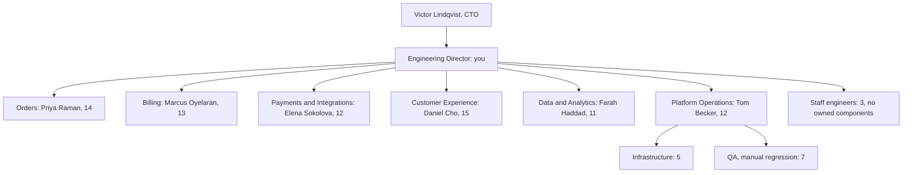
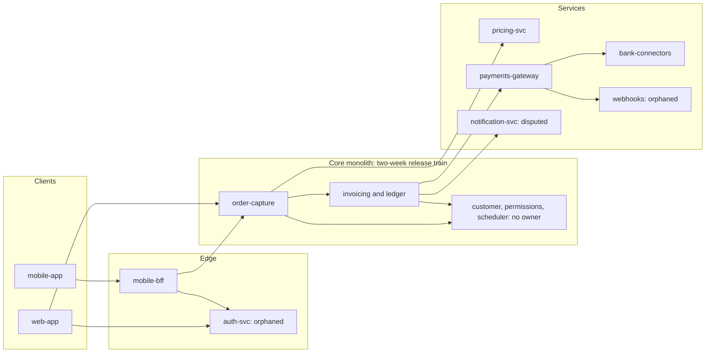

# Northstar Technologies

!!! warning "Fictional"
    Northstar Technologies does not exist. The company, its people, its customers, and every number
    on this page and in the data files were invented for this book. The figures were chosen to be
    internally consistent and plausible for a mid-size software company. They are not benchmarks,
    and you should not compare your organization against them.

Northstar is the running case study of this book. Chapters return to it so that each topic is
applied to the same organization with the same constraints, and the capstone asks you to transform
it, first as Engineering Director and later as CTO. This page and the pages linked below are the
reference for the case. If a chapter and these pages disagree, these pages are right and the
chapter has a defect.

!!! tip "How to use these pages"
    Read this overview first (about 15 minutes). Then use the other pages as references:

    - [Cast](cast.md): every named person, with role, team, and the chapters where they matter.
    - [Timeline](timeline.md): the director's year week by week, and results by quarter.
    - [Quarter 4 briefing](quarter-4-briefing.md): where things stand at week 40 and the open
      decisions; start here if you begin at Parts X–XIII.
    - [Baseline data](baseline-data.md): the measured starting state, by topic.
    - [The director's first year](first-quarter.md): the full record, quarter by quarter.
    - [Halvard Systems](halvard.md): the 500-engineer comparison company used from Chapter 34 on.

## The company

Northstar sells an order-to-cash platform to mid-market wholesale distributors. A distributor's
sales staff and customers place orders through Northstar's web and mobile applications; Northstar
prices the order, produces invoices, collects payment through bank and card integrations, and
feeds the customer's accounting system. When Northstar is down, its customers cannot take orders
or get paid. Reliability is therefore a commercial property of the product and is written into
contracts.

| Fact | Value |
|---|---|
| Employees | about 620 |
| Annual recurring revenue | $140M |
| Customers | about 1,900 distributors; the largest 40 produce a third of revenue |
| Contractual availability | 99.9 percent per quarter for the order and payment paths, with service credits |
| Age of the product | 11 years |
| Engineering headcount | 80 engineers, 6 engineering managers, 1 engineering director |
| Average fully loaded cost per engineer | $185,000 per year |
| Engineering personnel budget | about $16.1M per year (87 people) |
| Cloud and tooling budget | $4.2M per year |

## The people

| Role | Name | What they want |
|---|---|---|
| Chief Executive Officer | Helena Marsh | Renewals from the two largest customers; an end to outage calls |
| Chief Technology Officer | Victor Lindqvist | A reliable platform without asking the board for headcount |
| Chief Product Officer | Amara Okafor | The roadmap she committed to customers, on the dates she gave |
| Chief Financial Officer | Rajiv Menon | Flat operating expense; service credits to stop |
| VP Customer Success | Sofia Alvarez | Fewer escalations; honest status during incidents |
| VP Sales | Greg Tanaka | Two features promised in open deals |
| Engineering Director | you | |

The six engineering managers report to you. So do the three staff engineers, who own no
components and have no defined mandate.

| Team | Manager | Engineers | Notes |
|---|---|---|---|
| Orders | Priya Raman | 14 | Strong domain knowledge; manager promoted eight months ago |
| Billing | Marcus Oyelaran | 13 | Highest incident count; three people carry most on-call pages |
| Payments and Integrations | Elena Sokolova | 12 | Best operational discipline in the organization |
| Customer Experience | Daniel Cho | 15 | Nine web and six mobile engineers under one manager |
| Data and Analytics | Farah Haddad | 11 | Low incident rate; little contact with the other teams |
| Platform Operations | Tom Becker | 12 | Five infrastructure engineers and seven QA engineers who run manual regression |

Staff engineers: Ines Carvalho (core domain, eleven years at Northstar), Kwame Mensah
(infrastructure and reliability), and Li Na Zhou (data and integration).

### Executive and board context

The CTO chapters (Part XII) and the capstone use these facts. Victor Lindqvist is CTO throughout the
book, and nobody succeeds him. Where a chapter or the capstone (Chapter 60) puts you in the CTO's
role, you take Victor's seat in quarter 4, with the facts available then, and the quarter 4
decisions stay open.

| Fact | Value |
|---|---|
| Ownership | Privately held. Calder Ridge Partners, a growth-equity firm, has held a minority stake since the product's seventh year and has two board seats |
| Board | Six members: Anders Holm (co-founder, non-executive chair), Helena Marsh (CEO), Natalie Brooks and Samuel Osei (Calder Ridge Partners), Margaret Lin (independent, former CFO, chairs the audit committee), David Ferrante (independent, former technology executive at a payments company) |
| Board cadence | Quarterly. The quarter 4 meeting is in week 50 and is asked to approve the year-2 operating plan and budget envelope |
| What stays with management | Decisions inside that envelope: the year-2 organization, the quality continuation, the workforce plan |
| Board committees | The audit committee oversees risk, including technology and security risk; there is no technology committee |
| The CTO at the board | Victor Lindqvist attends for one agenda item a quarter; the CEO's monthly board pack carries the engineering figures |
| Victor Lindqvist's organization | One direct report, the Engineering Director (87 seats in all). Victor owns technical direction, the largest customers' technical relationships, and the board's technology questions |
| IT | Corporate IT and internal business systems, 14 people led by Marta Kowalczyk (Head of IT), reporting to Rajiv Menon (CFO). Joon Park's two-person security function is part of the 14. Northstar has no CISO |

## The system

- **Core**, a Java monolith of about 1.4 million lines with eight major modules. Five modules have
  a clear owning team. Three (customer, permissions, scheduler) are changed by four teams and
  owned by none.
- **Fourteen services** extracted over four years, and two frontends (web and mobile).
- **Four ways to build and deploy**: Jenkins for Core and four services, GitLab CI for six
  services, GitHub Actions for the frontends, and hand-maintained shell scripts on a build host
  for four services.
- Core ships on a **two-week release train**. Each train is preceded by a three-day manual
  regression pass of about 1,900 test cases, run by the seven QA engineers. Services deploy when
  their teams choose to.
- Eight of the 24 components have disputed, shared, or orphaned ownership, and eight have nobody
  on call. Three services (auth, webhooks, document store) are deployed by scripts that one
  person understands.

The component inventory is in
[`data/components.csv`](data/components.csv).

## The situation when you arrive

You join as Engineering Director at the start of a quarter. In your first week the CTO gives you
the mandate in one sentence: halve the number of Sev1 and Sev2 incidents and meet the 99.9 percent
commitment within twelve months, with no net growth in headcount, and without dropping the two
customer commitments that the renewals depend on.

What you find, in summary (the numbers are on the [baseline data](baseline-data.md) page; what
happens next is on [the director's first year](first-quarter.md) page):

- 30 Sev1 and Sev2 incidents last quarter, almost two thirds of them caused by Northstar's own
  changes, and almost half of them reported by a customer before any alert fired.
- Availability of 99.62 percent on the contractual paths, and $410,000 in service credits.
- About a third of engineering capacity going to unplanned work.
- A roadmap on which 41 percent of committed items shipped in the quarter they were promised.
- Managers who describe quality as something the QA group and the release train are responsible for.
- Two renewals, together worth $9M in annual recurring revenue, in which reliability is the
  customer's stated concern.

## Constraints that hold throughout the book

1. Headcount is flat at 80 engineers. Backfills are allowed; net additions are not.
2. The two renewal commitments (a bulk-ordering feature and an accounting-system integration) keep
   their dates in the first two quarters.
3. No rewrite of Core will be funded.
4. The discretionary tooling budget is $250,000 for the year without a business case, and anything
   beyond that needs the CFO's approval.
5. The QA engineers are employees with years of product knowledge. Any plan that changes their
   work has to say what they do next.
