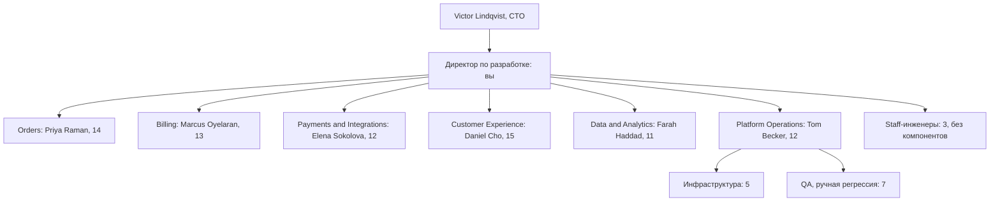
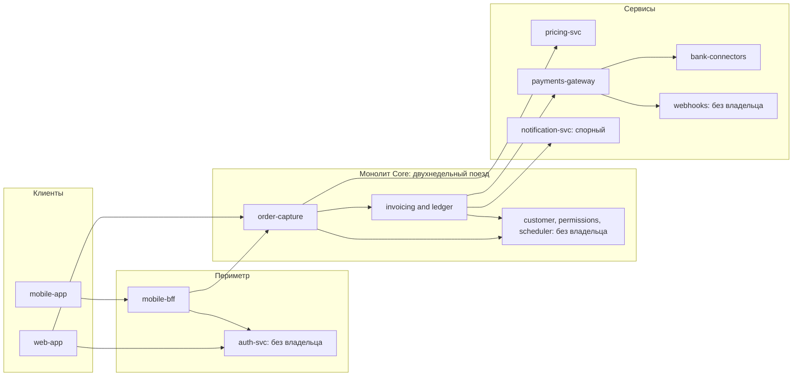

# Northstar Technologies { #northstar-technologies }

!!! warning "Вымысел"
    Northstar Technologies не существует. Компания, её люди, её клиенты и все числа на этой странице и в
    файлах данных придуманы для книги. Цифры подобраны так, чтобы быть внутренне согласованными и
    правдоподобными для софтверной компании среднего размера. Это не бенчмарки, и сравнивать с ними свою
    организацию не стоит.

Northstar — сквозной кейс этой книги. Главы возвращаются к нему, чтобы каждая тема применялась к одной и
той же организации с одними и теми же ограничениями, а итоговый проект просит вас трансформировать её —
сначала в роли директора по разработке, затем в роли CTO. Эта страница и страницы, на которые она
ссылается, — справочник по кейсу. Если глава и эти страницы расходятся, правы эти страницы, а в главе
ошибка.

!!! tip "Как пользоваться этими страницами"
    Сначала прочитайте этот обзор (около 15 минут), затем [«Год вкратце»](year-in-brief.md) (около шести
    минут) — первый год директора, рассказанный как история. Остальные страницы используйте как
    справочники:

    - [Действующие лица](cast.md): каждый названный по имени человек с ролью, командой и главами, где он
      важен.
    - [Хронология](timeline.md): год директора по неделям и результаты по кварталам.
    - [Брифинг по итогам четвёртого квартала](quarter-4-briefing.md): положение дел на неделе 40 и
      открытые решения; начните отсюда, если начинаете с частей X–XIII.
    - [Исходные данные](baseline-data.md): измеренное стартовое состояние по темам.
    - [Хроника года 1](first-quarter.md): полная запись по кварталам, чтобы сверять факты.
    - [Halvard Systems](halvard.md): компания на 500 инженеров для сравнения, используемая начиная с
      главы 34.

## Компания { #the-company }

Northstar продаёт платформу order-to-cash («от заказа до оплаты») оптовым дистрибьюторам среднего
размера. Торговый персонал дистрибьютора и его клиенты оформляют заказы через веб- и мобильные
приложения Northstar; Northstar рассчитывает цену заказа, выставляет счета, собирает оплату через
банковские и карточные интеграции и передаёт данные в бухгалтерскую систему клиента. Когда Northstar
лежит, её клиенты не могут принимать заказы и получать деньги. Поэтому надёжность — коммерческое
свойство продукта, и она прописана в контрактах.

| Факт | Значение |
|---|---|
| Сотрудники | около 620 |
| Годовая регулярная выручка (ARR) | $140M |
| Клиенты | около 1,900 дистрибьюторов; крупнейшие 40 приносят треть выручки |
| Договорная доступность | 99.9% за квартал для путей заказа и оплаты, с сервисными кредитами |
| Возраст продукта | 11 лет |
| Численность разработки | 80 инженеров, 6 руководителей разработки, 1 директор по разработке |
| Средняя полная стоимость инженера | $185,000 в год |
| Бюджет на персонал разработки | около $16.1M в год (87 человек) |
| Бюджет на облако и инструменты | $4.2M в год |

## Люди { #the-people }

| Роль | Имя | Чего хочет |
|---|---|---|
| Генеральный директор (CEO) | Helena Marsh | Продлений от двух крупнейших клиентов; конца звонкам об отказах |
| Технический директор (CTO) | Victor Lindqvist | Надёжной платформы без просьб к совету директоров об увеличении штата |
| Директор по продукту (CPO) | Amara Okafor | Дорожной карты, обещанной клиентам, в названные ею сроки |
| Финансовый директор (CFO) | Rajiv Menon | Операционных расходов без роста; прекращения выплат сервисных кредитов |
| VP по работе с клиентами (Customer Success) | Sofia Alvarez | Меньше эскалаций; честного статуса во время инцидентов |
| VP по продажам | Greg Tanaka | Двух функций, обещанных в открытых сделках |
| Директор по разработке | вы | |

Шесть руководителей разработки подчиняются вам. Как и три staff-инженера, которые не владеют ни одним
компонентом и не имеют определённого мандата.

| Команда | Руководитель | Инженеры | Примечания |
|---|---|---|---|
| Orders | Priya Raman | 14 | Сильное знание предметной области; руководитель повышен восемь месяцев назад |
| Billing | Marcus Oyelaran | 13 | Больше всего инцидентов; большинство вызовов дежурных приходится на трёх человек |
| Payments and Integrations | Elena Sokolova | 12 | Лучшая операционная дисциплина в организации |
| Customer Experience | Daniel Cho | 15 | Девять веб- и шесть мобильных инженеров под одним руководителем |
| Data and Analytics | Farah Haddad | 11 | Мало инцидентов; мало контактов с другими командами |
| Platform Operations | Tom Becker | 12 | Пять инженеров инфраструктуры и семь QA-инженеров, которые ведут ручную регрессию |

Staff-инженеры: Ines Carvalho (ядро предметной области, одиннадцать лет в Northstar), Kwame Mensah
(инфраструктура и надёжность) и Li Na Zhou (данные и интеграции).

### Руководство и совет директоров { #executive-and-board-context }

Эти факты используют главы о CTO (часть XII) и итоговый проект. Victor Lindqvist остаётся CTO на
протяжении всей книги, и никто его не сменяет. Там, где глава или итоговый проект (глава 60) ставит вас в
роль CTO, вы занимаете место Victor в четвёртом квартале, с фактами, доступными на тот момент, а решения
четвёртого квартала остаются открытыми.

| Факт | Значение |
|---|---|
| Собственность | Частная компания. Calder Ridge Partners, фонд growth equity, с седьмого года жизни продукта владеет миноритарной долей и имеет два места в совете директоров |
| Совет директоров | Шесть членов: Anders Holm (сооснователь, неисполнительный председатель), Helena Marsh (CEO), Natalie Brooks и Samuel Osei (Calder Ridge Partners), Margaret Lin (независимый директор, бывший CFO, возглавляет комитет по аудиту), David Ferrante (независимый директор, бывший технологический руководитель в платёжной компании) |
| Ритм совета директоров | Ежеквартально. Заседание четвёртого квартала проходит на неделе 50, и его просят утвердить операционный план и рамки бюджета на второй год |
| Что остаётся за менеджментом | Решения внутри этих рамок: организация второго года, продолжение программы качества, план по персоналу |
| Комитеты совета | Комитет по аудиту надзирает за рисками, включая технологические риски и риски безопасности; технологического комитета нет |
| CTO на совете директоров | Victor Lindqvist присутствует на одном пункте повестки в квартал; цифры разработки входят в ежемесячный пакет CEO для совета |
| Организация Victor Lindqvist | Один прямой подчинённый — директор по разработке (всего 87 мест). За Victor — техническое направление, технические отношения с крупнейшими клиентами и технологические вопросы совета директоров |
| ИТ | Корпоративные ИТ и внутренние бизнес-системы: 14 человек под руководством Marta Kowalczyk (руководитель ИТ), подчиняющейся Rajiv Menon (CFO). Служба безопасности Joon Park из двух человек входит в эти 14. CISO в Northstar нет |

## Система { #the-system }

- **Core** — Java-монолит примерно из 1,4 млн строк с восемью крупными модулями. У пяти модулей есть
  явная команда-владелец. Три (customer, permissions, scheduler) меняют четыре команды, и не владеет
  ни одна.
- **Четырнадцать сервисов**, выделенных за четыре года, и два фронтенда (веб и мобильный).
- **Четыре способа собирать и развёртывать**: Jenkins для Core и четырёх сервисов, GitLab CI для шести
  сервисов, GitHub Actions для фронтендов и поддерживаемые вручную shell-скрипты на сборочном хосте для
  четырёх сервисов.
- Core выпускается **двухнедельным релизным поездом**. Перед каждым поездом семь QA-инженеров три дня
  ведут ручной регрессионный прогон примерно из 1900 тест-кейсов. Сервисы развёртываются, когда это
  решат их команды.
- У восьми из 24 компонентов владение спорное, общее или отсутствует, и у восьми нет дежурных. Три
  сервиса (auth, webhooks, document store) развёртываются скриптами, которые понимает один человек.

Перечень компонентов лежит в
[`data/components.csv`](data/components.csv).

## Ситуация, в которую вы приходите { #the-situation-when-you-arrive }

Вы приходите директором по разработке в начале квартала. В первую неделю CTO формулирует ваш мандат одним
предложением: за двенадцать месяцев вдвое сократить число инцидентов Sev1 и Sev2 и выполнить
обязательство 99,9%, без чистого роста численности и не сорвав два обязательства перед клиентами, от
которых зависят продления.

Что вы обнаруживаете, вкратце (числа — на странице [исходных данных](baseline-data.md); что происходит
дальше — рассказано на странице [«Год вкратце»](year-in-brief.md) и записано в
[хронике года 1](first-quarter.md)):

- 30 инцидентов Sev1 и Sev2 за прошлый квартал; почти две трети из них вызваны собственными изменениями
  Northstar, и почти о половине первым сообщил клиент, раньше, чем сработал какой-либо алерт.
- Доступность 99,62% на договорных путях и $410 000 сервисных кредитов.
- Около трети инженерного ресурса уходит на незапланированную работу.
- Дорожная карта, на которой только 41% обещанных задач вышли в том квартале, на который были обещаны.
- Руководители, которые считают качество зоной ответственности QA-группы и релизного поезда.
- Два продления общей стоимостью $9 млн годовой регулярной выручки, в которых надёжность — заявленная
  забота клиента.

## Ограничения, действующие на протяжении всей книги { #constraints-that-hold-throughout-the-book }

1. Численность остаётся на уровне 80 инженеров. Замены ушедших разрешены, чистый прирост — нет.
2. Два обязательства по продлению (функция массового заказа и интеграция с бухгалтерской системой)
   сохраняют свои даты в первых двух кварталах.
3. Переписывание Core финансироваться не будет.
4. Бюджет на инструменты по своему усмотрению — $250 000 на год без бизнес-кейса; всё сверх этого
   требует одобрения CFO.
5. QA-инженеры — сотрудники с многолетним знанием продукта. Любой план, меняющий их работу, должен
   сказать, чем они займутся дальше.
