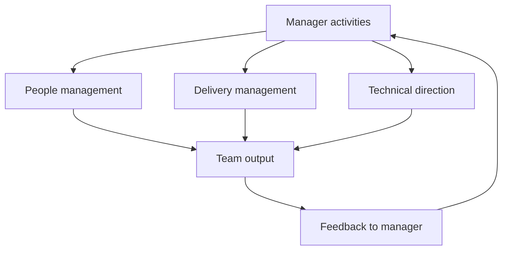
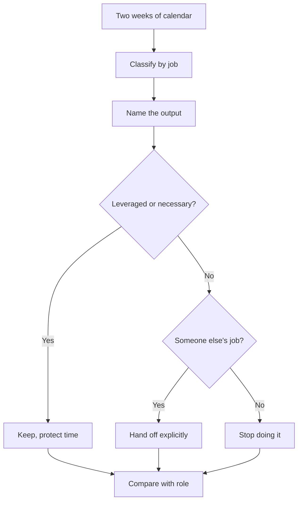
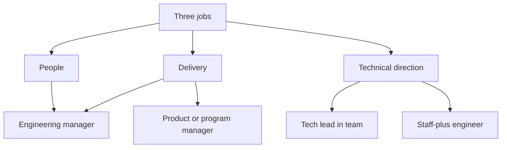

# Chapter 1 — What Engineering Management Actually Is

!!! warning "Awaiting human review"
    This chapter has passed the book's automated validation and an editorial self-review, but not yet
    the human review in which each cited claim is checked against its source. Treat it as a reviewed
    draft. Corrections are welcome; see the repository's CONTRIBUTING file.

"Engineering manager" is one title covering at least three different jobs. This chapter separates
them, gives you a definition of managerial output that you can test against your own calendar, and
places technical leaders who manage nobody on the same map as managers. It sets vocabulary the rest
of the book uses. The running example is Northstar Technologies, the fictional company in the
[case study](../../case-studies/northstar/index.md), whose six engineering managers do six different
jobs under one title.

Chapter 2 covers the move from individual contributor to manager, Chapter 3 treats leverage and
systems thinking in depth, and Chapter 4 covers the ladder from senior engineer to CTO and how to
measure managerial effectiveness.

## Why This Matters

At team scale, a confused role shows up as a manager who is busy all day and cannot say what changed
because of it. The team gets a fourth on-call responder, a part-time senior engineer, or a meeting
scheduler, and nobody does the work only the manager can do.

At organization scale the confusion multiplies. When six managers each interpret the title
differently, a director cannot tell whether a team's problem is a people, delivery, or technical
problem, because nobody owns the same slice of it on every team. Staff engineers without a mandate
fill whatever gap they find.

At executive scale, the definition of the role is a design decision with a budget. Whether managers
must be technical, whether a staff track exists, and how many people one manager supports change
hiring profiles, salaries, and how decisions get made. A CTO who has not decided what managers are
for will find that each director has decided differently.

## Learning Objectives

After this chapter you will be able to:

- Separate the three jobs that hide under one title (people management, delivery management,
  technical direction) and say which of them your role actually owns.
- Explain managerial output as the output of the organization under your influence, and use that
  definition to audit a calendar.
- Distinguish engineering leadership from people management, and place staff-plus engineers on the
  same map as managers.
- State what the research on manager effects shows, for whom, and with what limits.
- Write a one-page role definition that your reports, peers, and manager read the same way.

## The Mental Model

> **Mental model:** An engineering manager is accountable for the output of an organization, not for
> personal output. That output is produced by three jobs (people, delivery, technical direction),
> and every role, including yours, is a particular split of those jobs among the people around you.

The first idea comes from Andrew Grove. In *High Output Management* he argued that a manager's output
is the output of the organization they manage plus that of the neighboring organizations they
influence ([Grove, 1983](../../references/bibliography.md#grove1983high)). The manager's own
activities (meetings, decisions, reviews, conversations) are inputs. They matter only through their
effect on what the organization produces. This book uses that definition throughout.

The second idea is that the organization's output depends on three distinct kinds of work:

| Job | Question it answers | Typical activities |
|---|---|---|
| People management | Are the right people here, growing, and able to do their best work? | Hiring, one-on-ones, feedback, performance, career growth |
| Delivery management | Is work flowing toward commitments, predictably? | Planning, prioritization with product, dependencies, risk |
| Technical direction | Are we building the right thing the right way, for the long term? | Architecture, standards, design review, debt decisions |

Each job can be done by the manager, by someone else (a tech lead, a staff engineer, a product or
program manager), or by nobody. The third case is the dangerous one, because nothing announces it.

Time goes into the jobs, the jobs shape what the team produces, and that output is the only evidence
the time was well spent. Measuring the top of the loop (hours, meetings) instead breaks it.

## Deep Conceptual Explanation

### Three jobs, one title

The three jobs need different skills and pay off on different timescales. People management pays off
over quarters and years: a hire, a promotion, an engineer who stays. Delivery management pays off
within weeks: a dependency resolved, a commitment kept or renegotiated in time. Technical direction
pays off over years and is easy to defer: a module boundary, a standard, a decision not to build
something.

Because the timescales differ, a busy manager drifts toward the job with the fastest feedback, which
is delivery. Over a year the drift shows in a calendar before it shows in attrition or in an
architecture nobody chose. This is the book's reasoning, not a research finding; the calendar audit
below is designed to catch it.

The jobs also compete for one scarce resource, the manager's week. A manager with fifteen direct
reports who holds a weekly 30-minute one-on-one with each spends seven and a half hours on that alone,
nearly a fifth of a 40-hour week, before any hiring, feedback, or follow-up.

### How companies split the jobs

Companies differ in which jobs they give the person with the manager title. Camille Fournier's *The
Manager's Path*, known for walking through the stages from tech lead to CTO, treats the tech lead and
the people manager as related but distinct roles
([Fournier, 2017](../../references/bibliography.md#fournier2017manager)). Will Larson's description
of staff archetypes treats the "tech lead manager" as a separate role on the management ladder,
distinct from a staff-level tech lead who manages nobody
([Larson, staff archetypes](../../references/bibliography.md#larson-staff-archetypes)).

Four shapes cover most organizations:

| Shape | Manager owns | Someone else owns | Fits when |
|---|---|---|---|
| Tech lead manager | All three, for a small team | Nothing | Teams of about four to six; a strong technical manager |
| Manager plus tech lead | People, delivery | Technical direction (an engineer in the team) | Most product teams of six to ten |
| Manager plus program manager | People, technical direction | Cross-team delivery coordination | Heavy cross-team dependencies or regulated releases |
| People-focused manager | People | Delivery (product or program), technical direction (staff engineers) | Large organizations with strong staff and product functions |

The team sizes are this book's recommendation and approximate. None of these shapes is correct in
general; each is a bet about where the scarce skill is. The failure is running several by accident,
so that each manager quietly decides which jobs to do and which to leave.

### Managerial output and the calendar

Grove's definition becomes a practical test. For any block of time on a manager's calendar, ask
which output of my organization, or of one I influence, does this change, and by how much compared
with another use of the hour? Grove also argued that managers should prefer high-leverage activities,
whose effect spreads across many people or a long time
([Grove, 1983](../../references/bibliography.md#grove1983high)); Chapter 3 develops leverage.

Peter Drucker's *The Effective Executive* is known for an earlier version of the discipline: record
where your time actually goes before deciding how to spend it, because memory of it is unreliable
([Drucker, 1967](../../references/bibliography.md#drucker1967effective)). The calendar audit combines
the two: Drucker supplies the measurement, Grove the criterion.

1. Take two representative weeks of calendar, plus unscheduled work reconstructed from chat and
   email.
2. Classify each block by job: people, delivery, technical direction, or other (administration,
   cross-team work, your own development).
3. For each block, name the output it was meant to change, and mark it **leveraged** (the effect
   reaches many people or lasts), **necessary** (someone must do it, and it is the manager's job), or
   **substitutable** (someone else could and should do it).
4. Compare the split with the role definition. A role that gives technical direction to the tech lead
   and a calendar with a third of its hours in design reviews disagree; one of them is wrong.

The audit is gamed by generous classification: every incident call becomes "delivery", every status
meeting "people". Classify by what the block changed, not what it was called; a status meeting in
which nothing is decided is "other". And have a peer or your manager classify a sample independently;
the disagreements are the useful part.

### Leadership is not the same as people management

People management is a job: direct reports, formal authority over hiring and performance,
accountability for team health. Engineering leadership is a behavior: setting direction, raising the
quality of decisions, and moving people who do not report to you. Managers need leadership, and many
engineers lead without managing anyone. Organizations that conflate the two push their best technical
leaders into management for influence, and lose technical direction. A staff track gives technical leadership a home without direct reports.

### Where staff-plus engineers sit

Staff-plus engineers (staff, principal, and above) are senior individual contributors whose job is
technical leadership beyond their own work. Larson describes four common archetypes: the **tech
lead**, who guides the approach and delivery of one team or a few; the **architect**, who owns the
direction of a central technical area; the **solver**, who works through hard, high-priority problems
one after another; and the **right hand**, who extends an executive's reach on cross-cutting problems,
mainly in very large organizations. He notes that most companies recognize only one or two of these,
and some have no technical leadership track at all
([Larson, staff archetypes](../../references/bibliography.md#larson-staff-archetypes);
[Larson, 2021](../../references/bibliography.md#larson2021staff)). This is expert opinion, not a
measured taxonomy.

On the three-jobs map, staff-plus engineers own technical direction across team boundaries, and
sometimes the delivery of cross-team technical programs. They do not own people management, though
they mentor and inform hiring and promotion.

This is a common default, not a rule. Read each arrow as a question about your organization: is there
a named person, and do they know it? Who decides architecture when managers and staff engineers
disagree is contested (the book records it as disputed claim D7; Chapter 28 takes a position).

### What the job is not

**Not being the best engineer on the team.** Competence matters, as the evidence below shows, but a
manager who is the team's main producer of code makes the team's output depend on the one calendar
where the other two jobs also live.

**Not being the team's shield.** Filtering noise is part of delivery management. Hiding the
organization's real constraints is not; the team then decides without the information that matters.

**Not status relay.** Passing status up and priorities down, with nothing decided in between, adds
only latency.

### Do managers matter? The evidence

Engineers often argue that managers are overhead. The evidence that managers affect outcomes is real, but each study has a specific population, and none studied software
teams specifically.

- **Productivity.** Using one company's data on technology-based service workers, Lazear, Shaw, and
  Stanton report that replacing a supervisor in the bottom 10 percent of quality with one in the top
  10 percent raised a team's output by more than adding a worker to a nine-person team would, and
  that workers with better supervisors were less likely to leave
  ([Lazear, Shaw, and Stanton, 2015](../../references/bibliography.md#lazear2015value)). **Research
  finding**; one firm; read at abstract level.
- **Attrition.** Using personnel data and employee surveys at a large high-tech firm, Hoffman and
  Tadelis report that survey-measured people management skills have a strong negative relation to
  turnover, with designs that support a causal reading, but that those skills did not consistently
  improve other outcomes ([Hoffman and Tadelis, 2021](../../references/bibliography.md#hoffman2021people)).
  **Research finding**; one firm; read at the level of the working paper's abstract.
- **Technical competence.** Using US and British survey data, Artz, Goodall, and Oswald report that a
  boss's technical competence was the strongest predictor of workers' job satisfaction, and that a rise
  in a supervisor's competence was associated with higher well-being for workers who stayed in the
  same job ([Artz, Goodall, and Oswald, 2017](../../references/bibliography.md#artz2017boss)).
  **Research finding**; correlational with longitudinal controls; not specific to software.
- **Google's Project Oxygen.** Google's re:Work site describes a multi-year internal study that began
  from the hypothesis, held by some employees, that managers do not matter. It reports that teams with
  highly effective managers were more likely to achieve better results, be happier, and have lower
  turnover, and lists ten manager behaviors, including key technical skills
  ([Google re:Work, great managers](../../references/bibliography.md#rework-great-managers)).
  **Industry research**: a company self-report, not peer-reviewed, methods described only in summary.

Together these support a modest claim: in the settings studied, the quality of the immediate manager
is associated with output, retention, and satisfaction, and two studies have designs that point to a
causal effect. They do not say which of the three jobs produces the effect in software teams, and
they do not show that more managers mean more output. The attrition finding is a reminder that the
jobs are distinct: being good at one does not cover the others. We found no study relating how
engineering managers split their time to team outcomes; the calendar guidance here is this book's
recommendation.

## Engineering Organization Example

This example is **illustrative**: an invented manager in an invented company of about 40 engineers.

Jo manages a payments team of eight and owns people and delivery; a senior engineer, Sam, is the
named tech lead. Jo's two-week calendar, reconstructed from calendar and chat history, holds 80
working hours:

| Block | Hours | Job | Mark |
|---|---|---|---|
| One-on-ones, eight engineers, weekly 30 minutes | 8 | People | Necessary |
| Hiring loop for an open role | 6 | People | Leveraged |
| Planning and prioritization with product | 6 | Delivery | Leveraged |
| Cross-team dependency meetings | 8 | Delivery | Necessary |
| Incident calls as an extra responder | 8 | Delivery | Substitutable |
| Design reviews | 12 | Technical | Substitutable: Sam's job |
| Writing code on a refund flow | 14 | Technical | Substitutable |
| Three weekly status meetings | 6 | Other | Substitutable: nothing decided in four of six |
| Email and administration | 12 | Other | Partly necessary |

The split: people 14 hours (17.5 percent), delivery 22 (27.5), technical 26 (32.5), other 18
(22.5). The role says technical direction is Sam's, yet a third of Jo's time is technical,
much of it coding and duplicating Sam's reviews. Meanwhile nobody on the team has had a career
conversation in two quarters, and the open role has been open for eleven weeks.

A reallocation, with its assumptions: Jo attends one design review a week of Sam's choosing (saving
about 9 hours a fortnight), hands the refund-flow code to an engineer (14), leaves incidents to the
rotation unless they cross teams (6), and replaces two status meetings with a written update (4).
That frees about 33 hours a fortnight; Jo puts 10 into hiring, 8 into career conversations and
feedback, and keeps the rest as slack for cross-team work.

The cost: Jo loses the satisfaction of shipping code, and Sam gains a decision area Jo used to share.
Whether the trade pays shows only in the team's output over the next two quarters.

## Decision Framework

The central decision is how to split the three jobs for a given team. Start from the team, not a
template:

| Question | If yes | If no |
|---|---|---|
| Six people or fewer, with the manager as strongest technical voice? | Tech lead manager can work; protect people time explicitly | Separate tech lead from manager |
| An engineer ready to own technical direction? | Name them tech lead, in writing, with a decision scope | Manager holds it temporarily, with a plan to grow or hire a tech lead |
| Delivery depends heavily on other teams? | Add program support or a director-level dependency process | Manager owns delivery |
| The area needs cross-team technical direction? | A staff-plus engineer with a written mandate | Team tech leads suffice |
| More than about eight to ten direct reports? | People work will crowd out the rest; plan a split (Chapter 33 covers team design) | Proceed |

Two criteria apply whatever the answers. Every job has exactly one named owner per team, and the
owner has time in their calendar to do it. A role definition that assigns technical direction to a
tech lead who spends 90 percent of their time on features has assigned it to nobody.

The direct-report thresholds are this book's recommendation; the span-of-control research we found
does not cover software teams (research gap G8).

## Trade-offs

**Technical depth against people capacity.** A manager who owns technical direction decides faster and
earns credibility, and the Artz, Goodall, and Oswald finding suggests competence matters to the people
managed. The same manager has less time for people work, and the team's own technical leaders may not
grow. Splitting the jobs adds an interface between manager and tech lead, which needs a way to resolve
disagreements.

**Uniformity against fit.** One split across all teams makes roles comparable and promotion fairer.
A middle course: one written default, with recorded exceptions.

**The cost of changing a split.** Moving technical direction from a manager to a tech lead takes
something from the manager's identity and adds load to an engineer. Expect a quarter of friction and
overlapping decisions. Changing the split without announcing it is worse: two people make the same
decisions, and the team asks whichever one gives the answer it wants.

## Failure Modes

**The super engineer.** The manager remains the team's busiest coder; Chapter 2 covers how to detect
and unwind it.

**The dispatcher.** The job shrinks to tickets in, status out. Signal: good short-run throughput, then
attrition or a design nobody owns. Detection: no people or technical work in the audit, and nobody can
name the team's technical owner.

**The orphaned job.** Everyone assumes someone else owns technical direction, delivery, or growth.
Signal: decisions go to whoever is in the meeting; debates recur. Detection: ask the manager, the tech
lead, and two engineers who owns each job; different answers mean nobody does.

**The fourth on-call responder.** The manager joins every incident and becomes part of the restoration
path. Detection: incident records list the manager as responder more often than any engineer, and the
rotation's load looks lighter than it is.

**The mandate-free staff engineer.** A staff engineer with no written scope fills whatever urgent gap
appears; Chapter 4 covers the staff role and its mandate.

**Activity mistaken for output.** The manager reports meetings held, not what changed. Detection: ask
"what is different in the team because of this?"

## Enterprise Application

In an organization of 50 to 150 engineers, the role definition can no longer live in one person's
head. A director manages several managers, often staff engineers too, and the split of the three jobs
becomes organizational design. Will Larson's *An Elegant Puzzle* is known for treating engineering
management at this scale as the design of systems (processes and the structures that route decisions)
([Larson, 2019](../../references/bibliography.md#larson2019elegant)). The split of the jobs is one
such system, and three practices make it workable:

- A written **default split**: what managers, tech leads, and staff engineers each own.
- A **per-team charter** recording each team's actual split and any exception.
- A **periodic calendar audit** for each manager, once or twice a year, done with the director and
  used for development, not rating.

The director's role follows the same logic one level up. Its output is the output of the whole
organization and of the peers it influences: product, support, finance. The director's people job is
mostly managing managers; the delivery job is cross-team commitments and capacity; the technical job
is making sure staff engineers have mandates and cross-team decisions get made. Chapter 27 shows this
division during a quality transformation
([Chapter 27, Enterprise Application](../05-engineering-quality/27-quality-transformation-at-enterprise-scale.md#enterprise-application)).
How to measure managers' effectiveness belongs to Chapter 4; the minimum here is to judge managers on
their teams' output, never on the volume of their own activity.

## CTO Perspective

At CTO level, "what is an engineering manager" is a policy with a cost line, and left alone each
director will define it differently. Three decisions are the CTO's.

**Whether managers must be technical.** Requiring managers to own technical direction means hiring for
depth and keeping teams small. Separating the jobs needs a staff track strong enough to hold technical
direction. The research favors technical credibility in managers; it does not settle whether that
credibility must come with ownership of technical decisions.

**Whether a staff track exists, and with what mandate.** A staff track without mandates is a promotion
path with no job. The CTO decides which archetypes the organization recognizes and how staff
decisions relate to managers' decisions.

**The ratio of managers to engineers.** Fewer managers save cost and spread each one thinner. The
manager-effect research says manager quality matters; a CTO who cuts managers should expect the saving
to reappear as attrition or slower delivery, and should estimate where.

## Practical Playbook

1. Write down the three jobs for your role: which you own, which someone else owns (named), and which
   nobody owns.
2. Run a two-week calendar audit: classify every block by job and output, and mark it leveraged,
   necessary, or substitutable.
3. Ask your manager or a peer to classify ten of your blocks independently; discuss the disagreements.
4. Hand off the two largest substitutable blocks explicitly, with a named owner and a date, and tell
   the people affected.
5. Ask your tech lead, two engineers, and your product partner who owns each job on your team.
   Resolve disagreements in writing.
6. Write a one-page role definition: purpose, the three jobs and their owners, the outputs you answer
   for, and what you will not do. Share it with your team and your manager.
7. If you lead managers, write the organization's default split and record team exceptions; give
   each staff engineer a written mandate.
8. Repeat the audit in six months; compare the split and check whether the outputs you named moved.

## Case Study

This case is **fictional**. Northstar's people and numbers are on the
[Northstar overview](../../case-studies/northstar/index.md) and
[baseline data](../../case-studies/northstar/baseline-data.md) pages. The calendar figures were added
for this chapter; they describe the baseline quarter, before the director arrives, from a two-week
sample (about 80 working hours) each manager reconstructed from calendar and chat history.

Northstar's six managers share a job description written years earlier, "lead a team of engineers to
deliver high-quality software", and do six different jobs:

| Team | Manager | Engineers | People | Delivery | Technical | Other | Technical direction lives with |
|---|---|---|---|---|---|---|---|
| Orders | Priya Raman | 14 | 15% | 35% | 45% | 5% | Priya, who still writes code |
| Billing | Marcus Oyelaran | 13 | 15% | 55% | 15% | 15% | Nobody; decided during incidents |
| Payments and Integrations | Elena Sokolova | 12 | 35% | 35% | 15% | 15% | A senior engineer acting as informal tech lead |
| Customer Experience | Daniel Cho | 15 | 45% | 35% | 5% | 15% | Two unnamed leads, web and mobile |
| Data and Analytics | Farah Haddad | 11 | 25% | 20% | 45% | 10% | Farah, as data architect |
| Platform Operations | Tom Becker | 12 | 25% | 50% | 10% | 15% | Tom and the release process |

Priya, promoted eight months earlier, spends about 36 of her 80 hours writing and reviewing code (45
percent); with fourteen reports, her one-on-ones are nominally weekly and mostly cancelled. About 20 of Marcus's hours went to incident calls
as an additional responder, the fourth-responder failure mode, in the team with the most incidents and
three engineers carrying most pages; nothing in his calendar addresses why three people carry them.
Elena's calendar is the most balanced, and her team has the best operational discipline; the data
cannot say whether one causes the other. Daniel's fifteen weekly one-on-ones take 15 hours a
fortnight, and nobody has named who directs web and mobile. Tom's delivery time is mostly release-train
coordination.

The three staff engineers own no components and act as solvers by default: Ines Carvalho is consulted on most Core changes without owning any
decision, Kwame Mensah is pulled into the largest incidents, and Li Na Zhou answers integration
questions for whichever team asks first.

Before starting, the director drafted a one-page role definition:

| Element | Director's definition |
|---|---|
| Purpose | Reliability and delivery of the whole engineering organization, judged by its output |
| People | Manage and develop the six managers; give the staff engineers mandates |
| Delivery | Own cross-team commitments and the capacity model agreed with the CTO and CPO |
| Technical direction | Ensure cross-team technical decisions have an owner; decide personally only when nobody else can |
| Not doing | Running a team's planning, joining incidents as a responder, writing production code |

What happened next is on [the director's first quarter](../../case-studies/northstar/first-quarter.md)
page: the staff engineers received mandates as part of the quality transformation (Kwame Mensah
release and detection, Ines Carvalho Core module boundaries and contract tests, Li Na Zhou migration
and configuration safety), and the six managers were trained as incident commanders, a role different
from an extra responder. This chapter's question comes earlier: before any transformation, would you
change how the six managers split their jobs, and in what order?

## Exercises

Solutions are in [chapter 1 solutions](../../solutions/ch01-solutions.md). Northstar data is on the
[baseline page](../../case-studies/northstar/baseline-data.md).

### Foundational

**F1.** Priya Raman's calendar for one week contains: four one-on-ones (30 minutes each), a two-hour
design review on the bulk-ordering feature, six hours writing code on order-capture, a one-hour
planning session with product, a 90-minute meeting with Billing about core/customer, three hours of
email, and a canceled career conversation. Classify each block by job and as leveraged, necessary, or
substitutable, and state what you would want to know before recommending any change.

**F2.** A job advertisement for an "Engineering Manager" at a company of 200 engineers asks for "80
percent hands-on coding, own the architecture of our payments platform, run sprint ceremonies, manage
a team of nine." Identify which of the three jobs it assigns to the role, which it underweights, and
what risk the combination creates for the team. Propose a revised split.

**F3.** A colleague says, "Research proves good managers make teams 75 percent more productive, so we
should hire more managers." Using the studies summarized in this chapter, explain what the evidence
does and does not support, where a figure like 75 percent might have come from, and why the
conclusion does not follow.

### Applied Leadership

**A1.** You are Marcus Oyelaran's director. His calendar shows 55 percent delivery, including about 20
of 80 hours on incident calls as an extra responder, and 15 percent people management for 13
engineers. Plan the conversation in which you present the audit: what you ask first, what you
propose, what you will not ask him to give up yet, and how you will know in two months whether the
change worked.

**A2.** Daniel Cho manages fifteen engineers (nine web, six mobile). Technical direction sits with two
unnamed informal leads, and a mobile release and a web change have twice conflicted over the same API.
Decide between naming two tech leads, splitting the team under two managers, or Daniel taking
technical direction himself. State your criteria and the transition cost of your choice.

**A3.** Ines Carvalho, staff engineer with eleven years at Northstar, tells you she is thinking of
becoming a manager because "that is the only way anyone listens to me about Core." Advise her using
the three-jobs map and the staff archetypes, and say what you as director would have to change for her
choice to be a real one.

### Executive Decision-Making

**X1.** Victor Lindqvist, the CTO, proposes the tech lead manager model across engineering: every
manager owns all three jobs, and the staff engineer role is retired, saving the cost of three senior
individual contributors. Write your response, including the conditions under which the proposal would
work, the teams for which it would fail, and an alternative.

**X2.** Rajiv Menon, the CFO, asks whether Northstar could run its 80 engineers with four managers
instead of six, merging teams, to hold operating expense flat. Prepare the analysis you would take to
the CTO: what the change does to each manager's span and calendar, what the manager-effect evidence
suggests and does not, where the cost of the saving would show up, and what you recommend.

## Reflection Questions

1. If you audited your last two weeks, which job would have the most hours, and is it the job your
   role definition says matters most?
2. Which job on your team would nobody claim if you asked three people who owns it?
3. What work do you keep for the satisfaction or credibility it gives you rather than because it is
   your job? Who would do it better?
4. Does a strong engineer in your organization have a credible way to gain influence without direct
   reports?
5. When you last reported upward, did you describe your activity or your organization's output?
6. If your manager rewrote your role definition from your calendar alone, what would it say?

## Key Takeaways

- A manager's output is the output of the organization they lead and influence, not their own
  activity.
- The title hides three jobs: people management, delivery management, technical direction. Each needs
  exactly one named owner per team, with time to do it.
- Companies split the jobs differently; choose a split on purpose, write it down, record exceptions.
- Time drifts toward delivery, the job with the fastest feedback. A calendar audit catches the drift
  before attrition or unowned architecture does.
- Leadership is a behavior; people management is a job. Staff-plus roles give technical leadership a
  home without direct reports, if they come with a mandate.
- Research associates manager quality with output, retention, and satisfaction in the settings
  studied. It does not say which job matters most in software teams.

## References and Further Reading

- [Grove, 1983](../../references/bibliography.md#grove1983high). *High Output Management*. Managerial
  output and leverage, as used throughout this book.
- [Drucker, 1967](../../references/bibliography.md#drucker1967effective). *The Effective Executive*.
  Recording where time goes before deciding how to spend it.
- [Fournier, 2017](../../references/bibliography.md#fournier2017manager). *The Manager's Path*. How the
  jobs shift from tech lead to CTO.
- [Larson, 2019](../../references/bibliography.md#larson2019elegant). *An Elegant Puzzle*. Engineering
  management as systems design.
- [Larson, 2021](../../references/bibliography.md#larson2021staff) and
  [staff archetypes](../../references/bibliography.md#larson-staff-archetypes). The staff-plus role
  and its common shapes.
- [Lazear, Shaw, and Stanton, 2015](../../references/bibliography.md#lazear2015value). Supervisor
  effects on output in one firm.
- [Hoffman and Tadelis, 2021](../../references/bibliography.md#hoffman2021people). People management
  skills and attrition.
- [Artz, Goodall, and Oswald, 2017](../../references/bibliography.md#artz2017boss). Supervisor
  competence and job satisfaction.
- [Google re:Work, great managers](../../references/bibliography.md#rework-great-managers). Google's
  account of Project Oxygen.
