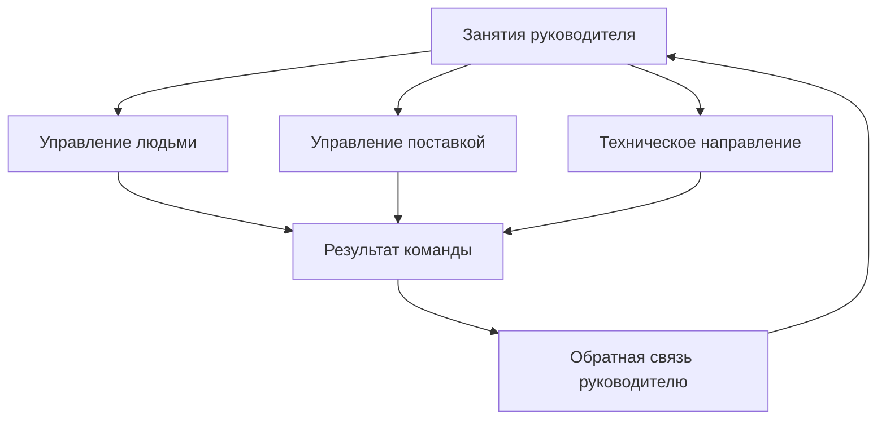
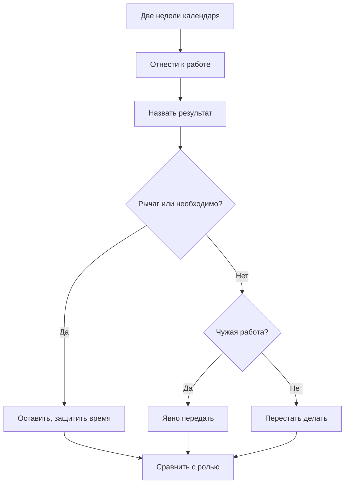
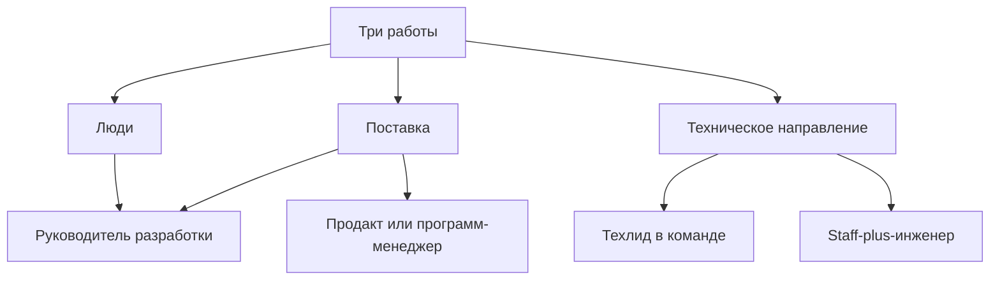

# Глава 1 — Что такое управление разработкой на самом деле { #chapter-1-what-engineering-management-actually-is }

За должностью «руководитель разработки» (engineering manager, EM) скрываются как минимум три разные работы. Эта глава разделяет
их, даёт определение результата руководителя, которое можно проверить по собственному календарю, и
помещает на ту же карту технических лидеров, у которых нет подчинённых. Здесь вводится словарь, которым
пользуется вся книга. Сквозной пример — Northstar Technologies, вымышленная компания из
[кейса](../../case-studies/northstar/index.md): шесть её руководителей разработки под одной должностью
выполняют шесть разных работ.

Глава 2 посвящена переходу от индивидуального исполнителя к руководителю, глава 3 подробно разбирает
управленческий рычаг и системное мышление, а глава 4 — лестницу от senior-инженера до CTO и то, как
измерять эффективность руководителя.

## Почему это важно { #why-this-matters }

На уровне команды размытая роль выглядит так: руководитель занят весь день, но не может сказать, что
изменилось благодаря этому. Команда получает четвёртого дежурного, senior-инженера на полставки или
человека, который расставляет встречи, а работу, которую может сделать только руководитель, не делает
никто.

На уровне организации путаница умножается. Если шесть руководителей понимают должность по-разному,
директор не может определить, в чём проблема команды — в людях, в поставке или в технике, потому что ни
в одной команде одну и ту же часть работы не закрывает один и тот же человек. Staff-инженеры без мандата
заполняют любую дыру, которую находят.

На уровне высшего руководства определение роли становится проектным решением со своим бюджетом. Должны
ли руководители быть техническими, есть ли staff-трек, сколько людей приходится на одного руководителя —
от этого зависят профили найма, зарплаты и то, как принимаются решения. CTO (технический директор),
который не решил, зачем нужны руководители, обнаружит, что каждый директор решил это по-своему.

## Цели главы { #learning-objectives }

После этой главы вы сможете:

- Разделить три работы, скрытые под одной должностью (управление людьми, управление поставкой,
  техническое направление), и сказать, какие из них действительно принадлежат вашей роли.
- Объяснить результат руководителя как результат организации, на которую он влияет, и провести по этому
  определению аудит календаря.
- Отличать инженерное лидерство от управления людьми и размещать staff-plus-инженеров на одной карте с
  руководителями.
- Сформулировать, что показывают исследования влияния руководителей, для кого и с какими ограничениями.
- Написать одностраничное определение роли, которое ваши подчинённые, коллеги и руководитель прочитают
  одинаково.

## Ментальная модель { #the-mental-model }

> **Ментальная модель:** руководитель разработки отвечает за результат организации, а не за личный
> результат. Этот результат создают три работы (люди, поставка, техническое направление), и любая роль,
> включая вашу, — это определённое распределение этих работ между людьми вокруг вас.

Первая идея принадлежит Andrew Grove. В *High Output Management* он утверждал, что результат
руководителя — это результат организации, которой он руководит, плюс результат соседних организаций, на
которые он влияет ([Grove, 1983](../../references/bibliography.md#grove1983high)). Собственная
деятельность руководителя (встречи, решения, ревью, разговоры) — это входы. Они важны только тем, как
влияют на то, что производит организация. Книга использует это определение везде.

Вторая идея: результат организации зависит от трёх разных видов работы.

| Работа | На какой вопрос отвечает | Типичные занятия |
|---|---|---|
| Управление людьми | Здесь ли нужные люди, растут ли они, могут ли работать в полную силу? | Найм, встречи один на один, обратная связь, результативность, карьерный рост |
| Управление поставкой | Движется ли работа к обязательствам, и предсказуемо ли? | Планирование, приоритизация вместе с продуктом, зависимости, риски |
| Техническое направление | Строим ли мы правильную вещь и правильным способом, с расчётом на долгий срок? | Архитектура, стандарты, ревью дизайна, решения о долге |

Каждую работу может делать руководитель, кто-то другой (техлид, staff-инженер, продакт- или
программ-менеджер) или никто. Опасен третий случай: о нём ничто не сигналит.

Время уходит в работы, работы определяют, что производит команда, а этот результат — единственное
свидетельство того, что время потрачено с пользой. Если вместо него измерять верх петли (часы, встречи),
петля ломается.

## Подробный разбор { #deep-conceptual-explanation }

### Три работы, одна должность { #three-jobs-one-title }

Три работы требуют разных навыков и окупаются на разных горизонтах. Управление людьми окупается за
кварталы и годы: удачный найм, повышение, инженер, который остался. Управление поставкой окупается за
недели: снятая зависимость, обязательство, выполненное или вовремя пересогласованное. Техническое
направление окупается за годы, и его легко отложить: граница модуля, стандарт, решение чего-то не
строить.

Поскольку горизонты разные, занятый руководитель смещается к работе с самой быстрой обратной связью — к
поставке. За год этот дрейф виден в календаре раньше, чем в текучести или в архитектуре, которую никто
не выбирал. Это **рекомендация книги**, а не научный результат (что означает каждая метка, объясняет
страница [меток доказательности](../../references/evidence-labels.md)). Аудит календаря ниже устроен
так, чтобы поймать этот дрейф.

Кроме того, работы конкурируют за один дефицитный ресурс — неделю руководителя. Руководитель с
пятнадцатью прямыми подчинёнными, который еженедельно проводит с каждым 30-минутную встречу один на один
(1:1), тратит на одно это семь с половиной часов — почти пятую часть 40-часовой недели, и это ещё до
найма, обратной связи и последующих действий.

### Как компании распределяют работы { #how-companies-split-the-jobs }

Компании по-разному решают, какие работы отдать человеку с должностью руководителя. *The Manager's
Path* Camille Fournier, известная тем, что проводит читателя по ступеням от техлида до CTO, рассматривает
техлида и руководителя людей как родственные, но разные роли
([Fournier, 2017](../../references/bibliography.md#fournier2017manager)). Will Larson в описании
архетипов staff-инженеров считает «техлида-руководителя» (tech lead manager) отдельной ролью на
управленческой лестнице, отличной от техлида уровня staff, у которого нет подчинённых
([Larson, staff archetypes](../../references/bibliography.md#larson-staff-archetypes)).

Большинство организаций укладывается в четыре формы:

| Форма | За руководителем | За кем-то другим | Подходит, когда |
|---|---|---|---|
| Техлид-руководитель | Все три работы, в небольшой команде | Ничего | Команды примерно из четырёх–шести человек; сильный технический руководитель |
| Руководитель плюс техлид | Люди, поставка | Техническое направление (инженер в команде) | Большинство продуктовых команд из шести–десяти человек |
| Руководитель плюс программ-менеджер | Люди, техническое направление | Координация поставки между командами | Много зависимостей между командами или регулируемые релизы |
| Руководитель, сосредоточенный на людях | Люди | Поставка (продукт или программа), техническое направление (staff-инженеры) | Крупные организации с сильными функциями staff-инженеров и продукта |

Размеры команд — рекомендация книги, и они приблизительны. Ни одна из этих форм не правильна вообще;
каждая — это ставка на то, где находится дефицитный навык. Провал — когда несколько форм работают
одновременно по случайности и каждый руководитель молча решает, какие работы делать, а какие оставить.

### Результат руководителя и календарь { #managerial-output-and-the-calendar }

Определение Grove превращается в практическую проверку. Для любого блока времени в календаре
руководителя спросите: какой результат моей организации или той, на которую я влияю, это меняет и
насколько — по сравнению с другим способом потратить этот час? Grove также утверждал, что руководителям
стоит предпочитать занятия с высоким рычагом, эффект которых распространяется на многих людей или на
долгое время ([Grove, 1983](../../references/bibliography.md#grove1983high)); подробно рычаг
разбирается в главе 3.

*The Effective Executive* Peter Drucker известна более ранней версией той же дисциплины: прежде чем
решать, как тратить время, запишите, куда оно на самом деле уходит, потому что память здесь ненадёжна
([Drucker, 1967](../../references/bibliography.md#drucker1967effective)). Аудит календаря объединяет оба
подхода: Drucker даёт измерение, Grove — критерий.

1. Возьмите две типичные недели календаря и добавьте незапланированную работу, восстановленную по чатам
   и почте.
2. Отнесите каждый блок к одной из работ: люди, поставка, техническое направление или прочее
   (администрирование, работа между командами, собственное развитие).
3. Для каждого блока назовите результат, который он должен был изменить, и пометьте его: **с рычагом**
   (эффект доходит до многих людей или держится долго), **необходимое** (кто-то должен это делать, и это
   работа руководителя) или **заменимое** (это мог и должен делать кто-то другой).
4. Сравните распределение с определением роли. Роль, которая отдаёт техническое направление техлиду, и
   календарь, где треть часов занимают ревью дизайна, противоречат друг другу; что-то одно из них
   неверно.

Это единственный аудит календаря в книге. Поздние главы не вводят новую процедуру, а добавляют к нему
необязательный столбец: глава 3 — уровень рычага, глава 4 — самый низкий уровень, который мог бы
выполнить эту работу.

Аудит подгоняют щедрой классификацией: любой созвон по инциденту становится «поставкой», любая
статус-встреча — «людьми». Классифицируйте по тому, что блок изменил, а не по тому, как он назывался:
статус-встреча, на которой ничего не решили, — это «прочее». И попросите коллегу или своего руководителя
независимо классифицировать часть блоков: самое полезное — это расхождения.

### Лидерство — не то же самое, что управление людьми { #leadership-is-not-the-same-as-people-management }

Управление людьми — это работа: прямые подчинённые, формальные полномочия в найме и оценке
результативности, ответственность за здоровье команды. Инженерное лидерство — это поведение: задавать
направление, повышать качество решений и вести за собой людей, которые вам не подчиняются. Руководителям
нужно лидерство, а многие инженеры ведут за собой, никем не управляя. Организации, которые смешивают
одно с другим, выталкивают лучших технических лидеров в менеджмент ради влияния и теряют техническое
направление. Staff-трек даёт техническому лидерству место без прямых подчинённых.

### Где находятся staff-plus-инженеры { #where-staff-plus-engineers-sit }

[Staff-plus-инженеры](../../glossary.md#staff-plus-engineer) (staff, principal и выше) — это опытные
индивидуальные исполнители, чья работа — техническое лидерство за пределами собственных задач. Larson
описывает четыре распространённых архетипа. **Техлид** направляет подход и поставку одной или нескольких
команд. **Архитектор** отвечает за направление ключевой технической области. **Решатель** (solver)
берётся за трудные приоритетные проблемы одну за другой. **Правая рука** (right hand) расширяет охват
руководителя высшего уровня в сквозных проблемах, в основном в очень крупных организациях. Он отмечает,
что большинство компаний признают только один или два из этих архетипов, а у некоторых нет трека
технического лидерства вовсе
([Larson, staff archetypes](../../references/bibliography.md#larson-staff-archetypes);
[Larson, 2021](../../references/bibliography.md#larson2021staff)). Это мнение эксперта, а не измеренная
классификация.

На карте трёх работ staff-plus-инженеры отвечают за техническое направление поверх границ команд, а
иногда и за поставку межкомандных технических программ. Управление людьми за ними не закреплено, хотя
они менторят и влияют на решения о найме и повышениях.

Это распространённый вариант по умолчанию, а не правило. Читайте каждую стрелку как вопрос о вашей
организации: есть ли здесь конкретный человек, и знает ли он об этом? Кто решает вопросы архитектуры,
когда руководители и staff-инженеры расходятся, — вопрос спорный; позицию по нему занимает глава 28.

### Чем эта работа не является { #what-the-job-is-not }

**Не быть лучшим инженером в команде.** Компетентность важна, как показывают данные ниже, но если
руководитель — главный автор кода в команде, результат команды зависит от единственного календаря, в
котором живут ещё и две другие работы.

**Не быть щитом команды.** Отсекать шум — часть управления поставкой. Скрывать реальные ограничения
организации — нет: тогда команда принимает решения без самой важной информации.

**Не передавать статусы.** Передача статусов наверх и приоритетов вниз, когда посередине ничего не
решается, добавляет только задержку.

### Важны ли руководители? Что говорят данные { #do-managers-matter-the-evidence }

Инженеры часто считают руководителей накладными расходами. Данные о том, что руководители влияют на
результаты, реальны. Но у каждого исследования своя конкретная популяция, и ни одно не изучало команды
разработки ПО.

- **Продуктивность.** На данных одной компании о работниках сервисной сферы, опирающейся на технологии,
  Lazear, Shaw и Stanton в аннотации сообщают: замена руководителя из нижних 10 процентов по качеству
  руководителем из верхних 10 процентов повышала выпуск команды сильнее, чем добавление ещё одного
  работника в команду из девяти человек, а работники с лучшими руководителями реже увольнялись. При
  отдельной нормировке средний начальник оказался примерно в 1,75 раза продуктивнее среднего работника —
  это сравнение начальника с работником, а не команд между собой
  ([Lazear, Shaw, and Stanton, 2015](../../references/bibliography.md#lazear2015value)).
  **Научный результат**; одна компания.
- **Текучесть.** На кадровых данных и опросах сотрудников крупной высокотехнологичной компании Hoffman и
  Tadelis в аннотации рабочего доклада сообщают, что навыки управления людьми, измеренные опросами, сильно
  и отрицательно связаны с текучестью, причём дизайн исследования поддерживает причинную интерпретацию;
  но на другие результаты эти навыки стабильно не влияли
  ([Hoffman and Tadelis, 2021](../../references/bibliography.md#hoffman2021people)).
  **Научный результат**; одна компания.
- **Техническая компетентность.** На данных опросов в США и Великобритании Artz, Goodall и Oswald
  сообщают, что техническая компетентность начальника была самым сильным предиктором удовлетворённости
  работников своей работой, а рост компетентности руководителя был связан с более высоким благополучием
  тех работников, кто оставался на той же должности
  ([Artz, Goodall, and Oswald, 2017](../../references/bibliography.md#artz2017boss)).
  **Научный результат**; корреляционный, с лонгитюдным контролем; не относится специально к разработке
  ПО.
- **Project Oxygen в Google.** Сайт Google re:Work описывает многолетнее внутреннее исследование,
  которое началось с гипотезы части сотрудников, что руководители не важны. Согласно описанию, команды с
  очень эффективными руководителями чаще добивались лучших результатов, были довольнее и имели меньшую
  текучесть; там же перечислены десять форм поведения руководителя, в том числе ключевые технические
  навыки ([Google re:Work, great managers](../../references/bibliography.md#rework-great-managers)).
  **Отраслевое исследование**: отчёт компании о самой себе, не рецензируемый, методы описаны лишь в общих
  чертах.

Вместе эти работы поддерживают скромное утверждение: в изученных условиях качество непосредственного
руководителя связано с выпуском, удержанием и удовлетворённостью, а дизайн двух исследований указывает
на причинный эффект. Они не говорят, какая из трёх работ даёт этот эффект в командах разработки, и не
показывают, что больше руководителей — значит больше результата. Вывод о текучести напоминает, что
работы разные: хорошо делая одну, вы не закрываете остальные. Мы не нашли исследований, которые связывали
бы распределение времени руководителей разработки с результатами команд; рекомендации о календаре здесь —
рекомендация книги.

## Пример из инженерной организации { #engineering-organization-example }

Этот пример — **иллюстрация**: выдуманный руководитель в выдуманной компании примерно из 40 инженеров.

Jo руководит платёжной командой из восьми человек и отвечает за людей и поставку; senior-инженер Ari —
назначенный техлид. Двухнедельный календарь Jo, восстановленный по календарю и истории чатов, содержит 80
рабочих часов:

| Блок | Часы | Работа | Пометка |
|---|---|---|---|
| Встречи 1:1, восемь инженеров, еженедельно по 30 минут | 8 | Люди | Необходимое |
| Цикл интервью на открытую вакансию | 6 | Люди | С рычагом |
| Планирование и приоритизация с продуктом | 6 | Поставка | С рычагом |
| Встречи по зависимостям между командами | 8 | Поставка | Необходимое |
| Созвоны по инцидентам в роли лишнего дежурного | 8 | Поставка | Заменимое |
| Ревью дизайна | 12 | Техника | Заменимое: работа Ari |
| Код для сценария возврата средств | 14 | Техника | Заменимое |
| Три еженедельные статус-встречи | 6 | Прочее | Заменимое: на четырёх из шести ничего не решено |
| Почта и администрирование | 12 | Прочее | Частично необходимое |

По работам 80 часов распределяются так: люди — 14, поставка — 22, техника — 26, прочее — 18. По роли
техническое направление принадлежит Ari, но треть времени Jo уходит на технику, в основном на код и на
дублирование ревью Ari. Тем временем ни у кого в команде за два квартала не было разговора о карьере, а
вакансия открыта уже одиннадцать недель.

Перераспределение освобождает около 33 часов за две недели. Его допущения:

| Изменение | Освобождается часов за две недели |
|---|---|
| Посещать одно ревью дизайна в неделю, по выбору Ari | 9 |
| Передать код сценария возврата инженеру | 14 |
| Оставлять инциденты дежурным, если они не затрагивают другие команды | 6 |
| Заменить две статус-встречи письменным отчётом | 4 |

Jo отдаёт 10 освободившихся часов найму, 8 — разговорам о карьере и обратной связи, а остальное оставляет
запасом для работы с другими командами.

Цена: Jo лишается удовольствия выпускать код, а Ari получает область решений, которую раньше делил с
Jo. Окупится ли обмен, покажет только результат команды за следующие два квартала.

## Как принимать решение { #decision-framework }

Главное решение — как распределить три работы в конкретной команде. Начинайте с команды, а не с
шаблона:

| Вопрос | Если да | Если нет |
|---|---|---|
| Шесть человек или меньше, и руководитель — самый сильный технический голос? | Техлид-руководитель может сработать; явно защитите время на людей | Отделите техлида от руководителя |
| Есть инженер, готовый взять техническое направление? | Назначьте его техлидом, письменно, с определённой областью решений | Руководитель временно держит направление сам, с планом вырастить или нанять техлида |
| Поставка сильно зависит от других команд? | Добавьте программную поддержку или процесс работы с зависимостями на уровне директора | Поставка за руководителем |
| Области нужно техническое направление поверх команд? | Staff-plus-инженер с письменным мандатом | Техлидов команд достаточно |
| Больше восьми–десяти прямых подчинённых? | Работа с людьми вытеснит всё остальное; планируйте разделение (глава 34 разбирает [охват управления](../../glossary.md#span-of-control), глава 33 — дизайн команд) | Продолжайте |

Два критерия действуют при любых ответах. У каждой работы в каждой команде ровно один названный
владелец, и в его календаре есть время на эту работу. Определение роли, которое отдаёт техническое
направление техлиду, тратящему 90 процентов времени на фичи, на деле не отдаёт его никому.

Пороги по числу прямых подчинённых — рекомендация книги: найденные нами исследования охвата управления
(span of control) не касаются команд разработки, так что данных здесь мало.

## Компромиссы { #trade-offs }

**Техническая глубина против времени на людей.** Руководитель, который сам задаёт техническое
направление, решает быстрее и зарабатывает авторитет, а результат Artz, Goodall и Oswald предполагает,
что компетентность важна для подчинённых. Но у такого руководителя меньше времени на людей, и
собственные технические лидеры команды могут не вырасти. Разделение работ добавляет интерфейс между
руководителем и техлидом, и ему нужен способ разрешать разногласия.

**Единообразие против соответствия.** Одно распределение для всех команд делает роли сравнимыми, а
повышения — справедливее. Промежуточный путь: один письменный вариант по умолчанию и зафиксированные
исключения.

**Стоимость смены распределения.** Передача технического направления от руководителя к техлиду отнимает
у руководителя часть профессиональной идентичности и добавляет нагрузку инженеру. Рассчитывайте на
квартал трений и пересекающихся решений. Сменить распределение без объявления хуже: двое принимают одни и
те же решения, и команда спрашивает того, кто даст нужный ей ответ.

## Типичные провалы { #failure-modes }

**Суперинженер.** Руководитель остаётся самым загруженным автором кода в команде; как это обнаружить и
исправить, разбирает глава 2.

**Диспетчер.** Работа сжимается до «задачи на входе, статус на выходе». Сигнал: хорошая пропускная
способность в краткосрочной перспективе, затем текучесть или дизайн, у которого нет владельца.
Обнаружение: в аудите нет ни работы с людьми, ни технической работы, и никто не может назвать
технического владельца команды.

**Бесхозная работа.** Все считают, что техническое направление, поставка или рост людей — чья-то чужая
забота. Сигнал: решения достаются тому, кто оказался на встрече; споры повторяются. Обнаружение:
спросите руководителя, техлида и двух инженеров, кто отвечает за каждую работу; разные ответы означают,
что не отвечает никто.

**Четвёртый дежурный.** Руководитель подключается к каждому инциденту и становится частью пути
восстановления. Обнаружение: в записях об инцидентах руководитель значится среди реагирующих чаще любого
инженера, а нагрузка на график дежурств выглядит меньше, чем есть.

**Staff-инженер без мандата.** Staff-инженер без письменной области ответственности затыкает любую
срочную дыру; роль staff-инженера и её мандат разбирает глава 4.

**Активность вместо результата.** Руководитель отчитывается о проведённых встречах, а не о том, что
изменилось. Обнаружение: спросите: «Что в команде стало иначе благодаря этому?»

## Применение в крупной организации { #enterprise-application }

В организации из 50–150 инженеров определение роли уже не может жить в голове одного человека.
Директор руководит несколькими руководителями, часто ещё и staff-инженерами, и распределение трёх работ
становится вопросом организационного дизайна. *An Elegant Puzzle* Will Larson известна тем, что
рассматривает управление разработкой в таком масштабе как проектирование систем (процессов и структур,
по которым движутся решения) ([Larson, 2019](../../references/bibliography.md#larson2019elegant)).
Распределение работ — одна из таких систем, и работоспособной её делают три практики:

- Письменное **распределение по умолчанию**: за что отвечают руководители, техлиды и staff-инженеры.
- **Хартия каждой команды** с её фактическим распределением и всеми исключениями.
- **Периодический аудит календаря** каждого руководителя, раз или два в год, вместе с директором; его
  используют для развития, а не для оценки.

Роль директора подчиняется той же логике на уровень выше. Её результат — результат всей организации и
коллег, на которых она влияет: продукта, поддержки, финансов. Работа директора с людьми — это в
основном руководство руководителями; работа с поставкой — межкомандные обязательства и ресурс команд;
техническая работа — следить, чтобы у staff-инженеров были мандаты, а межкомандные решения
принимались. Глава 27 показывает это разделение во время трансформации качества
([глава 27, «Применение в крупной организации»](../05-engineering-quality/27-quality-transformation-at-enterprise-scale.md#enterprise-application)).
Как измерять эффективность руководителей — тема главы 4; минимум здесь такой: оценивайте руководителей
по результату их команд, а не по объёму их собственной активности.

## Взгляд CTO { #cto-perspective }

На уровне CTO вопрос «что такое руководитель разработки» — это политика со строкой затрат в бюджете, и
если оставить его без внимания, каждый директор определит его по-своему. Три решения принадлежат CTO.

**Должны ли руководители быть техническими.** Если требовать, чтобы руководители задавали техническое
направление, нужно нанимать людей с глубокой экспертизой и держать команды небольшими. Чтобы разделить
работы, нужен staff-трек, достаточно сильный, чтобы удержать техническое направление. Исследования
говорят в пользу технического авторитета руководителей; они не решают, должен ли этот авторитет
сопровождаться ответственностью за технические решения.

**Есть ли staff-трек и с каким мандатом.** Staff-трек без мандатов — это путь повышения, за которым нет
работы. CTO решает, какие архетипы признаёт организация и как решения staff-инженеров соотносятся с
решениями руководителей.

**Соотношение руководителей и инженеров.** Меньше руководителей — меньше затрат, но каждый растянут
тоньше. Исследования влияния руководителей говорят, что качество руководителя имеет значение; CTO,
который сокращает руководителей, должен ожидать, что экономия вернётся в виде текучести или более
медленной поставки, и оценить, где именно.

## Практический плейбук { #practical-playbook }

1. Запишите три работы своей роли: какие принадлежат вам, какие — кому-то другому (по имени), а какие —
   никому.
2. Проведите двухнедельный аудит календаря: отнесите каждый блок к работе и результату и пометьте его
   как «с рычагом», «необходимое» или «заменимое».
3. Попросите своего руководителя или коллегу независимо классифицировать десять ваших блоков; обсудите
   расхождения.
4. Явно передайте два самых крупных заменимых блока — с названным владельцем и датой — и сообщите об
   этом тем, кого это касается.
5. Спросите своего техлида, двух инженеров и партнёра из продукта, кто отвечает за каждую работу в
   вашей команде. Разрешите разногласия письменно.
6. Напишите одностраничное определение роли: назначение, три работы и их владельцы, результаты, за
   которые вы отвечаете, и чего вы делать не будете. Покажите его команде и своему руководителю.
7. Если вы руководите руководителями, запишите распределение по умолчанию для организации и
   зафиксируйте исключения по командам; дайте каждому staff-инженеру письменный мандат.
8. Повторите аудит через шесть месяцев; сравните распределение и проверьте, сдвинулись ли названные вами
   результаты.

## Кейс { #case-study }

Этот кейс — **вымысел**; люди и цифры Northstar описаны в
[обзоре Northstar](../../case-studies/northstar/index.md).

!!! info "Northstar: что уже известно"
    До недели 1. Вы вот-вот придёте в Northstar, компанию из 620 человек, которая делает ПО для
    order-to-cash («от заказа до оплаты»), директором по разработке над шестью командами (80 инженеров).
    В прошлом квартале было 30 инцидентов Sev1 и Sev2 и $410 000 сервисных кредитов. См.
    [хронологию](../../case-studies/northstar/timeline.md). Впервые в Northstar? Прочитайте
    [«Год вкратце»](../../case-studies/northstar/year-in-brief.md) и
    [«Действующие лица»](../../case-studies/northstar/cast.md).

!!! note "Northstar в одном абзаце"
    Northstar продаёт ПО, с помощью которого оптовые дистрибьюторы принимают заказы, выставляют счета и
    получают оплату; годовая регулярная выручка компании — $140 млн. Большая часть кода живёт в
    [Core](../../glossary.md#core) — Java-монолите, который выходит по двухнедельному
    [релизному поезду](../../glossary.md#release-train): один релиз по расписанию, которому предшествуют
    три дня ручного тестирования. Четырнадцать сервисов поменьше развёртываются самостоятельно. Контракты
    обещают доступность 99,9% и предусматривают [сервисные кредиты](../../glossary.md#service-credits)
    (возвраты денег), если она не достигнута. От надёжности зависят два продления на $9 млн в год.
    Инциденты оцениваются по [серьёзности](../../glossary.md#severity-sev1-sev2-sev3): Sev1 — самые
    серьёзные, а главный показатель — сумма Sev1 и Sev2. Инженер обходится примерно в $185 000 в год по
    [полной стоимости](../../glossary.md#fully-loaded-cost) (зарплата плюс льготы и накладные расходы).
    Недели отсчитываются от первого дня директора.

Цифры календарей относятся к базовому кварталу — тому, что предшествовал приходу директора. Каждый
руководитель восстановил двухнедельную выборку (около 80 рабочих часов) по календарю и истории чатов.

У шести руководителей Northstar общая должностная инструкция, написанная много лет назад: «руководить
командой инженеров, чтобы поставлять качественное ПО», — и шесть разных работ:

| Команда | Руководитель | Инженеры | Люди | Поставка | Техника | Прочее | Техническое направление у |
|---|---|---|---|---|---|---|---|
| Orders | Priya Raman | 14 | 15% | 35% | 45% | 5% | Priya, которая всё ещё пишет код |
| Billing | Marcus Oyelaran | 13 | 15% | 55% | 15% | 15% | Ни у кого; решается во время инцидентов |
| Payments and Integrations | Elena Sokolova | 12 | 35% | 35% | 15% | 15% | Senior-инженер в роли неформального техлида |
| Customer Experience | Daniel Cho | 15 | 45% | 35% | 5% | 15% | Два неназначенных лида, веб и мобильная разработка |
| Data and Analytics | Farah Haddad | 11 | 25% | 20% | 45% | 10% | Farah, как архитектор данных |
| Platform Operations | Tom Becker | 12 | 25% | 50% | 10% | 15% | Tom и процесс релизов |

Priya, восемь месяцев назад повышенная внутри Orders, тратит около 36 из своих 80 часов на написание и
ревью кода. При четырнадцати подчинённых её встречи 1:1 формально еженедельные, а на деле в основном
отменяются. Около 20 часов Marcus ушли на созвоны по инцидентам в роли дополнительного дежурного — это
провал «четвёртый дежурный». У Billing было больше всего инцидентов (8 из 30), и большую часть вызовов
принимают три инженера; ничто в календаре Marcus не касается вопроса, почему их несут именно трое.
Календарь Elena самый сбалансированный, и операционная дисциплина в её команде лучшая; что из этого
причина, а что следствие, данные сказать не могут. Пятнадцать еженедельных встреч 1:1 у Daniel занимают
15 часов за две недели, и никто не назначил, кто задаёт направление вебу и мобильной разработке. Время
Tom на поставку уходит в основном на координацию релизного поезда; в его команде работают семь
QA-инженеров, которые проводят ручное регрессионное тестирование.

Три staff-инженера не владеют ни одним компонентом и по умолчанию работают как решатели. С Ines Carvalho
(staff-инженер, основной домен) советуются по большинству изменений в Core, но ни одно решение ей не
принадлежит. Kwame Mensah (staff-инженер, инфраструктура и надёжность) затягивают в самые крупные
инциденты. Li Na Zhou (staff-инженер, данные и интеграции) отвечает на вопросы по интеграциям той
команде, которая спросит первой.

Ещё до выхода на работу директор набросал одностраничное определение своей роли:

| Элемент | Определение директора |
|---|---|
| Назначение | Надёжность и поставка всей инженерной организации, оцениваемые по её результату |
| Люди | Руководить шестью руководителями и развивать их; дать staff-инженерам мандаты |
| Поставка | Отвечать за межкомандные обязательства и модель ресурсов, согласованную с CTO и CPO |
| Техническое направление | Следить, чтобы у межкомандных технических решений был владелец; решать лично, только когда больше некому |
| Чего не делать | Вести планирование за команду, подключаться к инцидентам как дежурный, писать продакшен-код |

Что было дальше, описано в [хронике года 1](../../case-studies/northstar/first-quarter.md):
staff-инженеры получили письменные мандаты, а руководителей обучили роли
[координатора инцидента](../../glossary.md#incident-commander) (incident commander) — того, кто
координирует реагирование, а не участвует в нём. Вопрос этой главы возникает раньше: изменили бы вы до
всякой трансформации то, как шесть руководителей распределяют свои работы, и в каком порядке?

## Упражнения { #exercises }

Решения — в [решениях к главе 1](../../solutions/ch01-solutions.md). Данные Northstar — на
[странице исходного уровня](../../case-studies/northstar/baseline-data.md); кто есть кто — на странице
[«Действующие лица»](../../case-studies/northstar/cast.md).

### Базовый уровень { #foundational }

**F1.** Календарь Priya Raman на одну неделю: четыре встречи 1:1 (по 30 минут), двухчасовое ревью
дизайна функции массового заказа, шесть часов написания кода для приёма заказов (order-capture),
часовая сессия планирования с продуктом, 90-минутная встреча с Billing по core/customer, три часа почты
и отменённый разговор о карьере. Отнесите каждый блок к работе и пометьте как «с рычагом»,
«необходимое» или «заменимое». Скажите, что вы хотели бы узнать, прежде чем рекомендовать какие-либо
изменения.

**F2.** Вакансия «Engineering Manager» в компании из 200 инженеров требует: «80 процентов практического
программирования, владение архитектурой нашей платёжной платформы, проведение спринтовых церемоний,
руководство командой из девяти человек». Определите, какие из трёх работ она отдаёт роли, каким уделяет
слишком мало веса и какой риск эта комбинация создаёт для команды. Предложите исправленное
распределение.

**F3.** Коллега говорит: «Исследования доказывают, что хорошие руководители делают команды на 75
процентов продуктивнее, так что нам нужно нанять больше руководителей». Опираясь на исследования из этой
главы, объясните, что данные поддерживают, а что нет, откуда могла взяться цифра вроде 75 процентов и
почему вывод из неё не следует.

### Прикладное лидерство { #applied-leadership }

**A1.** Вы — директор Marcus Oyelaran. Его календарь показывает 55 процентов поставки, включая около 20
из 80 часов на созвоны по инцидентам в роли лишнего дежурного, и 15 процентов управления людьми на 13
инженеров. Спланируйте разговор, в котором вы покажете ему результаты аудита: что вы спросите сначала,
что предложите, от чего пока не попросите его отказаться и как через два месяца поймёте, сработало ли
изменение.

**A2.** Daniel Cho руководит пятнадцатью инженерами (девять в вебе, шесть в мобильной разработке).
Техническое направление держат два неназначенных неформальных лида, и мобильный релиз с изменением в
вебе уже дважды конфликтовали из-за одного и того же API. Выберите один из вариантов: назначить двух
техлидов, разделить команду между двумя руководителями или передать техническое направление самому
Daniel. Сформулируйте свои критерии и стоимость перехода для выбранного варианта.

**A3.** Ines Carvalho, staff-инженер, одиннадцать лет проработавшая в Northstar, говорит вам, что
подумывает стать руководителем, потому что «только так меня кто-то слушает насчёт Core». Дайте ей совет,
опираясь на карту трёх работ и архетипы staff-инженеров, и скажите, что вам как директору пришлось бы
изменить, чтобы у неё был настоящий выбор.

### Решения на уровне руководства { #executive-decision-making }

**X1.** Victor Lindqvist (CTO, руководитель директора) предлагает ввести модель техлида-руководителя во
всей разработке: каждый руководитель отвечает за все три работы, а роль staff-инженера упраздняется, что
экономит стоимость трёх опытных индивидуальных исполнителей. Примите полную стоимость в $185 000 за
инженеро-год; сопоставьте экономию с $410 000 сервисных кредитов в прошлом квартале и с продлениями на
$9 млн, которые под угрозой. Напишите свой ответ: при каких условиях предложение сработало бы, для каких
команд оно провалилось бы, и какова альтернатива.

**X2.** Rajiv Menon (CFO, финансовый директор) спрашивает, может ли Northstar обойтись для своих 80
инженеров четырьмя руководителями вместо шести, объединив команды, чтобы не допустить роста
операционных расходов. Примите, что руководитель стоит примерно столько же, сколько в среднем инженер,
$185 000, при бюджете на персонал разработки около $16,1 млн в год. Подготовьте анализ, с которым вы
пойдёте к CTO: что изменение делает с охватом и календарём каждого руководителя, что говорят и чего не
говорят данные о влиянии руководителей, где проявится цена экономии и что вы рекомендуете.

## Вопросы для размышления { #reflection-questions }

1. Если бы вы провели аудит последних двух недель, на какую работу пришлось бы больше всего часов — и
   та ли это работа, которую ваше определение роли называет самой важной?
2. Какую работу в вашей команде никто не назвал бы своей, если бы вы спросили троих, кто за неё
   отвечает?
3. Какую работу вы оставляете за собой ради удовольствия или авторитета, а не потому, что это ваша
   работа? Кто сделал бы её лучше?
4. Есть ли у сильного инженера в вашей организации реальный способ получить влияние без прямых
   подчинённых?
5. Когда вы в последний раз отчитывались наверх, вы описывали свою активность или результат своей
   организации?
6. Если бы ваш руководитель переписал определение вашей роли только по вашему календарю, что бы в нём
   было сказано?

## Главное { #key-takeaways }

- Результат руководителя — это результат организации, которую он ведёт и на которую влияет, а не его
  собственная активность.
- Должность скрывает три работы: управление людьми, управление поставкой, техническое направление. У
  каждой в каждой команде должен быть ровно один названный владелец, у которого есть на неё время.
- Компании распределяют работы по-разному; выбирайте распределение осознанно, записывайте его,
  фиксируйте исключения.
- Время дрейфует к поставке — работе с самой быстрой обратной связью. Аудит календаря ловит этот дрейф
  раньше, чем его покажут текучесть или архитектура без владельца.
- Лидерство — это поведение, управление людьми — работа. Роли staff-plus дают техническому лидерству
  место без прямых подчинённых, если к ним прилагается мандат.
- Исследования связывают качество руководителя с выпуском, удержанием и удовлетворённостью в изученных
  условиях. Они не говорят, какая работа важнее всего в командах разработки.

## Источники и что почитать { #references-and-further-reading }

- [Grove, 1983](../../references/bibliography.md#grove1983high). *High Output Management*. Результат
  руководителя и рычаг — в том смысле, в каком они используются во всей книге.
- [Drucker, 1967](../../references/bibliography.md#drucker1967effective). *The Effective Executive*.
  Записывать, куда уходит время, прежде чем решать, как его тратить.
- [Fournier, 2017](../../references/bibliography.md#fournier2017manager). *The Manager's Path*. Как
  меняются работы на пути от техлида до CTO.
- [Larson, 2019](../../references/bibliography.md#larson2019elegant). *An Elegant Puzzle*. Управление
  разработкой как проектирование систем.
- [Larson, 2021](../../references/bibliography.md#larson2021staff) и
  [staff archetypes](../../references/bibliography.md#larson-staff-archetypes). Роль staff-plus и её
  распространённые формы.
- [Lazear, Shaw, and Stanton, 2015](../../references/bibliography.md#lazear2015value). Влияние
  руководителей на выпуск в одной компании.
- [Hoffman and Tadelis, 2021](../../references/bibliography.md#hoffman2021people). Навыки управления
  людьми и текучесть.
- [Artz, Goodall, and Oswald, 2017](../../references/bibliography.md#artz2017boss). Компетентность
  руководителя и удовлетворённость работой.
- [Google re:Work, great managers](../../references/bibliography.md#rework-great-managers). Рассказ
  Google о Project Oxygen.
