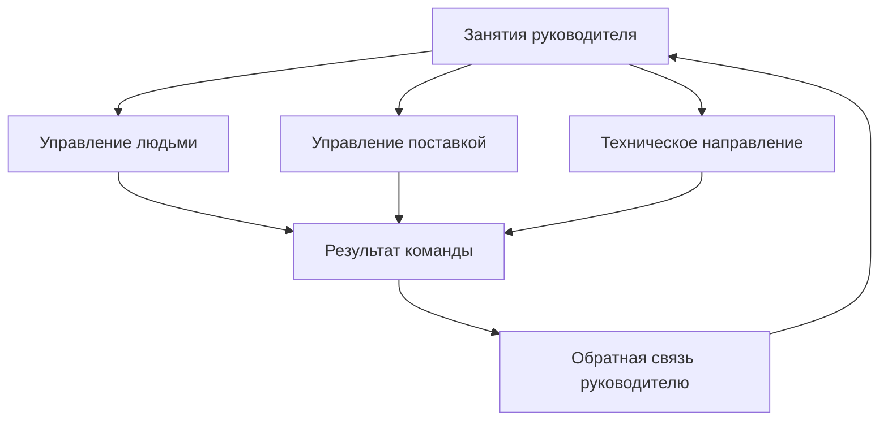
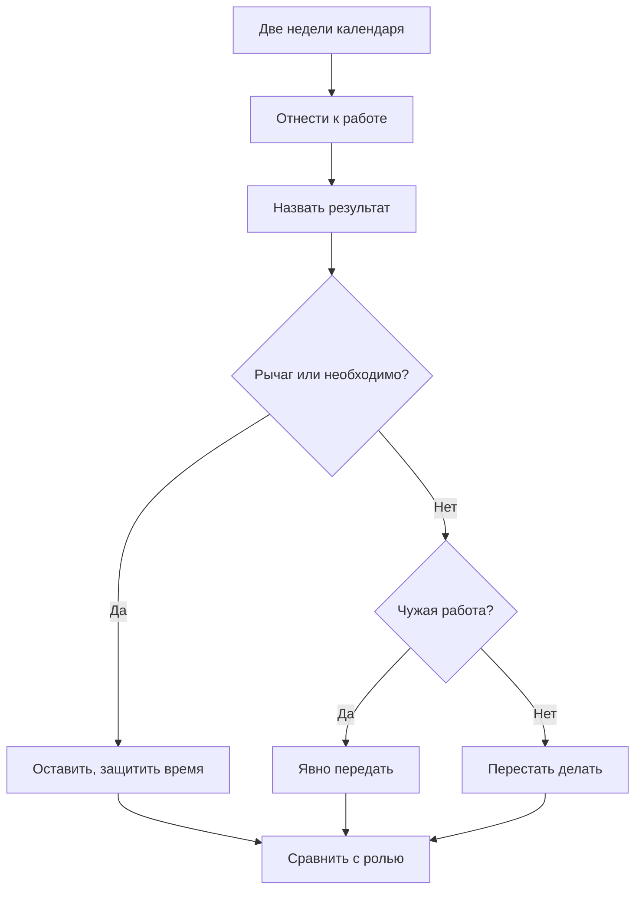
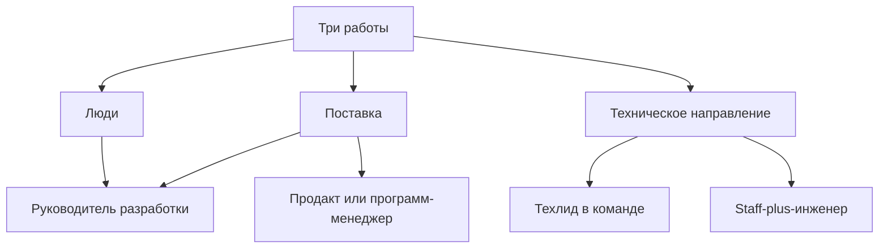

# Глава 1 — Что такое управление разработкой на самом деле { #chapter-1-what-engineering-management-actually-is }

За должностью «руководитель разработки» (engineering manager, EM) скрываются по меньшей мере три разные
работы. Глава разделяет их, определяет результат руководителя так, чтобы его можно было проверить по
собственному календарю, и наносит на ту же карту технических лидеров без подчинённых. Здесь же вводится
словарь, на котором говорит вся книга. Сквозной пример — Northstar Technologies, вымышленная компания из
[кейса](../../case-studies/northstar/index.md): шесть её руководителей разработки носят одну должность, а
выполняют шесть разных работ.

Глава 2 посвящена переходу от индивидуального исполнителя к руководителю. Глава 3 подробно разбирает
управленческий рычаг и системное мышление, глава 4 — лестницу от senior-инженера до CTO и то, как
измерять эффективность руководителя.

## Почему это важно { #why-this-matters }

Для команды размытая роль выглядит так: руководитель занят весь день, но не может сказать, что от этого
изменилось. Команда получает четвёртого дежурного, senior-инженера на полставки или человека, который
расставляет встречи. А работу, которую может сделать только руководитель, не делает никто.

В масштабе организации путаница умножается. Если шесть руководителей понимают должность по-разному,
директор не может понять, в чём проблема команды: в людях, в поставке или в технике. Ведь в разных
командах одну и ту же часть работы закрывают разные люди. Staff-инженеры без мандата затыкают любую дыру,
какую найдут.

Для высшего руководства определение роли становится проектным решением со своим бюджетом. Должны ли
руководители быть техническими, есть ли staff-трек, сколько людей приходится на одного руководителя —
от этого зависят профили найма, зарплаты и то, как принимаются решения. CTO (технический директор),
который не решил, зачем нужны руководители, обнаружит, что каждый директор решил это по-своему.

## Цели главы { #learning-objectives }

После этой главы вы сможете:

- Разделить три работы, скрытые под одной должностью (управление людьми, управление поставкой,
  техническое направление), и сказать, какие из них действительно принадлежат вашей роли.
- Объяснить результат руководителя как результат организации, на которую он влияет, и провести по этому
  определению аудит календаря.
- Отличить инженерное лидерство от управления людьми и разместить staff-plus-инженеров на одной карте с
  руководителями.
- Сформулировать, что показывают исследования о влиянии руководителей: на каких группах они проведены и
  каковы их ограничения.
- Написать одностраничное определение роли, которое ваши подчинённые, коллеги и руководитель прочитают
  одинаково.

## Ментальная модель { #the-mental-model }

> **Ментальная модель:** руководитель разработки отвечает за результат организации, а не за личный
> результат. Этот результат создают три работы (люди, поставка, техническое направление), и любая роль,
> включая вашу, — это конкретное распределение этих работ между людьми вокруг вас.

Первая идея принадлежит Andrew Grove. В *High Output Management* он утверждал, что результат
руководителя — это результат организации, которой он руководит, плюс результат соседних организаций, на
которые он влияет ([Grove, 1983](../../references/bibliography.md#grove1983high)). Собственные занятия
руководителя (встречи, решения, ревью, разговоры) — лишь входы: они важны постольку, поскольку влияют на
то, что производит организация. Этим определением книга пользуется везде.

Вторая идея: результат организации зависит от трёх разных видов работы.

| Работа | На какой вопрос отвечает | Типичные занятия |
|---|---|---|
| Управление людьми | Здесь ли нужные люди, растут ли они, могут ли работать в полную силу? | Найм, встречи один на один, обратная связь, результативность, карьерный рост |
| Управление поставкой | Движется ли работа к обязательствам? Предсказуемо ли? | Планирование, приоритизация вместе с продуктом, зависимости, риски |
| Техническое направление | Строим ли мы то, что нужно, и так, как нужно, с расчётом на долгий срок? | Архитектура, стандарты, ревью дизайна, решения о долге |

Каждую работу может делать руководитель, кто-то другой (техлид, staff-инженер, продакт- или
программ-менеджер) или никто. Опасен третий вариант: он ничем себя не выдаёт.

Время уходит на работы, работы определяют, что производит команда, а результат команды — единственное
свидетельство того, что время потрачено с пользой. Если вместо результата измерять начало петли (часы,
встречи), петля ломается.

## Подробный разбор { #deep-conceptual-explanation }

### Три работы, одна должность { #three-jobs-one-title }

Три работы требуют разных навыков и окупаются в разные сроки. Управление людьми — за кварталы и годы:
удачный найм, повышение, инженер, который остался. Управление поставкой — за недели: снятая зависимость,
обязательство, выполненное или вовремя пересогласованное. Техническое направление — за годы, и его легко
отложить: граница модуля, стандарт, решение чего-то не строить.

Из-за разницы в сроках занятой руководитель сползает к работе с самой быстрой обратной связью, то есть к
поставке. За год этот дрейф проявляется в календаре раньше, чем в текучести или в архитектуре, которую
никто не выбирал. Это **рекомендация книги**, а не научный результат (что означает каждая метка,
объясняет страница [меток доказательности](../../references/evidence-labels.md)). Аудит календаря,
описанный ниже, устроен так, чтобы этот дрейф поймать.

Кроме того, работы борются за один дефицитный ресурс — неделю руководителя. Допустим, у руководителя
пятнадцать прямых подчинённых и с каждым он еженедельно проводит 30-минутную встречу один на один (1:1).
Только на это уходит семь с половиной часов, почти пятая часть 40-часовой недели. А ведь есть ещё найм,
обратная связь и последующие действия.

### Как компании распределяют работы { #how-companies-split-the-jobs }

Какие работы отдать человеку с должностью руководителя, компании решают по-разному. Camille Fournier в
книге *The Manager's Path*, известной тем, что она проводит читателя по ступеням от техлида до CTO,
рассматривает техлида и руководителя людей как родственные, но разные роли
([Fournier, 2017](../../references/bibliography.md#fournier2017manager)). Will Larson, описывая архетипы
staff-инженеров, выделяет «техлида-руководителя» (tech lead manager) в отдельную роль на управленческой
лестнице, в отличие от техлида уровня staff, у которого подчинённых нет
([Larson, staff archetypes](../../references/bibliography.md#larson-staff-archetypes)).

Большинство организаций укладывается в четыре формы:

| Форма | За руководителем | За кем-то другим | Подходит, когда |
|---|---|---|---|
| Техлид-руководитель | Все три работы, в небольшой команде | Ничего | Команды примерно из четырёх–шести человек; сильный технический руководитель |
| Руководитель плюс техлид | Люди, поставка | Техническое направление (инженер в команде) | Большинство продуктовых команд из шести–десяти человек |
| Руководитель плюс программ-менеджер | Люди, техническое направление | Координация поставки между командами | Много зависимостей между командами или регулируемые релизы |
| Руководитель, сосредоточенный на людях | Люди | Поставка (продукт или программа), техническое направление (staff-инженеры) | Крупные организации с сильными функциями staff-инженеров и продукта |

Размеры команд приблизительны; это рекомендация книги. Ни одна форма не верна сама по себе: каждая —
ставка на то, где находится дефицитный навык. Провал начинается, когда несколько форм сосуществуют
случайно и каждый руководитель молча решает, какие работы делать, а какие оставить без внимания.

### Результат руководителя и календарь { #managerial-output-and-the-calendar }

Из определения Grove вытекает практическая проверка. Про любой блок времени в календаре руководителя
спросите: какой результат моей организации (или той, на которую я влияю) он меняет и насколько, если
сравнить с другим способом потратить этот час? Grove также утверждал, что руководителю стоит выбирать
занятия с высоким рычагом — те, чей эффект распространяется на многих людей или держится долго
([Grove, 1983](../../references/bibliography.md#grove1983high)). Подробно рычаг разбирается в главе 3.

Более ранняя версия той же дисциплины известна по книге Peter Drucker *The Effective Executive*: прежде
чем решать, как тратить время, запишите, куда оно уходит в действительности, потому что память здесь
подводит ([Drucker, 1967](../../references/bibliography.md#drucker1967effective)). Аудит календаря
объединяет оба подхода: Drucker даёт измерение, Grove — критерий.

1. Возьмите две типичные недели календаря и добавьте незапланированную работу, восстановленную по чатам
   и почте.
2. Отнесите каждый блок к одной из работ: люди, поставка, техническое направление или прочее
   (администрирование, работа между командами, собственное развитие).
3. Для каждого блока назовите результат, который он должен был изменить, и пометьте блок: **с рычагом**
   (эффект доходит до многих людей или держится долго), **необходимое** (кто-то должен это делать, и это
   работа руководителя) или **заменимое** (это мог бы и должен делать кто-то другой).
4. Сравните распределение с определением роли. Если по роли техническое направление отдано техлиду, а
   треть часов в календаре занимают ревью дизайна, одно противоречит другому, и что-то из двух неверно.

Это единственный аудит календаря в книге. Следующие главы не вводят новой процедуры, а добавляют к нему
по необязательному столбцу: глава 3 — уровень рычага, глава 4 — самый низкий уровень, на котором эту
работу можно было бы выполнить.

Подгоняют аудит щедрой классификацией: любой созвон по инциденту становится «поставкой», любая
статус-встреча — «людьми». Классифицируйте по тому, что блок изменил, а не по его названию:
статус-встреча, на которой ничего не решили, — это «прочее». И попросите коллегу или своего руководителя
независимо классифицировать часть блоков: самое ценное — расхождения.

### Лидерство — не то же самое, что управление людьми { #leadership-is-not-the-same-as-people-management }

Управление людьми — это работа: прямые подчинённые, формальные полномочия в найме и оценке
результативности, ответственность за здоровье команды. Инженерное лидерство — это поведение: задавать
направление, повышать качество решений и вести за собой людей, которые вам не подчиняются. Руководителю
лидерство необходимо, но многие инженеры ведут за собой, никем не управляя. Организация, которая
смешивает одно с другим, выталкивает лучших технических лидеров в менеджмент ради влияния и теряет
техническое направление. Staff-трек даёт техническому лидерству место без прямых подчинённых.

### Где находятся staff-plus-инженеры { #where-staff-plus-engineers-sit }

[Staff-plus-инженеры](../../glossary.md#staff-plus-engineer) (staff, principal и выше) — опытные
индивидуальные исполнители, которые занимаются техническим лидерством за пределами собственных задач.
Larson описывает четыре распространённых архетипа. **Техлид** направляет подход и поставку одной или
нескольких команд. **Архитектор** отвечает за направление ключевой технической области. **Решатель**
(solver) берётся за трудные приоритетные проблемы одну за другой. **Правая рука** (right hand) расширяет
охват руководителя высшего уровня в сквозных проблемах; такой архетип встречается в основном в очень
крупных организациях. По наблюдению Larson, большинство компаний признают лишь один или два из этих
архетипов, а у некоторых трека технического лидерства нет вовсе
([Larson, staff archetypes](../../references/bibliography.md#larson-staff-archetypes);
[Larson, 2021](../../references/bibliography.md#larson2021staff)). Это мнение эксперта, а не измеренная
классификация.

На карте трёх работ staff-plus-инженеры отвечают за техническое направление поверх границ команд, а
иногда и за поставку межкомандных технических программ. Управление людьми за ними не закреплено, хотя
они менторят и влияют на решения о найме и повышениях.

Схема показывает распространённый вариант по умолчанию, а не правило. Читайте каждую стрелку как вопрос
к своей организации: стоит ли за ней конкретный человек и знает ли он об этом? За кем последнее слово в
архитектуре, когда руководители и staff-инженеры расходятся, — вопрос спорный; позицию по нему занимает
глава 28.

### Чем эта работа не является { #what-the-job-is-not }

**Не быть лучшим инженером в команде.** Компетентность важна, это показывают данные ниже. Но если
руководитель — главный автор кода в команде, результат команды упирается в один календарь, где должны
уместиться ещё и две другие работы.

**Не быть щитом команды.** Отсекать шум — часть управления поставкой. Скрывать реальные ограничения
организации — нет: тогда команда принимает решения без самой важной информации.

**Не передавать статусы.** Если статусы идут наверх, приоритеты вниз, а посередине ничего не решается,
такая передача лишь добавляет задержку.

### Важны ли руководители? Что говорят данные { #do-managers-matter-the-evidence }

Инженеры часто считают руководителей накладными расходами. Между тем данные о влиянии руководителей на
результаты вполне реальны. Правда, каждое исследование проведено на своей конкретной популяции, и ни одно
не изучало команды разработки ПО.

- **Продуктивность.** Lazear, Shaw и Stanton изучили данные одной компании, где работники сферы услуг
  опираются в работе на технологии. В аннотации они сообщают: замена руководителя из нижних 10 процентов
  по качеству руководителем из верхних 10 процентов повышала выпуск команды сильнее, чем добавление в
  команду из девяти человек ещё одного работника, а работники с лучшими руководителями реже увольнялись.
  При отдельной нормировке средний начальник оказался примерно в 1,75 раза продуктивнее среднего
  работника; здесь сравнивается начальник с работником, а не команды между собой
  ([Lazear, Shaw, and Stanton, 2015](../../references/bibliography.md#lazear2015value)).
  **Научный результат**; одна компания.
- **Текучесть.** Hoffman и Tadelis изучили кадровые данные и опросы сотрудников крупной
  высокотехнологичной компании. В аннотации рабочего доклада они сообщают: навыки управления людьми,
  измеренные опросами, сильно и отрицательно связаны с текучестью, и дизайн исследования поддерживает
  причинную интерпретацию. Устойчивого влияния на другие результаты эти навыки не показали
  ([Hoffman and Tadelis, 2021](../../references/bibliography.md#hoffman2021people)).
  **Научный результат**; одна компания.
- **Техническая компетентность.** Artz, Goodall и Oswald, опираясь на опросы в США и Великобритании,
  сообщают: техническая компетентность начальника сильнее всего предсказывала удовлетворённость
  работников своей работой, а рост компетентности руководителя был связан с более высоким благополучием
  тех, кто оставался на прежней должности
  ([Artz, Goodall, and Oswald, 2017](../../references/bibliography.md#artz2017boss)).
  **Научный результат**; корреляционный, с лонгитюдным контролем; не относится специально к разработке
  ПО.
- **Project Oxygen в Google.** Сайт Google re:Work описывает многолетнее внутреннее исследование.
  Началось оно с гипотезы, которую разделяла часть сотрудников: руководители не важны. Согласно описанию,
  команды с очень эффективными руководителями чаще добивались лучших результатов, были довольнее, и
  текучесть у них была ниже. Там же перечислены десять форм поведения руководителя, в том числе ключевые
  технические навыки ([Google re:Work, great managers](../../references/bibliography.md#rework-great-managers)).
  **Отраслевое исследование**: отчёт компании о самой себе, не рецензируемый, методы описаны лишь в общих
  чертах.

Вместе эти работы подкрепляют скромный вывод: в изученных условиях качество непосредственного
руководителя связано с выпуском, удержанием и удовлетворённостью, а дизайн двух исследований указывает
на причинный эффект. Но они не говорят, какая из трёх работ даёт этот эффект в командах разработки, и не
показывают, что чем больше руководителей, тем больше результат. Данные о текучести напоминают, что работы
разные: хорошо делая одну, вы не закрываете остальные. Исследований, которые связывали бы распределение
времени руководителей разработки с результатами команд, мы не нашли, поэтому советы о календаре в этой
главе — рекомендация книги.

## Пример из инженерной организации { #engineering-organization-example }

Этот пример — **иллюстрация**: вымышленный руководитель в вымышленной компании примерно из 40 инженеров.

Jo руководит платёжной командой из восьми человек и отвечает за людей и поставку; senior-инженер Ari —
назначенный техлид. Две недели Jo, восстановленные по календарю и истории чатов, — это 80 рабочих часов:

| Блок | Часы | Работа | Пометка |
|---|---|---|---|
| Встречи 1:1, восемь инженеров, еженедельно по 30 минут | 8 | Люди | Необходимое |
| Цикл интервью на открытую вакансию | 6 | Люди | С рычагом |
| Планирование и приоритизация с продуктом | 6 | Поставка | С рычагом |
| Встречи по зависимостям между командами | 8 | Поставка | Необходимое |
| Созвоны по инцидентам в роли лишнего дежурного | 8 | Поставка | Заменимое |
| Ревью дизайна | 12 | Техника | Заменимое: работа Ari |
| Код для сценария возврата средств | 14 | Техника | Заменимое |
| Три еженедельные статус-встречи | 6 | Прочее | Заменимое: на четырёх из шести ничего не решено |
| Почта и администрирование | 12 | Прочее | Частично необходимое |

По работам 80 часов распределяются так: люди — 14, поставка — 22, техника — 26, прочее — 18. По роли
техническое направление принадлежит Ari, но на технику уходит треть времени Jo, в основном на код и на
ревью, которые дублируют работу Ari. Тем временем за два квартала ни у кого в команде не было разговора
о карьере, а вакансия открыта уже одиннадцать недель.

Если перераспределить работу, за две недели освободится около 33 часов. Допущения такие:

| Изменение | Освобождается часов за две недели |
|---|---|
| Посещать одно ревью дизайна в неделю, по выбору Ari | 9 |
| Передать код сценария возврата инженеру | 14 |
| Оставлять инциденты дежурным, если они не затрагивают другие команды | 6 |
| Заменить две статус-встречи письменным отчётом | 4 |

Из освободившихся часов Jo отдаёт 10 найму, 8 — разговорам о карьере и обратной связи, а остальное
оставляет запасом для работы с другими командами.

Цена такая: Jo лишается удовольствия выпускать код, а Ari берёт на себя область решений, которую раньше
делил с Jo. Окупится ли обмен, покажет только результат команды за следующие два квартала.

## Как принимать решение { #decision-framework }

Главное решение — как распределить три работы в конкретной команде. Начинайте с команды, а не с
шаблона:

| Вопрос | Если да | Если нет |
|---|---|---|
| Шесть человек или меньше, и руководитель — самый сильный технический голос? | Техлид-руководитель может сработать; явно защитите время на людей | Отделите техлида от руководителя |
| Есть инженер, готовый взять техническое направление? | Назначьте его техлидом, письменно, с определённой областью решений | Руководитель временно держит направление сам, с планом вырастить или нанять техлида |
| Поставка сильно зависит от других команд? | Добавьте программную поддержку или процесс работы с зависимостями на уровне директора | Поставка за руководителем |
| Области нужно техническое направление поверх команд? | Staff-plus-инженер с письменным мандатом | Техлидов команд достаточно |
| Больше восьми–десяти прямых подчинённых? | Работа с людьми вытеснит всё остальное; планируйте разделение (глава 34 разбирает [охват управления](../../glossary.md#span-of-control), глава 33 — дизайн команд) | Продолжайте |

При любых ответах действуют два критерия: у каждой работы в каждой команде ровно один названный
владелец, и в его календаре есть на неё время. Если по определению роли техническое направление отдано
техлиду, который тратит 90 процентов времени на фичи, на деле оно не отдано никому.

Пороги по числу прямых подчинённых — рекомендация книги: исследования охвата управления (span of
control), которые мы нашли, не касаются команд разработки, так что данных здесь мало.

## Компромиссы { #trade-offs }

**Техническая глубина против времени на людей.** Руководитель, который сам задаёт техническое
направление, решает быстрее и зарабатывает авторитет, а результат Artz, Goodall и Oswald говорит в
пользу того, что компетентность важна для подчинённых. Но у такого руководителя меньше времени на людей,
и в команде могут не вырасти собственные технические лидеры. Если же работы разделить, между
руководителем и техлидом появляется интерфейс, и нужен способ разрешать разногласия на нём.

**Единообразие против соответствия команде.** Одно распределение для всех команд делает роли
сравнимыми, а повышения — справедливее. Промежуточный путь — один письменный вариант по умолчанию и
зафиксированные исключения.

**Стоимость смены распределения.** Когда техническое направление переходит от руководителя к техлиду,
руководитель теряет часть профессиональной идентичности, а у инженера прибавляется нагрузки. Закладывайте
квартал трений и пересекающихся решений. Менять распределение без объявления ещё хуже: одни и те же
решения принимают двое, и команда идёт к тому, кто даст нужный ей ответ.

## Типичные провалы { #failure-modes }

**Суперинженер.** Руководитель остаётся самым активным автором кода в команде; как это обнаружить и
исправить, разбирает глава 2.

**Диспетчер.** Работа сжимается до «задачи на входе, статус на выходе». Сигнал: поначалу хорошая
пропускная способность, потом текучесть или дизайн без владельца. Как заметить: в аудите нет ни работы с
людьми, ни технической работы, и никто не может назвать технического владельца команды.

**Бесхозная работа.** Все считают, что техническое направление, поставка или рост людей — чужая забота.
Сигнал: решения принимает тот, кто оказался на встрече; одни и те же споры повторяются. Как заметить:
спросите руководителя, техлида и двух инженеров, кто отвечает за каждую работу; если ответы расходятся,
не отвечает никто.

**Четвёртый дежурный.** Руководитель подключается к каждому инциденту и становится частью пути
восстановления. Как заметить: в записях об инцидентах руководитель значится среди реагирующих чаще любого
инженера, а нагрузка на график дежурств кажется меньше реальной.

**Staff-инженер без мандата.** Без письменной области ответственности staff-инженер затыкает любую
срочную дыру. Роль staff-инженера и её мандат разбирает глава 4.

**Активность вместо результата.** Руководитель отчитывается о проведённых встречах, а не о том, что
изменилось. Как заметить: задайте вопрос «Что в команде стало иначе благодаря этому?»

## Применение в крупной организации { #enterprise-application }

В организации из 50–150 инженеров определение роли уже не может жить в голове одного человека. Директор
руководит несколькими руководителями, а часто и staff-инженерами, так что распределение трёх работ
становится вопросом организационного дизайна. Книга Will Larson *An Elegant Puzzle* известна тем, что
рассматривает управление разработкой такого масштаба как проектирование систем — процессов и структур,
по которым движутся решения ([Larson, 2019](../../references/bibliography.md#larson2019elegant)).
Распределение работ — одна из таких систем. Работоспособной её делают три практики:

- Письменное **распределение по умолчанию**: за что отвечают руководители, техлиды и staff-инженеры.
- **Хартия каждой команды** с её фактическим распределением и всеми исключениями.
- **Периодический аудит календаря** каждого руководителя, раз или два в год, вместе с директором. Он
  служит развитию, а не оценке.

Роль директора устроена так же, только уровнем выше. Результат директора — это результат всей
организации плюс результат коллег, на которых он влияет: продукта, поддержки, финансов. Работа директора
с людьми — в основном руководство руководителями; с поставкой — межкомандные обязательства и ресурс
команд; техническая работа — следить, чтобы у staff-инженеров были мандаты, а межкомандные решения
принимались. Глава 27 показывает это разделение во время трансформации качества
([глава 27, «Применение в крупной организации»](../05-engineering-quality/27-quality-transformation-at-enterprise-scale.md#enterprise-application)).
Как измерять эффективность руководителей, разбирает глава 4. Здесь достаточно минимума: оценивайте
руководителей по результату их команд, а не по объёму собственной активности.

## Взгляд CTO { #cto-perspective }

Для CTO вопрос «что такое руководитель разработки» — это политика со своей строкой затрат в бюджете.
Если оставить его без внимания, каждый директор ответит на него по-своему. За CTO три решения.

**Должны ли руководители быть техническими.** Если руководители должны задавать техническое
направление, придётся нанимать людей с глубокой экспертизой и держать команды небольшими. Если работы
разделить, нужен staff-трек, достаточно сильный, чтобы удержать техническое направление. Исследования
говорят в пользу технического авторитета руководителей, но не отвечают на вопрос, должна ли к этому
авторитету прилагаться ответственность за технические решения.

**Есть ли staff-трек и с каким мандатом.** Staff-трек без мандатов — путь повышения, за которым не стоит
работа. CTO решает, какие архетипы признаёт организация и как решения staff-инженеров соотносятся с
решениями руководителей.

**Соотношение руководителей и инженеров.** Меньше руководителей — меньше затрат, но каждый из них
растянут сильнее. Исследования говорят, что качество руководителя имеет значение. Поэтому CTO, который
сокращает руководителей, должен ожидать, что экономия вернётся текучестью или замедлением поставки, и
оценить, где именно.

## Практический плейбук { #practical-playbook }

1. Запишите три работы своей роли: какие принадлежат вам, какие — кому-то другому (по имени), а какие —
   никому.
2. Проведите двухнедельный аудит календаря: отнесите каждый блок к работе и результату и пометьте его
   как «с рычагом», «необходимое» или «заменимое».
3. Попросите своего руководителя или коллегу независимо классифицировать десять ваших блоков; обсудите
   расхождения.
4. Явно передайте два самых крупных заменимых блока, назвав владельца и дату, и сообщите об этом всем,
   кого это касается.
5. Спросите техлида, двух инженеров и партнёра из продукта, кто в вашей команде отвечает за каждую
   работу. Разногласия разрешите письменно.
6. Напишите одностраничное определение роли: назначение, три работы и их владельцы, результаты, за
   которые вы отвечаете, и то, чего вы делать не будете. Покажите его команде и своему руководителю.
7. Если вы руководите руководителями, запишите распределение по умолчанию для организации и
   зафиксируйте исключения по командам; дайте каждому staff-инженеру письменный мандат.
8. Через шесть месяцев повторите аудит: сравните распределение и проверьте, сдвинулись ли результаты,
   которые вы назвали.

## Кейс { #case-study }

Этот кейс — **вымысел**; люди и цифры Northstar описаны в
[обзоре Northstar](../../case-studies/northstar/index.md).

!!! info "Northstar: что уже известно"
    До недели 1. Вы вот-вот придёте директором по разработке в Northstar — компанию из 620 человек,
    которая делает ПО для order-to-cash («от заказа до оплаты»). Под вашим началом будут шесть команд
    (80 инженеров). В прошлом квартале случилось 30 инцидентов Sev1 и Sev2, а сервисные кредиты
    составили $410 000. См. [хронологию](../../case-studies/northstar/timeline.md). Впервые в Northstar?
    Прочитайте [«Год вкратце»](../../case-studies/northstar/year-in-brief.md) и
    [«Действующие лица»](../../case-studies/northstar/cast.md).

!!! note "Northstar в одном абзаце"
    Northstar продаёт ПО, с помощью которого оптовые дистрибьюторы принимают заказы, выставляют счета и
    получают оплату; годовая регулярная выручка компании — $140 млн. Большая часть кода живёт в
    [Core](../../glossary.md#core) — Java-монолите, который выходит по двухнедельному
    [релизному поезду](../../glossary.md#release-train): один релиз по расписанию, а перед ним три дня
    ручного тестирования. Четырнадцать сервисов поменьше развёртываются самостоятельно. Контракты
    обещают доступность 99,9% и предусматривают [сервисные кредиты](../../glossary.md#service-credits)
    (возвраты денег), если она не достигнута. От надёжности зависят два продления на $9 млн в год.
    Инциденты классифицируют по [серьёзности](../../glossary.md#severity-sev1-sev2-sev3): Sev1 — самые
    серьёзные, а главный показатель — сумма Sev1 и Sev2. Инженер обходится примерно в $185 000 в год по
    [полной стоимости](../../glossary.md#fully-loaded-cost) (зарплата плюс льготы и накладные расходы).
    Недели отсчитываются от первого дня директора.

Цифры календарей относятся к базовому кварталу, то есть к кварталу перед приходом директора. Каждый
руководитель восстановил двухнедельную выборку (около 80 рабочих часов) по календарю и истории чатов.

У шести руководителей Northstar общая должностная инструкция, написанная много лет назад: «руководить
командой инженеров, чтобы поставлять качественное ПО», — и шесть разных работ:

| Команда | Руководитель | Инженеры | Люди | Поставка | Техника | Прочее | Техническое направление у |
|---|---|---|---|---|---|---|---|
| Orders | Priya Raman | 14 | 15% | 35% | 45% | 5% | Priya, которая всё ещё пишет код |
| Billing | Marcus Oyelaran | 13 | 15% | 55% | 15% | 15% | Ни у кого; решается во время инцидентов |
| Payments and Integrations | Elena Sokolova | 12 | 35% | 35% | 15% | 15% | Senior-инженер в роли неформального техлида |
| Customer Experience | Daniel Cho | 15 | 45% | 35% | 5% | 15% | Два неназначенных лида, веб и мобильная разработка |
| Data and Analytics | Farah Haddad | 11 | 25% | 20% | 45% | 10% | Farah, как архитектор данных |
| Platform Operations | Tom Becker | 12 | 25% | 50% | 10% | 15% | Tom и процесс релизов |

Priya выросла до руководителя внутри Orders восемь месяцев назад; на написание и ревью кода у неё уходит
около 36 из 80 часов. Подчинённых у неё четырнадцать, встречи 1:1 с ними формально еженедельные, а на
деле по большей части отменяются. У Marcus около 20 часов ушло на созвоны по инцидентам в роли
дополнительного дежурного — это провал «четвёртый дежурный». У Billing было больше всего инцидентов (8
из 30), и большую часть вызовов принимают три инженера. Но ничто в календаре Marcus не касается вопроса,
почему эту нагрузку несут именно трое. Календарь Elena самый сбалансированный, а операционная дисциплина
в её команде — лучшая. Что здесь причина, а что следствие, по данным сказать нельзя. У Daniel пятнадцать
еженедельных встреч 1:1 занимают 15 часов за две недели, а того, кто задаёт направление вебу и
мобильной разработке, никто не назначал. Время, которое Tom тратит на поставку, уходит в основном на
координацию релизного поезда; в его команде семь QA-инженеров ведут ручное регрессионное тестирование.

Три staff-инженера не владеют ни одним компонентом и по умолчанию работают решателями. С Ines Carvalho
(staff-инженер, основной домен) советуются по большинству изменений в Core, но ни одно решение ей не
принадлежит. Kwame Mensah (staff-инженер, инфраструктура и надёжность) затягивают в самые крупные
инциденты. Li Na Zhou (staff-инженер, данные и интеграции) отвечает на вопросы по интеграциям той
команде, которая спросит первой.

Ещё до выхода на работу директор набросал одностраничное определение своей роли:

| Элемент | Определение директора |
|---|---|
| Назначение | Надёжность и поставка всей инженерной организации, оцениваемые по её результату |
| Люди | Руководить шестью руководителями и развивать их; дать staff-инженерам мандаты |
| Поставка | Отвечать за межкомандные обязательства и модель ресурсов, согласованную с CTO и CPO |
| Техническое направление | Следить, чтобы у межкомандных технических решений был владелец; решать лично, только когда больше некому |
| Чего не делать | Вести планирование за команду, подключаться к инцидентам как дежурный, писать продакшен-код |

Что было дальше, описано в [хронике года 1](../../case-studies/northstar/first-quarter.md):
staff-инженеры получили письменные мандаты, а руководителей обучили роли
[координатора инцидента](../../glossary.md#incident-commander) (incident commander) — того, кто
управляет реагированием, а не участвует в нём. Вопрос этой главы встаёт раньше: стали бы вы ещё до
всякой трансформации менять то, как шесть руководителей распределяют работы, и если да, то в каком
порядке?

## Упражнения { #exercises }

Разборы упражнений — в [решениях к главе 1](../../solutions/ch01-solutions.md). Данные Northstar — на
[странице исходного уровня](../../case-studies/northstar/baseline-data.md); кто есть кто — на странице
[«Действующие лица»](../../case-studies/northstar/cast.md).

### Базовый уровень { #foundational }

**F1.** Неделя в календаре Priya Raman: четыре встречи 1:1 (по 30 минут), двухчасовое ревью дизайна
функции массового заказа, шесть часов кода для приёма заказов (order-capture), часовая сессия
планирования с продуктом, 90-минутная встреча с Billing по core/customer, три часа почты и отменённый
разговор о карьере. Отнесите каждый блок к работе и пометьте как «с рычагом», «необходимое» или
«заменимое». Скажите, что вы хотели бы узнать, прежде чем рекомендовать какие-либо изменения.

**F2.** Вакансия «Engineering Manager» в компании из 200 инженеров требует: «80 процентов практического
программирования, владение архитектурой нашей платёжной платформы, проведение спринтовых церемоний,
руководство командой из девяти человек». Определите, какие из трёх работ вакансия отдаёт роли, каким
придаёт слишком мало веса и чем такое сочетание рискованно для команды. Предложите исправленное
распределение.

**F3.** Коллега говорит: «Исследования доказывают, что хорошие руководители делают команды на 75 процентов
продуктивнее, так что нам нужно нанять больше руководителей». Опираясь на исследования из этой главы,
объясните, что данные подтверждают, а что нет, откуда могла взяться цифра вроде 75 процентов и почему
вывод из неё не следует.

### Прикладное лидерство { #applied-leadership }

**A1.** Вы директор, Marcus Oyelaran подчиняется вам. По его календарю 55 процентов времени уходит на
поставку, в том числе около 20 из 80 часов — на созвоны по инцидентам в роли лишнего дежурного, и
15 процентов — на управление 13 инженерами. Спланируйте разговор, в котором вы покажете ему результаты
аудита: что вы спросите сначала, что предложите, от чего пока не попросите его отказаться и как через
два месяца поймёте, сработало ли изменение.

**A2.** Daniel Cho руководит пятнадцатью инженерами (девять в вебе, шесть в мобильной разработке).
Техническое направление держат два неформальных лида, которых никто не назначал, и мобильный релиз уже
дважды конфликтовал с изменениями в вебе из-за одного и того же API. Выберите один из вариантов:
назначить двух техлидов, разделить команду между двумя руководителями или передать техническое
направление самому Daniel. Сформулируйте свои критерии и стоимость перехода для выбранного варианта.

**A3.** Ines Carvalho, staff-инженер, одиннадцать лет проработавшая в Northstar, говорит вам, что
подумывает стать руководителем, потому что «иначе меня насчёт Core никто не слушает». Дайте ей совет,
опираясь на карту трёх работ и архетипы staff-инженеров, и скажите, что вам как директору пришлось бы
изменить, чтобы у неё был настоящий выбор.

### Решения на уровне руководства { #executive-decision-making }

**X1.** Victor Lindqvist (CTO, руководитель директора) предлагает ввести модель техлида-руководителя во
всей разработке: каждый руководитель отвечает за все три работы, а роль staff-инженера упраздняется; это
экономит стоимость трёх опытных индивидуальных исполнителей. Примите полную стоимость $185 000 за
инженеро-год и сопоставьте экономию с $410 000 сервисных кредитов в прошлом квартале и с продлениями на
$9 млн, которые под угрозой. Напишите ответ: при каких условиях предложение сработало бы, в каких
командах провалилось бы и какова альтернатива.

**X2.** Rajiv Menon (CFO, финансовый директор) спрашивает, нельзя ли объединить команды и обойтись для
80 инженеров четырьмя руководителями вместо шести, чтобы операционные расходы не росли. Примите, что
руководитель стоит примерно как средний инженер, $185 000, а бюджет на персонал разработки — около
$16,1 млн в год. Подготовьте анализ, с которым вы пойдёте к CTO: что изменение делает с охватом и
календарём каждого руководителя, что говорят и чего не говорят данные о влиянии руководителей, где
проявится цена экономии и что вы рекомендуете.

## Вопросы для размышления { #reflection-questions }

1. Если бы вы провели аудит последних двух недель, на какую работу пришлось бы больше всего часов — и
   та ли это работа, которую ваше определение роли называет самой важной?
2. Если спросить троих в вашей команде, кто отвечает за каждую работу, какую из работ никто не назовёт
   своей?
3. Какую работу вы оставляете за собой ради удовольствия или авторитета, а не потому, что она ваша? Кто
   сделал бы её лучше?
4. Есть ли у сильного инженера в вашей организации реальный способ получить влияние без прямых
   подчинённых?
5. Когда вы в последний раз отчитывались наверх, что вы описывали: свою активность или результат своей
   организации?
6. Если бы ваш руководитель переписал определение вашей роли только по вашему календарю, что бы в нём
   было сказано?

## Главное { #key-takeaways }

- Результат руководителя — это результат организации, которую он ведёт и на которую влияет, а не его
  собственная активность.
- Должность скрывает три работы: управление людьми, управление поставкой, техническое направление. У
  каждой в каждой команде должен быть ровно один названный владелец, у которого есть на неё время.
- Компании распределяют работы по-разному; выбирайте распределение осознанно, записывайте его,
  фиксируйте исключения.
- Время дрейфует к поставке — работе с самой быстрой обратной связью. Аудит календаря ловит этот дрейф
  раньше, чем его покажут текучесть или архитектура без владельца.
- Лидерство — это поведение, управление людьми — работа. Роли staff-plus дают техническому лидерству
  место без прямых подчинённых, если к ним прилагается мандат.
- Исследования связывают качество руководителя с выпуском, удержанием и удовлетворённостью в изученных
  условиях. Они не говорят, какая работа важнее всего в командах разработки.

## Источники и что почитать { #references-and-further-reading }

- [Grove, 1983](../../references/bibliography.md#grove1983high). *High Output Management*. Результат
  руководителя и рычаг — в том смысле, в каком они используются во всей книге.
- [Drucker, 1967](../../references/bibliography.md#drucker1967effective). *The Effective Executive*.
  Записывать, куда уходит время, прежде чем решать, как его тратить.
- [Fournier, 2017](../../references/bibliography.md#fournier2017manager). *The Manager's Path*. Как
  меняются работы на пути от техлида до CTO.
- [Larson, 2019](../../references/bibliography.md#larson2019elegant). *An Elegant Puzzle*. Управление
  разработкой как проектирование систем.
- [Larson, 2021](../../references/bibliography.md#larson2021staff) и
  [staff archetypes](../../references/bibliography.md#larson-staff-archetypes). Роль staff-plus и её
  распространённые формы.
- [Lazear, Shaw, and Stanton, 2015](../../references/bibliography.md#lazear2015value). Влияние
  руководителей на выпуск в одной компании.
- [Hoffman and Tadelis, 2021](../../references/bibliography.md#hoffman2021people). Навыки управления
  людьми и текучесть.
- [Artz, Goodall, and Oswald, 2017](../../references/bibliography.md#artz2017boss). Компетентность
  руководителя и удовлетворённость работой.
- [Google re:Work, great managers](../../references/bibliography.md#rework-great-managers). Рассказ
  Google о Project Oxygen.
