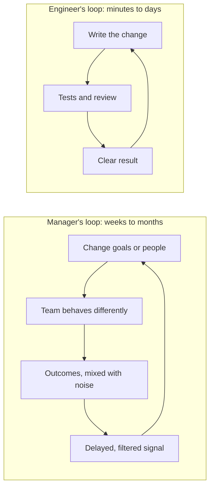
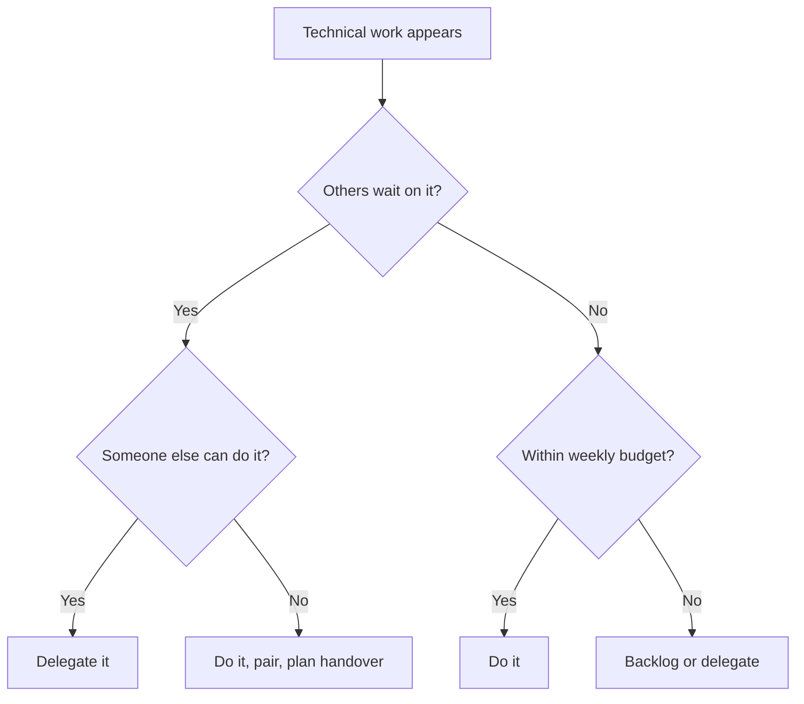
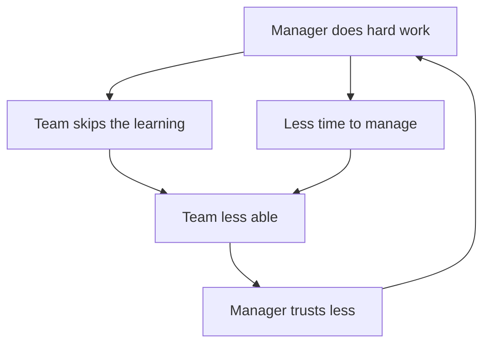

# Chapter 2 — From Individual Contributor to Leader

This chapter is about the first management role: what changes when a strong engineer becomes
responsible for a team, why the change is harder than it looks, and how to get through the first
year without becoming the team's bottleneck. It covers the shift in identity and feedback, delegation
by outcome with an explicit level of control, the first 90 days, and the decision about how much
hands-on technical work to keep. Chapter 1 defines the manager's job; this chapter is about crossing
into it. The running example is Priya Raman, the Orders manager at Northstar Technologies, the
fictional company in the [case study](../../case-studies/northstar/index.md).

## Why This Matters

At team scale, the transition decides whether the team gets a manager or loses its best engineer and
gains a busy one. A new manager who keeps the most important technical work looks effective for
months, because output continues. What stops is the team's growth: decisions queue behind one person,
nobody else learns the hard parts, and problems surface later as incidents or resignations.

At organization scale, first-line managers are the layer where most engineers experience the company,
so a weak transition is felt by every engineer on the team. Chapter 1 summarizes the evidence that
managers matter; it is a useful corrective to the engineer's belief that management is overhead.

At executive scale, the question is how the organization picks and prepares its managers. The risk
has a name, the **Peter Principle**: people are promoted for doing their current job well until they
reach a job they do poorly. An economic study of sales workers at 131 firms, titled after the
principle, found that firms weight current job performance heavily in promotion decisions. Other
characteristics better predicted success as a manager, and promoting people with lower managerial
potential was costly
([Benson, Li, and Shue, 2019](../../references/bibliography.md#benson2019promotions)). Sales is not
engineering, but the pattern is familiar: the strongest engineer is promoted, given no preparation,
and judged on whether the work still gets done.

## Learning Objectives

After this chapter you will be able to:

- Name the identity and feedback-loop changes of the first management role, and recognize them in
  yourself or in a manager you support.
- Plan the first 90 days in a new management role, including what to learn, what to change, and what
  to leave alone.
- Delegate by outcome with an explicit level of control, and choose the level from the person's
  competence and the cost of a mistake.
- Decide deliberately how much hands-on technical work to keep, and estimate what it costs the team.
- Detect the common first-year failure patterns early, from evidence rather than from how busy you feel.

## The Mental Model

> **Mental model:** An engineer's work produces fast, clear feedback; a manager's work produces slow,
> noisy feedback through other people. The transition succeeds when you stop steering by the fast loop.

As an engineer, you change code and within minutes a test passes or fails. Within days the change
ships. The loop is short, the signal is clear, and the credit is yours. As a manager, you change how
a person works, what the team works on, or how decisions are made. The result appears weeks or months
later, mixed with everything else that happened, and mostly in other people's output.

The danger is that the engineer's loop is still available and still rewarding. When the manager's
loop goes quiet, the new manager reaches for the keyboard. Each such choice is defensible; together
they keep the new manager in the old job.

The second idea follows from the first: a manager's output is the team's output, not their own
(Chapter 1 defines managerial output after Andrew Grove; Chapter 3 develops leverage). Delegation converts one person's
judgment into the team's capability.

## Deep Conceptual Explanation

### An identity change, not a promotion

Linda Hill's research followed nineteen new managers through their first year. Her publisher
describes the transition as a profound psychological adjustment, learned mainly from experience, in
which balancing delegation and control and reframing one's understanding of the role are central
challenges, and notes that many people do not complete it
([Hill, 2019](../../references/bibliography.md#hill2019becoming)). It is a small qualitative study
outside software, but its point matches practitioner experience: the
hard part is letting go of the old source of competence and status.

This is why the best engineer is not automatically the best manager. Even a promoted engineer who
would make a good manager arrives with the best engineer's habits: solving the hard problem
personally, reviewing everything important, being the person others ask. In the new role the same
habits concentrate work and decisions on one person. The engineer who once unblocked the team by
fixing the hard bug now blocks it by being the only one who can.

Herminia Ibarra's study of professionals moving into more senior roles offers a mechanism. People do
not adopt a new professional identity in one step; they observe role models, try out provisional
versions of the new self, and keep or discard them depending on their own standards and the feedback
they get ([Ibarra, 1999](../../references/bibliography.md#ibarra1999provisional)). For a new
engineering manager this means two practical things (**this book's recommendation**, extending the
finding). First, expect to experiment: run one-on-ones one way for a month, then adjust. Second,
choose role models deliberately. A new manager whose only model is their previous manager copies that
person's habits, including the bad ones.

### Feedback that is slower and noisier

Three properties of the manager's feedback loop cause most of the trouble:

| Property | Engineer | Manager |
|---|---|---|
| Delay | Minutes to days | Weeks to quarters |
| Attribution | Mostly own work | Shared with the team, product, luck |
| Filtering | Direct (the test fails) | Mediated: people tell the manager what is safe to say |

Delay means a new manager can do the wrong thing for a quarter before seeing the cost. Attribution
means a strong team can carry a weak manager for a while, and bad luck can hide good management.
Filtering means the signals that matter most, such as a senior engineer considering leaving, are the
least likely to reach the manager unprompted. The remedy is to build leading indicators the manager can observe directly: how many decisions waited for the manager this week, whether one-on-ones surface news or
only status, which work only one person can do. Chapter 5 covers one-on-ones as an information
channel; Chapter 4 covers measuring managerial effectiveness.

### Managing former peers

Most first-line managers are promoted inside their own team, so the hardest part of the change is
relational: yesterday's peers now report to you. Say plainly what has changed and what has not
(**this book's recommendation**). You now decide assignments, give performance feedback, and have a
say in pay and promotion; you are still the same person, and the team's technical judgment still
counts as much as yours.

Three situations need deliberate handling:

- **Friends on the team.** Keep the friendship and lose the private channel: no talk about other team
  members' performance or pay outside work. Tell the friend this yourself, early, before an awkward
  moment forces it.
- **The passed-over candidate.** Hold a one-on-one in the first week. Acknowledge that they wanted the
  role, ask what they want now, and offer something real if you have it (a scope, a sponsor, a track
  conversation), not consolation.
- **Old alliances and disputes.** Decisions you argued against as an engineer are now yours to uphold
  or reopen openly. Do not settle old technical arguments with new authority.

What not to promise: that nothing will change, that you will always side with the team against
management, or a promotion or raise you do not control. Each of these is broken within months, and the
broken promise costs more than the honest answer would have.

### Delegating by outcome, with an explicit level of control

Delegating a task ("implement this endpoint") keeps the manager as designer and integrator.
Delegating an outcome ("uploads of up to 5,000 lines succeed or fail cleanly, by the March release")
transfers the design too, and is how a team's judgment grows. It fails when the level of control is
implicit: the delegate thinks they own the decision, the manager thinks they are being consulted, and
the first disagreement feels like a betrayal. David Marquet's account of commanding a submarine is
known for moving decisions to the people with the information. They state what they intend to do
rather than ask permission, so control moves gradually while the leader can still intervene
([Marquet, 2012](../../references/bibliography.md#marquet2013turn)). The scale below is **this book's
recommendation** in that spirit, not a validated instrument.

| Level | Who decides | The delegate says | Use when |
|---|---|---|---|
| 1. Direct | Manager | "Here is what I found" | Person new to the area; mistake costly and hard to reverse |
| 2. Recommend | Manager, from the delegate's options | "I recommend X, because" | Building competence; manager must own the risk |
| 3. Intent | Delegate, after telling the manager | "I intend to X on Thursday" | Competent person; mistake costly but visible in time |
| 4. Act and inform | Delegate | "I did X; here is why" | Proven competence; mistake reversible |
| 5. Own | Delegate; manager hears by exception | Reports outcomes in the regular review | The area is theirs |

Research on delegation explains why managers stall at levels 1 and 2. In a survey and interview study,
Yukl and Fu found managers delegated more to subordinates who were competent, shared the manager's
objectives, and had worked with them longer. Managers valued delegation for developing people, yet
many were reluctant to give up control over important decisions or to give important tasks to
inexperienced subordinates
([Yukl and Fu, 1999](../../references/bibliography.md#yukl1999determinants)). The trap: important work
is never delegated, so nobody gains the experience that would justify delegating it. Delegate it at
level 2 or 3 instead of withholding it.

Two rules make the levels work (**this book's recommendation**). Name the level out loud, with the
outcome and the date: "This is level 3; tell me before you change the schema." And move the level by
agreement, upward after evidence, never silently downward.

### How much hands-on work to keep

There is no right percentage, but there is a right question: does this technical work make the team
more capable, or does it make the team depend on me? Google's list of effective manager behaviors
includes both empowering the team without micromanaging and having key technical skills
([Google re:Work](../../references/bibliography.md#rework-great-managers)). The two pull against
each other only when technical skill is exercised by doing the team's critical work.

Kinds of hands-on work, from cheapest to most costly for the team:

| Work | Keeps the manager | Cost to the team |
|---|---|---|
| Reading designs and code, asking questions | Able to judge | Low |
| Small fixes, tooling, prototypes off the critical path | In touch with the code and the pain | Low, if nothing waits on it |
| Joining on-call or incident response as a participant | Aware of operational reality | Low to moderate |
| Being the required reviewer for an area | Informed | High: every change waits for the busiest person |
| Owning work on a committed deadline | Productive-feeling | Highest: the critical path stops in every meeting |

Camille Fournier's practitioner account is known for this balance: stay close enough to the
technology to judge and coach, and stay off the critical path
([Fournier, 2017](../../references/bibliography.md#fournier2017manager)). Work others wait on is
delayed by every escalation in an interrupt-driven calendar.

### The first 90 days

Michael Watkins's book on leadership transitions is known for arguing that a new leader should
accelerate learning, agree expectations explicitly with their own manager, and secure a few early wins
([Watkins, 2003](../../references/bibliography.md#watkins2003first)). For a manager promoted from
inside the team, the hardest learning is about relationships, and the most valuable early wins are
visible changes in how the team works, such as decisions made faster or a recurring problem finally
owned. The Practical Playbook turns this into a plan.

### Managing up as a new manager

Your own manager is part of your system, and a new manager who waits to be managed gets surprised.
Managing up means making it easy for your manager to support you and to represent your team
(**this book's recommendation**):

- **Agree what success looks like** in writing in the first two weeks: the day-90 criteria, the time
  budget, and which decisions are yours alone. Revisit it monthly.
- **Report without being asked**, briefly and on a schedule: what changed, what is at risk, what you
  need. A weekly five-line note beats a monthly meeting full of surprises.
- **Bring bad news early, with a proposal.** "The renewal feature is two weeks behind; I want to move
  Aisha off support for three weeks; here is the cost" gets a decision. The same news a week before
  the date gets an escalation.
- **Ask for the decision you need.** Name the options and your recommendation, and say by when.
- **Learn what your manager is measured on.** Their pressures explain their questions; your updates
  should answer them before they are asked.

Two traps are common. Shielding the team by hiding problems from your manager fails the moment the
problem surfaces elsewhere. Escalating every disagreement upward tells your manager you cannot hold
the role. Disagree in private, with evidence, then carry the decision out or say plainly that you
cannot.

### Your own load and sustainability

The new manager's week has no natural end. Engineering work finishes; people work, delivery, and
escalations do not. A manager who absorbs the slack by working evenings sets a standard the team copies
and spends the energy that slow, careful judgment needs.

Three habits help (**this book's recommendation**). Keep slack in the weekly budget, as the
Engineering Organization Example does, because escalations will fill it. Decide in advance which
messages need you outside working hours, usually only incidents at the severity where you are on the
escalation path, and say so to the team. And find support outside the reporting line: a peer manager,
a mentor, or a manager group where you can admit what is not working.

Watch for the early signs in yourself that Chapter 10 describes for engineers: lasting exhaustion,
growing cynicism about the team or the company, and a sense that nothing you do makes a difference.
They are reasons to change the load, not to try harder.

## Engineering Organization Example

!!! info "Northstar so far"
    Weeks 1 and 2 of the director's first year at Northstar, the book's fictional company. The CTO's
    mandate is to halve serious incidents within twelve months with flat headcount, while two renewal
    features ship on time. Bulk ordering, one of them, belongs to Priya Raman's Orders team. See the
    [timeline](../../case-studies/northstar/timeline.md). New to Northstar? Read
    [the year in brief](../../case-studies/northstar/year-in-brief.md) and the
    [cast](../../case-studies/northstar/cast.md).

The following figures are **illustrative**. They describe the calendar of Priya Raman (Orders
manager) in the two weeks before the new director arrived, eight months after her promotion, and the
budget she agreed with the director in week 2.

Assumptions: a 40-hour working week; Orders has 14 engineers. Most Orders code lives in
[Core](../../glossary.md#core), Northstar's shared Java monolith, and Priya reviewed about 15 of the
roughly 25 Core merge requests (proposed code changes) Orders produced each week.

| Activity, hours per week | Before (measured from her calendar and review history) | Agreed budget |
|---|---|---|
| Coding and code review | 18 | 8 |
| Product, [release train](../../glossary.md#release-train) (the scheduled Core release), cross-team | 5 | 5 |
| Incidents and escalations | 6 | 5 |
| Team planning and rituals | 3 | 3 |
| One-on-ones | 2 (nominally weekly; about one in three took place) | 4 (30 minutes every two weeks for all 14 is 3.5 hours a week, plus preparation) |
| Hiring | 2 | 2 |
| Feedback and career conversations | 2 | 2 |
| Coaching delegated work | 0 | 4 |
| Email and admin | 2 | 2 |
| Unallocated | 0 | 5 |
| **Total** | **40** | **40** |

Three things follow from the table.

First, the hands-on share was 45 percent (18 of 40 hours), and the cost was not only Priya's time.
With 15 of 25 merge requests waiting for her, 60 percent of the team's Core changes depended on the
busiest person on the team, who reviewed in evening batches. If batching added half a working day to
each of those reviews, that is about 7.5 engineer-days of waiting a week. Waiting is not lost work,
since engineers switch tasks, but each switch adds work in progress and makes batches larger.

Second, eight hours a week is enough to read designs, pair occasionally, and take small fixes off the
critical path. It is not enough to own a committed feature, and that is the intent.

Third, the budget has 5 unallocated hours. A new manager's week fills with escalations; a budget
with no slack is broken by Tuesday, and the hours lost are usually one-on-ones.

## Decision Framework

Two decisions recur in the first year: what level of control to delegate at, and whether to take on a
piece of technical work yourself. For the first, use two questions: how competent is this person in
this area (not in general), and how costly and how reversible is a mistake? High competence and a
reversible mistake mean level 4 or 5. Low competence and an irreversible mistake mean level 2, never
withholding the work entirely. The level is set per area, so the same engineer may be at level 5 on
the pricing service and level 2 on a schema migration.

For the second decision:

"Someone else can do it" includes "with coaching, more slowly". The branch where only the manager can
do the work is a finding: a single point of knowledge to remove, so pair with next time's owner.

| Signal | Likely meaning | Response |
|---|---|---|
| You are the required reviewer for an area | Knowledge concentrated in you | Name two owners; review their reviews for a month |
| Decisions wait for you more than a day | Level of control set too low or unclear | Raise the level explicitly in one area |
| You do the hard part "because it is faster" | Short-term speed bought with long-term capacity | Delegate at level 2 or 3 with a checkpoint |
| One-on-ones are the first thing you cancel | The fast loop is winning | Protect them in the budget; track how many took place |

## Trade-offs

**Speed now against capability later.** The new manager is often the fastest person to solve a
problem. Solving it costs the team the learning. For a production outage, take the speed and run a
review afterward; for a committed feature with weeks of runway, delegate.

**Credibility against focus.** A manager who loses touch with the system is easy to mislead in design
discussions. Choose technical work for what it teaches you (reading, small fixes, on-call), not for
the satisfaction of shipping.

**Delegating early against protecting a commitment.** Handing the hardest part of a deadline-bound
feature to a less experienced engineer adds schedule risk. Keeping it adds a different risk: the
feature depends on someone with an interrupt-driven calendar. Level 3 delegation with weekly design
checkpoints usually costs less than either extreme, but the manager should say which risk they are
taking and to whom.

**Friend against manager.** A manager promoted from inside the team loses some of a peer's candor;
pretending nothing changed fails, and so does sudden distance (see Managing former peers).

## Failure Modes

**The super-engineer.** The new manager keeps the hardest technical work and the most important
reviews. Output holds up for a while, which hides the problem.

It is a reinforcing loop: each turn makes the next delegation look riskier. Signal: you are the only
person who can do some piece of the team's work, and that list is not shrinking. Countermeasure: a
written list of single-person areas, each with a named second person and a date.

**Delegation by abdication.** The manager overcorrects and hands over outcomes with no level, no
checkpoint, and no support, then intervenes late and visibly when things go wrong. Signal: surprises
at the deadline. Countermeasure: state the level and the checkpoints at handover.

**The silent take-back.** A delegated decision goes badly and the manager quietly resumes making it.
Signal: engineers start asking permission for things they used to decide. Countermeasure: if you
lower a level, say so, say why, and say what would raise it again.

**Status-meeting management.** One-on-ones become progress reports, so the manager hears only what
the task tracker already shows. Signal: you are surprised by a resignation or a conflict. Chapter 5
covers the repair.

**Commitments that outlive the role.** Work the manager owned as an engineer (follow-up actions,
on-call duties, a migration plan) stays assigned to them and quietly stops. Signal: open items with
your name on them older than your promotion. Countermeasure: in the first two weeks, list everything
assigned to you and reassign or close each item (Chapter 25 covers
[follow-up actions and recurrence](../05-engineering-quality/25-incidents-postmortems-and-change-failure-analysis.md#follow-up-actions-and-recurrence)).

## Enterprise Application

In an organization of 50 to 150 engineers, several first-line managers are always in their first year.
At that scale the transition stops being a personal matter and becomes a system the director runs.

**Selection.** Treat promotion to management as a change of job with its own criteria, not a reward
for engineering performance. Look for evidence the candidate has already multiplied others: mentoring,
leading a project through other people, handling a disagreement well. Keep a technical track with
equal standing, so that the best engineer is not forced into management to advance (Chapter 4).

**Preparation.** A trial period as tech lead or acting manager, with an end date, lets both sides
learn cheaply.

**Support in the first year.** The new manager's own manager owns the transition: an agreed time
budget, a monthly check of the leading indicators (decisions waiting, single-person areas,
one-on-ones held), and a peer manager outside the reporting line as a role model. Open engineering
commitments are reassigned as part of the promotion. Chapter 41 covers developing managers as a
director.

## CTO Perspective

At executive scale the question is the health of the management bench: how many managers are in
their first year, who supports each one, and what happens when a promotion is not working. Without a
respectable path back to engineering, a struggling new manager stays in the role or leaves the
company, and both are expensive. Make the path back normal and visible.

The CTO also sets the incentives that produce super-engineer managers. If managers are praised in
leadership meetings for personally rescuing releases, every first-year manager learns that rescuing
releases is the job. Praise the manager whose team handled the incident without them.

Finally, the evidence on managers and promotion (Chapter 1, and the Benson study above) does not come
from engineering teams: enough to justify investing in manager selection, not to promise a board a
specific return.

## Practical Playbook

For a newly promoted engineering manager, with the help of their own manager:

**Week 1.**

1. List everything assigned to you as an engineer (reviews, on-call, follow-up actions, features)
   and reassign or close every item, with the new owner's agreement.
2. Agree with your manager the day-90 criteria and a weekly time budget with a hands-on cap and slack.
3. Tell the team what has changed and what has not, together and then individually.

**Days 1 to 30: learn.**

4. Hold a first one-on-one with every report: what they want, what gets in their way, what you
   should not change.
5. Map single-person areas, including yourself.
6. Read the last quarter's incidents and [escaped defects](../../glossary.md#escaped-defect) (bugs
   found after release) for your components; note recurrences.
7. Choose a peer manager as a role model and ask for an hour a month.

**Days 30 to 60: delegate.**

8. Delegate two outcomes at an explicit level of control, with checkpoints and dates.
9. Name two owners for every area where you were the required reviewer.
10. Make one visible change in how the team works, chosen from what the one-on-ones raised.

**Days 60 to 90: check.**

11. Count the leading indicators and compare your calendar with the budget.
12. Ask your reports what you should do more of and less of.
13. Report to your manager against the day-90 criteria, including what has not worked.

## Case Study

This case is **fictional**. It is set before and at the start of the director's first quarter at
Northstar; the full story is in [the year 1 record](../../case-studies/northstar/first-quarter.md).

Priya Raman joined Northstar as an engineer seven years before the director arrived and became the
person who knew order capture best. She wrote much of the bulk order upload path. When the previous
Orders manager left the company, Priya was the obvious choice, and she accepted partly because the
alternative was a manager from outside who did not know the domain. She received no management
training, and her check-ins with her own manager were mostly about delivery dates.

In her first month as manager, a bulk upload failure reached customers. Priya fixed it herself over a
weekend and wrote the follow-up action, a test for uploads beyond 500 rows, assigned to herself. It
was never done. Two quarters later the same failure mode returned as INC-421: a bulk upload dropped
every line beyond row 500. It was a [Sev1](../../glossary.md#severity-sev1-sev2-sev3), Northstar's
most serious severity, and a customer reported it first. It was one of three
[recurrences](../../glossary.md#recurrence) (repeats of an earlier failure) among Orders' seven Sev1
and Sev2 incidents in the quarter before the director arrived.

By the time the director arrived, the team trusted Priya's judgment and liked that she understood
their work. Two senior engineers on Orders,
Rafael Duarte and Aisha Bello, described the same frustration in their first conversations with the director:
decisions on order capture waited for Priya, and she had kept the design and the hardest code of the
bulk-ordering feature, one of the two renewal commitments, for herself. One-on-ones were often
cancelled. Rafael had applied for the manager role too and had said nothing since about his own
career.

In week 1, the director's first one-on-one with Priya started with the renewal date; Priya was
confident about the code and worried about everything else. In week 2 they went through her calendar
and review history together and found the numbers in the
Engineering Organization Example: 18 hours a week of coding and review, 15 of
about 25 weekly Core merge requests reviewed by her, and about a third of scheduled one-on-ones held.

They agreed four changes, each with a level of control:

| Change | Owner | Level |
|---|---|---|
| Implementation lead for the bulk-ordering feature | Aisha Bello | 3: tells Priya before any API or schema change; weekly design checkpoint |
| Review ownership for core/order-capture | Rafael Duarte and Aisha Bello | 4: Priya reviews a sample of their reviews for a month |
| The open bulk-upload test action | Rafael Duarte | 4, due before the next Core release containing upload changes |
| Priya's time budget | Priya, checked with the director monthly | Hands-on capped at 8 hours a week |

Priya objected to the first change. Handing over the renewal feature, due at the end of quarter 2,
felt to her like taking a risk with the company's largest customers. The director's answer was that the long runway made this the cheapest moment to hand it over. Keeping
it was also a risk: the feature depended on a person who spent 15 percent of her week on incidents,
and the quarter's changes would fill her calendar further. Priya kept the design authority, and the
weekly checkpoint was her safeguard.

The case leaves Priya at the end of week 2. The lesson: the handover is cheapest when the runway is
longest, and only an explicit level of control makes it safe. Whether the plan worked is a question
for the exercises.

## Exercises

Solutions are in [chapter 2 solutions](../../solutions/ch02-solutions.md). Northstar data is on the
[baseline page](../../case-studies/northstar/baseline-data.md); who's who is on the
[cast](../../case-studies/northstar/cast.md) page.

### Foundational

**F1.** A senior engineer on your team has just been promoted to manage the five people she worked
alongside. After six weeks she tells you she is working longer hours than ever, the team is shipping
on time, and she feels she is "not really doing anything". Using the feedback-loop model, explain what
is happening, and name three observable indicators she could track instead of shipped work.

**F2.** For each of these, choose a level of control from the chapter's scale and justify it by
competence and cost of a mistake: an engineer with two years on the team designing a new internal
API; the same engineer writing a migration that rewrites the pricing-rules table in production; a
staff engineer choosing the team's test framework; a new hire triaging customer-reported defects.

**F3.** A new manager says: "I keep 50 percent hands-on time because my team respects me for it, and
Google's research says managers need technical skills." Assess the argument using what the chapter
says about the evidence and about the kinds of hands-on work.

### Applied Leadership

**A1.** You are the director in week 2 with Priya Raman. She agrees to delegate review ownership but
refuses to hand over implementation of the bulk-ordering feature, citing the renewal date at the end
of quarter 2. Prepare the conversation: what you need to learn from her, what you would accept, what you
would not, and what you would do if, three weeks later, the checkpoint shows the feature slipping.

**A2.** Rafael Duarte applied for the Orders manager role eight months ago and lost to Priya. He has
not raised his career since. Priya is about to give him review ownership of core/order-capture. Advise
Priya on how to handle the delegation and the unspoken history, and on what she should not promise.

**A3.** Design a 90-day plan for an engineer about to become manager of a team of eight on a
component with two recurring incident patterns and a quarterly deadline. Include the time budget,
the first three delegations with their levels, and the day-90 criteria you would agree with their
manager.

### Executive Decision-Making

**X1.** As CTO, suppose four of Northstar's six managers were promoted from inside their teams
and none received preparation. Propose a program for future promotions within flat headcount and a
small budget, including a respectable path back to engineering. Say what you will measure, how that
measure could be gamed, and what you will not promise the CEO.

**X2.** Two quarters from now, Priya's hands-on time has crept back to 35 percent and Orders' results
are good. One senior engineer has resigned, citing lack of growth. Victor Lindqvist (CTO) asks whether
Priya is a strong manager. Decide what evidence you would gather, what conclusion would follow from
each plausible finding, and what you would recommend.

## Reflection Questions

1. What work do you still do because it is satisfying rather than because the team needs you to do it?
2. Which decisions on your team waited for you last week, and which of them could someone else have
   made with what they knew?
3. Who was your model of a manager when you started, and which of their habits did you copy without
   choosing to?
4. When did you last lower someone's level of control without telling them?
5. If you were promoted out of your current role tomorrow, which of your commitments would quietly stop?

## Key Takeaways

- The first management role changes the feedback loop: slower, shared, and filtered. Build observable
  leading indicators instead of steering by shipped code.
- Treat the transition as a change of identity learned by experiment; choose role models deliberately.
- Promotion on engineering performance alone is a known way to pick the wrong manager; keep a
  technical track and prepare managers before or soon after promotion.
- Delegate outcomes, not tasks; name the level of control, the checkpoints, and the date; delegate
  important work at a lower level rather than withholding it.
- Keep technical work that makes you able to judge; stay off the critical path and out of the
  required-reviewer role.
- Hand over every engineering commitment at promotion; open items with your name on them stop.
- Budget your week with slack, and protect one-on-ones first.

## References and Further Reading

- [Hill, 2019](../../references/bibliography.md#hill2019becoming). *Becoming a Manager*. A year with
  nineteen new managers; the classic study of the transition, cited here from its publisher's summary.
- [Ibarra, 1999](../../references/bibliography.md#ibarra1999provisional). How professionals adapt to
  senior roles by trying provisional identities; the mechanism behind "experiment, then choose".
- [Benson, Li, and Shue, 2019](../../references/bibliography.md#benson2019promotions). Economic
  evidence that firms promote on current performance at a cost; for the selection argument.
- [Yukl and Fu, 1999](../../references/bibliography.md#yukl1999determinants). What predicts
  delegation, and why managers hold on to important decisions.
- [Google re:Work](../../references/bibliography.md#rework-great-managers) and
  [Garvin, 2013](../../references/bibliography.md#garvin2013google). Project Oxygen: one company's
  evidence that managers matter, and its list of effective manager behaviors.
- [Marquet, 2012](../../references/bibliography.md#marquet2013turn). *Turn the Ship Around!* Moving
  control to the people with the information, with intent-based language.
- [Watkins, 2003](../../references/bibliography.md#watkins2003first). *The First 90 Days*. Planning a
  leadership transition; written for executives, adaptable to first-line managers.
- [Fournier, 2017](../../references/bibliography.md#fournier2017manager). *The Manager's Path*. The
  engineering management career from tech lead upward, including how technical to stay.
- [Zhuo, 2019](../../references/bibliography.md#zhuo2019making). *The Making of a Manager*. A
  practitioner's account of the first years of management, useful alongside Hill's research.
