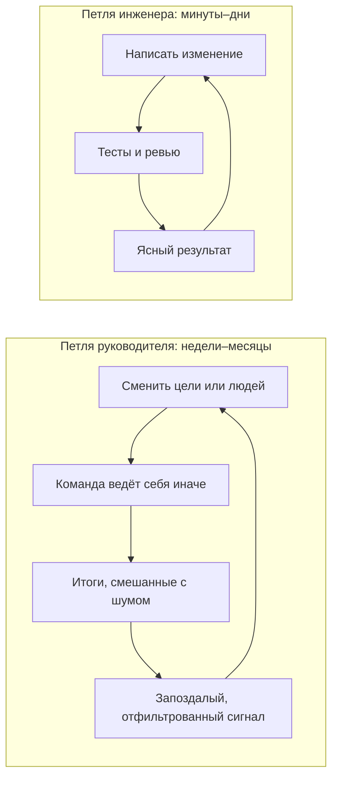
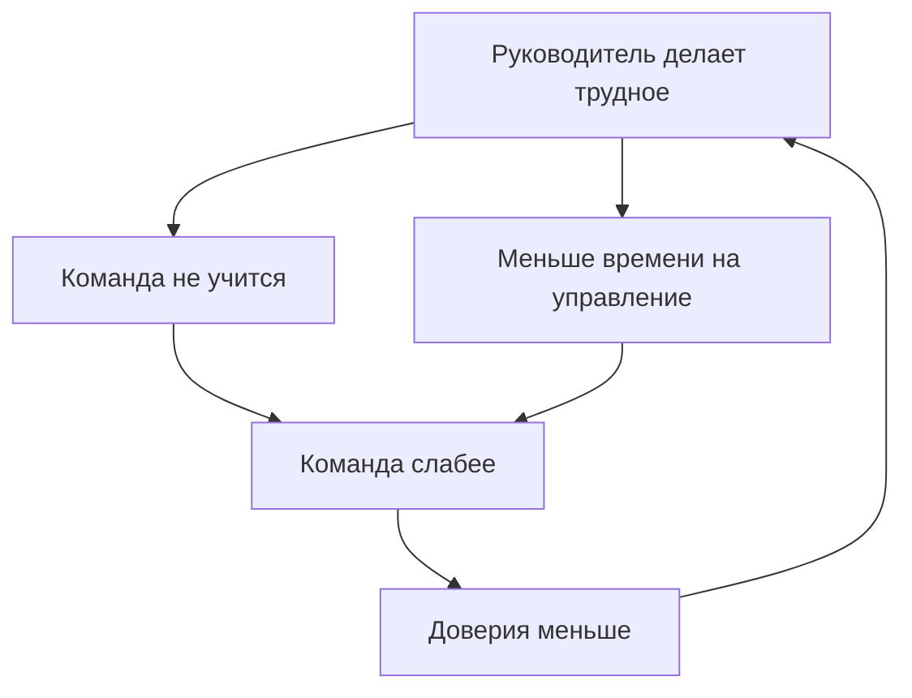

# Глава 2 — От индивидуального исполнителя к руководителю { #chapter-2-from-individual-contributor-to-leader }

Эта глава — о первой управленческой роли: что меняется, когда сильный инженер начинает отвечать за
команду, почему перемена труднее, чем кажется, и как пройти первый год, не став узким местом команды.
Речь пойдёт о сдвиге в идентичности и обратной связи, о делегировании по результату с явным уровнем
контроля, о первых 90 днях и о решении, сколько практической технической работы оставить себе. Глава 1
определяет работу руководителя; эта глава — о том, как в неё перейти. Сквозной пример — Priya Raman,
руководитель команды Orders в Northstar Technologies, вымышленной компании из
[кейса](../../case-studies/northstar/index.md).

## Почему это важно { #why-this-matters }

На уровне команды от перехода зависит, получит ли команда руководителя или потеряет лучшего инженера и
получит вместо него очень занятого человека. Новый руководитель, который оставляет за собой самую важную
техническую работу, месяцами выглядит эффективным, потому что результат не падает. Останавливается рост
команды: решения выстраиваются в очередь к одному человеку, никто больше не осваивает трудные части, и
проблемы всплывают позже — в виде инцидентов или увольнений.

На уровне организации линейные руководители — это слой, через который большинство инженеров
воспринимают компанию, поэтому слабый переход чувствует каждый инженер в команде. Глава 1 приводит
данные о том, что руководители важны; они хорошо исправляют убеждение инженеров, будто управление — это
накладные расходы.

На уровне высшего руководства вопрос в том, как организация выбирает и готовит руководителей. У риска
есть имя — **принцип Питера**: людей повышают за хорошую работу на текущей должности, пока они не
окажутся на должности, с которой справляются плохо. Экономическое исследование продавцов в 131 компании,
названное в честь этого принципа, показало, что при повышении компании придают большой вес результатам
на текущей работе. Успех в роли руководителя лучше предсказывали другие характеристики, а повышение людей
с меньшим управленческим потенциалом обходилось дорого
([Benson, Li, and Shue, 2019](../../references/bibliography.md#benson2019promotions)). Продажи — не
разработка, но картина знакома: самого сильного инженера повышают, никак не готовят и оценивают по тому,
делается ли работа по-прежнему.

## Цели главы { #learning-objectives }

После этой главы вы сможете:

- Назвать изменения в идентичности и в петле обратной связи, которые приносит первая управленческая
  роль, и распознать их в себе или в руководителе, которого вы поддерживаете.
- Спланировать первые 90 дней в новой управленческой роли: что изучить, что изменить и что оставить
  как есть.
- Делегировать по результату с явным уровнем контроля и выбирать этот уровень исходя из компетентности
  человека и цены ошибки.
- Осознанно решить, сколько практической технической работы оставить себе, и оценить, во что она
  обходится команде.
- Рано замечать типичные провалы первого года — по фактам, а не по ощущению занятости.

## Ментальная модель { #the-mental-model }

> **Ментальная модель:** работа инженера даёт быструю и ясную обратную связь; работа руководителя даёт
> медленную и зашумлённую обратную связь через других людей. Переход удаётся, когда вы перестаёте рулить
> по быстрой петле.

Инженером вы меняете код, и через несколько минут тест проходит или падает. Через несколько дней
изменение уходит в продакшен. Петля короткая, сигнал ясный, и заслуга ваша. Руководителем вы меняете то,
как работает человек, над чем работает команда или как принимаются решения. Результат появляется через
недели или месяцы, смешанный со всем остальным, что произошло, и в основном в результатах других людей.

Опасность в том, что петля инженера по-прежнему доступна и по-прежнему приносит удовлетворение. Когда
петля руководителя затихает, новый руководитель тянется к клавиатуре. Каждый такой выбор можно
оправдать; вместе они удерживают нового руководителя на старой работе.

Вторая идея вытекает из первой: результат руководителя — это результат команды, а не его собственный
(глава 1 определяет результат руководителя вслед за Andrew Grove, глава 3 разбирает рычаг).
Делегирование превращает суждение одного человека в способность команды.

## Подробный разбор { #deep-conceptual-explanation }

### Смена идентичности, а не повышение { #an-identity-change-not-a-promotion }

Исследование Linda Hill прослеживало первый год девятнадцати новых руководителей. Издатель описывает
переход как глубокую психологическую перестройку, которой учатся в основном на опыте; главные трудности
в ней — найти баланс между делегированием и контролем и переосмыслить само понимание роли. Издатель
также отмечает, что многие этот переход так и не завершают
([Hill, 2019](../../references/bibliography.md#hill2019becoming)). Это небольшое качественное
исследование вне разработки ПО, но его вывод совпадает с опытом практиков: труднее всего отпустить
прежний источник компетентности и статуса.

Вот почему лучший инженер не становится автоматически лучшим руководителем. Даже повышенный инженер,
из которого выйдет хороший руководитель, приходит с привычками лучшего инженера: самому решать трудную
задачу, ревьюить всё важное, быть тем, к кому идут с вопросами. В новой роли те же привычки
сосредоточивают работу и решения на одном человеке. Инженер, который когда-то разблокировал команду,
исправив трудный баг, теперь блокирует её, потому что только он это и умеет.

Исследование Herminia Ibarra о профессионалах, переходящих на более высокие роли, предлагает механизм.
Люди не принимают новую профессиональную идентичность за один шаг: они наблюдают за образцами для
подражания, примеряют пробные версии нового себя и оставляют или отбрасывают их в зависимости от
собственных стандартов и получаемой обратной связи
([Ibarra, 1999](../../references/bibliography.md#ibarra1999provisional)). Для нового руководителя
разработки из этого следуют две практические вещи (**рекомендация книги**, развивающая этот вывод).
Во-первых, будьте готовы экспериментировать: месяц проводите встречи один на один (1:1) одним способом,
затем корректируйте. Во-вторых, выбирайте образцы для подражания осознанно. Новый руководитель, у
которого единственный образец — его прежний руководитель, копирует привычки этого человека, включая
плохие.

### Обратная связь медленнее и шумнее { #feedback-that-is-slower-and-noisier }

Большую часть трудностей создают три свойства петли обратной связи руководителя:

| Свойство | Инженер | Руководитель |
|---|---|---|
| Задержка | От минут до дней | От недель до кварталов |
| Атрибуция | В основном собственная работа | Делится с командой, продуктом, удачей |
| Фильтрация | Прямая (тест падает) | Опосредованная: люди говорят руководителю то, что безопасно сказать |

Задержка означает, что новый руководитель может квартал делать не то, прежде чем увидит цену.
Атрибуция означает, что сильная команда какое-то время может вытягивать слабого руководителя, а
невезение может скрыть хорошее управление. Фильтрация означает, что самые важные сигналы — например, что
senior-инженер подумывает уйти, — реже всего доходят до руководителя сами. Средство — построить
опережающие индикаторы, которые руководитель может наблюдать напрямую: сколько решений на этой неделе
ждало руководителя, приносят ли встречи 1:1 новости или только статус, какую работу может делать только
один человек. Глава 5 разбирает встречи 1:1 как информационный канал; глава 4 — измерение эффективности
руководителя.

### Руководить бывшими коллегами { #managing-former-peers }

Большинство линейных руководителей повышают внутри собственной команды, поэтому самая трудная часть
перемены — отношения: вчерашние коллеги теперь подчиняются вам. Скажите прямо, что изменилось, а что
нет (**рекомендация книги**). Теперь вы распределяете задачи, даёте обратную связь по результатам и
участвуете в решениях о зарплате и повышениях; при этом вы тот же человек, и техническое суждение
команды значит столько же, сколько ваше.

Три ситуации требуют продуманного подхода:

- **Друзья в команде.** Сохраните дружбу, но откажитесь от приватного канала: никаких разговоров о
  результатах или зарплате других членов команды вне работы. Скажите об этом другу сами и пораньше —
  до того, как это вынудит неловкий момент.
- **Кандидат, которого обошли.** Проведите встречу 1:1 в первую же неделю. Признайте, что он хотел эту
  роль, спросите, чего он хочет теперь, и предложите что-то настоящее, если оно у вас есть (область
  ответственности, спонсора, разговор о карьерном треке), а не утешение.
- **Старые союзы и споры.** Решения, против которых вы спорили инженером, теперь вам либо отстаивать,
  либо открыто пересматривать. Не решайте старые технические споры новыми полномочиями.

Чего не обещать: что ничего не изменится, что вы всегда будете на стороне команды против руководства,
или повышения и прибавки, которые от вас не зависят. Каждое из этих обещаний нарушается за несколько
месяцев, и нарушенное обещание обходится дороже, чем обошёлся бы честный ответ.

### Делегирование по результату, с явным уровнем контроля { #delegating-by-outcome-with-an-explicit-level-of-control }

Делегируя задачу («реализуй этот эндпоинт»), руководитель остаётся проектировщиком и интегратором.
Делегируя результат («загрузка до 5 000 строк либо проходит, либо чисто завершается с ошибкой, к
мартовскому релизу»), он передаёт и проектирование — так и растёт суждение команды. Это ломается, когда
уровень контроля не назван: исполнитель думает, что решение за ним, руководитель думает, что с ним
советуются, и первое разногласие воспринимается как предательство. Рассказ David Marquet о командовании
подводной лодкой известен тем, что решения переходят к людям, у которых есть информация. Они сообщают,
что намерены сделать, а не просят разрешения, поэтому контроль переходит постепенно, а у лидера
остаётся возможность вмешаться ([Marquet, 2012](../../references/bibliography.md#marquet2013turn)).
Шкала ниже — **рекомендация книги** в этом духе, а не валидированный инструмент.

| Уровень | Кто решает | Исполнитель говорит | Когда использовать |
|---|---|---|---|
| 1. Указание | Руководитель | «Вот что я выяснил» | Человек новичок в области; ошибка дорогая и трудно обратимая |
| 2. Рекомендация | Руководитель, из вариантов исполнителя | «Рекомендую X, потому что» | Компетентность нарабатывается; риск должен нести руководитель |
| 3. Намерение | Исполнитель, предупредив руководителя | «Собираюсь сделать X в четверг» | Компетентный человек; ошибка дорогая, но заметна вовремя |
| 4. Действие и информирование | Исполнитель | «Я сделал X; вот почему» | Компетентность доказана; ошибка обратима |
| 5. Владение | Исполнитель; руководитель узнаёт только об исключениях | Сообщает о результатах на регулярном обзоре | Область принадлежит ему |

Исследования делегирования объясняют, почему руководители застревают на уровнях 1 и 2. В исследовании
на основе опросов и интервью Yukl и Fu обнаружили, что руководители больше делегировали подчинённым,
которые были компетентны, разделяли цели руководителя и дольше с ним работали. Руководители ценили
делегирование за то, что оно развивает людей, но многие не хотели отдавать контроль над важными
решениями или поручать важные задачи неопытным подчинённым
([Yukl and Fu, 1999](../../references/bibliography.md#yukl1999determinants)). Ловушка в том, что важную
работу никогда не делегируют, и поэтому никто не получает опыта, который оправдал бы её делегирование.
Делегируйте её на уровне 2 или 3, вместо того чтобы держать при себе.

Шкала работает при двух правилах (**рекомендация книги**). Называйте уровень вслух, вместе с
результатом и сроком: «Это уровень 3; скажи мне, прежде чем менять схему». И меняйте уровень по
договорённости: вверх — после подтверждения, и никогда — молча вниз.

### Сколько практической работы оставить { #how-much-hands-on-work-to-keep }

Правильного процента нет, но есть правильный вопрос: делает ли эта техническая работа команду
способнее или делает её зависимой от меня? Список эффективных форм поведения руководителя у Google
включает и умение давать команде полномочия без микроменеджмента, и ключевые технические навыки
([Google re:Work](../../references/bibliography.md#rework-great-managers)). Друг другу они
противоречат, только когда технический навык применяется к критической работе команды.

Виды практической работы, от самого дешёвого для команды к самому дорогому:

| Работа | Что даёт руководителю | Цена для команды |
|---|---|---|
| Читать дизайны и код, задавать вопросы | Способность судить | Низкая |
| Мелкие исправления, инструменты, прототипы вне критического пути | Контакт с кодом и болью | Низкая, если ничто их не ждёт |
| Участвовать в дежурствах или реагировании на инциденты как участник | Понимание операционной реальности | От низкой до умеренной |
| Быть обязательным ревьюером области | Информированность | Высокая: каждое изменение ждёт самого занятого человека |
| Владеть работой с жёстким сроком | Ощущение продуктивности | Самая высокая: критический путь останавливается на каждой встрече |

Практическая книга Camille Fournier известна именно этим балансом: оставайтесь достаточно близко к
технологии, чтобы судить и коучить, и держитесь вне критического пути
([Fournier, 2017](../../references/bibliography.md#fournier2017manager)). Работа, которую ждут
другие, задерживается с каждой эскалацией в календаре, которым управляют прерывания.

### Первые 90 дней { #the-first-90-days }

Книга Michael Watkins о смене руководителей известна тезисом, что новому лидеру нужно ускорить
обучение, явно согласовать ожидания со своим руководителем и добиться нескольких ранних побед
([Watkins, 2003](../../references/bibliography.md#watkins2003first)). Для руководителя, повышенного
внутри команды, труднее всего узнать новое об отношениях, а самые ценные ранние победы — заметные
изменения в том, как работает команда: например, решения принимаются быстрее или у давней повторяющейся
проблемы наконец появился владелец. Практический плейбук превращает это в план.

### Работа с собственным руководителем { #managing-up-as-a-new-manager }

Ваш собственный руководитель — часть вашей системы, и новый руководитель, который ждёт, пока им начнут
управлять, получает сюрпризы. Управлять вверх — значит облегчать своему руководителю задачу поддерживать
вас и представлять вашу команду (**рекомендация книги**):

- **Договоритесь, как выглядит успех**, письменно, в первые две недели: критерии дня 90, бюджет времени
  и какие решения принимаете только вы. Возвращайтесь к этому раз в месяц.
- **Отчитывайтесь, не дожидаясь вопроса**, коротко и по расписанию: что изменилось, что под угрозой, что
  вам нужно. Еженедельная записка в пять строк лучше ежемесячной встречи, полной сюрпризов.
- **Приносите плохие новости рано и с предложением.** «Функция для продления отстаёт на две недели;
  хочу снять Aisha с поддержки на три недели; вот цена» — на такое получают решение. Та же новость за
  неделю до срока получает эскалацию.
- **Просите то решение, которое вам нужно.** Назовите варианты и свою рекомендацию и скажите, к какому
  сроку.
- **Узнайте, по чему оценивают вашего руководителя.** Его давление объясняет его вопросы; ваши отчёты
  должны отвечать на них до того, как их зададут.

Есть две распространённые ловушки. Если защищать команду, скрывая проблемы от своего руководителя, это
рушится в тот момент, когда проблема всплывает где-то ещё. Если эскалировать наверх каждое разногласие,
руководитель понимает, что вы не справляетесь с ролью. Спорьте наедине и с фактами, а затем выполняйте
решение или прямо скажите, что не можете.

### Ваша нагрузка и устойчивость { #your-own-load-and-sustainability }

У недели нового руководителя нет естественного конца. Инженерная работа заканчивается; работа с людьми,
поставка и эскалации — нет. Руководитель, который закрывает нехватку времени работой по вечерам, задаёт
стандарт, который команда копирует, и тратит энергию, нужную для медленного и тщательного суждения.

Помогают три привычки (**рекомендация книги**). Оставляйте запас в недельном бюджете, как в примере из
инженерной организации, потому что его заполнят эскалации. Заранее решите, какие сообщения требуют вас
вне рабочего времени (обычно только инциденты той серьёзности, при которой вы на пути эскалации), и
скажите об этом команде. И найдите поддержку вне линии подчинения: коллегу-руководителя, ментора или
группу руководителей, где можно признаться, что не получается.

Следите за ранними признаками в себе, которые глава 10 описывает для инженеров: затяжное истощение,
растущий цинизм по отношению к команде или компании и ощущение, что ничего из сделанного вами ни на что
не влияет. Это причины изменить нагрузку, а не стараться сильнее.

## Пример из инженерной организации { #engineering-organization-example }

!!! info "Northstar: что уже известно"
    Недели 1 и 2 первого года директора в Northstar, вымышленной компании книги. Мандат CTO — за
    двенадцать месяцев вдвое сократить число серьёзных инцидентов без роста численности, при этом две
    функции для продлений должны выйти в срок. Одна из них, массовый заказ, принадлежит команде Orders
    под руководством Priya Raman. См. [хронологию](../../case-studies/northstar/timeline.md). Впервые в
    Northstar? Прочитайте [«Год вкратце»](../../case-studies/northstar/year-in-brief.md) и
    [«Действующие лица»](../../case-studies/northstar/cast.md).

Цифры ниже — **иллюстрация**. Они описывают календарь Priya Raman (руководитель Orders) за две недели
до прихода нового директора, через восемь месяцев после её повышения, и бюджет, который она согласовала
с директором на неделе 2.

Допущения: рабочая неделя 40 часов; в Orders 14 инженеров. Большая часть кода Orders живёт в
[Core](../../glossary.md#core), общем Java-монолите Northstar, и Priya ревьюила около 15 из примерно 25
мерж-реквестов (предлагаемых изменений кода) в Core, которые Orders создавала каждую неделю.

| Занятие, часов в неделю | До (по её календарю и истории ревью) | Согласованный бюджет |
|---|---|---|
| Написание кода и код-ревью | 18 | 8 |
| Продукт, [релизный поезд](../../glossary.md#release-train) (плановый релиз Core), работа с другими командами | 5 | 5 |
| Инциденты и эскалации | 6 | 5 |
| Планирование и ритуалы команды | 3 | 3 |
| Встречи 1:1 | 2 (формально еженедельно; проходила примерно одна из трёх) | 4 (30 минут раз в две недели со всеми 14 — это 3.5 часа в неделю, плюс подготовка) |
| Найм | 2 | 2 |
| Обратная связь и разговоры о карьере | 2 | 2 |
| Коучинг по делегированной работе | 0 | 4 |
| Почта и администрирование | 2 | 2 |
| Не распределено | 0 | 5 |
| **Итого** | **40** | **40** |

Из таблицы следуют три вещи.

Первое: доля практической работы составляла 45 процентов (18 из 40 часов), и цена была не только во
времени Priya. Поскольку 15 из 25 мерж-реквестов ждали её, 60 процентов изменений команды в Core
зависели от самого занятого человека в команде, который ревьюил пачками по вечерам. Если пакетная
обработка добавляла к каждому такому ревью полрабочего дня, это около 7,5 инженеро-дня ожидания в
неделю. Ожидание — не потерянная работа, потому что инженеры переключаются на другие задачи, но каждое
переключение добавляет незавершённой работы и укрупняет пачки.

Второе: восьми часов в неделю достаточно, чтобы читать дизайны, иногда программировать в паре и брать
мелкие исправления вне критического пути. Их недостаточно, чтобы владеть функцией с обязательством по
сроку, — и это сделано намеренно.

Третье: в бюджете 5 нераспределённых часов. Неделя нового руководителя заполняется эскалациями; бюджет
без запаса ломается ко вторнику, и теряются обычно часы встреч 1:1.

## Как принимать решение { #decision-framework }

В первый год повторяются два решения: на каком уровне контроля делегировать и браться ли самому за
какую-то техническую работу. Для первого используйте два вопроса: насколько компетентен этот человек
в этой области (а не вообще) и насколько дорогой и обратимой будет ошибка? Высокая компетентность и
обратимая ошибка — уровень 4 или 5. Низкая компетентность и необратимая ошибка — уровень 2, но никогда
не полный отказ отдавать работу. Уровень задаётся по областям, поэтому один и тот же инженер может быть
на уровне 5 в сервисе ценообразования и на уровне 2 в миграции схемы.

Для второго решения:

«Может сделать кто-то ещё» включает вариант «с коучингом и медленнее». Ветка, где работу может сделать
только руководитель, — это находка: единая точка отказа по знаниям, которую нужно устранить, так что
работайте в паре с тем, кто будет владельцем в следующий раз.

| Сигнал | Вероятное значение | Ответ |
|---|---|---|
| Вы обязательный ревьюер области | Знания сосредоточены у вас | Назовите двух владельцев; месяц проверяйте их ревью |
| Решения ждут вас больше дня | Уровень контроля слишком низкий или неясный | Явно поднимите уровень в одной области |
| Вы делаете трудную часть, «потому что так быстрее» | Скорость сейчас куплена ценой возможностей потом | Делегируйте на уровне 2 или 3 с контрольной точкой |
| Встречи 1:1 вы отменяете первыми | Побеждает быстрая петля | Защитите их в бюджете; считайте, сколько состоялось |

## Компромиссы { #trade-offs }

**Скорость сейчас против возможностей потом.** Новый руководитель часто быстрее всех решает проблему.
Но когда он её решает, команда теряет обучение. При аварии в продакшене выбирайте скорость и
проводите разбор после; для функции с обязательством по сроку и неделями в запасе — делегируйте.

**Авторитет против фокуса.** Руководителя, потерявшего контакт с системой, легко ввести в заблуждение
в обсуждениях дизайна. Выбирайте техническую работу по тому, чему она вас учит (чтение, мелкие
исправления, дежурства), а не по удовольствию от выпуска.

**Раннее делегирование против защиты обязательства.** Если отдать самую трудную часть функции с жёстким
сроком менее опытному инженеру, растёт риск по срокам. Если оставить её себе, появляется другой риск:
функция зависит от человека, чьим календарём управляют прерывания. Делегирование на уровне 3 с
еженедельными контрольными точками по дизайну обычно обходится дешевле любой из крайностей, но
руководитель должен сказать, какой риск он берёт и перед кем.

**Друг против руководителя.** Руководитель, повышенный внутри команды, теряет часть откровенности,
которая бывает между коллегами; делать вид, что ничего не изменилось, не работает, но не работает и
внезапная дистанция (см. «Руководить бывшими коллегами»).

## Типичные провалы { #failure-modes }

**Суперинженер.** Новый руководитель оставляет себе самую трудную техническую работу и самые важные
ревью. Результат какое-то время держится, и это скрывает проблему.

Это усиливающая петля: каждый виток делает следующее делегирование более рискованным на вид. Сигнал:
какую-то часть работы команды можете сделать только вы, и этот список не сокращается.
Противодействие: письменный список областей, завязанных на одного человека, и у каждой — названный
второй человек и дата.

**Делегирование как самоустранение.** Руководитель перегибает в другую сторону и отдаёт результаты без
уровня, без контрольных точек и без поддержки, а потом, когда что-то идёт не так, вмешивается поздно и
у всех на виду. Сигнал: сюрпризы к сроку. Противодействие: при передаче называйте уровень и контрольные
точки.

**Тихое возвращение.** Делегированное решение оборачивается плохо, и руководитель молча снова начинает
принимать его сам. Сигнал: инженеры начинают спрашивать разрешения на то, что раньше решали сами.
Противодействие: если понижаете уровень, скажите об этом, объясните почему и скажите, что позволит
снова его поднять.

**Управление через статус-встречи.** Встречи 1:1 превращаются в отчёты о прогрессе, и руководитель
слышит только то, что уже видно в трекере задач. Сигнал: увольнение или конфликт застают вас врасплох.
Как это исправить, разбирает глава 5.

**Обязательства, пережившие роль.** Работа, которой руководитель владел как инженер (последующие
действия, дежурства, план миграции), остаётся за ним и тихо останавливается. Сигнал: открытые задачи с
вашим именем старше вашего повышения. Противодействие: в первые две недели составьте список всего, что
за вами числится, и передайте или закройте каждую позицию (глава 25 разбирает
[последующие действия и повторные инциденты](../05-engineering-quality/25-incidents-postmortems-and-change-failure-analysis.md#follow-up-actions-and-recurrence)).

## Применение в крупной организации { #enterprise-application }

В организации из 50–150 инженеров всегда есть несколько линейных руководителей, которые проходят свой
первый год. В таком масштабе переход перестаёт быть личным делом и становится системой, которой
управляет директор.

**Отбор.** Относитесь к повышению в руководители как к смене работы со своими критериями, а не как к
награде за инженерные результаты. Ищите свидетельства того, что кандидат уже умножал силу других:
менторство, руководство проектом через других людей, умелое разрешение разногласия. Сохраняйте
технический трек с равным статусом, чтобы лучшего инженера не вынуждали идти в менеджмент ради роста
(глава 4).

**Подготовка.** Пробный период в роли техлида или исполняющего обязанности руководителя, с датой
окончания, позволяет обеим сторонам дёшево всё понять.

**Поддержка в первый год.** За переход отвечает руководитель нового руководителя: согласованный бюджет
времени, ежемесячная проверка опережающих индикаторов (ожидающие решения, области, завязанные на одного
человека, состоявшиеся встречи 1:1) и коллега-руководитель вне линии подчинения как образец. Открытые
инженерные обязательства передаются как часть самого повышения. Как директору развивать руководителей,
разбирает глава 41.

## Взгляд CTO { #cto-perspective }

На уровне высшего руководства вопрос — в здоровье управленческого резерва: сколько руководителей
проходят первый год, кто поддерживает каждого и что происходит, если повышение не срабатывает. Без
достойного пути назад в инженерию испытывающий трудности новый руководитель либо остаётся в роли, либо
уходит из компании, и оба исхода дорогие. Сделайте путь назад нормальным и заметным.

CTO также задаёт стимулы, которые порождают руководителей-суперинженеров. Если на встречах руководства
хвалят руководителей за то, что они лично спасли релиз, каждый руководитель первого года усвоит, что
спасать релизы — это и есть работа. Хвалите руководителя, чья команда справилась с инцидентом без него.

Наконец, данные о руководителях и повышениях (глава 1 и исследование Benson выше) получены не на
инженерных командах: их достаточно, чтобы оправдать вложения в отбор руководителей, но не чтобы обещать
совету директоров конкретную отдачу.

## Практический плейбук { #practical-playbook }

Для только что повышенного руководителя разработки, при помощи его собственного руководителя:

**Неделя 1.**

1. Составьте список всего, что числится за вами как за инженером (ревью, дежурства, последующие
   действия, функции), и передайте или закройте каждую позицию с согласия нового владельца.
2. Согласуйте со своим руководителем критерии дня 90 и недельный бюджет времени с потолком на
   практическую работу и запасом.
3. Скажите команде, что изменилось, а что нет, — сначала всем вместе, затем каждому лично.

**Дни 1–30: изучайте.**

4. Проведите первую встречу 1:1 с каждым подчинённым: чего он хочет, что ему мешает, что вам не стоит
   менять.
5. Составьте карту областей, завязанных на одного человека, включая себя.
6. Прочитайте инциденты и [пропущенные дефекты](../../glossary.md#escaped-defect) (escaped defects —
   баги, найденные после релиза) по вашим компонентам за последний квартал; отметьте повторы.
7. Выберите коллегу-руководителя в качестве образца и попросите у него час в месяц.

**Дни 30–60: делегируйте.**

8. Делегируйте два результата с явным уровнем контроля, контрольными точками и сроками.
9. Назовите двух владельцев для каждой области, где обязательным ревьюером были вы.
10. Сделайте одно заметное изменение в том, как работает команда, выбрав его из того, что прозвучало на
    встречах 1:1.

**Дни 60–90: проверяйте.**

11. Посчитайте опережающие индикаторы и сравните свой календарь с бюджетом.
12. Спросите подчинённых, чего вам стоит делать больше, а чего меньше.
13. Отчитайтесь перед своим руководителем по критериям дня 90, включая то, что не сработало.

## Кейс { #case-study }

Этот кейс — **вымысел**. Действие происходит до и в начале первого квартала директора в Northstar;
полная история — в [хронике года 1](../../case-studies/northstar/first-quarter.md).

Priya Raman пришла в Northstar инженером за семь лет до прихода директора и стала человеком, который
лучше всех знал приём заказов. Она написала большую часть пути массовой загрузки заказов. Когда
прежний руководитель Orders ушёл из компании, Priya была очевидным выбором, и она согласилась отчасти
потому, что альтернативой был руководитель со стороны, не знающий предметной области. Никакого обучения
управлению она не получила, а встречи с её собственным руководителем касались в основном сроков
поставки.

В первый же месяц её работы руководителем сбой массовой загрузки дошёл до клиентов. Priya сама
исправила его за выходные и записала последующее действие — тест для загрузок больше 500 строк — на
себя. Сделано оно так и не было. Через два квартала тот же сбой вернулся как INC-421: массовая загрузка
теряла все строки после 500-й. Это был [Sev1](../../glossary.md#severity-sev1-sev2-sev3), самый
серьёзный уровень в Northstar, и первым о нём сообщил клиент. Это был один из трёх
[повторных инцидентов](../../glossary.md#recurrence) (повторений прежнего сбоя) среди семи инцидентов
Sev1 и Sev2 у Orders в квартале перед приходом директора.

Ко времени прихода директора команда доверяла суждениям Priya и ценила, что она понимает их работу. Два
senior-инженера Orders, Rafael Duarte и Aisha Bello, в первых разговорах с директором описали одно и то
же раздражение: решения по приёму заказов ждали Priya, а дизайн и самый трудный код функции массового
заказа, одного из двух обязательств по продлению, она оставила себе. Встречи 1:1 часто отменялись.
Rafael тоже претендовал на роль руководителя и с тех пор ни слова не говорил о собственной карьере.

На неделе 1 первая встреча 1:1 директора с Priya началась со срока продления; в коде Priya была
уверена, а беспокоило её всё остальное. На неделе 2 они вместе прошлись по её календарю и истории
ревью и получили цифры из примера из инженерной организации: 18 часов в неделю на код и ревью, 15 из
примерно 25 еженедельных мерж-реквестов в Core ревьюила она, состоялась примерно треть
запланированных встреч 1:1.

Они согласовали четыре изменения, каждое со своим уровнем контроля:

| Изменение | Владелец | Уровень |
|---|---|---|
| Ведущий разработчик функции массового заказа | Aisha Bello | 3: сообщает Priya перед любым изменением API или схемы; еженедельная контрольная точка по дизайну |
| Владение ревью для core/order-capture | Rafael Duarte и Aisha Bello | 4: Priya месяц проверяет выборку их ревью |
| Открытое действие по тесту массовой загрузки | Rafael Duarte | 4, срок — до следующего релиза Core с изменениями загрузки |
| Бюджет времени Priya | Priya, ежемесячная сверка с директором | Практическая работа ограничена 8 часами в неделю |

Priya возражала против первого изменения. Отдать функцию для продления, срок которой — конец
квартала 2, казалось ей риском для крупнейших клиентов компании. Директор ответил, что большой запас времени
делает этот момент самым дешёвым для передачи. Оставить функцию себе — тоже риск: она зависела от
человека, который тратил 15 процентов недели на инциденты, а изменения этого квартала заполнили бы её
календарь ещё сильнее. За Priya остались полномочия по дизайну, а еженедельная контрольная точка стала
её страховкой.

Кейс оставляет Priya в конце недели 2. Урок: передача дешевле всего, когда запас времени самый
большой, а безопасной её делает только явный уровень контроля. Сработал ли план — вопрос для
упражнений.

## Упражнения { #exercises }

Решения — в [решениях к главе 2](../../solutions/ch02-solutions.md). Данные Northstar — на
[странице исходного уровня](../../case-studies/northstar/baseline-data.md); кто есть кто — на странице
[«Действующие лица»](../../case-studies/northstar/cast.md).

### Базовый уровень { #foundational }

**F1.** Senior-инженера из вашей команды только что повысили: теперь она руководит пятью людьми, с
которыми раньше работала бок о бок. Через шесть недель она говорит вам, что работает больше, чем
когда-либо, команда выпускает всё в срок, а сама она чувствует, что «ничего толком не делает».
Опираясь на модель петли обратной связи, объясните, что происходит, и назовите три наблюдаемых
индикатора, которые она могла бы отслеживать вместо выпущенной работы.

**F2.** Для каждого из случаев выберите уровень контроля по шкале из главы и обоснуйте его
компетентностью и ценой ошибки: инженер, два года проработавший в команде, проектирует новый
внутренний API; тот же инженер пишет миграцию, которая переписывает таблицу правил ценообразования в
продакшене; staff-инженер выбирает тестовый фреймворк для команды; новый сотрудник проводит сортировку
дефектов, о которых сообщили клиенты.

**F3.** Новый руководитель говорит: «Я оставляю 50 процентов времени на практическую работу, потому что
команда уважает меня за это, а исследования Google говорят, что руководителям нужны технические
навыки». Оцените этот аргумент, опираясь на то, что глава говорит о данных и о видах практической
работы.

### Прикладное лидерство { #applied-leadership }

**A1.** Вы — директор, и идёт неделя 2 с Priya Raman. Она соглашается делегировать владение ревью, но
отказывается передать реализацию функции массового заказа, ссылаясь на срок продления в конце
квартала 2. Подготовьте разговор: что вам нужно узнать от неё, что вы готовы принять, а что нет, и что вы
сделаете, если через три недели контрольная точка покажет, что функция отстаёт.

**A2.** Восемь месяцев назад Rafael Duarte претендовал на роль руководителя Orders и проиграл Priya. С
тех пор он не поднимал тему своей карьеры. Priya собирается передать ему владение ревью для
core/order-capture. Посоветуйте Priya, как провести это делегирование с учётом невысказанной истории и
чего ей не стоит обещать.

**A3.** Составьте план на 90 дней для инженера, который вот-вот станет руководителем команды из восьми
человек; команда отвечает за компонент с двумя повторяющимися паттернами инцидентов и квартальным
дедлайном. Включите бюджет времени, первые три делегирования с их уровнями и критерии дня 90, которые
вы согласовали бы с его руководителем.

### Решения на уровне руководства { #executive-decision-making }

**X1.** Вы — CTO. Предположим, четверо из шести руководителей Northstar были повышены внутри своих
команд и никто из них не получил подготовки. Предложите программу для будущих повышений без роста
численности и с небольшим бюджетом, включая достойный путь назад в инженерию. Скажите, что вы будете
измерять, как этот показатель можно подогнать и чего вы не станете обещать CEO.

**X2.** Через два квартала практическая работа Priya снова доросла до 35 процентов, а результаты Orders
хорошие. Один senior-инженер уволился, сославшись на отсутствие роста. Victor Lindqvist (CTO)
спрашивает, сильный ли Priya руководитель. Решите, какие данные вы соберёте, какой вывод последует из
каждого правдоподобного результата и что вы порекомендуете.

## Вопросы для размышления { #reflection-questions }

1. Какую работу вы всё ещё делаете, потому что она приносит удовольствие, а не потому, что команде
   нужно, чтобы её делали вы?
2. Какие решения в вашей команде на прошлой неделе ждали вас и какие из них мог бы принять кто-то
   другой с тем, что он знал?
3. Кто был вашим образцом руководителя, когда вы начинали, и какие его привычки вы скопировали, не
   выбирая этого?
4. Когда вы в последний раз понизили кому-то уровень контроля, не сказав ему?
5. Если бы завтра вас повысили с текущей роли, какие из ваших обязательств тихо остановились бы?

## Главное { #key-takeaways }

- Первая управленческая роль меняет петлю обратной связи: она медленнее, общая и отфильтрованная.
  Стройте наблюдаемые опережающие индикаторы, вместо того чтобы рулить по выпущенному коду.
- Относитесь к переходу как к смене идентичности, которой учатся через эксперимент; выбирайте образцы
  для подражания осознанно.
- Повышение только за инженерные результаты — известный способ выбрать не того руководителя;
  сохраняйте технический трек и готовьте руководителей до повышения или вскоре после него.
- Делегируйте результаты, а не задачи; называйте уровень контроля, контрольные точки и срок; важную
  работу делегируйте на более низком уровне, а не держите при себе.
- Оставляйте себе ту техническую работу, которая позволяет судить; держитесь вне критического пути и
  вне роли обязательного ревьюера.
- При повышении передайте все инженерные обязательства; открытые задачи с вашим именем останавливаются.
- Планируйте неделю с запасом и в первую очередь защищайте встречи 1:1.

## Источники и что почитать { #references-and-further-reading }

- [Hill, 2019](../../references/bibliography.md#hill2019becoming). *Becoming a Manager*. Год с
  девятнадцатью новыми руководителями; классическое исследование перехода, цитируется здесь по резюме
  издателя.
- [Ibarra, 1999](../../references/bibliography.md#ibarra1999provisional). Как профессионалы
  адаптируются к старшим ролям, примеряя пробные идентичности; механизм, стоящий за советом
  «экспериментируйте, затем выбирайте».
- [Benson, Li, and Shue, 2019](../../references/bibliography.md#benson2019promotions). Экономические
  данные о том, что компании повышают за текущие результаты и платят за это; к аргументу об отборе.
- [Yukl and Fu, 1999](../../references/bibliography.md#yukl1999determinants). Что предсказывает
  делегирование и почему руководители держатся за важные решения.
- [Google re:Work](../../references/bibliography.md#rework-great-managers) и
  [Garvin, 2013](../../references/bibliography.md#garvin2013google). Project Oxygen: данные одной
  компании о том, что руководители важны, и её список эффективных форм поведения руководителя.
- [Marquet, 2012](../../references/bibliography.md#marquet2013turn). *Turn the Ship Around!* Передача
  контроля людям, у которых есть информация, через язык намерений.
- [Watkins, 2003](../../references/bibliography.md#watkins2003first). *The First 90 Days*. Как
  планировать смену руководителя; написана для топ-менеджеров, применима и к линейным руководителям.
- [Fournier, 2017](../../references/bibliography.md#fournier2017manager). *The Manager's Path*.
  Карьера в управлении разработкой от техлида и выше, включая вопрос, насколько техническим оставаться.
- [Zhuo, 2019](../../references/bibliography.md#zhuo2019making). *The Making of a Manager*. Рассказ
  практика о первых годах в управлении; полезен в паре с исследованием Hill.
