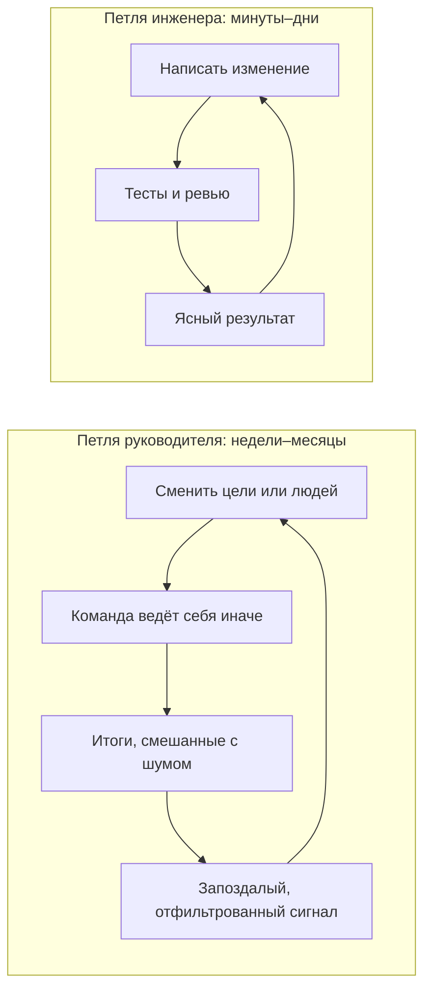
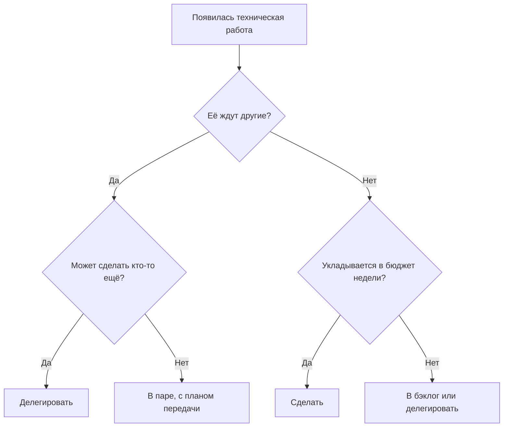
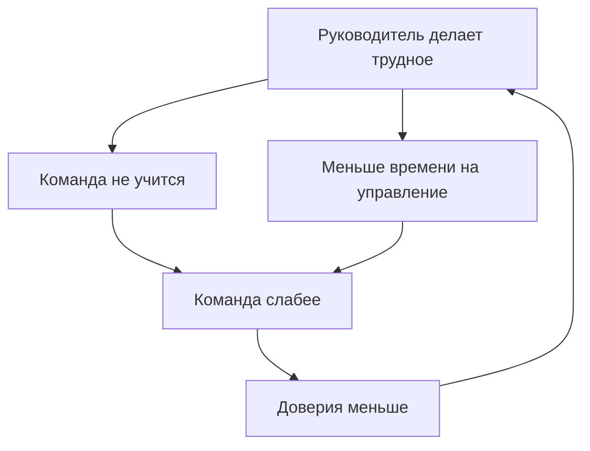

# Глава 2 — От индивидуального исполнителя к руководителю { #chapter-2-from-individual-contributor-to-leader }

Эта глава — о первой управленческой роли: что меняется, когда сильный инженер начинает отвечать за
команду, почему перемена труднее, чем кажется, и как прожить первый год, не превратившись в узкое место.
Речь пойдёт о том, как меняются идентичность и обратная связь, о делегировании результата с явным
уровнем контроля, о первых 90 днях и о том, сколько практической технической работы оставить себе.
Глава 1 описывает, в чём состоит работа руководителя, а эта — как в неё войти. Сквозной пример — Priya
Raman, руководитель команды Orders в Northstar Technologies, вымышленной компании из
[кейса](../../case-studies/northstar/index.md).

## Почему это важно { #why-this-matters }

Для команды от этого перехода зависит, получит ли она руководителя или потеряет лучшего инженера, а
взамен получит очень занятого человека. Новый руководитель, который оставляет за собой самую важную
техническую работу, месяцами выглядит эффективным: результат ведь не падает. Но команда перестаёт расти.
Решения выстраиваются в очередь к одному человеку, никто больше не осваивает трудные части системы, и
проблемы всплывают позже — инцидентами или увольнениями.

Для организации линейные руководители — это слой, через который большинство инженеров видят компанию,
поэтому неудачный переход ощущает каждый инженер в команде. Глава 1 приводит данные о том, что
руководители важны. Эти данные хорошо переубеждают инженеров, которые считают управление накладными
расходами.

Для высшего руководства вопрос в том, как организация выбирает и готовит руководителей. У этого риска
есть имя — **принцип Питера**: людей повышают за хорошую работу на текущей должности, пока они не
окажутся на должности, с которой справляются плохо. Экономическое исследование, названное в честь этого
принципа, изучило продавцов в 131 компании. При повышении компании придавали большой вес результатам
человека на текущей работе. Успех в роли руководителя лучше предсказывали другие характеристики, а
повышение людей с меньшим управленческим потенциалом обходилось дорого
([Benson, Li, and Shue, 2019](../../references/bibliography.md#benson2019promotions)). Продажи — не
разработка, но картина знакома: самого сильного инженера повышают, никак не готовят, а потом оценивают
по тому, продолжает ли делаться работа.

## Цели главы { #learning-objectives }

После этой главы вы сможете:

- Назвать, как первая управленческая роль меняет идентичность и петлю обратной связи, и распознать эти
  перемены в себе или в руководителе, которого вы поддерживаете.
- Спланировать первые 90 дней в новой управленческой роли: что изучить, что изменить и что оставить
  как есть.
- Делегировать результаты с явным уровнем контроля и выбирать этот уровень по компетентности человека
  и цене ошибки.
- Осознанно решить, сколько практической технической работы оставить себе, и оценить, во что она
  обходится команде.
- Рано замечать типичные провалы первого года — по фактам, а не по ощущению занятости.

## Ментальная модель { #the-mental-model }

> **Ментальная модель:** работа инженера даёт быструю и ясную обратную связь; работа руководителя даёт
> медленную и зашумлённую обратную связь через других людей. Переход удаётся, когда вы перестаёте
> ориентироваться на быструю петлю.

Пока вы инженер, вы меняете код, и через несколько минут тест проходит или падает. Через несколько дней
изменение уходит в продакшен. Петля короткая, сигнал ясный, и заслуга ваша. Руководитель меняет другое:
как работает человек, над чем работает команда, как принимаются решения. Результат появляется через
недели или месяцы, смешивается со всем остальным, что произошло, и виден в основном в работе других
людей.

Опасность в том, что петля инженера никуда не делась и по-прежнему приносит удовлетворение. Стоит петле
руководителя затихнуть, и новый руководитель тянется к клавиатуре. Каждый такой шаг можно оправдать, но
вместе они удерживают его на прежней работе.

Вторая идея вытекает из первой: результат руководителя — это результат команды, а не его собственный
(глава 1 определяет результат руководителя вслед за Andrew Grove, глава 3 разбирает рычаг).
Делегирование превращает суждение одного человека в способность всей команды.

## Подробный разбор { #deep-conceptual-explanation }

### Смена идентичности, а не повышение { #an-identity-change-not-a-promotion }

Linda Hill проследила первый год девятнадцати новых руководителей. По описанию издателя, переход — это
глубокая психологическая перестройка, которой учатся в основном на опыте. Главные трудности в ней —
найти баланс между делегированием и контролем и заново понять, в чём состоит роль. Издатель также
отмечает, что многие так и не завершают этот переход
([Hill, 2019](../../references/bibliography.md#hill2019becoming)). Это небольшое качественное
исследование вне разработки ПО, но его вывод совпадает с опытом практиков: труднее всего отпустить
прежний источник компетентности и статуса.

Поэтому лучший инженер не становится лучшим руководителем автоматически. Даже тот, из кого выйдет
хороший руководитель, приходит в роль с привычками лучшего инженера: самому браться за трудную задачу,
ревьюить всё важное, быть тем, к кому идут с вопросами. В новой роли эти привычки замыкают работу и
решения на одном человеке. Раньше он разблокировал команду, исправив трудный баг. Теперь он её
блокирует, потому что больше никто так не умеет.

Механизм этой перестройки описывает Herminia Ibarra, изучавшая профессионалов, которые переходят на
более старшие роли. Новую профессиональную идентичность не принимают за один шаг. Человек наблюдает за
образцами для подражания, примеряет пробные версии себя нового и оставляет или отбрасывает их, сверяясь
с собственными стандартами и с обратной связью
([Ibarra, 1999](../../references/bibliography.md#ibarra1999provisional)). Для нового руководителя
разработки отсюда следуют два практических вывода (**рекомендация книги**, развивающая этот результат).
Во-первых, будьте готовы экспериментировать: месяц проводите встречи один на один (1:1) одним способом,
потом скорректируйте подход. Во-вторых, выбирайте образцы для подражания осознанно. Если единственный
образец — прежний руководитель, новичок копирует его привычки, в том числе плохие.

### Обратная связь медленнее и шумнее { #feedback-that-is-slower-and-noisier }

Большинство трудностей происходит из трёх свойств петли обратной связи руководителя:

| Свойство | Инженер | Руководитель |
|---|---|---|
| Задержка | От минут до дней | От недель до кварталов |
| Атрибуция | В основном собственная работа | Делится с командой, продуктом и удачей |
| Фильтрация | Прямая (тест падает) | Опосредованная: люди говорят руководителю то, что безопасно сказать |

Из-за задержки новый руководитель может целый квартал делать не то и лишь потом увидеть цену. Из-за
размытой атрибуции сильная команда может какое-то время вытягивать слабого руководителя, а невезение —
скрывать хорошее управление. Из-за фильтрации самые важные сигналы реже всего доходят до руководителя
сами: например, что senior-инженер подумывает уйти. Выход — завести опережающие индикаторы, которые
руководитель видит напрямую: сколько решений на этой неделе ждали его, приносят ли встречи 1:1 новости
или только статус, какую работу может делать только один человек. Встречи 1:1 как канал информации
разбирает глава 5, а измерение эффективности руководителя — глава 4.

### Руководить бывшими коллегами { #managing-former-peers }

Большинство линейных руководителей получают повышение внутри своей же команды, поэтому труднее всего в
этой перемене отношения: вчерашние коллеги теперь подчиняются вам. Скажите прямо, что изменилось, а что
нет (**рекомендация книги**). Изменилось вот что: вы распределяете задачи, даёте обратную связь по
результатам и участвуете в решениях о зарплате и повышениях. Не изменилось другое: вы тот же человек, и
техническое суждение команды весит столько же, сколько ваше.

Особого внимания требуют три ситуации:

- **Друзья в команде.** Сохраните дружбу, но откажитесь от приватного канала: никаких разговоров о
  результатах или зарплате других членов команды вне работы. Скажите об этом другу сами и заранее, не
  дожидаясь неловкой ситуации.
- **Кандидат, которого обошли.** Проведите встречу 1:1 в первую же неделю. Признайте, что он хотел эту
  роль, спросите, чего он хочет теперь, и предложите что-то реальное, если оно у вас есть (область
  ответственности, спонсора, разговор о карьерном треке), а не утешения.
- **Старые союзы и споры.** Решения, против которых вы выступали инженером, теперь придётся либо
  отстаивать, либо открыто пересматривать. Не закрывайте старые технические споры с помощью новых
  полномочий.

Чего не стоит обещать: что ничего не изменится; что вы всегда будете на стороне команды против
руководства; повышений и прибавок, которые от вас не зависят. Каждое такое обещание нарушается за
несколько месяцев, а нарушенное обещание обходится дороже честного ответа.

### Делегирование результата с явным уровнем контроля { #delegating-by-outcome-with-an-explicit-level-of-control }

Делегируя задачу («реализуй этот эндпоинт»), руководитель остаётся проектировщиком и интегратором.
Делегируя результат («загрузка до 5 000 строк либо проходит, либо чисто завершается с ошибкой, к
мартовскому релизу»), он передаёт и проектирование, а именно так растёт суждение команды. Схема
ломается, если уровень контроля не назван: исполнитель считает, что решает он, руководитель — что с ним
посоветуются, и первое же разногласие выглядит как предательство. Рассказ David Marquet о командовании
подводной лодкой известен принципом: решения переходят к тем, у кого есть информация. Эти люди не
просят разрешения, а сообщают, что намерены сделать. Так контроль переходит постепенно, а у лидера
остаётся возможность вмешаться ([Marquet, 2012](../../references/bibliography.md#marquet2013turn)).
Шкала ниже — **рекомендация книги** в том же духе, а не валидированный инструмент.

| Уровень | Кто решает | Исполнитель говорит | Когда использовать |
|---|---|---|---|
| 1. Указание | Руководитель | «Вот что я выяснил» | Человек новичок в области; ошибка дорога и трудно обратима |
| 2. Рекомендация | Руководитель, из вариантов исполнителя | «Рекомендую X, потому что» | Компетентность нарабатывается; риск должен нести руководитель |
| 3. Намерение | Исполнитель, предупредив руководителя | «Собираюсь сделать X в четверг» | Человек компетентен; ошибка дорога, но её заметят вовремя |
| 4. Действие и информирование | Исполнитель | «Я сделал X; вот почему» | Компетентность доказана; ошибка обратима |
| 5. Владение | Исполнитель; руководитель узнаёт только об исключениях | Сообщает о результатах на регулярном обзоре | Область — его |

Почему руководители застревают на уровнях 1 и 2, объясняют исследования делегирования. В работе на
основе опросов и интервью Yukl и Fu выяснили, что руководители больше делегировали подчинённым, которые
были компетентны, разделяли их цели и дольше с ними работали. Руководители ценили делегирование за то,
что оно развивает людей, но многие не хотели отдавать контроль над важными решениями или поручать
важные задачи неопытным подчинённым
([Yukl and Fu, 1999](../../references/bibliography.md#yukl1999determinants)). Получается ловушка:
важную работу не делегируют никогда, поэтому никто и не набирает опыта, который оправдал бы её
передачу. Делегируйте такую работу на уровне 2 или 3, а не держите при себе.

Шкала работает, если соблюдать два правила (**рекомендация книги**). Первое: называйте уровень вслух,
вместе с результатом и сроком: «Это уровень 3; скажи мне, прежде чем менять схему». Второе: меняйте
уровень только по договорённости — повышайте его, когда компетентность подтвердилась, и никогда не
понижайте молча.

### Сколько практической работы оставить { #how-much-hands-on-work-to-keep }

Правильного процента нет, но есть правильный вопрос: растит ли эта техническая работа возможности
команды или делает команду зависимой от меня? В списке эффективных форм поведения руководителя,
составленном в Google, есть и умение давать команде полномочия без микроменеджмента, и ключевые
технические навыки ([Google re:Work](../../references/bibliography.md#rework-great-managers)). Эти пункты
противоречат друг другу, только когда руководитель применяет технический навык к критической работе
команды.

Виды практической работы — от самых дешёвых для команды к самым дорогим:

| Работа | Что даёт руководителю | Цена для команды |
|---|---|---|
| Читать дизайны и код, задавать вопросы | Способность судить | Низкая |
| Мелкие исправления, инструменты, прототипы вне критического пути | Контакт с кодом и болью | Низкая, если ничто их не ждёт |
| Дежурить или работать над инцидентами рядовым участником | Понимание операционной реальности | От низкой до умеренной |
| Быть обязательным ревьюером области | Информированность | Высокая: каждое изменение ждёт самого занятого человека |
| Владеть работой с жёстким сроком | Ощущение продуктивности | Самая высокая: критический путь останавливается на каждой встрече |

Практическая книга Camille Fournier известна именно этим балансом: оставайтесь достаточно близко к
технологиям, чтобы судить и коучить, но держитесь вне критического пути
([Fournier, 2017](../../references/bibliography.md#fournier2017manager)). Если календарём управляют
прерывания, каждая эскалация задерживает работу, которую ждут другие.

### Первые 90 дней { #the-first-90-days }

Книга Michael Watkins о смене руководителей известна тезисом: новому лидеру нужно ускорить обучение,
явно согласовать ожидания со своим руководителем и добиться нескольких ранних побед
([Watkins, 2003](../../references/bibliography.md#watkins2003first)). Руководителю, выросшему внутри
команды, труднее всего узнать новое об отношениях. Самые ценные ранние победы для него — заметные
перемены в работе команды: например, решения стали приниматься быстрее или у давней повторяющейся
проблемы наконец появился владелец. Практический плейбук ниже превращает это в план.

### Работа с собственным руководителем { #managing-up-as-a-new-manager }

Ваш руководитель — часть вашей системы. Новичок, который ждёт, пока им начнут управлять, получает
сюрпризы. Управлять вверх — значит помогать своему руководителю поддерживать вас и представлять вашу
команду (**рекомендация книги**):

- **Договоритесь, как выглядит успех**, письменно и в первые две недели: критерии дня 90, бюджет
  времени, решения, которые принимаете только вы. Раз в месяц возвращайтесь к этой договорённости.
- **Отчитывайтесь, не дожидаясь вопроса**, коротко и по расписанию: что изменилось, что под угрозой, что
  вам нужно. Еженедельная записка в пять строк лучше ежемесячной встречи, полной сюрпризов.
- **Приносите плохие новости рано и с предложением.** «Функция для продления отстаёт на две недели;
  хочу снять Aisha с поддержки на три недели; вот цена» — на такое сообщение отвечают решением. Та же
  новость за неделю до срока превращается в эскалацию.
- **Просите именно то решение, которое вам нужно.** Назовите варианты, свою рекомендацию и срок, к
  которому нужен ответ.
- **Узнайте, по чему оценивают вашего руководителя.** Давление, под которым он работает, объясняет его
  вопросы; ваши отчёты должны отвечать на них раньше, чем их зададут.

Здесь две распространённые ловушки. Первая — защищать команду, скрывая проблемы от своего руководителя:
такая защита рушится, как только проблема всплывает в другом месте. Вторая — эскалировать наверх каждое
разногласие: руководитель делает вывод, что вы не справляетесь с ролью. Спорьте наедине и с фактами, а
потом выполняйте решение или прямо скажите, что не можете.

### Ваша нагрузка и устойчивость { #your-own-load-and-sustainability }

У недели нового руководителя нет естественного конца. Инженерная задача когда-нибудь заканчивается;
работа с людьми, поставка и эскалации — нет. Если руководитель закрывает нехватку времени вечерней
работой, команда копирует этот стандарт, а сам он тратит энергию, нужную для медленного и тщательного
суждения.

Помогают три привычки (**рекомендация книги**). Оставляйте в недельном бюджете запас, как в примере из
инженерной организации ниже: эскалации его всё равно заполнят. Заранее решите, ради каких сообщений вас
можно беспокоить вне рабочего времени (обычно только ради инцидентов той серьёзности, при которой вы на
пути эскалации), и скажите об этом команде. И найдите поддержку вне своей линии подчинения:
коллегу-руководителя, ментора или группу руководителей, где можно признаться, что что-то не получается.

Замечайте в себе ранние признаки, которые глава 10 описывает у инженеров: затяжное истощение, растущий
цинизм по отношению к команде или компании, ощущение, что ничто из сделанного вами ни на что не влияет.
Это повод изменить нагрузку, а не стараться сильнее.

## Пример из инженерной организации { #engineering-organization-example }

!!! info "Northstar: что уже известно"
    Недели 1 и 2 первого года директора в Northstar, вымышленной компании книги. Мандат CTO — за
    двенадцать месяцев вдвое сократить число серьёзных инцидентов без роста численности, при этом две
    функции для продлений должны выйти в срок. Одна из них, массовый заказ, принадлежит команде Orders
    под руководством Priya Raman. См. [хронологию](../../case-studies/northstar/timeline.md). Впервые в
    Northstar? Прочитайте [«Год вкратце»](../../case-studies/northstar/year-in-brief.md) и
    [«Действующие лица»](../../case-studies/northstar/cast.md).

Цифры ниже — **иллюстрация**. Они описывают две вещи: календарь Priya Raman (руководитель Orders) за две
недели до прихода нового директора, через восемь месяцев после её повышения, и бюджет времени, который
она согласовала с директором на неделе 2.

Допущения: рабочая неделя 40 часов; в Orders 14 инженеров. Большая часть кода Orders находится в
[Core](../../glossary.md#core), общем Java-монолите Northstar. Каждую неделю Orders создавала в Core
примерно 25 мерж-реквестов (предлагаемых изменений кода), и около 15 из них ревьюила Priya.

| Занятие, часов в неделю | До (по её календарю и истории ревью) | Согласованный бюджет |
|---|---|---|
| Написание кода и код-ревью | 18 | 8 |
| Продукт, [релизный поезд](../../glossary.md#release-train) (плановый релиз Core), работа с другими командами | 5 | 5 |
| Инциденты и эскалации | 6 | 5 |
| Планирование и ритуалы команды | 3 | 3 |
| Встречи 1:1 | 2 (формально еженедельно; проходила примерно одна из трёх) | 4 (30 минут раз в две недели со всеми 14 — это 3.5 часа в неделю, плюс подготовка) |
| Найм | 2 | 2 |
| Обратная связь и разговоры о карьере | 2 | 2 |
| Коучинг по делегированной работе | 0 | 4 |
| Почта и администрирование | 2 | 2 |
| Не распределено | 0 | 5 |
| **Итого** | **40** | **40** |

Из таблицы следуют три вывода.

Первый: практическая работа занимала 45 процентов недели (18 из 40 часов), и платила за это не только
Priya своим временем. Её ревью ждали 15 из 25 мерж-реквестов, то есть 60 процентов изменений команды в
Core зависели от самого занятого человека в команде, который ревьюил пачками по вечерам. Если из-за
пачек каждое такое ревью ждало лишние полрабочего дня, набегало около 7,5 инженеро-дня ожидания в
неделю. Ожидание — ещё не потерянная работа: инженеры переключаются на другие задачи. Но каждое
переключение добавляет незавершённой работы и укрупняет пачки.

Второй: восьми часов в неделю достаточно, чтобы читать дизайны, иногда программировать в паре и брать
мелкие исправления вне критического пути. Но их не хватит, чтобы владеть функцией с обязательством по
сроку, и так задумано.

Третий: в бюджете оставлено 5 нераспределённых часов. Неделю нового руководителя заполняют эскалации;
бюджет без запаса ломается уже ко вторнику, и в жертву обычно приносят встречи 1:1.

## Как принимать решение { #decision-framework }

В первый год раз за разом приходится принимать два решения: на каком уровне контроля делегировать и
браться ли самому за ту или иную техническую работу. Для первого решения задайте два вопроса: насколько
компетентен этот человек именно в этой области (а не вообще) и насколько дорогой и обратимой будет
ошибка? Высокая компетентность и обратимая ошибка — уровень 4 или 5. Низкая компетентность и
необратимая ошибка — уровень 2, но никогда не отказ от передачи вовсе. Уровень задаётся для каждой
области отдельно, поэтому один и тот же инженер может быть на уровне 5 в сервисе ценообразования и на
уровне 2 в миграции схемы.

Для второго решения:

Ответ «может кто-то ещё» включает вариант «с коучингом и медленнее». Если же работу может сделать только
руководитель, это находка: единая точка отказа по знаниям, которую нужно устранить. Поэтому делайте
такую работу в паре с тем, кто в следующий раз станет её владельцем.

| Сигнал | Вероятное значение | Ответ |
|---|---|---|
| Вы обязательный ревьюер области | Знания сосредоточены у вас | Назовите двух владельцев; месяц проверяйте их ревью |
| Решения ждут вас больше дня | Уровень контроля слишком низкий или неясный | Явно поднимите уровень в одной области |
| Вы делаете трудную часть, «потому что так быстрее» | Скорость сейчас куплена ценой возможностей потом | Делегируйте на уровне 2 или 3 с контрольной точкой |
| Встречи 1:1 вы отменяете первыми | Побеждает быстрая петля | Защитите их в бюджете; считайте, сколько состоялось |

## Компромиссы { #trade-offs }

**Скорость сейчас против возможностей потом.** Новый руководитель часто решает проблему быстрее всех.
Но каждый раз, когда он это делает, команда упускает возможность научиться. При аварии в продакшене
выбирайте скорость, а разбор проведите потом; функцию с обязательством по сроку, до которого ещё
недели, делегируйте.

**Авторитет против фокуса.** Руководителя, потерявшего контакт с системой, легко ввести в заблуждение
в обсуждениях дизайна. Выбирайте техническую работу по тому, чему она вас учит (чтение, мелкие
исправления, дежурства), а не по тому, как приятно её выпустить.

**Раннее делегирование против защиты обязательства.** Если отдать самую трудную часть функции с жёстким
сроком менее опытному инженеру, растёт риск сорвать срок. Если оставить её себе, появляется другой риск:
функция зависит от человека, чьим календарём управляют прерывания. Обычно дешевле любой из крайностей
делегирование на уровне 3 с еженедельными контрольными точками по дизайну. Но руководитель должен
прямо сказать, какой риск он берёт на себя и перед кем.

**Друг против руководителя.** Руководитель, выросший внутри команды, теряет часть откровенности,
возможной между коллегами. Делать вид, что ничего не изменилось, не работает, но не работает и
внезапная дистанция (см. «Руководить бывшими коллегами»).

## Типичные провалы { #failure-modes }

**Суперинженер.** Новый руководитель оставляет себе самую трудную техническую работу и самые важные
ревью. Результат какое-то время держится, и это скрывает проблему.

Это усиливающая петля: с каждым витком следующее делегирование выглядит всё рискованнее. Сигнал: есть
работа, которую в команде можете сделать только вы, и её список не сокращается. Противодействие:
письменный список областей, завязанных на одного человека, и у каждой — названный второй человек и
дата.

**Делегирование как самоустранение.** Руководитель уходит в другую крайность: отдаёт результаты без
уровня контроля, без контрольных точек и без поддержки, а когда что-то идёт не так, вмешивается поздно
и у всех на виду. Сигнал: сюрпризы, которые всплывают к сроку. Противодействие: при передаче называйте
уровень и контрольные точки.

**Тихое возвращение.** Делегированное решение оказывается неудачным, и руководитель молча снова начинает
принимать его сам. Сигнал: инженеры спрашивают разрешения на то, что раньше решали сами.
Противодействие: если понижаете уровень, скажите об этом, объясните причину и назовите, что позволит
снова его поднять.

**Управление через статус-встречи.** Встречи 1:1 превращаются в отчёты о прогрессе, и руководитель
слышит только то, что уже видно в трекере задач. Сигнал: увольнение или конфликт застают вас врасплох.
Как это исправить, разбирает глава 5.

**Обязательства, пережившие роль.** Работа, которой руководитель владел как инженер (последующие
действия, дежурства, план миграции), остаётся за ним и тихо останавливается. Сигнал: за вами числятся
открытые задачи, заведённые ещё до повышения. Противодействие: в первые две недели составьте список
всего, что за вами числится, и передайте или закройте каждую позицию (глава 25 разбирает
[последующие действия и повторные инциденты](../05-engineering-quality/25-incidents-postmortems-and-change-failure-analysis.md#follow-up-actions-and-recurrence)).

## Применение в крупной организации { #enterprise-application }

В организации из 50–150 инженеров всегда найдётся несколько линейных руководителей на первом году в
роли. При таком масштабе переход — уже не личное дело, а система, которой управляет директор.

**Отбор.** Относитесь к повышению в руководители как к смене работы, у которой свои критерии, а не как
к награде за инженерные результаты. Ищите признаки того, что кандидат уже усиливал других: менторство,
руководство проектом через других людей, умелое разрешение разногласий. Сохраните технический трек с
равным статусом, чтобы лучшему инженеру не приходилось уходить в менеджмент ради роста (глава 4).

**Подготовка.** Пробный период в роли техлида или исполняющего обязанности руководителя с заранее
назначенной датой окончания позволяет обеим сторонам дёшево всё выяснить.

**Поддержка в первый год.** За переход отвечает руководитель нового руководителя. Его инструменты:
согласованный бюджет времени, ежемесячная проверка опережающих индикаторов (ожидающие решения, области,
завязанные на одного человека, состоявшиеся встречи 1:1) и коллега-руководитель вне линии подчинения в
роли образца. Открытые инженерные обязательства передаются при повышении, как его часть. Как директору
развивать руководителей, разбирает глава 41.

## Взгляд CTO { #cto-perspective }

На уровне высшего руководства речь идёт о здоровье управленческого резерва: сколько руководителей
проходят первый год, кто поддерживает каждого из них и что происходит, если повышение не удалось. Если
достойного пути назад в инженерию нет, новый руководитель, которому трудно, либо остаётся в роли, либо
уходит из компании, и оба исхода дорогие. Сделайте возвращение нормальным и заметным.

Кроме того, именно CTO задаёт стимулы, из-за которых появляются руководители-суперинженеры. Если на
встречах руководства хвалят тех, кто лично спас релиз, каждый руководитель на первом году усвоит, что
спасать релизы — и есть работа. Хвалите руководителя, чья команда справилась с инцидентом без него.

Наконец, данные о руководителях и повышениях (глава 1 и исследование Benson выше) получены не на
инженерных командах. Их хватает, чтобы оправдать вложения в отбор руководителей, но не хватает, чтобы
обещать совету директоров конкретную отдачу.

## Практический плейбук { #practical-playbook }

Плейбук для только что повышенного руководителя разработки, которому помогает его собственный
руководитель.

**Неделя 1.**

1. Составьте список всего, что числится за вами как за инженером (ревью, дежурства, последующие
   действия, функции), и передайте или закройте каждую позицию с согласия нового владельца.
2. Согласуйте со своим руководителем критерии дня 90 и недельный бюджет времени — с потолком для
   практической работы и с запасом.
3. Скажите команде, что изменилось, а что нет, — сначала всем вместе, затем каждому лично.

**Дни 1–30: изучайте.**

4. Проведите первую встречу 1:1 с каждым подчинённым: чего он хочет, что ему мешает, что вам не стоит
   менять.
5. Составьте карту областей, завязанных на одного человека, включая себя.
6. Изучите инциденты и [пропущенные дефекты](../../glossary.md#escaped-defect) (escaped defects — баги,
   найденные после релиза) по вашим компонентам за последний квартал; отметьте повторы.
7. Выберите себе образец среди коллег-руководителей и попросите у него час в месяц.

**Дни 30–60: делегируйте.**

8. Делегируйте два результата с явным уровнем контроля, контрольными точками и сроками.
9. Назовите двух владельцев для каждой области, где обязательным ревьюером были вы.
10. Внесите одно заметное изменение в работу команды; выберите его из того, что прозвучало на встречах
    1:1.

**Дни 60–90: проверяйте.**

11. Посчитайте опережающие индикаторы и сравните свой календарь с бюджетом.
12. Спросите подчинённых, что вам стоит делать больше, а что меньше.
13. Отчитайтесь перед своим руководителем по критериям дня 90, включая то, что не сработало.

## Кейс { #case-study }

Этот кейс — **вымысел**. Действие происходит незадолго до первого квартала директора в Northstar и в его
начале; полная история — в [хронике года 1](../../case-studies/northstar/first-quarter.md).

Priya Raman пришла в Northstar инженером за семь лет до появления директора и со временем стала лучшим
знатоком приёма заказов. Большую часть кода массовой загрузки заказов написала она. Когда прежний
руководитель Orders ушёл из компании, выбор очевидно пал на Priya. Она согласилась, отчасти потому, что
иначе пришёл бы руководитель со стороны, не знающий предметной области. Управлению её никто не учил, а
на встречах с собственным руководителем говорили в основном о сроках поставки.

В первый же месяц её работы руководителем сбой массовой загрузки дошёл до клиентов. Priya исправила его
сама за выходные и записала на себя последующее действие — тест для загрузок больше 500 строк. До
теста так и не дошли руки. Через два квартала тот же сбой вернулся как INC-421: массовая загрузка
теряла все строки после 500-й. Это был [Sev1](../../glossary.md#severity-sev1-sev2-sev3) — самый
серьёзный уровень в Northstar, и первым о сбое сообщил клиент. Он стал одним из трёх
[повторных инцидентов](../../glossary.md#recurrence) (повторений прежнего сбоя) среди семи инцидентов
Sev1 и Sev2 у Orders в квартале перед приходом директора.

Ко времени прихода директора команда доверяла суждениям Priya и ценила, что она понимает их работу. Два
senior-инженера Orders, Rafael Duarte и Aisha Bello, в первых разговорах с директором назвали один и тот
же источник раздражения: решения по приёму заказов ждали Priya, а дизайн и самый трудный код функции
массового заказа — одного из двух обязательств по продлению — она оставила себе. Встречи 1:1 часто
отменялись. Rafael тоже претендовал на роль руководителя и с тех пор ни разу не заговаривал о своей
карьере.

На неделе 1 первая встреча 1:1 директора с Priya началась с разговора о сроке продления: в коде Priya
была уверена, беспокоило её всё остальное. На неделе 2 они вместе прошлись по её календарю и истории
ревью и получили цифры из примера выше: 18 часов в неделю на код и ревью; 15 из примерно
25 еженедельных мерж-реквестов в Core ревьюила она; состоялась примерно треть запланированных встреч
1:1.

Они согласовали четыре изменения, каждое со своим уровнем контроля:

| Изменение | Владелец | Уровень |
|---|---|---|
| Ведущий разработчик функции массового заказа | Aisha Bello | 3: сообщает Priya перед любым изменением API или схемы; еженедельная контрольная точка по дизайну |
| Владение ревью для core/order-capture | Rafael Duarte и Aisha Bello | 4: Priya месяц проверяет выборку их ревью |
| Открытое действие по тесту массовой загрузки | Rafael Duarte | 4, срок — до следующего релиза Core с изменениями загрузки |
| Бюджет времени Priya | Priya, ежемесячная сверка с директором | Практическая работа ограничена 8 часами в неделю |

Против первого изменения Priya возражала: отдать функцию для продления со сроком в конце квартала 2
казалось ей риском для крупнейших клиентов компании. Директор ответил, что именно большой запас времени
делает этот момент самым дешёвым для передачи. Оставить функцию себе — тоже риск: функция зависела от
человека, который тратил 15 процентов недели на инциденты, а перемены этого квартала заполнили бы
календарь Priya ещё плотнее. Полномочия по дизайну остались за Priya, а еженедельная контрольная точка
стала её страховкой.

Здесь, в конце недели 2, кейс расстаётся с Priya. Урок: передавать работу дешевле всего, пока запас
времени самый большой, а безопасной передачу делает только явный уровень контроля. Сработал ли план,
предстоит решить в упражнениях.

## Упражнения { #exercises }

Разбор упражнений — в [решениях к главе 2](../../solutions/ch02-solutions.md). Данные Northstar — на
[странице исходного уровня](../../case-studies/northstar/baseline-data.md); кто есть кто — на странице
[«Действующие лица»](../../case-studies/northstar/cast.md).

### Базовый уровень { #foundational }

**F1.** Senior-инженера из вашей команды только что повысили: теперь она руководит пятью людьми, с
которыми раньше работала бок о бок. Через шесть недель она говорит вам, что работает больше, чем
когда-либо, команда всё выпускает в срок, а сама она чувствует, что «ничего толком не делает».
Опираясь на модель петли обратной связи, объясните, что происходит, и назовите три наблюдаемых
индикатора, которые она могла бы отслеживать вместо выпущенной работы.

**F2.** Для каждого случая выберите уровень контроля по шкале из главы и обоснуйте его компетентностью
человека и ценой ошибки: инженер, два года проработавший в команде, проектирует новый внутренний API;
тот же инженер пишет миграцию, которая переписывает таблицу правил ценообразования в продакшене;
staff-инженер выбирает тестовый фреймворк для команды; новый сотрудник сортирует дефекты, о которых
сообщили клиенты.

**F3.** Новый руководитель говорит: «Я оставляю 50 процентов времени на практическую работу, потому что
команда уважает меня за это, а исследования Google говорят, что руководителям нужны технические
навыки». Оцените этот аргумент с учётом того, что глава говорит о данных и о видах практической
работы.

### Прикладное лидерство { #applied-leadership }

**A1.** Вы — директор, идёт неделя 2 вашей работы с Priya Raman. Она соглашается делегировать владение
ревью, но отказывается передать реализацию функции массового заказа, ссылаясь на срок продления в конце
квартала 2. Подготовьте разговор: что вам нужно узнать от неё, что вы готовы принять, а что нет, и что
вы сделаете, если через три недели контрольная точка покажет, что функция отстаёт.

**A2.** Восемь месяцев назад Rafael Duarte претендовал на роль руководителя Orders и проиграл Priya. С
тех пор он не поднимал тему своей карьеры. Priya собирается передать ему владение ревью для
core/order-capture. Посоветуйте Priya, как провести это делегирование, учитывая то, о чём вслух не
говорилось, и чего ей не стоит обещать.

**A3.** Составьте план на 90 дней для инженера, который вот-вот станет руководителем команды из восьми
человек. Команда отвечает за компонент, где повторяются инциденты двух типов, и у неё квартальный
дедлайн. Включите бюджет времени, первые три делегирования с их уровнями и критерии дня 90, которые вы
согласовали бы с его руководителем.

### Решения на уровне руководства { #executive-decision-making }

**X1.** Вы — CTO. Предположим, четверо из шести руководителей Northstar были повышены внутри своих
команд и никто из них не получил подготовки. Предложите программу для будущих повышений — без роста
численности, с небольшим бюджетом и с достойным путём назад в инженерию. Скажите, что вы будете
измерять, как этот показатель можно подогнать и чего вы не станете обещать CEO.

**X2.** Через два квартала практическая работа Priya снова доросла до 35 процентов, а результаты Orders
хорошие. Один senior-инженер уволился, сославшись на отсутствие роста. Victor Lindqvist (CTO)
спрашивает, сильный ли Priya руководитель. Решите, какие данные вы соберёте, какой вывод сделаете из
каждого правдоподобного результата и что порекомендуете.

## Вопросы для размышления { #reflection-questions }

1. Какую работу вы всё ещё делаете потому, что она приносит удовольствие, а не потому, что команде
   нужно, чтобы её делали именно вы?
2. Какие решения в вашей команде на прошлой неделе ждали вас и какие из них мог бы принять кто-то
   другой, располагая тем, что он уже знал?
3. Кто был вашим образцом руководителя, когда вы начинали, и какие его привычки вы переняли, сами того
   не выбирая?
4. Когда вы в последний раз понизили кому-то уровень контроля, не сказав ему об этом?
5. Если бы завтра вас повысили, какие из ваших нынешних обязательств тихо остановились бы?

## Главное { #key-takeaways }

- Первая управленческая роль меняет петлю обратной связи: она становится медленнее, общей и
  отфильтрованной. Заведите опережающие индикаторы, которые можно наблюдать, и не ориентируйтесь на
  выпущенный код.
- Относитесь к переходу как к смене идентичности, которой учатся через эксперимент; выбирайте образцы
  для подражания осознанно.
- Повышение только за инженерные результаты — известный способ выбрать не того руководителя;
  сохраняйте технический трек и готовьте руководителей до повышения или вскоре после него.
- Делегируйте результаты, а не задачи; называйте уровень контроля, контрольные точки и срок; важную
  работу делегируйте на более низком уровне, а не держите при себе.
- Оставляйте себе ту техническую работу, которая сохраняет способность судить; держитесь вне
  критического пути и вне роли обязательного ревьюера.
- При повышении передайте все инженерные обязательства: открытые задачи с вашим именем замирают.
- Планируйте неделю с запасом и в первую очередь защищайте встречи 1:1.

## Источники и что почитать { #references-and-further-reading }

- [Hill, 2019](../../references/bibliography.md#hill2019becoming). *Becoming a Manager*. Первый год
  девятнадцати новых руководителей; классическое исследование перехода, здесь цитируется по резюме
  издателя.
- [Ibarra, 1999](../../references/bibliography.md#ibarra1999provisional). Как профессионалы
  осваивают старшие роли, примеряя пробные идентичности; механизм, на котором держится совет
  «экспериментируйте, затем выбирайте».
- [Benson, Li, and Shue, 2019](../../references/bibliography.md#benson2019promotions). Экономические
  данные о том, что компании повышают за текущие результаты и расплачиваются за это; опора для
  аргумента об отборе.
- [Yukl and Fu, 1999](../../references/bibliography.md#yukl1999determinants). Что предсказывает
  делегирование и почему руководители держатся за важные решения.
- [Google re:Work](../../references/bibliography.md#rework-great-managers) и
  [Garvin, 2013](../../references/bibliography.md#garvin2013google). Project Oxygen: данные одной
  компании о том, что руководители важны, и её список эффективных форм поведения руководителя.
- [Marquet, 2012](../../references/bibliography.md#marquet2013turn). *Turn the Ship Around!* Передача
  контроля людям, у которых есть информация, через язык намерений.
- [Watkins, 2003](../../references/bibliography.md#watkins2003first). *The First 90 Days*. Как
  спланировать смену руководителя; книга написана для топ-менеджеров, но применима и к линейным
  руководителям.
- [Fournier, 2017](../../references/bibliography.md#fournier2017manager). *The Manager's Path*.
  Карьера в управлении разработкой от техлида и выше, включая вопрос, насколько техническим оставаться
  руководителю.
- [Zhuo, 2019](../../references/bibliography.md#zhuo2019making). *The Making of a Manager*. Рассказ
  практика о первых годах в управлении; полезен в паре с исследованием Hill.
