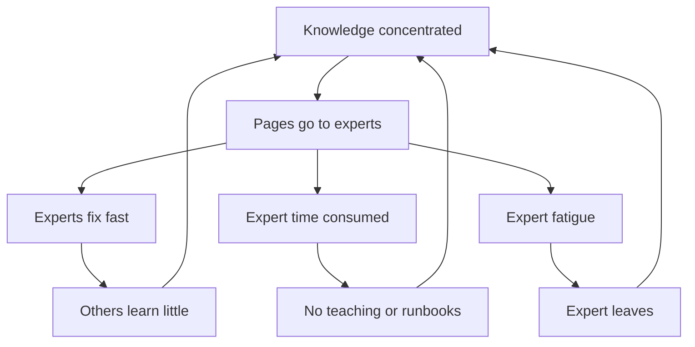
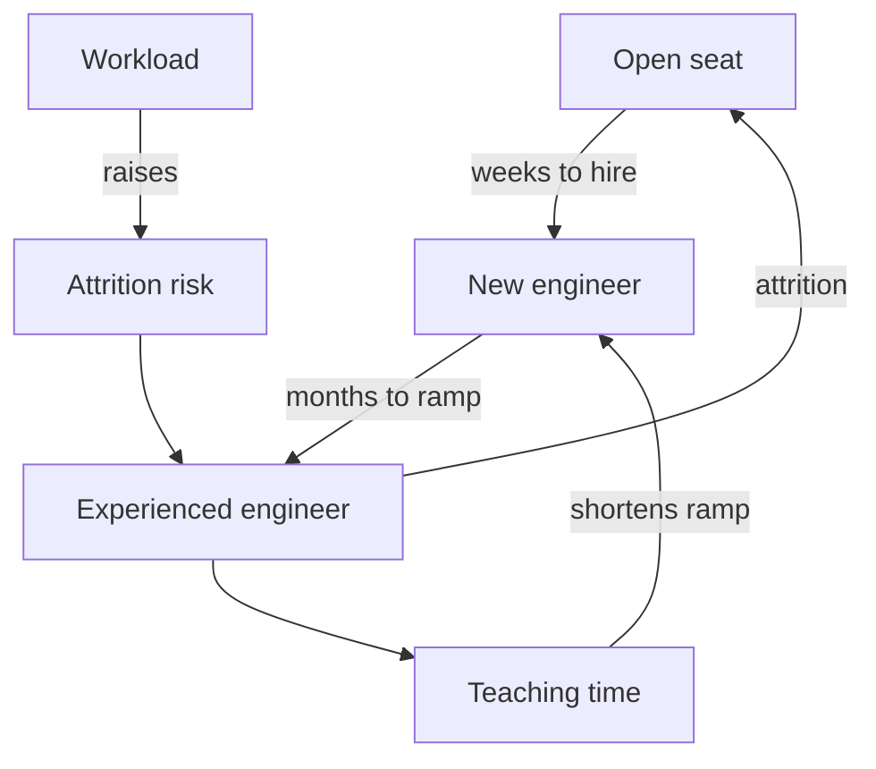
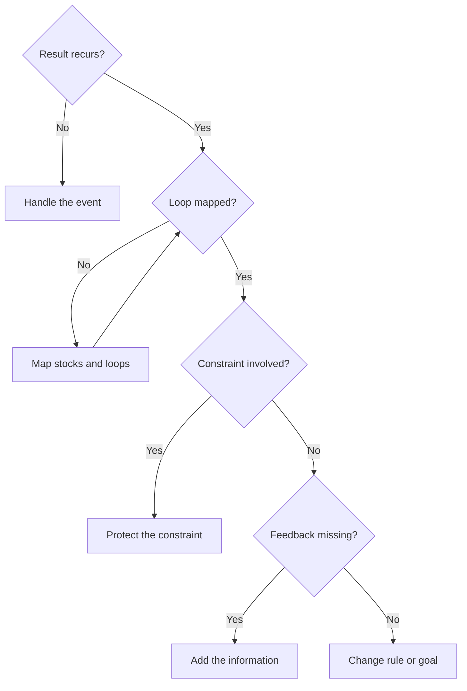

# Chapter 3 — Managerial Leverage and Systems Thinking

Every organization keeps producing results nobody chose: the same three people paged every night, the
same decisions waiting on the same person. This chapter teaches you to see those results as the output
of a structure (stocks, flows, feedback loops, delays, and constraints) and to spend your hours by how
much each one changes that structure, not by how visible it is. It sets out the book's systems-thinking
toolkit. Chapter 27 applies the toolkit to a quality decline, Chapter 16 to delivery flow, and Chapter 1
introduces the idea of managerial output that this chapter turns into a method. The running example is
Northstar Technologies, the fictional company in the [case study](../../case-studies/northstar/index.md).

## Why This Matters

At team scale, managers learn to fix events: a missed date, an incident, a resignation. Events are
visible and responding to them feels like work. But the structure that produced one event produces the
next, and a manager who only responds to events gets busier every quarter without the results
improving.

At organization scale, the director cannot see most events. What they can change is structure: who is
on call and by what rule, which information reaches which meeting, what the staff engineers are for. A
director who keeps acting on events becomes the bottleneck, and is usually praised for it, because event
work is the most visible work there is.

At executive scale, leverage moves to goals, rules, and the beliefs behind them. A CTO who spends board
time on a bonus percentage is using the most expensive hours in the company on the weakest kind of
change. The skill is the same at every level: find the structure behind a recurring result, and rank
the possible changes by leverage rather than visibility.

## Learning Objectives

After this chapter you will be able to:

- Model a team or organization as stocks, flows, and feedback loops, and identify the loop that is
  producing an unwanted result.
- Account for delays when predicting what an intervention will do, and recognize the oscillation that
  ignored delays produce.
- Rank candidate interventions by leverage rather than by visibility, using explicit criteria and the
  effort they cost you.
- Recognize the constraint in a system, including when the constraint is a person, and stop investing
  in improvements that do not touch it.
- Audit your own calendar and behavior as part of the system, including whether you multiply or
  diminish the capability of the people around you.

## The Mental Model

> **Mental model:** Recurring results come from structure, not from events. Leverage is how much a
> change in structure moves the result per hour of your effort, and the most visible interventions
> are rarely the ones with the most leverage.

The first idea comes from system dynamics: a system is stocks (things that accumulate, such as
experienced engineers or trust) changed by flows (hiring, attrition, learning), with feedback loops
connecting the stocks back to the flows
([Meadows, 2008](../../references/bibliography.md#meadows2008thinking)). A **reinforcing loop**
amplifies whatever it is doing; a **balancing loop** pushes toward a goal. When a result keeps coming
back after you fix it, a loop is regenerating it.

!!! info "Northstar so far"
    Before week 1. Northstar, the book's fictional order-to-cash software company, has 80 engineers in
    six teams and a new Engineering Director about to arrive. Last quarter brought 30 serious (Sev1 and
    Sev2) incidents; Billing had the most. See the
    [timeline](../../case-studies/northstar/timeline.md).

Northstar's Billing team has one. Three of its thirteen engineers carry most of the on-call pages
([Northstar overview](../../case-studies/northstar/index.md)). That is usually called a staffing
problem. It is better described as a loop:

Every arrow is reasonable alone: routing a ledger page to the fastest restorer is good incident
practice, and an expert who fixes rather than writes runbooks is doing what the business asks.
Together they concentrate knowledge further each quarter. The outer path (fatigue, then departure)
worsens the concentration just when it is most dangerous.

The second idea is **leverage**. Donella Meadows ranked the places to intervene in a system, from
changing numbers at the bottom to changing goals and paradigms at the top, and relayed Jay Forrester's
observation that people often find the right point and push it the wrong way
([Meadows, 1999](../../references/bibliography.md#meadows1999leverage)). The manager's version: list the
interventions for each recurring problem, place each at its level, and price each in your own hours.
The winners are usually structural, slow to show, and unglamorous.

## Deep Conceptual Explanation

### Stocks, flows, and slow change

A stock is anything you could count at a moment: engineers who can safely change the ledger, people
waiting for a decision. A flow is a rate: engineers trained per quarter, resignations per year. A stock
changes only through its flows, so it fills and drains at the rate the flows allow
([Meadows, 2008](../../references/bibliography.md#meadows2008thinking)).

Two consequences matter. The stocks that matter most (experience, trust) fill slowly and can drain
quickly: losing one of four ledger experts takes a week, replacing one takes months. And a large stock
hides a stopped inflow: Billing ran on ledger knowledge that nobody was replenishing, and the
shortfall became visible only at three people. Chapter 27 applies the same arithmetic to defects
([the quality version of the model](../05-engineering-quality/27-quality-transformation-at-enterprise-scale.md#the-mental-model)).

### Feedback loops

A **balancing loop** acts on the gap between a goal and the current state. Balancing loops explain why
problems often improve partly and then stall at a level nobody chose: the loop is satisfied by a goal
lower than yours, or it acts through a resource that is running out.

A **reinforcing loop** feeds its output back as input, in either direction. Run backward, the on-call
loop spreads knowledge: protected teaching time, more people able to respond, fewer pages per expert,
more time to teach. Meadows argued that reducing the gain of a reinforcing loop is usually more powerful
than strengthening the balancing loops that fight it
([Meadows, 1999](../../references/bibliography.md#meadows1999leverage)). In management terms: slow the
concentration before adding ways of coping with it, such as escalation paths or a larger stipend.

A recognition test, **this book's recommendation**: if the same people, components, or decisions
appear in most problems over two quarters, look for a reinforcing loop around them. If a problem
improves after every push and then settles back, look for a balancing loop with a lower goal, and find
out whose goal it is.

### Delays

Hiring takes months to add capacity, training months to add expertise, a rule change a quarter to show
in the numbers. Meadows observed that delays long relative to the system's pace of change cause
overshoot and oscillation ([Meadows, 1999](../../references/bibliography.md#meadows1999leverage)). The
stock of experienced engineers shows the mechanism:

In the twelve months before the director arrived, eight Northstar engineers left (10 percent of 80),
and the median time from resignation to the replacement's first day was 15 weeks (fictional; see the
[baseline data](../../case-studies/northstar/baseline-data.md)). That is about 2.3 engineer-years of
empty seats (8 × 15 = 120 seat-weeks), before the months each replacement needs to ramp. A manager who
requests hires against today's workload receives them after the pressure has peaked, and the next
planning cycle cuts them: hiring and freezing out of phase with need. The defense is to act first on the
flows you control fastest (attrition, teaching time, ramp) and to plan hiring against a forecast.

### The capability trap

Nelson Repenning and John Sterman, drawing on over a dozen field studies of improvement programs in
industries including telecommunications, semiconductors, and automobiles, together with system
dynamics models, describe two ways to close a performance gap: work harder, or make the process more
capable by spending time on improvement
([Repenning and Sterman, 2001](../../references/bibliography.md#repenning2001nobody)). Working harder
pays off at once. Improvement pays off after a delay and costs output meanwhile, so performance gets
worse before it gets better. Under pressure, people cut improvement time, capability erodes, the gap
widens, and pressure rises: the **capability trap**. Because the link between skipped improvement and
later shortfall is long and hard to see, the authors argue, managers tend to blame people's effort or
discipline and respond with more pressure. This is a **research finding** from field studies and
simulation models, not controlled experiments; its strength is that the mechanism recurs across very
different industries.

Chapter 27 shows the trap in a quality decline. It also governs managerial time. Billing's experts fix
pages themselves instead of pairing and writing runbooks; a director answers every escalation instead
of writing the rules that would make most escalations unnecessary. Rewarding heroics strengthens the loop that makes heroics necessary. Leslie Perlow's nine-month field
study of one software engineering team reports, in its abstract, that the group's collective use of
time kept its members short of time. Engineers were constantly interrupted, a crisis mentality and
rewards for individual heroics sustained the pattern, and changing how they used their time improved
collective productivity ([Perlow, 1999](../../references/bibliography.md#perlow1999time)). It is one
qualitative study, but its direction matches the trap.

### Leverage points

Meadows's essay lists twelve places to intervene, in increasing order of effectiveness, and calls the
list tentative ([Meadows, 1999](../../references/bibliography.md#meadows1999leverage)). The table maps the
levels that most often matter in engineering organizations; the examples are this book's.

| Level (lower to higher) | What changes | Engineering example |
|---|---|---|
| Parameters | Numbers in an existing structure | On-call stipend, [WIP limit](../../glossary.md#work-in-progress-wip-and-wip-limit) (a cap on work in progress), allocation percentage |
| Buffers and stocks | Size of stocks relative to flows | Hiring ahead of attrition, slack in a rotation |
| Delays | Time between action and feedback | Weekly instead of quarterly review of on-call load |
| Loop strength | How hard a loop pushes | Protected teaching time slows concentration |
| Information flows | Who sees what | Pages per person shown in the weekly review |
| Rules | Incentives, constraints, decision rights | Experts are escalation only |
| Goals | What the system is trying to do | "Restore fastest" versus "anyone can restore" |
| Paradigms | The beliefs the goals come from | "Reliability is the experts' job" |

Three of the essay's observations belong in every planning conversation. Most attention goes to
parameters, which rarely change behavior. Adding missing feedback is often powerful and cheap. And the
higher the leverage point, the more the system resists the change: a rule change provokes objections
that a stipend increase never does.

### Constraints

Eliyahu Goldratt's argument, popularized in *The Goal*, is that a system's output is limited by its
tightest constraint, and that improving anything else does not raise output
([Goldratt and Cox, 1984](../../references/bibliography.md#goldratt1984goal)). The procedure associated
with his work: identify the constraint, get the most out of it, subordinate everything else to it,
relieve it, then look for the next one. Chapter 16 applies it to delivery flow.

The managerial lesson is that constraints are often people: a staff engineer whose judgment every
design waits on, a director whose approval every exception needs, three engineers who are the only safe
ledger responders. The first move is not to make them work faster but to stop spending their time on
anything someone else could do.

### Managerial leverage

Andrew Grove's idea that a manager's output is the output of the organization under their influence
([Grove, 1983](../../references/bibliography.md#grove1983high)) is developed in Chapter 1. This
chapter adds a ranking rule: an activity's leverage is the change it produces in that output per hour
of the manager's time, over the period the change persists. A one-hour decision that sets a rotation
rule for a year beats ten hours on incident calls, though the calls are what people see.

**Visibility** is a separate axis. Visible work (joining incidents, approving changes) is rewarded at
once; structural work is often invisible and slow. Managers drift toward
visible work because its feedback is immediate: the capability trap, applied to the manager.

### Multipliers and diminishers

Liz Wiseman's idea of **multipliers** and **diminishers** is that leaders differ less in their own
intelligence than in how much of other people's capability they draw out
([Wiseman, 2010](../../references/bibliography.md#wiseman2010multipliers)). In systems terms, a
diminisher is a constraint that also weakens the inflow of capability: every question answered for
someone comes back next time. A multiplier routes decisions and learning to others. The test is
behavioral: count the decisions in your area that require you, and whether that number is falling.

## Engineering Organization Example

The following analysis is **illustrative**. Northstar did not track on-call load, so the paging
figures were reconstructed afterwards from the paging tool's history.

The three ledger experts carried 70 percent of Billing's pages in the baseline quarter (the quarter
before the director arrived), and almost all of the night pages:

| Billing pages, baseline quarter | Three ledger experts | Other ten engineers |
|---|---|---|
| Pages handled, primary or by escalation (180 in all) | 126 | 54 |
| Pages per person | about 42 | about 5 |
| Pages outside working hours (64 in all) | 54 | 10 |

About a third of all pages (61) needed no action. Billing also had eight
[Sev1 and Sev2](../../glossary.md#severity-sev1-sev2-sev3) incidents (Northstar's two most serious
severity levels), six of them repeats of earlier failures. Its median time to restore service was 495
minutes, against 190 for the organization. Billing used to have four ledger-experienced responders;
one left about nine months before the director arrived.

The ranking criteria (**this book's recommendation**) are the effect on the loop, how long the effect
lasts without further effort, the delay before it works, and the director's own hours.

| Intervention | Level | Effect on the loop | Delay | Director hours | Visibility |
|---|---|---|---|---|---|
| Raise the on-call stipend | Parameter | None on concentration; may delay a departure | Immediate | 1 | High |
| Director joins Billing incidents | None | None; one more person on each call | Immediate | 5 a week | Very high |
| Request an extra ledger hire | Stock inflow | Small and late; headcount is flat | 15 weeks plus ramp | 3 | High |
| Delete or demote no-action pages | Loop inflow | About 43 fewer expert pages a quarter | 2 to 4 weeks | 2 | Low |
| Show pages per person weekly | Information flow | Concentration visible to all managers | 1 week | 1 | Low |
| Rule: experts escalation only, with pairing | Rule | Reverses the loop | One quarter | 4 | Medium |
| Protected runbook time for experts | Loop strength | Knowledge leaves three heads | One to two quarters | 2 | Low |

The fourth row assumes the three handled no-action pages in the same 70 percent share as all pages
(70 percent of 61 is about 43). Chapter 24 covers how to demote cause-based alerts
([on-call design and load](../05-engineering-quality/24-reliability-slos-and-operational-readiness.md#on-call-design-and-load)).

The rule change reverses the loop and is the most resisted. Restoration will be slower for a quarter
while others learn, on a team whose median restore is already over eight hours. Google's *Site Reliability
Workbook* (SRE is site reliability engineering) has an on-call chapter that treats two incidents per twelve-hour shift as the load limit and gives eight engineers
as the minimum for a single-site round-the-clock rotation
([Cook et al., On-Call](../../references/bibliography.md#cook2018oncall)); thirteen engineers clear that,
so Billing's constraint is knowledge, not headcount.

The two most visible interventions have the least leverage. The three with the most (alert removal,
published load, the escalation rule) cost the director about seven hours in total. Chapter 24 covers
rotation design.

## Decision Framework

When a result keeps recurring, walk down the diagnosis and choose the highest-leverage intervention
you can carry through:

Then score the candidates:

| Criterion | Question | Warning sign |
|---|---|---|
| Level | Where on the leverage list does it act? | Every option is a parameter |
| Reach | How many people or decisions does it change? | Only the person in front of you |
| Durability | Does it keep working when you stop attending to it? | It needs your presence weekly |
| Delay | When will the effect show, and will you still be measuring? | No date for checking |
| Cost to you | Your hours, now and ongoing | It grows with the organization |
| Resistance | Who loses something? | Nobody objects: it may change nothing |
| Direction | Could it strengthen the loop you want to weaken? | It rewards the behavior producing the problem |

Two rules of thumb, both **this book's recommendation**. When two interventions are close, prefer the
one that adds information or changes a rule over the one that changes a number. And when you are the
constraint, the first intervention is on your own calendar.

## Trade-offs

**Leverage against speed.** Structural changes often take a quarter to show. When an expert is about to
burn out this month, low-leverage relief (time off the rotation, pay for the nights) is right, as long as
it comes with the structural change and is not mistaken for it.

**Leverage against resistance.** A rule making experts escalation-only costs them status and costs the
team restore speed. Budget the political work with the technical work, and expect the objection to
arrive as a reasonable-sounding exception.

**Visible against structural action.** Visibility is not worthless: people in an incident want to see
that leadership cares, and a director who never appears loses the trust structural work needs. Choose
some visible presence deliberately; spend most hours on structure.

**Modeling against acting.** Modeling can become a way to avoid deciding. A rough loop checked against
data is usually enough.

## Failure Modes

**Parameter tinkering.** Every response is a number: a higher stipend, a new target. Signal: the problem
returns after each adjustment. Countermeasure: require one non-parameter option in every proposal.

**The hero loop.** Recognition goes to whoever fixed the 2 a.m. outage, not to whoever wrote the runbook
that meant nobody had to. Signal: the same names in every incident and every award. Countermeasure:
publicly recognize work that removed the need for heroics.

**Optimizing a non-constraint.** Faster builds for a service while every release waits on a manual
approval. Signal: local measures improve, the end-to-end result does not. Countermeasure: name the
constraint before approving improvement work.

**Ignoring delays.** An intervention is judged a failure after two weeks and reversed; hires arrive after
the pain has passed. Signal: oscillating policies. Countermeasure: state the expected delay and a
review date when making the change.

**The accidental diminisher.** A capable manager or staff engineer answers every question and becomes the
constraint. Signal: decisions wait for one person; others stop proposing. Countermeasure: count the
decisions that need you, and hand some away each quarter.

**Pushing the lever backward.** Adding approval steps after a failure makes batches bigger and failures
worse (Chapter 27 has the release-train version). Countermeasure: trace each intervention once around
the loop before committing.

## Enterprise Application

In an organization of 50 to 150 engineers, the director's leverage comes almost entirely through other
people and through structure.

**The director's portfolio** is mostly rules, information, and goals: decision rights for staff
engineers, what the weekly operational review shows, which outcomes managers answer for. The director's
calendar is a system to manage, and the director is often the organization's first constraint.

**Managers model their own teams.** Each engineering manager should be able to name their team's
critical stocks (experienced responders, people at risk of leaving) and the loop most likely to hurt
them in two quarters. That question would have surfaced Billing's concentration before it reached three
people.

**Staff engineers as leverage.** Northstar's three staff engineers own no components and have no
mandate. In the baseline, Ines Carvalho (staff engineer, core domain) spent about eight hours a week answering unscheduled questions
about Core (**illustrative**, consistent with the staff engineers' 20 percent unplanned share). Answering
questions one at a time is the lowest level of work; writing the boundary rules for a Core module and
reviewing others' decisions against them reaches every team. Chapter 29 covers the staff role.

**Organization-level stocks** that change slowly and matter most: people who can safely change
critical systems, managers who can run their teams without escalating, and trust between engineering
and product. Report them, even roughly, beside delivery measures (Chapter 37).

## CTO Perspective

At executive scale the highest-leverage interventions are goals, company-wide rules, and the beliefs
behind them. A CTO who acts as if reliability is every team's job, not the experts', has changed a
paradigm; one who funds a stipend increase has changed a parameter.

**Translating requests.** Boards and executive peers ask for numbers: headcount, a target, a budget
line. "Add ten engineers" is a stock inflow with a delay of months and an attrition outflow; the useful
question is which loop those engineers would change, and whether a rule change would do it faster.

**Company-wide stocks.** The CTO owns stocks that directors cannot see whole: talent across teams, the
architecture's capacity to absorb change, and engineering's credibility. These drain quietly under
pressure. A proposal to delay backfills to hold expense flat is a decision to let the experienced
engineer stock fall while workload holds, which strengthens every concentration loop at once.

**The CTO's own leverage.** A CTO who approves architecture decisions, joins every Sev1, and answers
every escalation is the organization's most expensive constraint. The calendar should be dominated by
goals, rules, the people who run the organization, and the information it steers by.

## Practical Playbook

1. **List the recurring results.** The three problems that have come back at least twice in two
   quarters. Ignore one-off events.
2. **Map each as stocks and loops**, one page per problem, and check every arrow against data.
3. **Name the delays.** Estimate how long each flow takes to respond, and write it down.
4. **Find the constraint.** Ask what the result waits on. If it is a person, including you, say so.
5. **List interventions at several levels**: at least one parameter, one information flow, one rule.
   If you can only think of parameters, return to step 2.
6. **Score them** with the decision table.
7. **Audit your calendar.** Sort a fortnight of your hours by leverage and move hours from the lowest
   band to the highest, protected on the calendar. (Chapter 1's audit sorts hours by job; this one
   ranks them by leverage.)
8. **Change one rule and one information flow**, visibly, saying what you expect to see and when.
9. **Review at the stated delay.** If the loop has not weakened, revisit the map, not only the
   intervention.
10. **Hand away decisions each quarter.** Count the decisions that need you, and reduce the count.

## Case Study

This case is **fictional**. It is set in the twelve months before the director arrives at Northstar
([baseline data](../../case-studies/northstar/baseline-data.md)).

At the start of that year, Billing had four engineers trusted with ledger incidents. The rotation
nominally covered all thirteen, but ledger and invoicing pages were escalated to the four almost by
reflex, because they restored fastest. Nine months before the director arrived, one of the four
resigned. The backfill started 15 weeks later and, because the remaining three were rarely free to pair,
was not on the rotation by the end of the baseline quarter.

The previous management responded three times. It raised the on-call stipend. After each serious Billing
incident it added an alert; some became the no-action pages that made up about a third of the quarter's
180. And it asked the experts to "document as they go", without giving them time. Each response was
reasonable, and each was a parameter or an addition to the loop's inflow. None changed who learned from
a page.

By the baseline quarter, the result looked like a performance problem: the highest incident count in
the organization (8), six recurrences, and a median restoration time more than twice the organization's.
A manager reading only those numbers might conclude the team needed more discipline, the attribution
error Repenning and Sterman describe. The loop said otherwise: the experts were doing exactly what the
system rewarded, and each quarter made the system more dependent on them.

The same structure appeared elsewhere. Ines Carvalho, with eleven years on Core, spent about eight hours
a week answering questions that a written module boundary would have answered once, and nobody owned
the information flow that would have shown the cost.

## Exercises

Solutions are in [chapter 3 solutions](../../solutions/ch03-solutions.md). Data files are linked from
the [Northstar baseline page](../../case-studies/northstar/baseline-data.md).

### Foundational

**F1.** Draw a stock-and-flow map for "engineers who can safely respond to a Billing ledger incident"
at Northstar. Use this chapter's figures (four experts at the start of the year, one departure, a
15-week backfill delay) and state your own assumption for how long a new engineer needs to become a
safe responder with and without pairing. Predict the stock at the end of the next two quarters under
both assumptions, and say which flow the director can change fastest.

**F2.** Marcus Oyelaran's team (he manages Billing) proposes eight responses to its on-call load: a higher stipend, a second
weekly incident review, a hiring request, a no-action-page purge, a published pages-per-person chart, an
escalation-only rule for experts, a quarterly award for best incident response, and protected runbook
time. Place each on the leverage table, identify any that would strengthen the concentration loop, and
explain your reasoning for the two hardest to classify.

**F3.** Suppose that in a later quarter Northstar's release working group finds that every Core module
boundary decision waits for Ines Carvalho, and proposes cutting 20 minutes from the Core pipeline to
"improve flow". Identify the constraint, say whether the pipeline work raises output, and propose two
ways to get more from the constraint without asking Ines to work longer hours.

### Applied Leadership

**A1.** An **illustrative** 45-hour week for a new director: status meetings 9 hours, joining incident
calls 5, personally approving technical changes 4, one-on-ones with nine direct reports 4.5, product
and customer meetings 6, email and chat 8, hiring interviews 3, unscheduled 5.5. Rank the categories by
leverage, redesign the week to free at least ten hours, and say what each freed hour goes to and what
risk each change carries.

**A2.** Ines Carvalho is respected, fast, and answers every Core question herself within minutes. Two
senior Orders engineers say they no longer propose designs because "Ines will know better". Plan a
conversation with Ines that treats this as a systems problem rather than a character flaw: what you ask,
what data you bring, what mandate you offer, and how you will know in a quarter whether anything
changed.

**A3.** Marcus asks you to approve doubling Billing's on-call stipend, arguing it is the only thing he
can do this week and that one of his experts is close to leaving. Decide, and write the reply. Address
the immediate retention risk, the structural change you want alongside it, and how you will keep the
stipend from becoming the whole response.

### Executive Decision-Making

**X1.** You are Northstar's CTO. Rajiv Menon (CFO) proposes delaying all backfills by one quarter to
hold operating expense flat. Using this chapter's attrition and backfill figures, and assuming $185,000
fully loaded per engineer-year, estimate the capacity cost, describe which loops the delay would strengthen, and write a short recommendation to Helena Marsh
(CEO) with an alternative that serves the CFO's goal.

**X2.** As CTO you can sponsor one company-wide intervention this year: a rule that no engineer may be
first responder for more than a set share of a team's after-hours pages, enforced through the monthly
review; or a published monthly dashboard of on-call load, decision wait times, and attrition by team,
with no rule attached. Choose one, place each on the leverage list, and say what would make you switch
after two quarters.

## Reflection Questions

1. Which result in your organization has come back at least three times? What loop regenerates it, and
   who benefits from the loop as it is?
2. Which of your regular activities is the most visible and the least leveraged? Who would notice first
   if you stopped it for a month?
3. Where are you the constraint? How many decisions waited for you last week that a rule could have
   settled?
4. Which stock in your organization is draining too slowly for anyone to notice?
5. Whose heroics does your organization reward, and what would it take to reward the work that made
   heroics unnecessary?

## Key Takeaways

- Treat a recurring result as the output of a structure: map stocks, flows, and loops before choosing an
  intervention.
- Stocks of experience and trust fill slowly and drain quickly; act first on the flows you control
  fastest.
- State the delay of every intervention, and review it at that delay, not before.
- Rank interventions by leverage (effect, reach, durability, your hours). Visibility is a separate axis
  and usually points the wrong way.
- Prefer changing rules and information flows to changing numbers, and expect resistance to rise with
  leverage.
- Find the constraint, including when it is a person, and stop investing where it is not.
- Under pressure, protect improvement time; cutting it is how teams and managers enter the capability
  trap.
- Audit your own calendar as part of the system, and hand decisions away every quarter.

## References and Further Reading

- [Meadows, 1999](../../references/bibliography.md#meadows1999leverage). "Leverage Points: Places to
  Intervene in a System". The ranked list this chapter adapts; short, free, and the best single reading
  on leverage.
- [Meadows, 2008](../../references/bibliography.md#meadows2008thinking). *Thinking in Systems*. The
  longer introduction to stocks, flows, and feedback.
- [Repenning and Sterman, 2001](../../references/bibliography.md#repenning2001nobody). The capability
  trap, worse-before-better dynamics, and why managers blame people for structural shortfalls.
- [Perlow, 1999](../../references/bibliography.md#perlow1999time). How a software team's shared use of
  time and its reward for heroics kept it short of time.
- [Goldratt and Cox, 1984](../../references/bibliography.md#goldratt1984goal). *The Goal*. Constraint
  thinking, taught as a novel.
- [Grove, 1983](../../references/bibliography.md#grove1983high). *High Output Management*. Managerial
  output; Chapter 1 develops it.
- [Wiseman, 2010](../../references/bibliography.md#wiseman2010multipliers). *Multipliers*. Leaders who
  draw out others' capability, and those who underuse it.
- [Cook et al., On-Call](../../references/bibliography.md#cook2018oncall), in the free *Site Reliability
  Workbook*. On-call load limits and rotation sizing.
