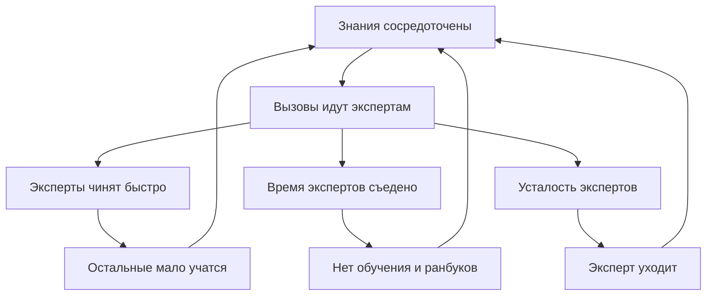
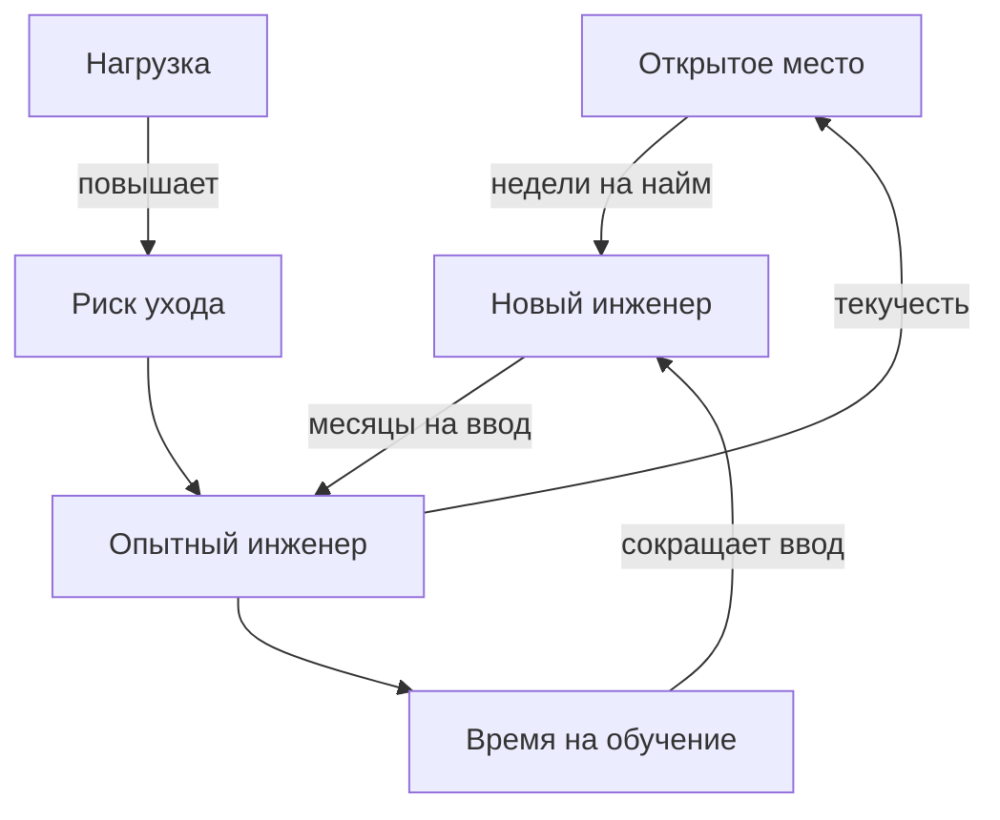

# Глава 3 — Управленческий рычаг и системное мышление { #chapter-3-managerial-leverage-and-systems-thinking }

Любая организация раз за разом выдаёт результаты, которых никто не выбирал: каждую ночь вызывают одних и
тех же троих, одни и те же решения ждут одного и того же человека. Глава учит видеть в таких результатах
продукт структуры — запасов, потоков, петель обратной связи, задержек и ограничений — и распределять свои
часы по тому, насколько каждый из них меняет эту структуру, а не по тому, насколько он заметен. Здесь
собран инструментарий системного мышления, которым пользуется вся книга. Глава 27 применяет его к
падению качества, глава 16 — к потоку поставки. А понятие результата руководителя, введённое в
главе 1, здесь превращается в метод. Сквозной пример — Northstar Technologies, вымышленная компания из
[кейса](../../case-studies/northstar/index.md).

## Почему это важно { #why-this-matters }

В команде руководители учатся исправлять события: сорванный срок, инцидент, увольнение. События
заметны, и реакция на них создаёт ощущение работы. Но структура, породившая одно событие, порождает и
следующее. Руководитель, который только реагирует, с каждым кварталом всё больше занят, а результаты не
улучшаются.

В масштабе организации директор большинства событий не видит. Зато он может менять структуру: кто
дежурит и по какому правилу, какая информация попадает на какую встречу, для чего нужны staff-инженеры.
Если директор продолжает работать с событиями, он становится узким местом — и обычно получает за это
похвалу, ведь работа с событиями заметнее любой другой.

У высшего руководства рычаг смещается к целям, правилам и убеждениям, которые за ними стоят. CTO,
который тратит время совета директоров на процент бонуса, расходует самые дорогие часы компании на
самый слабый вид изменений. Навык же на любом уровне один: найти структуру за повторяющимся результатом
и ранжировать возможные изменения по рычагу, а не по заметности.

## Цели главы { #learning-objectives }

После этой главы вы сможете:

- Моделировать команду или организацию как запасы, потоки и петли обратной связи и находить петлю,
  которая порождает нежелательный результат.
- Учитывать задержки, когда прогнозируете действие вмешательства, и распознавать колебания, которые
  возникают, если задержки игнорировать.
- Ранжировать возможные вмешательства по рычагу, а не по заметности: по явным критериям и с учётом того,
  сколько ваших усилий они требуют.
- Находить ограничение в системе, в том числе когда ограничение — человек, и перестать вкладываться в
  улучшения, которые его не затрагивают.
- Проводить аудит собственного календаря и поведения как части системы и, в частности, выяснить,
  умножаете вы способности людей вокруг или ослабляете их.

## Ментальная модель { #the-mental-model }

> **Ментальная модель:** повторяющиеся результаты порождает структура, а не события. Рычаг — это то,
> насколько изменение структуры сдвигает результат в расчёте на час ваших усилий. Самые заметные
> вмешательства редко дают наибольший рычаг.

!!! info "Northstar: что уже известно"
    До недели 1. Northstar — вымышленная компания этой книги, она делает ПО для order-to-cash («от
    заказа до оплаты»). В ней 80 инженеров в шести командах, и вот-вот придёт новый директор по
    разработке. В прошлом квартале случилось 30 серьёзных инцидентов (Sev1 и Sev2), больше всего — в
    Billing. См. [хронологию](../../case-studies/northstar/timeline.md). Впервые в Northstar? Прочитайте
    [«Год вкратце»](../../case-studies/northstar/year-in-brief.md) и
    [«Действующие лица»](../../case-studies/northstar/cast.md).

Первая идея пришла из системной динамики. Система состоит из запасов — того, что накапливается,
например опытных инженеров или доверия. Запасы меняются потоками (найм, текучесть, обучение), а петли
обратной связи замыкают запасы обратно на потоки
([Meadows, 2008](../../references/bibliography.md#meadows2008thinking)). **Усиливающая петля**
раскручивает то, что уже происходит; **балансирующая петля** толкает систему к цели. Если результат
возвращается после того, как вы его исправили, значит, его воспроизводит какая-то петля.

Одна такая петля есть в команде Billing. Трое из тринадцати её инженеров принимают большую часть вызовов
на дежурстве ([обзор Northstar](../../case-studies/northstar/index.md)). Обычно это называют проблемой
укомплектованности, но точнее описать это как петлю:

По отдельности каждая стрелка разумна. Направить вызов по ledger тому, кто быстрее всех восстанавливает
сервис, — хорошая практика реагирования на инциденты. Эксперт, который чинит, а не пишет ранбуки
(runbooks), делает то, чего просит бизнес. Но вместе эти стрелки с каждым кварталом всё сильнее
сосредоточивают знания. А внешний путь (усталость, затем уход) усиливает концентрацию как раз тогда,
когда она опаснее всего.

Вторая идея — **рычаг**. Donella Meadows ранжировала точки вмешательства в систему: внизу — изменение
чисел, наверху — изменение целей и парадигм (общих убеждений, из которых вырастают цели). Она также
пересказала наблюдение Jay Forrester: люди часто находят правильную точку, но давят на неё не в ту
сторону ([Meadows, 1999](../../references/bibliography.md#meadows1999leverage)). Для руководителя это
значит: для каждой повторяющейся проблемы перечислите вмешательства, определите уровень каждого и
оцените каждое в своих часах. Выигрывают обычно структурные вмешательства — те, что проявляются
медленно и выглядят неэффектно.

## Подробный разбор { #deep-conceptual-explanation }

### Запасы, потоки и медленные изменения { #stocks-flows-and-slow-change }

Запас — всё, что можно пересчитать в конкретный момент: инженеры, которые могут безопасно менять
ledger; люди, которые ждут решения. Поток — это скорость: сколько инженеров обучено за квартал, сколько
уволилось за год. Запас меняется только через свои потоки, поэтому наполняется и опустошается не
быстрее, чем позволяют потоки ([Meadows, 2008](../../references/bibliography.md#meadows2008thinking)).

Отсюда два следствия. Ключевые запасы (опыт, доверие) наполняются медленно, а опустошиться могут
быстро: потерять одного из четырёх экспертов по ledger можно за неделю, а заменить — только за месяцы.
Кроме того, большой запас скрывает остановившийся приток. Billing жила на знаниях о ledger, которые
никто не пополнял, и нехватка стала заметной, только когда экспертов осталось трое. Ту же арифметику
глава 27 применяет к дефектам
([модель в варианте для качества](../05-engineering-quality/27-quality-transformation-at-enterprise-scale.md#the-mental-model)).

### Петли обратной связи { #feedback-loops }

**Балансирующая петля** реагирует на разрыв между целью и текущим состоянием. Такие петли объясняют,
почему проблема часто отчасти выправляется, а потом застревает на уровне, которого никто не выбирал:
либо цель петли ниже вашей, либо петля действует через ресурс, который заканчивается.

**Усиливающая петля** подаёт свой выход обратно на вход и может раскручиваться в любую сторону. Если
запустить петлю дежурств в обратную сторону, она начнёт распространять знания: защищённое время на
обучение, больше людей, способных реагировать, меньше вызовов на эксперта, ещё больше времени на
обучение. **Коэффициент усиления** показывает, насколько сильно каждый виток петли усиливает следующий.
Meadows утверждала, что снизить коэффициент усиления усиливающей петли обычно эффективнее, чем
укреплять балансирующие петли, которые с ней борются
([Meadows, 1999](../../references/bibliography.md#meadows1999leverage)). В переводе на язык управления:
сначала замедлите концентрацию, а уже потом добавляйте способы с ней справляться — пути эскалации или
более высокую надбавку.

Как распознать петлю (**рекомендация книги**): если два квартала подряд в большинстве проблем
фигурируют одни и те же люди, компоненты или решения, ищите вокруг них усиливающую петлю. Если проблема
после каждого нажима отступает, а потом возвращается на прежний уровень, ищите балансирующую петлю с
более низкой целью и выясните, чья это цель.

### Задержки { #delays }

Найм добавляет ресурс за месяцы, обучение добавляет экспертизу тоже за месяцы, изменение правила
сказывается на цифрах за квартал. Meadows отмечала: если задержки длинные по сравнению со скоростью
изменений в системе, возникают перерегулирование и колебания
([Meadows, 1999](../../references/bibliography.md#meadows1999leverage)). Механизм хорошо виден на
запасе опытных инженеров:

За двенадцать месяцев до прихода директора из Northstar ушли восемь инженеров (10 процентов от 80).
Медианный срок от заявления об уходе до первого дня замены составил 15 недель (вымысел; см.
[исходные данные](../../case-studies/northstar/baseline-data.md)). Получается около 2,3 инженеро-года
пустующих мест (120 место-недель), и это не считая месяцев, которые нужны каждому новичку, чтобы войти в
работу. Руководитель, который просит найм под сегодняшнюю нагрузку, получает людей, когда давление уже
миновало пик, а следующий цикл планирования этот найм срезает: найм и заморозки идут в противофазе с
потребностью. Защита — действовать в первую очередь на потоки, которыми вы управляете быстрее всего
(текучесть, время на обучение, ввод в работу), а найм планировать по прогнозу.

### Ловушка возможностей { #the-capability-trap }

Под давлением команды перестают улучшаться и отстают ещё сильнее. Nelson Repenning и John Sterman
описывают два способа закрыть разрыв в результатах: работать усерднее или сделать процесс способнее,
вложив время в улучшения. Опираются они на более чем десяток полевых исследований программ улучшений
(в телекоммуникациях, производстве полупроводников, автомобилестроении и других отраслях) и на модели
системной динамики ([Repenning and Sterman, 2001](../../references/bibliography.md#repenning2001nobody)).
Усердная работа окупается сразу. Улучшения окупаются с задержкой, а пока отнимают выпуск, поэтому
результаты сначала ухудшаются и лишь потом растут. Под давлением люди срезают время на улучшения,
возможности деградируют, разрыв растёт, давление усиливается. Это и есть **ловушка возможностей**.
Связь между пропущенным улучшением и последующей нехваткой длинная и плохо заметна. Поэтому, утверждают
авторы, руководители склонны винить усердие или дисциплину людей и отвечают ещё большим давлением. Это
**научный результат**, полученный в полевых исследованиях и на имитационных моделях, а не в
контролируемых экспериментах; его сила в том, что механизм повторяется в очень разных отраслях.

Глава 27 показывает ловушку на примере падения качества. Но та же ловушка управляет и временем
руководителя. Эксперты Billing сами разбирают вызовы, вместо того чтобы работать в паре и писать
ранбуки; директор отвечает на каждую эскалацию, вместо того чтобы написать правила, которые сделали бы
большинство эскалаций ненужными. Награждая героизм, вы укрепляете петлю, которая делает героизм
необходимым.

Leslie Perlow увидела ту же картину в девятимесячном полевом исследовании одной команды разработки ПО.
Согласно аннотации, из-за того, как группа коллективно распоряжалась временем, её участникам времени
постоянно не хватало. Инженеров то и дело прерывали, а кризисный менталитет и награды за индивидуальный
героизм закрепляли эту картину. Когда инженеры изменили то, как используют время, коллективная
продуктивность выросла ([Perlow, 1999](../../references/bibliography.md#perlow1999time)). Это одно
качественное исследование, но оно указывает в ту же сторону, что и ловушка возможностей.

### Точки рычага { #leverage-points }

В своём эссе Meadows перечисляет двенадцать точек вмешательства в порядке возрастания эффективности и
называет список предварительным ([Meadows, 1999](../../references/bibliography.md#meadows1999leverage)).
В таблице — уровни, которые в инженерных организациях важны чаще всего; примеры составлены для этой
книги.

| Уровень (снизу вверх) | Что меняется | Пример из разработки |
|---|---|---|
| Параметры | Числа в существующей структуре | Надбавка за дежурства, [лимит WIP](../../glossary.md#work-in-progress-wip-and-wip-limit) (ограничение на незавершённую работу), процент распределения ресурсов |
| Буферы и запасы | Размер запасов относительно потоков | Найм с опережением текучести, запас в графике дежурств |
| Задержки | Время между действием и обратной связью | Еженедельный, а не ежеквартальный обзор нагрузки на дежурных |
| Сила петли | Насколько сильно давит петля | Защищённое время на обучение замедляет концентрацию |
| Информационные потоки | Кто что видит | Вызовы на человека показываются на еженедельном разборе |
| Правила | Стимулы, ограничения, права на решения | Эксперты — только для эскалаций |
| Цели | К чему стремится система | «Восстановить быстрее всех» против «восстановить может любой» |
| Парадигмы | Убеждения, из которых вырастают цели | «Надёжность — забота экспертов» |

Три наблюдения из эссе стоит держать в голове на любом обсуждении планов. Больше всего внимания
достаётся параметрам, хотя поведение они меняют редко. Добавить недостающую обратную связь часто
оказывается и сильным, и дешёвым ходом. Наконец, чем выше точка рычага, тем сильнее система
сопротивляется: изменение правила вызывает возражения, каких повышение надбавки не вызывает никогда.

### Ограничения { #constraints }

Eliyahu Goldratt, чей аргумент стал популярным благодаря *The Goal*, утверждает: выпуск системы
ограничен её самым узким местом, и улучшение чего-либо другого выпуск не повышает
([Goldratt and Cox, 1984](../../references/bibliography.md#goldratt1984goal)). С его работами связана
процедура: найти ограничение, выжать из него максимум, подчинить ему всё остальное (то есть планировать
остальную работу вокруг потребностей ограничения), расширить ограничение, а затем искать следующее. К
потоку поставки её применяет глава 16.

Урок для руководителя: ограничениями часто оказываются люди. Staff-инженер, чьего суждения ждёт каждый
дизайн; директор, чьего одобрения требует каждое исключение; три инженера — единственные, кто может
безопасно реагировать на инциденты с ledger. Первый шаг — не заставлять их работать быстрее, а перестать
тратить их время на то, что может сделать кто-то другой.

### Управленческий рычаг { #managerial-leverage }

Идею Andrew Grove о том, что результат руководителя — это результат организации, на которую он влияет
([Grove, 1983](../../references/bibliography.md#grove1983high)), разбирает глава 1. Здесь к ней
добавляется правило ранжирования: рычаг занятия — это то, насколько оно меняет этот результат в расчёте
на час времени руководителя, за весь срок, пока изменение держится. Часовое решение, которое на год
задаёт правило графика дежурств, выигрывает у десяти часов на созвонах по инцидентам, хотя люди видят
именно созвоны.

**Заметность** — отдельная ось. Заметная работа (подключение к инцидентам, одобрение изменений)
вознаграждается сразу, а структурная часто незаметна и медленна. Руководители сползают к заметной
работе, потому что обратная связь от неё мгновенная. Это та же ловушка возможностей, только в неё
попадает сам руководитель.

### Мультипликаторы и ослабители { #multipliers-and-diminishers }

Liz Wiseman различает **мультипликаторов** (multipliers) и **ослабителей** (diminishers). По её мысли,
лидеры отличаются не столько собственным интеллектом, сколько тем, насколько раскрывают способности
других людей ([Wiseman, 2010](../../references/bibliography.md#wiseman2010multipliers)). На языке
систем ослабитель — это ограничение, которое к тому же сужает приток способностей: каждый вопрос, на
который вы ответили за человека, в следующий раз вернётся к вам. Мультипликатор направляет решения и
обучение к другим. Проверка — по поведению: посчитайте решения в вашей области, для которых нужны вы, и
посмотрите, уменьшается ли их число.

## Пример из инженерной организации { #engineering-organization-example }

Анализ ниже — **иллюстрация**. Northstar не отслеживала нагрузку на дежурных, поэтому цифры по вызовам
восстановлены задним числом по истории инструмента оповещений.

В базовом квартале (квартале перед приходом директора) три эксперта по ledger приняли 70 процентов
вызовов Billing и почти все ночные вызовы:

| Вызовы Billing, базовый квартал | Три эксперта по ledger | Остальные десять инженеров |
|---|---|---|
| Обработано вызовов, первично или по эскалации (всего 180) | 126 | 54 |
| Вызовов на человека | около 42 | около 5 |
| Вызовов в нерабочее время (всего 64) | 54 | 10 |

Около трети всех вызовов (61) не требовали никаких действий. Кроме того, у Billing было восемь
инцидентов [Sev1 и Sev2](../../glossary.md#severity-sev1-sev2-sev3) (два самых серьёзных уровня в
Northstar), и шесть из них повторяли прежние сбои. Медианное время восстановления сервиса составляло
495 минут против 190 по организации. Раньше в Billing было четверо дежурных, знающих ledger; один из них
ушёл примерно за девять месяцев до прихода директора.

Критерии ранжирования (**рекомендация книги**): влияние на петлю; как долго эффект держится без
дальнейших усилий; через сколько он начнёт действовать; собственные часы директора.

| Вмешательство | Уровень | Влияние на петлю | Задержка | Часы директора | Заметность |
|---|---|---|---|---|---|
| Повысить надбавку за дежурства | Параметр | На концентрацию — никакого; может отсрочить уход | Сразу | 1 | Высокая |
| Директор подключается к инцидентам Billing | Никакой | Никакого; ещё один человек на каждом созвоне | Сразу | 5 в неделю | Очень высокая |
| Запросить ещё одного инженера по ledger | Приток в запас | Малое и запоздалое; численность не растёт | 15 недель плюс ввод в работу | 3 | Высокая |
| Удалить или понизить вызовы без действий | Приток в петлю | Примерно на 43 вызова экспертам в квартал меньше | 2–4 недели | 2 | Низкая |
| Еженедельно показывать вызовы на человека | Информационный поток | Концентрация видна всем руководителям | 1 неделя | 1 | Низкая |
| Правило: эксперты только для эскалаций, с работой в паре | Правило | Разворачивает петлю | Один квартал | 4 | Средняя |
| Защищённое время экспертов на ранбуки | Сила петли | Знания выходят из трёх голов | Один–два квартала | 2 | Низкая |

В четвёртой строке предполагается, что вызовы без действий доставались троим в той же доле, что и все
вызовы, — 70 процентов (70 процентов от 61 — это около 43). Как понижать алерты, срабатывающие по
причинам (cause-based alerts), разбирает глава 24
([проектирование дежурств и нагрузка](../05-engineering-quality/24-reliability-slos-and-operational-readiness.md#on-call-design-and-load)).

Изменение правила разворачивает петлю, и именно ему сопротивляются сильнее всего. Пока остальные
учатся, целый квартал восстановление будет идти медленнее, и это в команде, где медианное
восстановление и так занимает больше восьми часов. Численность здесь не проблема. Глава о дежурствах в
книге Google *Site Reliability Workbook* (SRE — site reliability engineering, инженерия надёжности
сайтов) считает пределом нагрузки два инцидента за двенадцатичасовую смену, а минимумом для
круглосуточного графика на одной площадке — восемь инженеров
([Cook et al., On-Call](../../references/bibliography.md#cook2018oncall)). Тринадцать инженеров — больше
этого порога, так что ограничение Billing — знания, а не численность.

Два самых заметных вмешательства дают наименьший рычаг. Три вмешательства с наибольшим рычагом
(удаление алертов, публикация нагрузки, правило эскалации) стоят директору в сумме около семи часов.
Проектирование графика дежурств разбирает глава 24.

## Как принимать решение { #decision-framework }

Если результат повторяется, пройдите по шагам диагностики и выберите вмешательство с наибольшим рычагом,
которое вы сможете довести до конца:

```mermaid
flowchart TD
    A{"Результат повторяется?"} -->|Нет| E["Разобраться с событием"]
    A -->|Да| B{"Петля нанесена на карту?"}
    B -->|Нет| M["Карта запасов и петель"]
    M --> B
    B -->|Да| C{"Задето ограничение?"}
    C -->|Да| K["Защитить ограничение"]
    C -->|Нет| D{"Не хватает обратной связи?"}
    D -->|Да| I["Добавить информацию"]
    D -->|Нет| R["Изменить правило или цель"]
```

Затем оцените варианты:

| Критерий | Вопрос | Тревожный признак |
|---|---|---|
| Уровень | Где в списке точек рычага оно действует? | Все варианты — параметры |
| Охват | Сколько людей или решений оно меняет? | Только человека перед вами |
| Устойчивость | Продолжает ли оно работать, когда вы перестаёте за ним следить? | Нужно ваше еженедельное присутствие |
| Задержка | Когда проявится эффект и будете ли вы тогда ещё измерять? | Нет даты проверки |
| Цена для вас | Ваши часы, сейчас и в дальнейшем | Растёт вместе с организацией |
| Сопротивление | Кто что-то теряет? | Никто не возражает: возможно, ничего не изменится |
| Направление | Может ли оно усилить петлю, которую вы хотите ослабить? | Вознаграждает поведение, создающее проблему |

Два эмпирических правила, оба — **рекомендация книги**. Если два вмешательства близки по оценке,
выбирайте то, что добавляет информацию или меняет правило, а не то, что меняет число. А если
ограничение — вы сами, первым делом вмешайтесь в собственный календарь.

## Компромиссы { #trade-offs }

**Рычаг против скорости.** Структурные изменения часто проявляются только через квартал. Если эксперт
выгорит уже в этом месяце, правильным будет облегчение с малым рычагом (снять с графика
дежурств, оплатить ночи). Но только вместе со структурным изменением и не выдавая одно за другое.

**Рычаг против сопротивления.** Правило, по которому эксперты занимаются только эскалациями, стоит им
статуса, а команде — скорости восстановления. Закладывайте политическую работу в бюджет вместе с
технической и будьте готовы к тому, что возражение придёт в виде разумного на слух исключения.

**Заметные действия против структурных.** Заметность не бесполезна: во время инцидента люди хотят
видеть, что руководству не всё равно, а директор, который никогда не появляется, теряет доверие,
необходимое для структурной работы. Осознанно выберите, где и как вы будете заметны, а большую часть
часов тратьте на структуру.

**Моделирование против действия.** Моделирование может стать способом не принимать решение. Обычно
достаточно грубой петли, сверенной с данными.

## Типичные провалы { #failure-modes }

**Подкручивание параметров.** Любой ответ — число: выше надбавка, новая цель. Сигнал: проблема
возвращается после каждой корректировки. Что делать: требуйте, чтобы в каждом предложении был хотя бы
один вариант, который не сводится к параметру.

**Петля героев.** Признание получает тот, кто починил аварию в два часа ночи, а не тот, кто написал
ранбук, благодаря которому чинить не пришлось. Сигнал: одни и те же имена в каждом инциденте и в каждой
награде. Что делать: публично отмечайте работу, после которой героизм больше не нужен.

**Оптимизация не-ограничения.** Ускорять сборку сервиса, когда каждый релиз всё равно ждёт ручного
одобрения. Сигнал: локальные показатели улучшаются, сквозной результат — нет. Что делать: назовите
ограничение, прежде чем одобрять работу по улучшению.

**Игнорирование задержек.** Вмешательство через две недели признают провалом и отменяют; новые люди
приходят, когда боль уже прошла. Сигнал: правила то вводят, то отменяют. Что делать: вводя изменение,
сразу называйте ожидаемую задержку и дату проверки.

**Нечаянный ослабитель.** Способный руководитель или staff-инженер отвечает на каждый вопрос и
становится ограничением. Сигнал: решения ждут одного человека; остальные перестают предлагать. Что
делать: посчитайте решения, которым нужны вы, и каждый квартал отдавайте часть из них.

**Рычаг в обратную сторону.** После сбоя добавляют шаги одобрения, пачки изменений укрупняются, и сбои
становятся тяжелее (вариант с релизным поездом — в главе 27). Что делать: прежде чем браться за
вмешательство, хотя бы раз проследите его действие по всей петле.

## Применение в крупной организации { #enterprise-application }

В организации из 50–150 инженеров рычаг директора почти целиком действует через других людей и через
структуру.

**Портфель директора** — это в основном правила, информация и цели: права на решения для
staff-инженеров, то, что показывает еженедельный операционный разбор, результаты, за которые отвечают
руководители. Календарь директора — тоже система, которой нужно управлять, а сам директор часто
оказывается первым ограничением организации.

**Руководители моделируют свои команды.** Каждый руководитель разработки должен уметь назвать
критические запасы своей команды (опытные дежурные, люди, рискующие уйти) и петлю, которая скорее
всего ударит по ним через два квартала. Такой вопрос выявил бы концентрацию в Billing до того, как она
дошла до трёх человек.

**Staff-инженеры как рычаг.** Три staff-инженера Northstar не владеют компонентами, и мандата у них нет.
Ines Carvalho (staff-инженер, основной домен) — пример из кейса ниже: у неё часы в неделю уходят на
внеплановые вопросы по Core. Отвечать на вопросы по одному — самый низкий уровень работы. Если же
написать правила границ для модуля Core и проверять решения других на соответствие им, эффект дойдёт до
каждой команды. Роль staff-инженера разбирает глава 29.

**Запасы уровня организации.** Важнее всего те, что меняются медленно: люди, способные безопасно менять
критические системы; руководители, способные вести команды без эскалаций; доверие между разработкой и
продуктом. Отчитывайтесь о них, пусть и грубо, рядом с показателями поставки (глава 37).

## Взгляд CTO { #cto-perspective }

У высшего руководства наибольший рычаг дают цели, общекомпанейские правила и стоящие за ними убеждения.
CTO, который ведёт себя так, будто надёжность — забота каждой команды, а не экспертов, изменил
парадигму; CTO, который профинансировал повышение надбавки, изменил параметр.

**Перевод запросов.** Совет директоров и коллеги в высшем руководстве просят числа: численность, цель,
строку бюджета. «Добавьте десять инженеров» — это приток в запас, который придёт через месяцы и будет
утекать через текучесть. Полезнее спросить, какую петлю изменили бы эти инженеры и не изменило бы её
быстрее новое правило.

**Запасы всей компании.** CTO отвечает за запасы, которые директора не видят целиком: таланты во всех
командах, способность архитектуры поглощать изменения и доверие к разработке. Под давлением они
истощаются незаметно. Отложить найм на замену ушедших, чтобы расходы не росли, — значит решить, что
запас опытных инженеров будет таять при прежней нагрузке. А это усиливает сразу все петли концентрации.

**Собственный рычаг CTO.** CTO, который одобряет архитектурные решения, подключается к каждому Sev1 и
отвечает на каждую эскалацию, — самое дорогое ограничение организации. В его календаре должны
преобладать цели, правила, люди, которые руководят организацией, и информация, по которой она
ориентируется.

## Практический плейбук { #practical-playbook }

1. **Перечислите повторяющиеся результаты.** Выберите три проблемы, которые за два квартала
   возвращались хотя бы дважды. Разовые события игнорируйте.
2. **Нанесите каждую на карту запасов и петель**, по странице на проблему, и сверьте каждую стрелку с
   данными.
3. **Назовите задержки.** Оцените и запишите, сколько времени нужно каждому потоку, чтобы отреагировать.
4. **Найдите ограничение.** Спросите, чего ждёт результат. Если это человек, в том числе вы сами, так и
   скажите.
5. **Перечислите вмешательства на разных уровнях**: хотя бы один параметр, один информационный поток,
   одно правило. Если в голову приходят только параметры, вернитесь к шагу 2.
6. **Оцените их** по таблице решений.
7. **Проведите аудит календаря.** Возьмите аудит календаря из главы 1 и добавьте один столбец — уровень
   рычага каждого блока (низкий, средний, высокий). Переносите часы с самого низкого уровня на самый
   высокий и защищайте их в календаре.
8. **Измените одно правило и один информационный поток.** Сделайте это открыто: скажите, что ожидаете
   увидеть и когда.
9. **Проверьте результат, когда пройдёт названная задержка.** Если петля не ослабла, пересмотрите карту,
   а не только вмешательство.
10. **Каждый квартал отдавайте решения.** Посчитайте решения, которым нужны вы, и сократите их число.

## Кейс { #case-study }

Этот кейс — **вымысел**. Действие охватывает двенадцать месяцев перед приходом директора в Northstar
([исходные данные](../../case-studies/northstar/baseline-data.md)).

В начале того года в Billing было четыре инженера, которым доверяли инциденты с ledger. Формально в
графике дежурств стояли все тринадцать, но вызовы по ledger и выставлению счетов почти рефлекторно
эскалировали этой четвёрке: они восстанавливали сервис быстрее всех. За девять месяцев до прихода
директора один из четырёх уволился. Новый инженер вышел на замену только через 15 недель. Оставшиеся трое редко были
свободны для работы в паре, поэтому к концу базового квартала новичок так и не вошёл в график дежурств.

Прежнее руководство отреагировало трижды. Оно повысило надбавку за дежурства. После каждого серьёзного
инцидента в Billing оно добавляло алерт; часть алертов превратилась в вызовы без действий, и на них
пришлась примерно треть из 180 вызовов квартала. И оно попросило экспертов «документировать по ходу
дела», не дав на это времени. Каждый ответ был разумным, но каждый был либо параметром, либо добавкой к
притоку в петлю. Ни один не изменил того, кто набирается опыта на вызовах.

К базовому кварталу всё выглядело как проблема результативности: больше всего инцидентов в организации
(8), из них шесть повторных, а медианное время восстановления более чем вдвое выше, чем по организации.
Руководитель, который смотрит только на эти цифры, мог бы решить, что команде не хватает дисциплины.
Это та самая ошибка атрибуции, которую описывают Repenning и Sterman. Петля говорила другое: эксперты
делали ровно то, за что система их вознаграждала, и с каждым кварталом система всё сильнее от них
зависела.

Та же структура встречалась и в других местах. Ines Carvalho (staff-инженер), которая одиннадцать лет
работает с Core, тратила около восьми часов в неделю на вопросы, на которые записанная граница модуля
ответила бы раз и навсегда (**иллюстрация**; согласуется с 20-процентной долей незапланированной работы
у staff-инженеров). У информационного потока, который показал бы эту цену, не было владельца.

Урок: ни один из трёх ответов не был ошибкой сам по себе, но ни один не затронул петлю. Новому
директору остаётся открытый выбор: какое правило или какой информационный поток изменить первым.

## Упражнения { #exercises }

Разборы упражнений — в [решениях к главе 3](../../solutions/ch03-solutions.md). Ссылки на файлы данных —
на [странице исходного уровня Northstar](../../case-studies/northstar/baseline-data.md).

### Базовый уровень { #foundational }

**F1.** Нарисуйте карту запасов и потоков для запаса «инженеры Billing в Northstar, которые могут
безопасно реагировать на инцидент с ledger». Возьмите цифры из этой главы (четыре эксперта в начале
года, один уход, задержка найма на замену 15 недель) и сформулируйте собственное допущение: сколько
времени нужно новому инженеру, чтобы стать надёжным дежурным, с работой в паре и без неё. Предскажите
величину запаса в конце каждого из двух следующих кварталов при обоих допущениях и скажите, какой поток
директор может изменить быстрее всего.

**F2.** Команда Marcus Oyelaran (он руководит Billing) предлагает восемь ответов на нагрузку дежурств:
более высокую надбавку, второй еженедельный разбор инцидентов, запрос на найм, чистку вызовов без
действий, публикуемый график вызовов на человека, правило «эксперты только для эскалаций», ежеквартальную
награду за лучшее реагирование на инцидент и защищённое время на ранбуки. Разместите каждый ответ в
таблице точек рычага, укажите, какие из них усилили бы петлю концентрации, и объясните ход рассуждений
для двух ответов, которые труднее всего классифицировать.

**F3.** Предположим, в одном из следующих кварталов рабочая группа Northstar по релизам обнаруживает, что
каждое решение о границах модулей Core ждёт Ines Carvalho, и предлагает сократить пайплайн Core на
20 минут, чтобы «улучшить поток». Определите ограничение, скажите, повысит ли работа над пайплайном
выпуск, и предложите два способа получить от ограничения больше, не прося Ines работать дольше.

### Прикладное лидерство { #applied-leadership }

**A1.** **Иллюстративная** 45-часовая неделя нового директора: статус-встречи 9 часов, подключение к
созвонам по инцидентам 5, личное одобрение технических изменений 4, встречи один на один с девятью
прямыми подчинёнными 4,5, встречи с продуктом и клиентами 6, почта и чаты 8, интервью с кандидатами 3,
незапланированное 5,5. Ранжируйте категории по рычагу, перестройте неделю так, чтобы освободить хотя бы
десять часов, и скажите, на что пойдёт каждый освободившийся час и чем рискует каждое изменение.

**A2.** Ines Carvalho уважают; она работает быстро и за считанные минуты сама отвечает на любой вопрос
по Core. Два senior-инженера из Orders говорят, что перестали предлагать дизайны, потому что «Ines всё
равно знает лучше». Спланируйте разговор с Ines, в котором вы рассмотрите это как системную проблему, а
не как недостаток характера: что вы спросите, какие данные принесёте, какой мандат предложите и как
через квартал поймёте, изменилось ли что-нибудь.

**A3.** Marcus просит вас одобрить удвоение надбавки за дежурства в Billing. По его словам, это
единственное, что он может сделать на этой неделе, а один из его экспертов близок к уходу. Примите
решение и напишите ответ. Учтите непосредственный риск потерять человека, структурное изменение,
которое вы хотите провести параллельно, и то, как не дать надбавке остаться единственным ответом.

### Решения на уровне руководства { #executive-decision-making }

**X1.** Вы — CTO Northstar. Rajiv Menon (CFO, финансовый директор) предлагает на один квартал отложить
весь найм на замену ушедших, чтобы операционные расходы не росли. Возьмите цифры текучести и найма на
замену из этой главы и примите полную стоимость $185 000 за инженеро-год. Оцените потерю ресурса,
опишите, какие петли усилит отсрочка, и напишите короткую рекомендацию для Helena Marsh (CEO,
генеральный директор) с альтернативой, которая служит цели CFO.

**X2.** Как CTO вы можете в этом году спонсировать одно вмешательство на уровне всей компании. Первый
вариант — правило: ни один инженер не может быть первым дежурным больше чем для установленной доли
вызовов команды в нерабочее время, а соблюдение проверяется на ежемесячном ревью. Второй — ежемесячно
публикуемый дашборд с нагрузкой дежурств, временем ожидания решений и текучестью по командам, без
всякого правила. Выберите один вариант, разместите оба в списке точек рычага и скажите, что заставило бы
вас через два квартала переключиться на другой.

## Вопросы для размышления { #reflection-questions }

1. Какой результат в вашей организации возвращался хотя бы трижды? Какая петля его воспроизводит и кому
   она выгодна в нынешнем виде?
2. Какое из ваших регулярных занятий самое заметное, а рычага даёт меньше всего? Кто первым заметил бы,
   если бы вы бросили его на месяц?
3. Где ограничением оказываетесь вы сами? Сколько решений на прошлой неделе ждали вас, хотя хватило бы
   правила?
4. Какой запас в вашей организации истощается так медленно, что никто этого не замечает?
5. Чей героизм вознаграждает ваша организация? Что потребовалось бы, чтобы вознаграждать работу, после
   которой героизм не нужен?

## Главное { #key-takeaways }

- Относитесь к повторяющемуся результату как к продукту структуры: нанесите на карту запасы, потоки и
  петли, прежде чем выбирать вмешательство.
- Запасы опыта и доверия наполняются медленно и быстро истощаются; действуйте в первую очередь на
  потоки, которыми управляете быстрее всего.
- Называйте задержку каждого вмешательства и проверяйте результат, когда она истечёт, а не раньше.
- Ранжируйте вмешательства по рычагу (эффект, охват, устойчивость, ваши часы). Заметность — отдельная
  ось, и обычно она указывает не туда.
- Предпочитайте менять правила и информационные потоки, а не числа, и ждите, что сопротивление будет
  расти вместе с рычагом.
- Найдите ограничение, даже если это человек, и перестаньте вкладываться туда, где его нет.
- Под давлением защищайте время на улучшения; именно сокращая его, команды и руководители попадают в
  ловушку возможностей.
- Проводите аудит собственного календаря как части системы и каждый квартал отдавайте решения.

## Источники и что почитать { #references-and-further-reading }

- [Meadows, 1999](../../references/bibliography.md#meadows1999leverage). «Leverage Points: Places to
  Intervene in a System». Ранжированный список, который адаптирует эта глава. Короткий и бесплатный;
  если читать о рычаге только один текст, то этот.
- [Meadows, 2008](../../references/bibliography.md#meadows2008thinking). *Thinking in Systems*. Более
  подробное введение в запасы, потоки и обратную связь.
- [Repenning and Sterman, 2001](../../references/bibliography.md#repenning2001nobody). Ловушка
  возможностей, динамика «сначала хуже, потом лучше» и почему руководители винят людей в структурных
  провалах.
- [Perlow, 1999](../../references/bibliography.md#perlow1999time). Как общий для команды разработки
  способ использовать время и награды за героизм приводили к постоянной нехватке времени.
- [Goldratt and Cox, 1984](../../references/bibliography.md#goldratt1984goal). *The Goal*. Мышление через
  ограничения, изложенное в форме романа.
- [Grove, 1983](../../references/bibliography.md#grove1983high). *High Output Management*. Результат
  руководителя; подробно разобран в главе 1.
- [Wiseman, 2010](../../references/bibliography.md#wiseman2010multipliers). *Multipliers*. Лидеры,
  которые раскрывают способности других, и те, кто их недоиспользует.
- [Cook et al., On-Call](../../references/bibliography.md#cook2018oncall), в бесплатной книге *Site
  Reliability Workbook*. Пределы нагрузки на дежурных и размер графика дежурств.
