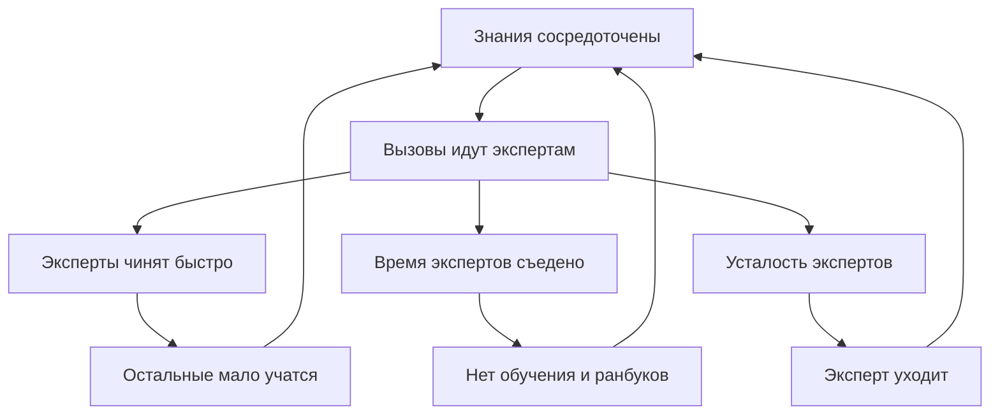
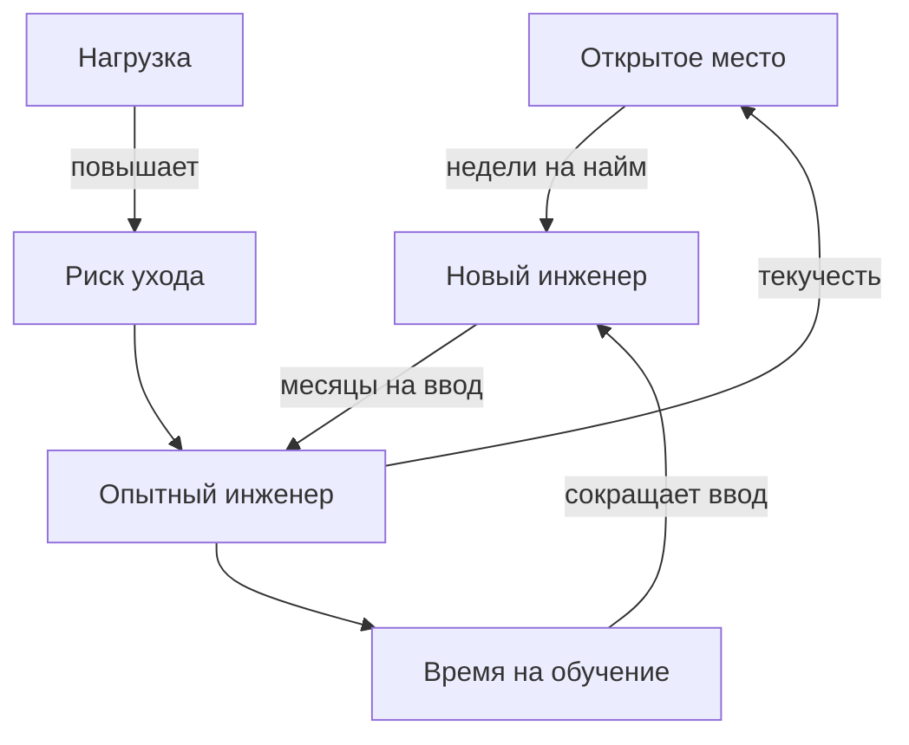
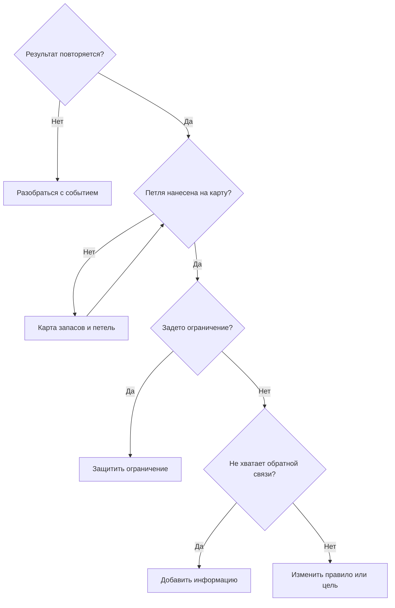

# Глава 3 — Управленческий рычаг и системное мышление { #chapter-3-managerial-leverage-and-systems-thinking }

Любая организация раз за разом выдаёт результаты, которых никто не выбирал: каждую ночь вызывают одних и
тех же троих, одни и те же решения ждут одного и того же человека. Эта глава учит видеть в таких
результатах продукт структуры (запасов, потоков, петель обратной связи, задержек и ограничений) и тратить
свои часы по тому, насколько каждый из них меняет эту структуру, а не по тому, насколько он заметен.
Здесь собран инструментарий системного мышления, которым пользуется книга. Глава 27 применяет его к
падению качества, глава 16 — к потоку поставки, а глава 1 вводит понятие результата руководителя, которое
эта глава превращает в метод. Сквозной пример — Northstar Technologies, вымышленная компания из
[кейса](../../case-studies/northstar/index.md).

## Почему это важно { #why-this-matters }

На уровне команды руководители учатся исправлять события: сорванный срок, инцидент, увольнение. События
заметны, и реагировать на них — значит ощущать, что работаешь. Но структура, которая породила одно
событие, порождает и следующее, и руководитель, который только реагирует на события, с каждым кварталом
всё больше занят, а результаты не улучшаются.

На уровне организации директор не видит большинства событий. Изменить он может структуру: кто дежурит и
по какому правилу, какая информация попадает на какую встречу, для чего нужны staff-инженеры. Директор,
который продолжает действовать на уровне событий, становится узким местом — и обычно получает за это
похвалу, потому что работа с событиями самая заметная из всех.

На уровне высшего руководства рычаг переходит к целям, правилам и убеждениям, которые за ними стоят. CTO,
который тратит время совета директоров на процент бонуса, расходует самые дорогие часы в компании на
самый слабый вид изменений. Навык одинаков на любом уровне: найти структуру за повторяющимся
результатом и ранжировать возможные изменения по рычагу, а не по заметности.

## Цели главы { #learning-objectives }

После этой главы вы сможете:

- Моделировать команду или организацию как запасы, потоки и петли обратной связи и находить петлю,
  которая порождает нежелательный результат.
- Учитывать задержки, предсказывая действие вмешательства, и распознавать колебания, которые возникают,
  если задержки игнорировать.
- Ранжировать возможные вмешательства по рычагу, а не по заметности, — по явным критериям и с учётом
  усилий, которых они требуют от вас.
- Находить ограничение в системе, в том числе когда ограничение — человек, и перестать вкладываться в
  улучшения, которые его не затрагивают.
- Проводить аудит собственного календаря и поведения как части системы, в том числе выяснять, умножаете
  вы или ослабляете способности людей вокруг.

## Ментальная модель { #the-mental-model }

> **Ментальная модель:** повторяющиеся результаты порождает структура, а не события. Рычаг — это то,
> насколько изменение структуры сдвигает результат в расчёте на час ваших усилий, и самые заметные
> вмешательства редко дают наибольший рычаг.

!!! info "Northstar: что уже известно"
    До недели 1. В Northstar, вымышленной компании книги, которая делает ПО для order-to-cash («от
    заказа до оплаты»), 80 инженеров в шести командах, и вот-вот придёт новый директор по разработке. В
    прошлом квартале было 30 серьёзных инцидентов (Sev1 и Sev2), больше всего — у Billing. См.
    [хронологию](../../case-studies/northstar/timeline.md). Впервые в Northstar? Прочитайте
    [«Год вкратце»](../../case-studies/northstar/year-in-brief.md) и
    [«Действующие лица»](../../case-studies/northstar/cast.md).

Первая идея пришла из системной динамики: система — это запасы (то, что накапливается, например опытные
инженеры или доверие), которые меняются потоками (найм, текучесть, обучение), а петли обратной связи
связывают запасы обратно с потоками
([Meadows, 2008](../../references/bibliography.md#meadows2008thinking)). **Усиливающая петля** усиливает
то, что она делает; **балансирующая петля** толкает систему к цели. Если результат возвращается после
того, как вы его исправили, его воспроизводит какая-то петля.

В команде Billing в Northstar есть одна такая петля. Трое из тринадцати её инженеров принимают большую
часть вызовов на дежурстве ([обзор Northstar](../../case-studies/northstar/index.md)). Обычно это
называют проблемой укомплектованности. Точнее описать это как петлю:

Каждая стрелка по отдельности разумна: направить вызов по ledger тому, кто быстрее всех восстанавливает
сервис, — хорошая практика реагирования на инциденты, а эксперт, который чинит, вместо того чтобы писать
ранбуки (runbooks), делает то, чего просит бизнес. Вместе они с каждым кварталом всё сильнее
сосредоточивают знания. Внешний путь (усталость, затем уход) усиливает концентрацию как раз тогда, когда
она опаснее всего.

Вторая идея — **рычаг**. Donella Meadows ранжировала точки вмешательства в систему: внизу — изменение
чисел, наверху — изменение целей и парадигм (общих убеждений, из которых вырастают цели). Она также
пересказала наблюдение Jay Forrester: люди часто находят правильную точку, но давят на неё не в ту
сторону ([Meadows, 1999](../../references/bibliography.md#meadows1999leverage)). Версия для руководителя:
для каждой повторяющейся проблемы перечислите вмешательства, определите уровень каждого и оцените каждое
в своих часах. Выигрывают обычно структурные вмешательства — медленные в проявлении и неэффектные.

## Подробный разбор { #deep-conceptual-explanation }

### Запасы, потоки и медленные изменения { #stocks-flows-and-slow-change }

Запас — это всё, что можно пересчитать в конкретный момент: инженеры, которые могут безопасно менять ledger,
люди, ждущие решения. Поток — это скорость: обученные за квартал инженеры, увольнения за год. Запас
меняется только через свои потоки, поэтому он наполняется и опустошается с той скоростью, которую
позволяют потоки ([Meadows, 2008](../../references/bibliography.md#meadows2008thinking)).

Важны два следствия. Самые важные запасы (опыт, доверие) наполняются медленно и могут быстро
опустошиться: потерять одного из четырёх экспертов по ledger можно за неделю, а заменить его — за месяцы.
И большой запас скрывает остановившийся приток: Billing жила на знаниях о ledger, которые никто не
пополнял, и нехватка стала заметной только тогда, когда экспертов осталось трое. Глава 27 применяет ту
же арифметику к дефектам
([модель в варианте для качества](../05-engineering-quality/27-quality-transformation-at-enterprise-scale.md#the-mental-model)).

### Петли обратной связи { #feedback-loops }

**Балансирующая петля** действует на разрыв между целью и текущим состоянием. Балансирующие петли
объясняют, почему проблемы часто частично улучшаются, а затем застревают на уровне, которого никто не
выбирал: петлю устраивает цель ниже вашей, или она действует через ресурс, который заканчивается.

**Усиливающая петля** подаёт свой выход обратно на вход, в любом направлении. Запущенная в обратную
сторону, петля дежурств распространяет знания: защищённое время на обучение, больше людей, способных
реагировать, меньше вызовов на эксперта, больше времени на обучение. **Коэффициент усиления** петли —
это то, насколько сильно каждый виток усиливает следующий. Meadows утверждала, что снизить коэффициент
усиления усиливающей петли обычно эффективнее, чем укреплять балансирующие петли, которые с ней борются
([Meadows, 1999](../../references/bibliography.md#meadows1999leverage)). На языке управления: замедлите
концентрацию, прежде чем добавлять способы с ней справляться, вроде путей эскалации или большей надбавки.

Тест на распознавание, **рекомендация книги**: если на протяжении двух кварталов одни и те же люди,
компоненты или решения фигурируют в большинстве проблем, ищите вокруг них усиливающую петлю. Если
проблема улучшается после каждого нажима, а потом возвращается на прежний уровень, ищите балансирующую
петлю с более низкой целью и выясните, чья это цель.

### Задержки { #delays }

Найм добавляет ресурс за месяцы, обучение добавляет экспертизу за месяцы, изменение правила проявляется
в цифрах за квартал. Meadows отмечала, что задержки, длинные по сравнению со скоростью изменений в
системе, вызывают перерегулирование и колебания
([Meadows, 1999](../../references/bibliography.md#meadows1999leverage)). Запас опытных инженеров
показывает этот механизм:

За двенадцать месяцев до прихода директора из Northstar ушли восемь инженеров (10 процентов от 80), а
медианное время от заявления об уходе до первого дня замены составило 15 недель (вымысел; см.
[исходные данные](../../case-studies/northstar/baseline-data.md)). Это около 2,3 инженеро-года пустующих
мест (120 место-недель) — и это ещё до тех месяцев, которые нужны каждому новичку, чтобы войти в
работу. Руководитель, который запрашивает найм под сегодняшнюю нагрузку, получает людей, когда давление
уже прошло пик, а следующий цикл планирования их срезает: найм и заморозки идут в противофазе с
потребностью. Защита — действовать в первую очередь на те потоки, которыми вы управляете быстрее всего
(текучесть, время на обучение, ввод в работу), и планировать найм по прогнозу.

### Ловушка возможностей { #the-capability-trap }

Под давлением команды перестают улучшаться и отстают ещё сильнее. Nelson Repenning и John Sterman
описывают два способа закрыть разрыв в результатах: работать усерднее или сделать процесс способнее,
тратя время на улучшения. Их доказательная база — более десятка полевых исследований программ улучшений
(в телекоммуникациях, производстве полупроводников, автомобилестроении и других отраслях) плюс модели
системной динамики ([Repenning and Sterman, 2001](../../references/bibliography.md#repenning2001nobody)).
Усердная работа окупается сразу. Улучшения окупаются с задержкой и тем временем стоят выпуска, поэтому
результаты сначала становятся хуже, а потом лучше. Под давлением люди срезают время на улучшения,
возможности деградируют, разрыв растёт, давление усиливается — это **ловушка возможностей**. Поскольку
связь между пропущенным улучшением и последующей нехваткой длинная и плохо заметная, утверждают авторы,
руководители склонны винить усердие или дисциплину людей и отвечают ещё большим давлением. Это
**научный результат**, полученный в полевых исследованиях и на имитационных моделях, а не в
контролируемых экспериментах; его сила в том, что механизм повторяется в очень разных отраслях.

Глава 27 показывает ловушку на примере падения качества. Но она управляет и временем руководителя.
Эксперты Billing сами разбирают вызовы, вместо того чтобы работать в паре и писать ранбуки; директор
отвечает на каждую эскалацию, вместо того чтобы написать правила, которые сделали бы большинство
эскалаций ненужными. Награждая героизм, вы укрепляете петлю, которая делает героизм необходимым.

Leslie Perlow увидела ту же картину в девятимесячном полевом исследовании одной команды разработки ПО.
Согласно аннотации, коллективный способ, которым группа распоряжалась временем, приводил к тому, что
времени её членам постоянно не хватало. Инженеров постоянно прерывали, а кризисный менталитет и награды
за индивидуальный героизм поддерживали эту картину. Изменение того, как они использовали время, повысило
коллективную продуктивность ([Perlow, 1999](../../references/bibliography.md#perlow1999time)). Это одно
качественное исследование, но по направлению оно совпадает с ловушкой.

### Точки рычага { #leverage-points }

Эссе Meadows перечисляет двенадцать точек вмешательства в порядке возрастания эффективности и называет
этот список предварительным ([Meadows, 1999](../../references/bibliography.md#meadows1999leverage)).
Таблица показывает уровни, которые чаще всего важны в инженерных организациях; примеры — авторства этой
книги.

| Уровень (снизу вверх) | Что меняется | Пример из разработки |
|---|---|---|
| Параметры | Числа в существующей структуре | Надбавка за дежурства, [лимит WIP](../../glossary.md#work-in-progress-wip-and-wip-limit) (ограничение на незавершённую работу), процент распределения ресурсов |
| Буферы и запасы | Размер запасов относительно потоков | Найм с опережением текучести, запас в графике дежурств |
| Задержки | Время между действием и обратной связью | Еженедельный, а не ежеквартальный обзор нагрузки на дежурных |
| Сила петли | Насколько сильно давит петля | Защищённое время на обучение замедляет концентрацию |
| Информационные потоки | Кто что видит | Вызовы на человека показываются на еженедельном разборе |
| Правила | Стимулы, ограничения, права на решения | Эксперты — только для эскалаций |
| Цели | К чему стремится система | «Восстановить быстрее всех» против «восстановить может любой» |
| Парадигмы | Убеждения, из которых вырастают цели | «Надёжность — забота экспертов» |

Три наблюдения из эссе стоит держать в голове на любом обсуждении планов. Больше всего внимания достаётся
параметрам, которые редко меняют поведение. Добавить недостающую обратную связь часто и сильно, и
дёшево. И чем выше точка рычага, тем сильнее система сопротивляется изменению: изменение правила
вызывает возражения, которых повышение надбавки не вызывает никогда.

### Ограничения { #constraints }

Аргумент Eliyahu Goldratt, ставший популярным благодаря *The Goal*, состоит в том, что выпуск системы
ограничен её самым узким местом и что улучшение чего-либо другого выпуск не повышает
([Goldratt and Cox, 1984](../../references/bibliography.md#goldratt1984goal)). Процедура, связанная с
его работами: найти ограничение, выжать из него максимум, подчинить ему всё остальное (планировать всю
остальную работу вокруг потребностей ограничения), расширить его, а затем искать следующее. Глава 16
применяет её к потоку поставки.

Урок для руководителя: ограничениями часто оказываются люди. Staff-инженер, суждения которого ждёт
каждый дизайн; директор, одобрения которого требует каждое исключение; три инженера, которые единственные
могут безопасно реагировать на инциденты с ledger. Первый шаг — не заставлять их работать быстрее, а
перестать тратить их время на то, что может сделать кто-то другой.

### Управленческий рычаг { #managerial-leverage }

Идея Andrew Grove о том, что результат руководителя — это результат организации, на которую он влияет
([Grove, 1983](../../references/bibliography.md#grove1983high)), разобрана в главе 1. Эта глава
добавляет правило ранжирования: рычаг занятия — это изменение, которое оно производит в этом результате
в расчёте на час времени руководителя, за весь период, пока изменение сохраняется. Часовое решение,
которое на год задаёт правило графика дежурств, выигрывает у десяти часов на созвонах по инцидентам,
хотя видят люди именно созвоны.

**Заметность** — отдельная ось. Заметная работа (подключение к инцидентам, одобрение изменений)
вознаграждается сразу; структурная работа часто незаметна и медленна. Руководители смещаются к заметной
работе, потому что обратная связь от неё мгновенная: это ловушка возможностей применительно к самому
руководителю.

### Мультипликаторы и ослабители { #multipliers-and-diminishers }

Идея Liz Wiseman о **мультипликаторах** (multipliers) и **ослабителях** (diminishers) состоит в том,
что лидеры различаются не столько собственным интеллектом, сколько тем, насколько они раскрывают
способности других людей ([Wiseman, 2010](../../references/bibliography.md#wiseman2010multipliers)). В
системных терминах ослабитель — это ограничение, которое вдобавок ослабляет приток способностей: каждый
вопрос, на который вы ответили за человека, в следующий раз вернётся. Мультипликатор направляет решения и
обучение к другим. Проверка поведенческая: посчитайте решения в вашей области, которые требуют вас, и
посмотрите, уменьшается ли это число.

## Пример из инженерной организации { #engineering-organization-example }

Анализ ниже — **иллюстрация**. Northstar не отслеживала нагрузку на дежурных, поэтому цифры по вызовам
восстановлены задним числом по истории инструмента оповещений.

Три эксперта по ledger приняли 70 процентов вызовов Billing в базовом квартале (квартале перед приходом
директора) и почти все ночные вызовы:

| Вызовы Billing, базовый квартал | Три эксперта по ledger | Остальные десять инженеров |
|---|---|---|
| Обработано вызовов, первично или по эскалации (всего 180) | 126 | 54 |
| Вызовов на человека | около 42 | около 5 |
| Вызовов в нерабочее время (всего 64) | 54 | 10 |

Около трети всех вызовов (61) не требовали никаких действий. Кроме того, у Billing было восемь
инцидентов [Sev1 и Sev2](../../glossary.md#severity-sev1-sev2-sev3) (два самых серьёзных уровня в
Northstar), шесть из них — повторения прежних сбоев. Медианное время восстановления сервиса составляло
495 минут против 190 по организации. Раньше у Billing было четверо дежурных с опытом работы с ledger;
один ушёл примерно за девять месяцев до прихода директора.

Критерии ранжирования (**рекомендация книги**): влияние на петлю, как долго эффект держится без
дальнейших усилий, задержка до начала действия и собственные часы директора.

| Вмешательство | Уровень | Влияние на петлю | Задержка | Часы директора | Заметность |
|---|---|---|---|---|---|
| Повысить надбавку за дежурства | Параметр | На концентрацию — никакого; может отсрочить уход | Сразу | 1 | Высокая |
| Директор подключается к инцидентам Billing | Никакой | Никакого; ещё один человек на каждом созвоне | Сразу | 5 в неделю | Очень высокая |
| Запросить ещё одного инженера по ledger | Приток в запас | Малое и запоздалое; численность не растёт | 15 недель плюс ввод в работу | 3 | Высокая |
| Удалить или понизить вызовы без действий | Приток в петлю | Примерно на 43 вызова экспертам в квартал меньше | 2–4 недели | 2 | Низкая |
| Еженедельно показывать вызовы на человека | Информационный поток | Концентрация видна всем руководителям | 1 неделя | 1 | Низкая |
| Правило: эксперты только для эскалаций, с работой в паре | Правило | Разворачивает петлю | Один квартал | 4 | Средняя |
| Защищённое время экспертов на ранбуки | Сила петли | Знания выходят из трёх голов | Один–два квартала | 2 | Низкая |

Четвёртая строка предполагает, что трое обрабатывали вызовы без действий в той же доле 70 процентов, что
и все вызовы (70 процентов от 61 — это около 43). Как понижать алерты, которые срабатывают по причинам
(cause-based alerts), разбирает глава 24
([проектирование дежурств и нагрузка](../05-engineering-quality/24-reliability-slos-and-operational-readiness.md#on-call-design-and-load)).

Изменение правила разворачивает петлю, и ему сопротивляются сильнее всего. Квартал восстановление будет
медленнее, пока остальные учатся, — в команде, где медианное восстановление и так длится больше восьми
часов. Численность здесь не проблема. Глава о дежурствах в Google *Site Reliability Workbook* (SRE —
site reliability engineering, инженерия надёжности сайтов) считает пределом нагрузки два инцидента за
двенадцатичасовую смену. Минимум для круглосуточного графика на одной площадке там — восемь инженеров
([Cook et al., On-Call](../../references/bibliography.md#cook2018oncall)); тринадцать инженеров
превышают этот порог, так что ограничение Billing — знания, а не численность.

Два самых заметных вмешательства дают наименьший рычаг. Три с наибольшим рычагом (удаление алертов,
публикация нагрузки, правило эскалации) стоят директору в сумме около семи часов. Проектирование графика
дежурств разбирает глава 24.

## Как принимать решение { #decision-framework }

Если результат повторяется, пройдите по шагам диагностики и выберите вмешательство с наибольшим рычагом,
которое вы сможете довести до конца:

Затем оцените варианты:

| Критерий | Вопрос | Тревожный признак |
|---|---|---|
| Уровень | Где в списке точек рычага оно действует? | Все варианты — параметры |
| Охват | Сколько людей или решений оно меняет? | Только человека перед вами |
| Устойчивость | Продолжает ли оно работать, когда вы перестаёте за ним следить? | Нужно ваше еженедельное присутствие |
| Задержка | Когда проявится эффект и будете ли вы тогда ещё измерять? | Нет даты проверки |
| Цена для вас | Ваши часы, сейчас и в дальнейшем | Растёт вместе с организацией |
| Сопротивление | Кто что-то теряет? | Никто не возражает: возможно, ничего не изменится |
| Направление | Может ли оно усилить петлю, которую вы хотите ослабить? | Вознаграждает поведение, создающее проблему |

Два эмпирических правила, оба — **рекомендация книги**. Если два вмешательства близки, предпочитайте
то, которое добавляет информацию или меняет правило, тому, которое меняет число. А если ограничение —
вы сами, первое вмешательство касается вашего собственного календаря.

## Компромиссы { #trade-offs }

**Рычаг против скорости.** Структурные изменения часто проявляются через квартал. Если эксперт вот-вот
выгорит в этом месяце, правильным будет облегчение с малым рычагом (снять с графика дежурств, оплатить
ночи) — при условии, что оно идёт вместе со структурным изменением и не принимается за него.

**Рычаг против сопротивления.** Правило, по которому эксперты занимаются только эскалациями, стоит им
статуса, а команде — скорости восстановления. Закладывайте политическую работу в бюджет вместе с
технической и ждите, что возражение придёт в форме разумно звучащего исключения.

**Заметные действия против структурных.** Заметность не бесполезна: люди во время инцидента хотят видеть,
что руководству не всё равно, а директор, который никогда не появляется, теряет доверие, необходимое
для структурной работы. Выбирайте какое-то заметное присутствие осознанно; большую часть часов тратьте
на структуру.

**Моделирование против действия.** Моделирование может стать способом не принимать решение. Обычно
достаточно грубой петли, сверенной с данными.

## Типичные провалы { #failure-modes }

**Подкручивание параметров.** Любой ответ — число: выше надбавка, новая цель. Сигнал: проблема
возвращается после каждой корректировки. Противодействие: требуйте в каждом предложении хотя бы один
вариант, который не сводится к параметру.

**Петля героев.** Признание получает тот, кто починил аварию в два часа ночи, а не тот, кто написал
ранбук, благодаря которому чинить не пришлось. Сигнал: одни и те же имена в каждом инциденте и в каждой
награде. Противодействие: публично признавайте работу, которая устранила потребность в героизме.

**Оптимизация не-ограничения.** Ускорение сборки сервиса, когда каждый релиз ждёт ручного одобрения.
Сигнал: локальные показатели улучшаются, сквозной результат — нет. Противодействие: назовите
ограничение, прежде чем одобрять работу по улучшению.

**Игнорирование задержек.** Вмешательство через две недели признают провалом и отменяют; новые люди
приходят, когда боль уже прошла. Сигнал: политики колеблются туда-сюда. Противодействие: при изменении
называйте ожидаемую задержку и дату проверки.

**Нечаянный ослабитель.** Способный руководитель или staff-инженер отвечает на каждый вопрос и
становится ограничением. Сигнал: решения ждут одного человека; остальные перестают предлагать.
Противодействие: посчитайте решения, которым нужны вы, и каждый квартал отдавайте часть из них.

**Рычаг в обратную сторону.** Добавление шагов одобрения после сбоя укрупняет пачки изменений и
усугубляет сбои (в главе 27 есть вариант с релизным поездом). Противодействие: прежде чем браться за
вмешательство, проведите его один раз по всей петле.

## Применение в крупной организации { #enterprise-application }

В организации из 50–150 инженеров рычаг директора почти целиком действует через других людей и через
структуру.

**Портфель директора** — это в основном правила, информация и цели: права на решения для
staff-инженеров, что показывает еженедельный операционный разбор, за какие результаты отвечают
руководители. Календарь директора — это система, которой нужно управлять, а сам директор часто
оказывается первым ограничением организации.

**Руководители моделируют свои команды.** Каждый руководитель разработки должен уметь назвать
критические запасы своей команды (опытные дежурные, люди, рискующие уйти) и петлю, которая скорее
всего ударит по ним через два квартала. Такой вопрос выявил бы концентрацию в Billing до того, как она
дошла до трёх человек.

**Staff-инженеры как рычаг.** Три staff-инженера Northstar не владеют компонентами и не имеют мандата.
Ines Carvalho (staff-инженер, основной домен) — пример из кейса ниже: часы в неделю уходят на
внеплановые вопросы по Core. Отвечать на вопросы по одному — самый низкий уровень работы; если же
написать правила границ для модуля Core и проверять решения других на соответствие им, это доходит до
каждой команды. Роль staff-инженера разбирает глава 29.

**Запасы уровня организации**, которые меняются медленно и важнее всего: люди, способные безопасно менять
критические системы, руководители, способные вести команды без эскалаций, и доверие между разработкой и
продуктом. Отчитывайтесь о них, пусть и грубо, рядом с показателями поставки (глава 37).

## Взгляд CTO { #cto-perspective }

На уровне высшего руководства вмешательства с наибольшим рычагом — это цели, общекомпанейские правила и
убеждения, которые за ними стоят. CTO, который ведёт себя так, будто надёжность — забота каждой
команды, а не экспертов, изменил парадигму; CTO, который профинансировал повышение надбавки, изменил
параметр.

**Перевод запросов.** Совет директоров и коллеги в высшем руководстве просят числа: численность, цель,
строку бюджета. «Добавьте десять инженеров» — это приток в запас с задержкой в месяцы и с оттоком через
текучесть; полезный вопрос — какую петлю изменили бы эти инженеры и не сделало бы это изменение правила
быстрее.

**Запасы всей компании.** CTO отвечает за запасы, которые директора не видят целиком: таланты во всех
командах, способность архитектуры поглощать изменения и доверие к разработке. Под давлением они
истощаются незаметно. Предложение отложить найм на замену ушедших, чтобы не допустить роста расходов,
— это решение позволить запасу опытных инженеров уменьшаться при сохранении нагрузки, что усиливает
сразу все петли концентрации.

**Собственный рычаг CTO.** CTO, который одобряет архитектурные решения, подключается к каждому Sev1 и
отвечает на каждую эскалацию, — самое дорогое ограничение организации. В его календаре должны
преобладать цели, правила, люди, которые руководят организацией, и информация, по которой она
ориентируется.

## Практический плейбук { #practical-playbook }

1. **Перечислите повторяющиеся результаты.** Три проблемы, которые возвращались хотя бы дважды за два
   квартала. Разовые события игнорируйте.
2. **Нанесите каждую на карту запасов и петель**, по странице на проблему, и сверьте каждую стрелку с
   данными.
3. **Назовите задержки.** Оцените, сколько времени нужно каждому потоку, чтобы отреагировать, и
   запишите это.
4. **Найдите ограничение.** Спросите, чего ждёт результат. Если это человек, включая вас, так и скажите.
5. **Перечислите вмешательства на разных уровнях**: хотя бы один параметр, один информационный поток,
   одно правило. Если в голову приходят только параметры, вернитесь к шагу 2.
6. **Оцените их** по таблице решений.
7. **Проведите аудит календаря.** Выполните аудит календаря из главы 1 с одним дополнительным столбцом —
   уровнем рычага (низкий, средний, высокий) каждого блока. Переносите часы из самого низкого уровня в
   самый высокий и защищайте их в календаре.
8. **Измените одно правило и один информационный поток** — заметно, сказав, что вы ожидаете увидеть и
   когда.
9. **Проверьте результат по истечении названной задержки.** Если петля не ослабла, пересмотрите карту, а
   не только вмешательство.
10. **Каждый квартал отдавайте решения.** Посчитайте решения, которым нужны вы, и сократите их число.

## Кейс { #case-study }

Этот кейс — **вымысел**. Действие происходит за двенадцать месяцев до прихода директора в Northstar
([исходные данные](../../case-studies/northstar/baseline-data.md)).

В начале того года в Billing было четыре инженера, которым доверяли инциденты с ledger. Формально в
графике дежурств были все тринадцать, но вызовы по ledger и выставлению счетов почти рефлекторно
эскалировались этой четвёрке, потому что они восстанавливали сервис быстрее всех. За девять месяцев до
прихода директора один из четырёх уволился. Найм на замену начался через 15 недель, а поскольку
оставшиеся трое редко были свободны для работы в паре, к концу базового квартала новичок так и не вошёл
в график дежурств.

Прежнее руководство реагировало трижды. Оно повысило надбавку за дежурства. После каждого серьёзного
инцидента в Billing оно добавляло алерт; часть из них превратилась в вызовы без действий, которые
составили около трети из 180 вызовов квартала. И оно попросило экспертов «документировать по ходу дела»,
не дав им на это времени. Каждый ответ был разумным, и каждый был параметром или добавлением к притоку в
петлю. Ни один не изменил того, кто учится на вызове.

К базовому кварталу результат выглядел как проблема результативности: самое большое число инцидентов в
организации (8), шесть повторных инцидентов и медианное время восстановления более чем вдвое выше, чем
по организации. Руководитель, читающий только эти цифры, мог бы решить, что команде не хватает
дисциплины, — та самая ошибка атрибуции, которую описывают Repenning и Sterman. Петля говорила другое:
эксперты делали ровно то, за что система их вознаграждала, и каждый квартал делал систему всё более
зависимой от них.

Та же структура обнаруживалась и в других местах. Ines Carvalho (staff-инженер), одиннадцать лет
работающая с Core, тратила около восьми часов в неделю на ответы на вопросы, на которые письменно
зафиксированная граница модуля ответила бы один раз (**иллюстрация**, согласуется с 20-процентной долей
незапланированной работы у staff-инженеров). Информационный поток, который показал бы эту цену, никому не
принадлежал.

Урок: ни один из трёх ответов не был ошибочным сам по себе, и ни один не затронул петлю. Открытый выбор
для нового директора — какое правило или какой информационный поток изменить первым.

## Упражнения { #exercises }

Решения — в [решениях к главе 3](../../solutions/ch03-solutions.md). Ссылки на файлы данных — на
[странице исходного уровня Northstar](../../case-studies/northstar/baseline-data.md).

### Базовый уровень { #foundational }

**F1.** Нарисуйте карту запасов и потоков для «инженеров, которые могут безопасно реагировать на
инцидент с ledger в Billing» в Northstar. Используйте цифры из этой главы (четыре эксперта в начале
года, один уход, задержка найма на замену 15 недель) и сформулируйте собственное допущение о том,
сколько времени нужно новому инженеру, чтобы стать надёжным дежурным, с работой в паре и без неё.
Предскажите величину запаса в конце следующих двух кварталов при обоих допущениях и скажите, какой поток
директор может изменить быстрее всего.

**F2.** Команда Marcus Oyelaran (он руководит Billing) предлагает восемь ответов на нагрузку дежурств:
более высокую надбавку, второй еженедельный разбор инцидентов, запрос на найм, чистку вызовов без
действий, публикуемый график вызовов на человека, правило «эксперты только для эскалаций», ежеквартальную
награду за лучшее реагирование на инцидент и защищённое время на ранбуки. Разместите каждый ответ в
таблице точек рычага, укажите те, которые усилили бы петлю концентрации, и объясните свои рассуждения
для двух самых трудных для классификации.

**F3.** Предположим, в одном из следующих кварталов рабочая группа Northstar по релизам обнаруживает, что
каждое решение о границах модулей Core ждёт Ines Carvalho, и предлагает сократить пайплайн Core на 20
минут, чтобы «улучшить поток». Определите ограничение, скажите, повысит ли работа над пайплайном
выпуск, и предложите два способа получить от ограничения больше, не прося Ines работать дольше.

### Прикладное лидерство { #applied-leadership }

**A1.** **Иллюстративная** 45-часовая неделя нового директора: статус-встречи 9 часов, подключение к
созвонам по инцидентам 5, личное одобрение технических изменений 4, встречи один на один с девятью
прямыми подчинёнными 4,5, встречи с продуктом и клиентами 6, почта и чаты 8, интервью с кандидатами 3,
незапланированное 5,5. Ранжируйте категории по рычагу, перестройте неделю так, чтобы освободить хотя бы
десять часов, и скажите, куда идёт каждый освобождённый час и какой риск несёт каждое изменение.

**A2.** Ines Carvalho уважают, она быстрая и за считанные минуты сама отвечает на любой вопрос по Core.
Два senior-инженера из Orders говорят, что перестали предлагать дизайны, потому что «Ines всё равно
знает лучше». Спланируйте разговор с Ines, в котором это рассматривается как системная проблема, а не как
недостаток характера: что вы спросите, какие данные принесёте, какой мандат предложите и как через
квартал поймёте, изменилось ли что-нибудь.

**A3.** Marcus просит вас одобрить удвоение надбавки за дежурства в Billing, утверждая, что это
единственное, что он может сделать на этой неделе, и что один из его экспертов близок к уходу. Примите
решение и напишите ответ. Учтите непосредственный риск потерять человека, структурное изменение, которое
вы хотите провести параллельно, и то, как не дать надбавке стать единственным ответом.

### Решения на уровне руководства { #executive-decision-making }

**X1.** Вы — CTO Northstar. Rajiv Menon (CFO, финансовый директор) предлагает отложить весь найм на
замену ушедших на один квартал, чтобы не допустить роста операционных расходов. Используя цифры
текучести и найма на замену из этой главы и принимая полную стоимость в $185 000 за инженеро-год,
оцените потерю ресурса, опишите, какие петли усилит эта отсрочка, и напишите короткую рекомендацию для
Helena Marsh (CEO, генеральный директор) с альтернативой, которая служит цели CFO.

**X2.** Как CTO вы можете в этом году спонсировать одно вмешательство на уровне всей компании: правило,
по которому ни один инженер не может быть первым дежурным больше чем для установленной доли вызовов
команды в нерабочее время, с контролем через ежемесячное ревью; или ежемесячно публикуемый дашборд с
нагрузкой дежурств, временем ожидания решений и текучестью по командам — без всякого правила. Выберите
одно, разместите оба в списке точек рычага и скажите, что заставило бы вас переключиться через два
квартала.

## Вопросы для размышления { #reflection-questions }

1. Какой результат в вашей организации возвращался хотя бы трижды? Какая петля его воспроизводит и кому
   выгодна эта петля в её нынешнем виде?
2. Какое из ваших регулярных занятий самое заметное и дающее меньше всего рычага? Кто заметил бы первым,
   если бы вы прекратили его на месяц?
3. Где ограничение — вы? Сколько решений на прошлой неделе ждали вас, хотя их могло бы решить правило?
4. Какой запас в вашей организации истощается слишком медленно, чтобы кто-то это заметил?
5. Чей героизм вознаграждает ваша организация и что потребовалось бы, чтобы вознаграждать работу,
   которая делает героизм ненужным?

## Главное { #key-takeaways }

- Относитесь к повторяющемуся результату как к продукту структуры: нанесите на карту запасы, потоки и
  петли, прежде чем выбирать вмешательство.
- Запасы опыта и доверия наполняются медленно и быстро истощаются; действуйте в первую очередь на
  потоки, которыми управляете быстрее всего.
- Называйте задержку каждого вмешательства и проверяйте его по её истечении, а не раньше.
- Ранжируйте вмешательства по рычагу (эффект, охват, устойчивость, ваши часы). Заметность — отдельная
  ось, и обычно она указывает не туда.
- Предпочитайте менять правила и информационные потоки, а не числа, и ждите, что сопротивление будет
  расти вместе с рычагом.
- Найдите ограничение, даже если это человек, и перестаньте вкладываться туда, где его нет.
- Под давлением защищайте время на улучшения; именно сокращая его, команды и руководители попадают в
  ловушку возможностей.
- Проводите аудит собственного календаря как части системы и каждый квартал отдавайте решения.

## Источники и что почитать { #references-and-further-reading }

- [Meadows, 1999](../../references/bibliography.md#meadows1999leverage). «Leverage Points: Places to
  Intervene in a System». Ранжированный список, который адаптирует эта глава; короткий, бесплатный и
  лучший единственный текст о рычаге.
- [Meadows, 2008](../../references/bibliography.md#meadows2008thinking). *Thinking in Systems*. Более
  подробное введение в запасы, потоки и обратную связь.
- [Repenning and Sterman, 2001](../../references/bibliography.md#repenning2001nobody). Ловушка
  возможностей, динамика «сначала хуже, потом лучше» и почему руководители винят людей в структурных
  провалах.
- [Perlow, 1999](../../references/bibliography.md#perlow1999time). Как общий для команды разработки
  способ использовать время и награды за героизм приводили к постоянной нехватке времени.
- [Goldratt and Cox, 1984](../../references/bibliography.md#goldratt1984goal). *The Goal*. Мышление в
  терминах ограничений, изложенное в форме романа.
- [Grove, 1983](../../references/bibliography.md#grove1983high). *High Output Management*. Результат
  руководителя; подробно разобран в главе 1.
- [Wiseman, 2010](../../references/bibliography.md#wiseman2010multipliers). *Multipliers*. Лидеры,
  которые раскрывают способности других, и те, кто их недоиспользует.
- [Cook et al., On-Call](../../references/bibliography.md#cook2018oncall), в бесплатной книге *Site
  Reliability Workbook*. Пределы нагрузки на дежурных и размер графика дежурств.
