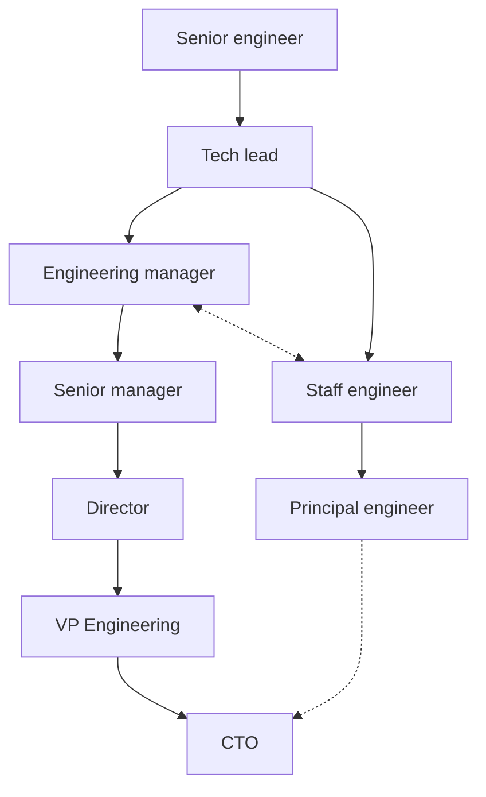
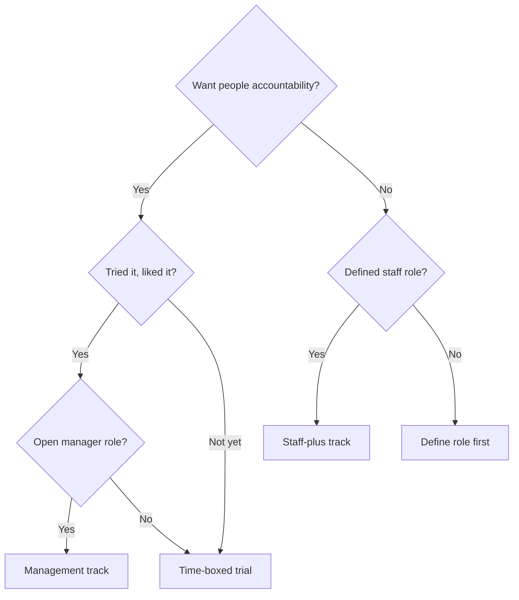

# Chapter 4 — The Leadership Ladder: Senior Engineer to CTO

This chapter is a map of the roles between senior engineer and chief technology officer: what each
one is responsible for, how far ahead it looks, what it produces, and how it typically fails. It then
takes on two questions the map raises. How do you tell whether a manager at any level is effective,
rather than merely busy? And how should an experienced engineer choose between the management track
and the staff-plus track, and switch later if the choice was wrong? The running example is Northstar
Technologies, the fictional company in the [case study](../../case-studies/northstar/index.md).

This chapter is the map. Chapter 8 owns career ladders and promotion, Chapter 29 staff-plus roles,
and Chapters 40, 47, and 50 the director, VP, and CTO roles. Chapter 1 defines managerial output; this
chapter owns how to measure it.

## Why This Matters

On a single team, role confusion is cheap. Everyone can see who decides what, and a mismatch is fixed
in a conversation.

In an organization of 50 to 150 engineers, undefined roles become structural. Two people believe
they own the same decision, or nobody does. Strong engineers are promoted into management because it
is the only visible step up. Staff engineers without a mandate drift between advising and
firefighting. Managers judged on what their teams ship are rewarded for activity, not for building a
team that will still work next year.

At executive scale, the ladder is the CTO's design problem. Which roles exist, what each is
accountable for, and how people move between tracks decide whether the organization produces its next
generation of leaders or imports them. Northstar has six managers, three staff engineers with no
defined mandate, a director, and a CTO, and no written description of what most of them are for.

## Learning Objectives

After this chapter you will be able to:

- Describe the scope, time horizon, primary output, and main failure mode of each role from tech lead
  to CTO, and of the staff-plus roles beside them.
- Diagnose the level at which a person is actually operating from their calendar and decisions,
  independent of their title.
- Measure a manager's effectiveness with a small set of outcome, health, and leverage evidence, and
  explain why team activity is not that measure.
- Choose between the management and staff-plus tracks using explicit criteria, and design a switch
  between them with a trial period and a return path.

## The Mental Model

> **Mental model:** Each step up the ladder trades direct output for leverage and lengthens the delay
> before you learn whether you were right. Measure each role on the outcomes it is positioned to
> change, over the horizon it works on.

Two quantities change as you move up either track. **Scope** grows: from a component, to a team, to
several teams, to the whole of engineering and its place in the company. **Time horizon** grows with
it: a tech lead's decisions show their consequences in weeks, a director's in quarters, a CTO's in
years. Everything else about the role follows from these two. The primary output shifts from work
you did to work others did because of decisions you made, and the main failure mode at every level is
to keep doing the previous level's job, because that job still gives fast feedback.

The solid lines are the usual promotions. The dotted line between manager and staff engineer is the
switch this chapter plans for. The dotted line from principal engineer to CTO marks that some CTOs come
from the technical track, which depends on the company's CTO archetype (Chapter 50). Tech lead appears
as a step because, in many companies, it is where people first try both kinds of work; it is a role,
not always a level.

## Deep Conceptual Explanation

### The ladder, level by level

The table below is **this book's synthesis**, built on practitioner descriptions rather than research:
Fournier's well-known progression from tech lead through manager of managers to senior leadership
([Fournier, 2017](../../references/bibliography.md#fournier2017manager)), Larson's staff-plus
descriptions ([Larson, 2021](../../references/bibliography.md#larson2021staff)), and his writing on
engineering executives ([Larson, 2024](../../references/bibliography.md#larson2024primer)). The time
horizons are typical ranges, not rules.

| Role | Scope | Time horizon | Primary output | Main failure mode |
|---|---|---|---|---|
| Tech lead | One team's technical work | Weeks to a quarter | Sound technical decisions the team executes | Writes the hard parts alone; becomes the bottleneck |
| Engineering manager | One team: people, delivery, health | One to two quarters | A team that delivers and keeps improving without them | Acts as the team's best engineer or its ticket router |
| Senior manager | Several teams, through managers | Two to four quarters | Managers who run their teams well | Manages the managers' teams directly |
| Director | 50 to 150 engineers; one area | One year | An organization whose system produces the outcome | Runs on reports' summaries; fixes symptoms team by team |
| VP Engineering | All or most of engineering | One to two years | Portfolio allocation and a leadership bench | Becomes a large director; no peer-level influence |
| CTO | Technology and its role in the company | Two years or more | Technical strategy the executive team acts on | Advocates for engineering instead of solving the company's problem |
| Staff engineer | A domain or problem across teams | One to four quarters | Technical direction others adopt | Roaming critic, or the overloaded hero who fixes everything |
| Principal engineer | A company-critical domain | One to three years | Direction for the domain; leaders grown in it | Architecture by decree, detached from delivery |

Three cautions apply. Titles vary: Larson defines the engineering executive as the person responsible
for all of engineering, whatever the title, which companies use inconsistently ([Larson, 2023a](../../references/bibliography.md#larson2023executive-job)).
Small companies compress levels. And staff-plus rows hide several archetypes (Tech Lead, Architect,
Solver, Right Hand), each with a different scope ([Larson, Staff archetypes](../../references/bibliography.md#larson-staff-archetypes)).
Chapter 29 treats them.

### What changes at each step

**What you produce.** A senior engineer's output is visible: code, designs, fixed incidents. A
manager's output is the team's output plus what the team can do next quarter that it cannot do now. A
director's output is mostly decisions about structure, staffing, and allocation that others carry out.
Chapter 1 develops Andrew Grove's idea that a manager's output is the output of the organization under
their influence ([Grove, 1983](../../references/bibliography.md#grove1983high)).

**How long feedback takes.** Larson describes staff work as having feedback loops of weeks, months,
and years rather than the quick cycle of shipping code
([Larson, What do Staff engineers actually do?](../../references/bibliography.md#larson-staffeng-actually-do)).
The same holds for managers: a director who restructures ownership learns whether it worked two
quarters later, and is tempted to fill the gap with the previous level's fast-feedback work.

**Whose problem you solve.** At the top, Larson argues that the CEO, the executive peers, and the
engineering organization each see a valid but incomplete version of the problem, and that the
executive's job is to merge them and solve the company's problem rather than advocate for engineering
([Larson, 2023b](../../references/bibliography.md#larson2023balancing)). This is **expert opinion**.

### The staff-plus track in parallel

The staff-plus track exists so that technical leadership is not reachable only through people
management. Larson lists the core of staff work as setting technical direction, mentorship and
sponsorship, providing engineering perspective in decisions, exploration, and the coordinating work
that keeps projects moving, with less coding than before
([Larson, What do Staff engineers actually do?](../../references/bibliography.md#larson-staffeng-actually-do)).
He also notes that some companies have no technical leadership pattern and push every experienced
engineer toward management ([Larson, Staff archetypes](../../references/bibliography.md#larson-staff-archetypes)).

The tracks differ in accountability. A manager answers for people outcomes (hiring, growth,
performance, retention) and has formal authority over them. A staff engineer answers for technical
outcomes across a scope they do not manage, and works mainly through influence; Larson warns that
people overestimate how much formal authority helps
([Larson, Where do Staff-plus engineers fit?](../../references/bibliography.md#larson-staffeng-reporting)).
A staff role without scope, sponsor, and reporting line has neither lever, which is Northstar's
starting position.

### Measuring managerial effectiveness

The common error is to measure a manager by the team's **activity**: deployments, tickets closed, story points, one-on-ones held, roadmap items
shipped. Activity is easy to count and partly under the manager's control. It is not the manager's
output, for three reasons.

1. **Attribution.** Team results depend on the system the team sits in. At Northstar, the baseline page
   warns that Orders' and Billing's lead time and failure rate describe the Core release train more than
   the teams ([baseline data](../../case-studies/northstar/baseline-data.md)). Neither manager could
   have changed the train alone.
2. **Lag.** The most important managerial work (hiring, growing people, clarifying ownership) shows in
   results one or two quarters later. A measure taken this quarter credits the previous manager.
3. **Gaming.** Every activity measure can be raised without improving anything: more, smaller
   deployments; tickets split; one-on-ones held and empty. Chapter 18 treats metric gaming generally.

What do managers measurably affect? Chapter 1 summarizes the evidence that managers matter: the
clearest effect is on retention ([Hoffman and Tadelis, 2021](../../references/bibliography.md#hoffman2021people)),
with behaviors such as coaching and career development listed by Google's Project Oxygen
([Google re:Work](../../references/bibliography.md#rework-great-managers)).

That evidence points to a practical conclusion (**this book's recommendation**): measure a manager on a
small set of evidence across four areas, over at least two quarters, and read it in context.

| Area | Evidence | Typical gaming, and the counter |
|---|---|---|
| Unit outcomes | The team's agreed outcome measures (reliability, delivery against commitments), with the trend and the context | Renegotiated commitments; pair with what was originally promised |
| Team health | Regretted attrition; upward feedback on manager behaviors; concentration of on-call and critical knowledge | Pressure on survey answers; keep feedback anonymous and read comments, not scores |
| People growth | Who can now do what they could not two quarters ago; promotions earned elsewhere; a successor | Inflated promotions; calibrate across managers (Chapter 8) |
| Leverage | Problems solved across team boundaries; decisions that held; ownership clarified | Self-reported heroics; ask the neighboring teams |

Activity data is still useful as a question, never as a score.

### Choosing a track

Chapter 2 covers the evidence on promotion selection
([Benson et al., 2019](../../references/bibliography.md#benson2019promotions)): firms tend to promote
on current performance, so being the best engineer on a team is weak evidence of being its best
manager.

For the individual, the decision is about the work, not the status. Charity Majors argues that
management is a change of profession rather than a promotion, that it is highly interruptive, and that
moving deliberately between engineering and management over a career makes people better at both
([Majors, 2017](../../references/bibliography.md#majors2017pendulum)). That is **expert opinion**. The
decision framework below turns it into criteria.

## Engineering Organization Example

Northstar's role structure as the director finds it. All figures are **illustrative**, from the
[baseline data](../../case-studies/northstar/baseline-data.md).

**Spans.** The six teams hold 77 engineers (14, 13, 12, 15, 11, 12): 12.8 per manager on average,
from 11 (Data and Analytics) to 15 (Customer Experience). This book's recommendation (Chapter 1; gap
G8) is that people work crowds out the rest above about eight to ten reports; Chapter 34 owns spans
and Chapter 33 team sizing. A manager with 12 to 15 reports has little time for people growth and leverage.

**Tech leads.** A tech lead per team of six to ten engineers (**this book's recommendation**) gives
eight to twelve for 77 team engineers. Northstar has none with the title; each team relies
on one or two senior engineers informally, with no definition of what they decide.

**Staff engineers.** Three for 80 engineers, one per about 27. They report to the director (nine
direct reports in all) but own no components and have no mandate.

**Measuring the managers.** Suppose the director ranked the six managers on activity. Customer
Experience deploys 26 times a month and Payments and Integrations 22; Billing deploys 8 times. On that
view Daniel Cho is the strongest manager and Marcus Oyelaran the weakest. Now apply the four areas.

| Manager | Activity view | What the four areas would ask |
|---|---|---|
| Daniel Cho, Customer Experience | Most deployments (26 a month) | 44 escaped defects; one manager for two platforms and 15 people. Health and growth unknown |
| Elena Sokolova, Payments and Integrations | Shortest lead time among product teams (4 days) | Best operational discipline; is it written down and owned by the team, or held by a few people? |
| Marcus Oyelaran, Billing | Fewest deployments (8), most incidents (8) | Three people carry most pages: a health and concentration risk he can change. Lead time is mostly the release train, which he cannot |
| Priya Raman, Orders | 11 deployments, 7 incidents | Promoted eight months ago; growth and leverage evidence matter more than one quarter's results |

The two views rank differently, and the second separates what each manager controls (on-call
concentration, people growth, ownership) from what the system controls (the release train). One quantity worth computing: Billing's unplanned work is 41
percent of 13 engineers, about 5.3 engineer-equivalents. If the manager cut it to 30 percent, about 1.4
engineers' worth of capacity would return. That gain would be partly the manager's work and partly the
release train's, so the review asks what he changed, not only what moved.

## Decision Framework

For an engineer choosing between tracks, the table lists the criteria in order of weight (**this
book's recommendation**). The first three describe the person and the work; the last three describe
the organization.

| Criterion | Points toward management | Points toward staff-plus |
|---|---|---|
| What you want to be accountable for | People outcomes: hiring, growth, performance, retention | Technical outcomes across a scope you do not manage |
| What gives you energy | Conversations, conflict resolution, interrupt-driven days | Long, deep problems; writing; design across teams |
| Evidence from a trial | You have run one-on-ones, given hard feedback, and liked the result | You have led a cross-team technical decision without authority, and it held |
| Organizational demand | An open team, or a team too large for one manager | A defined staff role with scope, sponsor, and reporting line |
| Reversibility | The return path to engineering is real and stated | A move into management later is open |
| Motive check | Not chosen for pay or title alone | Not chosen to avoid people work you would do well |

The first criterion dominates. If someone wants the authority of management without its
accountability for people, neither track fits, and saying so is part of the conversation.

A **trial** means a bounded experience of the work before the title: leading a project with two or
three engineers, running one-on-ones for an intern or new hire, acting manager while a manager is on
leave, or owning a cross-team technical decision. **Define role first** means the organization owes
the engineer a scope, a sponsor, and expected outputs before asking them to choose a track that exists
only on paper.

Plan the switch back at the start: the trial length (this book suggests six to twelve months; Majors
argues that the best frontline managers are rarely more than two to three years from hands-on work),
the evidence reviewed, and the return role. A planned switch back is a career move; an unplanned one
looks like a demotion to everyone, including the person.

## Trade-offs

**Two tracks versus one ladder.** Two tracks let strong engineers grow without managing people. They
cost a second set of role definitions and cross-track calibration, and the staff track can become a
holding pen for people not made managers. One ladder is simpler and pushes the best engineers into
management, with the Peter Principle risk above.

**Separate tech lead versus tech-lead manager.** A separate tech lead frees the manager for people
work and gives engineers a step that tests leadership, at the cost of a coordination point. One person
doing both avoids the split but, Majors argues, is unstable because one job gets neglected.

**Outcome-based versus activity-based manager reviews.** Outcome evidence is fairer and harder to
game, but slow and dependent on the reviewer's judgment and context. Activity data is fast and
objective-looking, and measures the wrong thing.

**Defined versus open staff mandates.** A defined mandate gives leverage and a way to be evaluated,
and can lock someone into last year's problem. An open mandate allows exploration and, without a
sponsor, becomes advice nobody has to take.

## Failure Modes

**The default promotion.** The strongest engineer becomes manager because it is the only way up.
Signs: the new manager keeps the hardest technical work and cancels one-on-ones under pressure. Ask,
three months in, what the manager has stopped doing.

**Previous-level gravity.** People drift back to the level below because its feedback is fast: a
director reviewing pull requests, a VP running one team's planning. Detect it from the calendar: the
share of time on decisions only that level can make.

**The activity scorecard.** Managers are ranked by deployments, tickets, or roadmap items. Teams
respond by splitting work and avoiding hard, slow problems. Detect it when the best-ranked teams also
have the most escaped defects or the highest attrition.

**The mandate-less staff engineer.** A staff title with no scope or sponsor produces a roaming critic
or a hero pulled into every incident. Ask the staff engineer and their manager separately what the
staff engineer is accountable for this quarter; different answers confirm it.

**Title inflation at the top.** VP and director titles without the scope later block hiring a real
executive or force demotions. Detect it when a title's holder makes no decisions the level below
does not.

**The irreversible switch.** An engineer tries management with no return path, struggles, and leaves
rather than step back. Prevent it with written trial terms.

## Enterprise Application

At 50 to 150 engineers the ladder stops being informal. The director (Chapter 40) usually has six to
ten managers, a few staff engineers, and no senior-manager layer yet. Three decisions recur.

**When to add a manager-of-managers layer.** When the director's direct reports exceed what they can
coach and groups of teams share a domain. Too early inserts a messenger; too late leaves new managers
unsupervised.

**Where staff engineers report.** Larson weighs team fit (under team managers) against access to
information and authority (under senior leaders)
([Larson, Where do Staff-plus engineers fit?](../../references/bibliography.md#larson-staffeng-reporting)).
Reporting to the director works if each staff engineer has a defined domain and the managers know
what the staff engineer decides.

**How managers are reviewed.** On the four areas, twice a year, with anonymous upward feedback and
concentration measured from data, discussed with the manager before anything is written down.

## CTO Perspective

For the CTO, the ladder decides where future leaders come from. Four questions are the CTO's.

**Which roles exist and why.** A company of 80 engineers may not need a VP Engineering; one of 300
usually does. Because titles are used inconsistently
([Larson, 2023a](../../references/bibliography.md#larson2023executive-job)), define each role by its
responsibility, not market convention. Chapters 47 and 50 treat the VP and CTO splits.

**How leaders are evaluated.** Directors and VPs are judged on organizational outcomes over a year or
more, accepting that a good leader may have a bad quarter. The four areas scale up: organizational
outcomes, attrition and engagement, the leadership bench, and influence with executive peers.

**Parity between tracks.** If the top staff-plus level sits two levels below the top management level
in pay and access, engineers will read the ladder correctly: management is the real way up (Chapter 8).

**The CTO's own failure mode**: representing engineering to the executive team instead of solving the
company's problem with it.

## Practical Playbook

1. Write one paragraph per role, including informal ones such as tech lead: scope, time horizon,
   primary output, decision rights.
2. Mark roles that exist only on paper (title, no scope) and only in practice (scope, no title). Fix
   the second kind first; it is unrecognized work.
3. Give each staff-plus engineer a domain, a sponsor, and two or three outcomes for two quarters
   (Chapter 29 covers archetypes).
4. Review managers on the four areas over two quarters, in context, not on activity.
5. Collect anonymous upward feedback twice a year; read the comments with the manager; do not rank.
6. Measure concentration from data: pages per person, single-maintainer components, decisions that
   wait on one person.
7. Answer a request to manage with a time-boxed trial on written terms: length, evidence, return role.
8. Answer a request for staff-plus by confirming a defined role exists, or defining it.
9. Audit your own calendar monthly for previous-level gravity.

## Case Study

Northstar as the director finds it, with one decision set in quarter 2. Everything is fictional
([overview](../../case-studies/northstar/index.md)); the role definitions are additions for this chapter, and the [first-quarter](../../case-studies/northstar/first-quarter.md)
events are unchanged.

**Roles as found.** Northstar's only written role document is a wiki page, "Engineering levels", with
a paragraph for each of three engineering levels: Engineer, Senior Engineer, and Staff Engineer. The
staff paragraph describes a "recognized technical expert" and names no scope or output. The only
description of the manager role is one shared line, "lead a team of engineers to deliver high-quality
software", with no manager-specific review criteria, and managers have been reviewed once a year on their teams' roadmap delivery, which last quarter was 7 of
17 committed items. There is no tech lead role. The director's own role is defined by the CTO's
one-sentence mandate and a hiring brief. There is no VP Engineering: Victor Lindqvist, the CTO, has
the director as his engineering leader.

**What the first quarter did and did not settle.** The first quarter gave the staff engineers
transformation mandates (Chapter 27): Kwame Mensah release and detection, Ines Carvalho Core module
boundaries and contract tests, Li Na Zhou migration and configuration safety, plus the matching
standards with a ten-day decision rule. None says what they own once the quality program ends, how
they are evaluated, or how their authority relates to the managers whose teams change the code they
govern. Chapter 29 develops those questions.

**A track question in quarter 2 (a decision the reader faces).** Rafael Duarte, a senior engineer
in Orders, lost the Orders manager role to Priya Raman (Chapter 2); since week 2 he has shared
review ownership of core/order-capture. After the first quarter he asks
the director whether to try for management again or work toward staff engineer. Priya is staying,
there is no other open manager position, and the staff role has no definition he could aim at.

The decision framework exposes the problem. Four criteria are about Rafael and need a
conversation: the accountability he wants, what energizes him, what he has tried, and why he is
asking. Two are about Northstar, and Northstar fails both: no opening or defined staff role, and no
stated return path from management. Having lost the role once, is he drawn to the work or to the
title? Before Rafael can choose well, the organization has to decide
whether it has a tech lead role, what its staff engineers are for, and whether a manager trial is
possible without an open team. Exercise A1 asks you to have the conversation.

## Exercises

Solutions are in [chapter 4 solutions](../../solutions/ch04-solutions.md).

### Foundational

**F1.** Greg Tanaka, VP Sales, tells the CEO that Daniel Cho is clearly Northstar's best manager and
Marcus Oyelaran its weakest, because Customer Experience deploys 26 times a month and Billing 8. Write a short reply to the CEO explaining what the
numbers do and do not show about the two managers, and what evidence you would look at instead.

**F2.** A newly promoted director's calendar for one week contains: six hours reviewing pull requests
in one team, a two-hour planning session with a single team, four one-on-ones with managers, one hour
with the CFO's analyst on next year's budget, and three hours debugging a production incident as an
individual responder. Identify which items belong to the director's level, which to lower levels,
and what the pattern predicts if it continues for two quarters.

**F3.** Northstar has no formal tech lead role, and each team relies on one or two senior engineers
informally. Write the one-paragraph definition of a tech lead for Northstar: scope, decision rights,
time horizon, primary output, and how it differs from the manager's role. Then say whether every team
should have exactly one.

### Applied Leadership

**A1.** Rafael Duarte, senior engineer in Orders, who lost the manager role to Priya Raman, asks you
in quarter 2 whether to pursue management or staff engineer. There is no open manager role and no
defined staff role. Plan the conversation: what you need to learn from him, what you can honestly offer, what
trial you could set up within Northstar's constraints, and what you must fix in the organization first.

**A2.** Design the review of Northstar's six engineering managers for the end of quarter 2, replacing
the annual review on roadmap delivery. Specify the evidence in each of the four areas for at least two
managers (one of them Priya Raman, promoted eight months before you arrived), how you will separate
what each manager controls from what the release train controls, and how you will avoid ranking.

**A3.** Northstar's three staff engineers hold transformation mandates but no standing scope beyond
them, and report to you. Propose, for each of them, a scope, a sponsor, and two outcomes for
the next two quarters, and decide whether they should keep reporting to you. State how a manager
should resolve a disagreement with a staff engineer about a change in that manager's team.

### Executive Decision-Making

**X1.** Victor Lindqvist is considering creating a VP Engineering role above the director, arguing
that the board expects one and that he wants more time for technical strategy. Northstar has 80
engineers, six managers, and one director. You are advising Victor. Recommend whether to create the
role now, what it would be accountable for if created, and what you would do instead if not.

**X2.** Suppose that at the end of the director's first year, Helena Marsh asks Victor how he will judge whether
the director has been effective. Sev1 and Sev2 incidents have fallen, but one strong manager has left
and two staff engineers say they are still unsure of their mandate. As Victor, write the evaluation
approach: which evidence you weigh, over what horizon, and how you separate the director's
contribution from the system's.

## Reflection Questions

1. Which role in your organization exists only on paper, and which exists only in practice? Who is
   doing unrecognized work because of it?
2. If your manager reviewed you only on your team's activity last quarter, what would they conclude,
   and what would they miss?
3. What work from your previous level do you still do because it gives you fast feedback?
4. If you moved to the other track tomorrow, what would you be bad at for the first six months, and
   would you stay long enough to get good at it?

## Key Takeaways

- Each step up widens scope, lengthens the feedback delay, and shifts output to what others do
  because of your decisions.
- The main failure mode at every level is doing the previous level's job, because it still gives fast
  feedback. Check the calendar.
- Measure managers on unit outcomes, team health, people growth, and leverage, over at least two
  quarters and in context. Use activity data only to prompt questions.
- Being the best engineer is weak evidence of being the best manager. Judge managerial potential
  separately.
- Choose a track by the accountability you want, the work that energizes you, and evidence from a
  trial; then check that the organization has a real, defined role.
- Plan every track switch with a trial length, the evidence reviewed, and a stated return path.
- A staff role without scope, sponsor, and reporting line has neither authority nor a way to be
  judged. Define it before you fill it.

## References and Further Reading

- [Fournier, 2017](../../references/bibliography.md#fournier2017manager). *The Manager's Path*: the
  management levels from tech lead to senior leadership.
- [Larson, 2021](../../references/bibliography.md#larson2021staff). *Staff Engineer*: the staff-plus
  track; mostly free at staffeng.com. Pages read for this chapter:
  [Staff archetypes](../../references/bibliography.md#larson-staff-archetypes),
  [What do Staff engineers actually do?](../../references/bibliography.md#larson-staffeng-actually-do),
  and [Where do Staff-plus engineers fit?](../../references/bibliography.md#larson-staffeng-reporting).
- [Larson, 2024](../../references/bibliography.md#larson2024primer). *The Engineering Executive's
  Primer*: the executive role. Draft chapters read:
  [Larson, 2023a](../../references/bibliography.md#larson2023executive-job) on inconsistent executive
  titles, and [Larson, 2023b](../../references/bibliography.md#larson2023balancing) on balancing the
  CEO, peers, and engineering.
- [Larson, 2019](../../references/bibliography.md#larson2019elegant). *An Elegant Puzzle*: team sizing
  and organizational design.
- [Grove, 1983](../../references/bibliography.md#grove1983high). *High Output Management*: managerial
  output as the organization's output.
- [Hoffman and Tadelis, 2021](../../references/bibliography.md#hoffman2021people). People management
  skills and attrition in one firm: the strongest evidence here on what managers change.
- [Google re:Work](../../references/bibliography.md#rework-great-managers). Google's own
  account of Project Oxygen and manager behaviors.
- [Benson et al., 2019](../../references/bibliography.md#benson2019promotions). Promotions and the
  Peter Principle: why top performers are not automatically top managers.
- [Majors, 2017](../../references/bibliography.md#majors2017pendulum). The engineer/manager pendulum:
  switching tracks deliberately.
