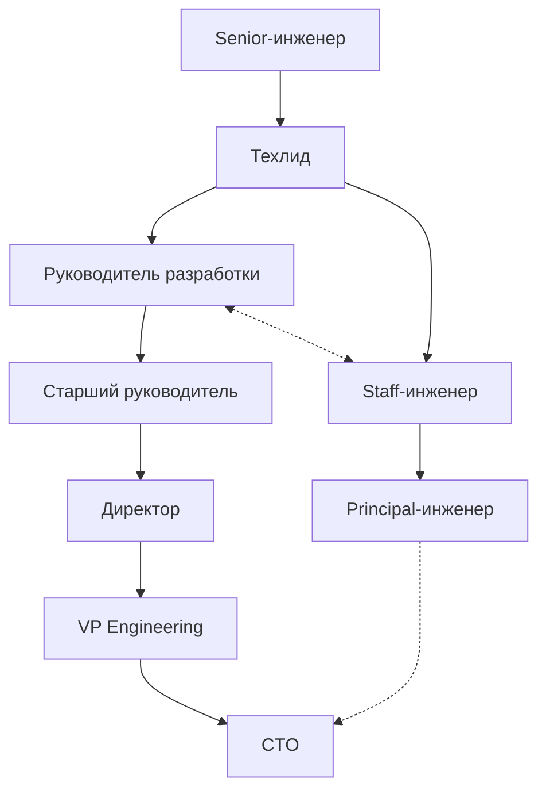
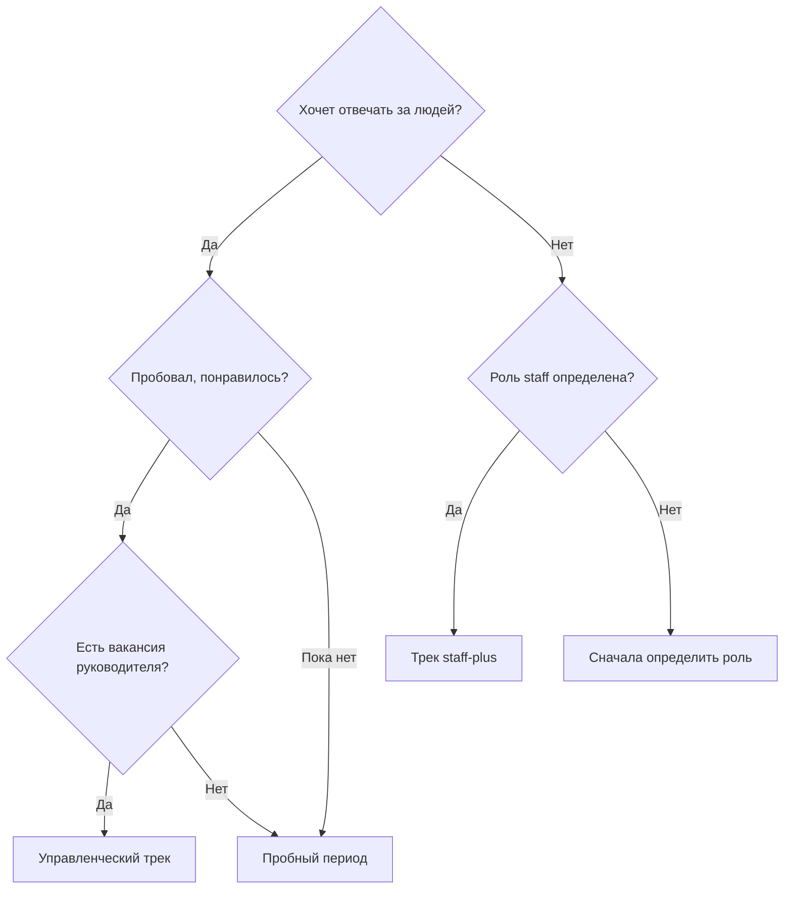

# Глава 4 — Лестница лидерства: от senior-инженера до CTO { #chapter-4-the-leadership-ladder-senior-engineer-to-cto }

Эта глава — карта ролей от senior-инженера до технического директора (CTO): за что отвечает каждая
роль, на какой срок вперёд смотрит, что производит и как обычно проваливается. Затем глава разбирает
два вопроса, которые возникают из этой карты. Как понять, эффективен ли руководитель на любом уровне или
просто занят? И как опытному инженеру выбрать между управленческим треком и треком staff-plus, а если
выбор окажется неверным, позже переключиться? Сквозной пример — Northstar Technologies, вымышленная
компания из [кейса](../../case-studies/northstar/index.md).

Подробности — в других главах. Карьерные лестницы и повышения разбирает глава 8, роли staff-plus —
глава 29, роли директора, VP и CTO — главы 40, 47 и 50. Глава 1 определяет результат руководителя, а
эта глава показывает, как его измерять.

## Почему это важно { #why-this-matters }

В одной команде путаница с ролями обходится дёшево: все видят, кто что решает, и нестыковку исправляет
один разговор.

В организации из 50–150 инженеров размытые роли становятся структурной проблемой. Одно и то же решение
двое считают своим — или оно не принадлежит никому. Сильных инженеров повышают в руководители: другой
заметной ступени вверх нет. Staff-инженеры без мандата мечутся между консультациями и тушением пожаров.
Руководителей оценивают по тому, что выпускают их команды, и потому вознаграждают за активность, а не за
команду, которая будет работать и в следующем году.

На уровне высшего руководства лестницу проектирует CTO. Какие роли существуют, за что отвечает каждая,
как люди переходят между треками — от этого зависит, вырастит организация следующее поколение лидеров
сама или будет брать его со стороны. В Northstar шесть руководителей, три staff-инженера без
определённого мандата, директор и CTO, и нигде не записано, зачем нужно большинство из них.

## Цели главы { #learning-objectives }

После этой главы вы сможете:

- Описать область ответственности, горизонт времени, основной результат и главный тип провала каждой
  роли от техлида до CTO и параллельных им ролей staff-plus.
- Диагностировать по календарю и решениям, на каком уровне человек действительно работает, независимо
  от должности.
- Измерять эффективность руководителя по небольшому набору данных о результатах, здоровье команды и
  рычаге и объяснять, почему активность команды для этого не годится.
- Выбирать между управленческим треком и треком staff-plus по явным критериям и проектировать переход
  между ними с пробным периодом и путём назад.

## Ментальная модель { #the-mental-model }

> **Ментальная модель:** с каждой ступенью вверх вы меняете прямой результат на рычаг и всё дольше
> ждёте, чтобы узнать, были ли правы. Оценивайте роль по результатам, которые она способна изменить, и на
> том горизонте, на котором она работает.

На любом треке с движением вверх меняются две величины. Растёт **область ответственности**: компонент,
команда, несколько команд, вся разработка и её место в компании. Вместе с ней растёт **горизонт
времени**: решения техлида дают о себе знать через недели, директора — через кварталы, CTO — через годы.
Всё остальное в роли вытекает из этих двух величин. Основной результат смещается от работы, сделанной
вами, к работе, которую другие сделали благодаря вашим решениям. А главный тип провала на любом уровне —
по-прежнему делать работу предыдущего уровня, потому что она всё ещё даёт быструю обратную связь.

Сплошные линии — обычные повышения. Пунктир между руководителем и staff-инженером — переход, порядок
которого описывает эта глава. Пунктир от principal-инженера к CTO означает, что некоторые CTO приходят с
технического трека; так ли это в конкретной компании, зависит от архетипа CTO (глава 50). Техлид
показан отдельной ступенью: во многих компаниях именно здесь люди впервые пробуют оба вида работы. Но
это роль, а не обязательно уровень.

## Подробный разбор { #deep-conceptual-explanation }

### Лестница, уровень за уровнем { #the-ladder-level-by-level }

Таблица ниже — **рекомендация книги**: она опирается на описания практиков, а не на исследования
([Fournier, 2017](../../references/bibliography.md#fournier2017manager);
[Larson, 2021](../../references/bibliography.md#larson2021staff);
[Larson, 2024](../../references/bibliography.md#larson2024primer)). Горизонты времени — типичные
диапазоны, а не правила.

| Роль | Область ответственности | Горизонт времени | Основной результат | Главный тип провала |
|---|---|---|---|---|
| Техлид | Техническая работа одной команды | От недель до квартала | Здравые технические решения, по которым работает команда | В одиночку пишет трудные части; становится узким местом |
| Руководитель разработки | Одна команда: люди, поставка, здоровье | Один–два квартала | Команда, которая поставляет и продолжает улучшаться без него | Ведёт себя как лучший инженер команды или как диспетчер тикетов |
| Старший руководитель | Несколько команд, через руководителей | Два–четыре квартала | Руководители, которые хорошо ведут свои команды | Напрямую управляет командами руководителей |
| Директор | 50–150 инженеров; одна область | Один год | Организация, система которой даёт нужный результат | Работает по сводкам подчинённых; лечит симптомы команда за командой |
| VP Engineering | Вся или почти вся разработка | Один–два года | Распределение портфеля и резерв руководителей | Превращается в «большого директора»; нет влияния среди коллег |
| CTO | Технологии и их роль в компании | Два года и больше | Техническая стратегия, по которой действует высшее руководство | Защищает интересы разработки вместо того, чтобы решать проблему компании |
| Staff-инженер | Домен или проблема поверх команд | Один–четыре квартала | Техническое направление, которое принимают другие | Блуждающий критик или перегруженный герой, который чинит всё |
| Principal-инженер | Критичный для компании домен | Один–три года | Направление для домена; выращенные в нём лидеры | Архитектура указами, в отрыве от поставки |

Здесь нужны три оговорки. Первая: должности различаются. Larson называет руководителем разработки
высшего уровня (engineering executive) того, кто отвечает за всю разработку, какой бы ни была его
должность: компании пользуются должностями непоследовательно
([Larson, 2023a](../../references/bibliography.md#larson2023executive-job)). Вторая: небольшие компании
сжимают уровни. Третья: за строками staff-plus скрываются несколько архетипов (техлид, архитектор,
решатель, правая рука), и у каждого своя область ответственности
([Larson, Staff archetypes](../../references/bibliography.md#larson-staff-archetypes)). Их разбирает
глава 29.

### Что меняется на каждой ступени { #what-changes-at-each-step }

**Что вы производите.** Результат senior-инженера на виду: код, дизайны, починенные инциденты. Результат
руководителя — это результат команды плюс то, чего команда не может сейчас, но сможет в следующем
квартале. Результат директора — в основном решения о структуре, укомплектовании и распределении
ресурсов, которые выполняют другие. Идею Andrew Grove о том, что результат руководителя — это результат
организации, на которую он влияет, разбирает глава 1
([Grove, 1983](../../references/bibliography.md#grove1983high)).

**Как долго ждать обратной связи.** По Larson, петли обратной связи в работе staff-инженера длятся
недели, месяцы и годы, а не укладываются в быстрый цикл выпуска кода
([Larson, What do Staff engineers actually do?](../../references/bibliography.md#larson-staffeng-actually-do)).
С руководителями то же самое. Директор, перестроивший владение, узнает, сработало ли это, через два
квартала, а пока велик соблазн заполнить паузу быстрой работой предыдущего уровня.

**Чью проблему вы решаете.** Larson утверждает, что на вершине лестницы CEO, коллеги в высшем
руководстве и инженерная организация видят каждый свою версию проблемы, верную, но неполную. Работа
руководителя высшего уровня — свести эти версии вместе и решать проблему компании, а не отстаивать
интересы разработки ([Larson, 2023b](../../references/bibliography.md#larson2023balancing)). Это
**мнение эксперта**.

### Как определить, на каком уровне человек работает на самом деле { #diagnosing-the-level-someone-actually-works-at }

Должность говорит, какой уровень человеку присвоили, а календарь и решения — на каком уровне он
работает. Метод ниже — **рекомендация книги**: он берёт аудит календаря из главы 1 и задаёт каждому
блоку времени три вопроса.

| Уровень | Решения, которые принимает только этот уровень | Горизонт открытых обязательств | Кто их ждёт |
|---|---|---|---|
| Техлид | Решения о дизайне внутри команды | Недели | Инженеры команды |
| Руководитель разработки | Распределение задач, найм, обратная связь, обязательства команды | Один–два квартала | Команда, партнёр из продукта |
| Старший руководитель или директор | Границы команд, укомплектование между командами, каких руководителей развивать | Два–четыре квартала | Руководители, директора-коллеги |
| VP или CTO | Распределение портфеля, организационный дизайн, техническая стратегия | Год и больше | Директора, коллеги в высшем руководстве |
| Staff-инженер | Техническое направление поверх команд в пределах мандата | Один–четыре квартала | Техлиды нескольких команд |

1. **Возьмите выборку за две недели** — календарь и решения, как в аудите из главы 1.
2. **Добавьте к аудиту один столбец**: самый низкий уровень, на котором этот блок можно было бы
   выполнить. Директор, который ревьюит мерж-реквесты одной команды, в этот час работает на уровне
   техлида.
3. **Проверьте открытые обязательства.** Перечислите, что человек пообещал и к какому сроку. Если почти
   ничего не выходит за пределы текущего квартала, он работает ниже горизонта директора, что бы ни
   говорила должность.

Смотрите на результат как на долю, а не как на вердикт. Часть времени ниже своего уровня проводят все,
например во время инцидентов. Если решения директора в основном относятся к уровню ниже, перед вами
притяжение прежнего уровня (см. «Типичные провалы»). Если же у инженера без соответствующей должности
обязательства и круг тех, кто их ждёт, — как на следующем уровне, он выполняет непризнанную работу, и
это довод в пользу повышения (глава 8).

### Трек staff-plus как параллельный путь { #the-staff-plus-track-in-parallel }

Трек staff-plus нужен для того, чтобы путь к техническому лидерству не лежал только через управление
людьми. Ядро работы staff-инженера, по Larson, таково: задавать техническое направление, заниматься
менторством и спонсорством, привносить инженерный взгляд в решения, исследовать новые направления и
координировать работу так, чтобы проекты двигались вперёд. Программирования при этом меньше, чем раньше
([Larson, What do Staff engineers actually do?](../../references/bibliography.md#larson-staffeng-actually-do)).
Ещё он отмечает, что в некоторых компаниях модели технического лидерства нет и каждого опытного инженера
подталкивают к менеджменту
([Larson, Staff archetypes](../../references/bibliography.md#larson-staff-archetypes)).

Треки различаются подотчётностью. Руководитель отвечает за результаты, связанные с людьми (найм, рост,
результативность, удержание), и обладает в этих вопросах формальной властью. Staff-инженер отвечает за
технические результаты в области, которой не управляет, и действует в основном через влияние. Larson
предупреждает: пользу формальных полномочий люди переоценивают
([Larson, Where do Staff-plus engineers fit?](../../references/bibliography.md#larson-staffeng-reporting)).
А у staff-инженера без области ответственности, спонсора и линии подчинения нет ни того, ни другого
рычага. Именно с такой ситуации начинает Northstar.

### Измерение эффективности руководителя { #measuring-managerial-effectiveness }

Распространённая ошибка — измерять руководителя по **активности** команды: развёртывания, закрытые
тикеты, стори-пойнты, проведённые встречи один на один (1:1), выпущенные пункты дорожной карты. Активность
легко посчитать, и отчасти она под контролем руководителя. Но это не результат руководителя, и причин
тому три.

1. **Атрибуция.** Результаты команды зависят от системы, в которой она работает. Большинство изменений
   команд Orders и Billing в Northstar, вымышленной компании книги, приходится на Core — общий монолит,
   который выходит по фиксированному двухнедельному расписанию
   ([релизный поезд](../../glossary.md#release-train)). Поэтому их
   [lead time](../../glossary.md#lead-time) (время выполнения, от коммита до продакшена) и доля сбоев
   говорят скорее о поезде, чем о командах
   ([исходные данные](../../case-studies/northstar/baseline-data.md)). В одиночку поезд не изменил бы
   ни один из двух руководителей.
2. **Запаздывание.** Самая важная управленческая работа (найм, развитие людей, прояснение владения)
   сказывается на результатах через один–два квартала. Замер этого квартала засчитывает заслуги
   предыдущему руководителю.
3. **Подгонка.** Любую меру активности можно поднять, ничего не улучшив: больше мелких развёртываний,
   раздробленные тикеты, проведённые, но пустые встречи 1:1. Подгонку метрик (gaming) в общем виде
   разбирает глава 18.

На что же руководители влияют измеримо? В главе 1 приведены данные о том, что руководители важны. Самый
явный эффект — на удержание ([Hoffman and Tadelis, 2021](../../references/bibliography.md#hoffman2021people)),
а коучинг, развитие карьеры и другие формы поведения руководителя перечисляет Project Oxygen компании
Google ([Google re:Work](../../references/bibliography.md#rework-great-managers)).

Практический вывод из этих данных (**рекомендация книги**): оценивайте руководителя по небольшому
набору данных в четырёх областях, не меньше чем за два квартала, и читайте их в контексте.

| Область | Данные | Типичная подгонка и противодействие |
|---|---|---|
| Результаты подразделения | Согласованные меры результата команды (надёжность, поставка относительно обязательств), с трендом и контекстом | Пересогласованные обязательства; сопоставляйте с тем, что было обещано изначально |
| Здоровье команды | [Нежелательная текучесть](../../glossary.md#attrition-and-regretted-attrition) (уход людей, которых вы хотели удержать); обратная связь снизу о поведении руководителя; концентрация дежурств и критических знаний | Давление на ответы в опросах; сохраняйте анонимность обратной связи и читайте комментарии, а не баллы |
| Рост людей | Кто теперь может делать то, чего не мог два квартала назад; повышения, заработанные в других местах; преемник | Раздутые повышения; калибруйте между руководителями (глава 8) |
| Рычаг | Проблемы, решённые поверх границ команд; решения, которые устояли; прояснённое владение | Самоотчёты о героизме; спрашивайте соседние команды |

Данные об активности по-прежнему полезны как повод для вопроса, но никогда — как оценка.

### Выбор трека { #choosing-a-track }

Данные об отборе при повышении приводит глава 2
([Benson et al., 2019](../../references/bibliography.md#benson2019promotions)): компании склонны
повышать за результаты на текущей работе. Поэтому то, что человек — лучший инженер команды, лишь слабый
признак того, что он станет её лучшим руководителем.

Для самого человека это выбор работы, а не статуса. Charity Majors утверждает три вещи: менеджмент —
это смена профессии, а не повышение; работа эта сплошь состоит из прерываний; осознанные переходы между
инженерией и менеджментом на протяжении карьеры делают людей лучше в обоих делах
([Majors, 2017](../../references/bibliography.md#majors2017pendulum)). Это **мнение эксперта**. Схема
решения ниже превращает его в критерии.

## Пример из инженерной организации { #engineering-organization-example }

!!! info "Northstar: что уже известно"
    Неделя 1 первого года директора по разработке. CTO Victor Lindqvist поручил директору за
    двенадцать месяцев вдвое сократить число инцидентов Sev1 и Sev2 (два самых серьёзных уровня) без
    роста численности. Директору подчиняются шесть руководителей и три staff-инженера. См.
    [хронологию](../../case-studies/northstar/timeline.md). Впервые в Northstar? Прочитайте
    [«Год вкратце»](../../case-studies/northstar/year-in-brief.md) и
    [«Действующие лица»](../../case-studies/northstar/cast.md).

Вот какой директор застаёт структуру ролей в Northstar. Все цифры — **иллюстрация** и взяты из
[исходных данных](../../case-studies/northstar/baseline-data.md).

**Охват.** В шести командах 77 инженеров, примерно 13 на руководителя: от 11 (Data and Analytics) до 15
(Customer Experience). Когда подчинённых больше восьми–десяти, работа с людьми вытесняет всё остальное
(рекомендация книги, глава 1). [Охват управления](../../glossary.md#span-of-control) (span of control)
разбирает глава 34, размер команд — глава 33. У руководителя с 12–15 подчинёнными остаётся мало
времени на рост людей и на рычаг.

**Техлиды.** Если ставить одного техлида на команду из шести–десяти инженеров (**рекомендация книги**),
на 77 инженеров в командах нужно от восьми до двенадцати техлидов. В Northstar такой должности нет ни у
кого. Каждая команда неформально опирается на одного-двух senior-инженеров, но что они решают, нигде не
определено.

**Staff-инженеры.** Трое на 80 инженеров, один примерно на 27. Они подчиняются директору (всего у него
девять прямых подчинённых), но не владеют компонентами, и мандата у них нет.

**Оценка руководителей.** Предположим, директор ранжировал шестерых руководителей по активности.
Customer Experience развёртывается 26 раз в месяц, Payments and Integrations — 22, Billing — 8. При
таком взгляде сильнейший руководитель — Daniel Cho, а самый слабый — Marcus Oyelaran. Теперь посмотрим
через четыре области.

| Руководитель | Взгляд через активность | О чём спросили бы четыре области |
|---|---|---|
| Daniel Cho, Customer Experience | Больше всего развёртываний (26 в месяц) | 44 [пропущенных дефекта](../../glossary.md#escaped-defect) (баги, найденные после релиза); один руководитель на две платформы и 15 человек. О здоровье и росте данных нет |
| Elena Sokolova, Payments and Integrations | Самый короткий lead time среди продуктовых команд (4 дня) | Лучшая операционная дисциплина; записана ли она и принадлежит ли команде или держится на нескольких людях? |
| Marcus Oyelaran, Billing | Меньше всего развёртываний (8), больше всего инцидентов Sev1 и Sev2 (8) | Большую часть вызовов принимают три человека: риск для здоровья команды и концентрации, который он может изменить. Lead time определяется в основном релизным поездом, который он изменить не может |
| Priya Raman, Orders | 11 развёртываний, 7 инцидентов | Повышена восемь месяцев назад; данные о росте и рычаге важнее результатов одного квартала |

Два взгляда дают разный порядок. Второй отделяет то, что контролирует каждый руководитель (концентрация
дежурств, рост людей, владение), от того, что контролирует система (релизный поезд). Даже реальное
улучшение в Billing было бы заслугой отчасти Marcus, отчасти релизного поезда. Поэтому на оценке
спрашивают, что изменил он сам, а не только что сдвинулось.

## Как принимать решение { #decision-framework }

В таблице — критерии выбора трека для инженера, от самого весомого к наименее весомому (**рекомендация
книги**). Первые три касаются человека и работы, следующие два — организации, последний проверяет мотив.

| Критерий | Говорит в пользу менеджмента | Говорит в пользу staff-plus |
|---|---|---|
| За что вы хотите отвечать | Результаты, связанные с людьми: найм, рост, результативность, удержание | Технические результаты в области, которой вы не управляете |
| Что даёт вам энергию | Разговоры, разрешение конфликтов, дни из сплошных прерываний | Долгие глубокие задачи; письменная работа; дизайн поверх команд |
| Данные пробного периода | Вы проводили встречи 1:1, давали трудную обратную связь, и результат вам понравился | Вы провели межкомандное техническое решение без формальных полномочий, и оно устояло |
| Потребность организации | Свободная команда или команда, слишком большая для одного руководителя | Определённая роль staff-инженера с областью ответственности, спонсором и линией подчинения |
| Обратимость | Путь назад в инженерию реален и назван | Переход в менеджмент позже остаётся открытым |
| Проверка мотива | Выбрано не только ради зарплаты или должности | Выбрано не для того, чтобы избежать работы с людьми, которую вы делали бы хорошо |

Первый критерий решающий. Если человеку нужны полномочия руководителя без ответственности за людей, ему
не подходит ни один трек, и сказать ему об этом — часть разговора.

**Пробный период** — ограниченная проба работы ещё до получения должности: вести проект с двумя-тремя
инженерами, проводить встречи 1:1 со стажёром или новым сотрудником, замещать руководителя на время
его отпуска или владеть межкомандным техническим решением. **Сначала определить роль** означает:
прежде чем просить инженера выбрать трек, который существует только на бумаге, организация обязана дать
ему область ответственности, спонсора и ожидаемые результаты.

Возвращение планируйте с самого начала: длительность пробного периода (книга предлагает от шести до
двенадцати месяцев, а Majors утверждает, что лучшие линейные руководители редко отходят от практической
работы больше чем на два–три года), какие данные будут рассматривать и в какую роль можно вернуться.
Запланированное возвращение — карьерный ход. Незапланированное выглядит понижением в глазах всех,
включая самого человека.

## Компромиссы { #trade-offs }

**Два трека против одной лестницы.** Два трека позволяют сильным инженерам расти, не управляя людьми.
Цена — второй набор описаний ролей и калибровка между треками. К тому же трек staff-инженеров может
превратиться в отстойник для тех, кого не сделали руководителями. Одна лестница проще, но выталкивает
лучших инженеров в менеджмент, и возникает риск принципа Питера (глава 2): людей повышают за хорошую
работу на текущей должности, пока они не окажутся на той, с которой справляются плохо.

**Отдельный техлид против техлида-руководителя.** Отдельный техлид освобождает руководителю время для
работы с людьми и даёт инженерам ступень, где можно проверить себя в лидерстве. Цена — ещё одна точка
координации. Когда обе роли совмещает один человек, стыка между ролями нет, но, как утверждает Majors,
такая конструкция неустойчива: одной из двух работ начинают пренебрегать.

**Оценка руководителей по результатам против оценки по активности.** Данные о результатах справедливее,
и подогнать их труднее, но они приходят медленно и требуют от оценивающего суждения и знания контекста.
Данные об активности быстрые и выглядят объективными, но измеряют не то.

**Определённые мандаты staff-инженеров против открытых.** Определённый мандат даёт рычаг и способ
оценки, но может привязать человека к прошлогодней проблеме. Открытый мандат оставляет место для
исследования, но без спонсора превращается в советы, которым никто не обязан следовать.

## Типичные провалы { #failure-modes }

**Повышение по умолчанию.** Самый сильный инженер становится руководителем, потому что другого пути
вверх нет. Признаки: новый руководитель оставляет себе самую трудную техническую работу и под давлением
отменяет встречи 1:1. Через три месяца спросите, что руководитель перестал делать.

**Притяжение прежнего уровня.** Люди сползают на уровень ниже, потому что там быстрая обратная связь:
директор ревьюит мерж-реквесты, VP ведёт планирование одной команды. Выявляется по календарю: смотрите,
какая доля времени уходит на решения, доступные только этому уровню.

**Карта показателей по активности.** Руководителей ранжируют по развёртываниям, тикетам или пунктам
дорожной карты. Команды в ответ дробят работу и избегают трудных и медленных задач. Выявляется, когда у
лидеров рейтинга ещё и больше всего пропущенных дефектов или самая высокая текучесть.

**Staff-инженер без мандата.** Из должности staff-инженера без области ответственности и спонсора
получается блуждающий критик или герой, которого затягивает в каждый инцидент. Спросите по отдельности
staff-инженера и его руководителя, за что staff-инженер отвечает в этом квартале. Если ответы
расходятся, диагноз подтверждён.

**Инфляция должностей наверху.** Должности VP и директора без соответствующей области ответственности
потом мешают нанять настоящего руководителя высшего уровня или вынуждают понижать людей. Выявляется,
когда обладатель должности не принимает ни одного решения сверх тех, что принимает уровень ниже.

**Необратимый переход.** Инженер пробует себя в менеджменте без пути назад, ему приходится трудно, и
вместо шага назад он уходит из компании. Защита — письменные условия пробного периода.

## Применение в крупной организации { #enterprise-application }

При 50–150 инженерах лестница перестаёт быть неформальной. У директора (глава 40) обычно от шести до
десяти руководителей, несколько staff-инженеров и пока нет уровня старших руководителей. Раз за разом
приходится принимать три решения.

**Когда добавлять уровень руководителей руководителей.** Когда у директора больше прямых подчинённых,
чем он способен коучить, а группы команд работают в общем домене. Если ввести уровень слишком рано,
появится передаточное звено; если слишком поздно, новые руководители останутся без присмотра.

**Кому подчиняются staff-инженеры.** Larson сопоставляет близость к команде (подчинение руководителям
команд) с доступом к информации и полномочиям (подчинение руководителям высокого уровня)
([Larson, Where do Staff-plus engineers fit?](../../references/bibliography.md#larson-staffeng-reporting)).
Подчинение директору работает, если у каждого staff-инженера есть определённый домен и руководители
знают, какие решения принимает staff-инженер.

**Как оценивают руководителей.** По четырём областям, дважды в год, с анонимной обратной связью снизу и
с концентрацией, измеренной по данным. Всё это обсуждают с самим руководителем, прежде чем что-либо
записать.

## Взгляд CTO { #cto-perspective }

Для CTO лестница определяет, откуда придут будущие лидеры. Четыре вопроса остаются за CTO.

**Какие роли существуют и зачем.** Компании из 80 инженеров VP Engineering может и не понадобиться,
компании из 300 обычно нужен. Должностями пользуются непоследовательно
([Larson, 2023a](../../references/bibliography.md#larson2023executive-job)), поэтому определяйте каждую
роль через её ответственность, а не через рыночные условности. Как делятся роли VP и CTO, разбирают
главы 47 и 50.

**Как оценивают лидеров.** Директоров и VP оценивают по результатам организации за год и дольше,
допуская, что у хорошего лидера бывает плохой квартал. Четыре области переносятся и на этот уровень:
результаты организации, текучесть и вовлечённость, резерв руководителей, влияние на коллег в высшем
руководстве.

**Паритет треков.** Если вершина трека staff-plus по зарплате и доступу на два уровня ниже вершины
управленческого трека, инженеры прочтут лестницу правильно: настоящий путь вверх лежит через менеджмент
(глава 8).

**Собственный тип провала CTO** — выступать перед высшим руководством представителем разработки, вместо
того чтобы вместе с коллегами решать проблему компании.

## Практический плейбук { #practical-playbook }

1. Опишите в одном абзаце каждую роль, включая неформальные вроде техлида: область ответственности,
   горизонт времени, основной результат, права на решения.
2. Отметьте роли, существующие только на бумаге (должность без области ответственности), и роли,
   существующие только на практике (область ответственности без должности). Начните со вторых: это
   непризнанная работа.
3. Дайте каждому staff-plus-инженеру домен, спонсора и два-три результата на два квартала (архетипы
   разбирает глава 29).
4. Оценивайте руководителей по четырём областям за два квартала, в контексте, а не по активности.
5. Собирайте анонимную обратную связь снизу дважды в год; читайте комментарии вместе с руководителем;
   не ранжируйте.
6. Измеряйте концентрацию по данным: вызовы на человека, компоненты с единственным мейнтейнером,
   решения, которые ждут одного человека.
7. На просьбу о переходе в руководители отвечайте предложением пробного периода: срок ограничен,
   условия записаны — длительность, данные, роль для возвращения.
8. На просьбу о треке staff-plus сначала убедитесь, что определённая роль существует; если её нет,
   определите её.
9. Раз в месяц проверяйте по своему календарю, не тянет ли вас на прежний уровень.

## Кейс { #case-study }

Northstar такая, какой её застаёт директор, и одно решение, принятое в квартале 2 (недели 14–26). Всё
здесь — вымысел ([обзор](../../case-studies/northstar/index.md)).

**Роли на момент прихода.** Единственный письменный документ о ролях в Northstar — вики-страница
«Engineering levels» с абзацем на каждый из трёх инженерных уровней: Engineer, Senior Engineer и Staff
Engineer. Абзац о staff описывает «признанного технического эксперта» и не называет ни области
ответственности, ни результата. Роль руководителя описана одной общей строкой: «руководить командой
инженеров, чтобы поставлять качественное ПО», — и никаких критериев оценки именно для руководителей.
Руководителей раз в год оценивали по выполнению дорожной карты их команд; в прошлом квартале команды
выполнили 7 из 17 пунктов, взятых в обязательства. Роли техлида нет. Роль самого директора определена
мандатом CTO в одно предложение и описанием вакансии. VP Engineering нет: разработкой для CTO Victor
Lindqvist руководит директор.

**Что первый квартал решил, а что нет.** Программа качества первого квартала (глава 27) дала каждому
из трёх staff-инженеров мандат, привязанный к этой программе, и соответствующие инженерные стандарты:
Kwame Mensah — релизы и обнаружение проблем, Ines Carvalho — границы модулей Core, Li Na Zhou —
безопасность миграций и конфигураций ([хроника года 1](../../case-studies/northstar/first-quarter.md)).
Ни в одном мандате не сказано, чем staff-инженер будет владеть после окончания программы и как его
будут оценивать. Не сказано и то, как его полномочия соотносятся с полномочиями руководителей, чьи
команды меняют код, за который он отвечает. К этим вопросам возвращается глава 29.

**Вопрос о треке в квартале 2.** Роль руководителя Orders, на которую претендовал Rafael Duarte,
senior-инженер этой команды, досталась Priya Raman (глава 2); с недели 2 он делит владение ревью для
core/order-capture. После первого квартала он спрашивает директора: попробовать снова пойти в
менеджмент или двигаться к роли staff-инженера? Priya остаётся, других вакансий руководителя нет, а у
роли staff-инженера нет определения, на которое можно было бы опереться.

Схема решения обнажает проблему. Четыре критерия касаются самого Rafael, и ответы на них даст только
разговор: за что он хочет отвечать, что даёт ему энергию, что он пробовал и почему спрашивает. Два
касаются Northstar, и по обоим Northstar не проходит: нет ни вакансии, ни определённой роли
staff-инженера, и путь назад из менеджмента не назван. Rafael однажды уже проиграл эту роль. Что его
тянет: сама работа или должность? Прежде чем Rafael сможет сделать хороший выбор, организация должна
решить, есть ли у неё роль техлида, зачем ей staff-инженеры и возможен ли пробный период в роли
руководителя без свободной команды. Урок: выбор трека реален ровно настолько, насколько реальны
стоящие за ним роли. Провести этот разговор предлагает упражнение A1.

## Упражнения { #exercises }

Разборы упражнений — в [решениях к главе 4](../../solutions/ch04-solutions.md). Данные Northstar — на
[странице исходного уровня](../../case-studies/northstar/baseline-data.md); кто есть кто — на странице
[«Действующие лица»](../../case-studies/northstar/cast.md).

### Базовый уровень { #foundational }

**F1.** Greg Tanaka (VP Sales) говорит Helena Marsh (CEO), что Daniel Cho — явно лучший руководитель
Northstar, а Marcus Oyelaran — самый слабый, потому что Customer Experience развёртывается 26 раз в
месяц, а Billing — 8. Напишите CEO короткий ответ: что эти цифры говорят о двух руководителях, а что
нет, и на какие данные вы посмотрели бы вместо них.

**F2.** Неделя в календаре только что повышенного директора: шесть часов на ревью мерж-реквестов одной
команды, двухчасовая сессия планирования с одной командой, четыре встречи 1:1 с руководителями, час с
аналитиком CFO над бюджетом на следующий год и три часа отладки инцидента в продакшене в роли рядового
дежурного. Определите, какие пункты относятся к уровню директора, а какие — к более низким уровням, и
что предвещает эта картина, если она продержится два квартала.

**F3.** В Northstar нет формальной роли техлида, и каждая команда неформально опирается на одного-двух
senior-инженеров. Напишите для Northstar определение техлида в один абзац: область ответственности,
права на решения, горизонт времени, основной результат и чем эта роль отличается от роли
руководителя. Затем ответьте, нужен ли каждой команде ровно один техлид.

### Прикладное лидерство { #applied-leadership }

**A1.** Rafael Duarte, senior-инженер в Orders, которому на роли руководителя предпочли Priya Raman, в
квартале 2 спрашивает вас, идти ли ему в менеджмент или в staff-инженеры. Свободной роли руководителя
нет, роль staff-инженера не определена. Спланируйте разговор: что вам нужно узнать от него, что вы
можете честно предложить, какой пробный период можно организовать при ограничениях Northstar и что
сначала нужно исправить в организации.

**A2.** Спроектируйте оценку шести руководителей разработки Northstar на конец квартала 2 взамен
ежегодной оценки по выполнению дорожной карты. Хотя бы для двух руководителей (одна из них — Priya
Raman, повышенная за восемь месяцев до вашего прихода) укажите данные по каждой из четырёх областей.
Объясните, как вы отделите то, что контролирует каждый руководитель, от того, что контролирует релизный
поезд, и как избежите ранжирования.

**A3.** У трёх staff-инженеров Northstar есть мандаты, связанные с трансформацией, но нет постоянной
области ответственности за их пределами, и подчиняются они вам. Предложите каждому область
ответственности, спонсора и два результата на следующие два квартала и решите, оставить ли их в своём
подчинении. Объясните также, как руководителю разрешать разногласие со staff-инженером из-за изменения
в собственной команде.

### Решения на уровне руководства { #executive-decision-making }

**X1.** Victor Lindqvist (CTO) подумывает создать роль VP Engineering над директором. Его доводы: этого
ожидает совет директоров, а ему самому нужно больше времени на техническую стратегию. В Northstar
80 инженеров, шесть руководителей и один директор. Вы консультируете Victor. Порекомендуйте, создавать
ли роль сейчас; если да, то за что она будет отвечать; если нет, что сделать вместо этого.

**X2.** Предположим, в конце первого года директора Helena Marsh (CEO) спрашивает Victor, как он будет
судить об эффективности директора. Число инцидентов [Sev1 и Sev2](../../glossary.md#severity-sev1-sev2-sev3)
снизилось, но один сильный руководитель ушёл, а два staff-инженера говорят, что до сих пор не уверены в
своём мандате. От лица Victor опишите подход к оценке: какие данные вы взвешиваете, на каком горизонте и
как отделяете вклад директора от вклада системы.

## Вопросы для размышления { #reflection-questions }

1. Какая роль в вашей организации существует только на бумаге, а какая — только на практике? Кто из-за
   этого выполняет непризнанную работу?
2. Если бы ваш руководитель оценивал вас только по активности вашей команды в прошлом квартале, к какому
   выводу он пришёл бы и что упустил бы?
3. Какую работу с прежнего уровня вы всё ещё делаете, потому что она даёт быструю обратную связь?
4. Если бы завтра вы перешли на другой трек, в чём вы первые полгода были бы слабы? Остались бы вы на
   нём достаточно долго, чтобы в этом преуспеть?

## Главное { #key-takeaways }

- Каждая ступень вверх расширяет область ответственности, удлиняет задержку обратной связи и смещает
  результат к тому, что делают другие благодаря вашим решениям.
- Главный тип провала на любом уровне — делать работу предыдущего уровня, потому что она всё ещё даёт
  быструю обратную связь. Проверяйте календарь.
- Оценивайте руководителей по результатам подразделения, здоровью команды, росту людей и рычагу, не
  меньше чем за два квартала и в контексте. Данные об активности используйте только как повод для
  вопросов.
- То, что человек — лучший инженер, лишь слабо предсказывает, что он станет лучшим руководителем.
  Оценивайте управленческий потенциал отдельно.
- Выбирайте трек по тому, за что вы хотите отвечать, какая работа даёт вам энергию, и по данным
  пробного периода; затем проверьте, есть ли в организации реальная, определённая роль.
- Планируйте каждый переход между треками заранее: длительность пробного периода, перечень данных для
  оценки и названный путь назад.
- У роли staff-инженера без области ответственности, спонсора и линии подчинения нет ни полномочий, ни
  способа оценки. Определите роль, прежде чем её заполнять.

## Источники и что почитать { #references-and-further-reading }

- [Fournier, 2017](../../references/bibliography.md#fournier2017manager). *The Manager's Path*:
  управленческие уровни от техлида до высшего руководства.
- [Larson, 2021](../../references/bibliography.md#larson2021staff). *Staff Engineer*: трек staff-plus;
  большая часть бесплатно доступна на staffeng.com. Цитируемые страницы:
  [Staff archetypes](../../references/bibliography.md#larson-staff-archetypes),
  [What do Staff engineers actually do?](../../references/bibliography.md#larson-staffeng-actually-do)
  и [Where do Staff-plus engineers fit?](../../references/bibliography.md#larson-staffeng-reporting).
- [Larson, 2024](../../references/bibliography.md#larson2024primer). *The Engineering Executive's
  Primer*: роль руководителя высшего уровня. Цитируемые черновые главы:
  [Larson, 2023a](../../references/bibliography.md#larson2023executive-job) — о непоследовательных
  должностях высшего уровня и [Larson, 2023b](../../references/bibliography.md#larson2023balancing) — о
  балансе между CEO, коллегами и разработкой.
- [Larson, 2019](../../references/bibliography.md#larson2019elegant). *An Elegant Puzzle*: размер команд
  и организационный дизайн.
- [Grove, 1983](../../references/bibliography.md#grove1983high). *High Output Management*: результат
  руководителя как результат организации.
- [Hoffman and Tadelis, 2021](../../references/bibliography.md#hoffman2021people). Навыки управления
  людьми и текучесть в одной компании: самые сильные из приведённых здесь данных о том, что меняют
  руководители.
- [Google re:Work](../../references/bibliography.md#rework-great-managers). Рассказ самой Google о
  Project Oxygen и формах поведения руководителя.
- [Benson et al., 2019](../../references/bibliography.md#benson2019promotions). Повышения и принцип
  Питера: почему лучшие исполнители не становятся автоматически лучшими руководителями.
- [Majors, 2017](../../references/bibliography.md#majors2017pendulum). Маятник «инженер — руководитель»:
  осознанные переходы между треками.
