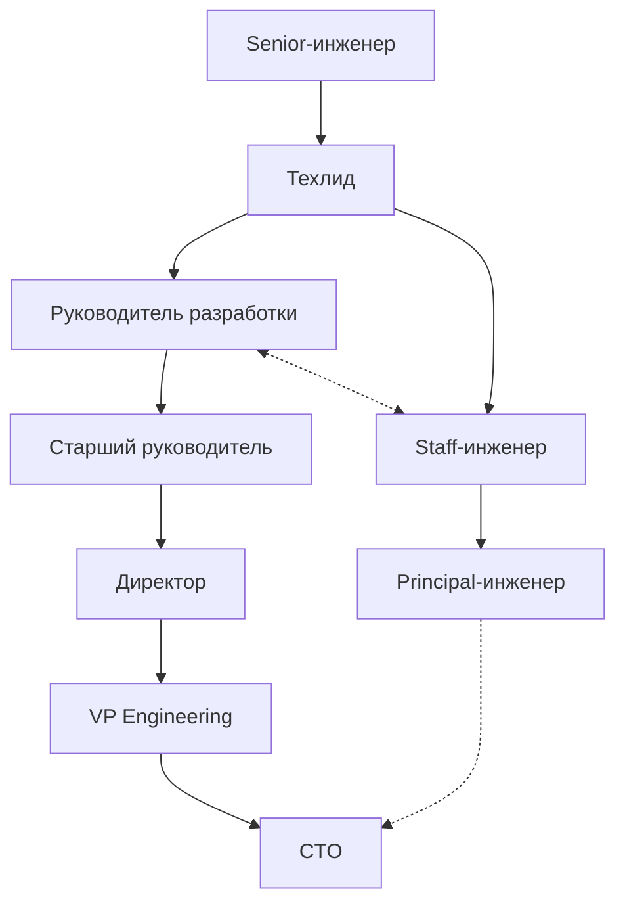
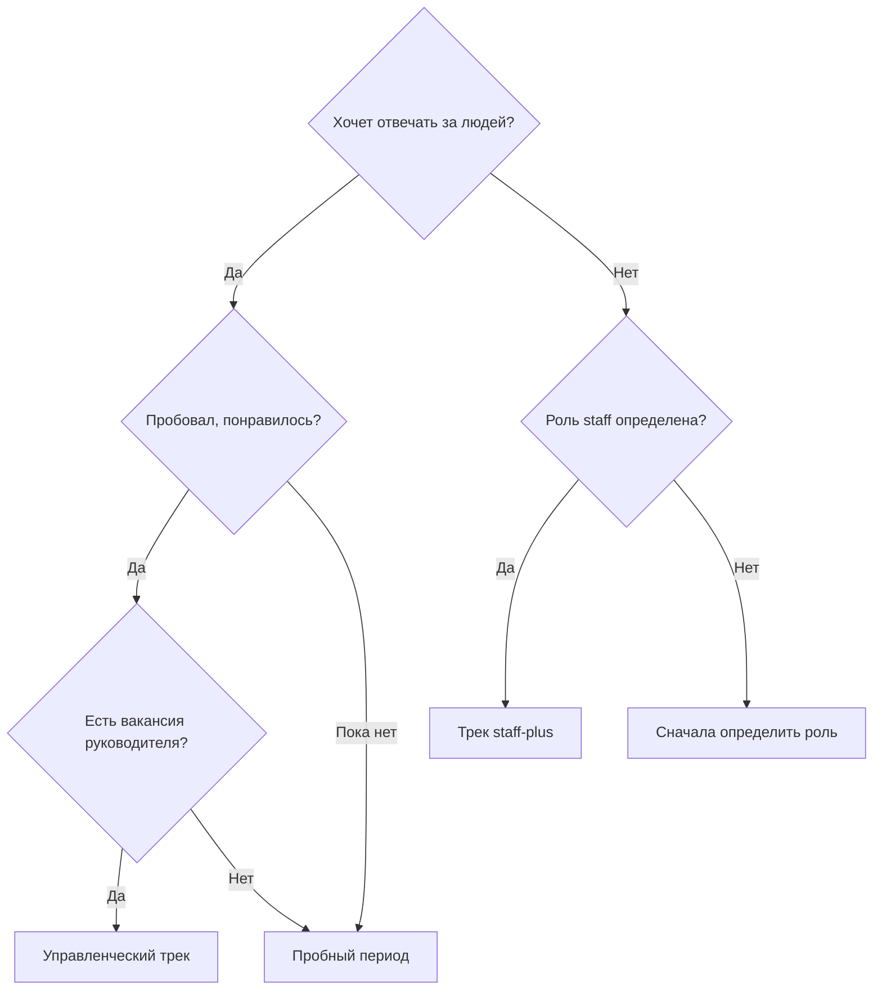

# Глава 4 — Лестница лидерства: от senior-инженера до CTO { #chapter-4-the-leadership-ladder-senior-engineer-to-cto }

Эта глава — карта ролей между senior-инженером и техническим директором (CTO): за что отвечает каждая
роль, на какой срок она смотрит вперёд, что производит и как обычно проваливается. Затем глава берётся за
два вопроса, которые ставит эта карта. Как понять, эффективен ли руководитель на любом уровне, а не
просто занят? И как опытному инженеру выбрать между управленческим треком и треком staff-plus — и
переключиться позже, если выбор оказался неверным? Сквозной пример — Northstar Technologies, вымышленная
компания из [кейса](../../case-studies/northstar/index.md).

Эта глава — карта. Глава 8 разбирает карьерные лестницы и повышения, глава 29 — роли staff-plus, а
главы 40, 47 и 50 — роли директора, VP и CTO. Глава 1 определяет результат руководителя; эта глава
показывает, как его измерять.

## Почему это важно { #why-this-matters }

В одной команде путаница с ролями обходится дёшево. Все видят, кто что решает, и несоответствие
исправляется одним разговором.

В организации из 50–150 инженеров неопределённые роли становятся структурной проблемой. Два человека
считают, что одно и то же решение принадлежит им, или оно не принадлежит никому. Сильных инженеров
повышают в руководители, потому что это единственная заметная ступень вверх. Staff-инженеры без
мандата дрейфуют между консультированием и тушением пожаров. Руководителей, которых оценивают по тому,
что выпускают их команды, вознаграждают за активность, а не за то, что они строят команду, которая будет
работать и в следующем году.

На уровне высшего руководства лестница — проектная задача CTO. Какие роли существуют, за что отвечает
каждая и как люди переходят между треками — от этого зависит, вырастит ли организация следующее
поколение лидеров или будет импортировать его. В Northstar шесть руководителей, три staff-инженера без
определённого мандата, директор и CTO, и нигде не записано, для чего нужно большинство из них.

## Цели главы { #learning-objectives }

После этой главы вы сможете:

- Описать область ответственности, горизонт времени, основной результат и главный тип провала каждой
  роли от техлида до CTO, а также ролей staff-plus рядом с ними.
- Диагностировать уровень, на котором человек на самом деле работает, по его календарю и решениям,
  независимо от должности.
- Измерять эффективность руководителя небольшим набором данных о результатах, здоровье команды и
  рычаге и объяснять, почему активность команды такой мерой не является.
- Выбирать между управленческим треком и треком staff-plus по явным критериям и проектировать переход
  между ними с пробным периодом и путём назад.

## Ментальная модель { #the-mental-model }

> **Ментальная модель:** каждая ступень вверх по лестнице обменивает прямой результат на рычаг и
> удлиняет задержку, прежде чем вы узнаете, были ли правы. Оценивайте каждую роль по тем результатам,
> которые она способна изменить, на том горизонте, на котором она работает.

По мере движения вверх по любому треку меняются две величины. Растёт **область ответственности**: от
компонента к команде, к нескольким командам, ко всей разработке и её месту в компании. Вместе с ней
растёт **горизонт времени**: последствия решений техлида проявляются за недели, директора — за кварталы,
CTO — за годы. Всё остальное в роли вытекает из этих двух величин. Основной результат смещается от
работы, которую сделали вы, к работе, которую сделали другие благодаря вашим решениям, а главный тип
провала на любом уровне — продолжать делать работу предыдущего уровня, потому что она всё ещё даёт
быструю обратную связь.

Сплошные линии — обычные повышения. Пунктир между руководителем и staff-инженером — переход, который
планирует эта глава. Пунктир от principal-инженера к CTO показывает, что некоторые CTO приходят с
технического трека; это зависит от архетипа CTO в компании (глава 50). Техлид показан как ступень,
потому что во многих компаниях именно здесь люди впервые пробуют оба вида работы; это роль, но не всегда
уровень.

## Подробный разбор { #deep-conceptual-explanation }

### Лестница, уровень за уровнем { #the-ladder-level-by-level }

Таблица ниже — **рекомендация книги**, построенная на описаниях практиков, а не на исследованиях
([Fournier, 2017](../../references/bibliography.md#fournier2017manager);
[Larson, 2021](../../references/bibliography.md#larson2021staff);
[Larson, 2024](../../references/bibliography.md#larson2024primer)). Горизонты времени — типичные
диапазоны, а не правила.

| Роль | Область ответственности | Горизонт времени | Основной результат | Главный тип провала |
|---|---|---|---|---|
| Техлид | Техническая работа одной команды | От недель до квартала | Здравые технические решения, которые команда выполняет | В одиночку пишет трудные части; становится узким местом |
| Руководитель разработки | Одна команда: люди, поставка, здоровье | Один–два квартала | Команда, которая поставляет и продолжает улучшаться без него | Ведёт себя как лучший инженер команды или как диспетчер тикетов |
| Старший руководитель | Несколько команд, через руководителей | Два–четыре квартала | Руководители, которые хорошо ведут свои команды | Напрямую управляет командами руководителей |
| Директор | 50–150 инженеров; одна область | Один год | Организация, чья система производит нужный результат | Работает по сводкам подчинённых; лечит симптомы команда за командой |
| VP Engineering | Вся или почти вся разработка | Один–два года | Распределение портфеля и резерв руководителей | Превращается в большого директора; нет влияния на уровне коллег |
| CTO | Технологии и их роль в компании | Два года и больше | Техническая стратегия, по которой действует высшее руководство | Защищает интересы разработки вместо того, чтобы решать проблему компании |
| Staff-инженер | Домен или проблема поверх команд | Один–четыре квартала | Техническое направление, которое принимают другие | Блуждающий критик или перегруженный герой, который чинит всё |
| Principal-инженер | Критичный для компании домен | Один–три года | Направление для домена; выращенные в нём лидеры | Архитектура указами, в отрыве от поставки |

Есть три оговорки. Должности различаются: Larson определяет руководителя разработки высшего уровня
(engineering executive) как человека, отвечающего за всю разработку, независимо от должности, которую
компании используют непоследовательно
([Larson, 2023a](../../references/bibliography.md#larson2023executive-job)). Небольшие компании сжимают
уровни. А за строками staff-plus скрываются несколько архетипов (техлид, архитектор, решатель, правая
рука), у каждого своя область ответственности
([Larson, Staff archetypes](../../references/bibliography.md#larson-staff-archetypes)). Их разбирает
глава 29.

### Что меняется на каждой ступени { #what-changes-at-each-step }

**Что вы производите.** Результат senior-инженера виден: код, дизайны, починенные инциденты. Результат
руководителя — это результат команды плюс то, что команда сможет делать в следующем квартале, чего не
может сейчас. Результат директора — это в основном решения о структуре, укомплектовании и распределении
ресурсов, которые выполняют другие. Глава 1 разбирает идею Andrew Grove о том, что результат
руководителя — это результат организации, на которую он влияет
([Grove, 1983](../../references/bibliography.md#grove1983high)).

**Сколько идёт обратная связь.** Larson описывает работу staff-инженера как работу с петлями обратной
связи длиной в недели, месяцы и годы, а не с быстрым циклом выпуска кода
([Larson, What do Staff engineers actually do?](../../references/bibliography.md#larson-staffeng-actually-do)).
То же верно для руководителей: директор, перестроивший владение, узнаёт, сработало ли это, через два
квартала, и у него возникает соблазн заполнить паузу быстрой работой предыдущего уровня.

**Чью проблему вы решаете.** Применительно к вершине лестницы Larson утверждает, что CEO, коллеги в
высшем руководстве и инженерная организация видят каждый свою верную, но неполную версию проблемы, и
работа руководителя высшего уровня — свести их вместе и решать проблему компании, а не отстаивать
интересы разработки ([Larson, 2023b](../../references/bibliography.md#larson2023balancing)). Это
**мнение эксперта**.

### Как определить, на каком уровне человек работает на самом деле { #diagnosing-the-level-someone-actually-works-at }

Должность говорит, какой уровень человеку дали; календарь и решения показывают, на каком уровне он
работает. Метод ниже — **рекомендация книги**. Он использует аудит календаря из главы 1 и задаёт каждому
блоку времени три вопроса.

| Уровень | Решения, которые принимает только этот уровень | Горизонт открытых обязательств | Кто их ждёт |
|---|---|---|---|
| Техлид | Решения о дизайне внутри команды | Недели | Инженеры команды |
| Руководитель разработки | Распределение задач, найм, обратная связь, обязательства команды | Один–два квартала | Команда, партнёр из продукта |
| Старший руководитель или директор | Границы команд, укомплектование между командами, каких руководителей развивать | Два–четыре квартала | Руководители, директора-коллеги |
| VP или CTO | Распределение портфеля, организационный дизайн, техническая стратегия | Год и больше | Директора, коллеги в высшем руководстве |
| Staff-инженер | Техническое направление поверх команд в пределах мандата | Один–четыре квартала | Техлиды нескольких команд |

1. **Возьмите выборку за две недели** — календарь и решения, как в аудите из главы 1.
2. **Добавьте в этот аудит один столбец**: самый низкий уровень, который мог бы выполнить каждый блок.
   Директор, который ревьюит мерж-реквесты одной команды, в этот час работает на уровне техлида.
3. **Проверьте открытые обязательства.** Перечислите, что человек пообещал и к какому сроку. Если почти
   ничего не выходит за пределы текущего квартала, он работает ниже горизонта директора, что бы ни
   говорила должность.

Читайте результат как долю, а не как вердикт. Все проводят часть времени ниже своего уровня — например,
во время инцидентов. Директор, чьи решения в основном относятся к уровню ниже, демонстрирует притяжение
прежнего уровня (см. «Типичные провалы»). Инженер без соответствующей должности, чьи обязательства и
список ожидающих соответствуют следующему уровню, выполняет непризнанную работу, а это довод для
повышения (глава 8).

### Трек staff-plus как параллельный путь { #the-staff-plus-track-in-parallel }

Трек staff-plus существует для того, чтобы к техническому лидерству вёл не только путь через управление
людьми. Larson называет ядром работы staff-инженера задание технического направления, менторство и
спонсорство, инженерный взгляд при принятии решений, исследование новых направлений и координацию,
которая двигает проекты вперёд, — при меньшем объёме программирования, чем раньше
([Larson, What do Staff engineers actually do?](../../references/bibliography.md#larson-staffeng-actually-do)).
Он также отмечает, что в некоторых компаниях нет модели технического лидерства и каждого опытного
инженера подталкивают к менеджменту
([Larson, Staff archetypes](../../references/bibliography.md#larson-staff-archetypes)).

Треки различаются подотчётностью. Руководитель отвечает за результаты, связанные с людьми (найм, рост,
результативность, удержание), и обладает над ними формальными полномочиями. Staff-инженер отвечает за
технические результаты в области, которой он не управляет, и действует в основном через влияние; Larson
предупреждает, что люди переоценивают, насколько помогают формальные полномочия
([Larson, Where do Staff-plus engineers fit?](../../references/bibliography.md#larson-staffeng-reporting)).
У роли staff-инженера без области ответственности, спонсора и линии подчинения нет ни того, ни другого
рычага — и именно с этого начинает Northstar.

### Измерение эффективности руководителя { #measuring-managerial-effectiveness }

Распространённая ошибка — измерять руководителя по **активности** команды: развёртывания, закрытые
тикеты, стори-пойнты, проведённые встречи один на один (1:1), выпущенные пункты дорожной карты. Активность
легко посчитать, и отчасти она под контролем руководителя. Но это не результат руководителя — по трём
причинам.

1. **Атрибуция.** Результаты команды зависят от системы, в которой она находится. В Northstar,
   вымышленной компании книги, Orders и Billing выпускают большинство изменений внутри Core — общего
   монолита, который выходит по фиксированному двухнедельному расписанию
   ([релизный поезд](../../glossary.md#release-train)). Поэтому их
   [lead time](../../glossary.md#lead-time) (время выполнения, от коммита до продакшена) и доля сбоев
   описывают скорее поезд, чем команды
   ([исходные данные](../../case-studies/northstar/baseline-data.md)). Ни один из двух руководителей не
   мог бы изменить поезд в одиночку.
2. **Запаздывание.** Самая важная управленческая работа (найм, развитие людей, прояснение владения)
   проявляется в результатах через один–два квартала. Мера, снятая в этом квартале, засчитывает заслуги
   предыдущему руководителю.
3. **Подгонка.** Любую меру активности можно поднять, ничего не улучшив: больше мелких развёртываний,
   раздробленные тикеты, проведённые, но пустые встречи 1:1. Подгонку метрик (gaming) в общем виде
   разбирает глава 18.

На что руководители влияют измеримо? Глава 1 приводит данные о том, что руководители важны: самый явный
эффект — на удержание ([Hoffman and Tadelis, 2021](../../references/bibliography.md#hoffman2021people)),
а такие формы поведения, как коучинг и развитие карьеры, перечислены в Project Oxygen компании Google
([Google re:Work](../../references/bibliography.md#rework-great-managers)).

Из этих данных следует практический вывод (**рекомендация книги**): оценивайте руководителя по
небольшому набору данных в четырёх областях, не меньше чем за два квартала, и читайте их в контексте.

| Область | Данные | Типичная подгонка и противодействие |
|---|---|---|
| Результаты подразделения | Согласованные меры результата команды (надёжность, поставка относительно обязательств), с трендом и контекстом | Пересогласованные обязательства; сопоставляйте с тем, что было обещано изначально |
| Здоровье команды | [Нежелательная текучесть](../../glossary.md#attrition-and-regretted-attrition) (уход людей, которых вы хотели удержать); обратная связь снизу о поведении руководителя; концентрация дежурств и критических знаний | Давление на ответы в опросах; сохраняйте анонимность обратной связи и читайте комментарии, а не баллы |
| Рост людей | Кто теперь может делать то, чего не мог два квартала назад; повышения, заработанные в других местах; преемник | Раздутые повышения; калибруйте между руководителями (глава 8) |
| Рычаг | Проблемы, решённые поверх границ команд; решения, которые устояли; прояснённое владение | Героизм по самоотчёту; спрашивайте соседние команды |

Данные об активности по-прежнему полезны как повод для вопроса, но никогда — как оценка.

### Выбор трека { #choosing-a-track }

Глава 2 приводит данные об отборе при повышении
([Benson et al., 2019](../../references/bibliography.md#benson2019promotions)): компании склонны
повышать за текущие результаты, поэтому то, что человек — лучший инженер в команде, слабо говорит о
том, что он будет её лучшим руководителем.

Для самого человека решение касается работы, а не статуса. Charity Majors утверждает, что менеджмент —
это смена профессии, а не повышение, что работа эта очень прерывистая и что осознанные переходы между
инженерией и менеджментом на протяжении карьеры делают людей лучше в обоих делах
([Majors, 2017](../../references/bibliography.md#majors2017pendulum)). Это **мнение эксперта**. Схема
принятия решения ниже превращает его в критерии.

## Пример из инженерной организации { #engineering-organization-example }

!!! info "Northstar: что уже известно"
    Неделя 1 первого года директора по разработке. CTO, Victor Lindqvist, поручил директору за
    двенадцать месяцев вдвое сократить число инцидентов Sev1 и Sev2 (два самых серьёзных уровня) без
    роста численности. Директору подчиняются шесть руководителей и три staff-инженера. См.
    [хронологию](../../case-studies/northstar/timeline.md). Впервые в Northstar? Прочитайте
    [«Год вкратце»](../../case-studies/northstar/year-in-brief.md) и
    [«Действующие лица»](../../case-studies/northstar/cast.md).

Структура ролей в Northstar в том виде, в каком её застаёт директор. Все цифры — **иллюстрация**, из
[исходных данных](../../case-studies/northstar/baseline-data.md).

**Охват.** В шести командах 77 инженеров, примерно 13 на руководителя: от 11 (Data and Analytics) до 15
(Customer Experience). Рекомендация книги (глава 1): работа с людьми вытесняет всё остальное, когда
подчинённых больше восьми–десяти; [охват управления](../../glossary.md#span-of-control) (span of
control) разбирает глава 34, а размер команд — глава 33. У руководителя с 12–15 подчинёнными мало
времени на рост людей и на рычаг.

**Техлиды.** Один техлид на команду из шести–десяти инженеров (**рекомендация книги**) даёт от восьми до
двенадцати техлидов на 77 инженеров в командах. В Northstar нет ни одного человека с такой должностью;
каждая команда неформально опирается на одного-двух senior-инженеров, и никак не определено, что они
решают.

**Staff-инженеры.** Трое на 80 инженеров, один примерно на 27. Они подчиняются директору (всего у него
девять прямых подчинённых), но не владеют компонентами и не имеют мандата.

**Оценка руководителей.** Предположим, директор ранжировал шестерых руководителей по активности.
Customer Experience развёртывается 26 раз в месяц, Payments and Integrations — 22, Billing — 8 раз.
С этой точки зрения Daniel Cho — самый сильный руководитель, а Marcus Oyelaran — самый слабый. Теперь
применим четыре области.

| Руководитель | Взгляд через активность | О чём спросили бы четыре области |
|---|---|---|
| Daniel Cho, Customer Experience | Больше всего развёртываний (26 в месяц) | 44 [пропущенных дефекта](../../glossary.md#escaped-defect) (баги, найденные после релиза); один руководитель на две платформы и 15 человек. Здоровье и рост неизвестны |
| Elena Sokolova, Payments and Integrations | Самый короткий lead time среди продуктовых команд (4 дня) | Лучшая операционная дисциплина; записана ли она и принадлежит ли команде или держится на нескольких людях? |
| Marcus Oyelaran, Billing | Меньше всего развёртываний (8), больше всего инцидентов Sev1 и Sev2 (8) | Большую часть вызовов принимают три человека: риск для здоровья команды и концентрации, который он может изменить. Lead time определяется в основном релизным поездом, который он изменить не может |
| Priya Raman, Orders | 11 развёртываний, 7 инцидентов | Повышена восемь месяцев назад; данные о росте и рычаге важнее результатов одного квартала |

Два взгляда ранжируют по-разному, и второй отделяет то, что контролирует каждый руководитель
(концентрация дежурств, рост людей, владение), от того, что контролирует система (релизный поезд). Даже
реальное улучшение в Billing было бы отчасти заслугой Marcus, а отчасти — релизного поезда, поэтому на
оценке спрашивают, что изменил он, а не только что сдвинулось.

## Как принимать решение { #decision-framework }

Для инженера, выбирающего между треками, таблица перечисляет критерии в порядке их веса (**рекомендация
книги**). Первые три описывают человека и работу; последние три — организацию.

| Критерий | Говорит в пользу менеджмента | Говорит в пользу staff-plus |
|---|---|---|
| За что вы хотите отвечать | Результаты, связанные с людьми: найм, рост, результативность, удержание | Технические результаты в области, которой вы не управляете |
| Что даёт вам энергию | Разговоры, разрешение конфликтов, дни, состоящие из прерываний | Долгие глубокие задачи; письмо; дизайн поверх команд |
| Данные пробного периода | Вы проводили встречи 1:1, давали трудную обратную связь, и результат вам понравился | Вы провели межкомандное техническое решение без формальных полномочий, и оно устояло |
| Потребность организации | Свободная команда или команда, слишком большая для одного руководителя | Определённая роль staff-инженера с областью ответственности, спонсором и линией подчинения |
| Обратимость | Путь назад в инженерию реален и назван | Переход в менеджмент позже остаётся открытым |
| Проверка мотива | Выбрано не только ради зарплаты или должности | Выбрано не для того, чтобы избежать работы с людьми, которую вы делали бы хорошо |

Первый критерий решающий. Если человек хочет полномочий руководителя без ответственности за людей, ему
не подходит ни один трек, и сказать это — часть разговора.

**Пробный период** — это ограниченный опыт работы до получения должности: вести проект с двумя-тремя
инженерами, проводить встречи 1:1 со стажёром или новым сотрудником, исполнять обязанности руководителя,
пока тот в отпуске, или владеть межкомандным техническим решением. **Сначала определить роль** означает,
что организация обязана дать инженеру область ответственности, спонсора и ожидаемые результаты, прежде
чем просить его выбрать трек, который существует только на бумаге.

Планируйте возвращение с самого начала: длительность пробного периода (книга предлагает от шести до
двенадцати месяцев; Majors утверждает, что лучшие линейные руководители редко бывают дальше чем в
двух–трёх годах от практической работы), какие данные будут рассматриваться и роль, в которую можно
вернуться. Запланированное возвращение — карьерный ход; незапланированное выглядит понижением для всех,
включая самого человека.

## Компромиссы { #trade-offs }

**Два трека против одной лестницы.** Два трека позволяют сильным инженерам расти, не управляя людьми.
Цена — второй набор описаний ролей и калибровка между треками, а трек staff-инженеров может превратиться
в отстойник для тех, кого не сделали руководителями. Одна лестница проще и выталкивает лучших инженеров
в менеджмент, с риском принципа Питера (глава 2): людей повышают за хорошую работу на текущей
должности, пока они не окажутся на должности, с которой справляются плохо.

**Отдельный техлид против техлида-руководителя.** Отдельный техлид освобождает руководителя для работы
с людьми и даёт инженерам ступень, на которой проверяется лидерство, ценой ещё одной точки
координации. Если обе роли совмещает один человек, разделения нет, но, как утверждает Majors, такая
конструкция неустойчива, потому что одной из работ начинают пренебрегать.

**Оценка руководителей по результатам против оценки по активности.** Данные о результатах справедливее
и их труднее подогнать, но они медленные и зависят от суждения и контекста оценивающего. Данные об
активности быстрые и выглядят объективными — и измеряют не то.

**Определённые мандаты staff-инженеров против открытых.** Определённый мандат даёт рычаг и способ
оценки, но может привязать человека к прошлогодней проблеме. Открытый мандат оставляет место для
исследования, но без спонсора превращается в советы, которым никто не обязан следовать.

## Типичные провалы { #failure-modes }

**Повышение по умолчанию.** Самый сильный инженер становится руководителем, потому что это единственный
путь вверх. Признаки: новый руководитель оставляет себе самую трудную техническую работу и под
давлением отменяет встречи 1:1. Через три месяца спросите, что руководитель перестал делать.

**Притяжение прежнего уровня.** Люди сползают на уровень ниже, потому что там быстрая обратная связь:
директор ревьюит мерж-реквесты, VP ведёт планирование одной команды. Обнаруживается по календарю: доля
времени, отведённая решениям, которые может принимать только этот уровень.

**Карта показателей по активности.** Руководителей ранжируют по развёртываниям, тикетам или пунктам
дорожной карты. Команды отвечают дроблением работы и избегают трудных и медленных задач. Обнаруживается,
когда у команд с лучшим рейтингом ещё и больше всего пропущенных дефектов или самая высокая текучесть.

**Staff-инженер без мандата.** Должность staff-инженера без области ответственности и спонсора
порождает блуждающего критика или героя, которого затягивают в каждый инцидент. Спросите staff-инженера
и его руководителя по отдельности, за что staff-инженер отвечает в этом квартале; разные ответы
подтверждают диагноз.

**Инфляция должностей наверху.** Должности VP и директора без соответствующей области
ответственности потом мешают нанять настоящего руководителя высшего уровня или вынуждают понижать
людей. Обнаруживается, когда обладатель должности не принимает ни одного решения, которого не принимал бы
уровень ниже.

**Необратимый переход.** Инженер пробует менеджмент без пути назад, испытывает трудности и уходит из
компании, вместо того чтобы сделать шаг назад. Предотвращается письменными условиями пробного периода.

## Применение в крупной организации { #enterprise-application }

При 50–150 инженерах лестница перестаёт быть неформальной. У директора (глава 40) обычно от шести до
десяти руководителей, несколько staff-инженеров и пока нет уровня старших руководителей. Повторяются
три решения.

**Когда добавлять уровень руководителей руководителей.** Когда прямых подчинённых у директора больше,
чем он может коучить, а группы команд работают в общем домене. Слишком рано — и появляется посыльный;
слишком поздно — и новые руководители остаются без присмотра.

**Кому подчиняются staff-инженеры.** Larson взвешивает близость к команде (подчинение руководителям
команд) против доступа к информации и полномочиям (подчинение высшим руководителям)
([Larson, Where do Staff-plus engineers fit?](../../references/bibliography.md#larson-staffeng-reporting)).
Подчинение директору работает, если у каждого staff-инженера есть определённый домен и руководители
знают, что решает staff-инженер.

**Как оценивают руководителей.** По четырём областям, дважды в год, с анонимной обратной связью снизу и
концентрацией, измеренной по данным; всё обсуждается с руководителем до того, как что-то будет
записано.

## Взгляд CTO { #cto-perspective }

Для CTO лестница определяет, откуда придут будущие лидеры. Четыре вопроса принадлежат CTO.

**Какие роли существуют и зачем.** Компании из 80 инженеров может не понадобиться VP Engineering;
компании из 300 обычно нужен. Поскольку должности используются непоследовательно
([Larson, 2023a](../../references/bibliography.md#larson2023executive-job)), определяйте каждую роль
через её ответственность, а не через рыночные условности. Разделение ролей VP и CTO разбирают главы 47
и 50.

**Как оценивают лидеров.** Директоров и VP оценивают по результатам организации за год и больше,
принимая, что у хорошего лидера может быть плохой квартал. Четыре области масштабируются: результаты
организации, текучесть и вовлечённость, резерв руководителей и влияние на коллег в высшем руководстве.

**Паритет треков.** Если высший уровень staff-plus по зарплате и доступу находится на два уровня ниже
высшего управленческого уровня, инженеры прочитают лестницу правильно: настоящий путь вверх — это
менеджмент (глава 8).

**Собственный тип провала CTO**: представлять разработку перед высшим руководством вместо того, чтобы
вместе с ним решать проблему компании.

## Практический плейбук { #practical-playbook }

1. Напишите по абзацу на каждую роль, включая неформальные, такие как техлид: область
   ответственности, горизонт времени, основной результат, права на решения.
2. Отметьте роли, которые существуют только на бумаге (должность без области ответственности), и
   роли, существующие только на практике (область ответственности без должности). Сначала исправьте
   второй вид: это непризнанная работа.
3. Дайте каждому staff-plus-инженеру домен, спонсора и два-три результата на два квартала (архетипы
   разбирает глава 29).
4. Оценивайте руководителей по четырём областям за два квартала, в контексте, а не по активности.
5. Собирайте анонимную обратную связь снизу дважды в год; читайте комментарии вместе с руководителем;
   не ранжируйте.
6. Измеряйте концентрацию по данным: вызовы на человека, компоненты с единственным мейнтейнером,
   решения, которые ждут одного человека.
7. На просьбу стать руководителем отвечайте пробным периодом с ограниченным сроком на письменных
   условиях: длительность, данные, роль для возвращения.
8. На просьбу о треке staff-plus отвечайте подтверждением, что определённая роль существует, или
   определите её.
9. Раз в месяц проверяйте собственный календарь на притяжение прежнего уровня.

## Кейс { #case-study }

Northstar в том виде, в каком её застаёт директор, и одно решение, принятое в квартале 2 (недели
14–26). Всё здесь — вымысел ([обзор](../../case-studies/northstar/index.md)).

**Роли на момент прихода.** Единственный письменный документ о ролях в Northstar — вики-страница
«Engineering levels» с абзацем на каждый из трёх инженерных уровней: Engineer, Senior Engineer и Staff
Engineer. Абзац о staff описывает «признанного технического эксперта» и не называет ни области
ответственности, ни результата. Единственное описание роли руководителя — одна общая строка: «руководить
командой инженеров, чтобы поставлять качественное ПО», — без критериев оценки, специфичных для
руководителя. Руководителей раз в год оценивали по выполнению дорожной карты их команд, а в прошлом
квартале это было 7 из 17 пунктов, по которым брались обязательства. Роли техлида нет. Роль самого
директора определена мандатом CTO в одно предложение и описанием вакансии. VP Engineering нет: у Victor
Lindqvist, CTO, руководитель разработки — директор.

**Что первый квартал решил, а что нет.** Программа качества первого квартала (глава 27) дала каждому из
трёх staff-инженеров мандат, привязанный к этой программе, с соответствующими инженерными стандартами:
Kwame Mensah — релизы и обнаружение проблем, Ines Carvalho — границы модулей Core, Li Na Zhou —
безопасность миграций и конфигураций ([хроника года 1](../../case-studies/northstar/first-quarter.md)).
Ни в одном мандате не сказано, чем они будут владеть после окончания программы, как их будут оценивать
и как их полномочия соотносятся с полномочиями руководителей, чьи команды меняют код, за который
отвечают staff-инженеры. Эти вопросы развивает глава 29.

**Вопрос о треке в квартале 2.** Rafael Duarte, senior-инженер в Orders, проиграл роль руководителя
Orders Priya Raman (глава 2); с недели 2 он делит владение ревью для core/order-capture. После первого
квартала он спрашивает директора, пробовать ли снова пойти в менеджмент или двигаться к staff-инженеру.
Priya остаётся, других вакансий руководителя нет, а у роли staff-инженера нет определения, на которое он
мог бы ориентироваться.

Схема принятия решения обнажает проблему. Четыре критерия касаются самого Rafael и требуют разговора:
за что он хочет отвечать, что даёт ему энергию, что он пробовал и почему спрашивает. Два касаются
Northstar, и Northstar не проходит ни по одному: нет ни вакансии, ни определённой роли staff-инженера,
и не назван путь назад из менеджмента. Однажды проиграв эту роль, тянется ли он к самой работе или к
должности? Прежде чем Rafael сможет сделать хороший выбор, организация должна решить, есть ли у неё
роль техлида, для чего нужны её staff-инженеры и возможен ли пробный период в роли руководителя без
свободной команды. Урок: выбор трека реален ровно настолько, насколько реальны стоящие за ним роли.
Упражнение A1 предлагает вам провести этот разговор.

## Упражнения { #exercises }

Решения — в [решениях к главе 4](../../solutions/ch04-solutions.md). Данные Northstar — на
[странице исходного уровня](../../case-studies/northstar/baseline-data.md); кто есть кто — на странице
[«Действующие лица»](../../case-studies/northstar/cast.md).

### Базовый уровень { #foundational }

**F1.** Greg Tanaka (VP Sales) говорит Helena Marsh (CEO), что Daniel Cho — явно лучший руководитель
Northstar, а Marcus Oyelaran — самый слабый, потому что Customer Experience развёртывается 26 раз в
месяц, а Billing — 8. Напишите CEO короткий ответ: что эти цифры показывают о двух руководителях, а что
нет, и на какие данные вы посмотрели бы вместо них.

**F2.** Календарь только что повышенного директора на одну неделю: шесть часов на ревью мерж-реквестов
одной команды, двухчасовая сессия планирования с одной командой, четыре встречи 1:1 с руководителями,
час с аналитиком CFO по бюджету на следующий год и три часа отладки инцидента в продакшене в роли
рядового дежурного. Определите, какие пункты относятся к уровню директора, какие — к более низким
уровням, и что предсказывает эта картина, если она продержится два квартала.

**F3.** В Northstar нет формальной роли техлида, и каждая команда неформально опирается на одного-двух
senior-инженеров. Напишите для Northstar определение техлида в один абзац: область ответственности,
права на решения, горизонт времени, основной результат и чем роль отличается от роли руководителя.
Затем скажите, должен ли в каждой команде быть ровно один техлид.

### Прикладное лидерство { #applied-leadership }

**A1.** Rafael Duarte, senior-инженер в Orders, проигравший роль руководителя Priya Raman, в квартале 2
спрашивает вас, идти ли ему в менеджмент или в staff-инженеры. Свободной роли руководителя нет, и роль
staff-инженера не определена. Спланируйте разговор: что вам нужно узнать от него, что вы можете честно
предложить, какой пробный период можно организовать с учётом ограничений Northstar и что сначала нужно
исправить в организации.

**A2.** Спроектируйте оценку шести руководителей разработки Northstar на конец квартала 2, которая
заменит ежегодную оценку по выполнению дорожной карты. Укажите данные в каждой из четырёх областей хотя
бы для двух руководителей (один из них — Priya Raman, повышенная за восемь месяцев до вашего прихода),
как вы отделите то, что контролирует каждый руководитель, от того, что контролирует релизный поезд, и
как избежите ранжирования.

**A3.** У трёх staff-инженеров Northstar есть мандаты, связанные с трансформацией, но нет постоянной
области ответственности за их пределами, и подчиняются они вам. Предложите для каждого область
ответственности, спонсора и два результата на следующие два квартала и решите, должны ли они и дальше
подчиняться вам. Скажите, как руководителю разрешать разногласие со staff-инженером по поводу
изменения в команде этого руководителя.

### Решения на уровне руководства { #executive-decision-making }

**X1.** Victor Lindqvist (CTO) думает о создании роли VP Engineering над директором: он утверждает, что
совет директоров этого ожидает и что ему самому нужно больше времени на техническую стратегию. В
Northstar 80 инженеров, шесть руководителей и один директор. Вы консультируете Victor. Порекомендуйте,
создавать ли роль сейчас, за что она отвечала бы, если её создать, и что бы вы сделали вместо этого,
если нет.

**X2.** Предположим, в конце первого года директора Helena Marsh (CEO) спрашивает Victor, как он будет
судить, был ли директор эффективен. Число инцидентов [Sev1 и Sev2](../../glossary.md#severity-sev1-sev2-sev3)
снизилось, но один сильный руководитель ушёл, а два staff-инженера говорят, что до сих пор не уверены в
своём мандате. От лица Victor опишите подход к оценке: какие данные вы взвешиваете, на каком горизонте и
как отделяете вклад директора от вклада системы.

## Вопросы для размышления { #reflection-questions }

1. Какая роль в вашей организации существует только на бумаге, а какая — только на практике? Кто из-за
   этого выполняет непризнанную работу?
2. Если бы ваш руководитель оценивал вас только по активности вашей команды в прошлом квартале, к какому
   выводу он пришёл бы и что упустил бы?
3. Какую работу с прежнего уровня вы всё ещё делаете, потому что она даёт быструю обратную связь?
4. Если бы завтра вы перешли на другой трек, в чём вы были бы плохи первые полгода и остались бы вы
   достаточно долго, чтобы в этом преуспеть?

## Главное { #key-takeaways }

- Каждая ступень вверх расширяет область ответственности, удлиняет задержку обратной связи и смещает
  результат к тому, что делают другие благодаря вашим решениям.
- Главный тип провала на любом уровне — делать работу предыдущего уровня, потому что она всё ещё даёт
  быструю обратную связь. Проверяйте календарь.
- Оценивайте руководителей по результатам подразделения, здоровью команды, росту людей и рычагу, не
  меньше чем за два квартала и в контексте. Данные об активности используйте только как повод для
  вопросов.
- То, что человек — лучший инженер, слабо говорит о том, что он будет лучшим руководителем. Оценивайте
  управленческий потенциал отдельно.
- Выбирайте трек по тому, за что вы хотите отвечать, какая работа даёт вам энергию, и по данным
  пробного периода; затем проверьте, есть ли в организации реальная, определённая роль.
- Планируйте каждый переход между треками с длительностью пробного периода, перечнем рассматриваемых
  данных и названным путём назад.
- У роли staff-инженера без области ответственности, спонсора и линии подчинения нет ни полномочий, ни
  способа оценки. Определите роль, прежде чем её заполнять.

## Источники и что почитать { #references-and-further-reading }

- [Fournier, 2017](../../references/bibliography.md#fournier2017manager). *The Manager's Path*:
  управленческие уровни от техлида до высшего руководства.
- [Larson, 2021](../../references/bibliography.md#larson2021staff). *Staff Engineer*: трек staff-plus;
  большая часть бесплатно доступна на staffeng.com. Цитируемые страницы:
  [Staff archetypes](../../references/bibliography.md#larson-staff-archetypes),
  [What do Staff engineers actually do?](../../references/bibliography.md#larson-staffeng-actually-do)
  и [Where do Staff-plus engineers fit?](../../references/bibliography.md#larson-staffeng-reporting).
- [Larson, 2024](../../references/bibliography.md#larson2024primer). *The Engineering Executive's
  Primer*: роль руководителя высшего уровня. Цитируемые черновые главы:
  [Larson, 2023a](../../references/bibliography.md#larson2023executive-job) — о непоследовательных
  должностях высшего уровня и [Larson, 2023b](../../references/bibliography.md#larson2023balancing) — о
  балансе между CEO, коллегами и разработкой.
- [Larson, 2019](../../references/bibliography.md#larson2019elegant). *An Elegant Puzzle*: размер команд
  и организационный дизайн.
- [Grove, 1983](../../references/bibliography.md#grove1983high). *High Output Management*: результат
  руководителя как результат организации.
- [Hoffman and Tadelis, 2021](../../references/bibliography.md#hoffman2021people). Навыки управления
  людьми и текучесть в одной компании: самые сильные из приведённых здесь данных о том, что меняют
  руководители.
- [Google re:Work](../../references/bibliography.md#rework-great-managers). Рассказ самой Google о
  Project Oxygen и формах поведения руководителя.
- [Benson et al., 2019](../../references/bibliography.md#benson2019promotions). Повышения и принцип
  Питера: почему лучшие исполнители не становятся автоматически лучшими руководителями.
- [Majors, 2017](../../references/bibliography.md#majors2017pendulum). Маятник «инженер — руководитель»:
  осознанные переходы между треками.
