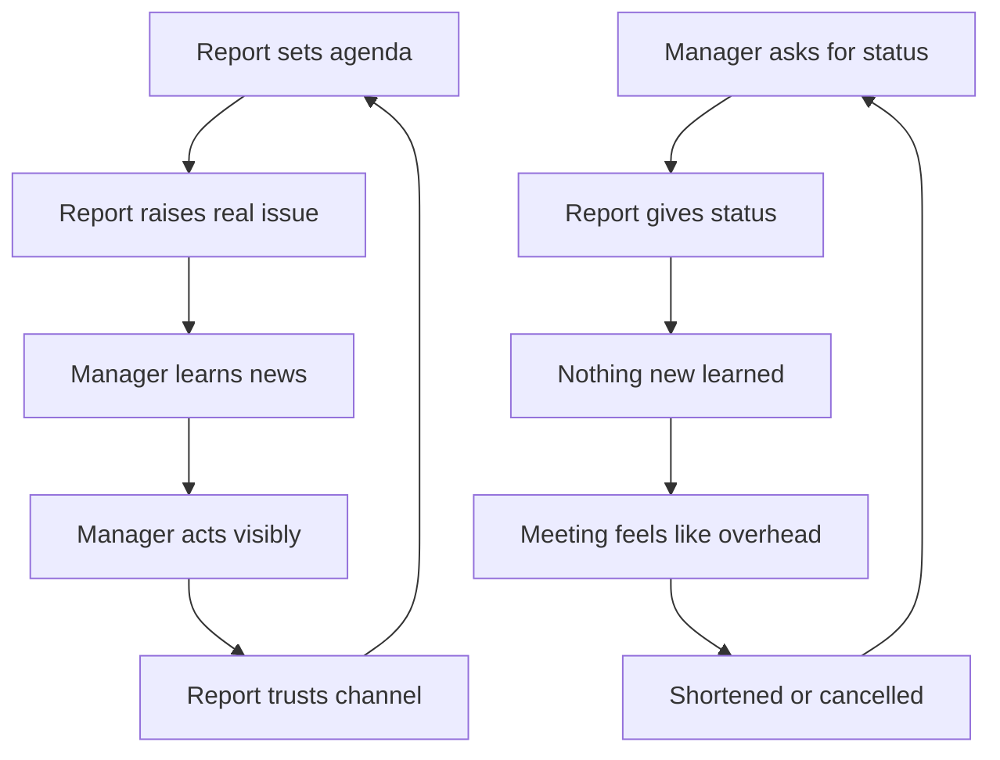
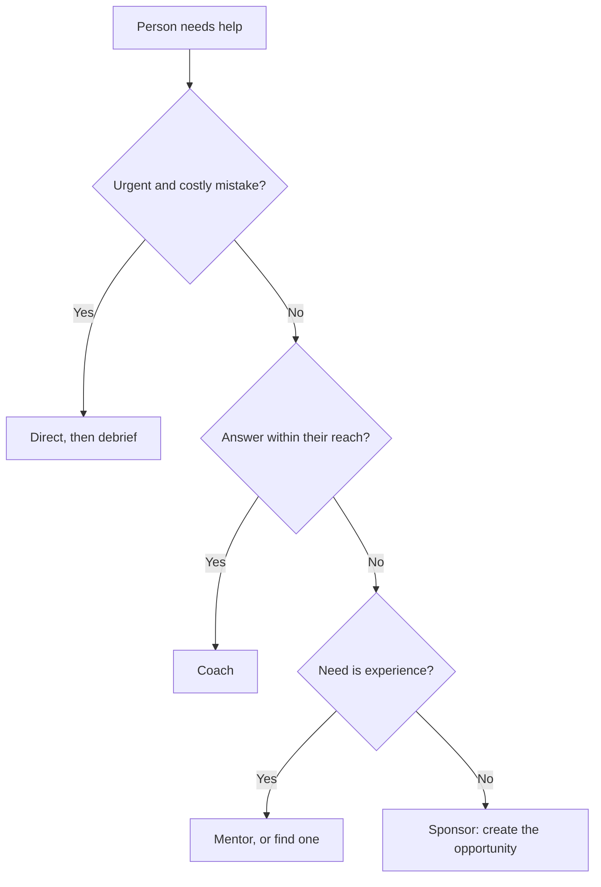
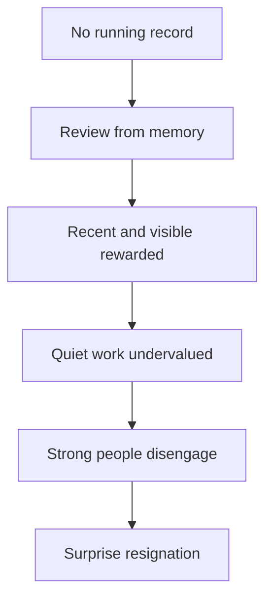

# Chapter 5 — One-on-Ones, Coaching, and Mentorship

This chapter is about the manager's most frequent private conversation and what it is for. It treats
the one-on-one as an information channel that has to be designed and checked, not a ritual that is
done because it is on the calendar. It then separates four ways of helping a person grow (directing,
coaching, mentoring, and sponsoring) and shows how to choose among them, and it ends with the
lightweight record that turns months of conversations into evidence for reviews and promotions.
Feedback and difficult conversations belong to Chapter 6 (Feedback, Conflict, and Difficult
Conversations), and performance management to Chapter 9. The
running example is Daniel Cho, who manages Customer Experience at Northstar Technologies, the
fictional company in the [case study](../../case-studies/northstar/index.md).

## Why This Matters

At team scale, the one-on-one is where a manager hears what nothing else will say: that a senior
engineer is bored, that two people have stopped speaking, that a design decision is being quietly
worked around. Chapter 2 described the manager's feedback loop as slow, shared, and filtered
([Chapter 2](../01-foundations/02-from-individual-contributor-to-leader.md#feedback-that-is-slower-and-noisier)).
The one-on-one is the main tool against the filtering. When it decays into a status report, the
manager keeps paying the time and loses the information.

At organization scale, one-on-ones are a large, invisible budget. If each of 80 engineers meets their
manager weekly for 30 minutes, that is 40 manager-hours and 40 engineer-hours a week. Few
organizations check what that time buys.

At executive scale, promotion decisions, retention risks, and the bench of future leaders rest on
what managers know about their people. If that knowledge is memory of the last month, the
organization promotes the visible rather than the effective, and is surprised by resignations it
could have seen coming.

## Learning Objectives

After this chapter you will be able to:

- Design one-on-ones that surface information you would not otherwise get, with the agenda owned by
  the report and status moved elsewhere.
- Detect, from observable signals, when your one-on-ones have decayed into status meetings, and
  repair them.
- Choose between directing, coaching, mentoring, and sponsoring for a given person and situation,
  and say what each costs.
- Keep a lightweight, factual record of each person's work and growth that makes reviews and
  promotion cases evidence-based.
- Set a one-on-one cadence for a team from its size, its experience, and the manager's other
  commitments, with the arithmetic shown.

## The Mental Model

> **Mental model:** A one-on-one is an information channel owned by the report. Its value is the
> news it carries, things the manager could not have learned from the board, the chat, or the
> stand-up, and that news flows only while the report sees it acted upon.

The channel has two loops. In the healthy one, the report brings the topics, the manager learns
something and acts on it visibly, and the report brings harder topics next time. In the decay loop,
the manager opens with "what are you working on?", gets status available elsewhere, the meeting feels
like overhead, gets cancelled, and the report learns that real conversations happen somewhere else.

Both loops reinforce themselves, so a practice rarely stays in the middle. And because the channel's
value is news, measure it by news, not attendance: a manager who holds every one-on-one and learns
nothing has a perfect record and a broken channel.

## Deep Conceptual Explanation

### What the evidence on one-on-ones says, and how much

The best available evidence says one-on-ones work when the report does most of the talking and sets
the agenda, but that evidence is thin. Peer-reviewed research on manager and report one-on-ones is
scarce. The most systematic work comes from Steven Rogelberg, an organizational scientist who has
surveyed managers and their reports. In a summary for a general audience
([Rogelberg, 2024](../../references/bibliography.md#rogelberg2024unlocking)), he reports that:

- nearly half of employees found their one-on-ones lacking in substance;
- the strongest predictor of value was the report's active participation, with the report speaking
  roughly half to nine tenths of the time;
- having a plan predicted effectiveness, and both sides rated meetings highest when the report created
  the agenda;
- managers' ratings of their own one-on-one skill appear inflated;
- the evidence fits weekly or every-other-week meetings.

Treat this as **expert opinion** informed by survey data: the summary does not describe samples or
methods.

Two points matter most. The report, not the manager, should decide what the meeting is about. And
the manager is the worst-placed person to judge whether it works, so check the channel with evidence.

The practitioner tradition agrees on the first point. Andrew Grove's *High Output Management* is
known for treating the one-on-one as the subordinate's meeting, with the subordinate's agenda, and as
high-leverage because of what it teaches the manager
([Grove, 1983](../../references/bibliography.md#grove1983high)). Camille Fournier and Julie Zhuo, in
their accounts of engineering and first-time management, are known for the modern form: the
one-on-one is for the person, not the project
([Fournier, 2017](../../references/bibliography.md#fournier2017manager);
[Zhuo, 2019](../../references/bibliography.md#zhuo2019making)). That is **practitioner consensus**:
valuable, and capable of being wrong together.

### Designing the channel

The design below is **this book's recommendation**, built on those points.

**The report owns the agenda.** Keep a shared running document per person, newest entry at the top.
The report adds topics before the meeting; the manager adds theirs below. If the report's section is
empty, ask what is on their mind, and wait.

**Status goes elsewhere.** Status comes from the board, the pull requests, and a short written
update. A useful rule: nothing in the first ten minutes that a dashboard could have told you.

**A rotation of deeper questions.** People rarely volunteer career worries or frustration with a
colleague. When the agenda is light, use one: what is the most frustrating part of your week; what
kind of work do you want more of in a year; what am I doing that gets in your way.

**Visible follow-through.** Every commitment the manager makes goes into the shared document with a
date, and the next meeting starts by closing it. The report is watching what happens to the last
thing they raised.

**Shorten rather than cancel.** A one-on-one moved three times tells the report where they rank.

### Detecting decay

The manager's own impression is unreliable, so check with signals that can be counted from the
running documents. The table gives the signals and how each can mislead.

| Signal | Healthy | Decayed | How it misleads |
|---|---|---|---|
| News rate: meetings where you learned something no other channel showed | A third or more | Under one in seven | Counting trivia as news; counting things you would have heard the next day anyway |
| Agenda source | Report adds topics most weeks | Manager's template every time | A report can fill the agenda with safe topics |
| Topics in the last six weeks | Work, people, growth, the manager | Work only | Careers discussed once, in a formal review, do not count |
| Cancellations and who cancels | Rare, rescheduled | Frequent; mostly the manager | A held but empty meeting looks better than a cancelled one |
| Surprises | Few, and you saw them coming | Resignation, conflict, or burnout learned elsewhere | Absence of surprises can mean nobody tells you anything |

The thresholds are illustrative, not research-based. The strongest signal is the last: learning
something important about a report from someone else is a data point about the channel. Also ask each
report, once a quarter and in writing, what the meetings should do more of and less of; weight
specifics over ratings.

### Directing, coaching, mentoring, sponsoring

A manager helps a person in four distinct ways. Confusing them frustrates both sides.

| Mode | What the helper does | Whose knowledge drives it | Typical helper |
|---|---|---|---|
| Directing | Says what to do and how | The helper's | The manager, or a lead |
| Coaching | Asks questions so the person finds their own answer | The person's | The manager, a peer, a coach |
| Mentoring | Shares experience and advice | The helper's experience | Often someone outside the reporting line |
| Sponsoring | Uses influence to give the person opportunities and visibility | The helper's standing | Someone senior with a say in assignments and promotions |

**Directing** is not a failure of leadership. When the person lacks the knowledge, the mistake would
be costly, and time is short, telling is correct; it matches the lowest delegation levels in Chapter
2. Its cost is that people learn to wait for the answer. Liz Wiseman's idea of multipliers and
diminishers is the check: a leader who supplies every answer gets people who stop thinking
([Wiseman, 2010](../../references/bibliography.md#wiseman2010multipliers)).

**Coaching** helps when the answer is within the person's reach and the learning matters more than
the speed. A [meta-analysis](../../glossary.md#meta-analysis) (a study that pools many studies) of
coaching in organizations found positive effects on all five outcome categories it examined:
performance and skills, well-being, coping, work attitudes, and goal-directed self-regulation. The
[effect sizes](../../glossary.md#effect-size-d-g) ranged from moderate (coping) to large
(self-regulation)
([Theeboom, Beersma, and van Vianen, 2014](../../references/bibliography.md#theeboom2014coaching)).
A second, of 17 studies, found positive effects on learning and performance, stronger for internal
than external coaches; it deliberately excluded coaching by a person's own manager
([Jones, Woods, and Guillaume, 2016](../../references/bibliography.md#jones2016coaching)). These are
**research findings**, mostly about coaching programs. We found no meta-analysis of coaching by a
person's own manager, so whether a manager who also sets pay gets the same effects is open. People
are less candid about their weaknesses with the person who rates them.

**Mentoring** transfers experience: a first on-call shift, getting a design past a skeptical staff
engineer, whether to move teams. Meta-analyses associate mentoring with a broad range of favorable
outcomes, including career outcomes, but the effects are generally small, and small for objective
outcomes such as pay ([Allen et al., 2004](../../references/bibliography.md#allen2004mentoring);
[Eby et al., 2008](../../references/bibliography.md#eby2008mentoring)). These are **research
findings** from mostly correlational studies. Mentoring helps somewhat; it does not substitute for
opportunity.

**Sponsoring** turns development into advancement. Ibarra, Carter, and Silva distinguished
sponsorship from mentoring: a sponsor goes beyond advice and uses their influence with senior
executives on the person's behalf. They drew on a survey of more than 4,000 high-potential MBA
graduates, a follow-up survey, and 40 interviews. Men and women alike reported useful advice from
mentors, but mostly men described being sponsored, and the men had received 15 percent more
promotions at follow-up
([Ibarra, Carter, and Silva, 2010](../../references/bibliography.md#ibarra2010promotions)). It is
**industry research** about MBA graduates, not engineers, and the mechanism is the authors'
interpretation. The lesson travels: a person can be well mentored and still overlooked. For a manager,
sponsoring means proposing a report to lead a cross-team project and making their work visible in
rooms they are not in.

### Choosing the mode

The choice depends on the situation, not on the person. The same engineer may need directing on a
production migration on Tuesday and coaching on a design on Thursday.

"Then debrief" matters: after directing in an emergency, the conversation afterward is a coaching
conversation about what the person would do next time. "Or find one" matters too: the manager is
rarely the best mentor for everything, and connecting a report with a mentor in another team is
often more useful than mentoring them yourself.

### The record that makes reviews evidence-based

Reviews written from memory favor the recent and the vivid; a manager with fifteen reports cannot
remember what each did in February. A small record kept as a by-product of one-on-ones fixes most of
this. The format is **this book's recommendation**: one running document per report, with dated
entries written in five minutes after each meeting:

- **Topics the report raised**, in a line each.
- **Commitments**, both ways, with dates, and whether they were kept.
- **Observations**: specific behavior and its effect, with the date and the source. "Led the
  checkout incident review on 3 March; the follow-up actions all had owners" is evidence.
  "Strong communicator" is not.
- **Growth**: the person's stated goal, and what moved toward it this month.
- **Sponsorship actions**: opportunities you proposed them for, and the result.

What stays out: speculation about motives, health details, protected characteristics, and gossip.
Write as if the person will read it one day; your HR team can tell you whether they may.

Once a month, read each document and write three lines: what this person did, what they are working
toward, what you owe them. At review time, the record replaces recollection. Chapter 8 uses it for
promotion cases and Chapter 9 for performance problems.

## Engineering Organization Example

The figures below are **illustrative**, invented for Northstar (fictional). They work through the
cost of one-on-ones for Daniel Cho, who manages 15 engineers in Customer Experience, spends 45 percent
of his time on people management, and holds weekly 30-minute one-on-ones with each report
([baseline data](../../case-studies/northstar/baseline-data.md)).

Assumptions: a 40-hour week; 10 minutes of preparation and notes per meeting; 4.33 weeks a month.

| Cadence | Meeting hours per week | Prep and notes per week | Total per week | Minutes per report per month |
|---|---|---|---|---|
| A. Weekly, 30 minutes (current) | 7.5 | 2.5 | 10.0 | 130 |
| B. Every two weeks, 30 minutes | 3.75 | 1.25 | 5.0 | 65 |
| C. Every two weeks, 45 minutes | 5.6 | 1.25 | 6.9 | 97 |
| D. Weekly 30 for 2 leads; every two weeks 45 for 13 | 5.9 | 1.4 | 7.3 | 130 (leads); 97 (others) |

Under A, one-on-ones take 10 of Daniel's 18 weekly hours of people time. Under D, people keep all or
three quarters of their face time, and Daniel recovers about 2.7 hours a week.

Frequency is a weak lever compared with content: cutting cadence alone saves hours and loses news,
while changing content is free. The case study's six-week sample shows it. Daniel held 84 meetings and
learned something no other channel showed in 11. Cadence D with a report-owned agenda would cost fewer
hours and, if it raised the news rate to one meeting in three (an assumption, not a forecast), carry
more news:

| Six weeks | Meetings | Person-hours (both people) | Meetings with news | Person-hours per item |
|---|---|---|---|---|
| Current: cadence A, status-led | 84 held, about 26 minutes each | about 73 | 11 | about 6.6 |
| Cadence D, report-owned agenda | 51 (12 leads, 39 others) | about 70 | about 17 | about 4.1 |

## Decision Framework

Three decisions recur: the cadence, whether a meeting has decayed, and which mode of help to use. The
mode decision is the diagram in the previous section. For cadence, decide per person, not per team.

| Factor | Pushes toward weekly | Pushes toward every two weeks |
|---|---|---|
| Time in role or on the team | Under six months | Established |
| Rate of change in their work | High (new project, incident load, reorganization) | Stable |
| Their role | Lead or person others depend on | Individual contributor with clear scope |
| Manager's span | Up to about eight | Twelve or more |
| Other contact | Little day-to-day contact | Daily contact in the same work |

These factors are **this book's recommendation**, consistent with the weekly-or-biweekly range
Rogelberg reports. Below every two weeks, the channel loses continuity: each meeting spends its first
part catching up. If a span forces less than that, the span is the problem (Chapter 34, Spans,
Layers, and Dependency Mapping, treats span).

For a series that feels flat, check the agenda source first: if it is yours, hand it back before
changing anything else. If it is theirs and the news rate is still low, the problem is probably
follow-through; look at what happened to the last three things they raised.

## Trade-offs

**Frequency against depth.** Weekly meetings keep continuity; fewer, longer ones leave room for career
and difficult topics. For a large span, a mix by person usually beats one cadence.

**Coaching against speed.** Asking takes longer than telling, and the person may reach a worse answer.
Coach when that cost is acceptable and the learning will be reused; otherwise direct, and say why.

**Manager as coach against manager as judge.** Some people will not be candid with the person who
sets their pay. Separate the conversations in time, say which one you are in, and give access to
coaching or mentoring outside the line.

**Sponsorship against fairness.** Sponsoring is choosing someone over others. Done informally, it
favors the visible and those most like the sponsor. Keep a sponsorship line in every record and
review each quarter who has had none.

**Records against trust.** Notes that feel like a file being built against a person damage the
channel. A shared agenda, factual observations, and no surprises at review time keep the record an aid.

## Failure Modes

**The status meeting.** Signal: the agenda is the manager's template, and six weeks of notes contain
no career or people topics. Repair: move status to a written update and hand the agenda back.

**The therapist without follow-through.** The manager listens well and nothing changes. Signal: the
same topic in three meetings with no action recorded. Repair: write the commitment and date; report
back at the start of the next meeting.

**The cancellation spiral.** One-on-ones are the first thing moved when the week fills. Signal: fewer
than about four in five held, mostly cancelled by the manager. Repair: shorten instead of cancelling.

**Coaching theater.** Leading questions to which the manager already knows the answer. Signal:
questions ending in "don't you think?". Repair: if you have the answer and it matters, direct, and say so.

**Mentoring without sponsoring.** A strong engineer gets advice for two years and no opportunity.
Signal: an empty sponsorship line beside a stated goal. Repair: one concrete opportunity this quarter.

**The memory review.** Signal: every example in the review is from the last six weeks. The loop it
feeds:

## Enterprise Application

In an organization of 50 to 150 engineers, the director cannot sit in on one-on-ones and should not
try. The job is to make the practice observable without making it bureaucratic.

**Set a floor, not a format.** Every engineer has a one-on-one at least every two weeks, with an
agenda they can add to.

**Ask the reports, rarely.** A two-question pulse once or twice a year ("Are your one-on-ones useful?
What would make them more useful?") gives a signal self-ratings cannot. Managers who see results may
coach the answers, so read trends and comments and never rank managers on the score (Chapter 18
treats metric gaming).

**Skip-levels as a check.** A director's conversations with engineers two levels down detect what
one-on-ones miss, and harm if they bypass the manager. The rule: themes go back to the manager, with
the engineer's agreement. Chapter 41 (Managing and Developing Engineering Managers) covers the rest.

**Map mentoring and sponsorship.** For each senior engineer and likely future lead, list who mentors
and who sponsors them. Gaps are predictable: quiet teams, new managers, people unlike the leadership.

**Train the channel.** Managers appear to overrate their one-on-one skills, and many were never taught. An
hour of practice in agenda handover and the decay signals is cheap.

## CTO Perspective

**Information.** A CTO hears about the organization through layers of filters. One test of their
honesty is how often an executive learns of a serious people problem, such as a key engineer leaving,
after it is too late to act. If often, the one-on-one channel is failing below, and dashboards will
not fix it.

**Promotion evidence.** A promotion process that requires dated, specific evidence exposes which
managers keep records. The CTO can require evidence without prescribing a tool.

**Sponsorship is the leadership pipeline.** The next staff engineers and managers are the people
someone senior chose to stretch; left informal, the pipeline reproduces whoever was already visible.
The research above is about MBA graduates in one period: enough to make a CTO ask who is being
sponsored, not enough to promise a board a measured effect.

**The CTO's own one-on-ones** with directors decay the same way, into portfolio status. The repair
is the same.

## Practical Playbook

For a manager rebuilding their one-on-ones over a quarter:

1. Create a shared running document per report, headed "Your agenda first; status lives elsewhere."
2. Tell the team what is changing and ask each person to add one topic before the next meeting.
3. Set up a weekly three-line written status (done, next, stuck) and stop asking for status in the
   meeting.
4. Set each person's cadence from the decision table and book the quarter.
5. Keep five deeper questions for light agendas.
6. After each meeting, spend five minutes on the record: topics, commitments, observations, growth,
   sponsorship.
7. Open each meeting by closing your commitments from the last.
8. For each report, write the mode of help their current goal needs; check it is not always "direct".
9. Name one sponsorship action for each senior engineer this quarter.
10. After six weeks, count the decay signals from your notes and ask each report, in writing, what the
    meetings should do more of and less of.
11. At quarter end, write the three-line summaries and compare them with what memory would have said.

## Case Study

This case is **fictional** ([the first quarter](../../case-studies/northstar/first-quarter.md)).

!!! info "Northstar so far"
    Week 19 of the director's first year at Northstar, early in quarter 2 (weeks 14 to 26). Serious
    (Sev1 and Sev2) incidents fell from 30 to 21 in the first quarter. In week 10 the seven QA engineers (manual testers)
    moved into product teams as quality engineers, two of them to Daniel Cho's Customer Experience team.
    See the [timeline](../../case-studies/northstar/timeline.md).

At baseline, before the director arrived, Daniel Cho managed 15 engineers, nine web and six mobile, and spent 45 percent of his time
on people management, more than any other Northstar manager. Technical direction sat with two informal
leads without titles, Hannah Lindgren for web and Mateo Arango Ríos for mobile. The team deployed
26 times a month, the most of any team. On an activity view Daniel looked like the strongest manager,
while his team's health and growth were unknown ([Chapter 4](../01-foundations/04-the-leadership-ladder.md)).

Daniel was proud of his one-on-ones: weekly, 30 minutes, rarely cancelled, though those with the
mobile engineers in Bogotá, held by video, were often rescheduled. In week 16 a team health check, a
self-assessment in which the team rates ten indicators green to red (Chapter 14), showed mobile rating
four of them red. Daniel was surprised. In week 17 Mateo told the
director that he had been doing a lead's job for over a year without anyone saying so, and that his
one-on-ones were "where I tell Daniel where mobile is." He agreed the director could raise it.

In week 19, Daniel and the director went through his notes for weeks 14 to 19. The sample covered his
15 engineers; the two quality engineers who joined and now report to Daniel were left out as too
recent. Daniel coded each meeting by its dominant topic and by whether he had learned something
the board, chat, or stand-up had not shown.

| Measure, weeks 14 to 19 | Value |
|---|---|
| Scheduled and held | 90 scheduled, 84 held; average 26 minutes |
| Opened from Daniel's questions ("what are you working on, any blockers") | 79 of 84 |
| Dominant topic: status, or blockers already on the board | 55 and 9 |
| Dominant topic: career or growth | 8, with 6 people |
| Dominant topic: team or process concerns; personal or well-being | 7 and 5 |
| Meetings with news | 11 of 84 (13 percent) |
| Engineers with no career conversation in six weeks | 9 of 15 |
| The two leads' meetings | 12 held, all dominated by platform-wide status |

Attendance was excellent and the channel was mostly status: 64 of 84 meetings (76 percent). The two
leads, who carried the most context, used their meetings to report on everyone else's work. Mobile's
red ratings and Mateo's frustration appeared in none of them. Daniel's first reaction was that his
reports liked the meetings. The director's answer was that they might. But manager
self-ratings were exactly what neither of them should rely on. They agreed to ask the team.

Daniel drafted a change for the rest of quarter 2: shared agendas with the report's topics first; a
three-line weekly written status; cadence D from the Engineering Organization Example; monthly
three-line summaries; and one sponsorship action each for Hannah and Mateo. He was unsure whether to
propose them as named tech leads, which needs the director's agreement and changes how other teams
work with Customer Experience, or to start with smaller opportunities, and how to raise what Mateo
had said. The case leaves Daniel with the draft; the exercises take it from there.

## Exercises

Solutions are in [chapter 5 solutions](../../solutions/ch05-solutions.md). Northstar data is on the
[baseline page](../../case-studies/northstar/baseline-data.md).

### Foundational

**F1.** A manager of seven engineers tells you her one-on-ones are excellent: she holds every one,
weekly, and her reports say they are "fine". Her notes for the last month show the same three
questions opening every meeting and no topic other than current work. Using the chapter's mental
model, explain what is likely happening and name three signals she could count from her own notes
to check.

**F2.** For each situation, choose directing, coaching, mentoring, or sponsoring, and justify the
choice: a mid-level engineer stuck for two days on a test design she owns; a new hire about to make
a schema change on a [tier 1](../../glossary.md#tier-1) table (one on the order or payment path)
during an incident; a senior engineer who wants to become a staff
engineer and has never led cross-team work; an engineer asking how to handle a hostile reviewer on
another team.

**F3.** A manager's review draft for an engineer contains: "excellent team player", "strong technical
skills", and "led the image-service migration well last month". Rewrite the record entries that
should have produced a better review, and say what the manager would need to have written down during
the year.

### Applied Leadership

**A1.** You are Daniel Cho after week 19. Prepare your conversation with Mateo: whether to tell
him you heard the theme, how to open, what you will commit to, and what you will not promise about the
tech lead title, which is not yours alone to give.

**A2.** Daniel's draft keeps Hannah and Mateo on weekly one-on-ones and moves 13
engineers to every two weeks for 45 minutes. Two engineers object that they will see Daniel less.
Evaluate the draft using the decision table and the chapter's arithmetic, and propose what you would
change, if anything, and how you would know in six weeks whether it worked.

**A3.** Priya Raman (Orders manager) holds 30-minute one-on-ones every two weeks with her 16 reports
(14 engineers and the two quality engineers who joined in week 10), as agreed with the director in
week 2. Rafael Duarte, a senior engineer who applied for her role, has used his meetings only for
order-capture review status since. Advise Priya on how to change his one-on-ones, which mode of help he
most needs from her, and who else should sponsor him.

### Executive Decision-Making

**X1.** As Northstar's director, you want evidence that one-on-ones are working across six teams
without reading anyone's notes. Design the lightest mechanism you can, say what each element tells you
and how it can be gamed, and say what you would do if one manager's results were consistently poor.

**X2.** Suppose that in a later quarter two senior engineers leave Northstar saying they had no path
to staff, and Victor Lindqvist (CTO) asks you for a mentoring program. You have no budget for external coaches. Decide what
you would build instead, with the role of mentoring, sponsorship, and the managers' records, and say
what you would tell Victor the evidence does and does not support.

## Reflection Questions

1. What did your last six one-on-ones tell you that no other channel would have?
2. Who sets the agenda of your one-on-ones, in practice rather than in principle?
3. When did you last hear something important about a report from someone else?
4. For whom are you a mentor but not a sponsor, and what would it cost you to sponsor them?
5. If you had to write every report's review tomorrow, how much would come from records and how much
   from memory of the last month?
6. Which of your reports would be least likely to tell you that your one-on-ones are not useful?

## Key Takeaways

- Treat the one-on-one as the report's information channel; measure it by the news it carries, not
  by attendance.
- Give the report the agenda and move status to a written update.
- Close your commitments at the start of each meeting; follow-through keeps the channel open.
- Count decay signals from your notes, and treat surprises learned elsewhere as the strongest.
- Choose directing, coaching, mentoring, or sponsoring by the situation; direct when it is urgent and
  say so, coach when the learning is worth the time.
- Coaching evidence is mostly about professional coaches, and mentoring effects are small; neither
  substitutes for sponsored opportunity.
- Keep a dated, factual record per person, five minutes per meeting, with a monthly summary, so that
  reviews and promotion cases rest on evidence.
- Set cadence per person; weekly for the new, the leads, and those in change, every two weeks for the
  established.

## References and Further Reading

- [Rogelberg, 2024](../../references/bibliography.md#rogelberg2024unlocking). A researcher's summary
  of his survey work on one-on-ones; his book *Glad We Met* is the longer treatment.
- [Grove, 1983](../../references/bibliography.md#grove1983high). *High Output Management*. The
  one-on-one as the subordinate's meeting and a high-leverage activity.
- [Fournier, 2017](../../references/bibliography.md#fournier2017manager). *The Manager's Path*.
  One-on-ones and mentoring across the engineering management career.
- [Zhuo, 2019](../../references/bibliography.md#zhuo2019making). *The Making of a Manager*. The first
  years of management, including useful one-on-ones.
- [Theeboom, Beersma, and van Vianen, 2014](../../references/bibliography.md#theeboom2014coaching) and
  [Jones, Woods, and Guillaume, 2016](../../references/bibliography.md#jones2016coaching).
  Meta-analyses of coaching outcomes; the second excludes coaching by a person's own manager.
- [Allen et al., 2004](../../references/bibliography.md#allen2004mentoring) and
  [Eby et al., 2008](../../references/bibliography.md#eby2008mentoring). Mentoring's associations with
  outcomes: real, generally small.
- [Ibarra, Carter, and Silva, 2010](../../references/bibliography.md#ibarra2010promotions). Mentoring
  versus sponsorship, from research on high-potential graduates.
- [Wiseman, 2010](../../references/bibliography.md#wiseman2010multipliers). *Multipliers*. Why leaders
  who supply every answer diminish the people around them.
