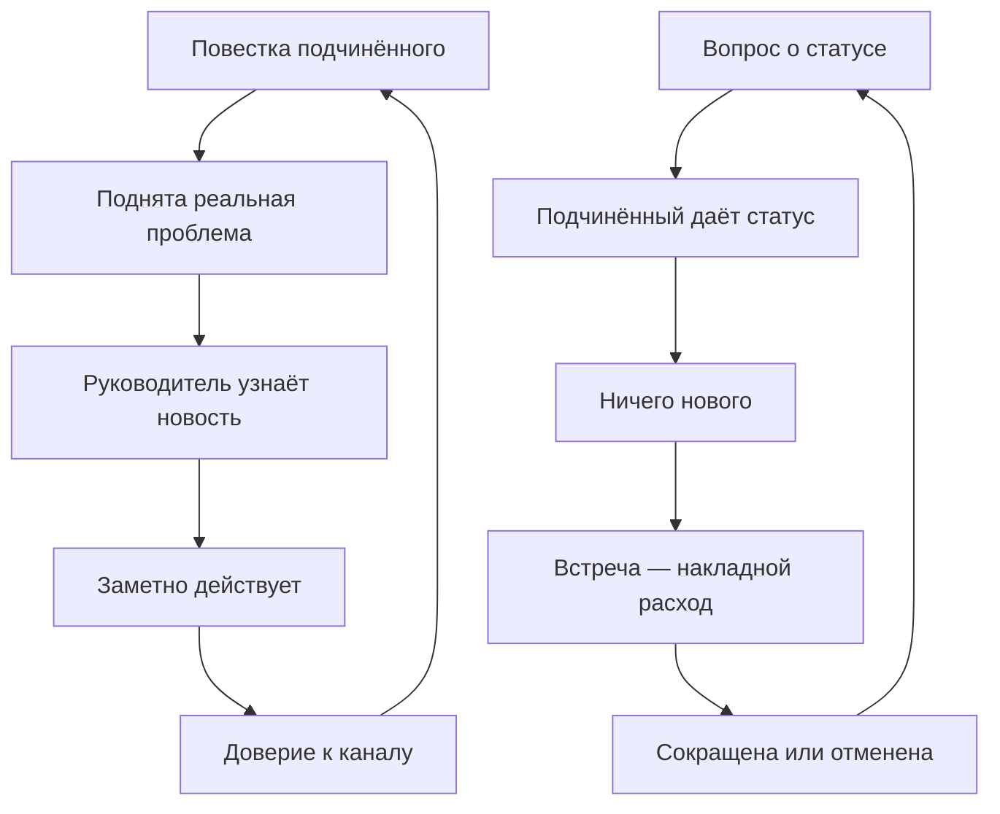
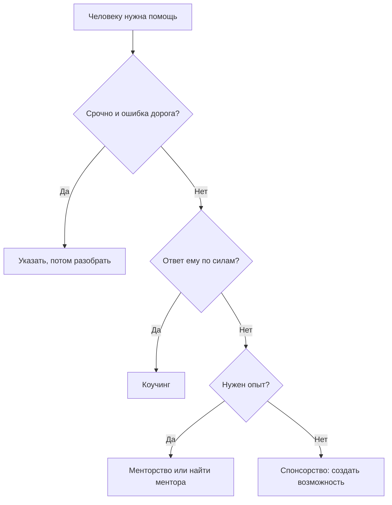
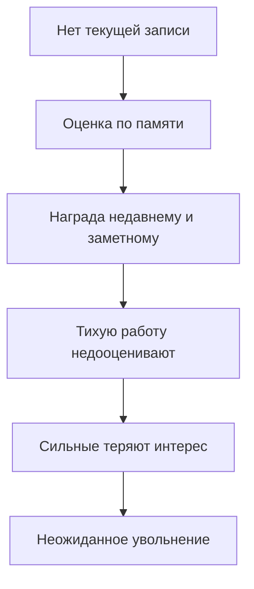

# Глава 5 — Встречи один на один, коучинг и менторство { #chapter-5-one-on-ones-coaching-and-mentorship }

Эта глава — о самом частом из разговоров руководителя с глазу на глаз и о том, зачем он нужен. Встреча
один на один (1:1) здесь — информационный канал, который нужно спроектировать и проверять, а не ритуал,
который проводят потому, что он стоит в календаре. Затем глава разделяет четыре способа помочь человеку
расти (указание, коучинг, менторство и спонсорство) и показывает, как выбирать между ними. Завершает её
лёгкая запись, которая превращает месяцы разговоров в доказательную базу для оценок и повышений.
Обратная связь и трудные разговоры — тема главы 6 («Обратная связь, конфликты и трудные разговоры»),
управление результативностью — главы 9. Сквозной пример — Daniel Cho, руководитель Customer Experience
в Northstar Technologies, вымышленной компании из [кейса](../../case-studies/northstar/index.md).

## Почему это важно { #why-this-matters }

Для команды встреча 1:1 — место, где руководитель слышит то, чего не скажет никакой другой источник:
senior-инженеру скучно, двое перестали разговаривать друг с другом, проектное решение потихоньку
обходят. В главе 2 петля обратной связи руководителя описана как медленная, с размытой атрибуцией и отфильтрованная
([глава 2](../01-foundations/02-from-individual-contributor-to-leader.md#feedback-that-is-slower-and-noisier)).
Встреча 1:1 — главный инструмент против фильтрации. Когда она вырождается в отчёт о статусе,
руководитель по-прежнему платит временем, а информацию теряет.

Для организации встречи 1:1 — большой и незаметный бюджет. Если каждый из 80 инженеров еженедельно
встречается с руководителем на 30 минут, это 40 часов руководителей и 40 часов инженеров в неделю.
Мало какая организация проверяет, что получает за это время.

На уровне высшего руководства решения о повышениях, риски потери людей и резерв будущих лидеров зависят
от того, что руководители знают о своих людях. Если это знание сводится к памяти о последнем месяце,
организация повышает заметных, а не эффективных, и удивляется увольнениям, которые могла бы предвидеть.

## Цели главы { #learning-objectives }

После этой главы вы сможете:

- Проектировать встречи 1:1, которые приносят информацию, иначе вам недоступную: повестка принадлежит
  подчинённому, а статус вынесен в другое место.
- Распознавать по наблюдаемым сигналам, что ваши встречи 1:1 выродились в статус-встречи, и исправлять
  это.
- Выбирать между указанием, коучингом, менторством и спонсорством для конкретного человека и ситуации и
  называть цену каждого способа.
- Вести на каждого человека лёгкую фактическую запись о работе и росте, чтобы оценки и заявки на
  повышение опирались на факты.
- Задавать ритм встреч 1:1 с учётом размера и опыта команды и других обязательств руководителя и
  показывать расчёт.

## Ментальная модель { #the-mental-model }

> **Ментальная модель:** встреча 1:1 — информационный канал, который принадлежит подчинённому. Её
> ценность — в новостях, то есть в том, чего руководитель не узнал бы с доски задач, из чата или на
> стендапе. И новости идут, только пока подчинённый видит, что по ним действуют.

У канала две петли. В здоровой петле подчинённый приносит темы, руководитель узнаёт новое и заметно
действует, и в следующий раз подчинённый приносит темы потруднее. В петле вырождения руководитель
начинает с вопроса «над чем работаешь?» и получает статус, который и так есть в других местах. Встреча
начинает казаться накладным расходом, её отменяют, и подчинённый усваивает, что настоящие разговоры
идут где-то ещё.

Обе петли самоусиливающиеся, поэтому практика редко задерживается посередине. А раз ценность канала —
новости, новостями его и измеряйте, а не посещаемостью. У руководителя, который проводит каждую встречу
1:1 и ничего не узнаёт, безупречная статистика и сломанный канал.

## Подробный разбор { #deep-conceptual-explanation }

### Что говорят данные о встречах 1:1 и насколько им можно верить { #what-the-evidence-on-one-on-ones-says-and-how-much }

Лучшие из доступных данных говорят: встречи 1:1 работают, когда подчинённый говорит большую часть
времени и сам задаёт повестку. Но данных этих мало: рецензируемых исследований встреч 1:1 руководителя
с подчинённым немного. Самую систематическую работу проделал специалист по организационной науке Steven
Rogelberg, опрашивавший руководителей и их подчинённых. В обзоре для широкой аудитории
([Rogelberg, 2024](../../references/bibliography.md#rogelberg2024unlocking)) он сообщает следующее:

- почти половина сотрудников считала свои встречи 1:1 бессодержательными;
- ценность встречи сильнее всего предсказывало активное участие подчинённого: он говорил примерно от
  половины до девяти десятых времени;
- эффективность предсказывало наличие плана, а выше всего обе стороны оценивали встречи, повестку
  которых составлял подчинённый;
- руководители, по-видимому, завышают оценку собственного умения проводить встречи 1:1;
- данные согласуются с ритмом раз в неделю или раз в две недели.

Считайте это **мнением эксперта**, опирающимся на данные опросов: выборки и методы в обзоре не описаны.

Важнее всего здесь два вывода. Первый: решать, о чём встреча, должен подчинённый, а не руководитель.
Второй: хуже всех судить о том, работает ли встреча, может как раз руководитель, поэтому проверяйте
канал фактами.

С первым выводом согласна и традиция практиков. Книга Andrew Grove *High Output Management* известна
тем, что считает встречу 1:1 встречей подчинённого, с его повесткой, и занятием с высоким рычагом
благодаря тому, что на ней узнаёт руководитель
([Grove, 1983](../../references/bibliography.md#grove1983high)). Книгам Camille Fournier об управлении
разработкой и Julie Zhuo о первом опыте руководства принадлежит известная современная формулировка:
встреча 1:1 — для человека, а не для проекта
([Fournier, 2017](../../references/bibliography.md#fournier2017manager);
[Zhuo, 2019](../../references/bibliography.md#zhuo2019making)). Это **консенсус практиков**: он ценен,
но ошибаться может и консенсус.

### Проектирование канала { #designing-the-channel }

Схема ниже — **рекомендация книги**, основанная на этих выводах.

**Повестка принадлежит подчинённому.** Заведите на каждого человека общий текущий документ, новые
записи — сверху. Подчинённый добавляет темы до встречи, руководитель пишет свои ниже. Если раздел
подчинённого пуст, спросите, что у него на уме, — и подождите.

**Статус — в другом месте.** Статус берут с доски задач, из мерж-реквестов и из короткого письменного
отчёта. Полезное правило: первые десять минут — ничего из того, что мог бы показать дашборд.

**Глубокие вопросы по очереди.** Люди редко сами заговаривают о тревогах по поводу карьеры или о
раздражении на коллегу. Когда повестка лёгкая, задайте один из таких вопросов: «Что за неделю
раздражало тебя больше всего?», «Какой работы тебе хотелось бы больше через год?», «Что я делаю такого,
что тебе мешает?»

**Выполненные обещания на виду.** Каждое обязательство руководителя записывают в общий документ с
датой, и следующая встреча начинается с его закрытия. Подчинённый следит за тем, что стало с последним
вопросом, который он поднимал.

**Сокращайте, а не отменяйте.** Трижды перенесённая встреча 1:1 показывает подчинённому, какое место он
занимает в ваших приоритетах.

### Три ситуации, с которыми должна справляться схема { #three-situations-the-design-must-handle }

**Первая встреча 1:1 с новым подчинённым.** Посвятите её не работе, а тому, как человек любит работать:
как он хочет получать обратную связь, какой бывает для него хорошая неделя, что ему нужно от вас, что
не ладилось с прошлыми руководителями. Прежде чем расстаться, договоритесь о ритме и об общем документе.

**Подчинённый, который ничего не приносит.** Если повестка пуста неделю за неделей, обычно это значит,
что канал ещё не заслужил доверия или подчинённый не верит, что что-то изменится. Не заполняйте тишину
статусом. Задайте один глубокий вопрос, подождите и на виду закройте какой-нибудь вопрос с прошлого
раза. Если через месяц повестка всё ещё пуста, спросите о самой встрече: «Что нужно, чтобы эти полчаса
стоили твоего времени?»

**Удалённые подчинённые и подчинённые в других часовых поясах.** Тем, кто работает в одном офисе,
пробелы заполняют случайные разговоры в коридоре. У встречи 1:1 по видео такой подпитки нет, поэтому на
ней лежит больше работы канала, и переносить её стоит в последнюю очередь. Проводите её в рабочее время
обоих; если рабочие часы пересекаются мало, берите неудобный слот по очереди. Камеры — по желанию,
общий документ — обязательно: на расстоянии письменная запись берёт на себя больше работы.

### Как заметить вырождение { #detecting-decay }

Собственному впечатлению руководитель доверять не может, поэтому проверяйте канал по сигналам, которые
можно посчитать в текущих документах. В таблице — эти сигналы и то, чем каждый может ввести в
заблуждение.

| Сигнал | Здоровый канал | Выродившийся | Как вводит в заблуждение |
|---|---|---|---|
| Доля встреч с новостями: вы узнали то, чего не показал ни один другой канал | Треть и больше | Меньше одной из семи | Мелочи засчитываются как новости; засчитывается то, что вы и так услышали бы на следующий день |
| Источник повестки | Подчинённый добавляет темы почти каждую неделю | Каждый раз шаблон руководителя | Подчинённый может заполнить повестку безопасными темами |
| Темы за последние шесть недель | Работа, люди, рост, руководитель | Только работа | Карьера, обсуждённая один раз на формальной оценке, не считается |
| Отмены и кто отменяет | Редко, с переносом | Часто; в основном руководитель | Проведённая, но пустая встреча выглядит лучше отменённой |
| Сюрпризы | Мало, и вы их предвидели | Об увольнении, конфликте или выгорании вы узнали из других источников | Отсутствие сюрпризов может означать, что вам никто ничего не рассказывает |

Пороги — иллюстрация, а не результат исследований. Самый сильный сигнал — последний: если вы узнали
что-то важное о подчинённом от кого-то другого, это факт о состоянии канала. И ещё: раз в квартал
письменно спрашивайте каждого подчинённого, чего на встречах должно быть больше, а чего меньше;
конкретные ответы весят больше, чем оценки.

### Указание, коучинг, менторство, спонсорство { #directing-coaching-mentoring-sponsoring }

Руководитель помогает человеку четырьмя разными способами. Когда их путают, недовольны обе стороны.

| Способ | Что делает помогающий | На чём держится помощь | Кто обычно помогает |
|---|---|---|---|
| Указание | Говорит, что и как делать | Знания помогающего | Руководитель или лид |
| Коучинг | Задаёт вопросы, чтобы человек нашёл собственный ответ | Знания самого человека | Руководитель, коллега, коуч |
| Менторство | Делится опытом и советами | Опыт помогающего | Часто кто-то вне линии подчинения |
| Спонсорство | Использует влияние, чтобы дать человеку возможности и видимость | Положение помогающего | Кто-то старший, чьё слово весомо в назначениях и повышениях |

**Указание** — не провал лидерства. Если человеку не хватает знаний, ошибка обойдётся дорого, а
времени мало, правильно сказать, что делать; это нижние уровни делегирования из главы 2. Цена — люди
привыкают ждать готового ответа. Проверить себя помогает идея Liz Wiseman о мультипликаторах и
ослабителях: у лидера, который на всё даёт ответ, люди перестают думать
([Wiseman, 2010](../../references/bibliography.md#wiseman2010multipliers)).

**Коучинг** уместен, когда ответ человеку по силам, а обучение важнее скорости.
[Метаанализ](../../glossary.md#meta-analysis) (исследование, которое объединяет результаты многих
исследований) коучинга в организациях обнаружил положительный эффект во всех пяти изученных категориях
результатов: результативность и навыки, благополучие, совладание со стрессом, отношение к работе,
целенаправленная саморегуляция. [Размеры эффекта](../../glossary.md#effect-size-d-g) — от умеренного
(совладание) до большого (саморегуляция)
([Theeboom, Beersma, and van Vianen, 2014](../../references/bibliography.md#theeboom2014coaching)).
Второй метаанализ, охвативший 17 исследований, показал положительное влияние на обучение и
результативность, причём у внутренних коучей оно сильнее, чем у внешних. Коучинг со стороны
собственного руководителя из этого анализа намеренно исключён
([Jones, Woods, and Guillaume, 2016](../../references/bibliography.md#jones2016coaching)). Это
**научные результаты**, но относятся они в основном к программам коучинга. Метаанализа коучинга со
стороны собственного руководителя мы не нашли. Поэтому открыт вопрос, добивается ли того же эффекта
руководитель, который вдобавок определяет зарплату: о своих слабостях люди менее откровенны с тем, кто
их оценивает.

**Менторство** передаёт опыт: как пройти первое дежурство, как добиться одобрения дизайна у
скептически настроенного staff-инженера, стоит ли переходить в другую команду. Метаанализы связывают
менторство с широким кругом благоприятных результатов, включая карьерные, но эффекты в целом малы, в
том числе для объективных показателей вроде зарплаты
([Allen et al., 2004](../../references/bibliography.md#allen2004mentoring);
[Eby et al., 2008](../../references/bibliography.md#eby2008mentoring)). Это **научные результаты**,
полученные в основном в корреляционных исследованиях. Менторство немного помогает, но возможностей не
заменяет.

**Спонсорство** превращает развитие в продвижение. Ibarra, Carter и Silva отделили спонсорство от
менторства: спонсор не ограничивается советами, а использует своё влияние на топ-менеджеров в интересах
человека. Авторы опирались на опрос более чем 4 000 выпускников MBA с высоким потенциалом, повторный
опрос и 40 интервью. Полезные советы от менторов, по их словам, получали и мужчины, и женщины, но о
спонсорах рассказывали в основном мужчины, и к моменту повторного опроса у мужчин оказалось на
15 процентов больше повышений
([Ibarra, Carter, and Silva, 2010](../../references/bibliography.md#ibarra2010promotions)). Это
**отраслевое исследование** о выпускниках MBA, а не об инженерах, а механизм — интерпретация авторов.
Но урок переносится: у человека могут быть хорошие менторы, а его всё равно не замечают. Спонсорство
для руководителя — это предложить подчинённого на роль лидера межкомандного проекта и делать его работу
видимой там, где его самого нет.

### Выбор способа { #choosing-the-mode }

Выбор зависит от ситуации, а не от человека. Одному и тому же инженеру во вторник может понадобиться
указание по миграции в продакшене, а в четверг — коучинг по дизайну.

Слова «потом разобрать» важны: после указания в экстренной ситуации следующий разговор — коучинговый, о
том, как человек поступит в следующий раз. Важны и слова «найти ментора»: руководитель редко бывает
лучшим ментором во всём, и познакомить подчинённого с ментором из другой команды часто полезнее, чем
менторить самому.

### Запись, которая делает оценки доказательными { #the-record-that-makes-reviews-evidence-based }

Оценки, написанные по памяти, отдают предпочтение недавнему и яркому: руководитель с пятнадцатью
подчинёнными не может помнить, что каждый из них делал в феврале. Небольшая запись, которая ведётся
попутно со встречами 1:1, исправляет большую часть этого перекоса. Формат — **рекомендация книги**:
один текущий документ на подчинённого и датированные записи, на которые после каждой встречи уходит
пять минут:

- **Темы, которые поднял подчинённый**, по строке на каждую.
- **Обязательства** в обе стороны, с датами, и выполнены ли они.
- **Наблюдения**: конкретное поведение и его эффект, с датой и источником. «3 марта провёл разбор
  инцидента в checkout; у всех последующих действий были владельцы» — это факт. «Отличный
  коммуникатор» — нет.
- **Рост**: заявленная цель человека и что продвинулось к ней за этот месяц.
- **Действия спонсора**: возможности, на которые вы его предлагали, и результат.

Чему здесь не место: домыслам о мотивах, подробностям о здоровье, защищённым законом характеристикам и
сплетням. Пишите так, будто человек однажды это прочитает; есть ли у него такое право, подскажет ваш
HR.

Раз в месяц перечитывайте каждый документ и пишите три строки: что этот человек сделал, к чему он
движется, что вы ему должны. На оценке запись заменяет воспоминания. Для заявок на повышение её
использует глава 8, для письменных оценок и проблем с результативностью — глава 9.

## Пример из инженерной организации { #engineering-organization-example }

!!! info "Northstar: что уже известно"
    Неделя 19 первого года директора в Northstar, начало квартала 2 (недели 14–26). Число серьёзных
    инцидентов (Sev1 и Sev2) за первый квартал снизилось с 30 до 21. На неделе 10 семь QA-инженеров
    (ручных тестировщиков) перешли в продуктовые команды инженерами по качеству; двое из них попали в
    Customer Experience, команду Daniel Cho. См.
    [хронологию](../../case-studies/northstar/timeline.md). Впервые в Northstar? Прочитайте
    [«Год вкратце»](../../case-studies/northstar/year-in-brief.md) и
    [«Действующие лица»](../../case-studies/northstar/cast.md).

Кейс ниже прослеживает шесть недель встреч 1:1 Daniel Cho в квартале 2, а этот раздел посвящён
арифметике. Цифры — **иллюстрация**, придуманная для Northstar (вымысел). Daniel руководит
15 инженерами в Customer Experience, тратит на управление людьми 45 процентов времени и еженедельно
проводит с каждым подчинённым встречу 1:1 на 30 минут
([исходные данные](../../case-studies/northstar/baseline-data.md)).

Допущения: рабочая неделя — 40 часов; на подготовку и записи к каждой встрече — 10 минут; в месяце
4,33 недели.

| Ритм | Часов встреч в неделю | Подготовка и записи в неделю | Всего в неделю | Минут на подчинённого в месяц |
|---|---|---|---|---|
| A. Еженедельно, 30 минут (сейчас) | 7.5 | 2.5 | 10.0 | 130 |
| B. Раз в две недели, 30 минут | 3.75 | 1.25 | 5.0 | 65 |
| C. Раз в две недели, 45 минут | 5.6 | 1.25 | 6.9 | 97 |
| D. Еженедельно по 30 для 2 лидов; раз в две недели по 45 для 13 | 5.9 | 1.4 | 7.3 | 130 (лиды); 97 (остальные) |

При варианте A встречи 1:1 занимают 10 из 18 часов, которые Daniel каждую неделю тратит на людей. При
варианте D у людей остаётся всё время общения с руководителем или три четверти его, а Daniel
высвобождает около 2,7 часа в неделю.

Но частота — слабый рычаг по сравнению с содержанием. Если только снизить частоту, вы сэкономите часы и
потеряете новости, а изменить содержание ничего не стоит. Это видно по сведённой здесь шестинедельной
выборке из кейса: Daniel провёл 84 встречи и на 11 из них узнал то, чего не показал ни один другой
канал. Ритм D с повесткой подчинённого обошёлся бы в меньшее число часов. А если бы доля встреч с
новостями выросла до одной из трёх (это допущение, а не прогноз), он принёс бы и больше новостей:

| Шесть недель | Встречи | Человеко-часы (оба участника) | Встречи с новостями | Человеко-часов на новость |
|---|---|---|---|---|
| Сейчас: ритм A, вокруг статуса | 84 проведены, около 26 минут каждая | около 73 | 11 | около 6.6 |
| Ритм D, повестка подчинённого | 51 (12 с лидами, 39 с остальными) | около 70 | около 17 | около 4.1 |

## Как принимать решение { #decision-framework }

Раз за разом приходится решать три вопроса: какой выбрать ритм, выродилась ли встреча и какой способ
помощи использовать. Для выбора способа служит диаграмма из раздела «Выбор способа». Ритм задавайте для
каждого человека, а не для команды целиком.

| Фактор | В пользу еженедельных встреч | В пользу встреч раз в две недели |
|---|---|---|
| Время в роли или в команде | Меньше шести месяцев | Человек освоился |
| Скорость изменений в его работе | Высокая (новый проект, нагрузка инцидентами, реорганизация) | Стабильная |
| Его роль | Лид или человек, от которого зависят другие | Индивидуальный исполнитель с ясной областью ответственности |
| Охват руководителя | Примерно до восьми | Двенадцать и больше |
| Другие контакты | Мало повседневного общения | Ежедневное общение в общей работе |

Эти факторы — **рекомендация книги**; они согласуются с диапазоном «раз в неделю или раз в две недели»,
о котором сообщает Rogelberg. При встречах реже раза в две недели канал теряет непрерывность: каждая
встреча начинается с того, что вы наверстываете упущенное. Если встречаться реже вынуждает охват, то
проблема в охвате (охват управления разбирает глава 34 «Охват управления, уровни иерархии и карта
зависимостей»).

Если встречи стали пресными, сначала проверьте, кто задаёт повестку. Если вы, верните повестку
подчинённому, прежде чем менять что-то ещё. Если он, а доля встреч с новостями всё равно низкая,
проблема, вероятно, в выполнении обещаний: посмотрите, что стало с тремя последними вопросами, которые
он поднимал.

## Компромиссы { #trade-offs }

**Частота против глубины.** Еженедельные встречи сохраняют непрерывность; более редкие и длинные
оставляют место для карьерных и трудных тем. При большом охвате смешанный ритм, подобранный для каждого
человека, обычно лучше единого.

**Коучинг против скорости.** Спрашивать дольше, чем сказать, и человек может прийти к менее удачному
ответу. Коучите, когда эта цена приемлема, а полученный опыт ещё пригодится; в остальных случаях
указывайте и объясняйте почему.

**Руководитель как коуч против руководителя как оценщика.** Некоторые не станут откровенничать с тем,
кто определяет их зарплату. Разводите эти разговоры во времени, говорите, какой из них идёт сейчас, и
обеспечьте доступ к коучингу или менторству вне линии подчинения.

**Спонсорство против справедливости.** Спонсировать — значит выбрать одного, а не других. Когда это
делают неформально, выигрывают заметные и те, кто больше похож на спонсора. Держите в каждой записи
строку о спонсорстве и каждый квартал проверяйте, у кого она осталась пустой.

**Записи против доверия.** Заметки, похожие на собранное против человека досье, разрушают канал.
Запись остаётся помощником, если повестка общая, наблюдения фактические, а на оценке нет сюрпризов.

## Типичные провалы { #failure-modes }

**Статус-встреча.** Сигнал: повестка — шаблон руководителя, а в заметках за шесть недель нет ни
карьерных тем, ни тем о людях. Исправление: перенесите статус в письменный отчёт и верните повестку
подчинённому.

**Психотерапевт без последствий.** Руководитель хорошо слушает, но ничего не меняется. Сигнал: одна и
та же тема на трёх встречах без записанного действия. Исправление: запишите обязательство и срок; в
начале следующей встречи отчитайтесь.

**Спираль отмен.** Когда неделя забита, встречи 1:1 переносят первыми. Сигнал: проведено меньше
примерно четырёх встреч из пяти, и отменяет в основном руководитель. Исправление: сокращайте, а не
отменяйте.

**Коучинговый театр.** Руководитель задаёт наводящие вопросы, ответ на которые уже знает. Сигнал:
вопросы, которые кончаются на «тебе не кажется?». Исправление: если ответ у вас есть и он важен, дайте
указание и прямо скажите, что это указание.

**Менторство без спонсорства.** Сильный инженер два года получает советы, но ни одной возможности.
Сигнал: пустая строка о спонсорстве рядом с заявленной целью. Исправление: одна конкретная возможность
в этом квартале.

**Оценка по памяти.** Сигнал: все примеры в оценке — за последние шесть недель. Это питает такую
петлю:

## Применение в крупной организации { #enterprise-application }

В организации из 50–150 инженеров директор не может бывать на встречах 1:1 и не должен пытаться. Его
задача — сделать практику наблюдаемой, не превратив её в бюрократию.

**Задайте минимум, а не формат.** Минимум такой: у каждого инженера встреча 1:1 не реже раза в две
недели, и в её повестку он может добавлять темы.

**Спрашивайте подчинённых, но редко.** Короткий опрос из двух вопросов раз или два в год («Полезны ли
ваши встречи 1:1? Что сделало бы их полезнее?») даёт сигнал, которого не дадут самооценки. Руководитель,
который видит результаты, может подсказывать ответы, поэтому смотрите на тренды и комментарии и никогда
не ранжируйте руководителей по баллу (подгонку метрик разбирает глава 18).

**[Встречи через уровень](../../glossary.md#skip-level) (skip-level) как проверка.** Разговоры директора
с инженерами на два уровня ниже выявляют то, что упускают встречи 1:1, но вредят, если идут в обход
руководителя. Правило: темы возвращаются к руководителю с согласия инженера. Подробнее — в главе 41
(«Управление руководителями разработки и их развитие»).

**Составьте карту менторства и спонсорства.** Для каждого senior-инженера и вероятного будущего лида
запишите, кто его менторит и кто спонсирует. Пробелы предсказуемы: тихие команды, новые руководители,
люди, непохожие на руководство.

**Учите вести канал.** Руководители, по-видимому, переоценивают своё умение проводить встречи 1:1, и
многих этому никогда не учили. Час практики — как передать повестку подчинённому и как читать сигналы
вырождения — стоит недорого.

## Взгляд CTO { #cto-perspective }

**Информация.** Сведения об организации доходят до CTO через несколько слоёв фильтров. Проверить,
насколько они честны, можно так: как часто руководитель высшего уровня узнаёт о серьёзной проблеме с
людьми, например об уходе ключевого инженера, когда действовать уже поздно? Если часто, канал встреч 1:1
на нижних уровнях не работает, и дашборды этого не исправят.

**Доказательства для повышений.** Если процесс повышений требует конкретных датированных фактов,
становится видно, какие руководители ведут записи. CTO может требовать фактов, не предписывая
инструмента.

**Спонсорство — это конвейер лидеров.** Будущие staff-инженеры и руководители — это люди, которым
кто-то старший решил дать задачу на вырост. Если это остаётся неформальным, конвейер воспроизводит тех,
кто и так был заметен. Исследование выше касается выпускников MBA за один период. Этого достаточно,
чтобы CTO спросил, кого спонсируют, но мало, чтобы обещать совету директоров измеренный эффект.

**Собственные встречи 1:1 CTO** с директорами вырождаются так же — в статус портфеля. Исправление то же.

## Практический плейбук { #practical-playbook }

Для руководителя, который за квартал перестраивает свои встречи 1:1:

1. Заведите на каждого подчинённого общий текущий документ с заголовком «Сначала твоя повестка;
   статус — в другом месте».
2. Расскажите команде, что меняется, и попросите каждого добавить одну тему до следующей встречи.
3. Введите еженедельный письменный статус в три строки (сделано, дальше, застряло) и перестаньте
   спрашивать статус на встрече.
4. Задайте ритм для каждого человека по таблице решений и забронируйте встречи на квартал.
5. Держите наготове пять глубоких вопросов для лёгких повесток.
6. После каждой встречи тратьте пять минут на запись: темы, обязательства, наблюдения, рост,
   спонсорство.
7. Начинайте каждую встречу с закрытия своих обязательств, взятых в прошлый раз.
8. Для каждого подчинённого запишите способ помощи, который нужен для его текущей цели; проверьте, что
   это не всегда «указание».
9. Назовите по одному действию спонсора для каждого senior-инженера в этом квартале.
10. Через шесть недель посчитайте по своим заметкам сигналы вырождения и письменно спросите каждого
    подчинённого, чего на встречах должно быть больше, а чего меньше.
11. В конце квартала напишите сводки в три строки и сравните их с тем, что подсказала бы память.

## Кейс { #case-study }

Этот кейс — **вымысел** ([хроника года 1](../../case-studies/northstar/first-quarter.md)). Действие
происходит на неделе 19, как и во врезке к примеру из инженерной организации.

В базовом квартале, до прихода директора, Daniel Cho руководил 15 инженерами (девять в вебе, шесть в
мобильной разработке) и тратил на управление людьми 45 процентов времени — больше, чем любой другой
руководитель в Northstar. Техническое направление держали два неформальных лида без должностей: Hannah
Lindgren в вебе и Mateo Arango Ríos в мобильной разработке. Команда развёртывалась 26 раз в месяц —
чаще всех. По меркам активности Daniel выглядел самым сильным руководителем, а о здоровье и росте его
команды ничего не было известно ([глава 4](../01-foundations/04-the-leadership-ladder.md)).

Daniel гордился своими встречами 1:1: еженедельные, по 30 минут, отменялись они редко, хотя
видеовстречи с мобильными инженерами в Боготе часто переносились. На неделе 16 проверка здоровья
команды (самооценка, в которой команда оценивает десять индикаторов по шкале от зелёного до красного,
глава 14) показала: мобильная часть отметила красным четыре из них. Для Daniel это стало
неожиданностью. На неделе 17 Mateo сказал директору, что больше года выполняет работу лида, хотя вслух
об этом никто не говорит, а его встречи 1:1 — это «место, где я рассказываю Daniel, как дела у
мобильной разработки». Mateo согласился, чтобы директор поднял эту тему.

На неделе 19 Daniel и директор прошлись по его заметкам за недели 14–19. В выборку вошли
15 инженеров. Двух инженеров по качеству, которые теперь тоже подчиняются Daniel, не включили: они
пришли в команду слишком недавно. Каждую встречу Daniel разметил по двум признакам: какая тема
преобладала и узнал ли он что-то, чего не показали доска задач, чат или стендап.

| Показатель, недели 14–19 | Значение |
|---|---|
| Запланировано и проведено | 90 запланировано, 84 проведено; в среднем 26 минут |
| Начинались с вопросов Daniel («над чем работаешь, есть ли блокеры») | 79 из 84 |
| Преобладающая тема: статус или блокеры, уже видные на доске | 55 и 9 |
| Преобладающая тема: карьера или рост | 8, с 6 людьми |
| Преобладающая тема: проблемы команды или процесса; личное или благополучие | 7 и 5 |
| Встречи с новостями | 11 из 84 (13 процентов) |
| Инженеры без разговора о карьере за шесть недель | 9 из 15 |
| Встречи с двумя лидами | 12 проведено, во всех преобладал статус по платформе в целом |

Посещаемость была отличной, но канал в основном передавал статус: 64 встречи из 84 (76 процентов). Два
лида, у которых было больше всего контекста, тратили свои встречи на отчёт о работе всех остальных. Ни
красные оценки мобильной части, ни раздражение Mateo ни на одной встрече не всплыли. Первой реакцией
Daniel было: подчинённым встречи нравятся. Директор ответил, что, может быть, и нравятся. Но как раз на
самооценку руководителя ни одному из них не стоило полагаться. Они договорились спросить команду.

Daniel набросал изменения на остаток квартала 2: общие повестки, где темы подчинённого идут первыми;
еженедельный письменный статус в три строки; ритм D из таблицы выше; ежемесячные сводки в три строки;
по одному действию спонсора для Hannah и Mateo. Он сомневался, предлагать ли их в назначенные техлиды
или начать с возможностей поменьше: назначение требует согласия директора и меняет то, как другие
команды работают с Customer Experience. Не знал он и того, как заговорить о том, что сказал Mateo.
Здесь кейс расстаётся с Daniel и его черновиком; дальше — упражнения.

## Упражнения { #exercises }

Разборы упражнений — в [решениях к главе 5](../../solutions/ch05-solutions.md). Данные Northstar — на
[странице исходного уровня](../../case-studies/northstar/baseline-data.md); кто есть кто — на странице
[«Действующие лица»](../../case-studies/northstar/cast.md).

### Базовый уровень { #foundational }

**F1.** Руководитель семи инженеров уверяет вас, что её встречи 1:1 превосходны: она проводит их все,
каждую неделю, а подчинённые говорят, что всё «нормально». Но по её заметкам за последний месяц видно,
что каждая встреча начинается с одних и тех же трёх вопросов и никаких тем, кроме текущей работы, не
возникает. Опираясь на ментальную модель главы, объясните, что, скорее всего, происходит, и назовите
три сигнала, которые она могла бы посчитать по собственным заметкам, чтобы это проверить.

**F2.** Для каждой ситуации выберите указание, коучинг, менторство или спонсорство и обоснуйте выбор:
инженер среднего уровня два дня буксует с дизайном теста, за который отвечает; новый сотрудник во время
инцидента собирается изменить схему таблицы [tier 1](../../glossary.md#tier-1) (таблицы на пути заказа
или оплаты); senior-инженер хочет стать staff-инженером, но никогда не вёл межкомандную работу; инженер
спрашивает, как вести себя с враждебно настроенным ревьюером из другой команды.

**F3.** В черновике оценки, которую руководитель пишет для инженера, есть такие фразы: «отличный
командный игрок», «сильные технические навыки» и «в прошлом месяце хорошо провёл миграцию
image-service». Перепишите их в виде записей, из которых получилась бы более качественная оценка, и
скажите, что руководителю следовало записывать в течение года.

### Прикладное лидерство { #applied-leadership }

**A1.** Вы — Daniel Cho после недели 19. Подготовьтесь к разговору с Mateo: говорить ли ему, что вы
слышали о проблеме, с чего начать, что вы пообещаете и чего не пообещаете насчёт должности техлида,
которую не можете дать единолично.

**A2.** По черновику Daniel у Hannah и Mateo остаются еженедельные встречи 1:1, а 13 инженеров
переходят на встречи раз в две недели по 45 минут. Двое инженеров возражают: они будут видеть Daniel
реже. Оцените черновик по таблице решений и арифметике главы, предложите, что бы вы изменили (если
вообще что-то), и объясните, как через шесть недель поймёте, сработало ли это.

**A3.** Priya Raman (руководитель Orders) раз в две недели проводит 30-минутные встречи 1:1 со всеми
16 подчинёнными (14 инженеров и два инженера по качеству, пришедшие на неделе 10) — так она
договорилась с директором на неделе 2. Rafael Duarte, senior-инженер, который претендовал на её роль,
с тех пор говорит на своих встречах только о статусе ревью по order-capture. Посоветуйте Priya, как
изменить его встречи 1:1, какой способ помощи нужен ему от неё больше всего и кто ещё должен его
спонсировать.

### Решения на уровне руководства { #executive-decision-making }

**X1.** Вы директор Northstar и хотите получить доказательства того, что встречи 1:1 работают во всех
шести командах, не читая ничьих заметок. Спроектируйте самый лёгкий механизм, какой сможете. Скажите,
что сообщает вам каждый его элемент и как его можно подогнать, и что бы вы сделали, если бы у одного
руководителя результаты стабильно оставались плохими.

**X2.** Предположим, в одном из следующих кварталов из Northstar уходят два senior-инженера: по их
словам, у них не было пути к роли staff-инженера. Victor Lindqvist (CTO) просит вас создать программу
менторства. Бюджета на внешних коучей у вас нет. Решите, что вы построите вместо этого и какую роль
отведёте в нём менторству, спонсорству и записям руководителей. Скажите также, что вы сообщите Victor
о том, что данные подтверждают, а что нет.

## Вопросы для размышления { #reflection-questions }

1. Что вы узнали на последних шести встречах 1:1 такого, чего не сообщил бы ни один другой канал?
2. Кто задаёт повестку ваших встреч 1:1 — на практике, а не в теории?
3. Когда вы в последний раз узнали что-то важное о подчинённом от кого-то другого?
4. Для кого вы ментор, но не спонсор, и чего вам стоило бы его спонсировать?
5. Если бы вам пришлось завтра написать оценки всех подчинённых, какая часть пришла бы из записей, а
   какая — из памяти о последнем месяце?
6. Кто из ваших подчинённых меньше всех готов сказать вам, что ваши встречи 1:1 бесполезны?

## Главное { #key-takeaways }

- Относитесь к встрече 1:1 как к информационному каналу подчинённого; измеряйте её новостями, которые
  она приносит, а не посещаемостью.
- Отдайте повестку подчинённому, а статус перенесите в письменный отчёт.
- В начале каждой встречи закрывайте свои обязательства; выполнение обещаний держит канал открытым.
- Подсчитывайте сигналы вырождения по своим заметкам. Самый сильный из них — сюрпризы, о которых вы
  узнали из других источников.
- Выбирайте указание, коучинг, менторство или спонсорство по ситуации: когда срочно, указывайте и прямо
  говорите, что это указание; когда обучение стоит потраченного времени, коучите.
- Данные о коучинге касаются в основном профессиональных коучей, а эффекты менторства малы; ни то, ни
  другое не заменяет возможностей, которые даёт спонсор.
- Ведите на каждого человека датированную фактическую запись — пять минут на встречу и ежемесячная
  сводка, — чтобы оценки и заявки на повышение опирались на факты.
- Задавайте ритм для каждого человека: еженедельно — для новичков, лидов и тех, чья работа быстро
  меняется; раз в две недели — для освоившихся.

## Источники и что почитать { #references-and-further-reading }

- [Rogelberg, 2024](../../references/bibliography.md#rogelberg2024unlocking). Обзор, в котором
  исследователь рассказывает о своих опросах о встречах 1:1; подробнее — в его книге *Glad We Met*.
- [Grove, 1983](../../references/bibliography.md#grove1983high). *High Output Management*. Встреча 1:1
  как встреча подчинённого и занятие с высоким рычагом.
- [Fournier, 2017](../../references/bibliography.md#fournier2017manager). *The Manager's Path*. Встречи
  1:1 и менторство на всём протяжении карьеры в управлении разработкой.
- [Zhuo, 2019](../../references/bibliography.md#zhuo2019making). *The Making of a Manager*. Первые годы
  в управлении, включая полезные встречи 1:1.
- [Theeboom, Beersma, and van Vianen, 2014](../../references/bibliography.md#theeboom2014coaching) и
  [Jones, Woods, and Guillaume, 2016](../../references/bibliography.md#jones2016coaching).
  Метаанализы результатов коучинга; второй исключает коучинг со стороны собственного руководителя.
- [Allen et al., 2004](../../references/bibliography.md#allen2004mentoring) и
  [Eby et al., 2008](../../references/bibliography.md#eby2008mentoring). Связь менторства с
  результатами: реальная, но в целом небольшая.
- [Ibarra, Carter, and Silva, 2010](../../references/bibliography.md#ibarra2010promotions). Менторство и
  спонсорство в исследовании выпускников с высоким потенциалом.
- [Wiseman, 2010](../../references/bibliography.md#wiseman2010multipliers). *Multipliers*. Почему
  лидеры, которые дают ответ на всё, ослабляют людей вокруг себя.
