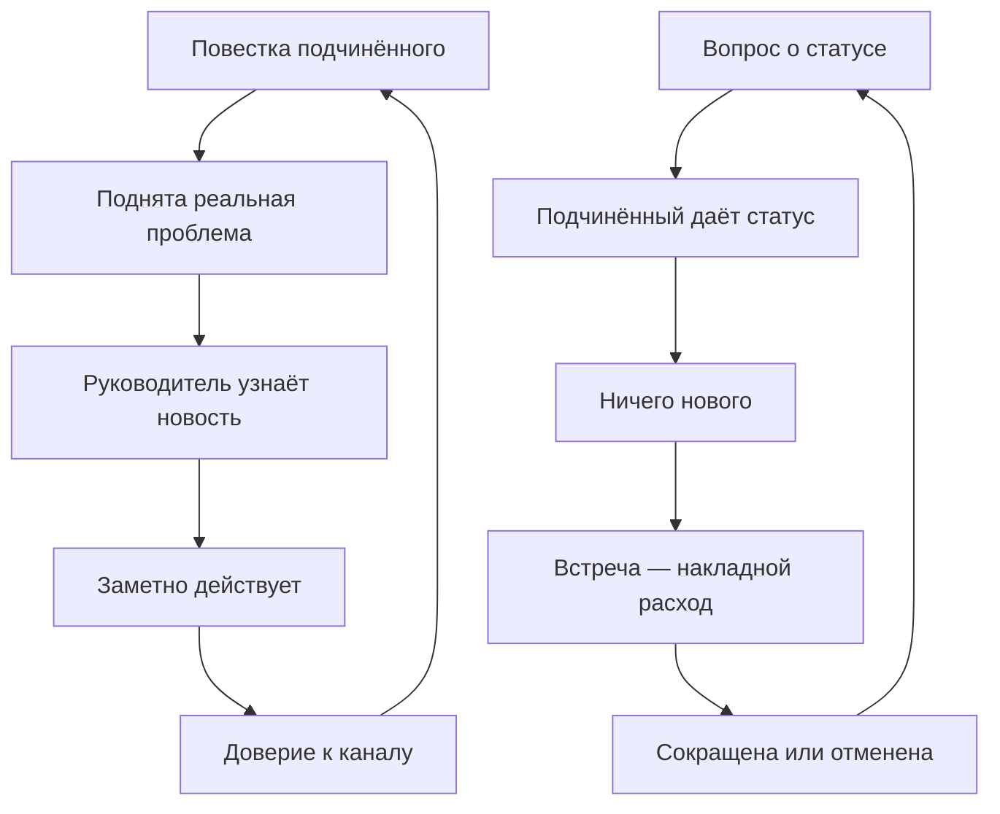
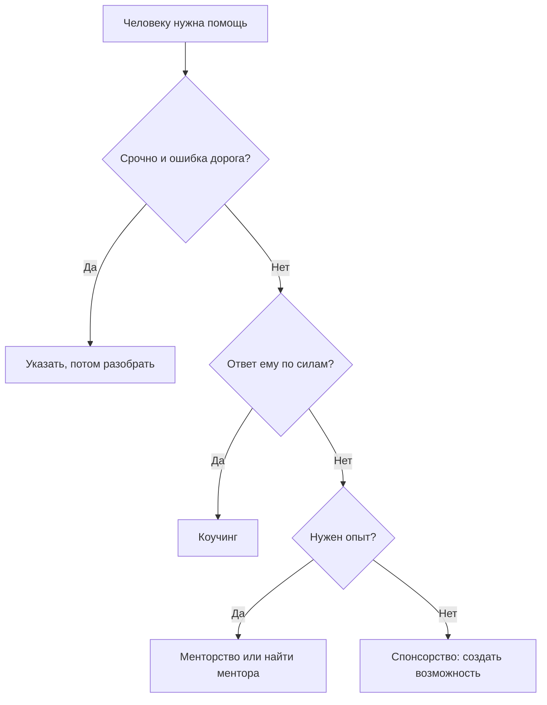
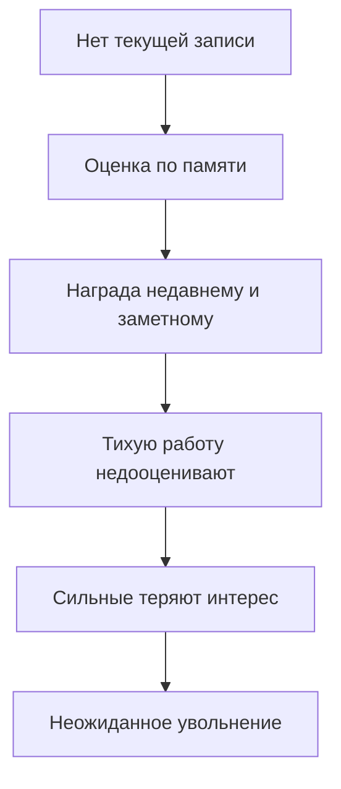

# Глава 5 — Встречи один на один, коучинг и менторство { #chapter-5-one-on-ones-coaching-and-mentorship }

Эта глава — о самом частом приватном разговоре руководителя и о том, зачем он нужен. Встреча один на
один (1:1) рассматривается здесь как информационный канал, который нужно спроектировать и проверять, а
не как ритуал, который проводят, потому что он стоит в календаре. Затем глава разделяет четыре способа
помочь человеку расти (указание, коучинг, менторство и спонсорство), показывает, как выбирать между ними,
и заканчивается лёгкой записью, которая превращает месяцы разговоров в доказательную базу для оценок и
повышений. Обратная связь и трудные разговоры — тема главы 6 («Обратная связь, конфликты и трудные
разговоры»), а управление результативностью — главы 9. Сквозной пример — Daniel Cho, руководитель
Customer Experience в Northstar Technologies, вымышленной компании из
[кейса](../../case-studies/northstar/index.md).

## Почему это важно { #why-this-matters }

На уровне команды встреча 1:1 — это место, где руководитель слышит то, о чём не скажет ничто другое:
senior-инженеру скучно, двое перестали разговаривать друг с другом, проектное решение потихоньку
обходят. Глава 2 описывала петлю обратной связи руководителя как медленную, общую и отфильтрованную
([глава 2](../01-foundations/02-from-individual-contributor-to-leader.md#feedback-that-is-slower-and-noisier)).
Встреча 1:1 — главный инструмент против фильтрации. Когда она вырождается в отчёт о статусе,
руководитель продолжает платить временем, но теряет информацию.

На уровне организации встречи 1:1 — большой невидимый бюджет. Если каждый из 80 инженеров еженедельно
встречается с руководителем на 30 минут, это 40 часов руководителей и 40 часов инженеров в неделю.
Немногие организации проверяют, что они получают за это время.

На уровне высшего руководства решения о повышениях, риски потери людей и резерв будущих лидеров зависят
от того, что руководители знают о своих людях. Если это знание — память о последнем месяце, организация
повышает заметных, а не эффективных и удивляется увольнениям, которые могла бы предвидеть.

## Цели главы { #learning-objectives }

После этой главы вы сможете:

- Проектировать встречи 1:1, которые приносят информацию, недоступную вам иначе: повестка принадлежит
  подчинённому, а статус вынесен в другое место.
- По наблюдаемым сигналам определять, что ваши встречи 1:1 выродились в статус-встречи, и исправлять
  их.
- Выбирать между указанием, коучингом, менторством и спонсорством для конкретного человека и ситуации и
  называть цену каждого способа.
- Вести лёгкую фактическую запись о работе и росте каждого человека, благодаря которой оценки и
  заявки на повышение опираются на факты.
- Задавать ритм встреч 1:1 для команды исходя из её размера, опыта и прочих обязательств
  руководителя, с показанной арифметикой.

## Ментальная модель { #the-mental-model }

> **Ментальная модель:** встреча 1:1 — это информационный канал, который принадлежит подчинённому. Её
> ценность — новости, которые она приносит, то, чего руководитель не узнал бы с доски задач, из чата или
> на стендапе, и эти новости идут, только пока подчинённый видит, что по ним действуют.

У канала две петли. В здоровой подчинённый приносит темы, руководитель что-то узнаёт и заметно
действует, и в следующий раз подчинённый приносит темы потруднее. В петле вырождения руководитель
начинает с вопроса «над чем работаешь?», получает статус, доступный в других местах, встреча кажется
накладным расходом, её отменяют, и подчинённый усваивает, что настоящие разговоры происходят где-то ещё.

Обе петли самоусиливающиеся, поэтому практика редко остаётся посередине. И раз ценность канала —
новости, измеряйте его новостями, а не посещаемостью: руководитель, который проводит каждую встречу 1:1
и ничего не узнаёт, имеет безупречную статистику и сломанный канал.

## Подробный разбор { #deep-conceptual-explanation }

### Что говорят данные о встречах 1:1 и насколько им можно верить { #what-the-evidence-on-one-on-ones-says-and-how-much }

Лучшие доступные данные говорят, что встречи 1:1 работают, когда большую часть времени говорит
подчинённый и он же задаёт повестку, но этих данных мало. Рецензируемых исследований встреч 1:1
руководителя и подчинённого немного. Самую систематическую работу проделал Steven Rogelberg,
специалист по организационной науке, который опрашивал руководителей и их подчинённых. В обзоре для
широкой аудитории ([Rogelberg, 2024](../../references/bibliography.md#rogelberg2024unlocking)) он
сообщает, что:

- почти половина сотрудников считали свои встречи 1:1 бессодержательными;
- самым сильным предиктором ценности было активное участие подчинённого: он говорил примерно от
  половины до девяти десятых времени;
- наличие плана предсказывало эффективность, и обе стороны оценивали встречи выше всего, когда повестку
  составлял подчинённый;
- оценки руководителями собственного умения проводить встречи 1:1, по-видимому, завышены;
- данные соответствуют встречам раз в неделю или раз в две недели.

Считайте это **мнением эксперта**, опирающимся на данные опросов: обзор не описывает выборки и методы.

Важнее всего два момента. Решать, о чём встреча, должен подчинённый, а не руководитель. А руководитель —
хуже всех расположенный человек для того, чтобы судить, работает ли она, поэтому проверяйте канал
фактами.

Традиция практиков согласна с первым моментом. *High Output Management* Andrew Grove известна тем, что
рассматривает встречу 1:1 как встречу подчинённого, с его повесткой, и как занятие с высоким рычагом —
из-за того, чему она учит руководителя
([Grove, 1983](../../references/bibliography.md#grove1983high)). Camille Fournier и Julie Zhuo в своих
книгах об управлении разработкой и о первом опыте руководства известны современной формулировкой:
встреча 1:1 — для человека, а не для проекта
([Fournier, 2017](../../references/bibliography.md#fournier2017manager);
[Zhuo, 2019](../../references/bibliography.md#zhuo2019making)). Это **консенсус практиков**: он ценен,
но может и ошибаться коллективно.

### Проектирование канала { #designing-the-channel }

Схема ниже — **рекомендация книги**, построенная на этих выводах.

**Повестка принадлежит подчинённому.** Ведите общий текущий документ на каждого человека, новые записи
сверху. Подчинённый добавляет темы до встречи; руководитель добавляет свои ниже. Если раздел
подчинённого пуст, спросите, что у него на уме, — и подождите.

**Статус — в другом месте.** Статус берётся с доски задач, из мерж-реквестов и короткого письменного
отчёта. Полезное правило: в первые десять минут — ничего, что мог бы показать дашборд.

**Ротация более глубоких вопросов.** Люди редко сами заговаривают о тревогах по поводу карьеры или о
раздражении на коллегу. Когда повестка лёгкая, задайте один из вопросов: что больше всего раздражает в
твоей неделе; какой работы ты хочешь больше через год; что я делаю такого, что тебе мешает.

**Заметное выполнение обещаний.** Каждое обязательство руководителя записывается в общий документ с
датой, и следующая встреча начинается с его закрытия. Подчинённый следит за тем, что произошло с
последним, что он поднимал.

**Сокращайте, а не отменяйте.** Встреча 1:1, трижды перенесённая, говорит подчинённому, какое место он
занимает в списке приоритетов.

### Три ситуации, с которыми должна справляться схема { #three-situations-the-design-must-handle }

**Первая встреча 1:1 с новым подчинённым.** Посвятите её тому, как он любит работать, а не работе: как
он хочет получать обратную связь, как выглядит хорошая неделя, что ему нужно от вас и что не так было с
прошлыми руководителями. Прежде чем расстаться, договоритесь о ритме и об общем документе.

**Подчинённый, который ничего не приносит.** Пустая повестка неделя за неделей обычно означает, что
канал ещё не заслужил доверия или подчинённый считает, что ничего не изменится. Не заполняйте тишину
статусом. Задайте один глубокий вопрос, подождите и заметно закройте что-то с прошлого раза. Если через
месяц повестка всё ещё пуста, спросите о самой встрече: «Что сделало бы эти полчаса стоящими твоего
времени?»

**Удалённые подчинённые и подчинённые в других часовых поясах.** Встреча 1:1 по видео лишается
случайных контактов в коридоре, которые заполняют пробелы у тех, кто работает в одном офисе, поэтому она
несёт на себе больше функций канала, и переносить её стоит в последнюю очередь. Проводите её в рабочее
время обоих, по очереди беря неудобный слот, если пересечение рабочих часов небольшое. Камеры —
по желанию, а общий документ — обязательно, потому что на расстоянии письменная запись делает больше
работы.

### Как заметить вырождение { #detecting-decay }

Собственному впечатлению руководителя доверять нельзя, поэтому проверяйте по сигналам, которые можно
посчитать по текущим документам. В таблице — сигналы и то, как каждый может ввести в заблуждение.

| Сигнал | Здоровый канал | Выродившийся | Как вводит в заблуждение |
|---|---|---|---|
| Доля встреч с новостями: вы узнали то, чего не показал ни один другой канал | Треть и больше | Меньше одной из семи | Мелочи засчитываются как новости; засчитывается то, что вы и так услышали бы на следующий день |
| Источник повестки | Подчинённый добавляет темы почти каждую неделю | Каждый раз шаблон руководителя | Подчинённый может заполнить повестку безопасными темами |
| Темы за последние шесть недель | Работа, люди, рост, руководитель | Только работа | Карьера, обсуждённая один раз на формальной оценке, не считается |
| Отмены и кто отменяет | Редко, с переносом | Часто; в основном руководитель | Проведённая, но пустая встреча выглядит лучше отменённой |
| Сюрпризы | Мало, и вы их предвидели | Об увольнении, конфликте или выгорании вы узнали из других источников | Отсутствие сюрпризов может означать, что вам никто ничего не рассказывает |

Пороги — иллюстрация, а не результат исследований. Самый сильный сигнал — последний: если вы узнали
что-то важное о подчинённом от кого-то другого, это факт о состоянии канала. Кроме того, раз в квартал
письменно спрашивайте каждого подчинённого, чего на встречах должно быть больше, а чего меньше;
конкретике придавайте больший вес, чем оценкам.

### Указание, коучинг, менторство, спонсорство { #directing-coaching-mentoring-sponsoring }

Руководитель помогает человеку четырьмя разными способами. Если их путать, недовольны обе стороны.

| Способ | Что делает помогающий | Чьи знания движут процессом | Кто обычно помогает |
|---|---|---|---|
| Указание | Говорит, что и как делать | Помогающего | Руководитель или лид |
| Коучинг | Задаёт вопросы, чтобы человек нашёл собственный ответ | Самого человека | Руководитель, коллега, коуч |
| Менторство | Делится опытом и советами | Опыт помогающего | Часто кто-то вне линии подчинения |
| Спонсорство | Использует влияние, чтобы дать человеку возможности и видимость | Положение помогающего | Кто-то старший, чьё слово весомо в назначениях и повышениях |

**Указание** — не провал лидерства. Когда человеку не хватает знаний, ошибка обойдётся дорого, а
времени мало, правильно сказать, что делать; это соответствует нижним уровням делегирования из главы 2.
Цена в том, что люди привыкают ждать ответа. Проверка — идея Liz Wiseman о мультипликаторах и
ослабителях: лидер, который даёт ответ на всё, получает людей, которые перестают думать
([Wiseman, 2010](../../references/bibliography.md#wiseman2010multipliers)).

**Коучинг** помогает, когда ответ человеку по силам, а обучение важнее скорости.
[Метаанализ](../../glossary.md#meta-analysis) (исследование, объединяющее множество исследований)
коучинга в организациях обнаружил положительные эффекты во всех пяти изученных категориях результатов:
результативность и навыки, благополучие, совладание со стрессом, отношение к работе и целенаправленная
саморегуляция. [Размеры эффекта](../../glossary.md#effect-size-d-g) варьировались от умеренного
(совладание) до большого (саморегуляция)
([Theeboom, Beersma, and van Vianen, 2014](../../references/bibliography.md#theeboom2014coaching)).
Второй метаанализ, по 17 исследованиям, обнаружил положительное влияние на обучение и результативность,
более сильное для внутренних коучей, чем для внешних; коучинг со стороны собственного руководителя
человека из него намеренно исключён
([Jones, Woods, and Guillaume, 2016](../../references/bibliography.md#jones2016coaching)). Это
**научные результаты**, касающиеся в основном программ коучинга. Мы не нашли метаанализа коучинга со
стороны собственного руководителя, поэтому вопрос, получает ли тот же эффект руководитель, который ещё и
определяет зарплату, остаётся открытым. С тем, кто их оценивает, люди менее откровенны в разговоре о
своих слабостях.

**Менторство** передаёт опыт: первое дежурство, как провести дизайн мимо скептически настроенного
staff-инженера, стоит ли переходить в другую команду. Метаанализы связывают менторство с широким кругом
благоприятных результатов, в том числе карьерных, но эффекты в целом малы, в том числе для объективных
результатов, таких как зарплата ([Allen et al., 2004](../../references/bibliography.md#allen2004mentoring);
[Eby et al., 2008](../../references/bibliography.md#eby2008mentoring)). Это **научные результаты**,
полученные в основном в корреляционных исследованиях. Менторство немного помогает, но не заменяет
возможностей.

**Спонсорство** превращает развитие в продвижение. Ibarra, Carter и Silva отделили спонсорство от
менторства: спонсор не ограничивается советами и использует своё влияние на топ-менеджеров в интересах
человека. Они опирались на опрос более чем 4 000 выпускников MBA с высоким потенциалом, повторный опрос
и 40 интервью. И мужчины, и женщины сообщали, что получали полезные советы от менторов, но о том, что у
них были спонсоры, рассказывали в основном мужчины, и к моменту повторного опроса у мужчин было на 15
процентов больше повышений ([Ibarra, Carter, and Silva, 2010](../../references/bibliography.md#ibarra2010promotions)).
Это **отраслевое исследование** о выпускниках MBA, а не об инженерах, и механизм — интерпретация
авторов. Но урок переносится: человек может иметь хороших менторов и всё равно оставаться незамеченным.
Для руководителя спонсорство означает предложить подчинённого на роль лидера межкомандного проекта и
делать его работу видимой там, где его самого нет.

### Выбор способа { #choosing-the-mode }

Выбор зависит от ситуации, а не от человека. Одному и тому же инженеру во вторник может понадобиться
указание по миграции в продакшене, а в четверг — коучинг по дизайну.

«Потом разобрать» важно: после указания в экстренной ситуации следующий разговор — коучинговый, о том,
что человек сделает в следующий раз. «Найти ментора» тоже важно: руководитель редко бывает лучшим
ментором во всём, и познакомить подчинённого с ментором из другой команды часто полезнее, чем менторить
его самому.

### Запись, которая делает оценки доказательными { #the-record-that-makes-reviews-evidence-based }

Оценки, написанные по памяти, отдают предпочтение недавнему и яркому; руководитель с пятнадцатью
подчинёнными не может помнить, что каждый делал в феврале. Небольшая запись, которая ведётся как
побочный продукт встреч 1:1, исправляет большую часть этого. Формат — **рекомендация книги**: один
текущий документ на подчинённого, с датированными записями, которые занимают пять минут после каждой
встречи:

- **Темы, которые поднял подчинённый**, по строке на каждую.
- **Обязательства** в обе стороны, с датами, и выполнены ли они.
- **Наблюдения**: конкретное поведение и его эффект, с датой и источником. «3 марта провёл разбор
  инцидента с checkout; у всех последующих действий были владельцы» — это факт. «Отличный
  коммуникатор» — нет.
- **Рост**: заявленная цель человека и то, что сдвинулось к ней в этом месяце.
- **Действия спонсора**: возможности, на которые вы его предлагали, и результат.

Чему здесь не место: домыслам о мотивах, подробностям о здоровье, защищённым законом характеристикам и
сплетням. Пишите так, будто человек однажды это прочитает; может ли он это сделать, вам скажет ваш
HR.

Раз в месяц перечитывайте каждый документ и пишите три строки: что этот человек сделал, к чему он
движется, что вы ему должны. На оценке запись заменяет воспоминания. Глава 8 использует её для заявок на
повышение, глава 9 — для письменных оценок и проблем с результативностью.

## Пример из инженерной организации { #engineering-organization-example }

!!! info "Northstar: что уже известно"
    Неделя 19 первого года директора в Northstar, начало квартала 2 (недели 14–26). Число серьёзных
    инцидентов (Sev1 и Sev2) за первый квартал снизилось с 30 до 21. На неделе 10 семь QA-инженеров
    (ручных тестировщиков) перешли в продуктовые команды инженерами по качеству, двое из них — в команду
    Customer Experience под руководством Daniel Cho. См.
    [хронологию](../../case-studies/northstar/timeline.md). Впервые в Northstar? Прочитайте
    [«Год вкратце»](../../case-studies/northstar/year-in-brief.md) и
    [«Действующие лица»](../../case-studies/northstar/cast.md).

Кейс ниже прослеживает встречи 1:1 Daniel Cho на протяжении шести недель квартала 2; этот раздел
посвящён арифметике. Цифры — **иллюстрация**, придуманная для Northstar (вымысел). Daniel руководит 15
инженерами в Customer Experience, тратит 45 процентов времени на управление людьми и проводит с каждым
подчинённым еженедельные 30-минутные встречи 1:1
([исходные данные](../../case-studies/northstar/baseline-data.md)).

Допущения: неделя 40 часов; 10 минут на подготовку и записи к каждой встрече; 4,33 недели в месяце.

| Ритм | Часов встреч в неделю | Подготовка и записи в неделю | Всего в неделю | Минут на подчинённого в месяц |
|---|---|---|---|---|
| A. Еженедельно, 30 минут (сейчас) | 7.5 | 2.5 | 10.0 | 130 |
| B. Раз в две недели, 30 минут | 3.75 | 1.25 | 5.0 | 65 |
| C. Раз в две недели, 45 минут | 5.6 | 1.25 | 6.9 | 97 |
| D. Еженедельно по 30 для 2 лидов; раз в две недели по 45 для 13 | 5.9 | 1.4 | 7.3 | 130 (лиды); 97 (остальные) |

При варианте A встречи 1:1 занимают 10 из 18 часов, которые Daniel еженедельно тратит на людей. При
варианте D люди сохраняют всё или три четверти времени общения с руководителем, а Daniel высвобождает
около 2,7 часа в неделю.

Частота — слабый рычаг по сравнению с содержанием: если только снизить частоту, вы сэкономите часы и
потеряете новости, а изменить содержание ничего не стоит. Шестинедельная выборка из кейса, сведённая
здесь, это показывает: Daniel провёл 84 встречи и на 11 из них узнал то, чего не показал ни один другой
канал. Ритм D с повесткой, принадлежащей подчинённому, стоил бы меньше часов и, если бы доля встреч с
новостями выросла до одной из трёх (это допущение, а не прогноз), принёс бы больше новостей:

| Шесть недель | Встречи | Человеко-часы (оба участника) | Встречи с новостями | Человеко-часов на новость |
|---|---|---|---|---|
| Сейчас: ритм A, вокруг статуса | 84 проведены, около 26 минут каждая | около 73 | 11 | около 6.6 |
| Ритм D, повестка подчинённого | 51 (12 с лидами, 39 с остальными) | около 70 | около 17 | около 4.1 |

## Как принимать решение { #decision-framework }

Повторяются три решения: ритм, выродилась ли встреча и какой способ помощи использовать. Решение о
способе — это диаграмма из предыдущего раздела. Ритм определяйте для каждого человека, а не для команды
целиком.

| Фактор | Склоняет к еженедельным встречам | Склоняет к встречам раз в две недели |
|---|---|---|
| Время в роли или в команде | Меньше шести месяцев | Человек освоился |
| Скорость изменений в его работе | Высокая (новый проект, нагрузка инцидентами, реорганизация) | Стабильная |
| Его роль | Лид или человек, от которого зависят другие | Индивидуальный исполнитель с ясной областью ответственности |
| Охват руководителя | Примерно до восьми | Двенадцать и больше |
| Другие контакты | Мало повседневного общения | Ежедневное общение в общей работе |

Эти факторы — **рекомендация книги**, согласующаяся с диапазоном «раз в неделю или раз в две недели»,
о котором сообщает Rogelberg. Если встречаться реже, чем раз в две недели, канал теряет
непрерывность: каждая встреча начинается с того, что вы наверстываете упущенное. Если охват вынуждает
встречаться реже, проблема в охвате (охват управления разбирает глава 34 «Охват управления, уровни
иерархии и карта зависимостей»).

Если серия встреч кажется пресной, сначала проверьте источник повестки: если он ваш, верните повестку
подчинённому, прежде чем менять что-то ещё. Если повестка его, а доля встреч с новостями всё равно
низкая, проблема, вероятно, в выполнении обещаний; посмотрите, что стало с тремя последними вопросами,
которые он поднимал.

## Компромиссы { #trade-offs }

**Частота против глубины.** Еженедельные встречи сохраняют непрерывность; более редкие и длинные
оставляют место для карьерных и трудных тем. При большом охвате смешанный ритм, подобранный для каждого
человека, обычно лучше единого.

**Коучинг против скорости.** Спрашивать дольше, чем говорить, и человек может прийти к худшему ответу.
Коучите, когда эта цена приемлема и обучение пригодится снова; в остальных случаях указывайте и
объясняйте почему.

**Руководитель как коуч против руководителя как оценщика.** Некоторые люди не будут откровенны с тем, кто
определяет их зарплату. Разносите эти разговоры во времени, говорите, какой из них идёт сейчас, и дайте
доступ к коучингу или менторству вне линии подчинения.

**Спонсорство против справедливости.** Спонсировать — значит выбрать кого-то вместо других. Если
делать это неформально, выигрывают заметные и те, кто больше похож на спонсора. Держите в каждой записи
строку о спонсорстве и каждый квартал проверяйте, у кого её не было.

**Записи против доверия.** Заметки, похожие на досье, которое собирают против человека, разрушают канал.
Общая повестка, фактические наблюдения и отсутствие сюрпризов на оценке сохраняют запись помощником.

## Типичные провалы { #failure-modes }

**Статус-встреча.** Сигнал: повестка — шаблон руководителя, а в заметках за шесть недель нет ни
карьерных тем, ни тем о людях. Исправление: перенесите статус в письменный отчёт и верните повестку
подчинённому.

**Психотерапевт без последствий.** Руководитель хорошо слушает, и ничего не меняется. Сигнал: одна и та
же тема на трёх встречах без записанного действия. Исправление: запишите обязательство и срок; в начале
следующей встречи отчитайтесь.

**Спираль отмен.** Встречи 1:1 первыми переносят, когда неделя заполняется. Сигнал: проведено меньше
примерно четырёх из пяти встреч, отменяет в основном руководитель. Исправление: сокращайте, а не
отменяйте.

**Коучинговый театр.** Наводящие вопросы, ответ на которые руководитель уже знает. Сигнал: вопросы,
заканчивающиеся на «тебе не кажется?». Исправление: если ответ у вас есть и он важен, указывайте и
прямо так и говорите.

**Менторство без спонсорства.** Сильный инженер два года получает советы и ни одной возможности. Сигнал:
пустая строка о спонсорстве рядом с заявленной целью. Исправление: одна конкретная возможность в этом
квартале.

**Оценка по памяти.** Сигнал: все примеры в оценке — за последние шесть недель. Петля, которую это
питает:

## Применение в крупной организации { #enterprise-application }

В организации из 50–150 инженеров директор не может присутствовать на встречах 1:1 и не должен
пытаться. Его задача — сделать практику наблюдаемой, не превращая её в бюрократию.

**Задайте минимум, а не формат.** У каждого инженера есть встреча 1:1 не реже раза в две недели, с
повесткой, в которую он может добавлять темы.

**Спрашивайте подчинённых, но редко.** Короткий опрос из двух вопросов раз или два в год («Полезны ли
ваши встречи 1:1? Что сделало бы их полезнее?») даёт сигнал, которого не дадут самооценки. Руководители,
которые видят результаты, могут подсказывать ответы, поэтому смотрите на тренды и комментарии и никогда
не ранжируйте руководителей по баллу (подгонку метрик разбирает глава 18).

**[Встречи через уровень](../../glossary.md#skip-level) (skip-level) как проверка.** Разговоры директора
с инженерами двумя уровнями ниже выявляют то, что упускают встречи 1:1, но вредят, если идут в обход
руководителя. Правило: темы возвращаются к руководителю, с согласия инженера. Остальное разбирает
глава 41 («Управление руководителями разработки и их развитие»).

**Составьте карту менторства и спонсорства.** Для каждого senior-инженера и вероятного будущего лида
запишите, кто его менторит и кто спонсирует. Пробелы предсказуемы: тихие команды, новые руководители,
люди, непохожие на руководство.

**Учите вести канал.** Руководители, по-видимому, переоценивают своё умение проводить встречи 1:1, и
многих этому никогда не учили. Час практики по передаче повестки и сигналам вырождения стоит недорого.

## Взгляд CTO { #cto-perspective }

**Информация.** CTO слышит об организации через несколько слоёв фильтров. Один из тестов их честности —
как часто руководитель высшего уровня узнаёт о серьёзной проблеме с людьми, например об уходе ключевого
инженера, когда действовать уже поздно. Если часто, значит, канал встреч 1:1 ниже не работает, и
дашборды этого не исправят.

**Доказательства для повышений.** Процесс повышений, требующий датированных конкретных фактов,
показывает, какие руководители ведут записи. CTO может требовать фактов, не предписывая инструмента.

**Спонсорство — это конвейер лидеров.** Следующие staff-инженеры и руководители — это люди, которым
кто-то старший решил дать задачу на вырост; если оставить это неформальным, конвейер воспроизводит тех,
кто и так был заметен. Исследование выше касается выпускников MBA за один период: этого достаточно,
чтобы CTO спросил, кого спонсируют, но недостаточно, чтобы обещать совету директоров измеренный эффект.

**Собственные встречи 1:1 CTO** с директорами вырождаются так же — в статус портфеля. Исправление то же.

## Практический плейбук { #practical-playbook }

Для руководителя, который перестраивает свои встречи 1:1 в течение квартала:

1. Заведите общий текущий документ на каждого подчинённого с заголовком «Сначала твоя повестка; статус
   — в другом месте».
2. Расскажите команде, что меняется, и попросите каждого добавить одну тему до следующей встречи.
3. Введите еженедельный письменный статус в три строки (сделано, дальше, застряло) и перестаньте
   спрашивать статус на встрече.
4. Задайте ритм для каждого человека по таблице решений и забронируйте встречи на квартал.
5. Держите наготове пять глубоких вопросов для лёгких повесток.
6. После каждой встречи тратьте пять минут на запись: темы, обязательства, наблюдения, рост,
   спонсорство.
7. Открывайте каждую встречу закрытием своих обязательств с прошлой.
8. Для каждого подчинённого запишите способ помощи, который нужен для его текущей цели; проверьте, что
   это не всегда «указание».
9. Назовите по одному действию спонсора для каждого senior-инженера в этом квартале.
10. Через шесть недель посчитайте по своим заметкам сигналы вырождения и письменно спросите каждого
    подчинённого, чего на встречах должно быть больше, а чего меньше.
11. В конце квартала напишите сводки в три строки и сравните их с тем, что подсказала бы память.

## Кейс { #case-study }

Этот кейс — **вымысел** ([хроника года 1](../../case-studies/northstar/first-quarter.md)). Действие
происходит на неделе 19, как во врезке в примере из инженерной организации.

В базовом квартале, до прихода директора, Daniel Cho руководил 15 инженерами, девятью в вебе и шестью в
мобильной разработке, и тратил на управление людьми 45 процентов времени — больше, чем любой другой
руководитель в Northstar. Техническое направление держали два неформальных лида без должностей: Hannah
Lindgren в вебе и Mateo Arango Ríos в мобильной разработке. Команда развёртывалась 26 раз в месяц, чаще
всех. Через призму активности Daniel выглядел самым сильным руководителем, а здоровье и рост его
команды оставались неизвестными ([глава 4](../01-foundations/04-the-leadership-ladder.md)).

Daniel гордился своими встречами 1:1: еженедельные, по 30 минут, отменялись редко, хотя встречи с
мобильными инженерами в Bogotá, проходившие по видео, часто переносились. На неделе 16 проверка
здоровья команды — самооценка, в которой команда оценивает десять индикаторов от зелёного до красного
(глава 14), — показала, что мобильная часть отметила четыре из них красным. Daniel был удивлён. На
неделе 17 Mateo сказал директору, что больше года выполняет работу лида, и никто об этом не говорит, а
его встречи 1:1 — это «место, где я рассказываю Daniel, как дела у мобильной разработки». Он согласился,
чтобы директор поднял эту тему.

На неделе 19 Daniel и директор прошлись по его заметкам за недели 14–19. Выборка охватывала 15
инженеров; двух инженеров по качеству, которые присоединились к команде и теперь подчиняются Daniel, не
включили, потому что они пришли слишком недавно. Daniel закодировал каждую встречу по преобладающей теме
и по тому, узнал ли он что-то, чего не показали доска задач, чат или стендап.

| Показатель, недели 14–19 | Значение |
|---|---|
| Запланировано и проведено | 90 запланировано, 84 проведено; в среднем 26 минут |
| Начинались с вопросов Daniel («над чем работаешь, есть ли блокеры») | 79 из 84 |
| Преобладающая тема: статус или блокеры, уже видные на доске | 55 и 9 |
| Преобладающая тема: карьера или рост | 8, с 6 людьми |
| Преобладающая тема: проблемы команды или процесса; личное или благополучие | 7 и 5 |
| Встречи с новостями | 11 из 84 (13 процентов) |
| Инженеры без разговора о карьере за шесть недель | 9 из 15 |
| Встречи с двумя лидами | 12 проведено, во всех преобладал статус по платформе в целом |

Посещаемость была отличной, а канал в основном передавал статус: 64 из 84 встреч (76 процентов). Два
лида, у которых было больше всего контекста, использовали свои встречи для отчёта о работе всех
остальных. Ни на одной из встреч не всплыли ни красные оценки мобильной части, ни раздражение Mateo.
Первой реакцией Daniel было то, что подчинённым встречи нравятся. Директор ответил, что, может быть, и
нравятся. Но именно на самооценку руководителя ни одному из них не стоило полагаться. Они договорились
спросить команду.

Daniel набросал изменения на остаток квартала 2: общие повестки, где темы подчинённого идут первыми;
еженедельный письменный статус в три строки; ритм D из примера из инженерной организации; ежемесячные
сводки в три строки; и по одному действию спонсора для Hannah и Mateo. Он не был уверен, предлагать ли
их в качестве назначенных техлидов — это требует согласия директора и меняет то, как другие команды
работают с Customer Experience, — или начать с возможностей поменьше, а также не знал, как поднять то,
что сказал Mateo. Кейс оставляет Daniel с черновиком; дальше — упражнения.

## Упражнения { #exercises }

Решения — в [решениях к главе 5](../../solutions/ch05-solutions.md). Данные Northstar — на
[странице исходного уровня](../../case-studies/northstar/baseline-data.md); кто есть кто — на странице
[«Действующие лица»](../../case-studies/northstar/cast.md).

### Базовый уровень { #foundational }

**F1.** Руководитель семи инженеров говорит вам, что её встречи 1:1 превосходны: она проводит их все,
еженедельно, а подчинённые говорят, что всё «нормально». Её заметки за последний месяц показывают, что
каждая встреча открывается одними и теми же тремя вопросами, а других тем, кроме текущей работы, нет.
Опираясь на ментальную модель главы, объясните, что, скорее всего, происходит, и назовите три сигнала,
которые она могла бы посчитать по собственным заметкам, чтобы это проверить.

**F2.** Для каждой ситуации выберите указание, коучинг, менторство или спонсорство и обоснуйте выбор:
инженер среднего уровня два дня не может сдвинуться с дизайном теста, за который отвечает; новый
сотрудник во время инцидента собирается изменить схему таблицы [tier 1](../../glossary.md#tier-1)
(таблицы на пути заказа или оплаты); senior-инженер хочет стать staff-инженером, но никогда не вёл
межкомандную работу; инженер спрашивает, как вести себя с враждебно настроенным ревьюером из другой
команды.

**F3.** Черновик оценки, которую руководитель пишет для инженера, содержит: «отличный командный игрок»,
«сильные технические навыки» и «в прошлом месяце хорошо провёл миграцию image-service». Перепишите
записи, которые должны были бы привести к лучшей оценке, и скажите, что руководителю нужно было
записывать в течение года.

### Прикладное лидерство { #applied-leadership }

**A1.** Вы — Daniel Cho после недели 19. Подготовьте разговор с Mateo: говорить ли ему, что вы слышали
об этой проблеме, как начать, что вы пообещаете и чего не пообещаете насчёт должности техлида, которую
вы не можете дать в одиночку.

**A2.** В черновике Daniel за Hannah и Mateo сохраняются еженедельные встречи 1:1, а 13 инженеров
переходят на встречи раз в две недели по 45 минут. Двое инженеров возражают, что будут видеть Daniel
реже. Оцените черновик с помощью таблицы решений и арифметики главы, предложите, что бы вы изменили,
если вообще что-то, и как через шесть недель поймёте, сработало ли это.

**A3.** Priya Raman (руководитель Orders) раз в две недели проводит 30-минутные встречи 1:1 со своими 16
подчинёнными (14 инженеров и два инженера по качеству, присоединившиеся на неделе 10), как договорились
с директором на неделе 2. Rafael Duarte, senior-инженер, который претендовал на её роль, с тех пор
использует свои встречи только для статуса ревью по order-capture. Посоветуйте Priya, как изменить его
встречи 1:1, какой способ помощи нужен ему от неё больше всего и кто ещё должен его спонсировать.

### Решения на уровне руководства { #executive-decision-making }

**X1.** Как директор Northstar вы хотите получить доказательства того, что встречи 1:1 работают во всех
шести командах, не читая ничьих заметок. Спроектируйте самый лёгкий механизм, какой сможете, скажите,
что сообщает вам каждый его элемент и как его можно подогнать, и что бы вы сделали, если бы результаты
одного руководителя стабильно были плохими.

**X2.** Предположим, в одном из следующих кварталов два senior-инженера уходят из Northstar, говоря, что
у них не было пути к staff-инженеру, и Victor Lindqvist (CTO) просит вас создать программу менторства.
Бюджета на внешних коучей у вас нет. Решите, что вы построите вместо этого, с ролью менторства,
спонсорства и записей руководителей, и скажите, что вы сообщите Victor о том, что данные поддерживают, а
что нет.

## Вопросы для размышления { #reflection-questions }

1. Что ваши последние шесть встреч 1:1 сообщили вам такого, чего не сообщил бы ни один другой канал?
2. Кто задаёт повестку ваших встреч 1:1 — на практике, а не в теории?
3. Когда вы в последний раз узнали что-то важное о подчинённом от кого-то другого?
4. Для кого вы ментор, но не спонсор, и чего вам стоило бы его спонсировать?
5. Если бы вам пришлось завтра написать оценки всех подчинённых, какая часть пришла бы из записей, а
   какая — из памяти о последнем месяце?
6. Кто из ваших подчинённых меньше всех склонен сказать вам, что ваши встречи 1:1 бесполезны?

## Главное { #key-takeaways }

- Относитесь к встрече 1:1 как к информационному каналу подчинённого; измеряйте её новостями, которые
  она приносит, а не посещаемостью.
- Отдайте повестку подчинённому, а статус перенесите в письменный отчёт.
- В начале каждой встречи закрывайте свои обязательства; выполнение обещаний держит канал открытым.
- Считайте сигналы вырождения по своим заметкам, а сюрпризы, о которых вы узнали из других источников,
  считайте самым сильным сигналом.
- Выбирайте указание, коучинг, менторство или спонсорство по ситуации; указывайте, когда срочно, и
  прямо говорите об этом, коучите, когда обучение стоит потраченного времени.
- Данные о коучинге касаются в основном профессиональных коучей, а эффекты менторства малы; ни то, ни
  другое не заменяет возможностей, которые даёт спонсор.
- Ведите на каждого человека датированную фактическую запись — пять минут на встречу и ежемесячная
  сводка, — чтобы оценки и заявки на повышение опирались на факты.
- Задавайте ритм для каждого человека: еженедельно — для новичков, лидов и тех, у кого всё меняется,
  раз в две недели — для освоившихся.

## Источники и что почитать { #references-and-further-reading }

- [Rogelberg, 2024](../../references/bibliography.md#rogelberg2024unlocking). Обзор исследователя о его
  опросах, посвящённых встречам 1:1; более подробно — в его книге *Glad We Met*.
- [Grove, 1983](../../references/bibliography.md#grove1983high). *High Output Management*. Встреча 1:1
  как встреча подчинённого и занятие с высоким рычагом.
- [Fournier, 2017](../../references/bibliography.md#fournier2017manager). *The Manager's Path*. Встречи
  1:1 и менторство на всём протяжении карьеры в управлении разработкой.
- [Zhuo, 2019](../../references/bibliography.md#zhuo2019making). *The Making of a Manager*. Первые годы
  в управлении, включая полезные встречи 1:1.
- [Theeboom, Beersma, and van Vianen, 2014](../../references/bibliography.md#theeboom2014coaching) и
  [Jones, Woods, and Guillaume, 2016](../../references/bibliography.md#jones2016coaching).
  Метаанализы результатов коучинга; второй исключает коучинг со стороны собственного руководителя.
- [Allen et al., 2004](../../references/bibliography.md#allen2004mentoring) и
  [Eby et al., 2008](../../references/bibliography.md#eby2008mentoring). Связь менторства с
  результатами: реальная, но в целом небольшая.
- [Ibarra, Carter, and Silva, 2010](../../references/bibliography.md#ibarra2010promotions). Менторство и
  спонсорство — по исследованию выпускников с высоким потенциалом.
- [Wiseman, 2010](../../references/bibliography.md#wiseman2010multipliers). *Multipliers*. Почему
  лидеры, которые дают ответ на всё, ослабляют людей вокруг себя.
