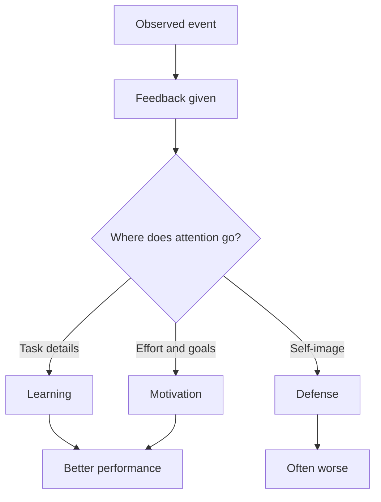
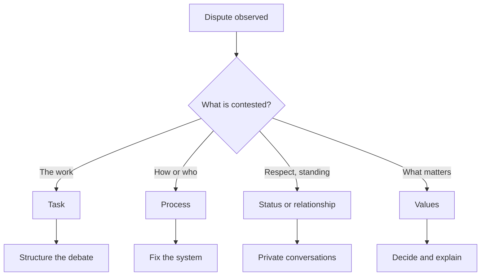
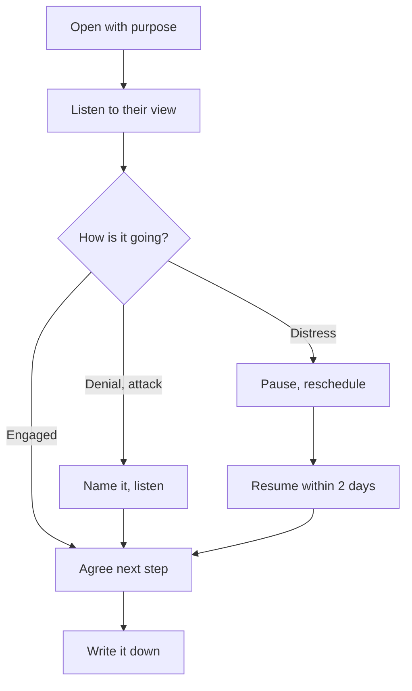

# Chapter 6 — Feedback, Conflict, and Difficult Conversations

!!! warning "Awaiting human review"
    This chapter has passed the book's automated validation and an editorial self-review, but not yet
    the human review in which each cited claim is checked against its source. Treat it as a reviewed
    draft. Corrections are welcome; see the repository's CONTRIBUTING file.

This chapter is about the conversations managers avoid: telling someone what they did and what it
caused, stepping into a dispute between people or teams, and saying something the other person does
not want to hear. It covers specific behavioral feedback and why timing matters more than phrasing,
what feedback research actually shows (including that feedback often makes performance worse), how
delivery changes across cultures, how to tell what kind of conflict you are looking at before you
intervene, and how to prepare a difficult conversation, including the plan for when it goes badly.
One-on-ones are Chapter 5's subject, formal underperformance processes are Chapter 9's, and
psychological safety is Chapter 11's; this chapter cross-references them. The running example is the
friction between Billing and Orders at Northstar Technologies, the fictional company in the
[case study](../../case-studies/northstar/index.md).

## Why This Matters

At team scale, feedback is the main way a manager changes what people do. Feedback that arrives late,
vague, or buried in reassurance changes nothing; it moves the problem to the next performance review,
where it arrives as a surprise. This book's view is that many cases that reach Chapter 9's
underperformance process began as a pattern a manager saw for months and did not name.

At organization scale, conflict between teams is where engineering systems and people collide.
Two teams that share a release, a database, or an on-call rotation will fight about it. If the
manager above them reads every dispute as a personality problem, they will hold mediation sessions
while the shared system keeps producing incidents. If they read every dispute as a process problem,
they will redesign workflows while two people stop speaking.

At executive scale, the question is whether disagreement reaches the people who can act on it, and
whether engineers argue openly about designs rather than privately about blame. The CTO cannot attend
those conversations but sets the example of how criticism is received.

## Learning Objectives

After this chapter you will be able to:

- Give specific, behavioral feedback close to the event, and explain why feedback aimed at the person
  rather than the task tends to backfire.
- Adapt how you deliver feedback to cultural and individual norms without diluting what you say.
- Diagnose whether a conflict is about the task, the process, status and relationships, or values
  before choosing an intervention.
- Prepare and conduct a difficult conversation, including what you will do if it goes badly.
- Recognize the failure modes of avoidance, over-correction, and false harmony in yourself and in the
  managers you lead.

## The Mental Model

> **Mental model:** Feedback and conflict work when attention stays on the work: what was done, what it
> caused, what the shared system rewards. They fail when attention moves to the self: who is
> competent, who is respected, who is to blame.

This simplifies a research result described below. Feedback about an observed behavior keeps the
receiver on the task; "you are careless" sends them to defend their self-image. Likewise, a dispute
about which design is right can be productive, while a dispute about who is competent consumes the
energy the design question needed.

The diagram shows the mechanism: the same event, described differently, sends attention to a
different level. The manager controls only the description and the timing.

## Deep Conceptual Explanation

### What the feedback research shows

The best-known synthesis is Kluger and DeNisi's meta-analysis of feedback interventions, meaning
deliberate actions that tell people something about their performance. Across 607 effect sizes and
23,663 observations, feedback improved performance on average (an effect size of d = .41, a moderate
effect), but more than a third of the interventions decreased performance
([Kluger and DeNisi, 1996](../../references/bibliography.md#kluger1996effects)). The authors report
that this could not be explained by sampling error or by whether the feedback was positive or
negative. Their proposed explanation, feedback intervention theory, is that feedback shifts attention
among three levels (the details of the task, motivation toward the task, and the self) and that
effectiveness falls as attention moves toward the self and away from the task. They also note that
task characteristics moderate the effect in ways that were still poorly understood.

That is a **research finding**, with limits: the meta-analysis pools many settings and predates modern
engineering teams. What transfers is the direction, not a number: feedback is not reliably good, and
feedback that makes the receiver think about who they are is the riskiest kind.

### Specific, behavioral, and early

Three properties follow, and practitioners broadly agree on them (**practitioner consensus**, consistent
with the research above):

- **Specific**: one event, described so the receiver can recall it. "In Tuesday's design review" not
  "in meetings."
- **Behavioral**: what the person did or said, which they can repeat or change, followed by its effect
  on the work or on others. Not a trait ("defensive", "not senior enough") and not a guess at intent.
- **Early**: within days of the event. Late feedback is less accurate, because both memories have
  faded, and more expensive, because the behavior has repeated.

A useful structure is: the situation, what you observed, what it caused, and a question. "In
Thursday's incident review, you said the other team's change 'obviously' caused it before the timeline
was complete. Their two engineers stopped contributing after that. What did you know at that point that
I didn't?" The question matters: the manager's observation may be incomplete, and feedback that
cannot be corrected by the receiver is a verdict.

Positive feedback follows the same rules: "great job" teaches nothing that can be repeated.

### Radical Candor: a useful frame and its failure

Kim Scott's *Radical Candor* is widely known for a two-axis frame: caring personally about someone
and challenging them directly ([Scott, 2017](../../references/bibliography.md#scott2017radical)). The
quadrants describe the common failures well. Challenge without care becomes aggression. Care without
challenge (which Scott calls ruinous empathy) is the most common failure of new engineering managers:
the manager likes the person, withholds the criticism, and the person learns about the problem from a
low rating or a layoff list. Neither, out of self-protection, becomes insincerity.

This is **expert opinion**, credited at the level of its central idea. Its known failure is the label
used to excuse bluntness. The test is the receiver's experience: if they do not believe you are on
their side, the challenge is heard as an attack.

### Feedback across cultures

Erin Meyer's *The Culture Map* is known for describing national business cultures along several
scales, one of which is how negative feedback is delivered: directly and plainly, or indirectly and
softened ([Meyer, 2014](../../references/bibliography.md#meyer2014culture)). A related idea from the
same work is that people from direct cultures tend to use strengthening words and people from indirect
cultures softening words, so the same criticism can sound mild to one listener and devastating to
another. This is **expert opinion**, credited at idea level only.

Three cautions keep it useful. National culture is a starting hypothesis about a person, not a
description of them. Adapting delivery means changing the wrapping (private or public, the amount of
context, the surrounding words), never the point: the receiver must leave knowing exactly what you want
changed. And the simplest method is to ask, "How do you like to hear it when something isn't working?",
and afterwards, "What will you take away from this?"

### Diagnosing conflict before intervening

Conflict researchers distinguish types that behave differently.

- **Task conflict**: disagreement about the content of the work. Which design, which priority, whether
  the data supports a claim.
- **Process conflict**: disagreement about how the work is done. Who owns what, who decides, the
  sequence, the release process.
- **Relationship conflict**: personal friction, dislike, irritation.
- **Status conflict**: disputes about people's relative respect or position in the group. Bendersky and
  Hays defined it as a separate type, found it had a negative effect on group performance, found that
  it moderated the effect of task conflict, and found that it hurt performance by undermining
  information sharing more than the other types did
  ([Bendersky and Hays, 2012](../../references/bibliography.md#bendersky2012status)).
- **Values conflict**: disagreement about what matters, such as whether shipping a known defect to meet
  a customer date is acceptable. This is this book's working category for practice; the research
  read for this chapter does not measure it separately, so treat it as a practitioner distinction.

Whether task conflict helps is **contested**. A long-standing idea held that disagreement about the
work improves decisions while personal conflict damages them. De Dreu and Weingart's meta-analysis challenged it: they found strong negative
correlations between relationship conflict and both team performance and member satisfaction, as
expected, but also strong negative correlations for task conflict; conflict in general was more harmful in
complex tasks such as decision making and projects. Task conflict was less damaging when it was only weakly correlated with
relationship conflict ([De Dreu and Weingart, 2003](../../references/bibliography.md#dedreu2003task)).
A later meta-analysis of 116 studies and 8,880 groups by de Wit, Greer, and Jehn found stable
negative relationships between both relationship and process conflict and group outcomes, but no
strong negative association between task conflict and group performance. Task conflict was more
positively related to performance where it was weakly linked to relationship conflict, in top
management teams, and where performance was measured as decision quality or financial results
([de Wit, Greer, and Jehn, 2012](../../references/bibliography.md#dewit2012paradox)).

Both agree on the operational point: task conflict is tolerable, sometimes useful, only while it stays
separate from relationship conflict. Process conflict, which engineering organizations generate
constantly, was consistently negative. These are **research findings** about correlations across many
kinds of teams, none specifically in software, and they do not show causation.

The type shows itself in the evidence people bring. Task conflict cites data and designs. Process
conflict cites handoffs, ownership, and "nobody told us". Status conflict cites tone, who was
consulted, and who gets credit. Values conflict cites principles. Most real disputes are mixed, and a
process conflict left unresolved for long enough becomes a relationship conflict: two teams that
repeatedly hurt each other through a shared system eventually dislike each other. The manager's first
job is to find the oldest layer, because fixing the newest layer (the dislike) without the oldest (the
shared system) only resets the clock.

Lencioni's *The Five Dysfunctions of a Team* is known for the argument that teams which avoid conflict
end in artificial harmony ([Lencioni, 2002](../../references/bibliography.md#lencioni2002five)), an
**expert opinion** every manager has seen as a quiet design review followed by a loud corridor.

### Difficult conversations

Stone, Patton, and Heen's *Difficult Conversations* is widely known for observing that a hard
conversation is really three: a dispute about what happened, a set of feelings, and a threat to each
person's sense of who they are ([Stone, Patton, and Heen, 1999](../../references/bibliography.md#stone1999difficult)).
It also argues for moving from delivering a message to learning what the other person sees. That maps
onto the Kluger and DeNisi mechanism: the identity layer is exactly where attention goes when feedback
backfires. This is **expert opinion**, credited at idea level.

In practice, preparation has five parts (**this book's recommendation**):

1. **Purpose.** One sentence on what must be true after the conversation. "Teodora understands that
   blaming another team in public review is not acceptable, and we agree what she does next time."
2. **Facts and story.** Separate what you observed from your interpretation. Write down what you do
   not know.
3. **Their view.** What would they say happened, and what is at stake for them? An overloaded on-call
   engineer who lashes out has a real grievance underneath an unacceptable behavior.
4. **Non-negotiables and negotiables.** What you will not move on, and what you are open to.
5. **The plan for when it goes badly.** Decided in advance, because you will not think clearly in the
   moment.

The fifth part is the one managers skip. Conversations go badly in a few recognizable ways: denial
("that didn't happen"), counter-attack ("you never supported us"), withdrawal (silence, short answers),
or strong emotion. The response to each is the same first move: stop pushing the message, name what
is happening ("This is landing hard. Do you want to keep going, or pick it up tomorrow?"), and listen.
Pausing is not retreating: reschedule within one or two working days and say that the point still
stands. If the conversation surfaces something outside your remit (a health issue, a harassment
allegation, a legal question), stop and involve the people responsible for it.

Write the agreement down: both people leave with the same understanding, and if the pattern continues,
Chapter 9's process starts from a record rather than from memory.

### Where psychological safety fits

Team psychological safety, a shared sense that speaking up will not be punished, is associated with
team learning ([Edmondson, 1999](../../references/bibliography.md#edmondson1999psychological));
[Chapter 11](../03-high-performing-teams/11-high-performance-trust-safety-and-accountability.md)
owns the topic. The link here is direct: a manager who punishes the messenger once teaches the team
to keep task conflict underground, where it tends to become relationship conflict. Blameless incident review
([Chapter 25](../05-engineering-quality/25-incidents-postmortems-and-change-failure-analysis.md))
applies the same principle to failures.

## Engineering Organization Example

This example is **illustrative**; the numbers are invented to show the arithmetic.

A team of eight has a senior engineer, Sam, whose merge requests average about 900 changed lines.
Reviews of them take a median of three working days, against one day for the rest of the team.
Assume Sam opens two such merge requests a week.

**Option A: hold it for the quarterly review.** The manager notices in week 2 and plans to raise it at
the review in week 12. That is 10 more weeks, 20 more large merge requests, and about 40 extra
days of waiting for those merge requests to merge (2 days of extra wait each). At review, Sam
hears a pattern described as a trait ("your changes are hard to review"), does not recognize it, and
asks for examples that are now two months old.

**Option B: raise it in week 2.** In their one-on-one: "Your last two merge requests on the pricing
module were about 900 lines each and took three days to get reviewed. The team's median is one day.
The second one blocked Ana's work for two of those days. What's making them come out that size?" Sam
explains that the pricing module has no seams for small changes. The manager learns something (a
design problem, not a habit) and the two agree to try splitting the next change behind a feature flag.

The cost of the conversation is 15 minutes. The cost of the delay is about 40 days of
waiting plus a weaker conversation at the end of it. Even if the early conversation only halves the
problem, it pays for itself many times over. The point generalizes: feedback is cheap per occurrence
and expensive per delay, because behavior repeats.

A conflict on the same team: Sam and Ana argue in review threads about splitting the pricing module.
The manager reads the last ten threads first. Seven argue the design with evidence (task conflict);
three include remarks about who "actually understands" the module (status conflict). So: a time-boxed
design review with a named decider, and a private conversation with each engineer about the remarks. A
team meeting about "communication" would have addressed neither.

## Decision Framework

Use this table after reading the evidence, not before.

| Conflict type | Typical evidence | First move | Common wrong move |
|---|---|---|---|
| Task | Designs, data, competing proposals | Name a decider, set a deadline, require written options | Ordering people to agree; splitting the difference |
| Process | Handoffs, ownership gaps, "nobody told us", recurring incidents at a boundary | Change the system: ownership, interface, sequence | Mediation sessions about attitudes |
| Status or relationship | Tone, credit, who was consulted, public remarks | Private conversations first, then a joint one with agreed behavior | A team-wide "be respectful" message |
| Values | Principles, "this is wrong" | Make the trade-off explicit, decide at the right level, explain | Pretending it is a task question with a right answer |

For feedback: if the behavior is likely to repeat, give it now and privately. If it affected people
outside the team, the repair may need to be visible, but the feedback stays private. If you have named
the pattern twice without change, it is a performance conversation (Chapter 9).

## Trade-offs

**Speed versus accuracy.** Early feedback can be wrong; you may not have the whole story. The
mitigation is the question at the end, not delay.

**Directness versus relationship.** In the short term, directness costs comfort. In the long term,
indirectness costs the relationship more, when the person discovers that their manager knew and said
nothing.

**Intervening versus letting teams resolve it.** Teams that resolve their own task conflicts learn to
do it again; a manager who steps into every dispute becomes the decider for everything. But teams
rarely resolve a process conflict at their boundary, because neither owns the shared system.

**Consistency versus adaptation.** Adapting delivery to individuals and cultures respects them, but
uneven feedback across a team can look like favoritism. Adapt the delivery; keep the standard identical.

**Writing it down.** A written summary prevents disputes about what was agreed but makes a conversation
feel formal. For ordinary feedback, a note in your own records is enough.

## Failure Modes

**The compliment sandwich.** Criticism placed between two praises. Receivers learn to wait for the
middle, or miss it entirely. Detect it by asking the receiver to summarize what they heard.

**Saving it up.** Feedback held for the review cycle. Detect it when a review contains something the
person hears for the first time. A useful rule: nothing in a written review should be new.

**Ruinous empathy.** Withholding criticism to protect the relationship or the person's feelings.
Detect it in your own calendar: which conversation have you postponed twice?

**Mediating a process problem.** Treating a structural conflict as a personality clash. Detect it when
the same dispute recurs between different people at the same boundary. If replacing the people would
not end the conflict, the conflict is not about the people.

**False harmony.** No disagreement in meetings, plenty in private channels. Detect it when "agreed"
decisions keep being revisited.

**Proxy wars.** Managers fighting through their engineers, or engineers through their managers, each
side collecting incidents as evidence. Detect it when incident reviews start with attribution rather
than timeline.

**Over-correction.** A manager trained in directness who becomes harsh. Detect it in skip-levels and in
who stops speaking in that manager's meetings.

## Enterprise Application

In an organization of 50 to 150 engineers, the managers give most of the feedback, not the director. The director's work is to make it routine and to catch the cases that are stuck.

Mechanisms: ask each manager which feedback conversation they are postponing; check written reviews for
content the person sees for the first time; in skip-levels, ask engineers when they last heard
something critical from their manager and whether it helped.

For conflict, in this book's view most persistent inter-team conflicts sit on shared systems: a
monolith, a release train, an on-call rotation, a database. The director should keep a
short list of boundaries where conflict recurs and treat each as a design question first. Ownership and
interface changes belong to the chapters on quality ownership
([Chapter 19](../05-engineering-quality/19-defining-measuring-and-owning-quality.md)) and team
structure (Chapter 33); this chapter's contribution is the diagnosis.

Training helps less than practice: a course changes vocabulary, while a manager's manager asking about
specific conversations every week changes behavior.

## CTO Perspective

At executive scale, three things change.

First, the CTO's feedback is amplified. A passing remark about a team becomes a reorganization rumor.
Feedback to executives and directors should be as specific and private as feedback to an engineer,
and more carefully timed.

Second, conflicts reaching the CTO are almost always values conflicts or unresolved process conflicts
between functions: product dates against reliability, sales commitments against capacity. The
operational response is to make the trade-off explicit, decide, and explain the decision to both
sides, including what would make it change. A CTO who splits every difference trains the organization
to escalate everything.

Third, the CTO shows what receiving feedback looks like. Engineers who watch the CTO meet criticism of a
strategy with curiosity learn that disagreement upward is safe; one public dismissal teaches the
opposite.

## Practical Playbook

1. Keep a running note per direct report of observed behaviors, positive and negative, with dates.
   Review it before each one-on-one (Chapter 5).
2. Give feedback within a week of the event, in private, using situation, behavior, effect, question.
3. Ask each person how they prefer to hear criticism; adapt the delivery, not the content.
4. End each feedback conversation by asking the person what they will take away.
5. When a conflict appears, read the evidence before acting: threads, incident reviews, the shared
   systems involved. Classify it as task, process, status or relationship, or values, and find the
   oldest layer.
6. Fix process conflicts with system changes; handle status and relationship conflict privately first.
7. For any difficult conversation, write the five-part preparation, including the plan for when it
   goes badly.
8. After the conversation, write down what was agreed and when you will check.
9. Ask your managers weekly which conversation they are postponing, and keep the same list for yourself.

## Case Study

This case is **fictional**. It is set in the baseline quarter, before the director arrived (see the
[baseline page](../../case-studies/northstar/baseline-data.md)), and ends with a decision the reader
faces at arrival. Teodora Vasquez-Lund and the ledger on-call
load are recorded on the baseline page; the conversations below are fictional.

Billing had eight Sev1 and Sev2 incidents in the baseline quarter, the most of any team. Seven came
through Core releases or database migrations, and six were recurrences. Three ledger engineers had
handled 126 of Billing's 180 pages first, and 54 of the 64 after-hours pages. Orders depended on
Billing more than on any other team (9 dependency links), and Billing on Orders 6 times. Both teams shipped through the same two-week Core release train, and the three-day
manual regression pass had caught none of the nine train-triggered incidents.

After INC-417 (payments posted to the wrong accounting period after release 24.23), Teodora
Vasquez-Lund, a senior Billing engineer and one of the three ledger engineers, wrote in the shared
release channel that Orders' changes "keep breaking the ledger". An Orders engineer replied that
Billing should test its own code. The thread ran for two days. Neither manager responded in it.

After INC-427 (credit notes applied twice after release 24.26), the incident review began with
Teodora stating that an Orders change had caused it. The contributing factors recorded for INC-427 in the book's
incident review template (Chapter 25) point elsewhere: no ordering check for migrations, unknown
migration duration at production volume, no ledger invariant alert, and a release batch of about 170
changes. Nobody had recorded which team's change
triggered any of the baseline quarter's release incidents; the review process did not ask.

Marcus Oyelaran's view, as Victor Lindqvist summarized it in his handover notes for the incoming
director, was that Orders shipped into shared Core code without understanding the ledger. Orders' view
was that Billing blamed others for its own fragile code. Victor wrote that he had "let the two of them
sort it out" and that it had not worked.

**Diagnosis.** On the surface this is a relationship and status conflict: public blame, defensive
replies, questions about who understands the ledger. Underneath, it is a process conflict. Two teams
ship through one train, in batches as large as 170 changes, with nothing that attributes a failure to
a change. Each incident was evidence for whichever story
each side already held, because the system produced no evidence that could settle it. The oldest layer
is the release process; the newest is the dislike.

The first-quarter record shows what happened to the process: weekly Core releases from week 5,
a release working group, and train-triggered incidents falling from nine to four
([first quarter](../../case-studies/northstar/first-quarter.md)). It does not record what happened
between the teams, or what Marcus said to Teodora. That is your decision at arrival: a process fix alone may
leave the behavior unaddressed, and a behavioral intervention alone asks Teodora to stop being angry
about a system that keeps paging her at night.

## Exercises

Solutions are in [chapter 6 solutions](../../solutions/ch06-solutions.md). Northstar data is on the
[baseline page](../../case-studies/northstar/baseline-data.md).

### Foundational

**F1.** Rewrite these three pieces of feedback so that they are specific, behavioral, and end with a
question: "You need to be more of a team player." "Your code quality has slipped." "Great work on the
migration." For each, state what you would need to have observed to say the rewritten version, and
what you would do if you had not observed it.

**F2.** A manager tells you that research shows feedback improves performance, so she gives everyone
detailed feedback after every sprint, including on their attitude and commitment. Using what the
Kluger and DeNisi meta-analysis found and its limits, assess the practice and say what you would
change.

**F3.** Classify each dispute as task, process, status or relationship, or values, and name the
evidence that decided it: two engineers arguing about event sourcing for the ledger; two teams
arguing over who should fix flaky tests in a shared suite; a senior engineer upset that a junior
colleague presented "his" design to the CTO; a product manager and an engineer arguing over shipping
a known rounding error to meet a renewal date.

### Applied Leadership

**A1.** You are Marcus Oyelaran's director, in your first month. Prepare Marcus for his conversation
with Teodora Vasquez-Lund about her post after INC-417 and her opening in the INC-427 review. She is
one of three engineers carrying most of Billing's after-hours pages. Write the five-part preparation,
including what Marcus should do if she responds that management has ignored the on-call load for a
year.

**A2.** Design the first joint session between Billing and Orders engineers after the release-process
changes begin. Decide who attends, what evidence is on the table, what the session must produce, and
what you would do if the first ten minutes turn into a list of each team's grievances.

**A3.** One of your managers comes from a culture where criticism is delivered indirectly. Their
engineers, most of whom expect direct feedback, report in skip-levels that they "never know where they
stand". The manager believes they are giving clear feedback. Plan how you give this manager
feedback about their feedback, and what you would accept as evidence that it changed.

### Executive Decision-Making

**X1.** Two quarters after the director's arrival, Amara Okafor and Victor Lindqvist disagree in the
executive meeting about whether to delay a customer feature by three weeks to finish ledger
reconciliation work. Both ask you, as director, for a recommendation in writing. Diagnose the conflict
type, write the structure of your recommendation, and say what you would do if the CEO splits the
difference.

**X2.** As CTO, you notice that across 18 months of incident reviews, the first entry in 40 percent of
reviews for cross-team incidents names another team. Design an organization-level response covering
review process, measurement (including how your measure could be gamed), and the behavior of
directors, and say what you would not do.

## Reflection Questions

1. Which piece of feedback have you been holding for more than two weeks, and what is the real reason?
2. When did you last receive criticism from someone who reports to you, and how did you respond in the
   first ten seconds?
3. In the last conflict you stepped into, did you identify the oldest layer, or the loudest?
4. Which of your direct reports would say they always know where they stand with you, and which would
   not?
5. Have you ever used "being direct" to excuse being careless with someone?

## Key Takeaways

- Feedback improves performance on average but backfires often; keep the receiver's attention on the
  task, not on themselves.
- Give feedback within days, about one observed behavior and its effect, and end with a question.
- Adapt delivery to people and cultures; never adapt the message so far that it disappears.
- Diagnose a conflict before intervening: task, process, status or relationship, or values. Find the
  oldest layer.
- Task conflict is tolerable only while it stays separate from status and relationship conflict;
  process and relationship conflict are reliably harmful.
- Recurring conflict at a team boundary is usually a system problem; fix the system, then repair the
  relationship.
- Prepare difficult conversations in writing, including what you will do when they go badly.
- Pausing a conversation that has gone badly is not retreating; resume within two days.

## References and Further Reading

- [Kluger and DeNisi, 1996](../../references/bibliography.md#kluger1996effects). The meta-analysis
  showing that feedback often lowers performance, and the theory of why. Read at abstract level here.
- [De Dreu and Weingart, 2003](../../references/bibliography.md#dedreu2003task). Meta-analysis
  challenging the idea that task conflict helps teams. Read at abstract level.
- [de Wit, Greer, and Jehn, 2012](../../references/bibliography.md#dewit2012paradox). A larger, later
  meta-analysis that complicates the 2003 result and adds process conflict. Read at abstract level.
- [Bendersky and Hays, 2012](../../references/bibliography.md#bendersky2012status). Introduces status
  conflict as a distinct type and its effect on information sharing. Read at abstract level.
- [Edmondson, 1999](../../references/bibliography.md#edmondson1999psychological). The founding study
  of team psychological safety; Chapter 11 develops it.
- [Scott, 2017](../../references/bibliography.md#scott2017radical). *Radical Candor*. A practitioner's
  frame for caring and challenging at once; the quadrants are the useful part.
- [Meyer, 2014](../../references/bibliography.md#meyer2014culture). *The Culture Map*. How feedback
  norms differ across business cultures; read with the cautions in this chapter.
- [Stone, Patton, and Heen, 1999](../../references/bibliography.md#stone1999difficult). *Difficult
  Conversations*. The three layers of a hard conversation and the shift from persuading to learning.
- [Lencioni, 2002](../../references/bibliography.md#lencioni2002five). *The Five Dysfunctions of a
  Team*. A fable about avoided conflict and artificial harmony in a leadership team.
