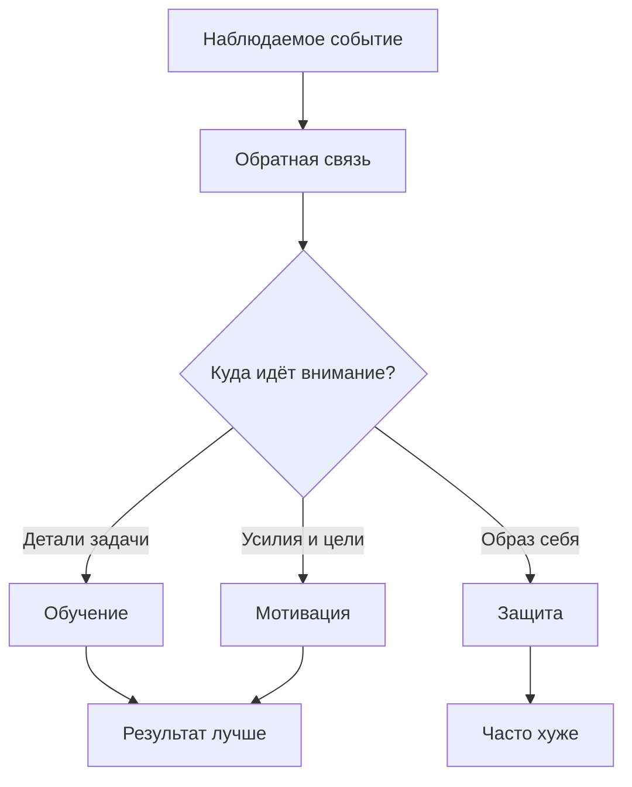
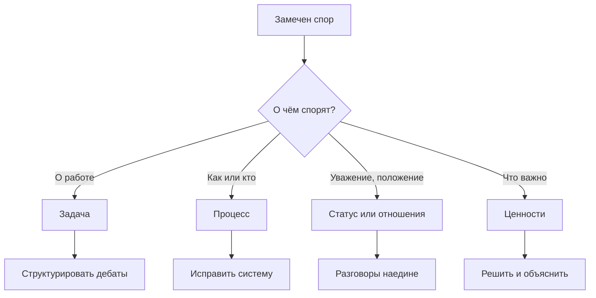
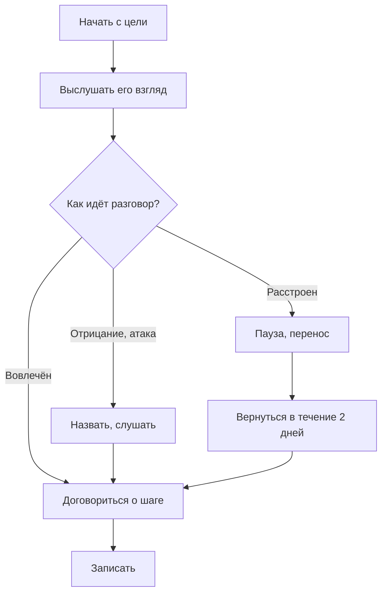

# Глава 6 — Обратная связь, конфликты и трудные разговоры { #chapter-6-feedback-conflict-and-difficult-conversations }

Эта глава — о разговорах, которых руководители избегают: объяснить человеку, что он сделал и к чему это
привело; вмешаться в спор между людьми или командами; сказать то, чего собеседник слышать не хочет.
Сначала речь пойдёт о конкретной обратной связи о поведении, о том, что известно об обратной связи из
исследований (в том числе о том, что она часто ухудшает результаты), и о том, как подача меняется от
культуры к культуре. Затем — о том, как понять, с каким конфликтом вы имеете дело, до того как
вмешаться, и как подготовить трудный разговор, включая план на случай, если он пойдёт плохо. Смежные
темы разобраны в других главах, и здесь мы на них только ссылаемся: встречи один на один — в главе 5,
формальная работа с низкой результативностью — в главе 9, психологическая безопасность — в главе 11.
Сквозной пример — трения между Billing и Orders в Northstar Technologies, вымышленной компании из
[кейса](../../case-studies/northstar/index.md).

## Почему это важно { #why-this-matters }

Для команды обратная связь — главный инструмент, которым руководитель меняет то, что делают люди. Если
она приходит поздно, звучит расплывчато или тонет в успокаивающих словах, она ничего не меняет: проблема
просто переезжает на следующую оценку результативности и всплывает там как сюрприз. По мнению книги,
многие случаи, которые доходят до процесса работы с низкой результативностью (глава 9), начинались с
паттерна, который руководитель месяцами видел, но так и не назвал вслух.

Для организации конфликт между командами — точка, где инженерные системы сталкиваются с людьми. Если у
двух команд общий релиз, общая база данных или общий график дежурств, они будут из-за этого ссориться.
Руководитель над ними, который в каждом споре видит проблему личностей, будет проводить сессии медиации,
а общая система тем временем продолжит порождать инциденты. Если же он в каждом споре видит проблему
процесса, он будет перестраивать рабочие процессы, а двое людей тем временем перестанут друг с другом
разговаривать.

Для высшего руководства важно другое: доходят ли разногласия до тех, кто может что-то с ними сделать, и
спорят ли инженеры открыто о дизайне, а не втихую о том, кто виноват. Сам CTO на этих разговорах быть не
может, но своим примером показывает, как принимать критику.

## Цели главы { #learning-objectives }

После этой главы вы сможете:

- Давать конкретную обратную связь о поведении вскоре после события и объяснять, почему обратная связь,
  направленная на человека, а не на задачу, обычно даёт обратный эффект.
- Адаптировать подачу обратной связи к культурным и индивидуальным нормам, не размывая сути.
- Диагностировать тип конфликта (задача, процесс, статус и отношения, ценности), прежде чем выбирать
  вмешательство.
- Готовить и проводить трудный разговор, заранее решив, что вы сделаете, если он пойдёт плохо.
- Распознавать избегание, перегиб и ложную гармонию у себя и у руководителей в вашем подчинении.

## Ментальная модель { #the-mental-model }

> **Ментальная модель:** обратная связь и конфликт идут на пользу, пока внимание направлено на работу:
> что сделано, к чему это привело, что поощряет общая система. Они проваливаются, как только внимание
> переходит на личность: кто компетентен, кого уважают, кто виноват.

Это упрощённый пересказ научного результата, о котором речь пойдёт ниже. Обратная связь о наблюдаемом
поведении удерживает человека на задаче, а фраза «ты небрежен» заставляет его защищать представление о
себе. Со спорами так же: спор о том, какой дизайн правильный, бывает продуктивным, а спор о том, кто
компетентен, отнимает силы, нужные для самого дизайна.

Диаграмма показывает механизм: одно и то же событие, описанное по-разному, направляет внимание на разные
уровни. Под контролем руководителя только две вещи: как описать событие и когда об этом сказать.

## Подробный разбор { #deep-conceptual-explanation }

### Что показывают исследования обратной связи { #what-the-feedback-research-shows }

В среднем обратная связь улучшает результаты, но больше чем в трети случаев ухудшает их. Таков вывод
самого известного обобщения: Kluger и DeNisi провели [метаанализ](../../glossary.md#meta-analysis)
(исследование, объединяющее результаты многих исследований) вмешательств через обратную связь. По
607 результатам среднее улучшение соответствовало умеренному
[размеру эффекта](../../glossary.md#effect-size-d-g), но больше трети вмешательств снижали
результативность ([Kluger and DeNisi, 1996](../../references/bibliography.md#kluger1996effects)). По
данным авторов, дело было не в случайности и не в том, положительной была обратная связь или
отрицательной. Объяснение, которое они предложили, — теория вмешательства через обратную связь (feedback
intervention theory). Согласно ей, обратная связь переключает внимание между тремя уровнями: детали
задачи, мотивация к задаче и собственная личность. Чем сильнее внимание смещается от задачи к личности,
тем ниже эффективность. Авторы также отмечают, что эффект зависит от вида задачи, но как именно, тогда
было ещё плохо изучено.

Это **научный результат**, но с ограничениями: метаанализ смешивает очень разные условия и появился
раньше современных инженерных команд. Переносить стоит направление, а не цифру: обратная связь полезна
не всегда, и самая рискованная — та, что заставляет человека думать о том, кто он такой.

### Конкретно, поведенчески и рано { #specific-behavioral-and-early }

Отсюда следуют три свойства, с которыми практики в целом согласны (**консенсус практиков**,
согласующийся с исследованиями выше):

- **Конкретно**: одно событие, описанное так, чтобы человек мог его вспомнить. «На ревью дизайна во
  вторник», а не «на встречах».
- **Поведенчески**: что человек сделал или сказал (это он может повторить или изменить), а затем к чему
  это привело для работы или для других. Не черта характера («защищается», «недостаточно senior») и не
  догадки о намерениях.
- **Рано**: в течение нескольких дней после события. Поздняя обратная связь менее точна, потому что оба
  уже плохо помнят детали, и обходится дороже, потому что поведение успело повториться.

Удобная схема: ситуация, что вы наблюдали, к чему это привело, и вопрос. «На разборе инцидента в
четверг ты сказал, что причиной „очевидно“ стало изменение другой команды, хотя хронология была ещё не
готова. После этого двое их инженеров перестали участвовать в обсуждении. Что ты знал тогда такого,
чего не знал я?» Вопрос важен: руководитель мог увидеть не всё, а обратная связь, которую человек не
может поправить, — уже приговор.

К похвале относятся те же правила: из «отличной работы» нельзя понять, что именно стоит повторить.

### Radical Candor: полезная рамка и как она ломается { #radical-candor-a-useful-frame-and-its-failure }

Книга Kim Scott *Radical Candor* широко известна рамкой из двух осей: искренняя забота о человеке и
прямой вызов ему ([Scott, 2017](../../references/bibliography.md#scott2017radical)). Квадранты хорошо
описывают типичные провалы. Вызов без заботы превращается в агрессию. Забота без вызова (Scott называет
это разрушительной эмпатией) — самый частый провал новых руководителей разработки: человек руководителю
симпатичен, руководитель придерживает критику, и о проблеме человек узнаёт из низкой оценки или из
списка на увольнение. Если нет ни того ни другого, а руководитель просто защищает себя, получается
неискренность.

Это **мнение эксперта**. Известно, как эта рамка ломается: её название начинают использовать как
оправдание грубости. Проверка — в восприятии получателя: если он не верит, что вы на его стороне, вызов
звучит для него как нападение.

### Обратная связь в разных культурах { #feedback-across-cultures }

Книга Erin Meyer *The Culture Map* известна тем, что описывает национальные деловые культуры по
нескольким шкалам. Одна из них — как подают отрицательную обратную связь: прямо, без обиняков, или
косвенно и смягчённо ([Meyer, 2014](../../references/bibliography.md#meyer2014culture)). Там же есть
родственная идея: в культурах с прямой подачей люди склонны к усиливающим словам, а в культурах с
косвенной — к смягчающим. Поэтому одна и та же критика одному слушателю может показаться мягкой, а
другому — уничтожающей. Это **мнение эксперта**.

Чтобы эта идея оставалась полезной, нужны три оговорки. Первая: национальная культура — исходная
гипотеза о человеке, а не его описание. Вторая: адаптировать подачу — значит менять обёртку (наедине или
публично, сколько контекста, какие слова вокруг), но никогда не суть; человек должен уйти, точно зная,
что вы хотите изменить. Третья: самый простой способ — спросить. «Как тебе удобнее слышать о том, что
что-то не работает?» А потом: «Что ты вынесешь из этого разговора?»

### Диагностика конфликта до вмешательства { #diagnosing-conflict-before-intervening }

Исследователи различают несколько типов конфликта, и ведут они себя по-разному.

- **Конфликт задачи**: разногласие о содержании работы. Какой дизайн, какой приоритет, подтверждают ли
  данные утверждение.
- **Конфликт процесса**: разногласие о том, как устроена работа. Кто чем владеет, кто решает, в каком
  порядке, как проходит релиз.
- **Конфликт отношений**: личные трения, неприязнь, раздражение.
- **Статусный конфликт**: споры о том, кого больше уважают и кто какое положение занимает в группе.
  Bendersky и Hays обнаружили, что он вредил результатам группы и делал конфликт задачи вреднее. Вредил
  он главным образом тем, что подрывал обмен информацией, — сильнее, чем другие типы конфликта
  ([Bendersky and Hays, 2012](../../references/bibliography.md#bendersky2012status)).
- **Конфликт ценностей**: разногласие о том, что важно, например допустимо ли выпустить известный
  дефект, чтобы успеть к сроку клиента. Эту категорию книга вводит для практики: в цитируемых здесь
  исследованиях её отдельно не измеряли, поэтому считайте её различием, которое проводят практики.

Давно бытует мнение, что разногласия о работе улучшают решения, а личный конфликт им вредит. Помогает ли
конфликт задачи в действительности — **вопрос спорный**:

- Метаанализ De Dreu и Weingart показал, что и конфликт отношений, и конфликт задачи сильно связаны с
  худшими результатами команды и меньшей удовлетворённостью, особенно на сложных задачах. Меньше вреда
  конфликт задачи приносил там, где он был лишь слабо связан с конфликтом отношений
  ([De Dreu and Weingart, 2003](../../references/bibliography.md#dedreu2003task)).
- Более поздний и крупный метаанализ (116 исследований) сильной отрицательной связи для конфликта задачи
  не нашёл. Связь была положительнее там, где конфликт задачи не смешивался с конфликтом отношений, в
  командах высшего руководства и когда речь шла о качестве решений
  ([de Wit, Greer, and Jehn, 2012](../../references/bibliography.md#dewit2012paradox)).

Практический вывод у обоих один: конфликт задачи терпим, а иногда и полезен, только пока он не
смешивается с конфликтом отношений. Это **научные результаты**, но о корреляциях: данные собраны во
множестве разных команд, ни одна из которых не была специально командой разработки ПО, и причинности
они не доказывают.

Яснее всего с конфликтом процесса: по обобщению 2012 года, он, как и конфликт отношений, стабильно
вреден. Инженерные организации порождают его постоянно — на каждом общем релизе, общей базе данных,
общем графике дежурств. Поэтому именно с ним руководитель столкнётся чаще всего, и именно его меньше
всего шансов исправить разговорами об отношении к делу.

Тип конфликта выдают доводы, с которыми приходят люди. В конфликте задачи ссылаются на данные и
варианты дизайна. В конфликте процесса — на передачи работы, владение и «нам никто не сказал». В
статусном конфликте — на тон, на то, с кем посоветовались, и на то, кому достаётся заслуга. В конфликте
ценностей — на принципы. Большинство реальных споров смешанные. К тому же затянувшийся конфликт процесса
перерастает в конфликт отношений: если две команды раз за разом вредят друг другу через общую систему, в
конце концов они начинают друг друга недолюбливать. Поэтому первая задача руководителя — найти самый
старый слой. Если исправить самый новый (неприязнь) и не тронуть самый старый (общую систему), часы
просто начнут отсчёт заново.

Книга Lencioni *The Five Dysfunctions of a Team* известна тезисом: команды, которые избегают
конфликтов, приходят к искусственной гармонии
([Lencioni, 2002](../../references/bibliography.md#lencioni2002five)). Это **мнение эксперта**, и
каждый руководитель наблюдал такое воочию: тихое ревью дизайна, а после него громкие разговоры в
коридоре.

### Трудные разговоры { #difficult-conversations }

Книга Stone, Patton и Heen *Difficult Conversations* широко известна наблюдением: трудный разговор — это
по сути три разговора. Спор о том, что произошло; чувства участников; угроза представлению каждого о
том, кто он такой ([Stone, Patton, and Heen, 1999](../../references/bibliography.md#stone1999difficult)).
Авторы также призывают не доносить своё сообщение, а выяснять, что видит собеседник. Это хорошо
ложится на механизм Kluger и DeNisi: уровень идентичности — именно то место, куда уходит внимание,
когда обратная связь даёт обратный эффект. Это **мнение эксперта**.

На практике подготовка состоит из пяти частей (**рекомендация книги**):

1. **Цель.** Одно предложение о том, что должно стать правдой после разговора. «Lee понимает, что
   обвинять другую команду на публичном разборе недопустимо, и мы договорились, что он сделает в
   следующий раз».
2. **Факты и интерпретация.** Отделите то, что вы наблюдали, от своей интерпретации. Запишите, чего вы
   не знаете.
3. **Его взгляд.** Что, по его словам, произошло и что для него на кону? Если перегруженный дежурный
   инженер срывается, за недопустимым поведением стоит реальная обида.
4. **Что обсуждению не подлежит, а что подлежит.** В чём вы не уступите, а к чему открыты.
5. **План на случай, если разговор пойдёт плохо.** Его продумывают заранее: в самом разговоре думать
   ясно вы уже не сможете.

Именно пятую часть руководители и пропускают. Плохо разговор идёт по нескольким узнаваемым сценариям:
отрицание («такого не было»), контратака («вы нас никогда не поддерживали»), уход в себя (молчание,
короткие ответы) или сильные эмоции. В любом из них первый шаг одинаков: перестаньте продавливать своё
сообщение, назовите происходящее («Тебе тяжело это слышать. Хочешь продолжить или вернёмся к этому
завтра?») и слушайте. Пауза — не отступление: назначьте продолжение не позже чем через один-два рабочих
дня и скажите, что суть сказанного остаётся в силе. Если в разговоре всплывает что-то вне вашей
компетенции (проблема со здоровьем, обвинение в домогательствах, юридический вопрос), остановитесь и
подключите тех, кто за это отвечает.

### Пример разговора с комментариями { #a-sample-conversation-annotated }

Этот пример — **иллюстрация**. Участники — гипотетический руководитель и Lee, senior-инженер из его
команды, который обвинил другую команду в публичном канале инцидента. Все пять частей руководитель
подготовил заранее.

> **Руководитель:** Хочу поговорить о твоём сообщении во вторник в канале инцидента. Сначала скажу, что
> я видел, а потом хочу услышать твою версию. Ты написал, что платёжная команда «не может ничего
> выпустить, не сломав нас». После этого двое их инженеров перестали писать в канал, а хронология была
> ещё не готова. Мне нужно, чтобы в каналах инцидентов обсуждали, что произошло, а не кто виноват.

*Меньше чем за минуту вступление называет цель, одно событие, его последствия и стандарт. Ни
комплимента для начала, ни прилагательных о Lee.*

> **Lee:** Честно? Руководство уже год не обращает внимания на нашу нагрузку на дежурствах. Меня
> вызывали три выходных подряд. А теперь проблема — это я?

*Контратака: в ней и настоящая обида, и попытка увести разговор в сторону. Не спорьте с обидой, но и от
своей мысли не отказывайтесь.*

> **Руководитель:** Три выходных — это слишком много, и ты прав: я это не исправил. Я хочу всерьёз к
> этому вернуться — на этой неделе. Сообщение — отдельная тема, и она по-прежнему важна. Давай сначала
> закончим с ней?

*Руководитель признаёт то, что правда, обещает отдельный разговор с конкретной датой и возвращается к
поведению. Обе темы сохраняются, и ни одна не поглощает другую.*

> **Lee:** (молчание, потом) Не думаю, что я сейчас могу это обсуждать.

*Уход в себя. Если продолжать давить, в лучшем случае вы получите формальное согласие.*

> **Руководитель:** Хорошо. Давай остановимся и вернёмся к этому в четверг в десять. Насчёт канала моя
> позиция не меняется. И я хотел бы услышать, как, по-твоему, выглядела бы справедливая версия того
> сообщения.

*Пауза и продолжение: конкретное время не позже чем через два рабочих дня, повторённая суть и вопрос,
который предлагает Lee самому сделать следующий шаг.*

В четверг разговор заканчивается договорённостью в две строки: в каналах инцидентов — факты и
хронология, разногласия о причинах — на разбор. Разговор о дежурствах руководитель назначает отдельно:
обида была настоящей.

Запишите договорённость. Тогда оба уйдут с одинаковым пониманием, а если паттерн повторится, процесс из
главы 9 начнётся с записи, а не с воспоминаний.

### Как принимать обратную связь и давать её вверх { #receiving-feedback-and-giving-it-upward }

Руководитель, который просит критики, а потом хоть раз за неё наказал, больше её не услышит. Просите
конкретно: «Что я сделал в этом месяце такого, что усложнило тебе работу? Назови что-то одно» — лучше,
чем «Есть для меня какая-нибудь обратная связь?» Затем принимайте её в три шага (**рекомендация
книги**): поблагодарите, задайте один уточняющий вопрос о примере и в этом разговоре не объясняйтесь и
не защищайтесь. В течение недели вернитесь с тем, что вы измените, или с объяснением, почему не
измените. Выполнение обещанного учит большему, чем благодарность.

Инженерам, которые дают обратную связь своему руководителю, подойдёт та же схема, что и для любой
обратной связи: одна ситуация, поведение, его последствия для работы и вопрос. «На планировании в
понедельник ты пообещал от нашего имени мартовский срок, а мы ещё не оценили миграцию. Теперь двое из
нас ожидают, что мы его сорвём. Можем пересмотреть это на этой неделе?» Давайте её наедине и рано,
говорите о работе, а не о компетентности руководителя. Если на обратную связь, поданную так,
руководитель реагирует плохо, это повод поговорить на встрече через уровень (skip-level), а не
замолчать.

### Место психологической безопасности { #where-psychological-safety-fits }

Психологическая безопасность команды — общее ощущение, что за высказывание не накажут, — связана с тем,
как команда учится ([Edmondson, 1999](../../references/bibliography.md#edmondson1999psychological));
её разбирает [глава 11](../03-high-performing-teams/11-high-performance-trust-safety-and-accountability.md).
Связь с этой главой прямая: если руководитель хоть раз наказал гонца, команда научится уводить
конфликты задачи в подполье, а там они обычно превращаются в конфликты отношений. Безобвинительный
разбор инцидентов
(blameless review, [глава 25](../05-engineering-quality/25-incidents-postmortems-and-change-failure-analysis.md))
применяет тот же принцип к сбоям.

## Пример из инженерной организации { #engineering-organization-example }

Этот пример — **иллюстрация**; цифры придуманы, чтобы показать арифметику.

В команде из восьми человек работает senior-инженер Sam. Его мерж-реквесты в среднем содержат около
900 изменённых строк, и ревью каждого в медиане занимает три рабочих дня, а у остальной команды —
один. Допустим, Sam открывает два таких мерж-реквеста в неделю.

**Вариант A: приберечь до квартальной оценки.** Руководитель замечает это на неделе 2 и собирается
поднять вопрос на оценке на неделе 12. Это ещё 10 недель, ещё 20 крупных мерж-реквестов и около
40 лишних дней ожидания слияния (по 2 дня лишнего ожидания на каждый). На оценке Sam слышит о паттерне
как о черте характера («твои изменения трудно ревьюить»), не узнаёт себя и просит примеры, которым уже
два месяца.

**Вариант B: поднять вопрос на неделе 2.** На встрече 1:1: «Два твоих последних мерж-реквеста в модуле
ценообразования были примерно по 900 строк, и ревью каждого заняло три дня. Медиана в команде — один
день. Второй из них два дня из трёх блокировал работу Ana. Почему они получаются такими большими?» Sam
объясняет, что в модуле ценообразования нет швов, по которым можно было бы делать мелкие изменения.
Руководитель узнаёт новое: дело в дизайне, а не в привычке. Они договариваются попробовать разбить
следующее изменение на части и спрятать его за [фича-флагом](../../glossary.md#feature-flag)
(переключателем, который позволяет выпустить код выключенным).

Цена разговора — 15 минут. Цена задержки — около 40 дней ожидания и вдобавок более слабый разговор в
конце. Даже если ранний разговор уменьшит проблему лишь вдвое, он окупится многократно. Вывод верен и в
общем случае: один разговор обходится дёшево, а откладывать его дорого, потому что поведение
повторяется.

Теперь конфликт в той же команде: Sam и Ana спорят в ветках ревью о том, как разделить модуль
ценообразования. Сначала руководитель читает десять последних веток. В семи спорят о дизайне, приводя
доводы (конфликт задачи); в трёх звучат реплики о том, кто «на самом деле понимает» модуль (статусный
конфликт). Отсюда два шага: ревью дизайна с ограничением по времени и названным человеком, который
принимает решение, и разговор наедине с каждым инженером о репликах. Командная встреча о «коммуникации»
не решила бы ни одной из этих проблем.

## Как принимать решение { #decision-framework }

Обращайтесь к этой таблице после того, как изучили доводы, а не до.

| Тип конфликта | Типичные доводы | Первый шаг | Типичный неверный шаг |
|---|---|---|---|
| Задача | Дизайны, данные, конкурирующие предложения | Назначить того, кто решает, задать срок, потребовать письменных вариантов | Приказать договориться; поделить разницу пополам |
| Процесс | Передачи работы, пробелы во владении, «нам никто не сказал», повторяющиеся инциденты на границе | Изменить систему: владение, интерфейс, последовательность | Сессии медиации об отношении к делу |
| Статус или отношения | Тон, заслуги, с кем посоветовались, публичные реплики | Сначала разговоры наедине, затем совместный разговор с договорённостью о поведении | Общекомандное сообщение «будьте уважительны» |
| Ценности | Принципы, «так нельзя» | Сделать компромисс явным, решить на правильном уровне, объяснить | Делать вид, что это вопрос задачи с правильным ответом |

Правила для обратной связи: если поведение, скорее всего, повторится, дайте её сейчас и наедине. Если
оно задело людей за пределами команды, исправлять ситуацию, возможно, придётся публично, но сама
обратная связь остаётся приватной. Если вы дважды назвали паттерн, а он не изменился, это уже разговор о
результативности (глава 9).

## Компромиссы { #trade-offs }

**Скорость против точности.** Ранняя обратная связь бывает ошибочной: вы можете не знать всей истории.
Но лечится это вопросом в конце, а не задержкой.

**Прямота против отношений.** Сейчас прямота стоит комфорта. В долгосрочной перспективе отношениям
дороже обходится косвенность: счёт приходит, когда человек узнаёт, что руководитель знал и молчал.

**Вмешаться или дать командам разобраться самим.** Команды, которые сами разрешают свои конфликты
задачи, этому учатся; руководитель, который вмешивается в каждый спор, в итоге решает всё сам. Но
конфликт процесса на собственной границе команды разрешают редко: общая система не принадлежит ни одной
из них.

**Единообразие против адаптации.** Подстраивая подачу под людей и культуры, вы проявляете к ним
уважение, но неодинаковая обратная связь внутри команды может выглядеть как фаворитизм. Адаптируйте
подачу, а стандарт оставляйте одним для всех.

**Записывать или нет.** Письменная сводка снимает споры о том, о чём договорились, но делает разговор
формальнее. Для обычной обратной связи хватит заметки в ваших личных записях.

## Типичные провалы { #failure-modes }

**Бутерброд из комплиментов.** Критика, зажатая между двумя похвалами. Люди привыкают ждать середины или
вовсе пропускают её мимо ушей. Выявить провал просто: попросите человека пересказать, что он услышал.

**Копить на потом.** Обратную связь откладывают до цикла оценки. Признак: в оценке есть то, что человек
слышит впервые. Полезное правило: в письменной оценке не должно быть ничего нового.

**Разрушительная эмпатия.** Критику придерживают, чтобы сберечь отношения или чувства человека. Ищите
признаки в своём календаре: какой разговор вы откладывали дважды?

**Медиация вместо исправления процесса.** Структурный конфликт принимают за столкновение личностей.
Признак: один и тот же спор повторяется у разных людей на одной и той же границе. Если бы конфликт не
прекратился после замены людей, значит, он не о людях.

**Ложная гармония.** На встречах никаких разногласий, а в приватных каналах — сколько угодно. Признак: к
«согласованным» решениям раз за разом возвращаются.

**Войны чужими руками.** Руководители воюют руками своих инженеров или инженеры — руками руководителей,
и каждая сторона копит инциденты как улики. Признак: разборы инцидентов начинаются с того, чья это вина,
а не с хронологии.

**Перегиб.** Руководитель, которого научили прямоте, становится резким. Заметно это на
[встречах через уровень](../../glossary.md#skip-level) (встречах директора с инженерами двумя уровнями
ниже) и по тому, кто замолкает на встречах этого руководителя.

## Применение в крупной организации { #enterprise-application }

В организации из 50–150 инженеров основную часть обратной связи дают руководители, а не директор.
Задача директора — сделать обратную связь рутиной и вылавливать застрявшие случаи.

Механизмы такие: спрашивайте каждого руководителя, какой разговор об обратной связи он откладывает;
проверяйте, нет ли в письменных оценках того, что человек видит впервые; на встречах через уровень
спрашивайте инженеров, когда они в последний раз слышали от руководителя критику и помогла ли она.

Теперь о конфликтах. По мнению книги, большинство устойчивых межкомандных конфликтов коренится в общих
системах: монолите, релизном поезде, графике дежурств, базе данных. Директору стоит вести короткий
список границ, на которых конфликт повторяется, и подходить к каждой прежде всего как к вопросу
дизайна. Как менять владение и интерфейсы, разбирают главы об ответственности за качество
([глава 19](../05-engineering-quality/19-defining-measuring-and-owning-quality.md)) и о структуре
команд (глава 33); эта глава добавляет к ним диагностику.

Обучение помогает меньше, чем практика. Курс меняет словарь, а поведение меняет руководитель
руководителя, который каждую неделю спрашивает о конкретных разговорах.

## Взгляд CTO { #cto-perspective }

На уровне высшего руководства меняются три вещи.

Во-первых, обратная связь CTO звучит громче. Брошенное мимоходом замечание о команде превращается в
слух о реорганизации. Поэтому обратная связь руководителям высшего уровня и директорам должна быть
такой же конкретной и приватной, как обратная связь инженеру, а момент для неё нужно выбирать ещё
тщательнее.

Во-вторых, конфликты, которые доходят до CTO, почти всегда — конфликты ценностей или неразрешённые
конфликты процесса между функциями: продуктовые сроки против надёжности, обязательства продаж против
ресурса команд. Рабочий ответ — сделать компромисс явным, принять решение и объяснить его обеим
сторонам, в том числе сказать, что заставило бы его пересмотреть. CTO, который каждый раз делит разницу
пополам, приучает организацию эскалировать всё подряд.

В-третьих, CTO показывает, как принимать обратную связь. Если инженеры видят, что CTO встречает критику
стратегии с любопытством, они усваивают: не соглашаться с вышестоящими безопасно. Одно публичное
пренебрежение учит обратному.

## Практический плейбук { #practical-playbook }

1. Ведите на каждого прямого подчинённого текущую заметку: наблюдаемое поведение, положительное и
   отрицательное, с датами. Просматривайте её перед каждой встречей 1:1 (глава 5).
2. Давайте обратную связь в течение недели после события, наедине, по схеме «ситуация, поведение,
   последствия, вопрос».
3. Спросите каждого, как ему удобнее слышать критику; адаптируйте подачу, а не содержание.
4. Заканчивайте каждый разговор с обратной связью вопросом, что человек из него вынесет.
5. Когда возникает конфликт, сначала изучите доводы, потом действуйте: ветки обсуждений, разборы
   инцидентов, затронутые общие системы. Определите тип конфликта (задача, процесс, статус или
   отношения, ценности) и найдите самый старый слой.
6. Конфликты процесса устраняйте, меняя систему; статусные конфликты и конфликты отношений сначала
   разбирайте наедине.
7. Для любого трудного разговора письменно подготовьте все пять частей, включая план на случай, если он
   пойдёт плохо.
8. После разговора запишите, о чём договорились и когда вы это проверите.
9. Каждую неделю спрашивайте руководителей в вашем подчинении, какой разговор они откладывают, и ведите
   такой же список для себя.

## Кейс { #case-study }

Этот кейс — **вымысел**. Он заканчивается выбором, который читателю предстоит сделать на новой должности
директора.

!!! info "Northstar: что уже известно"
    До недели 1: базовый квартал, ещё до прихода нового директора по разработке в Northstar,
    вымышленную компанию книги, которая делает ПО для order-to-cash («от заказа до оплаты»). В этом
    квартале было 30 серьёзных инцидентов и $410 000 сервисных кредитов (возвратов денег за
    недостигнутую доступность). Больше всего инцидентов пришлось на Billing. См.
    [хронологию](../../case-studies/northstar/timeline.md). Впервые в Northstar? Прочитайте
    [«Год вкратце»](../../case-studies/northstar/year-in-brief.md) и
    [«Действующие лица»](../../case-studies/northstar/cast.md).

У Billing в базовом квартале было восемь инцидентов [Sev1 и Sev2](../../glossary.md#severity-sev1-sev2-sev3)
(два самых серьёзных уровня в Northstar) — больше, чем у любой другой команды; семь из них пришли с
релизами Core или миграциями базы данных. Из 64 вызовов Billing в нерабочее время 54 приняли три
инженера по ledger. Billing и Orders выпускали изменения через [Core](../../glossary.md#core), общий
Java-монолит, на одном и том же двухнедельном [релизном поезде](../../glossary.md#release-train).

Когда случился INC-417 (после релиза 24.23 платежи разносились не в тот учётный период), Teodora
Vasquez-Lund, senior-инженер Billing и одна из трёх инженеров по ledger, написала в общем релизном
канале, что изменения Orders «постоянно ломают ledger». Инженер Orders ответил, что Billing стоило бы
тестировать собственный код. Ветка тянулась два дня, и ни один из руководителей в ней так и не ответил.

Разбор INC-427 (после релиза 24.26 кредит-ноты применились дважды) начался с заявления Teodora: причиной
было изменение Orders. Но сопутствующие факторы, записанные по итогам разбора INC-427 (шаблон — в
главе 25), указывают в другую сторону: порядок миграций не проверялся, длительность миграции на
продакшен-объёмах была неизвестна, алерта на инвариант ledger не было, а в релизной пачке было
около 170 изменений. Ни для одного релизного инцидента базового квартала никто не записал, изменение
какой команды его вызвало: процесс разбора такого вопроса не задавал.

Позицию Marcus Oyelaran (руководитель Billing) Victor Lindqvist (CTO) изложил в заметках для передачи
дел новому директору: Orders выпускает изменения в общий код Core, не понимая ledger. Позиция Orders:
Billing винит других в хрупкости собственного кода. Victor написал, что «дал им двоим разобраться
самим» и что это не сработало.

**Диагноз.** На поверхности это конфликт отношений и статуса: публичные обвинения, оборонительные
ответы, вопросы о том, кто понимает ledger. Под ним — конфликт процесса. Две команды выпускают изменения
одним поездом, пачками до 170 изменений, и ничто не связывает сбой с конкретным изменением. Система не
давала доказательств, способных разрешить спор, поэтому каждый инцидент только подкреплял ту версию,
которой уже держалась каждая сторона. Самый старый слой — процесс релизов, самый новый — неприязнь.

Забегая вперёд: по [хронике года 1](../../case-studies/northstar/first-quarter.md) процесс релизов
исправили в первом квартале. Но что произошло между командами и что Marcus сказал Teodora, в хронике
не записано. Это решать вам, когда вы приходите на должность. Если исправить только процесс, поведение
может остаться без ответа. Если заняться только поведением, вы фактически попросите Teodora перестать
злиться на систему, которая по-прежнему поднимает её по ночам.

## Упражнения { #exercises }

Разборы упражнений — в [решениях к главе 6](../../solutions/ch06-solutions.md). Данные Northstar — на
[странице исходного уровня](../../case-studies/northstar/baseline-data.md); кто есть кто — на странице
[«Действующие лица»](../../case-studies/northstar/cast.md).

### Базовый уровень { #foundational }

**F1.** Перепишите три реплики обратной связи так, чтобы они были конкретными, поведенческими и
заканчивались вопросом: «Тебе нужно быть больше командным игроком». «Качество твоего кода снизилось».
«Отличная работа по миграции». Для каждой укажите, что вы должны были увидеть, чтобы произнести новый
вариант, и что бы вы сделали, если бы этого не видели.

**F2.** Руководитель говорит вам, что, по данным исследований, обратная связь улучшает результаты,
поэтому после каждого спринта она даёт всем подробную обратную связь, в том числе об отношении к делу и
вовлечённости. Опираясь на выводы метаанализа Kluger и DeNisi и на его ограничения, оцените эту
практику и скажите, что бы вы изменили.

**F3.** Определите тип каждого спора (задача, процесс, статус или отношения, ценности) и назовите довод,
по которому вы определили тип: два инженера спорят об event sourcing для ledger; две команды спорят, кто должен
чинить нестабильные (flaky) тесты в общем наборе; senior-инженер расстроен тем, что младший коллега
представил CTO «его» дизайн; продакт-менеджер и инженер спорят, выпускать ли версию с известной ошибкой
округления, чтобы успеть к дате продления.

### Прикладное лидерство { #applied-leadership }

**A1.** Вы — директор, которому подчиняется Marcus Oyelaran, и это ваш первый месяц в должности.
Подготовьте Marcus к разговору с Teodora Vasquez-Lund о её сообщении после INC-417 и о том, как она
начала разбор INC-427. Она — одна из трёх инженеров, которые принимают большую часть вызовов Billing в
нерабочее время. Напишите подготовку из пяти частей, в том числе что Marcus должен сделать, если она
ответит, что руководство уже год не обращает внимания на нагрузку на дежурствах.

**A2.** Спланируйте первую совместную встречу инженеров Billing и Orders после того, как начнутся
изменения в процессе релизов. Решите, кто в ней участвует, какие данные будут у участников перед
глазами, каким должен быть итог и что вы сделаете, если первые десять минут превратятся в перечисление
обид каждой команды.

**A3.** Один из ваших руководителей — выходец из культуры, где критику принято подавать косвенно. Его
инженеры (большинство из них ждут прямой обратной связи) на встречах через уровень говорят, что
«никогда не знают, на каком они счету». Сам руководитель уверен, что его обратная связь ясна.
Спланируйте, как вы дадите ему обратную связь о его обратной связи и что будете считать свидетельством
того, что она изменилась.

### Решения на уровне руководства { #executive-decision-making }

**X1.** Прошло два квартала с прихода директора. На встрече высшего руководства Amara Okafor (CPO,
директор по продукту) и Victor Lindqvist (CTO) расходятся во мнениях: задержать ли клиентскую функцию
на три недели, чтобы закончить работу по сверке ledger. Оба просят вас как директора дать письменную
рекомендацию. Определите тип конфликта, опишите структуру своей рекомендации и скажите, что вы
сделаете, если CEO поделит разницу пополам.

**X2.** Вы — CTO и замечаете: за 18 месяцев разборов инцидентов в 40 процентах разборов межкомандных
инцидентов первая запись указывает на другую команду. Спроектируйте ответ на уровне организации: он
должен охватывать процесс разбора, измерение (в том числе то, как ваш показатель можно подогнать) и
поведение директоров. Скажите также, чего вы делать не станете.

## Вопросы для размышления { #reflection-questions }

1. Какую обратную связь вы придерживаете больше двух недель и в чём настоящая причина?
2. Когда вы в последний раз получали критику от подчинённого и как отреагировали в первые десять секунд?
3. В последнем конфликте, в который вы вмешались, вы нашли самый старый слой или самый громкий?
4. Кто из ваших прямых подчинённых сказал бы, что всегда знает, на каком он у вас счету, а кто — нет?
5. Случалось ли вам оправдывать «прямотой» небрежное обращение с человеком?

## Главное { #key-takeaways }

- В среднем обратная связь улучшает результаты, но часто даёт обратный эффект; удерживайте внимание
  человека на задаче, а не на нём самом.
- Давайте обратную связь в течение нескольких дней: одно наблюдаемое поведение, его последствия и вопрос
  в конце.
- Подстраивайте подачу под людей и культуры, но никогда не настолько, чтобы исчезло само сообщение.
- Диагностируйте конфликт, прежде чем вмешиваться: задача, процесс, статус или отношения, ценности.
  Найдите самый старый слой.
- Конфликт задачи терпим, только пока он не смешивается со статусным конфликтом и конфликтом отношений;
  конфликты процесса и отношений стабильно вредны.
- Повторяющийся конфликт на границе команд — обычно проблема системы; исправьте систему, а затем
  восстанавливайте отношения.
- Готовьте трудные разговоры письменно, включая то, что вы сделаете, если они пойдут плохо.
- Пауза в разговоре, который пошёл плохо, — не отступление; вернитесь к нему в течение двух дней.

## Источники и что почитать { #references-and-further-reading }

- [Kluger and DeNisi, 1996](../../references/bibliography.md#kluger1996effects). Метаанализ, показавший,
  что обратная связь часто снижает результативность, и теория, которая объясняет почему.
- [De Dreu and Weingart, 2003](../../references/bibliography.md#dedreu2003task). Метаанализ, ставящий под
  сомнение идею, что конфликт задачи помогает командам.
- [de Wit, Greer, and Jehn, 2012](../../references/bibliography.md#dewit2012paradox). Более поздний и
  крупный метаанализ, который усложняет вывод 2003 года и добавляет конфликт процесса.
- [Bendersky and Hays, 2012](../../references/bibliography.md#bendersky2012status). Вводит статусный
  конфликт как отдельный тип и описывает его влияние на обмен информацией.
- [Edmondson, 1999](../../references/bibliography.md#edmondson1999psychological). Основополагающее
  исследование психологической безопасности команды; подробно её разбирает глава 11.
- [Scott, 2017](../../references/bibliography.md#scott2017radical). *Radical Candor*. Рамка от
  практика: как одновременно заботиться о человеке и бросать ему вызов; самое полезное в ней — квадранты.
- [Meyer, 2014](../../references/bibliography.md#meyer2014culture). *The Culture Map*. Как различаются
  нормы обратной связи в разных деловых культурах; читать с оговорками из этой главы.
- [Stone, Patton, and Heen, 1999](../../references/bibliography.md#stone1999difficult). *Difficult
  Conversations*. Три слоя трудного разговора и совет не убеждать собеседника, а выяснять, что он видит.
- [Lencioni, 2002](../../references/bibliography.md#lencioni2002five). *The Five Dysfunctions of a
  Team*. Притча о команде руководителей, которая избегает конфликтов и приходит к искусственной гармонии.
