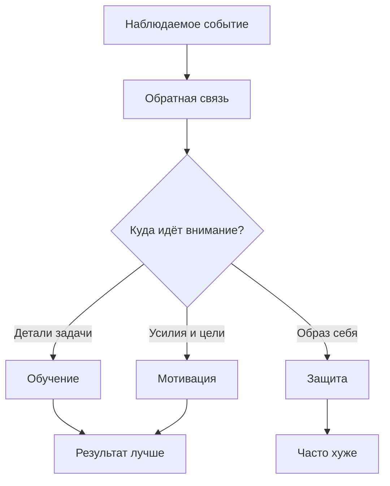
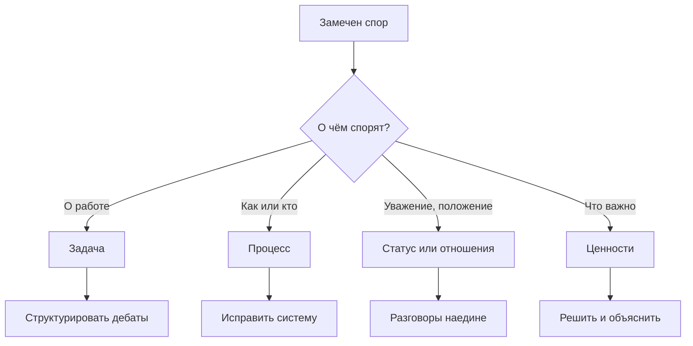
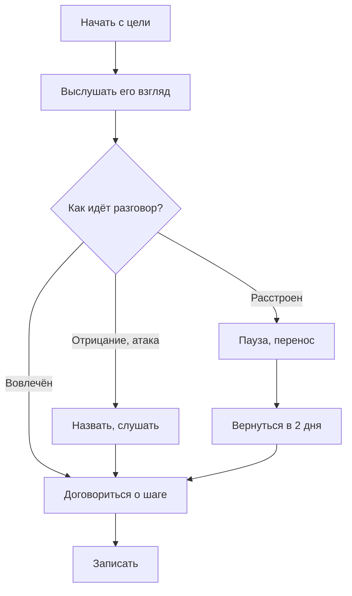

# Глава 6 — Обратная связь, конфликты и трудные разговоры { #chapter-6-feedback-conflict-and-difficult-conversations }

Эта глава — о разговорах, которых руководители избегают: сказать человеку, что он сделал и к чему это
привело, вмешаться в спор между людьми или командами, сказать то, чего собеседник не хочет слышать.
Речь пойдёт о конкретной поведенческой обратной связи, о том, что на самом деле показывают исследования
обратной связи (в том числе что она часто ухудшает результаты), и о том, как подача меняется от
культуры к культуре. Затем глава показывает, как понять, с каким конфликтом вы имеете дело, прежде чем
вмешиваться, и как подготовить трудный разговор, включая план на случай, если он пойдёт плохо. Встречи
один на один — тема главы 5, формальные процессы работы с низкой результативностью — главы 9, а
психологическая безопасность — главы 11; эта глава ссылается на них. Сквозной пример — трения между
Billing и Orders в Northstar Technologies, вымышленной компании из
[кейса](../../case-studies/northstar/index.md).

## Почему это важно { #why-this-matters }

На уровне команды обратная связь — главный способ, которым руководитель меняет то, что делают люди.
Обратная связь, которая приходит поздно, расплывчато или тонет в успокаивающих словах, ничего не меняет;
она переносит проблему на следующую оценку результативности, где та всплывает как сюрприз. Книга
считает, что многие случаи, доходящие до процесса работы с низкой результативностью из главы 9,
начинались с паттерна, который руководитель видел месяцами и не назвал.

На уровне организации конфликт между командами — это место, где инженерные системы сталкиваются с
людьми. Две команды, у которых общий релиз, общая база данных или общий график дежурств, будут из-за
этого ссориться. Если руководитель над ними читает каждый спор как проблему личностей, он будет
проводить сессии медиации, пока общая система продолжает порождать инциденты. Если он читает каждый спор
как проблему процесса, он будет перестраивать рабочие процессы, пока двое перестают разговаривать.

На уровне высшего руководства вопрос в том, доходят ли разногласия до тех, кто может с ними что-то
сделать, и спорят ли инженеры открыто о дизайнах, а не втихую о том, кто виноват. CTO не может
присутствовать на этих разговорах, но своим примером показывает, как принимать критику.

## Цели главы { #learning-objectives }

После этой главы вы сможете:

- Давать конкретную поведенческую обратную связь вскоре после события и объяснять, почему обратная
  связь, направленная на человека, а не на задачу, обычно даёт обратный эффект.
- Адаптировать подачу обратной связи к культурным и индивидуальным нормам, не размывая сути.
- Диагностировать, касается ли конфликт задачи, процесса, статуса и отношений или ценностей, прежде чем
  выбирать вмешательство.
- Готовить и проводить трудный разговор, включая то, что вы сделаете, если он пойдёт плохо.
- Распознавать провалы избегания, перегиба и ложной гармонии в себе и в руководителях, которых вы
  ведёте.

## Ментальная модель { #the-mental-model }

> **Ментальная модель:** обратная связь и конфликт работают, когда внимание остаётся на работе: что
> сделано, к чему это привело, что вознаграждает общая система. Они проваливаются, когда внимание
> переходит на личность: кто компетентен, кого уважают, кто виноват.

Это упрощение исследовательского результата, описанного ниже. Обратная связь о наблюдаемом поведении
удерживает получателя на задаче; «ты небрежен» заставляет его защищать свой образ себя. Так же и спор о
том, какой дизайн правильный, может быть продуктивным, а спор о том, кто компетентен, съедает энергию,
нужную для вопроса о дизайне.

Диаграмма показывает механизм: одно и то же событие, описанное по-разному, направляет внимание на разный
уровень. Руководитель контролирует только описание и момент.

## Подробный разбор { #deep-conceptual-explanation }

### Что показывают исследования обратной связи { #what-the-feedback-research-shows }

В среднем обратная связь улучшает результаты, но больше чем в трети случаев ухудшает их. Таков вывод
самого известного обобщения — [метаанализа](../../glossary.md#meta-analysis) (исследования,
объединяющего множество исследований) вмешательств через обратную связь, проведённого Kluger и DeNisi.
По 607 результатам среднее улучшение соответствовало умеренному
[размеру эффекта](../../glossary.md#effect-size-d-g), но больше трети вмешательств снижали
результативность ([Kluger and DeNisi, 1996](../../references/bibliography.md#kluger1996effects)).
Авторы сообщают, что это не объяснялось ни случайностью, ни тем, была ли обратная связь положительной
или отрицательной. Предложенное ими объяснение, теория вмешательства через обратную связь (feedback
intervention theory), состоит в том, что обратная связь переключает внимание между тремя уровнями
(детали задачи, мотивация к задаче и собственная личность) и эффективность падает по мере того, как
внимание смещается к личности и уходит от задачи. Они также отмечают, что вид задачи меняет эффект, и
как именно — было ещё плохо понятно.

Это **научный результат**, у которого есть ограничения: метаанализ объединяет множество условий и
старше современных инженерных команд. Переносится направление, а не число: обратная связь не всегда
полезна, и самая рискованная — та, что заставляет получателя думать о том, кто он такой.

### Конкретно, поведенчески и рано { #specific-behavioral-and-early }

Отсюда следуют три свойства, и практики в целом с ними согласны (**консенсус практиков**, согласующийся с
исследованиями выше):

- **Конкретно**: одно событие, описанное так, чтобы получатель мог его вспомнить. «На ревью дизайна во
  вторник», а не «на встречах».
- **Поведенчески**: что человек сделал или сказал — то, что он может повторить или изменить, — а затем
  к чему это привело для работы или для других. Не черта характера («защищается», «недостаточно
  senior») и не догадка о намерениях.
- **Рано**: в течение нескольких дней после события. Поздняя обратная связь менее точна, потому что
  воспоминания обоих поблёкли, и дороже, потому что поведение успело повториться.

Полезная структура: ситуация, что вы наблюдали, к чему это привело, и вопрос. «На разборе инцидента в
четверг ты сказал, что причиной „очевидно“ было изменение другой команды, ещё до того, как была готова
хронология. После этого два их инженера перестали участвовать. Что ты знал в тот момент такого, чего
не знал я?» Вопрос важен: наблюдение руководителя может быть неполным, а обратная связь, которую
получатель не может поправить, — это приговор.

Положительная обратная связь подчиняется тем же правилам: «отличная работа» не учит ничему, что можно
повторить.

### Radical Candor: полезная рамка и как она проваливается { #radical-candor-a-useful-frame-and-its-failure }

*Radical Candor* Kim Scott широко известна рамкой из двух осей: искренняя забота о человеке и прямой
вызов ему ([Scott, 2017](../../references/bibliography.md#scott2017radical)). Квадранты хорошо
описывают типичные провалы. Вызов без заботы превращается в агрессию. Забота без вызова (Scott называет
это разрушительной эмпатией) — самый частый провал новых руководителей разработки: руководителю человек
нравится, он придерживает критику, и человек узнаёт о проблеме из низкой оценки или из списка на
увольнение. Ни того ни другого — из самозащиты — превращается в неискренность.

Это **мнение эксперта**. Известный способ, которым рамка проваливается, — когда её ярлыком оправдывают
грубость. Проверка — в том, как это воспринимает получатель: если он не верит, что вы на его стороне,
вызов слышится как нападение.

### Обратная связь в разных культурах { #feedback-across-cultures }

*The Culture Map* Erin Meyer известна описанием национальных деловых культур по нескольким шкалам, одна
из которых — как подаётся отрицательная обратная связь: прямо и без обиняков или косвенно и смягчённо
([Meyer, 2014](../../references/bibliography.md#meyer2014culture)). Родственная идея из той же работы:
люди из культур с прямой подачей склонны использовать усиливающие слова, а люди из культур с косвенной
подачей — смягчающие, поэтому одна и та же критика одному слушателю может показаться мягкой, а другому —
уничтожающей. Это **мнение эксперта**.

Полезной её сохраняют три оговорки. Национальная культура — исходная гипотеза о человеке, а не его
описание. Адаптировать подачу — значит менять обёртку (наедине или публично, сколько контекста, какие
слова вокруг), но никогда не суть: получатель должен уйти, точно зная, что вы хотите изменить. И самый
простой способ — спросить: «Как тебе удобнее слышать о том, что что-то не работает?» — а потом: «Что ты
вынесешь из этого разговора?»

### Диагностика конфликта до вмешательства { #diagnosing-conflict-before-intervening }

Исследователи конфликтов различают типы, которые ведут себя по-разному.

- **Конфликт задачи**: разногласие о содержании работы. Какой дизайн, какой приоритет, подтверждают ли
  данные утверждение.
- **Конфликт процесса**: разногласие о том, как делается работа. Кто чем владеет, кто решает,
  последовательность, процесс релиза.
- **Конфликт отношений**: личные трения, неприязнь, раздражение.
- **Статусный конфликт**: споры об относительном уважении к людям или их положении в группе. Bendersky и
  Hays обнаружили, что он вредил результатам группы и делал конфликт задачи более вредным. Ущерб он
  наносил в основном тем, что подрывал обмен информацией, — сильнее, чем другие типы
  ([Bendersky and Hays, 2012](../../references/bibliography.md#bendersky2012status)).
- **Конфликт ценностей**: разногласие о том, что важно, например допустимо ли выпустить известный дефект,
  чтобы успеть к дате клиента. Это рабочая категория книги для практики; цитируемые здесь исследования
  отдельно её не измеряют, так что считайте её различием, которое проводят практики.

Давняя идея гласит, что разногласия о работе улучшают решения, а личный конфликт им вредит. Помогает ли
конфликт задачи на самом деле — **вопрос спорный**:

- Метаанализ De Dreu и Weingart обнаружил, что и конфликт отношений, и конфликт задачи сильно связаны с
  худшими результатами команды и меньшей удовлетворённостью, особенно в сложных задачах. Конфликт задачи
  вредил меньше, когда был лишь слабо связан с конфликтом отношений
  ([De Dreu and Weingart, 2003](../../references/bibliography.md#dedreu2003task)).
- Более поздний и крупный метаанализ (116 исследований) не обнаружил сильной отрицательной связи для
  конфликта задачи, а там, где тот оставался отделён от конфликта отношений, в командах высшего
  руководства и для качества решений связь была более положительной
  ([de Wit, Greer, and Jehn, 2012](../../references/bibliography.md#dewit2012paradox)).

Оба сходятся в операционном выводе: конфликт задачи терпим, а иногда полезен, только пока он остаётся
отделённым от конфликта отношений. Это **научные результаты** о корреляциях во множестве разных
команд, ни одна из которых не была специально командой разработки ПО, и они не доказывают причинности.

Яснее всего с конфликтом процесса. Обобщение 2012 года обнаружило, что он стабильно вреден — наряду с
конфликтом отношений. Инженерные организации порождают его постоянно, на каждом общем релизе, общей базе
данных и общем графике дежурств, поэтому это конфликт, с которым руководитель столкнётся с наибольшей
вероятностью и который с наименьшей вероятностью удастся исправить разговорами об отношении к делу.

Тип выдают доводы, которые приносят люди. В конфликте задачи ссылаются на данные и дизайны. В
конфликте процесса — на передачи работы, владение и «нам никто не сказал». В статусном конфликте — на
тон, на то, с кем посоветовались, и на то, кому достаётся заслуга. В конфликте ценностей — на принципы.
Большинство реальных споров смешанные, а конфликт процесса, который долго остаётся неразрешённым,
становится конфликтом отношений: две команды, которые раз за разом вредят друг другу через общую
систему, в конце концов начинают друг друга недолюбливать. Первая задача руководителя — найти самый
старый слой, потому что если исправить самый новый слой (неприязнь), не трогая самый старый (общую
систему), часы просто начнут отсчёт заново.

*The Five Dysfunctions of a Team* Lencioni известна аргументом, что команды, которые избегают
конфликтов, приходят к искусственной гармонии
([Lencioni, 2002](../../references/bibliography.md#lencioni2002five)) — **мнение эксперта**, которое
каждый руководитель видел воочию: тихое ревью дизайна, за которым следуют громкие разговоры в коридоре.

### Трудные разговоры { #difficult-conversations }

*Difficult Conversations* Stone, Patton и Heen широко известна наблюдением, что трудный разговор — на
самом деле три разговора: спор о том, что произошло, набор чувств и угроза представлению каждого о том,
кто он такой ([Stone, Patton, and Heen, 1999](../../references/bibliography.md#stone1999difficult)).
Книга также призывает перейти от донесения сообщения к тому, чтобы узнать, что видит собеседник. Это
накладывается на механизм Kluger и DeNisi: уровень идентичности — ровно то место, куда уходит внимание,
когда обратная связь даёт обратный эффект. Это **мнение эксперта**.

На практике подготовка состоит из пяти частей (**рекомендация книги**):

1. **Цель.** Одно предложение о том, что должно быть верно после разговора. «Lee понимает, что
   обвинять другую команду на публичном разборе недопустимо, и мы договорились, что он сделает в
   следующий раз».
2. **Факты и интерпретация.** Отделите то, что вы наблюдали, от своей интерпретации. Запишите, чего вы
   не знаете.
3. **Его взгляд.** Что, по его словам, произошло и что для него стоит на кону? У перегруженного
   дежурного инженера, который срывается, за недопустимым поведением стоит реальная обида.
4. **Что обсуждению не подлежит, а что подлежит.** В чём вы не уступите, а к чему открыты.
5. **План на случай, если разговор пойдёт плохо.** Решается заранее, потому что в моменте вы не будете
   мыслить ясно.

Пятую часть руководители пропускают. Разговоры идут плохо несколькими узнаваемыми способами: отрицание
(«такого не было»), контратака («вы нас никогда не поддерживали»), уход в себя (молчание, короткие
ответы) или сильные эмоции. Ответ на каждый — один и тот же первый шаг: перестаньте продавливать
сообщение, назовите происходящее («Тебе тяжело это слышать. Хочешь продолжить или вернёмся к этому
завтра?») и слушайте. Пауза — не отступление: перенесите разговор в пределах одного-двух рабочих дней и
скажите, что суть остаётся в силе. Если в разговоре всплывает что-то вне вашей компетенции (проблема со
здоровьем, обвинение в домогательствах, юридический вопрос), остановитесь и подключите тех, кто за это
отвечает.

### Пример разговора с комментариями { #a-sample-conversation-annotated }

Этот пример — **иллюстрация**: гипотетический руководитель и Lee, senior-инженер его команды, который
обвинил другую команду в публичном канале инцидента. Руководитель заранее подготовил все пять частей.

> **Руководитель:** Хочу поговорить о твоём сообщении в канале инцидента во вторник. Я скажу, что
> видел, а потом хочу услышать твою версию. Ты написал, что платёжная команда «не может ничего выпустить,
> не сломав нас». После этого двое их инженеров перестали писать в канал, а хронология ещё не была
> готова. Мне нужно, чтобы каналы инцидентов оставались про то, что произошло, а не про то, кто виноват.

*Вступление называет цель, одно событие, его последствия и стандарт — меньше чем за минуту. Никакого
комплимента для начала, никаких прилагательных про Lee.*

> **Lee:** Честно? Руководство год не обращает внимания на нашу нагрузку на дежурствах. Меня вызывали
> три выходных подряд. А теперь проблема — это я?

*Контратака. В ней есть реальная обида и попытка увести разговор. Не спорьте с обидой и не отказывайтесь
от своей мысли.*

> **Руководитель:** Три выходных — это слишком много, и ты прав, что я это не исправил. Я хочу
> вернуться к этому всерьёз, на этой неделе. Сообщение — отдельная тема, и она по-прежнему важна. Давай
> сначала закончим с ней?

*Руководитель признаёт то, что правда, обещает отдельный разговор с конкретной датой и возвращается к
поведению. Обе темы сохраняются, ни одна не поглощает другую.*

> **Lee:** (молчание, потом) Не думаю, что я сейчас могу это обсуждать.

*Уход в себя. Если давить дальше, в лучшем случае получите формальное согласие.*

> **Руководитель:** Хорошо. Давай остановимся и вернёмся к этому в четверг в десять. Насчёт канала моя
> позиция остаётся в силе; я хотел бы услышать, как, по-твоему, выглядела бы справедливая версия того
> сообщения.

*Пауза и возобновление: конкретное время в пределах двух рабочих дней, повторённая суть и вопрос,
который приглашает Lee взять следующий шаг на себя.*

В четверг разговор заканчивается договорённостью, записанной в две строки: в каналах инцидентов —
факты и хронология; разногласия о причинах — на разбор. Отдельно руководитель назначает разговор о
дежурствах, потому что обида была реальной.

Запишите договорённость: оба уходят с одинаковым пониманием, а если паттерн продолжится, процесс из
главы 9 начнётся с записи, а не с воспоминаний.

### Как принимать обратную связь и давать её вверх { #receiving-feedback-and-giving-it-upward }

Руководитель, который просит критики и один раз за неё наказал, больше её не услышит. Просите
конкретно: «Что одно я сделал в этом месяце такого, что усложнило тебе работу?» лучше, чем «Есть
какая-нибудь обратная связь для меня?» Затем принимайте её в три шага (**рекомендация книги**):
поблагодарите человека, задайте один уточняющий вопрос о примере и не объясняйтесь и не защищайтесь в
том же разговоре. В течение недели вернитесь с тем, что вы измените, или с объяснением, почему не
измените. Выполнение учит большему, чем благодарность.

Инженеры, которые дают обратную связь своему руководителю, могут пользоваться той же структурой, что и
для любой обратной связи: одна ситуация, поведение, его последствия для работы и вопрос. «На
планировании в понедельник ты пообещал от нашего имени мартовский срок до того, как мы оценили
миграцию. Двое из нас теперь ожидают, что мы его сорвём. Можем пересмотреть это на этой неделе?»
Давайте её наедине и рано и стройте вокруг работы, а не компетентности руководителя. Если руководитель
плохо реагирует на обратную связь, данную таким образом, это информация для встречи через уровень
(skip-level), а не причина замолчать.

### Место психологической безопасности { #where-psychological-safety-fits }

Психологическая безопасность команды — общее ощущение, что за высказывание не накажут, — связана с
обучением команды ([Edmondson, 1999](../../references/bibliography.md#edmondson1999psychological));
её разбирает [глава 11](../03-high-performing-teams/11-high-performance-trust-safety-and-accountability.md).
Связь здесь прямая: руководитель, который один раз наказал гонца, учит команду загонять конфликты задачи
в подполье, где они обычно превращаются в конфликты отношений. Безобвинительный разбор инцидентов
(blameless review, [глава 25](../05-engineering-quality/25-incidents-postmortems-and-change-failure-analysis.md))
применяет тот же принцип к сбоям.

## Пример из инженерной организации { #engineering-organization-example }

Этот пример — **иллюстрация**; цифры придуманы, чтобы показать арифметику.

В команде из восьми человек есть senior-инженер Sam, мерж-реквесты которого в среднем содержат около
900 изменённых строк. Их ревью занимает в медиане три рабочих дня против одного дня у остальной команды.
Допустим, Sam открывает два таких мерж-реквеста в неделю.

**Вариант A: приберечь до квартальной оценки.** Руководитель замечает это на неделе 2 и планирует
поднять вопрос на оценке на неделе 12. Это ещё 10 недель, ещё 20 крупных мерж-реквестов и около 40
лишних дней ожидания, пока эти мерж-реквесты будут слиты (по 2 дня лишнего ожидания на каждый). На
оценке Sam слышит паттерн, описанный как черта характера («твои изменения трудно ревьюить»), не узнаёт
себя и просит примеры, которым уже два месяца.

**Вариант B: поднять вопрос на неделе 2.** На встрече 1:1: «Твои два последних мерж-реквеста в модуле
ценообразования были примерно по 900 строк, и ревью каждого заняло три дня. Медиана в команде — один
день. Второй из них два из этих трёх дней блокировал работу Ana. Почему они получаются такого размера?»
Sam объясняет, что в модуле ценообразования нет швов для мелких изменений. Руководитель узнаёт кое-что
новое (это проблема дизайна, а не привычка), и они договариваются попробовать разбить следующее
изменение, спрятав его за [фича-флагом](../../glossary.md#feature-flag) (переключателем, с которым код
выпускается выключенным).

Цена разговора — 15 минут. Цена задержки — около 40 дней ожидания плюс более слабый разговор в конце.
Даже если ранний разговор лишь вдвое уменьшит проблему, он окупится многократно. Вывод обобщается:
обратная связь дешева в расчёте на один случай и дорога в расчёте на задержку, потому что поведение
повторяется.

Конфликт в той же команде: Sam и Ana спорят в ветках ревью о разделении модуля ценообразования.
Руководитель сначала читает десять последних веток. В семи спорят о дизайне с доводами (конфликт
задачи); в трёх есть реплики о том, кто «на самом деле понимает» модуль (статусный конфликт). Значит:
ревью дизайна с ограничением по времени и названным человеком, принимающим решение, и разговор наедине
с каждым инженером о репликах. Командная встреча о «коммуникации» не решила бы ни того, ни другого.

## Как принимать решение { #decision-framework }

Пользуйтесь этой таблицей после того, как изучили доводы, а не до.

| Тип конфликта | Типичные доводы | Первый шаг | Типичный неверный шаг |
|---|---|---|---|
| Задача | Дизайны, данные, конкурирующие предложения | Назначить того, кто решает, задать срок, потребовать письменных вариантов | Приказать договориться; поделить разницу пополам |
| Процесс | Передачи работы, пробелы во владении, «нам никто не сказал», повторяющиеся инциденты на границе | Изменить систему: владение, интерфейс, последовательность | Сессии медиации об отношении к делу |
| Статус или отношения | Тон, заслуги, с кем посоветовались, публичные реплики | Сначала разговоры наедине, затем совместный разговор с договорённостью о поведении | Общекомандное сообщение «будьте уважительны» |
| Ценности | Принципы, «так нельзя» | Сделать компромисс явным, решить на правильном уровне, объяснить | Делать вид, что это вопрос задачи с правильным ответом |

Для обратной связи: если поведение, скорее всего, повторится, дайте её сейчас и наедине. Если оно
затронуло людей за пределами команды, исправление может потребоваться публичное, но сама обратная связь
остаётся приватной. Если вы дважды назвали паттерн, а он не изменился, это уже разговор о
результативности (глава 9).

## Компромиссы { #trade-offs }

**Скорость против точности.** Ранняя обратная связь может быть ошибочной: вы можете не знать всей
истории. Смягчает это вопрос в конце, а не задержка.

**Прямота против отношений.** В краткосрочной перспективе прямота стоит комфорта. В долгосрочной
косвенность обходится отношениям дороже — когда человек обнаруживает, что руководитель знал и молчал.

**Вмешаться или дать командам разобраться самим.** Команды, которые сами разрешают свои конфликты задачи,
учатся делать это снова; руководитель, который вмешивается в каждый спор, становится тем, кто решает
всё. Но конфликт процесса на своей границе команды разрешают редко, потому что общая система не
принадлежит ни одной из них.

**Единообразие против адаптации.** Адаптация подачи к людям и культурам проявляет уважение к ним, но
неравномерная обратная связь в команде может выглядеть как фаворитизм. Адаптируйте подачу; стандарт
оставляйте одинаковым.

**Записывать или нет.** Письменная сводка предотвращает споры о том, о чём договорились, но придаёт
разговору формальность. Для обычной обратной связи достаточно заметки в ваших собственных записях.

## Типичные провалы { #failure-modes }

**Бутерброд из комплиментов.** Критика, положенная между двумя похвалами. Получатели учатся ждать
середины или вовсе её пропускают. Обнаруживается, если попросить получателя пересказать, что он
услышал.

**Копить на потом.** Обратная связь, отложенная до цикла оценки. Обнаруживается, когда в оценке есть
что-то, что человек слышит впервые. Полезное правило: в письменной оценке не должно быть ничего нового.

**Разрушительная эмпатия.** Придерживать критику, чтобы защитить отношения или чувства человека.
Обнаруживается в вашем собственном календаре: какой разговор вы откладывали дважды?

**Медиация вместо исправления процесса.** Структурный конфликт трактуется как столкновение личностей.
Обнаруживается, когда один и тот же спор повторяется между разными людьми на одной и той же границе.
Если замена людей не прекратила бы конфликт, значит, конфликт не о людях.

**Ложная гармония.** Никаких разногласий на встречах и сколько угодно — в приватных каналах.
Обнаруживается, когда к «согласованным» решениям раз за разом возвращаются.

**Войны чужими руками.** Руководители воюют через своих инженеров или инженеры — через своих
руководителей, и каждая сторона собирает инциденты в качестве улик. Обнаруживается, когда разборы
инцидентов начинаются с атрибуции, а не с хронологии.

**Перегиб.** Руководитель, обученный прямоте, становится резким. Обнаруживается на
[встречах через уровень](../../glossary.md#skip-level) (встречах директора с инженерами двумя уровнями
ниже) и по тому, кто перестаёт говорить на встречах этого руководителя.

## Применение в крупной организации { #enterprise-application }

В организации из 50–150 инженеров основную часть обратной связи дают руководители, а не директор. Работа
директора — сделать её рутиной и ловить застрявшие случаи.

Механизмы: спрашивайте каждого руководителя, какой разговор с обратной связью он откладывает;
проверяйте письменные оценки на содержание, которое человек видит впервые; на встречах через уровень
спрашивайте инженеров, когда они в последний раз слышали от руководителя что-то критическое и помогло
ли это.

Что касается конфликтов, по мнению книги, большинство устойчивых межкомандных конфликтов сидят на общих
системах: монолит, релизный поезд, график дежурств, база данных. Директору стоит держать короткий
список границ, где конфликт повторяется, и рассматривать каждую прежде всего как вопрос дизайна.
Изменения владения и интерфейсов — тема глав об ответственности за качество
([глава 19](../05-engineering-quality/19-defining-measuring-and-owning-quality.md)) и о структуре
команд (глава 33); вклад этой главы — диагностика.

Обучение помогает меньше, чем практика: курс меняет словарь, а руководитель руководителя, который
каждую неделю спрашивает о конкретных разговорах, меняет поведение.

## Взгляд CTO { #cto-perspective }

На уровне высшего руководства меняются три вещи.

Во-первых, обратная связь CTO усиливается. Мимоходом брошенное замечание о команде превращается в слух
о реорганизации. Обратная связь руководителям высшего уровня и директорам должна быть такой же
конкретной и приватной, как обратная связь инженеру, и ещё тщательнее выбираться по времени.

Во-вторых, конфликты, доходящие до CTO, почти всегда — конфликты ценностей или неразрешённые конфликты
процесса между функциями: продуктовые сроки против надёжности, обязательства продаж против ресурса
команд. Операционный ответ — сделать компромисс явным, принять решение и объяснить его обеим сторонам,
включая то, что заставило бы его изменить. CTO, который каждый раз делит разницу пополам, приучает
организацию эскалировать всё.

В-третьих, CTO показывает, как выглядит приём обратной связи. Инженеры, которые видят, как CTO встречает
критику стратегии с любопытством, усваивают, что не соглашаться с вышестоящими безопасно; одно публичное
пренебрежение учит обратному.

## Практический плейбук { #practical-playbook }

1. Ведите на каждого прямого подчинённого текущую заметку о наблюдаемом поведении, положительном и
   отрицательном, с датами. Просматривайте её перед каждой встречей 1:1 (глава 5).
2. Давайте обратную связь в течение недели после события, наедине, по схеме «ситуация, поведение,
   последствия, вопрос».
3. Спросите каждого, как ему удобнее слышать критику; адаптируйте подачу, а не содержание.
4. Заканчивайте каждый разговор с обратной связью вопросом, что человек из него вынесет.
5. Когда появляется конфликт, изучите доводы, прежде чем действовать: ветки обсуждений, разборы
   инцидентов, затронутые общие системы. Классифицируйте его как конфликт задачи, процесса, статуса или
   отношений либо ценностей и найдите самый старый слой.
6. Конфликты процесса исправляйте изменениями системы; статусные конфликты и конфликты отношений сначала
   разбирайте наедине.
7. Для любого трудного разговора письменно подготовьте все пять частей, включая план на случай, если он
   пойдёт плохо.
8. После разговора запишите, о чём договорились и когда вы это проверите.
9. Каждую неделю спрашивайте своих руководителей, какой разговор они откладывают, и ведите такой же
   список для себя.

## Кейс { #case-study }

Этот кейс — **вымысел**. Он заканчивается решением, которое читателю предстоит принять, придя на
должность директора.

!!! info "Northstar: что уже известно"
    До недели 1: базовый квартал, до прихода нового директора по разработке в Northstar, вымышленную
    компанию книги, которая делает ПО для order-to-cash («от заказа до оплаты»). В этом квартале было
    30 серьёзных инцидентов и $410 000 сервисных кредитов (возвратов денег за недостигнутую
    доступность). Больше всего инцидентов было у Billing. См.
    [хронологию](../../case-studies/northstar/timeline.md). Впервые в Northstar? Прочитайте
    [«Год вкратце»](../../case-studies/northstar/year-in-brief.md) и
    [«Действующие лица»](../../case-studies/northstar/cast.md).

У Billing в базовом квартале было восемь инцидентов [Sev1 и Sev2](../../glossary.md#severity-sev1-sev2-sev3)
(два самых серьёзных уровня в Northstar) — больше, чем у любой другой команды; семь из них пришли через
релизы Core или миграции базы данных. Три инженера по ledger приняли 54 из 64 вызовов Billing в
нерабочее время. Billing и Orders выпускали изменения через [Core](../../glossary.md#core), общий
Java-монолит, на одном и том же двухнедельном [релизном поезде](../../glossary.md#release-train).

После INC-417 (после релиза 24.23 платежи разносились не в тот учётный период) Teodora Vasquez-Lund,
senior-инженер Billing и одна из трёх инженеров по ledger, написала в общем релизном канале, что
изменения Orders «постоянно ломают ledger». Инженер Orders ответил, что Billing стоило бы тестировать
собственный код. Ветка тянулась два дня. Ни один из руководителей в ней не ответил.

После INC-427 (после релиза 24.26 кредит-ноты применились дважды) разбор инцидента начался с того, что
Teodora заявила: причиной было изменение Orders. Сопутствующие факторы, записанные для INC-427 по итогам
разбора (шаблон показан в главе 25), указывают в другую сторону: не было проверки порядка миграций,
длительность миграции на продакшен-объёмах была неизвестна, не было алерта на инвариант ledger, а
релизная пачка составляла около 170 изменений. Никто не зафиксировал, изменение какой команды вызвало
хотя бы один из релизных инцидентов базового квартала; процесс разбора об этом не спрашивал.

Позиция Marcus Oyelaran (руководитель Billing), как её изложил Victor Lindqvist (CTO) в заметках для
передачи дел новому директору, состояла в том, что Orders выпускает изменения в общий код Core, не
понимая ledger. Позиция Orders: Billing винит других в хрупкости собственного кода. Victor написал, что
«дал им двоим разобраться самим» и что это не сработало.

**Диагноз.** На поверхности это конфликт отношений и статуса: публичные обвинения, оборонительные ответы,
вопросы о том, кто понимает ledger. Под ним — конфликт процесса. Две команды выпускают изменения через
один поезд, пачками до 170 изменений, и нет ничего, что связывало бы сбой с конкретным изменением.
Каждый инцидент становился доводом в пользу той истории, которой уже придерживалась каждая сторона,
потому что система не производила доказательств, способных спор разрешить. Самый старый слой —
процесс релизов; самый новый — неприязнь.

Забегая вперёд: [хроника года 1](../../case-studies/northstar/first-quarter.md) показывает, что процесс
релизов был исправлен в первом квартале. В ней не записано, что произошло между командами и что Marcus
сказал Teodora. Это ваше решение на момент прихода. Если исправить только процесс, поведение может
остаться без ответа. Если вмешаться только в поведение, это означает просить Teodora перестать злиться на
систему, которая продолжает поднимать её по ночам.

## Упражнения { #exercises }

Решения — в [решениях к главе 6](../../solutions/ch06-solutions.md). Данные Northstar — на
[странице исходного уровня](../../case-studies/northstar/baseline-data.md); кто есть кто — на странице
[«Действующие лица»](../../case-studies/northstar/cast.md).

### Базовый уровень { #foundational }

**F1.** Перепишите три фрагмента обратной связи так, чтобы они были конкретными, поведенческими и
заканчивались вопросом: «Тебе нужно быть больше командным игроком». «Качество твоего кода снизилось».
«Отличная работа по миграции». Для каждого скажите, что вы должны были наблюдать, чтобы произнести
переписанный вариант, и что бы вы сделали, если бы этого не наблюдали.

**F2.** Руководитель говорит вам, что исследования показывают пользу обратной связи для результатов,
поэтому после каждого спринта она даёт всем подробную обратную связь, в том числе об их отношении к делу
и вовлечённости. Опираясь на выводы метаанализа Kluger и DeNisi и на его ограничения, оцените эту
практику и скажите, что бы вы изменили.

**F3.** Классифицируйте каждый спор как конфликт задачи, процесса, статуса или отношений либо ценностей и
назовите довод, который решил дело: два инженера спорят об event sourcing для ledger; две команды
спорят, кто должен чинить нестабильные (flaky) тесты в общем наборе; senior-инженер расстроен тем, что
младший коллега представил CTO «его» дизайн; продакт-менеджер и инженер спорят, выпускать ли известную
ошибку округления, чтобы успеть к дате продления.

### Прикладное лидерство { #applied-leadership }

**A1.** Вы — директор Marcus Oyelaran, первый месяц в должности. Подготовьте Marcus к разговору с
Teodora Vasquez-Lund о её сообщении после INC-417 и о том, как она начала разбор INC-427. Она — один из
трёх инженеров, которые принимают большую часть вызовов Billing в нерабочее время. Напишите подготовку из
пяти частей, включая то, что Marcus должен сделать, если она ответит, что руководство год не обращает
внимания на нагрузку дежурств.

**A2.** Спроектируйте первую совместную сессию инженеров Billing и Orders после того, как начнутся
изменения в процессе релизов. Решите, кто участвует, какие данные лежат на столе, что сессия должна дать
на выходе и что вы сделаете, если первые десять минут превратятся в перечисление обид каждой команды.

**A3.** Один из ваших руководителей — из культуры, где критику подают косвенно. Его инженеры, большинство
из которых ожидают прямой обратной связи, на встречах через уровень говорят, что «никогда не знают, на
каком они счету». Руководитель считает, что даёт ясную обратную связь. Спланируйте, как вы дадите этому
руководителю обратную связь о его обратной связи, и что вы примете как свидетельство того, что она
изменилась.

### Решения на уровне руководства { #executive-decision-making }

**X1.** Через два квартала после прихода директора Amara Okafor (CPO, директор по продукту) и Victor
Lindqvist (CTO) расходятся на встрече высшего руководства во мнениях о том, задержать ли клиентскую
функцию на три недели, чтобы закончить работу по сверке ledger. Оба просят вас как директора дать
письменную рекомендацию. Диагностируйте тип конфликта, опишите структуру своей рекомендации и скажите,
что вы сделаете, если CEO поделит разницу пополам.

**X2.** Вы — CTO и замечаете, что за 18 месяцев разборов инцидентов в 40 процентах разборов межкомандных
инцидентов первая запись называет другую команду. Спроектируйте ответ на уровне организации, который
охватывает процесс разбора, измерение (включая то, как ваш показатель можно подогнать) и поведение
директоров, и скажите, чего вы делать не станете.

## Вопросы для размышления { #reflection-questions }

1. Какую обратную связь вы придерживаете больше двух недель и в чём настоящая причина?
2. Когда вы в последний раз получали критику от того, кто вам подчиняется, и как вы отреагировали в
   первые десять секунд?
3. В последнем конфликте, в который вы вмешались, вы определили самый старый слой или самый громкий?
4. Кто из ваших прямых подчинённых сказал бы, что всегда знает, на каком он у вас счету, а кто — нет?
5. Случалось ли вам оправдывать «прямотой» небрежное обращение с человеком?

## Главное { #key-takeaways }

- В среднем обратная связь улучшает результаты, но часто даёт обратный эффект; удерживайте внимание
  получателя на задаче, а не на нём самом.
- Давайте обратную связь в течение нескольких дней, об одном наблюдаемом поведении и его последствиях, и
  заканчивайте вопросом.
- Адаптируйте подачу к людям и культурам; никогда не адаптируйте сообщение настолько, чтобы оно исчезло.
- Диагностируйте конфликт, прежде чем вмешиваться: задача, процесс, статус или отношения, ценности.
  Найдите самый старый слой.
- Конфликт задачи терпим, только пока он отделён от статусного конфликта и конфликта отношений; конфликты
  процесса и отношений стабильно вредны.
- Повторяющийся конфликт на границе команд — обычно проблема системы; исправьте систему, затем
  восстановите отношения.
- Готовьте трудные разговоры письменно, включая то, что вы сделаете, если они пойдут плохо.
- Поставить на паузу разговор, который пошёл плохо, — не отступление; возобновите его в течение двух
  дней.

## Источники и что почитать { #references-and-further-reading }

- [Kluger and DeNisi, 1996](../../references/bibliography.md#kluger1996effects). Метаанализ, который
  показывает, что обратная связь часто снижает результативность, и теория, объясняющая почему.
- [De Dreu and Weingart, 2003](../../references/bibliography.md#dedreu2003task). Метаанализ, ставящий под
  сомнение идею, что конфликт задачи помогает командам.
- [de Wit, Greer, and Jehn, 2012](../../references/bibliography.md#dewit2012paradox). Более поздний и
  крупный метаанализ, который усложняет вывод 2003 года и добавляет конфликт процесса.
- [Bendersky and Hays, 2012](../../references/bibliography.md#bendersky2012status). Вводит статусный
  конфликт как отдельный тип и описывает его влияние на обмен информацией.
- [Edmondson, 1999](../../references/bibliography.md#edmondson1999psychological). Основополагающее
  исследование психологической безопасности команды; подробно её разбирает глава 11.
- [Scott, 2017](../../references/bibliography.md#scott2017radical). *Radical Candor*. Рамка практика
  для того, чтобы одновременно заботиться и бросать вызов; полезная часть — квадранты.
- [Meyer, 2014](../../references/bibliography.md#meyer2014culture). *The Culture Map*. Как нормы
  обратной связи различаются в деловых культурах; читать с оговорками из этой главы.
- [Stone, Patton, and Heen, 1999](../../references/bibliography.md#stone1999difficult). *Difficult
  Conversations*. Три слоя трудного разговора и переход от убеждения к узнаванию.
- [Lencioni, 2002](../../references/bibliography.md#lencioni2002five). *The Five Dysfunctions of a
  Team*. Притча об избегаемых конфликтах и искусственной гармонии в команде руководителей.
