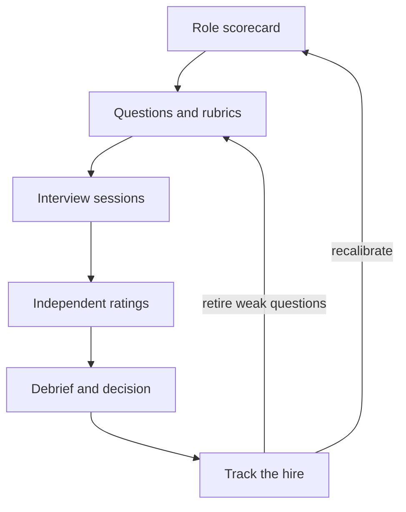
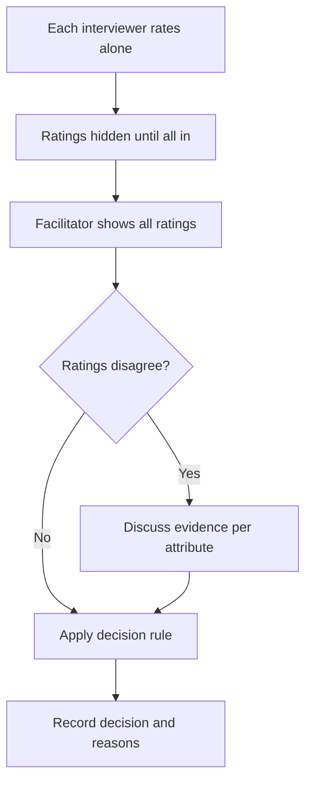

# Chapter 7 — Hiring and Structured Interviews

This chapter treats hiring as a measurement problem. It covers the role scorecard and the structured
loop built from it, what selection research supports (including the 2022 revision of the best-known
validity estimates), where engineering interview practice has run ahead of the evidence, debriefs
that resist anchoring, and tracking hiring quality after the offer. Chapter 8 (Career Development, Promotion, and Compensation)
covers career ladders and pay, and Chapter 10 (Motivation, Retention, and Managing Senior Engineers)
covers keeping the people you hire. The running example is a Billing backfill at
Northstar Technologies, the fictional company in the [case study](../../case-studies/northstar/index.md).

## Why This Matters

At team scale, a hire is a multi-year decision made in about five hours of conversation. A
mismatch takes months to show, consumes mentoring time, and often ends in a second search. At
Northstar, the median time from a resignation to the replacement's first day was 15 weeks (fictional; see the
[baseline data](../../case-studies/northstar/baseline-data.md)), and
[Chapter 3](../01-foundations/03-managerial-leverage-and-systems-thinking.md#delays) shows that eight such
gaps add up to about 2.3 engineer-years of empty seats a year before anyone ramps up. A loop that
picks the wrong person restarts that clock.

At organization scale, the interview loop quietly defines what the organization values. If the loop
rewards speed on algorithm puzzles, the organization fills with people who are fast at puzzles,
whatever the job needs.

At executive scale, the hiring system is a policy with consequences for quality, cost, and
fairness, and it is rarely measured: few companies can say whether their hires turned out as the
interviews predicted.

## Learning Objectives

After this chapter you will be able to:

- Write a role scorecard that states the outcomes and attributes a hire needs, and derive a
  structured interview loop from it in which each session measures named attributes.
- Explain what selection research does and does not support, including the 2022 revision of validity
  estimates, and identify engineering interview practices that have no validity evidence.
- Run a debrief in which interviewers record independent ratings before discussion, and apply a
  decision rule agreed in advance.
- Set up post-hire tracking that compares what the interview predicted with how the hire performed,
  and recognize what that data cannot tell you.
- Estimate the engineering time a structured loop costs and weigh it against the cost of a slow or
  mismatched hire.

## The Mental Model

> **Mental model:** An interview loop is a measurement instrument. Structure makes it repeatable,
> independent ratings keep its readings from collapsing into one opinion, and tracking hires after
> the offer is the only way to find out whether it measures anything.

The instrument has four parts, and each can fail separately: the scorecard defines what is
measured, the sessions collect evidence, the debrief turns evidence into a decision, and post-hire
tracking compares the decision with what happened.

Most organizations run only the middle of this loop. Without the first box the interviewers
measure different things; without the last, nobody learns which questions predict anything.

## Deep Conceptual Explanation

### What selection research measures

Personnel-selection research asks how well a method used before hiring predicts performance after
it. The usual statistic is a [validity coefficient](../../glossary.md#validity-coefficient): the
correlation between scores on the method and a later measure of job performance, most often
supervisor ratings of overall performance. Zero means no prediction; 1 means perfect prediction.
[Meta-analyses](../../glossary.md#meta-analysis) pool many studies and correct for known
distortions, chiefly range restriction: a study observes only the people who were hired, who differ
less from each other than applicants do, so the raw correlation understates how well the method
separates the applicant pool.

Two cautions apply throughout. The criterion is a rating of overall performance across many
occupations, not engineering output. And a validity coefficient is an average across studies, not
the validity of your loop, which depends on how well you build and run it.

### The estimates, and their 2022 revision

For two decades the reference point was Schmidt and Hunter's 1998 summary of 85 years of research.
Its abstract reports meta-analytic validities for 19 selection procedures, and names three
combinations with the highest validity: general mental ability (a cognitive ability test) combined
with a work sample test, with an integrity test, or with a structured interview, each with a mean
validity in the low-to-mid .60s ([Schmidt and Hunter, 1998](../../references/bibliography.md#schmidt1998validity)).
Those figures are still widely quoted in hiring guides.

In 2022, Sackett, Zhang, Berry, and Lievens argued that the range-restriction corrections in the
earlier meta-analyses often overcorrected, so the validity of many procedures had been overestimated.
In their revision most procedures that ranked high before still rank high, but mean estimates fall
by roughly .10 to .20, and structured interviews come out on top
([Sackett et al., 2022](../../references/bibliography.md#sackett2022revisiting)). The same authors'
open-access follow-up in 2023 states the revised figures (**research finding**,
[Sackett et al., 2023](../../references/bibliography.md#sackett2023revisiting)). In the table, the
standard deviation measures how much validity varies between settings, and the 80 percent credibility
interval is the range within which the true validity falls in 80 percent of settings:

| Predictor | What the 2023 article states |
|---|---|
| Structured interview | Highest mean validity, .42; standard deviation .19; 80 percent credibility interval .18 to .66 |
| Empirically keyed biodata (scored background questionnaires) | Mean .38 |
| Cognitive ability | Revised estimate .31, about .20 lower than before; "no longer the stand-out predictor" |
| Work sample test | About .21 lower than before; tied with assessment centers (.33) for fourth place |
| Unstructured interview | About .19 lower than before |

Three points matter for an engineering manager. First, the predictors at the top are job-specific:
structured interviews, job knowledge tests, work samples, and biodata built for the job, while
cognitive ability, long the headline predictor, now sits below structured interviews, biodata, and
work samples. Second, the spread is wide. A credibility interval of .18 to .66 means that
in some settings a structured interview predicts weakly and in others strongly; the authors suggest
reading the figure as ".42, plus or minus .24". Third, the authors say considerable uncertainty
remains about many predictors, so the ranking should be held lightly.

### What "structure" means

Structure is not a script read aloud. Campion, Palmer, and Campion's review identified 15 components
of interview structure, some improving what is asked and some improving how answers are evaluated,
and concluded that interviews can be improved by using many of them (**research finding**,
[Campion, Palmer, and Campion, 1997](../../references/bibliography.md#campion1997review)). The
content and evaluation distinction is the useful part: a loop with well-chosen questions is still
unstructured if each interviewer then decides on overall impression.

Google's published guide describes a working version in four parts: vetted questions relevant to
the role, recorded feedback on each answer, rubrics that describe poor, borderline, solid, and
outstanding answers, and interviewer training and calibration. It starts from defining the attributes
needed for success, and uses two kinds of question: behavioral ("tell me about a time when") and
hypothetical ("imagine that"), each with planned follow-ups. The guide also says structured
interviewing is hard to build and maintain (**documented practice**,
[Google re:Work, 2026](../../references/bibliography.md#rework-structured-interviewing)).

This book adds two requirements to that list (**this book's recommendation**): every session is
assigned named attributes from the scorecard, and the decision rule is agreed before the first
candidate.

### Why unstructured interviews persist

If structure is better, why do most engineering interviews still end with "would I want to work
with this person"? Dana, Dawes, and Peterson offer a mechanism. In three studies, students
predicting other students' grades formed confident impressions even from interviews in which the
interviewee's answers were secretly random, and adding an unstructured interview to background
information made predictions worse than the background information alone. Most participants still
preferred a random interview to none (**research finding**, with students in a grade-prediction
task, not an employment setting;
[Dana, Dawes, and Peterson, 2013](../../references/bibliography.md#dana2013belief)). Interviewers
can make sense of almost anything a candidate says, and that sensemaking feels like insight.
Confidence after an interview is not evidence that the interview measured anything.

### Work samples and technical interviews

A work sample asks the candidate to do a piece of the actual job under observation: review a real
pull request, debug a failing service, extend a small codebase. The 2023 revision lowered its
estimated validity but kept it in the top group of job-specific predictors
([Sackett et al., 2023](../../references/bibliography.md#sackett2023revisiting)).

Most engineering technical interviews are not work samples in this sense: the job rarely consists of
solving unfamiliar puzzles while a stranger watches. Behroozi and colleagues ran a randomized
experiment with 48 computer science students: performance on a problem-solving task fell by more
than half when an interviewer watched, and stress and cognitive load were higher than when the same
task was done in private. The authors argue that such interviews may partly measure how candidates
handle performance anxiety (**research finding**, students in a laboratory setting;
[Behroozi et al., 2020](../../references/bibliography.md#behroozi2020stress)). That is evidence of
a distortion, not a validity study, but it points the same way as the selection research: measure
the job, in conditions close to the job.

This is where engineering practice outruns the evidence. This book found no peer-reviewed study of
how well live-coding puzzles, take-home assignments, pair-programming interviews, or system-design
interviews predict later performance as a software engineer. The general research favors
job-specific work samples and structured questions; the software-specific formats are plausible
applications of that finding, not tested ones. Treat claims that one format "is proven" with
suspicion, including claims made in this chapter.

### Debriefs and anchoring

A debrief combines four or five readings into a decision. In the common format, people take turns
giving their view, and the first strong opinion, often the most senior person's, becomes an anchor:
later speakers adjust toward it or mention only the evidence that fits it. Lorenz and colleagues
showed the mechanism in a different task: when people answering factual estimation questions saw others' estimates, their answers
converged, the wisdom-of-crowd effect weakened, and confidence rose (**research finding**,
estimation tasks rather than hiring;
[Lorenz et al., 2011](../../references/bibliography.md#lorenz2011social)). Applying this to
debriefs is an extension, but it explains a familiar pattern: a debrief that agrees quickly and
feels sure.

The protocol below is **this book's recommendation**:

Four details make it work. Ratings and notes are submitted before anyone sees anyone else's. The
facilitator is not the hiring manager, who speaks last. Discussion goes by attribute, and every claim
cites what the candidate said or did. Ratings may change after discussion, but the original is kept,
so you can later see whether debate improved them.

### Tracking hiring quality after the offer

A hiring system that never checks its predictions cannot improve. Post-hire tracking compares each
hire's scorecard ratings with how they did against the same scorecard six and twelve months later,
plus a few observable milestones: time to first independent production change, time to joining the
on-call rotation where the role includes it, and whether the person left or was managed out in the
first year.

The data has three limits. Samples are tiny: at eight hires a year, the use is to spot gross
failures (a question nobody fails, an attribute every hire turns out weak on), not to compute
validity. You see only the people you hired, the same range restriction that distorted the research.
And onboarding and management shape the outcome, so a weak result may be the team's failure rather
than the interview's. Chapter 9 (Performance Management and Underperformance) covers judging
performance fairly.

## Engineering Organization Example

The figures in this example are **illustrative**. Northstar is fictional, and the cost assumptions
are stated so you can replace them with your own.

**What a validity of .42 buys.** Assume interview scores and later performance are both normally
distributed and correlated at .42, and that you hire the half of candidates who score above the
median. Under those assumptions, the share of hires who turn out above-median performers is about
64 percent, against 50 percent for hiring at random. At the edges of the credibility interval the
figure is about 56 percent (validity .18) and about 73 percent (validity .66). A well-run structured
loop moves the odds from a coin toss to about two in three; a badly run one may barely move them.
Neither makes mistakes rare.

*Method: for two normal variables with correlation r, the chance that both exceed their medians is
1/4 + arcsin(r)/2π; dividing by 1/2 gives the share among hires.*

**What the loop costs.** Suppose Northstar redesigns the loop for its next Billing ledger backfill,
with this scorecard: correctness of money movement (idempotency, rounding, double-entry); safe schema
change on a live database; diagnosing a production failure; working across team boundaries; and
code quality in a large Java codebase. Assumptions: four interview sessions totaling 4.25 hours
(a 90-minute work sample reviewing a ledger migration with planted defects, a 60-minute debugging
session on recorded logs, a 60-minute behavioral interview, and a 45-minute hiring-manager
conversation), 30 minutes of write-up per interviewer, and a 30-minute debrief for five people.

| Item | Engineer-hours |
|---|---|
| One loop: 4.25 interview + 2.0 write-up + 2.5 debrief | 8.75 |
| Four loops per hire | 35 |
| Twelve structured phone screens at 1 hour each including notes | 12 |
| Per hire, steady state | 47, about 1.2 engineer-weeks |
| One-time design of scorecard, work sample, and rubrics | about 24 (3 engineer-days) |
| First hire with the new loop | about 71, about 1.8 engineer-weeks |

At eight backfills a year, the steady-state cost is about 9.4 engineer-weeks, roughly 0.2 of an
engineer, plus training. Set that against the 120 seat-weeks a year that Northstar's backfills leave
empty, and against one mismatched hire who takes six months to reach the rotation. This does not
prove the structured loop pays for itself; that depends on how much better it selects, on which
Northstar has no data. It shows the cost is small enough to be worth testing.

## Decision Framework

Choose the assessment method per attribute, not per loop. The table is **this book's
recommendation**, applying the job-specific principle from the research.

| Attribute type | Example | Best method | Avoid |
|---|---|---|---|
| Skill the job uses daily | Reviewing and changing ledger code | Work sample on realistic material | Puzzles unrelated to the work |
| Knowledge the job requires on day one | How a migration locks a table | Structured technical questions with a rubric | Trivia with one right word |
| Behavior in recurring situations | Handling a cross-team disagreement | Behavioral questions with follow-ups | "Tell me about yourself" |
| Judgment in rare situations | A double-applied credit note in production | Hypothetical scenario with probes | Asking what they "would usually do" |
| Motivation and values | Willingness to take on-call | Structured questions plus a candid description of the job | "Culture fit" judged by impression |

Then set the decision rule before the first candidate. Options, from strictest to loosest:

| Rule | When it fits | Risk |
|---|---|---|
| No attribute below "meets" | Small team, critical role, a scarce skill | Rejects strong candidates with one teachable gap |
| Named must-have attributes at "meets", others average "meets" | Most roles | Must-haves chosen loosely |
| Any strong advocate with no strong objection | Very hard-to-fill roles | Brings back the anchoring the protocol removed |

For a backfill into a single-point-of-knowledge area like Northstar's ledger, use the middle rule
with that area's skill as a must-have.

## Trade-offs

**Structure against candidate experience.** Identical questions can feel mechanical. Planned
follow-ups and time reserved for the candidate's own questions recover most of the warmth.

**Realism against time.** A realistic work sample costs more to design. A take-home exercise saves
interviewer time but shifts the cost to candidates, hardest on those with a current job or caring
responsibilities, and invites outside help. A supervised work
sample of 60 to 90 minutes is a common compromise; it is a judgment, not a tested optimum.

**Speed against rigor.** Every week of process is a week of empty seat and a week for the candidate
to accept another offer. Rigor belongs in the design of the loop, not in more rounds; a fifth or
sixth interview usually adds fatigue and anchoring, not information.

**Job-specific against general.** A loop built tightly around today's work selects for today's job.
If the role will change, add one attribute for learning a new area, and accept that it is harder to
measure.

## Failure Modes

**The phantom scorecard.** The loop exists but the role was never written down, so each interviewer
measures their own idea of a good engineer. Signal: interview notes that describe the candidate
("smart", "senior") rather than evidence against named attributes. Countermeasure: no interview is
scheduled until the scorecard is signed off by the hiring manager and one engineer from the team.

**Puzzle proxy.** The interview measures speed on unfamiliar puzzles under observation; the job is
changing a large existing system. Signal: hires who pass
easily and then take months to make a safe change. Countermeasure: replace one puzzle session with a
work sample on realistic material.

**First speaker wins.** The debrief agrees within minutes with whoever spoke first. Signal: written
ratings that change after the meeting, always toward the hiring manager. Countermeasure: the
protocol above, and a record of original ratings.

**Interviewer drift.** Interviewers drift back to rating on impression. Signal: one interviewer's
ratings sit far above or below everyone else's. Countermeasure: quarterly calibration on the same
recorded answer.

**No feedback loop.** A question that predicts nothing survives for years. Signal: no one can say
what happened to last year's hires. Countermeasure: a six-month check for every hire.

**Backfill by template.** A departure is replaced with a generic job description, so the specific
knowledge the leaver carried is never named or tested. Signal: the posting for a ledger engineer
could be for any team. Countermeasure: write the scorecard from the leaver's actual duties, with the
team.

## Enterprise Application

In an organization of 50 to 150 engineers, hiring is continuous: at 10 percent annual attrition, 100
engineers means about ten backfills a year before any growth. The director runs the hiring system;
managers run their loops within it.

**Shared parts, local content.** Make the protocol, rubric format, decision rules, and post-hire
check common across teams. Let each team own its scorecards, work samples, and question banks,
because only the team knows the job.

**A trained interviewer pool.** Not every engineer should interview. Train a pool on the rubric,
notes, and the debrief protocol, with shadowing before interviewing alone, and track interview hours
per person: the people most often asked are usually the ones the team can least spare.

**Debrief facilitation outside the line.** A facilitator from another team runs debriefs; it is the
cheapest defense against anchoring by the hiring manager.

**One hiring dashboard, read carefully.** Time from approval to accepted offer, offer acceptance,
stage pass-through rates, and the six-month check. Each is gamed: time to hire falls if you lower the
bar, pass-through rises if screens get easy, and six-month ratings rise if the hiring manager is the
only rater. Pair time to hire with the six-month check, and have a second person rate.

## CTO Perspective

At executive scale, three decisions are the CTO's. The first is what the hiring system optimizes.
Speed, quality, cost, and fairness pull against each other, and if the CTO does not say which
matters most for which roles, recruiters will optimize what is measured, usually time to hire.

The second is defensibility. A hiring decision should be explainable from written evidence against
written criteria, which structure makes far easier. This book does not give legal advice, and
employment law differs by country, but a process whose reasons are recorded can be examined for
unfairness and corrected.

The third is honesty with the board and the CFO. Backfills take months to fill and more months to
ramp (Chapter 3 models the delay), so hiring is the slowest lever on capacity. A better hiring process
cannot fix this quarter's reliability problem. It can promise fewer expensive mismatches over a year
or two, and a record that shows whether it is working.

## Practical Playbook

For a director or manager introducing structured hiring for one role, then spreading it:

1. **Write the scorecard first.** With two engineers from the team, list three to five first-year
   outcomes and the four to six attributes they require. For a backfill, start from what the leaver
   actually did.
2. **Map attributes to sessions.** Each session measures one or two named attributes; must-haves are
   measured twice.
3. **Build the work sample.** Realistic material from your codebase, secrets removed, that a strong
   candidate can do well in 60 to 90 minutes. Try it on two current engineers first.
4. **Write the rubrics.** Poor, borderline, solid, and outstanding answers, with examples.
5. **Set the decision rule** before the first candidate, and share it with the panel.
6. **Train the panel.** One session on rubric, notes, and protocol; two shadowed loops before
   interviewing alone.
7. **Run debriefs by protocol.** Ratings alone, revealed together, discussed by attribute, hiring
   manager last, originals kept, reasons recorded.
8. **Describe the job as it is,** including on-call and the hard parts; a hire surprised by the job
   is a retention problem in waiting (Chapter 10).
9. **Check at six months.** Two people rate the hire against the scorecard; compare with the
   interview ratings.
10. **Review yearly.** Retire questions everyone passes or that do not match later performance;
    recalibrate interviewers; update the scorecard.

## Case Study

This case is **fictional** ([baseline data](../../case-studies/northstar/baseline-data.md)).

!!! info "Northstar so far"
    The twelve months before week 1, when the new Engineering Director arrives at Northstar, the book's
    fictional order-to-cash company with 80 engineers. Eight engineers left in that year, and Billing,
    the team with the most serious incidents, lost one of its four ledger experts. See the
    [timeline](../../case-studies/northstar/timeline.md).

**The process.** Before the director arrived, Northstar had no common hiring process. Each manager
ran a variant of the same loop: a 30-minute recruiter call; a 60-minute live algorithm exercise from
a shared bank of puzzles; a "team chat" with two or three engineers with no assigned topics; and a
conversation with the hiring manager. Job postings reused a generic "Senior Software Engineer"
description. Debriefs were 30-minute meetings in which the hiring manager gave a view and the others
followed in turn; written notes were optional. Nobody recorded what had happened to past hires.

**The ledger backfill.** A year before the director arrived, four Billing engineers were trusted
with ledger incidents. Nine months before arrival, one of them resigned. The replacement started 15
weeks later, matching Northstar's median. The time went like this: three weeks waiting for the
backfill to be approved, six weeks of sourcing and screening (about 40 applicants, nine recruiter
calls, four full loops), one week to agree an offer, and five weeks of the new hire's notice period.

The person hired, Tamsin Achterberg, came from a backend team at an online retailer and was the
strongest of the four finalists on the algorithm exercise. In the team chat one of the ledger
engineers asked about database migrations and noted afterward that she had never changed a schema
on a live system. Nobody asked about money movement, rounding, or on-call, because nobody had
written down that the role needed them. In the debrief Marcus Oyelaran (Billing manager) spoke first: the strongest
technical result in months, and the team could teach her the ledger. The ledger engineer's concern
became "will need some ramp on migrations". The decision took about 25 minutes and was unanimous.

By the end of the baseline quarter, about 24 weeks after her first day, Tamsin was not on the on-call
rotation, and the three remaining ledger engineers were handling most of Billing's pages. There were
two causes. Chapter 3 tells one: the three were rarely free to pair. This chapter tells the other: the loop never
measured what the role needed. The gap was invisible until after the offer, and the plan to close it
was a debrief comment rather than a ramp plan with time allocated. Tamsin is a capable engineer hired
against the wrong measure; treating her as the problem would teach the organization nothing.

**The decision in quarter 2.** At the start of quarter 2 (week 14) the director proposes running the
next two backfills as a structured pilot; whether it goes ahead is not recorded. The pilot has a
scorecard written with the team from the leaver's actual duties, a work sample on realistic material,
the debrief protocol with a facilitator from another team, and a six-month check. Marcus objects that
a 90-minute work sample will scare off candidates in a tight market. Tom Becker (Platform Operations
manager) worries that his infrastructure engineers will be pulled into interview panels. Victor
Lindqvist (CTO) asks how anyone will know within a year whether the pilot worked. The exercises take up each objection.

## Exercises

Solutions are in [chapter 7 solutions](../../solutions/ch07-solutions.md). Northstar data is on the
[baseline page](../../case-studies/northstar/baseline-data.md).

### Foundational

**F1.** A hiring manager tells you their team's loop is "structured" because every candidate gets
the same four interviewers and the same algorithm question. The interviewers each write a free-text
summary and vote hire or no-hire in a meeting. Using the content and evaluation distinction, assess
how structured this loop is and name the two changes that would add the most structure.

**F2.** A colleague cites the 1998 estimate that cognitive ability combined with a structured
interview reaches a validity in the .60s, and concludes that the company should add a cognitive
ability test to every engineering loop. Using what the 2022 revision and the 2023 article say, write
the reply you would send, including what you would not claim either.

**F3.** Your recruiter reports that structured interviews have "a validity of .42, so they are right
42 percent of the time". Correct the statement, explain the credibility interval in one paragraph for
a non-specialist, and say what the figure does and does not tell you about your own loop.

### Applied Leadership

**A1.** Write the scorecard and loop for Northstar's next Billing ledger backfill, using the chapter's
attribute types. State the outcomes for the first year, the attributes, which session measures each,
the decision rule, and what the work sample contains. Explain how your design would have surfaced the
gap in Tamsin Achterberg's loop.

**A2.** In a debrief you are facilitating, the hiring manager opens before the ratings are revealed:
"I think she's the strongest candidate we've seen this year." Two interviewers' hidden ratings are
below "meets" on a must-have attribute. Describe what you do in the next five minutes, what you
record, and what you change in the process afterward.

**A3.** Twelve months after a structured pilot, you have six hires with six-month checks. Four match
their interview ratings, one is much stronger than predicted, and one is much weaker, on the
attribute the work sample measured. The hiring manager says the work sample is "proven" by the four
matches. Decide what you can and cannot conclude, and what you would change.

### Executive Decision-Making

**X1.** You are Northstar's director at the start of quarter 2. Marcus Oyelaran, Tom Becker, and
Victor Lindqvist have raised the three objections in the case study. Decide whether to run the pilot,
how to answer each objection, what you will measure, how each measure could be gamed, and what you
will not promise Victor.

**X2.** Rajiv Menon (CFO) proposes that all backfills be delayed by eight weeks to hold operating
expense flat, and that the delay be "used" to run a longer, more thorough interview process with two
extra rounds. Assume eight backfills a year and $185,000 fully loaded per engineer-year. Using the
chapter's figures and assumptions, evaluate the proposal and write your
recommendation to the CTO.

## Reflection Questions

1. When did you last hire someone, and could you name in writing the attributes the loop was
   measuring before the first interview?
2. Which question in your current loop do you ask because it worked on you?
3. When you feel sure about a candidate after an hour, what evidence would you have to show someone
   who was not in the room?
4. Who speaks first in your debriefs, and how often does the decision differ from their view?
5. Which of your team's current engineers would fail your own technical interview, and what does
   that say about the interview?

## Key Takeaways

- Treat the interview loop as a measurement instrument: define what it measures, run it the same way
  each time, and check its readings against later performance.
- Write the role scorecard before scheduling interviews; for a backfill, start from what the leaver
  actually did.
- Prefer job-specific methods (structured interviews, work samples on realistic material, structured
  technical questions) over puzzles and impressions; that is where the selection research points.
- Hold validity figures lightly: the 2022 revision lowered most estimates, structured interviews
  lead at about .42 with a wide spread, and software-specific formats have no validity evidence of
  their own.
- Collect ratings independently, reveal them together, let the hiring manager speak last, and set
  the decision rule before the first candidate.
- Check every hire at six months against the scorecard, and remember that a small, range-restricted
  sample can spot gross failures but cannot prove validity.

## References and Further Reading

- [Sackett et al., 2023](../../references/bibliography.md#sackett2023revisiting). Open-access
  follow-up stating the revised estimates; the best single source on what the research now says.
- [Sackett et al., 2022](../../references/bibliography.md#sackett2022revisiting). The revision that
  lowered most validity estimates.
- [Schmidt and Hunter, 1998](../../references/bibliography.md#schmidt1998validity). The classic
  summary, still widely quoted; read it with the revision.
- [Campion, Palmer, and Campion, 1997](../../references/bibliography.md#campion1997review). The
  components of interview structure, for content and evaluation.
- [Dana, Dawes, and Peterson, 2013](../../references/bibliography.md#dana2013belief). Why unstructured
  interviews feel informative when they are not; short and open access.
- [Behroozi et al., 2020](../../references/bibliography.md#behroozi2020stress). Being watched
  distorts whiteboard performance.
- [Lorenz et al., 2011](../../references/bibliography.md#lorenz2011social). Social influence makes a
  group converge and grow confident without becoming more accurate.
- [Google re:Work, 2026](../../references/bibliography.md#rework-structured-interviewing). A
  documented guide to questions, rubrics, and interviewer training.
- [Larson, 2019](../../references/bibliography.md#larson2019elegant). *An Elegant Puzzle*. Known for
  treating hiring as a system with a funnel to instrument and improve.
