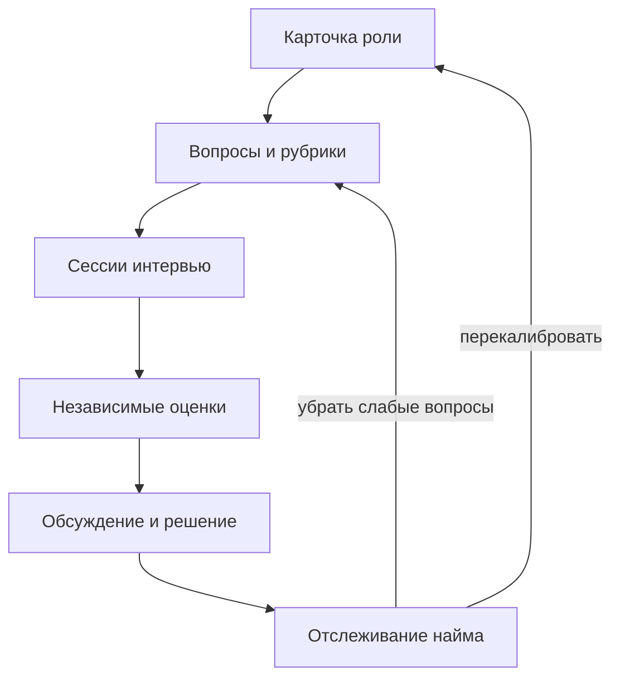
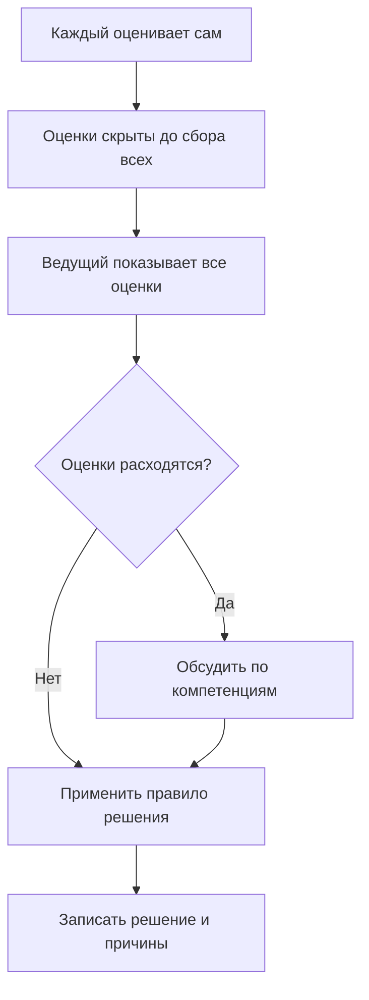

# Глава 7 — Найм и структурированные интервью { #chapter-7-hiring-and-structured-interviews }

В этой главе найм рассматривается как задача измерения. Речь пойдёт о карточке роли и о построенном на
ней структурированном цикле интервью, а также о том, что подтверждают исследования отбора персонала,
включая пересмотр самых известных оценок в 2022 году. Глава показывает, где практика инженерных
интервью ушла дальше доказательств, как проводить итоговые обсуждения, устойчивые к эффекту якоря, и
как отслеживать качество найма после оффера. В конце разобраны воронка вокруг цикла интервью и первые
90 дней.
Карьерные лестницы, оплата и выбор грейда при оффере — в главе 8; удержание нанятых людей — в главе 10.
Сквозной пример — найм на замену в команду Billing в Northstar Technologies, вымышленной компании из
[кейса](../../case-studies/northstar/index.md).

## Почему это важно { #why-this-matters }

На уровне команды найм — это решение на несколько лет, принятое примерно за пять часов разговоров.
Несовпадение проявляется через месяцы, съедает время на менторство и часто заканчивается вторым поиском.
В Northstar, вымышленной компании книги, медианный срок от заявления об уходе до первого рабочего дня
замены составлял 15 недель ([исходные данные](../../case-studies/northstar/baseline-data.md)). Цикл
интервью, который выбирает не того человека, запускает этот отсчёт заново.

На уровне организации цикл интервью незаметно определяет, что организация ценит. Если цикл
вознаграждает скорость решения алгоритмических головоломок, организация наполняется людьми, которые
быстро решают головоломки, что бы ни требовала работа.

На уровне высшего руководства система найма — это политика, от которой зависят качество, затраты и
справедливость, и её редко измеряют: мало какая компания может сказать, оправдали ли нанятые люди
прогноз, который дали интервью.

## Цели главы { #learning-objectives }

После этой главы вы сможете:

- Написать карточку роли, в которой названы результаты и качества, нужные новому сотруднику, и вывести
  из неё структурированный цикл интервью, где каждая сессия измеряет названные компетенции.
- Объяснить, что исследования отбора подтверждают и чего не подтверждают, включая пересмотр оценок
  валидности в 2022 году, и распознать практики инженерных интервью, у которых нет доказательств
  валидности.
- Провести итоговое обсуждение, в котором интервьюеры записывают независимые оценки до дискуссии, и
  применить заранее согласованное правило решения.
- Наладить отслеживание после найма, которое сравнивает прогноз интервью с тем, как человек работает, и
  понимать, чего эти данные сказать не могут.
- Оценить, сколько инженерного времени стоит структурированный цикл, и сопоставить это с ценой
  медленного или неудачного найма.

## Ментальная модель { #the-mental-model }

> **Ментальная модель:** цикл интервью — это измерительный прибор. Структура делает его показания
> воспроизводимыми, независимые оценки не дают им слиться в одно мнение, а отслеживание нанятых после
> оффера — единственный способ узнать, измеряет ли он вообще что-нибудь.

У прибора четыре части, и каждая может отказать отдельно: карточка определяет, что измеряется, сессии
собирают свидетельства, итоговое обсуждение превращает свидетельства в решение, а отслеживание после
найма сравнивает решение с тем, что произошло.

Большинство организаций проходят только середину этого цикла. Без первого блока интервьюеры измеряют
разное; без последнего никто не узнаёт, какие вопросы что-то предсказывают.

## Подробный разбор { #deep-conceptual-explanation }

### Что измеряют исследования отбора { #what-selection-research-measures }

Исследования отбора персонала задаются вопросом: насколько хорошо метод, применённый до найма,
предсказывает результативность после него. Обычная статистика —
[коэффициент валидности](../../glossary.md#validity-coefficient): корреляция между баллами по методу и
более поздней мерой результативности, чаще всего оценкой общей результативности, которую ставит
руководитель. Ноль означает отсутствие предсказания, единица — идеальное предсказание.
[Метаанализы](../../glossary.md#meta-analysis) объединяют много исследований и поправляют известные
искажения. Главное из них — ограничение диапазона: исследование видит только тех, кого наняли, поэтому
сырая корреляция занижает то, насколько хорошо метод различает всех кандидатов.

Две оговорки действуют на протяжении всей главы. Критерий — это оценка общей результативности во многих
профессиях, а не результат инженерной работы. И коэффициент валидности — среднее по исследованиям, а не
валидность вашего цикла, которая зависит от того, насколько хорошо вы его построили и как проводите.

### Оценки и их пересмотр в 2022 году { #the-estimates-and-their-2022-revision }

Двадцать лет точкой отсчёта была сводка Schmidt и Hunter 1998 года, обобщившая 85 лет исследований. В
её аннотации приведены значения валидности для 19 процедур отбора. Три лучшие комбинации сочетали общие
умственные способности (тест когнитивных способностей) с рабочим заданием, тестом на добросовестность
или структурированным интервью; у каждой средняя валидность была в нижней и средней части диапазона 0,60–0,69
([Schmidt and Hunter, 1998](../../references/bibliography.md#schmidt1998validity)). Эти цифры до сих пор
широко цитируют в руководствах по найму.

В 2022 году Sackett, Zhang, Berry и Lievens показали, что поправки на ограничение диапазона в прежних
метаанализах часто были избыточными, и валидность многих процедур оказалась завышена. В их пересмотре
большинство процедур, которые раньше были в верхней части списка, там и остались, но средние оценки
снизились примерно на 0,10–0,20, а первое место заняли структурированные интервью
([Sackett et al., 2022](../../references/bibliography.md#sackett2022revisiting)). В статье 2023 года в
открытом доступе те же авторы приводят пересмотренные цифры (**научный результат**,
[Sackett et al., 2023](../../references/bibliography.md#sackett2023revisiting)):

| Предиктор | Что сказано в статье 2023 года |
|---|---|
| Структурированное интервью | Самая высокая средняя валидность, .42; в 80 процентах условий от .18 до .66 |
| Когнитивные способности | .31, примерно на .20 ниже, чем раньше; «больше не выдающийся предиктор» |
| Рабочее задание | Примерно на .21 ниже, чем раньше, но всё ещё близко к вершине |
| Неструктурированное интервью | Примерно на .19 ниже, чем раньше |

**Что даёт валидность 0,42.** Допустим, вы нанимаете ту половину кандидатов, чьи баллы выше медианы, а
баллы и последующая результативность распределены нормально. Тогда примерно 64% нанятых окажутся
выше медианы по результативности против 50% при случайном найме. На краях диапазона это около 56%
(валидность 0,18) и около 73% (валидность 0,66). Хорошо проведённый структурированный цикл меняет шансы
с подбрасывания монеты примерно на два из трёх; плохо проведённый может почти ничего не изменить. Ни
тот, ни другой не делают ошибки редкими. (Вывод — в решениях к упражнению F3.)

Для руководителя разработки (engineering manager, EM) важны три вещи. Первое: предикторы на вершине
привязаны к конкретной работе. Это структурированные интервью, тесты профессиональных знаний, рабочие
задания и биографические опросники, составленные под должность, а когнитивные способности, долго
считавшиеся главным предиктором, теперь стоят ниже структурированных интервью, биографических данных и
рабочих заданий. Второе: разброс широк. Интервал достоверности (credibility interval) от 0,18 до 0,66
означает, что в одних условиях структурированное интервью предсказывает слабо, а в других — сильно;
авторы предлагают читать эту цифру как «0,42 плюс-минус 0,24». Третье: по словам авторов, по многим
предикторам остаётся значительная неопределённость, так что к рейтингу стоит относиться без излишней
уверенности.

### Что значит «структура» { #what-structure-means }

Структура — это не сценарий, который зачитывают вслух. В обзоре Campion, Palmer и Campion выделено 15
компонентов структуры интервью: одни улучшают то, о чём спрашивают, другие — то, как оценивают ответы.
Авторы заключили, что интервью можно улучшить, используя многие из них (**научный результат**,
[Campion, Palmer, and Campion, 1997](../../references/bibliography.md#campion1997review)). Полезнее всего
здесь различение содержания и оценки: цикл с хорошо подобранными вопросами остаётся
неструктурированным, если каждый интервьюер потом решает по общему впечатлению.

Опубликованное руководство Google описывает рабочий вариант из четырёх частей: проверенные вопросы,
относящиеся к роли; записанная обратная связь по каждому ответу; рубрики, которые описывают слабый,
пограничный, уверенный и отличный ответ; обучение и калибровка интервьюеров. Руководство начинает с
определения качеств, нужных для успеха, и использует вопросы двух видов: поведенческие («расскажите о
случае, когда…») и гипотетические («представьте, что…»), у каждого — заранее продуманные уточняющие
вопросы. В руководстве также сказано, что структурированные интервью трудно построить и поддерживать
(**задокументированная практика**,
[Google re:Work, 2026](../../references/bibliography.md#rework-structured-interviewing)).

Эта книга добавляет к списку два требования (**рекомендация книги**): каждой сессии назначены конкретные
компетенции из карточки, а правило решения согласовано до первого кандидата. Одна строка рубрики для
роли, связанной с ledger, выглядит так (**иллюстрация**):

| Компетенция | Слабо | На грани | Уверенно | Отлично |
|---|---|---|---|---|
| Безопасное изменение схемы живой базы данных | Запускает миграцию как написано | Замечает блокировки только после подсказки | Видит блокировку, предлагает поэтапную миграцию с откатом | Ещё и спрашивает об объёме данных и репетирует в масштабе продакшена |

В шаблоне [«Карточка найма и набор для интервью»](../../templates/hiring-scorecard.md) есть полная
карточка, карта сессий и формат рубрики для найма на замену в Billing, который используется в этой
главе.

### Почему неструктурированные интервью живучи { #why-unstructured-interviews-persist }

Если структура лучше, почему большинство инженерных интервью по-прежнему заканчиваются вопросом «хотел
бы я работать с этим человеком»? Dana, Dawes и Peterson предлагают объяснение. В трёх исследованиях
студенты, предсказывавшие оценки других студентов, составляли уверенное впечатление даже по интервью, в
которых ответы собеседника втайне были случайными. Добавление неструктурированного интервью к анкетным
данным ухудшало прогнозы по сравнению с одними анкетными данными. И всё же большинство участников
предпочитали случайное интервью никакому (**научный результат**, получен на студентах в задаче прогноза
оценок, а не при найме на работу;
[Dana, Dawes, and Peterson, 2013](../../references/bibliography.md#dana2013belief)). Интервьюер может
найти смысл почти в чём угодно, что говорит кандидат, и это ощущение смысла кажется проницательностью.
Уверенность после интервью — не доказательство того, что интервью что-то измерило.

### Рабочие задания и технические интервью { #work-samples-and-technical-interviews }

Рабочее задание (work sample) просит кандидата под наблюдением выполнить часть настоящей работы:
отревьюить реальный merge request, отладить падающий сервис, расширить небольшую кодовую базу. Пересмотр
2023 года снизил оценку его валидности, но оставил его в верхней группе предикторов, привязанных к
конкретной работе ([Sackett et al., 2023](../../references/bibliography.md#sackett2023revisiting)).

Большинство технических интервью для инженеров — не рабочие задания в этом смысле: работа редко состоит
в том, чтобы решать незнакомые головоломки на глазах у постороннего. Behroozi с коллегами провели
рандомизированный эксперимент с 48 студентами по компьютерным наукам: когда за решением задачи наблюдал
интервьюер, результат падал больше чем вдвое, а стресс и когнитивная нагрузка были выше, чем при решении
той же задачи наедине. Авторы утверждают, что такие интервью отчасти измеряют то, как кандидат
справляется с тревогой перед публикой (**научный результат**, студенты в лабораторных условиях;
[Behroozi et al., 2020](../../references/bibliography.md#behroozi2020stress)). Это доказательство
искажения, а не исследование валидности, но оно указывает в ту же сторону, что и исследования отбора:
измеряйте работу в условиях, близких к работе.

Именно здесь инженерная практика обгоняет доказательства. Авторы книги не нашли ни одного рецензируемого
исследования о том, насколько хорошо live coding с головоломками, домашние задания, интервью в формате
парного программирования или интервью по проектированию систем предсказывают последующую
результативность разработчика. Общие исследования говорят в пользу рабочих заданий и структурированных
вопросов, привязанных к работе; форматы, специфичные для разработки ПО, — правдоподобное применение
этого вывода, но не проверенное. Относитесь с подозрением к утверждениям, что какой-то формат
«доказан», в том числе к утверждениям из этой главы.

### Итоговые обсуждения и эффект якоря { #debriefs-and-anchoring }

Итоговое обсуждение (debrief) сводит четыре-пять показаний в одно решение. В распространённом формате
участники по очереди высказываются, и первое сильное мнение, часто самого старшего участника, становится
якорем: следующие выступающие смещаются к нему или упоминают только подходящие под него свидетельства.
Lorenz с коллегами показали этот механизм на другой задаче: когда люди, отвечавшие на вопросы с
численной оценкой фактов, видели оценки других, их ответы сходились, эффект «мудрости толпы» ослабевал,
а уверенность росла (**научный результат**, задачи на оценку, а не найм;
[Lorenz et al., 2011](../../references/bibliography.md#lorenz2011social)). Перенос этого на итоговые
обсуждения — экстраполяция, но она объясняет знакомую картину: обсуждение, которое быстро приходит к
согласию и звучит уверенно.

Протокол ниже — **рекомендация книги**:

Работает он благодаря четырём деталям. Оценки и заметки подаются до того, как кто-либо увидит чужие.
Ведущий — не нанимающий руководитель; тот говорит последним. Обсуждение идёт по компетенциям, и каждое
утверждение опирается на то, что кандидат сказал или сделал. После обсуждения оценки можно менять, но
исходная сохраняется, чтобы потом увидеть, улучшила ли их дискуссия.

### Кандидаты с ИИ-ассистентами { #candidates-using-ai-assistants }

Исходите из того, что у кандидатов есть ИИ-ассистенты для написания кода: большинство инженеров сейчас
работают с ними. В одном контролируемом эксперименте разработчики с ИИ-ассистентом выполнили заданную
задачу по программированию примерно на 56% быстрее, чем без него
([Peng et al., 2023](../../references/bibliography.md#peng2023copilot); **научный результат**, одна
задача). Индивидуальное упражнение на время, выполняемое без наблюдения, теперь отчасти измеряет
инструмент.

Определите политику до первого кандидата и сообщите её кандидатам письменно (**рекомендация книги**).
Либо разрешите ассистенты в рабочем задании и оценивайте то, что нужно работе, — суждение: ревью
сгенерированного кода, поиск заложенного дефекта, объяснение компромисса. Либо проводите эту сессию без
них, под наблюдением, и прямо скажите об этом. Не полагайтесь на инструменты, которые обещают распознать
ответы, написанные ИИ: ложное обвинение стоит вам хорошего кандидата, и защитить его трудно.

### Инклюзивный найм { #inclusive-hiring }

Структура — главная защита от предвзятости в цикле интервью, потому что сужает пространство для
впечатлений, а предвзятость действует именно там (исследования предвзятых решений о вознаграждении
кратко изложены в главе 8). Практики ниже — **рекомендация книги**:

- **Пишите вакансию по карточке.** Перечисляйте только обязательное. Длинные списки пожеланий отпугивают
  квалифицированных людей, которые читают требования буквально.
- **Расширяйте источники кандидатов** за пределы рекомендаций, которые воспроизводят сети знакомств
  нынешней команды: выходите на сообщества, учебные заведения и площадки, которыми команда обычно не
  пользуется.
- **Одинаковые вопросы, одинаковая рубрика, письменные свидетельства** для каждого кандидата и никакой
  оценки «культурного соответствия»; вместо неё спрашивайте о конкретном поведении.
- **Смешанные панели**, чтобы ни один кандидат не встречал только непохожих на себя людей, но без
  перегрузки немногих людей из недопредставленных групп (учитывайте их часы на интервью).
- **Адаптация условий по запросу**, предложенная в приглашении, а не только когда кто-то попросит.
- **Следите за долей прошедших** каждый этап и, где позволяет местное законодательство, — по группам.
  Этап, на котором одна группа отсеивается гораздо чаще, — первое место, куда стоит посмотреть.

### Воронка вокруг цикла интервью { #the-funnel-around-the-loop }

Цикл интервью — середина более длинного процесса, и кандидатов теряют на обоих его концах (всё ниже —
**рекомендация книги**):

- **Поиск кандидатов.** Рекомендации, вакансия, написанная по карточке, и прямой выход на кандидатов
  инженером, который может рассказать о работе. Для специализированной роли поиск силами одного
  рекрутера редко работает.
- **Опыт кандидата.** Сообщайте каждому кандидату решение в течение нескольких рабочих дней после
  последнего интервью, а отказ — коротко и честно. Долгое молчание теряет тех кандидатов, которых вы
  хотели.
- **Рекомендации.** Спрашивайте рекомендателя о конкретном поведении из карточки («Как она провела
  миграцию в продакшене?»), а не об общем мнении. Используйте рекомендации как проверку на тревожные
  сигналы, а не для ранжирования.
- **Закрытие оффера.** Оффер делает нанимающий руководитель: прямо отвечает на опасения (дежурства,
  рост, трудные стороны работы) и назначает дату решения. У сильных кандидатов обычно есть другие
  офферы.
- **Нагрузка на интервьюеров.** Ограничьте число интервью на человека в неделю (два — частый предел) и
  распределяйте их; тех, кого просят чаще всего, команда обычно может отпустить меньше всего.

### Онбординг: первые 90 дней { #onboarding-the-first-90-days }

Найм не заканчивается оффером: первые 90 дней решают, как скоро человек начнёт приносить пользу и
останется ли он. Напишите план онбординга по карточке до первого рабочего дня:

| Когда | Что должно быть готово |
|---|---|
| До дня 1 | Ноутбук, доступы, названный бадди, выбрана первая небольшая задача |
| Неделя 1 | Первое изменение доходит до продакшена, вместе с бадди |
| День 30 | Первая собственная задача; встречи один на один идут; наблюдение за дежурствами, если роль их включает |
| День 60 | Работа над результатами первого года из карточки; в графике дежурств с подстраховкой |
| День 90 | Руководитель и новый сотрудник сверяют прогресс с планом; это вход для проверки через полгода |

План выхода на полную продуктивность, в котором выделено время для тех, кто обучает, — именно то, чего
никогда не было у сотрудницы из кейса этой главы.

### Отслеживание качества найма после оффера { #tracking-hiring-quality-after-the-offer }

Система найма, которая никогда не проверяет свои прогнозы, не может стать лучше. Отслеживание после
найма сравнивает оценки каждого нанятого по карточке с тем, как он справляется по той же карточке через
шесть и двенадцать месяцев, плюс несколько наблюдаемых вех: время до первого самостоятельного изменения
в продакшене, время до включения в график дежурств (если роль это предполагает) и ушёл ли человек или
был уволен по результативности в первый год.

У этих данных три ограничения. Выборки крошечные: при восьми наймах в год их польза — замечать грубые
провалы (вопрос, который никто не проваливает; компетенция, по которой все нанятые оказываются слабы), а
не вычислять валидность. Вы видите только тех, кого наняли, — то же ограничение диапазона, которое
исказило исследования. И на результат влияют онбординг и управление, так что слабый итог может быть
провалом команды, а не интервью. О том, как справедливо оценивать результативность, — в главе 9
(«Управление результативностью и работа с отстающими»).

## Пример из инженерной организации { #engineering-organization-example }

Цифры в этом примере — **иллюстрация**. Northstar вымышлена, а допущения о затратах названы явно, чтобы
вы могли заменить их своими.

**Сколько стоит цикл.** Допустим, Northstar перестраивает цикл для следующего найма на замену в ledger
команды Billing с такой карточкой: корректность движения денег (идемпотентность, округление, двойная
запись); безопасное изменение схемы живой базы данных; диагностика сбоя в продакшене; работа через
границы команд; качество кода в большой кодовой базе на Java. Допущения: четыре сессии интервью общей
длительностью 4,25 часа (90-минутное рабочее задание — ревью миграции ledger с заложенными дефектами;
60-минутная сессия отладки по записанным логам; 60-минутное поведенческое интервью; 45-минутный разговор
с нанимающим руководителем), 30 минут на письменный отзыв от каждого интервьюера и 30-минутное итоговое
обсуждение на пятерых.

| Статья | Инженеро-часы |
|---|---|
| Один цикл: 4.25 интервью + 2.0 отзывы + 2.5 обсуждение | 8.75 |
| Четыре цикла на один найм | 35 |
| Двенадцать структурированных телефонных скринингов по 1 часу с заметками | 12 |
| На один найм в установившемся режиме | 47, около 1.2 инженеро-недели |
| Разовая разработка карточки, рабочего задания и рубрик | около 24 (3 инженеро-дня) |
| Первый найм по новому циклу | около 71, около 1.8 инженеро-недели |

При восьми наймах на замену в год затраты в установившемся режиме — около 9,4 инженеро-недели, примерно
0,2 инженера, плюс обучение. Сравните это со 120 неделями в год, которые места в Northstar простаивают
из-за найма на замену, и с одним неудачным наймом, когда человеку нужно полгода, чтобы войти в график
дежурств. Это не доказывает, что структурированный цикл окупается: всё зависит от того, насколько лучше
он отбирает, а таких данных у Northstar нет. Пример показывает, что затраты достаточно малы, чтобы
проверить идею.

## Как принимать решение { #decision-framework }

Выбирайте метод оценки для каждой компетенции, а не для цикла целиком. Таблица — **рекомендация
книги**: она применяет принцип привязки к конкретной работе, который следует из исследований.

| Тип компетенции | Пример | Лучший метод | Чего избегать |
|---|---|---|---|
| Навык, который работа использует ежедневно | Ревью и изменение кода ledger | Рабочее задание на реалистичном материале | Головоломки, не связанные с работой |
| Знания, нужные с первого дня | Как миграция блокирует таблицу | Структурированные технические вопросы с рубрикой | Вопросы-викторины с одним правильным словом |
| Поведение в повторяющихся ситуациях | Разрешение разногласия между командами | Поведенческие вопросы с уточнениями | «Расскажите о себе» |
| Суждение в редких ситуациях | Дважды применённая кредит-нота в продакшене | Гипотетический сценарий с уточняющими вопросами | Вопрос, что кандидат «обычно делает» |
| Мотивация и ценности | Готовность дежурить | Структурированные вопросы плюс откровенное описание работы | «Культурное соответствие» на глаз |

Затем установите правило решения до первого кандидата. Варианты — от самого строгого к самому мягкому:

| Правило | Когда подходит | Риск |
|---|---|---|
| Ни одна компетенция не ниже «соответствует» | Маленькая команда, критичная роль, редкий навык | Отсеивает сильных кандидатов с одним пробелом, которому можно научить |
| Названные обязательные компетенции на уровне «соответствует», остальные в среднем «соответствует» | Большинство ролей | Обязательные компетенции выбраны небрежно |
| Есть сильный сторонник и нет сильных возражений | Очень трудно закрываемые роли | Возвращает эффект якоря, который протокол устранил |

Для найма на замену в область с единой точкой отказа по знаниям, как ledger в Northstar, используйте
среднее правило, а навык этой области сделайте обязательным.

## Компромиссы { #trade-offs }

**Структура против опыта кандидата.** Одинаковые вопросы могут казаться механическими. Продуманные
уточняющие вопросы и время, оставленное для вопросов кандидата, возвращают большую часть теплоты.

**Реализм против времени.** Реалистичное рабочее задание дороже разработать. Домашнее задание экономит
время интервьюеров, но перекладывает затраты на кандидатов — тяжелее всего на тех, у кого есть текущая
работа или обязанности по уходу за близкими, — и провоцирует помощь со стороны. Частый компромисс —
рабочее задание под наблюдением на 60–90 минут; это суждение, а не проверенный оптимум.

**Скорость против строгости.** Каждая неделя процесса — это неделя пустующего места и неделя, за которую
кандидат может принять другой оффер. Строгость должна быть заложена в устройство цикла, а не в
дополнительные раунды; пятое или шестое интервью обычно добавляет усталость и эффект якоря, а не
информацию.

**Привязка к работе против универсальности.** Цикл, плотно построенный вокруг сегодняшней работы,
отбирает под сегодняшнюю работу. Если роль будет меняться, добавьте одну компетенцию — способность
осваивать новую область — и смиритесь с тем, что её труднее измерить.

## Типичные провалы { #failure-modes }

**Фантомная карточка.** Цикл есть, но роль так и не описали письменно, поэтому каждый интервьюер
измеряет собственное представление о хорошем инженере. Сигнал: заметки по интервью описывают кандидата
(«умный», «сеньорный»), а не приводят свидетельства по названным компетенциям. Противодействие: ни одно
интервью не назначается, пока карточку не утвердили нанимающий руководитель и один инженер команды.

**Головоломка вместо работы.** Интервью измеряет скорость решения незнакомых головоломок под
наблюдением, а работа состоит в изменении большой существующей системы. Сигнал: нанятые легко проходят
интервью, а потом месяцами не могут безопасно внести изменение. Противодействие: замените одну сессию с
головоломкой рабочим заданием на реалистичном материале.

**Кто первый сказал, тот и прав.** Итоговое обсуждение за несколько минут соглашается с тем, кто
выступил первым. Сигнал: письменные оценки меняются после встречи, и всегда в сторону нанимающего
руководителя. Противодействие: протокол выше и сохранение исходных оценок.

**Нет обратной связи.** Вопрос, который ничего не предсказывает, живёт годами. Сигнал: никто не может
сказать, что стало с прошлогодними нанятыми. Противодействие: проверка через полгода для каждого
нанятого.

**Замена по шаблону.** Ушедшего заменяют по типовому описанию вакансии, поэтому конкретные знания,
которые он уносит, никто не называет и не проверяет. Сигнал: вакансию инженера ledger можно было бы
повесить для любой команды. Противодействие: пишите карточку вместе с командой, исходя из реальных
обязанностей ушедшего.

## Применение в крупной организации { #enterprise-application }

В организации из 50–150 инженеров найм идёт непрерывно: при годовой текучести 10% сто инженеров — это
около десяти наймов на замену в год ещё до всякого роста. Директор управляет системой найма;
руководители проводят свои циклы внутри неё.

**Общие элементы, локальное содержание.** Сделайте протокол, формат рубрики, правила решения и проверку
после найма общими для всех команд. Карточки, рабочие задания и банки вопросов пусть принадлежат
командам: только команда знает работу.

**Обученный пул интервьюеров.** Интервьюировать должен не каждый инженер. Обучите пул работе с рубрикой,
заметками и протоколом итогового обсуждения, с наблюдением за чужими интервью до самостоятельных, и
отслеживайте часы на интервью у каждого.

**Ведущий обсуждения вне линейной цепочки.** Итоговые обсуждения проводит ведущий из другой команды:
это самая дешёвая защита от эффекта якоря со стороны нанимающего руководителя.

**Один дашборд найма, прочитанный внимательно.** Время от одобрения вакансии до принятого оффера, доля
принятых офферов, доля прошедших каждый этап и проверка через полгода. Каждую метрику подгоняют: время
найма падает, если снизить планку; доля прошедших растёт, если скрининги становятся лёгкими; оценки
через полгода растут, если оценивает только нанимающий руководитель. Смотрите время найма в паре с
проверкой через полгода и привлекайте второго оценщика.

## Взгляд CTO { #cto-perspective }

На уровне высшего руководства три решения принадлежат CTO (техническому директору). Первое — что
оптимизирует система найма. Скорость, качество, затраты и справедливость тянут в разные стороны, и если
CTO не скажет, что важнее для каких ролей, рекрутеры будут оптимизировать то, что измеряется, — обычно
время найма.

Второе — обоснованность. Решение о найме должно объясняться письменными свидетельствами по письменным
критериям, и структура сильно это облегчает. Эта книга не даёт юридических консультаций, а трудовое
право в разных странах разное, но процесс, в котором записаны причины решений, можно проверить на
несправедливость и исправить.

Третье — честность перед советом директоров и CFO (финансовым директором). Вакансии на замену
закрываются месяцами, и ещё месяцы уходят на выход на полную продуктивность (эта задержка смоделирована
в главе 3), поэтому найм — самый медленный рычаг управления ресурсами. Лучший процесс найма не решит
проблему надёжности этого квартала. Он может обещать меньше дорогих неудачных наймов за год-два и
данные, которые покажут, работает ли он.

## Практический плейбук { #practical-playbook }

Для директора или руководителя, который вводит структурированный найм для одной роли, а затем
распространяет его:

1. **Сначала напишите карточку.** Вместе с двумя инженерами команды перечислите три–пять результатов
   первого года и четыре–шесть компетенций, которые для них нужны. Для найма на замену начните с того,
   что ушедший действительно делал.
2. **Сопоставьте компетенции с сессиями.** Каждая сессия измеряет одну-две названные компетенции;
   обязательные измеряются дважды.
3. **Постройте рабочее задание.** Реалистичный материал из вашей кодовой базы, очищенный от секретов,
   с которым сильный кандидат хорошо справится за 60–90 минут. Сначала опробуйте его на двух нынешних
   инженерах.
4. **Напишите рубрики.** Слабый, пограничный, уверенный и отличный ответы, с примерами.
5. **Установите правило решения** до первого кандидата и сообщите его панели.
6. **Обучите панель.** Одна сессия по рубрике, заметкам и протоколу; два цикла с наблюдением, прежде
   чем интервьюировать самостоятельно.
7. **Проводите итоговые обсуждения по протоколу.** Оценки — самостоятельно, раскрываются одновременно,
   обсуждаются по компетенциям, нанимающий руководитель говорит последним, исходные оценки сохраняются,
   причины записываются.
8. **Описывайте работу такой, какая она есть,** включая дежурства и трудные стороны (глава 10).
9. **Проверьте через полгода.** Два человека оценивают нового сотрудника по карточке; сравните с
   оценками на интервью.
10. **Пересматривайте раз в год.** Убирайте вопросы, которые проходят все или которые не совпадают с
    последующей результативностью; перекалибруйте интервьюеров; обновите карточку.

## Кейс { #case-study }

Этот кейс — **вымысел** ([исходные данные](../../case-studies/northstar/baseline-data.md)).

!!! info "Northstar: что уже известно"
    Двенадцать месяцев до недели 1, когда в Northstar приходит новый директор по разработке. Northstar —
    вымышленная компания книги в области order-to-cash («от заказа до оплаты») с 80 инженерами. За этот
    год ушли восемь инженеров, и Billing, команда с самыми серьёзными инцидентами, потеряла одного из
    четырёх экспертов по ledger. См. [хронологию](../../case-studies/northstar/timeline.md). Впервые
    встречаете Northstar? Прочитайте [«Год вкратце»](../../case-studies/northstar/year-in-brief.md) и
    [«Действующие лица»](../../case-studies/northstar/cast.md).

**Процесс.** До прихода директора в Northstar не было общего процесса найма. Каждый руководитель
проводил свой вариант одного и того же цикла: 30-минутный звонок с рекрутером; 60-минутное live-упражнение
по алгоритмам из общего банка головоломок; «разговор с командой» с двумя-тремя инженерами без
назначенных тем; беседа с нанимающим руководителем. Вакансии повторяли типовое описание «Senior Software
Engineer». Итоговые обсуждения были 30-минутными встречами, на которых нанимающий руководитель
высказывал мнение, а остальные по очереди следовали за ним; письменные заметки были необязательны.
Никто не записывал, что стало с прежними нанятыми.

**Замена в ledger.** За год до прихода директора с инцидентами ledger доверяли разбираться четырём
инженерам Billing. За девять месяцев до прихода один из них уволился. Замена вышла через 15 недель, в
точности по медиане Northstar; больше половины этого срока ушло на одобрение вакансии, поиск и скрининг
ещё до оффера.

Нанятая сотрудница, Tamsin Achterberg, пришла из бэкенд-команды интернет-ритейлера и лучше всех из
четырёх финалистов справилась с алгоритмическим упражнением. В разговоре с командой один из инженеров
ledger спросил о миграциях баз данных и потом отметил, что она никогда не меняла схему живой системы.
О движении денег, округлении и дежурствах не спросил никто, потому что никто не записал, что они нужны
для роли. На итоговом обсуждении первым выступил Marcus Oyelaran (руководитель Billing): лучший
технический результат за много месяцев, а ledger команда ей объяснит. Опасение инженера ledger
превратилось в «потребуется время на освоение миграций». Решение заняло около 25 минут и было
единогласным.

К концу базового квартала, примерно через 24 недели после её первого рабочего дня, Tamsin не была в
графике дежурств, и три оставшихся инженера ledger разбирали большую часть вызовов Billing. Причин было
две. Одну рассказывает глава 3: у этих троих редко находилось время на парную работу. Другую — эта
глава: цикл интервью так и не измерил то, что требовалось роли. Пробел был невидим до оффера, а план его
закрыть был репликой на итоговом обсуждении, а не планом выхода на продуктивность с выделенным временем.
Tamsin — способный инженер; её наняли по неверной мерке, и если считать проблемой её, организация
ничему не научится.

**Решение во втором квартале.** В начале квартала 2 (неделя 14) директор предлагает провести следующие
два найма на замену как структурированный пилот; состоялся ли он, не зафиксировано. В пилоте —
карточка, написанная вместе с командой по реальным обязанностям ушедшего, рабочее задание на
реалистичном материале, протокол итогового обсуждения с ведущим из другой команды и проверка через
полгода. Marcus возражает, что 90-минутное рабочее задание отпугнёт кандидатов на тесном рынке. Tom
Becker (руководитель Platform Operations) опасается, что его инженеров инфраструктуры будут отвлекать в
панели интервью. Victor Lindqvist (CTO) спрашивает, как в течение года кто-либо узнает, сработал ли
пилот. Упражнения разбирают каждое возражение.

## Упражнения { #exercises }

Решения — в [решениях к главе 7](../../solutions/ch07-solutions.md). Данные Northstar — на
[странице исходных данных](../../case-studies/northstar/baseline-data.md).

### Базовый уровень { #foundational }

**F1.** Нанимающий руководитель говорит вам, что цикл интервью в его команде «структурированный»,
потому что каждый кандидат встречается с одними и теми же четырьмя интервьюерами и получает один и тот
же алгоритмический вопрос. Каждый интервьюер пишет отзыв в свободной форме и голосует «нанять» или «не
нанимать» на встрече. Опираясь на различение содержания и оценки, оцените, насколько структурирован
этот цикл, и назовите два изменения, которые добавят больше всего структуры.

**F2.** Коллега ссылается на оценку 1998 года, по которой когнитивные способности в сочетании со
структурированным интервью дают валидность в диапазоне 0,60–0,69, и делает вывод, что компании стоит добавить тест
когнитивных способностей в каждый инженерный цикл интервью. Опираясь на то, что говорят пересмотр 2022
года и статья 2023 года, напишите ответ, который вы бы отправили, включая то, чего вы бы тоже не стали
утверждать.

**F3.** Рекрутер сообщает, что у структурированных интервью «валидность 0,42, то есть они правы в 42%
случаев». Исправьте это утверждение, объясните интервал достоверности в одном абзаце для неспециалиста
и скажите, что эта цифра говорит и чего не говорит о вашем собственном цикле.

### Прикладное лидерство { #applied-leadership }

**A1.** Напишите карточку и цикл интервью для следующего найма на замену в ledger команды Billing в
Northstar, используя типы компетенций из главы. Укажите результаты первого года, компетенции, какая
сессия измеряет каждую, правило решения и содержание рабочего задания. Объясните, как ваш дизайн
выявил бы пробел, пропущенный в цикле Tamsin Achterberg.

**A2.** На итоговом обсуждении, которое вы ведёте, нанимающий руководитель ещё до раскрытия оценок
говорит: «По-моему, это сильнейший кандидат за год». Скрытые оценки двух интервьюеров по обязательной
компетенции ниже «соответствует». Опишите, что вы сделаете в следующие пять минут, что запишете и что
измените в процессе после этого.

**A3.** Через двенадцать месяцев после структурированного пилота у вас шесть нанятых с проверками через
полгода. У четырёх результаты совпадают с оценками на интервью, один гораздо сильнее прогноза, а один
гораздо слабее — по компетенции, которую измеряло рабочее задание. Нанимающий руководитель говорит, что
четыре совпадения «доказывают» рабочее задание. Решите, какие выводы можно сделать и какие нельзя, и что
бы вы изменили.

### Решения на уровне руководства { #executive-decision-making }

**X1.** Вы — директор Northstar в начале квартала 2. Marcus Oyelaran, Tom Becker и Victor Lindqvist
выдвинули три возражения из кейса. Решите, запускать ли пилот, как ответить на каждое возражение, что
вы будете измерять, как можно подогнать каждую метрику и чего вы не станете обещать Victor.

**X2.** Rajiv Menon (CFO) предлагает отложить все наймы на замену на восемь недель, чтобы удержать
операционные расходы на прежнем уровне, и «использовать» задержку для более длинного и тщательного
процесса интервью с двумя дополнительными раундами. Примите восемь наймов на замену в год и полную
стоимость $185 000 за инженеро-год. Опираясь на цифры и допущения главы, оцените предложение и
напишите свою рекомендацию CTO.

## Вопросы для размышления { #reflection-questions }

1. Когда вы в последний раз кого-то нанимали — могли бы вы до первого интервью письменно назвать
   компетенции, которые измерял цикл?
2. Какой вопрос в вашем нынешнем цикле вы задаёте потому, что когда-то он сработал на вас?
3. Когда после часа разговора вы уверены в кандидате, какие свидетельства вы могли бы показать тому,
   кого не было в комнате?
4. Кто говорит первым на ваших итоговых обсуждениях и как часто решение расходится с его мнением?
5. Кто из нынешних инженеров вашей команды провалил бы ваше же техническое интервью и что это говорит
   об интервью?

## Главное { #key-takeaways }

- Относитесь к циклу интервью как к измерительному прибору: определите, что он измеряет, проводите его
  каждый раз одинаково и сверяйте его показания с последующей результативностью.
- Пишите карточку роли до того, как назначать интервью; для найма на замену начинайте с того, что
  ушедший действительно делал.
- Предпочитайте методы, привязанные к работе (структурированные интервью, рабочие задания на
  реалистичном материале, структурированные технические вопросы), головоломкам и впечатлениям: туда
  указывают исследования отбора.
- Не держитесь за цифры валидности слишком крепко: пересмотр 2022 года снизил большинство оценок,
  структурированные интервью лидируют с валидностью около 0,42 при широком разбросе, а у форматов,
  специфичных для разработки ПО, собственных доказательств валидности нет.
- Собирайте оценки независимо, раскрывайте их одновременно, давайте нанимающему руководителю говорить
  последним и устанавливайте правило решения до первого кандидата.
- Проверяйте каждого нанятого через полгода по карточке и помните: маленькая выборка с ограниченным
  диапазоном может выявить грубые провалы, но не может доказать валидность.

## Источники и что почитать { #references-and-further-reading }

- [Sackett et al., 2023](../../references/bibliography.md#sackett2023revisiting). Продолжение в открытом
  доступе с пересмотренными оценками; лучший единый источник о том, что исследования говорят сейчас.
- [Sackett et al., 2022](../../references/bibliography.md#sackett2022revisiting). Пересмотр, снизивший
  большинство оценок валидности.
- [Schmidt and Hunter, 1998](../../references/bibliography.md#schmidt1998validity). Классическая сводка,
  которую до сих пор широко цитируют; читайте её вместе с пересмотром.
- [Campion, Palmer, and Campion, 1997](../../references/bibliography.md#campion1997review). Компоненты
  структуры интервью — для содержания и для оценки.
- [Dana, Dawes, and Peterson, 2013](../../references/bibliography.md#dana2013belief). Почему
  неструктурированные интервью кажутся информативными, хотя таковыми не являются; коротко и в открытом
  доступе.
- [Behroozi et al., 2020](../../references/bibliography.md#behroozi2020stress). Наблюдение со стороны
  искажает результат решения задач у доски.
- [Lorenz et al., 2011](../../references/bibliography.md#lorenz2011social). Социальное влияние заставляет
  группу сходиться во мнении и становиться увереннее, не становясь точнее.
- [Google re:Work, 2026](../../references/bibliography.md#rework-structured-interviewing).
  Задокументированное руководство по вопросам, рубрикам и обучению интервьюеров.
- [Larson, 2019](../../references/bibliography.md#larson2019elegant). *An Elegant Puzzle*. Известна тем,
  что рассматривает найм как систему с воронкой, которую нужно оснастить измерениями и улучшать.
