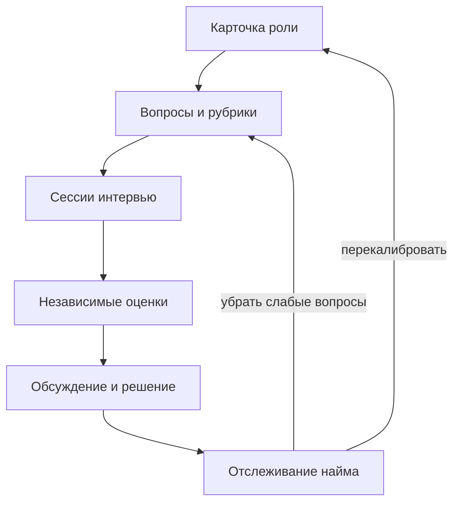
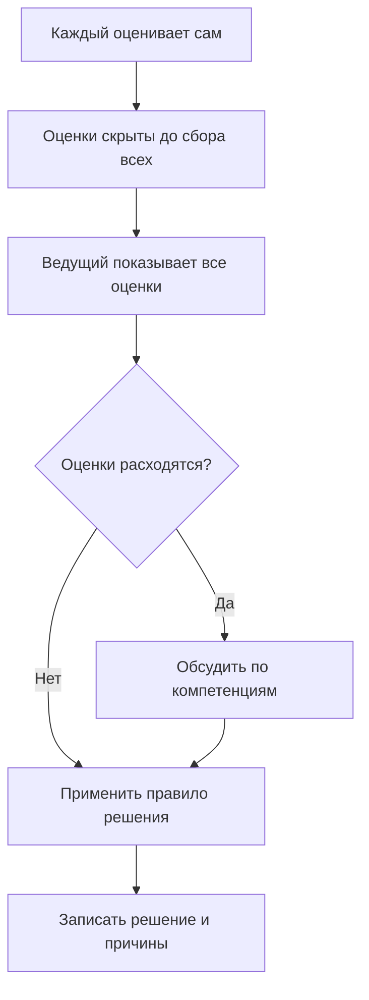

# Глава 7 — Найм и структурированные интервью { #chapter-7-hiring-and-structured-interviews }

Эта глава смотрит на найм как на задачу измерения. Речь пойдёт о карточке роли и построенном на ней
структурированном цикле интервью, а также о том, что подтверждают исследования отбора персонала, в том
числе после пересмотра самых известных оценок в 2022 году. Глава покажет, где практика инженерных
интервью опередила доказательства, как проводить итоговые обсуждения так, чтобы они не поддавались
эффекту якоря, и как отслеживать качество найма после оффера. В конце разобраны воронка вокруг цикла
интервью и первые 90 дней. Карьерные лестницы, оплата и выбор грейда для оффера — тема главы 8,
удержание нанятых — главы 10. Сквозной пример — найм на замену в команду Billing в Northstar
Technologies, вымышленной компании из [кейса](../../case-studies/northstar/index.md).

## Почему это важно { #why-this-matters }

Для команды найм — решение на несколько лет, принятое примерно за пять часов разговоров. Если человек не
подошёл, это выясняется лишь через месяцы, отнимает время на менторство и часто заканчивается повторным
поиском. В Northstar, вымышленной компании книги, от заявления об уходе до первого рабочего дня замены
в медиане проходило 15 недель ([исходные данные](../../case-studies/northstar/baseline-data.md)). Цикл
интервью, выбравший не того человека, запускает этот отсчёт заново.

Для организации цикл интервью исподволь определяет, что она ценит. Если цикл поощряет скорость решения
алгоритмических головоломок, организация наполняется людьми, которые быстро решают головоломки, что бы
ни требовала работа.

Для высшего руководства система найма — политика, от которой зависят качество, затраты и
справедливость. И измеряют её редко: мало какая компания может сказать, оправдали ли нанятые люди
прогноз, данный на интервью.

## Цели главы { #learning-objectives }

После этой главы вы сможете:

- Написать карточку роли, в которой названы результаты и качества, нужные новому сотруднику, и
  построить на её основе структурированный цикл интервью, где каждая сессия измеряет названные
  компетенции.
- Объяснить, что исследования отбора подтверждают, а что нет (с учётом пересмотра оценок валидности в
  2022 году), и распознавать практики инженерных интервью, валидность которых ничем не доказана.
- Проводить итоговое обсуждение, в котором интервьюеры записывают оценки независимо и до дискуссии, и
  применять заранее согласованное правило решения.
- Наладить отслеживание после найма: сравнивать прогноз интервью с тем, как человек работает, и
  понимать, чего эти данные сказать не могут.
- Оценить, сколько инженерного времени стоит структурированный цикл, и сопоставить это с ценой
  медленного или неудачного найма.

## Ментальная модель { #the-mental-model }

> **Ментальная модель:** цикл интервью — это измерительный прибор. Структура делает его показания
> воспроизводимыми, независимые оценки не дают им слиться в одно мнение, а отслеживание нанятых после
> оффера — единственный способ узнать, измеряет ли он вообще что-нибудь.

У прибора четыре части, и каждая может отказать сама по себе: карточка определяет, что измерять;
сессии собирают свидетельства; итоговое обсуждение превращает их в решение; отслеживание после найма
сравнивает решение с тем, что произошло на деле.

Большинство организаций проходят только середину этого цикла. Но без первого блока интервьюеры
измеряют разное, а без последнего никто не узнаёт, какие вопросы хоть что-то предсказывают.

## Подробный разбор { #deep-conceptual-explanation }

### Что измеряют исследования отбора { #what-selection-research-measures }

Исследования отбора персонала задаются вопросом: насколько хорошо метод, применённый до найма,
предсказывает результативность после него. Обычная мера здесь —
[коэффициент валидности](../../glossary.md#validity-coefficient): корреляция между баллами по методу и
последующей результативностью. Чаще всего результативность измеряют оценкой, которую руководитель
ставит за работу в целом. Ноль означает, что метод ничего не предсказывает, единица — что предсказывает
идеально. [Метаанализы](../../glossary.md#meta-analysis) объединяют много исследований и вносят
поправки на известные искажения. Главное из них — ограничение диапазона: в исследование попадают только
те, кого наняли, поэтому сырая корреляция занижает способность метода различать кандидатов в целом.

Две оговорки верны для всей главы. Во-первых, критерий — оценка общей результативности в самых разных
профессиях, а не результат инженерной работы. Во-вторых, коэффициент валидности — среднее по
исследованиям, а не валидность вашего цикла: она зависит от того, насколько хорошо вы его построили и
как проводите.

### Оценки и их пересмотр в 2022 году { #the-estimates-and-their-2022-revision }

Двадцать лет точкой отсчёта служила сводка Schmidt и Hunter 1998 года, обобщившая 85 лет исследований.
В её аннотации приведены значения валидности для 19 процедур отбора. В трёх лучших комбинациях общие
умственные способности (тест когнитивных способностей) сочетались с рабочим заданием, тестом на
добросовестность или структурированным интервью; средняя валидность каждой лежала в нижней и средней
части диапазона 0,60–0,69
([Schmidt and Hunter, 1998](../../references/bibliography.md#schmidt1998validity)). Эти цифры до сих пор
широко цитируют в руководствах по найму.

В 2022 году Sackett, Zhang, Berry и Lievens показали, что поправки на ограничение диапазона в прежних
метаанализах часто были избыточными, из-за чего валидность многих процедур оказалась завышена. После
пересмотра большинство процедур из верхней части списка там и остались, но средние оценки снизились
примерно на 0,10–0,20, а первое место заняли структурированные интервью
([Sackett et al., 2022](../../references/bibliography.md#sackett2022revisiting)). Пересмотренные цифры
те же авторы приводят в статье 2023 года, опубликованной в открытом доступе (**научный результат**,
[Sackett et al., 2023](../../references/bibliography.md#sackett2023revisiting)):

| Предиктор | Что сказано в статье 2023 года |
|---|---|
| Структурированное интервью | Самая высокая средняя валидность, .42; в 80 процентах условий от .18 до .66 |
| Когнитивные способности | .31, примерно на .20 ниже, чем раньше; «больше не выдающийся предиктор» |
| Рабочее задание | Примерно на .21 ниже, чем раньше, но всё ещё близко к вершине |
| Неструктурированное интервью | Примерно на .19 ниже, чем раньше |

**Что даёт валидность 0,42.** Допустим, вы нанимаете ту половину кандидатов, чьи баллы выше медианы, а
баллы и последующая результативность распределены нормально. Тогда примерно 64% нанятых окажутся по
результативности выше медианы, а при случайном найме — 50%. На краях диапазона это около 56%
(валидность 0,18) и около 73% (валидность 0,66). Хорошо проведённый структурированный цикл меняет
шансы с подбрасывания монеты примерно на два из трёх; плохо проведённый может не изменить почти
ничего. Редкими ошибки не делает ни тот, ни другой. (Расчёт — в решениях к упражнению F3.)

Руководителю разработки (engineering manager, EM) отсюда важны три вещи. Первая: на вершине —
предикторы, привязанные к конкретной работе. Это структурированные интервью, тесты профессиональных
знаний, рабочие задания и биографические опросники, составленные под должность. А когнитивные
способности, которые долго считались главным предиктором, теперь стоят ниже структурированных
интервью, биографических данных и рабочих заданий. Вторая: разброс широк. Интервал достоверности
(credibility interval) от 0,18 до 0,66 означает, что в одних условиях структурированное интервью
предсказывает слабо, а в других — сильно; авторы предлагают читать эту цифру как «0,42 плюс-минус
0,24». Третья: по словам авторов, для многих предикторов остаётся значительная неопределённость, так
что к рейтингу стоит относиться осторожно.

### Что значит «структура» { #what-structure-means }

Структура — это не сценарий, который зачитывают вслух. Campion, Palmer и Campion в своём обзоре
выделили 15 компонентов структуры интервью: одни улучшают то, о чём спрашивают, другие — то, как
оценивают ответы. Вывод авторов: интервью можно улучшить, если использовать многие из них (**научный
результат**, [Campion, Palmer, and Campion, 1997](../../references/bibliography.md#campion1997review)).
Самое полезное здесь — различие между содержанием и оценкой: цикл с хорошо подобранными вопросами
остаётся неструктурированным, если каждый интервьюер потом решает по общему впечатлению.

Google в опубликованном руководстве описывает рабочий вариант из четырёх частей: проверенные вопросы,
относящиеся к роли; письменная обратная связь по каждому ответу; рубрики с описанием слабого,
пограничного, уверенного и отличного ответа; обучение и калибровка интервьюеров. Начинается всё с
определения качеств, нужных для успеха. Вопросы бывают двух видов: поведенческие («расскажите о случае,
когда…») и гипотетические («представьте, что…»), и к каждому заранее продуманы уточняющие вопросы. Там
же сказано, что структурированные интервью трудно построить и поддерживать
(**задокументированная практика**,
[Google re:Work, 2026](../../references/bibliography.md#rework-structured-interviewing)).

Книга добавляет к этому списку два требования (**рекомендация книги**): за каждой сессией закреплены
конкретные компетенции из карточки, а правило решения согласовано до первого кандидата. Так выглядит
одна строка рубрики для роли, связанной с ledger (**иллюстрация**):

| Компетенция | Слабо | На грани | Уверенно | Отлично |
|---|---|---|---|---|
| Безопасное изменение схемы живой базы данных | Запускает миграцию как есть | Замечает блокировки только после подсказки | Видит блокировку, предлагает поэтапную миграцию с откатом | Ещё и спрашивает об объёме данных и репетирует в масштабе продакшена |

Полная карточка, карта сессий и формат рубрики для того найма на замену в Billing, который разбирается
в этой главе, есть в шаблоне [«Карточка найма и набор для интервью»](../../templates/hiring-scorecard.md).

### Почему неструктурированные интервью живучи { #why-unstructured-interviews-persist }

Если структура лучше, почему большинство инженерных интервью по-прежнему заканчиваются вопросом «хотел
бы я работать с этим человеком»? Объяснение предлагают Dana, Dawes и Peterson. В трёх исследованиях
студенты предсказывали оценки других студентов. Уверенное впечатление они составляли даже по
интервью, в которых собеседник втайне отвечал случайным образом. Если к анкетным данным добавляли
неструктурированное интервью, прогнозы становились хуже, чем по одним анкетным данным. И всё же
большинство участников предпочитали случайное интервью отсутствию интервью (**научный результат**,
получен на студентах в задаче прогноза оценок, а не при найме на работу;
[Dana, Dawes, and Peterson, 2013](../../references/bibliography.md#dana2013belief)). Интервьюер
способен увидеть смысл почти в любых словах кандидата, и это ощущение смысла кажется ему
проницательностью. Уверенность после интервью не доказывает, что интервью что-то измерило.

### Рабочие задания и технические интервью { #work-samples-and-technical-interviews }

В рабочем задании (work sample) кандидат под наблюдением выполняет часть настоящей работы: ревьюит
реальный мерж-реквест, отлаживает падающий сервис, расширяет небольшую кодовую базу. Пересмотр
2023 года снизил оценку его валидности, но оставил его в верхней группе предикторов, привязанных к
конкретной работе ([Sackett et al., 2023](../../references/bibliography.md#sackett2023revisiting)).

Большинство технических интервью для инженеров — не рабочие задания в этом смысле: в реальной работе
редко приходится решать незнакомые головоломки на глазах у постороннего. Behroozi с коллегами провели
рандомизированный эксперимент с 48 студентами, изучающими компьютерные науки. Когда за решением задачи
наблюдал интервьюер, результат падал больше чем вдвое, а стресс и когнитивная нагрузка были выше, чем
когда ту же задачу решали в одиночку. Авторы делают вывод, что такие интервью отчасти измеряют, как
кандидат справляется с тревогой перед публикой (**научный результат**, студенты в лабораторных
условиях; [Behroozi et al., 2020](../../references/bibliography.md#behroozi2020stress)). Это
свидетельство искажения, а не исследование валидности, но указывает оно туда же, куда и исследования
отбора: измеряйте работу в условиях, близких к рабочим.

Именно здесь инженерная практика обгоняет доказательства. Авторы книги не нашли ни одного
рецензируемого исследования, которое проверяло бы, насколько хорошо последующую результативность
разработчика предсказывают live coding с головоломками, домашние задания, интервью в формате парного
программирования или интервью по проектированию систем. Общие исследования говорят в пользу рабочих
заданий и структурированных вопросов, привязанных к работе; форматы, специфичные для разработки ПО, —
правдоподобное, но не проверенное применение этого вывода. Относитесь с подозрением к заявлениям, что
какой-то формат «доказан», — в том числе к заявлениям из этой главы.

### Итоговые обсуждения и эффект якоря { #debriefs-and-anchoring }

Итоговое обсуждение (debrief) сводит четыре-пять показаний в одно решение. В распространённом формате
участники высказываются по очереди, и первое сильное мнение (часто самого старшего из них) становится
якорем: следующие выступающие сдвигаются к нему или упоминают только те свидетельства, что с ним
согласуются. Lorenz с коллегами показали этот механизм на другой задаче. Люди численно оценивали
факты, и когда они видели оценки других, их ответы сходились, эффект «мудрости толпы» ослабевал, а
уверенность росла (**научный результат**, задачи на оценку, а не найм;
[Lorenz et al., 2011](../../references/bibliography.md#lorenz2011social)). Переносить это на итоговые
обсуждения — экстраполяция, но она объясняет знакомую картину: обсуждение быстро приходит к согласию и
звучит уверенно.

Протокол ниже — **рекомендация книги**:

Работает протокол благодаря четырём деталям. Каждый сдаёт оценки и заметки до того, как увидит чужие.
Ведущий — не нанимающий руководитель; нанимающий руководитель говорит последним. Обсуждение идёт по
компетенциям, и каждое утверждение опирается на то, что кандидат сказал или сделал. После обсуждения
оценки можно менять, но исходные сохраняются, чтобы потом проверить, улучшила ли их дискуссия.

### Кандидаты с ИИ-ассистентами { #candidates-using-ai-assistants }

Исходите из того, что у кандидатов есть ИИ-ассистенты для написания кода: большинство инженеров сейчас
работают с ними. В одном контролируемом эксперименте разработчики с ИИ-ассистентом справились с
заданной задачей по программированию примерно на 56% быстрее, чем без него
([Peng et al., 2023](../../references/bibliography.md#peng2023copilot); **научный результат**, одна
задача). Поэтому индивидуальное упражнение на время без наблюдения теперь отчасти измеряет инструмент.

Определите политику до первого кандидата и сообщите её кандидатам письменно (**рекомендация книги**).
Либо разрешите ассистенты в рабочем задании и оценивайте то, что требуется в работе, — суждение: ревью
сгенерированного кода, поиск заложенного дефекта, объяснение компромисса. Либо проводите эту сессию без
них, под наблюдением, и прямо об этом скажите. Не полагайтесь на инструменты, которые обещают
распознать ответы, написанные ИИ: ложное обвинение лишит вас хорошего кандидата, а отстоять такое
обвинение трудно.

### Инклюзивный найм { #inclusive-hiring }

Структура — главная защита от предвзятости в цикле интервью: она оставляет меньше места для
впечатлений, а предвзятость действует именно через них (исследования предвзятых решений о
вознаграждении кратко изложены в главе 8). Практики ниже — **рекомендация книги**:

- **Пишите вакансию по карточке.** Перечисляйте только обязательное. Длинные списки пожеланий отпугивают
  квалифицированных людей, которые читают требования буквально.
- **Расширяйте источники кандидатов** за пределы рекомендаций: они воспроизводят круг знакомств
  нынешней команды. Выходите на сообщества, учебные заведения и площадки, которыми команда обычно не
  пользуется.
- **Одинаковые вопросы, одинаковая рубрика, письменные свидетельства** для каждого кандидата и никакой
  оценки «культурного соответствия»; вместо неё спрашивайте о конкретном поведении.
- **Смешанные панели**, чтобы кандидат не встречал только непохожих на себя людей. Но не перегружайте
  немногих сотрудников из недопредставленных групп (учитывайте их часы на интервью).
- **Адаптация условий по запросу**: предложите её уже в приглашении, а не ждите, пока кто-то попросит.
- **Следите за долей прошедших** каждый этап и, где позволяет местное законодательство, — по группам.
  Если на каком-то этапе одна группа отсеивается гораздо чаще, смотреть нужно прежде всего туда.

### Воронка вокруг цикла интервью { #the-funnel-around-the-loop }

Цикл интервью — середина более длинного процесса, и кандидатов теряют на обоих его концах (всё ниже —
**рекомендация книги**):

- **Поиск кандидатов.** Рекомендации, вакансия, написанная по карточке, и прямые обращения к кандидатам
  от инженера, который может рассказать о работе. Для специализированной роли поиск силами одного
  рекрутера редко срабатывает.
- **Опыт кандидата.** Сообщайте каждому кандидату решение в течение нескольких рабочих дней после
  последнего интервью, а отказывайте коротко и честно. Из-за долгого молчания вы теряете как раз тех,
  кого хотели нанять.
- **Отзывы рекомендателей.** Спрашивайте рекомендателя о конкретном поведении из карточки («Как она
  провела миграцию в продакшене?»), а не об общем мнении. Используйте отзывы как проверку на тревожные
  сигналы, а не для ранжирования.
- **Закрытие оффера.** Оффер делает нанимающий руководитель: он прямо отвечает на опасения (дежурства,
  рост, трудные стороны работы) и назначает дату решения. У сильных кандидатов обычно есть другие
  офферы.
- **Нагрузка на интервьюеров.** Ограничьте число интервью на человека в неделю (два — частый предел) и
  распределяйте их: тех, кого зовут чаще всего, команде обычно труднее всего отпустить.

### Онбординг: первые 90 дней { #onboarding-the-first-90-days }

Найм не заканчивается оффером: от первых 90 дней зависит, как скоро человек начнёт приносить пользу и
останется ли он. Ещё до его первого рабочего дня напишите план онбординга по карточке:

| Когда | Что должно быть готово |
|---|---|
| До дня 1 | Ноутбук, доступы, назначенный бадди, выбранная первая небольшая задача |
| Неделя 1 | Первое изменение доходит до продакшена, вместе с бадди |
| День 30 | Первая собственная задача; встречи один на один идут; наблюдение за дежурствами, если роль их включает |
| День 60 | Работа над результатами первого года из карточки; в графике дежурств с подстраховкой |
| День 90 | Руководитель и новый сотрудник сверяют прогресс с планом; это исходные данные для проверки через полгода |

Именно такого плана выхода на полную продуктивность, с выделенным временем для тех, кто обучает, так и
не было у сотрудницы из кейса этой главы.

### Отслеживание качества найма после оффера { #tracking-hiring-quality-after-the-offer }

Система найма, которая никогда не проверяет свои прогнозы, не может стать лучше. Отслеживание после
найма сравнивает оценки каждого нанятого по карточке с тем, как он справляется по той же карточке
через шесть и двенадцать месяцев. К этому добавляется несколько наблюдаемых вех: время до первого
самостоятельного изменения в продакшене, время до включения в график дежурств (если роль это
предполагает) и то, ушёл ли человек или был уволен за низкую результативность в первый год.

У этих данных три ограничения. Первое: выборки крошечные. При восьми наймах в год данные годятся,
чтобы заметить грубые провалы (вопрос, на котором никто не срезается; компетенция, по которой все
нанятые оказываются слабы), но не чтобы вычислить валидность. Второе: вы видите только тех, кого
наняли, — то же ограничение диапазона, которое исказило исследования. Третье: на результат влияют
онбординг и управление, так что слабый итог может оказаться провалом команды, а не интервью. Как
справедливо оценивать результативность, рассказывает глава 9 («Управление результативностью и работа с
отстающими»).

## Пример из инженерной организации { #engineering-organization-example }

Цифры в этом примере — **иллюстрация**. Northstar вымышлена, а допущения о затратах названы явно, чтобы
вы могли заменить их своими.

**Сколько стоит цикл.** Допустим, Northstar перестраивает цикл интервью под следующий найм на замену —
инженера по ledger в команду Billing. Карточка такая: корректность движения денег (идемпотентность,
округление, двойная запись); безопасное изменение схемы живой базы данных; диагностика сбоя в
продакшене; работа через границы команд; качество кода в большой кодовой базе на Java. Допущения:
четыре сессии интервью общей длительностью 4,25 часа (90-минутное рабочее задание — ревью миграции
ledger с заложенными дефектами; 60-минутная сессия отладки по записанным логам; 60-минутное
поведенческое интервью; 45-минутный разговор с нанимающим руководителем), 30 минут на письменный отзыв
от каждого интервьюера и 30-минутное итоговое обсуждение на пятерых.

| Статья | Инженеро-часы |
|---|---|
| Один цикл: 4.25 интервью + 2.0 отзывы + 2.5 обсуждение | 8.75 |
| Четыре цикла на один найм | 35 |
| Двенадцать структурированных телефонных скринингов по 1 часу с заметками | 12 |
| На один найм в установившемся режиме | 47, около 1.2 инженеро-недели |
| Разовая разработка карточки, рабочего задания и рубрик | около 24 (3 инженеро-дня) |
| Первый найм по новому циклу | около 71, около 1.8 инженеро-недели |

При восьми наймах на замену в год затраты в установившемся режиме — около 9,4 инженеро-недели, то есть
примерно 0,2 инженера, плюс обучение. Сравните это со 120 неделями в год, которые места в Northstar
простаивают из-за найма на замену, и с ценой одного неудачного найма, когда человеку нужно полгода,
чтобы войти в график дежурств. Это не доказывает, что структурированный цикл окупается: всё зависит от
того, насколько лучше он отбирает, а таких данных у Northstar нет. Пример показывает другое: затраты
достаточно малы, чтобы идею можно было проверить.

## Как принимать решение { #decision-framework }

Выбирайте метод оценки для каждой компетенции, а не для цикла целиком. Таблица — **рекомендация
книги**: в ней применён следующий из исследований принцип привязки к конкретной работе.

| Тип компетенции | Пример | Лучший метод | Чего избегать |
|---|---|---|---|
| Навык, который работа использует ежедневно | Ревью и изменение кода ledger | Рабочее задание на реалистичном материале | Головоломки, не связанные с работой |
| Знания, нужные с первого дня | Как миграция блокирует таблицу | Структурированные технические вопросы с рубрикой | Вопросы-викторины с одним правильным словом |
| Поведение в повторяющихся ситуациях | Разрешение разногласия между командами | Поведенческие вопросы с уточнениями | «Расскажите о себе» |
| Суждение в редких ситуациях | Дважды применённая кредит-нота в продакшене | Гипотетический сценарий с уточняющими вопросами | Вопрос, что кандидат «обычно делает» |
| Мотивация и ценности | Готовность дежурить | Структурированные вопросы плюс откровенное описание работы | «Культурное соответствие» на глаз |

Затем установите правило решения до первого кандидата. Варианты — от самого строгого к самому мягкому:

| Правило | Когда подходит | Риск |
|---|---|---|
| Ни одна компетенция не ниже «соответствует» | Маленькая команда, критичная роль, редкий навык | Отсеивает сильных кандидатов с одним пробелом, которому можно научить |
| Названные обязательные компетенции на уровне «соответствует», остальные в среднем «соответствует» | Большинство ролей | Обязательные компетенции выбраны небрежно |
| Есть сильный сторонник и нет сильных возражений | Очень трудно закрываемые роли | Возвращает эффект якоря, который протокол устранил |

Для найма на замену в область с единой точкой отказа по знаниям, как ledger в Northstar, используйте
среднее правило, а навык этой области сделайте обязательным.

## Компромиссы { #trade-offs }

**Структура против опыта кандидата.** Одинаковые вопросы могут показаться механическими. Большую часть
теплоты возвращают продуманные уточняющие вопросы и время, оставленное на вопросы кандидата.

**Реализм против времени.** Реалистичное рабочее задание дороже разработать. Домашнее задание экономит
время интервьюеров, но перекладывает затраты на кандидатов и провоцирует помощь со стороны. Тяжелее
всего оно даётся тем, у кого есть текущая работа или кто ухаживает за близкими. Частый компромисс —
рабочее задание под наблюдением на 60–90 минут; но это суждение, а не проверенный оптимум.

**Скорость против строгости.** Каждая неделя процесса — это неделя пустующего места и неделя, за
которую кандидат может принять другой оффер. Строгость закладывайте в устройство цикла, а не в
дополнительные раунды: пятое или шестое интервью обычно добавляет усталость и эффект якоря, а не
информацию.

**Привязка к работе против универсальности.** Цикл, плотно подогнанный под сегодняшнюю работу, и
отбирает под сегодняшнюю работу. Если роль будет меняться, добавьте одну компетенцию — способность
осваивать новую область — и смиритесь с тем, что её труднее измерить.

## Типичные провалы { #failure-modes }

**Фантомная карточка.** Цикл есть, но роль так и не описали письменно, поэтому каждый интервьюер
измеряет собственное представление о хорошем инженере. Сигнал: в заметках по интервью — характеристики
кандидата («умный», «сеньорный»), а не свидетельства по названным компетенциям. Что делать: не
назначать ни одного интервью, пока карточку не утвердили нанимающий руководитель и один из инженеров
команды.

**Головоломка вместо работы.** Интервью измеряет скорость решения незнакомых головоломок под
наблюдением, а работа состоит в изменении большой существующей системы. Сигнал: нанятые легко проходят
интервью, а потом месяцами не могут безопасно внести изменение. Что делать: замените одну сессию с
головоломкой рабочим заданием на реалистичном материале.

**Кто первый сказал, тот и прав.** Итоговое обсуждение за несколько минут сходится на мнении того, кто
выступил первым. Сигнал: письменные оценки меняются после встречи, и всегда в сторону нанимающего
руководителя. Что делать: протокол выше и сохранённые исходные оценки.

**Нет обратной связи.** Вопрос, который ничего не предсказывает, живёт годами. Сигнал: никто не может
сказать, что стало с прошлогодними нанятыми. Что делать: проверка через полгода для каждого нанятого.

**Замена по шаблону.** Ушедшего заменяют по типовому описанию вакансии, поэтому конкретные знания,
которые он уносит с собой, никто не называет и не проверяет. Сигнал: вакансия инженера по ledger
подошла бы любой команде. Что делать: пишите карточку вместе с командой, исходя из реальных
обязанностей ушедшего.

## Применение в крупной организации { #enterprise-application }

В организации из 50–150 инженеров найм идёт непрерывно: при годовой текучести 10% на сто инженеров
приходится около десяти наймов на замену в год, и это ещё без всякого роста. Директор управляет
системой найма, а руководители проводят свои циклы внутри неё.

**Общие элементы, локальное содержание.** Сделайте протокол, формат рубрики, правила решения и проверку
после найма общими для всех команд. Карточки, рабочие задания и банки вопросов пусть принадлежат
командам: только команда знает свою работу.

**Обученный пул интервьюеров.** Интервьюировать должен не каждый инженер. Обучите пул интервьюеров
работе с рубрикой, заметками и протоколом итогового обсуждения; прежде чем проводить интервью
самостоятельно, они наблюдают за чужими. Отслеживайте, сколько часов на интервью тратит каждый.

**Ведущий обсуждения из другой линии подчинения.** Итоговые обсуждения проводит ведущий из другой
команды: это самая дешёвая защита от эффекта якоря со стороны нанимающего руководителя.

**Один дашборд найма — и внимательное чтение.** На нём время от одобрения вакансии до принятого
оффера, доля принятых офферов, доля прошедших каждый этап и результаты проверки через полгода. Каждую
из этих метрик подгоняют: время найма падает, если снизить планку; доля прошедших растёт, если
скрининги становятся лёгкими; оценки через полгода растут, если оценивает только нанимающий
руководитель. Поэтому смотрите время найма в паре с проверкой через полгода и привлекайте второго
оценщика.

## Взгляд CTO { #cto-perspective }

На уровне высшего руководства за CTO (техническим директором) остаются три решения. Первое — что именно
оптимизирует система найма. Скорость, качество, затраты и справедливость тянут в разные стороны, и если
CTO не скажет, что важнее для каких ролей, рекрутеры будут оптимизировать то, что измеряется, — обычно
время найма.

Второе — обоснованность. Каждое решение о найме должно объясняться письменными свидетельствами по
письменным критериям, и структура сильно это облегчает. Книга не даёт юридических консультаций, а
трудовое право в разных странах разное. Но процесс, в котором записаны причины решений, можно
проверить на несправедливость и исправить.

Третье — честность перед советом директоров и CFO (финансовым директором). Вакансии на замену
закрываются месяцами, и ещё месяцы уходят на выход на полную продуктивность (эту задержку моделирует
глава 3). Поэтому найм — самый медленный рычаг управления ресурсами. Даже лучший процесс найма не
решит проблему надёжности в этом квартале. Обещать он может другое: меньше дорогих неудачных наймов за
год-два и данные, которые покажут, работает ли он.

## Практический плейбук { #practical-playbook }

Для директора или руководителя, который вводит структурированный найм сначала для одной роли, а затем
распространяет его на другие:

1. **Сначала напишите карточку.** Вместе с двумя инженерами команды перечислите три–пять результатов
   первого года и четыре–шесть компетенций, которые для них нужны. Для найма на замену начните с того,
   что ушедший действительно делал.
2. **Распределите компетенции по сессиям.** Каждая сессия измеряет одну-две названные компетенции;
   обязательные измеряются дважды.
3. **Постройте рабочее задание.** Возьмите реалистичный материал из своей кодовой базы, очистите его
   от секретов и подберите объём, с которым сильный кандидат хорошо справится за 60–90 минут. Сначала
   опробуйте задание на двух нынешних инженерах.
4. **Напишите рубрики.** Слабый, пограничный, уверенный и отличный ответы, с примерами.
5. **Установите правило решения** до первого кандидата и сообщите его панели.
6. **Обучите панель.** Одна сессия по рубрике, заметкам и протоколу; два цикла с наблюдением, прежде
   чем интервьюировать самостоятельно.
7. **Проводите итоговые обсуждения по протоколу.** Оценки — самостоятельно, раскрываются одновременно,
   обсуждаются по компетенциям, нанимающий руководитель говорит последним, исходные оценки сохраняются,
   причины записываются.
8. **Описывайте работу такой, какая она есть,** включая дежурства и трудные стороны (глава 10).
9. **Проверьте через полгода.** Два человека оценивают нового сотрудника по карточке; сравните их
   оценки с оценками на интервью.
10. **Пересматривайте раз в год.** Убирайте вопросы, которые проходят все или результаты которых
    расходятся с последующей результативностью; заново калибруйте интервьюеров; обновляйте карточку.

## Кейс { #case-study }

Этот кейс — **вымысел** ([исходные данные](../../case-studies/northstar/baseline-data.md)).

!!! info "Northstar: что уже известно"
    Двенадцать месяцев до недели 1, когда в Northstar приходит новый директор по разработке.
    Northstar — вымышленная компания книги из области order-to-cash («от заказа до оплаты»), в ней
    80 инженеров. За этот год ушли восемь инженеров, и Billing, команда с самыми серьёзными
    инцидентами, потеряла одного из четырёх экспертов по ledger. См.
    [хронологию](../../case-studies/northstar/timeline.md). Впервые встречаете Northstar? Прочитайте
    [«Год вкратце»](../../case-studies/northstar/year-in-brief.md) и
    [«Действующие лица»](../../case-studies/northstar/cast.md).

**Процесс.** До прихода директора в Northstar не было общего процесса найма. Каждый руководитель
проводил свой вариант одного и того же цикла: 30-минутный звонок с рекрутером; 60-минутное
live-упражнение по алгоритмам из общего банка головоломок; «разговор с командой» с двумя-тремя
инженерами без назначенных тем; беседа с нанимающим руководителем. Вакансии повторяли типовое описание
«Senior Software Engineer». Итоговое обсуждение было 30-минутной встречей: нанимающий руководитель
высказывал мнение, остальные по очереди к нему присоединялись, а письменные заметки были
необязательны. Никто не записывал, что стало с прежними нанятыми.

**Замена в ledger.** За год до прихода директора разбираться с инцидентами ledger доверяли четырём
инженерам Billing. За девять месяцев до прихода директора один из них уволился. Замена вышла
через 15 недель, точно по медиане Northstar; больше половины этого срока ушло на одобрение вакансии,
поиск и скрининг ещё до оффера.

Наняли Tamsin Achterberg. Она пришла из бэкенд-команды интернет-ритейлера и справилась с
алгоритмическим упражнением лучше всех из четырёх финалистов. В разговоре с командой один из инженеров
по ledger спросил о миграциях баз данных, а потом отметил, что она ни разу не меняла схему живой
системы. О движении денег, округлении и дежурствах не спросил никто: никто не записал, что это нужно
для роли. На итоговом обсуждении первым выступил Marcus Oyelaran (руководитель Billing): лучший
технический результат за много месяцев, а ledger команда ей объяснит. Опасение инженера по ledger
превратилось в формулу «потребуется время на освоение миграций». Решение приняли примерно за
25 минут, единогласно.

К концу базового квартала, примерно через 24 недели после первого рабочего дня, Tamsin так и не вошла
в график дежурств, и большую часть вызовов Billing разбирали три оставшихся инженера по ledger. Причин
две. Об одной рассказывает глава 3: у этих троих редко находилось время на парную работу. О другой —
эта глава: цикл интервью так и не измерил то, что требовалось для роли. До оффера пробела никто не
видел, а план его закрыть свёлся к реплике на итоговом обсуждении вместо плана выхода на
продуктивность с выделенным временем. Tamsin — способный инженер, просто её наняли по неверной мерке.
Если считать проблемой её саму, организация ничему не научится.

**Решение во втором квартале.** В начале квартала 2 (неделя 14) директор предлагает провести
следующие два найма на замену в виде структурированного пилота; состоялся ли пилот, не зафиксировано.
Пилот включает карточку, написанную вместе с командой по реальным обязанностям ушедшего, рабочее
задание на реалистичном материале, протокол итогового обсуждения с ведущим из другой команды и
проверку через полгода. Marcus возражает, что 90-минутное рабочее задание отпугнёт кандидатов на
рынке, где за них идёт борьба. Tom Becker (руководитель Platform Operations) опасается, что его
инфраструктурных инженеров начнут отрывать от работы ради панелей интервью. Victor Lindqvist (CTO)
спрашивает, как в течение года хоть кто-нибудь узнает, сработал ли пилот. Каждое возражение
разбирается в упражнениях.

## Упражнения { #exercises }

Разборы упражнений — в [решениях к главе 7](../../solutions/ch07-solutions.md). Данные Northstar — на
[странице исходных данных](../../case-studies/northstar/baseline-data.md).

### Базовый уровень { #foundational }

**F1.** Нанимающий руководитель говорит вам, что цикл интервью в его команде «структурированный»,
потому что каждый кандидат встречается с одними и теми же четырьмя интервьюерами и получает один и тот
же алгоритмический вопрос. Каждый интервьюер пишет отзыв в свободной форме и на встрече голосует
«нанять» или «не нанимать». Опираясь на различие между содержанием и оценкой, оцените, насколько
структурирован этот цикл, и назовите два изменения, которые добавят больше всего структуры.

**F2.** Коллега ссылается на оценку 1998 года, по которой когнитивные способности в сочетании со
структурированным интервью дают валидность в диапазоне 0,60–0,69, и делает вывод, что компании стоит
добавить тест когнитивных способностей в каждый инженерный цикл интервью. Опираясь на пересмотр
2022 года и статью 2023 года, напишите ответ, который вы бы ему отправили, и укажите в нём, чего вы
тоже не стали бы утверждать.

**F3.** Рекрутер сообщает, что у структурированных интервью «валидность 0,42, то есть они правы в 42%
случаев». Исправьте это утверждение, объясните неспециалисту в одном абзаце, что такое интервал
достоверности, и скажите, что эта цифра говорит о вашем собственном цикле, а чего не говорит.

### Прикладное лидерство { #applied-leadership }

**A1.** Используя типы компетенций из главы, напишите карточку и цикл интервью для следующего найма на
замену — инженера по ledger в команду Billing в Northstar. Укажите результаты первого года,
компетенции и сессию, которая измеряет каждую из них, правило решения и содержание рабочего задания.
Объясните, как ваш вариант выявил бы пробел, который пропустил цикл интервью Tamsin Achterberg.

**A2.** Вы ведёте итоговое обсуждение. Ещё до раскрытия оценок нанимающий руководитель говорит:
«По-моему, это сильнейший кандидат за год». При этом скрытые оценки двух интервьюеров по обязательной
компетенции — ниже «соответствует». Опишите, что вы сделаете в следующие пять минут, что запишете и что
потом измените в процессе.

**A3.** Через двенадцать месяцев после структурированного пилота у вас есть проверки через полгода для
шести нанятых. У четырёх результаты совпадают с оценками на интервью, один гораздо сильнее прогноза, а
один гораздо слабее — по компетенции, которую измеряло рабочее задание. Нанимающий руководитель
считает, что четыре совпадения «доказывают», что рабочее задание работает. Решите, какие выводы отсюда
можно сделать, а какие нельзя, и что бы вы изменили.

### Решения на уровне руководства { #executive-decision-making }

**X1.** Вы — директор Northstar в начале квартала 2. Marcus Oyelaran, Tom Becker и Victor Lindqvist
выдвинули три возражения из кейса. Решите, запускать ли пилот, как ответить на каждое возражение, что
вы будете измерять, как можно подогнать каждую метрику и чего вы не станете обещать Victor.

**X2.** Rajiv Menon (CFO) предлагает отложить все наймы на замену на восемь недель, чтобы удержать
операционные расходы на прежнем уровне, и «использовать» задержку для более длинного и тщательного
процесса интервью с двумя дополнительными раундами. Исходите из восьми наймов на замену в год и полной
стоимости $185 000 за инженеро-год. Опираясь на цифры и допущения главы, оцените предложение и
напишите свою рекомендацию CTO.

## Вопросы для размышления { #reflection-questions }

1. Вспомните свой последний найм: могли бы вы до первого интервью письменно перечислить компетенции,
   которые измерял цикл?
2. Какой вопрос в вашем нынешнем цикле вы задаёте потому, что когда-то на собеседовании его задали вам и он сработал?
3. Когда после часа разговора вы уверены в кандидате, какие свидетельства вы могли бы показать тому,
   кого не было в комнате?
4. Кто говорит первым на ваших итоговых обсуждениях и как часто решение расходится с его мнением?
5. Кто из нынешних инженеров вашей команды провалил бы ваше же техническое интервью и что это говорит
   об интервью?

## Главное { #key-takeaways }

- Относитесь к циклу интервью как к измерительному прибору: определите, что он измеряет, проводите его
  каждый раз одинаково и сверяйте его показания с последующей результативностью.
- Пишите карточку роли до того, как назначать интервью; для найма на замену начинайте с того, что
  ушедший действительно делал.
- Предпочитайте головоломкам и впечатлениям методы, привязанные к работе (структурированные интервью,
  рабочие задания на реалистичном материале, структурированные технические вопросы): именно на них
  указывают исследования отбора.
- Не держитесь за цифры валидности слишком крепко: пересмотр 2022 года снизил большинство оценок,
  структурированные интервью лидируют с валидностью около 0,42 при широком разбросе, а у форматов,
  специфичных для разработки ПО, собственных доказательств валидности нет.
- Собирайте оценки независимо, раскрывайте их одновременно, давайте нанимающему руководителю говорить
  последним и устанавливайте правило решения до первого кандидата.
- Проверяйте каждого нанятого через полгода по карточке и помните: маленькая выборка с ограниченным
  диапазоном может выявить грубые провалы, но не может доказать валидность.

## Источники и что почитать { #references-and-further-reading }

- [Sackett et al., 2023](../../references/bibliography.md#sackett2023revisiting). Продолжение в открытом
  доступе с пересмотренными оценками; лучший единый источник о том, что исследования говорят сейчас.
- [Sackett et al., 2022](../../references/bibliography.md#sackett2022revisiting). Пересмотр, снизивший
  большинство оценок валидности.
- [Schmidt and Hunter, 1998](../../references/bibliography.md#schmidt1998validity). Классическая сводка,
  которую до сих пор широко цитируют; читайте её вместе с пересмотром.
- [Campion, Palmer, and Campion, 1997](../../references/bibliography.md#campion1997review). Компоненты
  структуры интервью — для содержания и для оценки.
- [Dana, Dawes, and Peterson, 2013](../../references/bibliography.md#dana2013belief). Почему
  неструктурированные интервью кажутся информативными, хотя на деле это не так; коротко и в открытом
  доступе.
- [Behroozi et al., 2020](../../references/bibliography.md#behroozi2020stress). Наблюдение со стороны
  искажает результат решения задач у доски.
- [Lorenz et al., 2011](../../references/bibliography.md#lorenz2011social). Социальное влияние заставляет
  группу сходиться во мнении и набираться уверенности, не становясь точнее.
- [Google re:Work, 2026](../../references/bibliography.md#rework-structured-interviewing).
  Опубликованное руководство по вопросам, рубрикам и обучению интервьюеров.
- [Larson, 2019](../../references/bibliography.md#larson2019elegant). *An Elegant Puzzle*. Известна тем,
  что рассматривает найм как систему с воронкой, которую нужно оснастить измерениями и улучшать.
