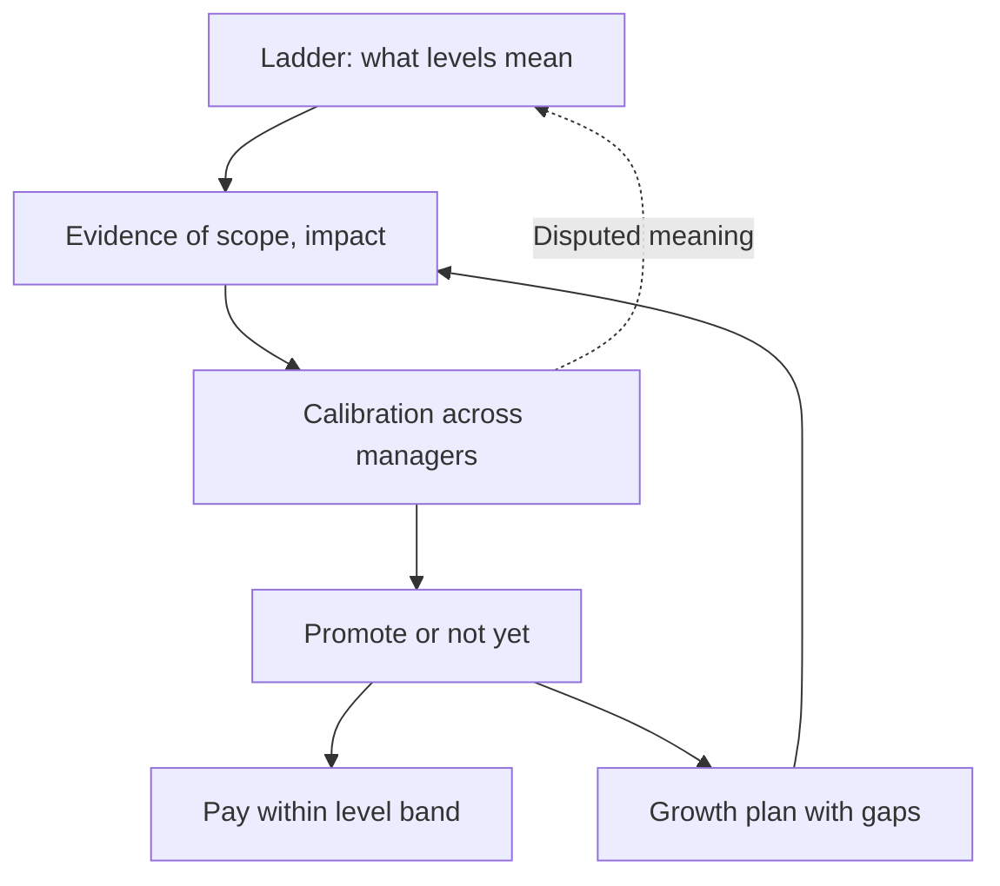
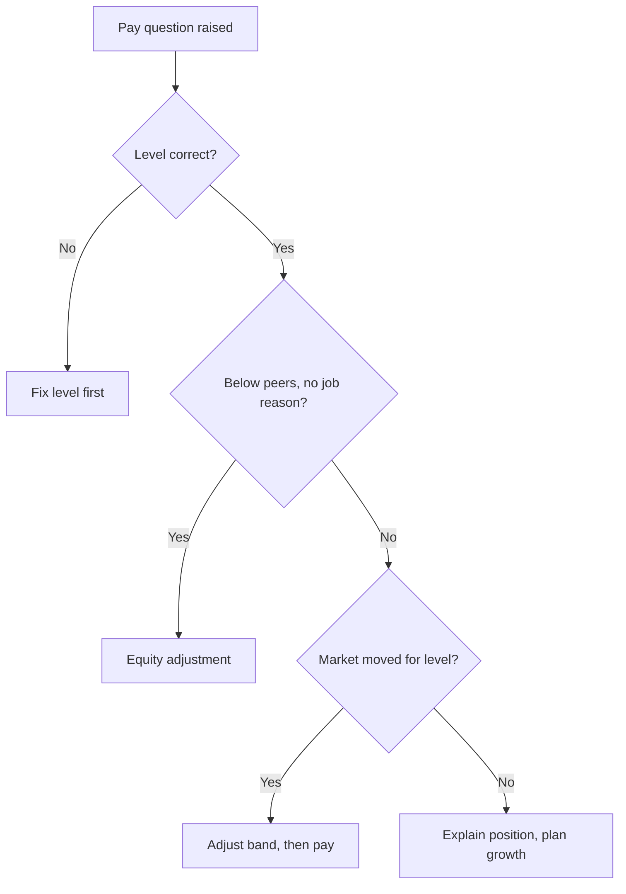
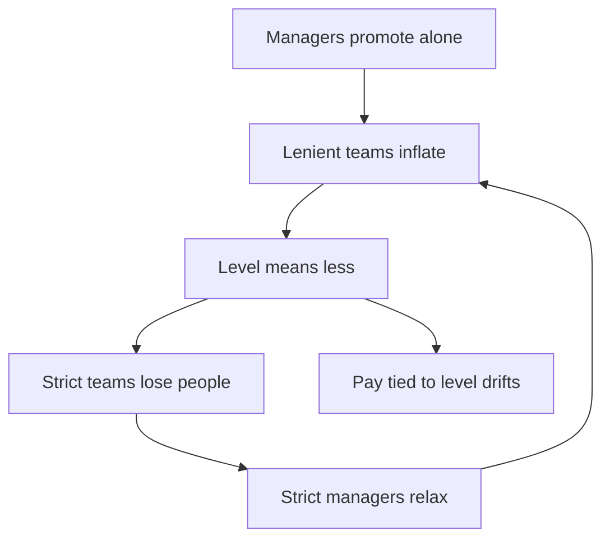

# Chapter 8 — Career Development, Promotion, and Compensation

This chapter is about the three decisions that tell engineers what the organization actually values:
what each level means, who moves up, and who is paid what. It covers repairing a career ladder,
running promotions with calibration, saying "not yet" in a way the person can use, and making pay
decisions you can defend, with the basics of pay equity. Chapter 4 covers the map of roles and the
choice between management and staff tracks; Chapter 9 covers performance management. The running
example is Northstar Technologies, the fictional company in the
[case study](../../case-studies/northstar/index.md), whose only ladder is one wiki page.

## Why This Matters

At team scale, the ladder is the manager's most used tool for growth conversations. Without it, "what
do I need to do to be promoted?" gets a different answer from every manager. With a vague one,
promotions follow visibility and tenure, and the quiet engineer who prevents incidents loses to the
one who fixes them loudly.

At organization scale, promotion and pay are where perceived fairness is decided. Engineers compare
notes. If one team promotes on shipped features and another on architectural judgment, "Senior" means
two things. Pay drifts, new hires come in above long-tenured peers, and the cheapest retention fix,
correcting an unjustified gap, is found only after a resignation.

At executive scale, the ladder and pay structure carry legal and financial weight. Pay that cannot be
explained by job, level, performance, and market is a liability where equal pay law applies, and pay
transparency rules are spreading.

## Learning Objectives

After this chapter you will be able to:

- Build or repair a career ladder that describes scope and impact rather than tenure and tools, and
  test it against real people before publishing it.
- Run a promotion cycle with evidence packets and calibration, and detect the biases calibration
  introduces as well as those it removes.
- Explain a "not yet" so that the person knows the gap, the evidence that would close it, and when it
  will be reviewed.
- Make and defend compensation decisions on job and level, internal equity, and market grounds, and
  know when a decision needs HR or legal advice in your jurisdiction.
- Diagnose a promotion and pay system from its data: promotion rates by team, position in band, and
  gaps between comparable people.

## The Mental Model

> **Mental model:** A career system is a measurement system. The ladder is the definition, promotion
> is the measurement, calibration checks that different measurers use the same definition, and pay is
> the price attached to the result. Errors compound downstream.

The diagram has two feedback paths. A "not yet" feeds a growth plan, which produces evidence for the
next cycle. Calibration feeds back to the ladder: when managers cannot agree whether a case meets a
criterion, the criterion is too vague, and the ladder needs work. Careful calibration cannot rescue a
broken ladder, and pay that ignores levels undoes a fair promotion.

The second idea: **a level is a claim about scope, not a reward for time served**. Scope is the size of
problem a person reliably owns: a task, a feature, a system, a domain across teams. Impact is what
changed because of their work. Tenure, tools, and effort are inputs. Five years of Kafka does not make
someone senior; designing the team's pipeline, making it operable by others, and ending two incident
patterns does.

## Deep Conceptual Explanation

### What a ladder is for

A [career ladder](../../glossary.md#career-ladder) (also called a leveling guide) states, for each level, the scope and impact expected
and the behaviors that produce them. It serves the engineer planning growth, the manager giving
feedback, the promotion committee, and whoever sets pay ranges.

Practitioners treat the ladder as infrastructure that makes a growing organization's expectations
explicit ([Fournier, 2017](../../references/bibliography.md#fournier2017manager);
[Larson, 2019](../../references/bibliography.md#larson2019elegant)).

**This book's recommendation**: four to six dimensions, each described at every level.

| Dimension | What grows from level to level |
|---|---|
| Scope | Task, then feature, then system, then a domain across teams |
| Technical judgment | Correct solutions, then sound trade-offs, then decisions others build on |
| Delivery and ownership | Finishes work, then owns outcomes, then makes others' delivery predictable |
| Operational responsibility | Fixes what breaks, then prevents classes of failure |
| Influence and growth of others | Helps peers, then raises the team, then shapes practice beyond it |

Each cell should describe what is observed, not what someone is. "Strong communicator" cannot be
checked; "writes design documents other teams adopt without a meeting" can.

### Scope and impact, not tenure and tools

**Tenure language** ("three to five years of experience") becomes a minimum in practice: managers wait
for the anniversary, and fast growers leave. **Tool language** ("expert in Spark and Airflow") ages with
the stack and rewards narrow depth over judgment. Keep years out entirely; if a discipline needs tools,
put them in an appendix that can change without changing levels.

Check **scope availability** too. If Senior requires cross-team influence, some teams offer far more
chances than others. At Northstar, the book's fictional company, 86 cross-team dependency links (work items that needed
another team) were recorded at baseline. Of those, Data and Analytics
received 4 and Platform Operations 29 ([baseline data](../../case-studies/northstar/baseline-data.md)).
Such a ladder promotes whoever sits where the dependencies are, unless managers create opportunities.

### Separate tracks, comparable levels

Chapter 4 covers the choice of track. For the ladder, each track needs its own criteria, and levels need
explicit equivalence across tracks (same level, same band), or engineers conclude that management is the
real way up. Larson's archetypes show how differently staff roles are shaped
([Larson, 2021](../../references/bibliography.md#larson2021staff);
[Larson, Staff archetypes](../../references/bibliography.md#larson-staff-archetypes)), so a staff level
written for one archetype rejects the others. Chapter 29 covers staff roles.

### Why one manager's judgment is not enough

Rater effects are the first reason: in developmental ratings of managers, the individual rater's
tendencies explained more of the differences between ratings than the ratee's performance did
([Scullen, Mount, and Goff, 2000](../../references/bibliography.md#scullen2000latent); a **research
finding**, detailed in Chapter 9).

Bias is the second reason. Declaring a process fair does not remove it; structure does. The
**research findings**, none about software engineers, point the same way:

- **Equal scores, unequal rewards.** In one large service organization, women and minorities received
  less salary growth than white men with the same performance scores
  ([Castilla, 2008](../../references/bibliography.md#castilla2008gender)). In experiments, calling an
  organization meritocratic widened the gap
  ([Castilla and Benard, 2010](../../references/bibliography.md#castilla2010paradox)).
- **"Potential" is a biased forecast.** In a retail chain, women received lower potential ratings
  despite higher performance ratings, and later outperformed
  ([Benson, Li, and Shue, 2026](../../references/bibliography.md#benson2026potential)).
- **Structure helps.** A reward gap shrank after one company made reward decisions accountable and
  transparent ([Castilla, 2015](../../references/bibliography.md#castilla2015accounting)), and even the
  rating scale's length changed a gender gap
  ([Rivera and Tilcsik, 2019](../../references/bibliography.md#rivera2019scaling)).

Two lessons follow, which **this book recommends**. Promote on **demonstrated scope at the next
level**, not on a forecast of potential. And use structure: written criteria, evidence per criterion,
someone other than the nominating manager accountable for consistency, and outcomes monitored by
group. The same authors' study of the Peter Principle is summarized in Chapter 2
([Benson, Li, and Shue, 2019](../../references/bibliography.md#benson2019promotions)).

### Calibration: what it fixes and what it breaks

[Calibration](../../glossary.md#calibration) is a meeting in which managers review promotion cases
together against the same criteria, so that "Senior" means the same in every team. We found no study
that measures whether calibration meetings as engineering organizations run them improve fairness, so
the evidence is thin. The practice below is **practitioner consensus** plus this book's
recommendation.

A calibration meeting removes some of one manager's bias and adds the room's. The patterns are
predictable (**practitioner consensus**, consistent with the research above):

| Pattern | What it looks like | Counter |
|---|---|---|
| Advocacy | The most articulate or senior manager's cases pass | Independent readers present; nominator answers questions only |
| Absence and order | Cases of absent managers, and late cases, get less attention | Fixed time per case; randomize order; revisit the first and last cases |
| Halo and recency | One visible project or the last month decides the case | Evidence across the whole period, by dimension |
| Affinity | Cases from people like the room read as stronger | Written evidence first; ask "what would we need to see?" before discussing the person |
| "Potential" | Forecasts replace demonstrated scope | Strike potential from the form; decide on evidence only |

Countermeasures for the whole process (**this book's recommendation**):

- A written **evidence packet** per case, each claim linked to an artifact (design document, incident
  review, merge requests, peer statements) and a ladder dimension.
- **Independent readers** present the case; the nominating manager answers questions.
- A **decision rule** stated in advance: every dimension at the next level, sustained for two quarters.
- A **facilitator** who owns consistency and records disputed criteria for the ladder owner.
- **No quota**, but a published budget for the pay promotions cost. A quota limits who is recognized; a
  budget limits how fast pay moves.
- An **outcome review**: promotion rates by team, level, and any group your jurisdiction lets you
  analyze, against the eligible population. A pattern the meeting cannot explain from the evidence is
  a finding about the meeting.

### A "not yet" that can be used

What a person hears after a declined case decides whether
["not yet"](../../glossary.md#not-yet) becomes a plan or a resignation. A usable "not yet" has five parts:

1. **The decision, plainly**, first.
2. **The gap, tied to the ladder**: which dimension, what the next level requires, what was seen.
3. **Evidence that would close it**, observable and achievable in the role. "Lead the next ingestion
   design through review by another team" can be done; "show more leadership" cannot.
4. **The manager's commitment** to create the situation the evidence needs. If the gap is cross-team
   scope and the role has none, the gap is partly the manager's.
5. **A review date**, normally the next cycle, with a mid-point check.

Kim Scott's book is known for pairing caring personally with challenging directly
([Scott, 2017](../../references/bibliography.md#scott2017radical)); a vague "not yet" fails the
second, one without a commitment fails the first. Chapter 5 covers the one-on-one where this happens;
Chapter 9 covers the different conversation when performance at the current level is the problem.

### The career conversation

Most engineers are not up for promotion in a given cycle, and some never want the next level. Career
development is the larger job, and it happens in a conversation held once or twice a year, separate
from the review (**this book's recommendation**, in the spirit of Chapter 5's growth record).

Cover four things, in this order:

1. **Aspirations.** Where do they want to be in two to three years, and what do they want more and
   less of? "I don't know" is a fine answer; ask what they enjoyed most in the last year instead.
2. **Strengths and energy.** What do others come to them for? Development that builds on a strength
   usually moves faster than development that only patches a weakness.
3. **The next experience, not the next title.** Name one assignment that would stretch them in the
   direction they chose: leading an incident review, owning a migration, mentoring a new hire, a
   rotation into another team. An experience produces evidence; a title is the result of evidence.
4. **Moves across, not only up.** A lateral move to another team, a switch from backend to data, or a
   trial on the other track (Chapter 4) is development too. A manager who blocks a good move to keep a
   strong engineer usually loses the engineer anyway, later.

Growing within a level is legitimate. A mid-level engineer who is content, reliable, and learning
should hear that this is valued, and should still have one growth goal, such as deeper on-call
competence or a new part of the system. Write the agreed goal and the next experience in the running
record, and check it at the monthly summary. The [career development
plan](../../templates/career-development-plan.md) template gives a format.

### Compensation: three defensible grounds

Pay in a mid-size company is usually set within **bands**: minimum, midpoint, and maximum base salary
per level and labor market. **Compa-ratio** is salary divided by the band midpoint; 0.90 means 10 percent
below. A pay decision is defensible when it rests on grounds you can name:

| Ground | Question | Evidence |
|---|---|---|
| Job and level | Is the person in the right band for the work? | Ladder level, confirmed by calibration |
| Internal equity | Are comparable people at comparable performance paid comparably? | Peer pay at the same level and market, with reasons for differences |
| Market | Can we hire and keep people at this pay? | Salary surveys, offer acceptance, exit reasons |

Differences within a band are legitimate when they follow from documented, job-related reasons:
sustained performance, time at level, scarce skills the job requires. Negotiation skill, pay history,
and who the manager is are not such reasons. A raise that corrects a gap with no such reason is a
**pay equity adjustment** (a salary change, not a stock grant). It is different from a **merit
increase**, the regular raise tied to performance, which is paid from an annual **merit budget**. The commonest equity failure in growing companies is
**compression**: new hires come in at market while existing pay rises a few percent a year, until the
newcomer earns more than the person who trained them.

### Total compensation and choosing a level at offer

Base salary is only part of what engineers are paid. **Total compensation** usually adds a cash bonus
(often a target percentage of base, paid on company or individual results), equity (stock options or
restricted stock units that [vest](../../glossary.md#vesting), become the employee's, over several
years), and benefits. In most mid-size companies HR and
finance set the bonus plan, equity pools, and benefits; the engineering manager controls the inputs:
the level, the performance evidence, and the case for an exception. Know what each part is worth for
your reports and explain it plainly. An engineer who sees only base pay compares it with an outside
offer that leads with total compensation, and draws the wrong conclusion in both directions.

The level chosen at offer matters more than the starting salary, because it sets the band, the
expectations, and the first promotion date. Choose it from the hiring scorecard's evidence against
your ladder (Chapter 7), not from the candidate's current title or pay (**this book's
recommendation**). Titles differ between companies, and pay history carries past inequities forward;
some jurisdictions forbid asking about it. Two errors are common. Leveling down to fit a budget
produces a hire who is underpaid and doing the next level's work, and an equity problem within a year.
Leveling up to win a candidate produces a person judged against expectations they were never assessed
for. If the evidence sits between two levels, offer the lower one with a written review date, and say
what evidence would move it.

### Pay transparency and equal pay

Pay law differs by jurisdiction, and this book does not give legal advice. Many legal systems require
equal pay for equal work or work of equal value, and transparency is being written into law. The
European Union's Pay Transparency Directive, for example, gives applicants a right to the pay range,
forbids asking about pay history, and lets workers request average pay by sex for comparable work.
Larger employers must report gender pay gaps, with a joint pay assessment where an unjustified gap of
at least 5 percent persists
([Directive (EU) 2023/970](../../references/bibliography.md#eu2023paytransparency)). Treat it as a
**standard**, not evidence about outcomes; a directive binds member states, whose national laws set the
actual obligations. Ask HR or employment counsel in each country before changing pay practice.

Transparency has costs. After US state laws protecting workers' right to discuss pay with coworkers,
wages fell by about 2 percent, consistent with a model in which employers refuse individual raises to
avoid renegotiating with everyone
([Cullen and Pakzad-Hurson, 2023](../../references/bibliography.md#cullen2023equilibrium)). That
**research finding** concerns one kind of transparency in one country. Expect transparency to compress
pay and remove room for one-off deals: good for equity, hard on the manager who fixed retention quietly.

## Engineering Organization Example

!!! info "Northstar so far"
    Before week 1. Northstar, a fictional order-to-cash software company, has 80 engineers in six teams
    and a new Engineering Director about to arrive. Eight engineers left in the past year, and the only
    career ladder is one wiki page. See the [timeline](../../case-studies/northstar/timeline.md).
    New to Northstar? Read [the year in brief](../../case-studies/northstar/year-in-brief.md) and the
    [cast](../../case-studies/northstar/cast.md).

The figures are **illustrative**.

**Promotion history.** Each manager decided promotions, and Victor Lindqvist, the CTO, approved them one
case at a time, with no comparison across teams and no written evidence. In the two years before the
director arrived there were 15 promotions to Senior Engineer and none to Staff Engineer.

| Team | Engineers | Engineer / Senior | Promotions in two years | Per 10 engineers |
|---|---|---|---|---|
| Orders | 14 | 7 / 7 | 3 | 2.1 |
| Billing | 13 | 7 / 6 | 1 | 0.8 |
| Payments and Integrations | 12 | 6 / 6 | 2 | 1.7 |
| Customer Experience | 15 | 8 / 7 | 6 | 4.0 |
| Data and Analytics | 11 | 6 / 5 | 1 | 0.9 |
| Platform Operations | 12 | 10 / 2 | 2 | 1.7 |
| **Total** | **77** | **44 / 33** | **15** | **1.9** |

With the three staff engineers, Northstar has 44 Engineers, 33 Senior Engineers, and 3 Staff Engineers.
Customer Experience promoted at more than four times the rate of Billing or Data and Analytics. That
alone proves nothing. But asked what "Senior" required, Daniel Cho (Customer Experience manager) said "owns
features end to end and ships them", and Farah Haddad (Data and Analytics manager) said "could stand in for me as the team's data architect": two levels
under one word.

**Pay.** US bands (Minneapolis and remote US), base salary, fictional and rounded. Bogotá engineers are
paid on separate bands set on the Colombian market, not shown.

| Level | Minimum | Midpoint | Maximum |
|---|---|---|---|
| Engineer | $100,000 | $120,000 | $140,000 |
| Senior Engineer | $130,000 | $152,500 | $175,000 |
| Staff Engineer | $170,000 | $195,000 | $220,000 |

Data and Analytics has 11 engineers: 4 in Minneapolis, 5 in Bogotá, 2 remote in the US. Two US Senior
Engineers do comparable work:

| Person | Path to Senior | Base salary | Compa-ratio |
|---|---|---|---|
| Sunil Varghese | Joined six years ago; promoted three years ago; designed the warehouse pipelines | $138,000 | 0.90 |
| Senior data engineer hired from outside | Hired five months before the director arrived, at the rate needed to win the offer | $162,000 | 1.06 |

Sunil's pay has an explanation (raises at promotion were capped at 8 percent that year, then about 3
percent a year) but no justification: history is not job, performance, or market. Bringing him to
midpoint costs $14,500 a year ($152,500 − $138,000), about $20,000 fully loaded if loading is about 1.4
times base (an assumption, not a Northstar figure). Losing him would cost more: Northstar's median from
resignation to a replacement's first day was 15 weeks
([baseline data](../../case-studies/northstar/baseline-data.md)), and the pipelines are his design.

## Decision Framework

For promotion, the rule is the one stated before calibration: every dimension at the next level,
sustained, with evidence. For pay questions:

A competing offer is not a job reason; it is market evidence. If it shows the band is wrong, move the
band for everyone at that level, not only for the person holding the offer. Chapter 10 covers the
counter-offer decision itself.

| Situation | Usual response | When to do otherwise |
|---|---|---|
| Strong performer, evidence thin in one dimension | "Not yet" with the five parts; create the opportunity | The dimension is unavailable on the team: consider a move |
| Strong case, no budget this cycle | Promote; fund the pay step or date it in writing | Never "title only" without a dated pay step |
| Peers at one level, gap over 10 percent, no job reason | Equity adjustment, next cycle or sooner | The higher-paid person was mis-leveled: fix the level |
| New hire would earn more than tenured peers | Hire at market; adjust peers in the same cycle | The rate is a market outlier: renegotiate |

## Trade-offs

**Precise against flexible ladder.** Detailed criteria make decisions consistent and reward checklist
optimizers. Broad criteria allow judgment and invite the bias the research describes. A middle course:
observable examples per cell, stated as illustrations rather than a complete list.

**Calibration against speed.** A calibrated cycle takes weeks, so an exceptional case may wait six
months. Allow rare out-of-cycle cases with the same packet and two calibrators.

**Transparency against flexibility.** Published bands and criteria reduce unexplained gaps and the
negotiator's advantage; they also remove the manager's quiet tools and may compress pay. Publishing
internally is **this book's recommendation** once every placement can be defended; publishing before
cleaning up is how a company learns about its gaps from a chat thread.

**Market against internal equity.** Paying market for scarce skills wins hires and creates compression.
Decide which levels and skills justify a premium, write it down, and adjust peers when you pay it.

## Failure Modes

**The manager lottery.** Each manager applies their own meaning of a level.

It reinforces itself: strict managers' best people see peers elsewhere promoted for less and leave or
press their managers, who relax. Signal: promotion rates differing twofold across teams of similar mix,
with no written reason. Fix: calibration, with disputed criteria fed back into the ladder.

**Calibration theater.** Thin packets, the nominating manager presents, decisions follow the most
senior voice. Signal: nearly every nomination succeeds, or outcomes change when a senior manager
speaks.

**Promotion as retention.** Someone threatens to leave and is promoted to stay. The organization learns
that threats work, and the person may struggle at the new level. Signal: promotions shortly after a
resignation conversation.

**Glue work that never counts.** Mentoring, incident follow-up, and coordination go unrewarded. Signal:
the people doing it are told to "focus on technical impact". Fix: make influence and operational
responsibility ladder dimensions.

**Compression discovered by resignation.** Signal: new hires' compa-ratios above tenured peers' at the
same level. Fix: an equity review before each cycle, not after an exit interview.

## Enterprise Application

At 50 to 150 engineers, promotion and pay become a calendar-driven system, because the director can no
longer know every case. A workable design (**this book's recommendation**):

**Two cycles a year**: nominations, packet preparation (two to three weeks), calibration by level with
the director facilitating and staff engineers reading technical evidence, conversations within a week,
and pay changes on a fixed date.

**A ladder owner**, often the director with an HR partner, who keeps a change log. Changes are published
before a cycle, never during one.

**Pay governance.** HR owns bands and market data; engineering owns levels and evidence. Before each
cycle, an equity review lists everyone outside 0.90 to 1.10 compa-ratio and every comparable pair with
a gap over 10 percent, each with a reason or an adjustment. Where people are paid in several labor
markets, compare within each market but keep level definitions identical across them.

**Outcome monitoring** of promotion rates and pay changes by team, level, and protected group where
local law allows that data, reviewed by someone outside the calibration. The research on
performance-reward bias suggests decision makers are poorly placed to see their own patterns.

## CTO Perspective

Engineers read the career system more carefully than any strategy document. If those promoted are
the ones who rescued releases, rescue becomes the job.

Three decisions are the CTO's. **Track parity**: whether the top individual-contributor level is
equivalent in band and access to a director, and what that costs. **Pay posture**: where in the market
the company aims to pay, agreed with the CFO and written down, so managers stop inventing it case by
case. **Funding**: promotions and equity adjustments as lines separate from merit increases, so fixing
one person's unjustified gap does not take money from someone else's raise.

The CTO also owns the risk. An unexplained pay gap is a legal and reputational exposure that
transparency rules make more likely to surface. Treat a pay equity review like a security review:
scheduled, findings tracked to closure, results reported to the executive team.

## Practical Playbook

**Repair the ladder (one quarter).**

1. Collect the written ladder, each manager's unwritten meaning of each level, and two years of cases.
2. Draft four to six dimensions with observable descriptions at every level; remove years and tools.
3. Test the draft on twenty people across teams: place each, then ask whether peers would agree.
4. Write management-track criteria separately (Chapter 4 gives the map), with level equivalence.
5. Publish with a change log, stating that no one's level is reduced by the new text.

**Run the cycle (twice a year).**

6. Announce dates, the packet format, and the decision rule.
7. Prepare packets with the person; every claim cites an artifact and a dimension.
8. Calibrate with independent readers and a facilitator; record disputed criteria.
9. Deliver every decision within a week, in person; each "not yet" with five parts.
10. Review outcomes by team and level; send disputed criteria to the ladder owner.

**Fix pay (before each cycle).**

11. List compa-ratios by level and market; flag outliers and peer gaps.
12. Write a job-related reason for each, or schedule an adjustment from a separate equity budget.
13. When hiring above existing peers, adjust the peers in the same cycle.
14. Check legal requirements with HR in each jurisdiction before publishing bands, changing offer
    practice, or answering a formal pay-information request.

## Case Study

This case is **fictional**. It runs from quarter 2 to week 27, the start of quarter 3. By then serious
incidents had fallen from 30 a quarter to 17, and the two renewal features the CTO's mandate protected
were delivered (see the [timeline](../../case-studies/northstar/timeline.md)).

**Where it starts.** The ladder is the three-paragraph "Engineering levels" wiki page, with no scope
for staff and no manager criteria. One of two engineers who left Data and Analytics in the previous
year told Farah Haddad (its manager) that another company had offered a senior title she had been told
was "a year or two away".

**The rewrite.** In quarter 2 the director and an HR partner drafted the five dimensions above at three
levels and tested them against twenty engineers from all six teams. Farah's meaning of Senior matched
the draft's Staff column on scope: her team had been holding Senior to a staff standard. And the
operational responsibility dimension placed several Billing engineers above their titles; the people
carrying the ledger pages had never been credited for it.

**The first calibrated cycle.** At the start of quarter 3, managers nominated nine engineers for Senior,
with managers from other teams and the three staff engineers reading the packets. Five were promoted,
including two Billing ledger engineers. Two of Customer Experience's three nominations received "not
yet", with the same gap: features shipped well, but no design decision others had built on.

**A "not yet" in Data and Analytics.** Yusuf Demir, a data engineer in Minneapolis with three years at
Northstar, also received a "not yet". Farah gave all five parts. The gap was influence beyond the team:
excellent pipelines that only his team used. The evidence: lead the design of the ledger-export
contract Li Na Zhou (staff engineer, data and integration) had proposed, through review by Billing, and bring one Billing engineer up to speed
on it. Farah's commitment: assign him the design and ask Li Na Zhou to sponsor it. Review next cycle,
check at three months. Yusuf said it was the first time anyone had told him what Senior meant.

**The pay question.** The equity review flagged Sunil Varghese ($24,000 below the outside hire at the
same level and scope) and five more US Senior Engineers below 0.92 compa-ratio, all promoted internally.
Rajiv Menon (CFO) said the year's merit budget was set. The lesson of the case: a clear ladder found
the problems, and fixing them costs money the plan did not hold. How to fund and sequence the
adjustments is exercise X1.

## Exercises

Solutions are in [chapter 8 solutions](../../solutions/ch08-solutions.md). Northstar data is on the
[baseline page](../../case-studies/northstar/baseline-data.md); who's who is on the
[cast](../../case-studies/northstar/cast.md) page.

### Foundational

**F1.** A ladder you inherit says, for Senior Engineer: "Five or more years of experience. Expert in
the team's stack (Java, Spring, Kafka). Strong communicator. Mentors junior engineers." Rewrite it as
three to five observable statements of scope and impact, explain what each original phrase does to
promotion decisions in practice, and say how you would test your version before publishing.

**F2.** At Northstar, Customer Experience promoted 6 of 15 engineers to Senior in two years and Billing
1 of 13. A manager argues this proves Customer Experience grows people better. List the alternative
explanations, the data that would tell them apart, and what calibration would and would not settle.

**F3.** Write the "not yet" message for an engineer whose case was declined because all their impact
is inside one service that only their team touches. Include all five parts and the manager's
commitment. Then name two things that would make the same message useless to them.

### Applied Leadership

**A1.** You facilitate Northstar's first calibration. Daniel Cho presents his own three cases with
energy; two Billing cases have thin packets because Marcus Oyelaran (Billing manager) spent the week in an incident
review. Halfway through, the room is tired and leaning toward Daniel's cases. Decide what you do in the
meeting, what you change for the next cycle, and how you would check afterwards whether it was fair.

**A2.** A senior data engineer in Data and Analytics receives an outside offer 18 percent above her
salary and asks Farah Haddad for promotion to Staff Engineer to stay. Her work is strong at Senior; the
staff criteria are newly written. Advise Farah on the promotion question and the pay question
separately, and on what she should not say.

**A3.** You are hiring a Senior Engineer for Billing. The recruiter recommends $165,000; three Billing
Senior Engineers earn $136,000 to $141,000 and perform well. The hire is urgent because of ledger
on-call load. Decide the offer, what you do about the three existing seniors, and how you explain both
to the CFO.

### Executive Decision-Making

**X1.** The equity review flags six US Senior Engineers below 0.92 compa-ratio, all promoted internally,
including Sunil Varghese. Bringing all six to 0.95 would cost about $52,000 a year in base salary. Rajiv
Menon says the merit budget is fixed. Decide how you fund and sequence the adjustments, what you tell
the six and their peers, what risk you accept by waiting, and when you involve HR or legal counsel.

**X2.** Victor Lindqvist (CTO) asks whether Northstar should publish its pay bands to all employees within a
year. Northstar employs engineers in the United States and in Colombia. Recommend a decision and a
sequence, state what must be true before publication, what you expect to change (including possible
pay compression), and what you will not claim to the executive team.

## Reflection Questions

1. If your engineers were asked what it takes to reach the next level, how many different answers
   would you hear, and whose is the real one?
2. Which essential work on your team is done by people who are not promoted for it?
3. When did you last promote someone because you feared they would leave?
4. If every engineer saw every other engineer's level and salary tomorrow, what would you fix first?
5. How much of your judgment of your reports' performance is a description of you?
6. When you say someone has "potential", what evidence are you describing?

## Key Takeaways

- Treat the career system as measurement: ladder, promotion, calibration, pay. Fix the earliest broken
  step first.
- Write ladder criteria as observable scope and impact; remove years and tools.
- Test a ladder on real people before publishing, and check that the scope it demands exists on every
  team.
- One manager's judgment is noisy and can be biased: require evidence per criterion, independent
  readers, and an outcome review.
- Promote on demonstrated next-level scope, not on "potential".
- A "not yet" states the decision, the gap, the evidence that closes it, the manager's commitment, and
  a review date.
- Defend each pay decision on job and level, internal equity, or market, and find compression before a
  resignation does.
- Fund equity adjustments separately from merit, and take legal advice in each jurisdiction before
  changing pay transparency practice.

## References and Further Reading

- [Scullen, Mount, and Goff, 2000](../../references/bibliography.md#scullen2000latent). How much of a
  rating reflects the rater; the core argument for calibration.
- [Castilla, 2008](../../references/bibliography.md#castilla2008gender),
  [Castilla and Benard, 2010](../../references/bibliography.md#castilla2010paradox), and
  [Castilla, 2015](../../references/bibliography.md#castilla2015accounting). Performance-reward bias,
  the paradox of declared meritocracy, and a field test of accountability and transparency.
- [Rivera and Tilcsik, 2019](../../references/bibliography.md#rivera2019scaling). Rating-scale design
  changes gender gaps in ratings.
- [Benson, Li, and Shue, 2026](../../references/bibliography.md#benson2026potential). "Potential"
  ratings and the gender promotion gap.
- [Benson, Li, and Shue, 2019](../../references/bibliography.md#benson2019promotions). Promotion and
  the Peter Principle; treated in Chapter 2.
- [Cullen and Pakzad-Hurson, 2023](../../references/bibliography.md#cullen2023equilibrium). Why pay
  transparency laws can lower average wages.
- [Directive (EU) 2023/970](../../references/bibliography.md#eu2023paytransparency). One major pay
  transparency regime, read in full; an example, not advice for your jurisdiction.
- [Fournier, 2017](../../references/bibliography.md#fournier2017manager) and
  [Larson, 2019](../../references/bibliography.md#larson2019elegant). Practitioner accounts of
  engineering management, including ladders and performance processes.
- [Larson, 2021](../../references/bibliography.md#larson2021staff) and
  [Larson, Staff archetypes](../../references/bibliography.md#larson-staff-archetypes). The top of the
  individual-contributor ladder.
- [Scott, 2017](../../references/bibliography.md#scott2017radical). Direct feedback with care, for the
  "not yet" conversation.
