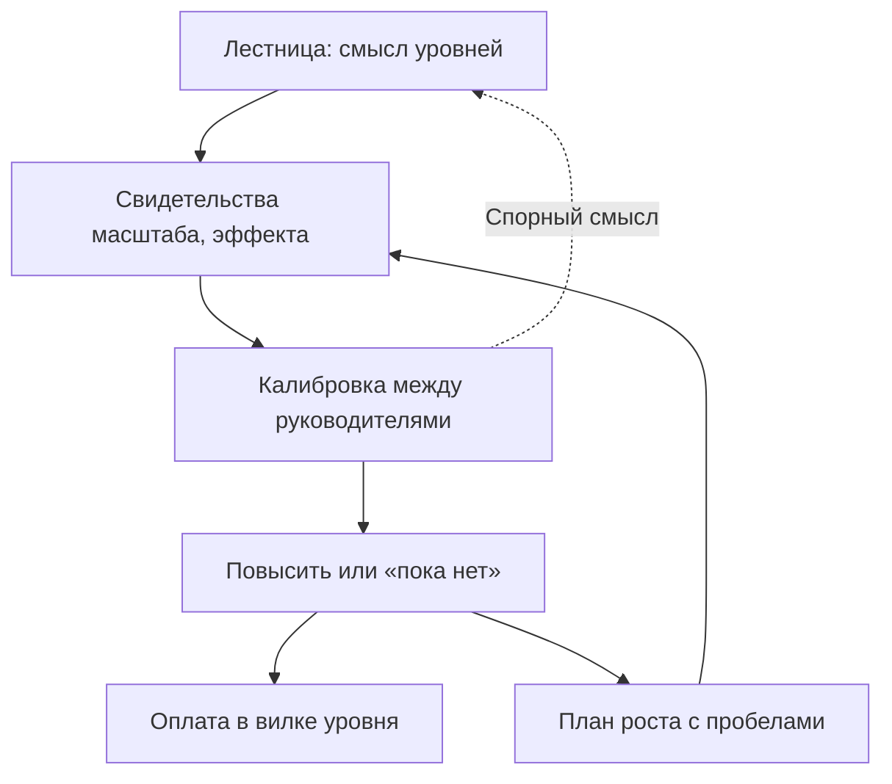
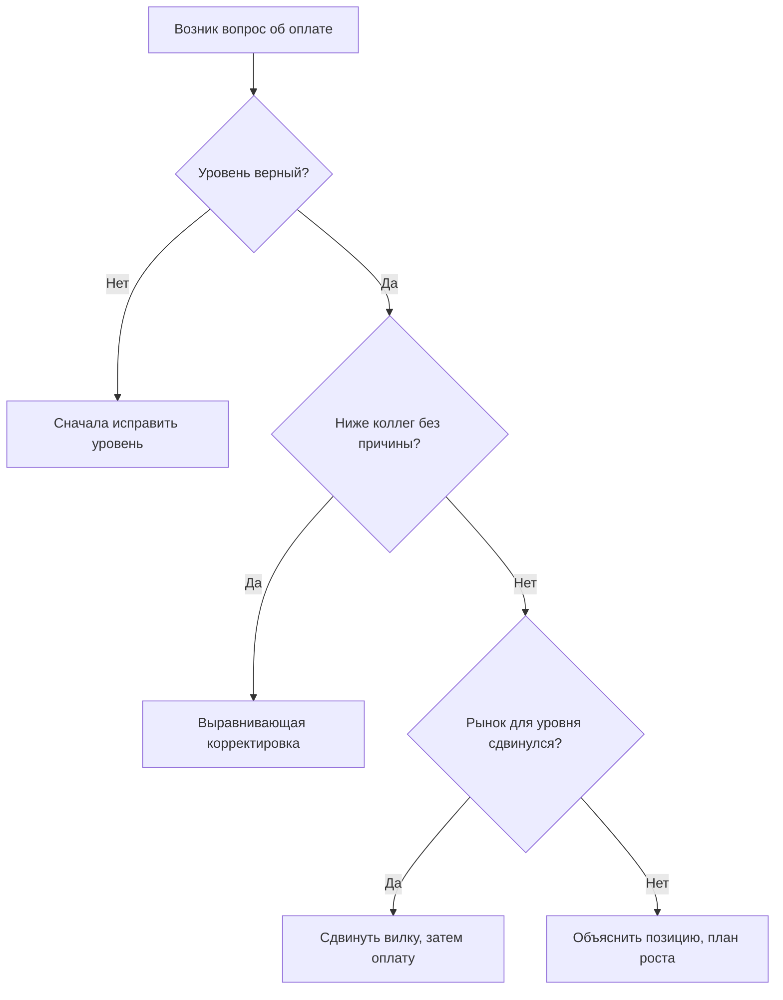
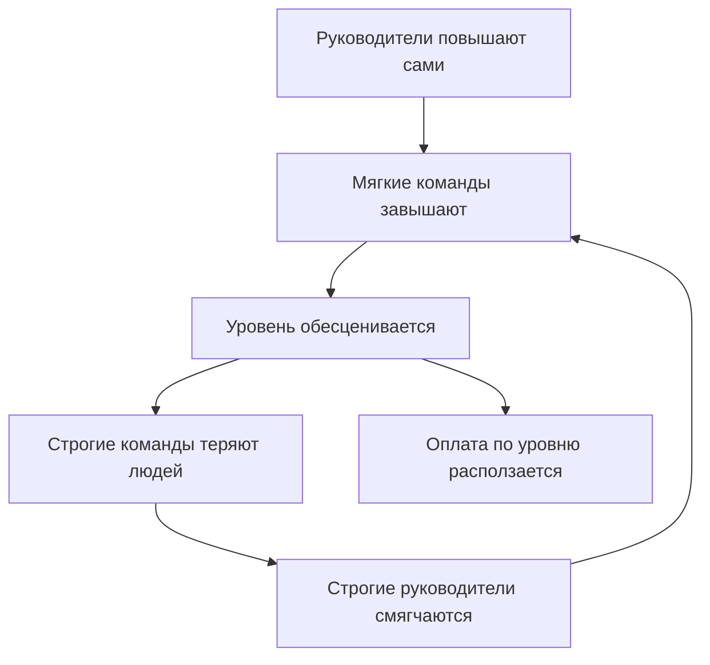

# Глава 8 — Карьерное развитие, повышения и вознаграждение { #chapter-8-career-development-promotion-and-compensation }

Эта глава о трёх решениях, по которым инженеры видят, что организация ценит в действительности: что
означает каждый уровень, кто продвигается и кому сколько платят. Вы узнаете, как починить карьерную
лестницу, как проводить повышения с калибровкой, как говорить «пока нет», чтобы человек мог с этим
работать, и как принимать решения об оплате, которые можно обосновать; попутно разберём основы равенства
оплаты. Карта ролей и выбор между управленческим и staff-треком — в главе 4, управление
результативностью — в главе 9. Сквозной пример — Northstar Technologies, вымышленная компания из
[кейса](../../case-studies/northstar/index.md): у неё вся карьерная лестница умещается на одной
вики-странице.

## Почему это важно { #why-this-matters }

Для команды карьерная лестница — инструмент, к которому руководитель чаще всего обращается в разговорах о
росте. Без неё каждый руководитель по-своему отвечает на вопрос «что мне нужно сделать для повышения?».
Если лестница расплывчата, повышения достаются за заметность и стаж, и тихий инженер, который
предотвращает инциденты, проигрывает тому, кто громко их тушит.

Для организации повышения и оплата — то место, где решается, считают ли люди систему справедливой.
Инженеры сравнивают. Если одна команда повышает за выпущенные функции, а другая — за архитектурное
суждение, «Senior» означает две разные вещи. Оплата расползается: новички приходят с окладом выше, чем у
коллег с многолетним стажем, а о самом дешёвом способе удержания — исправить необоснованный разрыв —
вспоминают только после заявления об уходе.

Для высшего руководства у лестницы и структуры оплаты есть юридический и финансовый вес. Оплата, которую
нельзя объяснить должностью, уровнем, результативностью и рынком, становится источником риска там, где
действует закон о равной оплате, а правила прозрачности оплаты распространяются всё шире.

## Цели главы { #learning-objectives }

После этой главы вы сможете:

- Построить или починить карьерную лестницу, которая описывает масштаб и эффект работы, а не стаж и
  инструменты, и проверить её на реальных людях до публикации.
- Провести цикл повышений с пакетами свидетельств и калибровкой и замечать искажения, которые калибровка
  вносит, а не только те, что она устраняет.
- Объяснить «пока нет» так, чтобы человек знал, чего ему не хватает, какие свидетельства закроют пробел и
  когда будет пересмотр.
- Принимать решения о вознаграждении и обосновывать их должностью и уровнем, внутренним равенством и
  рынком; понимать, когда решению нужна консультация HR или юриста в вашей юрисдикции.
- Диагностировать систему повышений и оплаты по её данным: доле повышений по командам, положению в
  вилке и разрывам между сопоставимыми людьми.

## Ментальная модель { #the-mental-model }

> **Ментальная модель:** карьерная система — это система измерения. Лестница — определение, повышение —
> измерение, калибровка проверяет, что все измеряющие пользуются одним определением, а оплата — цена,
> привязанная к результату. Ошибки накапливаются вниз по цепочке.

На схеме две петли обратной связи. В одной «пока нет» превращается в план роста, а план даёт
свидетельства для следующего цикла. Другая ведёт от калибровки обратно к лестнице: если руководители не
могут договориться, соответствует ли заявка критерию, значит, критерий расплывчат и лестницу нужно
дорабатывать. Самая тщательная калибровка не спасёт сломанную лестницу, а оплата без оглядки на уровни
сводит на нет справедливое повышение.

Вторая идея: **уровень — это утверждение о масштабе, а не награда за выслугу**. Масштаб — размер задачи,
за которую человек надёжно отвечает: задача, функция, система, предметная область, охватывающая несколько
команд. Эффект — то, что изменилось благодаря его работе. Стаж, инструменты и усилия — всего лишь входы.
Пять лет работы с Kafka не делают человека senior-инженером. Делает другое: спроектировать пайплайн
команды, сделать так, чтобы его могли эксплуатировать другие, и избавиться от двух повторяющихся типов
инцидентов.

## Подробный разбор { #deep-conceptual-explanation }

### Зачем нужна лестница { #what-a-ladder-is-for }

[Карьерная лестница](../../glossary.md#career-ladder) (её ещё называют матрицей грейдов) описывает для
каждого уровня ожидаемые масштаб и эффект, а также поведение, которое к ним приводит. Ею пользуются
инженер, планирующий свой рост, руководитель, дающий обратную связь, комитет по повышениям и те, кто
устанавливает вилки оплаты.

Практики считают лестницу инфраструктурой: она делает явными ожидания растущей организации
([Fournier, 2017](../../references/bibliography.md#fournier2017manager);
[Larson, 2019](../../references/bibliography.md#larson2019elegant)).

**Рекомендация книги**: четыре–шесть измерений, и каждое описано для каждого уровня.

| Измерение | Что растёт от уровня к уровню |
|---|---|
| Масштаб | Задача, затем функция, затем система, затем предметная область, охватывающая несколько команд |
| Техническое суждение | Верные решения, затем взвешенные компромиссы, затем решения, на которые опираются другие |
| Поставка и владение | Доводит работу до конца, затем отвечает за результаты, затем делает поставку других предсказуемой |
| Операционная ответственность | Чинит то, что ломается, затем предотвращает целые классы сбоев |
| Влияние и рост других | Помогает коллегам, затем поднимает команду, затем формирует практику за её пределами |

Каждая ячейка должна описывать наблюдаемое поведение, а не то, каков человек. «Сильный коммуникатор»
проверить нельзя; «пишет дизайн-документы, которые другие команды принимают без встречи» — можно.

### Масштаб и эффект, а не стаж и инструменты { #scope-and-impact-not-tenure-and-tools }

**Формулировки про стаж** («от трёх до пяти лет опыта») на практике становятся минимумом: руководители
ждут годовщины, а те, кто растёт быстро, уходят. **Формулировки про инструменты** («эксперт по Spark и
Airflow») стареют вместе со стеком и вознаграждают узкую специализацию вместо суждения. Годы уберите
полностью. Если без инструментов в дисциплине не обойтись, вынесите их в приложение, которое можно
менять, не трогая уровни.

Проверьте и **доступность масштаба**. Если уровень Senior требует влияния на другие команды, учтите: в
одних командах таких возможностей гораздо больше, чем в других. В Northstar, вымышленной компании книги,
в базовом квартале было зафиксировано 86 межкомандных связей зависимости (задач, для которых нужна была
другая команда). Из них на Data and Analytics пришлось 4, а на Platform Operations — 29
([исходные данные](../../case-studies/northstar/baseline-data.md)). Если руководители не создают
возможностей сами, такая лестница повышает тех, кто сидит на пересечении зависимостей.

### Отдельные треки, сопоставимые уровни { #separate-tracks-comparable-levels }

Как выбирать трек, разобрано в главе 4. Лестнице же нужны собственные критерии для каждого трека и явное
соответствие уровней между треками (один уровень — одна вилка). Иначе инженеры решат, что настоящий путь
наверх лежит через менеджмент. Архетипы Larson показывают, насколько по-разному устроены staff-роли
([Larson, 2021](../../references/bibliography.md#larson2021staff);
[Larson, Staff archetypes](../../references/bibliography.md#larson-staff-archetypes)). Поэтому
staff-уровень, написанный под один архетип, отсекает остальные. Подробнее о staff-ролях — в главе 29.

### Почему суждения одного руководителя недостаточно { #why-one-managers-judgment-is-not-enough }

Первая причина — эффекты оценщика. В оценках, которые руководители ставили для целей развития, различия
больше объяснялись склонностями самого оценщика, чем результативностью оцениваемого
([Scullen, Mount, and Goff, 2000](../../references/bibliography.md#scullen2000latent); **научный
результат**, подробнее — в главе 9).

Вторая причина — предвзятость. Объявить процесс справедливым — ещё не значит её устранить: устраняет её
структура. **Научные результаты** указывают в одну сторону, хотя ни один из них не касается разработчиков
ПО:

- **Равные оценки, неравное вознаграждение.** В одной крупной сервисной организации женщины и
  представители меньшинств получали меньшую прибавку к окладу, чем белые мужчины с теми же оценками
  результативности ([Castilla, 2008](../../references/bibliography.md#castilla2008gender)). В
  экспериментах разрыв увеличивался, если организацию называли меритократической
  ([Castilla and Benard, 2010](../../references/bibliography.md#castilla2010paradox)).
- **«Потенциал» — предвзятый прогноз.** В розничной сети женщинам ставили более низкие оценки потенциала,
  хотя оценки результативности у них были выше, а впоследствии они работали лучше
  ([Benson, Li, and Shue, 2026](../../references/bibliography.md#benson2026potential)).
- **Структура помогает.** Когда одна компания сделала решения о вознаграждении подотчётными и
  прозрачными, разрыв в вознаграждении сократился
  ([Castilla, 2015](../../references/bibliography.md#castilla2015accounting)). Даже длина шкалы оценок
  меняла гендерный разрыв
  ([Rivera and Tilcsik, 2019](../../references/bibliography.md#rivera2019scaling)).

Отсюда два вывода — **рекомендация книги**. Повышайте за **продемонстрированный масштаб следующего
уровня**, а не за прогноз потенциала. И опирайтесь на структуру: письменные критерии, свидетельства по
каждому критерию, ответственный за единообразие, который сам кандидатов не выдвигает, и отслеживание
итогов по группам. Исследование тех же авторов о принципе Питера кратко изложено в главе 2
([Benson, Li, and Shue, 2019](../../references/bibliography.md#benson2019promotions)).

### Калибровка: что она исправляет и что ломает { #calibration-what-it-fixes-and-what-it-breaks }

[Калибровка](../../glossary.md#calibration) — это встреча, на которой руководители вместе рассматривают
заявки на повышение по одним и тем же критериям, чтобы «Senior» означал одно и то же в каждой команде. Мы
не нашли исследования, которое измеряло бы, повышают ли справедливость калибровочные встречи в том виде,
в каком их проводят инженерные организации, так что доказательств мало. Практика ниже — это **консенсус
практиков** и рекомендация книги.

Калибровочная встреча убирает часть предвзятости одного руководителя, но добавляет предвзятость
собравшихся. Её закономерности предсказуемы (**консенсус практиков**, согласуется с исследованиями выше):

| Закономерность | Как выглядит | Противодействие |
|---|---|---|
| Сила защитника | Проходят заявки самого красноречивого или самого старшего руководителя | Заявку представляют независимые читатели; выдвинувший руководитель только отвечает на вопросы |
| Отсутствие и очерёдность | Заявкам отсутствующих руководителей и последним в очереди достаётся меньше внимания | Фиксированное время на заявку; случайный порядок; возврат к первой и последней заявкам |
| Ореол и недавность | Исход решает один заметный проект или последний месяц | Свидетельства за весь период, по измерениям |
| Сходство | Заявки людей, похожих на собравшихся, кажутся сильнее | Сначала письменные свидетельства; до обсуждения человека спросить «что нам нужно увидеть?» |
| «Потенциал» | Прогнозы подменяют продемонстрированный масштаб | Вычеркнуть потенциал из формы; решать только по свидетельствам |

Меры для процесса в целом (**рекомендация книги**):

- Письменный **пакет свидетельств** по каждой заявке: каждое утверждение в нём связано с артефактом
  (дизайн-документ, разбор инцидента, merge request, отзывы коллег) и с измерением лестницы.
- Заявку представляют **независимые читатели**; выдвинувший руководитель отвечает на вопросы.
- Заранее объявленное **правило решения**: каждое измерение стабильно держится на уровне следующей
  ступени в течение двух кварталов.
- **Ведущий**, который отвечает за единообразие и записывает спорные критерии для владельца лестницы.
- **Никаких квот**, но опубликованный бюджет на рост оплаты при повышениях. Квота ограничивает, кого
  признают, а бюджет — как быстро растёт оплата.
- **Разбор итогов**: доля повышений по командам, уровням и любым группам, которые разрешено анализировать
  в вашей юрисдикции, относительно тех, кто имел право на повышение. Если встреча не может объяснить
  закономерность свидетельствами, это вывод о самой встрече.

### «Пока нет», которым можно воспользоваться { #a-not-yet-that-can-be-used }

От того, что человек услышит после отклонённой заявки, зависит, станет ли
[«пока нет»](../../glossary.md#not-yet) планом или заявлением об уходе. У полезного «пока нет» пять
частей:

1. **Решение, прямо**, в самом начале.
2. **Пробел, привязанный к лестнице**: какое измерение, чего требует следующий уровень, что удалось
   увидеть.
3. **Свидетельства, которые его закроют**, — наблюдаемые и достижимые в текущей роли. «Проведите
   дизайн следующего механизма загрузки данных через ревью другой команды» выполнимо; «проявите больше
   лидерства» — нет.
4. **Обязательство руководителя** создать ситуацию, в которой эти свидетельства могут появиться. Если не
   хватает межкомандного масштаба, а роль его не даёт, за этот пробел отчасти отвечает руководитель.
5. **Дата пересмотра**, обычно следующий цикл, с промежуточной проверкой.

Книга Kim Scott известна тем, что соединяет искреннюю заботу с прямой критикой
([Scott, 2017](../../references/bibliography.md#scott2017radical)). Расплывчатое «пока нет» не
справляется со второй частью, а «пока нет» без обязательства — с первой. Встреча один на один (1:1), где
проходит этот разговор, разобрана в главе 5. Другой разговор, о проблемах с результативностью на текущем
уровне, — в главе 9.

### Карьерный разговор { #the-career-conversation }

В любом цикле большинство инженеров не претендуют на повышение, а некоторые не хотят следующего уровня
вовсе. Карьерное развитие — задача шире. Её решают в разговоре раз-два в год, отдельно от оценки
результативности (**рекомендация книги**, в духе журнала роста из главы 5).

Обсудите четыре вещи в таком порядке:

1. **Устремления.** Где человек хочет оказаться через два-три года? Чего ему хочется больше, а чего
   меньше? «Не знаю» — нормальный ответ; тогда спросите, что ему больше всего понравилось за последний
   год.
2. **Сильные стороны и энергия.** С чем к нему приходят другие? Развитие с опорой на сильную сторону
   обычно идёт быстрее, чем попытки только латать слабости.
3. **Следующий опыт, а не следующая должность.** Назовите одно задание на вырост в выбранном человеком
   направлении: провести разбор инцидента, отвечать за миграцию, менторить новичка, поработать в ротации
   в другой команде. Опыт даёт свидетельства, а должность — следствие свидетельств.
4. **Движение вбок, а не только вверх.** Горизонтальный переход в другую команду, переход из бэкенда в
   данные или пробный период на другом треке (глава 4) — тоже развитие. Руководитель, который блокирует
   хороший переход, чтобы удержать сильного инженера, обычно всё равно его теряет, только позже.

Расти внутри уровня — нормально. Если инженер среднего уровня доволен, надёжен и продолжает учиться, он
должен слышать, что это ценят. И всё же у него должна быть одна цель роста: например, увереннее работать
на дежурствах или освоить новую часть системы. Запишите согласованную цель и следующий опыт в текущий
журнал и сверяйтесь с ними в ежемесячной сводке. Формат задаёт шаблон
[«План карьерного развития»](../../templates/career-development-plan.md).

### Вознаграждение: три обоснованных основания { #compensation-three-defensible-grounds }

В компании среднего размера оплату обычно устанавливают внутри **вилок**: минимальный, средний и
максимальный базовый оклад для каждого уровня и рынка труда. **Compa-ratio** — оклад, делённый на
середину вилки; 0,90 — это на 10% ниже середины. Решение об оплате обоснованно, если у него есть
основания, которые можно назвать:

| Основание | Вопрос | Свидетельства |
|---|---|---|
| Должность и уровень | Находится ли человек в правильной вилке для своей работы? | Уровень по лестнице, подтверждённый калибровкой |
| Внутреннее равенство | Получают ли сопоставимые люди с сопоставимой результативностью сопоставимую оплату? | Оплата коллег того же уровня и рынка, с причинами различий |
| Рынок | Можем ли мы нанимать и удерживать людей за эти деньги? | Зарплатные обзоры, доля принятых офферов, причины ухода |

Различия внутри вилки обоснованны, если у них есть задокументированные причины, связанные с работой:
устойчивая результативность, время на уровне, редкие навыки, которых требует работа. Умение торговаться,
прежняя зарплата и то, кто руководитель, такими причинами не считаются. Если оклад повышают, чтобы
устранить разрыв, у которого такой причины нет, это **корректировка для выравнивания оплаты** (меняется
оклад, акции не выдаются). Её не следует путать с **повышением по результатам (merit increase)**: это
регулярная прибавка, привязанная к результативности; её платят из годового **бюджета на повышения по
результатам**. Чаще всего равенство в растущих компаниях нарушает **сжатие оплаты (compression)**:
новички приходят по рыночной ставке, а оклады тех, кто уже работает, растут на несколько процентов в год.
В итоге новичок начинает зарабатывать больше того, кто его обучал.

### Совокупное вознаграждение и выбор уровня при оффере { #total-compensation-and-choosing-a-level-at-offer }

Базовый оклад — лишь часть того, что получают инженеры. **Совокупное вознаграждение** обычно включает
денежный бонус (часто целевой процент от оклада, который выплачивают по результатам компании или по
личным результатам), акции (опционы или RSU — ограниченные акции, которые за несколько лет проходят
[вестинг](../../glossary.md#vesting), то есть переходят в собственность сотрудника) и льготы. В
большинстве компаний среднего размера бонусную схему, пулы акций и льготы определяют HR и финансы, а
руководитель разработки (engineering manager, EM) управляет входами: уровнем, свидетельствами
результативности и обоснованием исключений. Знайте, сколько стоит каждая часть для ваших подчинённых, и
объясняйте это простыми словами. Инженер, который видит только базовый оклад, сравнивает его с внешним
оффером, где на первом месте стоит совокупное вознаграждение, и ошибается в выводах — в ту или другую
сторону.

Уровень, выбранный при оффере, важнее стартового оклада: он задаёт вилку, ожидания и дату первого
повышения. Выбирайте его, сопоставляя свидетельства из карточки найма с вашей лестницей (глава 7), а не
по нынешней должности или зарплате кандидата (**рекомендация книги**). Должности в разных компаниях
значат разное, а прежняя зарплата переносит в будущее прошлое неравенство; к тому же в некоторых
юрисдикциях о ней запрещено спрашивать. Две ошибки встречаются часто. Если занизить уровень, чтобы
уложиться в бюджет, получится сотрудник, которому недоплачивают за работу следующего уровня, и в течение
года — проблема равенства. Если завысить уровень, чтобы выиграть кандидата, человека будут судить по
ожиданиям, на соответствие которым его никогда не проверяли. Если свидетельства лежат между двумя
уровнями, предложите нижний, письменно назначьте дату пересмотра и скажите, какие свидетельства изменят
решение.

### Прозрачность и равенство оплаты { #pay-transparency-and-equal-pay }

Законодательство об оплате в разных юрисдикциях разное, и эта книга не даёт юридических консультаций.
Многие правовые системы требуют равной оплаты за равный труд или труд равной ценности, а прозрачность
постепенно закрепляется в законах. Например, директива Европейского союза о прозрачности оплаты даёт
соискателям право узнать вилку оплаты, запрещает спрашивать о прежней зарплате и позволяет работникам
запрашивать среднюю оплату за сопоставимую работу в разбивке по полу. Крупные работодатели обязаны
отчитываться о гендерном разрыве в оплате, а если необоснованный разрыв не менее 5% сохраняется, —
проводить совместную оценку оплаты
([Directive (EU) 2023/970](../../references/bibliography.md#eu2023paytransparency)). Считайте её
**стандартом**, а не доказательством того, к чему она приводит. Директива обязывает государства-члены, а
конкретные обязательства устанавливают их национальные законы. Прежде чем менять практику оплаты,
проконсультируйтесь с HR или юристом по трудовому праву в каждой стране.

У прозрачности есть цена. После того как законы ряда штатов США защитили право работников обсуждать
оплату с коллегами, зарплаты снизились примерно на 2%. Это согласуется с моделью, в которой работодатели
отказывают в индивидуальных прибавках, чтобы не пришлось пересматривать оплату всем остальным
([Cullen and Pakzad-Hurson, 2023](../../references/bibliography.md#cullen2023equilibrium)). Этот
**научный результат** касается одного вида прозрачности в одной стране. Ожидайте, что прозрачность сузит
разброс оплаты и не оставит места для разовых договорённостей. Для равенства это хорошо, а руководителю,
который привык тихо решать проблемы удержания, станет тяжелее.

## Пример из инженерной организации { #engineering-organization-example }

!!! info "Northstar: что уже известно"
    До недели 1. В Northstar, вымышленной компании-разработчике ПО в области order-to-cash («от заказа
    до оплаты»), 80 инженеров в шести командах, и вот-вот придёт новый директор по разработке. За
    прошедший год ушли восемь инженеров, а вся карьерная лестница — одна вики-страница. См.
    [хронологию](../../case-studies/northstar/timeline.md). Впервые встречаете Northstar? Прочитайте
    [«Год вкратце»](../../case-studies/northstar/year-in-brief.md) и
    [«Действующие лица»](../../case-studies/northstar/cast.md).

Цифры — **иллюстрация**.

**История повышений.** Каждый руководитель решал о повышениях сам, а Victor Lindqvist, CTO, утверждал их
по одному, без сравнения между командами и без письменных свидетельств. За два года до прихода директора
было 15 повышений до уровня Senior Engineer и ни одного — до Staff Engineer.

| Команда | Инженеров | Engineer / Senior | Повышений за два года | На 10 инженеров |
|---|---|---|---|---|
| Orders | 14 | 7 / 7 | 3 | 2.1 |
| Billing | 13 | 7 / 6 | 1 | 0.8 |
| Payments and Integrations | 12 | 6 / 6 | 2 | 1.7 |
| Customer Experience | 15 | 8 / 7 | 6 | 4.0 |
| Data and Analytics | 11 | 6 / 5 | 1 | 0.9 |
| Platform Operations | 12 | 10 / 2 | 2 | 1.7 |
| **Итого** | **77** | **44 / 33** | **15** | **1.9** |

С учётом трёх staff-инженеров в Northstar 44 инженера уровня Engineer, 33 — уровня Senior Engineer и 3 —
уровня Staff Engineer. В Customer Experience повышали людей более чем в четыре раза чаще, чем в Billing
или Data and Analytics. Само по себе это ничего не доказывает. Но на вопрос, что требуется для уровня
Senior, Daniel Cho (руководитель Customer Experience) ответил: «отвечает за функции от начала до конца и
выпускает их», а Farah Haddad (руководитель Data and Analytics) — «может заменить меня в роли архитектора
данных команды». Два уровня под одним словом.

**Оплата.** Ниже — вилки базового оклада для США (Миннеаполис и удалённые сотрудники в США); цифры
вымышленные и округлённые. Инженерам в Боготе платят по отдельным вилкам, установленным по колумбийскому
рынку; здесь они не показаны.

| Уровень | Минимум | Середина | Максимум |
|---|---|---|---|
| Engineer | $100,000 | $120,000 | $140,000 |
| Senior Engineer | $130,000 | $152,500 | $175,000 |
| Staff Engineer | $170,000 | $195,000 | $220,000 |

В Data and Analytics 11 инженеров: 4 в Миннеаполисе, 5 в Боготе, 2 удалённо в США. Два
senior-инженера в США выполняют сопоставимую работу:

| Сотрудник | Путь к Senior | Базовый оклад | Compa-ratio |
|---|---|---|---|
| Sunil Varghese | Пришёл шесть лет назад; повышен три года назад; спроектировал пайплайны хранилища данных | $138,000 | 0.90 |
| Senior-инженер данных, нанятый извне | Нанят за пять месяцев до прихода директора по ставке, без которой оффер было не выиграть | $162,000 | 1.06 |

У оклада Sunil есть объяснение (в год повышения прибавка была ограничена 8%, потом оклад рос примерно на 3%
в год), но нет обоснования: история — это не должность, не результативность и не рынок. Подтянуть оклад к
середине вилки стоит $14 500 в год ($152 500 − $138 000), а с учётом полной стоимости — около $20 000,
если она примерно в 1,4 раза выше оклада (это допущение, а не цифра Northstar). Потерять Sunil обойдётся
дороже: медианный срок в Northstar от заявления об уходе до первого рабочего дня замены — 15 недель
([исходные данные](../../case-studies/northstar/baseline-data.md)), а пайплайны спроектировал именно он.

## Как принимать решение { #decision-framework }

Для повышений действует правило, объявленное до калибровки: каждое измерение стабильно на уровне
следующей ступени и подтверждено свидетельствами. Для вопросов об оплате — схема ниже:

Конкурирующий оффер — не причина, связанная с работой, а свидетельство о рынке. Если он показывает, что
вилка неверна, сдвиньте вилку для всех на этом уровне, а не только для того, у кого оффер. Делать ли
контрпредложение, разобрано в главе 10.

| Ситуация | Обычная реакция | Когда поступить иначе |
|---|---|---|
| Сильный сотрудник, мало свидетельств по одному измерению | «Пока нет» из пяти частей; создать возможность | В команде это измерение недоступно: рассмотреть переход |
| Сильная заявка, в этом цикле нет бюджета | Повысить; профинансировать рост оплаты или письменно назначить его дату | Никогда не повышать «только в должности», без даты роста оплаты |
| Коллеги одного уровня, разрыв более 10 процентов, без причины | Выравнивающая корректировка, в следующем цикле или раньше | Тому, кто получает больше, ошибочно присвоили уровень: исправить уровень |
| Новичок будет получать больше коллег со стажем | Нанять по рынку; скорректировать оплату коллег в том же цикле | Ставка — рыночный выброс: пересмотреть условия |

## Компромиссы { #trade-offs }

**Точная лестница против гибкой.** Детальные критерии делают решения единообразными, но вознаграждают
тех, кто подстраивается под чек-лист. Широкие критерии оставляют место суждению, но открывают дорогу
предвзятости, которую описывают исследования. Средний путь: наблюдаемые примеры в каждой ячейке, поданные
как иллюстрации, а не как исчерпывающий список.

**Калибровка против скорости.** Цикл с калибровкой занимает недели, поэтому исключительная заявка может
ждать полгода. Допускайте редкие заявки вне цикла — с тем же пакетом и двумя калибрующими.

**Прозрачность против гибкости.** Опубликованные вилки и критерии уменьшают необъяснимые разрывы и
преимущество тех, кто умеет торговаться. Но они же отнимают у руководителя тихие инструменты и могут
сжать оплату. **Рекомендация книги** — публиковать внутри компании, как только положение каждого в вилке
можно обосновать. Если опубликовать раньше, чем наведён порядок, компания узнает о своих разрывах из
ветки в чате.

**Рынок против внутреннего равенства.** Рыночная оплата за редкие навыки помогает нанимать, но создаёт
сжатие. Решите, какие уровни и навыки оправдывают надбавку, запишите решение и, выплачивая надбавку,
корректируйте оплату коллег.

## Типичные провалы { #failure-modes }

**Лотерея руководителей.** Каждый руководитель вкладывает в уровень свой смысл.

Петля усиливает сама себя. Лучшие люди у строгих руководителей видят, что коллег в других командах
повышают за меньшее, и либо уходят, либо давят на руководителей, и те смягчаются. Как заметить: в
командах схожего состава доли повышений различаются вдвое, а письменного объяснения нет. Что делать:
введите калибровку и возвращайте спорные критерии в лестницу.

**Калибровочный театр.** Пакеты тонкие, заявку представляет сам выдвинувший руководитель, решение
принимают вслед за самым старшим голосом. Как заметить: проходят почти все выдвижения или итог меняется,
стоит высказаться старшему руководителю.

**Повышение ради удержания.** Человек грозит уйти, и его повышают, чтобы он остался. Организация
усваивает, что угрозы работают, а человеку может быть трудно на новом уровне. Как заметить: повышение
следует вскоре после разговора об уходе.

**Связующая работа (glue work), которая никогда не засчитывается.** Менторство, доведение до конца
действий по итогам инцидентов, координация остаются без вознаграждения. Как заметить: тем, кто это
делает, говорят «сосредоточьтесь на техническом эффекте». Что делать: сделайте влияние и операционную
ответственность измерениями лестницы.

**Сжатие, о котором узнают из увольнения.** Как заметить: compa-ratio у новичков выше, чем у коллег со
стажем на том же уровне. Что делать: проверяйте равенство оплаты перед каждым циклом, а не после
выходного интервью.

## Применение в крупной организации { #enterprise-application }

При 50–150 инженерах повышения и оплата становятся системой, которая живёт по календарю: директор уже не
может знать каждую заявку. Рабочая схема (**рекомендация книги**):

**Два цикла в год**: выдвижения; подготовка пакетов (две-три недели); калибровка по уровням, которую
ведёт директор, а технические свидетельства читают staff-инженеры; разговоры в течение недели; изменения
оплаты в фиксированную дату.

**Владелец лестницы**, часто директор вместе с HR-партнёром, ведёт журнал изменений. Изменения публикуют
до цикла и никогда — во время него.

**Управление оплатой.** За вилки и рыночные данные отвечает HR, за уровни и свидетельства — разработка.
Перед каждым циклом проводится проверка равенства. Она выявляет всех, чей compa-ratio выходит за диапазон
0,90–1,10, и каждую пару сопоставимых людей с разрывом больше 10%; для каждого случая указывается причина
или корректировка. Если людям платят на нескольких рынках труда, сравнивайте внутри каждого рынка, но
определения уровней держите одинаковыми для всех.

**Отслеживание итогов**: доли повышений и изменения оплаты по командам, уровням и защищённым группам,
если местное законодательство разрешает собирать такие данные. Проверяет их человек, который не участвует
в калибровке: исследования предвзятости в связке «результативность — вознаграждение» указывают, что тем,
кто принимает решения, плохо видны собственные закономерности.

## Взгляд CTO { #cto-perspective }

Инженеры читают карьерную систему внимательнее любого стратегического документа. Если повышают тех, кто
спасал релизы, спасать релизы и становится работой.

Три решения остаются за CTO (техническим директором). **Паритет треков**: равен ли верхний уровень
индивидуального исполнителя (IC) директору по вилке и доступу и сколько это стоит. **Позиция по оплате**:
на каком уровне рынка компания намерена платить. Её согласуют с CFO (финансовым директором) и записывают,
чтобы руководители перестали каждый раз придумывать её заново. **Финансирование**: повышения и
выравнивающие корректировки финансируются отдельно от повышений по результатам. Тогда исправление
необоснованного разрыва у одного человека не забирает деньги из прибавки другого.

Риск тоже лежит на CTO. Необъяснимый разрыв в оплате — юридическая и репутационная уязвимость, и с
правилами прозрачности растёт вероятность, что она всплывёт. Относитесь к проверке равенства оплаты как к
проверке безопасности: проводите её по расписанию, отслеживайте находки до закрытия и отчитывайтесь перед
высшим руководством.

## Практический плейбук { #practical-playbook }

**Почините лестницу (один квартал).**

1. Соберите письменную лестницу, неписаное понимание каждого уровня у каждого руководителя и заявки за
   два года.
2. Набросайте четыре–шесть измерений с наблюдаемыми описаниями для каждого уровня; уберите годы и
   инструменты.
3. Проверьте черновик на двадцати людях из разных команд: определите уровень каждого, затем спросите,
   согласились бы с этим коллеги.
4. Отдельно напишите критерии управленческого трека (карта ролей — в главе 4) вместе с соответствием
   уровней.
5. Опубликуйте с журналом изменений и явно укажите, что новый текст ничьего уровня не понижает.

**Проведите цикл (два раза в год).**

6. Объявите даты, формат пакета и правило решения.
7. Готовьте пакеты вместе с человеком; каждое утверждение ссылается на артефакт и измерение.
8. Калибруйте с независимыми читателями и ведущим; записывайте спорные критерии.
9. Сообщайте каждое решение лично, в течение недели; каждое «пока нет» — из пяти частей.
10. Разберите итоги по командам и уровням; отправьте спорные критерии владельцу лестницы.

**Исправьте оплату (перед каждым циклом).**

11. Составьте список compa-ratio по уровням и рынкам; отметьте выбросы и разрывы между коллегами.
12. Для каждого случая напишите причину, связанную с работой, или запланируйте корректировку из
    отдельного бюджета на выравнивание.
13. Если новичку предлагают больше, чем получают нынешние коллеги, скорректируйте их оплату в том же
    цикле.
14. Проверьте юридические требования с HR в каждой юрисдикции, прежде чем публиковать вилки, менять
    практику офферов или отвечать на официальный запрос информации об оплате.

## Кейс { #case-study }

Этот кейс — **вымысел**. Он охватывает период от квартала 2 до недели 27, начала квартала 3. К этому
времени число серьёзных инцидентов снизилось с 30 за квартал до 17, а две функции для продлений, которые
защищал мандат CTO, уже поставлены (см. [хронологию](../../case-studies/northstar/timeline.md)).

**С чего всё начинается.** Лестница — вики-страница «Engineering levels» из трёх абзацев: масштаб для
staff не описан, критериев для руководителей нет. За прошлый год из Data and Analytics ушли двое
инженеров. Одна из них сказала Farah Haddad (руководителю команды), что другая компания предложила ей
должность senior, хотя здесь ей говорили, что до неё «ещё год-два».

**Переписывание.** Во втором квартале директор и HR-партнёр набросали пять описанных выше измерений для
трёх уровней и проверили их на двадцати инженерах из всех шести команд. Оказалось, что Farah понимает
масштаб уровня Senior так, как в черновике описан столбец Staff: её команда требовала от senior-инженеров
стандарта staff. А по измерению операционной ответственности несколько инженеров Billing оказались выше
своих должностей: тем, кто тянул на себе вызовы по ledger, это никогда не засчитывали.

**Первый калиброванный цикл.** В начале квартала 3 руководители выдвинули на Senior девять инженеров;
пакеты читали руководители других команд и три staff-инженера. Повысили пятерых, в том числе двух
инженеров ledger из Billing. Из трёх кандидатов от Customer Experience двое получили «пока нет» с одним и
тем же пробелом: функции они выпускали хорошо, но ни одного проектного решения, на которое опирались бы
другие, за ними не было.

**«Пока нет» в Data and Analytics.** Yusuf Demir, инженер данных из Миннеаполиса, который три года
работает в Northstar, тоже получил «пока нет». Farah назвала все пять частей. Пробел — влияние за
пределами команды: отличные пайплайны, которыми пользовалась только его команда. Свидетельства: Li Na
Zhou (staff-инженер, данные и интеграции) предложила контракт экспорта из ledger, и Yusuf должен провести
его дизайн через ревью Billing, а также ввести в курс дела одного инженера Billing. Обязательство Farah:
поручить ему дизайн и попросить Li Na Zhou выступить спонсором. Пересмотр в следующем цикле, проверка
через три месяца. Yusuf сказал, что ему впервые объяснили, что значит Senior.

**Вопрос оплаты.** Проверка равенства выделила Sunil Varghese (его оклад на $24 000 ниже, чем у нанятого
извне коллеги того же уровня и масштаба) и ещё пятерых senior-инженеров в США с compa-ratio ниже 0,92;
всех их повышали внутри компании. Rajiv Menon (CFO) сказал, что бюджет на повышения по результатам на год
уже утверждён. Урок кейса: ясная лестница выявила проблемы, но на их исправление нужны деньги, которых в
плане не было. Как профинансировать и в каком порядке провести корректировки — упражнение X1.

## Упражнения { #exercises }

Разборы упражнений — в [решениях к главе 8](../../solutions/ch08-solutions.md). Данные Northstar — на
[странице исходных данных](../../case-studies/northstar/baseline-data.md); кто есть кто — на странице
[«Действующие лица»](../../case-studies/northstar/cast.md).

### Базовый уровень { #foundational }

**F1.** В унаследованной вами лестнице для Senior Engineer написано: «Пять или более лет опыта. Эксперт в
стеке команды (Java, Spring, Kafka). Сильный коммуникатор. Менторит младших инженеров». Перепишите это в
виде трёх–пяти наблюдаемых утверждений о масштабе и эффекте, объясните, как каждая исходная фраза на
практике влияет на решения о повышении, и скажите, как бы вы проверили свою версию до публикации.

**F2.** В Northstar команда Customer Experience за два года повысила до Senior 6 из 15 инженеров, а
Billing — 1 из 13. Один руководитель утверждает, что это доказывает: Customer Experience лучше развивает
людей. Перечислите альтернативные объяснения и данные, которые позволили бы их различить, и скажите, что
калибровка решила бы, а что нет.

**F3.** Напишите сообщение «пока нет» для инженера, чью заявку отклонили, потому что весь эффект его
работы не выходит за пределы одного сервиса, которым пользуется только его команда. Включите все пять
частей и обязательство руководителя. Затем назовите две вещи, из-за которых то же сообщение стало бы для
него бесполезным.

### Прикладное лидерство { #applied-leadership }

**A1.** Вы ведёте первую калибровку в Northstar. Daniel Cho энергично представляет три свои заявки, а у
двух заявок Billing пакеты тонкие: Marcus Oyelaran (руководитель Billing) неделю занимался разбором
инцидента. К середине встречи все устали и склоняются в пользу заявок Daniel. Решите, что вы сделаете на
встрече, что измените к следующему циклу и как потом проверите, было ли всё справедливо.

**A2.** Senior-инженер данных из Data and Analytics получает внешний оффер на 18% выше своего оклада и,
чтобы остаться, просит Farah Haddad о повышении до Staff Engineer. Для уровня Senior её работа сильная;
критерии staff только что написаны. Дайте Farah совет отдельно по повышению и отдельно по оплате и
скажите, чего ей говорить не следует.

**A3.** Вы нанимаете Senior Engineer в Billing. Рекрутер рекомендует $165 000; три senior-инженера
Billing получают от $136 000 до $141 000 и хорошо работают. Нанять нужно срочно: велика нагрузка дежурств
по ledger. Решите, каким будет оффер, что вы сделаете для трёх нынешних senior-инженеров и как объясните
и то и другое CFO.

### Решения на уровне руководства { #executive-decision-making }

**X1.** Проверка равенства выявила шестерых senior-инженеров в США с compa-ratio ниже 0,92; все они,
включая Sunil Varghese, были повышены внутри компании. Подтянуть всех шестерых до 0,95 стоит около
$52 000 в год базового оклада. Rajiv Menon говорит, что бюджет на повышения по результатам зафиксирован.
Решите, как профинансировать и в каком порядке провести корректировки, что сказать шестерым и их
коллегам, какой риск вы берёте на себя, откладывая решение, и когда подключить HR или юриста.

**X2.** Victor Lindqvist (CTO) спрашивает, стоит ли Northstar в течение года опубликовать вилки оплаты
для всех сотрудников. Northstar нанимает инженеров в США и в Колумбии. Дайте рекомендацию и
последовательность шагов; скажите, что должно быть верно до публикации, что, по вашим ожиданиям,
изменится (в том числе возможное сужение разброса оплаты) и чего вы не станете утверждать перед высшим
руководством.

## Вопросы для размышления { #reflection-questions }

1. Если спросить ваших инженеров, что нужно для следующего уровня, сколько разных ответов вы услышите и
   чей из них настоящий?
2. Какую важную работу в вашей команде делают люди, которых за неё не повышают?
3. Когда вы в последний раз повысили кого-то из страха, что он уйдёт?
4. Если завтра каждый инженер увидит уровень и оклад всех остальных, что вы исправите первым?
5. Какая часть вашего суждения о результативности подчинённых в действительности описывает вас?
6. Когда вы говорите, что у кого-то есть «потенциал», какие свидетельства вы описываете?

## Главное { #key-takeaways }

- Относитесь к карьерной системе как к измерению: лестница, повышение, калибровка, оплата. Сначала
  чините самый ранний сломанный шаг.
- Пишите критерии лестницы как наблюдаемый масштаб и эффект; убирайте годы и инструменты.
- Проверяйте лестницу на реальных людях до публикации и убеждайтесь, что требуемый ею масштаб доступен в
  каждой команде.
- В суждении одного руководителя много шума, и оно может быть предвзятым: требуйте свидетельств по
  каждому критерию, независимых читателей и разбора итогов.
- Повышайте за продемонстрированный масштаб следующего уровня, а не за «потенциал».
- «Пока нет» называет решение, пробел, свидетельства, которые его закроют, обязательство руководителя и
  дату пересмотра.
- Обосновывайте каждое решение об оплате должностью и уровнем, внутренним равенством или рынком и
  находите сжатие оплаты раньше, чем о нём расскажет чьё-то заявление об уходе.
- Финансируйте выравнивающие корректировки отдельно от повышений по результатам и получайте юридическую
  консультацию в каждой юрисдикции, прежде чем менять практику прозрачности оплаты.

## Источники и что почитать { #references-and-further-reading }

- [Scullen, Mount, and Goff, 2000](../../references/bibliography.md#scullen2000latent). Насколько оценка
  отражает самого оценщика; главный аргумент в пользу калибровки.
- [Castilla, 2008](../../references/bibliography.md#castilla2008gender),
  [Castilla and Benard, 2010](../../references/bibliography.md#castilla2010paradox) и
  [Castilla, 2015](../../references/bibliography.md#castilla2015accounting). Предвзятость в связке
  «результативность — вознаграждение», парадокс объявленной меритократии и полевая проверка
  подотчётности и прозрачности.
- [Rivera and Tilcsik, 2019](../../references/bibliography.md#rivera2019scaling). Устройство шкалы
  оценок меняет гендерный разрыв в оценках.
- [Benson, Li, and Shue, 2026](../../references/bibliography.md#benson2026potential). Оценки
  «потенциала» и гендерный разрыв в повышениях.
- [Benson, Li, and Shue, 2019](../../references/bibliography.md#benson2019promotions). Повышения и
  принцип Питера; разобрано в главе 2.
- [Cullen and Pakzad-Hurson, 2023](../../references/bibliography.md#cullen2023equilibrium). Почему законы
  о прозрачности оплаты могут снижать средние зарплаты.
- [Directive (EU) 2023/970](../../references/bibliography.md#eu2023paytransparency). Один из крупных
  режимов прозрачности оплаты, прочитанный полностью; пример, а не совет для вашей юрисдикции.
- [Fournier, 2017](../../references/bibliography.md#fournier2017manager) и
  [Larson, 2019](../../references/bibliography.md#larson2019elegant). Рассказы практиков об управлении
  разработкой, включая лестницы и процессы оценки результативности.
- [Larson, 2021](../../references/bibliography.md#larson2021staff) и
  [Larson, Staff archetypes](../../references/bibliography.md#larson-staff-archetypes). Верхние ступени
  лестницы индивидуального исполнителя.
- [Scott, 2017](../../references/bibliography.md#scott2017radical). Прямая обратная связь с заботой —
  для разговора «пока нет».
