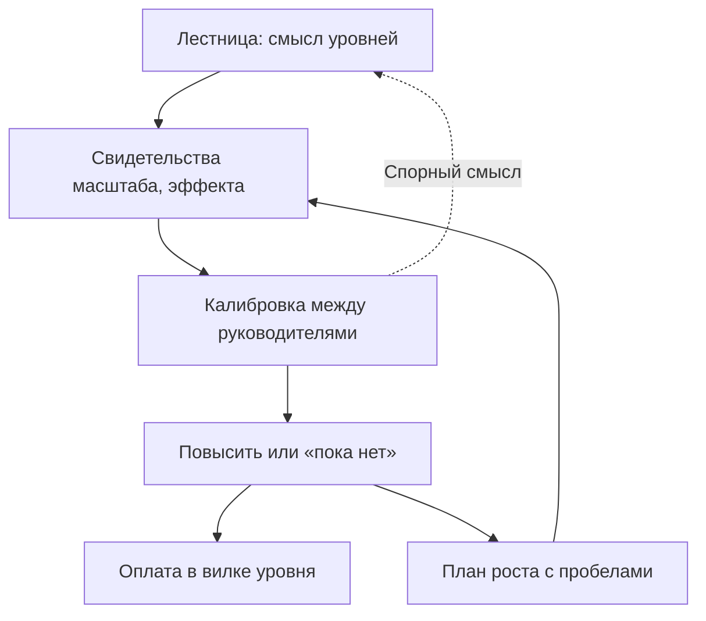
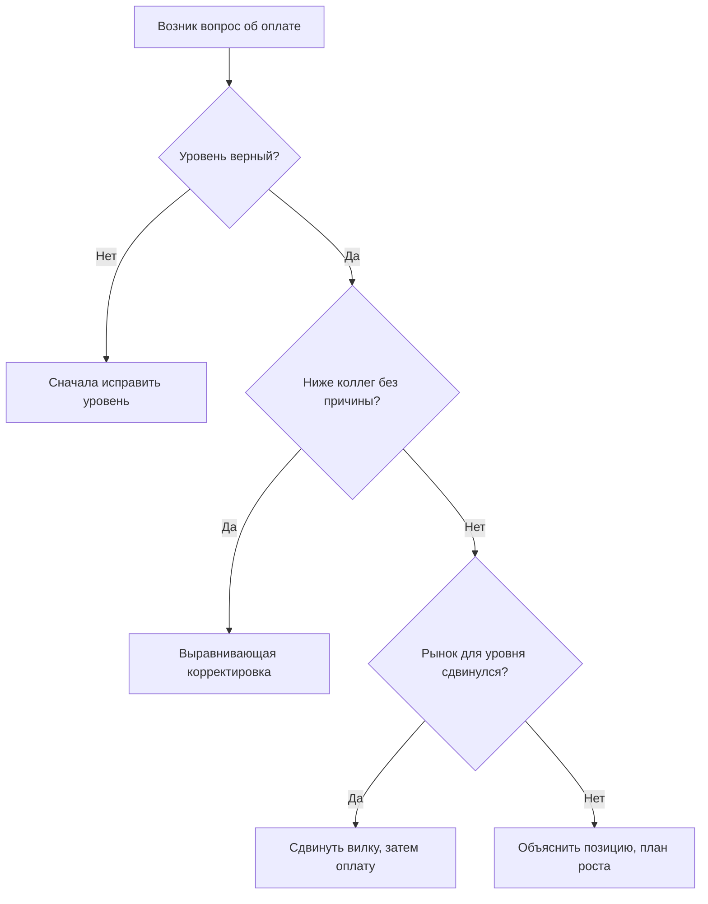
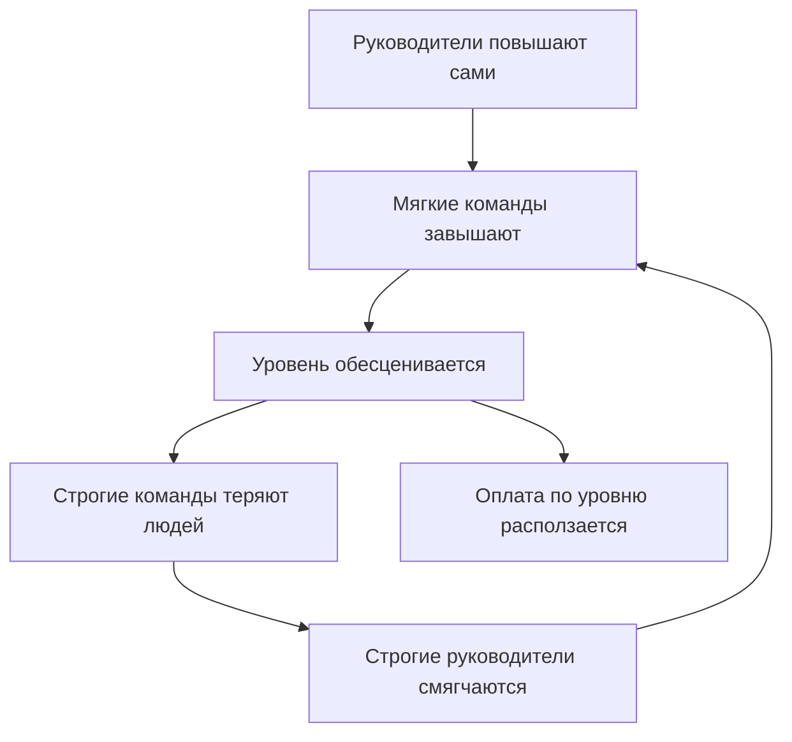

# Глава 8 — Карьерное развитие, повышения и вознаграждение { #chapter-8-career-development-promotion-and-compensation }

Эта глава о трёх решениях, которые показывают инженерам, что организация ценит на самом деле: что
означает каждый уровень, кто продвигается и кому сколько платят. Речь пойдёт о том, как починить
карьерную лестницу, проводить повышения с калибровкой, говорить «пока нет» так, чтобы человек мог этим
воспользоваться, и принимать решения об оплате, которые можно обосновать, — с основами равенства оплаты.
Карта ролей и выбор между управленческим и staff-треком — в главе 4; управление результативностью — в
главе 9. Сквозной пример — Northstar Technologies, вымышленная компания из
[кейса](../../case-studies/northstar/index.md), у которой вся карьерная лестница умещается на одной
вики-странице.

## Почему это важно { #why-this-matters }

На уровне команды карьерная лестница — самый часто используемый инструмент руководителя в разговорах о
росте. Без неё на вопрос «что мне нужно сделать для повышения?» каждый руководитель отвечает по-своему.
С расплывчатой лестницей повышения достаются за заметность и стаж, и тихий инженер, который
предотвращает инциденты, проигрывает тому, кто громко их тушит.

На уровне организации именно в повышениях и оплате решается, считают ли люди систему справедливой.
Инженеры сравнивают. Если одна команда повышает за выпущенные функции, а другая — за архитектурное
суждение, «Senior» означает две разные вещи. Оплата расползается, новички приходят с окладом выше, чем у
коллег с многолетним стажем, а самый дешёвый способ удержания — исправить необоснованный разрыв —
обнаруживается только после заявления об уходе.

На уровне высшего руководства лестница и структура оплаты имеют юридический и финансовый вес. Оплата,
которую нельзя объяснить должностью, уровнем, результативностью и рынком, — это обязательство с
рисками там, где действует закон о равной оплате, а правила прозрачности оплаты распространяются всё
шире.

## Цели главы { #learning-objectives }

После этой главы вы сможете:

- Построить или починить карьерную лестницу, которая описывает масштаб и эффект работы, а не стаж и
  инструменты, и проверить её на реальных людях до публикации.
- Провести цикл повышений с пакетами свидетельств и калибровкой и замечать искажения, которые калибровка
  вносит, а не только те, которые она устраняет.
- Объяснить «пока нет» так, чтобы человек знал свой пробел, свидетельства, которые его закроют, и срок
  пересмотра.
- Принимать и обосновывать решения о вознаграждении исходя из должности и уровня, внутреннего равенства
  и рынка и понимать, когда решению нужна консультация HR или юриста в вашей юрисдикции.
- Диагностировать систему повышений и оплаты по её данным: доле повышений по командам, положению в
  вилке и разрывам между сопоставимыми людьми.

## Ментальная модель { #the-mental-model }

> **Ментальная модель:** карьерная система — это система измерения. Лестница — определение, повышение —
> измерение, калибровка проверяет, что разные измеряющие пользуются одним определением, а оплата — цена,
> привязанная к результату. Ошибки накапливаются вниз по цепочке.

На схеме две петли обратной связи. «Пока нет» питает план роста, который даёт свидетельства для
следующего цикла. Калибровка возвращается к лестнице: если руководители не могут договориться,
соответствует ли кейс критерию, критерий слишком расплывчат и лестницу нужно дорабатывать. Самая
тщательная калибровка не спасёт сломанную лестницу, а оплата, которая игнорирует уровни, сводит на нет
справедливое повышение.

Вторая идея: **уровень — это утверждение о масштабе, а не награда за выслугу**. Масштаб — размер задачи,
за которую человек надёжно отвечает: задача, функция, система, предметная область через несколько
команд. Эффект — то, что изменилось благодаря его работе. Стаж, инструменты и усилия — это входы. Пять
лет работы с Kafka не делают человека senior-инженером; спроектировать пайплайн команды, сделать так,
чтобы его могли эксплуатировать другие, и устранить два повторяющихся типа инцидентов — делают.

## Подробный разбор { #deep-conceptual-explanation }

### Зачем нужна лестница { #what-a-ladder-is-for }

[Карьерная лестница](../../glossary.md#career-ladder) (её ещё называют матрицей грейдов) для каждого
уровня описывает ожидаемые масштаб и эффект и поведение, которое к ним приводит. Она нужна инженеру,
который планирует рост, руководителю, который даёт обратную связь, комитету по повышениям и тем, кто
устанавливает вилки оплаты.

Практики рассматривают лестницу как инфраструктуру, которая делает ожидания растущей организации явными
([Fournier, 2017](../../references/bibliography.md#fournier2017manager);
[Larson, 2019](../../references/bibliography.md#larson2019elegant)).

**Рекомендация книги**: четыре–шесть измерений, каждое описано на каждом уровне.

| Измерение | Что растёт от уровня к уровню |
|---|---|
| Масштаб | Задача, затем функция, затем система, затем предметная область через несколько команд |
| Техническое суждение | Верные решения, затем взвешенные компромиссы, затем решения, на которые опираются другие |
| Поставка и владение | Доводит работу до конца, затем отвечает за результаты, затем делает поставку других предсказуемой |
| Операционная ответственность | Чинит то, что ломается, затем предотвращает целые классы сбоев |
| Влияние и рост других | Помогает коллегам, затем поднимает команду, затем формирует практику за её пределами |

Каждая ячейка должна описывать то, что можно наблюдать, а не то, кем человек является. «Сильный
коммуникатор» проверить нельзя; «пишет дизайн-документы, которые другие команды принимают без встречи» —
можно.

### Масштаб и эффект, а не стаж и инструменты { #scope-and-impact-not-tenure-and-tools }

**Формулировки про стаж** («от трёх до пяти лет опыта») на практике становятся минимумом: руководители
ждут годовщины, а те, кто растёт быстро, уходят. **Формулировки про инструменты** («эксперт по Spark и
Airflow») стареют вместе со стеком и вознаграждают узкую глубину вместо суждения. Уберите годы
полностью; если дисциплине нужны инструменты, вынесите их в приложение, которое можно менять, не меняя
уровней.

Проверьте и **доступность масштаба**. Если для уровня Senior нужно влияние на другие команды, в одних
командах таких возможностей гораздо больше, чем в других. В Northstar, вымышленной компании книги, в
базовом квартале было зафиксировано 86 межкомандных связей зависимости (рабочих задач, которым нужна
была другая команда). Из них на Data and Analytics пришлось 4, а на Platform Operations — 29
([исходные данные](../../case-studies/northstar/baseline-data.md)). Такая лестница повышает тех, кто
сидит там, где сходятся зависимости, если руководители не создают возможностей сами.

### Отдельные треки, сопоставимые уровни { #separate-tracks-comparable-levels }

Выбор трека разобран в главе 4. Для лестницы каждому треку нужны собственные критерии, а уровням —
явное соответствие между треками (один уровень — одна вилка), иначе инженеры решат, что настоящий путь
наверх лежит через менеджмент. Архетипы Larson показывают, насколько по-разному устроены
staff-роли ([Larson, 2021](../../references/bibliography.md#larson2021staff);
[Larson, Staff archetypes](../../references/bibliography.md#larson-staff-archetypes)), поэтому
staff-уровень, написанный под один архетип, отвергает остальные. Staff-роли разобраны в главе 29.

### Почему суждения одного руководителя недостаточно { #why-one-managers-judgment-is-not-enough }

Первая причина — эффекты оценщика: в оценках руководителей для целей развития индивидуальные склонности
оценщика объясняли больше различий между оценками, чем результативность оцениваемого
([Scullen, Mount, and Goff, 2000](../../references/bibliography.md#scullen2000latent); **научный
результат**, подробнее — в главе 9).

Вторая причина — предвзятость. Объявить процесс справедливым не значит её устранить; устраняет
структура. **Научные результаты**, ни один из которых не касается разработчиков ПО, указывают в одну
сторону:

- **Равные оценки, неравное вознаграждение.** В одной крупной сервисной организации женщины и
  представители меньшинств получали меньший рост оклада, чем белые мужчины с теми же оценками
  результативности ([Castilla, 2008](../../references/bibliography.md#castilla2008gender)). В
  экспериментах, если организацию называли меритократической, разрыв увеличивался
  ([Castilla and Benard, 2010](../../references/bibliography.md#castilla2010paradox)).
- **«Потенциал» — предвзятый прогноз.** В розничной сети женщины получали более низкие оценки
  потенциала при более высоких оценках результативности, а впоследствии работали лучше
  ([Benson, Li, and Shue, 2026](../../references/bibliography.md#benson2026potential)).
- **Структура помогает.** Разрыв в вознаграждении сократился после того, как одна компания сделала
  решения о вознаграждении подотчётными и прозрачными
  ([Castilla, 2015](../../references/bibliography.md#castilla2015accounting)), и даже длина шкалы
  оценок меняла гендерный разрыв
  ([Rivera and Tilcsik, 2019](../../references/bibliography.md#rivera2019scaling)).

Отсюда два вывода — **рекомендация книги**. Повышайте за **продемонстрированный масштаб следующего
уровня**, а не за прогноз потенциала. И опирайтесь на структуру: письменные критерии, свидетельства по
каждому критерию, ответственность за единообразие не у того руководителя, который выдвигает кандидата,
и отслеживание итогов по группам. Исследование тех же авторов о принципе Питера кратко изложено в
главе 2 ([Benson, Li, and Shue, 2019](../../references/bibliography.md#benson2019promotions)).

### Калибровка: что она исправляет и что ломает { #calibration-what-it-fixes-and-what-it-breaks }

[Калибровка](../../glossary.md#calibration) — это встреча, на которой руководители вместе рассматривают
кейсы на повышение по одним и тем же критериям, чтобы «Senior» означал одно и то же в каждой команде.
Мы не нашли исследования, которое измеряло бы, повышают ли справедливость калибровочные встречи в том
виде, в каком их проводят инженерные организации, так что доказательства скудны. Практика ниже —
**консенсус практиков** плюс рекомендация книги.

Калибровочная встреча убирает часть предвзятости одного руководителя и добавляет предвзятость
собравшихся. Закономерности предсказуемы (**консенсус практиков**, согласуется с исследованиями выше):

| Закономерность | Как выглядит | Противодействие |
|---|---|---|
| Адвокатство | Проходят кейсы самого красноречивого или самого старшего руководителя | Кейс представляют независимые читатели; выдвинувший только отвечает на вопросы |
| Отсутствие и порядок | Кейсы отсутствующих руководителей и поздние кейсы получают меньше внимания | Фиксированное время на кейс; случайный порядок; возврат к первому и последнему кейсам |
| Ореол и недавность | Один заметный проект или последний месяц решают кейс | Свидетельства за весь период, по измерениям |
| Сходство | Кейсы людей, похожих на собравшихся, кажутся сильнее | Сначала письменные свидетельства; до обсуждения человека спросить «что нам нужно увидеть?» |
| «Потенциал» | Прогнозы подменяют продемонстрированный масштаб | Вычеркнуть потенциал из формы; решать только по свидетельствам |

Противодействие для процесса в целом (**рекомендация книги**):

- Письменный **пакет свидетельств** по каждому кейсу, где каждое утверждение связано с артефактом
  (дизайн-документ, разбор инцидента, merge request, отзывы коллег) и измерением лестницы.
- Кейс представляют **независимые читатели**; выдвинувший руководитель отвечает на вопросы.
- Заранее объявленное **правило решения**: каждое измерение на уровне следующей ступени, стабильно в
  течение двух кварталов.
- **Ведущий**, который отвечает за единообразие и записывает спорные критерии для владельца лестницы.
- **Никаких квот**, но опубликованный бюджет на рост оплаты из-за повышений. Квота ограничивает, кого
  признают; бюджет ограничивает, как быстро растёт оплата.
- **Разбор итогов**: доля повышений по командам, уровням и любым группам, анализ которых разрешён в
  вашей юрисдикции, в сравнении с теми, кто имел право на повышение. Закономерность, которую встреча не
  может объяснить свидетельствами, — это вывод о самой встрече.

### «Пока нет», которым можно воспользоваться { #a-not-yet-that-can-be-used }

То, что человек слышит после отклонённого кейса, решает, станет ли
[«пока нет»](../../glossary.md#not-yet) планом или заявлением об уходе. У полезного «пока нет» пять
частей:

1. **Решение, прямо**, в самом начале.
2. **Пробел, привязанный к лестнице**: какое измерение, что требует следующий уровень, что было видно.
3. **Свидетельства, которые его закроют**, — наблюдаемые и достижимые в текущей роли. «Проведите
   дизайн следующего механизма загрузки данных через ревью другой команды» выполнимо; «проявите больше
   лидерства» — нет.
4. **Обязательство руководителя** создать ситуацию, в которой эти свидетельства могут появиться. Если
   пробел — межкомандный масштаб, а в роли его нет, пробел отчасти принадлежит руководителю.
5. **Дата пересмотра**, обычно следующий цикл, с промежуточной проверкой.

Книга Kim Scott известна тем, что соединяет искреннюю заботу с прямой критикой
([Scott, 2017](../../references/bibliography.md#scott2017radical)); расплывчатое «пока нет» проваливает
второе, а «пока нет» без обязательства — первое. Встреча один на один (1:1), на которой это
происходит, разобрана в главе 5; другой разговор — когда проблема в результативности на текущем
уровне — в главе 9.

### Карьерный разговор { #the-career-conversation }

Большинство инженеров в конкретном цикле не претендуют на повышение, а некоторые никогда не хотят
следующего уровня. Карьерное развитие — задача шире, и решается она в разговоре раз-два в год, отдельно
от оценки результативности (**рекомендация книги**, в духе журнала роста из главы 5).

Обсудите четыре вещи в таком порядке:

1. **Устремления.** Где человек хочет быть через два-три года, чего он хочет больше и чего меньше? «Не
   знаю» — нормальный ответ; тогда спросите, что ему больше всего понравилось за последний год.
2. **Сильные стороны и энергия.** С чем к нему приходят другие? Развитие, опирающееся на сильную
   сторону, обычно идёт быстрее, чем развитие, которое только латает слабость.
3. **Следующий опыт, а не следующая должность.** Назовите одно задание, которое растянет человека в
   выбранном им направлении: провести разбор инцидента, отвечать за миграцию, менторить новичка,
   поработать в ротации в другой команде. Опыт производит свидетельства; должность — результат
   свидетельств.
4. **Движение вбок, а не только вверх.** Горизонтальный переход в другую команду, переход из бэкенда в
   данные или пробный период на другом треке (глава 4) — тоже развитие. Руководитель, который блокирует
   хороший переход, чтобы удержать сильного инженера, обычно всё равно его теряет, только позже.

Расти внутри уровня — нормально. Инженер среднего уровня, который доволен, надёжен и учится, должен
слышать, что это ценят, и всё же иметь одну цель роста, например более глубокую компетентность на
дежурствах или новую часть системы. Запишите согласованную цель и следующий опыт в текущий журнал и
проверяйте их в ежемесячной сводке. Формат даёт шаблон
[«План карьерного развития»](../../templates/career-development-plan.md).

### Вознаграждение: три обоснованных основания { #compensation-three-defensible-grounds }

В компании среднего размера оплату обычно устанавливают внутри **вилок**: минимальный, средний и
максимальный базовый оклад для каждого уровня и рынка труда. **Compa-ratio** — оклад, делённый на
середину вилки; 0,90 означает на 10% ниже середины. Решение об оплате обоснованно, когда оно опирается
на основания, которые можно назвать:

| Основание | Вопрос | Свидетельства |
|---|---|---|
| Должность и уровень | Находится ли человек в правильной вилке для своей работы? | Уровень по лестнице, подтверждённый калибровкой |
| Внутреннее равенство | Получают ли сопоставимые люди с сопоставимой результативностью сопоставимую оплату? | Оплата коллег того же уровня и рынка, с причинами различий |
| Рынок | Можем ли мы нанимать и удерживать людей за эти деньги? | Зарплатные обзоры, доля принятых офферов, причины ухода |

Различия внутри вилки законны, когда следуют из задокументированных причин, связанных с работой:
устойчивой результативности, времени на уровне, редких навыков, которых требует работа. Умение
торговаться, прежняя зарплата и то, кто руководитель, такими причинами не являются. Повышение оклада,
которое исправляет разрыв без такой причины, — это **корректировка для выравнивания оплаты** (изменение
оклада, а не грант акций). Она отличается от **повышения по результатам (merit increase)** — регулярного
повышения, привязанного к результативности, которое выплачивается из годового **бюджета на повышения по
результатам**. Самый частый провал равенства в растущих компаниях — **сжатие оплаты (compression)**:
новички приходят по рыночной ставке, а оклады работающих растут на несколько процентов в год, пока
новичок не начинает зарабатывать больше того, кто его обучал.

### Совокупное вознаграждение и выбор уровня при оффере { #total-compensation-and-choosing-a-level-at-offer }

Базовый оклад — лишь часть того, что получают инженеры. **Совокупное вознаграждение** обычно включает
денежный бонус (часто целевой процент от оклада, выплачиваемый по результатам компании или личным
результатам), акции (опционы или RSU, ограниченные акции, которые проходят
[вестинг](../../glossary.md#vesting), то есть переходят в собственность сотрудника, за несколько лет) и
льготы. В большинстве компаний среднего размера бонусную схему, пулы акций и льготы определяют HR и
финансы; руководитель разработки (engineering manager, EM) управляет входами: уровнем, свидетельствами результативности и
обоснованием исключения. Знайте, сколько стоит каждая часть для ваших подчинённых, и объясняйте это
простыми словами. Инженер, который видит только базовый оклад, сравнивает его с внешним оффером, где на
первом месте совокупное вознаграждение, и делает неверный вывод в обе стороны.

Уровень, выбранный при оффере, важнее стартового оклада: он задаёт вилку, ожидания и дату первого
повышения. Выбирайте его по свидетельствам из карточки найма в сравнении с вашей лестницей (глава 7), а
не по нынешней должности или зарплате кандидата (**рекомендация книги**). Должности в разных компаниях
означают разное, а прежняя зарплата переносит прошлое неравенство вперёд; в некоторых юрисдикциях о ней
запрещено спрашивать. Часто встречаются две ошибки. Понижение уровня, чтобы уложиться в бюджет, даёт
сотрудника, которому недоплачивают за работу следующего уровня, и проблему равенства в течение года.
Завышение уровня, чтобы выиграть кандидата, даёт человека, которого судят по ожиданиям, на которые его
никогда не проверяли. Если свидетельства находятся между двумя уровнями, предложите нижний с письменной
датой пересмотра и скажите, какие свидетельства его изменят.

### Прозрачность и равенство оплаты { #pay-transparency-and-equal-pay }

Законодательство об оплате в разных юрисдикциях разное, и эта книга не даёт юридических консультаций.
Многие правовые системы требуют равной оплаты за равный труд или труд равной ценности, а прозрачность
постепенно закрепляется в законах. Например, директива Европейского союза о прозрачности оплаты даёт
соискателям право узнать вилку оплаты, запрещает спрашивать о прежней зарплате и позволяет работникам
запрашивать среднюю оплату по полу за сопоставимую работу. Крупные работодатели обязаны отчитываться о
гендерном разрыве в оплате и проводить совместную оценку оплаты, если необоснованный разрыв не менее 5%
сохраняется ([Directive (EU) 2023/970](../../references/bibliography.md#eu2023paytransparency)).
Считайте её **стандартом**, а не доказательством того, к чему она приводит; директива обязывает
государства-члены, а реальные обязательства устанавливают их национальные законы. Прежде чем менять
практику оплаты, проконсультируйтесь с HR или юристом по трудовому праву в каждой стране.

У прозрачности есть цена. После того как законы ряда штатов США защитили право работников обсуждать
оплату с коллегами, зарплаты снизились примерно на 2%. Это согласуется с моделью, в которой
работодатели отказывают в индивидуальных прибавках, чтобы не пересматривать оплату со всеми
([Cullen and Pakzad-Hurson, 2023](../../references/bibliography.md#cullen2023equilibrium)). Этот
**научный результат** касается одного вида прозрачности в одной стране. Ожидайте, что прозрачность
сожмёт разброс оплаты и уберёт пространство для разовых договорённостей: это хорошо для равенства и
тяжело для руководителя, который тихо решал проблемы удержания.

## Пример из инженерной организации { #engineering-organization-example }

!!! info "Northstar: что уже известно"
    До недели 1. В Northstar, вымышленной компании-разработчике ПО в области order-to-cash («от заказа
    до оплаты»), 80 инженеров в шести командах, и вот-вот придёт новый директор по разработке. За
    прошедший год ушли восемь инженеров, а вся карьерная лестница — одна вики-страница. См.
    [хронологию](../../case-studies/northstar/timeline.md). Впервые встречаете Northstar? Прочитайте
    [«Год вкратце»](../../case-studies/northstar/year-in-brief.md) и
    [«Действующие лица»](../../case-studies/northstar/cast.md).

Цифры — **иллюстрация**.

**История повышений.** Повышения решал каждый руководитель, а Victor Lindqvist, CTO, утверждал их по
одному, без сравнения между командами и без письменных свидетельств. За два года до прихода директора
было 15 повышений до Senior Engineer и ни одного до Staff Engineer.

| Команда | Инженеров | Engineer / Senior | Повышений за два года | На 10 инженеров |
|---|---|---|---|---|
| Orders | 14 | 7 / 7 | 3 | 2.1 |
| Billing | 13 | 7 / 6 | 1 | 0.8 |
| Payments and Integrations | 12 | 6 / 6 | 2 | 1.7 |
| Customer Experience | 15 | 8 / 7 | 6 | 4.0 |
| Data and Analytics | 11 | 6 / 5 | 1 | 0.9 |
| Platform Operations | 12 | 10 / 2 | 2 | 1.7 |
| **Итого** | **77** | **44 / 33** | **15** | **1.9** |

Вместе с тремя staff-инженерами в Northstar 44 инженера уровня Engineer, 33 — уровня Senior Engineer и
3 — уровня Staff Engineer. Customer Experience повышала людей более чем в четыре раза чаще, чем Billing
или Data and Analytics. Само по себе это ничего не доказывает. Но на вопрос, что требуется для уровня
Senior, Daniel Cho (руководитель Customer Experience) ответил: «отвечает за функции от начала до конца и
выпускает их», а Farah Haddad (руководитель Data and Analytics) — «может заменить меня в роли
архитектора данных команды». Два уровня под одним словом.

**Оплата.** Вилки для США (Миннеаполис и удалённые сотрудники в США), базовый оклад, вымышленные и
округлённые. Инженерам в Боготе платят по отдельным вилкам, установленным по колумбийскому рынку; они
здесь не показаны.

| Уровень | Минимум | Середина | Максимум |
|---|---|---|---|
| Engineer | $100,000 | $120,000 | $140,000 |
| Senior Engineer | $130,000 | $152,500 | $175,000 |
| Staff Engineer | $170,000 | $195,000 | $220,000 |

В Data and Analytics 11 инженеров: 4 в Миннеаполисе, 5 в Боготе, 2 удалённо в США. Два
senior-инженера в США выполняют сопоставимую работу:

| Сотрудник | Путь к Senior | Базовый оклад | Compa-ratio |
|---|---|---|---|
| Sunil Varghese | Пришёл шесть лет назад; повышен три года назад; спроектировал пайплайны хранилища данных | $138,000 | 0.90 |
| Senior-инженер данных, нанятый извне | Нанят за пять месяцев до прихода директора по ставке, нужной, чтобы выиграть оффер | $162,000 | 1.06 |

У оклада Sunil есть объяснение (в тот год прибавка при повышении была ограничена 8%, затем около 3% в
год), но нет обоснования: история — это не должность, не результативность и не рынок. Подтянуть его к
середине вилки стоит $14 500 в год ($152 500 − $138 000), около $20 000 с учётом полной стоимости, если
она примерно в 1,4 раза выше оклада (это допущение, а не цифра Northstar). Потерять его обойдётся
дороже: медианный срок в Northstar от заявления об уходе до первого рабочего дня замены — 15 недель
([исходные данные](../../case-studies/northstar/baseline-data.md)), а пайплайны спроектировал он.

## Как принимать решение { #decision-framework }

Для повышений правило — то, что объявлено до калибровки: каждое измерение на уровне следующей ступени,
стабильно, со свидетельствами. Для вопросов об оплате:

Конкурирующий оффер — не причина, связанная с работой; это свидетельство о рынке. Если он показывает,
что вилка неверна, сдвиньте вилку для всех на этом уровне, а не только для обладателя оффера. Само
решение о контрпредложении разобрано в главе 10.

| Ситуация | Обычная реакция | Когда поступить иначе |
|---|---|---|
| Сильный сотрудник, мало свидетельств по одному измерению | «Пока нет» из пяти частей; создать возможность | В команде это измерение недоступно: рассмотреть переход |
| Сильный кейс, в этом цикле нет бюджета | Повысить; профинансировать рост оплаты или письменно назначить его дату | Никогда «только должность» без датированного роста оплаты |
| Коллеги одного уровня, разрыв более 10 процентов, без причины | Выравнивающая корректировка, в следующем цикле или раньше | Тот, кто получает больше, был ошибочно оценён по уровню: исправить уровень |
| Новичок будет получать больше коллег со стажем | Нанять по рынку; скорректировать оплату коллег в том же цикле | Ставка — рыночный выброс: пересмотреть условия |

## Компромиссы { #trade-offs }

**Точная лестница против гибкой.** Детальные критерии делают решения единообразными и вознаграждают
тех, кто оптимизирует под чек-лист. Широкие критерии оставляют место суждению и открывают дорогу
предвзятости, которую описывают исследования. Средний путь: наблюдаемые примеры в каждой ячейке,
представленные как иллюстрации, а не исчерпывающий список.

**Калибровка против скорости.** Калиброванный цикл занимает недели, поэтому исключительный кейс может
ждать полгода. Допускайте редкие кейсы вне цикла с тем же пакетом и двумя калибрующими.

**Прозрачность против гибкости.** Опубликованные вилки и критерии уменьшают необъяснимые разрывы и
преимущество тех, кто умеет торговаться; они же отнимают у руководителя тихие инструменты и могут сжать
оплату. Публиковать внутри компании — **рекомендация книги**, как только каждое положение в вилке можно
обосновать; если опубликовать до наведения порядка, компания узнаёт о своих разрывах из ветки в чате.

**Рынок против внутреннего равенства.** Рыночная оплата за редкие навыки помогает нанимать и создаёт
сжатие. Решите, какие уровни и навыки оправдывают надбавку, запишите это и корректируйте оплату коллег,
когда платите надбавку.

## Типичные провалы { #failure-modes }

**Лотерея руководителей.** Каждый руководитель вкладывает в уровень свой смысл.

Петля сама себя усиливает: лучшие люди строгих руководителей видят, что коллег в других командах
повышают за меньшее, и уходят или давят на руководителей, и те смягчаются. Сигнал: доли повышений
различаются вдвое между командами схожего состава, без письменного объяснения. Исправление: калибровка,
а спорные критерии возвращаются в лестницу.

**Калибровочный театр.** Тонкие пакеты, кейс представляет выдвинувший руководитель, решения следуют за
самым старшим голосом. Сигнал: проходят почти все выдвижения, или итоги меняются, когда высказывается
старший руководитель.

**Повышение ради удержания.** Человек грозит уйти, и его повышают, чтобы он остался. Организация
усваивает, что угрозы работают, а человеку может быть трудно на новом уровне. Сигнал: повышения вскоре
после разговора об уходе.

**Связующая работа (glue work), которая никогда не засчитывается.** Менторство, доведение до конца действий после
инцидентов и координация остаются без вознаграждения. Сигнал: тем, кто это делает, говорят
«сосредоточьтесь на техническом эффекте». Исправление: сделайте влияние и операционную ответственность
измерениями лестницы.

**Сжатие, обнаруженное через увольнение.** Сигнал: compa-ratio у новичков выше, чем у коллег со стажем
на том же уровне. Исправление: проверка равенства оплаты перед каждым циклом, а не после выходного
интервью.

## Применение в крупной организации { #enterprise-application }

При 50–150 инженерах повышения и оплата становятся системой, которая живёт по календарю: директор уже
не может знать каждый кейс. Рабочая схема (**рекомендация книги**):

**Два цикла в год**: выдвижения, подготовка пакетов (две-три недели), калибровка по уровням, которую
ведёт директор, а технические свидетельства читают staff-инженеры, разговоры в течение недели и
изменения оплаты в фиксированную дату.

**Владелец лестницы**, часто директор вместе с HR-партнёром, ведёт журнал изменений. Изменения
публикуются до цикла, никогда не во время него.

**Управление оплатой.** HR владеет вилками и рыночными данными; разработка владеет уровнями и
свидетельствами. Перед каждым циклом проверка равенства перечисляет всех, чей compa-ratio вне диапазона
0,90–1,10, и каждую пару сопоставимых людей с разрывом больше 10%, и для каждого случая указывает
причину или корректировку. Если людям платят на нескольких рынках труда, сравнивайте внутри каждого
рынка, но определения уровней держите одинаковыми для всех.

**Отслеживание итогов**: доли повышений и изменения оплаты по командам, уровням и защищённым группам,
если местное законодательство разрешает такие данные; проверяет их человек, не участвующий в
калибровке. Исследования предвзятости в связке «результативность — вознаграждение» говорят, что тем, кто
принимает решения, плохо видны собственные закономерности.

## Взгляд CTO { #cto-perspective }

Инженеры читают карьерную систему внимательнее любого стратегического документа. Если повышают тех, кто
спасал релизы, спасение становится работой.

Три решения принадлежат CTO (техническому директору). **Паритет треков**: равен ли верхний уровень
индивидуального исполнителя (IC) директору по вилке и доступу и сколько это стоит. **Позиция по
оплате**: на каком уровне рынка компания намерена платить — согласовано с CFO (финансовым директором) и
записано, чтобы руководители перестали придумывать это в каждом случае заново. **Финансирование**:
повышения и выравнивающие корректировки — отдельными статьями от повышений по результатам, чтобы
исправление необоснованного разрыва у одного человека не забирало деньги из прибавки другого.

CTO также владеет риском. Необъяснимый разрыв в оплате — юридическая и репутационная уязвимость, и
правила прозрачности повышают вероятность, что она всплывёт. Относитесь к проверке равенства оплаты как
к проверке безопасности: по расписанию, с отслеживанием находок до закрытия и отчётом высшему
руководству.

## Практический плейбук { #practical-playbook }

**Почините лестницу (один квартал).**

1. Соберите письменную лестницу, неписаный смысл каждого уровня у каждого руководителя и кейсы за два
   года.
2. Набросайте четыре–шесть измерений с наблюдаемыми описаниями на каждом уровне; уберите годы и
   инструменты.
3. Проверьте черновик на двадцати людях из разных команд: определите уровень каждого, затем спросите,
   согласились бы коллеги.
4. Отдельно напишите критерии управленческого трека (карта — в главе 4), с соответствием уровней.
5. Опубликуйте с журналом изменений и явно укажите, что новый текст ничьего уровня не понижает.

**Проведите цикл (два раза в год).**

6. Объявите даты, формат пакета и правило решения.
7. Готовьте пакеты вместе с человеком; каждое утверждение ссылается на артефакт и измерение.
8. Калибруйте с независимыми читателями и ведущим; записывайте спорные критерии.
9. Сообщайте каждое решение в течение недели, лично; каждое «пока нет» — из пяти частей.
10. Разберите итоги по командам и уровням; отправьте спорные критерии владельцу лестницы.

**Исправьте оплату (перед каждым циклом).**

11. Составьте список compa-ratio по уровням и рынкам; отметьте выбросы и разрывы между коллегами.
12. Для каждого случая напишите причину, связанную с работой, или запланируйте корректировку из
    отдельного бюджета на выравнивание.
13. Нанимая человека с оплатой выше нынешних коллег, корректируйте оплату коллег в том же цикле.
14. Проверьте юридические требования с HR в каждой юрисдикции, прежде чем публиковать вилки, менять
    практику офферов или отвечать на официальный запрос информации об оплате.

## Кейс { #case-study }

Этот кейс — **вымысел**. Он охватывает период от квартала 2 до недели 27, начала квартала 3. К этому
времени число серьёзных инцидентов снизилось с 30 за квартал до 17, а две функции для продлений,
которые защищал мандат CTO, были поставлены (см. [хронологию](../../case-studies/northstar/timeline.md)).

**С чего всё начинается.** Лестница — это вики-страница «Engineering levels» из трёх абзацев, без
описания масштаба для staff и без критериев для руководителей. Одна из двух инженеров, ушедших из Data
and Analytics за прошлый год, сказала Farah Haddad (руководителю команды), что другая компания
предложила ей должность senior, до которой ей говорили «ещё год-два».

**Переписывание.** Во втором квартале директор и HR-партнёр набросали пять описанных выше измерений для
трёх уровней и проверили их на двадцати инженерах из всех шести команд. Представление Farah об уровне
Senior по масштабу совпало со столбцом Staff в черновике: её команда требовала от Senior стандарта
staff. А измерение операционной ответственности поставило нескольких инженеров Billing выше их
должностей: тем, кто нёс на себе вызовы по ledger, это никогда не засчитывали.

**Первый калиброванный цикл.** В начале квартала 3 руководители выдвинули девять инженеров на Senior;
пакеты читали руководители других команд и три staff-инженера. Повысили пятерых, в том числе двух
инженеров ledger из Billing. Двое из трёх выдвинутых Customer Experience получили «пока нет» с одним и
тем же пробелом: функции выпускались хорошо, но не было ни одного проектного решения, на которое
опирались бы другие.

**«Пока нет» в Data and Analytics.** Yusuf Demir, инженер данных из Миннеаполиса, три года работающий в
Northstar, тоже получил «пока нет». Farah назвала все пять частей. Пробел — влияние за пределами
команды: отличные пайплайны, которыми пользовалась только его команда. Свидетельства: провести дизайн
контракта экспорта из ledger, который предложила Li Na Zhou (staff-инженер, данные и интеграции), через
ревью Billing и ввести в курс дела одного инженера Billing. Обязательство Farah: поручить ему дизайн и
попросить Li Na Zhou выступить спонсором. Пересмотр в следующем цикле, проверка через три месяца. Yusuf
сказал, что впервые кто-то объяснил ему, что значит Senior.

**Вопрос оплаты.** Проверка равенства выявила Sunil Varghese (на $24 000 ниже нанятого извне коллеги
того же уровня и масштаба) и ещё пятерых senior-инженеров в США с compa-ratio ниже 0,92 — все повышены
внутри компании. Rajiv Menon (CFO) сказал, что бюджет на повышения по результатам на год уже утверждён.
Урок кейса: ясная лестница нашла проблемы, а их исправление стоит денег, которых в плане не было. Как
профинансировать и в каком порядке провести корректировки — упражнение X1.

## Упражнения { #exercises }

Решения — в [решениях к главе 8](../../solutions/ch08-solutions.md). Данные Northstar — на
[странице исходных данных](../../case-studies/northstar/baseline-data.md); кто есть кто — на странице
[«Действующие лица»](../../case-studies/northstar/cast.md).

### Базовый уровень { #foundational }

**F1.** В унаследованной вами лестнице для Senior Engineer написано: «Пять или более лет опыта. Эксперт
в стеке команды (Java, Spring, Kafka). Сильный коммуникатор. Менторит младших инженеров». Перепишите
это как три–пять наблюдаемых утверждений о масштабе и эффекте, объясните, что каждая исходная фраза
делает с решениями о повышении на практике, и скажите, как бы вы проверили свою версию до публикации.

**F2.** В Northstar команда Customer Experience за два года повысила до Senior 6 из 15 инженеров, а
Billing — 1 из 13. Один руководитель утверждает, что это доказывает: Customer Experience лучше
развивает людей. Перечислите альтернативные объяснения, данные, которые позволили бы их различить, и что
калибровка решила бы, а что нет.

**F3.** Напишите сообщение «пока нет» для инженера, чей кейс отклонили, потому что весь его эффект
находится внутри одного сервиса, которым пользуется только его команда. Включите все пять частей и
обязательство руководителя. Затем назовите две вещи, которые сделали бы то же сообщение для него
бесполезным.

### Прикладное лидерство { #applied-leadership }

**A1.** Вы ведёте первую калибровку в Northstar. Daniel Cho энергично представляет три своих кейса; у
двух кейсов Billing тонкие пакеты, потому что Marcus Oyelaran (руководитель Billing) провёл неделю на
разборе инцидента. К середине встречи все устали и склоняются к кейсам Daniel. Решите, что вы сделаете
на встрече, что измените к следующему циклу и как потом проверите, было ли всё справедливо.

**A2.** Senior-инженер данных из Data and Analytics получает внешний оффер на 18% выше своего оклада и
просит Farah Haddad повысить её до Staff Engineer, чтобы остаться. Её работа сильна на уровне Senior;
критерии staff только что написаны. Посоветуйте Farah отдельно по вопросу повышения и отдельно по
вопросу оплаты, а также чего ей не следует говорить.

**A3.** Вы нанимаете Senior Engineer в Billing. Рекрутер рекомендует $165 000; три senior-инженера
Billing получают от $136 000 до $141 000 и хорошо работают. Найм срочный из-за нагрузки дежурств по
ledger. Решите, каким будет оффер, что вы сделаете с тремя нынешними senior-инженерами и как объясните
и то и другое CFO.

### Решения на уровне руководства { #executive-decision-making }

**X1.** Проверка равенства выявила шестерых senior-инженеров в США с compa-ratio ниже 0,92, все повышены
внутри компании, включая Sunil Varghese. Подтянуть всех шестерых до 0,95 стоит около $52 000 в год
базового оклада. Rajiv Menon говорит, что бюджет на повышения по результатам зафиксирован. Решите, как
профинансировать и в каком порядке провести корректировки, что сказать шестерым и их коллегам, какой
риск вы принимаете, откладывая, и когда подключить HR или юриста.

**X2.** Victor Lindqvist (CTO) спрашивает, стоит ли Northstar в течение года опубликовать вилки оплаты
для всех сотрудников. Northstar нанимает инженеров в США и в Колумбии. Порекомендуйте решение и
последовательность шагов, скажите, что должно быть верно до публикации, что, по вашим ожиданиям,
изменится (включая возможное сжатие оплаты) и чего вы не станете утверждать перед высшим руководством.

## Вопросы для размышления { #reflection-questions }

1. Если спросить ваших инженеров, что нужно для следующего уровня, сколько разных ответов вы услышите и
   чей из них настоящий?
2. Какую важную работу в вашей команде делают люди, которых за неё не повышают?
3. Когда вы в последний раз повысили кого-то из страха, что он уйдёт?
4. Если завтра каждый инженер увидит уровень и оклад каждого другого, что вы исправите первым?
5. Какая часть вашего суждения о результативности подчинённых на самом деле описывает вас?
6. Когда вы говорите, что у кого-то есть «потенциал», какие свидетельства вы описываете?

## Главное { #key-takeaways }

- Относитесь к карьерной системе как к измерению: лестница, повышение, калибровка, оплата. Сначала
  чините самый ранний сломанный шаг.
- Пишите критерии лестницы как наблюдаемый масштаб и эффект; убирайте годы и инструменты.
- Проверяйте лестницу на реальных людях до публикации и убедитесь, что требуемый ею масштаб доступен в
  каждой команде.
- Суждение одного руководителя зашумлено и может быть предвзятым: требуйте свидетельств по каждому
  критерию, независимых читателей и разбора итогов.
- Повышайте за продемонстрированный масштаб следующего уровня, а не за «потенциал».
- «Пока нет» называет решение, пробел, свидетельства, которые его закроют, обязательство руководителя и
  дату пересмотра.
- Обосновывайте каждое решение об оплате должностью и уровнем, внутренним равенством или рынком и
  находите сжатие оплаты раньше, чем его обнаружит чьё-то увольнение.
- Финансируйте выравнивающие корректировки отдельно от повышений по результатам и получайте юридическую
  консультацию в каждой юрисдикции, прежде чем менять практику прозрачности оплаты.

## Источники и что почитать { #references-and-further-reading }

- [Scullen, Mount, and Goff, 2000](../../references/bibliography.md#scullen2000latent). Насколько оценка
  отражает самого оценщика; главный аргумент в пользу калибровки.
- [Castilla, 2008](../../references/bibliography.md#castilla2008gender),
  [Castilla and Benard, 2010](../../references/bibliography.md#castilla2010paradox) и
  [Castilla, 2015](../../references/bibliography.md#castilla2015accounting). Предвзятость в связке
  «результативность — вознаграждение», парадокс объявленной меритократии и полевая проверка
  подотчётности и прозрачности.
- [Rivera and Tilcsik, 2019](../../references/bibliography.md#rivera2019scaling). Устройство шкалы
  оценок меняет гендерный разрыв в оценках.
- [Benson, Li, and Shue, 2026](../../references/bibliography.md#benson2026potential). Оценки
  «потенциала» и гендерный разрыв в повышениях.
- [Benson, Li, and Shue, 2019](../../references/bibliography.md#benson2019promotions). Повышения и
  принцип Питера; разобрано в главе 2.
- [Cullen and Pakzad-Hurson, 2023](../../references/bibliography.md#cullen2023equilibrium). Почему законы
  о прозрачности оплаты могут снижать средние зарплаты.
- [Directive (EU) 2023/970](../../references/bibliography.md#eu2023paytransparency). Один из крупных
  режимов прозрачности оплаты, прочитанный полностью; пример, а не совет для вашей юрисдикции.
- [Fournier, 2017](../../references/bibliography.md#fournier2017manager) и
  [Larson, 2019](../../references/bibliography.md#larson2019elegant). Рассказы практиков об управлении
  разработкой, включая лестницы и процессы оценки результативности.
- [Larson, 2021](../../references/bibliography.md#larson2021staff) и
  [Larson, Staff archetypes](../../references/bibliography.md#larson-staff-archetypes). Верхние ступени
  лестницы индивидуального исполнителя.
- [Scott, 2017](../../references/bibliography.md#scott2017radical). Прямая обратная связь с заботой —
  для разговора «пока нет».
