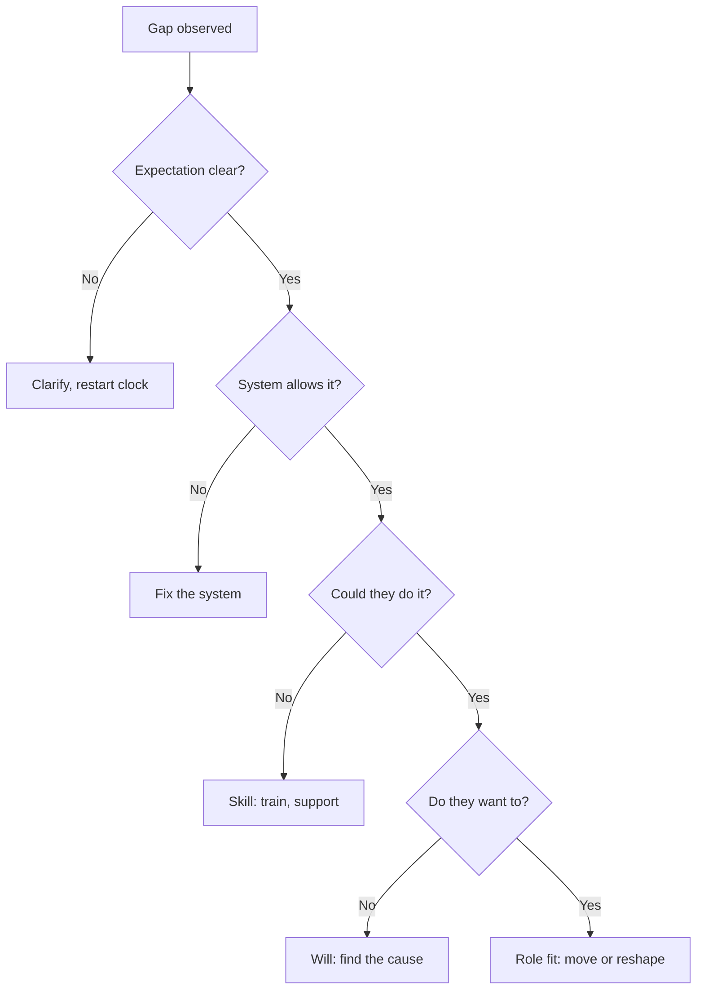
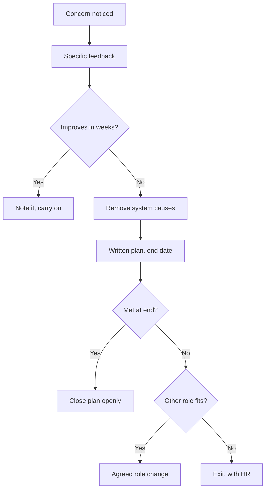
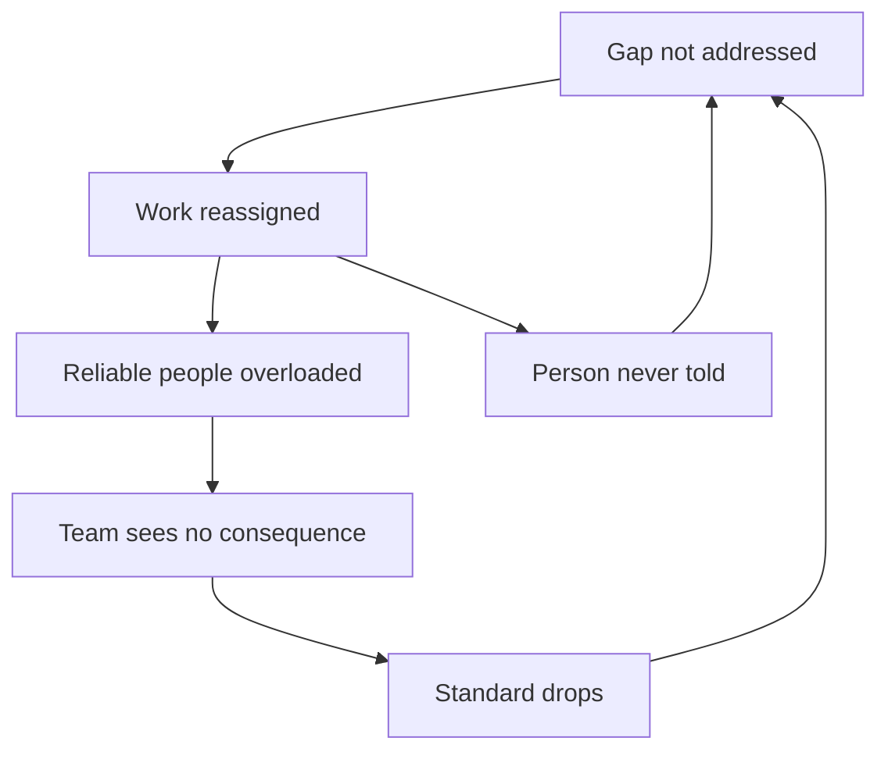

# Chapter 9 — Performance Management and Underperformance

This chapter is about the regular review cycle and the part of management most managers postpone:
deciding that someone is not performing, finding out why, and acting fairly to that person and to
everyone who works with them. It covers writing reviews, diagnosis before action (skill, will, role fit, and the system around the
person), a documented improvement process with a real chance of success and a clear end, the cost of
acting late, and what performance ratings can and cannot tell you. Chapter 6 covers the feedback
conversation itself, and Chapter 8 covers promotion and calibration; this chapter uses both. The running
example is an infrastructure engineer in Tom Becker's Platform Operations team at Northstar
Technologies, the fictional company in the [case study](../../case-studies/northstar/index.md).

## Why This Matters

At team scale, one person not doing their job is rarely one person's problem. Someone absorbs the
work, usually the most conscientious people on the team, and they notice that the manager has noticed
and done nothing. The team learns the real standard from what the manager tolerates, not from what
the manager says.

At organization scale, performance management decides whether "meets expectations" means anything.
If every review says it, ratings stop informing promotion, pay, or staffing, and managers who do raise
problems look harsh by comparison. The opposite failure is just as real: a process that labels people
as low performers when the cause was an impossible role, a broken toolchain, or an interrupt load
nobody measured.

At executive scale, the question is the system: review cadence, whether ratings are trusted, whether
forced distributions are used, and whether managers are expected to act. Once people distrust these
choices, they are hard to reverse.

## Learning Objectives

After this chapter you will be able to:

- Separate skill, will, role fit, and system causes of low performance before acting, and name the
  evidence that distinguishes them.
- Write performance expectations that a third party could check, and use them in the regular review
  cycle and to open a documented improvement process.
- Run an improvement plan that gives the person a real chance of success, has a clear end, and stays
  within your organization's legal and HR boundaries.
- Estimate the cost to the team of acting late, and use it to decide when to start.
- Judge what a performance rating can support, given research on rater effects, and respond to
  proposals for forced ranking.

## The Mental Model

> **Mental model:** Low performance is a gap between an expectation and a result. Before you act on
> the person, prove that the expectation was clear and that the system allowed the result. Then act
> quickly, in writing, with an end date.

Managers tend to make one of two errors consistently. The first is blaming the person for a system
problem: the engineer who misses every commitment because they carry half the team's interrupts. The
second is blaming the system for a person problem, and waiting for a reorganization or a better
quarter to fix someone who has been told nothing. The diagnosis order below guards against both. It
starts with the cheapest checks, about the manager and the environment, and only then reaches the
person.

Each later branch costs more and is harder to undo: clarifying an expectation costs a conversation,
fixing a system costs some capacity, and a formal plan costs weeks, trust, and sometimes a job.
Several causes usually coexist, so run the whole checklist rather than stopping at the first yes.

## Deep Conceptual Explanation

### Four causes, and the evidence that separates them

Diagnose before you remedy, and check the environment before the person. That is the shared point of
three classic practitioner works. Andrew Grove reduced failure to perform to capability or motivation
([Grove, 1983](../../references/bibliography.md#grove1983high)). Robert Mager and Peter Pipe offered a
blunt test for a skill gap: if the person's job truly depended on the task, could they do it? If so,
training is not the remedy ([Mager and Pipe, 1997](../../references/bibliography.md#mager1997analyzing)).
Thomas Gilbert argued that most performance deficits come from the environment (information,
resources, incentives) rather than the individual
([Gilbert, 1978](../../references/bibliography.md#gilbert1978human)).

This book uses four causes, extending those ideas (**this book's recommendation**):

| Cause | What it looks like | Evidence that confirms it | Evidence that rules it out |
|---|---|---|---|
| System | Blocked, overloaded, or set up to fail | Interrupt load, unclear ownership, missing access; peers in the same role struggle too | Peers with the same load and tools deliver |
| Skill | Effort visible, result wrong or slow | Improves with pairing and examples; asks for help | Did this well a year ago |
| Will | Could do it but does not | Selective effort; good work on what interests them; disengagement after an event | Gap appears across everything, including what they enjoy |
| Role fit | Sustained effort in a role that rewards other strengths | Strong in a neighboring role; struggling since the role changed | Role unchanged and the struggle is new |

"Will" describes behavior, not character, and it nearly always has a cause: a broken promise, a
conflict, burnout, a health or family problem. Some causes are the organization's doing and some are
private. A manager is entitled to the behavior and a conversation about it, not to medical or family
details. When a health or personal cause appears, the next step is usually HR and whatever support or
accommodation the employer offers, not a performance plan.

### Expectations a third party could check

An improvement process is only as fair as its expectations. "Be more proactive" cannot be met or
failed, only judged, and the judge is the manager who already formed a view. Write each expectation
so that someone who does not know the person could tell at the end whether it was met (**this book's
recommendation**):

- **The outcome**, not the activity: "environment requests assigned to you are answered within two
  working days", not "be more responsive".
- **The level**, set against the person's level and peers, not against the team's best engineer.
- **The evidence** both sides will look at: the ticket queue, review history, design documents.
- **The support** the manager commits to: protected time, a pairing partner, a course.

Individual activity counts are not performance measures; delivery data shows where to look, and the
judgment rests on impact and behavior
([Chapter 18](../04-execution/18-measuring-engineering-productivity.md#why-the-book-refuses-individual-productivity-scoring)).

### The regular review cycle

Most performance management is not about problems. It is the regular cycle of setting expectations,
checking progress, and writing a review, and done well it makes underperformance rare and never a
surprise. The design below is **this book's recommendation**.

**Cadence.** A written review once or twice a year, fed by monthly notes and a short quarterly check
against the expectations. The written review summarizes conversations already held; nothing in it
should be new to the person.

**Start of the period.** Agree two to four expectations per person, written to the third-party test
above and tied to the ladder dimensions (Chapter 8), plus one growth goal.

**Writing the review.** Start from the running record kept in one-on-ones (Chapter 5), not memory.
Ask the person for a short self-review first; it surfaces work you missed. A review has four parts:

| Part | Content | Weak version |
|---|---|---|
| What they did | Two to four outcomes, each with evidence and its effect | A list of tickets |
| How, by ladder dimension | Behavior that produced the outcomes, good and less good | "Strong communicator" |
| Growth | Progress on last period's goal; the next gap at their level or the next | "Keep it up" |
| Next period | Expectations and the support you commit to | Nothing, or the same as last time |

**Rating language.** If your organization uses ratings, use its defined words and show the evidence
for the one you chose. "Meets expectations" means the agreed expectations were met; it is not a
polite word for a problem you have not raised.

**Strong performers.** They get the least attention and need specific feedback as much as anyone:
what exactly made the work strong, what the next level asks of them, and one sponsorship action
(Chapter 5). A strong performer who hears only praise concludes that nobody is watching their growth.

**Delivery.** Share the written review a day before the conversation, so the meeting is a discussion,
not a reading.

### Performance evidence when code is AI-assisted

AI coding assistants make volume measures even less meaningful: lines, commits, and merge requests
grow without any change in contribution. Judge what the person owns (**this book's
recommendation**): the outcomes against expectations, the quality of their design and review
decisions, how they handle incidents, and whether they understand and stand behind the code they
merge, whoever or whatever typed it. "I don't know, the assistant wrote that" in a review or an
incident is a performance signal.

### The improvement process

Formal processes go by many names; [performance improvement plan](../../glossary.md#performance-improvement-plan-pip),
or PIP, is the most common. In many
organizations everyone, including the person on it, reads a PIP as the first step of an exit. A plan
both sides believe is a formality cannot succeed, and the manager loses what it was supposed to
produce: evidence of whether the person can meet the bar with support.

Elaine Pulakos and Ryan O'Leary argue that performance management has been reduced to formal
administrative steps, disconnected from the daily guidance that decides whether it works
([Pulakos and O'Leary, 2011](../../references/bibliography.md#pulakos2011broken)). It is a position
paper, not an experiment, but it names the PIP failure: a form replacing weekly guidance.

A process with a real chance of success has five properties (**this book's recommendation**):

1. **It is not the first time the person hears about the problem.** The feedback conversations of
   Chapter 6 have happened, with examples, and the person was told plainly that the gap is serious.
2. **System causes are removed first**, or the plan measures the system.
3. **It is short and dated.** Six to ten weeks for most engineering roles: long enough to show a
   pattern, short enough that the team does not carry the gap another quarter.
4. **Weekly check-ins with written notes**, shared with the person: what was met, what was not, what
   the manager provided.
5. **Both outcomes are real.** Success closes the plan, said out loud. Failure leads to a decision
   described at the start: a role change if one fits, or an exit.

Feedback that works within weeks is the common case and needs no formal plan. A role change is valid
only for a real role the person wants and can do, not as a quiet transfer of the problem.

### Legal and HR boundaries

Employment law differs by country, state, contract, and collective agreement, so this chapter does not
tell you what is lawful. It states boundaries that hold almost everywhere (**this book's
recommendation**), and the rule that follows: involve HR, and through HR employment counsel, before a
formal plan starts, not after it fails.

- **Consistency.** Similar gaps get similar treatment. A plan for something another engineer was
  never told about is unfair and exposes the organization to discrimination claims.
- **Facts, not adjectives.** "Missed the agreed date for the Jenkins upgrade (planned the 14th, not
  started)" survives scrutiny; "lazy" does not.
- **Protected circumstances.** Health, disability, pregnancy, family leave, union activity, and recent
  complaints carry specific duties or protections in many jurisdictions. Stop and take advice.
- **No pretext.** If the decision is already made, a plan is dishonest and often legally risky.

### The cost of acting late

Managers delay because acting is unpleasant, and others pay for the delay. Will Felps, Terence
Mitchell, and Eliza Byington reviewed research on negative group members: people who withhold effort, express persistent negative emotion, or violate important
interpersonal norms. Their model proposes that teammates react with a sense of unfairness, negative
mood, and reduced trust, leading to defensive responses such as lashing out or withdrawal that damage
cooperation ([Felps, Mitchell, and Byington, 2006](../../references/bibliography.md#felps2006bad)).
It is a proposed model, not a measured effect, and most underperformers are not "bad apples". But the withholding-effort path applies: a teammate who visibly does less without consequence
is a fairness signal to everyone.

The practical cost is usually measurable, as the Engineering Organization Example shows. Kim Scott
calls the manager's failure here ruinous empathy: withholding a hard message to be kind
([Scott, 2017](../../references/bibliography.md#scott2017radical)).

### What ratings measure

Steven Scullen, Michael Mount, and Maynard Goff decomposed ratings of managers in two large samples
(2,350 and 2,142 managers, each rated on three dimensions by two bosses, two peers, two subordinates,
and themselves). Idiosyncratic rater effects, the individual rater's own tendencies, accounted for 62
and 53 percent of the differences between ratings; the ratee's actual performance accounted for 21 and
25 percent ([Scullen, Mount, and Goff, 2000](../../references/bibliography.md#scullen2000latent)).
In those data, a rating said more about who gave it than about who received it.

These were developmental ratings, not ratings tied to pay, and the ratees were managers. Even so,
three consequences follow (**this book's recommendation**, extending the finding):

- A single manager's rating of a single person is weak evidence. Start an improvement process because
  of documented gaps against written expectations, never because of a rating.
- More raters reduce the rater effect only if their idiosyncrasies are independent; a calibration
  meeting where the loudest manager sets the norm does not (Chapter 8).
- The words in a review should carry evidence. "Meets expectations" with no examples tells the next
  manager nothing.

### Forced distribution and "rank and yank"

Forced distribution requires managers to place fixed shares of their people in each rating band, and
in its strongest form to remove the bottom band every year. A well-known simulation by Scullen,
Bergey, and Aiman-Smith found such a system could noticeably improve a workforce's average performance
potential, that most of the improvement came in the first several years, and that the gain depended
mainly on the percentage fired and on voluntary turnover
([Scullen, Bergey, and Aiman-Smith, 2005](../../references/bibliography.md#scullen2005forced)).

Read carefully, that result argues against routine forced ranking in engineering (**this book's
recommendation**). The gains are front-loaded, so a permanent cull keeps paying costs after the
benefits shrink. The simulation does not report effects on cooperation or willingness to take hard,
low-visibility work, and it relies on ratings with the rater effects above. Forced distribution can be
a one-time correction where ratings have inflated into meaninglessness; as a permanent system it ranks
people against each other in work that requires them to help each other.

## Engineering Organization Example

!!! info "Northstar so far"
    Before week 1: the baseline quarter at Northstar, the book's fictional order-to-cash company, just
    before the new Engineering Director arrives. Platform Operations has five infrastructure engineers
    and seven QA engineers who run a three-day manual test pass before each release of Core, the shared
    monolith. See the [timeline](../../case-studies/northstar/timeline.md).

The figures are **illustrative**. They reconstruct the cost of a performance problem in Platform
Operations in the baseline quarter. The person is Bram Verhoeven, a senior infrastructure engineer
(see the Case Study).

Assumptions: a 13-week quarter of 40-hour weeks; five infrastructure engineers; ticket effort taken
from the queue's own time records.

| Item | Baseline quarter |
|---|---|
| Tickets assigned to Bram | 74 |
| Reassigned by Tom Becker to two other infrastructure engineers | 31 |
| Average effort per reassigned ticket | about 4 hours |
| Work absorbed by the two colleagues | 31 × 4 = 124 hours, about 3.1 engineer-weeks |
| Tom's time rerouting and following up | about 1 hour a week, 13 hours |
| Core Jenkins upgrade owned by Bram | postponed three times, not started |

Over about three similar quarters, the team carried about 9 engineer-weeks of Bram's work and 39
hours of Tom's time before anyone named the problem, taken from planned infrastructure work that already
advanced only when the queue was quiet
([Chapter 15](../04-execution/15-planning-prioritization-and-delivery-methods.md)).

Bram's own reconstruction of his last six weeks, from his calendar and the queue:

| Bram's time, last six weeks | Hours | Share |
|---|---|---|
| Core Jenkins pipeline interrupts (red main, stuck agents, questions) | 108 | 45% |
| Assigned environment and access tickets | 60 | 25% |
| Planned infrastructure work | 24 | 10% |
| Meetings and other | 48 | 20% |
| **Total** | **240** | **100%** |

Bram had built Core's Jenkins pipeline and was still the person everyone asked when it broke. Core's
main branch was red (its build failing) 22 percent of working hours at baseline, so that load was
large, unrecorded, and his alone. The reassigned tickets were mostly for the six services on GitLab
CI, which he had never worked on. The slipped Jenkins upgrade needed uninterrupted days he did not have.

So the diagnosis found a system cause (45 percent of his time on unowned interrupts), a skill gap
(GitLab CI), a will component (see the Case Study), and no role-fit problem. A formal plan on day one
would have measured mainly the interrupts. Removing them first has a transition cost: others take a share.

## Decision Framework

**Whether to act now.** Act when a gap against a stated expectation has persisted beyond one feedback
cycle (two to four weeks), when others are absorbing the work, or when the gap touches a customer-facing
commitment. Waiting for the annual review delays the decision by up to a year.

**Which intervention.**

| Diagnosis | First intervention | Formal plan? | Time to evidence |
|---|---|---|---|
| Expectation unclear | Write it down, agree it, restart the clock | No | 2–4 weeks |
| System cause | Rebalance the load; fix ownership, access, tools | No | 2–6 weeks |
| Skill gap | Pairing, training, smaller scope, examples | Rarely | 4–12 weeks |
| Will, with a work cause | Name the behavior; address the cause | If behavior persists | 4–8 weeks |
| Will, with a personal or health cause | HR, support, accommodation | Not while support is in progress | Varies |
| Role fit | Reshape the role or find another, by agreement | Only if every option is refused | One quarter |
| Gap persists after the above | Documented plan, end date, HR involved | Yes | 6–10 weeks |

**When a plan has ended.** Decide at the end date against the written criteria. Met: close it and say
so. Clearly not met: role change or exit, as described at the start. Mixed is where managers lose their
nerve. Extend once, only when the trend is clearly upward and the remaining gap is specific; a second
extension usually means the manager does not want to decide.

## Trade-offs

**Speed against fairness.** Acting quickly protects the team; acting carefully protects the person.
The diagnosis order is the compromise: its checks take days, and a plan that follows them is fairer.

**Support against standards.** Removing system causes and offering pairing can look like lowering the
bar for one person. Change the conditions, not the expectation: protected time is a condition;
accepting half the output is a lower bar.

**Formal process against relationship.** A written plan changes the relationship, so some managers
keep the problem informal for a year, by which time the relationship is damaged anyway.

## Failure Modes

**Managing around.** The manager quietly reassigns the person's work instead of addressing the gap.

Signal: work moved away from one person with no recorded reason. Countermeasure: any reassignment for
performance reasons triggers a conversation within a week.

**The surprise plan.** The person first hears of a problem in the formal plan. Signal: the last review
said "meets expectations". Countermeasure: no plan without documented earlier feedback; if the review
was inflated, own that in the first conversation.

**The plan as exit paperwork.** The decision is made and the plan is theater. Signal: the manager
cannot describe success. Countermeasure: write the success criteria first and ask HR whether they are
achievable in the time.

**Measuring the system.** The plan measures output set by the person's interrupt load or access.
Signal: peers in the same role show the same gap. Countermeasure: the diagnosis order, before the plan.

**Rating inflation.** Nobody is rated below expectations, so ratings carry no information and honest
raters look punitive. Signal: nearly all ratings in the top two bands while problems are raised only
informally. Countermeasure: calibration with examples (Chapter 8), not forced distribution.

## Enterprise Application

In an organization of 50 to 150 engineers, a director sees several underperformance cases a year and
should run them as a system, not as private dramas.

**Make the diagnosis order the standard.** Every formal plan starts with a short note answering the
diagnosis questions, read by HR and the director before the plan starts. This catches most surprise
plans and system causes.

**Look for patterns.** Struggling engineers who share an interrupt load, a toolchain, or a manager
point to a problem that is not individual.

**Support managers.** First-line managers run few formal plans; pair each with HR and an experienced
peer.

**Track outcomes.** For each plan record the diagnosis, length, outcome, and whether system causes were
found. If every plan ends in an exit, the plans are not real; if none do, they may start too late or end
too softly. Chapter 56 covers persistent underperformance across a whole organization, and Chapter 58
covers reductions, a different process with different rules.

## CTO Perspective

The CTO sets three things. The first is the performance system: review cadence, whether ratings exist,
how calibration works, whether forced distribution is used. The second is the expectation that
managers act: where managers who address problems are seen as difficult, the problems stay. The third
is tolerance for brilliant but damaging people. A senior engineer who delivers but drives others away
has a performance problem, and every manager watches how the CTO handles the first such case.

Two shortcuts deserve resistance: the annual forced cull as a way to "raise the bar" without
headcount, and a reduction in force used to remove people whose managers never acted, which damages
trust in both processes (Chapter 58). The CTO also owns the honesty of the numbers: a board pack showing
two percent below expectations, when managers privately describe ten percent as struggling, reports
the inflation, not the workforce.

## Practical Playbook

For a manager who believes someone on the team is underperforming:

1. **Write down the gap**: the expectation, the result, the dates, the examples. If you cannot, you
   have an impression, not yet a performance problem.
2. **Check the expectation.** Was it stated in words the person would recognize? If not, state it and
   restart the clock.
3. **Check the system**: interrupt load, access, ownership, tools, compared with peers. Fix what you
   find first.
4. **Have the direct conversation** (Chapter 6): examples, impact, and what is going on.
5. **Agree a response** to the cause you found, in writing, and check in weekly for two to four weeks.
   Most cases end here.
6. **If the gap persists, involve HR** and share the written history.
7. **Write the plan**: four to six checkable expectations, your support, weekly check-ins, an end date
   six to ten weeks out, and what happens at the end.
8. **Run it honestly**, with weekly notes shared with the person and the support delivered.
9. **Decide at the end date** against the criteria, and record the decision.
10. **Repair the team effects**: rebalance work openly, thank the people who absorbed it, and fix what
    let the problem last.

## Case Study

This case is **fictional** ([the first quarter](../../case-studies/northstar/first-quarter.md)). The
time reconstruction covers the baseline quarter; Tom Becker (Platform Operations manager) drafts his
proposal at the start of quarter 2 (week 14), and the decision is the reader's.

Bram Verhoeven joined Northstar six years before the director arrived and was one of Platform
Operations' five infrastructure engineers, at the Senior Engineer level. He had built Core's Jenkins
pipeline and was respected for it. Eighteen months before the director arrived, he proposed
consolidating Northstar's four build systems and expected to lead the work. Six months later the
proposal was shelved for lack of capacity. Tom Becker told him in a one-on-one, and neither raised it
again.

Over the next three quarters Bram's work slipped. Environment requests assigned to him aged, the Core
Jenkins upgrade he owned was postponed three times, and in standups he said less. Tom managed around
him: he moved Bram's aging tickets to two other infrastructure engineers, 31 of 74 in the baseline
quarter, and said nothing about why. Bram's annual review, written four months before the director
arrived, rated him "meets expectations" and called him a solid contributor. One of the two colleagues
told Tom they were tired of covering for him.

Tom's framing was that Bram had "checked out". Then they reconstructed his last six weeks before the
director arrived, and the picture changed. Nearly half his hours went to Core pipeline interrupts
nobody had assigned or counted. The tickets he let age were mostly for GitLab CI services he had never
been trained on. Bram
also said what Tom had half known: after the consolidation was shelved he stopped believing his planned
work mattered, and fixing other people's pipelines felt like the only thing anyone wanted from him.

None of that made the gap acceptable: Bram had let tickets age silently and never raised the
interrupt load. But it changed what a fair process looked like. Tom's draft proposal to the director:

| Part | Detail |
|---|---|
| System | Core Jenkins interrupts go to the team's shared intake and rotate; Bram is the escalation point, not the first responder |
| Skill | Two weeks pairing with the colleague who knows GitLab CI best, then Bram takes his share of those tickets |
| Expectations, eight weeks, checked weekly | Assigned tickets acknowledged within one working day and answered within two, or handed back with a reason; the Jenkins upgrade planned with a date and done; a written runbook for the Core pipeline |

Tom proposed calling it an expectations agreement, not a formal plan, with HR informed but not running
it, and a formal plan only if eight weeks did not close the gap. He would tell the two colleagues that
the reassignments would stop and that the situation was being addressed, without details.

There were complications. Rotating the Jenkins interrupts added load to the other four infrastructure
engineers, two of whom had just covered Bram's tickets for nine months. In week 10 the seven QA engineers moved out of Platform Operations into the product teams as quality
engineers, so the team is now five infrastructure engineers and Bram is a fifth of its capacity.
Quarter 1 helped at the edges. Core's red-build time fell from 22 to 9 percent, and 140 flaky tests
(tests that fail at random) were set aside, which cut Jenkins interrupts but did not remove them. And
because the last review said "meets expectations", any written record of a problem would begin almost
now.

The case ends with the reader's decision: approve Tom's proposal as it stands, change it, or ask for
something else.

## Exercises

Solutions are in [chapter 9 solutions](../../solutions/ch09-solutions.md). Northstar data is on the
[baseline page](../../case-studies/northstar/baseline-data.md).

### Foundational

**F1.** Four engineers on different teams each missed their main commitment last quarter. The first
joined three months ago and asks many questions. The second has missed commitments only since their
team adopted a new on-call rotation. The third does excellent design reviews and lets implementation
tasks drift. The fourth was a strong backend engineer and moved to a mobile team six months ago. For
each, name the most likely cause, the evidence that would confirm it, and the evidence that would
change your mind.

**F2.** A manager's draft improvement plan contains these expectations: "show more ownership",
"communicate better with stakeholders", "improve code quality", and "be a team player". Rewrite each so
that a third party could judge after eight weeks whether it was met, and name the support the manager
should commit to for each.

**F3.** A Northstar manager proposes ranking the team by last year's review ratings to allocate a few
conference places, arguing that ratings are the most objective data available. Each person was rated
by one manager. Using the research on rater effects, explain what the ratings can and cannot support,
and propose a better basis for the decision.

**F4.** An engineer on your team had a strong year: she led a migration that removed a weekly manual
step, mentored a new hire to independence, and twice raised design risks other teams then fixed. Her
growth goal was to lead a cross-team design, which has not yet happened. Using the four-part structure,
outline her written review, including the next period's expectations and your commitments.

### Applied Leadership

**A1.** You are Tom Becker, preparing your first direct conversation with Bram Verhoeven about the
gap, before the time reconstruction; his last review said "meets expectations". Plan what you will say
about the gap and your own part in it, what you need to learn, and what you will not commit to yet.

**A2.** Suppose that in quarter 2 one of the two QA engineers who moved to Billing as a quality
engineer in week 10 is struggling. Their exploratory testing is valued, but their automated tests
arrive slowly and are often flaky, and the team of Marcus Oyelaran (Billing manager) has started
routing automation work around them. They had years of strong reviews in the manual regression role.
During the transition all seven QA engineers triaged the manual test suite, but only five also
automated test cases; this engineer was not one of them. Northstar's standing rule is that any plan
that changes the QA engineers' work must say what they do next. Decide how Marcus should diagnose and respond,
and what the organization owes this engineer given how the role change happened.

**A3.** Six weeks into Bram's eight-week agreement, he meets the acknowledgment target every week, has
written the runbook, and has planned the Jenkins upgrade, but the upgrade has slipped once and
two-working-day answers are met about 70 percent of the time. One of the colleagues who covered for him
asks why he "got a second chance". Decide what to do at week 8, and what to say to the colleague.

### Executive Decision-Making

**X1.** Suppose that, under flat headcount, Helena Marsh (CEO) suggests an annual forced distribution in
engineering, with the bottom ten percent exited and backfilled each year, to "raise the bar without
adding people". Victor Lindqvist (CTO) asks for your recommendation. Using this chapter's evidence and
Northstar's data, state your recommendation, the strongest case for her proposal, what you would do
instead, and what you would measure.

**X2.** Suppose an audit of Northstar's last review cycle finds no engineer rated below expectations,
while the six managers privately describe about six engineers as struggling for over a quarter. Design
the changes to the performance system for the next two quarters, how you would avoid overcorrecting,
and what it will cost.

## Reflection Questions

1. Who on your team is someone else currently covering for, and for how long?
2. When did you last rate someone "meets expectations" while privately believing they did not?
3. What part of your team's system would make a capable engineer look like a weak one?
4. If someone you manage were put on a formal plan tomorrow, would it be the first time they heard
   about the problem?
5. What would your team say happens here when someone does not do their job?

## Key Takeaways

- Low performance is a gap between a stated expectation and a result; prove the expectation was clear
  and the system allowed the result before acting on the person.
- Run the whole diagnosis: system, skill, will, and role fit usually coexist.
- Write expectations a third party could check, with the evidence and the support named.
- A formal plan is never the first time someone hears about a problem; it is short, dated, reviewed
  weekly, and both outcomes are real.
- Involve HR before a formal plan, record facts rather than adjectives, and stop for advice when
  protected circumstances are involved.
- Acting late is not neutral: the team pays in absorbed work and a lowered standard.
- A single rating says much about the rater; never start or end a process on a rating alone.
- Forced distribution is at best a one-time correction; permanently, it ranks people against each
  other in work that requires them to cooperate.

## References and Further Reading

- [Scullen, Mount, and Goff, 2000](../../references/bibliography.md#scullen2000latent). How much of a
  rating reflects the rater; the key study on idiosyncratic rater effects.
- [Scullen, Bergey, and Aiman-Smith, 2005](../../references/bibliography.md#scullen2005forced). A
  simulation of forced distribution: the best case for it, and its limits.
- [Pulakos and O'Leary, 2011](../../references/bibliography.md#pulakos2011broken). Why formal
  performance management disappoints; the case for daily manager-employee communication.
- [Felps, Mitchell, and Byington, 2006](../../references/bibliography.md#felps2006bad). How one
  persistently negative member affects a team; a model of the mechanisms.
- [Mager and Pipe, 1997](../../references/bibliography.md#mager1997analyzing). *Analyzing Performance
  Problems*. A short practical method for diagnosing a gap before acting.
- [Gilbert, 1978](../../references/bibliography.md#gilbert1978human). *Human Competence*. Environmental
  versus individual causes of performance.
- [Grove, 1983](../../references/bibliography.md#grove1983high). *High Output Management*. Managerial
  output and the capability-versus-motivation view of performance problems.
- [Scott, 2017](../../references/bibliography.md#scott2017radical). *Radical Candor*. The cost of
  avoiding hard messages; pairs with Chapter 6.
