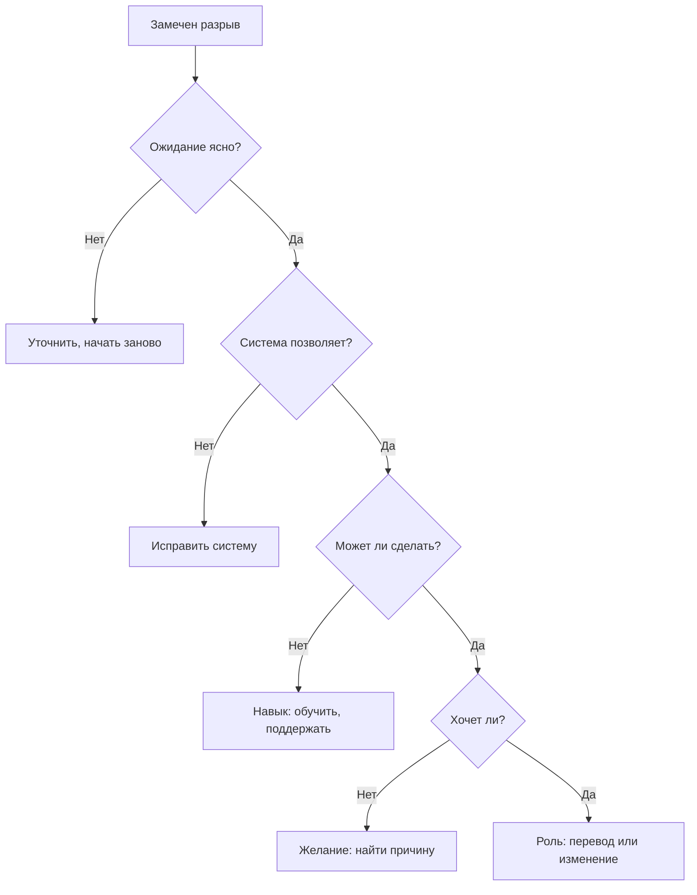
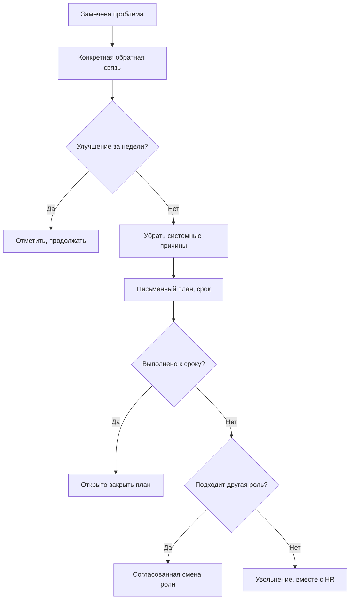
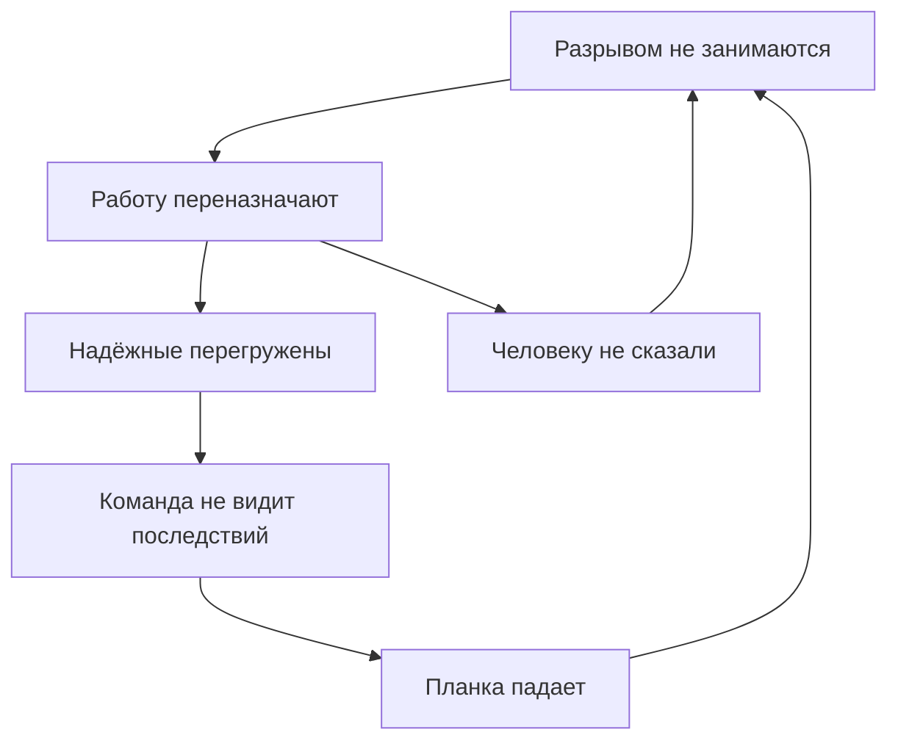

# Глава 9 — Управление результативностью и работа с отстающими { #chapter-9-performance-management-and-underperformance }

Эта глава о регулярном цикле оценки результативности и о той части управления, которую большинство
руководителей откладывают: признать, что человек не справляется, выяснить почему и действовать
справедливо и по отношению к нему, и по отношению ко всем, кто с ним работает. Речь пойдёт о том, как
писать оценки результативности, о диагностике до действий (навык, желание, соответствие роли и система
вокруг человека), о задокументированном процессе улучшения с реальным шансом на успех и ясным концом, о
цене запоздалых действий и о том, что оценки результативности могут и чего не могут сказать. Сам
разговор с обратной связью разобран в главе 6, повышения и калибровка — в главе 8; эта глава опирается
на обе. Сквозной пример — инженер инфраструктуры из команды Platform Operations, которой руководит Tom
Becker, в Northstar Technologies, вымышленной компании из [кейса](../../case-studies/northstar/index.md).

## Почему это важно { #why-this-matters }

На уровне команды один человек, который не делает свою работу, редко бывает проблемой одного человека.
Кто-то берёт эту работу на себя — обычно самые добросовестные люди в команде, — и они видят, что
руководитель заметил и ничего не сделал. Команда узнаёт настоящую планку по тому, что руководитель
терпит, а не по тому, что он говорит.

На уровне организации управление результативностью решает, значит ли что-нибудь оценка «соответствует
ожиданиям». Если она стоит в каждой оценке, оценки перестают влиять на повышения, оплату и
комплектование команд, а руководители, которые всё же поднимают проблемы, на этом фоне выглядят
жёсткими. Противоположный провал не менее реален: процесс, который записывает людей в отстающие, хотя
причиной была невыполнимая роль, сломанный инструментарий или нагрузка прерываниями, которую никто не
измерял.

На уровне высшего руководства вопрос — в системе: как часто проводятся оценки, доверяют ли им и ждут
ли от руководителей действий. Когда люди перестают доверять этим решениям, развернуть их трудно.

## Цели главы { #learning-objectives }

После этой главы вы сможете:

- Прежде чем действовать, разделять причины низкой результативности — навык, желание, соответствие
  роли и систему — и называть свидетельства, которые их различают.
- Формулировать ожидания по результативности, которые может проверить третья сторона, и использовать их
  в регулярном цикле оценки и для запуска задокументированного процесса улучшения.
- Вести план улучшения, который даёт человеку реальный шанс на успех, имеет ясный конец и не выходит за
  юридические и HR-рамки вашей организации.
- Оценивать, во что команде обходятся запоздалые действия, и по этой оценке решать, когда начинать.
- Судить, что может подтвердить оценка результативности с учётом исследований эффектов оценщика, и
  отвечать на предложения ввести принудительное ранжирование.

## Ментальная модель { #the-mental-model }

> **Ментальная модель:** низкая результативность — это разрыв между ожиданием и результатом. Прежде чем
> действовать в отношении человека, докажите, что ожидание было ясным и что система позволяла
> добиться результата. Затем действуйте быстро, письменно и с датой окончания.

Руководители склонны систематически совершать одну из двух ошибок. Первая — винить человека в проблеме
системы: инженера, который срывает все обязательства, потому что несёт половину прерываний команды.
Вторая — винить систему в проблеме человека и ждать реорганизации или лучшего квартала, чтобы
исправить того, кому никто ничего не сказал. Порядок диагностики ниже защищает от обеих. Он начинается
с самых дешёвых проверок — руководителя и среды — и только потом доходит до человека.

Каждая следующая ветка дороже и труднее обратима: уточнить ожидание стоит одного разговора, исправить
систему — части ресурса команды, а формальный план — недель, доверия, а иногда и работы. Обычно
несколько причин действуют одновременно, поэтому проходите весь чек-лист, а не останавливайтесь на
первом «да».

## Подробный разбор { #deep-conceptual-explanation }

### Четыре причины и свидетельства, которые их различают { #four-causes-and-the-evidence-that-separates-them }

Ставьте диагноз прежде лечения и проверяйте среду прежде человека. Это общая мысль трёх классических
работ практиков: Grove делит провалы на недостаток способностей и недостаток мотивации; Gilbert
утверждает, что большинство дефицитов происходит от среды; Mager и Pipe предлагают тест на пробел в
навыке (если бы работа человека действительно зависела от этой задачи, смог бы он её выполнить? Если
да, обучение — не лекарство)
([Grove, 1983](../../references/bibliography.md#grove1983high);
[Gilbert, 1978](../../references/bibliography.md#gilbert1978human);
[Mager and Pipe, 1997](../../references/bibliography.md#mager1997analyzing)).

Эта книга, развивая эти идеи, использует четыре причины (**рекомендация книги**):

| Причина | Как выглядит | Что подтверждает | Что исключает |
|---|---|---|---|
| Система | Заблокирован, перегружен или поставлен в заведомо проигрышные условия | Нагрузка прерываниями, неясное владение, нет доступов; коллеги в той же роли тоже испытывают трудности | Коллеги с той же нагрузкой и инструментами справляются |
| Навык | Усилия видны, результат неверный или медленный | Улучшается при парной работе и на примерах; просит помощи | Год назад делал это хорошо |
| Желание | Мог бы, но не делает | Избирательные усилия; хорошая работа над тем, что интересно; отстранённость после какого-то события | Разрыв во всём, включая то, что нравится |
| Соответствие роли | Устойчивые усилия в роли, которая вознаграждает другие сильные стороны | Силён в соседней роли; трудности начались после изменения роли | Роль не менялась, а трудности новые |

«Желание» описывает поведение, а не характер, и у него почти всегда есть причина: нарушенное обещание,
конфликт, выгорание, проблемы со здоровьем или в семье. Одни причины созданы организацией, другие —
личные. Руководитель вправе требовать определённого поведения и разговора о нём, но не медицинских или
семейных подробностей. Если всплывает причина, связанная со здоровьем или личными обстоятельствами,
следующий шаг обычно — HR и та поддержка или адаптация условий, которую предлагает работодатель, а не
план улучшения.

### Ожидания, которые может проверить третья сторона { #expectations-a-third-party-could-check }

Процесс улучшения справедлив ровно настолько, насколько справедливы его ожидания. Ожидание «будьте
проактивнее» нельзя выполнить или провалить — можно только оценить, а оценивает руководитель, у
которого мнение уже сложилось. Формулируйте каждое ожидание так, чтобы человек, не знающий сотрудника,
мог в конце сказать, выполнено ли оно (**рекомендация книги**):

- **Результат**, а не деятельность: «на назначенные вам запросы на окружения вы отвечаете в течение двух
  рабочих дней», а не «будьте отзывчивее».
- **Уровень** — по меркам уровня человека и его коллег, а не лучшего инженера команды.
- **Свидетельства**, на которые будут смотреть обе стороны: очередь тикетов, история ревью,
  дизайн-документы.
- **Поддержка**, которую обязуется дать руководитель: защищённое время, напарник для парной работы,
  курс.

Подсчёт индивидуальной активности — не мера результативности; данные о поставке показывают, куда
смотреть, а суждение опирается на эффект и поведение
([глава 18](../04-execution/18-measuring-engineering-productivity.md#why-the-book-refuses-individual-productivity-scoring)).

### Регулярный цикл оценки { #the-regular-review-cycle }

Большая часть управления результативностью — не о проблемах. Это регулярный цикл: поставить ожидания,
проверить прогресс, написать оценку. Если делать его хорошо, низкая результативность становится редкой
и никогда не бывает сюрпризом. Схема ниже — **рекомендация книги**.

**Ритм.** Письменная оценка раз или два в год, которая опирается на ежемесячные заметки и короткую
квартальную сверку с ожиданиями. Письменная оценка подытоживает уже состоявшиеся разговоры; ничего в
ней не должно быть для человека новым.

**Начало периода.** Согласуйте с каждым два–четыре ожидания, сформулированных по тесту третьей стороны
и привязанных к измерениям лестницы (глава 8), плюс одну цель роста.

**Как писать оценку.** Начинайте с текущего журнала, который ведётся на встречах один на один (1:1)
(глава 5), а не с памяти. Сначала попросите человека написать короткую самооценку: она покажет работу,
которую вы упустили. В оценке четыре части:

| Часть | Содержание | Слабый вариант |
|---|---|---|
| Что человек сделал | Два–четыре результата, каждый со свидетельствами и эффектом | Список тикетов |
| Как — по измерениям лестницы | Поведение, которое привело к результатам, хорошее и не очень | «Сильный коммуникатор» |
| Рост | Прогресс по цели прошлого периода; следующий пробел на текущем или следующем уровне | «Так держать» |
| Следующий период | Ожидания и поддержка, которую вы обязуетесь дать | Ничего или то же, что в прошлый раз |

**Язык оценок.** Если в организации есть шкала оценок, пользуйтесь её определёнными формулировками и
показывайте свидетельства в пользу выбранной. «Соответствует ожиданиям» означает, что согласованные
ожидания выполнены; это не вежливое слово для проблемы, о которой вы не сказали.

**Сильным сотрудникам** конкретная обратная связь нужна не меньше, чем остальным: что сделало работу
сильной, чего требует следующий уровень, и одно действие по продвижению (sponsorship) (глава 5).
Отправляйте каждую письменную оценку за день до разговора, чтобы встреча стала обсуждением, а не
чтением вслух.

### Свидетельства результативности, когда код пишется с ИИ { #performance-evidence-when-code-is-ai-assisted }

ИИ-ассистенты для написания кода делают меры объёма ещё менее осмысленными: строки, коммиты и merge
request'ы растут без всякого изменения вклада. Оценивайте то, за что человек отвечает (**рекомендация
книги**): результаты относительно ожиданий, качество его проектных решений и решений на ревью, то, как
он действует в инцидентах, и понимает ли он код, который вливает, и готов ли за него отвечать — кто бы
или что бы его ни набрал. «Не знаю, это написал ассистент» на ревью или во время инцидента — сигнал о
результативности.

### Процесс улучшения { #the-improvement-process }

У формальных процессов много названий; самое распространённое —
[план улучшения результативности](../../glossary.md#performance-improvement-plan-pip), или PIP. Во
многих организациях все, включая самого человека, воспринимают PIP как первый шаг к увольнению. План,
который обе стороны считают формальностью, не может сработать, и руководитель теряет то, ради чего он
затевался: свидетельства того, может ли человек при поддержке дотянуться до планки.

Pulakos и O'Leary утверждают, что управление результативностью сжалось до административных шагов,
оторванных от ежедневного руководства, благодаря которому оно и работает
([Pulakos and O'Leary, 2011](../../references/bibliography.md#pulakos2011broken)). Это программная
статья, но она называет провал PIP: форма вместо еженедельного руководства.

У процесса с реальным шансом на успех пять свойств (**рекомендация книги**):

1. **Человек слышит о проблеме не впервые.** Разговоры с обратной связью из главы 6 уже состоялись, с
   примерами, и человеку прямо сказали, что разрыв серьёзен.
2. **Системные причины устранены заранее**, иначе план измеряет систему.
3. **Он короткий и с датами.** Шесть–десять недель для большинства инженерных ролей: достаточно долго,
   чтобы проявилась закономерность, и достаточно коротко, чтобы команда не тащила разрыв ещё квартал.
4. **Еженедельные встречи с письменными заметками**, которыми делятся с человеком: что выполнено, что
   нет, что дал руководитель.
5. **Оба исхода реальны.** Успех закрывает план, и об этом говорят вслух. Провал ведёт к решению,
   описанному с самого начала: смене роли, если подходящая есть, или увольнению.

Обратная связь, которая срабатывает за несколько недель, — обычный случай, и формальный план ей не
нужен. Смена роли допустима только тогда, когда это реальная роль, которую человек хочет и может
выполнять, а не тихая передача проблемы другим.

### Юридические и HR-рамки { #legal-and-hr-boundaries }

Трудовое право различается по странам, штатам, контрактам и коллективным договорам, поэтому эта глава
не говорит, что законно. Она называет рамки, которые действуют почти везде (**рекомендация книги**), и
правило, которое из них следует: подключайте HR, а через HR — юриста по трудовому праву до начала
формального плана, а не после его провала.

- **Единообразие.** Схожие разрывы получают схожее обращение. План по поводу того, о чём другому
  инженеру никогда не говорили, несправедлив и открывает организацию для исков о дискриминации.
- **Факты, а не прилагательные.** «Пропустил согласованную дату обновления Jenkins (запланировано на
  14-е, не начато)» выдерживает проверку; «ленивый» — нет.
- **Защищённые обстоятельства.** Здоровье, инвалидность, беременность, семейный отпуск, профсоюзная
  деятельность и недавние жалобы во многих юрисдикциях влекут особые обязанности или защиту.
  Остановитесь и получите консультацию.
- **Никаких предлогов.** Если решение уже принято, план нечестен и часто юридически рискован.

### Когда ответ — увольнение { #when-the-answer-is-exit }

Некоторые планы заканчиваются увольнением. То, как оно проведено, решает, что человек унесёт с собой и
что команда узнает о вас. Шаги ниже — **рекомендация книги**; юридические и договорные детали
определяет HR.

**Разговор.** Короткий, наедине, в начале недели, в присутствии HR или когда HR доступен. Назовите
решение в первую же минуту, прямо: «Мы решили прекратить трудовые отношения с вами. Критерии плана не
выполнены». Не переспоривайте свидетельства заново: это уже сделали еженедельные заметки. Объясните,
что будет дальше (последний день, выплаты, рекомендации, любая поддержка, которую предлагает компания),
и дайте это письменно. Позвольте человеку отреагировать, ответьте на практические вопросы и не
пытайтесь добиться его согласия.

**Доступы и передача дел.** Заранее договоритесь с HR, когда закрываются доступы; для большинства
инженеров достаточно конца дня, в который состоялся разговор, а выводить человека из здания под
сопровождением нужно редко. Спланируйте передачу дежурств, текущей работы и учётных данных без помощи
этого человека, чтобы ничто не зависело от доброй воли, которую вы только что испытали.

**Что сказать команде.** В тот же день, коротко: человек ушёл, кто теперь отвечает за его работу и что
меняется для команды. Не называйте причин и подробностей: право человека на частную жизнь переживает
его трудовой договор. Ожидайте вопросов на встречах 1:1 и отвечайте на те, что касаются работы команды,
а не самого человека.

**После.** Применяется шаг 10 практического плейбука.

### Цена запоздалых действий { #the-cost-of-acting-late }

Руководители откладывают, потому что действовать неприятно, а за задержку платят другие. Модель
негативных членов группы, предложенная Felps, Mitchell и Byington, — в том числе тех, кто
недорабатывает, — предполагает, что товарищи по команде реагируют ощущением несправедливости и
снижением доверия, а затем отстраняются или срываются
([Felps, Mitchell, and Byington, 2006](../../references/bibliography.md#felps2006bad)). Это
предложенная модель, а не измеренный эффект, и большинство отстающих — не «паршивые овцы». Но коллега,
который заметно делает меньше без последствий, — сигнал о справедливости для всех.

Практическая цена обычно измерима, как показывает пример из инженерной организации ниже. Kim Scott
называет провал руководителя в такой ситуации разрушительной эмпатией: человеку не говорят трудного,
чтобы быть добрым ([Scott, 2017](../../references/bibliography.md#scott2017radical)).

### Что измеряют оценки { #what-ratings-measure }

Оценка говорит больше о том, кто её поставил, чем о том, кто её получил. Scullen, Mount и Goff
разложили оценки более 4000 руководителей, каждого из которых оценивали начальники, коллеги,
подчинённые и он сам. Индивидуальные склонности оценщика объясняли 62 и 53% различий между оценками в
двух выборках; реальная результативность оцениваемого — 21 и 25%
([Scullen, Mount, and Goff, 2000](../../references/bibliography.md#scullen2000latent)).

Это были оценки для целей развития, не привязанные к оплате, а оценивали руководителей. И всё же из
этого следуют три вывода (**рекомендация книги**, развивающая этот результат):

- Оценка одного человека одним руководителем — слабое свидетельство. Запускайте процесс улучшения из-за
  задокументированных разрывов относительно письменных ожиданий, а не из-за оценки.
- Больше оценщиков снижают эффект оценщика, только если их особенности независимы; калибровочная
  встреча, на которой норму задаёт самый громкий руководитель, этого не даёт (глава 8).
- Слова в оценке должны нести свидетельства. «Соответствует ожиданиям» без примеров ничего не говорит
  следующему руководителю.

### Принудительное распределение и «rank and yank» { #forced-distribution-and-rank-and-yank }

Принудительное распределение требует от руководителей помещать фиксированные доли своих людей в каждую
категорию оценки, а в самой жёсткой форме — каждый год увольнять нижнюю категорию («rank and yank»,
«ранжируй и увольняй»). Известная симуляция Scullen, Bergey и Aiman-Smith показала, что такая система
может заметно повысить средний потенциал результативности персонала, в основном в первые несколько
лет, в зависимости от доли уволенных и добровольной текучести
([Scullen, Bergey, and Aiman-Smith, 2005](../../references/bibliography.md#scullen2005forced)).

При внимательном прочтении этот результат говорит против регулярного принудительного ранжирования в
разработке (**рекомендация книги**). Выигрыш сосредоточен в начале, поэтому постоянная отбраковка
продолжает приносить издержки после того, как выгоды сокращаются. Симуляция не сообщает о влиянии на
сотрудничество и на готовность браться за трудную и малозаметную работу, а опирается на оценки с
описанными выше эффектами оценщика. Принудительное распределение может быть разовой коррекцией там, где
оценки раздулись до полной бессмысленности. Как постоянная система оно ранжирует людей друг против
друга в работе, которая требует, чтобы они друг другу помогали.

## Пример из инженерной организации { #engineering-organization-example }

!!! info "Northstar: что уже известно"
    До недели 1: базовый квартал в Northstar, вымышленной компании книги в области order-to-cash («от
    заказа до оплаты»), незадолго до прихода нового директора по разработке. В Platform Operations пять
    инженеров инфраструктуры и семь QA-инженеров, которые перед каждым релизом Core, общего монолита,
    проводят трёхдневный ручной прогон тестов. См. [хронологию](../../case-studies/northstar/timeline.md).
    Впервые встречаете Northstar? Прочитайте [«Год вкратце»](../../case-studies/northstar/year-in-brief.md)
    и [«Действующие лица»](../../case-studies/northstar/cast.md).

Кейс ниже рассказывает историю Bram Verhoeven, senior-инженера инфраструктуры из команды Platform
Operations под руководством Tom Becker; в этом разделе — её цифры. Цифры — **иллюстрация**. Они
восстанавливают цену проблемы с результативностью в базовом квартале.

Допущения: квартал из 13 недель по 40 часов; пять инженеров инфраструктуры; трудозатраты на тикеты
взяты из учёта времени в самой очереди.

| Статья | Базовый квартал |
|---|---|
| Тикетов, назначенных Bram | 74 |
| Переназначено Tom Becker двум другим инженерам инфраструктуры | 31 |
| Средние трудозатраты на переназначенный тикет | около 4 часов |
| Работа, взятая на себя двумя коллегами | 31 × 4 = 124 часа, около 3.1 инженеро-недели |
| Время Tom на перенаправление и контроль | около 1 часа в неделю, 13 часов |
| Обновление Jenkins для Core, за которое отвечал Bram | откладывалось три раза, не начато |

Примерно за три похожих квартала команда взяла на себя около 9 инженеро-недель работы Bram и 39 часов
времени Tom, прежде чем кто-либо назвал проблему. Это время ушло из плановой инфраструктурной работы,
которая и так продвигалась только тогда, когда очередь затихала
([глава 15](../04-execution/15-planning-prioritization-and-delivery-methods.md)).

Bram сам восстановил свои последние шесть недель по календарю и очереди:

| Время Bram, последние шесть недель | Часы | Доля |
|---|---|---|
| Прерывания по Jenkins-пайплайну Core (красный main, зависшие агенты, вопросы) | 108 | 45% |
| Назначенные тикеты на окружения и доступы | 60 | 25% |
| Плановая инфраструктурная работа | 24 | 10% |
| Встречи и прочее | 48 | 20% |
| **Итого** | **240** | **100%** |

Bram построил Jenkins-пайплайн Core и по-прежнему был тем, кого все спрашивали, когда тот ломался,
поэтому эта нагрузка была большой, неучтённой и лежала только на нём. Переназначенные тикеты в
основном касались шести сервисов на GitLab CI, с которым он никогда не работал. Сорванному обновлению
нужны были дни без прерываний, которых у него не было.

Итак, диагностика нашла системную причину (45% его времени на прерывания, у которых нет владельца),
пробел в навыке (GitLab CI), составляющую желания (см. кейс) и никаких проблем с соответствием роли.
Формальный план в первый же день измерял бы в основном прерывания. У того, чтобы сначала убрать
прерывания, есть стоимость перехода: часть их берут на себя другие.

## Как принимать решение { #decision-framework }

**Действовать ли сейчас.** Действуйте, когда разрыв относительно озвученного ожидания сохраняется
дольше одного цикла обратной связи (две–четыре недели), когда работу за человека делают другие или
когда разрыв затрагивает обязательство перед клиентом. Ожидание годовой оценки откладывает решение на
срок до года.

**Какое вмешательство.**

| Диагноз | Первое вмешательство | Формальный план? | Когда появятся свидетельства |
|---|---|---|---|
| Ожидание неясно | Записать, согласовать, начать отсчёт заново | Нет | 2–4 недели |
| Системная причина | Перераспределить нагрузку; исправить владение, доступы, инструменты | Нет | 2–6 недель |
| Пробел в навыке | Парная работа, обучение, меньший масштаб, примеры | Редко | 4–12 недель |
| Желание, причина в работе | Назвать поведение; заняться причиной | Если поведение сохраняется | 4–8 недель |
| Желание, личная причина или здоровье | HR, поддержка, адаптация условий | Не пока идёт поддержка | По-разному |
| Соответствие роли | Изменить роль или найти другую, по согласию | Только если отвергнуты все варианты | Один квартал |
| Разрыв сохраняется после всего этого | Задокументированный план, срок, участие HR | Да | 6–10 недель |

**Когда план закончился.** Решайте в дату окончания по письменным критериям. Выполнено — закройте план
и скажите об этом. Явно не выполнено — смена роли или увольнение, как описано в начале. Смешанный
результат — то место, где руководители теряют решимость. Продлевайте один раз и только тогда, когда
тренд явно идёт вверх, а оставшийся разрыв конкретен; второе продление обычно означает, что
руководитель не хочет решать.

## Компромиссы { #trade-offs }

**Скорость против справедливости.** Быстрые действия защищают команду; осторожные — человека. Порядок
диагностики — компромисс: его проверки занимают дни, и план, который следует за ними, справедливее.

**Поддержка против стандартов.** Устранение системных причин и парная работа могут выглядеть как
снижение планки для одного человека. Меняйте условия, а не ожидание: защищённое время — это условие;
согласие на половину результата — сниженная планка.

**Формальный процесс против отношений.** Письменный план меняет отношения, поэтому некоторые
руководители год держат проблему в неформальном поле — а к тому времени отношения всё равно испорчены.

## Типичные провалы { #failure-modes }

**Обходной путь.** Руководитель тихо переназначает работу человека, вместо того чтобы заняться
разрывом.

Сигнал: работу забирают у одного человека без записанной причины. Противодействие: любое
переназначение по причине результативности запускает разговор в течение недели.

**План-сюрприз.** Человек впервые слышит о проблеме в формальном плане. Сигнал: в последней оценке
стояло «соответствует ожиданиям». Противодействие: никакого плана без задокументированной более ранней
обратной связи; если оценка была завышена, признайте это в первом же разговоре.

**План как оформление увольнения.** Решение принято, а план — театр. Сигнал: руководитель не может
описать успех. Противодействие: сначала напишите критерии успеха и спросите HR, достижимы ли они за
отведённое время.

**Измерение системы.** План измеряет результат, который определяется нагрузкой прерываниями или
доступами человека. Сигнал: у коллег в той же роли тот же разрыв. Противодействие: порядок диагностики
до плана.

**Инфляция оценок.** Никто не получает оценку ниже ожиданий, поэтому оценки не несут информации, а
честные оценщики выглядят карателями. Сигнал: почти все оценки в двух верхних категориях, а проблемы
поднимают только неформально. Противодействие: калибровка с примерами (глава 8), а не принудительное
распределение.

## Применение в крупной организации { #enterprise-application }

В организации из 50–150 инженеров директор сталкивается с несколькими случаями низкой
результативности в год и должен вести их как систему, а не как частные драмы.

**Сделайте порядок диагностики стандартом.** Каждый формальный план начинается с короткой записки с
ответами на диагностические вопросы, которую до начала плана читают HR и директор. Это отлавливает
большинство планов-сюрпризов и системных причин.

**Ищите закономерности.** Если у испытывающих трудности инженеров общая нагрузка прерываниями,
инструментарий или руководитель, проблема не индивидуальна.

**Поддерживайте руководителей.** Линейные руководители проводят мало формальных планов; ставьте в пару
к каждому HR и опытного коллегу.

**Отслеживайте итоги.** По каждому плану записывайте диагноз, длительность, исход и были ли найдены
системные причины. Если каждый план заканчивается увольнением, планы не настоящие; если ни один —
возможно, их начинают слишком поздно или заканчивают слишком мягко. Устойчивая низкая
результативность в масштабе всей организации разобрана в главе 56, а сокращения — другой процесс с
другими правилами — в главе 58.

## Взгляд CTO { #cto-perspective }

CTO (технический директор) определяет три вещи. Первая — систему результативности: ритм оценок, есть
ли шкала оценок, как устроена калибровка, применяется ли принудительное распределение. Вторая —
ожидание, что руководители действуют: там, где руководителей, которые занимаются проблемами, считают
неудобными, проблемы остаются. Третья — терпимость к блестящим, но разрушительным людям. У
senior-инженера, который выдаёт результат, но отталкивает других, есть проблема с результативностью, и
каждый руководитель смотрит, как CTO справится с первым таким случаем.

Двум коротким путям стоит сопротивляться: ежегодной принудительной отбраковке, чтобы «поднять планку»
без роста численности, и сокращению штата, которым убирают людей, с которыми их руководители так и не
поработали (глава 58). CTO также отвечает за честность цифр: пакет для совета директоров, в котором 2%
сотрудников ниже ожиданий, тогда как руководители в частных разговорах называют испытывающими трудности
10%, сообщает об инфляции оценок, а не о персонале.

## Практический плейбук { #practical-playbook }

Для руководителя, который считает, что кто-то в команде работает ниже ожиданий:

1. **Запишите разрыв**: ожидание, результат, даты, примеры. Если не можете, у вас впечатление, а не
   проблема с результативностью — пока.
2. **Проверьте ожидание.** Было ли оно сформулировано словами, которые человек узнал бы? Если нет,
   сформулируйте и начните отсчёт заново.
3. **Проверьте систему**: нагрузку прерываниями, доступы, владение, инструменты — в сравнении с
   коллегами. Сначала исправьте то, что найдёте.
4. **Проведите прямой разговор** (глава 6): примеры, эффект и что происходит.
5. **Согласуйте ответ** на найденную причину, письменно, и встречайтесь еженедельно две–четыре недели.
   Большинство случаев здесь и заканчиваются.
6. **Если разрыв сохраняется, подключите HR** и передайте письменную историю.
7. **Напишите план**: четыре–шесть проверяемых ожиданий, ваша поддержка, еженедельные встречи, дата
   окончания через шесть–десять недель и что произойдёт в конце.
8. **Ведите его честно**: еженедельные заметки, которыми делитесь с человеком, и обещанная поддержка.
9. **Решите в дату окончания** по критериям и запишите решение.
10. **Устраните последствия для команды**: открыто перераспределите работу, поблагодарите тех, кто её
    на себя брал, и исправьте то, что позволило проблеме тянуться.

## Кейс { #case-study }

Этот кейс — **вымысел** ([хроника года 1](../../case-studies/northstar/first-quarter.md)). Восстановление
времени в примере из инженерной организации охватывает базовый квартал; Tom Becker (руководитель
Platform Operations) готовит своё предложение в начале квартала 2 (неделя 14), а решение остаётся за
читателем.

Bram Verhoeven пришёл в Northstar за шесть лет до директора и был одним из пяти инженеров
инфраструктуры Platform Operations, на уровне Senior Engineer. Он построил Jenkins-пайплайн Core, и за
это его уважали. За восемнадцать месяцев до прихода директора он предложил объединить четыре системы
сборки Northstar и рассчитывал возглавить эту работу. Через полгода предложение отложили из-за нехватки
ресурсов. Tom Becker сообщил ему об этом на встрече 1:1, и больше никто из них к этому не возвращался.

В следующие три квартала работа Bram начала проседать. Назначенные ему запросы на окружения
залёживались, обновление Jenkins для Core, за которое он отвечал, откладывалось трижды, а на стендапах
он говорил всё меньше. Tom выбрал обходной путь: перекидывал залежавшиеся тикеты Bram двум другим
инженерам инфраструктуры — 31 из 74 в базовом квартале — и ничего не объяснял. В годовой оценке Bram,
написанной за четыре месяца до прихода директора, стояло «соответствует ожиданиям», и его называли
надёжным сотрудником. Один из двух коллег сказал Tom, что устал прикрывать Bram.

Tom описывал ситуацию так: Bram «отключился». Шестинедельная реконструкция из примера в инженерной
организации изменила картину: прерывания по пайплайну без владельца и работа с GitLab CI, которой его
не обучили. Bram также сказал то, о чём Tom наполовину догадывался: после того как объединение
отложили, он перестал верить, что его плановая работа имеет значение, а чинить чужие пайплайны
казалось единственным, чего от него вообще кто-то хотел.

Ничто из этого не делало разрыв приемлемым: Bram молча позволял тикетам залёживаться и ни разу не
поднял вопрос о нагрузке прерываниями. Но это изменило представление о том, каким должен быть
справедливый процесс. Черновик предложения Tom директору:

| Часть | Подробности |
|---|---|
| Система | Прерывания по Jenkins для Core идут в общую входящую очередь команды и распределяются по ротации; Bram — точка эскалации, а не первый отвечающий |
| Навык | Две недели парной работы с коллегой, который лучше всех знает GitLab CI, затем Bram берёт свою долю таких тикетов |
| Ожидания, восемь недель, еженедельная проверка | Назначенные тикеты подтверждаются в течение одного рабочего дня и получают ответ в течение двух или возвращаются с причиной; обновление Jenkins запланировано с датой и выполнено; написан ранбук (runbook) для пайплайна Core |

Tom предложил называть это соглашением об ожиданиях, а не формальным планом: HR в курсе, но процесс не
ведёт, а формальный план — только если за восемь недель разрыв не закроется. Двум коллегам он скажет,
что переназначения прекратятся и что ситуацией занимаются, без подробностей.

Были и осложнения. Ротация прерываний по Jenkins добавила нагрузки остальным четырём инженерам
инфраструктуры, двое из которых только что девять месяцев закрывали тикеты Bram. После того как на
неделе 10 QA-инженеры перешли в продуктовые команды, в команде остались пять инженеров инфраструктуры,
так что Bram — пятая часть её ресурса. Квартал 1 сократил прерывания по Jenkins, но не устранил их. А
поскольку в последней оценке стояло «соответствует ожиданиям», любая письменная запись о проблеме
начиналась бы практически сейчас.

Урок: справедливый процесс начинается с диагностики, а не с первого впечатления. Решение — за
читателем: утвердить предложение Tom как есть, изменить его или попросить другое.

## Упражнения { #exercises }

Решения — в [решениях к главе 9](../../solutions/ch09-solutions.md). Данные Northstar — на
[странице исходных данных](../../case-studies/northstar/baseline-data.md); кто есть кто — на странице
[«Действующие лица»](../../case-studies/northstar/cast.md).

### Базовый уровень { #foundational }

**F1.** Четыре инженера из разных команд сорвали своё главное обязательство в прошлом квартале.
Первый пришёл три месяца назад и задаёт много вопросов. Второй срывает обязательства только с тех пор,
как его команда перешла на новый график дежурств. Третий отлично проводит ревью дизайна и пускает на
самотёк задачи по реализации. Четвёртый был сильным бэкенд-инженером и полгода назад перешёл в
мобильную команду. Для каждого назовите наиболее вероятную причину, свидетельства, которые её
подтвердят, и свидетельства, которые заставят вас передумать.

**F2.** Черновик плана улучшения у одного руководителя содержит такие ожидания: «проявлять больше
ответственности», «лучше коммуницировать со стейкхолдерами», «улучшить качество кода» и «быть
командным игроком». Перепишите каждое так, чтобы третья сторона могла через восемь недель решить,
выполнено ли оно, и назовите поддержку, которую руководитель должен пообещать по каждому.

**F3.** Руководитель в Northstar предлагает ранжировать команду по оценкам за прошлый год, чтобы
распределить несколько мест на конференции, утверждая, что оценки — самые объективные данные из
доступных. Каждого оценивал один руководитель. Опираясь на исследования эффектов оценщика, объясните,
что эти оценки могут подтвердить и чего не могут, и предложите лучшее основание для решения.

**F4.** У инженера из вашей команды сильный год: она руководила миграцией, которая убрала еженедельный
ручной шаг, довела новичка до самостоятельности и дважды поднимала риски в дизайне, которые затем
исправили другие команды. Её цель роста была провести межкомандный дизайн, и этого пока не произошло.
Используя структуру из четырёх частей, набросайте её письменную оценку, включая ожидания на следующий
период и ваши обязательства.

### Прикладное лидерство { #applied-leadership }

**A1.** Вы — Tom Becker и готовитесь к первому прямому разговору с Bram Verhoeven о разрыве, ещё до
восстановления времени; в его последней оценке стояло «соответствует ожиданиям». Спланируйте, что вы
скажете о разрыве и о собственной роли в нём, что вам нужно выяснить и чего вы пока не будете
обещать.

**A2.** Предположим, что во втором квартале один из двух QA-инженеров, перешедших на неделе 10 в Billing
инженерами по качеству, испытывает трудности. Его исследовательское тестирование ценят, но
автотесты он пишет медленно, и они часто нестабильны, а команда Marcus Oyelaran (руководителя Billing)
начала направлять работу по автоматизации в обход него. За ним годы сильных оценок в роли ручного
регрессионного тестирования. Во время перехода все семь QA-инженеров сортировали ручной набор тестов,
но только пятеро ещё и автоматизировали тест-кейсы; этот инженер в их число не входил. Одно из
[постоянных ограничений](../../case-studies/northstar/index.md#constraints-that-hold-throughout-the-book)
Northstar гласит: любой план, меняющий работу QA-инженеров, должен говорить, чем они займутся дальше.
Решите, как Marcus следует диагностировать ситуацию и реагировать и чем организация обязана этому
инженеру с учётом того, как произошла смена роли.

**A3.** Через шесть недель восьминедельного соглашения Bram каждую неделю выполняет норматив по
подтверждению тикетов, написал ранбук и запланировал обновление Jenkins, но обновление один раз
съехало, а ответ в течение двух рабочих дней он даёт примерно в 70% случаев. Один из коллег, которые
его прикрывали, спрашивает, почему ему «дали второй шанс». Решите, что делать на неделе 8 и что сказать
коллеге.

### Решения на уровне руководства { #executive-decision-making }

**X1.** Предположим, что в условиях без роста численности Helena Marsh (CEO, генеральный директор)
предлагает ввести в разработке ежегодное принудительное распределение: нижние 10% каждый год
увольняются и заменяются новыми людьми, чтобы «поднять планку, не добавляя людей». Victor Lindqvist
(CTO) просит вашу рекомендацию. Опираясь на доказательства из этой главы и данные Northstar,
сформулируйте рекомендацию, самый сильный аргумент в пользу её предложения, что бы вы сделали вместо
этого и что бы измеряли.

**X2.** Предположим, аудит последнего цикла оценок в Northstar показывает, что ни один инженер не
получил оценку ниже ожиданий, тогда как шесть руководителей в частных разговорах называют около шести
инженеров испытывающими трудности дольше квартала. Спроектируйте изменения в системе результативности
на следующие два квартала, как вы избежите перекоррекции и во что это обойдётся.

## Вопросы для размышления { #reflection-questions }

1. Кого в вашей команде сейчас кто-то прикрывает и как долго?
2. Когда вы в последний раз поставили кому-то «соответствует ожиданиям», про себя считая, что это не
   так?
3. Какая часть системы вашей команды заставила бы способного инженера выглядеть слабым?
4. Если бы кого-то из ваших подчинённых завтра поставили на формальный план, услышал бы он о проблеме
   впервые?
5. Что ваша команда сказала бы о том, что здесь происходит, когда кто-то не делает свою работу?

## Главное { #key-takeaways }

- Низкая результативность — это разрыв между озвученным ожиданием и результатом; прежде чем
  действовать в отношении человека, докажите, что ожидание было ясным, а система позволяла добиться
  результата.
- Проходите диагностику целиком: система, навык, желание и соответствие роли обычно действуют вместе.
- Формулируйте ожидания, которые может проверить третья сторона, с названными свидетельствами и
  поддержкой.
- Формальный план никогда не бывает первым случаем, когда человек слышит о проблеме; он короткий, с
  датами, пересматривается еженедельно, и оба исхода в нём реальны.
- Подключайте HR до формального плана, записывайте факты, а не прилагательные, и останавливайтесь за
  консультацией, когда затронуты защищённые обстоятельства.
- Запоздалые действия не нейтральны: команда платит взятой на себя работой и сниженной планкой.
- Одна оценка многое говорит об оценщике; никогда не начинайте и не заканчивайте процесс только на
  основании оценки.
- Принудительное распределение в лучшем случае — разовая коррекция; как постоянная система оно
  ранжирует людей друг против друга в работе, которая требует сотрудничества.

## Источники и что почитать { #references-and-further-reading }

- [Scullen, Mount, and Goff, 2000](../../references/bibliography.md#scullen2000latent). Насколько оценка
  отражает самого оценщика; ключевое исследование индивидуальных эффектов оценщика.
- [Scullen, Bergey, and Aiman-Smith, 2005](../../references/bibliography.md#scullen2005forced). Симуляция
  принудительного распределения: самый сильный аргумент в его пользу и его пределы.
- [Pulakos and O'Leary, 2011](../../references/bibliography.md#pulakos2011broken). Почему формальное
  управление результативностью разочаровывает; аргумент в пользу ежедневного общения руководителя и
  сотрудника.
- [Felps, Mitchell, and Byington, 2006](../../references/bibliography.md#felps2006bad). Как один
  устойчиво негативный участник влияет на команду; модель механизмов.
- [Mager and Pipe, 1997](../../references/bibliography.md#mager1997analyzing). *Analyzing Performance
  Problems*. Короткий практический метод диагностики разрыва до действий.
- [Gilbert, 1978](../../references/bibliography.md#gilbert1978human). *Human Competence*. Причины
  результативности в среде и в самом человеке.
- [Grove, 1983](../../references/bibliography.md#grove1983high). *High Output Management*. Результат
  работы руководителя и взгляд на проблемы результативности через способности и мотивацию.
- [Scott, 2017](../../references/bibliography.md#scott2017radical). *Radical Candor*. Цена уклонения от
  трудных сообщений; дополняет главу 6.
