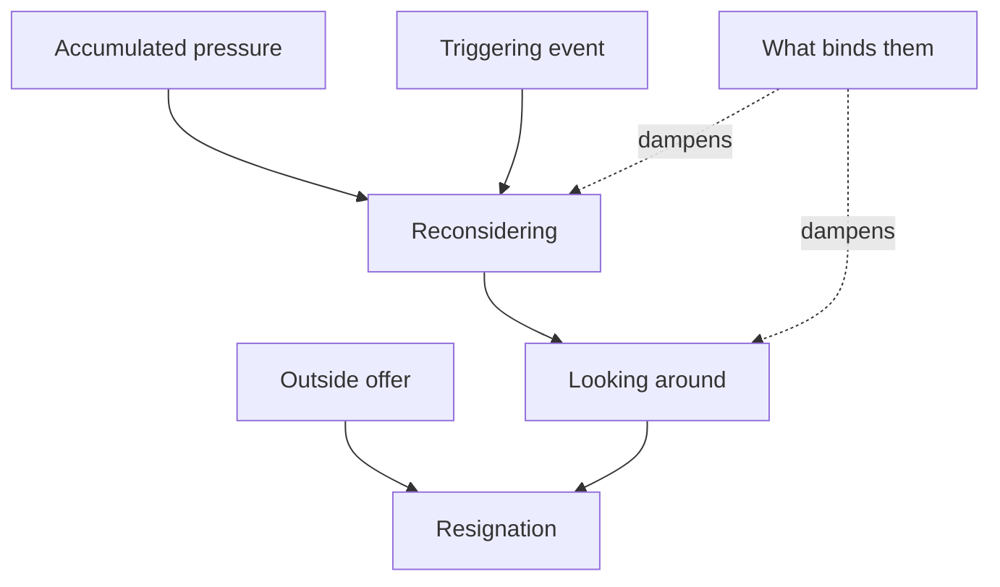
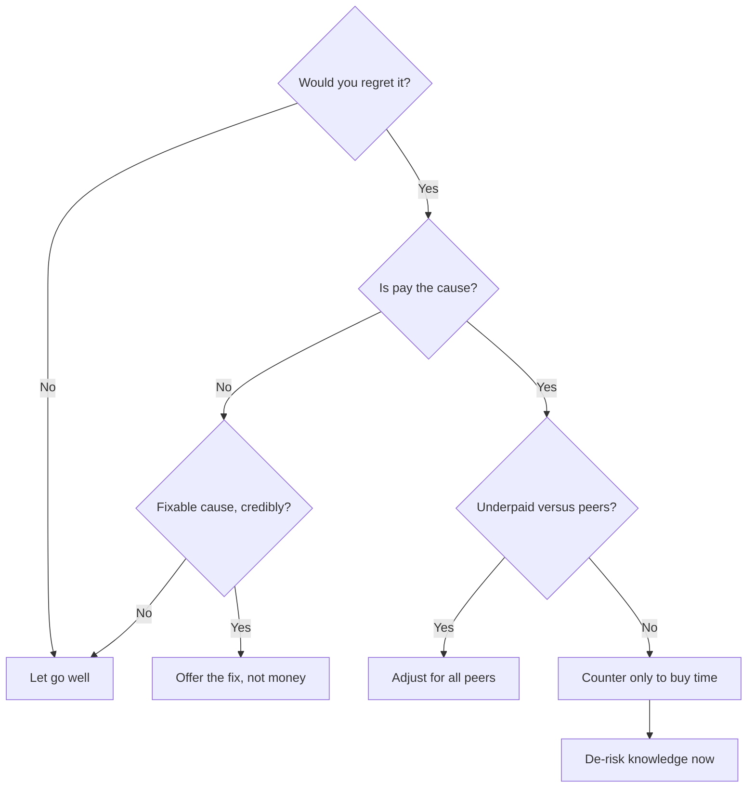

# Chapter 10 — Motivation, Retention, and Managing Senior Engineers

This chapter is about keeping the people whose departure would hurt most, and managing the ones who know
more than you: what turnover research tells a manager, how to collect exit and stay data about your own
organization, how to work with opinionated experts without deferring or overruling, and how to decide on
a counter-offer. Chapter 3 covers the arithmetic of attrition as a stock and flow. The running example is
the fictional Northstar Technologies ([case study](../../case-studies/northstar/index.md)): its Billing
ledger experts and its longest-serving staff engineer, Ines Carvalho.

## Why This Matters

At team scale, one resignation can remove a capability rather than a person. When knowledge of a
critical system sits with three people, losing one raises the load on the other two, and load is often
what drove the first one out. Managers usually learn this from the resignation, the least useful moment.

At organization scale, departures cluster: in teams with heavy on-call load, under particular managers,
after reorganizations and contested decisions. An organization that records one reason per departure,
chosen from a dropdown on the last day, cannot see the clusters and spends on the wrong cause.

At executive scale, retention is a cost line and a risk line. Every regretted departure costs months of
empty seat and ramp-up; the people most expensive to lose are often experts consulted on everything and
owning nothing. And how the company handles counter-offers tells every engineer whether resigning is the
way to get a raise.

## Learning Objectives

After this chapter you will be able to:

- Identify what actually drives departures in your organization by combining exit data, stay data,
  and system data, instead of importing a generic list of reasons.
- Explain what the turnover research supports, including job embeddedness and decision paths, and
  where it stops.
- Manage engineers who are more expert than you, including highly opinionated ones, by separating
  technical judgment from decision rights and outcomes.
- Decide when to make a counter-offer, when to let a person go, and how to protect the team either way.
- Detect key-person and collective-turnover risk early, from leading indicators rather than resignations.

## The Mental Model

> **Mental model:** People rarely leave for one reason. They leave when accumulated pressure, an event
> that makes them reconsider, and an available alternative line up, and they stay when what binds them
> outweighs all three. A manager can see and change the pressure and the binding, rarely the
> alternative.

| Element | What it is at work | Can the manager see it? | Can the manager change it? |
|---|---|---|---|
| Accumulated pressure | After-hours pages, decisions ignored, no growth, pay below peers | Yes, if they look | Usually |
| Triggering event | A weekend incident, a rejected proposal, a reorganization, a manager change | Yes, as it happens | Sometimes; can at least follow up |
| Outside offer | A recruiter, a former colleague, a better-paid role | Rarely before it is too late | No |
| What binds them | Relationships, fit with the work, what they would give up | Through stay conversations | Slowly |

The second idea follows: the manager's leverage is upstream. Once an offer letter exists, the manager can
only bargain. Most of this chapter is about seeing the pressure and the binding while they can still be
changed.

## Deep Conceptual Explanation

### What the turnover research supports

What predicts turnover depends on the setting. That is the conclusion of the two large
[meta-analyses](../../glossary.md#meta-analysis) (statistical syntheses of many studies) that are the
usual starting points ([Griffeth, Hom, and Gaertner, 2000](../../references/bibliography.md#griffeth2000meta);
[Rubenstein et al., 2018](../../references/bibliography.md#rubenstein2018surveying)).

The consequence (**this book's recommendation**, resting on that **research finding**): a ranked list of
"top reasons engineers leave" from other companies is a weak guide to yours. Your organization is the
context, and you have to measure it. Two further ideas are directly useful to a manager.

**Decision paths.** Lee and Mitchell's unfolding model describes voluntary turnover as four distinct
decision paths, each with its own psychological process and external events, rather than one slow slide
from dissatisfaction to departure
([Lee and Mitchell, 1994](../../references/bibliography.md#lee1994unfolding)). A manager can
take one inference from it (**this book's recommendation**): an exit question that asks only "what were
you unhappy with?" misses departures that began with an event. Ask instead what happened in the months
before the person started looking.

**Job embeddedness.** Mitchell and colleagues defined embeddedness as a person's links to other people
and groups, their fit with job, organization, and community, and what they would sacrifice by leaving.
In two samples it predicted intent to leave and actual voluntary turnover beyond what job satisfaction,
commitment, alternatives, and job search explained
([Mitchell et al., 2001](../../references/bibliography.md#mitchell2001why)). A **research
finding** from settings outside software, and the basis for asking people why they stay. Hom and
colleagues' century review describes the field's turn toward this "psychology of staying" and toward
**collective turnover**, the loss of human capital as a group
([Hom et al., 2017](../../references/bibliography.md#hom2017hundred)): losing two of three
ledger experts is not twice the cost of losing one.

### Motivation: autonomy, competence, relatedness

Self-determination theory proposes three psychological needs (competence, autonomy, and relatedness)
whose satisfaction supports motivation and well-being. Ryan and Deci's review cites workplace evidence
that satisfying these needs predicted performance and well-being, and reports that choice and
self-direction raise intrinsic motivation while deadlines, directives, pressured evaluations, and imposed
goals lower it ([Ryan and Deci, 2000](../../references/bibliography.md#ryan2000self)). Its claim that
contingent tangible rewards undermine intrinsic motivation is **contested**, as the paper itself notes;
do not read it as "pay does not matter". Pay is fairness and market position, covered in Chapter 8.

For software engineers, a systematic review by Beecham and colleagues found that motivation
depends on the engineer's characteristics (such as a need for variety), internal controls (such as
personality), and external moderators (such as career stage), and that existing models did not capture
how much these needs vary ([Beecham et al., 2008](../../references/bibliography.md#beecham2008motivation)).
The implication: what retains a staff engineer eleven years into a codebase is not what
retains a second-year engineer, and you learn which by asking. Of the manager-effect evidence in Chapter
1, one result belongs here: at one technology firm, people-management skill was strongly and negatively
related to attrition ([Hoffman and Tadelis, 2021](../../references/bibliography.md#hoffman2021people)).
Retention is the manager's job, not HR's.

### Exit data, stay data, and system data

Each source sees a different part of the mechanism, and each fails in a known way.

| Source | What it sees | How it fails | How it is gamed or distorted |
|---|---|---|---|
| Exit interview | The story the leaver is willing to tell | Late; one data point per person; leavers avoid burning bridges | Single-reason forms default to "compensation", the socially safe answer |
| Stay interview | Why people stay and what would make them leave | Candor depends on trust in the interviewer | Managers who are scored on results coach the answers |
| System data | Pages, after-hours work, decision waits, time since last career conversation | Measures pressure, not feeling | Teams stop paging people and absorb the work silently |

A **stay interview** is a structured conversation with someone you want to keep: what keeps you here,
what would make you leave, what one thing you would change, and what you would give up if you left (the
sacrifice dimension of embeddedness). The format is **practitioner consensus**; no study cited here tests
its effect, and the book treats it as a way to collect embeddedness data. Run it as its own meeting, not
an item in a one-on-one (Chapter 5).

Chapter 18, following [Noda et al., 2023](../../references/bibliography.md#noda2023devex), pairs
developer feedback with system data to see daily friction
([Chapter 18](../04-execution/18-measuring-engineering-productivity.md#developer-experience-devex)).
The same pairing works for retention: system data shows where pressure builds; conversations show
whether it is the pressure that matters to this person.

### Managing engineers more expert than you

Most managers manage people who know their systems better. The mistake is to treat this as a contest
to win or concede. The useful split (**this book's recommendation**) has three parts:

| Who | Owns | Example |
|---|---|---|
| The expert | Technical judgment within a stated mandate | Where the core/customer module boundary should be |
| The manager | Priorities, constraints, decision rights, and consequences for people | Whether the boundary work is funded this half; who decides if teams disagree |
| Both, explicitly | The record of what was decided, by whom, and what would reopen it | A written decision with its assumptions |

Chapter 1 cites evidence that a supervisor's technical competence predicts worker satisfaction; you need
enough to ask good questions, not to win the argument. Good questions test reasoning: what would change
your mind, what does it cost if you are wrong, what is the smallest reversible version. Marquet's
practice of having people state their intent and reasoning, so the leader checks the thinking rather
than issuing answers, fits experts well ([Marquet, 2012](../../references/bibliography.md#marquet2013turn)).

A staff engineer needs a **mandate**: scope, expected output, and decision rights. Larson's work on the
staff track is known for treating staff engineering as leadership outside the management line
([Larson, 2021](../../references/bibliography.md#larson2021staff)), and his archetypes (tech lead,
architect, solver, right hand) name the shapes a mandate can take
([Larson, staff archetypes](../../references/bibliography.md#larson-staff-archetypes)). An expert with no
mandate becomes a solver by default: consulted on everything, accountable for nothing, and frustrated
that advice is taken selectively. Chapter 4 covers the track
([the staff-plus track](../01-foundations/04-the-leadership-ladder.md#the-staff-plus-track-in-parallel)).

**Highly opinionated experts.** Strong views argued on the merits are an asset. The problem is a
behavior: when the expert's certainty stops others from proposing, the team's capability shrinks around
them. Wiseman's distinction between leaders who multiply others' intelligence and those who diminish it
applies to senior engineers too ([Wiseman, 2010](../../references/bibliography.md#wiseman2010multipliers)).
Name the behavior and its effect, not the personality, and change the structure that rewards it: give
the expert a decision they own outright, and route other decisions to people who consult the expert but
decide themselves.

The hardest version is the **hostage dynamic**: an expert so critical that the manager will not challenge
them for fear they will leave. Each quarter of avoidance deepens the dependency. The way out is
de-risking, not confrontation: spread the knowledge on a schedule, and say why.

### Counter-offers

A counter-offer is an improved package offered to keep someone who has resigned or holds an outside
offer. The evidence is thin. The one peer-reviewed study this book found, of 650 US research-university
faculty, states that few studies examine the process, describes retention offers as discretionary and
often inequitable, and found that women and racially minoritized faculty were less likely to receive
them, while desire to leave and telling leadership were associated with receiving one
([White-Lewis et al., 2024](../../references/bibliography.md#whitelewis2024counteroffers)).
It says nothing about engineers or about whether those retained stayed. Widely repeated figures on how
many acceptors leave within a year come from recruiting firms with undisclosed methods; this book does
not repeat them, and the evidence is thin. The warning that transfers: counter-offers reward the people who ask,
not necessarily the underpaid or the most valuable. The rest is **this book's recommendation**:

- A counter-offer can fix pay. It cannot fix load, a manager, or a lost decision. If the cause was
  not pay, it buys months.
- If you would pay the amount only because of the offer, either you were underpaying, in which case
  fix it for everyone in the same position, or you are buying time, in which case use the time to
  remove the dependency.
- Every counter-offer is visible within weeks. If peers in the same role learn that resigning is the
  path to a raise, you have set a policy without writing it.

## Engineering Organization Example

!!! info "Northstar so far"
    Week 20 of the Engineering Director's first year at Northstar, the book's fictional order-to-cash
    company. Serious (Sev1 and Sev2) incidents fell from 30 to 21 in the first quarter. Billing still
    relies on three ledger engineers for most of its on-call pages, after a fourth resigned before the
    director arrived. See the [timeline](../../case-studies/northstar/timeline.md).

This worked example is **illustrative**. It uses the
[baseline](../../case-studies/northstar/baseline-data.md) on-call and attrition figures, plus
assumptions stated in the text.

In week 20 one of Billing's three remaining ledger engineers, Tomasz Wierzbicki, tells Marcus Oyelaran
(Billing manager) he has an offer 20 percent above his current base salary. Assume $138,000, near the
top of the Engineer band (an assumption; Northstar's records do not give his salary), so the gap is
$27,600 a year.

**Cost of letting him go.** Using Northstar's median of 15 weeks from resignation to the replacement's
first day ([Chapter 3](../01-foundations/03-managerial-leverage-and-systems-thinking.md#delays)) and the
$185,000 fully loaded cost per engineer-year:

| Item | Assumption | First-year cost |
|---|---|---|
| Empty seat | 15 weeks ÷ 52 × $185,000 | about $53,000 |
| Ramp to a safe ledger responder | Six months at half productivity (assumption) | about $46,000 |
| Recruiting | Agency or internal recruiting time (assumption) | about $25,000 |
| **Total** | | **about $124,000** |

**What the table does not show.** In the baseline quarter the three ledger engineers handled 126 of
Billing's 180 pages and 54 of its 64 after-hours pages. If two people absorb the same load, each handles
about 50 percent more pages, day and night (63 a quarter instead of 42). That is exactly the pressure
that preceded the last ledger resignation (see the Case Study). The second-order risk is a
second departure, which is collective turnover.

**Cost of a matching counter-offer.** $27,600 a year, recurring. On those numbers alone it looks
cheaper than $124,000. Three things change the comparison:

1. **Peers.** The other two do the same work. A $27,600 gap earned by holding an offer becomes known;
   aligning both costs roughly another $55,000 a year.
2. **Cause.** If his stay interview named after-hours load, a raise does not touch the cause.
3. **Duration.** If he stays nine months and leaves anyway, the company pays about $21,000 more and
   still pays the $124,000, later.

A defensible alternative is a market adjustment for all three if a pay check shows them below peers
(Chapter 8), plus a dated plan to bring two more responders onto ledger incidents with paired shifts.

## Decision Framework

Use this when someone you want to keep says they are leaving or have an offer.

| Question | How to answer it | Weak answer |
|---|---|---|
| Would you regret the departure? | Decided before the resignation, in a talent review; not re-decided under pressure | "Everyone is regretted when they resign" |
| Is pay the cause? | The stay interview and the conversation now, not the exit form | Taking "a better offer" as the cause |
| Is the cause fixable, credibly and soon? | A change you can make within weeks and they can verify | Promises you made before and did not keep |
| Is the person underpaid against peers and market? | Pay data for the role and level | Comparing only to the outside offer |
| What does the team see? | Who learns about it, and what they conclude | Assuming it stays confidential |

Whatever the outcome, two steps are non-negotiable (**this book's recommendation**): a knowledge-transfer
plan with dates, and a conversation with the people who will absorb the load.

## Trade-offs

**Counter-offer versus letting go.** A counter-offer is cheaper in the first year when the cause is pay
and the person is underpaid. It costs more when it creates pay inversions, teaches resignation as
negotiation, or delays the structural fix. Letting go costs months and risk, and is sometimes the right
price for removing a single point of failure.

**Stay interviews versus surveys.** Interviews find reasons and individual risk, at the cost of manager
hours and trust. Surveys scale and protect anonymity but cannot tell you one expert is close to leaving.

**Retaining experts versus spreading their knowledge.** Teaching reduces an expert's uniqueness, which
some feel as a threat and others as relief. In the short term pairing slows the expert and pages take
longer. Saying why, and what the expert gets instead (a mandate, a larger problem), decides how it lands.

**Deference versus overruling.** Deferring builds dependency; overruling teaches experts to stop arguing,
or to leave. A written decision with an owner and a reopening condition is slower at first.

## Failure Modes

**Dropdown diagnosis.** One reason per leaver, chosen on the last day. Signal: "compensation" dominates
the HR report. Countermeasure: code several factors per departure, and ask about events.

**Retention by resignation.** Raises go mainly to people who bring offers. Signal: pay gaps inside a role
that track who resigned, not performance. Countermeasure: a counter-offer rule that requires a peer
equity check before any offer.

**The hostage expert.** Nobody challenges a key person because losing them is unthinkable. Signal:
decisions in their area wait for them; others stop proposing. Countermeasure: a dated plan to spread
knowledge, explained to the expert as risk reduction, not punishment.

**Mandate-free seniority.** Staff engineers with a title and no scope. Signal: they are consulted on
everything and frustrated by how little changes. Countermeasure: a written mandate with decision rights
(Chapter 4).

**Retention as an HR metric.** Attrition becomes a manager's target. Signal: departures reclassified as
"non-regretted" after the fact; low performers kept to protect the number. Countermeasure: classify
regret before anyone resigns; review attrition with on-call and decision-wait data, not alone.

**Collective blindness.** Departures reviewed one at a time. Signal: two of a small group of experts
leave within a year, each called personal. Countermeasure: track departures by capability, not only team.

## Enterprise Application

In an organization of 50 to 150 engineers, retention needs a small system, not heroics by individual
managers. A workable version (**this book's recommendation**):

- **A key-person map**: for each [tier 1](../../glossary.md#tier-1) component (the most business-critical), who can safely change it and respond to it. Fewer
  than three is a retention risk regardless of morale.
- **Regret classified in advance.** In the twice-yearly talent review, managers mark whom they would
  regret losing and why. Departures are later counted against that list.
- **Stay interviews** for everyone on the regret list once a year, and after any triggering event: a
  weekend incident, a rejected proposal, a manager change, a reorganization.
- **Exit data with several factors**, collected by someone outside the reporting line, with a short
  follow-up three months later.
- **A quarterly retention review** at director level: departures next to on-call load, after-hours
  pages, time since the last career conversation, and survey friction by team.
- **A counter-offer rule**: manager, director, and HR decide together after a peer equity check, and a
  small reserve funds market adjustments so that fixing underpayment does not wait for a resignation.

The transition cost is manager time (an hour per stay interview, a day or two to code past exit records)
and an uncomfortable first review, because the data will point at managers' decisions.

## CTO Perspective

At executive scale, three things change.

First, **the distribution matters more than the rate**. A company-wide attrition rate of 10 percent can
hide a team at 25 percent and a capability, such as the ledger, at one in four. Ask for regretted
attrition by capability.

Second, **compensation policy is retention policy**. Whether managers can counter-offer, who approves,
and whether a budget fixes underpayment proactively are executive decisions. A company that pays market
rates only to people holding offers has let recruiters set its salaries.

Third, **the CTO manages the most expert people in the company**, whose architectural judgment the CTO
can no longer check in detail. The same split applies: the CTO owns decision rights, constraints, and
consequences; the experts own the judgment. A CTO who cannot say who decides an architectural dispute
has a hostage dynamic at company scale.

Any attrition metric shown to the board will be gamed. Pair it with the regret list made in advance and
with leading indicators: on-call load, after-hours work, and how long proposals wait.

## Practical Playbook

1. **List the people you would regret losing**, and why, before anyone resigns; for each tier 1
   component, list who can restore it.
2. **Re-read last year's exit data**, coding several contributing factors and any preceding event.
3. **Run stay interviews** with everyone on the regret list, and write down what you will do.
4. **Put pressure data next to the list**: after-hours pages per person, decision waits, time since the
   last career conversation.
5. **Give every senior expert a written mandate**: scope, output, decision rights, reopening condition.
6. **Name diminishing behavior by its effect**, privately, and change the structure that rewards it.
7. **Spread every single-holder capability** with paired shifts and dates, and tell the expert why.
8. **Write the counter-offer rule** before you need it, including the peer equity check.
9. **When someone resigns**, use the framework, then make the knowledge-transfer plan and talk to the
   people who will absorb the load, the same week.
10. **Leave the door open.** People who leave well sometimes return, and always talk about you.

## Case Study

This case is **fictional**. The exit data cover the twelve months before the director arrived; the stay
interviews and the offer are set in quarter 2 (weeks 14 to 26), after
[the first quarter](../../case-studies/northstar/first-quarter.md), with outcomes left open.

**What the exit records said.** Eight engineers left in the twelve months before arrival: two
each from Billing, Orders, and Data and Analytics, one each from Customer Experience and Payments and
Integrations. HR completed a leaver form for all eight, with one primary reason, and held exit interviews
with six. The forms read: compensation 4, career growth 2, personal 1, not recorded 1. HR concluded that
attrition was a pay problem.

**What the free text and managers' notes said.** Early in quarter 2 the director coded each departure
for contributing factors, allowing several per person:

| Contributing factor | Departures (of 8) |
|---|---|
| An outside offer in hand at resignation | 5 |
| No recorded career conversation in the previous six months | 5 |
| After-hours on-call or incident load | 4 |
| An event in the six weeks before resigning (weekend incident, rejected proposal, manager change) | 4 |
| Decisions in their area waiting on, or overruled by, someone else | 3 |
| Pay below peers in the same role, on HR's own data | 2 |

Only two of the four "compensation" leavers were paid below their peers. The outside offer was the
last step for five people, not the first cause. Both Billing leavers named after-hours load.

**The ledger engineer who left.** One of the four ledger-experienced responders resigned nine months
before the director arrived. The HR form says "compensation"; the offer was 18 percent above
salary. The free text says he had been paged on three consecutive weekends, and six months earlier had
asked to come off the ledger escalation path, with no change. Northstar counter-offered 10 percent after
he resigned; he declined. In this chapter's terms: pressure, an event, an alternative, and a
counter-offer aimed at the one factor that was not the cause.

**Ines Carvalho's stay interview.** Ines, a staff engineer, has eleven years at Northstar. At
baseline she answered about eight hours a week of unscheduled questions about Core, the shared Java
monolith, without owning decisions. Her first-quarter mandate covers Core module boundaries and
contract tests, and she owns the Core code standard. Her redesign of core/customer, a module four teams
change, would take about three engineer-years and is not funded. A first slice, extracting permissions
from core/customer, is funded for quarter 2, and she leads it (Chapter 21). In week 14 the director
held a stay interview with her. What keeps her: the domain, the engineers she has trained, and the
mandate, the first time her authority was written down. What would make her leave: the redesign
rejected with no path for the rest of it, and the interruptions continuing. Recruiters contact her monthly; she has not replied.

Ines is also the hostage-dynamic case. At baseline, two Orders engineers had stopped proposing designs,
and her review comments often rejected designs without explanation. The director's notes separate the
issues: her judgment on Core is the company's best, and the way it is delivered narrows the team's.

**Billing's remaining ledger experts.** Marcus Oyelaran held stay interviews with the three in weeks 14
and 15. All three named the team and the domain as reasons to stay. Two named after-hours escalation as
what would make them leave; one, Tomasz Wierzbicki, also said his pay had not been reviewed in two years.
In week 20, Tomasz told Marcus he had an offer 20 percent above his base salary.

The director holds four decisions: whether to counter Tomasz's offer; what to change in ledger
escalation regardless; what further slices of Ines's redesign, beyond the funded extraction, can be
funded; and how to address her review behavior without making her feel managed out. The exercises take
them in turn.

## Exercises

Worked solutions are in the [chapter 10 solutions](../../solutions/ch10-solutions.md).

### Foundational

**F1.** Using the Case Study's two tables, write the one-paragraph summary of Northstar's attrition that
HR should have sent the previous leadership. State which recorded reasons you would keep, which you would
recode, and the two questions you would add to the exit interview to capture events and decision
paths. Explain why one primary reason per leaver misled the company.

**F2.** Draft a 30-minute stay interview guide for one of Billing's ledger engineers. Include no more than
six questions, map each to a part of the mental model (pressure, event, binding, alternative), and say
what you would do in the same week with an answer of "the pages", an answer of "my pay", and no answer.

**F3.** For Ines Carvalho, write the three-column split from this chapter: what she owns, what the
director owns, and what is recorded jointly. Use core/customer, the Core code standard, and contract
tests as the cases. Say which of Larson's archetypes her mandate now resembles and which it resembled at
baseline.

### Applied Leadership

**A1.** Decide what Northstar should do about Tomasz Wierzbicki's offer. Use the Engineering Organization
Example's numbers, state your assumptions about his pay against peers, and choose among a matching
counter-offer, a market adjustment for all three ledger engineers, a non-pay change, or letting him go.
Say what you tell the other two, and when.

**A2.** Plan the conversation in which the director raises Ines Carvalho's review behavior. You need her
to keep arguing hard on Core while others start proposing designs again. Write your opening two
sentences, the specific evidence you will use, the structural change you will offer alongside the
feedback, and what you will do if she says "then review it yourself".

**A3.** Marcus Oyelaran proposes a rule: no counter-offers in Billing, ever, "so nobody learns to
resign for a raise". Assess the rule against the White-Lewis findings, the ledger case, and the
counter-offer framework. Rewrite it as a policy you would sign, including who approves and what peer
check is required.

### Executive Decision-Making

**X1.** Victor Lindqvist (CTO) asks you for one retention measure to add to the CEO's monthly board pack, next
to roadmap delivery and the [Sev1 and Sev2](../../glossary.md#severity-sev1-sev2-sev3) count. Propose the measure, the leading indicators you would
review with it but not send to the board, and how each is likely to be gamed. Explain why you rejected
company-wide attrition rate.

**X2.** Rajiv Menon (CFO) objects to a proposed reserve for market adjustments of 1 percent of the engineering
personnel budget, about $161,000, arguing that Northstar should pay more only when someone has an offer.
Write your response to the CFO, using the ledger engineer who left, the first-year cost of a departure,
and the counter-offer evidence, and state what you would accept as a compromise.

## Reflection Questions

1. Whom would you regret losing in your organization, and did you write that down before anyone
   resigned?
2. How many of the reasons in your last year's exit data were chosen from a list on someone's last day?
3. Which expert in your area do you avoid challenging because you cannot afford to lose them, and what
   is that avoidance costing the rest of the team?
4. If your engineers compared their pay with each other tomorrow, would the differences track
   contribution or offers?
5. When did you last ask someone why they stay, and what did you change because of the answer?

## Key Takeaways

- People leave when pressure, an event, and an alternative line up; act on the pressure and the binding,
  because once there is an offer you can only bargain.
- Turnover factors matter in context; measure your own organization instead of importing a list.
- Ask why people stay: links, fit, and what they would give up predict departure beyond satisfaction.
- Code exit data for several factors and for events; a single dropdown reason defaults to pay.
- Count departures by capability as well as team; losing two of three experts is collective turnover.
- With experts, own decision rights, constraints, and consequences; let them own the judgment; write
  down the decision and what would reopen it.
- Give every staff engineer a mandate, or they become solvers by default and leave frustrated.
- A counter-offer fixes pay only. Make one only after a peer equity check, and never instead of removing
  the dependency.
- Classify regret before anyone resigns, or the attrition metric will be gamed after.

## References and Further Reading

- [Griffeth, Hom, and Gaertner, 2000](../../references/bibliography.md#griffeth2000meta) and
  [Rubenstein et al., 2018](../../references/bibliography.md#rubenstein2018surveying). The two broad
  turnover meta-analyses; for how much context moderates each predictor.
- [Lee and Mitchell, 1994](../../references/bibliography.md#lee1994unfolding). Turnover as several
  decision paths; behind "ask about events".
- [Mitchell et al., 2001](../../references/bibliography.md#mitchell2001why). Job embeddedness; the basis
  for stay interviews.
- [Hom et al., 2017](../../references/bibliography.md#hom2017hundred). A century of turnover research,
  including staying and collective turnover.
- [Ryan and Deci, 2000](../../references/bibliography.md#ryan2000self). Self-determination theory; read
  the reward claim alongside its critics.
- [Beecham et al., 2008](../../references/bibliography.md#beecham2008motivation). What motivates software
  engineers, and why it varies.
- [White-Lewis et al., 2024](../../references/bibliography.md#whitelewis2024counteroffers). A rare
  empirical study of counter-offers; the equity warning.
- [Hoffman and Tadelis, 2021](../../references/bibliography.md#hoffman2021people). People-management
  skill and attrition.
- [Larson, 2021](../../references/bibliography.md#larson2021staff) and
  [Larson, staff archetypes](../../references/bibliography.md#larson-staff-archetypes). The staff track
  and the shapes of a staff mandate.
- [Marquet, 2012](../../references/bibliography.md#marquet2013turn) and
  [Wiseman, 2010](../../references/bibliography.md#wiseman2010multipliers). Checking intent and
  reasoning; multipliers and diminishers.
- [Noda et al., 2023](../../references/bibliography.md#noda2023devex). Developer experience as daily
  friction; see Chapter 18.
