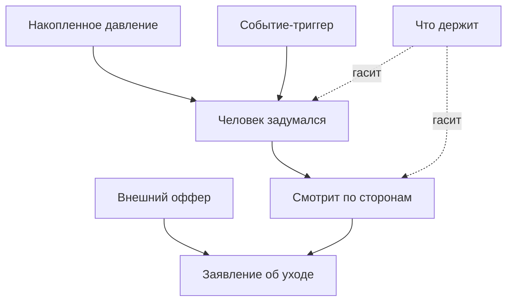

# Глава 10 — Мотивация, удержание и управление опытными инженерами { #chapter-10-motivation-retention-and-managing-senior-engineers }

Эта глава о том, как удержать людей, чей уход ударил бы сильнее всего, и как руководить теми, кто знает
больше вас: что исследования текучести говорят руководителю, как собирать данные выходных интервью и
интервью об удержании в собственной организации, как работать с экспертами с сильными мнениями, не
уступая им во всём и не подавляя их, и как решать вопрос о контрпредложении. Арифметика текучести как
запаса и потока разобрана в главе 3. Сквозной пример — вымышленная Northstar Technologies
([кейс](../../case-studies/northstar/index.md)): её эксперты по ledger из команды Billing и staff-инженер
с самым большим стажем, Ines Carvalho.

## Почему это важно { #why-this-matters }

На уровне команды одно заявление об уходе может унести не человека, а целую способность. Когда знание
критичной системы есть у трёх человек, потеря одного увеличивает нагрузку на двух других, а именно
нагрузка часто и выталкивает первого. Обычно руководители узнают об этом из заявления об уходе — в
самый бесполезный момент.

На уровне организации уходы группируются: в командах с тяжёлыми дежурствами, у определённых
руководителей, после реорганизаций и спорных решений. Организация, которая записывает одну причину
ухода, выбранную из выпадающего списка в последний день, не видит этих скоплений и тратит деньги не на
ту причину.

На уровне высшего руководства удержание — это строка затрат и строка рисков. Каждый нежелательный уход
стоит месяцев пустующего места и выхода на полную продуктивность; дороже всего терять тех экспертов, с
которыми советуются обо всём, но которые ничем не владеют. А то, как компания обходится с
контрпредложениями, говорит каждому инженеру, является ли заявление об уходе способом получить прибавку.

## Цели главы { #learning-objectives }

После этой главы вы сможете:

- Выявлять, что на самом деле вызывает уходы в вашей организации, сочетая данные выходных интервью,
  интервью об удержании и системные данные, вместо того чтобы заимствовать типовой список причин.
- Объяснять, что подтверждают исследования текучести, включая встроенность в работу и пути принятия
  решения, и где они заканчиваются.
- Руководить инженерами, которые разбираются в предмете лучше вас, в том числе очень убеждёнными в своей
  правоте, разделяя техническое суждение, права на решения и последствия.
- Решать, когда делать контрпредложение, когда отпустить человека и как в любом случае защитить
  команду.
- Рано замечать риск потери ключевого человека и коллективной текучести — по опережающим индикаторам, а
  не по заявлениям об уходе.

## Ментальная модель { #the-mental-model }

> **Ментальная модель:** люди редко уходят по одной причине. Они уходят, когда сходятся накопившееся
> давление, событие, заставившее их задуматься, и доступная альтернатива, и остаются, когда то, что их
> держит, перевешивает все три. Руководитель может видеть и менять давление и то, что держит, но редко —
> альтернативу.

| Элемент | Что это на работе | Видит ли руководитель? | Может ли руководитель это изменить? |
|---|---|---|---|
| Накопленное давление | Вызовы в нерабочее время, проигнорированные решения, нет роста, оплата ниже, чем у коллег | Да, если смотрит | Обычно |
| Событие-триггер | Инцидент в выходные, отклонённое предложение, реорганизация, смена руководителя | Да, когда оно происходит | Иногда; как минимум может вернуться к нему потом |
| Внешний оффер | Рекрутер, бывший коллега, роль с лучшей оплатой | Редко, пока не стало слишком поздно | Нет |
| Что держит | Отношения, соответствие работе, то, от чего пришлось бы отказаться | Через разговоры об удержании | Медленно |

Отсюда вторая идея: рычаг руководителя находится выше по течению. Когда письмо с оффером уже есть,
руководителю остаётся только торговаться. Большая часть этой главы — о том, как видеть давление и то,
что держит, пока их ещё можно изменить.

## Подробный разбор { #deep-conceptual-explanation }

### Что подтверждают исследования текучести { #what-the-turnover-research-supports }

То, что предсказывает текучесть, зависит от условий. Таков вывод двух больших
[метаанализов](../../glossary.md#meta-analysis) (статистических обобщений многих исследований), с
которых обычно начинают: оба подчёркивают, насколько сильно контекст меняет каждый предиктор
([Griffeth, Hom, and Gaertner, 2000](../../references/bibliography.md#griffeth2000meta);
[Rubenstein et al., 2018](../../references/bibliography.md#rubenstein2018surveying)). Их резюме не
выделяют предикторов, которые действуют везде, поэтому эта глава их и не перечисляет.

Следствие (**рекомендация книги**, опирающаяся на этот **научный результат**): ранжированный список
«главных причин, по которым уходят инженеры», составленный в других компаниях, — слабый ориентир для
вашей. Ваша организация и есть контекст, и измерять его придётся вам. Ещё две идеи прямо полезны
руководителю.

**Пути принятия решения.** Модель развёртывания (unfolding model) Lee и Mitchell описывает добровольную
текучесть как четыре разных пути принятия решения, у каждого из которых свой психологический процесс и
свои внешние события, а не как одно медленное сползание от неудовлетворённости к уходу
([Lee and Mitchell, 1994](../../references/bibliography.md#lee1994unfolding)). Эта книга не
воспроизводит четыре пути. Руководителю достаточно более простого рабочего деления (**рекомендация
книги**, а не категории самой модели):

| С чего начался уход | Как это выглядит | О чём спросить |
|---|---|---|
| С события | Инцидент в выходные, отклонённое предложение или смена руководителя заставляют человека начать поиски, иногда за несколько недель | «Что произошло за месяцы до того, как вы начали искать?» |
| С медленного давления | Неудовлетворённость копится кварталами, пока не приходит оффер | «Когда это перестало быть местом, где вам хотелось остаться?» |

Вопрос на выходном интервью, который звучит только как «чем вы были недовольны?», упускает первый тип.

**Встроенность в работу (job embeddedness).** Mitchell с коллегами определили встроенность как связи
человека с другими людьми и группами, его соответствие работе, организации и сообществу и то, чем он
пожертвовал бы, уйдя. В двух выборках встроенность предсказывала намерение уйти и фактическую
добровольную текучесть сверх того, что объясняли удовлетворённость работой, приверженность,
альтернативы и поиск работы ([Mitchell et al., 2001](../../references/bibliography.md#mitchell2001why)).
Это **научный результат**, полученный за пределами разработки ПО, и основа для того, чтобы спрашивать
людей, почему они остаются. В обзоре столетия исследований Hom с коллегами описывают поворот области к
этой «психологии того, почему люди остаются» и к **коллективной текучести** — потере человеческого
капитала группой ([Hom et al., 2017](../../references/bibliography.md#hom2017hundred)): потеря двух из
трёх экспертов по ledger обходится не вдвое дороже потери одного.

### Мотивация: автономия, компетентность, связанность { #motivation-autonomy-competence-relatedness }

Теория самодетерминации предполагает три психологические потребности (компетентность, автономию и
связанность с другими), удовлетворение которых поддерживает мотивацию и благополучие. Обзор Ryan и Deci
ссылается на данные с рабочих мест, согласно которым удовлетворение этих потребностей предсказывало
результативность и благополучие, и сообщает, что выбор и самостоятельность повышают внутреннюю
мотивацию, а дедлайны, директивы, оценивание под давлением и навязанные цели её снижают
([Ryan and Deci, 2000](../../references/bibliography.md#ryan2000self)). Утверждение теории о том, что
материальные вознаграждения, зависящие от результата, подрывают внутреннюю мотивацию, **оспаривается**,
что отмечает и сама статья; не читайте его как «оплата не важна». Оплата — это справедливость и
положение на рынке; об этом глава 8.

Что руководитель может сделать с каждой потребностью (**рекомендация книги**, применяющая теорию):

| Потребность | Что её подрывает в разработке | Что можно изменить в этом квартале |
|---|---|---|
| Автономия | Решения отменяют без объяснений; задачи спускают полностью спроектированными | Делегируйте результаты с названным уровнем контроля (глава 2); объясняйте ограничение, когда отменяете решение |
| Компетентность | Бесконечные прерывания, нет времени что-то сделать хорошо; нет обратной связи | Защищайте блоки времени для сосредоточенной работы; давайте конкретную обратную связь по работе (глава 6); одно задание на вырост |
| Связанность | Изоляция на удалённом краю команды; заслуги достаются другим | Ставьте в пары людей из разных городов; публично называйте вклад; проводите встречи один на один, которые назначили |

Что касается разработчиков ПО, систематический обзор Beecham с коллегами показал, что мотивация зависит
от характеристик инженера, его личности и этапа карьеры и что существующие модели не отражают,
насколько сильно эти потребности различаются
([Beecham et al., 2008](../../references/bibliography.md#beecham2008motivation)). Вывод: то, что
удерживает staff-инженера, одиннадцать лет живущего в кодовой базе, — не то, что удерживает инженера на
втором году, и узнаёте вы это, спрашивая. Из доказательств влияния руководителя в главе 1 сюда относится
один результат: в одной технологической компании навык управления людьми был сильно и отрицательно
связан с текучестью ([Hoffman and Tadelis, 2021](../../references/bibliography.md#hoffman2021people)).
Удержание — работа руководителя, а не HR.

### Выгорание: сигналы и реакции { #burnout-signals-and-responses }

Выгорание — рабочая проблема с рабочими причинами, поэтому главная реакция руководителя — изменить
работу. Классификация Всемирной организации здравоохранения (ICD-11) описывает выгорание как синдром,
возникающий из-за хронического стресса на работе, с которым не удалось успешно справиться, с тремя
измерениями: истощение, нарастающая психологическая дистанция или цинизм по отношению к работе и
снижение профессиональной эффективности. Выгорание отнесено к явлениям, связанным с работой, а не к
медицинским состояниям ([WHO, 2019](../../references/bibliography.md#who2019burnout); **стандарт** —
определение, а не доказательство причин или способов помощи).

Три измерения дают руководителю наблюдаемые сигналы (**рекомендация книги**):

| Измерение | Что вы можете увидеть |
|---|---|
| Истощение | Усталость, которую больше не снимают выходные; растёт число больничных; ошибки в рутинной работе |
| Дистанция или цинизм | «Здесь ничего не меняется»; уход из обсуждений, которые человек раньше вёл |
| Сниженная эффективность | Способный человек сомневается в своей работе; решения принимаются медленнее; трудные задачи избегаются |

Ни один из этих сигналов не доказывает выгорания, и руководителю не стоит пытаться его
диагностировать. Ваши реакции:

- **Назовите, что видите, и спросите** — наедине: «Мне кажется, после миграции вы выдохлись. Как вы?»
- **Измените нагрузку**, а не только способы человека с ней справляться: меньше вызовов в нерабочее
  время, сдвинутый дедлайн, переданный другому проект. Тренинг по стрессоустойчивости без изменения
  нагрузки говорит людям, что проблема в них.
- **Ищите закономерность.** Выгорание в команде с тяжёлыми дежурствами — сигнал системы, и следующий
  человек уже близко (см. кейс Billing).
- **Знайте, где заканчивается ваша роль.** Здоровье — частное дело. Направьте к HR, к программе помощи
  сотрудникам, если она есть, и к медицинской помощи, а любой отпуск или изменение обязанностей
  согласуйте через HR.

Выгорание объясняет и часть случаев, которые выглядят как низкая результативность или проблема
«желания» (глава 9): проверьте нагрузку прежде, чем проверять человека.

### Данные об уходах, данные об удержании и системные данные { #exit-data-stay-data-and-system-data }

Каждый источник видит свою часть механизма, и каждый отказывает известным образом.

| Источник | Что видит | Как отказывает | Как его подгоняют или искажают |
|---|---|---|---|
| Выходное интервью | Историю, которую уходящий готов рассказать | Поздно; одна точка данных на человека; уходящие не хотят сжигать мосты | Формы с одной причиной по умолчанию сводятся к «вознаграждению», социально безопасному ответу |
| Интервью об удержании | Почему люди остаются и что заставило бы их уйти | Откровенность зависит от доверия к интервьюеру | Руководители, которых оценивают по результатам, подсказывают ответы |
| Системные данные | Вызовы, работа в нерабочее время, ожидание решений, время с последнего карьерного разговора | Измеряют давление, а не чувства | Команды перестают вызывать людей и молча берут работу на себя |

**Интервью об удержании (stay interview)** — структурированный разговор с человеком, которого вы хотите
удержать: что держит вас здесь, что заставило бы вас уйти, что одно вы бы изменили и от чего бы
отказались, уйдя (измерение жертвы во встроенности). Формат — **консенсус практиков**; ни одно из
цитируемых здесь исследований не проверяет его эффект, и книга рассматривает его как способ собирать
данные о встроенности. Проводите его как отдельную встречу, а не как пункт повестки встречи один на один
(глава 5).

Глава 18 вслед за [Noda et al., 2023](../../references/bibliography.md#noda2023devex) сочетает обратную
связь разработчиков с системными данными, чтобы увидеть ежедневное трение
([глава 18](../04-execution/18-measuring-engineering-productivity.md#developer-experience-devex)).
То же сочетание работает для удержания: системные данные показывают, где копится давление; разговоры —
то ли это давление, которое важно для конкретного человека.

### Как руководить инженерами, которые разбираются лучше вас { #managing-engineers-more-expert-than-you }

Большинство руководителей руководят людьми, которые знают свои системы лучше них. Ошибка — относиться к
этому как к состязанию, в котором надо победить или сдаться. Полезное деление (**рекомендация книги**)
состоит из трёх частей:

| Кто | Чем владеет | Пример |
|---|---|---|
| Эксперт | Техническим суждением в рамках названного мандата | Где должна проходить граница модуля core/customer |
| Руководитель | Приоритетами, ограничениями, правами на решения и последствиями для людей | Финансируется ли работа над границей в этом полугодии; кто решает, если команды не согласны |
| Оба, явно | Записью о том, что решено, кем и что заставило бы пересмотреть решение | Письменное решение с его допущениями |

Глава 1 приводит данные о том, что техническая компетентность руководителя предсказывает
удовлетворённость сотрудников; вам нужно достаточно компетентности, чтобы задавать хорошие вопросы, а
не чтобы выигрывать спор. Хорошие вопросы проверяют рассуждение: что заставило бы вас передумать,
чего стоит ошибка, какова самая маленькая обратимая версия. Практика Marquet — люди сами формулируют
намерение и рассуждение, а лидер проверяет мышление, а не раздаёт ответы, — хорошо подходит для
экспертов ([Marquet, 2012](../../references/bibliography.md#marquet2013turn)).

Staff-инженеру нужен **мандат**: масштаб, ожидаемый результат и права на решения. Работа Larson о
staff-треке известна тем, что рассматривает staff-инжиниринг как лидерство вне линии менеджмента
([Larson, 2021](../../references/bibliography.md#larson2021staff)), а его архетипы (техлид, архитектор,
решатель, правая рука) называют формы, которые может принимать мандат
([Larson, staff archetypes](../../references/bibliography.md#larson-staff-archetypes)). Эксперт без
мандата по умолчанию становится решателем (solver): с ним советуются обо всём, он ни за что не отвечает
и раздражён тем, что его советам следуют выборочно. Трек разобран в главе 4
([staff-plus-трек](../01-foundations/04-the-leadership-ladder.md#the-staff-plus-track-in-parallel)).

**Эксперты с очень сильными мнениями.** Сильные взгляды, отстаиваемые по существу, — это актив.
Проблема — в поведении: когда уверенность эксперта мешает другим что-то предлагать, способности команды
сжимаются вокруг него. Различие, которое проводит Wiseman между лидерами, умножающими интеллект других,
и теми, кто его подавляет, относится и к senior-инженерам
([Wiseman, 2010](../../references/bibliography.md#wiseman2010multipliers)). Называйте поведение и его
эффект, а не личность, и меняйте структуру, которая это поведение вознаграждает: дайте эксперту решение,
которым он владеет полностью, а другие решения отдайте людям, которые советуются с экспертом, но решают
сами.

Самый тяжёлый вариант — **динамика заложника**: эксперт настолько критичен, что руководитель не
решается ему возражать из страха, что тот уйдёт. Каждый квартал такого избегания углубляет зависимость.
Выход — снижение риска, а не конфронтация: распространяйте знания по графику и объясняйте зачем.

### Контрпредложения { #counter-offers }

Контрпредложение — улучшенные условия, которые предлагают, чтобы удержать человека, подавшего заявление
об уходе или получившего внешний оффер. Доказательств мало. Единственное рецензируемое исследование,
которое нашли авторы книги, — о 650 преподавателях исследовательских университетов США — описывает
предложения об удержании как дискреционные и часто несправедливые. Женщины и преподаватели из расовых
меньшинств реже получали их, а желание уйти и сообщение об этом руководству были связаны с получением
предложения
([White-Lewis et al., 2024](../../references/bibliography.md#whitelewis2024counteroffers)).
Об инженерах оно ничего не говорит, как и о том, остались ли удержанные. Широко повторяемые цифры о том,
сколько принявших контрпредложение уходят в течение года, исходят от рекрутинговых компаний с
нераскрытыми методами; эта книга их не повторяет, и доказательства скудны. Переносимое предупреждение:
контрпредложения вознаграждают тех, кто просит, а не обязательно тех, кому недоплачивают, или самых
ценных. Остальное — **рекомендация книги**:

- Контрпредложение может исправить оплату. Оно не может исправить нагрузку, руководителя или
  проигранное решение. Если причина была не в оплате, оно покупает месяцы.
- Если вы готовы заплатить эту сумму только из-за оффера, то либо вы недоплачивали — тогда исправьте
  это для всех в таком же положении, — либо покупаете время — тогда используйте его, чтобы устранить
  зависимость.
- Каждое контрпредложение становится известным за несколько недель. Если коллеги в той же роли узнают,
  что заявление об уходе — путь к прибавке, вы установили политику, не записав её.

## Пример из инженерной организации { #engineering-organization-example }

!!! info "Northstar: что уже известно"
    Неделя 20 первого года директора по разработке в Northstar, вымышленной компании книги в области
    order-to-cash («от заказа до оплаты»). Число серьёзных инцидентов (Sev1 и Sev2) в первом квартале
    снизилось с 30 до 21. Billing по-прежнему держит большую часть вызовов дежурных на трёх инженерах
    ledger: четвёртый уволился до прихода директора. См.
    [хронологию](../../case-studies/northstar/timeline.md). Впервые встречаете Northstar? Прочитайте
    [«Год вкратце»](../../case-studies/northstar/year-in-brief.md) и
    [«Действующие лица»](../../case-studies/northstar/cast.md).

Этот разобранный пример — **иллюстрация**. Он оценивает оффер, которым заканчивается кейс ниже, на
основе [исходных данных](../../case-studies/northstar/baseline-data.md) о дежурствах и текучести и
допущений, названных в тексте.

На неделе 20 один из трёх оставшихся в Billing инженеров ledger, Tomasz Wierzbicki, сообщает Marcus
Oyelaran (руководителю Billing), что у него есть оффер на 20% выше нынешнего базового оклада. Примем
оклад $138 000, близко к верхней границе вилки уровня Engineer (это допущение; в записях Northstar его
оклада нет), тогда разрыв — $27 600 в год.

**Цена того, чтобы его отпустить.** Используем медиану Northstar — 15 недель от заявления об уходе до
первого рабочего дня замены
([глава 3](../01-foundations/03-managerial-leverage-and-systems-thinking.md#delays)) — и полную
стоимость $185 000 за инженеро-год:

| Статья | Допущение | Затраты в первый год |
|---|---|---|
| Пустующее место | 15 недель ÷ 52 × $185,000 | около $53,000 |
| Выход на уровень надёжного дежурного по ledger | Полгода при половинной продуктивности (допущение) | около $46,000 |
| Рекрутинг | Агентство или время внутренних рекрутеров (допущение) | около $25,000 |
| **Итого** | | **около $124,000** |

**Чего таблица не показывает.** В базовом квартале каждый из трёх инженеров ledger разобрал около 42
вызовов. Если ту же нагрузку возьмут на себя двое, каждый получит примерно на 50% больше — днём и
ночью. Именно такое давление предшествовало прошлому уходу инженера ledger (см. кейс). Риск второго
порядка — второй уход, а это уже коллективная текучесть.

**Цена контрпредложения на уровне оффера.** $27 600 в год, ежегодно. Если смотреть только на эти
цифры, это выглядит дешевле $124 000. Сравнение меняют три обстоятельства:

1. **Коллеги.** Двое других делают ту же работу. Разрыв в $27 600, полученный благодаря офферу, станет
   известен; выровнять оплату обоим стоит примерно ещё $55 000 в год.
2. **Причина.** Если в интервью об удержании он назвал нагрузку в нерабочее время, прибавка причину не
   затрагивает.
3. **Срок.** Если он останется на девять месяцев и всё равно уйдёт, компания заплатит примерно на
   $21 000 больше и всё равно потратит $124 000, только позже.

Обоснованная альтернатива — рыночная корректировка для всех троих, если проверка оплаты покажет, что
они ниже коллег (глава 8), плюс план с датами по подключению ещё двух дежурных к инцидентам ledger
через парные смены.

## Как принимать решение { #decision-framework }

Используйте эту схему, когда человек, которого вы хотите удержать, говорит, что уходит или что у него
есть оффер.

| Вопрос | Как на него ответить | Слабый ответ |
|---|---|---|
| Будете ли вы жалеть об уходе? | Решено до заявления об уходе, на обзоре талантов (периодической встрече, где руководители разбирают риски и потенциал своих людей); не перерешается под давлением | «Когда человек уходит, жалеешь о каждом» |
| Причина в оплате? | Интервью об удержании и нынешний разговор, а не форма выходного интервью | Считать причиной «лучший оффер» |
| Можно ли исправить причину — реально и скоро? | Изменение, которое вы можете сделать за несколько недель и которое человек может проверить | Обещания, которые вы уже давали и не выполнили |
| Недоплачивают ли человеку относительно коллег и рынка? | Данные об оплате для роли и уровня | Сравнение только с внешним оффером |
| Что увидит команда? | Кто об этом узнает и какой вывод сделает | Предположение, что всё останется конфиденциальным |

При любом исходе два шага обязательны (**рекомендация книги**): план передачи знаний с датами и разговор
с теми, кто возьмёт на себя нагрузку.

## Компромиссы { #trade-offs }

**Контрпредложение или отпустить.** Контрпредложение дешевле в первый год, когда причина в оплате и
человеку недоплачивают. Оно дороже, когда создаёт инверсии оплаты, учит, что заявление об уходе — это
способ торговаться, или откладывает структурное исправление. Отпустить человека стоит месяцев и риска,
и иногда это правильная цена за устранение единой точки отказа.

**Интервью об удержании или опросы.** Интервью выявляют причины и индивидуальный риск ценой часов
руководителя и доверия. Опросы масштабируются и защищают анонимность, но не могут сказать, что один
эксперт близок к уходу.

**Удерживать экспертов или распространять их знания.** Обучение других снижает уникальность эксперта:
одни воспринимают это как угрозу, другие — как облегчение. В краткосрочной перспективе парная работа
замедляет эксперта, а разбор вызовов занимает больше времени. То, как это будет воспринято, решает
объяснение причин и того, что эксперт получает взамен (мандат, задачу крупнее).

**Уступать или отменять решения.** Уступчивость создаёт зависимость; отмена решений учит экспертов
перестать спорить — или уйти. Письменное решение с владельцем и условием пересмотра поначалу
медленнее.

## Типичные провалы { #failure-modes }

**Диагноз из выпадающего списка.** Одна причина на уходящего, выбранная в последний день. Сигнал: в
отчёте HR доминирует «вознаграждение». Противодействие: кодируйте по каждому уходу несколько факторов и
спрашивайте о событиях.

**Удержание через заявление об уходе.** Прибавки достаются в основном тем, кто приносит офферы. Сигнал:
разрывы в оплате внутри одной роли, которые следуют за тем, кто подавал заявление, а не за
результативностью. Противодействие: правило о контрпредложениях, требующее проверки равенства оплаты с
коллегами до любого предложения.

**Эксперт-заложник.** Никто не возражает ключевому человеку, потому что его потеря немыслима. Сигнал:
решения в его области ждут его; другие перестают что-то предлагать. Противодействие: план с датами по
распространению знаний, который эксперту объясняют как снижение риска, а не наказание.

**Старшинство без мандата.** Staff-инженеры с должностью, но без масштаба. Сигнал: с ними советуются
обо всём, и они раздражены тем, как мало меняется. Противодействие: письменный мандат с правами на
решения (глава 4).

**Удержание как HR-метрика.** Текучесть становится целевым показателем руководителя. Сигнал: уходы
задним числом переклассифицируют как «желательные» ([нежелательная
текучесть](../../glossary.md#attrition-and-regretted-attrition) учитывает только тех, кого вы хотели
удержать); слабых сотрудников держат, чтобы защитить цифру. Противодействие: классифицируйте, о чьём
уходе будете жалеть, до того как кто-либо подаст заявление; разбирайте текучесть вместе с данными о
дежурствах и ожидании решений, а не отдельно.

**Коллективная слепота.** Уходы разбирают по одному. Сигнал: двое из небольшой группы экспертов уходят
в течение года, и каждый случай называют личным. Противодействие: отслеживайте уходы по способностям, а
не только по командам.

## Применение в крупной организации { #enterprise-application }

В организации из 50–150 инженеров удержанию нужна небольшая система, а не героизм отдельных
руководителей. Рабочий вариант (**рекомендация книги**):

- **Карта ключевых людей**: для каждого компонента [tier 1](../../glossary.md#tier-1) (самого критичного
  для бизнеса) — кто может безопасно его менять и реагировать на инциденты в нём. Меньше трёх человек —
  риск для удержания, каким бы ни был моральный дух.
- **Заранее определённый список тех, о чьём уходе пожалеют.** На обзоре талантов дважды в год
  руководители отмечают, кого они пожалели бы потерять и почему. Уходы потом считаются относительно
  этого списка.
- **Интервью об удержании** раз в год для всех из этого списка и после любого события-триггера:
  инцидента в выходные, отклонённого предложения, смены руководителя, реорганизации.
- **Данные выходных интервью с несколькими факторами**, которые собирает человек вне линии подчинения,
  с коротким повторным разговором через три месяца.
- **Квартальный разбор удержания** на уровне директора: уходы рядом с нагрузкой дежурств, вызовами в
  нерабочее время, временем с последнего карьерного разговора и трением по опросам в разрезе команд.
- **Правило о контрпредложениях**: руководитель, директор и HR решают вместе после проверки равенства
  оплаты с коллегами, а небольшой резерв финансирует рыночные корректировки, чтобы исправление
  недоплаты не ждало заявления об уходе.

Стоимость перехода — время руководителей (час на интервью об удержании, день-два на кодирование
прошлых записей об уходах) и неприятный первый разбор, потому что данные укажут на решения
руководителей.

## Взгляд CTO { #cto-perspective }

На уровне высшего руководства меняются три вещи.

Первое: **распределение важнее средней величины**. Общая текучесть по компании в 10% может скрывать
команду с 25% и способность — например, ledger — с потерей одного из четырёх. Запрашивайте нежелательную
текучесть в разрезе способностей.

Второе: **политика вознаграждения — это политика удержания**. Могут ли руководители делать
контрпредложения, кто их утверждает и исправляет ли бюджет недоплату проактивно — решения высшего
руководства. Компания, которая платит по рынку только тем, у кого есть офферы, отдала установление своих
зарплат рекрутерам.

Третье: **CTO (технический директор) руководит самыми опытными экспертами компании**, чьё
архитектурное суждение он уже не может проверять в деталях. Действует то же деление: CTO владеет
правами на решения, ограничениями и последствиями; эксперты владеют суждением. CTO, который не может
сказать, кто решает архитектурный спор, получает динамику заложника в масштабе компании.

Любую метрику текучести, показанную совету директоров, будут подгонять. Сопровождайте её заранее
составленным списком тех, о чьём уходе пожалеют, и опережающими индикаторами: нагрузкой дежурств,
работой в нерабочее время и тем, сколько ждут предложения.

## Практический плейбук { #practical-playbook }

1. **Составьте список тех, кого пожалели бы потерять**, с причинами, до того как кто-то подаст
   заявление; для каждого компонента tier 1 перечислите, кто может его восстановить.
2. **Перечитайте данные об уходах за прошлый год**, кодируя несколько сопутствующих факторов и любое
   предшествующее событие.
3. **Проведите интервью об удержании** со всеми из списка и запишите, что вы сделаете.
4. **Положите рядом со списком данные о давлении**: вызовы в нерабочее время на человека, ожидание
   решений, время с последнего карьерного разговора.
5. **Дайте каждому старшему эксперту письменный мандат**: масштаб, результат, права на решения, условие
   пересмотра.
6. **Называйте подавляющее поведение по его эффекту**, наедине, и меняйте структуру, которая его
   вознаграждает.
7. **Распространите каждую способность, которой владеет один человек**, через парные смены с датами и
   объясните эксперту зачем.
8. **Напишите правило о контрпредложениях** заранее, включая проверку равенства оплаты с коллегами.
9. **Когда кто-то подаёт заявление**, пройдите по схеме решения, затем в ту же неделю составьте план
   передачи знаний и поговорите с теми, кто возьмёт на себя нагрузку.
10. **Оставляйте дверь открытой.** Люди, которые уходят по-хорошему, иногда возвращаются и всегда
    рассказывают о вас.

## Кейс { #case-study }

Этот кейс — **вымысел**. Данные об уходах охватывают двенадцать месяцев до прихода директора; интервью
об удержании и оффер относятся к кварталу 2 (недели 14–26), после первого квартала (см.
[хронику года 1](../../case-studies/northstar/first-quarter.md)), а исходы оставлены открытыми.

**Что говорили записи об уходах.** За двенадцать месяцев до прихода директора ушли восемь инженеров: по
два из Billing, Orders и Data and Analytics и по одному из Customer Experience и Payments and
Integrations. HR заполнил форму ухода на всех восьмерых, с одной основной причиной, и провёл выходные
интервью с шестью. В формах значилось: вознаграждение — 4, карьерный рост — 2, личные причины — 1, не
указано — 1. HR сделал вывод, что текучесть — проблема оплаты.

**Что говорили свободный текст и заметки руководителей.** В начале квартала 2 директор закодировал
каждый уход по сопутствующим факторам, допуская несколько на человека:

| Сопутствующий фактор | Уходов (из 8) |
|---|---|
| На момент заявления на руках был внешний оффер | 5 |
| Ни одного записанного карьерного разговора за предыдущие шесть месяцев | 5 |
| Нагрузка дежурств или инцидентов в нерабочее время | 4 |
| Событие за шесть недель до заявления (инцидент в выходные, отклонённое предложение, смена руководителя) | 4 |
| Решения в их области ждали кого-то другого или отменялись кем-то другим | 3 |
| Оплата ниже, чем у коллег в той же роли, по данным самого HR | 2 |

Только двоим из четырёх ушедших с причиной «вознаграждение» платили меньше, чем коллегам. Внешний оффер
был для пятерых последним шагом, а не исходной причиной. Оба ушедших из Billing назвали нагрузку в
нерабочее время.

**Инженер ledger, который ушёл.** Один из четырёх дежурных с опытом по ledger уволился за девять месяцев
до прихода директора. В форме HR — «вознаграждение»; оффер был на 18% выше его оклада. В свободном
тексте сказано, что его вызывали три выходных подряд, а за полгода до этого он просил вывести его из
пути эскалации по ledger, и ничего не изменилось. После заявления Northstar сделала контрпредложение на
10%; он отказался. В терминах этой главы: давление, событие, альтернатива и контрпредложение, нацеленное
на единственный фактор, который причиной не был.

**Интервью об удержании с Ines Carvalho.** Ines, staff-инженер, работает в Northstar одиннадцать лет. В
базовом квартале она отвечала на незапланированные вопросы о Core, общем монолите на Java, не владея
решениями. Её мандат с первого квартала охватывает границы модулей Core и контрактные тесты, и она
владеет стандартом кода Core. Её полная переработка core/customer — модуля, который меняют четыре
команды, — не профинансирована; первый срез, выделение permissions, профинансирован на квартал 2, и она
его ведёт. На неделе 14 директор провёл с ней интервью об удержании. Что её держит: предметная область,
инженеры, которых она обучила, и мандат — впервые её полномочия записаны. Что заставило бы её уйти:
отказ от переработки без пути для её остальной части и продолжающиеся прерывания. Рекрутеры пишут ей
ежемесячно; она не отвечала.

Ines — ещё и случай динамики заложника. В базовом квартале два инженера Orders перестали предлагать
дизайн, а её комментарии на ревью часто отклоняли проекты без объяснений. Заметки директора разделяют
вопросы: её суждение о Core — лучшее в компании, а то, как оно подаётся, сужает суждение команды.

**Оставшиеся эксперты по ledger в Billing.** Marcus Oyelaran провёл интервью об удержании с тремя
инженерами на неделях 14 и 15. Все трое назвали причинами остаться команду и предметную область. Двое
назвали эскалации в нерабочее время тем, что заставило бы их уйти; один, Tomasz Wierzbicki, добавил,
что его оплату не пересматривали два года. На неделе 20 он принёс Marcus внешний оффер (оценённый в
примере из инженерной организации).

У директора четыре решения: делать ли контрпредложение Tomasz; что изменить в эскалации по ledger в
любом случае; какие ещё срезы переработки Ines, помимо профинансированного выделения, можно
профинансировать; и как поднять вопрос о её поведении на ревью так, чтобы она не почувствовала, что её
выживают. Урок кейса: каждое предупреждение было видно в данных об удержании за месяцы до любого
оффера. Упражнения разбирают решения по очереди.

## Упражнения { #exercises }

Разобранные решения — в [решениях к главе 10](../../solutions/ch10-solutions.md). Данные Northstar — на
[странице исходных данных](../../case-studies/northstar/baseline-data.md); кто есть кто — на странице
[«Действующие лица»](../../case-studies/northstar/cast.md).

### Базовый уровень { #foundational }

**F1.** Опираясь на две таблицы из кейса, напишите сводку в один абзац о текучести в Northstar, которую
HR следовало отправить прежнему руководству. Укажите, какие записанные причины вы бы оставили, какие
перекодировали бы, и два вопроса, которые вы добавили бы в выходное интервью, чтобы фиксировать события
и то, с чего начиналось каждое решение. Объясните, почему одна основная причина на уходящего ввела
компанию в заблуждение.

**F2.** Подготовьте план 30-минутного интервью об удержании с одним из инженеров ledger в Billing.
Включите не больше шести вопросов, соотнесите каждый с частью ментальной модели (давление, событие, что
держит, альтернатива) и скажите, что вы сделаете в ту же неделю при ответе «вызовы», при ответе «моя
оплата» и при отсутствии ответа.

**F3.** Для Ines Carvalho составьте трёхстолбцовое деление из этой главы: чем владеет она, чем владеет
директор и что записывается совместно. В качестве случаев используйте core/customer, стандарт кода Core
и контрактные тесты. Скажите, на какой из архетипов Larson её мандат похож сейчас и на какой был похож в
базовом квартале.

### Прикладное лидерство { #applied-leadership }

**A1.** Решите, что Northstar следует сделать с оффером Tomasz Wierzbicki. Используйте цифры из
примера из инженерной организации, сформулируйте допущения о его оплате относительно коллег и выберите
между контрпредложением на уровне оффера, рыночной корректировкой для всех трёх инженеров ledger,
изменением, не связанным с оплатой, и тем, чтобы его отпустить. Скажите, что и когда вы сообщите двум
другим.

**A2.** Спланируйте разговор, в котором директор поднимает вопрос о поведении Ines Carvalho на ревью.
Вам нужно, чтобы она продолжала жёстко отстаивать позицию по Core, а другие снова начали предлагать
дизайн. Напишите две первые фразы, конкретные свидетельства, которые вы используете, структурное
изменение, которое предложите вместе с обратной связью, и что вы сделаете, если она скажет: «Тогда
ревьюйте сами».

**A3.** Marcus Oyelaran предлагает правило: никаких контрпредложений в Billing, никогда, «чтобы никто
не научился подавать заявление ради прибавки». Оцените это правило с учётом результатов White-Lewis,
случая с инженером ledger и схемы решения о контрпредложении. Перепишите его как политику, которую вы
бы подписали, включая то, кто утверждает и какая проверка по коллегам обязательна.

### Решения на уровне руководства { #executive-decision-making }

**X1.** Victor Lindqvist (CTO) просит вас предложить одну метрику удержания для ежемесячного пакета
CEO для совета директоров, рядом с выполнением дорожной карты и числом инцидентов
[Sev1 и Sev2](../../glossary.md#severity-sev1-sev2-sev3). Предложите метрику, опережающие индикаторы,
которые вы будете смотреть вместе с ней, но не отправлять совету, и как каждую из них, вероятно, будут
подгонять. Объясните, почему вы отвергли общую текучесть по компании.

**X2.** Rajiv Menon (CFO, финансовый директор) возражает против предложенного резерва на рыночные
корректировки в размере 1% бюджета на персонал разработки, около $161 000, утверждая, что Northstar
следует платить больше, только когда у кого-то есть оффер. Напишите ответ CFO, используя случай
ушедшего инженера ledger, затраты первого года на один уход и доказательства о контрпредложениях, и
укажите, какой компромисс вы бы приняли.

## Вопросы для размышления { #reflection-questions }

1. Кого в вашей организации вы пожалели бы потерять — и записали ли вы это до того, как кто-то подал
   заявление?
2. Сколько причин в ваших данных об уходах за прошлый год были выбраны из списка в чей-то последний
   день?
3. Какому эксперту в вашей области вы избегаете возражать, потому что не можете позволить себе его
   потерять, и во что это избегание обходится остальной команде?
4. Если бы ваши инженеры завтра сравнили свою оплату друг с другом, следовали бы различия за вкладом
   или за офферами?
5. Когда вы в последний раз спрашивали кого-то, почему он остаётся, и что вы изменили из-за ответа?

## Главное { #key-takeaways }

- Люди уходят, когда сходятся давление, событие и альтернатива; работайте с давлением и с тем, что
  держит, потому что когда есть оффер, остаётся только торговаться.
- Факторы текучести важны в контексте; измеряйте свою организацию, а не заимствуйте чужой список.
- Спрашивайте, почему люди остаются: связи, соответствие и то, от чего им пришлось бы отказаться,
  предсказывают уход сверх удовлетворённости.
- Кодируйте данные об уходах по нескольким факторам и событиям; одна причина из выпадающего списка по
  умолчанию сводится к оплате.
- Считайте уходы по способностям, а не только по командам; потеря двух из трёх экспертов — это
  коллективная текучесть.
- С экспертами владейте правами на решения, ограничениями и последствиями; суждение оставьте им;
  записывайте решение и то, что заставит его пересмотреть.
- Дайте каждому staff-инженеру мандат, иначе по умолчанию он станет решателем и уйдёт
  разочарованным.
- Контрпредложение исправляет только оплату. Делайте его только после проверки равенства оплаты с
  коллегами и никогда вместо устранения зависимости.
- Определяйте, о чьём уходе пожалеете, до того как кто-то подаст заявление, иначе метрику текучести
  подгонят задним числом.

## Источники и что почитать { #references-and-further-reading }

- [Griffeth, Hom, and Gaertner, 2000](../../references/bibliography.md#griffeth2000meta) и
  [Rubenstein et al., 2018](../../references/bibliography.md#rubenstein2018surveying). Два широких
  метаанализа текучести — о том, насколько контекст меняет каждый предиктор.
- [Lee and Mitchell, 1994](../../references/bibliography.md#lee1994unfolding). Текучесть как несколько
  путей принятия решения; основа совета «спрашивайте о событиях».
- [Mitchell et al., 2001](../../references/bibliography.md#mitchell2001why). Встроенность в работу;
  основа интервью об удержании.
- [Hom et al., 2017](../../references/bibliography.md#hom2017hundred). Столетие исследований текучести,
  включая то, почему люди остаются, и коллективную текучесть.
- [Ryan and Deci, 2000](../../references/bibliography.md#ryan2000self). Теория самодетерминации;
  утверждение о вознаграждениях читайте вместе с её критиками.
- [Beecham et al., 2008](../../references/bibliography.md#beecham2008motivation). Что мотивирует
  разработчиков ПО и почему это различается.
- [White-Lewis et al., 2024](../../references/bibliography.md#whitelewis2024counteroffers). Редкое
  эмпирическое исследование контрпредложений; предупреждение о равенстве.
- [Hoffman and Tadelis, 2021](../../references/bibliography.md#hoffman2021people). Навык управления
  людьми и текучесть.
- [Larson, 2021](../../references/bibliography.md#larson2021staff) и
  [Larson, staff archetypes](../../references/bibliography.md#larson-staff-archetypes). Staff-трек и
  формы staff-мандата.
- [Marquet, 2012](../../references/bibliography.md#marquet2013turn) и
  [Wiseman, 2010](../../references/bibliography.md#wiseman2010multipliers). Проверка намерения и
  рассуждения; лидеры, которые умножают способности других, и те, кто их подавляет.
- [Noda et al., 2023](../../references/bibliography.md#noda2023devex). Опыт разработчиков как ежедневное
  трение; см. главу 18.
