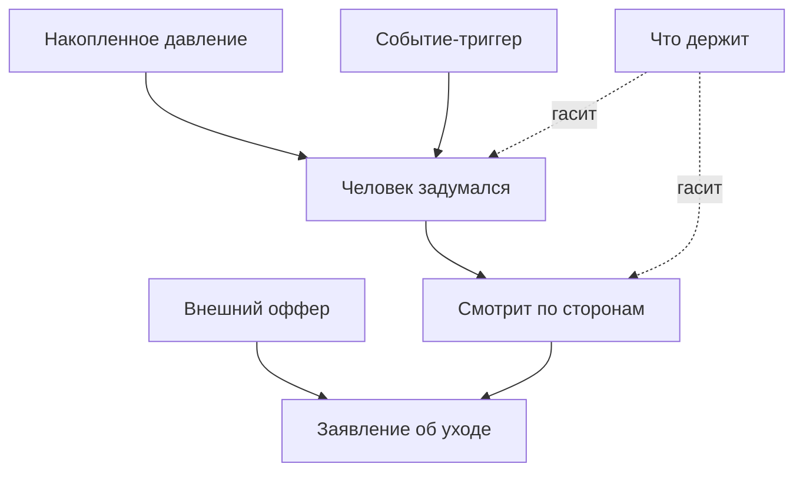
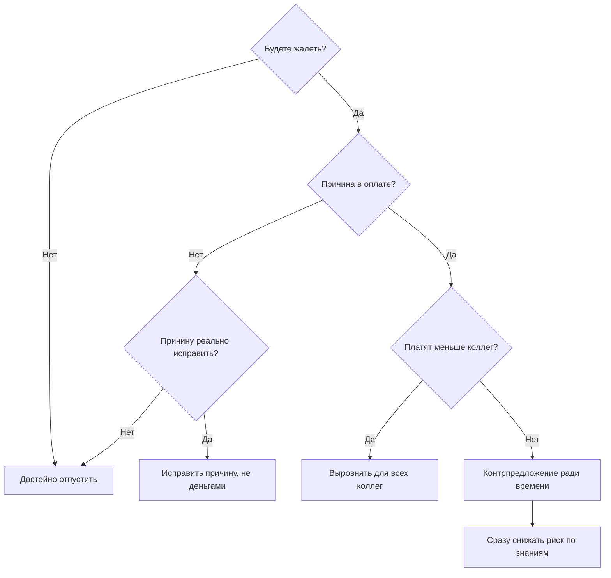

# Глава 10 — Мотивация, удержание и управление опытными инженерами { #chapter-10-motivation-retention-and-managing-senior-engineers }

Эта глава о том, как удержать людей, чей уход ударил бы сильнее всего, и как руководить теми, кто знает
больше вас. Речь пойдёт о том, что говорят руководителю исследования текучести, как собирать данные
выходных интервью и интервью об удержании в собственной организации, как работать с экспертами, у
которых сильные мнения, не уступая им во всём и не подавляя их, и как решать, делать ли
контрпредложение. Арифметика текучести как запаса и потока разобрана в главе 3. Сквозной пример —
вымышленная Northstar Technologies ([кейс](../../case-studies/northstar/index.md)): эксперты по ledger
из её команды Billing и Ines Carvalho, staff-инженер с самым большим стажем.

## Почему это важно { #why-this-matters }

Для команды одно заявление об уходе может унести не человека, а целую способность. Если критичную
систему знают трое, потеря одного увеличивает нагрузку на двух других, а ведь часто именно нагрузка и
выталкивает первого. Обычно руководители узнают об этом из заявления об уходе, то есть в самый
бесполезный момент.

В масштабе организации уходы складываются в скопления: в командах с тяжёлыми дежурствами, у
определённых руководителей, после реорганизаций и спорных решений. Если организация записывает одну
причину ухода, выбранную в последний день из выпадающего списка, она этих скоплений не видит и тратит
деньги не на ту причину.

Для высшего руководства удержание — это строка затрат и строка рисков. Каждый нежелательный уход стоит
месяцев: пока место пустует и пока новый человек выходит на полную продуктивность. Дороже всего терять
экспертов, с которыми советуются обо всём, но которые ничем не владеют. А по тому, как компания
обходится с контрпредложениями, каждый инженер понимает, можно ли получить прибавку заявлением об уходе.

## Цели главы { #learning-objectives }

После этой главы вы сможете:

- Выявлять настоящие причины уходов в вашей организации, сочетая данные выходных интервью, интервью об
  удержании и системные данные, а не заимствуя типовой список причин.
- Объяснять, что подтверждают исследования текучести, включая встроенность в работу и пути принятия
  решения, и где проходят их границы.
- Руководить инженерами, которые разбираются в предмете лучше вас (в том числе теми, кто непоколебимо
  уверен в своей правоте), разделяя техническое суждение, права на решения и последствия.
- Решать, когда делать контрпредложение, а когда отпустить человека, и как в любом случае защитить
  команду.
- Замечать риск потери ключевого человека и коллективной текучести заранее — по опережающим
  индикаторам, а не по заявлениям об уходе.

## Ментальная модель { #the-mental-model }

> **Ментальная модель:** люди редко уходят по одной причине. Человек уходит, когда сходятся три вещи:
> накопившееся давление, событие, которое заставило его задуматься, и доступная альтернатива. Остаётся
> он, когда то, что его держит, перевешивает все три. Давление и то, что держит, руководитель может
> видеть и менять; альтернативу — редко.

| Элемент | Как это выглядит на работе | Видит ли руководитель? | Может ли руководитель это изменить? |
|---|---|---|---|
| Накопленное давление | Вызовы в нерабочее время, проигнорированные решения, нет роста, оплата ниже, чем у коллег | Да, если смотрит | Обычно |
| Событие-триггер | Инцидент в выходные, отклонённое предложение, реорганизация, смена руководителя | Да, когда оно происходит | Иногда; как минимум может потом к нему вернуться |
| Внешний оффер | Рекрутер, бывший коллега, роль с лучшей оплатой | Редко, пока не станет слишком поздно | Нет |
| Что держит | Отношения, соответствие работе, то, от чего пришлось бы отказаться | Через разговоры об удержании | Медленно |

Отсюда вторая идея: рычаг руководителя находится выше по течению. Когда письмо с оффером уже пришло,
остаётся только торговаться. Большая часть главы — о том, как увидеть давление и то, что держит, пока
их ещё можно изменить.

## Подробный разбор { #deep-conceptual-explanation }

### Что подтверждают исследования текучести { #what-the-turnover-research-supports }

Предикторы текучести зависят от условий. К такому выводу приводят два больших
[метаанализа](../../glossary.md#meta-analysis) (статистических обобщений многих исследований), с
которых обычно начинают знакомство с темой: оба подчёркивают, как сильно контекст меняет действие
каждого предиктора ([Griffeth, Hom, and Gaertner, 2000](../../references/bibliography.md#griffeth2000meta);
[Rubenstein et al., 2018](../../references/bibliography.md#rubenstein2018surveying)). Предикторов,
которые действовали бы везде, их резюме не выделяют, поэтому не перечисляет их и эта глава.

Отсюда следствие (**рекомендация книги**, опирающаяся на этот **научный результат**): рейтинг «главных
причин, по которым уходят инженеры», составленный по другим компаниям, — слабый ориентир для вашей.
Контекст — это и есть ваша организация, и измерять его придётся вам самим. Руководителю прямо
пригодятся ещё две идеи.

**Пути принятия решения.** Модель развёртывания (unfolding model) Lee и Mitchell описывает добровольную
текучесть не как одно медленное сползание от неудовлетворённости к уходу, а как четыре разных пути
принятия решения, у каждого из которых свой психологический процесс и свои внешние события
([Lee and Mitchell, 1994](../../references/bibliography.md#lee1994unfolding)). Все четыре пути книга не
воспроизводит: руководителю хватит более простого рабочего деления (**рекомендация книги**, а не
категории самой модели):

| С чего начался уход | Как это выглядит | О чём спросить |
|---|---|---|
| С события | Инцидент в выходные, отклонённое предложение или смена руководителя, и человек начинает искать работу, иногда уже через несколько недель | «Что происходило в последние месяцы перед тем, как вы начали искать?» |
| С медленного давления | Неудовлетворённость копится кварталами, пока не приходит оффер | «Когда вам перестало хотеться здесь оставаться?» |

Если на выходном интервью спрашивать только «чем вы были недовольны?», уходы первого типа останутся
незамеченными.

**Встроенность в работу (job embeddedness).** По определению Mitchell с коллегами, встроенность — это
связи человека с другими людьми и группами, его соответствие работе, организации и сообществу и то, чем
он пожертвовал бы, уйдя. В двух выборках встроенность предсказывала намерение уйти и фактическую
добровольную текучесть сверх того, что объясняли удовлетворённость работой, приверженность,
альтернативы и поиск работы ([Mitchell et al., 2001](../../references/bibliography.md#mitchell2001why)).
Это **научный результат**, полученный за пределами разработки ПО, и именно он даёт основание спрашивать
людей, почему они остаются. В обзоре столетия исследований Hom с коллегами описывают, как область
повернулась к этой «психологии того, почему люди остаются» и к **коллективной текучести** — потере
человеческого капитала целой группой ([Hom et al., 2017](../../references/bibliography.md#hom2017hundred)):
потеря двух из трёх экспертов по ledger обходится не вдвое дороже потери одного.

### Мотивация: автономия, компетентность, связанность { #motivation-autonomy-competence-relatedness }

Теория самодетерминации исходит из трёх психологических потребностей: в компетентности, автономии и
связанности с другими. Их удовлетворение поддерживает мотивацию и благополучие. Ryan и Deci в обзоре
ссылаются на данные с рабочих мест: там удовлетворение этих потребностей предсказывало результативность
и благополучие. Авторы также сообщают, что выбор и самостоятельность повышают внутреннюю мотивацию, а
дедлайны, директивы, оценивание под давлением и навязанные цели её снижают
([Ryan and Deci, 2000](../../references/bibliography.md#ryan2000self)). Другое утверждение теории, что
материальные вознаграждения, зависящие от результата, подрывают внутреннюю мотивацию, — **вопрос
спорный**, и статья сама это отмечает. Не читайте его как «оплата не важна»: оплата — вопрос справедливости и
положения на рынке, об этом глава 8.

Что руководитель может сделать для каждой потребности (**рекомендация книги** на основе теории):

| Потребность | Что её подрывает в разработке | Что можно изменить в этом квартале |
|---|---|---|
| Автономия | Решения отменяют без объяснений; задачи спускают полностью спроектированными | Делегируйте результаты с названным уровнем контроля (глава 2); объясняйте ограничение, когда отменяете решение |
| Компетентность | Бесконечные прерывания, нет времени сделать что-то хорошо; нет обратной связи | Защищайте блоки времени для сосредоточенной работы; давайте конкретную обратную связь по работе (глава 6); одно задание на вырост |
| Связанность | Изоляция на удалённом краю команды; заслуги достаются другим | Ставьте в пары людей из разных городов; публично называйте вклад; проводите назначенные встречи один на один |

Применительно к разработчикам ПО систематический обзор Beecham с коллегами показал: мотивация зависит от
характеристик инженера, его личности и этапа карьеры, а существующие модели не отражают, насколько
сильно эти потребности различаются
([Beecham et al., 2008](../../references/bibliography.md#beecham2008motivation)). Вывод: staff-инженера,
который одиннадцать лет живёт в кодовой базе, удерживает не то, что инженера на втором году работы, и
выяснить это можно, только спросив. Из данных о влиянии руководителя, приведённых в главе 1, сюда
относится один результат: в одной технологической компании навык управления людьми был сильно и
отрицательно связан с текучестью
([Hoffman and Tadelis, 2021](../../references/bibliography.md#hoffman2021people)). Удержание — работа
руководителя, а не HR.

### Выгорание: сигналы и реакции { #burnout-signals-and-responses }

Выгорание — рабочая проблема с рабочими причинами, поэтому руководитель прежде всего должен менять саму
работу. Классификация Всемирной организации здравоохранения (ICD-11) описывает выгорание как синдром,
вызванный хроническим стрессом на работе, с которым не удалось справиться. У него три измерения:
истощение, нарастающая психологическая дистанция от работы или цинизм по отношению к ней и снижение
профессиональной эффективности. Выгорание отнесено к явлениям, связанным с работой, а не к медицинским
состояниям ([WHO, 2019](../../references/bibliography.md#who2019burnout); **стандарт** — определение, а
не доказательство причин или способов помощи).

По трём измерениям руководитель может заметить конкретные сигналы (**рекомендация книги**):

| Измерение | Что вы можете увидеть |
|---|---|
| Истощение | Усталость, которую больше не снимают выходные; растёт число больничных; ошибки в рутинной работе |
| Дистанция или цинизм | «Здесь ничего не меняется»; человек уходит из обсуждений, которые раньше вёл |
| Сниженная эффективность | Способный человек сомневается в своей работе; решения даются медленнее; трудных задач человек избегает |

Ни один из этих сигналов не доказывает выгорания, и ставить диагноз руководителю не стоит. Ваши
действия:

- **Назовите, что видите, и спросите** — наедине: «Мне кажется, после миграции вы выдохлись. Как вы?»
- **Меняйте нагрузку**, а не только то, как человек с ней справляется: меньше вызовов в нерабочее время,
  сдвинутый дедлайн, проект, переданный другому. Тренинг по стрессоустойчивости без изменения нагрузки
  сообщает людям, что проблема в них.
- **Ищите закономерность.** Выгорание в команде с тяжёлыми дежурствами — сигнал системы, и следующий
  человек уже на подходе (см. кейс Billing).
- **Знайте, где заканчивается ваша роль.** Здоровье — частное дело человека. Направьте его в HR, в
  программу помощи сотрудникам, если она есть, и за медицинской помощью; любой отпуск или изменение
  обязанностей согласуйте через HR.

Выгоранием объясняется и часть случаев, которые выглядят как низкая результативность или проблема
«желания» (глава 9): проверьте нагрузку, прежде чем разбираться с человеком.

### Данные об уходах, данные об удержании и системные данные { #exit-data-stay-data-and-system-data }

Каждый источник видит свою часть механизма, и у каждого есть известные слабые места.

| Источник | Что видит | Где подводит | Как его подгоняют или искажают |
|---|---|---|---|
| Выходное интервью | Историю, которую уходящий готов рассказать | Поздно; одна точка данных на человека; уходящие не хотят сжигать мосты | В формах с одной причиной по умолчанию побеждает «вознаграждение» — социально безопасный ответ |
| Интервью об удержании | Почему люди остаются и что заставило бы их уйти | Откровенность зависит от доверия к интервьюеру | Руководители, которых оценивают по результатам, подсказывают ответы |
| Системные данные | Вызовы, работа в нерабочее время, ожидание решений, время с последнего карьерного разговора | Измеряют давление, а не чувства | Команды перестают вызывать людей и молча берут работу на себя |

**Интервью об удержании (stay interview)** — структурированный разговор с человеком, которого вы хотите
удержать: что держит вас здесь, что заставило бы уйти, какую одну вещь вы бы изменили и от чего
пришлось бы отказаться, если уйти (это измерение жертвы во встроенности). Сам формат — **консенсус
практиков**: ни одно из цитируемых здесь исследований не проверяет его эффект, и книга рассматривает его
как способ собирать данные о встроенности. Проводите его отдельной встречей, а не пунктом повестки
встречи один на один (глава 5).

В главе 18 вслед за [Noda et al., 2023](../../references/bibliography.md#noda2023devex) обратная связь
разработчиков сочетается с системными данными, чтобы увидеть ежедневное трение
([глава 18](../04-execution/18-measuring-engineering-productivity.md#developer-experience-devex)).
То же сочетание работает и для удержания: системные данные показывают, где копится давление, а
разговоры — важно ли это давление для конкретного человека.

### Как руководить инженерами, которые разбираются лучше вас { #managing-engineers-more-expert-than-you }

Большинство руководителей управляют людьми, которые знают свои системы лучше, чем они сами. Ошибка —
относиться к этому как к состязанию, где остаётся либо победить, либо сдаться. Полезнее разделить роли
на три части (**рекомендация книги**):

| Кто | Чем владеет | Пример |
|---|---|---|
| Эксперт | Техническим суждением в пределах названного мандата | Где должна проходить граница модуля core/customer |
| Руководитель | Приоритетами, ограничениями, правами на решения и последствиями для людей | Финансируется ли работа над границей в этом полугодии; кто решает, если команды не согласны |
| Оба, явно | Записью о том, что решено, кем и что заставило бы пересмотреть решение | Письменное решение с его допущениями |

В главе 1 приведены данные о том, что техническая компетентность руководителя предсказывает
удовлетворённость сотрудников. Но компетентности вам нужно столько, чтобы задавать хорошие вопросы, а не
столько, чтобы выигрывать спор. Хорошие вопросы проверяют рассуждение: что заставило бы вас передумать,
чего стоит ошибка, какова самая маленькая обратимая версия. Для экспертов хорошо подходит практика
Marquet: люди сами формулируют намерение и ход рассуждения, а лидер проверяет мышление, вместо того
чтобы раздавать ответы ([Marquet, 2012](../../references/bibliography.md#marquet2013turn)).

Staff-инженеру нужен **мандат**: масштаб, ожидаемый результат и права на решения. Работа Larson о
staff-треке известна тем, что представляет staff-инжиниринг как лидерство вне линии менеджмента
([Larson, 2021](../../references/bibliography.md#larson2021staff)). Его архетипы (техлид, архитектор,
решатель, правая рука) описывают формы, которые может принимать мандат
([Larson, staff archetypes](../../references/bibliography.md#larson-staff-archetypes)). Эксперт без
мандата по умолчанию становится решателем (solver): с ним советуются обо всём, он ни за что не отвечает
и раздражён тем, что его советам следуют выборочно. Трек разобран в главе 4
([staff-plus-трек](../01-foundations/04-the-leadership-ladder.md#the-staff-plus-track-in-parallel)).

**Эксперты с очень сильными мнениями.** Сильные взгляды, если их отстаивают по существу, — это актив.
Проблема в поведении: когда из-за уверенности эксперта другие перестают что-то предлагать, способности
команды сжимаются вокруг него. Wiseman различает лидеров, которые умножают интеллект других, и тех, кто
его подавляет; это различие применимо и к senior-инженерам
([Wiseman, 2010](../../references/bibliography.md#wiseman2010multipliers)). Говорите о поведении и его
эффекте, а не о личности, и меняйте структуру, которая это поведение вознаграждает: дайте эксперту
решение, которым он владеет полностью, а другие решения отдайте людям, которые советуются с экспертом,
но решают сами.

Самый тяжёлый вариант — **динамика заложника**: эксперт настолько критичен, что руководитель не
решается ему возражать из страха, что тот уйдёт. Каждый квартал такого избегания углубляет зависимость.
Выход — не конфронтация, а снижение риска: распространяйте знания по графику и объясняйте, зачем это
нужно.

### Контрпредложения { #counter-offers }

Контрпредложение — улучшенные условия для человека, который подал заявление об уходе или получил
внешний оффер; цель — его удержать. Доказательств здесь мало. Авторы книги нашли единственное
рецензируемое исследование — о 650 преподавателях исследовательских университетов США. По его данным,
предложения об удержании делаются на усмотрение руководства и часто несправедливо. Женщины и
преподаватели из расовых меньшинств получали их реже, а получение предложения было связано с тем, хотел
ли человек уйти и сообщал ли об этом руководству
([White-Lewis et al., 2024](../../references/bibliography.md#whitelewis2024counteroffers)).
Об инженерах исследование ничего не говорит, как и о том, остались ли в итоге удержанные. Популярные
цифры о том, сколько принявших контрпредложение уходят в течение года, исходят от рекрутинговых
компаний, которые не раскрывают методику; книга их не повторяет. Доказательства здесь скудны. На другие
условия переносится одно предупреждение: контрпредложения вознаграждают тех, кто просит, а не
обязательно тех, кому недоплачивают, и не обязательно самых ценных. Остальное — **рекомендация книги**:

- Контрпредложение может исправить оплату. Нагрузку, руководителя или проигранный спор о решении оно не
  исправит. Если причина не в оплате, оно лишь покупает несколько месяцев.
- Если вы готовы заплатить эту сумму только из-за оффера, возможны два случая. Либо вы недоплачивали —
  тогда исправьте это для всех в таком же положении. Либо вы покупаете время — тогда потратьте его на
  то, чтобы устранить зависимость.
- О каждом контрпредложении узнают в течение нескольких недель. Если коллеги в той же роли поймут, что
  заявление об уходе ведёт к прибавке, значит, вы ввели политику, так её и не записав.

## Пример из инженерной организации { #engineering-organization-example }

!!! info "Northstar: что уже известно"
    Неделя 20 первого года директора по разработке в Northstar, вымышленной компании книги в области
    order-to-cash («от заказа до оплаты»). Число серьёзных инцидентов (Sev1 и Sev2) в первом квартале
    снизилось с 30 до 21. В Billing большая часть вызовов дежурных по-прежнему приходится на трёх
    инженеров ledger: четвёртый уволился ещё до прихода директора. См.
    [хронологию](../../case-studies/northstar/timeline.md). Впервые встречаете Northstar? Прочитайте
    [«Год вкратце»](../../case-studies/northstar/year-in-brief.md) и
    [«Действующие лица»](../../case-studies/northstar/cast.md).

Этот пример — **иллюстрация**. В нём оценивается оффер, которым заканчивается кейс ниже; расчёт
опирается на [исходные данные](../../case-studies/northstar/baseline-data.md) о дежурствах и текучести и
на допущения, названные в тексте.

На неделе 20 Tomasz Wierzbicki, один из трёх оставшихся в Billing инженеров ledger, сообщает Marcus
Oyelaran (руководителю Billing), что получил оффер на 20% выше своего нынешнего базового оклада. Примем
его оклад за $138 000 — это близко к верхней границе вилки уровня Engineer (допущение: в записях
Northstar его оклада нет). Тогда разрыв составит $27 600 в год.

**Сколько стоит его отпустить.** Возьмём медиану Northstar — 15 недель от заявления об уходе до
первого рабочего дня замены
([глава 3](../01-foundations/03-managerial-leverage-and-systems-thinking.md#delays)) — и полную
стоимость $185 000 за инженеро-год:

| Статья | Допущение | Затраты в первый год |
|---|---|---|
| Пустующее место | 15 недель ÷ 52 × $185,000 | около $53,000 |
| Выход на уровень надёжного дежурного по ledger | Полгода при половинной продуктивности (допущение) | около $46,000 |
| Рекрутинг | Агентство или время внутренних рекрутеров (допущение) | около $25,000 |
| **Итого** | | **около $124,000** |

**Чего таблица не показывает.** В базовом квартале каждый из трёх инженеров ledger разобрал около 42
вызовов. Если ту же нагрузку придётся нести двоим, у каждого вызовов станет примерно на 50% больше — и
днём, и ночью. Именно такое давление предшествовало прошлому уходу инженера ledger (см. кейс). Риск
второго порядка — ещё один уход, а это уже коллективная текучесть.

**Сколько стоит контрпредложение на уровне оффера.** $27 600 в год, и так каждый год. Если смотреть
только на эти цифры, выходит дешевле $124 000. Но сравнение меняют три обстоятельства:

1. **Коллеги.** Двое других делают ту же работу. О разрыве в $27 600, полученном благодаря офферу,
   узнают, а выровнять оплату обоим будет стоить ещё примерно $55 000 в год.
2. **Причина.** Если в интервью об удержании он назвал нагрузку в нерабочее время, прибавка эту причину
   не устраняет.
3. **Срок.** Если он задержится на девять месяцев и всё равно уйдёт, компания переплатит примерно
   $21 000 и всё равно потратит $124 000, только позже.

Разумная альтернатива — рыночная корректировка для всех троих, если проверка оплаты покажет, что им
платят меньше, чем коллегам (глава 8), и вдобавок план с датами: ещё двое дежурных подключаются к
инцидентам ledger через парные смены.

## Как принимать решение { #decision-framework }

Используйте эту схему, когда человек, которого вы хотите удержать, говорит, что уходит или что у него
есть оффер.

| Вопрос | Как на него ответить | Слабый ответ |
|---|---|---|
| Будете ли вы жалеть об уходе? | Решено до заявления об уходе, на обзоре талантов (периодической встрече, где руководители разбирают риски и потенциал своих людей); под давлением не пересматривается | «Когда человек уходит, жалеешь о каждом» |
| Причина в оплате? | Интервью об удержании и нынешний разговор, а не форма выходного интервью | Считать причиной «лучший оффер» |
| Можно ли исправить причину — реально и скоро? | Изменение, которое вы успеете сделать за несколько недель и которое человек сможет проверить | Обещания, которые вы уже давали и не выполнили |
| Недоплачивают ли человеку относительно коллег и рынка? | Данные об оплате для роли и уровня | Сравнение только с внешним оффером |
| Что увидит команда? | Кто об этом узнает и какой вывод сделает | Расчёт на то, что всё останется конфиденциальным |

При любом исходе обязательны два шага (**рекомендация книги**): план передачи знаний с датами и разговор
с теми, кто возьмёт на себя нагрузку.

## Компромиссы { #trade-offs }

**Контрпредложение или отпустить.** Контрпредложение дешевле в первый год, если причина в оплате и
человеку действительно недоплачивают. Оно дороже, если создаёт инверсии оплаты, учит, что заявлением об
уходе можно торговаться, или откладывает структурное исправление. Отпустив человека, вы платите
месяцами и риском, но иногда это правильная цена за то, чтобы избавиться от единой точки отказа.

**Интервью об удержании или опросы.** Интервью выявляют причины и риск по каждому человеку, но
расходуют часы руководителя и доверие. Опросы масштабируются и защищают анонимность, но не скажут вам,
что конкретный эксперт близок к уходу.

**Удерживать экспертов или распространять их знания.** Когда эксперт учит других, он становится менее
уникальным: одни видят в этом угрозу, другие — облегчение. Поначалу парная работа замедляет эксперта, а
вызовы разбираются дольше. Как это будет воспринято, зависит от того, объясните ли вы причины и что
эксперт получит взамен (мандат, задачу крупнее).

**Уступать или отменять решения.** Если уступать, растёт зависимость; если отменять решения экспертов,
они учатся не спорить — или уходят. Письменное решение с владельцем и условием пересмотра поначалу
требует больше времени.

## Типичные провалы { #failure-modes }

**Диагноз из выпадающего списка.** У каждого ушедшего одна причина, выбранная в последний день. Как
заметить: в отчёте HR доминирует «вознаграждение». Что делать: кодируйте каждый уход по нескольким
факторам и спрашивайте о событиях.

**Удержание через заявление об уходе.** Прибавки достаются в основном тем, кто приносит офферы. Как
заметить: разрывы в оплате внутри одной роли следуют за тем, кто подавал заявление, а не за
результативностью. Что делать: введите правило о контрпредложениях, по которому до любого предложения
обязательна проверка равенства оплаты с коллегами.

**Эксперт-заложник.** Никто не возражает ключевому человеку, потому что его потеря немыслима. Как
заметить: решения в его области ждут его; другие перестают что-то предлагать. Что делать: составьте
план с датами по распространению знаний и объясните эксперту, что это снижение риска, а не наказание.

**Старшинство без мандата.** У staff-инженеров есть должность, но нет масштаба. Как заметить: с ними
советуются обо всём, а они раздражены тем, как мало меняется. Что делать: дайте письменный мандат с
правами на решения (глава 4).

**Удержание как HR-метрика.** Текучесть становится целевым показателем руководителя. Как заметить: уходы
задним числом переклассифицируют как «желательные» ([нежелательная
текучесть](../../glossary.md#attrition-and-regretted-attrition) учитывает только тех, кого вы хотели
удержать); слабых сотрудников держат, чтобы защитить цифру. Что делать: определите, о чьём уходе будете
жалеть, до того как кто-либо подаст заявление; разбирайте текучесть вместе с данными о дежурствах и
ожидании решений, а не отдельно.

**Коллективная слепота.** Уходы разбирают по одному. Как заметить: двое из небольшой группы экспертов
уходят в течение года, и каждый случай называют личным. Что делать: отслеживайте уходы по способностям,
а не только по командам.

## Применение в крупной организации { #enterprise-application }

В организации из 50–150 инженеров удержанию нужна небольшая система, а не героизм отдельных
руководителей. Рабочий вариант (**рекомендация книги**):

- **Карта ключевых людей**: для каждого компонента [tier 1](../../glossary.md#tier-1) (самого критичного
  для бизнеса) — кто может безопасно его менять и реагировать на инциденты в нём. Если таких людей
  меньше трёх, это риск для удержания, каким бы ни был моральный дух.
- **Заранее составленный список тех, о чьём уходе пожалеют.** Дважды в год на обзоре талантов
  руководители отмечают, кого пожалели бы потерять и почему. Потом уходы сверяют с этим списком.
- **Интервью об удержании** раз в год для всех из этого списка и после любого события-триггера:
  инцидента в выходные, отклонённого предложения, смены руководителя, реорганизации.
- **Выходные интервью с кодированием нескольких факторов**: их проводит человек вне линии подчинения, а
  через три месяца следует короткий повторный разговор.
- **Квартальный разбор удержания** на уровне директора: уходы рассматривают рядом с нагрузкой дежурств,
  вызовами в нерабочее время, временем с последнего карьерного разговора и трением по опросам, в
  разрезе команд.
- **Правило о контрпредложениях**: руководитель, директор и HR решают вместе после проверки равенства
  оплаты с коллегами, а из небольшого резерва финансируются рыночные корректировки, чтобы недоплату
  исправляли, не дожидаясь заявления об уходе.

Стоимость перехода — время руководителей (час на интервью об удержании, день-два на кодирование
прошлых записей об уходах) и неприятный первый разбор: данные укажут на решения самих руководителей.

## Взгляд CTO { #cto-perspective }

На уровне высшего руководства меняются три вещи.

Первое: **распределение важнее средней величины**. За общей текучестью по компании в 10% может
скрываться команда с 25% и способность (например, ledger), потерявшая одного из четырёх. Запрашивайте
нежелательную текучесть в разрезе способностей.

Второе: **политика вознаграждения — это политика удержания**. Могут ли руководители делать
контрпредложения, кто их утверждает, исправляет ли бюджет недоплату заранее — всё это решает высшее
руководство. Компания, которая платит по рынку только обладателям офферов, по сути отдала свои зарплаты
на откуп рекрутерам.

Третье: **CTO (технический директор) руководит самыми опытными экспертами компании**, и их
архитектурные суждения он уже не может проверить в деталях. Действует то же деление: CTO владеет
правами на решения, ограничениями и последствиями, эксперты — суждением. CTO, который не может сказать,
кто решает архитектурный спор, получает динамику заложника в масштабе компании.

Любую метрику текучести, показанную совету директоров, будут подгонять. Сопровождайте её заранее
составленным списком тех, о чьём уходе пожалеют, и опережающими индикаторами: нагрузкой дежурств,
работой в нерабочее время и тем, сколько предложения ждут ответа.

## Практический плейбук { #practical-playbook }

1. **Составьте список тех, кого пожалели бы потерять**, с причинами, до того как кто-то подаст
   заявление; для каждого компонента tier 1 перечислите, кто может его восстановить.
2. **Перечитайте данные об уходах за прошлый год** и закодируйте для каждого ухода несколько
   сопутствующих факторов и предшествовавшее событие, если оно было.
3. **Проведите интервью об удержании** со всеми из списка и запишите, что вы сделаете.
4. **Положите рядом со списком данные о давлении**: вызовы в нерабочее время на человека, ожидание
   решений, время с последнего карьерного разговора.
5. **Дайте каждому старшему эксперту письменный мандат**: масштаб, результат, права на решения, условие
   пересмотра.
6. **Говорите о подавляющем поведении через его эффект**, наедине, и меняйте структуру, которая это
   поведение вознаграждает.
7. **Распространите каждую способность, которая держится на одном человеке**: назначьте парные смены с
   датами и объясните эксперту, зачем это нужно.
8. **Напишите правило о контрпредложениях** заранее, включая проверку равенства оплаты с коллегами.
9. **Когда кто-то подаёт заявление**, пройдите по схеме решения, а затем в ту же неделю составьте план
   передачи знаний и поговорите с теми, кто возьмёт на себя нагрузку.
10. **Оставляйте дверь открытой.** Люди, которые уходят по-хорошему, иногда возвращаются и всегда
    рассказывают о вас.

## Кейс { #case-study }

Этот кейс — **вымысел**. Данные об уходах охватывают двенадцать месяцев до прихода директора; интервью
об удержании и оффер относятся к кварталу 2 (недели 14–26), то есть к периоду после первого квартала
(см. [хронику года 1](../../case-studies/northstar/first-quarter.md)). Чем всё закончилось, кейс
оставляет открытым.

**Что говорили записи об уходах.** За двенадцать месяцев до прихода директора ушли восемь инженеров: по
два из Billing, Orders и Data and Analytics и по одному из Customer Experience и Payments and
Integrations. HR заполнил на всех восьмерых форму ухода с одной основной причиной и провёл выходные
интервью с шестью. В формах значилось: вознаграждение — 4, карьерный рост — 2, личные причины — 1, не
указано — 1. HR сделал вывод, что текучесть — проблема оплаты.

**Что говорили свободный текст и заметки руководителей.** В начале квартала 2 директор закодировал
каждый уход по сопутствующим факторам, допуская по нескольку факторов на человека:

| Сопутствующий фактор | Уходов (из 8) |
|---|---|
| На момент заявления на руках был внешний оффер | 5 |
| Ни одного записанного карьерного разговора за предыдущие шесть месяцев | 5 |
| Нагрузка дежурств или инцидентов в нерабочее время | 4 |
| Событие за шесть недель до заявления (инцидент в выходные, отклонённое предложение, смена руководителя) | 4 |
| Решения в их области ждали кого-то другого или отменялись кем-то другим | 3 |
| Оплата ниже, чем у коллег в той же роли, по данным самого HR | 2 |

Из четырёх ушедших с причиной «вознаграждение» меньше коллег получали только двое. Для пятерых внешний
оффер стал последним шагом, а не исходной причиной. Оба ушедших из Billing назвали нагрузку в нерабочее
время.

**Инженер ledger, который ушёл.** Один из четырёх дежурных с опытом по ledger уволился за девять месяцев
до прихода директора. В форме HR — «вознаграждение»; оффер был на 18% выше его оклада. В свободном
тексте сказано, что его вызывали три выходных подряд, а за полгода до этого он просил вывести его из
пути эскалации по ledger, но ничего не изменилось. После заявления Northstar сделала контрпредложение
на 10%; он отказался. Если описать это языком главы: давление, событие, альтернатива — и
контрпредложение, нацеленное на единственный фактор, который причиной не был.

**Интервью об удержании с Ines Carvalho.** Ines — staff-инженер, в Northstar она работает одиннадцать
лет. В базовом квартале она отвечала на незапланированные вопросы о Core (общем монолите на Java), но
никакими решениями не владела. С первого квартала её мандат охватывает границы модулей Core и
контрактные тесты; кроме того, она владеет стандартом кода Core. Её проект полной переработки
core/customer (этот модуль меняют четыре команды) не профинансирован. Первый срез, выделение
permissions, профинансирован на квартал 2, и ведёт его она. На неделе 14 директор провёл с ней
интервью об удержании. Что её держит: предметная область, инженеры, которых она обучила, и мандат — её
полномочия впервые записаны. Что заставило бы её уйти: отказ от переработки без пути для остальной её
части и продолжающиеся прерывания. Рекрутеры пишут ей каждый месяц; она им не отвечала.

Вместе с тем Ines — случай динамики заложника. В базовом квартале два инженера Orders перестали
предлагать дизайн, а её комментарии на ревью часто отклоняли проекты без объяснений. В заметках
директора эти вопросы разведены: её суждение о Core — лучшее в компании, но то, как она его подаёт,
сужает суждение команды.

**Оставшиеся эксперты по ledger в Billing.** На неделях 14 и 15 Marcus Oyelaran провёл интервью об
удержании со всеми тремя инженерами. Все трое назвали причинами остаться команду и предметную область.
Двое сказали, что уйти их заставили бы эскалации в нерабочее время; Tomasz Wierzbicki добавил, что его
оплату не пересматривали два года. На неделе 20 он принёс Marcus внешний оффер (его оценка — в примере
из инженерной организации).

Директору предстоит решить четыре вопроса: делать ли контрпредложение Tomasz; что изменить в эскалации
по ledger при любом исходе; какие ещё срезы переработки Ines можно профинансировать помимо уже
профинансированного выделения permissions; и как заговорить о её поведении на ревью, чтобы она не
почувствовала, что её выживают. Урок кейса: все предупреждающие сигналы были видны в данных об
удержании за месяцы до любого оффера. Упражнения проводят вас через эти решения по очереди.

## Упражнения { #exercises }

Разборы упражнений — в [решениях к главе 10](../../solutions/ch10-solutions.md). Данные Northstar — на
[странице исходных данных](../../case-studies/northstar/baseline-data.md); кто есть кто — на странице
[«Действующие лица»](../../case-studies/northstar/cast.md).

### Базовый уровень { #foundational }

**F1.** Опираясь на две таблицы из кейса, напишите в один абзац сводку о текучести в Northstar — такую,
какую HR следовало отправить прежнему руководству. Укажите, какие записанные причины вы бы оставили, а
какие перекодировали бы, и предложите два вопроса для выходного интервью, которые фиксировали бы события
и то, с чего начиналось каждое решение уйти. Объясните, почему запись одной основной причины на каждого
ушедшего ввела компанию в заблуждение.

**F2.** Подготовьте план 30-минутного интервью об удержании с одним из инженеров ledger в Billing.
Включите не больше шести вопросов, соотнесите каждый с частью ментальной модели (давление, событие, что
держит, альтернатива) и скажите, что вы сделаете в ту же неделю, если ответ будет «вызовы», если «моя
оплата» и если человек ничего не назовёт.

**F3.** Составьте для Ines Carvalho таблицу из трёх столбцов по делению из этой главы: чем владеет она,
чем владеет директор и что записывается совместно. В качестве примеров возьмите core/customer, стандарт
кода Core и контрактные тесты. Скажите, на какой из архетипов Larson похож её мандат сейчас и на какой
он был похож в базовом квартале.

### Прикладное лидерство { #applied-leadership }

**A1.** Решите, как Northstar следует поступить с оффером Tomasz Wierzbicki. Используйте цифры из
примера из инженерной организации, сформулируйте допущения о том, как его оплата соотносится с оплатой
коллег, и выберите один из вариантов: контрпредложение на уровне оффера, рыночная корректировка для всех
трёх инженеров ledger, изменение, не связанное с оплатой, или решение его отпустить. Скажите, что и
когда вы сообщите двум другим инженерам.

**A2.** Спланируйте разговор, в котором директор поднимает вопрос о поведении Ines Carvalho на ревью.
Вам нужно, чтобы она продолжала жёстко отстаивать свою позицию по Core, а другие снова начали предлагать
дизайн. Напишите две первые фразы; перечислите конкретные свидетельства, на которые опрётесь, и
структурное изменение, которое предложите вместе с обратной связью; скажите, что вы сделаете, если она
ответит: «Тогда ревьюйте сами».

**A3.** Marcus Oyelaran предлагает правило: никаких контрпредложений в Billing, никогда, «чтобы никто
не научился подавать заявление ради прибавки». Оцените это правило с учётом результатов White-Lewis,
случая с инженером ledger и схемы решения о контрпредложении. Перепишите его в виде политики, под
которой вы бы подписались: кто утверждает и какая проверка по коллегам обязательна.

### Решения на уровне руководства { #executive-decision-making }

**X1.** Victor Lindqvist (CTO) просит вас предложить одну метрику удержания для ежемесячного пакета,
который CEO готовит для совета директоров; она встанет рядом с выполнением дорожной карты и числом
инцидентов [Sev1 и Sev2](../../glossary.md#severity-sev1-sev2-sev3). Предложите метрику и опережающие
индикаторы, которые вы будете отслеживать вместе с ней, но не отправлять совету, и укажите, как каждый
из этих показателей, скорее всего, будут подгонять. Объясните, почему вы отвергли общую текучесть по
компании.

**X2.** Rajiv Menon (CFO, финансовый директор) возражает против предложенного резерва на рыночные
корректировки — 1% бюджета на персонал разработки, около $161 000. По его мнению, Northstar следует
платить больше, только когда у кого-то есть оффер. Напишите ответ CFO, опираясь на случай ушедшего
инженера ledger, затраты первого года на один уход и данные о контрпредложениях, и укажите, на какой
компромисс вы бы пошли.

## Вопросы для размышления { #reflection-questions }

1. Кого в вашей организации вы пожалели бы потерять — и записали ли вы это до того, как кто-то подал
   заявление?
2. Сколько причин в ваших данных об уходах за прошлый год выбрали из списка в чей-то последний день?
3. Какому эксперту в вашей области вы избегаете возражать, потому что не можете позволить себе его
   потерять, и во что это обходится остальной команде?
4. Если бы ваши инженеры завтра сравнили свою оплату друг с другом, следовали бы различия за вкладом
   или за офферами?
5. Когда вы в последний раз спрашивали кого-то, почему он остаётся, и что вы изменили после его ответа?

## Главное { #key-takeaways }

- Люди уходят, когда сходятся давление, событие и альтернатива. Работайте с давлением и с тем, что
  держит: когда оффер уже на руках, остаётся только торговаться.
- Факторы текучести зависят от контекста; измеряйте свою организацию, а не заимствуйте чужой список.
- Спрашивайте, почему люди остаются: связи, соответствие и то, от чего им пришлось бы отказаться,
  предсказывают уход сверх удовлетворённости.
- Кодируйте данные об уходах по нескольким факторам и событиям; одна причина из выпадающего списка по
  умолчанию сводится к оплате.
- Считайте уходы по способностям, а не только по командам; потеря двух из трёх экспертов — это
  коллективная текучесть.
- Работая с экспертами, оставьте за собой права на решения, ограничения и последствия, а суждение — за
  ними; записывайте решение и то, что заставит его пересмотреть.
- Дайте каждому staff-инженеру мандат, иначе по умолчанию он станет решателем и уйдёт
  разочарованным.
- Контрпредложение исправляет только оплату. Делайте его лишь после проверки равенства оплаты с
  коллегами и никогда вместо устранения зависимости.
- Определяйте, о чьём уходе пожалеете, до того как кто-то подаст заявление, иначе метрику текучести
  подгонят задним числом.

## Источники и что почитать { #references-and-further-reading }

- [Griffeth, Hom, and Gaertner, 2000](../../references/bibliography.md#griffeth2000meta) и
  [Rubenstein et al., 2018](../../references/bibliography.md#rubenstein2018surveying). Два широких
  метаанализа текучести — о том, насколько контекст меняет каждый предиктор.
- [Lee and Mitchell, 1994](../../references/bibliography.md#lee1994unfolding). Текучесть как несколько
  путей принятия решения; основа совета «спрашивайте о событиях».
- [Mitchell et al., 2001](../../references/bibliography.md#mitchell2001why). Встроенность в работу;
  основа интервью об удержании.
- [Hom et al., 2017](../../references/bibliography.md#hom2017hundred). Столетие исследований текучести,
  включая то, почему люди остаются, и коллективную текучесть.
- [Ryan and Deci, 2000](../../references/bibliography.md#ryan2000self). Теория самодетерминации;
  утверждение о вознаграждениях читайте вместе с её критиками.
- [Beecham et al., 2008](../../references/bibliography.md#beecham2008motivation). Что мотивирует
  разработчиков ПО и почему это различается.
- [White-Lewis et al., 2024](../../references/bibliography.md#whitelewis2024counteroffers). Редкое
  эмпирическое исследование контрпредложений; предупреждение о равенстве.
- [Hoffman and Tadelis, 2021](../../references/bibliography.md#hoffman2021people). Навык управления
  людьми и текучесть.
- [Larson, 2021](../../references/bibliography.md#larson2021staff) и
  [Larson, staff archetypes](../../references/bibliography.md#larson-staff-archetypes). Staff-трек и
  формы staff-мандата.
- [Marquet, 2012](../../references/bibliography.md#marquet2013turn) и
  [Wiseman, 2010](../../references/bibliography.md#wiseman2010multipliers). Проверка намерения и
  рассуждения; лидеры, которые умножают способности других, и те, кто их подавляет.
- [Noda et al., 2023](../../references/bibliography.md#noda2023devex). Опыт разработчиков как ежедневное
  трение; см. главу 18.
