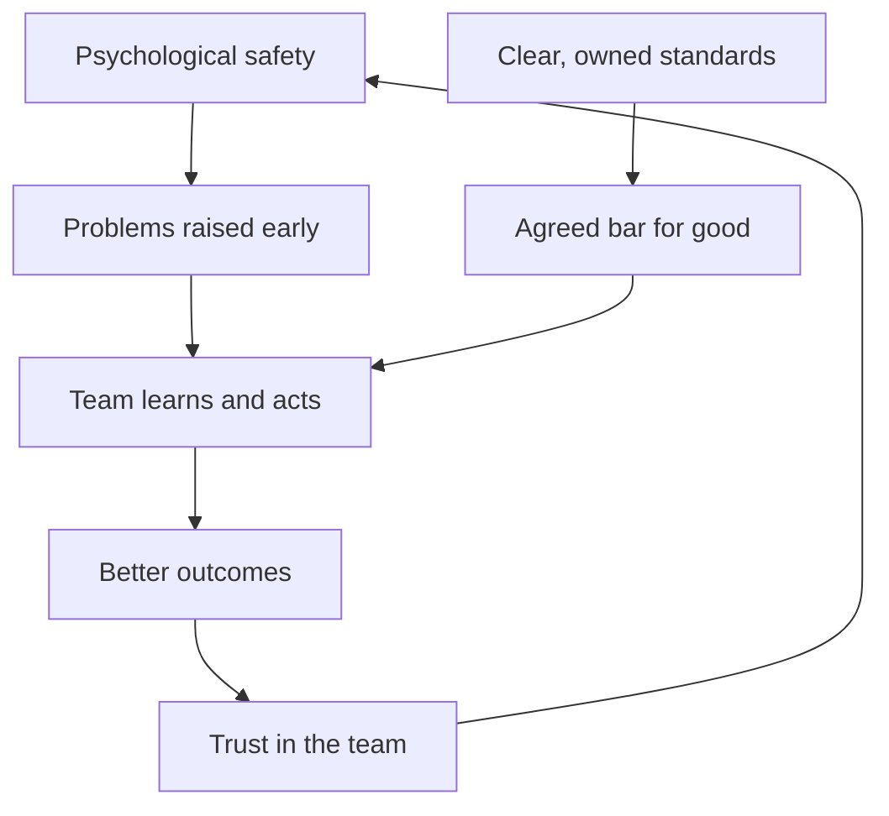
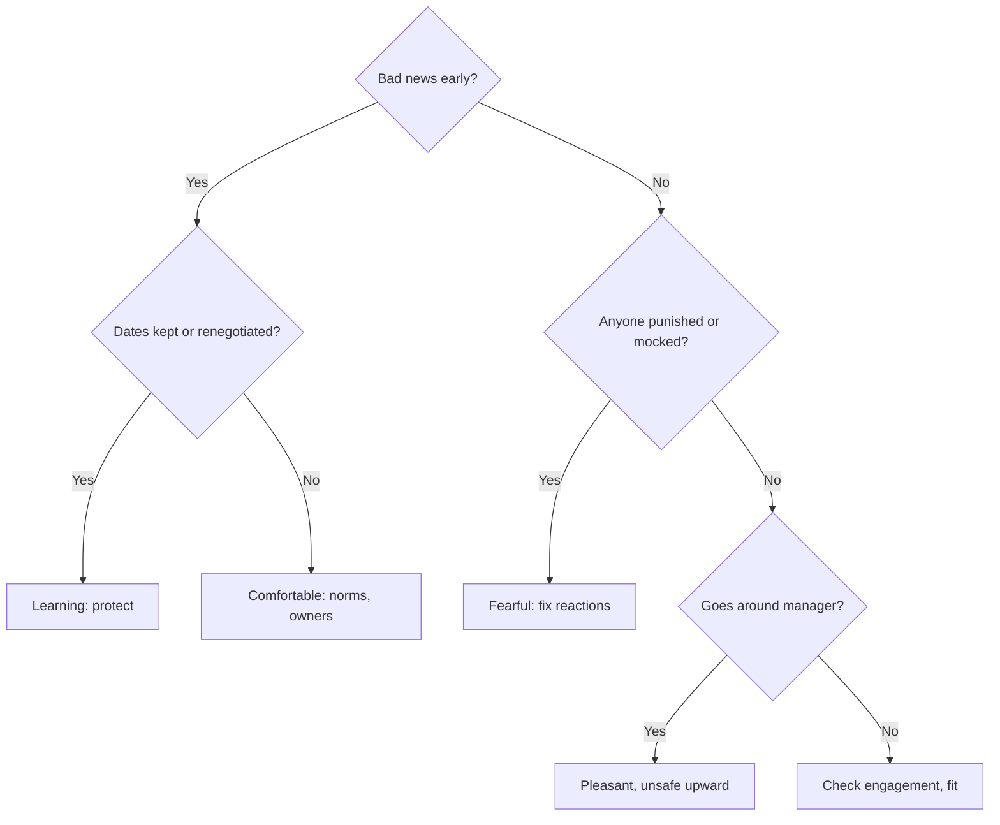
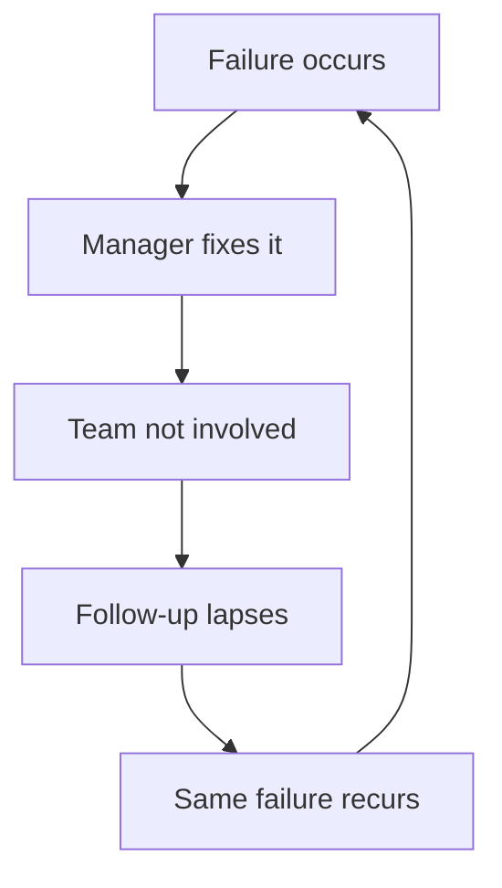

# Chapter 11 — High Performance: Trust, Psychological Safety, and Accountability

This chapter opens Part III, where the unit of analysis moves from the individual to the team. It
defines a high-performing engineering team, explains psychological safety (what it is, what the
research measured, and what it does not mean), and shows how to combine it with accountability so
that a team is both candid and dependable. The running examples are two teams at Northstar
Technologies, the fictional company in the [case study](../../case-studies/northstar/index.md):
Payments and Integrations, whose operational discipline is the best in the organization, and Orders,
whose manager was promoted from inside the team eight months before the director arrived.

## Why This Matters

At team scale, whether a problem is raised early decides whether it costs a conversation or an
outage. Someone usually notices a risky migration, an unrealistic date, or a fragile script before it
fails. Whether that person speaks, and whether anyone acts, is a property of the team more than of
the person.

At organization scale, "psychological safety" has become a slogan misused in both directions. Some
managers hear it as a demand to lower standards and resist it; others use it as a reason never to
hold anyone to a commitment. Both produce weak teams. A director with ten teams needs a precise
definition and a way to tell which teams have standards without candor and which have candor
without standards.

At executive scale, the question is what leadership does with bad news. One public search for a
culprit teaches the whole organization to report later and less.

## Learning Objectives

After this chapter you will be able to:

- Define high performance for an engineering team in terms of outcomes, sustainability, and learning,
  and recognize performance that depends on heroics.
- Explain what psychological safety is, what the main studies measured and in what settings, and why
  it is not the absence of standards.
- Combine high psychological safety with high accountability in a team's weekly practice.
- Diagnose a team that has only one of the two from observable signals, and choose a first
  intervention.

## The Mental Model

> **Mental model:** Psychological safety and accountability are two separate dials, not two ends of
> one. Safety decides whether problems are said out loud; accountability decides whether anything
> happens after they are said. High performance needs both turned up.

A team with safety but no accountability talks honestly about the deadline it is about to miss, then
misses it, and nobody is surprised. A team with accountability but no safety meets its numbers until
the day bad news arrives late, through a customer. A manager who treats the two as a trade-off ("I can
be supportive or demanding") ends up with one of these teams.

Candor rewarded with results makes a team more candid; a problem raised and ignored or punished
teaches silence. Edmondson's work is widely known for arguing that
safety and performance standards are separate dimensions and that high performance needs both
([Edmondson, 2018](../../references/bibliography.md#edmondson2018fearless)); the loop is **this
book's synthesis** of that idea with the learning mechanism below.

## Deep Conceptual Explanation

### Defining high performance

Defining a high-performing team by output (ships a lot, hits dates) rewards teams that borrow from the
future. This book uses three tests, and a team must pass all three (**this book's recommendation**):

| Dimension | Question | Evidence to look at |
|---|---|---|
| Outcomes | Does the team deliver what it commits to, at a quality users notice? | Commitments delivered; [change failure rate](../../glossary.md#change-failure-rate) (share of releases that fail); customer-detected incidents |
| Sustainability | Could the team keep this pace for two years without losing people? | After-hours pages per person; unplanned work; attrition; single-person components |
| Learning | Does the team get better, or does the same failure happen twice? | [Recurrences](../../glossary.md#recurrence) (repeats of a known failure); corrective action closure; time for a new engineer to become independent |

Heroics fail the sustainability test: a weekend-saved release is a good outcome from a bad system.
A team with few incidents but repeated ones fails the learning test. Chapter 18 covers delivery
measurement; here the measures only show which test a team is failing.

### What psychological safety is

Edmondson and Lei define psychological safety as people's perceptions of the consequences of taking
interpersonal risks in a particular context, such as a workplace
([Edmondson and Lei, 2014](../../references/bibliography.md#edmondson2014psychological)). In an
engineering team the risks are concrete: saying "I don't understand this design", admitting "my
change caused that", telling the manager "this date is not real", reporting a near miss nobody else
saw. Three features matter in practice:

- **It is a perception about consequences**, not a trait or a feeling of comfort. An engineer can like
  everyone on the team and still judge that disagreeing with the manager is risky.
- **It belongs to a context.** The same engineer can be safe in the team retrospective and unsafe in
  the director's review, so an organization-wide average hides most of what matters.
- **It is about speaking, not outcomes.** Low risk in raising a problem does not mean the proposal
  is adopted or the mistake has no consequences for the work.

### What the research measured

Safety research is broad, mostly survey-based, and correlational. The studies this chapter relies on:

| Study | Setting | Finding | Does not show |
|---|---|---|---|
| [Edmondson, 1999](../../references/bibliography.md#edmondson1999psychological) | 51 work teams in one manufacturing company | Safety went with team learning behavior; learning behavior carried the link from safety to performance. Team efficacy (belief in the team's ability) did not predict learning once safety was counted | Causation; anything about software |
| [Edmondson and Lei, 2014](../../references/bibliography.md#edmondson2014psychological) | Review of organizational research | Safety has been linked to voice (speaking up), teamwork, team learning, and organizational learning | Effect sizes |
| [Frazier et al., 2017](../../references/bibliography.md#frazier2017psychological) | Meta-analysis (a pooled analysis of many studies): 136 samples, over 22,000 people, nearly 5,000 groups | Tested whether safety relates to task performance beyond related constructs such as good leader relations and engagement. The abstract does not give effect sizes | A number for a slide |
| [Google re:Work](../../references/bibliography.md#rework-team-effectiveness) | Project Aristotle: 180 Google teams (115 engineering, 65 sales) | Five dynamics of effective teams, in order: psychological safety, dependability, structure and clarity, meaning, impact. How a team worked together mattered more than who was on it | Peer review; anything outside one company |

Edmondson's study is a **research finding** whose value is the mechanism: safety matters because it
changes what a team does with information. Project Aristotle is **documented practice** from one
company. Its second item, dependability (teammates reliably delivering quality work on time), sits
next to safety in the same list. Google's own summary does not support reading safety as a
replacement for accountability.

### Evidence from software teams

Software research points the same way, and it stresses standards. Lenberg and Feldt surveyed 217
practitioners in 38 agile teams at five Swedish organizations. Both psychological safety and **norm
clarity** (how clear and accepted the team's standards of conduct are) went with self-assessed
performance and job satisfaction. Norm clarity was the stronger predictor: by about 30 percent for
performance and 71 percent for satisfaction, as the authors report it
([Lenberg and Feldt, 2018](../../references/bibliography.md#lenberg2018psychological)). Performance was
self-assessed and the sample small, so this is a modest **research finding**. Its message is pointed:
clear standards mattered at least as much as safety.

Two larger sources agree on direction. A survey of 1,118 people in 161 software teams reports safety
directly associated with better teamwork and less conflict
([Verwijs and Russo, 2024](../../references/bibliography.md#verwijs2024double)). DORA (DevOps Research
and Assessment, a long-running industry survey program) uses Ron Westrum's typology, which classifies
cultures by how they treat messengers: pathological cultures punish them, bureaucratic cultures neglect
them, generative cultures train them. DORA states that high-trust cultures with good information flow
predict delivery and organizational performance, and that its 2019 survey found psychological safety
predictive of both
([DORA, generative culture](../../references/bibliography.md#dora-cap-generative-culture);
[Forsgren et al., 2018](../../references/bibliography.md#forsgren2018accelerate)). That is **industry
research**: survey-based, correlational, vendor-sponsored (Chapter 18 discusses its limits).

The evidence supports a modest claim strongly and a large claim weakly. **Strongly supported:** safety
is consistently associated with speaking up, learning behavior, and teamwork, including in software
teams. **Weakly supported:** that raising safety causes better delivery. No controlled study of that
was found. That is enough to invest in safety as a manager, not enough to promise a CFO a number.

### Why safety is not the absence of standards

The common misuse treats any demand as a threat: "holding me to the date makes me feel unsafe". That
confuses **interpersonal** risk (being embarrassed, punished, or excluded for speaking) with
**performance** risk (the work judged against a bar). A team where nobody fears speaking and nobody is
held to a commitment is not safe; it is comfortable, and its members usually know it.

Lencioni's fable is known for arranging team dysfunctions as a pyramid. Absence of trust sits at the
base, with avoidance of accountability and inattention to results above it: a team that cannot be
candid will not hold its members to standards
([Lencioni, 2002](../../references/bibliography.md#lencioni2002five)). That is **expert opinion**
told as a story. Allspaw describes a just culture as balancing safety and accountability, with
engineers not "off the hook" but expected to help make the system safer
([Allspaw, 2012](../../references/bibliography.md#allspaw2012blameless)).

The line, then: **safety governs how people are treated when they speak; accountability governs what
is expected of them afterward.** An engineer who reports that their change broke production is
protected from ridicule and punishment for the report, and is still expected to tell the full story
and help fix the system. Chapter 25 covers this boundary for incidents in
[blameless review](../05-engineering-quality/25-incidents-postmortems-and-change-failure-analysis.md#blameless-review-and-its-critics).

### What accountability means in a team

Accountability is often a synonym for blame ("who is accountable for this outage?"). Here it means
four narrower things (**this book's recommendation**):

1. **Clear commitments:** one owner, a definition of done, a date the owner agreed to.
2. **Visible follow-through:** progress is visible to the team without the manager asking.
3. **Early renegotiation:** an owner who sees a commitment at risk says so as soon as they know. The
   late surprise is the failure, not the slip announced early.
4. **Consequences that fit the cause:** a system problem gets a system fix; a repeated individual
   pattern of missed commitments without warning becomes a performance conversation (Chapter 9).

Point 3 is where the dials meet: early renegotiation is rational only if raising a risk is safe.
Point 4 is where friendly teams break down, postponing the hard conversation (Chapter 6).

### Comfort, liking, and silence

**Liking is not safety.** In a team that likes its manager, criticizing the manager can feel like
betraying a friend, so concerns go unsaid or go around the manager. **Absence of conflict is not
safety either.** Months of design reviews without disagreement usually mean disagreement has become
costly; Chapter 6 covers conflict. The test for safety is not how pleasant meetings are. It is where
bad news goes first, and how long it takes to arrive.

## Engineering Organization Example

!!! info "Northstar so far"
    This example is set in the baseline quarter, the 90 days before the director arrived. Northstar had
    30 Sev1 and Sev2 incidents (its two highest severity levels), 34 percent of capacity went to
    unplanned work, and 41 percent of committed roadmap items shipped on time. See the
    [timeline](../../case-studies/northstar/timeline.md).

This example reads two Northstar teams in that quarter. Incident figures come from
[`incidents-last-quarter.csv`](../../case-studies/northstar/data/incidents-last-quarter.csv); the
near-miss count is **illustrative**. [Severity](../../glossary.md#severity-sev1-sev2-sev3) levels are
defined in the glossary. All Northstar data is fictional.

| Signal, baseline quarter | Payments and Integrations | Orders |
|---|---|---|
| Engineers | 12 | 14 |
| Sev1 and Sev2 incidents | 6 | 7 |
| First detected by a customer | 1 of 6 | 4 of 7 |
| Recurrences of a known failure mode | 1 of 6 | 3 of 7 |
| Median time to restore | about 78 minutes | 185 minutes |
| Committed roadmap items delivered | 2 of 3 | 1 of 4 |
| Unplanned work | 33% | 36% |
| Near misses recorded by the team | 17 | No near-miss log |
| Manager's time on people work | 35% | 15% |

Medians come from six and seven incidents, which are small samples.

**Payments and Integrations** is strongest on outcomes: five of six incidents caught by monitoring,
two of three commitments delivered, one recurrence (INC-413, a partner bank outage with no fallback
route). The 17 near misses are a safety signal: engineers write down what nearly went wrong without
fear of being associated with it. Sustainability is unknown. Unplanned work is 33 percent, close to
the organization's 34, and Northstar ran no developer survey in the two years before the director
arrived.

It also has an instructive gap. Its 64 payments-gateway flags and settings were edited directly
on the configuration server without review, and two of its six incidents (INC-410 and INC-430) were
configuration changes. None of the 17 near misses concerned that file. A team can be candid about
every risk it recognizes and blind to a practice it considers normal. Safety makes problems
speakable, not visible; a standard (reviewed flag changes, from week 6 of the director's first
quarter) did that.

**Orders** is a friendly team with a well-liked manager and weak results. It delivered one of four
commitments and met its Sprint Goals in 2 of the last 6 sprints. Customers found four of its seven
incidents, and three were recurrences. One was INC-421, a bulk-upload failure that Priya Raman (Orders'
engineering manager) had fixed herself months earlier; its follow-up test, assigned to her, was never
written. The most telling safety signal is indirect.
Senior engineers Rafael Duarte and Aisha Bello raised their frustration that decisions waited for
Priya with the new director in their first conversations, not with Priya. The team was comfortable,
but not safe enough to tell its own manager the most important thing about how it worked.

**A rough cost of the difference.** Assume, generously, that a team with clear ownership would have
completed the follow-up actions and prevented all three Orders recurrences. Their restoration times
add up to about 10.5 hours of customer-facing failure. Not all of
it was full unavailability of the contractual paths, but for scale, a 99.9 percent commitment allows
about 2.2 hours of unavailability a quarter. Follow-through is not a soft topic.

## Decision Framework

The two dials give four states. The labels and signals are **this book's**, in the spirit of the
two-dimension idea credited above.

| State | Safety | Accountability | What you observe | First move |
|---|---|---|---|---|
| Learning | High | High | Bad news early and in public; dates renegotiated before they slip; few recurrences | Protect it; do not standardize it away |
| Comfortable | High | Low | Honest retrospectives that change nothing; dates slip without discussion; actions stay open | Clarify norms and owners; make follow-through visible |
| Fearful | Low | High | Green dashboards, late surprises; incidents downgraded; no near misses admitted | Change how managers and executives react to bad news |
| Coasting | Low | Low | Little discussion, little commitment; people do what is assigned | Start with the manager: leadership or fit |

Diagnose from behavior, not self-description:

"Pleasant, unsafe upward" is the Orders pattern: nobody is punished, people get on, and the problem
still does not reach the person who could fix it. The first move is the manager asking for criticism
of their own decisions and acting visibly on it.

| Observable signal | Points to |
|---|---|
| Near misses and "I broke it" messages rare or absent | Low safety, or risks not recognized |
| Customers find incidents far more often than the team | Low safety or weak detection; check which |
| Commitments slip at the deadline, not before | Risks not raised (safety) or no owner of the date (accountability) |
| Corrective actions open with no discussion | Low accountability |
| Concerns about the manager reach the [skip-level](../../glossary.md#skip-level) (the manager's manager) first | Low safety toward the manager |

## Trade-offs

**Safety against decision speed.** Inviting dissent takes time, and a team that relitigates every
decision is mistaking debate for safety. Everyone is heard, one person decides, and the decision
stands until new information arrives (Chapter 13 covers decision rights).

**Accountability against comfort.** Clear ownership feels like pressure at first to people used to
diffuse responsibility; say so in advance.

**Local practice against consistency.** The habits of Elena Sokolova (Payments and Integrations'
manager) work partly because her team chose them. Mandating the same ritual everywhere copies the form and loses the ownership. Standardize
outcomes (near misses recorded, actions owned) and let teams choose rituals.

**Measurement against honesty.** Publishing team safety scores and asking managers to raise them
invites teams to answer what management wants to hear. Chapter 14 covers team health assessment.

## Failure Modes

**Safety as a shield.** The phrase appears mostly when commitments are mentioned, to stop the
discussion. Countermeasure: restate the difference between interpersonal and performance risk, then
hold the conversation about the commitment, kindly and specifically.

**Accountability as blame.** "Who is accountable?" is the first question after every incident. Signal:
defensive write-ups, and near misses disappear. Countermeasure: ask "what made this possible?" first;
keep person-focused questions for the narrow cases Chapter 25 defines.

**The manager as shock absorber.** The manager fixes every failure and owns every follow-up. The team
feels safe and learns nothing.

This is the loop behind INC-421. Signal: open follow-up actions owned by the manager.
Countermeasure: hand follow-through to a named engineer with a date, as Priya did in quarter 1 when
two senior engineers took over review of core/order-capture.

**Safety measured, not built.** Survey scores rise on request while near misses stay flat. Track
behavior alongside any survey.

## Enterprise Application

With 50 to 150 engineers, a director has six to fifteen teams and attends none of their
retrospectives, so safety and accountability are read from a distance and changed through managers.

**Read behavior, not sentiment.** Monthly, per team: share of incidents found by customers,
recurrences, corrective action closure, whether near misses are recorded. Together they show whether
information flows. Each is gamed (logs padded with trivia, actions closed as trivial), so sample
entries, and never rank teams on them or tie them to bonuses (Chapter 18).

**Develop managers' reactions.** A team's safety is set mostly by how its manager responds to bad
news. Ask each manager about the last time someone told them something unwelcome and what they did.
A manager with no example is not receiving any.

**Keep standards few and owned.** Norm clarity in Lenberg and Feldt, and dependability and clarity in
Google's list, point the same way. The director owns a short list of organization-wide expectations
(severity definitions, action ownership, operational minimums) and leaves the rest to teams
(Chapter 20 for standards, Chapter 12 for working agreements).

**Use skip-levels as a check, not a channel.** A concern that reaches the director first is a signal
about that team; send it back with the engineer's permission and coach the manager.

## CTO Perspective

At executive scale, safety is set by a few visible moments: the board meeting after a bad incident,
the response to an engineer who says a committed date is impossible, the treatment of the person
whose change caused an outage. A CTO who asks "who did this?" in a public incident channel defines the
organization's safety more effectively than any training program can repair.

The CTO also owns accountability above teams. When executives give customers dates before
engineering has sized the work (5 of Northstar's 17 baseline commitments), teams are held to promises
they did not make, and accountability turns into blame. Accountability starts with commitments people
actually agreed to.

Be precise with the board. "Psychological safety is associated with learning and teamwork across many
studies, including software teams" is defensible. "Google proved safety drives performance"
overstates a company self-report, and no study found for this book supports promising fewer
incidents. The case is mechanism plus local measurement: whether customer-detected incidents and
recurrences fall as information starts flowing.

## Practical Playbook

For a manager moving a team from one dial to both:

1. **Diagnose from behavior.** For last quarter, list who reported near misses, how many incidents
   customers found first, how many commitments slipped at the deadline versus before it, and whose
   follow-up actions are open.
2. **Change your reaction to bad news before asking for more of it.** Thank the messenger, ask what
   they need, and keep fault out of the first conversation.
3. **Ask for criticism of your own decisions,** privately first: "What decision of mine this month
   would you have made differently?" Act visibly on at least one answer.
4. **Write the team's norms on one page,** with the team: what done means, how commitments are made
   and renegotiated, how near misses are recorded.
5. **Give every commitment and follow-up action one owner and an agreed date.** Remove your name from
   items the team should own.
6. **Make follow-through visible** in a short weekly review the team runs. Rotate the facilitator;
   speak last.
7. **Separate system from person.** Misses go to the team review; a repeated individual pattern goes
   to a private conversation.
8. **Check after a quarter** whether near misses rose, late surprises and recurrences fell, and
   actions closed.

## Case Study

This case is **fictional**. It is set at the start of quarter 2 (week 14). By then the director's
first quarter had assigned owners to most unowned components, published severity definitions, and cut
Sev1 and Sev2 incidents from 30 to 21. The question at the end is a decision the reader faces.

**How Payments and Integrations works.** For about two years before the director arrived, Elena
Sokolova's team had held a 30-minute weekly operations review with a rotating facilitator. The
engineer coming off on-call presents the week's pages, the logged near misses, and one thing that
surprised them. Elena speaks last. The near-miss log is a shared page anyone can write in; in the
baseline quarter it had 17 entries, most written by the person who had nearly caused the problem.
Items at risk on the Kanban board are raised in the same review by their owners, usually before they
slip.

At the start of quarter 2, the director asked why direct edits on the configuration server had never
appeared in the log. The team's informal tech lead said everyone had always worked that way, so nobody
had seen it as a risk. High safety and high accountability had still left a practice nobody
could see. The fix had come from a standard, not from more candor.

**Orders after the transition.** In quarter 1 Priya Raman capped her hands-on time, Aisha Bello led
the bulk-ordering implementation, and Rafael Duarte and Aisha Bello took over review of
core/order-capture. Accountability moved toward the team. What the director did not yet
know was whether the team would now tell Priya what it had told a newcomer in its first conversations.

At the start of quarter 2, Priya asked whether Orders should copy Elena's operations review, near-miss
log and all. She had sat in on one and liked it.

The director's reading was that Orders' problem had not been fear: nobody had been punished, because
Priya absorbed incidents herself. The team had been comfortable without owning its outcomes, and its
candor stopped short of its manager. Copying the ritual would add a meeting; whether it added safety
depended on whether Orders engineers believed Priya wanted to hear that her decisions were wrong.

The director's draft advice had three parts. First, Priya asks each senior engineer privately for one
decision she should have made differently, and acts on one answer before any new meeting. Second,
Orders adopts the near-miss log and a weekly review, with follow-up actions owned by engineers, not
Priya. Third, after a quarter, they check whether near misses appear and whether risks to the
bulk-ordering date surface before the checkpoint rather than at it. Priya's concern was cost. The
feature was due at the end of quarter 2, and Orders now had 16 engineers (two quality engineers
joined in week 10), so a 30-minute weekly meeting costs eight hours a week. Exercise A1 asks you to decide.

## Exercises

Solutions are in [chapter 11 solutions](../../solutions/ch11-solutions.md). Northstar data is on the
[baseline page](../../case-studies/northstar/baseline-data.md).

### Foundational

**F1.** A team lead tells you: "We have great psychological safety. Nobody has been fired for an
outage in five years. We never argue in meetings. And we don't do deadlines, because they stress
people out." Assess each of the three claims against the chapter's definitions of safety and
accountability, and say what evidence you would ask for before agreeing or disagreeing.

**F2.** Classify each team into one of the four states. For each, name the one observation that would
most change your classification: (a) green dashboards, and the last three outages were reported by
customers; (b) lively retrospectives, and an action list that has not shrunk in six months; (c) near
misses logged weekly, and dates renegotiated two weeks early; (d) engineers who do what is assigned
and never propose work.

**F3.** A vice president's slide says: "Google proved psychological safety is the number one driver of
team performance. So we will tie each manager's bonus to their team's safety survey score." Using what
Edmondson (1999), Project Aristotle, and Lenberg and Feldt actually measured, assess the first
sentence, then assess the plan.

### Applied Leadership

**A1.** You are the director at the start of quarter 2. Priya Raman (Orders' engineering manager) asks whether Orders should adopt
Elena Sokolova's weekly operations review and near-miss log. The bulk-ordering feature is due at the
end of the quarter, and the meeting would cost eight hours a week. Decide what you recommend,
in what order, what you would measure after one quarter, and what result would change your course.

**A2.** In Payments and Integrations, the informal tech lead tells you privately that one strong
engineer has missed three commitments in two months without warning. The team does not want to
raise it in the operations review because "the review is supposed to be safe". Elena Sokolova, the
team's manager, asks how to
handle accountability without damaging what the team has built. Advise her: where the conversation
happens, what is said, and what the team should see.

**A3.** You take over a team of nine whose previous manager named the engineer responsible for each
incident at the monthly all-hands. The team's change failure rate is low, it has recorded no near
misses in a year, and its last two incidents were found by customers. Plan your first 60 days: what
you change first, what you leave alone, and which signals you expect to move, in what order.

### Executive Decision-Making

**X1.** Hypothetically, after a bad quarter, Helena Marsh (CEO) proposes that each engineering manager's
bonus include their team's Sev1 and Sev2 count, "so managers are accountable for reliability". As CTO,
decide whether you support it, what it would do to severity ratings and reporting, and what you would
propose instead to give the CEO the accountability she wants.

**X2.** Victor Lindqvist (CTO), impressed by Payments and Integrations, wants every Northstar team to
run Elena Sokolova's weekly operations review from next quarter, with the same agenda. As director,
decide what to standardize across the six teams, what to leave to each team, and how you would know
within two quarters whether it worked. Estimate the cost in engineer-hours for Northstar's 80
engineers, and in dollars at a fully loaded cost of $185,000 per engineer per year.

## Reflection Questions

1. When did someone last tell you a decision of yours was wrong, and what did you do the following week?
2. Which bad news on your team reaches your manager before it reaches you?
3. Is your team comfortable or safe? What would you have to observe to tell the difference?
4. Which commitment slipped at the deadline last quarter, and who knew a month earlier that it would?
5. Which practice on your team does everyone consider normal and nobody would log as a risk?
6. When you protected someone from a consequence, who carried the cost instead?

## Key Takeaways

- Define high performance by outcomes, sustainability, and learning. Heroics are a cost, not evidence.
- Psychological safety is a perception that speaking up carries low interpersonal risk. It is local to
  a team and a relationship, and it is about speaking, not outcomes.
- Evidence linking safety to learning, voice, and teamwork is broad; evidence that it causes better
  software delivery is suggestive, not proven. Say so.
- Safety is not the absence of standards. In the one software study here that compared them, norm
  clarity predicted performance at least as strongly as safety.
- Safety governs how people are treated when they speak; accountability governs what is expected
  afterward. Build both.
- Diagnose from behavior: where bad news goes first, how early commitments are renegotiated, whether
  near misses are recorded, whether actions close.
- A pleasant team can be unsafe toward its manager. Ask for criticism of your own decisions and act on it.
- Safety makes problems speakable, not visible. Standards find what a candid team considers normal.

## References and Further Reading

- [Edmondson, 1999](../../references/bibliography.md#edmondson1999psychological). The founding field
  study of team psychological safety and learning behavior.
- [Edmondson and Lei, 2014](../../references/bibliography.md#edmondson2014psychological). Review of the
  construct's history and research; source of the definition used here.
- [Frazier et al., 2017](../../references/bibliography.md#frazier2017psychological). Meta-analysis of
  136 samples on what predicts safety and what it predicts.
- [Google re:Work](../../references/bibliography.md#rework-team-effectiveness). Project Aristotle's
  five dynamics; useful for pairing safety with dependability and clarity, not as proof.
- [Lenberg and Feldt, 2018](../../references/bibliography.md#lenberg2018psychological). Safety and
  norm clarity in 38 software teams; why standards matter as much as safety.
- [Verwijs and Russo, 2024](../../references/bibliography.md#verwijs2024double). Safety, conflict, and
  diversity in 161 software teams.
- [DORA, generative culture](../../references/bibliography.md#dora-cap-generative-culture) and
  [Forsgren et al., 2018](../../references/bibliography.md#forsgren2018accelerate). Westrum's typology
  in software delivery research.
- [Edmondson, 2018](../../references/bibliography.md#edmondson2018fearless). *The Fearless
  Organization*. Safety alongside accountability and performance, for practitioners.
- [Lencioni, 2002](../../references/bibliography.md#lencioni2002five). *The Five Dysfunctions of a
  Team*. Trust, accountability, and results as a fable.
- [Allspaw, 2012](../../references/bibliography.md#allspaw2012blameless). Just culture as a balance of
  safety and accountability; Chapter 25 develops it for incidents.
