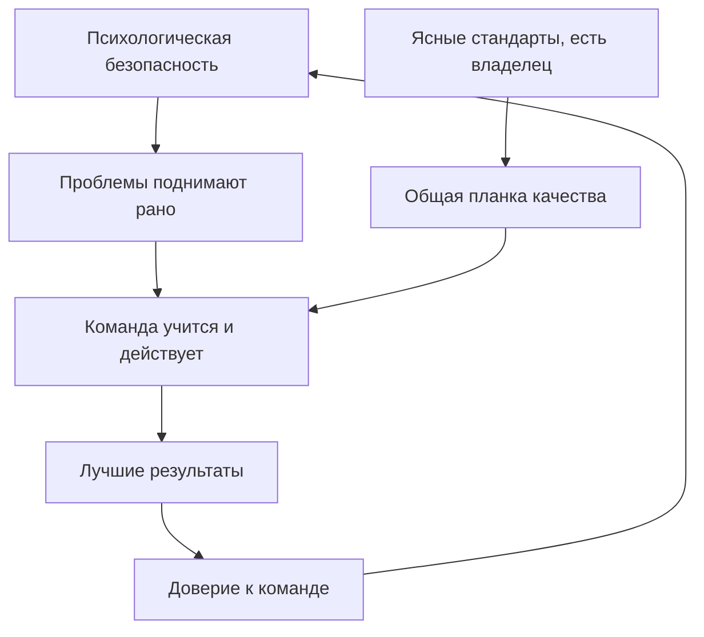
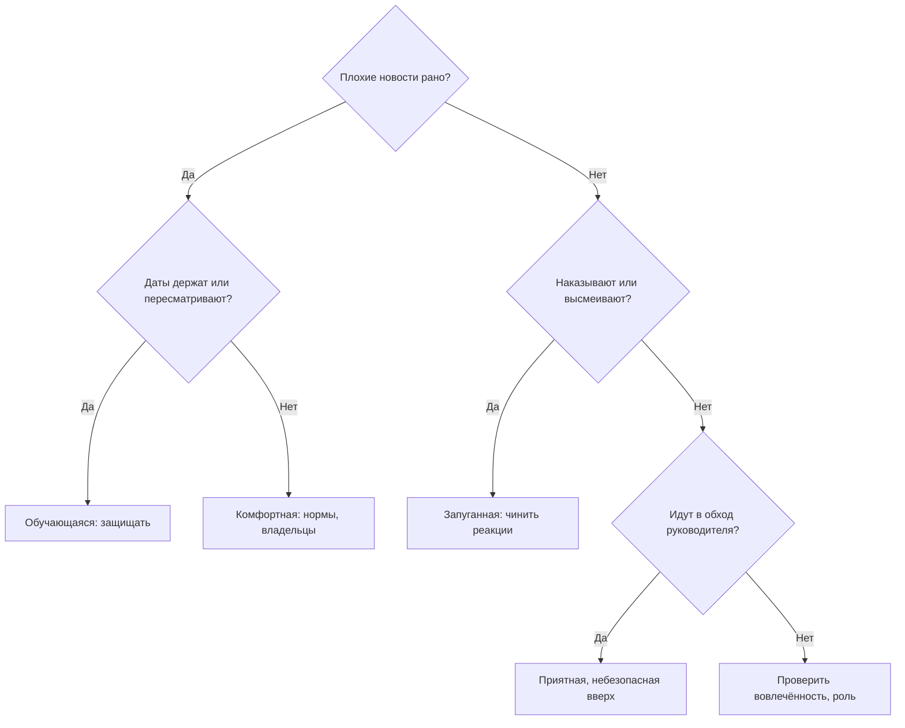
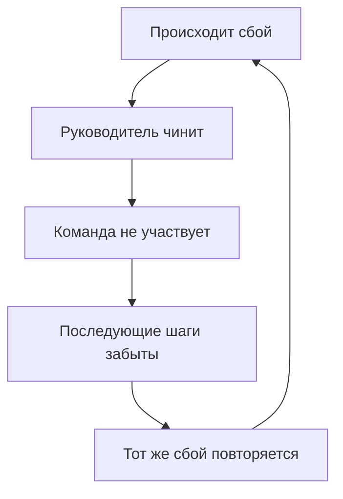

# Глава 11 — Высокая эффективность: доверие, психологическая безопасность и подотчётность { #chapter-11-high-performance-trust-psychological-safety-and-accountability }

Этой главой открывается часть III, где единицей анализа становится уже не отдельный человек, а команда.
В главе дано определение высокоэффективной инженерной команды, разобрана психологическая безопасность
(что это такое, что измеряли исследования и чем она не является) и показано, как сочетать её с
подотчётностью, чтобы команда была одновременно откровенной и надёжной. Сквозные примеры — две команды
Northstar Technologies, вымышленной компании из [кейса](../../case-studies/northstar/index.md):
Payments and Integrations с лучшей в организации операционной дисциплиной и Orders, руководителя которой
повысили из рядовых участников этой же команды за восемь месяцев до прихода директора.

## Почему это важно { #why-this-matters }

Для команды многое решает, рано ли подняли проблему: от этого зависит, обойдётся она в один разговор
или в сбой. Рискованную миграцию, нереальную дату или хрупкий скрипт обычно кто-то замечает до того, как
всё сломается. Заговорит ли этот человек и откликнется ли кто-нибудь на его слова — свойство скорее
команды, чем человека.

В масштабе организации «психологическая безопасность» превратилась в лозунг, и его искажают в обе
стороны. Одни руководители слышат в нём требование снизить планку и сопротивляются; другие используют
его как повод никогда ни с кого не спрашивать за обязательства. И то и другое порождает слабые команды.
Директору с десятью командами нужны точное определение и способ отличить команды, где есть стандарты,
но нет откровенности, от команд, где есть откровенность, но нет стандартов.

Для высшего руководства вопрос в том, как оно поступает с плохими новостями. Одного публичного поиска
виноватого хватает, чтобы вся организация научилась сообщать позже и меньше.

## Цели главы { #learning-objectives }

После этой главы вы сможете:

- Определять высокую эффективность инженерной команды через результаты, устойчивость и обучение и
  распознавать эффективность, которая держится на героизме.
- Объяснять, что такое психологическая безопасность, что и в каких условиях измеряли основные
  исследования и почему она не означает отсутствия стандартов.
- Сочетать высокую психологическую безопасность с высокой подотчётностью в еженедельной практике
  команды.
- Диагностировать по наблюдаемым сигналам команду, у которой есть только одно из двух, и выбирать
  первое вмешательство.

## Ментальная модель { #the-mental-model }

> **Ментальная модель:** психологическая безопасность и подотчётность — это две отдельные ручки, а не
> два конца одной шкалы. Безопасность определяет, скажут ли о проблемах вслух; подотчётность — сделают
> ли что-нибудь, когда о них сказали. Для высокой эффективности обе ручки должны быть выкручены вверх.

Команда с безопасностью, но без подотчётности честно обсуждает дедлайн, который вот-вот сорвёт, затем
срывает его, и никто не удивлён. Команда с подотчётностью, но без безопасности выполняет показатели — до
того дня, когда плохая новость приходит поздно и через клиента. Руководитель, который считает, что
выбирать приходится одно из двух («я могу либо поддерживать, либо требовать»), получает одну из этих
команд.

Если откровенность приносит результат, команда становится откровеннее. Если проблему подняли, а её
проигнорировали или наказали за неё, команда учится молчать. Edmondson утверждает, что безопасность и
стандарты результативности — отдельные измерения и что высокой эффективности нужны оба
([Edmondson, 2018](../../references/bibliography.md#edmondson2018fearless)). Петля на схеме — **синтез
книги**: она объединяет эту идею с механизмом обучения, который описан ниже.

## Подробный разбор { #deep-conceptual-explanation }

### Что такое высокая эффективность { #defining-high-performance }

Если определять высокоэффективную команду по выпуску (много выпускает, попадает в сроки), вы будете
вознаграждать команды, которые берут взаймы у будущего. Книга использует три теста, и пройти нужно все
три (**рекомендация книги**):

| Измерение | Вопрос | На какие свидетельства смотреть |
|---|---|---|
| Результаты | Поставляет ли команда то, что обещает, с качеством, которое замечают пользователи? | Выполненные обязательства; [доля неудачных изменений](../../glossary.md#change-failure-rate) (доля изменений, которые ломаются в продакшене); инциденты, обнаруженные клиентами |
| Устойчивость | Сможет ли команда держать такой темп два года, не теряя людей? | Вызовы в нерабочее время на человека; незапланированная работа; текучесть; компоненты, которые знает один человек |
| Обучение | Становится ли команда лучше, или один и тот же сбой случается дважды? | [Повторные инциденты](../../glossary.md#recurrence) (повторы известного сбоя); закрытие корректирующих действий; время, за которое новый инженер становится самостоятельным |

Героизм не проходит тест на устойчивость: релиз, спасённый в выходные, — хороший результат плохой
системы. Команда, у которой инцидентов мало, но они повторяются, не проходит тест на обучение. Как
измерять поставку, разобрано в главе 18; здесь показатели лишь указывают, какой тест не пройден.

### Что такое психологическая безопасность { #what-psychological-safety-is }

Edmondson и Lei определяют психологическую безопасность как представления людей о последствиях
межличностного риска в определённом контексте, например на работе
([Edmondson and Lei, 2014](../../references/bibliography.md#edmondson2014psychological)). В инженерной
команде эти риски конкретны: сказать «я не понимаю этот дизайн», признать «это сломалось из-за моего
изменения», сказать руководителю «эта дата нереальна», сообщить о почти-инциденте (near miss), которого
больше никто не видел. На практике важны три свойства:

- **Это представление о последствиях**, а не черта характера и не ощущение комфорта. Инженеру может
  нравиться вся команда, и при этом спорить с руководителем он будет считать рискованным.
- **Она привязана к контексту.** Один и тот же инженер может чувствовать себя в безопасности на
  ретроспективе команды и в опасности на разборе у директора. Поэтому среднее по организации скрывает
  большую часть важного.
- **Речь о том, чтобы говорить, а не о результатах.** Если поднять проблему не рискованно, это ещё не
  значит, что предложение примут или что ошибка останется без последствий для работы.

### Что измеряли исследования { #what-the-research-measured }

Исследований безопасности много; в основном это опросы, и выводы в них корреляционные. Глава опирается
на следующие:

| Исследование | Условия | Результат | Чего не показывает |
|---|---|---|---|
| [Edmondson, 1999](../../references/bibliography.md#edmondson1999psychological) | 51 рабочая команда в одной производственной компании | Безопасность сопровождалась обучающим поведением команды; связь безопасности с результативностью шла именно через обучающее поведение. Вера команды в свои способности (эффективность команды) не предсказывала обучение с поправкой на безопасность | Причинность; ничего о разработке ПО |
| [Edmondson and Lei, 2014](../../references/bibliography.md#edmondson2014psychological) | Обзор организационных исследований | Безопасность связывали с высказыванием (voice), командной работой, обучением команды и обучением организации | Размеры эффекта |
| [Frazier et al., 2017](../../references/bibliography.md#frazier2017psychological) | Метаанализ (объединённый анализ многих исследований): 136 выборок, более 22,000 человек, почти 5,000 групп | Проверяли, связана ли безопасность с выполнением задач сверх родственных конструктов, например хороших отношений с лидером и вовлечённости. Размеров эффекта в аннотации нет | Цифру для слайда |
| [Google re:Work](../../references/bibliography.md#rework-team-effectiveness) | Project Aristotle: 180 команд Google (115 инженерных, 65 продаж) | Пять факторов эффективных команд по порядку: психологическая безопасность, надёжность, структура и ясность, смысл, влияние. То, как команда работала вместе, значило больше, чем то, кто в неё входил | Не прошло рецензирования; ничего за пределами одной компании |

Исследование Edmondson — **научный результат**, и ценен он механизмом: безопасность важна, потому что
меняет то, как команда обращается с информацией. Project Aristotle — **задокументированная практика**
одной компании. Второй пункт его списка — надёжность (dependability: коллеги вовремя и качественно
делают свою работу) — стоит рядом с безопасностью. Так что даже по собственному резюме Google
безопасность нельзя считать заменой подотчётности.

### Данные из команд разработки ПО { #evidence-from-software-teams }

Исследования в разработке ПО указывают в ту же сторону и подчёркивают роль стандартов. Lenberg и Feldt
опросили 217 практиков в 38 agile-командах пяти шведских организаций. И психологическая безопасность, и
**ясность норм** (norm clarity: насколько ясны и приняты стандарты поведения в команде) были связаны с
результативностью по самооценке и с удовлетворённостью работой, причём ясность норм сильнее
предсказывала и то и другое
([Lenberg and Feldt, 2018](../../references/bibliography.md#lenberg2018psychological)). Результативность
оценивали сами участники, а выборка невелика, так что это скромный **научный результат**. Зато вывод
острый: ясные стандарты значили как минимум не меньше, чем безопасность.

Два более крупных источника указывают в ту же сторону. По опросу 1 118 человек в 161 команде
разработки, безопасность напрямую связана с более слаженной командной работой и меньшим числом
конфликтов ([Verwijs and Russo, 2024](../../references/bibliography.md#verwijs2024double)). DORA (DevOps
Research and Assessment, давняя отраслевая программа опросов) использует типологию Ron Westrum, которая
делит культуры по тому, как они обращаются с вестниками: патологические их наказывают, бюрократические
игнорируют, генеративные обучают. По утверждению DORA, культура с высоким доверием и хорошим потоком
информации предсказывает показатели поставки и показатели организации, а её опрос 2019 года показал,
что и то и другое предсказывает психологическая безопасность
([DORA, generative culture](../../references/bibliography.md#dora-cap-generative-culture);
[Forsgren et al., 2018](../../references/bibliography.md#forsgren2018accelerate)). Это **отраслевое
исследование**: на основе опросов, корреляционное, спонсируемое вендором (его ограничения разобраны в
главе 18).

Доказательства сильно поддерживают скромное утверждение и слабо — громкое. **Сильно поддержано:**
безопасность устойчиво связана с готовностью высказываться, обучающим поведением и командной работой, в
том числе в командах разработки. **Слабо поддержано:** что рост безопасности улучшает поставку.
Контролируемых исследований на этот счёт найти не удалось. Этого хватает, чтобы руководитель вкладывался
в безопасность, но не хватает, чтобы обещать CFO (финансовому директору) конкретную цифру.

### Почему безопасность — не отсутствие стандартов { #why-safety-is-not-the-absence-of-standards }

Распространённое искажение — видеть угрозу в любом требовании: «когда с меня спрашивают за дату, я
чувствую себя в опасности». Здесь путают **межличностный** риск (что человека пристыдят, накажут или
исключат за сказанное) с риском **по результатам** (работу оценивают по планке). Команда, где никто не
боится говорить и ни с кого не спрашивают за обязательства, не безопасная, а комфортная, и её участники
обычно это понимают.

Книга-притча Lencioni известна тем, что выстраивает дисфункции команды в пирамиду. В основании —
отсутствие доверия, выше — уклонение от ответственности и невнимание к результатам: команда, которая не
может быть откровенной, не станет требовать от участников соблюдения стандартов
([Lencioni, 2002](../../references/bibliography.md#lencioni2002five)). Это **мнение эксперта**,
изложенное в форме истории. Allspaw описывает справедливую культуру (just culture) как баланс
безопасности и подотчётности: инженеров не «освобождают от ответственности», а ждут, что они помогут
сделать систему безопаснее ([Allspaw, 2012](../../references/bibliography.md#allspaw2012blameless)).

Итак, граница: **безопасность определяет, как с людьми обращаются, когда они говорят; подотчётность —
чего от них ждут потом.** Инженера, который сообщил, что его изменение сломало продакшен, за это
сообщение не высмеют и не накажут. Но от него всё равно ждут, что он расскажет всю историю и поможет
исправить систему. Как эта граница проходит в инцидентах, разобрано в главе 25, в разделе о
[безобвинительном разборе](../05-engineering-quality/25-incidents-postmortems-and-change-failure-analysis.md#blameless-review-and-its-critics).

### Что значит подотчётность в команде { #what-accountability-means-in-a-team }

Под подотчётностью часто понимают вину («кто ответственен за этот сбой?»). Здесь она означает четыре
более узкие вещи (**рекомендация книги**):

1. **Ясные обязательства:** один владелец, определение готовности, дата, на которую владелец
   согласился.
2. **Видимое доведение до конца:** команда видит прогресс, и руководителю не нужно о нём спрашивать.
3. **Ранний пересмотр:** владелец, который видит, что обязательство под угрозой, говорит об этом, как
   только узнаёт. Провалом считается поздний сюрприз, а не заранее объявленная задержка.
4. **Последствия, соответствующие причине:** у системной проблемы — системное исправление; если же у
   человека повторяется одна и та же закономерность (срывы обязательств без предупреждения), это повод
   для разговора о результативности (глава 9).

В пункте 3 встречаются обе ручки: пересматривать обязательство рано разумно, только если поднимать риск
безопасно. На пункте 4 ломаются дружные команды: они откладывают трудный разговор (глава 6).

### Комфорт, симпатия и молчание { #comfort-liking-and-silence }

**Симпатия — не безопасность.** Если команда любит своего руководителя, критиковать его может казаться
предательством друга, и опасения либо остаются невысказанными, либо идут в обход руководителя.
**Отсутствие конфликтов — тоже не безопасность.** Если месяцами на ревью дизайна нет разногласий, обычно
это значит, что не соглашаться стало дорого (о конфликте — глава 6). Безопасность проверяется не тем,
насколько приятны встречи, а тем, куда плохие новости приходят первыми и сколько времени им на это
нужно.

### Инклюзивность: безопасность для каждого, а не в среднем { #inclusion-safety-for-everyone-not-on-average }

Команда безопасна ровно настолько, насколько она безопасна для своего наименее защищённого участника.
Безопасность привязана к контексту и отношениям, поэтому команда может быть откровенной в среднем, а
часть участников при этом молчит: самый новый инженер, двое людей на другой площадке, человек,
работающий на неродном языке, единственная женщина в команде, джуниор, которого однажды резко поправили.
Инклюзивность в этой книге означает, что голос каждого участника слышат и учитывают, а не просто
разрешают ему говорить. Это часть безопасности, а не отдельная программа (**рекомендация книги**).

Цена та же, что глава 13 описывает для скрытых профилей: факт, известный только одному человеку, встреча
услышит с наименьшей вероятностью. Если этот человек к тому же рискует больше всех, когда говорит,
команда теряет факт дважды.

Что может заметить руководитель:

- **Кто говорит и кого перебивают.** Посчитайте на нескольких встречах; большинство руководителей
  удивляется результату.
- **Кому приписывают идеи.** Если предложение игнорируют, пока его высказывает один, и принимают, когда
  его повторяет другой, первый учится молчать.
- **Кому достаётся заметная работа.** Координация инцидентов, владение дизайном и демонстрации
  руководству строят карьеру; менее заметная «связующая» работа (координация, онбординг, заметки) часто
  ложится на плечи одних и тех же немногих.
- **Кто в комнате, когда принимаются решения,** включая разговоры в коридоре и поздние созвоны.

Что руководитель делает иначе:

1. **Структурирует очерёдность.** Письменные предложения до обсуждения; круг, в котором высказывается
   каждый; руководитель говорит последним.
2. **Отмечает вклад по имени** — на встрече и письменно, особенно у более тихих участников.
3. **Намеренно ротирует заметную и незаметную работу** и отслеживает, кому что доставалось.
4. **Чинит встречу, а не человека.** Назначает встречи с учётом часовых поясов и того, что людям нужно
   заботиться о близких, а неудобное время ротирует.
5. **На встречах один на один спрашивает, чего человек не сказал** на последней встрече, и действует по
   одному из ответов.
6. **Считает уничижительное замечание событием безопасности.** Разбирается с ним наедине и быстро:
   молчание руководителя читается как согласие.

Проверяйте это так же, как всё остальное в главе, — по поведению: смотрите, как за квартал
распределялись по подгруппам участие и заметные задания.

### Как спросить о безопасности напрямую { #asking-about-safety-directly }

Короткий анонимный опрос может дополнить поведенческие сигналы. В нём можно спросить, насколько каждый
согласен со следующими утверждениями (они передают суть конструкта, но это пересказ книги, а не
валидированная шкала):

- ошибку в этой команде не ставят в вину тому, кто её совершил;
- здесь можно поднимать проблемы и трудные вопросы;
- в этой команде безопасно попробовать то, что может не получиться;
- никто здесь не стал бы намеренно подрывать мою работу.

Смотрите не только на среднее, но и на разброс: если одна подгруппа отвечает ниже остальных, это и есть
описанный выше сигнал об инклюзивности. Публикуйте результаты только для групп не меньше пяти человек,
чтобы никого нельзя было опознать, и сравнивайте команду с ней самой в прошлом. Никогда не включайте
этот балл в чьи-либо цели; почему — объясняет провал «безопасность измеряют, а не строят» ниже.

## Пример из инженерной организации { #engineering-organization-example }

!!! info "Northstar: что уже известно"
    Пример относится к базовому кварталу — 90 дням до прихода директора. В Northstar было 30 инцидентов
    Sev1 и Sev2 (двух самых высоких уровней серьёзности), 34% ресурса уходило на незапланированную
    работу, а вовремя выпускался 41% обещанных пунктов дорожной карты. См.
    [хронологию](../../case-studies/northstar/timeline.md). Впервые встречаете Northstar? Прочитайте
    [«Год вкратце»](../../case-studies/northstar/year-in-brief.md) и
    [«Действующие лица»](../../case-studies/northstar/cast.md).

Пример сравнивает две команды Northstar в этом квартале. Цифры по инцидентам взяты из
[`incidents-last-quarter.csv`](../../case-studies/northstar/data/incidents-last-quarter.csv); число
почти-инцидентов — **иллюстрация**. Уровни [серьёзности](../../glossary.md#severity-sev1-sev2-sev3)
определены в глоссарии. Все данные Northstar вымышлены.

| Сигнал, базовый квартал | Payments and Integrations | Orders |
|---|---|---|
| Инженеров | 12 | 14 |
| Инцидентов Sev1 и Sev2 | 6 | 7 |
| Первым обнаружил клиент | 1 из 6 | 4 из 7 |
| Повторы известного типа сбоя | 1 из 6 | 3 из 7 |
| Медианное время восстановления | около 78 минут | 185 минут |
| Выполнено обещанных пунктов дорожной карты | 2 из 3 | 1 из 4 |
| Незапланированная работа | 33% | 36% |
| Почти-инцидентов, записанных командой | 17 | Журнала почти-инцидентов нет |
| Время руководителя на работу с людьми | 35% | 15% |

Медианы рассчитаны по шести и семи инцидентам — выборки маленькие.

**Payments and Integrations** сильнее всех по результатам: пять из шести инцидентов поймал мониторинг,
два из трёх обязательств выполнены, повторный инцидент всего один (INC-413: отказ банка-партнёра, для
которого не было резервного маршрута). Записанные 17 почти-инцидентов — сигнал безопасности: инженеры
записывают, что едва не пошло не так, не боясь, что их с этим свяжут. С устойчивостью неясно:
незапланированная работа — 33%, близко к 34% по организации, а опросов разработчиков Northstar за два
года до прихода директора не проводила.

Есть у команды и поучительный пробел. Свои 64 флага и настройки платёжного шлюза команда правила прямо на
сервере конфигурации, без ревью, и два из шести её инцидентов (INC-410 и INC-430) были вызваны
изменениями конфигурации. Ни один из 17 почти-инцидентов не касался этого файла. Команда может
откровенно говорить о каждом риске, который распознаёт, и при этом не замечать практики, которую
считает нормальной. Безопасность позволяет говорить о проблемах, но не делает их видимыми. Эту проблему
высветил стандарт: с недели 6 первого квартала директора изменения флагов стали требовать ревью.

**Orders** — дружная команда с любимым руководителем и слабыми результатами. Она выполнила одно из
четырёх обязательств и достигла цели спринта (Sprint Goal — единственной цели, к которой Scrum-команда
обязуется в спринте; глава 15) в 2 из последних 6 спринтов. Четыре из семи её инцидентов обнаружили
клиенты, и три были повторами. Один из них — INC-421, сбой массовой загрузки: за несколько месяцев до
этого Priya Raman (руководитель разработки, engineering manager, EM, команды Orders) исправила его сама,
а последующий тест, назначенный ей, так и не написали. Самый красноречивый сигнал о безопасности —
косвенный. Senior-инженеры Rafael Duarte и Aisha Bello пожаловались, что решения ждут Priya, — но в
первых же разговорах с новым директором, а не ей самой. Команде было комфортно, но не настолько
безопасно, чтобы сказать собственному руководителю самое важное о том, как она работает.

**Грубая оценка цены разницы.** Допустим с запасом, что при ясном владении команда довела бы
последующие действия до конца и предотвратила все три повторных инцидента Orders. В сумме их
восстановление заняло около 10,5 часа сбоев, видимых клиентам. Не всё это время договорные сценарии были
полностью недоступны, но для сравнения: обязательство 99,9% допускает около 2,2 часа недоступности за
квартал. Доведение дел до конца — не «мягкая» тема.

## Как принимать решение { #decision-framework }

Две ручки дают четыре состояния. Названия и сигналы — **авторские**: они развивают упомянутую выше идею
о двух измерениях.

| Состояние | Безопасность | Подотчётность | Что вы наблюдаете | Первый шаг |
|---|---|---|---|---|
| Обучающаяся | Высокая | Высокая | Плохие новости рано и открыто; даты пересматривают до срыва; мало повторов | Защищайте; не задушите стандартизацией |
| Комфортная | Высокая | Низкая | Честные ретроспективы, которые ничего не меняют; даты съезжают без обсуждения; действия остаются открытыми | Проясните нормы и владельцев; сделайте доведение до конца видимым |
| Запуганная | Низкая | Высокая | Зелёные дашборды, поздние сюрпризы; инциденты понижают в серьёзности; почти-инциденты не признают | Измените то, как руководители и высшее руководство реагируют на плохие новости |
| Плывущая по течению | Низкая | Низкая | Мало обсуждений, мало обязательств; люди делают то, что поручено | Начните с руководителя: лидерство или соответствие роли |

Диагностируйте по поведению, а не по тому, что команда говорит о себе:

«Приятная, небезопасная вверх» — это картина Orders: никого не наказывают, люди ладят, а проблема всё
равно не доходит до того, кто мог бы её решить. Первый шаг: руководитель сам просит критиковать его
решения и заметно действует по итогам.

| Наблюдаемый сигнал | На что указывает |
|---|---|
| Почти-инциденты и сообщения «это я сломал» редки или отсутствуют | Низкая безопасность или нераспознанные риски |
| Клиенты обнаруживают инциденты гораздо чаще, чем команда | Низкая безопасность или слабое обнаружение; проверьте, что именно |
| Обязательства срываются в дедлайн, а не раньше | Риски не поднимают (безопасность) или у даты нет владельца (подотчётность) |
| Корректирующие действия висят открытыми без обсуждения | Низкая подотчётность |
| Опасения насчёт руководителя сначала доходят до [руководителя через уровень (skip-level)](../../glossary.md#skip-level) (руководителя руководителя) | Низкая безопасность по отношению к руководителю |

## Компромиссы { #trade-offs }

**Безопасность против скорости решений.** Приглашать несогласие — значит тратить время, а команда,
которая заново оспаривает каждое решение, путает спор с безопасностью. Выслушивают всех, решает один
человек, и решение остаётся в силе, пока не появится новая информация (права на решения разобраны в
главе 13).

**Подотчётность против комфорта.** Людям, привыкшим к размытой ответственности, ясное владение
поначалу кажется давлением; скажите об этом заранее.

**Местная практика против единообразия.** Привычки Elena Sokolova (руководителя Payments and
Integrations) работают отчасти потому, что её команда сама их выбрала. Если предписать один и тот же
ритуал всем, скопируют форму, а ощущение, что практика своя, пропадёт. Стандартизируйте результаты
(почти-инциденты записываются, у действий есть владельцы), а ритуалы пусть команды выбирают сами.

**Измерение против честности.** Если публиковать баллы безопасности команд и просить руководителей их
повышать, команды начнут отвечать то, что хочет услышать руководство. Оценка здоровья команды
разобрана в главе 14.

## Типичные провалы { #failure-modes }

**Безопасность как щит.** Словом «безопасность» прекращают обсуждение. Как заметить: оно звучит в
основном тогда, когда речь заходит об обязательствах. Что делать: заново проговорите разницу между
межличностным риском и риском по результатам, а затем проведите разговор об обязательстве —
доброжелательно и конкретно.

**Подотчётность как поиск виноватых.** «Кто за это отвечает?» — первый вопрос после каждого инцидента.
Как заметить: отчёты становятся оборонительными, а почти-инциденты исчезают. Что делать: сначала
спрашивайте «что сделало это возможным?»; вопросы о конкретном человеке оставьте для узких случаев,
которые определяет глава 25.

**Руководитель как амортизатор.** Руководитель чинит каждый сбой и сам отвечает за каждое последующее
действие. Команда чувствует себя в безопасности и ничему не учится.

Именно эта петля стоит за INC-421. Как заметить: открытыми висят последующие действия, владелец которых
— руководитель. Что делать: передавайте доведение до конца конкретному инженеру с датой — так Priya
поступила в квартале 1, когда ревью core/order-capture (модуля Core, который принимает заказы) взяли на
себя два senior-инженера.

**Безопасность измеряют, а не строят.** Как заметить: баллы опроса растут по просьбе, а число
почти-инцидентов не меняется. Что делать: рядом с любым опросом отслеживайте поведение.

## Применение в крупной организации { #enterprise-application }

При 50–150 инженерах у директора от шести до пятнадцати команд, и ни на одной их ретроспективе он не
бывает. Поэтому о безопасности и подотчётности приходится судить на расстоянии, а менять их — через
руководителей.

**Читайте поведение, а не настроения.** Каждый месяц смотрите по каждой команде: доля инцидентов,
обнаруженных клиентами, повторные инциденты, закрытие корректирующих действий, записываются ли
почти-инциденты. Вместе эти показатели говорят, течёт ли информация. Каждый из них подгоняют (журналы
набивают мелочами, действия закрывают как тривиальные), поэтому выборочно проверяйте записи, никогда не
ранжируйте по ним команды и не привязывайте к ним бонусы (глава 18).

**Развивайте реакции руководителей.** Безопасность команды в основном определяется тем, как её
руководитель реагирует на плохие новости. Спросите каждого руководителя, когда ему в последний раз
сказали что-то неприятное и что он сделал в ответ. Если примера нет, значит, ничего такого ему просто
не говорят.

**Стандартов должно быть немного, и у каждого — владелец.** На это указывают и ясность норм у Lenberg и
Feldt, и надёжность и ясность в списке Google. Директор владеет коротким списком общих для организации
ожиданий (определения серьёзности, владение действиями, операционные минимумы), а остальное оставляет
командам (стандарты — в главе 20, рабочие соглашения — в главе 12).

**Используйте встречи через уровень (skip-level) как проверку, а не как канал.** Если опасение первым
доходит до директора, это сигнал о команде. Верните его руководителю команды с разрешения инженера и
поработайте с этим руководителем как коуч.

## Взгляд CTO { #cto-perspective }

На уровне высшего руководства безопасность определяется несколькими заметными моментами: как проходит
заседание совета директоров после тяжёлого инцидента, как реагируют на инженера, который говорит, что
обещанная дата невыполнима, как обходятся с человеком, чьё изменение вызвало сбой. CTO (технический
директор), который спрашивает «кто это сделал?» в публичном канале инцидента, задаёт уровень
безопасности в организации сильнее, чем потом сможет восстановить любая программа обучения.

CTO также отвечает за подотчётность выше уровня команд. Когда руководители называют клиентам даты до
того, как разработка оценила работу (5 из 17 обязательств Northstar в базовом квартале), с команд
спрашивают за обещания, которых они не давали, и подотчётность превращается в поиск виноватых.
Подотчётность начинается с обязательств, на которые люди действительно согласились.

С советом директоров формулируйте точно. «Психологическая безопасность связана с обучением и командной
работой во многих исследованиях, в том числе в командах разработки» — это утверждение можно отстоять.
«Google доказал, что безопасность повышает результативность» — преувеличение: за ним стоит самоотчёт
одной компании. И ни одно исследование, найденное для этой книги, не позволяет обещать, что инцидентов
станет меньше. Аргументируйте механизмом и собственными измерениями: становится ли меньше инцидентов,
обнаруженных клиентами, и повторных инцидентов, когда информация начинает течь.

## Практический плейбук { #practical-playbook }

Для руководителя, который переводит команду с одной ручки на обе:

1. **Диагностируйте по поведению.** Перечислите за прошлый квартал, кто сообщал о почти-инцидентах,
   сколько инцидентов клиенты нашли первыми, сколько обязательств сорвалось в дедлайн, а не раньше, и
   чьи последующие действия остаются открытыми.
2. **Измените свою реакцию на плохие новости, прежде чем просить их больше.** Поблагодарите вестника,
   спросите, что ему нужно, и не обсуждайте вину в первом разговоре.
3. **Просите критиковать ваши собственные решения**, сначала наедине: «Какое моё решение в этом месяце
   вы приняли бы иначе?» Заметно действуйте хотя бы по одному ответу.
4. **Запишите нормы команды на одной странице** вместе с командой: что значит «готово», как
   принимаются и пересматриваются обязательства, как записываются почти-инциденты.
5. **Дайте каждому обязательству и последующему действию одного владельца и согласованную дату.**
   Уберите своё имя из пунктов, которыми должна владеть команда.
6. **Сделайте доведение до конца видимым** на коротком еженедельном разборе, который ведёт сама
   команда. Ротируйте ведущего; говорите последним.
7. **Отделяйте систему от человека.** Срывы разбирайте всей командой, а повторяющуюся закономерность у
   конкретного человека — в разговоре наедине.
8. **Через квартал проверьте**, выросло ли число почти-инцидентов, стало ли меньше поздних сюрпризов и
   повторов, закрываются ли действия.

## Кейс { #case-study }

Этот кейс — **вымысел**. Он относится к началу квартала 2 (неделя 14) и заканчивается выбором,
который предстоит сделать читателю.

**Как работает Payments and Integrations.** Около двух лет команда Elena Sokolova проводит
еженедельный 30-минутный операционный разбор с ротацией ведущего. Инженер, который сдаёт дежурство,
рассказывает о вызовах за неделю, о записанных почти-инцидентах и об одной вещи, которая его удивила.
Elena говорит последней. Журнал почти-инцидентов — общая страница, куда может писать любой; в основном
пишет тот, кто едва не вызвал проблему. На том же разборе владельцы отмечают пункты под угрозой на
канбан-доске команды (доске, где работа видна по этапам) — обычно ещё до срыва. На вопрос, почему
правки конфигурации без ревью ни разу не попали в журнал, неформальный техлид ответил, что так
работали всегда.

**Orders после перехода.** В квартале 1 Priya Raman ограничила время, которое тратит на собственный
код, Aisha Bello возглавила реализацию массового заказа, а ревью core/order-capture взяли на себя Rafael
Duarte и Aisha Bello. Подотчётность сместилась к команде. Директор пока не знал, скажет ли теперь
команда самой Priya то, что сказала новому директору.

В начале квартала 2 Priya спросила, не стоит ли Orders скопировать операционный разбор Elena вместе с
журналом почти-инцидентов. Она побывала на одном таком разборе, и ей понравилось.

По мнению директора, проблема Orders была не в страхе: никого не наказывали, потому что Priya сама
брала инциденты на себя. Команде было комфортно, но своими результатами она не владела, а её
откровенность заканчивалась на руководителе. Скопировать ритуал значило добавить встречу. А прибавит ли
она безопасности, зависело от того, верят ли инженеры Orders, что Priya действительно хочет слышать о
своих неверных решениях.

Директор набросал рекомендацию из трёх частей. Первая: Priya наедине просит каждого senior-инженера
назвать одно её решение, которое следовало принять иначе, и действует по одному из ответов ещё до того,
как появятся какие-либо новые встречи. Вторая: Orders заводит журнал почти-инцидентов и еженедельный
разбор, а владельцами последующих действий становятся инженеры, а не Priya. Третья: через квартал
команда проверяет, появляются ли почти-инциденты и всплывают ли риски для даты массового заказа до
контрольной точки, а не на ней. Priya беспокоила цена. Функция должна была выйти в конце квартала 2, а
в Orders теперь было 16 инженеров (на неделе 10 пришли два инженера по качеству), так что еженедельная
30-минутная встреча обходилась в восемь часов в неделю. Решать предстоит вам — в упражнении A1.

## Упражнения { #exercises }

Разборы упражнений — в [решениях к главе 11](../../solutions/ch11-solutions.md). Данные Northstar — на
[странице исходных данных](../../case-studies/northstar/baseline-data.md).

### Базовый уровень { #foundational }

**F1.** Тимлид говорит вам: «У нас отличная психологическая безопасность. За пять лет никого не уволили
из-за сбоя. Мы никогда не спорим на встречах. И у нас нет дедлайнов, потому что они вызывают у людей
стресс». Оцените каждое из трёх утверждений, опираясь на определения безопасности и подотчётности из
главы, и скажите, какие свидетельства вы бы запросили, прежде чем согласиться или возразить.

**F2.** Отнесите каждую команду к одному из четырёх состояний. Для каждой назовите одно наблюдение,
которое сильнее всего изменило бы вашу классификацию: (a) зелёные дашборды, а о последних трёх сбоях
сообщили клиенты; (b) живые ретроспективы и список действий, который не уменьшается полгода; (c)
почти-инциденты записывают каждую неделю, а даты пересматривают за две недели до срока; (d) инженеры делают то,
что поручено, и никогда не предлагают работу сами.

**F3.** На слайде вице-президента написано: «Google доказал, что психологическая безопасность — фактор
номер один результативности команды. Поэтому мы привяжем бонус каждого руководителя к баллу опроса о
безопасности в его команде». Опираясь на то, что в действительности измеряли Edmondson (1999), Project
Aristotle и Lenberg и Feldt, оцените первое предложение, а затем план.

### Прикладное лидерство { #applied-leadership }

**A1.** Вы — директор в начале квартала 2. Priya Raman (руководитель разработки Orders) спрашивает,
стоит ли Orders перенять еженедельный операционный разбор и журнал почти-инцидентов Elena Sokolova.
Функция массового заказа должна выйти в конце квартала, а встреча будет стоить восемь часов в неделю.
Решите, что вы порекомендуете и в каком порядке, что измерите через квартал и какой результат заставит
вас сменить курс.

**A2.** В Payments and Integrations неформальный техлид наедине сообщает вам, что один сильный инженер
за два месяца трижды сорвал обязательства без предупреждения. Команда не хочет поднимать это на
операционном разборе, потому что «разбор должен быть безопасным». Elena Sokolova, руководитель команды,
спрашивает, как добиться подотчётности, не разрушив того, что команда построила. Посоветуйте ей, где
провести разговор, что сказать и что должна увидеть команда.

**A3.** Вы принимаете команду из девяти человек. Прежний руководитель на ежемесячном общем собрании
называл инженера, ответственного за каждый инцидент. Доля неудачных изменений у команды низкая, за год
она не записала ни одного почти-инцидента, а последние два инцидента обнаружили клиенты. Спланируйте
свои первые 60 дней: что вы измените первым, что оставите как есть и какие сигналы, по вашим
ожиданиям, сдвинутся и в каком порядке.

### Решения на уровне руководства { #executive-decision-making }

**X1.** Гипотетически: после тяжёлого квартала Helena Marsh (CEO, генеральный директор) предлагает
включить в бонус каждого руководителя разработки число инцидентов Sev1 и Sev2 в его команде, «чтобы
руководители отвечали за надёжность». В роли CTO решите, поддержите ли вы это, как это скажется на
оценках серьёзности и на отчётности и что вы предложите взамен, чтобы дать CEO нужную ей подотчётность.

**X2.** Victor Lindqvist (CTO), впечатлённый Payments and Integrations, хочет, чтобы со следующего
квартала каждая команда Northstar проводила еженедельный операционный разбор по образцу Elena Sokolova,
с той же повесткой. В роли директора решите, что стандартизировать для всех шести команд, что оставить
на усмотрение каждой команды и как за два квартала понять, сработало ли это. Оцените затраты в
инженеро-часах для 80 инженеров Northstar и в долларах при полной стоимости $185 000 на инженера в год
(плановая ставка книги — $3 558 за инженеро-неделю).

## Вопросы для размышления { #reflection-questions }

1. Когда вам в последний раз сказали, что ваше решение было неверным, и что вы сделали на следующей
   неделе?
2. Какие плохие новости в вашей команде доходят до вашего руководителя раньше, чем до вас?
3. Вашей команде комфортно или безопасно? Что вам нужно было бы наблюдать, чтобы отличить одно от
   другого?
4. Какое обязательство сорвалось в дедлайн в прошлом квартале и кто за месяц до этого знал, что так
   будет?
5. Какую практику в вашей команде все считают нормальной и никто не записал бы как риск?
6. Когда вы защитили кого-то от последствий, кто заплатил за это вместо него?

## Главное { #key-takeaways }

- Определяйте высокую эффективность через результаты, устойчивость и обучение. Героизм — это затраты,
  а не доказательство.
- Психологическая безопасность — это представление о том, что высказываться почти не рискованно в
  межличностном смысле. Она своя в каждой команде и в каждых отношениях и касается того, чтобы говорить,
  а не результатов.
- Данных о связи безопасности с обучением, высказыванием и командной работой много; данные о том, что
  она улучшает поставку ПО, наводят на эту мысль, но не доказывают её. Так и говорите.
- Безопасность — не отсутствие стандартов. В единственном приведённом здесь исследовании из разработки
  ПО, где их сравнивали, ясность норм предсказывала результативность как минимум не слабее, чем
  безопасность.
- Безопасность определяет, как с людьми обращаются, когда они говорят; подотчётность — чего от них
  ждут потом. Стройте обе.
- Диагностируйте по поведению: куда плохие новости приходят первыми, насколько рано пересматриваются
  обязательства, записываются ли почти-инциденты, закрываются ли действия.
- Приятная команда может быть небезопасной по отношению к своему руководителю. Просите критиковать ваши
  решения и действуйте по итогам.
- Безопасность позволяет говорить о проблемах, но не делает их видимыми. Стандарты выявляют то, что
  откровенная команда считает нормой.

## Источники и что почитать { #references-and-further-reading }

- [Edmondson, 1999](../../references/bibliography.md#edmondson1999psychological). Основополагающее
  полевое исследование психологической безопасности команды и обучающего поведения.
- [Edmondson and Lei, 2014](../../references/bibliography.md#edmondson2014psychological). Обзор истории
  конструкта и исследований; источник используемого здесь определения.
- [Frazier et al., 2017](../../references/bibliography.md#frazier2017psychological). Метаанализ 136
  выборок о том, что предсказывает безопасность и что предсказывает она сама.
- [Google re:Work](../../references/bibliography.md#rework-team-effectiveness). Пять факторов Project
  Aristotle; полезно, чтобы ставить безопасность рядом с надёжностью и ясностью, но не как
  доказательство.
- [Lenberg and Feldt, 2018](../../references/bibliography.md#lenberg2018psychological). Безопасность и
  ясность норм в 38 командах разработки; почему стандарты важны не меньше безопасности.
- [Verwijs and Russo, 2024](../../references/bibliography.md#verwijs2024double). Безопасность,
  конфликты и разнообразие в 161 команде разработки.
- [DORA, generative culture](../../references/bibliography.md#dora-cap-generative-culture) и
  [Forsgren et al., 2018](../../references/bibliography.md#forsgren2018accelerate). Типология Westrum в
  исследованиях поставки ПО.
- [Edmondson, 2018](../../references/bibliography.md#edmondson2018fearless). *The Fearless
  Organization*. Безопасность рядом с подотчётностью и результативностью — для практиков.
- [Lencioni, 2002](../../references/bibliography.md#lencioni2002five). *The Five Dysfunctions of a
  Team*. Доверие, ответственность и результаты в форме притчи.
- [Allspaw, 2012](../../references/bibliography.md#allspaw2012blameless). Справедливая культура как
  баланс безопасности и подотчётности; глава 25 развивает эту тему для инцидентов.
