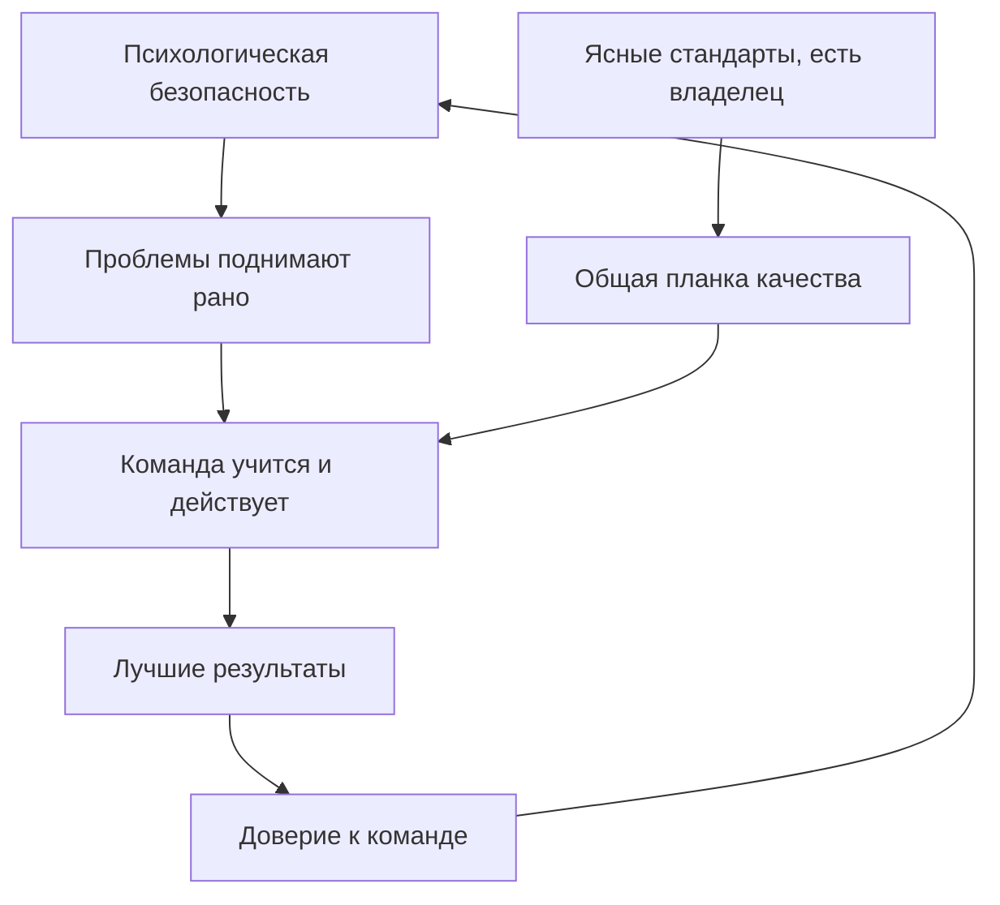
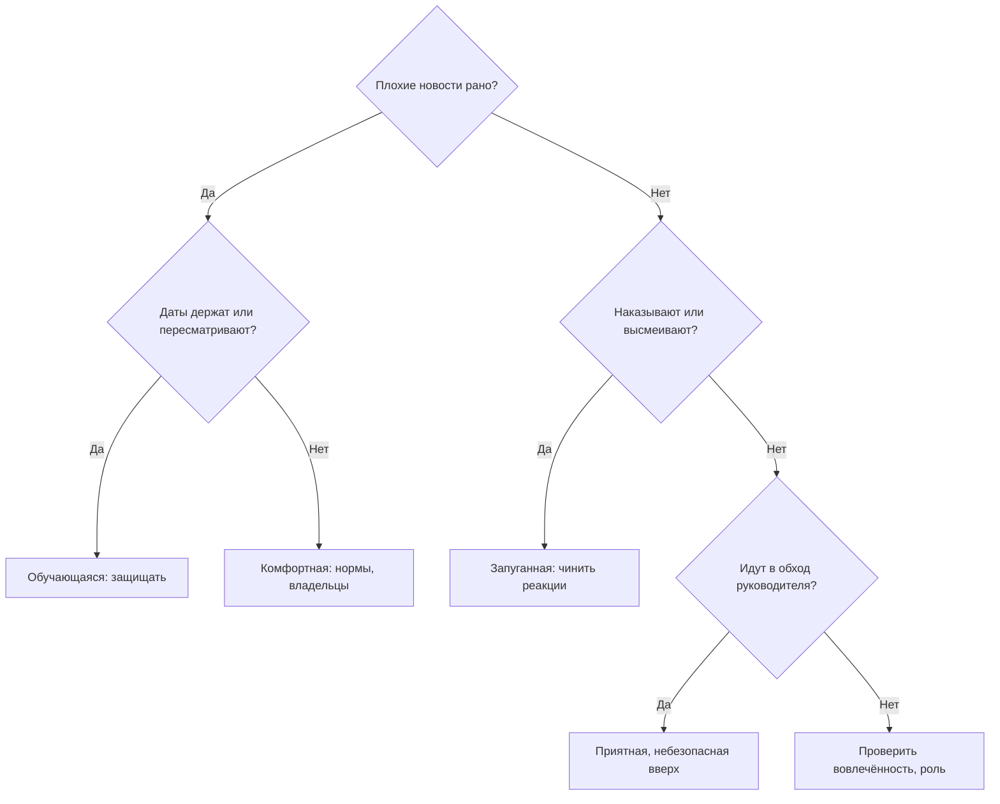
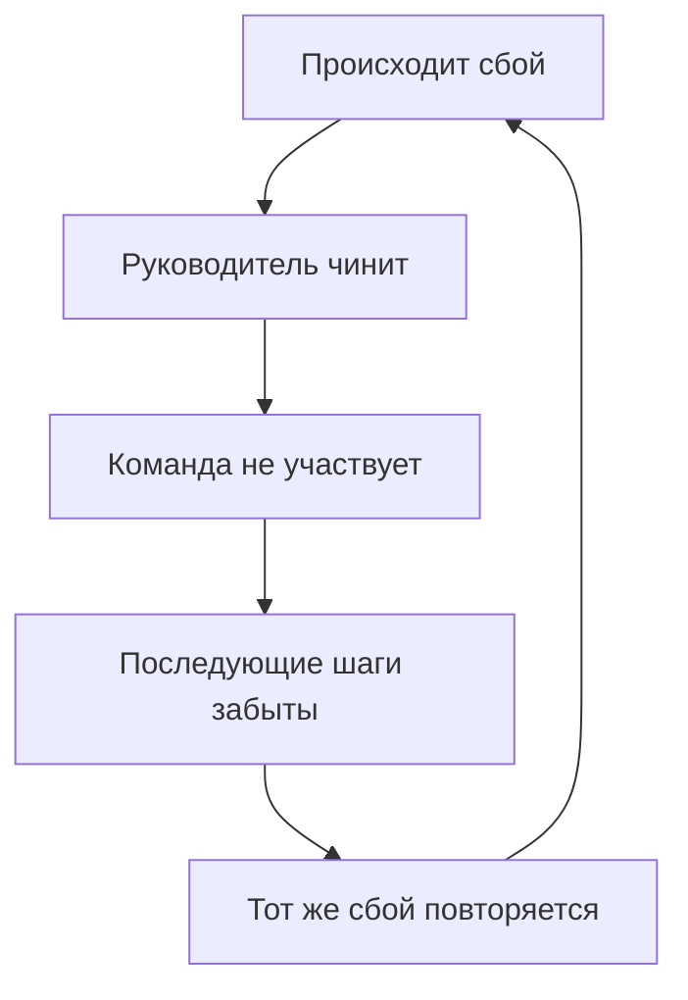

# Глава 11 — Высокая эффективность: доверие, психологическая безопасность и подотчётность { #chapter-11-high-performance-trust-psychological-safety-and-accountability }

Эта глава открывает часть III, где единицей анализа становится уже не отдельный человек, а команда.
Глава определяет, что такое высокоэффективная инженерная команда, объясняет психологическую
безопасность (что это такое, что измеряли исследования и чем она не является) и показывает, как
сочетать её с подотчётностью, чтобы команда была одновременно откровенной и надёжной. Сквозные
примеры — две команды Northstar Technologies, вымышленной компании из
[кейса](../../case-studies/northstar/index.md): Payments and Integrations с лучшей в организации
операционной дисциплиной и Orders, руководителя которой повысили изнутри команды за восемь месяцев до
прихода директора.

## Почему это важно { #why-this-matters }

На уровне команды от того, поднята ли проблема рано, зависит, обойдётся она в один разговор или в сбой.
Рискованную миграцию, нереальную дату или хрупкий скрипт обычно кто-то замечает до того, как всё
сломается. Заговорит ли этот человек и сделает ли кто-нибудь что-то в ответ — свойство скорее команды,
чем человека.

На уровне организации «психологическая безопасность» превратилась в лозунг, который искажают в обе
стороны. Одни руководители слышат в нём требование снизить планку и сопротивляются; другие используют
его как повод никогда не спрашивать ни с кого за обязательства. И то и другое даёт слабые команды.
Директору с десятью командами нужны точное определение и способ отличить команды со стандартами, но
без откровенности, от команд с откровенностью, но без стандартов.

На уровне высшего руководства вопрос в том, что руководство делает с плохими новостями. Один публичный
поиск виноватого учит всю организацию сообщать позже и меньше.

## Цели главы { #learning-objectives }

После этой главы вы сможете:

- Определить высокую эффективность инженерной команды через результаты, устойчивость и обучение и
  распознавать эффективность, которая держится на героизме.
- Объяснить, что такое психологическая безопасность, что и в каких условиях измеряли основные
  исследования и почему она не означает отсутствия стандартов.
- Сочетать высокую психологическую безопасность с высокой подотчётностью в еженедельной практике
  команды.
- Диагностировать по наблюдаемым сигналам команду, у которой есть только одно из двух, и выбрать первое
  вмешательство.

## Ментальная модель { #the-mental-model }

> **Ментальная модель:** психологическая безопасность и подотчётность — это две отдельные ручки, а не
> два конца одной шкалы. Безопасность решает, будут ли проблемы произнесены вслух; подотчётность — будет
> ли что-нибудь сделано после того, как их произнесли. Высокой эффективности нужны обе, выкрученные
> вверх.

Команда с безопасностью, но без подотчётности честно обсуждает дедлайн, который вот-вот сорвёт, затем
срывает его, и никто не удивлён. Команда с подотчётностью, но без безопасности выполняет показатели до
того дня, когда плохая новость приходит поздно — через клиента. Руководитель, который видит в этих двух
вещах компромисс («я могу поддерживать или требовать»), получает одну из этих команд.

Откровенность, вознаграждённая результатом, делает команду откровеннее; проблема, которую подняли и
проигнорировали или за которую наказали, учит молчанию. Edmondson утверждает, что безопасность и
стандарты результативности — отдельные измерения и что высокой эффективности нужны оба
([Edmondson, 2018](../../references/bibliography.md#edmondson2018fearless)); петля на схеме —
**синтез книги**, объединяющий эту идею с механизмом обучения, описанным ниже.

## Подробный разбор { #deep-conceptual-explanation }

### Что такое высокая эффективность { #defining-high-performance }

Если определять высокоэффективную команду по выпуску (много выпускает, попадает в сроки), вы
вознаграждаете команды, которые занимают у будущего. Эта книга использует три теста, и команда должна
пройти все три (**рекомендация книги**):

| Измерение | Вопрос | На какие свидетельства смотреть |
|---|---|---|
| Результаты | Поставляет ли команда то, что обещает, с качеством, которое замечают пользователи? | Выполненные обязательства; [доля неудачных изменений](../../glossary.md#change-failure-rate) (доля изменений, которые ломаются в продакшене); инциденты, обнаруженные клиентами |
| Устойчивость | Сможет ли команда держать такой темп два года, не теряя людей? | Вызовы в нерабочее время на человека; незапланированная работа; текучесть; компоненты, которые знает один человек |
| Обучение | Становится ли команда лучше или один и тот же сбой случается дважды? | [Повторные инциденты](../../glossary.md#recurrence) (повторы известного сбоя); закрытие корректирующих действий; время, за которое новый инженер становится самостоятельным |

Героизм проваливает тест на устойчивость: релиз, спасённый в выходные, — хороший результат плохой
системы. Команда с небольшим числом инцидентов, но повторяющихся, проваливает тест на обучение.
Измерение поставки разобрано в главе 18; здесь показатели лишь указывают, какой тест команда
проваливает.

### Что такое психологическая безопасность { #what-psychological-safety-is }

Edmondson и Lei определяют психологическую безопасность как представления людей о последствиях
межличностного риска в определённом контексте, например на работе
([Edmondson and Lei, 2014](../../references/bibliography.md#edmondson2014psychological)). В инженерной
команде эти риски конкретны: сказать «я не понимаю этот дизайн», признать «это сломало моё
изменение», сказать руководителю «эта дата нереальна», сообщить о почти-инциденте (near miss), которого
больше никто не видел. На практике важны три свойства:

- **Это представление о последствиях**, а не черта характера и не ощущение комфорта. Инженеру могут
  нравиться все в команде, и при этом он может считать, что спорить с руководителем рискованно.
- **Она привязана к контексту.** Один и тот же инженер может чувствовать себя в безопасности на
  ретроспективе команды и в опасности на разборе у директора, поэтому среднее по организации скрывает
  большую часть важного.
- **Она о том, чтобы говорить, а не о результатах.** Низкий риск поднять проблему не означает, что
  предложение примут или что у ошибки не будет последствий для работы.

### Что измеряли исследования { #what-the-research-measured }

Исследования безопасности обширны, в основном опираются на опросы и носят корреляционный характер.
Исследования, на которые опирается эта глава:

| Исследование | Условия | Результат | Чего не показывает |
|---|---|---|---|
| [Edmondson, 1999](../../references/bibliography.md#edmondson1999psychological) | 51 рабочая команда в одной производственной компании | Безопасность сопровождалась обучающим поведением команды; именно обучающее поведение передавало связь от безопасности к результативности. Эффективность команды (вера в её способности) не предсказывала обучение, если учитывалась безопасность | Причинность; ничего о разработке ПО |
| [Edmondson and Lei, 2014](../../references/bibliography.md#edmondson2014psychological) | Обзор организационных исследований | Безопасность связывали с высказыванием (voice), командной работой, обучением команды и обучением организации | Размеры эффекта |
| [Frazier et al., 2017](../../references/bibliography.md#frazier2017psychological) | Метаанализ (объединённый анализ многих исследований): 136 выборок, более 22,000 человек, почти 5,000 групп | Проверялось, связана ли безопасность с выполнением задач сверх родственных конструктов, таких как хорошие отношения с лидером и вовлечённость. В аннотации размеры эффекта не приведены | Цифру для слайда |
| [Google re:Work](../../references/bibliography.md#rework-team-effectiveness) | Project Aristotle: 180 команд Google (115 инженерных, 65 продаж) | Пять факторов эффективных команд по порядку: психологическая безопасность, надёжность, структура и ясность, смысл, влияние. То, как команда работала вместе, значило больше, чем то, кто в неё входил | Рецензирования; ничего за пределами одной компании |

Исследование Edmondson — **научный результат**, ценность которого в механизме: безопасность важна,
потому что меняет то, что команда делает с информацией. Project Aristotle — **задокументированная
практика** одной компании. Второй пункт его списка, надёжность (dependability: коллеги надёжно делают
качественную работу вовремя), стоит рядом с безопасностью в том же списке. Собственное резюме Google не
позволяет читать безопасность как замену подотчётности.

### Данные из команд разработки ПО { #evidence-from-software-teams }

Исследования в разработке ПО указывают в ту же сторону и подчёркивают роль стандартов. Lenberg и Feldt
опросили 217 практиков в 38 agile-командах пяти шведских организаций. И психологическая безопасность, и
**ясность норм** (norm clarity: насколько ясны и приняты стандарты поведения в команде) сопровождались
самооценённой результативностью и удовлетворённостью работой, причём ясность норм была более сильным
предиктором и того и другого
([Lenberg and Feldt, 2018](../../references/bibliography.md#lenberg2018psychological)). Результативность
оценивалась самими участниками, а выборка невелика, так что это скромный **научный результат**. Но
вывод у него острый: ясные стандарты значили как минимум не меньше, чем безопасность.

Два более крупных источника согласны по направлению. Опрос 1 118 человек в 161 команде разработки
показывает, что безопасность напрямую связана с лучшей командной работой и меньшим числом конфликтов
([Verwijs and Russo, 2024](../../references/bibliography.md#verwijs2024double)). DORA (DevOps Research
and Assessment, давняя отраслевая программа опросов) использует типологию Ron Westrum, которая
классифицирует культуры по тому, как они обращаются с вестниками: патологические культуры их наказывают,
бюрократические — игнорируют, генеративные — обучают. DORA утверждает, что культуры с высоким доверием и
хорошим потоком информации предсказывают показатели поставки и организации и что её опрос 2019 года
показал: психологическая безопасность предсказывает и то и другое
([DORA, generative culture](../../references/bibliography.md#dora-cap-generative-culture);
[Forsgren et al., 2018](../../references/bibliography.md#forsgren2018accelerate)). Это **отраслевое
исследование**: на основе опросов, корреляционное, спонсируемое вендором (его ограничения обсуждаются в
главе 18).

Доказательства сильно поддерживают скромное утверждение и слабо — громкое. **Сильно поддержано:**
безопасность устойчиво связана с готовностью высказываться, обучающим поведением и командной работой,
в том числе в командах разработки. **Слабо поддержано:** то, что рост безопасности вызывает лучшую
поставку. Контролируемых исследований этого найдено не было. Этого достаточно, чтобы руководитель
вкладывался в безопасность, но недостаточно, чтобы обещать CFO (финансовому директору) конкретную цифру.

### Почему безопасность — не отсутствие стандартов { #why-safety-is-not-the-absence-of-standards }

Распространённое искажение видит угрозу в любом требовании: «когда с меня спрашивают за дату, я
чувствую себя в опасности». Здесь путают **межличностный** риск (что тебя пристыдят, накажут или
исключат за то, что ты сказал) с риском **по результатам** (работу оценивают по планке). Команда, где
никто не боится говорить и ни с кого не спрашивают за обязательства, не безопасна; ей комфортно, и её
участники обычно это знают.

Притча Lencioni известна тем, что выстраивает дисфункции команды в пирамиду. В её основании —
отсутствие доверия, выше — уклонение от ответственности и невнимание к результатам: команда, которая не
может быть откровенной, не будет требовать от своих участников соблюдения стандартов
([Lencioni, 2002](../../references/bibliography.md#lencioni2002five)). Это **мнение эксперта**,
рассказанное как история. Allspaw описывает справедливую культуру (just culture) как баланс
безопасности и подотчётности: инженеров не «освобождают от ответственности», а ждут, что они помогут
сделать систему безопаснее ([Allspaw, 2012](../../references/bibliography.md#allspaw2012blameless)).

Итак, граница: **безопасность определяет, как с людьми обращаются, когда они говорят; подотчётность —
чего от них ждут потом.** Инженер, который сообщает, что его изменение сломало продакшен, защищён от
насмешек и наказания за это сообщение, и всё равно от него ждут, что он расскажет всю историю и поможет
исправить систему. Эта граница для инцидентов разобрана в главе 25, в разделе о
[безобвинительном разборе](../05-engineering-quality/25-incidents-postmortems-and-change-failure-analysis.md#blameless-review-and-its-critics).

### Что значит подотчётность в команде { #what-accountability-means-in-a-team }

Подотчётность часто служит синонимом вины («кто ответственен за этот сбой?»). Здесь она означает четыре
более узкие вещи (**рекомендация книги**):

1. **Ясные обязательства:** один владелец, определение готовности, дата, на которую владелец
   согласился.
2. **Видимое доведение до конца:** прогресс виден команде без вопросов руководителя.
3. **Ранний пересмотр:** владелец, который видит, что обязательство под угрозой, говорит об этом, как
   только узнаёт. Провал — поздний сюрприз, а не заранее объявленная задержка.
4. **Последствия, соответствующие причине:** системная проблема получает системное исправление;
   повторяющаяся индивидуальная закономерность — срывы обязательств без предупреждения — становится
   разговором о результативности (глава 9).

Пункт 3 — то место, где встречаются обе ручки: ранний пересмотр рационален, только если поднимать риск
безопасно. Пункт 4 — то место, где ломаются дружные команды, откладывая трудный разговор (глава 6).

### Комфорт, симпатия и молчание { #comfort-liking-and-silence }

**Симпатия — не безопасность.** В команде, которая любит своего руководителя, критика руководителя
может ощущаться как предательство друга, поэтому опасения остаются невысказанными или идут в обход
руководителя. **Отсутствие конфликтов — тоже не безопасность.** Месяцы ревью дизайна без разногласий
обычно означают, что разногласия стали дорогими; конфликт разобран в главе 6. Тест на безопасность — не
то, насколько приятны встречи. А то, куда плохие новости приходят первыми и сколько времени им на это
нужно.

### Инклюзивность: безопасность для каждого, а не в среднем { #inclusion-safety-for-everyone-not-on-average }

Команда безопасна ровно настолько, насколько она безопасна для своего наименее защищённого участника.
Поскольку безопасность привязана к контексту и отношениям, команда может быть откровенной в среднем,
пока часть участников молчит: самый новый инженер, двое людей на другой площадке, человек, работающий
на неродном языке, единственная женщина в команде, джуниор, которого однажды резко поправили.
Инклюзивность в смысле этой книги — это то, слышат ли и учитывают ли голос каждого участника, а не
только разрешают ли ему говорить. Это часть безопасности, а не отдельная программа (**рекомендация
книги**).

Цена — та, что глава 13 описывает для скрытых профилей: факт, который знает только один человек, —
именно тот, который встреча услышит с наименьшей вероятностью. Если этот человек к тому же сильнее всех
рискует, когда говорит, команда теряет факт дважды.

Сигналы, которые может наблюдать руководитель:

- **Кто говорит и кого перебивают.** Посчитайте на нескольких встречах; большинство руководителей
  удивляются.
- **Кому приписывают идеи.** Предложение, которое игнорируют, когда его делает один человек, и
  принимают, когда его повторяет другой, учит первого замолчать.
- **Кому достаётся заметная работа.** Координация инцидентов, владение дизайном и демонстрации
  руководству строят карьеру; менее заметная «связующая» работа (координация, онбординг, заметки)
  часто ложится на одних и тех же немногих.
- **Кто в комнате, когда принимаются решения,** включая разговоры в коридоре и поздние созвоны.

Что руководитель делает иначе:

1. **Структурирует очерёдность.** Письменные предложения до обсуждения, круг, в котором высказывается
   каждый, и руководитель последним.
2. **Отмечает вклад по имени** — на встрече и письменно, особенно у более тихих участников.
3. **Намеренно ротирует заметную и незаметную работу** и отслеживает, кому что доставалось.
4. **Чинит встречу, а не человека.** Планирует с учётом часовых поясов и времени ухода за близкими и
   ротирует неудобный слот.
5. **Спрашивает на встречах один на один, что человек не сказал** на последней встрече, и действует по
   одному из ответов.
6. **Считает уничижительное замечание событием безопасности.** Разбирается с ним наедине и быстро;
   молчание руководителя читается как согласие.

Проверяйте это так же, как всё остальное в главе, — по поведению: участие и заметные задания по
подгруппам за квартал.

### Как спросить о безопасности напрямую { #asking-about-safety-directly }

Короткий анонимный опрос может дополнить поведенческие сигналы. Утверждения в духе конструкта
(пересказ книги, а не валидированная шкала) спрашивают, насколько каждый согласен, что:

- ошибку в этой команде не ставят в вину тому, кто её совершил;
- здесь можно поднимать проблемы и трудные вопросы;
- в этой команде безопасно попробовать то, что может не получиться;
- никто здесь не стал бы намеренно подрывать мою работу.

Смотрите не только на среднее, но и на разброс: если одна подгруппа отвечает ниже, это и есть сигнал
об инклюзивности, описанный выше. Публикуйте результаты только для групп не меньше пяти человек, чтобы
никого нельзя было опознать, и сравнивайте команду с её же прошлым. Никогда не включайте этот балл в
чьи-то цели; почему — показывает провал «безопасность измеряют, а не строят» ниже.

## Пример из инженерной организации { #engineering-organization-example }

!!! info "Northstar: что уже известно"
    Пример относится к базовому кварталу, 90 дням до прихода директора. В Northstar было 30 инцидентов
    Sev1 и Sev2 (двух самых высоких уровней серьёзности), 34% ресурса уходило на незапланированную
    работу, а вовремя выпускался 41% обещанных пунктов дорожной карты. См.
    [хронологию](../../case-studies/northstar/timeline.md). Впервые встречаете Northstar? Прочитайте
    [«Год вкратце»](../../case-studies/northstar/year-in-brief.md) и
    [«Действующие лица»](../../case-studies/northstar/cast.md).

В этом примере разбираются две команды Northstar в том квартале. Цифры по инцидентам взяты из
[`incidents-last-quarter.csv`](../../case-studies/northstar/data/incidents-last-quarter.csv); число
почти-инцидентов — **иллюстрация**. Уровни [серьёзности](../../glossary.md#severity-sev1-sev2-sev3)
определены в глоссарии. Все данные Northstar вымышлены.

| Сигнал, базовый квартал | Payments and Integrations | Orders |
|---|---|---|
| Инженеров | 12 | 14 |
| Инцидентов Sev1 и Sev2 | 6 | 7 |
| Первым обнаружил клиент | 1 из 6 | 4 из 7 |
| Повторы известного типа сбоя | 1 из 6 | 3 из 7 |
| Медианное время восстановления | около 78 минут | 185 минут |
| Выполнено обещанных пунктов дорожной карты | 2 из 3 | 1 из 4 |
| Незапланированная работа | 33% | 36% |
| Почти-инцидентов, записанных командой | 17 | Журнала почти-инцидентов нет |
| Время руководителя на работу с людьми | 35% | 15% |

Медианы рассчитаны по шести и семи инцидентам, это маленькие выборки.

**Payments and Integrations** сильнее всех по результатам: пять из шести инцидентов поймал мониторинг,
выполнены два из трёх обязательств, один повторный инцидент (INC-413 — отказ банка-партнёра без
резервного маршрута). 17 почти-инцидентов — сигнал безопасности: инженеры записывают, что едва не
пошло не так, не боясь, что их с этим свяжут. Устойчивость неизвестна. Незапланированная работа — 33%,
близко к 34% по организации, а опросов разработчиков Northstar за два года до прихода директора не
проводила.

Есть у команды и поучительный пробел. Её 64 флага и настройки платёжного шлюза правили прямо на сервере
конфигурации без ревью, и два из шести её инцидентов (INC-410 и INC-430) были изменениями
конфигурации. Ни один из 17 почти-инцидентов не касался этого файла. Команда может быть откровенной о
каждом риске, который она распознаёт, и не видеть практики, которую считает нормальной. Безопасность
делает проблемы проговариваемыми, но не видимыми. Эту проблему сделал видимой стандарт: с недели 6
первого квартала директора изменения флагов требовали ревью.

**Orders** — дружная команда с любимым руководителем и слабыми результатами. Она выполнила одно из
четырёх обязательств и достигла цели спринта (Sprint Goal — единственной цели, к которой Scrum-команда
обязуется в спринте; глава 15) в 2 из последних 6 спринтов. Четыре из семи её инцидентов обнаружили
клиенты, и три были повторами. Один из них — INC-421, сбой массовой загрузки, который Priya Raman
(руководитель разработки, engineering manager, EM, команды Orders) за несколько месяцев до этого исправила сама; назначенный ей
последующий тест так и не был написан. Самый красноречивый сигнал о безопасности — косвенный.
Senior-инженеры Rafael Duarte и Aisha Bello высказали недовольство тем, что решения ждут Priya, в первых
же разговорах с новым директором, а не с самой Priya. Команде было комфортно, но не настолько
безопасно, чтобы сказать собственному руководителю самое важное о том, как она работает.

**Грубая оценка цены разницы.** Допустим, с запасом, что команда с ясным владением выполнила бы
последующие действия и предотвратила бы все три повторных инцидента Orders. Их время восстановления в
сумме — около 10,5 часа сбоев, видимых клиентам. Не всё это было полной недоступностью договорных
сценариев, но для масштаба: обязательство 99,9% допускает около 2,2 часа недоступности за квартал.
Доведение дел до конца — не «мягкая» тема.

## Как принимать решение { #decision-framework }

Две ручки дают четыре состояния. Названия и сигналы — **авторские**, в духе идеи о двух измерениях,
упомянутой выше.

| Состояние | Безопасность | Подотчётность | Что вы наблюдаете | Первый шаг |
|---|---|---|---|---|
| Обучающаяся | Высокая | Высокая | Плохие новости рано и открыто; даты пересматривают до срыва; мало повторов | Защищайте; не стандартизируйте до потери |
| Комфортная | Высокая | Низкая | Честные ретроспективы, которые ничего не меняют; даты съезжают без обсуждения; действия остаются открытыми | Проясните нормы и владельцев; сделайте доведение до конца видимым |
| Запуганная | Низкая | Высокая | Зелёные дашборды, поздние сюрпризы; инциденты понижают в серьёзности; почти-инциденты не признают | Измените то, как руководители и высшее руководство реагируют на плохие новости |
| Плывущая по течению | Низкая | Низкая | Мало обсуждений, мало обязательств; люди делают то, что поручено | Начните с руководителя: лидерство или соответствие роли |

Диагностируйте по поведению, а не по самоописанию:

«Приятная, небезопасная вверх» — это картина Orders: никого не наказывают, люди ладят, а проблема всё
равно не доходит до того, кто мог бы её решить. Первый шаг — руководитель просит критиковать его
собственные решения и заметно действует по итогам.

| Наблюдаемый сигнал | На что указывает |
|---|---|
| Почти-инциденты и сообщения «это я сломал» редки или отсутствуют | Низкая безопасность или нераспознанные риски |
| Клиенты обнаруживают инциденты гораздо чаще, чем команда | Низкая безопасность или слабое обнаружение; проверьте, что именно |
| Обязательства срываются в дедлайн, а не раньше | Риски не поднимают (безопасность) или у даты нет владельца (подотчётность) |
| Корректирующие действия висят открытыми без обсуждения | Низкая подотчётность |
| Опасения насчёт руководителя сначала доходят до [руководителя через уровень (skip-level)](../../glossary.md#skip-level) (руководителя руководителя) | Низкая безопасность по отношению к руководителю |

## Компромиссы { #trade-offs }

**Безопасность против скорости решений.** Приглашать несогласие — значит тратить время, а команда,
которая заново оспаривает каждое решение, путает спор с безопасностью. Выслушивают всех, решает один
человек, и решение стоит, пока не появится новая информация (права на решения разобраны в главе 13).

**Подотчётность против комфорта.** Людям, привыкшим к размытой ответственности, ясное владение
поначалу кажется давлением; скажите об этом заранее.

**Местная практика против единообразия.** Привычки Elena Sokolova (руководителя Payments and
Integrations) работают отчасти потому, что её команда сама их выбрала. Если предписать один и тот же
ритуал всем, копируется форма и теряется ощущение собственности. Стандартизируйте результаты
(почти-инциденты записываются, у действий есть владельцы), а ритуалы пусть команды выбирают сами.

**Измерение против честности.** Если публиковать баллы безопасности команд и просить руководителей их
повышать, команды начнут отвечать то, что хочет услышать руководство. Оценка здоровья команды
разобрана в главе 14.

## Типичные провалы { #failure-modes }

**Безопасность как щит.** Это слово звучит в основном тогда, когда речь заходит об обязательствах, —
чтобы прекратить обсуждение. Противодействие: заново проговорите разницу между межличностным риском и
риском по результатам, а затем проведите разговор об обязательстве — доброжелательно и конкретно.

**Подотчётность как поиск виноватых.** «Кто за это отвечает?» — первый вопрос после каждого инцидента.
Сигнал: оборонительные отчёты, а почти-инциденты исчезают. Противодействие: сначала спрашивайте «что
сделало это возможным?»; вопросы о конкретном человеке оставьте для узких случаев, которые определяет
глава 25.

**Руководитель как амортизатор.** Руководитель чинит каждый сбой и сам отвечает за каждое последующее
действие. Команда чувствует себя в безопасности и ничему не учится.

Именно эта петля стоит за INC-421. Сигнал: открытые последующие действия, владелец которых —
руководитель. Противодействие: передавайте доведение до конца названному инженеру с датой, как Priya
сделала в квартале 1, когда два senior-инженера взяли на себя ревью core/order-capture (модуля Core,
который принимает заказы).

**Безопасность измеряют, а не строят.** Баллы опроса растут по просьбе, а число почти-инцидентов не
меняется. Отслеживайте поведение рядом с любым опросом.

## Применение в крупной организации { #enterprise-application }

При 50–150 инженерах у директора от шести до пятнадцати команд, и ни на одной их ретроспективе он не
бывает, поэтому безопасность и подотчётность приходится читать на расстоянии и менять через
руководителей.

**Читайте поведение, а не настроения.** Ежемесячно по каждой команде: доля инцидентов, обнаруженных
клиентами, повторные инциденты, закрытие корректирующих действий, записываются ли почти-инциденты.
Вместе они показывают, течёт ли информация. Каждый из этих показателей подгоняют (журналы набивают
мелочами, действия закрывают как тривиальные), поэтому проверяйте выборочные записи и никогда не
ранжируйте по ним команды и не привязывайте к ним бонусы (глава 18).

**Развивайте реакции руководителей.** Безопасность команды в основном определяется тем, как её
руководитель реагирует на плохие новости. Спросите каждого руководителя, когда ему в последний раз
сказали что-то неприятное и что он сделал. Руководитель без примера просто ничего такого не получает.

**Держите стандарты немногочисленными и с владельцами.** Ясность норм у Lenberg и Feldt и надёжность и
ясность в списке Google указывают в одну сторону. Директор владеет коротким списком общих для
организации ожиданий (определения серьёзности, владение действиями, операционные минимумы), а остальное
оставляет командам (стандарты — в главе 20, рабочие соглашения — в главе 12).

**Используйте встречи через уровень (skip-level) как проверку, а не как канал.** Опасение, которое первым доходит до
директора, — сигнал об этой команде; верните его с разрешения инженера и поработайте с руководителем
как коуч.

## Взгляд CTO { #cto-perspective }

На уровне высшего руководства безопасность определяется несколькими заметными моментами: заседанием
совета директоров после тяжёлого инцидента, реакцией на инженера, который говорит, что обещанная дата
невозможна, обращением с человеком, чьё изменение вызвало сбой. CTO (технический директор), который
спрашивает «кто это сделал?» в публичном канале инцидента, задаёт безопасность организации
эффективнее, чем её сможет восстановить любая программа обучения.

CTO также отвечает за подотчётность выше уровня команд. Когда руководители называют клиентам даты до
того, как разработка оценила работу (5 из 17 обязательств Northstar в базовом квартале), с команд
спрашивают за обещания, которых они не давали, и подотчётность превращается в поиск виноватых.
Подотчётность начинается с обязательств, на которые люди действительно согласились.

Будьте точны с советом директоров. «Психологическая безопасность связана с обучением и командной
работой во многих исследованиях, в том числе в командах разработки» — защитимо. «Google доказал, что
безопасность повышает результативность» — преувеличение самоотчёта одной компании, и ни одно
исследование, найденное для этой книги, не позволяет обещать меньше инцидентов. Аргумент — механизм
плюс локальное измерение: снижаются ли инциденты, обнаруженные клиентами, и повторные инциденты, когда
информация начинает течь.

## Практический плейбук { #practical-playbook }

Для руководителя, который переводит команду с одной ручки на обе:

1. **Диагностируйте по поведению.** За прошлый квартал перечислите, кто сообщал о почти-инцидентах,
   сколько инцидентов клиенты нашли первыми, сколько обязательств сорвалось в дедлайн, а не раньше, и
   чьи последующие действия открыты.
2. **Измените свою реакцию на плохие новости, прежде чем просить их больше.** Поблагодарите вестника,
   спросите, что ему нужно, и не обсуждайте вину в первом разговоре.
3. **Просите критиковать ваши собственные решения**, сначала наедине: «Какое моё решение в этом месяце
   вы приняли бы иначе?» Заметно действуйте хотя бы по одному ответу.
4. **Запишите нормы команды на одной странице** вместе с командой: что значит «готово», как
   принимаются и пересматриваются обязательства, как записываются почти-инциденты.
5. **Дайте каждому обязательству и последующему действию одного владельца и согласованную дату.**
   Уберите своё имя из пунктов, которыми должна владеть команда.
6. **Сделайте доведение до конца видимым** на коротком еженедельном разборе, который ведёт сама
   команда. Ротируйте ведущего; говорите последним.
7. **Отделяйте систему от человека.** Срывы идут на командный разбор; повторяющаяся индивидуальная
   закономерность — в разговор наедине.
8. **Через квартал проверьте**, выросло ли число почти-инцидентов, стало ли меньше поздних сюрпризов и
   повторов, закрываются ли действия.

## Кейс { #case-study }

Этот кейс — **вымысел**. Он относится к началу квартала 2 (неделя 14) и заканчивается решением, которое
предстоит принять читателю.

**Как работает Payments and Integrations.** Около двух лет команда Elena Sokolova проводила
еженедельный 30-минутный операционный разбор с ротацией ведущего. Инженер, сменяющийся с дежурства,
представляет вызовы за неделю, записанные почти-инциденты и одну вещь, которая его удивила. Elena
говорит последней. Журнал почти-инцидентов — общая страница, куда может писать любой; в основном
пишет тот, кто едва не вызвал проблему. Владельцы поднимают пункты под угрозой на канбан-доске команды
(доске, где работа видна по этапам) на том же разборе, обычно до срыва. На вопрос, почему правки
конфигурации без ревью ни разу не попали в журнал, неформальный техлид ответил, что все всегда так
работали.

**Orders после перехода.** В квартале 1 Priya Raman ограничила время, которое сама пишет код, Aisha
Bello возглавила реализацию массового заказа, а Rafael Duarte и Aisha Bello взяли на себя ревью
core/order-capture. Подотчётность сместилась к команде. Директор пока не знал, скажет ли теперь команда
Priya то, что сказала новичку.

В начале квартала 2 Priya спросила, не стоит ли Orders скопировать операционный разбор Elena вместе с
журналом почти-инцидентов. Она побывала на одном и ей понравилось.

Директор считал, что проблемой Orders был не страх: никого не наказывали, потому что Priya сама брала
инциденты на себя. Команде было комфортно, но своими результатами она не владела, а её откровенность
заканчивалась на руководителе. Скопировать ритуал значило добавить встречу; добавит ли она
безопасности, зависело от того, верят ли инженеры Orders, что Priya хочет слышать, что её решения были
неверны.

Черновик совета директора состоял из трёх частей. Первое: Priya наедине просит каждого
senior-инженера назвать одно решение, которое ей следовало принять иначе, и действует по одному ответу
до появления каких-либо новых встреч. Второе: Orders заводит журнал почти-инцидентов и еженедельный
разбор, а владельцы последующих действий — инженеры, а не Priya. Третье: через квартал команда
проверяет, появляются ли почти-инциденты и всплывают ли риски для даты массового заказа до контрольной
точки, а не на ней. Priya беспокоила цена. Функция должна была выйти в конце квартала 2, а в Orders
теперь было 16 инженеров (на неделе 10 пришли два инженера по качеству), так что еженедельная
30-минутная встреча стоит восемь часов в неделю. Упражнение A1 просит вас решить.

## Упражнения { #exercises }

Решения — в [решениях к главе 11](../../solutions/ch11-solutions.md). Данные Northstar — на
[странице исходных данных](../../case-studies/northstar/baseline-data.md).

### Базовый уровень { #foundational }

**F1.** Тимлид говорит вам: «У нас отличная психологическая безопасность. За пять лет никого не уволили
из-за сбоя. Мы никогда не спорим на встречах. И у нас нет дедлайнов, потому что они вызывают у людей
стресс». Оцените каждое из трёх утверждений по определениям безопасности и подотчётности из главы и
скажите, какие свидетельства вы бы запросили, прежде чем согласиться или возразить.

**F2.** Отнесите каждую команду к одному из четырёх состояний. Для каждой назовите одно наблюдение,
которое сильнее всего изменило бы вашу классификацию: (a) зелёные дашборды, а о последних трёх сбоях
сообщили клиенты; (b) живые ретроспективы и список действий, который не уменьшается полгода; (c)
почти-инциденты записываются еженедельно, а даты пересматриваются за две недели; (d) инженеры делают
то, что поручено, и никогда не предлагают работу сами.

**F3.** На слайде вице-президента написано: «Google доказал, что психологическая безопасность — фактор
номер один результативности команды. Поэтому мы привяжем бонус каждого руководителя к баллу опроса о
безопасности в его команде». Опираясь на то, что на самом деле измеряли Edmondson (1999), Project
Aristotle и Lenberg и Feldt, оцените первое предложение, а затем план.

### Прикладное лидерство { #applied-leadership }

**A1.** Вы — директор в начале квартала 2. Priya Raman (руководитель разработки Orders) спрашивает,
стоит ли Orders перенять еженедельный операционный разбор и журнал почти-инцидентов Elena Sokolova.
Функция массового заказа должна выйти в конце квартала, а встреча будет стоить восемь часов в неделю.
Решите, что вы рекомендуете и в каком порядке, что будете измерять через квартал и какой результат
заставит вас изменить курс.

**A2.** В Payments and Integrations неформальный техлид наедине сообщает вам, что один сильный инженер
за два месяца трижды сорвал обязательства без предупреждения. Команда не хочет поднимать это на
операционном разборе, потому что «разбор должен быть безопасным». Elena Sokolova, руководитель команды,
спрашивает, как обеспечить подотчётность, не разрушив то, что команда построила. Посоветуйте ей: где
пройдёт разговор, что будет сказано и что должна увидеть команда.

**A3.** Вы принимаете команду из девяти человек, прежний руководитель которой на ежемесячном общем
собрании называл инженера, ответственного за каждый инцидент. Доля неудачных изменений у команды
низкая, за год она не записала ни одного почти-инцидента, а последние два инцидента обнаружили
клиенты. Спланируйте свои первые 60 дней: что вы измените первым, что оставите как есть и какие сигналы,
по вашим ожиданиям, сдвинутся и в каком порядке.

### Решения на уровне руководства { #executive-decision-making }

**X1.** Гипотетически: после тяжёлого квартала Helena Marsh (CEO, генеральный директор) предлагает
включить в бонус каждого руководителя разработки число инцидентов Sev1 и Sev2 в его команде, «чтобы
руководители отвечали за надёжность». В роли CTO решите, поддерживаете ли вы это, что это сделает с
оценками серьёзности и с отчётностью и что вы предложите взамен, чтобы дать CEO ту подотчётность,
которой она хочет.

**X2.** Victor Lindqvist (CTO), впечатлённый Payments and Integrations, хочет, чтобы со следующего
квартала каждая команда Northstar проводила еженедельный операционный разбор Elena Sokolova с той же
повесткой. В роли директора решите, что стандартизировать для всех шести команд, что оставить каждой
команде и как вы в течение двух кварталов поймёте, сработало ли это. Оцените затраты в инженеро-часах
для 80 инженеров Northstar и в долларах при полной стоимости $185 000 на инженера в год (плановая ставка
книги — $3 558 за инженеро-неделю).

## Вопросы для размышления { #reflection-questions }

1. Когда вам в последний раз сказали, что ваше решение было неверным, и что вы сделали на следующей
   неделе?
2. Какие плохие новости в вашей команде доходят до вашего руководителя раньше, чем до вас?
3. Вашей команде комфортно или безопасно? Что вам нужно было бы наблюдать, чтобы отличить одно от
   другого?
4. Какое обязательство сорвалось в дедлайн в прошлом квартале и кто за месяц до этого знал, что так
   будет?
5. Какую практику в вашей команде все считают нормальной и никто не записал бы как риск?
6. Когда вы защитили кого-то от последствий, кто вместо него заплатил цену?

## Главное { #key-takeaways }

- Определяйте высокую эффективность через результаты, устойчивость и обучение. Героизм — это затраты,
  а не доказательство.
- Психологическая безопасность — это представление о том, что высказываться почти не рискованно в
  межличностном смысле. Она локальна для команды и отношений и касается того, чтобы говорить, а не
  результатов.
- Данные, связывающие безопасность с обучением, высказыванием и командной работой, обширны; данные о
  том, что она вызывает лучшую поставку ПО, наводят на мысль, но не доказывают. Так и говорите.
- Безопасность — не отсутствие стандартов. В единственном приведённом здесь исследовании в разработке
  ПО, где их сравнивали, ясность норм предсказывала результативность как минимум не слабее, чем
  безопасность.
- Безопасность определяет, как с людьми обращаются, когда они говорят; подотчётность — чего от них
  ждут потом. Стройте обе.
- Диагностируйте по поведению: куда плохие новости приходят первыми, насколько рано пересматриваются
  обязательства, записываются ли почти-инциденты, закрываются ли действия.
- Приятная команда может быть небезопасной по отношению к своему руководителю. Просите критиковать ваши
  решения и действуйте по итогам.
- Безопасность делает проблемы проговариваемыми, но не видимыми. Стандарты находят то, что откровенная
  команда считает нормой.

## Источники и что почитать { #references-and-further-reading }

- [Edmondson, 1999](../../references/bibliography.md#edmondson1999psychological). Основополагающее
  полевое исследование психологической безопасности команды и обучающего поведения.
- [Edmondson and Lei, 2014](../../references/bibliography.md#edmondson2014psychological). Обзор истории
  конструкта и исследований; источник используемого здесь определения.
- [Frazier et al., 2017](../../references/bibliography.md#frazier2017psychological). Метаанализ 136
  выборок о том, что предсказывает безопасность и что предсказывает она сама.
- [Google re:Work](../../references/bibliography.md#rework-team-effectiveness). Пять факторов Project
  Aristotle; полезно, чтобы ставить безопасность рядом с надёжностью и ясностью, но не как
  доказательство.
- [Lenberg and Feldt, 2018](../../references/bibliography.md#lenberg2018psychological). Безопасность и
  ясность норм в 38 командах разработки; почему стандарты важны не меньше безопасности.
- [Verwijs and Russo, 2024](../../references/bibliography.md#verwijs2024double). Безопасность,
  конфликты и разнообразие в 161 команде разработки.
- [DORA, generative culture](../../references/bibliography.md#dora-cap-generative-culture) и
  [Forsgren et al., 2018](../../references/bibliography.md#forsgren2018accelerate). Типология Westrum в
  исследованиях поставки ПО.
- [Edmondson, 2018](../../references/bibliography.md#edmondson2018fearless). *The Fearless
  Organization*. Безопасность рядом с подотчётностью и результативностью — для практиков.
- [Lencioni, 2002](../../references/bibliography.md#lencioni2002five). *The Five Dysfunctions of a
  Team*. Доверие, ответственность и результаты в форме притчи.
- [Allspaw, 2012](../../references/bibliography.md#allspaw2012blameless). Справедливая культура как
  баланс безопасности и подотчётности; глава 25 развивает эту тему для инцидентов.
