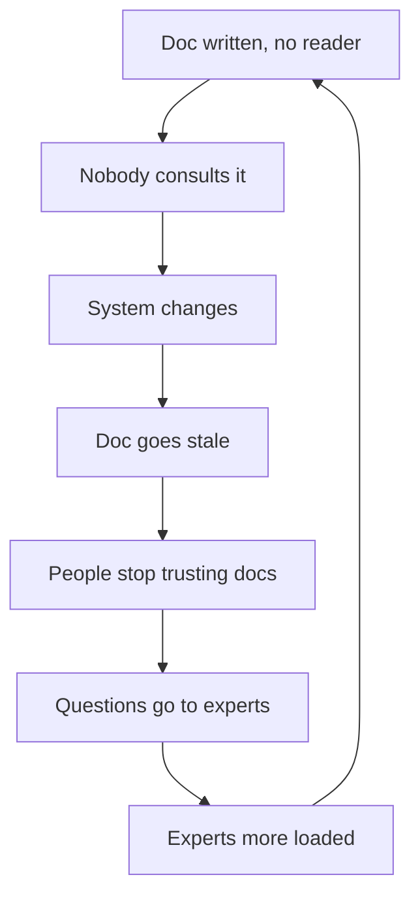
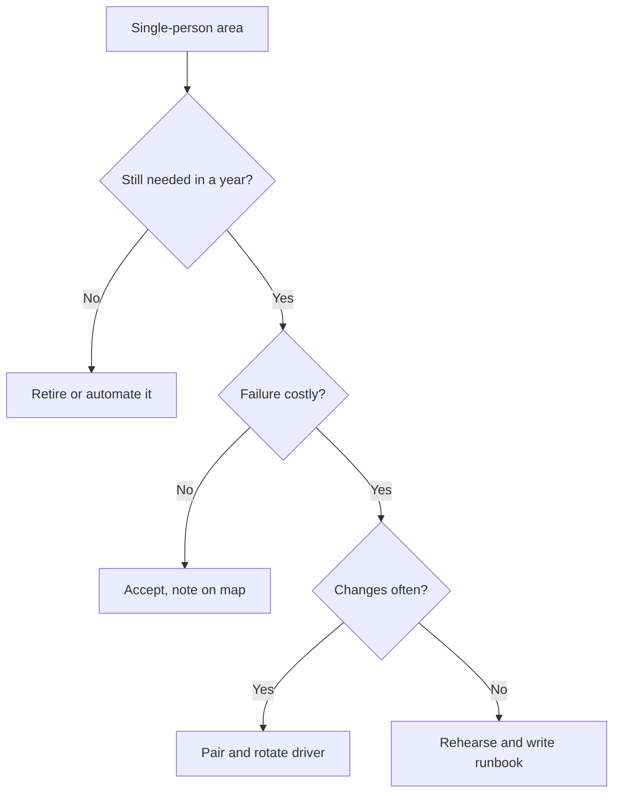

# Chapter 12 — Team Charters, Working Agreements, and Knowledge Sharing

!!! warning "Awaiting human review"
    This chapter has passed the book's automated validation and an editorial self-review, but not yet
    the human review in which each cited claim is checked against its source. Treat it as a reviewed
    draft. Corrections are welcome; see the repository's CONTRIBUTING file.

This chapter is about three written or unwritten agreements every team runs on: what the team is for
and where it stops (the charter), how its members work with each other (working agreements), and who
knows what (the knowledge distribution), and how to make them explicit without producing documents
nobody opens. The examples come from Northstar Technologies, the fictional company in the
[case study](../../case-studies/northstar/index.md): Billing's ledger knowledge, the shell-script
deploys one person understands, and a charter for the Data and Analytics team.

## Why This Matters

At team scale, unclear boundaries produce work that two teams each think the other owns, and requests
that arrive from everywhere and are all accepted. Unwritten working agreements produce the same
argument, about review speed or who answers the pager, every few weeks. Knowledge held in one head
turns a resignation or a holiday into an operational risk.

At organization scale, charters are how a director sees the shape of the whole. Eight of Northstar's
24 components had disputed, shared, or orphaned ownership at baseline
([baseline](../../case-studies/northstar/baseline-data.md)). Each was a missing sentence in some team's
charter.

At executive scale, knowledge concentration is a balance-sheet risk that never appears on a balance
sheet. Northstar's tier 1 ledger depended on three people; four production services deployed through a
script one person understood. A CTO who cannot name such points cannot judge what a resignation, an
acquisition, or a reorganization will break.

## Learning Objectives

After this chapter you will be able to:

- Write a team charter that states mission, boundaries, interfaces, and decision rights, short enough
  that the team and its neighbors actually use it.
- Negotiate working agreements that the team enforces on itself, and retire the ones that stop working.
- Map a team's knowledge by area, find single points of knowledge failure, and judge how serious each is.
- Choose among removing, spreading, and documenting knowledge, and design documentation that is read
  because it is written at the moment of use.
- Recognize the failure modes of charters and agreements early: shelf documents, unenforced rules,
  and knowledge plans that never get capacity.

## The Mental Model

> **Mental model:** A team runs on agreements about purpose, behavior, and knowledge. They exist whether
> or not anyone writes them down. Writing them down is worth it only when the written version is used
> to make decisions; otherwise it is a second, stale copy of the real one.

The real charter of a team is what it accepts, refuses, and escalates. The real working agreement is
what members do when nobody is checking. The real knowledge map is who gets called at 2 a.m. A written
version works only if something in the team's week consults it.

So the test for every team document is the same: name the moment someone will read it. A charter is
read when a request arrives that may not belong to the team; an agreement, in the retrospective that
checks it; a runbook, during the page it was written for. A document with no such moment decays, and
once people learn it is stale they stop consulting it even when it is right.

The loop helps explain why Northstar's earlier request to Billing's experts to "document as you go",
with no time and no named reader, did not reduce their load: documents written that way feed the loop
rather than break it.

## Deep Conceptual Explanation

### What a team charter is, and what the evidence says

A team charter is a short document the team writes and owns that answers four questions: why the team
exists (mission), what it owns and does not own (boundaries), how others work with it (interfaces),
and which decisions it makes alone, shares, or escalates (decision rights).

One of the few empirical studies of charters followed 32 teams of MBA students through a business
simulation. Teams with high-quality performance strategies outperformed the rest, and charter quality interacted with strategy quality: the highest sustained
performance came from teams high on both
([Mathieu and Rapp, 2009](../../references/bibliography.md#mathieu2009charters)). This is a **research
finding** in a narrow setting, read at abstract level. It supports a modest claim: agreeing how to work
together pays off alongside a good plan for the work, not instead of one.

Google's Project Aristotle points the same way. Its guide lists structure and clarity (clear roles,
plans, and goals) among five dynamics of effective teams, after psychological safety and dependability
([Google re:Work](../../references/bibliography.md#rework-team-effectiveness)): **documented practice**,
one company's self-report. Patrick Lencioni is known for the argument that leaders must create clarity
about a few basic questions (why we exist, how we behave, what we do, what matters most now, who does
what) and repeat it until it is believed
([Lencioni, 2012](../../references/bibliography.md#lencioni2012advantage)), **expert opinion** that maps
closely onto a charter's four questions.

### Boundaries, interfaces, and decision rights

The boundary section is the most useful part of a charter and the most often skipped. It lists what the
team owns, what it does not own although people assume it does, and what is disputed. Writing
"disputed" turns a silent conflict into an item someone above the team can decide.

The interface section says how other teams get things from this one: where requests go, the expected
response time, what is self-service, and what the team needs from others. Skelton and Pais are known
for the idea that a team should present a deliberate "team API" and choose an interaction mode with each
neighbor, rather than letting every interaction default to ad hoc requests
([Skelton and Pais, 2019](../../references/bibliography.md#skelton2019team)). Chapter 33 owns team types
and interaction modes. The narrower point here: once the interface is written, a request that bypasses
it is visibly an exception, and the cost of requests becomes visible.

The decision-rights section lists the decisions that recur (schema changes to owned data, accepting work
from another team, breaking an interface) and says who decides and who is consulted. Chapter 13 covers
how to choose a method for each decision and how to record it; the charter needs only the list, and the
rule that a decision not on it goes to the manager, who adds it.

### Working agreements the team enforces on itself

A working agreement is a specific, observable commitment team members make to each other: "a review
request gets a first response within one working day", "decisions made in a call are written in the
team channel the same day". It differs from a standard (Chapter 20) in scope and enforcement: a standard
applies across teams and has an owner outside the team; an agreement belongs to the team and is
enforced by its members, including on the manager.

Three properties separate agreements that work from posters on a wall (**this book's recommendation**):

| Property | Weak | Strong |
|---|---|---|
| Observable | "We respect each other's time" | "Agenda posted a day ahead, or the meeting is cancelled" |
| Owned | Imposed by the manager | Proposed and agreed by the team, manager included |
| Checked | Never revisited | Reviewed at a fixed retrospective; kept, changed, or dropped |

Peer enforcement works only where raising a lapse is safe, which Edmondson's field study links to team
learning ([Edmondson, 1999](../../references/bibliography.md#edmondson1999psychological); Chapter 11).
Where telling the manager they broke the review agreement is
risky, agreements are enforced only downward and become management rules in disguise.

### Single points of knowledge failure

A single point of knowledge failure is an area of a team's work that only one person can do safely. The
agile community measures the problem with the truck factor (or bus factor): the smallest number of
people whose sudden absence would leave a project in serious trouble.

Avelino and colleagues estimated truck factors from authorship in version history for 133 popular
open-source projects on GitHub. About 65 percent had a truck factor of 2 or less, and developers
surveyed from 67 projects mostly agreed the method had found the main authors
([Avelino et al., 2016](../../references/bibliography.md#avelino2016truck)). This is a **research
finding** about open source, read at abstract level.

Rigby and colleagues measured files abandoned when knowledgeable developers left Chrome and a project at
Avaya. Projects were exposed to losses several times larger than the expected loss; simple truck-factor
estimates exaggerated the potential for loss; and naming successors reduced expected loss by up to 15
percent ([Rigby et al., 2016](../../references/bibliography.md#rigby2016turnover)). Two lessons follow
(**this book's recommendation**, extending the findings). The truck factor is a screen, not a measure: a
value of 1 says where to look, not how bad a loss would be, because colleagues can often learn an area
from its code. And risk is uneven: most departures cost little and a few cost a great deal, so the work
is finding those few areas.

### Remove, spread, or write down

There are three ways to reduce a single point of knowledge failure, in order of durability (**this
book's recommendation**):

1. **Remove the need.** Replace a hand-maintained deploy script with the standard pipeline, or automate
   a manual reconciliation. Knowledge no longer needed cannot be lost.
2. **Spread it through doing.** Pair with the learner driving, and route the next change or page to a
   learner with the expert as backup. Rigby and Bird found that code review increased the number of
   distinct files a developer knew about by 66 to 150 percent, depending on the project
   ([Rigby and Bird, 2013](../../references/bibliography.md#rigby2013convergent)), so routing reviews of
   an expert's area to non-experts is a cheap spreading mechanism.
3. **Write it down at the moment of use.** A runbook written by the learner after a paired page and
   corrected by the expert has a known reader (the next person paged) and a test (whether it worked).

The order follows from the mental model's loop: documents spread knowledge only to people who read
them, and people read documents they trust. The knowledge-sharing chapter of *Software Engineering at
Google* treats one-to-one and written knowledge as complements (precise but unscalable, scalable but
needing upkeep), lists single points of failure among the main obstacles to learning, and notes that
doing a task for someone is faster today and keeps the knowledge in one head
([Chen and Barolak, 2020](../../references/bibliography.md#chen2020knowledge)): **documented practice**
at one very large company.

### Documentation that gets read

The same book's documentation chapter describes treating documents like code (an owner, source control
beside the code, review, deprecation when obsolete), writing for a named audience, and keeping each
document to one type such as reference or tutorial
([Manshreck, 2020](../../references/bibliography.md#manshreck2020documentation)), summarized here as
**documented practice**. A team can apply this without Google's tooling:

| Practice | What it prevents |
|---|---|
| One named owner per document | Orphaned pages nobody feels free to fix |
| Kept where the on-call engineer looks | Pages nobody finds |
| A "last verified" date, checked when used | Silent staleness |
| One reader and one moment | Documents that are tutorial and reference at once |
| Deleted when obsolete | A wiki where the true page is one of three |

Northstar's 2019 standards page and its 143-item debt page are ownerless wiki documents of exactly this
kind; Chapters 20 and 21 cover what happened to them.

## Engineering Organization Example

The following figures are **illustrative**, invented for Northstar (fictional) and recorded on the
baseline page. At the start of quarter 2, Marcus Oyelaran and the three ledger engineers mapped
ledger knowledge as it stood at the end of the baseline quarter. They split the ledger and invoicing
work into five areas and counted, for each, how many of Billing's 13 engineers could respond to a page
alone and how many could change the area safely with ordinary review.

| Ledger area | Respond alone | Change safely | Changes last two quarters |
|---|---|---|---|
| Posting and journal rules | 3 | 3 | 14 |
| Credit notes and adjustments | 4 | 2 | 9 |
| Period close and month-end | 2 | 1 | 4 |
| Ledger schema migrations | 2 | 2 | 6 |
| Currency and rounding | 1 | 1 | 3 |

Assumptions: "respond alone" means restoring service without escalating in a typical incident in that
area; "change safely" means a change the person would merge with one reviewer. Every count is made up
of the three experts, with one exception: the backfill, hired after the fourth expert resigned, could
respond alone on credit notes but was not yet on the rotation. No other Billing engineer could do
either in any area.

Three things follow.

First, the headline "three experts" hides two areas where only one person can change the code (period
close; currency and rounding), and one where only one person can respond. The other two experts could
probably learn currency handling from the code in a crisis, so the risk is not total, but they would be
learning during an incident affecting customers' money.

Second, the areas with a truck factor of 1 change least often (four and three changes in two quarters).
That is why they concentrated: there were too few occasions to learn. Pairing waits for a natural
occasion; for rarely changed areas the team has to create one, for example a scheduled rehearsal of
month-end close in a test environment.

Third, the cost of spreading is measurable. If each of the three experts spends four hours a week
pairing with a learner, that is 12 hours a week, about 156 hours over a 13-week quarter, or roughly 0.3
of an engineer's time (assuming 40-hour weeks). Against it, the three handled 126 of Billing's 180 pages
in the baseline quarter, 54 of them after hours;
[Chapter 3](../01-foundations/03-managerial-leverage-and-systems-thinking.md) owns that loop and the
routing rule that reverses it. The area map tells the routing rule where to send learners first.

The shell-script deploys are a different shape: one script, understood by one person, deploys
auth-svc, webhooks, document-store, and export-svc. That is a truck factor of 1 for four services, and
INC-416 showed the coupling when a change to the script broke rollback for all four. Here spreading is
the wrong first move. The durable remedy is removal into a standard pipeline (Chapter 23); knowledge
work only covers the months until then.

## Decision Framework

For each area on a knowledge map with one person able to do the work, walk the questions below.

Then choose the mechanism with the table:

| Mechanism | Works when | Cost | How it is gamed |
|---|---|---|---|
| Retire or automate | The knowledge is about a tool or process that can go | Engineering project; often already on a roadmap | Declared "planned" and never funded |
| Pair, learner drives | Work recurs at least monthly | Expert and learner time, slower work for a while | Learner watches instead of drives |
| Route reviews to learners | Code changes regularly | Slower reviews at first | Rubber-stamp reviews by the learner |
| Rehearsal | Rare but costly events (month-end, restore, failover) | A half day per rehearsal | Rehearsal skips the hard step |
| Runbook by the learner | After a paired event | An hour per event | Copied from the expert without testing |
| Accept the risk | Low cost of failure, or a retirement date soon | None now | "Accepted" for areas nobody looked at |

The map itself gets gamed: make "people who can respond alone" a target and the count rises faster than
capability. Ask for evidence instead: who restored the last incident in the area, without escalating?

## Trade-offs

**Speed now against resilience later.** Every paired page and learner-routed review is slower than the
expert alone, and on Billing a slower quarter costs customers. Accept the cost on frequent, lower-severity
events; keep experts first on rare severe ones until learners have practiced.

**Written charter against flexibility.** A charter that says "we do not own search-svc" will be quoted
back at the team when it would be convenient to help. The answer is to write how exceptions are made
(the manager accepts them, records them, and reviews them), not to write a vaguer charter.

**Team-made agreements against organization-wide consistency.** Agreements that differ between teams
cost something when people move or collaborate. Keep anything that crosses team boundaries, such as
review rules for shared code or severity definitions, in standards (Chapter 20), and leave the rest to
the teams.

**Writing against removing.** An hour spent documenting a fragile script is an hour not spent retiring
it. Write for named moments only, and prefer removal where it can be funded.

## Failure Modes

**The shelf charter.** Written at an offsite, filed, never consulted. Signal: requests that the charter
says go elsewhere are accepted without anyone noticing. Countermeasure: use the charter in the
twice-weekly intake triage, and review it quarterly against the requests actually received.

**Agreements enforced only downward.** The manager reminds engineers of the review agreement; nobody
reminds the manager. Signal: agreements are cited only by the manager. Countermeasure: the manager asks
in the retrospective which agreement they broke, and keeps asking until someone answers.

**Agreement sprawl.** Twenty agreements nobody can recite. Signal: no one can name more than three.
Countermeasure: a limit of about seven, and adding one requires dropping or merging one.

**The documentation drive.** A quarter's push to "document everything" produces a hundred pages, and
the experts are still paged. Signal: pages written, but nobody new restores incidents. Countermeasure:
measure who restores incidents, not how many pages exist.

**The knowledge plan with no capacity.** Pairing and rehearsal are agreed and never scheduled, because
every week has more urgent work. Signal: the knowledge map is unchanged after a quarter. Countermeasure:
put the hours in the team's capacity plan as named work, as with any other prevention work (Chapter 27).

## Enterprise Application

In an organization of 50 to 150 engineers, charters and knowledge maps are how a director sees the
organization's shape without attending every team's meetings.

**Charters as a set.** Side by side, the six charters should cover every component, with none in two
"owns" lists. Overlaps and gaps are the director's to resolve; Northstar's week 4 ownership decisions
([first quarter](../../case-studies/northstar/first-quarter.md)) were this exercise done without
charters. One page per team, in one place, with a quarterly review date, is enough.

**A knowledge-risk register.** Each manager maps knowledge for their tier 1 areas and brings the
single-person areas to a quarterly review. The director keeps the short organization-level list, each
entry with a remedy (retire, spread, or accept) and a date. It feeds backfill priorities and the case
for retiring special tooling.

**Staff engineers as spreaders.** Staff engineers are often single points of knowledge themselves. In
the baseline, Ines Carvalho answered about eight hours a week of unscheduled questions about Core
([baseline](../../case-studies/northstar/baseline-data.md)). The leverage move, covered in Chapter 3 and
Chapter 29, is to turn repeated answers into canonical, owned documents and reviews by others, not to
answer faster.

## CTO Perspective

At executive scale the question is which knowledge the company cannot afford to lose, and whether
anyone is paying to keep it. The people who hold it are often the most valued engineers, which makes the
risk feel like a strength.

Three things change at this level. Organizational changes are knowledge events: moving a component,
merging teams, or a voluntary-departure program redistributes knowledge, and the plan should say where
each tier 1 area's knowledge goes. Retiring special tooling, such as Northstar's script deploys, removes
knowledge risk, and its business case should say so. And incentives decide the supply: if promotions
reward the engineer who rescues every ledger incident rather than the one who made three others able to,
single points of failure keep forming (Chapter 3's hero loop).

What the CTO should not do is ask for a company-wide truck-factor number. The research treats it as a
rough screen ([Rigby et al., 2016](../../references/bibliography.md#rigby2016turnover)), and a target
would be gamed by listing names on maps.

## Practical Playbook

For a manager writing a charter and agreements and reducing knowledge risk over one quarter:

1. **Sample the last quarter's work**: what the team did, where requests came from, what it refused.
   Draft the charter from that, not from the team you wish you had.
2. **Write one page with the team**: mission, owns, does not own, disputed, interfaces, decision rights.
3. **Show it to the neighbors** named in the interfaces; send disputes to the director with a proposal.
4. **Agree five to seven observable working agreements** from problems the team has actually had, and
   schedule the retrospective that reviews them.
5. **Map knowledge by area**, starting with tier 1: who can respond alone, who can change safely.
6. **Walk each single-person area** through the decision framework.
7. **Put the hours in the capacity plan** as named items: pairing, rehearsals, retirement work.
8. **Change routing**: the next page, review, or change in each area goes to a learner, expert as backup.
9. **Write runbooks at the moment of use**, by the learner, with an owner and a verified date.
10. **Review at quarter end**: the charter against requests received, the agreements in the
    retrospective, the knowledge map against who actually restored incidents.

## Case Study

This case is **fictional**. It is set at the start of quarter 2, after the director's first 90 days
([first quarter](../../case-studies/northstar/first-quarter.md)); it describes a draft and the decisions
it raises, and does not fix their outcome. The charter draft is recorded on the first quarter page.

Data and Analytics, managed by Farah Haddad, had eleven engineers (eight data, three software), the
lowest change failure rate in the organization (12 percent), two Sev1 or Sev2 incidents, and little
contact with other teams ([baseline](../../case-studies/northstar/baseline-data.md)). It looked like the
team least in need of attention. Two facts said otherwise. Requests from other teams took 12 points of
its capacity, half its unplanned work and more than in any other product team (only Platform Operations
had more). And its two incidents were a month-end report that timed out at new data volume and was
reported by a customer after eight hours (INC-408), and a warehouse maintenance window that overlapped
scheduled customer exports (INC-423). Reviewing INC-423, the team found nobody had written down who
announces warehouse maintenance or who must be told.

Farah drafted a charter with the team over two sessions, starting from a sample of the previous
quarter's requests.

| Section | Draft |
|---|---|
| Mission | Customers and Northstar staff get correct, timely reporting and exports from the order and billing data |
| Owns | reporting-api, export-svc, warehouse pipelines |
| Does not own | Source data correctness in Core (Orders and Billing own it); the export deploy script (Platform Operations, until retired) |
| Disputed | search-svc: nominal owner Orders, written mostly by engineers now in this team; proposal to the director |
| Interfaces | Requests through one queue, triaged Tuesday and Thursday; first response within two working days. Maintenance windows on the warehouse announced to Payments and Integrations and Customer Experience five working days ahead |
| Decision rights | Warehouse schema: team decides, Li Na Zhou consulted as standard owner for data and migration. Accepting work over a week from another team: Farah. Breaking a reporting-api contract: director informed, consumers consulted |

Of the six working agreements, two show the team's shape. Its members are in Minneapolis (four), Bogotá
(five), and remote (two), as the baseline page records, so decisions made in a call are written in the team
channel the same day, and any warehouse change touching customer exports gets a second reviewer from a
different location.

Two knowledge problems surfaced in the same sessions. export-svc is deployed by the shared shell script,
so Data and Analytics could not deploy its own service without the one infrastructure engineer in
Platform Operations who understood the script. And the month-end reporting path behind INC-408 had been
built by a data engineer who had since moved to working mostly on warehouse pipelines: the team could
run it, but only one person had changed it.

The draft raised three decisions for the director. Whether to give search-svc to Data and Analytics,
which would add an on-call surface to a team with little operational practice. Whether to fund the
retirement of the script for export-svc ahead of the other three script services, since it is tier 3.
And whether the five-day maintenance notice is a team agreement or should become an organization
standard. The exercises take them up.

## Exercises

Solutions are in [chapter 12 solutions](../../solutions/ch12-solutions.md). Northstar data is on the
[baseline page](../../case-studies/northstar/baseline-data.md).

### Foundational

**F1.** A team of nine you have just taken over has a two-year-old charter with a three-paragraph
mission, no boundaries section, and twelve "team values". Requests arrive by direct message to whichever
engineer the requester knows. Explain what the existing charter is and is not doing, and draft the
headings and first line of each section of a replacement to finish with the team in two sessions.

**F2.** A team's working agreements include "we value quality", "reviews within 24 hours", "no meetings
on Wednesdays", "everyone documents their work", and "be kind". For each, say whether it is observable,
how the team would know it was broken, and how you would rewrite or drop it. Then say which one you would
check first in the next retrospective, and why.

**F3.** Using the Billing knowledge map in the Engineering Organization Example, state the truck factor
of the ledger as a whole and of each area, explain why "three experts" overstates the team's resilience,
and explain why a truck factor of 1 in an area does not by itself tell you how much a departure would
cost.

### Applied Leadership

**A1.** You are Marcus Oyelaran at the start of quarter 2. Using the knowledge map, design a one-quarter
plan to make every ledger area two-deep for responding and at least two-deep for changing in the tier 1
areas. Say which mechanism you use in each area, how many hours it costs whom, what you expect restoration
times to do during the quarter, and what evidence at quarter end would show the plan worked.

**A2.** The one infrastructure engineer who understands the shared deploy script announces a planned
three-week leave starting in six weeks. Retiring the script is planned but not yet scheduled. Decide what
to do in the six weeks, what to accept as risk during the leave, and how you would avoid this becoming a
documentation exercise that produces a long, untested page.

**A3.** Farah Haddad's draft charter says requests go through one queue with a two-working-day first
response. Two weeks later, Greg Tanaka's sales engineer sends a data request by direct message to a
Data and Analytics engineer, marked urgent for a deal. Advise Farah on how the team should respond, what
the charter's exception process should say, and how to tell whether the interface is working after a
quarter.

### Executive Decision-Making

**X1.** As director, decide whether search-svc should move to Data and Analytics. Consider the knowledge
already in the team, the on-call surface, the team's current operational practice, the effect on Orders,
and what the charter would have to say in each case. State what you would need to believe for each
answer, and the transition cost of moving it.

**X2.** Victor Lindqvist proposes that every team publish a truck-factor number quarterly, with a target
of at least 2 for every tier 1 component, reported in the operational review. Advise him: what the
number would and would not tell him, how it would be gamed, what you would report instead, and what
decision he should expect it to inform.

## Reflection Questions

1. If your team's charter were deleted tomorrow, which decision next month would be made differently?
2. Which working agreement on your team has the manager broken most recently, and who said so?
3. Which area of your team's work would you least like the person who knows it best to leave this
   month, and what have you done about it this quarter?
4. Which of your team's documents would you trust at 2 a.m., and how do you know it is current?
5. What knowledge do you hold that nobody else on the team has, and why have you kept it?

## Key Takeaways

- Charters, agreements, and knowledge distributions exist whether written or not; write them only when
  the written version will be used to make a decision.
- A charter answers four questions: mission, boundaries (including "does not own" and "disputed"),
  interfaces, and decision rights. One page is enough.
- Working agreements are observable, owned by the team, and checked at a fixed retrospective; the
  manager is bound by them too.
- Map knowledge by area, not by person; a headline count of experts hides single-person areas.
- Treat the truck factor as a screen that says where to look, not as a measure of loss or a target.
- Reduce knowledge risk by removing the need first, spreading it through doing second, and writing it
  down at the moment of use third.
- Every document has an owner, a reader, a moment of use, and a last-verified date; knowledge work
  needs named capacity in the plan.

## References and Further Reading

- [Mathieu and Rapp, 2009](../../references/bibliography.md#mathieu2009charters). Charters and
  performance strategies in 32 student teams; read at abstract level.
- [Google re:Work](../../references/bibliography.md#rework-team-effectiveness). Project Aristotle's
  five team dynamics, including structure and clarity.
- [Lencioni, 2012](../../references/bibliography.md#lencioni2012advantage). *The Advantage*. Clarity as
  the core of organizational health.
- [Skelton and Pais, 2019](../../references/bibliography.md#skelton2019team). *Team Topologies*. Team
  APIs and interaction modes; read with Chapter 33.
- [Edmondson, 1999](../../references/bibliography.md#edmondson1999psychological). Psychological safety
  and team learning; why peer enforcement needs safety.
- [Avelino et al., 2016](../../references/bibliography.md#avelino2016truck). Estimating truck factors
  from version history in 133 open-source projects.
- [Rigby et al., 2016](../../references/bibliography.md#rigby2016turnover). Turnover-induced knowledge
  loss; why the truck factor is a screen and successors matter.
- [Rigby and Bird, 2013](../../references/bibliography.md#rigby2013convergent). Code review across
  companies, including review as a way to spread knowledge.
- [Chen and Barolak, 2020](../../references/bibliography.md#chen2020knowledge) and
  [Manshreck, 2020](../../references/bibliography.md#manshreck2020documentation). The knowledge-sharing
  and documentation chapters of
  [*Software Engineering at Google*](../../references/bibliography.md#winters2020software), free online
  under CC BY-NC-ND.
