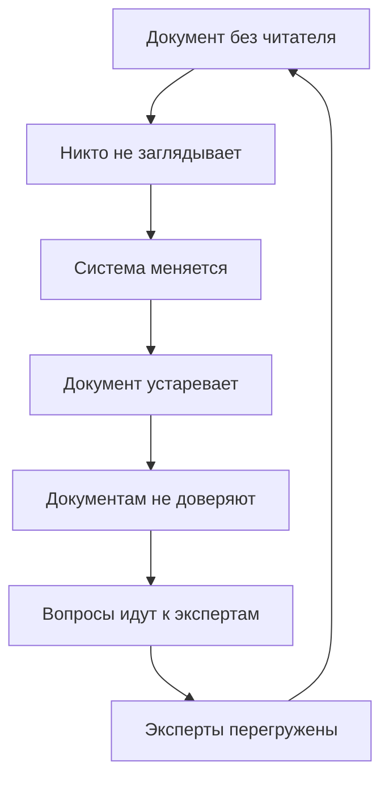
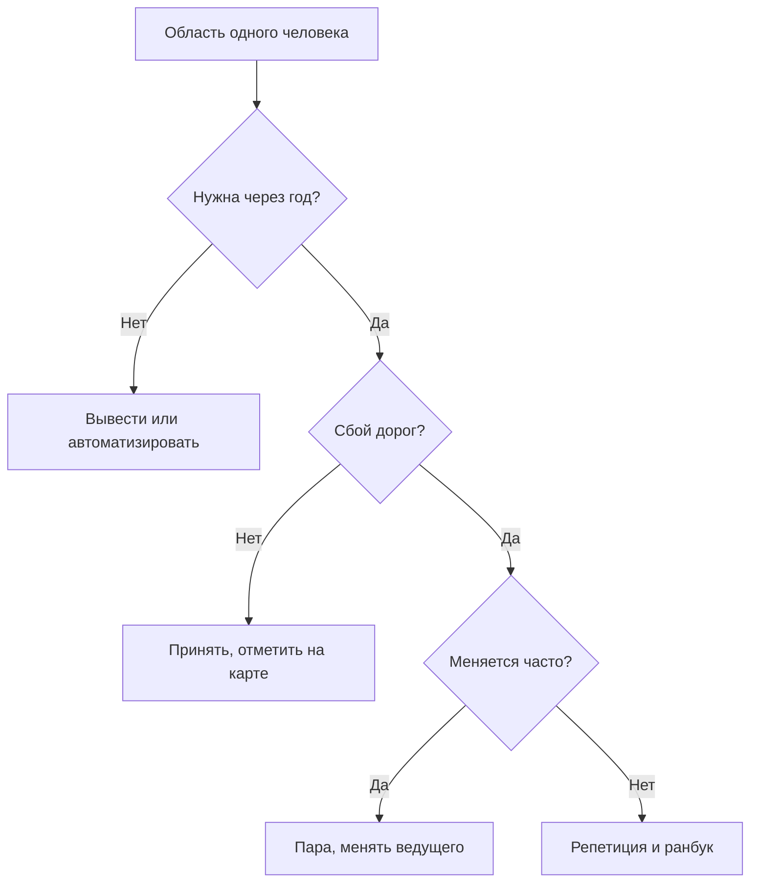

# Глава 12 — Хартии команд, рабочие соглашения и обмен знаниями { #chapter-12-team-charters-working-agreements-and-knowledge-sharing }

Любая команда держится на трёх договорённостях, записаны они или нет: зачем она существует и где её
границы (хартия), как её участники работают друг с другом (рабочие соглашения) и кто что знает
(распределение знаний). Эта глава показывает, как сделать их явными и при этом не наплодить документов,
которые никто не открывает. Примеры взяты из Northstar Technologies, вымышленной компании из
[кейса](../../case-studies/northstar/index.md): знания о ledger в команде Billing, развёртывание
shell-скриптами, в котором разбирается один человек, и хартия команды Data and Analytics.

## Почему это важно { #why-this-matters }

Для команды размытые границы оборачиваются работой, которую каждая из двух команд считает чужой, и
запросами, которые приходят отовсюду и принимаются все до одного. Из-за неписаных рабочих соглашений раз
в несколько недель вспыхивает один и тот же спор — о скорости ревью или о том, кто отвечает на вызовы. А
знание, которое есть в одной голове, превращает увольнение или отпуск в операционный риск.

Для организации хартии — способ, которым директор видит форму целого. В базовом квартале у
восьми из 24 компонентов Northstar владение было спорным, общим или отсутствовало
([исходные данные](../../case-studies/northstar/baseline-data.md)). За каждым таким случаем стоит
недостающее предложение в хартии какой-то команды.

Для высшего руководства концентрация знаний — риск для активов компании, который никогда не отражается
в балансе. В Northstar ledger уровня [tier 1](../../glossary.md#tier-1) (tier 1 — класс с наибольшим
влиянием на бизнес) держался на трёх людях, а четыре сервиса в продакшене развёртывались скриптом, в
котором разбирался один человек. Если CTO (технический директор) не может назвать такие точки, он не
может и судить, что сломает увольнение, поглощение или реорганизация.

## Цели главы { #learning-objectives }

После этой главы вы сможете:

- Написать хартию команды с миссией, границами, интерфейсами и правами на решения — и настолько
  короткую, чтобы команда и её соседи действительно ею пользовались.
- Договариваться о рабочих соглашениях, соблюдение которых команда обеспечивает сама, и отменять те,
  что перестали работать.
- Составлять карту знаний команды по областям, находить единые точки отказа по знаниям и оценивать,
  насколько серьёзна каждая.
- Выбирать, что делать со знанием: устранить, распространить или задокументировать, — и проектировать
  документацию, которую читают, потому что она написана в момент использования.
- Рано распознавать типичные провалы хартий и соглашений: документы на полке, правила, которые никто не
  соблюдает, и планы по знаниям, на которые так и не выделили ресурс.

## Ментальная модель { #the-mental-model }

> **Ментальная модель:** команда держится на договорённостях о цели, поведении и знаниях. Они
> существуют, даже если их никто не записал. Записывать их стоит, только если по записанной версии
> принимают решения; иначе получится вторая, устаревшая копия настоящей.

Настоящая хартия команды — это то, что команда принимает, от чего отказывается и что эскалирует.
Настоящее рабочее соглашение — то, что участники делают, когда никто не проверяет. Настоящая карта
знаний — список тех, кому звонят в два часа ночи. Записанная версия работает, только если в рабочей
неделе команды есть повод к ней обратиться.

Отсюда единственный тест для любого командного документа: назовите момент, когда его кто-то прочитает.
Хартию читают, когда приходит запрос, который, возможно, не к этой команде; соглашение — на
ретроспективе, где его проверяют; ранбук (runbook) — во время того самого вызова, для которого он
написан. Документ без такого момента ветшает. А узнав однажды, что он устарел, люди перестают к нему
обращаться, даже когда он верен.

Эта петля помогает понять один из провалов Northstar. До прихода директора перегруженных экспертов по
ledger в Billing просили «документировать по ходу дела», не выделяя на это времени и не называя
читателя. Нагрузка на них не снизилась: такие документы подпитывают петлю, а не разрывают её.

## Подробный разбор { #deep-conceptual-explanation }

### Что такое хартия команды и что говорят данные { #what-a-team-charter-is-and-what-the-evidence-says }

Хартия команды — короткий документ, который команда пишет сама и которым сама владеет. Он отвечает на
четыре вопроса: зачем команда существует (миссия), чем она владеет и чем не владеет (границы), как с ней
работают другие (интерфейсы) и какие решения она принимает сама, разделяет с другими или эскалирует
(права на решения).

Хартии помогают в дополнение к хорошему плану, а не вместо него. В одном из немногих эмпирических
исследований хартий проследили 32 команды студентов MBA в бизнес-симуляции. Команды с качественными
стратегиями работы показали лучшие результаты. При этом качество хартии взаимодействовало с качеством
стратегии: самой высокой устойчивой результативности, по данным аннотации, добились команды, сильные и
в том и в другом ([Mathieu and Rapp, 2009](../../references/bibliography.md#mathieu2009charters)). Это
**научный результат**, полученный в узких условиях. Он подкрепляет скромное утверждение: договорённость
о том, как работать вместе, окупается в дополнение к хорошему плану работы, а не вместо него.

В ту же сторону указывает Project Aristotle от Google. Руководство по его итогам относит структуру и
ясность (ясные роли, планы и цели) к пяти факторам эффективных команд — после психологической
безопасности и надёжности ([Google re:Work](../../references/bibliography.md#rework-team-effectiveness)).
Это **задокументированная практика**, о которой одна компания сообщает сама. Patrick Lencioni
утверждает, что лидерам нужно ответить на несколько базовых вопросов (зачем мы существуем, как мы себя
ведём, что мы делаем, что важнее всего сейчас, кто что делает) и повторять ответы, пока в них не
поверят ([Lencioni, 2012](../../references/bibliography.md#lencioni2012advantage)). Это **мнение
эксперта**, и оно близко ложится на четыре вопроса хартии.

### Границы, интерфейсы и права на решения { #boundaries-interfaces-and-decision-rights }

Раздел о границах — самая полезная часть хартии, и именно его чаще всего пропускают. Он перечисляет,
чем команда владеет, чем не владеет (хотя люди думают иначе) и что спорно. Слово «спорно» превращает
молчаливый конфликт в вопрос, который может решить кто-то над командой.

Раздел об интерфейсах объясняет, как другие команды получают что-то от этой: куда идут запросы, какого
времени ответа ждать, что доступно в режиме самообслуживания и что самой команде нужно от других.
Skelton и Pais известны идеей, что команде следует предъявлять продуманный «API команды» (team API) и
выбирать режим взаимодействия с каждым соседом, чтобы взаимодействие не сводилось по умолчанию к
спонтанным запросам ([Skelton and Pais, 2019](../../references/bibliography.md#skelton2019team)). Типы
команд и режимы взаимодействия разобраны в главе 33. Здесь мысль уже: когда интерфейс записан, запрос в
обход него становится явным исключением, и становится видно, во что обходятся запросы.

Раздел о правах на решения перечисляет повторяющиеся решения (изменения схемы собственных данных,
приём работы от другой команды, нарушение интерфейса) и указывает, кто решает и с кем советуются. Как
выбрать способ принятия для каждого решения и как его записать, разобрано в главе 13. Хартии нужны
только список и правило: решение, которого нет в списке, идёт к руководителю, и тот вносит его в список.

### Рабочие соглашения, соблюдение которых команда обеспечивает сама { #working-agreements-the-team-enforces-on-itself }

Рабочее соглашение — конкретное наблюдаемое обязательство участников команды друг перед другом:
«на запрос ревью первый ответ — в течение одного рабочего дня», «решения, принятые на созвоне, в тот же
день записываются в канал команды». От стандарта (глава 20) его отличают охват и то, кто следит за
соблюдением. Стандарт действует для нескольких команд, и его владелец находится вне команды.
Соглашение принадлежит команде, и соблюдать его участники требуют друг от друга, в том числе от
руководителя.

Работающее соглашение отличается от плаката на стене тремя свойствами (**рекомендация книги**):

| Свойство | Слабо | Сильно |
|---|---|---|
| Наблюдаемое | «Мы уважаем время друг друга» | «Повестка публикуется за день, иначе встреча отменяется» |
| Принадлежит команде | Навязано руководителем | Предложено и согласовано командой, включая руководителя |
| Проверяется | К нему никогда не возвращаются | Пересматривается на назначенной ретроспективе: оставить, изменить или убрать |

Вот полный набор для гипотетической продуктовой команды из восьми человек. Каждое соглашение
наблюдаемо и отвечает на проблему, которая у команды действительно была:

1. На запрос ревью первый ответ — в течение одного рабочего дня.
2. Решение, принятое на созвоне, в тот же день записывается в канал команды.
3. Никто не вливает собственное изменение в компонент tier 1 без второго ревьюера.
4. Тот, кто дежурит по прерываниям, берёт каждый новый запрос; остальные планируют свою работу без поправки на запросы.
5. Если задача заблокирована два дня, её владелец поднимает её на ближайшем стендапе.
6. Руководитель говорит последним на ревью дизайна и ретроспективах.

Команда проверяет список на первой ретроспективе каждого месяца.

Взаимный контроль работает только там, где указывать на нарушения безопасно. Такую безопасность
полевое исследование Edmondson связывает с обучением команды
([Edmondson, 1999](../../references/bibliography.md#edmondson1999psychological); глава 11). Если сказать
руководителю, что он нарушил соглашение о ревью, рискованно, соглашения начинают действовать только
сверху вниз и превращаются в замаскированные управленческие правила.

### Единые точки отказа по знаниям { #single-points-of-knowledge-failure }

Единая точка отказа по знаниям — область работы команды, которую может безопасно выполнять только один
человек. Agile-сообщество измеряет эту проблему показателем bus factor (его ещё называют truck factor):
это наименьшее число людей, чьё внезапное отсутствие поставит проект в серьёзное затруднение, то есть
сколько людей должно выпасть.

Avelino с коллегами оценили bus factor 133 популярных проектов с открытым кодом на GitHub по авторству
в истории версий. Примерно у 65% проектов bus factor был 2 или меньше. Опрошенные разработчики из 67
проектов в основном согласились, что метод нашёл главных авторов
([Avelino et al., 2016](../../references/bibliography.md#avelino2016truck)). Это **научный результат**,
и относится он к открытому коду.

Rigby с коллегами измерили, сколько файлов оказывались брошенными, когда из Chrome и из одного проекта
Avaya уходили знающие разработчики. В неудачном случае проект мог потерять в несколько раз больше
среднего (ожидаемого) объёма. Простые оценки bus factor преувеличивали возможные потери, а назначение
преемников снижало ожидаемые потери максимум на 15%
([Rigby et al., 2016](../../references/bibliography.md#rigby2016turnover)).

Отсюда два вывода (**рекомендация книги**, развивающая эти результаты). Во-первых, bus factor — фильтр,
а не мера: значение 1 говорит, куда смотреть, но не насколько тяжёлой будет потеря, ведь коллеги часто
могут освоить область по её коду. Во-вторых, риск распределён неравномерно: большинство уходов
обходятся недорого, а некоторые — очень дорого, поэтому задача в том, чтобы найти эти немногие области.

### Устранить, распространить или записать { #remove-spread-or-write-down }

Ослабить единую точку отказа по знаниям можно тремя способами; они перечислены по убыванию
долговечности (**рекомендация книги**):

1. **Устранить потребность.** Замените скрипт развёртывания, который поддерживают вручную, стандартным
   пайплайном или автоматизируйте ручную сверку. Знание, которое больше не нужно, потерять нельзя.
2. **Распространить через работу.** Работайте в паре так, чтобы за клавиатурой сидел обучающийся,
   отдавайте ему следующее изменение или вызов, а эксперта ставьте на страховку. Отдавать ревью в
   области эксперта неэкспертам — дешёвый способ распространять знания: Rigby и Bird показали, что
   код-ревью увеличивало число разных файлов, о которых знал разработчик, на 66–150% в зависимости от
   проекта ([Rigby and Bird, 2013](../../references/bibliography.md#rigby2013convergent)).
3. **Записать в момент использования.** Допустим, вызов разобрали в паре, после этого обучающийся
   написал ранбук, а эксперт его поправил. У такого ранбука есть известный читатель (следующий дежурный,
   которого вызовут) и тест (сработал ли ранбук).

Такой порядок следует из петли ментальной модели: документы передают знание только тем, кто их читает,
а читают те документы, которым доверяют. Глава об обмене знаниями в *Software Engineering at Google*
считает передачу знаний один на один и письменные знания взаимодополняющими: первая точна, но не
масштабируется, вторые масштабируются, но требуют поддержки. Среди главных препятствий к обучению эта
глава называет единые точки отказа. Сделать задачу за коллегу сегодня быстрее, отмечают авторы, но
знание при этом остаётся в одной голове
([Chen and Barolak, 2020](../../references/bibliography.md#chen2020knowledge)). Это **задокументированная
практика** одной очень крупной компании.

### Документация, которую читают { #documentation-that-gets-read }

Глава о документации из той же книги предлагает обращаться с документами как с кодом (у документа есть
владелец, он хранится в системе контроля версий рядом с кодом, проходит ревью и выводится из
употребления, когда устарел), писать для названной аудитории и следить, чтобы каждый документ был
одного типа, например справочник или руководство
([Manshreck, 2020](../../references/bibliography.md#manshreck2020documentation)). Здесь это изложено
кратко, как **задокументированная практика**. Применять её команда может и без инструментов Google:

| Практика | Что она предотвращает |
|---|---|
| Один названный владелец у документа | Брошенные страницы, которые никто не решается исправить |
| Хранить там, куда смотрит дежурный инженер | Страницы, которые никто не находит |
| Дата «последней проверки», проверяется при использовании | Тихое устаревание |
| Один читатель и один момент | Документы, которые одновременно и руководство, и справочник |
| Удалять, когда устарел | Вики, где правильная страница — одна из трёх |

Страница стандартов Northstar 2019 года и страница долга на 143 пункта — как раз такие вики-документы
без владельца; что с ними стало, рассказывают главы 20 и 21.

### Обмен знаниями помимо единых точек отказа { #knowledge-sharing-beyond-single-points-of-failure }

Устраняя единые точки отказа, вы защищаете команду; обмениваясь знаниями, вы делаете сильнее и её, и её
соседей. Для этого нужны разные каналы. *Software Engineering at Google* перечисляет несколько способов
масштабировать знания (часы консультаций, доклады, документация, код-ревью и авторитетные источники с
владельцами) и основой их всех считает психологическую безопасность — ощущение, что можно спрашивать и
признаваться, что чего-то не знаешь
([Chen and Barolak, 2020](../../references/bibliography.md#chen2020knowledge); **задокументированная
практика**). Хватит небольшого набора каналов (**рекомендация книги**):

| Канал | Что распространяет | Как заставить работать |
|---|---|---|
| Онбординг | Основы, которые нужны каждому участнику | Пусть самый новый участник исправляет руководство по онбордингу везде, где оно его подвело |
| Дизайн-документы и ревью | Почему система устроена так, как устроена | Приглашайте одного ревьюера из соседней команды |
| Часы консультаций эксперта | Ответы, которые знают немногие | Фиксированные еженедельные слоты, чтобы вопросы копились, а не прерывали работу |
| Демо и короткие доклады | Что строят другие команды | Делайте их короткими, записывайте и открывайте для всех площадок |
| Сообщества практиков | Общее ремесло нескольких команд (тестирование, язык, платформа данных) | Названный ведущий, регулярный слот и разрешение тратить на это время |

Внутри команды рычаг руководителя — маршрутизация работы и ревью. Между командами рычаг в руках
директора: межкомандное ревью дизайна, короткие ротации в соседнюю команду и единое место, где лежат
авторитетные документы с владельцами. В Northstar, например, незапланированные вопросы по Core, на
которые отвечает Ines Carvalho (staff-инженер по домену Core), естественно перевести в часы
консультаций и в документы, написанные по её ответам.

## Пример из инженерной организации { #engineering-organization-example }

!!! info "Northstar: что уже известно"
    Неделя 14, начало квартала 2. За первый квартал директора число инцидентов Sev1 и Sev2 (двух самых
    высоких уровней серьёзности) снизилось с 30 до 21. Больше всего инцидентов по-прежнему у Billing, и
    основную часть вызовов принимают три инженера ledger. См.
    [хронологию](../../case-studies/northstar/timeline.md). Впервые встречаете Northstar? Прочитайте
    [«Год вкратце»](../../case-studies/northstar/year-in-brief.md) и
    [«Действующие лица»](../../case-studies/northstar/cast.md).

Цифры — **иллюстрация** (Northstar вымышлена). В Billing три эксперта по ledger и сотрудница, пришедшая
позже, Tamsin Achterberg: она осваивает ledger, но пока не дежурит. Marcus Oyelaran (руководитель
разработки, engineering manager, EM, команды Billing) и три эксперта разделили работу с ledger и счетами
на пять областей. Для каждой они посчитали, сколько из 13 инженеров Billing могут самостоятельно
отреагировать на вызов, а сколько — безопасно изменить эту область при обычном ревью.

| Область ledger | Реагирует сам | Меняет безопасно | Изменений за два квартала |
|---|---|---|---|
| Правила проводок и журнала | 3 | 3 | 14 |
| Кредит-ноты и корректировки | 3 + Tamsin | 2 | 9 |
| Закрытие периода и конец месяца | 2 | 1 | 4 |
| Миграции схемы ledger | 2 | 2 | 6 |
| Валюты и округление | 1 | 1 | 3 |

Все числа, кроме ячейки с Tamsin, складываются только из трёх экспертов.

«Реагирует сам» значит: может без эскалации восстановить работу в типичном инциденте в этой области.
«Меняет безопасно» — готов влить изменение, которое посмотрел один ревьюер.

Отсюда три вывода.

Первый: за цифрой «три эксперта» скрываются две области, где код может изменить только один человек
(закрытие периода; валюты и округление), и одна, где реагировать может только один. В кризисе двое
других экспертов, вероятно, разобрались бы в обработке валют по коду, так что риск не абсолютный. Но
учиться им пришлось бы во время инцидента, который затрагивает деньги клиентов.

Второй: реже всего меняются как раз области с bus factor, равным 1 (четыре и три изменения за два
квартала). Поэтому знания в них и сконцентрировались: поводов научиться было слишком мало. Парной
работе нужен естественный повод, а в редко меняющихся областях команде приходится создавать его самой —
например, запланировать репетицию закрытия месяца в тестовом окружении.

Третий: цену распространения можно измерить. Если каждый из трёх экспертов тратит на парную работу
четыре часа в неделю, это примерно 0,3 [FTE](../../glossary.md#fte) (полной ставки инженера) при
40-часовой неделе. С другой стороны, в базовом квартале эти трое приняли 126 из 180 вызовов Billing,
54 из них — в нерабочее время. Эта петля и правило маршрутизации, которое её разворачивает, разобраны в
[главе 3](../01-foundations/03-managerial-leverage-and-systems-thinking.md). А карта областей
подсказывает правилу маршрутизации, куда направлять обучающихся в первую очередь.

С развёртыванием shell-скриптами всё иначе: один скрипт, в котором разбирается один человек,
развёртывает auth-svc, webhooks, document-store и export-svc. Это bus factor, равный 1, сразу для
четырёх сервисов. Насколько они связаны, показал INC-416: изменение скрипта сломало откат у всех
четырёх. Начинать здесь с распространения знаний — ошибка. Долговечное решение — убрать скрипт и
перейти на стандартный пайплайн (глава 23), а работа со знаниями лишь прикрывает месяцы до этого
перехода.

## Как принимать решение { #decision-framework }

Каждую область на карте знаний, где работу может выполнить только один человек, проведите через
вопросы ниже.

Затем выберите механизм по таблице:

| Механизм | Работает, когда | Цена | Как его подгоняют |
|---|---|---|---|
| Вывести или автоматизировать | Знание касается инструмента или процесса, от которого можно избавиться | Инженерный проект; часто уже есть в дорожной карте | Объявлен «запланированным» и так и не профинансирован |
| Пара, за клавиатурой обучающийся | Работа повторяется не реже раза в месяц | Время эксперта и обучающегося, какое-то время работа идёт медленнее | Обучающийся смотрит, а не ведёт |
| Направлять ревью обучающимся | Код меняется регулярно | Поначалу ревью медленнее | Обучающийся одобряет ревью не глядя |
| Репетиция | Редкие, но дорогие события (конец месяца, восстановление, переключение на резерв) | Полдня на репетицию | Репетиция пропускает трудный шаг |
| Ранбук от обучающегося | После события, разобранного в паре | Час на событие | Скопирован у эксперта без проверки |
| Принять риск | Низкая цена сбоя или скорая дата вывода | Сейчас никакой | «Принято» для областей, на которые никто не смотрел |

Подгоняют и саму карту: сделайте «людей, которые могут реагировать сами» целевым показателем, и их
число начнёт расти быстрее реальных умений. Поэтому просите свидетельств: кто справился с последним
инцидентом в этой области без эскалации?

## Компромиссы { #trade-offs }

**Скорость сейчас против устойчивости потом.** Вызов, разобранный в паре, и ревью, отданное
обучающемуся, всякий раз идут медленнее, чем у эксперта в одиночку, а в Billing за медленный квартал
платят клиенты. Соглашайтесь на эту цену в частых событиях меньшей серьёзности. В редких серьёзных
пусть первыми остаются эксперты, пока обучающиеся не наберутся практики.

**Записанная хартия против гибкости.** Хартию со строкой «мы не владеем search-svc» будут цитировать
команде как раз тогда, когда помочь было бы удобно. Выход — записать, как делаются исключения (их
принимает, записывает и пересматривает руководитель), а не размывать хартию.

**Соглашения команды против единообразия организации.** Различия в соглашениях имеют свою цену, когда
люди переходят из команды в команду или работают вместе. Всё, что пересекает границы команд, например
правила ревью общего кода или определения серьёзности, держите в стандартах (глава 20), а остальное
оставьте командам.

**Записать против устранить.** Каждый час, потраченный на описание хрупкого скрипта, отнят у работы по
его выводу. Пишите только под названные моменты, а там, где устранение можно профинансировать,
выбирайте его.

## Типичные провалы { #failure-modes }

**Хартия на полке.** Хартию написали на выездной сессии, подшили и ни разу не открыли. Как заметить:
команда принимает запросы, которые по хартии должны идти в другое место, и никто не обращает на это
внимания. Что делать: сверяйтесь с хартией при сортировке входящих запросов и раз в квартал сравнивайте
её с запросами, которые пришли на самом деле.

**Соглашения, которые действуют только сверху вниз.** Руководитель напоминает инженерам о соглашении
по ревью, а ему самому никто не напоминает. Как заметить: на соглашения ссылается только руководитель.
Что делать: на ретроспективе руководитель спрашивает, какое соглашение нарушил он сам, и продолжает
спрашивать, пока кто-нибудь не ответит.

**Разрастание соглашений.** Соглашений двадцать, и перечислить их никто не может. Как заметить: никто
не называет больше трёх. Что делать: установите предел около семи; чтобы добавить новое соглашение,
нужно убрать или объединить какое-то из прежних.

**Кампания по документированию.** Квартальный рывок «задокументировать всё» даёт сотню страниц, а
экспертов по-прежнему вызывают. Как заметить: страницы написаны, но новые люди с инцидентами не
справляются. Что делать: измеряйте, кто восстанавливает работу после инцидентов, а не сколько
существует страниц.

**План по знаниям без ресурса.** Парную работу и репетиции согласовали, но так и не поставили в план:
каждую неделю находится работа срочнее. Как заметить: через квартал карта знаний не изменилась. Что
делать: внесите часы в план ресурсов команды как названную работу, наравне с любой другой
профилактической работой (глава 27).

## Применение в крупной организации { #enterprise-application }

В организации из 50–150 инженеров хартии и карты знаний позволяют директору видеть форму организации,
не бывая на встречах каждой команды.

**Хартии как набор.** Шесть хартий, положенные рядом, должны покрывать все компоненты, и ни один
компонент не должен стоять в двух списках «владеем». Пересечения и пробелы устраняет директор. В
Northstar это упражнение проделали ещё без хартий: на неделе 4 директор назначил владельцев двум
бесхозным модулям Core, core/customer и core/scheduler
([хроника года 1](../../case-studies/northstar/first-quarter.md)). Достаточно одной страницы на команду;
все страницы лежат в одном месте, и у каждой есть дата квартального пересмотра.

**Реестр рисков по знаниям.** Каждый руководитель составляет карту знаний по своим областям tier 1 и
выносит области одного человека на квартальный разбор. Директор ведёт короткий список для всей
организации; у каждой записи в нём есть способ устранения (вывести, распространить или принять) и дата.
Этот список помогает расставлять приоритеты найма на замену и обосновывать вывод специального
инструментария.

**Staff-инженеры как распространители.** Staff-инженеры сами часто оказываются единой точкой отказа по
знаниям. В базовом квартале Ines Carvalho тратила около восьми часов в неделю на незапланированные
вопросы о Core ([исходные данные](../../case-studies/northstar/baseline-data.md)). Рычажный ход,
описанный в главах 3 и 29, — не отвечать быстрее, а превращать повторяющиеся ответы в документы с
владельцами и ревью силами других.

## Взгляд CTO { #cto-perspective }

Для высшего руководства вопрос стоит так: какие знания компания не может позволить себе потерять и
платит ли кто-нибудь за то, чтобы их сохранить. Носители этих знаний часто самые ценимые инженеры,
поэтому риск воспринимается как сила.

На этом уровне меняются три вещи. Первая: любое организационное изменение — событие и в жизни знаний.
Перенос компонента, слияние команд или программа добровольного ухода перераспределяют знания, поэтому в
плане должно быть сказано, куда переходит знание каждой области tier 1. Вторая: вывод специального
инструментария, например развёртывания скриптами в Northstar, устраняет риск по знаниям, и об этом
нужно написать в бизнес-кейсе. Третья: предложение знаний определяют стимулы. Если повышения достаются
инженеру, который вытаскивает каждый инцидент ledger, а не тому, кто научил этому ещё троих, единые
точки отказа будут появляться снова и снова (петля героя из главы 3: за спасение хвалят, поэтому
спасатель так и остаётся единственным, кто умеет спасать).

А вот запрашивать общий для компании bus factor CTO не стоит. Исследования считают его грубым фильтром
([Rigby et al., 2016](../../references/bibliography.md#rigby2016turnover)), а целевой показатель стали бы
подгонять, вписывая в карты имена.

## Практический плейбук { #practical-playbook }

Для руководителя, который за один квартал хочет написать хартию и соглашения и снизить риск по знаниям:

1. **Возьмите выборку работы за прошлый квартал**: что команда делала, откуда приходили запросы, от
   чего она отказывалась. Пишите хартию по этим данным, а не по образу команды, которую вам хотелось бы
   иметь.
2. **Напишите вместе с командой одну страницу**: миссия, чем владеем, чем не владеем, что спорно,
   интерфейсы, права на решения. В [шаблоне хартии команды](../../templates/team-charter.md) есть
   заголовки и разобранный пример.
3. **Покажите её соседям**, названным в интерфейсах; спорные пункты отправьте директору вместе со своим
   предложением.
4. **Согласуйте пять–семь наблюдаемых рабочих соглашений** по проблемам, которые у команды
   действительно были, и назначьте ретроспективу, на которой их пересмотрят.
5. **Составьте карту знаний по областям**, начиная с tier 1: кто может реагировать сам, кто может
   безопасно менять.
6. **Проведите каждую область одного человека** через схему принятия решения.
7. **Внесите часы в план ресурсов** как названные пункты: парная работа, репетиции, работа по выводу.
8. **Измените маршрутизацию**: следующий вызов, ревью или изменение в каждой области достаётся
   обучающемуся, а эксперт страхует.
9. **Пишите ранбуки в момент использования**: пусть их пишет обучающийся, а у каждого ранбука будут
   владелец и дата проверки.
10. **Подведите итоги в конце квартала**: сверьте хартию с запросами, которые пришли, пересмотрите
    соглашения на ретроспективе, а карту знаний сравните с тем, кто на самом деле восстанавливал работу
    после инцидентов.

## Кейс { #case-study }

Этот кейс — **вымысел**, действие происходит в начале квартала 2. Кейс описывает черновик хартии и
вопросы, которые тот ставит, но не говорит, чем они разрешились.

В команде Data and Analytics под руководством Farah Haddad было одиннадцать инженеров (восемь инженеров
данных, три разработчика ПО). У команды была самая низкая в организации
[доля неудачных изменений](../../glossary.md#change-failure-rate) (доля изменений, которые ломаются в
продакшене) и мало контактов с другими командами
([исходные данные](../../case-studies/northstar/baseline-data.md)). Казалось, внимания ей нужно меньше
всех. Два факта говорили об обратном. Во-первых, запросы других команд забирали 12 пунктов её ресурса —
половину её [незапланированной работы](../../glossary.md#unplanned-work); ни одна продуктовая команда
не получала больше. Во-вторых, оба серьёзных инцидента команды касались интерфейсов. В INC-408 отчёт на
конец месяца при новом объёме данных перестал укладываться в тайм-аут, и клиент сообщил об этом через
восемь часов. В INC-423 окно обслуживания хранилища данных совпало с запланированными выгрузками
клиентам, а кто объявляет об обслуживании и кого нужно предупредить, никто не записал.

За две сессии Farah вместе с командой составила черновик хартии, начав с выборки запросов за прошлый
квартал.

| Раздел | Черновик |
|---|---|
| Миссия | Клиенты и сотрудники Northstar получают правильную и своевременную отчётность и выгрузки по данным заказов и биллинга |
| Владеем | reporting-api, export-svc, пайплайны хранилища данных |
| Не владеем | Корректность исходных данных в Core (ею владеют Orders и Billing); скрипт развёртывания выгрузок (Platform Operations, до вывода из эксплуатации) |
| Спорно | search-svc: номинальный владелец — Orders, написан в основном инженерами, которые теперь в этой команде; предложение директору |
| Интерфейсы | Запросы через одну очередь, сортировка по вторникам и четвергам; первый ответ в течение двух рабочих дней. Об окнах обслуживания хранилища предупреждать Payments and Integrations и Customer Experience за пять рабочих дней |
| Права на решения | Схема хранилища: решает команда, консультирует Li Na Zhou (staff-инженер) как владелец стандарта по данным и миграциям. Принять от другой команды работу больше чем на неделю: Farah. Нарушить контракт reporting-api: директор информирован, с потребителями советуются |

Два из шести рабочих соглашений многое говорят об устройстве команды. Её участники работают в
Миннеаполисе (четверо), в Боготе (пятеро) и удалённо (двое). Поэтому решения, принятые на созвоне, в
тот же день записываются в канал команды, а любое изменение хранилища, которое затрагивает клиентские
выгрузки, проверяет второй ревьюер из другого города.

На тех же сессиях всплыли две проблемы со знаниями. Сервис export-svc развёртывается общим
shell-скриптом, поэтому Data and Analytics не могла развернуть собственный сервис без единственного
инженера инфраструктуры из Platform Operations, который в этом скрипте разбирался. А путь отчётности на
конец месяца, на котором произошёл INC-408, построил инженер данных. С тех пор он занят в основном
пайплайнами хранилища, так что запускать этот путь команда могла, а менял его только один человек.

Черновик поставил перед директором три вопроса. Передавать ли search-svc в Data and Analytics, если это
добавит поверхность дежурств команде с небольшой операционной практикой? Финансировать ли вывод скрипта
для export-svc раньше, чем для трёх других сервисов на этом скрипте, с учётом того, что export-svc
относится к tier 3 (классу с наименьшим влиянием на бизнес)? И должно ли уведомление об обслуживании за
пять дней остаться соглашением команды или ему следует стать стандартом организации? Эти вопросы
разбираются в упражнениях.

## Упражнения { #exercises }

Разборы упражнений — в [решениях к главе 12](../../solutions/ch12-solutions.md). Данные Northstar — на
[странице исходных данных](../../case-studies/northstar/baseline-data.md).

### Базовый уровень { #foundational }

**F1.** Вы только что приняли команду из девяти человек. У неё есть хартия двухлетней давности: миссия
на три абзаца, двенадцать «ценностей команды» и никакого раздела о границах. Запросы приходят личными
сообщениями тому инженеру, которого знает автор запроса. Объясните, что существующая хартия даёт и чего
не даёт, и набросайте заголовки и первую строку каждого раздела новой хартии, которую вам предстоит
закончить вместе с командой за две сессии.

**F2.** Среди рабочих соглашений команды есть «мы ценим качество», «ревью в течение 24 часов», «по
средам без встреч», «каждый документирует свою работу» и «будьте добры». Для каждого скажите, наблюдаемо
ли оно, как команда узнает, что оно нарушено, и как бы вы его переписали или убрали. Затем выберите,
какое из них проверите первым на ближайшей ретроспективе, и объясните почему.

**F3.** По карте знаний Billing из раздела «Пример из инженерной организации» определите bus factor
ledger в целом и каждой его области. Объясните, почему «три эксперта» преувеличивают устойчивость
команды и почему bus factor, равный 1, в отдельной области сам по себе не говорит, во что обойдётся
уход.

### Прикладное лидерство { #applied-leadership }

**A1.** Вы — Marcus Oyelaran, руководитель разработки Billing; идёт начало квартала 2. Опираясь на карту
знаний, составьте план на квартал: в каждой области ledger реагировать должны уметь как минимум двое, а
в областях tier 1 как минимум двое должны уметь и вносить изменения. Укажите механизм для каждой
области, сколько часов он потребует и чьих, как, по вашим ожиданиям, будет меняться время
восстановления в течение квартала и какие свидетельства в конце квартала покажут, что план сработал.

**A2.** Единственный инженер инфраструктуры, который разбирается в общем скрипте развёртывания,
сообщает, что через шесть недель уходит в запланированный трёхнедельный отпуск. Вывод скрипта
запланирован, но в график пока не поставлен. Решите, что делать в эти шесть недель, какой риск принять
на время отпуска и как не допустить, чтобы всё свелось к документированию, после которого останется
длинная непроверенная страница.

**A3.** В черновике хартии Farah Haddad сказано, что запросы идут через одну очередь с первым ответом в
течение двух рабочих дней. Через две недели инженер по продажам из подразделения, которым руководит
Greg Tanaka (VP по продажам), присылает инженеру Data and Analytics личным сообщением запрос данных с
пометкой «срочно, для сделки». Посоветуйте Farah, как команде отреагировать, что должно быть сказано в
хартии о процессе исключений и как через квартал понять, работает ли интерфейс.

### Решения на уровне руководства { #executive-decision-making }

**X1.** Вы директор. Решите, передавать ли search-svc в Data and Analytics. Это компонент tier 2:
ранбука нет, алерты частичные, графика дежурств нет. Во время INC-407 (в базовом квартале отказал узел
поискового кластера) дежурного не нашлось. У собственного сервиса команды, export-svc, тоже нет ни
ранбука, ни алертов, ни графика дежурств. Учтите знания, которые уже есть в команде, поверхность
дежурств, нынешнюю операционную практику команды, последствия для Orders и то, что при каждом варианте
должна была бы говорить хартия. Скажите, во что вам нужно было бы верить, чтобы выбрать каждый из
вариантов, и какова стоимость перехода при передаче.

**X2.** Victor Lindqvist (CTO) предлагает, чтобы каждая команда ежеквартально публиковала bus factor с
целевым значением не меньше 2 для каждого компонента tier 1 и отчитывалась о нём на операционном
ревью. Посоветуйте ему: что это число скажет и чего не скажет, как его будут подгонять, о чём бы вы
отчитывались вместо этого и какое решение, по вашему мнению, оно может помочь ему принять.

## Вопросы для размышления { #reflection-questions }

1. Если бы хартию вашей команды завтра удалили, какое решение в следующем месяце было бы принято иначе?
2. Какое рабочее соглашение руководитель вашей команды нарушил последним и кто об этом сказал?
3. В какой области работы вашей команды вам меньше всего хотелось бы в этом месяце потерять того, кто
   знает её лучше всех? Что вы сделали с этим риском в этом квартале?
4. Каким документам вашей команды вы бы доверились в два часа ночи и откуда вы знаете, что они
   актуальны?
5. Какие знания есть у вас и больше ни у кого в команде? Почему вы держите их при себе?

## Главное { #key-takeaways }

- Хартии, соглашения и распределение знаний существуют, записаны они или нет. Записывайте их, только
  если по записанной версии будут принимать решения.
- Хартия отвечает на четыре вопроса: миссия, границы (включая «не владеем» и «спорно»), интерфейсы и
  права на решения. Одной страницы достаточно.
- Рабочие соглашения наблюдаемы, принадлежат команде и проверяются на назначенной ретроспективе; они
  обязательны и для руководителя.
- Составляйте карту знаний по областям, а не по людям: общее число экспертов скрывает области одного
  человека.
- Относитесь к bus factor как к фильтру, который говорит, куда смотреть, а не как к мере потерь или
  целевому показателю.
- Снижайте риск по знаниям в таком порядке: сначала устраните потребность, затем распространите знание
  через работу и лишь потом запишите его в момент использования.
- У каждого документа есть владелец, читатель, момент использования и дата последней проверки; работе
  со знаниями нужен названный ресурс в плане.

## Источники и что почитать { #references-and-further-reading }

- [Mathieu and Rapp, 2009](../../references/bibliography.md#mathieu2009charters). Хартии и стратегии
  работы в 32 студенческих командах.
- [Google re:Work](../../references/bibliography.md#rework-team-effectiveness). Пять факторов
  эффективных команд по итогам Project Aristotle, включая структуру и ясность.
- [Lencioni, 2012](../../references/bibliography.md#lencioni2012advantage). *The Advantage*. Ясность как
  основа здоровья организации.
- [Skelton and Pais, 2019](../../references/bibliography.md#skelton2019team). *Team Topologies*. API
  команд и режимы взаимодействия; читайте вместе с главой 33.
- [Edmondson, 1999](../../references/bibliography.md#edmondson1999psychological). Психологическая
  безопасность и обучение команды; почему взаимному контролю нужна безопасность.
- [Avelino et al., 2016](../../references/bibliography.md#avelino2016truck). Оценка bus factor по истории
  версий в 133 проектах с открытым кодом.
- [Rigby et al., 2016](../../references/bibliography.md#rigby2016turnover). Потеря знаний из-за
  текучести; почему bus factor — фильтр и почему важны преемники.
- [Rigby and Bird, 2013](../../references/bibliography.md#rigby2013convergent). Код-ревью в разных
  компаниях, в том числе ревью как способ распространять знания.
- [Chen and Barolak, 2020](../../references/bibliography.md#chen2020knowledge) и
  [Manshreck, 2020](../../references/bibliography.md#manshreck2020documentation). Главы об обмене
  знаниями и о документации из книги
  [*Software Engineering at Google*](../../references/bibliography.md#winters2020software), которая
  бесплатно доступна онлайн под лицензией CC BY-NC-ND.
