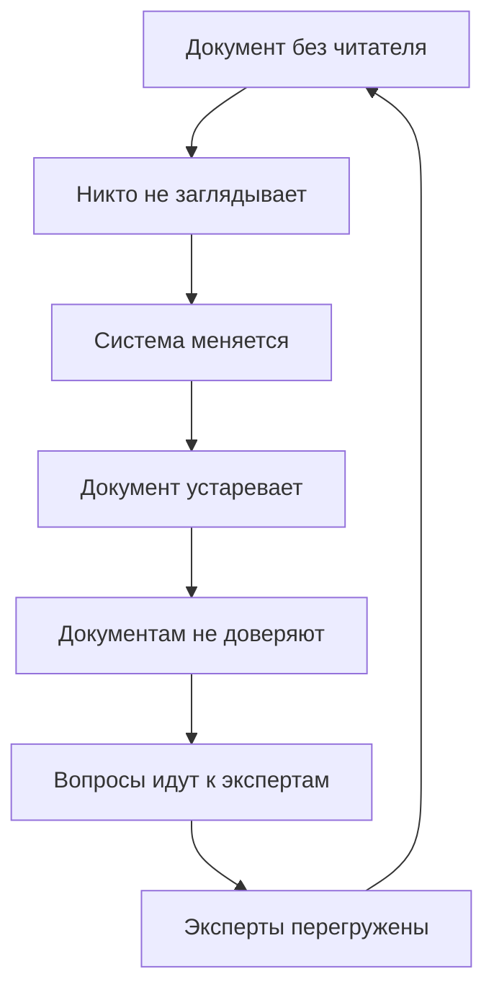
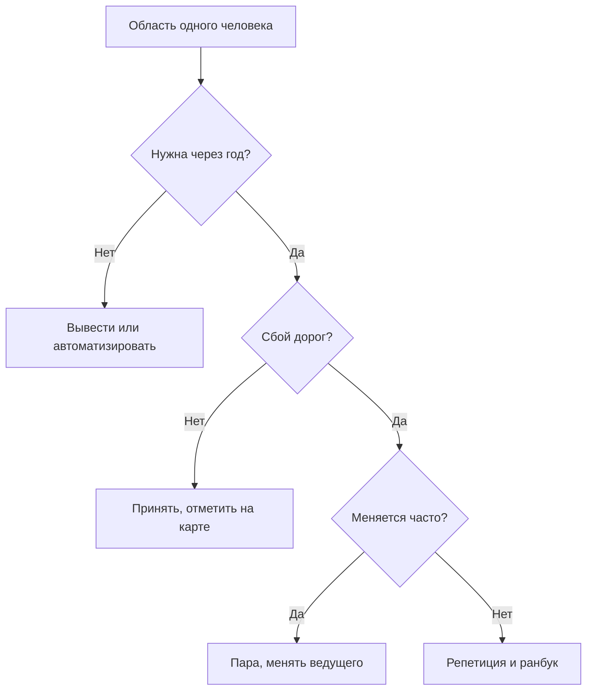

# Глава 12 — Хартии команд, рабочие соглашения и обмен знаниями { #chapter-12-team-charters-working-agreements-and-knowledge-sharing }

Эта глава о трёх договорённостях, на которых работает любая команда, записаны они или нет: для чего
команда существует и где её границы (хартия), как её участники работают друг с другом (рабочие
соглашения) и кто что знает (распределение знаний). Глава показывает, как сделать их явными и не
наплодить документов, которые никто не открывает. Примеры взяты из Northstar Technologies, вымышленной
компании из [кейса](../../case-studies/northstar/index.md): знания о ledger в команде Billing,
развёртывание shell-скриптами, которое понимает один человек, и хартия команды Data and Analytics.

## Почему это важно { #why-this-matters }

На уровне команды размытые границы порождают работу, которую каждая из двух команд считает чужой, и
запросы, которые приходят отовсюду и все принимаются. Неписаные рабочие соглашения раз в несколько
недель порождают один и тот же спор — о скорости ревью или о том, кто отвечает на вызовы. Знание,
которое есть в одной голове, превращает увольнение или отпуск в операционный риск.

На уровне организации хартии — это способ, которым директор видит форму целого. В базовом квартале у
восьми из 24 компонентов Northstar владение было спорным, общим или отсутствовало
([исходные данные](../../case-studies/northstar/baseline-data.md)). Каждый такой случай — недостающее
предложение в хартии какой-то команды.

На уровне высшего руководства концентрация знаний — риск для баланса, который никогда не появляется в
балансе. Ledger уровня [tier 1](../../glossary.md#tier-1) в Northstar (tier 1 — класс с наибольшим
влиянием на бизнес) зависел от трёх человек; четыре сервиса в продакшене развёртывались скриптом,
который понимал один человек. CTO (технический директор), который не может назвать такие точки, не
может судить, что сломает увольнение, поглощение или реорганизация.

## Цели главы { #learning-objectives }

После этой главы вы сможете:

- Написать хартию команды, где названы миссия, границы, интерфейсы и права на решения, и достаточно
  короткую, чтобы команда и её соседи действительно ею пользовались.
- Договариваться о рабочих соглашениях, соблюдение которых команда обеспечивает сама, и отменять те,
  что перестали работать.
- Составлять карту знаний команды по областям, находить единые точки отказа по знаниям и оценивать,
  насколько серьёзна каждая.
- Выбирать между тем, чтобы устранить, распространить или задокументировать знание, и проектировать
  документацию, которую читают, потому что она написана в момент использования.
- Рано распознавать типичные провалы хартий и соглашений: документы на полке, правила, которые никто не
  соблюдает, и планы по знаниям, на которые так и не выделили ресурс.

## Ментальная модель { #the-mental-model }

> **Ментальная модель:** команда работает на договорённостях о цели, поведении и знаниях. Они
> существуют независимо от того, записал ли их кто-нибудь. Записывать их стоит, только если записанная
> версия используется для принятия решений; иначе это вторая, устаревшая копия настоящей.

Настоящая хартия команды — это то, что она принимает, от чего отказывается и что эскалирует. Настоящее
рабочее соглашение — это то, что участники делают, когда никто не проверяет. Настоящая карта знаний —
это то, кому звонят в два часа ночи. Записанная версия работает, только если что-то в неделе команды к
ней обращается.

Поэтому тест для любого командного документа один: назовите момент, когда его кто-то прочитает. Хартию
читают, когда приходит запрос, который, возможно, не относится к команде; соглашение — на
ретроспективе, где его проверяют; ранбук (runbook) — во время того вызова, для которого он написан.
Документ без такого момента деградирует, а как только люди узнают, что он устарел, они перестают к нему
обращаться, даже когда он верен.

Эта петля помогает объяснить один провал Northstar. До прихода директора перегруженных экспертов по
ledger в Billing просили «документировать по ходу дела» — без времени и без названного читателя. Их
нагрузка не снизилась: документы, написанные таким образом, подпитывают петлю, а не разрывают её.

## Подробный разбор { #deep-conceptual-explanation }

### Что такое хартия команды и что говорят данные { #what-a-team-charter-is-and-what-the-evidence-says }

Хартия команды — короткий документ, который команда пишет сама и которым владеет; он отвечает на четыре
вопроса: зачем команда существует (миссия), чем она владеет и чем не владеет (границы), как другие с
ней работают (интерфейсы) и какие решения она принимает сама, разделяет с другими или эскалирует (права
на решения).

Хартии помогают вместе с хорошим планом, а не вместо него. Одно из немногих эмпирических исследований
хартий проследило 32 команды студентов MBA в бизнес-симуляции. Команды с качественными стратегиями
работы показывали лучшие результаты. Качество хартии взаимодействовало с качеством стратегии: самая
высокая устойчивая результативность, по данным аннотации, была у команд, сильных в обоих
([Mathieu and Rapp, 2009](../../references/bibliography.md#mathieu2009charters)). Это **научный
результат** в узких условиях. Он поддерживает скромное утверждение: договорённость о том, как работать
вместе, окупается вместе с хорошим планом работы, а не вместо него.

Project Aristotle от Google указывает в ту же сторону. Его руководство называет структуру и ясность
(ясные роли, планы и цели) среди пяти факторов эффективных команд, после психологической безопасности
и надёжности ([Google re:Work](../../references/bibliography.md#rework-team-effectiveness)):
**задокументированная практика**, самоотчёт одной компании. Patrick Lencioni утверждает, что лидеры
должны ответить на несколько базовых вопросов (зачем мы существуем, как мы себя ведём, что мы делаем,
что важнее всего сейчас, кто что делает) и повторять ответы, пока в них не поверят
([Lencioni, 2012](../../references/bibliography.md#lencioni2012advantage)). Это **мнение эксперта**
близко ложится на четыре вопроса хартии.

### Границы, интерфейсы и права на решения { #boundaries-interfaces-and-decision-rights }

Раздел о границах — самая полезная часть хартии и та, которую чаще всего пропускают. В нём перечислено,
чем команда владеет, чем не владеет, хотя люди думают иначе, и что спорно. Слово «спорно» превращает
молчаливый конфликт в пункт, который может решить кто-то выше команды.

Раздел об интерфейсах говорит, как другие команды получают что-то от этой: куда идут запросы, какое
ожидается время ответа, что доступно в режиме самообслуживания и что нужно команде от других. Skelton и
Pais известны идеей, что команда должна предъявлять продуманный «API команды» (team API) и выбирать
режим взаимодействия с каждым соседом, а не позволять каждому взаимодействию по умолчанию сводиться к
спонтанным запросам ([Skelton and Pais, 2019](../../references/bibliography.md#skelton2019team)). Типы
команд и режимы взаимодействия разобраны в главе 33. Здесь более узкая мысль: когда интерфейс записан,
запрос в обход него явно становится исключением, и цена запросов становится видна.

Раздел о правах на решения перечисляет повторяющиеся решения (изменения схемы собственных данных,
приём работы от другой команды, нарушение интерфейса) и говорит, кто решает и с кем советуются. Как
выбрать способ принятия каждого решения и как его записать, разобрано в главе 13; хартии нужен только
список и правило: решение, которого нет в списке, идёт к руководителю, и тот его добавляет.

### Рабочие соглашения, соблюдение которых команда обеспечивает сама { #working-agreements-the-team-enforces-on-itself }

Рабочее соглашение — конкретное наблюдаемое обязательство участников команды друг перед другом:
«на запрос ревью первый ответ — в течение одного рабочего дня», «решения, принятые на созвоне, в тот же
день записываются в канал команды». От стандарта (глава 20) его отличают охват и способ обеспечения:
стандарт действует для нескольких команд, и у него есть владелец вне команды; соглашение принадлежит
команде, и его соблюдение обеспечивают сами участники, в том числе по отношению к руководителю.

Работающие соглашения от плакатов на стене отличают три свойства (**рекомендация книги**):

| Свойство | Слабо | Сильно |
|---|---|---|
| Наблюдаемое | «Мы уважаем время друг друга» | «Повестка публикуется за день, иначе встреча отменяется» |
| Принадлежит команде | Навязано руководителем | Предложено и согласовано командой, включая руководителя |
| Проверяется | К нему никогда не возвращаются | Пересматривается на определённой ретроспективе: оставить, изменить или убрать |

Полный набор для гипотетической продуктовой команды из восьми человек; каждое соглашение наблюдаемо и
отвечает на проблему, которая у команды действительно была:

1. На запрос ревью первый ответ — в течение одного рабочего дня.
2. Решение, принятое на созвоне, в тот же день записывается в канал команды.
3. Никто не вливает собственное изменение в компонент tier 1 без второго ревьюера.
4. Тот, кто дежурит по прерываниям, берёт каждый новый запрос; остальные планируют без него.
5. Задачу, заблокированную два дня, её владелец поднимает на ближайшем стендапе.
6. Руководитель говорит последним на ревью дизайна и ретроспективах.

Команда проверяет список на первой ретроспективе каждого месяца.

Взаимный контроль работает только там, где указать на нарушение безопасно, а это полевое исследование
Edmondson связывает с обучением команды
([Edmondson, 1999](../../references/bibliography.md#edmondson1999psychological); глава 11). Там, где
сказать руководителю, что он нарушил соглашение о ревью, рискованно, соглашения соблюдаются только
сверху вниз и превращаются в замаскированные управленческие правила.

### Единые точки отказа по знаниям { #single-points-of-knowledge-failure }

Единая точка отказа по знаниям — область работы команды, которую безопасно может выполнять только один
человек. Agile-сообщество измеряет эту проблему через bus factor (его ещё называют truck factor) —
наименьшее число людей, внезапное отсутствие которых поставит проект в серьёзное затруднение (то есть
сколько людей должно выпасть).

Avelino с коллегами оценили bus factor по авторству в истории версий для 133 популярных проектов с
открытым кодом на GitHub. Примерно у 65% bus factor был 2 или меньше, а опрошенные разработчики из 67
проектов в основном согласились, что метод нашёл главных авторов
([Avelino et al., 2016](../../references/bibliography.md#avelino2016truck)). Это **научный результат**
об открытом коде.

Rigby с коллегами измерили, сколько файлов оказывалось брошенными, когда из Chrome и одного проекта в
Avaya уходили знающие разработчики. В плохом случае проект мог потерять в несколько раз больше среднего
(ожидаемого) объёма. Простые оценки bus factor преувеличивали возможные потери, а назначение преемников
снижало ожидаемые потери до 15% ([Rigby et al., 2016](../../references/bibliography.md#rigby2016turnover)).
Отсюда два вывода (**рекомендация книги**, развивающая эти результаты). Bus factor — это фильтр, а не
мера: значение 1 говорит, куда смотреть, а не насколько тяжёлой будет потеря, потому что коллеги часто
могут освоить область по её коду. И риск неравномерен: большинство уходов стоят немного, а некоторые —
очень дорого, поэтому работа состоит в том, чтобы найти эти немногие области.

### Устранить, распространить или записать { #remove-spread-or-write-down }

Есть три способа уменьшить единую точку отказа по знаниям, по убыванию долговечности
(**рекомендация книги**):

1. **Устранить потребность.** Замените вручную поддерживаемый скрипт развёртывания стандартным
   пайплайном или автоматизируйте ручную сверку. Знание, которое больше не нужно, потерять нельзя.
2. **Распространить через работу.** Работайте в паре, где за клавиатурой сидит обучающийся, и
   направляйте следующее изменение или вызов обучающемуся, а эксперта ставьте страховкой. Направлять
   ревью в области эксперта неэкспертам — дешёвый механизм распространения: Rigby и Bird показали, что
   код-ревью увеличивало число разных файлов, о которых знал разработчик, на 66–150% в зависимости от
   проекта ([Rigby and Bird, 2013](../../references/bibliography.md#rigby2013convergent)).
3. **Записать в момент использования.** У ранбука, который обучающийся написал после вызова, разобранного
   в паре, а эксперт поправил, есть известный читатель (следующий дежурный, которого вызовут) и тест
   (сработал ли он).

Порядок следует из петли ментальной модели: документы передают знание только тем, кто их читает, а
люди читают документы, которым доверяют. Глава об обмене знаниями в *Software Engineering at Google*
рассматривает передачу знаний один на один и письменные знания как дополняющие друг друга: первое
точно, но не масштабируется, второе масштабируется, но требует поддержки. Среди главных препятствий к
обучению глава называет единые точки отказа и отмечает, что сделать задачу за кого-то сегодня быстрее,
но знание при этом остаётся в одной голове
([Chen and Barolak, 2020](../../references/bibliography.md#chen2020knowledge)): **задокументированная
практика** одной очень крупной компании.

### Документация, которую читают { #documentation-that-gets-read }

Глава о документации из той же книги описывает отношение к документам как к коду (владелец, хранение в
системе контроля версий рядом с кодом, ревью, вывод из употребления, когда документ устарел), письмо для
названной аудитории и то, что каждый документ должен быть одного типа, например справочник или
руководство ([Manshreck, 2020](../../references/bibliography.md#manshreck2020documentation)); здесь это
кратко изложено как **задокументированная практика**. Команда может применять это и без инструментов
Google:

| Практика | Что она предотвращает |
|---|---|
| Один названный владелец у документа | Брошенные страницы, которые никто не решается исправить |
| Хранить там, куда смотрит дежурный инженер | Страницы, которые никто не находит |
| Дата «последней проверки», проверяется при использовании | Тихое устаревание |
| Один читатель и один момент | Документы, которые одновременно и руководство, и справочник |
| Удалять, когда устарел | Вики, где правильная страница — одна из трёх |

Страница стандартов Northstar 2019 года и её страница долга на 143 пункта — именно такие вики-документы
без владельца; что с ними стало, рассказывают главы 20 и 21.

### Обмен знаниями помимо единых точек отказа { #knowledge-sharing-beyond-single-points-of-failure }

Устранение единых точек отказа защищает команду; обмен знаниями делает лучше и её, и её соседей. Для
этого нужны разные каналы. *Software Engineering at Google* перечисляет несколько способов
масштабировать знания (часы консультаций, доклады, документация, код-ревью и авторитетные источники с
владельцами) и считает их основой психологическую безопасность — ощущение, что можно спрашивать и
признавать, что чего-то не знаешь
([Chen and Barolak, 2020](../../references/bibliography.md#chen2020knowledge); **задокументированная
практика**). Достаточно небольшого набора (**рекомендация книги**):

| Канал | Что распространяет | Как заставить работать |
|---|---|---|
| Онбординг | Основы, которые нужны каждому участнику | Пусть самый новый участник исправляет руководство по онбордингу везде, где оно его подвело |
| Дизайн-документы и ревью | Почему система устроена так, как устроена | Приглашайте одного ревьюера из соседней команды |
| Часы консультаций эксперта | Ответы, которые знают немногие | Фиксированные еженедельные слоты, чтобы вопросы копились, а не прерывали |
| Демо и короткие доклады | Что строят другие команды | Делайте их короткими, записывайте и открывайте для всех площадок |
| Сообщества практиков | Общее ремесло нескольких команд (тестирование, язык, платформа данных) | Названный ведущий, регулярный слот и разрешение тратить на это время |

Внутри команды рычаг руководителя — маршрутизация работы и ревью. Между командами это рычаг директора:
межкомандное ревью дизайна, короткие ротации в соседнюю команду и одно место, где живут авторитетные
документы с владельцами. В Northstar, например, незапланированные вопросы по Core, на которые отвечает
Ines Carvalho (staff-инженер по домену Core), — естественный кандидат на часы консультаций плюс
документы, написанные по её ответам.

## Пример из инженерной организации { #engineering-organization-example }

!!! info "Northstar: что уже известно"
    Неделя 14, начало квартала 2. За первый квартал директора число инцидентов Sev1 и Sev2 (двух самых
    высоких уровней серьёзности) снизилось с 30 до 21. У Billing по-прежнему больше всего инцидентов, и
    большую часть вызовов дежурных несут три инженера ledger. См.
    [хронологию](../../case-studies/northstar/timeline.md). Впервые встречаете Northstar? Прочитайте
    [«Год вкратце»](../../case-studies/northstar/year-in-brief.md) и
    [«Действующие лица»](../../case-studies/northstar/cast.md).

Цифры — **иллюстрация** (Northstar вымышлена). В Billing три эксперта по ledger и более новая
сотрудница, Tamsin Achterberg, которая осваивает ledger, но пока не дежурит. Marcus Oyelaran
(руководитель разработки, engineering manager, EM, команды Billing) и три эксперта разделили работу с
ledger и счетами на пять областей. Для каждой они посчитали, сколько из 13 инженеров Billing могут
самостоятельно отреагировать на вызов и сколько могут безопасно изменить область при обычном ревью.

| Область ledger | Реагирует сам | Меняет безопасно | Изменений за два квартала |
|---|---|---|---|
| Правила проводок и журнала | 3 | 3 | 14 |
| Кредит-ноты и корректировки | 3 + Tamsin | 2 | 9 |
| Закрытие периода и конец месяца | 2 | 1 | 4 |
| Миграции схемы ledger | 2 | 2 | 6 |
| Валюты и округление | 1 | 1 | 3 |

Кроме одной ячейки с Tamsin, все числа складываются только из трёх экспертов.

«Реагирует сам» означает восстановить работу без эскалации в типичном инциденте в этой области.
«Меняет безопасно» — изменение, которое человек влил бы с одним ревьюером.

Отсюда три вывода.

Первое: заголовок «три эксперта» скрывает две области, где код может изменить только один человек
(закрытие периода; валюты и округление), и одну, где реагировать может только один. Два других эксперта,
вероятно, смогли бы в кризисе разобраться с обработкой валют по коду, так что риск не абсолютный, но
учиться им пришлось бы во время инцидента, затрагивающего деньги клиентов.

Второе: области с bus factor, равным 1, меняются реже всего (четыре и три изменения за два квартала).
Именно поэтому знания в них и сконцентрировались: поводов научиться было слишком мало. Парная работа
ждёт естественного повода; для редко меняющихся областей команде приходится его создавать — например,
запланированной репетицией закрытия месяца в тестовом окружении.

Третье: цену распространения можно измерить. Четыре часа парной работы в неделю от каждого из трёх
экспертов — примерно 0,3 [FTE](../../glossary.md#fte) (полной ставки инженера) при 40-часовой неделе.
С другой стороны, в базовом квартале эти трое разобрали 126 из 180 вызовов Billing, 54 из них — в
нерабочее время. Эта петля и правило маршрутизации, которое её разворачивает, разобраны в
[главе 3](../01-foundations/03-managerial-leverage-and-systems-thinking.md). Карта областей подсказывает
правилу маршрутизации, куда отправлять обучающихся в первую очередь.

Развёртывание shell-скриптами устроено иначе: один скрипт, понятный одному человеку, развёртывает
auth-svc, webhooks, document-store и export-svc. Это bus factor, равный 1, сразу для четырёх сервисов.
INC-416 показал эту связанность: изменение скрипта сломало откат для всех четырёх. Здесь
распространение знаний — неверный первый шаг. Долговечное решение — убрать скрипт, перейдя на
стандартный пайплайн (глава 23); работа со знаниями лишь прикрывает месяцы до этого.

## Как принимать решение { #decision-framework }

Для каждой области на карте знаний, где работу может выполнять один человек, пройдите по вопросам ниже.

Затем выберите механизм по таблице:

| Механизм | Работает, когда | Цена | Как его подгоняют |
|---|---|---|---|
| Вывести или автоматизировать | Знание касается инструмента или процесса, от которого можно избавиться | Инженерный проект; часто уже есть в дорожной карте | Объявлен «запланированным» и так и не профинансирован |
| Пара, за клавиатурой обучающийся | Работа повторяется не реже раза в месяц | Время эксперта и обучающегося, какое-то время работа идёт медленнее | Обучающийся смотрит, а не ведёт |
| Направлять ревью обучающимся | Код меняется регулярно | Поначалу ревью медленнее | Обучающийся одобряет ревью не глядя |
| Репетиция | Редкие, но дорогие события (конец месяца, восстановление, переключение на резерв) | Полдня на репетицию | Репетиция пропускает трудный шаг |
| Ранбук от обучающегося | После события, разобранного в паре | Час на событие | Скопирован у эксперта без проверки |
| Принять риск | Низкая цена сбоя или скорая дата вывода | Сейчас никакой | «Принято» для областей, на которые никто не смотрел |

Подгоняют и саму карту: сделайте «людей, которые могут реагировать сами» целевым показателем, и их
число будет расти быстрее, чем реальные способности. Вместо этого просите свидетельств: кто восстановил
последний инцидент в этой области без эскалации?

## Компромиссы { #trade-offs }

**Скорость сейчас против устойчивости потом.** Каждый вызов, разобранный в паре, и каждое ревью,
направленное обучающемуся, медленнее, чем эксперт в одиночку, а в Billing медленный квартал обходится
клиентам. Принимайте эту цену на частых событиях меньшей серьёзности; на редких серьёзных оставляйте
экспертов первыми, пока обучающиеся не потренируются.

**Записанная хартия против гибкости.** Хартию, в которой написано «мы не владеем search-svc», будут
цитировать команде, когда помочь было бы удобно. Ответ — записать, как делаются исключения (их
принимает, записывает и пересматривает руководитель), а не писать более расплывчатую хартию.

**Соглашения команды против единообразия организации.** Соглашения, которые различаются между
командами, чего-то стоят, когда люди переходят или работают вместе. Всё, что пересекает границы команд,
например правила ревью общего кода или определения серьёзности, держите в стандартах (глава 20), а
остальное оставьте командам.

**Записать против устранить.** Час, потраченный на документирование хрупкого скрипта, — час, не
потраченный на то, чтобы его вывести. Пишите только для названных моментов и предпочитайте устранение,
где его можно профинансировать.

## Типичные провалы { #failure-modes }

**Хартия на полке.** Написана на выездной сессии, подшита, ни разу не открыта. Сигнал: запросы,
которые по хартии должны идти в другое место, принимаются, и никто этого не замечает. Противодействие:
используйте хартию при сортировке входящих запросов и раз в квартал сверяйте её с реально полученными
запросами.

**Соглашения, которые соблюдаются только сверху вниз.** Руководитель напоминает инженерам о соглашении
по ревью; руководителю никто не напоминает. Сигнал: на соглашения ссылается только руководитель.
Противодействие: руководитель на ретроспективе спрашивает, какое соглашение нарушил он сам, и
продолжает спрашивать, пока кто-нибудь не ответит.

**Разрастание соглашений.** Двадцать соглашений, которые никто не может перечислить. Сигнал: никто не
может назвать больше трёх. Противодействие: предел около семи, и чтобы добавить одно, нужно убрать или
объединить другое.

**Кампания по документированию.** Квартальный рывок «задокументировать всё» даёт сотню страниц, а
экспертов по-прежнему вызывают. Сигнал: страницы написаны, но новые люди инциденты не восстанавливают.
Противодействие: измеряйте, кто восстанавливает инциденты, а не сколько страниц существует.

**План по знаниям без ресурса.** Парную работу и репетиции согласовали и так и не запланировали,
потому что каждую неделю есть работа срочнее. Сигнал: через квартал карта знаний не изменилась.
Противодействие: внесите часы в план ресурсов команды как названную работу, как и любую другую
профилактическую работу (глава 27).

## Применение в крупной организации { #enterprise-application }

В организации из 50–150 инженеров хартии и карты знаний — это способ, которым директор видит форму
организации, не бывая на встречах каждой команды.

**Хартии как набор.** Если положить шесть хартий рядом, они должны покрывать все компоненты, и ни один
не должен стоять в двух списках «владеет». Пересечения и пробелы разрешает директор. Northstar проделала
это упражнение без хартий на неделе 4, когда директор назначил владельцев двум модулям Core без
владельца, core/customer и core/scheduler
([хроника года 1](../../case-studies/northstar/first-quarter.md)). Достаточно одной страницы на команду,
в одном месте, с датой квартального пересмотра.

**Реестр рисков по знаниям.** Каждый руководитель составляет карту знаний для своих областей tier 1 и
приносит области одного человека на квартальный разбор. Директор ведёт короткий список на уровне
организации, где у каждой записи есть способ устранения (вывести, распространить или принять) и дата.
Список питает приоритеты найма на замену и обоснование вывода специального инструментария.

**Staff-инженеры как распространители.** Staff-инженеры сами часто бывают единой точкой отказа по
знаниям. В базовом квартале Ines Carvalho тратила около восьми часов в неделю на незапланированные
вопросы о Core ([исходные данные](../../case-studies/northstar/baseline-data.md)). Рычажный ход,
описанный в главах 3 и 29, — превращать повторяющиеся ответы в документы с владельцами и ревью силами
других, а не отвечать быстрее.

## Взгляд CTO { #cto-perspective }

На уровне высшего руководства вопрос в том, какие знания компания не может позволить себе потерять и
платит ли кто-нибудь за их сохранение. Те, кто ими владеет, часто — самые ценимые инженеры, и поэтому
риск ощущается как сила.

На этом уровне меняются три вещи. Организационные изменения — это события в жизни знаний: перенос
компонента, слияние команд или программа добровольного ухода перераспределяют знания, и в плане должно
быть сказано, куда уходит знание каждой области tier 1. Вывод специального инструментария, например
развёртывания скриптами в Northstar, устраняет риск по знаниям, и в бизнес-кейсе это должно быть
сказано. И предложение знаний определяют стимулы. Если повышения достаются инженеру, который спасает
каждый инцидент ledger, а не тому, кто научил этому ещё троих, единые точки отказа будут появляться
снова и снова (петля героя из главы 3: за спасения хвалят, поэтому спасатель остаётся единственным, кто
может спасти).

Чего CTO делать не стоит, так это запрашивать общий для компании bus factor. Исследования считают его
грубым фильтром ([Rigby et al., 2016](../../references/bibliography.md#rigby2016turnover)), а целевой
показатель стали бы подгонять, вписывая имена в карты.

## Практический плейбук { #practical-playbook }

Для руководителя, который за один квартал пишет хартию и соглашения и снижает риск по знаниям:

1. **Возьмите выборку работы за прошлый квартал**: что команда делала, откуда приходили запросы, от
   чего она отказывалась. Пишите хартию по этим данным, а не по команде, которую вам хотелось бы иметь.
2. **Напишите вместе с командой одну страницу**: миссия, чем владеем, чем не владеем, что спорно,
   интерфейсы, права на решения. В [шаблоне хартии команды](../../templates/team-charter.md) есть
   заголовки и разобранный пример.
3. **Покажите её соседям**, названным в интерфейсах; споры отправьте директору вместе с предложением.
4. **Согласуйте пять–семь наблюдаемых рабочих соглашений** исходя из проблем, которые у команды
   действительно были, и назначьте ретроспективу, на которой их пересмотрят.
5. **Составьте карту знаний по областям**, начиная с tier 1: кто может реагировать сам, кто может
   безопасно менять.
6. **Проведите каждую область одного человека** через схему принятия решения.
7. **Внесите часы в план ресурсов** как названные пункты: парная работа, репетиции, работа по выводу.
8. **Измените маршрутизацию**: следующий вызов, ревью или изменение в каждой области идёт
   обучающемуся, эксперт — страховка.
9. **Пишите ранбуки в момент использования** — силами обучающегося, с владельцем и датой проверки.
10. **Подведите итоги в конце квартала**: хартию — против полученных запросов, соглашения — на
    ретроспективе, карту знаний — против того, кто на самом деле восстанавливал инциденты.

## Кейс { #case-study }

Этот кейс — **вымысел**. Он относится к началу квартала 2. Он описывает черновик и решения, которые тот
поднимает, но не фиксирует их исход.

В Data and Analytics, которой руководит Farah Haddad, было одиннадцать инженеров (восемь инженеров
данных, три разработчика ПО). У команды была самая низкая в организации
[доля неудачных изменений](../../glossary.md#change-failure-rate) (доля изменений, которые ломаются в
продакшене) и мало контактов с другими командами
([исходные данные](../../case-studies/northstar/baseline-data.md)). Она выглядела командой, которой
внимание нужно меньше всех. Два факта говорили обратное. Во-первых, запросы других команд забирали 12
пунктов её ресурса, половину её [незапланированной работы](../../glossary.md#unplanned-work); среди
продуктовых команд больше не получал никто. Во-вторых, оба её серьёзных инцидента касались интерфейсов.
В INC-408 отчёт на конец месяца перестал укладываться в тайм-аут при новом объёме данных, и клиент
сообщил об этом через восемь часов. В INC-423 окно обслуживания хранилища данных совпало с
запланированными выгрузками клиентам, а никто не записал, кто объявляет об обслуживании и кого нужно
предупредить.

Farah за две сессии составила с командой черновик хартии, начав с выборки запросов за прошлый квартал.

| Раздел | Черновик |
|---|---|
| Миссия | Клиенты и сотрудники Northstar получают правильную и своевременную отчётность и выгрузки по данным заказов и биллинга |
| Владеем | reporting-api, export-svc, пайплайны хранилища данных |
| Не владеем | Корректность исходных данных в Core (ею владеют Orders и Billing); скрипт развёртывания выгрузок (Platform Operations, до вывода из эксплуатации) |
| Спорно | search-svc: номинальный владелец — Orders, написан в основном инженерами, которые теперь в этой команде; предложение директору |
| Интерфейсы | Запросы через одну очередь, сортировка по вторникам и четвергам; первый ответ в течение двух рабочих дней. Об окнах обслуживания хранилища предупреждать Payments and Integrations и Customer Experience за пять рабочих дней |
| Права на решения | Схема хранилища: решает команда, консультирует Li Na Zhou (staff-инженер) как владелец стандарта по данным и миграциям. Принять от другой команды работу больше чем на неделю: Farah. Нарушить контракт reporting-api: директор информирован, с потребителями советуются |

Из шести рабочих соглашений два показывают устройство команды. Её участники работают в Миннеаполисе
(четверо), Боготе (пятеро) и удалённо (двое), поэтому решения, принятые на созвоне, в тот же день
записываются в канал команды, а любое изменение хранилища, затрагивающее клиентские выгрузки, получает
второго ревьюера из другого города.

На тех же сессиях всплыли две проблемы со знаниями. export-svc развёртывается общим shell-скриптом,
поэтому Data and Analytics не могла развернуть собственный сервис без единственного инженера
инфраструктуры в Platform Operations, который понимал этот скрипт. А путь отчётности на конец месяца,
стоящий за INC-408, построил инженер данных, который с тех пор работает в основном над пайплайнами
хранилища: запускать его команда могла, но менял его только один человек.

Черновик поставил перед директором три решения. Отдавать ли search-svc в Data and Analytics, что
добавит поверхность дежурств команде с небольшой операционной практикой. Финансировать ли вывод скрипта
для export-svc раньше трёх других сервисов на скрипте, учитывая, что он относится к tier 3 (классу с наименьшим
влиянием на бизнес). И является ли уведомление об обслуживании за пять дней соглашением команды или ему
следует стать стандартом организации. Упражнения разбирают эти решения.

## Упражнения { #exercises }

Решения — в [решениях к главе 12](../../solutions/ch12-solutions.md). Данные Northstar — на
[странице исходных данных](../../case-studies/northstar/baseline-data.md).

### Базовый уровень { #foundational }

**F1.** У команды из девяти человек, которую вы только что приняли, есть хартия двухлетней давности с
миссией на три абзаца, без раздела о границах и с двенадцатью «ценностями команды». Запросы приходят
личными сообщениями тому инженеру, которого знает автор запроса. Объясните, что существующая хартия
делает и чего не делает, и набросайте заголовки и первую строку каждого раздела новой хартии, которую
предстоит закончить с командой за две сессии.

**F2.** Среди рабочих соглашений команды есть «мы ценим качество», «ревью в течение 24 часов», «по
средам без встреч», «каждый документирует свою работу» и «будьте добры». Для каждого скажите, наблюдаемо
ли оно, как команда узнает, что оно нарушено, и как бы вы его переписали или убрали. Затем скажите, какое
из них вы проверите первым на ближайшей ретроспективе и почему.

**F3.** По карте знаний Billing из примера из инженерной организации определите bus factor ledger в
целом и каждой области, объясните, почему «три эксперта» преувеличивают устойчивость команды, и
объясните, почему bus factor, равный 1, в какой-то области сам по себе не говорит, во что обойдётся
уход.

### Прикладное лидерство { #applied-leadership }

**A1.** Вы — Marcus Oyelaran, руководитель разработки Billing, в начале квартала 2. Опираясь на карту
знаний, спроектируйте план на квартал, чтобы в каждой области ledger реагировать могли как минимум двое,
а в областях tier 1 как минимум двое могли и вносить изменения. Скажите, какой механизм вы используете в
каждой области, сколько часов и чьих это стоит, что, по вашим ожиданиям, будет происходить со временем
восстановления в течение квартала и какие свидетельства в конце квартала покажут, что план сработал.

**A2.** Единственный инженер инфраструктуры, который понимает общий скрипт развёртывания, объявляет о
запланированном трёхнедельном отпуске, который начнётся через шесть недель. Вывод скрипта запланирован,
но пока не поставлен в график. Решите, что делать в эти шесть недель, какой риск принять на время
отпуска и как не допустить, чтобы всё свелось к документированию, которое даст длинную непроверенную
страницу.

**A3.** В черновике хартии Farah Haddad сказано, что запросы идут через одну очередь с первым ответом в
течение двух рабочих дней. Через две недели инженер по продажам из подразделения Greg Tanaka (VP по
продажам) отправляет запрос данных личным сообщением инженеру Data and Analytics с пометкой «срочно, для
сделки». Посоветуйте Farah, как команде отреагировать, что должен говорить процесс исключений в хартии
и как через квартал понять, работает ли интерфейс.

### Решения на уровне руководства { #executive-decision-making }

**X1.** В роли директора решите, следует ли передать search-svc в Data and Analytics. search-svc — компонент
tier 2, без ранбука, с частичными алертами и без графика дежурств; во время INC-407, потери узла поискового
кластера в базовом квартале, дежурного не нашлось. У собственного export-svc команды Data and Analytics
тоже нет ни ранбука, ни алертов, ни графика дежурств. Учтите знания, которые уже есть в команде,
поверхность дежурств, нынешнюю операционную практику команды, влияние на Orders и то, что должна была бы
говорить хартия в каждом случае. Скажите, во что вам нужно было бы верить для каждого ответа, и какова
стоимость перехода при передаче.

**X2.** Victor Lindqvist (CTO) предлагает, чтобы каждая команда ежеквартально публиковала bus factor с
целевым значением не меньше 2 для каждого компонента tier 1 и отчитывалась о нём на операционном
ревью. Посоветуйте ему: что это число скажет ему и чего не скажет, как его будут подгонять, о чём вы бы
отчитывались вместо этого и какое решение оно, по его ожиданиям, должно помогать принимать.

## Вопросы для размышления { #reflection-questions }

1. Если бы хартию вашей команды завтра удалили, какое решение в следующем месяце было бы принято иначе?
2. Какое рабочее соглашение в вашей команде последним нарушил руководитель и кто об этом сказал?
3. Из какой области работы вашей команды вам меньше всего хотелось бы, чтобы в этом месяце ушёл тот,
   кто знает её лучше всех, и что вы с этим сделали в этом квартале?
4. Каким документам вашей команды вы бы доверились в два часа ночи и откуда вы знаете, что они
   актуальны?
5. Какие знания есть у вас и больше ни у кого в команде, и почему вы их держите при себе?

## Главное { #key-takeaways }

- Хартии, соглашения и распределение знаний существуют, записаны они или нет; записывайте их, только
  когда записанная версия будет использоваться для принятия решений.
- Хартия отвечает на четыре вопроса: миссия, границы (включая «не владеем» и «спорно»), интерфейсы и
  права на решения. Одной страницы достаточно.
- Рабочие соглашения наблюдаемы, принадлежат команде и проверяются на определённой ретроспективе;
  руководитель тоже связан ими.
- Составляйте карту знаний по областям, а не по людям; общее число экспертов скрывает области одного
  человека.
- Относитесь к bus factor как к фильтру, который говорит, куда смотреть, а не как к мере потерь или
  целевому показателю.
- Снижайте риск по знаниям так: сначала устраните потребность, затем распространите знание через
  работу и лишь затем запишите его в момент использования.
- У каждого документа есть владелец, читатель, момент использования и дата последней проверки; работе
  со знаниями нужен названный ресурс в плане.

## Источники и что почитать { #references-and-further-reading }

- [Mathieu and Rapp, 2009](../../references/bibliography.md#mathieu2009charters). Хартии и стратегии
  работы в 32 студенческих командах.
- [Google re:Work](../../references/bibliography.md#rework-team-effectiveness). Пять факторов команд
  Project Aristotle, включая структуру и ясность.
- [Lencioni, 2012](../../references/bibliography.md#lencioni2012advantage). *The Advantage*. Ясность как
  основа здоровья организации.
- [Skelton and Pais, 2019](../../references/bibliography.md#skelton2019team). *Team Topologies*. API
  команд и режимы взаимодействия; читайте вместе с главой 33.
- [Edmondson, 1999](../../references/bibliography.md#edmondson1999psychological). Психологическая
  безопасность и обучение команды; почему взаимному контролю нужна безопасность.
- [Avelino et al., 2016](../../references/bibliography.md#avelino2016truck). Оценка bus factor по истории
  версий в 133 проектах с открытым кодом.
- [Rigby et al., 2016](../../references/bibliography.md#rigby2016turnover). Потеря знаний из-за
  текучести; почему bus factor — фильтр и почему важны преемники.
- [Rigby and Bird, 2013](../../references/bibliography.md#rigby2013convergent). Код-ревью в разных
  компаниях, в том числе ревью как способ распространять знания.
- [Chen and Barolak, 2020](../../references/bibliography.md#chen2020knowledge) и
  [Manshreck, 2020](../../references/bibliography.md#manshreck2020documentation). Главы об обмене
  знаниями и о документации из
  [*Software Engineering at Google*](../../references/bibliography.md#winters2020software), бесплатно
  доступной онлайн под лицензией CC BY-NC-ND.
