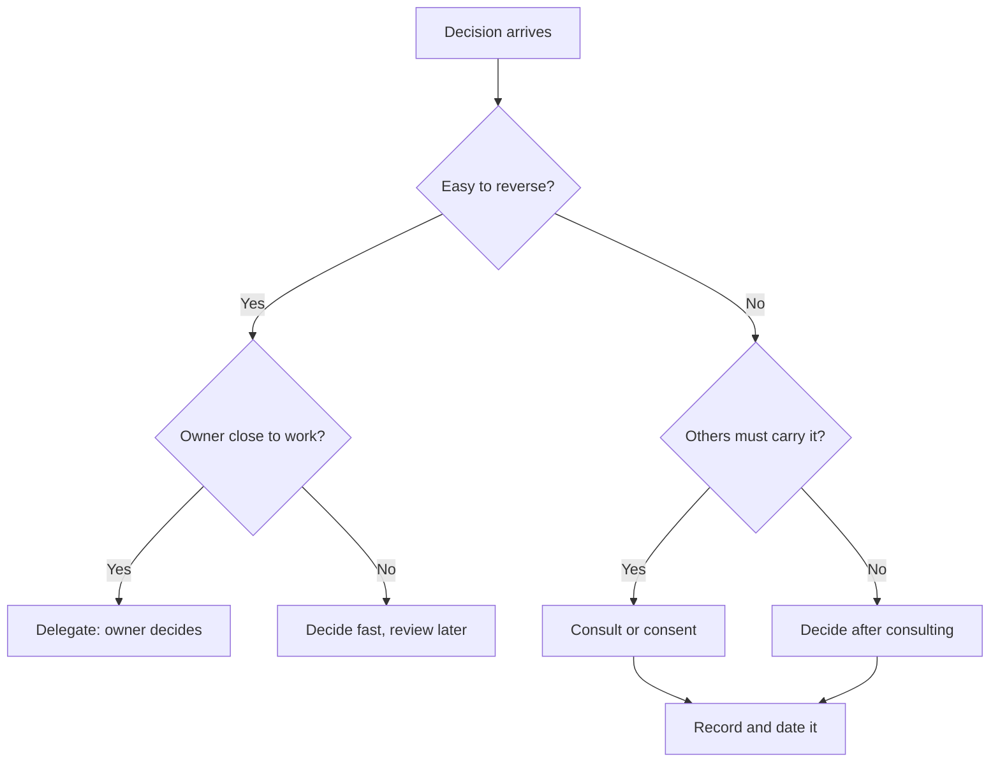
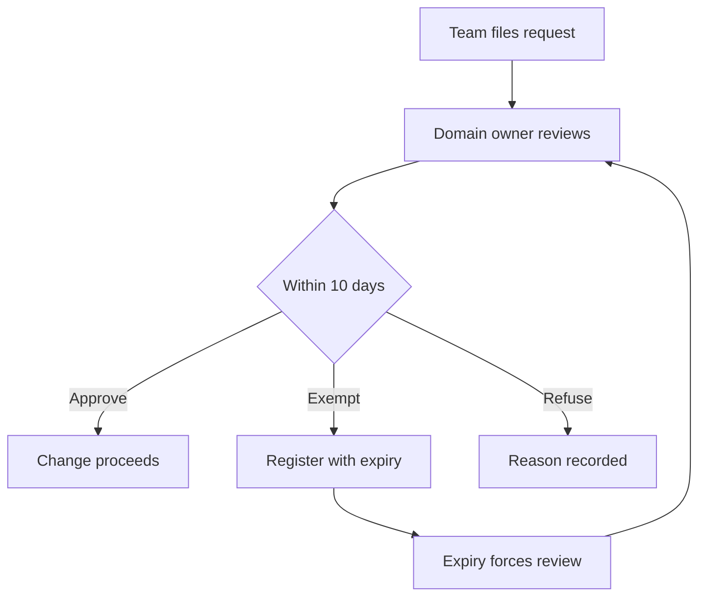
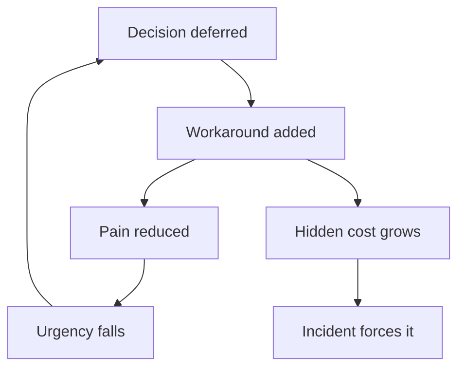

# Chapter 13 — Decision-Making in Teams

This chapter is about how a team decides: who makes a given decision, by what method, how the
decision is written down, and how to notice when a team only appears to have decided. It treats
decision-making as something a leader designs, like a build pipeline. The running example is the ownership
of core/permissions at Northstar Technologies, the fictional company in the
[case study](../../case-studies/northstar/index.md): a decision that was still open at the end of the
director's first quarter.

## Why This Matters

At team scale, slow or unclear decisions are a hidden queue. Work waits for a decision nobody knows
they own, engineers build on assumptions later reversed, and the same debate returns because nothing
recorded the last one. It shows up in lead time, not in sprint reports.

At organization scale, the costly decisions are between teams: who owns a shared module, whose
roadmap gives way. Inside a team a manager breaks ties; between teams there is often no obvious
decider. Northstar's eight components with disputed, shared, or orphaned ownership at baseline were
eight decisions nobody had made.

At executive scale, the question is whether decision rights are designed or accidental. A chief
technology officer cannot make most technical decisions, but can decide who decides, by what rule, and
on what record.

## Learning Objectives

After this chapter you will be able to:

- Match the decision method (decide, consult, consent, delegate) to the decision's reversibility and
  stakes, and explain the choice to the people affected.
- Assign decision rights explicitly with a role model such as DACI or RAPID, and recognize when the
  model has become ceremony.
- Write decision records that let a newcomer understand, keep, or reverse a decision after the people
  who made it have left.
- Detect false consensus and decision avoidance from observable signals, and break both.
- Design a group discussion so that information only one member holds reaches the decision.

## The Mental Model

> **Mental model:** Every decision has an owner, a method, a deadline, and a record. A decision
> missing any of the four is not finished, however much it was discussed.

The four parts fail in recognizable ways. Without an **owner**, the decision drifts until someone
senior notices or an incident forces it. Without an explicit **method**, people disagree about whether
they were deciding or being consulted, and the first person overruled feels betrayed. Without a
**deadline**, the decision competes with urgent work and loses every week. Without a **record**, it is
made again when the people change, often in the opposite direction.

The second idea is that the method should follow from two properties of the decision: how hard it is
to reverse, and how much it costs if it is wrong. Most leaders run every decision through the same
habit (consensus for some, deciding alone for others). The skill is to vary the method on purpose.

The diagram is **this book's synthesis**, a starting point rather than a rule. It stops a team
spending consensus on a reversible decision, and a manager deciding alone what others must carry out.

## Deep Conceptual Explanation

### Four methods, defined

The words below are used loosely in practice, so the chapter fixes their meaning.

| Method | Who decides | What others do | Fits |
|---|---|---|---|
| Decide | One named person, alone | Hear the decision and the reason | Urgent, reversible, or narrow decisions |
| Consult | One named person, after asking | Give information and opinions; no veto | Most important decisions |
| Consent | The group, by absence of reasoned objection | Raise objections that show harm; preference alone is not an objection | Team agreements people must live with |
| Delegate | Someone other than the leader | The leader sets constraints and hears the result | Decisions closer to another person's information |

**Consensus** (everyone agrees) is missing on purpose: it gives every member a veto and rewards
whoever holds out longest. Consent asks instead "can everyone live with this, and if not, what harm
does it cause?" It fits a team agreement on on-call swaps, not a component ownership decision, where the
candidates have a conflict of interest.

Delegation to one person is covered in Chapter 2's five-level scale
([delegating by outcome](../01-foundations/02-from-individual-contributor-to-leader.md#delegating-by-outcome-with-an-explicit-level-of-control)),
after David Marquet's idea of moving decisions to the people with the information
([Marquet, 2012](../../references/bibliography.md#marquet2013turn)). This chapter adds the group case.

### Reversibility and stakes

Jeff Bezos's 2016 shareholder letter describes reversible decisions as "two-way doors" that deserve a
lightweight process because being wrong is cheap to undo, and argues that most decisions should
probably be made with about 70 percent of the information one would like
([Bezos, 2017](../../references/bibliography.md#bezos2016letter)). This is **documented practice**,
one chief executive describing his company's habits, valuable mainly for its vocabulary.

Two refinements matter for engineering teams (**this book's recommendation**). First, reversibility can
often be bought: a feature flag, a parallel run, or an interface that hides the choice turns a one-way
door into a two-way door, often more cheaply than deciding more carefully. Second, decisions that people
build on stop being reversible. A module owner can be changed on paper in a day, but the owning team's
runbooks, alerts, and habits cannot.

Peter Drucker's account of the effective executive is known for arguing that executives should make
few decisions, address the generic problem behind a recurring one, and build the action into the
decision ([Drucker, 1967](../../references/bibliography.md#drucker1967effective)). A decision that
recurs every month is a missing rule: decide the rule once and give an owner the cases.

### Decision rights made explicit

Role models assign named roles to each important decision. Three are common:

| Model | Roles | What it is good at |
|---|---|---|
| RACI | Responsible, Accountable, Consulted, Informed | Mapping who does the work and who answers for it; widely used, with no single authoritative source |
| DACI | Driver, Approver, Contributors, Informed | One decision at a time, with a driver who keeps it to a date |
| RAPID | Recommend, Agree, Perform, Input, Decide | Separating the recommender from the decider, and making vetoes (Agree) explicit and rare |

Atlassian's playbook for DACI insists on one Driver and one Approver, gives Contributors a voice but no
vote, and records the outcome in a shared document
([Atlassian, DACI](../../references/bibliography.md#atlassian-daci)). Bain's description of RAPID says
the Agree role, for mandatory requirements such as legal ones, should be assigned sparingly, and that
ideally each decision has a single decider
([Bain, RAPID](../../references/bibliography.md#bain-rapid)); Rogers and Blenko's article introducing
the approach argues that performance depends on making the right decisions quickly and executing them
consistently ([Rogers and Blenko, 2006](../../references/bibliography.md#rogers2006whohasd)). These are
**documented practice** from a software vendor and a consulting firm. Neither source offers evidence that
the tool improves outcomes, and the book found none.

What the models share matters more than how they differ: one person decides, the people with
information are named, and vetoes are rare and explicit. A RACI matrix for every decision is paperwork;
draw one only for decisions that cross teams, recur, or have already gone wrong.

### The decision service level

Northstar's staff engineers run a decision rule that Chapter 20 describes as part of standards
governance: each standards domain has one owner (Kwame Mensah for operational minimums and pipelines,
Ines Carvalho for Core code, Li Na Zhou for data, migration, and configuration), every request gets a
decision within ten working days, and every exemption is recorded with an expiry of at most two
quarters ([Chapter 20](../05-engineering-quality/20-engineering-standards-and-their-governance.md)).

The rule fixes all four parts of the mental model: an owner per domain, the method "owner decides
after consulting", a ten-day deadline, and the register as record. Its limit, which the case study
shows, is scope. A decision above every domain owner, such as which team owns a module, is in nobody's
queue, and an exemption can turn it into a decision nobody is waiting for.

### Recording decisions

Michael Nygard's 2011 post proposed architecture decision records: one or two pages per decision, with
context, decision, status, and consequences (including the negative ones), kept in the repository and
numbered, so that a reversed decision is marked superseded rather than deleted. His stated motivation
is that without the rationale, newcomers can only accept old decisions blindly or reverse them blindly
([Nygard, 2011](../../references/bibliography.md#nygard2011adr)). Chapter 28 (Architecture
Decision-Making and Governance) covers architecture decision records in depth; the format works just as well for organizational decisions such as ownership,
on-call policy, or a team's working agreement.

A record survives personnel change only if it answers the questions a successor will ask (**this book's
recommendation**):

| Field | The successor's question |
|---|---|
| Decision and date | What was decided, and when? |
| Owner and method | Who decided, and were others consulted or did they consent? |
| Options rejected | What else was considered, and why not? |
| Assumptions | What would have to change for this to be wrong? |
| Review trigger | When or on what signal should this be reopened? |

Assumptions and the review trigger are most often omitted and most useful: they give the successor a
test to run.

### What group research says

Groups are often assumed to decide better than individuals because they hold more information. The
research on **hidden profiles** shows why that advantage is frequently lost. In Stasser and Titus's
founding study, members of simulated groups each held partial information that, pooled, pointed to the
best option; discussion dwelt on information members already shared and on information that supported
their existing preferences, and groups tended to pick the option with initial plurality support
([Stasser and Titus, 1985](../../references/bibliography.md#stasser1985pooling)). A meta-analysis of 65
hidden-profile studies found the same pattern across the literature: groups mentioned common
information far more than unique information, groups that had to pool unique information were much
less likely to reach the correct answer than groups given everything, and communication medium made no
difference ([Lu, Yuan, and McLeod, 2012](../../references/bibliography.md#lu2012hiddenprofiles)).

This is a **research finding** from laboratory tasks with a demonstrably correct answer, read here at
abstract level; for engineering decisions it transfers as a warning, not a measurement. The fact only
one person knows is the thing a meeting is least likely to hear. The countermeasures are structural:
written input before discussion, asking each person what they know that others may not, and hearing
the people closest to the work first and the most senior person last.

Whether people volunteer what they know also depends on psychological safety, which Edmondson's field
study links to team learning ([Edmondson, 1999](../../references/bibliography.md#edmondson1999psychological);
Chapter 11).

**Groupthink**, Irving Janis's term for cohesive groups suppressing dissent, is famous but less
securely supported as a complete model. This book could not verify the review literature beyond
metadata, so it uses only the narrow point: dissent that is not asked for is often not offered. Jerry
Harvey's essay on the **Abilene paradox** is known for a related pattern: a group agrees on a course
each member privately rejects, because each believes the others want it
([Harvey, 1974](../../references/bibliography.md#harvey1974abilene)).

### Reviewing a recommendation

Kahneman, Lovallo, and Sibony argued that awareness of cognitive biases has done little to improve
business decisions, and that executives making big bets typically rely on a team's proposal; their
article is known for a checklist a decision maker applies to such a recommendation
([Kahneman, Lovallo, and Sibony, 2011](../../references/bibliography.md#kahneman2011bigdecision)).
The book read only the summary and does not reproduce the checklist. The idea it borrows: review the
process behind a recommendation, not only its conclusion. Were alternatives seriously considered, was
dissent heard, and does the team have an interest in the outcome?

## Engineering Organization Example

The figures are **illustrative**: an invented product team of twelve engineers and one manager, not
Northstar. Assumptions: a decision log kept for four weeks, every decision that blocked at least one
person's work counted, waiting time measured from the first question to the answer.

| Decision class | Count | Routed to manager | Needed the manager | Median wait, working days |
|---|---|---|---|---|
| Reversible, inside the team | 22 | 14 | 2 | 1.5 |
| Hard to reverse, inside the team | 6 | 6 | 3 | 3 |
| Crossing team boundaries | 5 | 5 | 5 | 8 |
| Team agreements (process, on-call) | 3 | 3 | 0 | 6 |
| **Total** | **36** | **28** | **10** | |

Three things follow.

First, 18 of the 28 decisions routed to the manager (64 percent) did not need the manager. Twelve of
them were reversible and inside the team. At a median wait of 1.5 days, those twelve cost about 18
person-days of waiting in four weeks if each blocked one engineer. Waiting is not lost work, because
engineers switch tasks, but every switch adds work in progress. Naming owners for the reversible
classes (delegation at level 4 in Chapter 2's scale) removes most of that queue.

Second, the cross-team decisions waited longest (median 8 days) and every one needed someone at the
manager's level or above. This is the expected shape: cross-team decisions are fewer, slower, and the
ones a service level helps most. A ten-working-day service level would have been met by the median
decision, but a median hides the slowest one, so track the longest wait as well.

Third, the three team agreements went to the manager by habit, waited six days, and needed nobody's
authority. They are the consent method's natural territory: a written proposal, a fixed objection
window, and a go-ahead if no reasoned objection arrives.

How the log is gamed: engineers stop logging decisions they made themselves, and a manager under
scrutiny answers faster but less carefully. Keep it four weeks, redesign decision rights, and stop.

## Decision Framework

The table is **this book's recommendation**.

| Reversibility | Stakes | Who holds the information | Method | Record |
|---|---|---|---|---|
| Easy | Low | The person doing the work | Delegate; inform afterward | Commit message or ticket |
| Easy | High | Several people | Decide quickly after short consultation; set a review date | Short record with review trigger |
| Hard | Low | Anyone | Decide; avoid ceremony | Short record |
| Hard | High, one team carries it | Spread across the team | Consult, with written input first; owner decides | Full decision record |
| Hard | High, several teams carry it | Spread across teams | Consult with a named decider above the teams; deadline set at the start | Full record, shared |
| Any | Team agreement | The team | Consent with an objection window | Team agreements page |

Three tests decide whether a decision needs an explicit role model: it crosses a team boundary, it has
recurred, or it has stalled for longer than the decision service level. If none applies, name the
decider in a sentence and move on.

Who decides architecture specifically is contested (managers, staff engineers, or teams within
guardrails); the book records it as an open dispute owned by Chapter 28. This chapter's frame applies
either way: whoever holds the right, it should be one named person, with a deadline and a record.

## Trade-offs

**Speed against buy-in.** Deciding alone is fast; consulting is slower; consent is slower still. The
cost of speed is paid in execution, when people carry out a decision they had no part in. Andrew
Grove's account of management is known for the sequence free discussion, clear decision, full support
([Grove, 1983](../../references/bibliography.md#grove1983high)): the discussion buys the support, and
skipping it is a loan. For decisions others must carry out, the loan is usually expensive.

**Information against time.** Each consultation adds information and delay. The 70 percent heuristic
is a reminder, not a measurable threshold; buying reversibility often beats gathering more information.

**Records and roles against overhead.** A record costs about half an hour and pays off later, to
someone else, which is why it is skipped. Write records, and assign explicit roles, for
hard-to-reverse or contested decisions only.

**Disagree and commit against suppressed dissent.** Asking people to commit after disagreeing keeps
decisions moving, and the Bezos letter recommends it, including for the boss
([Bezos, 2017](../../references/bibliography.md#bezos2016letter)). Used by a leader who never commits
to anything they disagree with, it becomes a polite way to overrule. Patrick Lencioni's fable of team
dysfunction is known for the point that people commit more readily when their views have been heard,
even if they lose ([Lencioni, 2002](../../references/bibliography.md#lencioni2002five)).

## Failure Modes

**Decision avoidance.** A decision has no deadline, its cost is diffuse, and each candidate owner has a
good reason to wait. Every meeting ends with "let's revisit." A workaround removes the immediate pain,
which removes the pressure to decide.

The loop ends only when an outside event, often an incident, forces the decision on worse terms.
Signals: the same item on three consecutive agendas; a workaround tied to "until we decide".
Countermeasure: a named decider, a date, and a fixed expiry on any workaround.

**False consensus.** The meeting ends with apparent agreement that does not survive the hallway.
Signals: nobody disagreed with a contentious proposal; the most senior person spoke first; the
decision is relitigated within a week; commitments are vague ("we'll look into it"). Countermeasure:
written positions before the meeting, a closing round in which each person states what they will do,
and a record circulated the same day for objections.

**Consensus as veto.** A team that requires agreement from everyone gives control to the most
stubborn member, and important decisions stall. Signal: decisions fail for lack of one person's
agreement. Countermeasure: switch to consult or consent, and say which.

**Escalation by default.** Every disagreement goes to the manager, who becomes a queue, as in the
Engineering Organization Example. Countermeasure: owners for decision classes.

## Enterprise Application

In an organization of 50 to 150 engineers the bottleneck is no longer a single team's decisions but
the decisions between teams. Three practices scale.

**A decision-rights map for recurring cross-team decisions.** Component ownership, interface changes
to shared modules, on-call scope, standards exemptions, and roadmap conflicts between teams each get a
named decider, a method, and a service level. One page is enough. Chapter 37 (The Management Operating System) covers the operating
cadence in which these decisions are reviewed.

**An open-decisions list owned by the director.** Every cross-team decision that has missed its
service level appears on it with an owner and a date, and the list is reviewed in the weekly leadership
meeting. Its purpose is to make avoidance visible; a list that only grows is itself a finding.

**Records in a shared, searchable place.** Team records live with the code; organizational decisions
live in one shared log. Test: can a new manager find, in ten minutes, why their team owns what it owns?

The transition cost: a few weeks of more "who decides?" questions, and managers finding their informal
authority written down and narrowed.

## CTO Perspective

At executive scale, the CTO's decisions are few, and most are about decision rights themselves: which
decisions belong to teams, to staff engineers, to directors, and to the executive team, and how
conflicts between them escalate. The Bezos letter's advice to escalate fundamental misalignment early,
rather than let debate run until the side with more stamina wins
([Bezos, 2017](../../references/bibliography.md#bezos2016letter)), applies directly: the cost of a stalled
cross-team decision is paid by the teams below it, not by the people debating it.

The CTO should also watch their own effect: a senior person who speaks first anchors the discussion,
and the executive meeting is a group with hidden profiles too. Ask for written positions and speak
last. Finally, report on decisions as on delivery: how many cross-team decisions are open beyond their
service level, and which of them block a commitment.

## Practical Playbook

For an engineering manager or director setting up decision-making for a team or a group of teams:

1. Keep a decision log for four weeks: every decision that blocked someone, who made it, and how long
   it waited.
2. Classify the decisions by reversibility, stakes, and whether they crossed a team boundary.
3. For each reversible class inside a team, name an owner and tell the team in writing.
4. For each recurring cross-team decision, name one decider, the people to consult, and a service level.
5. Choose the method for each important decision out loud at the start: "I will decide after consulting
   you" or "this goes ahead unless someone raises a reasoned objection by Friday."
6. Collect written input before any meeting on a hard-to-reverse decision; ask each person what they
   know that others may not; speak last.
7. Close the meeting with a round: each person states the decision and what they will do.
8. Write the record the same day, including rejected options, assumptions, and a review trigger.
9. Put every workaround or exemption tied to an open decision on a dated list with a fixed expiry.
10. Review the open-decisions list weekly; anything past its service level gets a decider and a date
    in that meeting.

## Case Study

This case is **fictional**. It analyzes a fact in the canonical record of the director's
[first quarter](../../case-studies/northstar/first-quarter.md) and then sets a decision for the reader
at the start of quarter 2. The outcome is deliberately not fixed.

**What the canon records.** At baseline, Core's permissions module was changed by four teams and owned
by none, and had no runbook, no alerts, and no on-call rotation (see the
[baseline data](../../case-studies/northstar/baseline-data.md)). In week 4 the director assigned two of
the three unowned Core modules: core/customer to Orders and core/scheduler to Billing. auth-svc went to
Platform Operations. core/permissions stayed tier 1, with its owner, Orders or Platform Operations,
still undecided at day 90. Because a tier 1 component without an owner cannot have an on-call rotation,
an exemption was recorded under the standards process. Its compensating control was that Platform
Operations would page an incident lead assigned by the director's office, and it was recorded as
expiring with the decision, within the two-quarter maximum.

**Reading the canon as decision avoidance.** The canon does not say why the decision stayed open, and
this case does not invent a story for the quarter. Every element of the avoidance loop is present.
Component ownership is assigned by the director, so no staff engineer's ten-day queue contains it. The
exemption reduced the risk, and with it the urgency. Its expiry is tied to the decision, so the
workaround cannot force the decision that ends it. The ten-working-day rule worked as designed, on the
exemption; the decision that needed a service level was the ownership itself. One outside limit
remains: exemptions last at most two quarters, so this one lapses before the end of quarter 3.

**The decision at the start of quarter 2.** The following facts are recorded on the baseline
and first quarter pages.

- In the baseline quarter, 38 merge requests touched core/permissions: Orders 17, Customer Experience
  9, Billing 8, Payments and Integrations 4. Platform Operations made none.
- Platform Operations in quarter 2 has five infrastructure engineers, since all seven QA engineers
  moved into product teams (canon). None of the five has changed Core code.
- Priya Raman's position: Orders makes most of the changes and already owns core/customer, but it also
  carries bulk ordering, due in week 26, and takes notification-svc from quarter 2; she would accept
  core/permissions after week 26.
- Tom Becker's position: permissions belongs with identity next to auth-svc, but his team cannot
  support Core Java code and would need Orders engineers for every change.

Two more canon facts raise the stakes. Chapter 21's case funds a permissions extraction from
core/customer for quarter 2, led by Ines Carvalho, so new work will land in or next to an unowned
module. And Ines Carvalho is the staff engineer for Core code standards, so she is the natural
contributor on the module's interface, whichever team owns it.

The arithmetic: Orders made 17 of 38 changes (45 percent), Platform Operations none, and the other
three teams 21 (55 percent). Whichever team owns the module, most changes will come from other teams
and the owner must review them, an argument for an owner with Core review capacity and a clear
interface, and a fact that belongs in the decision record.

In DACI terms: the director is Approver; a Driver keeps the date (Ines Carvalho is one candidate,
though she has an interest in the extraction); Priya Raman, Tom Becker, and Kwame Mensah (owner of the
on-call minimum) are Contributors. The reader's decision is what to decide, by when, and what to
record. Whose call the module's interface is touches the dispute Chapter 28 owns.

## Exercises

Solutions are in [chapter 13 solutions](../../solutions/ch13-solutions.md). Northstar data is on the
[baseline page](../../case-studies/northstar/baseline-data.md).

### Foundational

**F1.** For each decision, choose a method (decide, consult, consent, delegate), say who decides, and
justify the choice by reversibility and stakes: renaming a team's internal library; adopting a new
message broker for three teams; the on-call swap policy within one team; whether to ship a reversible
feature-flag change to the pricing screen today; and retiring a public API version used by customers.

**F2.** A team lead says every decision in their team is made "by consensus" and that this is why the
team is happy. In the last two months, two cross-team decisions have stalled for five weeks each, and
one engineer has told you privately that she stopped raising objections because "it never ends."
Diagnose what is happening using the chapter's methods and failure modes, and say what you would
change first.

**F3.** You attend a design review in which the most senior engineer presents a proposal, asks for
comments, hears none, and declares it agreed. Two days later, a junior engineer who knows the
downstream consumer tells you privately the design will break it. Using the hidden-profile research,
explain why this happened, and redesign the review so it is less likely to happen again.

### Applied Leadership

**A1.** You are the Northstar director at the start of quarter 2, facing the core/permissions ownership
decision described in the case study. Write the decision brief you would circulate: the method, the
roles, the deadline, the options with their costs, and the information you still need. Do not take the
decision in the brief.

**A2.** Write a decision record for the core/permissions decision in the chapter's five-field format,
assuming you decided in favor of one option of your choice. Make the assumptions and the review
trigger specific enough that someone joining Northstar a year later could tell whether the decision
still holds.

**A3.** Kwame Mensah tells you that his ten-working-day queue for operational standards decisions is
being met, but that three teams now route ownership questions to him "because he answers quickly."
Advise him on what to do with those requests, and design the change to decision rights that would
stop them arriving.

### Executive Decision-Making

**X1.** As Northstar's CTO, Victor Lindqvist asks you to propose how cross-team technical decisions
should be made across the six teams and three staff engineers, within flat headcount. Propose a
decision-rights design, the service levels, and how you would report on it to him. Say how the design
could be gamed, what it will cost in the first quarter, and which decisions you will deliberately leave
undefined.

**X2.** Twelve months from now, a Sev1 involving core/permissions is traced to a change that two teams
each believed the other had reviewed. The decision record shows the ownership decision was made, with
a review trigger that nobody checked. Helena Marsh asks whether the decision process failed. Decide
what evidence you would gather, how you would answer her, and what you would change.

## Reflection Questions

1. Which decision on your team has been "nearly decided" for longer than a month, and who is waiting
   for whom?
2. When did you last call a decision consensus because nobody spoke against it?
3. What do you know that your team does not, and how would they find out before their next decision?
4. Which of your workarounds exists only because a decision has not been made?
5. If you left tomorrow, which of your team's important decisions could your successor reconstruct
   from the record, and which only from memory?
6. When you say "let's discuss," do the people in the room know whether you are deciding, consulting,
   or asking for consent?

## Key Takeaways

- A decision is finished only when it has an owner, a method, a deadline, and a record.
- Choose the method from reversibility and stakes; buy reversibility where it is cheaper than certainty.
- Prefer consult (one decider after asking) for important decisions and consent for team agreements;
  avoid consensus as a default, because it hands a veto to every member.
- Use role models such as DACI or RAPID for cross-team, recurring, or stalled decisions only; their
  shared core is one decider, named contributors, and rare vetoes.
- Groups under-use information only one member holds; collect written input first and let the most
  senior person speak last.
- A workaround or exemption tied to "until we decide" is a decision-avoidance signal; give it a fixed
  expiry.
- A decision service level works only for decisions that are in someone's queue; make sure cross-team
  decisions have one.
- Record rejected options, assumptions, and a review trigger so successors can test a decision instead
  of obeying or reversing it blindly.

## References and Further Reading

- [Stasser and Titus, 1985](../../references/bibliography.md#stasser1985pooling). The founding
  hidden-profile study. Abstract level.
- [Lu, Yuan, and McLeod, 2012](../../references/bibliography.md#lu2012hiddenprofiles). Meta-analysis of
  65 hidden-profile studies and their moderators.
- [Edmondson, 1999](../../references/bibliography.md#edmondson1999psychological). Why people do or do
  not offer what they know.
- [Nygard, 2011](../../references/bibliography.md#nygard2011adr). The original short decision record.
- [Bezos, 2017](../../references/bibliography.md#bezos2016letter). Two-way doors, disagree and commit,
  early escalation.
- [Atlassian, DACI](../../references/bibliography.md#atlassian-daci),
  [Bain, RAPID](../../references/bibliography.md#bain-rapid), and
  [Rogers and Blenko, 2006](../../references/bibliography.md#rogers2006whohasd). Decision-role models.
- [Kahneman, Lovallo, and Sibony, 2011](../../references/bibliography.md#kahneman2011bigdecision).
  Reviewing a team's recommendation for bias. Summary level here.
- [Harvey, 1974](../../references/bibliography.md#harvey1974abilene). The Abilene paradox.
- [Drucker, 1967](../../references/bibliography.md#drucker1967effective) and
  [Grove, 1983](../../references/bibliography.md#grove1983high). Few decisions; discussion, decision,
  support.
- [Marquet, 2012](../../references/bibliography.md#marquet2013turn) and
  [Lencioni, 2002](../../references/bibliography.md#lencioni2002five). Decisions near the information;
  commitment after being heard.
