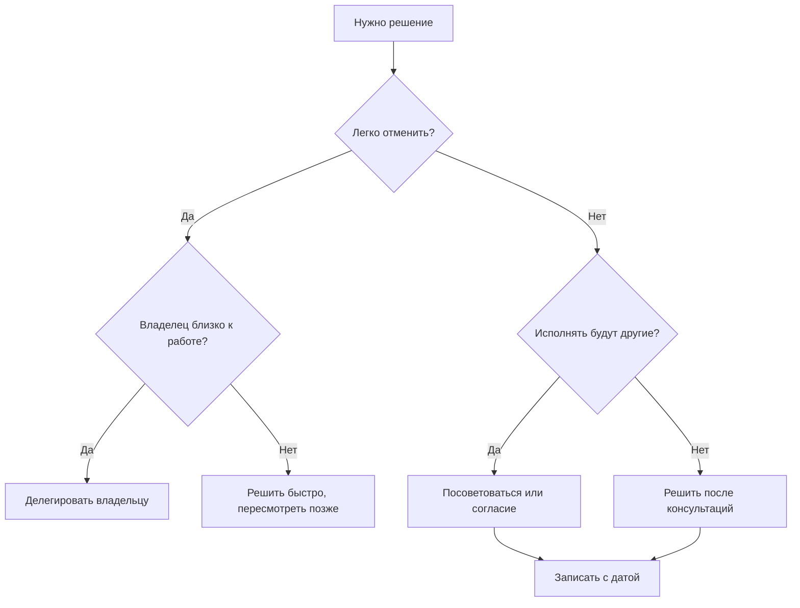
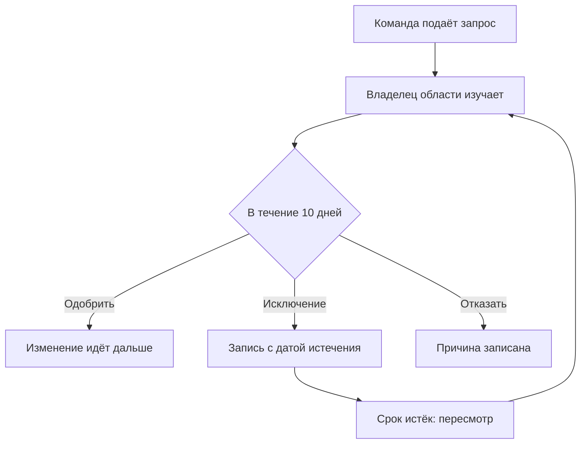
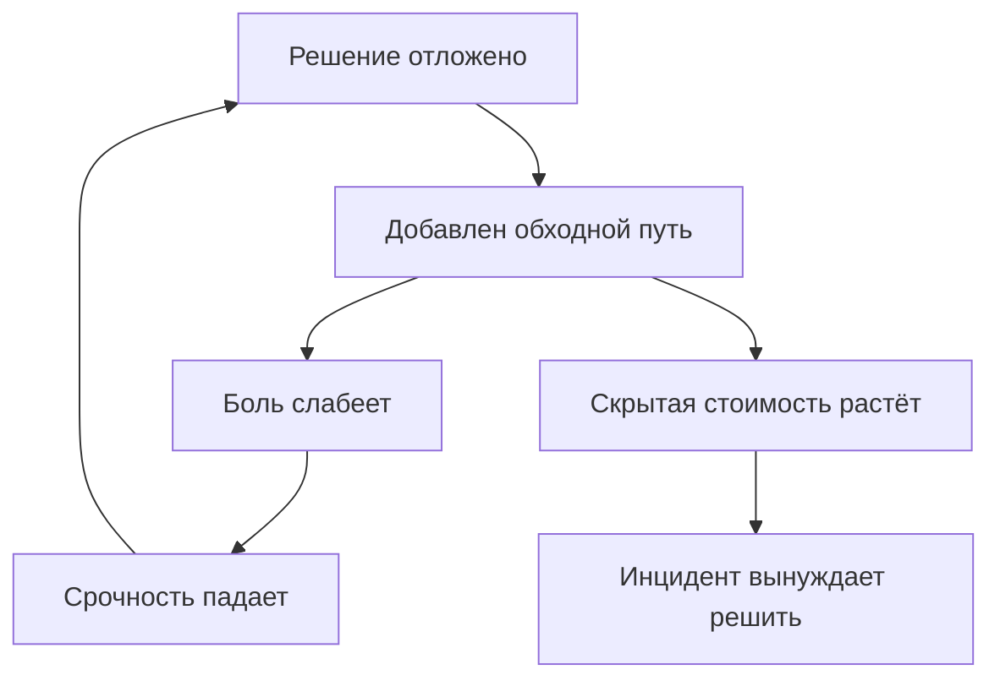

# Глава 13 — Принятие решений в командах { #chapter-13-decision-making-in-teams }

Эта глава о том, как команда принимает решения: кто решает, каким способом, как решение записывают и как
заметить, что команда лишь сделала вид, будто решила. Руководитель проектирует принятие решений так же,
как проектирует пайплайн сборки. Сквозной пример — владение модулем core/permissions в Northstar
Technologies, вымышленной компании из [кейса](../../case-studies/northstar/index.md). К концу первого
квартала директора этот вопрос так и оставался открытым.

## Почему это важно { #why-this-matters }

На уровне команды медленные или неясные решения — это скрытая очередь. Работа стоит в ожидании решения,
хотя никто не знает, что она его ждёт; инженеры строят на допущениях, которые потом отменят; старый спор
возвращается, потому что в прошлый раз итог никто не записал. Всё это видно по lead time (сколько времени
проходит от запроса до поставки), а не по отчётам о спринтах.

На уровне организации дорогие решения — межкомандные: кто владеет общим модулем, чья дорожная карта
уступит. Внутри команды спор разрешает руководитель, а между командами того, кто решает, часто нет.
На исходном уровне у Northstar было восемь компонентов со спорным, общим или отсутствующим владельцем,
то есть восемь решений, которых никто не принял.

На уровне руководства вопрос в другом: спроектированы права на решения или сложились стихийно. CTO
(технический директор) не может сам принимать большинство технических решений, зато может определить,
кто их принимает, по какому правилу и как их записывают.

## Цели главы { #learning-objectives }

Прочитав эту главу, вы сможете:

- Выбирать способ принятия решения (решить единолично, посоветоваться, согласие, делегировать) с учётом
  обратимости и ставок и объяснять этот выбор тем, кого он касается.
- Явно распределять права на решения с помощью ролевой модели вроде DACI или RAPID и замечать, когда
  модель превратилась в ритуал.
- Составлять записи решений, по которым новичок сможет понять решение, сохранить его или отменить, даже
  после ухода тех, кто его принимал.
- Распознавать ложный консенсус и уклонение от решений по наблюдаемым признакам и справляться с обоими.
- Выстраивать групповое обсуждение так, чтобы сведения, известные лишь одному участнику, доходили до
  решения.

## Ментальная модель { #the-mental-model }

> **Ментальная модель:** у каждого решения есть владелец, способ, срок и запись. Если нет хотя бы одного
> из четырёх, решение не закончено, сколько бы его ни обсуждали.

Нехватка каждой из четырёх частей проявляется по-своему. Без **владельца** решение дрейфует, пока его
не заметит кто-то из старших или пока инцидент не заставит его принять. Без явного **способа** люди
по-разному понимают, решали они сами или с ними просто советовались, и первый, чьё мнение отклонили,
чувствует себя преданным. Без **срока** решение соревнуется со срочной работой и каждую неделю
проигрывает. Без **записи** при смене людей его принимают заново, и нередко с противоположным итогом.

Вторая идея: способ должен определяться двумя свойствами решения — насколько трудно его отменить и во
что обойдётся ошибка. Большинство руководителей решают всё по одной привычке: одни всегда добиваются
консенсуса, другие всегда решают сами. Мастерство в том, чтобы менять способ осознанно.

Схема — **синтез книги**: отправная точка, а не правило. Она удерживает команду от консенсуса по
обратимому решению, а руководителя — от единоличного решения там, где исполнять будут другие.

## Подробный разбор { #deep-conceptual-explanation }

### Четыре способа: определения { #four-methods-defined }

В обиходе эти слова употребляют вольно, поэтому сначала зафиксируем, что они значат в этой главе.

| Способ | Кто решает | Что делают остальные | Когда подходит |
|---|---|---|---|
| Решить единолично | Один названный человек, самостоятельно | Узнают решение и его причину | Срочные, обратимые или узкие решения |
| Посоветоваться | Один названный человек, после того как спросил других | Делятся информацией и мнениями; права вето нет | Большинство важных решений |
| Согласие | Группа, если нет обоснованных возражений | Возражают, указывая на вред; простое предпочтение возражением не считается | Договорённости, с которыми команде потом жить |
| Делегировать | Кто-то другой, не руководитель | Руководитель задаёт ограничения и узнаёт результат | Решения, где нужная информация скорее есть у другого человека |

**Консенсуса** (когда согласны все) в таблице нет намеренно: он даёт право вето каждому участнику и
вознаграждает того, кто дольше всех упирается. Согласие задаёт другой вопрос: «Может ли каждый с этим
жить? Если нет, то какой вред это причинит?» Так можно договориться в команде об обмене дежурствами, но
не решить, кто будет владеть компонентом: там у кандидатов конфликт интересов.

Делегирование одному человеку разобрано в главе 2, где описана пятиуровневая шкала
([делегирование по результату](../01-foundations/02-from-individual-contributor-to-leader.md#delegating-by-outcome-with-an-explicit-level-of-control));
она следует идее David Marquet переносить решения к людям, у которых есть информация
([Marquet, 2012](../../references/bibliography.md#marquet2013turn)). Здесь мы добавим групповой случай.

### Обратимость и ставки { #reversibility-and-stakes }

В письме акционерам 2016 года Jeff Bezos называет обратимые решения «двусторонними дверями»: для них
годится лёгкий процесс, потому что ошибку дёшево исправить. По его словам, большинство решений,
вероятно, стоит принимать, когда у вас есть примерно 70 процентов желаемой информации
([Bezos, 2017](../../references/bibliography.md#bezos2016letter)). Это **задокументированная
практика**: рассказ одного генерального директора о привычках своей компании, и ценен он прежде всего
словарём.

Инженерным командам стоит сделать два уточнения (**рекомендация книги**). Во-первых, обратимость часто
можно купить. Фича-флаг, параллельный запуск или интерфейс, за которым скрыт выбор, превращают
одностороннюю дверь в двустороннюю, и нередко это дешевле, чем решать тщательнее. Во-вторых, решение
перестаёт быть обратимым, как только на нём начали строить. Владельца модуля на бумаге можно сменить за
день, а ранбуки, алерты и привычки команды-владельца за день не поменяешь.

Peter Drucker утверждал, что эффективные руководители принимают немного решений: за повторяющейся
проблемой ищут общую и закладывают действие в само решение
([Drucker, 1967](../../references/bibliography.md#drucker1967effective)). Если одно и то же решение
приходится принимать каждый месяц, значит, не хватает правила. Примите правило один раз, а отдельные
случаи отдайте владельцу.

### Явные права на решения { #decision-rights-made-explicit }

Ролевые модели закрепляют за каждым важным решением именованные роли. Распространены три:

| Модель | Роли | В чём она сильна |
|---|---|---|
| RACI | Responsible, Accountable, Consulted, Informed | Показывает, кто делает работу и кто за неё отвечает; широко распространена, но единого авторитетного источника нет |
| DACI | Driver, Approver, Contributors, Informed | Одно решение за раз; ведущий (Driver) следит, чтобы оно уложилось в срок |
| RAPID | Recommend, Agree, Perform, Input, Decide | Отделяет того, кто рекомендует, от того, кто решает; делает право вето (Agree) явным и редким |

Плейбук Atlassian по DACI настаивает на одном Driver и одном Approver. Участники (Contributors) могут
высказаться, но решающего голоса у них нет, а итог фиксируется в общем документе
([Atlassian, DACI](../../references/bibliography.md#atlassian-daci)). Bain в описании RAPID советует
назначать роль Agree скупо: она нужна для обязательных требований, например юридических. В идеале у
каждого решения один решающий ([Bain, RAPID](../../references/bibliography.md#bain-rapid)). Rogers и
Blenko в статье, где представили этот подход, утверждают: результативность зависит от того, насколько
быстро принимают правильные решения и насколько последовательно их исполняют
([Rogers and Blenko, 2006](../../references/bibliography.md#rogers2006whohasd)). Это
**задокументированная практика** вендора ПО и консалтинговой фирмы. Доказательств того, что инструмент
улучшает результаты, не приводит ни один из источников, и книга таких доказательств тоже не нашла.

Общее у моделей важнее различий: решает один человек, обладатели информации названы, вето редкое и
явное. Матрица RACI на каждое решение — это бюрократия. Рисуйте её только для решений, которые
пересекают границы команд, повторяются или уже пошли не так.

### Уровень сервиса для решений { #the-decision-service-level }

Уровень сервиса для решений (decision service level) превращает повторяющиеся запросы в очередь с
обещанным сроком. У каждой области, например операционных правил или стандартов кода, один владелец.
На каждый запрос он отвечает в фиксированный срок, скажем за десять рабочих дней. Каждое исключение
(разрешение временно не выполнять правило) записывают с датой истечения, чтобы оно вернулось на
пересмотр.

В Northstar такое правило ввели в первом квартале директора. Каждый из трёх staff-инженеров владеет
одной областью стандартов, решает в течение десяти рабочих дней и выдаёт исключения не больше чем на
два квартала, записывая их. Как устроено управление стандартами, разбирает
[глава 20](../05-engineering-quality/20-engineering-standards-and-their-governance.md).

Правило закрывает все четыре части ментальной модели: владелец на каждую область, способ «владелец
решает, посоветовавшись», срок в десять дней и реестр в роли записи. Ограничение правила, как покажет
кейс, — в его охвате. Решение уровнем выше любого владельца области, например какой команде владеть
модулем, не попадает ни в чью очередь. А исключение может превратить его в решение, которого никто не
ждёт.

### Запись решений { #recording-decisions }

В блог-посте 2011 года Michael Nygard предложил записи архитектурных решений: одна-две страницы на
решение — контекст, само решение, статус и последствия, включая негативные. Записи хранят в репозитории
и нумеруют, чтобы отменённое решение не удалялось, а помечалось как заменённое. Мотив он объясняет так:
не зная обоснования, новички могут либо слепо принимать старые решения, либо слепо их отменять
([Nygard, 2011](../../references/bibliography.md#nygard2011adr)). Подробно записи разбирает глава 28
(принятие архитектурных решений и управление архитектурой). Формат так же хорошо подходит для
организационных решений: о владении, о политике дежурств, о рабочем соглашении команды. Начать можно с
[шаблона записи решения](../../templates/architecture-decision-record.md).

Запись переживёт смену людей, только если отвечает на вопросы преемника (**рекомендация книги**):

| Поле | Вопрос преемника |
|---|---|
| Решение и дата | Что решили и когда? |
| Владелец и способ | Кто решил? С другими советовались или они дали согласие? |
| Отвергнутые варианты | Что ещё рассматривали и почему отказались? |
| Допущения | Что должно измениться, чтобы решение стало неверным? |
| Условие пересмотра | Когда или по какому сигналу к нему стоит вернуться? |

Допущения и условие пересмотра пропускают чаще всего, хотя именно они полезнее всего: они дают
преемнику проверку, которую можно провести на деле.

### Что говорят исследования групп { #what-group-research-says }

Группы часто упускают информационное преимущество, которое им приписывают. Как это происходит,
показывают исследования **скрытых профилей** (hidden profiles). В основополагающем исследовании Stasser
и Titus каждый участник экспериментальных групп знал только часть сведений, а вместе они указывали на
лучший вариант. Но обсуждение вращалось вокруг того, что участники и так знали все вместе, и того, что
подкрепляло их исходные предпочтения. В итоге группы склонялись к варианту, который с самого начала
поддерживало относительное большинство
([Stasser and Titus, 1985](../../references/bibliography.md#stasser1985pooling)).

Метаанализ (сводный анализ) 65 исследований скрытых профилей показал ту же картину. Группы упоминали
общую информацию гораздо чаще уникальной, а когда для ответа требовалось свести уникальные сведения
воедино, находили правильный ответ намного реже. От канала коммуникации это не зависело
([Lu, Yuan, and McLeod, 2012](../../references/bibliography.md#lu2012hiddenprofiles)).

Это **научный результат**, полученный на лабораторных задачах с заведомо правильным ответом. На
инженерные решения его стоит переносить как предупреждение, а не как измерение. Хуже всего встреча
слышит факт, который знает только один человек. Противоядие — в структуре обсуждения: мнения пишут до
встречи; каждого спрашивают, что он знает такого, чего могут не знать другие; первыми говорят те, кто
ближе всего к работе, а самый старший — последним.

Станут ли люди делиться тем, что знают, зависит и от психологической безопасности; полевое
исследование Edmondson связывает её с командным обучением
([Edmondson, 1999](../../references/bibliography.md#edmondson1999psychological); глава 11).

Термином **групповое мышление** (groupthink) Irving Janis назвал склонность сплочённых групп подавлять
несогласие. Термин знаменит, но как целостная модель групповое мышление оспаривается. Книга берёт из
него лишь узкую мысль: несогласие, о котором не спрашивают, часто так и не высказывают. Эссе Jerry
Harvey о **парадоксе Абилина** описывает родственное явление: группа выбирает путь, который каждый
участник про себя отвергает, потому что каждый думает, что этого хотят остальные
([Harvey, 1974](../../references/bibliography.md#harvey1974abilene)).

### Как проверять рекомендацию { #reviewing-a-recommendation }

Kahneman, Lovallo и Sibony утверждали, что знание о когнитивных искажениях мало улучшило деловые
решения, а руководители, делающие крупные ставки, обычно опираются на предложение команды. Авторы
предлагают чек-лист, по которому тот, кто принимает решение, проверяет такую рекомендацию
([Kahneman, Lovallo, and Sibony, 2011](../../references/bibliography.md#kahneman2011bigdecision)).
Книга заимствует саму идею: проверяйте не только вывод рекомендации, но и процесс, который к нему
привёл. Всерьёз ли рассматривали альтернативы? Выслушали ли несогласных? Есть ли у команды интерес в
определённом исходе?

Тот же тест годится и для оценки задним числом (**рекомендация книги**). Хорошее решение может
привести к плохому исходу, а плохому может повезти. Судите о решении по тому, каковы были владелец,
способ, информация и запись в момент его принятия, а исполнение оценивайте отдельно.

## Пример из инженерной организации { #engineering-organization-example }

Цифры — **иллюстрация**: вымышленная продуктовая команда из двенадцати инженеров и одного
руководителя, не Northstar. Допущения: журнал решений вели четыре недели; учитывали каждое решение,
которое блокировало работу хотя бы одного человека; ожидание мерили от первого вопроса до ответа.

| Класс решений | Число | Ушло к руководителю | Требовало руководителя | Медианное ожидание, рабочих дней |
|---|---|---|---|---|
| Обратимые, внутри команды | 22 | 14 | 2 | 1.5 |
| Трудно отменяемые, внутри команды | 6 | 6 | 3 | 3 |
| Пересекающие границы команд | 5 | 5 | 5 | 8 |
| Командные договорённости (процесс, дежурства) | 3 | 3 | 0 | 6 |
| **Итого** | **36** | **28** | **10** | |

Из таблицы следуют три вывода.

Первый: из 28 решений, ушедших к руководителю, 18 (64 процента) его участия не требовали. Двенадцать
из них — обратимые и внутрикомандные. При медианном ожидании 1,5 дня эти двенадцать решений стоили
около 18 человеко-дней ожидания за четыре недели, если считать, что каждое блокировало одного
инженера. Ожидание — не потерянная работа: инженеры переключаются на другие задачи. Но каждое
переключение увеличивает объём незавершённой работы. Если назначить владельцев для обратимых классов,
большая часть этой очереди исчезнет. По пятиуровневой шкале делегирования из главы 2 это уровень 4
или 5: инженер решает сам, а руководитель узнаёт об этом позже или не узнаёт вовсе.

Второй: дольше всех ждали межкомандные решения (медиана 8 дней), и каждое потребовало человека уровня
руководителя или выше. Картина ожидаемая: таких решений меньше, они медленнее, и именно им уровень
сервиса помогает больше всего. Медианное решение уложилось бы в уровень сервиса в десять рабочих дней,
но медиана скрывает самое медленное, поэтому следите и за самым долгим ожиданием.

Третий: три командные договорённости ушли к руководителю по привычке и ждали шесть дней, хотя ничьих
полномочий не требовали. Это естественная область для согласия: письменное предложение,
фиксированное окно для возражений и зелёный свет, если обоснованных возражений нет.

Как подгоняют журнал: инженеры перестают записывать решения, которые приняли сами, а руководитель,
зная, что за ним наблюдают, отвечает быстрее, но менее вдумчиво. Поэтому ведите журнал четыре недели,
перестройте права на решения и на этом остановитесь.

## Как принимать решение { #decision-framework }

Таблица — **рекомендация книги**.

| Обратимость | Ставки | У кого информация | Способ | Запись |
|---|---|---|---|---|
| Легко | Низкие | У того, кто делает работу | Делегировать; сообщить постфактум | Сообщение коммита или тикет |
| Легко | Высокие | У нескольких людей | Решить быстро после короткой консультации; назначить дату пересмотра | Короткая запись с условием пересмотра |
| Трудно | Низкие | У кого угодно | Решить; без ритуалов | Короткая запись |
| Трудно | Высокие, исполняет одна команда | Распределена по команде | Посоветоваться, сначала собрав письменные мнения; решает владелец | Полная запись решения |
| Трудно | Высокие, исполняют несколько команд | Распределена по командам | Посоветоваться; решающего назначают уровнем выше команд; срок задают в начале | Полная запись в общем доступе |
| Любая | Командная договорённость | У команды | Согласие с окном для возражений | Страница командных договорённостей |

Нужна ли решению явная ролевая модель, подскажут три теста: пересекает ли оно границу команды,
повторялось ли раньше, застряло ли дольше уровня сервиса для решений. Если ни один тест не срабатывает,
назовите решающего одной фразой и двигайтесь дальше.

Кто именно решает вопросы архитектуры — руководители, staff-инженеры или команды в заданных рамках, —
вопрос спорный; варианты разбирает глава 28. Рамка этой главы применима в любом случае: у кого бы ни
было это право, им обладает один названный человек, а у решения есть срок и запись.

## Компромиссы { #trade-offs }

**Скорость против вовлечённости.** Решить единолично — быстро, посоветоваться — медленнее, согласие —
ещё медленнее. Но за скорость платят при исполнении, когда люди выполняют решение, в принятии которого
не участвовали. Подход Andrew Grove к управлению известен формулой «свободное обсуждение, ясное решение,
полная поддержка» ([Grove, 1983](../../references/bibliography.md#grove1983high)): обсуждение покупает
поддержку, а пропустить его — значит взять в долг. Если исполнять решение будут другие, этот долг
обычно обходится дорого.

**Информация против времени.** Каждая консультация добавляет и информацию, и задержку. Эвристика
«70 процентов» — напоминание, а не измеримый порог. Купить обратимость часто выгоднее, чем собирать
дополнительную информацию.

**Записи и роли против накладных расходов.** Запись занимает примерно полчаса, а окупается позже и
для кого-то другого — поэтому её и пропускают. Пишите записи и назначайте явные роли только для трудно
отменяемых или спорных решений.

**«Не согласен, но действую» против подавленного несогласия.** Принцип «не согласен, но действую»
(disagree and commit), то есть обязательство исполнять решение, несмотря на несогласие, не даёт
решениям застревать. Письмо Bezos его рекомендует, в том числе самому начальнику
([Bezos, 2017](../../references/bibliography.md#bezos2016letter)). Но в руках руководителя, который
сам никогда не поддерживает то, с чем не согласен, принцип становится вежливым способом отклонить
чужое мнение. Притча Patrick Lencioni о дисфункциях команды известна мыслью: люди охотнее берут на себя
обязательства, если их выслушали, даже когда спор они проиграли
([Lencioni, 2002](../../references/bibliography.md#lencioni2002five)).

## Типичные провалы { #failure-modes }

**Уклонение от решения.** У решения нет срока, его стоимость размыта, и у каждого кандидата во
владельцы есть веская причина подождать. Каждая встреча заканчивается словами «давайте вернёмся к
этому». Обходной путь снимает острую боль, а вместе с ней и давление, которое заставило бы решать.

Петля разрывается, только когда внешнее событие (часто инцидент) вынуждает принять решение в худших
условиях. Признаки: один и тот же пункт в трёх повестках подряд; обходной путь с пометкой «пока не
решим». Противоядие: названный решающий, дата и фиксированный срок истечения для любого обходного пути.

**Ложный консенсус.** Встреча заканчивается видимым согласием, которое не выдерживает разговоров в
коридоре. Признаки: со спорным предложением никто не спорил; самый старший высказался первым; решение
пересматривают в течение недели; обязательства расплывчаты («посмотрим»). Противоядие: письменные
позиции до встречи; финальный круг, где каждый говорит, что будет делать; запись, разосланная в тот же
день, чтобы можно было возразить.

**Консенсус как вето.** Команда, которой нужно согласие всех, отдаёт контроль самому упрямому
участнику, и важные решения застревают. Признак: решения срываются из-за несогласия одного человека.
Противоядие: перейти на «посоветоваться» или на согласие и прямо сказать, на какой из двух способов.

**Эскалация по умолчанию.** Каждое разногласие уходит к руководителю, и он сам превращается в
очередь, как в примере из инженерной организации. Противоядие: владельцы для классов решений.

## Применение в крупной организации { #enterprise-application }

В организации из 50–150 инженеров узкое место — уже не решения внутри команды, а межкомандные. Три
практики работают и в таком масштабе.

**Карта прав на повторяющиеся межкомандные решения.** Владение компонентами, изменения интерфейсов
общих модулей, зона дежурств, исключения из стандартов, конфликты дорожных карт между командами — у
каждого такого решения есть названный решающий, способ и уровень сервиса. Карте хватит одной страницы.
В каком ритме эти решения пересматривают, описывает глава 37 (операционная система управления).

**Список открытых решений, который ведёт директор.** В него попадает каждое межкомандное решение,
просрочившее уровень сервиса, с владельцем и датой. Список разбирают на еженедельной встрече
руководителей. Его задача — сделать уклонение видимым, и если список только растёт, это уже находка.

**Записи в общем доступе и с поиском.** Командные записи хранятся рядом с кодом, организационные
решения — в едином общем журнале. Проверка: может ли новый руководитель за десять минут выяснить,
почему его команда владеет тем, чем владеет?

Стоимость перехода: несколько недель, в течение которых вопросов «кто решает?» становится больше, а
руководители обнаруживают, что их неформальные полномочия теперь записаны и сужены.

## Взгляд CTO { #cto-perspective }

Сам CTO принимает немного решений, и большинство из них касаются прав на решения: что решают команды,
staff-инженеры, директора и высшее руководство и как между ними эскалируются конфликты. Письмо Bezos
советует эскалировать принципиальные разногласия рано, а не ждать, пока спор выиграет тот, у кого
больше выносливости ([Bezos, 2017](../../references/bibliography.md#bezos2016letter)). Совет применим
напрямую: за застрявшее межкомандное решение платят команды уровнем ниже, а не спорящие.

CTO стоит следить и за собственным влиянием. Если старший по положению говорит первым, его мнение
становится якорем обсуждения, а встреча высшего руководства — такая же группа со скрытыми профилями.
Просите письменные позиции и говорите последним. И наконец, отчитывайтесь о решениях так же, как о
поставке: сколько межкомандных решений открыто дольше уровня сервиса и какие из них блокируют
обязательство.

## Практический плейбук { #practical-playbook }

Для руководителя разработки или директора, который выстраивает принятие решений в команде или группе
команд:

1. Четыре недели ведите журнал решений: записывайте каждое решение, которое кого-то блокировало, кто
   его принял и сколько оно ждало.
2. Разделите решения на классы по обратимости, ставкам и тому, пересекали ли они границу команды.
3. Для каждого класса обратимых внутрикомандных решений назовите владельца и сообщите об этом команде
   письменно.
4. Для каждого повторяющегося межкомандного решения определите одного решающего, тех, с кем нужно
   советоваться, и уровень сервиса.
5. Объявляйте способ для каждого важного решения вслух и в самом начале: «Я решу, посоветовавшись с
   вами» или «Это принимается, если до пятницы никто не выдвинет обоснованного возражения».
6. Перед любой встречей по трудно отменяемому решению собирайте письменные мнения; спрашивайте каждого,
   что он знает такого, чего могут не знать другие; говорите последним.
7. Завершайте встречу кругом: каждый называет решение и то, что он будет делать.
8. Составляйте запись в тот же день: с отвергнутыми вариантами, допущениями и условием пересмотра.
9. Каждый обходной путь или исключение, связанные с открытым решением, вносите в список с датами и
   фиксированным сроком истечения.
10. Еженедельно разбирайте список открытых решений: всему, что просрочило уровень сервиса, прямо на
    встрече назначайте решающего и дату.

## Кейс { #case-study }

Кейс — **вымысел**. Сначала он разбирает решение, которое осталось открытым в первом квартале директора
(см. [хронику года 1](../../case-studies/northstar/first-quarter.md)), а затем ставит перед читателем
выбор в начале квартала 2. Исход намеренно не задан.

!!! info "Northstar: что уже известно"
    Неделя 14, начало квартала 2. В квартале 1 директор установил минимальные обязательства для
    компонентов [tier 1](../../glossary.md#tier-1) (тех, что лежат на пути заказа или платежа), назначил
    владельцев большинству бесхозных компонентов и сократил число инцидентов Sev1 и Sev2 (два высших
    уровня серьёзности) с 30 до 21. См. [хронологию](../../case-studies/northstar/timeline.md). Впервые
    читаете о Northstar? Начните со страниц [«Год вкратце»](../../case-studies/northstar/year-in-brief.md)
    и [«Действующие лица»](../../case-studies/northstar/cast.md).

!!! note "Что нужно знать для этого кейса"
    - **Модуль.** core/permissions, часть монолита Core. На исходном уровне его меняли четыре команды, а
      владельца, ранбука, алертов и графика дежурств у него не было. Уровень критичности — tier 1.
    - **Кандидаты.** Orders (руководитель Priya Raman) или Platform Operations (руководитель Tom Becker).
    - **Обходной путь.** У компонента tier 1 без владельца не может быть графика дежурств, поэтому по
      процессу стандартов оформили исключение. Компенсирующая мера (замещающая защита на время, пока
      правило не выполняется): Platform Operations вызывает ответственного за инцидент, которого
      назначает офис директора.
    - **Срок.** Исключение действует, пока кто-нибудь не решит вопрос о владении, но не дольше двух
      кварталов, то есть до конца квартала 3 (неделя 39).

**Что произошло в квартале 1.** На неделе 4 директор распределил два из трёх бесхозных модулей Core:
core/customer отошёл команде Orders, core/scheduler — команде Billing. Вопрос о core/permissions к
Дню 90 так и не решили, и его прикрыли исключением, описанным выше.

**Если считать это уклонением от решения.** Хроника не объясняет, почему решение осталось открытым, и
кейс объяснений не придумывает. Но все элементы петли уклонения налицо. Владельцев компонентов
назначает директор, поэтому в десятидневные очереди staff-инженеров этот вопрос не попадает. Исключение
снизило риск, а вместе с ним и срочность. Действует оно, пока решение не принято, поэтому подтолкнуть к
решению не может. Десятидневная очередь свою задачу выполнила: исключение выдано вовремя. Но срок был
нужен самому решению о владении, а его задаёт только предел в два квартала.

**Решение в начале квартала 2.** Известные факты:

- В базовом квартале core/permissions затронули 38 мерж-реквестов: Orders — 17, Customer Experience —
  9, Billing — 8, Payments and Integrations — 4. От Platform Operations — ни одного.
- В квартале 2 в Platform Operations пять инженеров инфраструктуры: все семь QA-инженеров на неделе 10
  перешли в продуктовые команды. Никто из этих пятерых код Core не менял.
- Позиция Priya Raman: больше всего изменений вносит команда Orders, и она уже владеет core/customer. Но
  на ней же массовый заказ со сроком на неделе 26, а с квартала 2 она принимает notification-svc (сервис
  уведомлений клиентов). Priya Raman готова взять core/permissions после недели 26.
- Позиция Tom Becker: права доступа — часть идентификации, и место им рядом с auth-svc, которым владеет
  его команда. Но сопровождать Java-код Core его команда не может, и для каждого изменения ей
  понадобятся инженеры Orders.
- В квартале 2 проверки прав, которые сейчас встроены в core/customer, выносят из этого модуля, не
  выходя за пределы Core. Работу ведёт Ines Carvalho (staff-инженер, отвечающая за стандарты кода Core).
  Будущий владелец core/permissions унаследует новый код, который окажется в модуле или рядом с ним.

Даже команда Orders, крупнейший участник, внесла меньше половины изменений (17 из 38). Значит, какая бы
команда ни владела модулем, большинство изменений придёт из других команд и владельцу придётся их
ревьюить. Это довод в пользу владельца, у которого есть ресурс на ревью Core и ясный интерфейс, и место
этому доводу — в записи решения.

По модели DACI директор — Approver. За сроки отвечает Driver; одна из возможных кандидатур — Ines
Carvalho, хотя у неё есть свой интерес в выносе кода. Contributors — Priya Raman, Tom Becker и Kwame
Mensah (staff-инженер, который владеет минимальными требованиями к дежурствам). Читателю предстоит
определить, что именно решать, к какому сроку и что записать.

## Упражнения { #exercises }

Разборы упражнений — на [странице с решениями к главе 13](../../solutions/ch13-solutions.md). Данные
Northstar — на [странице исходного уровня](../../case-studies/northstar/baseline-data.md).

### Базовый уровень { #foundational }

**F1.** Для каждого решения из списка выберите способ (решить единолично, посоветоваться, согласие,
делегировать), скажите, кто решает, и обоснуйте выбор обратимостью и ставками: переименование
внутренней библиотеки команды; переход трёх команд на новый брокер сообщений; политика обмена
дежурствами внутри одной команды; развёртывать ли сегодня обратимое изменение экрана цен, скрытое за
фича-флагом; вывод из эксплуатации публичной версии API, которой пользуются клиенты.

**F2.** Тимлид говорит, что в его команде все решения принимаются «консенсусом» и поэтому команда
довольна. Между тем за последние два месяца два межкомандных решения застряли на пять недель каждое, а
одна из инженеров сказала вам наедине, что перестала возражать, потому что «это никогда не кончается».
Опираясь на способы и типичные провалы из этой главы, поставьте диагноз и скажите, что бы вы изменили в
первую очередь.

**F3.** Вы на дизайн-ревью. Самый опытный инженер представляет предложение, просит комментариев, не
слышит ни одного и объявляет предложение согласованным. Через два дня младший инженер, знакомый с
потребителем ниже по цепочке, говорит вам наедине, что этот дизайн сломает того потребителя. Опираясь
на исследования скрытых профилей, объясните, почему так вышло, и перестройте ревью так, чтобы
повторение стало менее вероятным.

### Прикладное лидерство { #applied-leadership }

**A1.** Вы — директор Northstar в начале квартала 2, и перед вами решение о владении core/permissions,
описанное в кейсе. Напишите записку о решении для рассылки: способ, роли, срок, варианты с их
стоимостью и сведения, которых вам ещё не хватает. Само решение в записке не принимайте.

**A2.** Допустите, что вы выбрали один из вариантов (какой — решать вам), и напишите запись решения о
core/permissions в пятипольном формате из этой главы. Сформулируйте допущения и условие пересмотра так
конкретно, чтобы человек, пришедший в Northstar через год, мог понять, действует ли решение до сих пор.

**A3.** Kwame Mensah, staff-инженер, который владеет операционными стандартами Northstar, рассказывает:
его десятидневная очередь решений по операционным стандартам укладывается в срок, но три команды теперь
несут к нему и вопросы о владении, «потому что он быстро отвечает». Посоветуйте ему, что делать с этими
запросами, и спроектируйте такое изменение прав на решения, после которого они перестанут поступать.

### Решения на уровне руководства { #executive-decision-making }

**X1.** Victor Lindqvist, CTO Northstar, просит вас предложить, как принимать межкомандные технические
решения в шести командах с тремя staff-инженерами без роста численности. Опишите схему прав на решения,
уровни сервиса и то, как вы будете отчитываться перед ним о её работе. Скажите, как схему могут
подогнать, во что она обойдётся в первом квартале и какие решения вы намеренно оставите
неопределёнными.

**X2.** Через двенадцать месяцев происходит инцидент Sev1, связанный с core/permissions. Его удаётся
проследить до изменения, которое каждая из двух команд считала проверенным другой. Из записи видно, что
решение о владении было принято, но условие пересмотра в нём никто не проверял. Helena Marsh (CEO)
спрашивает, подвёл ли процесс принятия решений. Решите, какие данные вы соберёте, что ей ответите и что
измените.

## Вопросы для размышления { #reflection-questions }

1. Какое решение в вашей команде «почти принято» уже больше месяца, и кто кого ждёт?
2. Когда вы в последний раз назвали решение консенсусом только потому, что никто не возразил?
3. Что знаете вы, чего не знает ваша команда, и как она узнает об этом до следующего решения?
4. Какие из ваших обходных путей существуют только потому, что решение не принято?
5. Если бы вы ушли завтра, какие важные решения команды ваш преемник смог бы восстановить по записям, а
   какие — только по чьей-то памяти?
6. Когда вы говорите «давайте обсудим», понимают ли присутствующие, что вы делаете: решаете сами,
   советуетесь или просите согласия?

## Главное { #key-takeaways }

- Решение закончено, только когда у него есть владелец, способ, срок и запись.
- Выбирайте способ по обратимости и ставкам; покупайте обратимость там, где она дешевле уверенности.
- Для важных решений предпочитайте «посоветоваться» (один решающий, после того как спросил других), а
  для командных договорённостей — согласие. Не делайте консенсус способом по умолчанию: он даёт право
  вето каждому.
- Используйте ролевые модели вроде DACI или RAPID только для межкомандных, повторяющихся или застрявших
  решений; их общее ядро — один решающий, названные участники и редкое вето.
- Группы плохо используют сведения, известные лишь одному участнику, поэтому сначала собирайте
  письменные мнения, а самый старший пусть говорит последним.
- Обходной путь или исключение с пометкой «пока не решим» — признак уклонения от решения; задайте ему
  фиксированный срок истечения.
- Уровень сервиса для решений помогает только тем решениям, которые стоят в чьей-то очереди; убедитесь,
  что такая очередь есть и у межкомандных решений.
- Записывайте отвергнутые варианты, допущения и условие пересмотра, чтобы преемники могли проверить
  решение, а не слепо следовать ему или слепо его отменять.

## Источники и что почитать { #references-and-further-reading }

- [Stasser and Titus, 1985](../../references/bibliography.md#stasser1985pooling). Основополагающее
  исследование скрытых профилей.
- [Lu, Yuan, and McLeod, 2012](../../references/bibliography.md#lu2012hiddenprofiles). Метаанализ
  65 исследований скрытых профилей и их модераторов.
- [Edmondson, 1999](../../references/bibliography.md#edmondson1999psychological). Почему люди делятся
  тем, что знают, или молчат.
- [Nygard, 2011](../../references/bibliography.md#nygard2011adr). Первоисточник формата короткой записи
  решения.
- [Bezos, 2017](../../references/bibliography.md#bezos2016letter). Двусторонние двери, «не согласен, но
  действую», ранняя эскалация.
- [Atlassian, DACI](../../references/bibliography.md#atlassian-daci),
  [Bain, RAPID](../../references/bibliography.md#bain-rapid) и
  [Rogers and Blenko, 2006](../../references/bibliography.md#rogers2006whohasd). Ролевые модели
  принятия решений.
- [Kahneman, Lovallo, and Sibony, 2011](../../references/bibliography.md#kahneman2011bigdecision).
  Как проверить рекомендацию команды на искажения.
- [Harvey, 1974](../../references/bibliography.md#harvey1974abilene). Парадокс Абилина.
- [Drucker, 1967](../../references/bibliography.md#drucker1967effective) и
  [Grove, 1983](../../references/bibliography.md#grove1983high). Немного решений; обсуждение, решение,
  поддержка.
- [Marquet, 2012](../../references/bibliography.md#marquet2013turn) и
  [Lencioni, 2002](../../references/bibliography.md#lencioni2002five). Решения рядом с информацией;
  обязательство после того, как человека выслушали.
