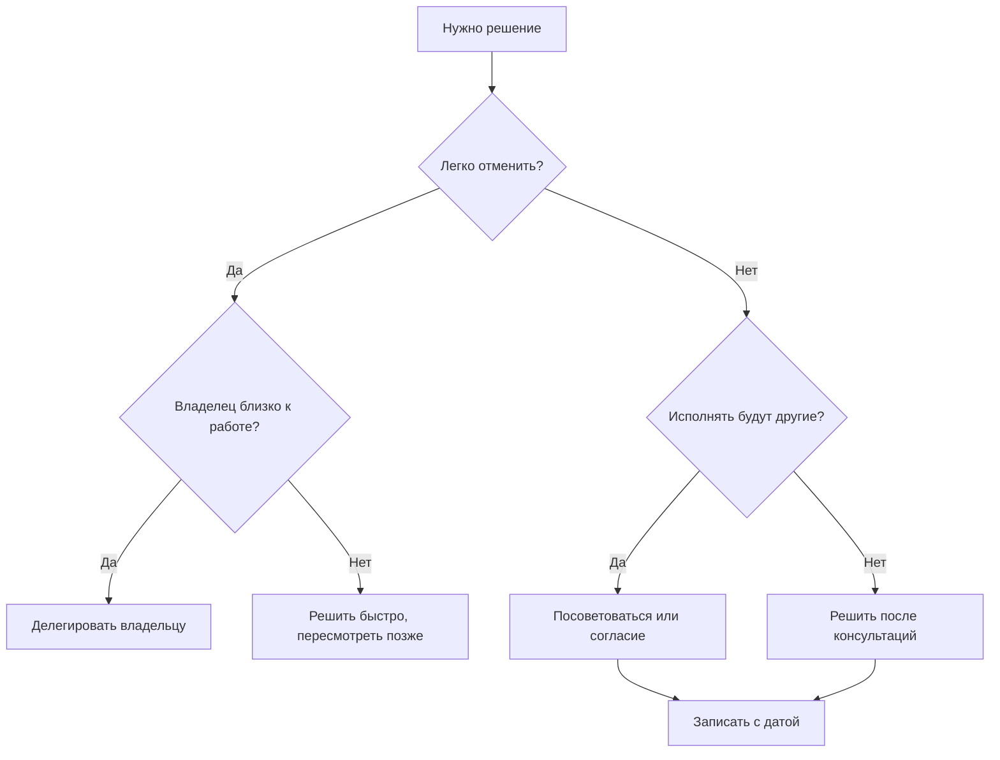
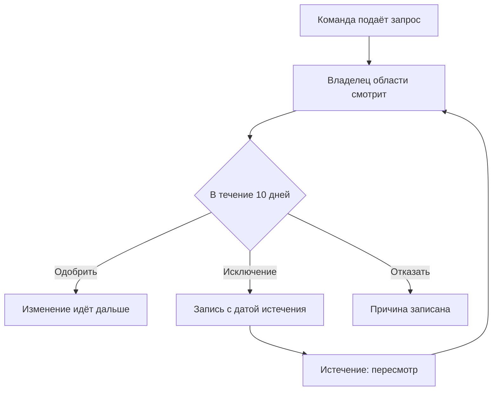

# Глава 13 — Принятие решений в командах { #chapter-13-decision-making-in-teams }

Эта глава о том, как команда принимает решения: кто принимает конкретное решение, каким способом, как
оно записывается и как заметить, что команда лишь сделала вид, будто решила. Принятие решений здесь —
то, что руководитель проектирует, как пайплайн сборки. Сквозной пример — владение модулем
core/permissions в Northstar Technologies, вымышленной компании из
[кейса](../../case-studies/northstar/index.md): это решение к концу первого квартала директора всё ещё
оставалось открытым.

## Почему это важно { #why-this-matters }

На уровне команды медленные или неясные решения — это скрытая очередь. Работа ждёт решения, о котором
никто не знает, что оно за ним; инженеры строят на допущениях, которые потом отменят; один и тот же спор
возвращается, потому что прошлый никто не записал. Это видно в lead time (сколько времени проходит от
запроса до поставки), а не в отчётах по спринтам.

На уровне организации дорогие решения принимаются между командами: кто владеет общим модулем, чья
дорожная карта уступит. Внутри команды спор разрешает руководитель; между командами очевидного
решающего часто нет. Восемь компонентов Northstar со спорным, общим или отсутствующим владельцем на
исходном уровне были восемью решениями, которые никто не принял.

На уровне руководства вопрос в том, спроектированы права на решения или сложились случайно. CTO
(технический директор) не может принимать большинство технических решений сам, но может решить, кто
решает, по какому правилу и с какой записью.

## Цели главы { #learning-objectives }

Прочитав эту главу, вы сможете:

- Подбирать способ принятия решения (решить единолично, посоветоваться, согласие, делегировать) под
  обратимость решения и ставки и объяснять этот выбор тем, кого он затрагивает.
- Явно распределять права на решения с помощью ролевой модели вроде DACI или RAPID и замечать, когда
  модель превратилась в ритуал.
- Писать записи решений, по которым новичок поймёт, сохранит или отменит решение, когда тех, кто его
  принимал, уже не будет.
- Распознавать ложный консенсус и уклонение от решений по наблюдаемым признакам и ломать и то и другое.
- Строить групповое обсуждение так, чтобы информация, которая есть только у одного участника, дошла до
  решения.

## Ментальная модель { #the-mental-model }

> **Ментальная модель:** у каждого решения есть владелец, способ, срок и запись. Решение, у которого
> нет хотя бы одного из четырёх, не закончено, сколько бы его ни обсуждали.

Каждая из четырёх частей ломается узнаваемо. Без **владельца** решение дрейфует, пока его не заметит
кто-то старший или пока его не вынудит инцидент. Без явного **способа** люди расходятся во мнении,
решали они или их просто спросили, и первый, чьё мнение отклонили, чувствует себя преданным. Без
**срока** решение конкурирует со срочной работой и проигрывает каждую неделю. Без **записи** его
принимают заново, когда меняются люди, и часто в обратную сторону.

Вторая идея: способ должен следовать из двух свойств решения — насколько трудно его отменить и сколько
стоит ошибка. Большинство руководителей пропускают все решения через одну и ту же привычку (одни —
через консенсус, другие — через единоличное решение). Умение в том, чтобы менять способ осознанно.

Схема — **синтез книги**, отправная точка, а не правило. Она не даёт команде тратить консенсус на
обратимое решение, а руководителю — единолично решать то, что придётся исполнять другим.

## Подробный разбор { #deep-conceptual-explanation }

### Четыре способа: определения { #four-methods-defined }

На практике эти слова употребляют вольно, поэтому глава фиксирует их значение.

| Способ | Кто решает | Что делают остальные | Когда подходит |
|---|---|---|---|
| Решить единолично | Один названный человек, сам | Узнают решение и его причину | Срочные, обратимые или узкие решения |
| Посоветоваться | Один названный человек, после того как спросил других | Дают информацию и мнения; права вето нет | Большинство важных решений |
| Согласие | Группа, при отсутствии обоснованных возражений | Выдвигают возражения, которые показывают вред; одно лишь предпочтение возражением не считается | Командные договорённости, с которыми людям жить |
| Делегировать | Не руководитель, а кто-то другой | Руководитель задаёт ограничения и узнаёт результат | Решения, для которых нужная информация ближе к другому человеку |

**Консенсуса** (все согласны) здесь нет намеренно: он даёт право вето каждому участнику и вознаграждает
того, кто дольше всех упирается. Согласие задаёт другой вопрос: «Может ли каждый с этим жить, а если
нет, то какой вред это причиняет?» Оно подходит для командной договорённости об обмене дежурствами, но
не для решения о владении компонентом, где у кандидатов конфликт интересов.

Делегирование одному человеку разобрано в пятиуровневой шкале главы 2
([делегирование по результату](../01-foundations/02-from-individual-contributor-to-leader.md#delegating-by-outcome-with-an-explicit-level-of-control)),
вслед за идеей David Marquet переносить решения к людям, у которых есть информация
([Marquet, 2012](../../references/bibliography.md#marquet2013turn)). Эта глава добавляет групповой случай.

### Обратимость и ставки { #reversibility-and-stakes }

В письме акционерам 2016 года Jeff Bezos называет обратимые решения «двусторонними дверями»: им нужен
лёгкий процесс, потому что ошибку дёшево исправить. Он утверждает, что большинство решений, вероятно,
стоит принимать, имея примерно 70 процентов желаемой информации
([Bezos, 2017](../../references/bibliography.md#bezos2016letter)). Это **задокументированная
практика**: один генеральный директор описывает привычки своей компании, и ценна она в основном
словарём.

Для инженерных команд важны два уточнения (**рекомендация книги**). Во-первых, обратимость часто можно
купить: фича-флаг, параллельный запуск или интерфейс, скрывающий выбор, превращают одностороннюю дверь в
двустороннюю, и часто это дешевле, чем решать тщательнее. Во-вторых, решения, на которых люди начали
строить, перестают быть обратимыми. Владельца модуля на бумаге можно сменить за день, а ранбуки, алерты
и привычки команды-владельца — нет.

Peter Drucker утверждал, что эффективные руководители принимают мало решений, работают с общей
проблемой, стоящей за повторяющейся, и встраивают действие в само решение
([Drucker, 1967](../../references/bibliography.md#drucker1967effective)). Решение, которое приходится
принимать каждый месяц, — это недостающее правило: примите правило один раз и отдайте случаи владельцу.

### Явные права на решения { #decision-rights-made-explicit }

Ролевые модели назначают каждому важному решению именованные роли. Распространены три:

| Модель | Роли | В чём она сильна |
|---|---|---|
| RACI | Responsible, Accountable, Consulted, Informed | Показывает, кто делает работу и кто за неё отвечает; широко используется, единого авторитетного источника нет |
| DACI | Driver, Approver, Contributors, Informed | Одно решение за раз, с ведущим (Driver), который держит его в срок |
| RAPID | Recommend, Agree, Perform, Input, Decide | Отделяет того, кто рекомендует, от того, кто решает; делает право вето (Agree) явным и редким |

Плейбук Atlassian по DACI настаивает на одном Driver и одном Approver, даёт участникам (Contributors)
голос, но не право голоса при решении, и фиксирует итог в общем документе
([Atlassian, DACI](../../references/bibliography.md#atlassian-daci)). В описании RAPID от Bain сказано,
что роль Agree, предназначенную для обязательных требований вроде юридических, следует назначать
скупо. В идеале у каждого решения один решающий
([Bain, RAPID](../../references/bibliography.md#bain-rapid)). Rogers и Blenko в статье, где они
представили этот подход, утверждают, что результативность зависит от того, насколько быстро принимаются
правильные решения и насколько последовательно они исполняются
([Rogers and Blenko, 2006](../../references/bibliography.md#rogers2006whohasd)). Это
**задокументированная практика** вендора ПО и консалтинговой фирмы. Ни один из источников не приводит
доказательств того, что инструмент улучшает результаты, и книга таких доказательств не нашла.

Общее у моделей важнее различий: решает один человек, люди с информацией названы, право вето редкое и
явное. Матрица RACI для каждого решения — бюрократия; рисуйте её только для решений, которые пересекают
границы команд, повторяются или уже пошли не так.

### Уровень сервиса для решений { #the-decision-service-level }

Уровень сервиса для решений (decision service level) превращает повторяющиеся запросы в очередь с
обещанием. У каждой области (например, операционных правил или стандартов кода) один владелец. Каждый
запрос получает решение в фиксированный срок, например за десять рабочих дней. Каждое исключение
(разрешение пока не выполнять правило) записывается с датой истечения, чтобы оно вернулось на
пересмотр.

В Northstar такое правило ввели в первом квартале директора: каждый из трёх staff-инженеров владеет одной
областью стандартов, решает в течение десяти рабочих дней и записывает исключения не более чем на два
квартала. Сторону стандартов разбирает
[глава 20](../05-engineering-quality/20-engineering-standards-and-their-governance.md).

Правило закрывает все четыре части ментальной модели: владелец на каждую область, способ «владелец
решает, посоветовавшись», срок десять дней и реестр в роли записи. Его предел, который показывает кейс,
— охват. Решение, которое стоит выше любого владельца области, например какая команда владеет модулем,
не стоит ни в чьей очереди, а исключение может превратить его в решение, которого никто не ждёт.

### Запись решений { #recording-decisions }

В посте 2011 года Michael Nygard предложил записи архитектурных решений: одна-две страницы на решение,
с контекстом, решением, статусом и последствиями (включая негативные). Их хранят в репозитории и
нумеруют, чтобы отменённое решение помечалось как заменённое, а не удалялось. Мотивация, которую он
называет: без обоснования новички могут либо слепо принимать старые решения, либо слепо их отменять
([Nygard, 2011](../../references/bibliography.md#nygard2011adr)). Подробно о них говорит глава 28
(принятие архитектурных решений и управление архитектурой). Формат так же хорошо работает для
организационных решений — о владении, о политике дежурств или о рабочем соглашении команды; отправная
точка — [шаблон записи решения](../../templates/architecture-decision-record.md).

Запись переживает смену людей, только если отвечает на вопросы, которые задаст преемник
(**рекомендация книги**):

| Поле | Вопрос преемника |
|---|---|
| Решение и дата | Что решили и когда? |
| Владелец и способ | Кто решил, и с другими советовались или они дали согласие? |
| Отвергнутые варианты | Что ещё рассматривали и почему отказались? |
| Допущения | Что должно измениться, чтобы решение стало неверным? |
| Условие пересмотра | Когда или по какому сигналу его стоит открыть заново? |

Допущения и условие пересмотра пропускают чаще всего, а пользы от них больше всего: они дают преемнику
проверку, которую можно провести.

### Что говорят исследования групп { #what-group-research-says }

Группы часто теряют информационное преимущество, которое им приписывают. Как это происходит,
показывают исследования **скрытых профилей** (hidden profiles). В основополагающем исследовании Stasser
и Titus у каждого участника смоделированных групп была часть информации; вместе она указывала на лучший
вариант. Но обсуждение крутилось вокруг информации, которой участники и так владели сообща, и вокруг
той, что подкрепляла их исходные предпочтения. Группы склонялись к варианту, который с самого начала
поддерживало относительное большинство
([Stasser and Titus, 1985](../../references/bibliography.md#stasser1985pooling)). Метаанализ (сводный
анализ) 65 исследований скрытых профилей нашёл ту же картину: группы упоминали общую информацию гораздо
чаще уникальной, а группы, которым нужно было свести уникальную информацию воедино, намного реже
приходили к правильному ответу. Канал коммуникации роли не играл
([Lu, Yuan, and McLeod, 2012](../../references/bibliography.md#lu2012hiddenprofiles)).

Это **научный результат**, полученный на лабораторных задачах с доказуемо правильным ответом. На
инженерные решения он переносится как предупреждение, а не как измерение. Факт, известный только
одному человеку, встреча услышит с наименьшей вероятностью. Противоядие структурное: письменные мнения
до обсуждения, вопрос каждому, что он знает такого, чего могут не знать другие, и порядок, при котором
первыми говорят самые близкие к работе, а самый старший — последним.

Делятся ли люди тем, что знают, зависит и от психологической безопасности, которую полевое
исследование Edmondson связывает с командным обучением
([Edmondson, 1999](../../references/bibliography.md#edmondson1999psychological); глава 11).

**Групповое мышление** (groupthink), термин Irving Janis для сплочённых групп, подавляющих несогласие,
знаменито, но как целостная модель оно оспаривается. Книга берёт из него только узкую мысль: несогласие,
о котором не спрашивают, часто и не высказывают. Эссе Jerry Harvey о **парадоксе Абилина** описывает
родственную картину: группа соглашается на путь, который каждый участник про себя отвергает, потому что
каждый считает, что его хотят остальные
([Harvey, 1974](../../references/bibliography.md#harvey1974abilene)).

### Как проверять рекомендацию { #reviewing-a-recommendation }

Kahneman, Lovallo и Sibony утверждали, что знание о когнитивных искажениях мало улучшило деловые
решения и что руководители, делающие крупные ставки, обычно опираются на предложение команды. Их
статья предлагает чек-лист, который лицо, принимающее решение, применяет к такой рекомендации
([Kahneman, Lovallo, and Sibony, 2011](../../references/bibliography.md#kahneman2011bigdecision)).
Книга заимствует идею: проверяйте процесс, стоящий за рекомендацией, а не только её вывод. Всерьёз ли
рассматривались альтернативы, выслушали ли несогласных, есть ли у команды интерес в исходе?

Тот же тест работает и задним числом (**рекомендация книги**). У хорошего решения может быть плохой
исход, а плохому может повезти. Судите о решении по его владельцу, способу, информации и записи на
момент принятия, а исполнение оценивайте отдельно.

## Пример из инженерной организации { #engineering-organization-example }

Цифры — **иллюстрация**: придуманная продуктовая команда из двенадцати инженеров и одного руководителя,
не Northstar. Допущения: журнал решений вели четыре недели; учитывали каждое решение, которое блокировало
работу хотя бы одного человека; ожидание мерили от первого вопроса до ответа.

| Класс решений | Число | Ушло к руководителю | Требовало руководителя | Медианное ожидание, рабочих дней |
|---|---|---|---|---|
| Обратимые, внутри команды | 22 | 14 | 2 | 1.5 |
| Трудно отменяемые, внутри команды | 6 | 6 | 3 | 3 |
| Пересекающие границы команд | 5 | 5 | 5 | 8 |
| Командные договорённости (процесс, дежурства) | 3 | 3 | 0 | 6 |
| **Итого** | **36** | **28** | **10** | |

Отсюда следуют три вывода.

Первый: 18 из 28 решений, ушедших к руководителю (64 процента), руководителя не требовали. Двенадцать
из них были обратимыми и внутрикомандными. При медианном ожидании 1,5 дня эти двенадцать стоили около
18 человеко-дней ожидания за четыре недели, если каждое блокировало одного инженера. Ожидание — не
потерянная работа: инженеры переключаются на другие задачи. Но каждое переключение добавляет
незавершённой работы. Если назвать владельцев для обратимых классов, большая часть этой очереди
исчезнет. По пятиуровневой шкале делегирования из главы 2 это уровень 4 или 5: инженер решает сам, а
руководитель узнаёт об этом потом или не узнаёт вовсе.

Второй: межкомандные решения ждали дольше всех (медиана 8 дней), и каждое потребовало человека уровня
руководителя или выше. Это ожидаемая картина: межкомандных решений меньше, они медленнее, и именно им
уровень сервиса помогает больше всего. Уровень сервиса в десять рабочих дней медианное решение
выдержало бы, но медиана скрывает самое медленное, поэтому отслеживайте и самое долгое ожидание.

Третий: три командные договорённости ушли к руководителю по привычке, ждали шесть дней и ничьих
полномочий не требовали. Это естественная территория согласия: письменное предложение, фиксированное
окно для возражений и зелёный свет, если обоснованных возражений не поступило.

Как подгоняют журнал: инженеры перестают записывать решения, принятые самостоятельно, а руководитель
под наблюдением отвечает быстрее, но менее вдумчиво. Ведите его четыре недели, перепроектируйте права на
решения и остановитесь.

## Как принимать решение { #decision-framework }

Таблица — **рекомендация книги**.

| Обратимость | Ставки | У кого информация | Способ | Запись |
|---|---|---|---|---|
| Легко | Низкие | У того, кто делает работу | Делегировать; сообщить постфактум | Сообщение коммита или тикет |
| Легко | Высокие | У нескольких людей | Решить быстро после короткой консультации; назначить дату пересмотра | Короткая запись с условием пересмотра |
| Трудно | Низкие | У кого угодно | Решить; без ритуалов | Короткая запись |
| Трудно | Высокие, исполняет одна команда | Распределена по команде | Посоветоваться, сначала собрав письменные мнения; решает владелец | Полная запись решения |
| Трудно | Высокие, исполняют несколько команд | Распределена по командам | Посоветоваться; решающий назван уровнем выше команд; срок задан в начале | Полная запись, общая |
| Любая | Командная договорённость | У команды | Согласие с окном для возражений | Страница командных договорённостей |

Нужна ли решению явная ролевая модель, определяют три теста: оно пересекает границу команды, оно уже
повторялось или оно застряло дольше уровня сервиса для решений. Если ни один не подходит, назовите
решающего одной фразой и двигайтесь дальше.

Кто именно решает вопросы архитектуры — спорный вопрос (руководители, staff-инженеры или команды в
заданных рамках), и глава 28 разбирает варианты. Рамка этой главы применима в любом случае: у кого бы ни
было это право, это должен быть один названный человек, со сроком и записью.

## Компромиссы { #trade-offs }

**Скорость против вовлечённости.** Решить единолично — быстро; посоветоваться — медленнее; согласие —
ещё медленнее. За скорость платят при исполнении, когда люди выполняют решение, в котором не участвовали.
Взгляд Andrew Grove на управление известен последовательностью «свободное обсуждение, ясное решение,
полная поддержка» ([Grove, 1983](../../references/bibliography.md#grove1983high)): обсуждение покупает
поддержку, а пропустить его — значит взять в долг. Для решений, которые исполнять другим, этот долг
обычно дорогой.

**Информация против времени.** Каждая консультация добавляет информацию и задержку. Эвристика
«70 процентов» — напоминание, а не измеримый порог; купить обратимость часто выгоднее, чем собрать больше
информации.

**Записи и роли против накладных расходов.** Запись стоит примерно полчаса и окупается позже, причём
для кого-то другого, поэтому её и пропускают. Пишите записи и назначайте явные роли только для трудно
отменяемых или спорных решений.

**«Не согласен, но действую» против подавленного несогласия.** Просьба взять на себя обязательство,
несмотря на несогласие (disagree and commit), не даёт решениям застревать, и письмо Bezos её рекомендует,
в том числе для начальника ([Bezos, 2017](../../references/bibliography.md#bezos2016letter)). В руках
руководителя, который сам никогда не поддерживает то, с чем не согласен, она становится вежливым
способом отклонить чужое мнение. Притча Patrick Lencioni о дисфункциях команды известна мыслью, что люди
охотнее берут на себя обязательство, когда их выслушали, даже если они проиграли спор
([Lencioni, 2002](../../references/bibliography.md#lencioni2002five)).

## Типичные провалы { #failure-modes }

**Уклонение от решения.** У решения нет срока, его стоимость размыта, и у каждого кандидата в владельцы
есть веская причина подождать. Каждая встреча заканчивается словами «давайте вернёмся к этому». Обходное
решение снимает острую боль, а вместе с ней и давление, заставляющее решать.

Петля разрывается только тогда, когда внешнее событие, часто инцидент, вынуждает принять решение на
худших условиях. Признаки: один и тот же пункт в трёх повестках подряд; обходной путь с пометкой «пока
не решим». Противоядие: названный решающий, дата и фиксированный срок истечения для любого обходного
пути.

**Ложный консенсус.** Встреча заканчивается видимым согласием, которое не переживает разговоров в
коридоре. Признаки: со спорным предложением никто не спорил; самый старший высказался первым; решение
пересматривают в течение недели; обязательства расплывчаты («посмотрим»). Противоядие: письменные позиции
до встречи, финальный круг, в котором каждый говорит, что он будет делать, и запись, разосланная в тот
же день для возражений.

**Консенсус как вето.** Команда, которой нужно согласие всех, отдаёт контроль самому упрямому участнику,
и важные решения застревают. Признак: решения проваливаются, потому что не согласен один человек.
Противоядие: перейти на «посоветоваться» или на согласие и прямо сказать, на что именно.

**Эскалация по умолчанию.** Каждое разногласие уходит к руководителю, и он становится очередью, как в
примере из инженерной организации. Противоядие: владельцы для классов решений.

## Применение в крупной организации { #enterprise-application }

В организации из 50–150 инженеров узкое место — уже не решения отдельной команды, а решения между
командами. Масштабируются три практики.

**Карта прав на решения для повторяющихся межкомандных решений.** Владение компонентами, изменения
интерфейсов общих модулей, зона дежурств, исключения из стандартов и конфликты дорожных карт между
командами — у каждого такого решения есть названный решающий, способ и уровень сервиса. Хватит одной
страницы. Глава 37 (операционная система управления) описывает ритм, в котором эти решения
пересматриваются.

**Список открытых решений, которым владеет директор.** В нём каждое межкомандное решение, просрочившее
свой уровень сервиса, с владельцем и датой; список разбирают на еженедельной встрече руководителей. Его
задача — сделать уклонение видимым; список, который только растёт, сам по себе находка.

**Записи в общем месте с поиском.** Командные записи живут рядом с кодом; организационные решения — в
одном общем журнале. Проверка: может ли новый руководитель за десять минут найти, почему его команда
владеет тем, чем владеет?

Стоимость перехода: несколько недель, когда вопросов «кто решает?» становится больше, а руководители
обнаруживают, что их неформальные полномочия записаны и сужены.

## Взгляд CTO { #cto-perspective }

На уровне руководства решений у CTO немного, и большинство из них касаются самих прав на решения: какие
решения принадлежат командам, staff-инженерам, директорам и высшему руководству и как эскалируются
конфликты между ними. Письмо Bezos советует эскалировать фундаментальные расхождения рано, а не ждать,
пока спор выиграет сторона с большим запасом выносливости
([Bezos, 2017](../../references/bibliography.md#bezos2016letter)). Это применимо напрямую: стоимость
застрявшего межкомандного решения платят команды ниже, а не те, кто спорит.

CTO стоит следить и за собственным влиянием: старший человек, который говорит первым, задаёт якорь
обсуждению, а встреча высшего руководства — тоже группа со скрытыми профилями. Просите письменные
позиции и говорите последним. Наконец, отчитывайтесь о решениях так же, как о поставке: сколько
межкомандных решений открыто дольше своего уровня сервиса и какие из них блокируют обязательство.

## Практический плейбук { #practical-playbook }

Для руководителя разработки или директора, который выстраивает принятие решений в команде или группе
команд:

1. Ведите журнал решений четыре недели: каждое решение, которое кого-то блокировало, кто его принял и
   сколько оно ждало.
2. Классифицируйте решения по обратимости, ставкам и тому, пересекали ли они границу команды.
3. Для каждого обратимого класса внутри команды назовите владельца и сообщите команде письменно.
4. Для каждого повторяющегося межкомандного решения назовите одного решающего, тех, с кем нужно
   советоваться, и уровень сервиса.
5. Для каждого важного решения вслух выбирайте способ в самом начале: «Я решу, посоветовавшись с вами»
   или «Это принимается, если до пятницы никто не выдвинет обоснованного возражения».
6. Перед любой встречей по трудно отменяемому решению собирайте письменные мнения; спрашивайте каждого,
   что он знает такого, чего могут не знать другие; говорите последним.
7. Заканчивайте встречу кругом: каждый называет решение и то, что он будет делать.
8. Пишите запись в тот же день, включая отвергнутые варианты, допущения и условие пересмотра.
9. Вносите каждый обходной путь или исключение, привязанные к открытому решению, в список с датами и
   фиксированным сроком истечения.
10. Разбирайте список открытых решений еженедельно; всё, что просрочило уровень сервиса, получает
    решающего и дату прямо на этой встрече.

## Кейс { #case-study }

Этот кейс — **вымысел**. Он разбирает решение, оставшееся открытым в первом квартале директора (см.
[хронику года 1](../../case-studies/northstar/first-quarter.md)), а затем ставит перед читателем решение
в начале квартала 2. Исход намеренно не задан.

!!! info "Northstar: что уже известно"
    Неделя 14, начало квартала 2. В квартале 1 директор установил минимальные обязательства для
    компонентов [tier 1](../../glossary.md#tier-1) (тех, что лежат на пути заказа или платежа), назначил
    владельцев большинству бесхозных компонентов и сократил число инцидентов Sev1 и Sev2 (два высших
    уровня серьёзности) с 30 до 21. См. [хронологию](../../case-studies/northstar/timeline.md). Впервые
    читаете о Northstar? Прочитайте [«Год вкратце»](../../case-studies/northstar/year-in-brief.md) и
    [действующих лиц](../../case-studies/northstar/cast.md).

!!! note "Что нужно знать для этого кейса"
    - **Модуль.** core/permissions, часть монолита Core. На исходном уровне его меняли четыре команды,
      владельца не было, как и ранбука, алертов и графика дежурств. Это tier 1.
    - **Кандидаты.** Orders (руководитель Priya Raman) или Platform Operations (руководитель Tom Becker).
    - **Обходной путь.** У компонента tier 1 без владельца не может быть графика дежурств, поэтому
      процесс стандартов записал исключение. Его компенсирующая мера (замещающая защита, пока правило не
      выполняется): Platform Operations вызывает ответственного за инцидент, которого назначает офис
      директора.
    - **Срок.** Исключение действует, пока кто-нибудь не решит вопрос владения, но не дольше двух
      кварталов: до конца квартала 3 (неделя 39).

**Что произошло в квартале 1.** На неделе 4 директор распределил два из трёх бесхозных модулей Core:
core/customer отошёл команде Orders, core/scheduler — команде Billing. Вопрос с core/permissions к дню 90 оставался
нерешённым и был закрыт исключением, описанным выше.

**Если читать это как уклонение от решения.** Хроника не говорит, почему решение осталось открытым, и этот кейс не
придумывает объяснения. Но все элементы петли уклонения налицо. Владельцев компонентов назначает
директор, поэтому ни в одной десятидневной очереди staff-инженеров этого вопроса нет. Исключение
снизило риск, а вместе с ним и срочность. Оно заканчивается, когда решение принято, поэтому вынудить
решение не может. Десятидневная очередь своё дело сделала: выдала исключение вовремя. Но срок был нужен
самому решению о владении, и его даёт только предел в два квартала.

**Решение в начале квартала 2.** Факты на столе:

- В базовом квартале core/permissions затронули 38 мерж-реквестов: Orders — 17, Customer Experience —
  9, Billing — 8, Payments and Integrations — 4. От Platform Operations — ни одного.
- В квартале 2 в Platform Operations пять инженеров инфраструктуры, поскольку все семь QA-инженеров на
  неделе 10 перешли в продуктовые команды. Никто из пятерых не менял код Core.
- Позиция Priya Raman: больше всего изменений вносит команда Orders, она уже владеет core/customer, но на
  ней же массовый заказ со сроком на неделе 26, а с квартала 2 она принимает notification-svc (сервис
  уведомлений клиентов). Она готова взять core/permissions после недели 26.
- Позиция Tom Becker: права доступа — это часть идентификации, им место рядом с auth-svc, которым
  владеет его команда. Но его команда не может сопровождать Java-код Core, и на каждое изменение ей
  понадобятся инженеры Orders.
- Проверки прав, встроенные сейчас в core/customer, в квартале 2 выносят из него, внутри Core. Работу
  ведёт Ines Carvalho (staff-инженер, отвечающая за стандарты кода Core). Тот, кто будет владеть
  core/permissions, унаследует новый код, который окажется в нём или рядом с ним.

Даже команда Orders, крупнейший участник, внесла меньше половины изменений (17 из 38). Какая бы команда ни
владела модулем, большинство изменений придут из других команд, и владельцу придётся их ревьюить. Это
аргумент за владельца, у которого есть ресурс на ревью Core и ясный интерфейс, и место этому аргументу —
в записи решения.

В терминах DACI директор — Approver. Сроки держит Driver; один из кандидатов — Ines Carvalho, хотя у неё
есть интерес в выносе кода. Priya Raman, Tom Becker и Kwame Mensah (staff-инженер, который владеет
минимальными требованиями к дежурствам) — Contributors. Читателю предстоит решить, что решать, к какому
сроку и что записать.

## Упражнения { #exercises }

Решения — на странице [решений к главе 13](../../solutions/ch13-solutions.md). Данные Northstar — на
[странице исходного уровня](../../case-studies/northstar/baseline-data.md).

### Базовый уровень { #foundational }

**F1.** Для каждого решения выберите способ (решить единолично, посоветоваться, согласие,
делегировать), скажите, кто решает, и обоснуйте выбор обратимостью и ставками: переименование
внутренней библиотеки команды; переход трёх команд на новый брокер сообщений; политика обмена
дежурствами внутри одной команды; выкатывать ли сегодня обратимое изменение экрана цен за фича-флагом;
вывод из эксплуатации публичной версии API, которой пользуются клиенты.

**F2.** Тимлид говорит, что все решения в его команде принимаются «консенсусом» и что поэтому команда
довольна. За последние два месяца два межкомандных решения застряли на пять недель каждое, а одна из
инженеров сказала вам наедине, что перестала выдвигать возражения, потому что «это никогда не
кончается». Диагностируйте, что происходит, с помощью способов и типичных провалов из этой главы и
скажите, что бы вы изменили в первую очередь.

**F3.** Вы на дизайн-ревью: самый опытный инженер представляет предложение, просит комментариев, не
слышит ни одного и объявляет его согласованным. Через два дня младший инженер, который знает
потребителя ниже по цепочке, говорит вам наедине, что этот дизайн его сломает. Объясните с опорой на
исследования скрытых профилей, почему так вышло, и перестройте ревью так, чтобы это повторилось с
меньшей вероятностью.

### Прикладное лидерство { #applied-leadership }

**A1.** Вы — директор Northstar в начале квартала 2, и перед вами решение о владении core/permissions,
описанное в кейсе. Напишите записку о решении, которую разошлёте: способ, роли, срок, варианты с их
стоимостью и информацию, которой вам ещё не хватает. Само решение в записке не принимайте.

**A2.** Напишите запись решения о core/permissions в пятипольном формате из этой главы, допустив, что
вы выбрали один из вариантов (на ваше усмотрение). Сформулируйте допущения и условие пересмотра
настолько конкретно, чтобы человек, пришедший в Northstar через год, мог понять, действует ли решение до
сих пор.

**A3.** Kwame Mensah, staff-инженер, который владеет операционными стандартами Northstar, говорит вам,
что его десятидневная очередь решений по операционным стандартам укладывается в срок, но три команды
теперь направляют к нему вопросы о владении, «потому что он быстро отвечает». Посоветуйте ему, что
делать с этими запросами, и спроектируйте изменение прав на решения, после которого они перестанут
приходить.

### Решения на уровне руководства { #executive-decision-making }

**X1.** Victor Lindqvist, CTO Northstar, просит вас предложить, как принимать межкомандные технические
решения в шести командах с тремя staff-инженерами без роста численности. Предложите схему прав на
решения, уровни сервиса и то, как вы будете отчитываться о ней перед ним. Скажите, как схему могут
подогнать, во что она обойдётся в первом квартале и какие решения вы намеренно оставите
неопределёнными.

**X2.** Через двенадцать месяцев инцидент Sev1, связанный с core/permissions, удаётся проследить до
изменения, которое каждая из двух команд считала проверенной другой. Запись решения показывает, что
решение о владении было принято, с условием пересмотра, которое никто не проверял. Helena Marsh (CEO)
спрашивает, подвёл ли процесс принятия решений. Решите, какие доказательства вы соберёте, что ей
ответите и что измените.

## Вопросы для размышления { #reflection-questions }

1. Какое решение в вашей команде «почти принято» уже больше месяца, и кто кого ждёт?
2. Когда вы в последний раз назвали решение консенсусом только потому, что никто не возразил?
3. Что знаете вы, чего не знает ваша команда, и как она узнает это до своего следующего решения?
4. Какие из ваших обходных путей существуют только потому, что решение не принято?
5. Если бы вы ушли завтра, какие важные решения команды ваш преемник смог бы восстановить по записям, а
   какие — только по чьей-то памяти?
6. Когда вы говорите «давайте обсудим», понимают ли люди в комнате, решаете ли вы, советуетесь или
   просите согласия?

## Главное { #key-takeaways }

- Решение закончено, только когда у него есть владелец, способ, срок и запись.
- Выбирайте способ по обратимости и ставкам; покупайте обратимость там, где она дешевле уверенности.
- Для важных решений предпочитайте «посоветоваться» (один решающий, после того как спросил других), а
  для командных договорённостей — согласие; не делайте консенсус способом по умолчанию: он даёт право
  вето каждому.
- Используйте ролевые модели вроде DACI или RAPID только для межкомандных, повторяющихся или застрявших
  решений; их общее ядро — один решающий, названные участники и редкое вето.
- Группы недоиспользуют информацию, которая есть только у одного участника; сначала собирайте
  письменные мнения, а самый старший пусть говорит последним.
- Обходной путь или исключение с пометкой «пока не решим» — признак уклонения от решения; задайте ему
  фиксированный срок истечения.
- Уровень сервиса для решений работает только для решений, которые стоят в чьей-то очереди;
  убедитесь, что у межкомандных решений такая очередь есть.
- Записывайте отвергнутые варианты, допущения и условие пересмотра, чтобы преемники могли проверить
  решение, а не слепо подчиниться ему или отменить.

## Источники и что почитать { #references-and-further-reading }

- [Stasser and Titus, 1985](../../references/bibliography.md#stasser1985pooling). Основополагающее
  исследование скрытых профилей.
- [Lu, Yuan, and McLeod, 2012](../../references/bibliography.md#lu2012hiddenprofiles). Метаанализ
  65 исследований скрытых профилей и их модераторов.
- [Edmondson, 1999](../../references/bibliography.md#edmondson1999psychological). Почему люди делятся
  или не делятся тем, что знают.
- [Nygard, 2011](../../references/bibliography.md#nygard2011adr). Исходная короткая запись решения.
- [Bezos, 2017](../../references/bibliography.md#bezos2016letter). Двусторонние двери, «не согласен, но
  действую», ранняя эскалация.
- [Atlassian, DACI](../../references/bibliography.md#atlassian-daci),
  [Bain, RAPID](../../references/bibliography.md#bain-rapid) и
  [Rogers and Blenko, 2006](../../references/bibliography.md#rogers2006whohasd). Ролевые модели
  принятия решений.
- [Kahneman, Lovallo, and Sibony, 2011](../../references/bibliography.md#kahneman2011bigdecision).
  Как проверить рекомендацию команды на искажения.
- [Harvey, 1974](../../references/bibliography.md#harvey1974abilene). Парадокс Абилина.
- [Drucker, 1967](../../references/bibliography.md#drucker1967effective) и
  [Grove, 1983](../../references/bibliography.md#grove1983high). Мало решений; обсуждение, решение,
  поддержка.
- [Marquet, 2012](../../references/bibliography.md#marquet2013turn) и
  [Lencioni, 2002](../../references/bibliography.md#lencioni2002five). Решения рядом с информацией;
  обязательство после того, как тебя выслушали.
