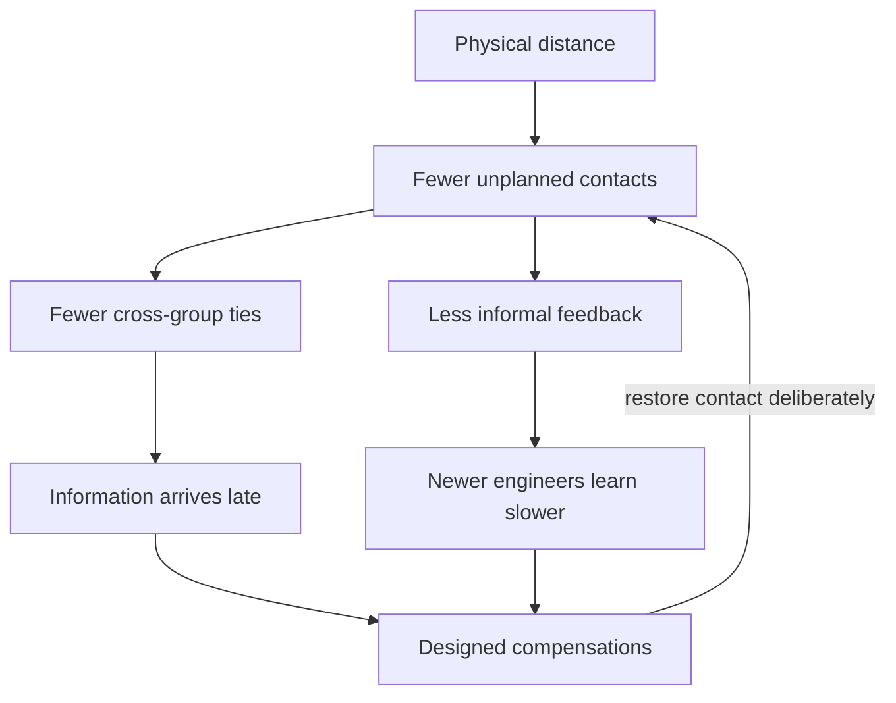
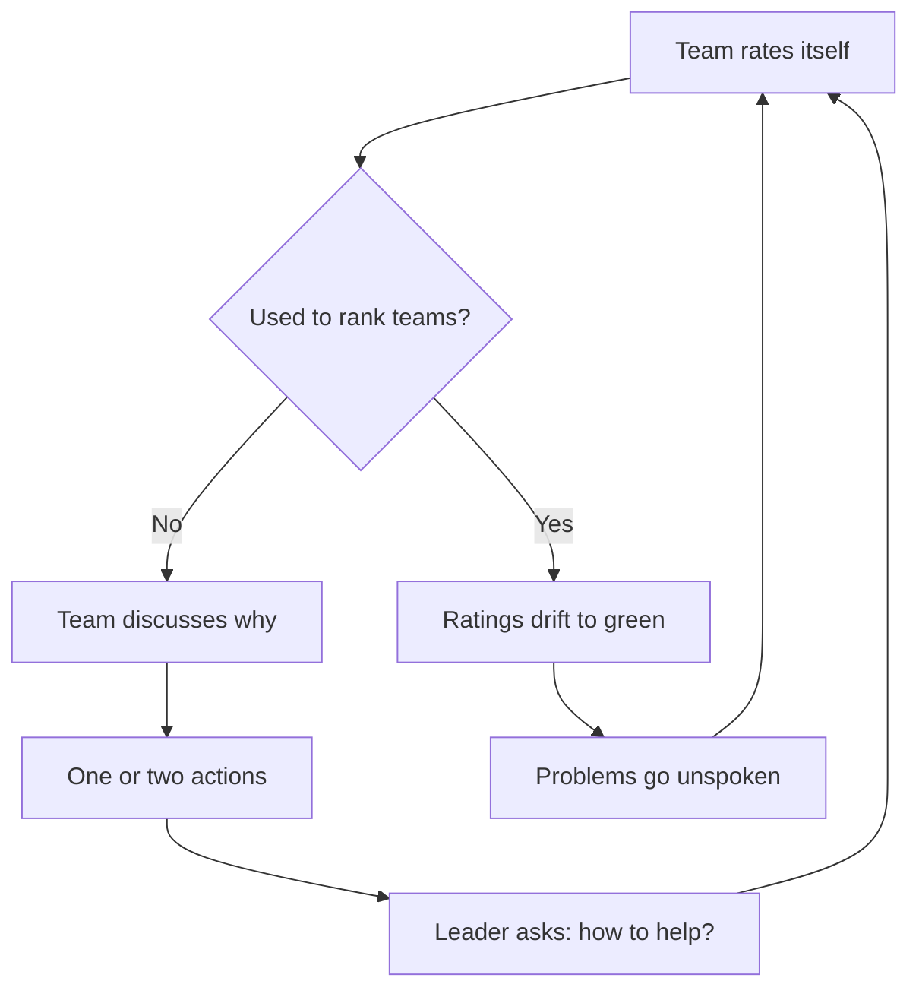
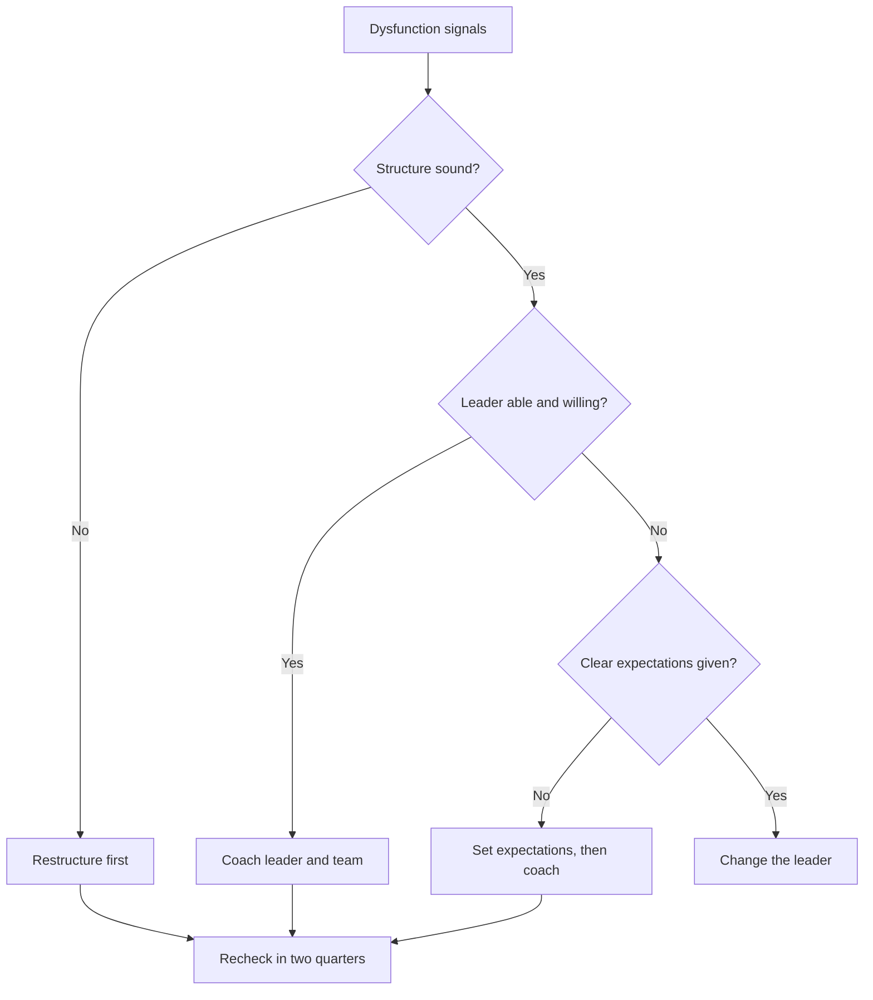

# Chapter 14 — Distributed Teams, Team Health, and Diagnosing Dysfunction

!!! warning "Awaiting human review"
    This chapter has passed the book's automated validation and an editorial self-review, but not yet
    the human review in which each cited claim is checked against its source. Treat it as a reviewed
    draft. Corrections are welcome; see the repository's CONTRIBUTING file.

This chapter covers three jobs: designing how a team works when its members are not in one room,
using what the remote and hybrid work research shows; finding out how healthy a team is without
turning the answer into a score people learn to manage; and diagnosing a team that is not working,
then choosing between coaching, restructuring, and changing its leader. Chapter 11 owns psychological safety, Chapter 18 owns
developer-experience surveys, and Chapter 33 owns team design and cognitive load; this chapter uses
them without re-teaching them. The running example is Customer Experience at Northstar Technologies,
the fictional company in the [case study](../../case-studies/northstar/index.md): nine web engineers
in Minneapolis and remote, six mobile engineers in Bogotá, one manager.

## Why This Matters

At team scale, distance changes who hears what. A decision made at a desk in Minneapolis reaches
Bogotá a day later, in a summary, without the argument that produced it. Nobody intends this, but the
team grows an inner circle defined by location, and the people outside it stop raising problems.

At organization scale, most organizations of 50 to 150 engineers span several locations, if only
through home working, yet are run as if everyone sat together. The cost shows up as slower cross-team
work and teams that look fine on delivery metrics while coming apart.

At executive scale, working arrangements have become a policy fight in which both sides quote
studies. The studies answer narrower questions than either side claims. An executive who knows what
they do and do not show can set a policy that fits the work instead of the mood.

## Learning Objectives

After this chapter you will be able to:

- Explain what the strongest remote and hybrid work studies found, and what each cannot tell you.
- Design collaboration for a distributed or hybrid team by compensating, channel by channel, for what
  distance taxes.
- Run a team health assessment that the team owns, and interpret it without ranking teams or
  managing the score.
- Diagnose a struggling team from observable signals, layer by layer.
- Choose between coaching, restructuring, and leadership change, and state the transition cost of
  each.

## The Mental Model

> **Mental model:** Distance does not slow all work equally. It taxes the communication nobody
> schedules: overheard context, quick feedback, and ties between groups. And a team's health is
> information that belongs to the team; the moment it becomes a score to manage, it stops being
> information.

Planned work with clear interfaces survives distance well. Work that depends on unplanned
conversations does not: a senior noticing a junior's mistake, someone overhearing that another team is
changing an API. Distance removes these contacts silently, so the leader must replace them on purpose.

The second half governs how you look at a team. A health check, a retrospective, or a survey is
useful because people answer candidly. Candor depends on what happens to the answers. Use them to
help the team and they stay honest. Use them to judge the team and they drift toward green.

## Deep Conceptual Explanation

### What the remote and hybrid work evidence shows

Five studies carry most of the weight. Each answers a narrower question than it is usually quoted for.

| Study | Setting | Finding | Does not show |
|---|---|---|---|
| [Herbsleb and Mockus, 2003](../../references/bibliography.md#herbsleb2003empirical) | Globally distributed software development, two organizations | Distributed work items took about 2.5 times as long as similar colocated ones; more people involved, longer calendar time | Whether modern tools close the gap |
| [Yang et al., 2022](../../references/bibliography.md#yang2022remote) | About 61,000 US employees of one technology company, early 2020 | Firm-wide remote work made collaboration networks more static and siloed, with fewer bridges; synchronous communication fell, asynchronous rose | Effects on output |
| [Gibbs, Mengel, and Siemroth, 2023](../../references/bibliography.md#gibbs2023wfh) | Over 10,000 professionals at one IT services firm, pandemic work from home | Hours rose while output did not; coordination grew, while uninterrupted work, coaching, and supervisor one-on-ones fell | A chosen policy; the published estimates (working-paper abstract read) |
| [Bloom, Han, and Liang, 2024](../../references/bibliography.md#bloom2024hybrid) | Randomized trial, 1,612 employees of one technology company, two home days a week | Quits fell by about a third; no effect on performance grades, promotions, or engineers' lines of code; managers' expectations turned from negative to slightly positive | Fully remote work; cross-group ties |
| [Emanuel, Harrington, and Pallais, 2023](../../references/bibliography.md#emanuel2023proximity) | Software engineers at one large US firm; office closures and returns as natural experiments | Sitting near teammates raised the coding feedback engineers received, most for newer engineers; experienced engineers wrote less code | Whether remote mentoring can substitute |

These are **research findings**, each from one organization; the pandemic studies measure a forced,
sudden change. Together they are more consistent than the public argument: hybrid with some home days
cost nothing measurable in the one randomized trial and helped retention; full distance at scale weakens
ties between groups and raises coordination cost; and proximity is a transfer of feedback from
experienced engineers to newer ones.

**The book's position on remote, hybrid, or colocated teams** (disputed claim D5): no study shows
one arrangement is best for software teams in general. The evidence supports three narrower claims: a
hybrid schedule with anchor days is a low-risk default; full distance must be paid for with deliberate
cross-group and feedback mechanisms; and teams with many newer engineers gain most from time together.
The choice is a design decision about which communication the work needs (**this book's
recommendation**).

### Designing collaboration across distance

Treat distance as a tax on specific channels, and design a compensation for each. The compensations
in this table are **this book's recommendation**, drawn from the mechanisms above.

| Channel | What distance does to it | Compensation | Its cost |
|---|---|---|---|
| Decisions | Made in the room, learned later | Written with the reasoning, in one place, before they take effect | Writing time |
| Unplanned context | Disappears | Named bridge people; a shared channel per interface; demos open to all sites | Bridges lose focus time |
| Feedback | Shrinks, most for newer engineers | Pairing schedules; review turnaround targets; mentor at the same site | Senior output |
| Trust | Builds slowly on video | In-person time for planning, hard design, conflict | Travel budget |
| Meetings | Room versus screens | One remote means all join from their own screen; facilitation rotates | Some in-room energy |

Two more rules matter. First, **watch where the manager sits.** On a split team, the manager's
location becomes the center of gravity: hallway decisions, the faster one-on-ones, the stretch
assignments. Second, **make cultural norms explicit.** Erin Meyer's
[*The Culture Map*](../../references/bibliography.md#meyer2014culture) is known for the argument that
national cultures differ in how directly people give negative feedback, disagree, and signal
decisions, and that misreading these differences damages trust (**expert opinion**, credited here at
idea level). On a team spanning two countries, agree how disagreement and bad news are raised.

### Team health assessment without a score to manage

A team health assessment is a structured way for a team to say how its working life is going. Two
families exist. **Validated instruments** such as the Team Diagnostic Survey assess how well a team is
structured, supported, and led, along with its work processes and members' reactions; its
measurement properties were tested on data from 321 teams
([Wageman, Hackman, and Lehman, 2005](../../references/bibliography.md#wageman2005team)). **Facilitated
workshops** such as Spotify's squad health check ask the team to rate about ten areas (ease of release,
technical quality, mission, learning, support, and others) as green, yellow, or red with a trend, and to
discuss why ([Kniberg and Lindwall, 2014](../../references/bibliography.md#kniberg2014squad)).

The rules around the instrument matter more. Kniberg and Lindwall warn that the model works only where trust is high, because self-reported data is
easy to game; teams should not be compared; and it is a support tool, not a judgment tool (**documented
practice**). Orosz and Beck describe what happens otherwise: survey scores at one large company became
distorted once they were tied to performance reviews and to pressure from managers
([Orosz and Beck, 2023](../../references/bibliography.md#orosz2023measuring)). This is the general
gaming loop that [Chapter 18](../04-execution/18-measuring-engineering-productivity.md) explains.

Rules that keep the loop honest (**this book's recommendation**, consistent with Kniberg and Lindwall):

1. The team owns its results and decides what leaves the room.
2. Read trends within a team, never levels across teams; a red team may simply be more candid.
3. Upward reporting carries patterns and requests ("three teams report release pain"), not scores.
4. No health result appears in anyone's objectives or performance review.
5. Pair each topic with a system signal: release pain with deployment data, support with incident load.
6. End with at most two actions and an owner; an assessment without follow-up teaches silence.

A health check is not Chapter 18's developer-experience survey, which measures friction across the
organization anonymously over groups of at least five. The health check is a conversation inside one
team; its value is the discussion more than the ratings.

### Diagnosing dysfunction

A dysfunctional team is one whose way of working, not its workload, keeps it from results it could
otherwise reach. Diagnosis starts from **observable signals**, because "the team feels off" cannot be
acted on: retrospective actions that repeat or concentrate on one subgroup; decisions reopened or made
in side channels; a subgroup quiet in team forums and talkative in one-on-ones; incidents clustered at
internal boundaries; misses the team could have flagged earlier; transfer requests.

Patrick Lencioni's [*The Five Dysfunctions of a Team*](../../references/bibliography.md#lencioni2002five)
(see Chapter 11) is **expert opinion** that places the visible symptom, missed results, above causes in
relationships, and does not ask whether the team was designed to succeed.

The Team Diagnostic Survey reflects a wider view: it assesses how well a team is structured, supported,
and led, not only its processes and members' reactions. This book takes from that view a rule of order
(**this book's recommendation**): check the team's design before its relationships. In practice, check
four layers in this order:

| Layer | Question | Typical signals |
|---|---|---|
| Structure | Is this one team with one shared goal, a workable boundary, and work it can finish? | Two products on one board; incidents at internal boundaries; one subgroup's work always waiting |
| Leadership | Does the leader set direction, attend to every subgroup, and handle conflict? | Uneven one-on-ones; decisions centered on one location; problems surface late |
| Relationships | Do people trust each other enough to disagree and commit? | Silent meetings, side-channel decisions, reopened decisions |
| Individuals | Is one person's behavior or performance driving the pattern? | The pattern follows one person across contexts |

Most leaders start at the bottom, with individuals, because it is the easiest story. A structural
problem misread as an interpersonal one gets coaching that cannot work, and the coached people are
blamed. Psychological safety, in the relationships layer, is Chapter 11's subject.

### Coaching, restructuring, or leadership change

Three remedies, in rising order of cost and irreversibility:

- **Coaching** the leader and the team: facilitated retrospectives, working agreements, a coach for the
  manager. Cheap, reversible, slow. It works when the structure is sound and the leader can and will
  change.
- **Restructuring**: splitting a team, moving a boundary or component, changing the board and cadence.
  Weeks of disruption and a delivery dip. It works when the team is really two teams or its boundary
  guarantees conflict (Chapter 33 owns team design).
- **Leadership change**: moving or replacing the manager. Months of disruption, risk of losing people
  loyal to the leader, and a signal to every other manager. Warranted when the leader has had clear
  expectations, support, and time and has not changed, or has lost trust beyond repair.

Coaching a structural problem wastes quarters; changing a leader for one punishes the wrong person.

## Engineering Organization Example

Northstar's working arrangements are **illustrative** and recorded on the baseline page.
Headquarters is in Minneapolis, where all executives and engineering managers work, with office anchor
days Tuesday to Thursday. The second engineering office is in Bogotá, at most one hour from
Minneapolis. Twelve engineers are fully remote in the United States.

| Team | Minneapolis | Bogotá | Remote US | Total |
|---|---|---|---|---|
| Orders | 12 | 0 | 2 | 14 |
| Billing | 10 | 0 | 3 | 13 |
| Payments and Integrations | 6 | 5 | 1 | 12 |
| Customer Experience | 7 | 6 | 2 | 15 |
| Data and Analytics | 4 | 5 | 2 | 11 |
| Platform Operations | 10 | 0 | 2 | 12 |
| Staff engineers | 3 | 0 | 0 | 3 |
| **Total** | **52** | **16** | **12** | **80** |

**Where distance bites.** Not time zones: every engineer shares at least six working hours with
Minneapolis. Location does. Three teams span both sites, and every Bogotá engineer reports to a
Minneapolis manager. In Customer Experience the web and mobile boundary is also the site boundary.
The team also had 20 dependency links in the baseline quarter, 17 to Orders, Billing, and Platform
Operations, which sit almost entirely in Minneapolis; 8 to Orders, which owns the pricing-svc contract
that mobile-bff consumes. INC-405 (mobile-bff deployed against an older pricing-svc contract, detected
by a customer after 140 minutes) is the kind of failure a missing cross-site bridge makes more likely.
That is a hypothesis, not a finding from the incident record.

**The cost of in-person time.** Suppose the director wants each Bogotá engineer in Minneapolis for one
working week twice a year, and each of the three managers with Bogotá engineers in Bogotá twice a year.
Assume $3,000 per person-trip (flight, hotel, meals), an **illustrative** figure:

| Item | Calculation | Cost |
|---|---|---|
| Bogotá engineers to Minneapolis | 16 × 2 × $3,000 | $96,000 |
| Managers to Bogotá | 3 × 2 × $3,000 | $18,000 |
| **Total per year** | | **$114,000** |

Against that, one departure costs the vacancy plus ramp-up. The baseline median from resignation to a
replacement's first day is 15 weeks: at $185,000 a year, about $53,000 (185,000 × 15 ÷ 52). Assume 13
more weeks at half productivity: about $23,000. A departure costs about $76,000 before recruiting fees.
Chapter 10 prices a ledger specialist at about $124,000; a typical role ramps faster, and recruiting is
excluded here. So the program costs about one and a half departures. No study cited here shows that visits reduce
attrition (Bloom et al. studied home days, not travel), so this is a bet with a stated break-even.
Travel is operating expense, which Rajiv Menon wants flat, so the money must come from somewhere visible.

## Decision Framework

Choose the working arrangement by the communication the work needs, then choose the compensations.

| If the team's work is mostly… | Prefer | Required compensations |
|---|---|---|
| Well-bounded, with stable interfaces and experienced engineers | Any arrangement, including fully remote | Written decisions; review turnaround targets |
| Cross-boundary, with frequent changes to shared contracts | Same site as the neighbors it changes most, or named bridges | Bridge roles; contract tests; shared channels per interface |
| Heavy with newer engineers | Time together with mentors, on overlapping days | Pairing schedule; mentor at the same site |
| Split across sites by specialty | Avoid if you can; if not, make each site a whole subteam with its own lead | Manager presence at both sites; meeting parity |
| Under about four hours of daily overlap (this book's heuristic) | Asynchronous by default | Written handoffs; decisions that can wait a day |

For a struggling team, use the layered diagnosis and choose the remedy in this order:

"Structure sound" means a capable leader with a trusting team could succeed with this boundary and
board. "Clear expectations given" means the leader could repeat what was expected and by when. If not,
the failure is partly yours.

## Trade-offs

**Colocation against the hiring pool.** One office buys unplanned contact and mentoring and loses
candidates; in the one randomized trial, home days reduced quits. A second site widens the pool and adds
a boundary you manage forever.

**Writing against speed.** Written decisions make distributed teams work and slow small decisions.
Write the ones that cross a site or team boundary; let the rest stay informal.

**Mentoring against senior output.** Emanuel et al. found experienced engineers wrote less code near
teammates. Time together moves capacity from seniors to juniors; often right, but make it a choice.

**Health checks against time.** Two hours a quarter for 15 people is 30 engineer-hours: cheap if it fixes
one problem, expensive if it fixes nothing, because the next one is less candid.

**Restructuring against momentum.** A split costs weeks of disruption and new coordination between the
halves; a structural problem left alone costs a little every week, indefinitely. The first is easier to
see, so leaders under-restructure.

**Leadership change against signal.** Replacing a manager tells every other manager what the
organization tolerates: too late says performance does not matter; without prior expectations, it says
anyone can be next.

## Failure Modes

**Geographic hub and spoke.** The manager's site becomes the team. *Detection:* retrospective actions,
stretch assignments, and design ownership skewed toward one location.

**Room versus screens.** Six people in a room, four on video missing the side conversation.
*Detection:* remote participants speak less in meetings than in one-on-ones.

**Health score league table.** Results compiled across teams as a ranking; soon everyone reports green.
*Detection:* improving scores while incidents, attrition, or transfer requests do not improve.

**Assessment without follow-up.** The team names its problems and nothing changes. *Detection:* the same
red areas in consecutive assessments; shorter discussions.

**Coaching a structural problem.** A team that is really two teams gets a facilitator and an offsite.
*Detection:* coaching actions done, signals unchanged, the same boundary in incidents.

**Restructuring around a person.** A reorganization that avoids a difficult conversation.
*Detection:* the structure makes sense only if you know who is in it.

**The overdue leadership change.** Everyone below the director knows the manager is not working.
*Detection:* skip-level conversations saying the same thing three times; strong engineers asking to
transfer.

## Enterprise Application

In an organization of 50 to 150 engineers, three things move from the team to the organization.

**Site strategy.** Decide what each site is for. A site that holds whole teams with local leads works
better than one holding fragments of teams that report elsewhere. When a team must span sites, split it
along a stable boundary (a component with a published contract), not along specialties that change
together every sprint.

**Working agreements by default.** Publish an organization-wide floor (written boundary-crossing
decisions, screen-first meetings, review turnaround targets across sites); teams add their own.

**Health as a pattern detector.** Teams run their own health checks each quarter. The director asks
managers for patterns and requests, not results, and looks for the same problem in several teams, which
usually needs an organizational fix. Pair it with Chapter 18's developer-experience survey and skip-level
conversations (Chapter 5). After two quarters of dysfunction signals, the director runs the layered
diagnosis personally.

## CTO Perspective

At executive scale, the working-arrangement policy is a company decision with three audiences.

**The CEO and board** often want an office mandate because collaboration feels weaker. The CTO separates
what the evidence supports (hybrid costs little in performance; full distance weakens cross-group ties;
juniors gain from proximity) from what it does not (that any arrangement raises output overall). The
retention finding cuts against blanket mandates.

**Employees** read the policy as a statement about trust. A mandate justified by badge data reads as
surveillance; one justified by specific work (planning weeks, onboarding) reads as design.

**Managers** need exceptions decided by rule, not negotiated person by person, or the policy becomes a
favor system.

The CTO also owns the decision to have more than one site, a permanent boundary whose case should name
the hiring or cost advantage and the compensations funded. And the CTO should see health signals only as
patterns: a CTO who asks for team health scores has created the league table.

## Practical Playbook

1. **Map where people are.** By team and subgroup: site, remote, hours of overlap with the manager.
   Mark every team whose specialty boundary is also a site boundary.
2. **Name the taxed channels** for each split team and pick one compensation per channel, with an owner.
3. **Write the meeting rule and the decision rule**: screen-first meetings when anyone is remote;
   boundary-crossing decisions written with their reasoning.
4. **Fund time together** for split teams, with a stated purpose for each visit (planning, hard design,
   onboarding), and a cost you can defend.
5. **Run a team-owned health check** once a quarter: facilitated by someone outside the reporting line,
   separately for subgroups if one is quieter, ending in at most two actions.
6. **Report patterns upward, not scores.** Write the access rule before the first session.
7. **Watch the dysfunction signals** in retrospectives, incidents, one-on-ones, and transfer requests.
8. **Diagnose by layer**, structure first, with evidence for each layer.
9. **Choose the remedy** with the decision diagram; write the expectations and the recheck date, and
   tell the team what you are doing and why.

## Case Study

This case is **fictional**. It is set at the start of quarter 2 at Northstar, after the director's
first quarter (recorded on [the first quarter](../../case-studies/northstar/first-quarter.md) page);
baseline facts are on the [baseline page](../../case-studies/northstar/baseline-data.md). The
locations and informal leads are recorded on the baseline page; the health check and its results are on
the first quarter page. The outcome is a decision the reader faces.

**The team.** Customer Experience has 15 engineers under Daniel Cho: nine web (seven in Minneapolis,
two remote) and six mobile, all in Bogotá. It owns web-app, mobile-app, and mobile-bff; notification-svc
moved to Orders at the start of quarter 2. Two former QA engineers joined as quality engineers after the
week 10 announcement, both in Minneapolis. Nobody holds a tech lead title; Hannah Lindgren leads web
informally and Mateo Arango Ríos leads mobile. Daniel spends 45 percent of his time on people, the
highest share of any Northstar manager.

**The signals.** On delivery measures the team looks healthy: 26 deploys a month, the most of any team; a
median lead time of six days; a 17 percent change failure rate; and 28 percent unplanned work against an
organization average of 34. Other signals disagree:

- One board and one two-week sprint for web and mobile, although mobile releases pass app-store
  review. INC-426's fix waited for that review; restoration took 1,310 minutes.
- Two of the team's four baseline Sev2 incidents are on the mobile side: INC-405 at mobile-bff and
  INC-426 in mobile-app.
- Retrospectives run with Minneapolis in one room and Bogotá on video; 6 of the last 8 retrospective
  actions concerned web work.
- About half of Daniel's video one-on-ones with mobile engineers were rescheduled in the baseline
  quarter.
- In the baseline quarter the team committed four roadmap items and delivered two.

**The health check.** In week 16 the director asked Elena Sokolova, whose team also spans both sites,
to facilitate. She ran it twice, once for web with the quality engineers and once for mobile.
Normally only patterns and requests leave the room; because a structural decision depended on them,
both groups agreed to show Daniel and the director their ratings this once. Web rated 5 areas green, 4 yellow,
and 1 red (speed, which they tied to waiting on Orders). Mobile rated 2 green (learning, fun), 4
yellow, and 4 red: easy to release, suitable process, support, and "pawns or
players". The mobile group's request, in Mateo's words, was "our own board, and decisions that
happen where we can hear them".

**The diagnosis.** By layer:

- *Structure:* one board and cadence for two products with different release mechanics, and a site
  boundary on top of the specialty boundary. Unsound.
- *Leadership:* Daniel invests in people, but his attention lands where he sits. A contributing factor;
  nobody ever set him expectations for leading across sites.
- *Relationships:* mobile's silence fits the structure; no evidence of conflict between individuals.
- *Individuals:* no pattern that follows one person.

**The options.**

| Option | What it means | Cost |
|---|---|---|
| A. Coach | Facilitated retrospectives, meeting rules, Daniel visits Bogotá | Low; leaves one board for two products |
| B. Restructure within the team | Separate boards, cadences, and retrospectives, each with its informal lead; mobile owns its release rhythm; a named bridge to Orders for pricing-svc | Weeks of disruption; Daniel runs subteams of 11 and 6 |
| C. Split into two teams | A new Mobile team with its own manager | Allowed under flat headcount only if the new manager's engineering seat is not backfilled: Customer Experience loses an engineer's capacity; the CTO decides |
| D. Leadership change | Replace Daniel | Unjustified by the evidence |

The director's recommendation is B with A's practices, written expectations for Daniel on leading
across sites, and a recheck at the end of quarter 3 against the same signals. C stays open if B does
not move mobile's red areas. Whether that is right is for the exercises.

## Exercises

Solutions are in [chapter 14 solutions](../../solutions/ch14-solutions.md). Northstar data is on the
[baseline page](../../case-studies/northstar/baseline-data.md).

### Foundational

**F1.** An executive circulates a summary of Gibbs, Mengel, and Siemroth's study with the headline
"working from home cuts productivity" and proposes five office days for all engineers. A peer replies
with Bloom, Han, and Liang's trial: "hybrid has no effect on performance". Explain what each study
measured, under what conditions, and what neither can tell this company.

**F2.** A team of eight has four engineers in one office, three in another office one hour away in time,
and one remote engineer who joined three months ago. Name the channels distance taxes for this team,
and design one compensation for each, with its owner and cost.

**F3.** A manager of managers proposes publishing every team's quarterly health check as a traffic-light
table in the monthly engineering review, "so we can see which teams need help". Predict what happens over two
quarters, using the chapter's loop, and propose a design that still finds teams that need help.

### Applied Leadership

**A1.** You are Elena Sokolova preparing to facilitate the Customer Experience health check in week 16.
The six mobile engineers have never spoken much in team forums, and Daniel Cho asked to attend. Design the
sessions: who attends, in what format, what leaves the room, and what you will say to Daniel.

**A2.** Data and Analytics has four engineers in Minneapolis, five in Bogotá, and two remote, and the
baseline notes "little contact with the other teams". Its manager says distance is no problem because
the team's delivery numbers are good. Decide what evidence would show whether distance costs the
organization something, and what you would change.

**A3.** A team of nine (not at Northstar) shows these signals: decisions are reopened after planning,
retrospectives produce the same three actions every sprint, two senior engineers communicate mainly
through code review comments, and the manager says the team "just needs to gel". Diagnose by layer and
choose a remedy, saying what evidence would change your choice.

### Executive Decision-Making

**X1.** Helena Marsh asks Victor Lindqvist for a policy of four office days a week at headquarters,
arguing that collaboration has weakened, and asks whether the Bogotá office is worth keeping. Write the
CTO's response: what the evidence supports, the cost and risk of each option under flat headcount and
flat operating expense, and what you recommend.

**X2.** It is the end of quarter 3. Customer Experience split its board and cadence as recommended.
Mobile's health check now shows 3 red areas instead of 4, mobile-app had one Sev2 in the quarter, Daniel
visited Bogotá once instead of the agreed twice, and Mateo Arango Ríos asks whether he could become
mobile's manager. Decide whether to split the team, coach further, or change the leadership, and how to
answer Mateo.

## Reflection Questions

1. If your team's most important decision last month had been made with everyone remote, who would
   have heard about it later than they did?
2. Which of your direct reports do you see in person most often, and does that show in their
   assignments?
3. When your team last reported a problem in a health check or retrospective, what visibly happened
   next?
4. Which of your beliefs about remote work did you hold before reading any evidence?
5. When a team struggles, which layer do you check first, and why that one?
6. What would your manager have to see before changing you, and have they told you?

## Key Takeaways

- Distance taxes unplanned communication, feedback to newer engineers, and ties between groups. Name
  the channels and compensate for each on purpose.
- No study shows one working arrangement is best for software teams. A hybrid schedule is a low-risk
  default; full distance must be paid for; juniors gain most from time together.
- Avoid making a specialty boundary and a site boundary the same line. When you cannot, give each site a
  lead and put the manager's attention where they do not sit.
- A health check belongs to the team. Read trends within a team, report patterns upward, never rank
  teams, and never put results in anyone's objectives.
- Diagnose dysfunction by layer: structure, leadership, relationships, individuals, in that order.
- Do not coach a structural problem, restructure around a person, or change a leader who was never told
  what was expected. State each remedy's transition cost and a recheck date.

## References and Further Reading

- [Bloom, Han, and Liang, 2024](../../references/bibliography.md#bloom2024hybrid). The randomized
  trial of hybrid work.
- [Yang et al., 2022](../../references/bibliography.md#yang2022remote). Remote work and cross-group
  collaboration networks.
- [Gibbs, Mengel, and Siemroth, 2023](../../references/bibliography.md#gibbs2023wfh). Coordination costs of
  pandemic work from home.
- [Emanuel, Harrington, and Pallais, 2023](../../references/bibliography.md#emanuel2023proximity).
  Proximity as a transfer of feedback from senior to newer engineers.
- [Herbsleb and Mockus, 2003](../../references/bibliography.md#herbsleb2003empirical). Delay in globally
  distributed development.
- [Wageman, Hackman, and Lehman, 2005](../../references/bibliography.md#wageman2005team). A validated team
  diagnostic covering structure, support, and leadership.
- [Kniberg and Lindwall, 2014](../../references/bibliography.md#kniberg2014squad). The squad health check,
  with its warnings about comparison and judgment.
- [Orosz and Beck, 2023](../../references/bibliography.md#orosz2023measuring). How survey scores lose
  their value once tied to reviews.
- [Lencioni, 2002](../../references/bibliography.md#lencioni2002five). *The Five Dysfunctions of a Team*.
  A memorable model of how trust problems surface as missed results; read alongside structural views.
- [Meyer, 2014](../../references/bibliography.md#meyer2014culture). *The Culture Map*. How cultural
  norms for feedback and disagreement differ, for teams spanning countries.
