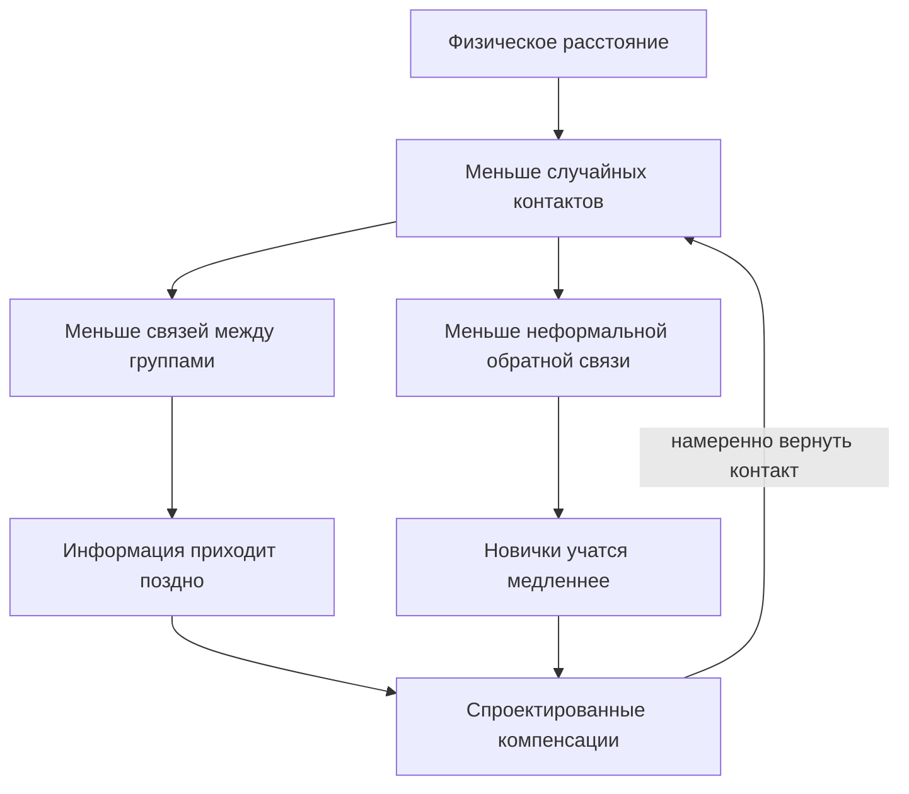
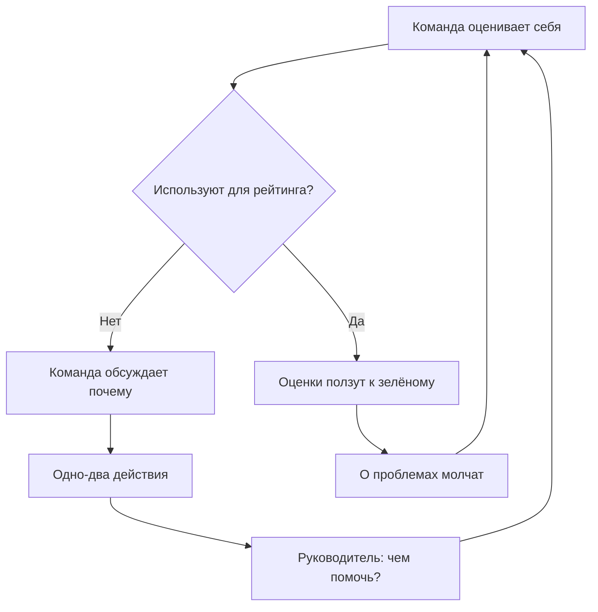
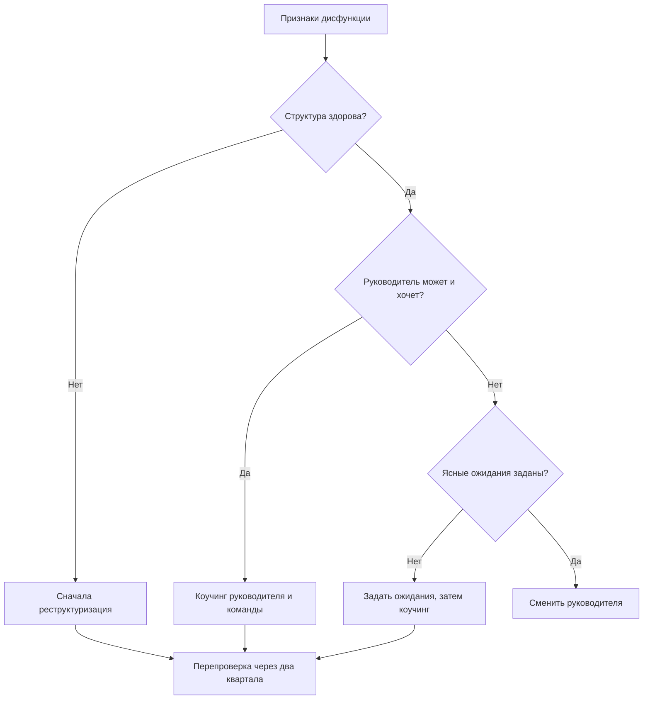

# Глава 14 — Распределённые команды, здоровье команды и диагностика дисфункций { #chapter-14-distributed-teams-team-health-and-diagnosing-dysfunction }

В этой главе три задачи. Первая — спроектировать работу команды, участники которой не сидят в одной
комнате, и опереться при этом на то, что показывают исследования удалённой и гибридной работы. Вторая —
выяснить, насколько команда здорова, и не превратить ответ в оценку, которую люди научатся подгонять.
Третья — диагностировать команду, которая не справляется, и выбрать между коучингом, реструктуризацией и
сменой руководителя. Сквозной пример — команда Customer Experience в Northstar Technologies, вымышленной
компании из [кейса](../../case-studies/northstar/index.md): девять веб-инженеров в Миннеаполисе и на
удалёнке, шесть мобильных инженеров в Боготе и один руководитель. Психологическую безопасность
(глава 11), опросы об опыте разработчиков (глава 18) и проектирование команд (глава 33) глава
использует, но заново не объясняет.

## Почему это важно { #why-this-matters }

Для команды расстояние меняет то, кто что слышит. Решение, принятое за столом в Миннеаполисе, доходит
до Боготы через день — в пересказе и без спора, который к нему привёл. Никто к этому не стремится, но в
команде складывается внутренний круг по признаку места, и те, кто за его пределами, перестают поднимать
проблемы.

Большинство организаций из 50–150 инженеров разнесены по нескольким местам, хотя бы из-за работы из
дома, а управляют ими так, будто все сидят вместе. Расплачиваются за это более медленной межкомандной
работой и командами, которые по метрикам поставки выглядят нормально, а на деле распадаются.

Для высшего руководства формат работы превратился в политическую борьбу, где обе стороны ссылаются на
исследования. Но исследования отвечают на более узкие вопросы, чем утверждает любая из сторон.
Руководитель, который знает, что они показывают, а что нет, может выбрать политику под работу, а не под
настроение.

## Цели главы { #learning-objectives }

Прочитав эту главу, вы сможете:

- Объяснять, что нашли самые сильные исследования удалённой и гибридной работы и чего каждое из них
  сказать не может.
- Проектировать совместную работу распределённой или гибридной команды, компенсируя, канал за каналом,
  налог, которым расстояние облагает общение.
- Проводить оценку здоровья, которой владеет сама команда, и интерпретировать её, не ранжируя команды
  и не превращая её в оценку, которой управляют.
- Диагностировать буксующую команду по наблюдаемым признакам, слой за слоем.
- Выбирать между коучингом, реструктуризацией и сменой руководителя и называть стоимость перехода для
  каждого варианта.

## Ментальная модель { #the-mental-model }

> **Ментальная модель:** расстояние замедляет работу неодинаково. Налогом облагается общение, которое
> никто не планирует: случайно услышанный контекст, быстрая обратная связь, связи между группами. А
> здоровье команды — информация, которая принадлежит команде; стоит превратить её в оценку, которой
> управляют, и она перестаёт быть информацией.

Плановая работа с ясными интерфейсами переносит расстояние хорошо. Работа, которая зависит от
незапланированных разговоров, — нет. Senior-инженер замечает ошибку джуниора, кто-то случайно слышит,
что другая команда меняет API: такие контакты расстояние тихо убирает, поэтому руководитель должен
намеренно их заменить.

Вторая половина модели задаёт, как вы смотрите на команду. Проверка здоровья, ретроспектива или опрос
полезны потому, что люди отвечают откровенно. А откровенность зависит от того, что потом происходит с
ответами. Используйте их, чтобы помочь команде, — и ответы останутся честными. Используйте, чтобы
судить команду, — и оценки поползут к зелёному.

## Подробный разбор { #deep-conceptual-explanation }

### Что показывают данные об удалённой и гибридной работе { #what-the-remote-and-hybrid-work-evidence-shows }

Основная тяжесть доказательств лежит на пяти исследованиях. Каждое отвечает на более узкий вопрос, чем
тот, ради которого его обычно цитируют.

| Исследование | Условия | Результат | Чего не показывает |
|---|---|---|---|
| [Herbsleb and Mockus, 2003](../../references/bibliography.md#herbsleb2003empirical) | Глобально распределённая разработка ПО, две организации | Распределённые задачи занимали примерно в 2.5 раза больше времени, чем похожие задачи в одном месте; больше участников, больше календарного времени | Закрывают ли разрыв современные инструменты |
| [Yang et al., 2022](../../references/bibliography.md#yang2022remote) | Около 61,000 сотрудников одной технологической компании в США, начало 2020 года | Удалённая работа всей компании сделала сети взаимодействия более статичными и замкнутыми, с меньшим числом мостов; синхронной коммуникации стало меньше, асинхронной — больше | Влияния на результат работы |
| [Gibbs, Mengel, and Siemroth, 2023](../../references/bibliography.md#gibbs2023wfh) | Более 10,000 специалистов одной ИТ-сервисной компании, работа из дома в пандемию | Рабочих часов стало больше, а результат не вырос; координации стало больше, а непрерывной работы, коучинга и встреч один на один с руководителем — меньше | Политики, выбранной добровольно; рецензируемой оценки (это рабочая статья) |
| [Bloom, Han, and Liang, 2024](../../references/bibliography.md#bloom2024hybrid) | Рандомизированное исследование, 1,612 сотрудников одной технологической компании, два дня дома в неделю | Увольнений по собственному желанию стало примерно на треть меньше; влияния на оценки результативности, повышения и число строк кода у инженеров нет; ожидания руководителей сменились с негативных на слегка позитивные | Полностью удалённой работы; связей между группами |
| [Emanuel, Harrington, and Pallais, 2023](../../references/bibliography.md#emanuel2023proximity) | Разработчики одной крупной американской компании; закрытия и открытия офисов как естественные эксперименты | Работа рядом с коллегами по команде увеличивала обратную связь по коду, которую получали инженеры, сильнее всего у новичков; опытные инженеры писали меньше кода | Может ли удалённое менторство это заменить |

Это **научные результаты**, но каждый получен в одной организации, а исследования пандемийного периода
измеряют вынужденную и внезапную перемену. Вместе они согласуются лучше, чем можно подумать по
публичному спору. В единственном рандомизированном исследовании гибридный формат с несколькими днями
дома не обошёлся ни во что измеримое и помог удержанию. Полная удалёнка в масштабе компании ослабляет
связи между группами и удорожает координацию. Через близость обратная связь доходит от опытных
инженеров до новичков.

**Позиция книги: удалённые, гибридные или собранные в одном месте команды.** Данные противоречивы, и ни
одно исследование не показывает, что какой-то формат лучше для команд разработки вообще. Зато данные
подкрепляют три более узких утверждения. Гибридный график с опорными днями — вариант по умолчанию с
низким риском. За полную удалёнку приходится платить: нужны намеренные механизмы, которые поддерживают
связи между группами и обратную связь. Больше всех от совместного времени выигрывают команды, где много
новичков. Сам выбор — проектное решение о том, какое общение нужно работе (**рекомендация книги**).

### Как проектировать совместную работу на расстоянии { #designing-collaboration-across-distance }

Считайте расстояние налогом на конкретные каналы и проектируйте компенсацию для каждого. Компенсации в
таблице — **рекомендация книги**, выведенная из механизмов, описанных выше.

| Канал | Что с ним делает расстояние | Компенсация | Её цена |
|---|---|---|---|
| Решения | Принимаются в комнате, узнают о них позже | Записываются с обоснованием, в одном месте, до вступления в силу | Время на письмо |
| Незапланированный контекст | Исчезает | Названные люди-мосты; общий канал на каждый интерфейс; демо, открытые для всех площадок | Мосты теряют время на сосредоточенную работу |
| Обратная связь | Сжимается, сильнее всего у новичков | Расписание парной работы; целевые сроки ревью; ментор на той же площадке | Выработка senior-инженеров |
| Доверие | По видео строится медленно | Очные встречи для планирования, сложного проектирования, конфликтов | Бюджет на поездки |
| Встречи | Комната против экранов | Если хоть один участник удалённо, все подключаются со своих экранов; фасилитация по очереди | Часть энергии живого общения |

Важны ещё два правила. Первое: **следите, где сидит руководитель.** В разделённой команде место
руководителя становится центром тяжести: решения в коридоре, более быстрые встречи один на один,
задачи на вырост. Второе: **делайте культурные нормы явными.** Erin Meyer в
[*The Culture Map*](../../references/bibliography.md#meyer2014culture) утверждает: национальные культуры
различаются тем, насколько прямо люди высказывают негативную обратную связь, выражают несогласие и
обозначают решения, а неверное прочтение этих различий подрывает доверие (**мнение эксперта**). В
команде из двух стран договоритесь, как поднимать несогласие и сообщать плохие новости.

### Асинхронная работа и реальная разница часовых поясов { #asynchronous-work-and-real-time-zone-spread }

Когда рабочие часы почти не пересекаются, сделайте письменную асинхронную работу нормой, а время
пересечения тратьте на то, что письменно не решить. Площадки Northstar разделяет час, поэтому возьмём
**гипотетическую** команду: шесть инженеров в Чикаго и двое в Кракове, на семь часов впереди. Их рабочие
дни пересекаются примерно на час.

| Практика | Как она выглядит для этой команды |
|---|---|
| Защищённое окно пересечения | Один час три дня в неделю для споров, конфликтов и планирования; ранний или поздний слот чередуется между площадками |
| Письменная передача дел | В конце дня каждой площадки: что изменилось, что заблокировано, какое решение нужно и от кого |
| Асинхронные решения | Письменное предложение, окно для комментариев длиной в полный рабочий день на каждой площадке, названный решающий, решение публикуется там, куда смотрят обе площадки |
| Дежурство «вслед за солнцем» (follow-the-sun) | Каждая площадка покрывает своё дневное время, с письменной передачей инцидентов; это работает, только если обе площадки могут действовать по каждому компоненту, который покрывают |
| Удалённый онбординг | Наставник в часовом поясе новичка, запланированная парная работа во время пересечения, целевые сроки ревью изменений новичка |

Зачем нужны эти практики, объясняют данные. Yang и соавторы обнаружили, что удалённая работа сместила
коммуникацию от синхронной к асинхронной и сделала сети более замкнутыми; значит, мосты между
площадками нужно проектировать ([Yang et al., 2022](../../references/bibliography.md#yang2022remote)).
По данным Emanuel и соавторов, близость сильнее всего прибавляла обратной связи новичкам; значит, новому
сотруднику в семи часах от команды обратную связь нужно организовать, а не надеяться, что она появится
сама ([Emanuel, Harrington, and Pallais, 2023](../../references/bibliography.md#emanuel2023proximity)).

Типичных ловушек две. Если команда проводит все встречи в часы большей площадки, для меньшей они
превращаются в сверхурочную работу. А команда, которая всё пишет, но никогда не встречается, медленно
выстраивает доверие; заложите в бюджет немного очного времени, как предусматривает таблица выше.

### Оценка здоровья команды без оценки, которой управляют { #team-health-assessment-without-a-score-to-manage }

Оценка здоровья команды — структурированный способ, которым команда рассказывает, как идёт её рабочая
жизнь. Таких способов два семейства. **Валидированные инструменты**, например Team Diagnostic Survey,
оценивают, насколько хорошо команда устроена, насколько её поддерживают и как ею руководят, а также её
рабочие процессы и реакции участников. Измерительные свойства этого опросника проверены на данных
321 команды ([Wageman, Hackman, and Lehman, 2005](../../references/bibliography.md#wageman2005team)).
**Фасилитируемые воркшопы**, например проверка здоровья команды Spotify (squad health check),
предлагают команде оценить около десяти областей (простота релиза, техническое качество, миссия,
обучение, поддержка и другие): отметить каждую зелёным, жёлтым или красным, указать тренд и обсудить
причины ([Kniberg and Lindwall, 2014](../../references/bibliography.md#kniberg2014squad)).

Правила обращения с инструментом важнее самого инструмента. Kniberg и Lindwall предупреждают: модель
работает только при высоком доверии, потому что самоотчётные данные легко подогнать. Команды не следует
сравнивать между собой, а сам инструмент служит поддержке, а не оцениванию (**задокументированная
практика**). Что бывает в противном случае, описывают Orosz и Beck: в одной крупной компании результаты
опросов исказились, как только их привязали к оценке результативности и к давлению руководителей
([Orosz and Beck, 2023](../../references/bibliography.md#orosz2023measuring)). Это общая петля подгонки,
разобранная в [главе 18](../04-execution/18-measuring-engineering-productivity.md).

Чтобы петля оставалась честной, нужны правила (**рекомендация книги**, согласуется с Kniberg и
Lindwall):

1. Результатами владеет команда, и она решает, что выходит за пределы комнаты.
2. Смотрите на тренды внутри команды, а не сравнивайте уровни разных команд: красная команда, возможно,
   просто откровеннее.
3. Наверх уходят закономерности и запросы («три команды жалуются на боль с релизами»), а не оценки.
4. Результаты проверки здоровья не попадают ни в чьи цели и ни в чью оценку результативности.
5. Сопоставляйте каждую тему с сигналом системы: боль с релизами — с данными о развёртываниях,
   поддержку — с нагрузкой от инцидентов.
6. Завершайте сессию не более чем двумя действиями с владельцами: оценка без последствий учит молчать.

Не путайте проверку здоровья с опросом об опыте разработчиков из главы 18. Опрос анонимно измеряет
трение по всей организации, в группах не меньше пяти человек. Проверка здоровья — разговор внутри
одной команды, и ценно в ней прежде всего обсуждение, а не оценки.

### Диагностика дисфункции { #diagnosing-dysfunction }

Дисфункциональна та команда, которой не нагрузка, а способ работы мешает добиться результатов,
достижимых в других условиях. Диагностика начинается с **наблюдаемых признаков**, потому что с
ощущением «в команде что-то не так» работать нельзя. Признаки такие: действия по итогам ретроспектив
повторяются или касаются одной подгруппы; решения пересматривают или принимают в обход; подгруппа
молчит на общих встречах и разговорчива на встречах один на один; инциденты скапливаются на внутренних
границах; случаются промахи, о которых команда могла предупредить раньше; люди просят о переводе.

Книга Patrick Lencioni [*The Five Dysfunctions of a Team*](../../references/bibliography.md#lencioni2002five)
(см. главу 11) — **мнение эксперта**. Она ставит видимый симптом, невыполненные результаты, над
причинами в отношениях и не задаётся вопросом, была ли команда устроена так, чтобы добиться успеха.

Team Diagnostic Survey отражает более широкий взгляд: опросник оценивает не только процессы команды и
реакции участников, но и то, насколько хорошо команда устроена, насколько её поддерживают и как ею
руководят. Из этого взгляда книга выводит правило очерёдности (**рекомендация книги**): устройство
команды проверяйте раньше отношений. На практике это четыре слоя, которые проверяют в таком порядке:

| Слой | Вопрос | Типичные признаки |
|---|---|---|
| Структура | Это одна команда с одной общей целью, рабочей границей и работой, которую она может довести до конца? | Два продукта на одной доске; инциденты на внутренних границах; работа одной подгруппы всегда ждёт |
| Руководство | Задаёт ли руководитель направление, уделяет ли внимание каждой подгруппе, разбирается ли с конфликтами? | Неравномерные встречи один на один; решения сосредоточены в одном месте; проблемы всплывают поздно |
| Отношения | Доверяют ли люди друг другу настолько, чтобы спорить и затем брать обязательства? | Молчаливые встречи, решения в обход, пересматриваемые решения |
| Отдельные люди | Не создаёт ли картину поведение или результативность одного человека? | Картина следует за одним человеком в разных контекстах |

Большинство руководителей начинают снизу, с отдельных людей: эта история самая простая. Если
структурную проблему принять за межличностную, команда получит коучинг, который не может сработать, а
виноватыми окажутся те, с кем работал коуч. Психологическая безопасность относится к слою отношений; ей
посвящена глава 11.

### Коучинг, реструктуризация или смена руководителя { #coaching-restructuring-or-leadership-change }

Средств три; они перечислены по возрастанию стоимости и необратимости:

- **Коучинг** руководителя и команды: фасилитируемые ретроспективы, рабочие соглашения, коуч для
  руководителя. Дёшево, обратимо, медленно. Работает, когда структура здорова, а руководитель может и
  хочет меняться.
- **Реструктуризация**: разделение команды, перенос границы или компонента, смена доски и ритма. Недели
  потрясений и просадка поставки. Работает, когда команда на деле состоит из двух команд или когда её
  граница гарантирует конфликт (проектирование команд разобрано в главе 33).
- **Смена руководителя**: перевод или замена руководителя. Месяцы потрясений, риск потерять людей,
  лояльных руководителю, и сигнал всем остальным руководителям. Оправдана, если руководитель получил
  ясные ожидания, поддержку и время, но не изменился, или если он безвозвратно потерял доверие.

Если лечить структурную проблему коучингом, кварталы уйдут впустую; если из-за неё сменить
руководителя, накажут не того человека.

## Пример из инженерной организации { #engineering-organization-example }

!!! info "Northstar: что уже известно"
    Директор в начале квартала 2 (неделя 14). За квартал 1 число инцидентов Sev1 и Sev2 (два высших
    уровня серьёзности) сократилось с 30 до 21, а на неделе 10 семь QA-инженеров перешли в продуктовые
    команды инженерами по качеству. См. [хронологию](../../case-studies/northstar/timeline.md). Впервые
    читаете о Northstar? Начните с [«Год вкратце»](../../case-studies/northstar/year-in-brief.md) и
    [«Действующие лица»](../../case-studies/northstar/cast.md).

Формат работы Northstar — **иллюстрация** (компания вымышленная). Штаб-квартира — в Миннеаполисе;
там работают все руководители высшего звена и руководители разработки, опорные офисные дни — со
вторника по четверг. Второй инженерный офис — в Боготе, разница во времени с Миннеаполисом не больше
часа. Двенадцать инженеров работают полностью удалённо в США. Таблица показывает численность на
исходном уровне, то есть до того, как на неделе 10 семь QA-инженеров ушли из Platform Operations.

| Команда | Миннеаполис | Богота | Удалённо, США | Всего |
|---|---|---|---|---|
| Orders | 12 | 0 | 2 | 14 |
| Billing | 10 | 0 | 3 | 13 |
| Payments and Integrations | 6 | 5 | 1 | 12 |
| Customer Experience | 7 | 6 | 2 | 15 |
| Data and Analytics | 4 | 5 | 2 | 11 |
| Platform Operations | 10 | 0 | 2 | 12 |
| Staff-инженеры | 3 | 0 | 0 | 3 |
| **Итого** | **52** | **16** | **12** | **80** |

**Где расстояние даёт о себе знать.** Не в часовых поясах: у каждого инженера минимум шесть рабочих
часов совпадают с Миннеаполисом. Дело в месте. Три команды охватывают обе площадки, и каждый инженер в
Боготе подчиняется руководителю в Миннеаполисе. В Customer Experience граница между вебом и мобильной
разработкой к тому же совпадает с границей площадок. Большинство зависимостей команды на исходном
уровне (17 из 20 связей) вели к командам, которые почти целиком сидят в Миннеаполисе, из них 8 — к
команде Orders: она владеет контрактом pricing-svc, который использует mobile-bff. INC-405 (mobile-bff
развернули в расчёте на старую версию контракта pricing-svc, клиент обнаружил проблему через
140 минут) — как раз такой сбой, вероятность которого растёт, когда между площадками нет моста. Но это
гипотеза, а не вывод из записей об инциденте.

**Стоимость очного времени.** Допустим, директор хочет, чтобы каждый инженер из Боготы дважды в год
проводил рабочую неделю в Миннеаполисе, а каждый из трёх руководителей, у которых есть инженеры в
Боготе, дважды в год ездил в Боготу. Примем, что одна поездка одного человека (перелёт, отель,
питание) стоит $3 000; это **иллюстративная** цифра:

| Статья | Расчёт | Стоимость |
|---|---|---|
| Инженеры из Боготы в Миннеаполис | 16 × 2 × $3,000 | $96,000 |
| Руководители в Боготу | 3 × 2 × $3,000 | $18,000 |
| **Итого в год** | | **$114,000** |

Для сравнения: один уход обходится в стоимость незакрытой вакансии и вхождения нового человека в
работу. Считаем по плановой ставке книги $3 558 за инженеро-неделю (полная стоимость сотрудника в
Northstar — $185 000 в год ÷ 52):

| Стоимость одного ухода | Допущение | Стоимость |
|---|---|---|
| Вакансия | Медиана на исходном уровне — 15 недель от заявления об уходе до первого дня замены | около $53,000 |
| Вхождение в работу | Ещё 13 недель на половине продуктивности | около $23,000 |
| **Итого, без гонораров рекрутерам** | | **около $76,000** |

Выходит, программа поездок стоит примерно как полтора ухода в год. Ни одно из процитированных здесь
исследований не показывает, что визиты снижают текучесть (Bloom и соавторы изучали дни дома, а не
поездки), поэтому это ставка с явно названной точкой безубыточности. Поездки относятся к
[операционным расходам](../../glossary.md#operating-expense) (текущие затраты, которые учитываются в
год, когда возникли), а Rajiv Menon (CFO, финансовый директор) хочет, чтобы они не росли. Значит,
деньги придётся откуда-то взять, и откуда именно, должно быть видно.

## Как принимать решение { #decision-framework }

Формат работы выбирайте по тому, какое общение нужно работе, а затем подбирайте компенсации.

| Если работа команды в основном… | Предпочтительно | Обязательные компенсации |
|---|---|---|
| Хорошо ограничена, со стабильными интерфейсами и опытными инженерами | Любой формат, включая полностью удалённый | Письменные решения; целевые сроки ревью |
| Пересекает границы, с частыми изменениями общих контрактов | Та же площадка, что у соседей, которых она меняет чаще всего, или названные мосты | Роли мостов; контрактные тесты; общие каналы на каждый интерфейс |
| Ведётся в основном новичками | Совместное время с менторами в совпадающие дни | Расписание парной работы; ментор на той же площадке |
| Разделена между площадками по специализации | По возможности избегать; если нельзя, сделать каждую площадку цельной подкомандой со своим лидом | Присутствие руководителя на обеих площадках; паритет на встречах |
| Пересечение рабочего дня меньше примерно четырёх часов (эвристика книги) | Асинхронность по умолчанию | Письменная передача дел; решения, которые могут подождать день |

Для буксующей команды используйте послойную диагностику и выбирайте средство в таком порядке:

«Структура здорова» значит: способный руководитель с командой, которая ему доверяет, мог бы добиться
успеха при такой границе и такой доске. «Ясные ожидания заданы» значит: руководитель мог бы
пересказать, чего от него ждали и к какому сроку. Если не может, провал отчасти ваш.

## Компромиссы { #trade-offs }

**Работа в одном месте против пула найма.** Один офис даёт случайные контакты и менторство, но ценой
потерянных кандидатов; к тому же в единственном рандомизированном исследовании дни дома снизили число
увольнений. Вторая площадка расширяет пул найма, но добавляет границу, которой придётся управлять
всегда.

**Письменность против скорости.** Письменные решения позволяют распределённым командам работать, но
замедляют мелкие решения. Записывайте те, что пересекают границу площадки или команды, а остальные
пусть остаются неформальными.

**Менторство против выработки senior-инженеров.** Emanuel и соавторы обнаружили, что рядом с коллегами
опытные инженеры писали меньше кода. Совместное время перераспределяет ресурс от senior-инженеров к
джуниорам. Часто так и надо, но пусть это будет осознанным выбором.

**Проверки здоровья против времени.** Два часа в квартал на 15 человек — это 30 инженеро-часов. Дёшево,
если сессия исправит одну проблему, и дорого, если ничего не исправит: следующая проверка будет менее
откровенной.

**Реструктуризация против инерции.** Разделение обходится в недели потрясений и новую координацию
между половинами. Нерешённая структурная проблема обходится понемногу, но каждую неделю и бессрочно.
Первая цена заметнее, поэтому руководители реструктурируют команды реже, чем нужно.

**Смена руководителя против сигнала.** Замена руководителя показывает всем остальным руководителям,
что организация готова терпеть. Если замена запоздала, они поймут, что результативность не важна; если
ожиданий заранее не задали — что следующим может оказаться любой.

## Типичные провалы { #failure-modes }

**Географическая «звезда».** Командой фактически становится площадка руководителя. *Как заметить:*
действия по итогам ретроспектив, задачи на вырост и владение дизайном смещены к одной площадке.

**Комната против экранов.** Шестеро сидят в комнате, а четверо по видео не слышат разговоров
вполголоса. *Как заметить:* на общих встречах удалённые участники говорят меньше, чем на встречах один
на один.

**Турнирная таблица здоровья.** Результаты команд сводят в рейтинг, и вскоре все докладывают о
зелёном. *Как заметить:* оценки улучшаются, а инциденты, текучесть или просьбы о переводе — нет.

**Оценка без последствий.** Команда называет свои проблемы, и ничего не меняется. *Как заметить:* одни
и те же красные области от оценки к оценке; обсуждения становятся короче.

**Коучинг структурной проблемы.** Команда, которая на деле состоит из двух команд, получает
фасилитатора и выездную сессию. *Как заметить:* действия по коучингу выполнены, а признаки не
изменились; инциденты — на той же границе.

**Реструктуризация вокруг человека.** Реорганизация подменяет трудный разговор. *Как заметить:*
структура имеет смысл, только если знать, кто в ней работает.

**Запоздалая смена руководителя.** Все, кто ниже директора, знают, что руководитель не справляется.
*Как заметить:* на встречах через уровень трижды звучит одно и то же; сильные инженеры просят о
переводе.

## Применение в крупной организации { #enterprise-application }

В организации из 50–150 инженеров три вопроса из ведения команды переходят в ведение организации.

**Стратегия площадок.** Решите, для чего нужна каждая площадка. Площадка с целыми командами и
местными лидами работает лучше, чем площадка с обрывками команд, которые подчиняются кому-то в другом
месте. Если команде всё же приходится охватывать несколько площадок, делите её по стабильной границе
(компонент с опубликованным контрактом), а не по специализациям, которые меняются вместе каждый спринт.

**Рабочие соглашения по умолчанию.** Опубликуйте минимум для всей организации (решения, пересекающие
границы, записываются; встречи «сначала экран»; целевые сроки ревью между площадками), а команды
добавят к нему свои правила.

**Здоровье как детектор закономерностей.** Команды каждый квартал проводят собственные проверки
здоровья. Директор просит у руководителей не результаты, а закономерности и запросы и ищет проблему,
которая повторяется в нескольких командах: такую обычно нужно решать на уровне организации. Дополняйте
это опросом об опыте разработчиков из главы 18 и встречами через уровень (глава 5). Если признаки
дисфункции держатся два квартала, директор сам проводит послойную диагностику.

## Взгляд CTO { #cto-perspective }

Для высшего руководства политика формата работы — решение уровня компании, и у него три аудитории.

**CEO и совет директоров** часто хотят обязательного присутствия в офисе, потому что им кажется, что
совместная работа ослабла. CTO отделяет то, что данные подкрепляют (гибрид обходится результативности
недорого; полная удалёнка ослабляет связи между группами; джуниоры выигрывают от близости), от того,
что не подкрепляют (будто какой-либо формат в целом повышает результат). Вывод об удержании говорит
против жёстких правил для всех без исключения.

**Сотрудники** читают политику как заявление о доверии. Требование, обоснованное данными турникетов,
воспринимается как слежка; требование, обоснованное конкретной работой (недели планирования,
онбординг), — как продуманная организация работы.

**Руководителям** нужно, чтобы исключения решались по правилу, а не выторговывались каждым по
отдельности, иначе политика превращается в систему одолжений.

Решение иметь больше одной площадки тоже принимает CTO. Это постоянная граница, поэтому в обосновании
должны быть названы преимущество в найме или в стоимости и профинансированные компенсации. Наконец,
сигналы о здоровье команд CTO должен видеть только в виде закономерностей: CTO, который запрашивает
оценки здоровья команд, тем самым уже создал турнирную таблицу.

## Практический плейбук { #practical-playbook }

1. **Нанесите людей на карту.** Для каждой команды и подгруппы укажите площадку или удалёнку и часы
   пересечения с руководителем. Отметьте каждую команду, у которой граница специализаций совпадает с
   границей площадок.
2. **Назовите каналы, которые облагает расстояние,** для каждой разделённой команды и выберите по одной
   компенсации на канал, с владельцем.
3. **Запишите правило встреч и правило решений**: встречи «сначала экран», если хоть кто-то удалённо;
   решения, пересекающие границы, записываются с обоснованием.
4. **Профинансируйте совместное время** для разделённых команд: назовите цель каждого визита
   (планирование, сложное проектирование, онбординг) и стоимость, которую сможете защитить.
5. **Проводите проверку здоровья, которой владеет команда,** раз в квартал. Ведёт её человек вне линии
   подчинения; если одна из подгрупп тише, проводите сессии для подгрупп отдельно; в конце — не более
   двух действий. В [шаблоне оценки здоровья команды](../../templates/team-health-assessment.md) есть
   области, протокол сессии и разобранный пример.
6. **Сообщайте наверх закономерности, а не оценки.** Запишите правило доступа до первой сессии.
7. **Следите за признаками дисфункции** в ретроспективах, инцидентах, встречах один на один и просьбах о
   переводе.
8. **Диагностируйте по слоям**, начиная со структуры и подкрепляя выводы по каждому слою
   доказательствами.
9. **Выбирайте средство** по схеме решения; запишите ожидания и дату перепроверки и скажите команде, что
   вы делаете и почему.

## Кейс { #case-study }

Этот кейс — **вымысел**. Действие происходит в начале квартала 2, а чем всё закончится, предстоит
решить читателю. Предыдущие кварталы описаны в [хронике года 1](../../case-studies/northstar/first-quarter.md).

**Команда.** В Customer Experience 15 инженеров под руководством Daniel Cho, руководителя разработки:
девять веб-инженеров (семь в Миннеаполисе, двое удалённо) и шесть мобильных, все в Боготе. Команда
владеет web-app, mobile-app и mobile-bff. На неделе 10 к ней присоединились два инженера по качеству
(бывшие QA-инженеры), оба в Миннеаполисе. Должности техлида ни у кого нет: Hannah Lindgren неформально
ведёт веб, а Mateo Arango Ríos — мобильную разработку. На работу с людьми Daniel тратит 45 процентов
времени — больше всех руководителей Northstar.

**Признаки.** По метрикам поставки команда выглядит здоровой: она развёртывает чаще любой другой
команды (26 раз в месяц), а [незапланированная работа](../../glossary.md#unplanned-work) занимает
28 процентов её ресурса при среднем по организации 34. Другие признаки говорят иное:

- Одна доска и один двухнедельный спринт для веба и мобильной разработки, хотя мобильные релизы
  проходят ревью в магазинах приложений. В INC-426 офлайн-синхронизация портила черновики на одной
  мобильной операционной системе; исправление ждало этого ревью, и восстановление заняло 1 310 минут.
- Из четырёх инцидентов [Sev2](../../glossary.md#severity-sev1-sev2-sev3) команды на исходном уровне два
  пришлись на мобильную сторону: INC-405 в mobile-bff (описан выше) и INC-426 в mobile-app.
- На ретроспективах Миннеаполис сидит в одной комнате, а Богота подключается по видео; 6 из последних
  8 действий по итогам ретроспектив касались веба.
- В базовом квартале около половины видеовстреч один на один, которые Daniel проводил с мобильными
  инженерами, переносились.
- В базовом квартале команда взяла обязательства по четырём пунктам дорожной карты и выполнила два.

**Проверка здоровья.** На неделе 16 директор попросил Elena Sokolova (руководителя Payments and
Integrations — команды, которая тоже охватывает обе площадки) провести проверку в роли ведущей. Она
провела её дважды: отдельно для веба вместе с инженерами по качеству и отдельно для мобильной
разработки. Обычно за пределы комнаты выходят только закономерности и запросы. Но на этот раз от
оценок зависело структурное решение, и обе группы согласились показать их Daniel и директору. Веб
оценил 5 областей как зелёные, 4 как жёлтые и 1 как красную (скорость, которую связали с ожиданием
Orders). Мобильная группа оценила 2 области как зелёные (обучение, удовольствие от работы), 4 как жёлтые
и 4 как красные: простота релиза, подходящий процесс, поддержка и «пешки или игроки» (чувствует ли
команда, что контролирует собственную работу). Запрос мобильной группы Mateo сформулировал так: «своя
доска и решения, которые принимаются там, где мы можем их услышать».

**Диагноз.** По слоям:

- *Структура:* одна доска и один ритм для двух продуктов с разной механикой релизов, а граница
  площадок совпадает с границей специализаций. Нездорова.
- *Руководство:* Daniel вкладывается в людей, но его внимание достаётся тем, кто рядом. Это
  сопутствующий фактор. При этом ожиданий о том, как руководить командой на нескольких площадках, ему
  никто никогда не задавал.
- *Отношения:* молчание мобильной группы объясняется структурой; признаков конфликта между отдельными
  людьми нет.
- *Отдельные люди:* картины, которая следует за одним человеком, нет.

**Варианты.**

| Вариант | Что это значит | Стоимость |
|---|---|---|
| A. Коучинг | Фасилитируемые ретроспективы, правила встреч, Daniel ездит в Боготу | Низкая; одна доска для двух продуктов остаётся |
| B. Реструктуризация внутри команды | Отдельные доски, ритмы и ретроспективы, у каждой — свой неформальный лид; мобильная группа сама владеет ритмом релизов; названный мост к Orders по pricing-svc | Недели потрясений; Daniel руководит подкомандами из 11 и 6 человек |
| C. Разделение на две команды | Новая команда Mobile со своим руководителем | Без роста численности возможно, только если инженерное место нового руководителя не будет заполнено заново: Customer Experience теряет ресурс одного инженера; решает CTO |
| D. Смена руководителя | Заменить Daniel | Данные этого не оправдывают |

Директор рекомендует вариант B с практиками из A, письменно сформулированные ожидания к Daniel как
руководителю команды на нескольких площадках и перепроверку по тем же признакам в конце квартала 3.
Вариант C остаётся открытым на случай, если B не сдвинет красные области мобильной группы. Верна ли
такая рекомендация — вопрос для упражнений.

## Упражнения { #exercises }

Разборы упражнений — на странице [решений к главе 14](../../solutions/ch14-solutions.md). Данные
Northstar — на [странице исходного уровня](../../case-studies/northstar/baseline-data.md).

### Базовый уровень { #foundational }

**F1.** Один из руководителей рассылает краткое изложение исследования Gibbs, Mengel и Siemroth под
заголовком «Работа из дома снижает продуктивность» и предлагает пять офисных дней для всех инженеров.
Коллега отвечает ссылкой на исследование Bloom, Han и Liang: «Гибрид не влияет на результативность».
Объясните, что измеряло каждое исследование, в каких условиях и чего ни одно из них не может сказать
этой компании.

**F2.** В команде из восьми человек четыре инженера сидят в одном офисе, трое — в другом, где время
отличается на час, а ещё один инженер работает удалённо и пришёл три месяца назад. Назовите каналы,
которые в этой команде облагает налогом расстояние, и спроектируйте для каждого по одной компенсации с
владельцем и стоимостью.

**F3.** Руководитель руководителей предлагает публиковать квартальную проверку здоровья каждой команды
в виде таблицы-светофора на ежемесячном обзоре разработки, «чтобы видеть, каким командам нужна
помощь». Пользуясь петлёй из этой главы, предскажите, что произойдёт за два квартала, и предложите
схему, которая всё-таки позволит находить команды, которым нужна помощь.

### Прикладное лидерство { #applied-leadership }

**A1.** Вы — Elena Sokolova, руководитель Payments and Integrations, и на неделе 16 вам предстоит вести
проверку здоровья Customer Experience. Шестеро мобильных инженеров никогда не были разговорчивы на
общих встречах, а их руководитель Daniel Cho попросил разрешения присутствовать. Спроектируйте сессии:
кто участвует, в каком формате, что выходит за пределы комнаты и что вы скажете Daniel.

**A2.** В Data and Analytics четыре инженера в Миннеаполисе, пять в Боготе и двое удалённо, а в данных
исходного уровня отмечено «мало контакта с другими командами». Руководитель команды считает, что
расстояние не проблема: показатели поставки у команды хорошие. Решите, какие доказательства показали
бы, обходится ли расстояние организации во что-то, и что бы вы изменили.

**A3.** В команде из девяти человек (не в Northstar) видны такие признаки: решения пересматривают после
планирования, ретроспективы каждый спринт дают одни и те же три действия, два senior-инженера общаются
в основном через комментарии в код-ревью, а руководитель говорит, что команде «просто нужно
сработаться». Проведите диагностику по слоям, выберите средство и укажите, какие доказательства
изменили бы ваш выбор.

**A4.** Вы руководите новой командой из семи человек: четыре инженера в Остине и трое в Бангалоре.
Разница во времени — от десяти с половиной до одиннадцати с половиной часов в зависимости от сезона,
естественного пересечения нет. Команда владеет одним сервисом tier 2 и со следующего квартала начинает
дежурить. Спроектируйте модель её работы: окно пересечения, передачу дел, способ принятия решений,
покрытие дежурств и онбординг следующего сотрудника в Бангалоре. Укажите, чего стоит каждый выбор и
кто за это платит.

### Решения на уровне руководства { #executive-decision-making }

**X1.** Helena Marsh (CEO) считает, что совместная работа ослабла, и просит Victor Lindqvist (CTO)
ввести в штаб-квартире четыре офисных дня в неделю. Заодно она спрашивает, стоит ли сохранять офис в
Боготе. Напишите ответ CTO: что подкрепляют данные, во что обойдётся и чем рискует каждый вариант без
роста численности и без роста операционных расходов, и что вы рекомендуете.

**X2.** Конец квартала 3. Команда Customer Experience, как и было рекомендовано, разделила доску и ритм.
Проверка здоровья мобильной группы теперь показывает 3 красные области вместо 4. У mobile-app за
квартал был один Sev2. Daniel съездил в Боготу один раз вместо оговорённых двух. А Mateo Arango Ríos,
неформальный лид мобильной группы, спрашивает, не может ли он стать её руководителем. Решите,
разделять ли команду, продолжать коучинг или менять руководство, и как ответить Mateo.

## Вопросы для размышления { #reflection-questions }

1. Если бы самое важное решение вашей команды в прошлом месяце принималось, когда все работали
   удалённо, кто узнал бы о нём позже, чем узнал на самом деле?
2. Кого из прямых подчинённых вы чаще всего видите лично, и видно ли это по их задачам?
3. Вспомните, когда ваша команда в последний раз назвала проблему на проверке здоровья или
   ретроспективе. Что заметного произошло после этого?
4. Какие из ваших убеждений об удалённой работе сложились раньше, чем вы прочитали хоть какие-то
   данные?
5. Когда команда буксует, какой слой вы проверяете первым и почему именно его?
6. Что должен увидеть ваш руководитель, прежде чем заменить вас, и сказал ли он вам об этом?

## Главное { #key-takeaways }

- Расстояние облагает налогом незапланированное общение, обратную связь для новичков и связи между
  группами. Назовите каналы и намеренно компенсируйте каждый.
- Ни одно исследование не показывает, что какой-то формат работы лучше для команд разработки. Гибридный
  график — вариант по умолчанию с низким риском; за полную удалёнку нужно платить; джуниоры выигрывают
  от совместного времени больше всех.
- Не допускайте, чтобы граница специализаций и граница площадок проходили по одной линии. Если без
  этого не обойтись, дайте каждой площадке лида и направьте внимание руководителя туда, где он не
  сидит.
- Проверка здоровья принадлежит команде. Смотрите на тренды внутри команды, сообщайте наверх
  закономерности, никогда не ранжируйте команды и никогда не вписывайте результаты ни в чьи цели.
- Диагностируйте дисфункцию по слоям: структура, руководство, отношения, отдельные люди — в таком
  порядке.
- Не лечите структурную проблему коучингом, не реструктурируйте вокруг человека и не меняйте
  руководителя, которому никогда не говорили, чего от него ждут. Называйте стоимость перехода для
  каждого средства и дату перепроверки.

## Источники и что почитать { #references-and-further-reading }

- [Bloom, Han, and Liang, 2024](../../references/bibliography.md#bloom2024hybrid). Рандомизированное
  исследование гибридной работы.
- [Yang et al., 2022](../../references/bibliography.md#yang2022remote). Удалённая работа и сети
  взаимодействия между группами.
- [Gibbs, Mengel, and Siemroth, 2023](../../references/bibliography.md#gibbs2023wfh). Издержки
  координации при работе из дома в пандемию.
- [Emanuel, Harrington, and Pallais, 2023](../../references/bibliography.md#emanuel2023proximity).
  Близость как канал передачи обратной связи от опытных инженеров новичкам.
- [Herbsleb and Mockus, 2003](../../references/bibliography.md#herbsleb2003empirical). Задержки в
  глобально распределённой разработке.
- [Wageman, Hackman, and Lehman, 2005](../../references/bibliography.md#wageman2005team).
  Валидированная диагностика команды, охватывающая структуру, поддержку и руководство.
- [Kniberg and Lindwall, 2014](../../references/bibliography.md#kniberg2014squad). Проверка здоровья
  команды (squad health check) с предостережениями против сравнения команд и оценивания.
- [Orosz and Beck, 2023](../../references/bibliography.md#orosz2023measuring). Как результаты опросов
  теряют ценность, когда их привязывают к оценке результативности.
- [Lencioni, 2002](../../references/bibliography.md#lencioni2002five). *The Five Dysfunctions of a
  Team*. Запоминающаяся модель того, как проблемы доверия проявляются в невыполненных результатах;
  читайте в паре со структурным взглядом на команду.
- [Meyer, 2014](../../references/bibliography.md#meyer2014culture). *The Culture Map*. Чем различаются
  культурные нормы обратной связи и несогласия — для команд, работающих в нескольких странах.
