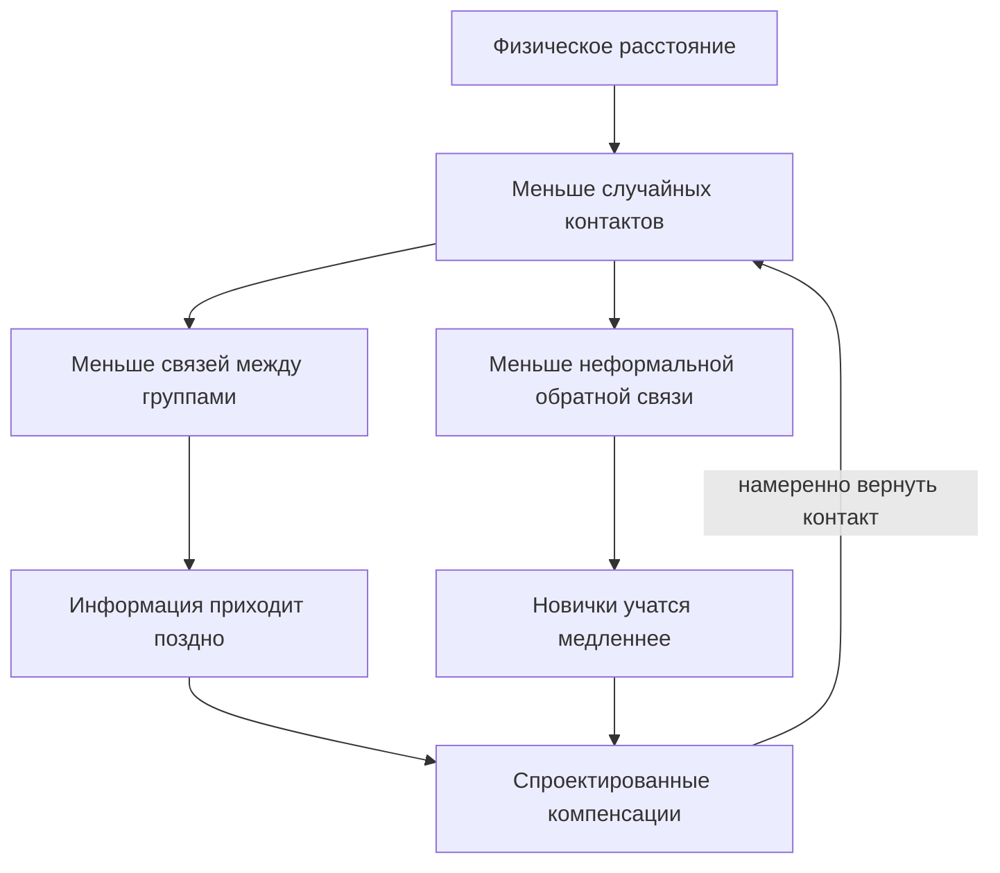
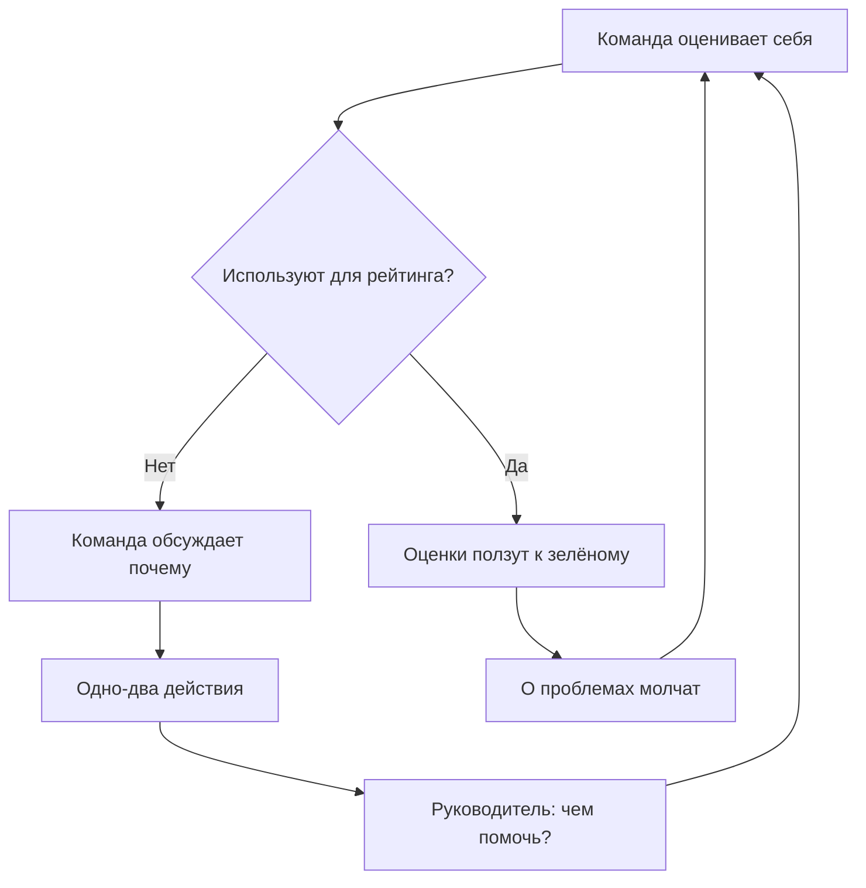
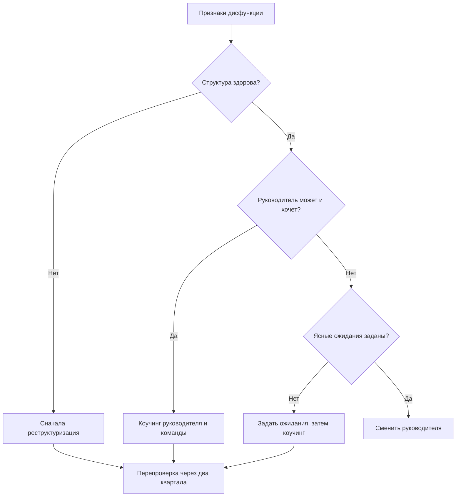

# Глава 14 — Распределённые команды, здоровье команды и диагностика дисфункций { #chapter-14-distributed-teams-team-health-and-diagnosing-dysfunction }

Эта глава о трёх задачах. Первая — спроектировать работу команды, участники которой не сидят в одной
комнате, опираясь на то, что показывают исследования удалённой и гибридной работы. Вторая — выяснить,
насколько команда здорова, и не превратить ответ в оценку, которой люди научатся управлять. Третья —
диагностировать команду, которая не работает, и выбрать между коучингом, реструктуризацией и сменой
руководителя. Сквозной пример — команда Customer Experience в Northstar Technologies, вымышленной
компании из [кейса](../../case-studies/northstar/index.md): девять веб-инженеров в Миннеаполисе и на
удалёнке, шесть мобильных инженеров в Боготе, один руководитель. Психологическая безопасность
(глава 11), опросы об опыте разработчиков (глава 18) и проектирование команд (глава 33) здесь
используются, но заново не объясняются.

## Почему это важно { #why-this-matters }

На уровне команды расстояние меняет то, кто что слышит. Решение, принятое за столом в Миннеаполисе,
доходит до Боготы через день, в пересказе и без спора, который к нему привёл. Никто этого не
добивается, но в команде вырастает внутренний круг, очерченный местом, и люди за его пределами
перестают поднимать проблемы.

На уровне организации большинство организаций из 50–150 инженеров разнесены по нескольким местам, хотя
бы из-за работы из дома, но управляются так, будто все сидят вместе. Цена проявляется в более медленной
межкомандной работе и в командах, которые по метрикам поставки выглядят нормально, а на деле
распадаются.

На уровне руководства формат работы стал политической борьбой, в которой обе стороны цитируют
исследования. Исследования отвечают на более узкие вопросы, чем утверждает любая из сторон.
Руководитель, который знает, что они показывают и чего не показывают, может выбрать политику под
работу, а не под настроение.

## Цели главы { #learning-objectives }

Прочитав эту главу, вы сможете:

- Объяснять, что нашли самые сильные исследования удалённой и гибридной работы и чего каждое из них
  сказать не может.
- Проектировать совместную работу распределённой или гибридной команды, компенсируя канал за каналом
  то, чем расстояние облагает общение.
- Проводить оценку здоровья команды, которой владеет сама команда, и интерпретировать её, не
  ранжируя команды и не управляя оценкой.
- Диагностировать буксующую команду по наблюдаемым признакам, слой за слоем.
- Выбирать между коучингом, реструктуризацией и сменой руководителя и называть стоимость перехода для
  каждого варианта.

## Ментальная модель { #the-mental-model }

> **Ментальная модель:** расстояние замедляет не всю работу одинаково. Оно облагает налогом общение,
> которое никто не планирует: случайно услышанный контекст, быструю обратную связь и связи между
> группами. А здоровье команды — это информация, которая принадлежит команде; как только она
> становится оценкой, которой управляют, она перестаёт быть информацией.

Плановая работа с ясными интерфейсами расстояние переносит хорошо. Работа, которая зависит от
незапланированных разговоров, — нет: senior-инженер замечает ошибку джуниора, кто-то случайно слышит,
что другая команда меняет API. Расстояние тихо убирает эти контакты, поэтому руководитель должен
намеренно их заменить.

Вторая половина модели определяет, как вы смотрите на команду. Проверка здоровья, ретроспектива или
опрос полезны потому, что люди отвечают откровенно. Откровенность зависит от того, что происходит с
ответами. Используйте их, чтобы помочь команде, — и они останутся честными. Используйте их, чтобы
судить команду, — и они поползут к зелёному.

## Подробный разбор { #deep-conceptual-explanation }

### Что показывают данные об удалённой и гибридной работе { #what-the-remote-and-hybrid-work-evidence-shows }

Основной вес несут пять исследований. Каждое отвечает на более узкий вопрос, чем тот, ради которого
его обычно цитируют.

| Исследование | Условия | Результат | Чего не показывает |
|---|---|---|---|
| [Herbsleb and Mockus, 2003](../../references/bibliography.md#herbsleb2003empirical) | Глобально распределённая разработка ПО, две организации | Распределённые задачи занимали примерно в 2.5 раза больше времени, чем похожие задачи в одном месте; больше участников, больше календарного времени | Закрывают ли разрыв современные инструменты |
| [Yang et al., 2022](../../references/bibliography.md#yang2022remote) | Около 61,000 сотрудников одной технологической компании в США, начало 2020 года | Удалённая работа всей компании сделала сети взаимодействия более статичными и замкнутыми, с меньшим числом мостов; синхронной коммуникации стало меньше, асинхронной — больше | Влияния на результат работы |
| [Gibbs, Mengel, and Siemroth, 2023](../../references/bibliography.md#gibbs2023wfh) | Более 10,000 специалистов одной ИТ-сервисной компании, работа из дома в пандемию | Рабочих часов стало больше, а результат не вырос; координации стало больше, а непрерывной работы, коучинга и встреч один на один с руководителем — меньше | Политики, выбранной добровольно; рецензируемой оценки (это рабочая статья) |
| [Bloom, Han, and Liang, 2024](../../references/bibliography.md#bloom2024hybrid) | Рандомизированное исследование, 1,612 сотрудников одной технологической компании, два дня дома в неделю | Увольнений по собственному желанию стало примерно на треть меньше; влияния на оценки результативности, повышения и число строк кода у инженеров нет; ожидания руководителей сменились с негативных на слегка позитивные | Полностью удалённой работы; связей между группами |
| [Emanuel, Harrington, and Pallais, 2023](../../references/bibliography.md#emanuel2023proximity) | Разработчики одной крупной американской компании; закрытия и открытия офисов как естественные эксперименты | Работа рядом с коллегами по команде увеличивала обратную связь по коду, которую получали инженеры, сильнее всего у новичков; опытные инженеры писали меньше кода | Может ли удалённое менторство это заменить |

Это **научные результаты**, каждый — по одной организации; исследования пандемийного периода измеряют
вынужденное и внезапное изменение. Вместе они согласуются лучше, чем публичный спор. Гибридный формат с
несколькими днями дома в единственном рандомизированном исследовании не стоил ничего измеримого и помог
удержанию. Полная удалёнка в масштабе ослабляет связи между группами и повышает стоимость координации.
Близость передаёт обратную связь от опытных инженеров новичкам.

**Позиция книги: удалённые, гибридные или собранные в одном месте команды.** Данные противоречивы, и ни
одно исследование не показывает, что какой-то формат лучше для команд разработки вообще. Данные
поддерживают три более узких утверждения: гибридный график с опорными днями — малорисковый вариант по
умолчанию; за полную удалёнку нужно платить намеренными механизмами связи между группами и обратной
связи; команды с большим числом новичков выигрывают от совместного времени больше всех. Выбор — это
проектное решение о том, какое общение нужно работе (**рекомендация книги**).

### Как проектировать совместную работу на расстоянии { #designing-collaboration-across-distance }

Считайте расстояние налогом на конкретные каналы и проектируйте компенсацию для каждого. Компенсации в
этой таблице — **рекомендация книги**, выведенная из описанных выше механизмов.

| Канал | Что с ним делает расстояние | Компенсация | Её цена |
|---|---|---|---|
| Решения | Принимаются в комнате, узнают о них позже | Записываются с обоснованием, в одном месте, до вступления в силу | Время на письмо |
| Незапланированный контекст | Исчезает | Названные люди-мосты; общий канал на каждый интерфейс; демо, открытые для всех площадок | Мосты теряют время на сосредоточенную работу |
| Обратная связь | Сжимается, сильнее всего у новичков | Расписание парной работы; целевые сроки ревью; ментор на той же площадке | Выработка senior-инженеров |
| Доверие | По видео строится медленно | Очные встречи для планирования, сложного проектирования, конфликтов | Бюджет на поездки |
| Встречи | Комната против экранов | Если хоть один участник удалённо, все подключаются со своих экранов; фасилитация по очереди | Часть энергии живого общения |

Важны ещё два правила. Первое: **следите, где сидит руководитель.** В разделённой команде место
руководителя становится центром тяжести: решения в коридоре, более быстрые встречи один на один,
задачи на вырост. Второе: **делайте культурные нормы явными.** Erin Meyer в
[*The Culture Map*](../../references/bibliography.md#meyer2014culture) утверждает, что национальные
культуры различаются тем, насколько прямо люди дают негативную обратную связь, выражают несогласие и
обозначают решения, и что неверное прочтение этих различий подрывает доверие (**мнение эксперта**). В
команде из двух стран договоритесь, как поднимать несогласие и плохие новости.

### Асинхронная работа и реальная разница часовых поясов { #asynchronous-work-and-real-time-zone-spread }

Когда рабочие часы почти не пересекаются, сделайте письменную асинхронную работу нормой, а время
пересечения тратьте на то, что письменно не решить. Площадки Northstar разделяет час, поэтому возьмём
**гипотетическую** команду: шесть инженеров в Чикаго и двое в Кракове, на семь часов впереди. Их рабочие
дни пересекаются примерно на час.

| Практика | Как она выглядит для этой команды |
|---|---|
| Защищённое окно пересечения | Один час три дня в неделю для споров, конфликтов и планирования; ранний или поздний слот чередуется между площадками |
| Письменная передача дел | В конце дня каждой площадки: что изменилось, что заблокировано, какое решение нужно и от кого |
| Асинхронные решения | Письменное предложение, окно для комментариев длиной в полный рабочий день на каждой площадке, названный решающий, решение публикуется там, куда смотрят обе площадки |
| Дежурство «вслед за солнцем» (follow-the-sun) | Каждая площадка покрывает своё дневное время, с письменной передачей инцидентов; это работает, только если обе площадки могут действовать по каждому компоненту, который покрывают |
| Удалённый онбординг | Наставник в часовом поясе новичка, запланированная парная работа во время пересечения, целевые сроки ревью изменений новичка |

Данные объясняют, почему важна каждая практика. Yang и соавторы обнаружили, что удалённая работа
сместила коммуникацию от синхронной к асинхронной и сделала сети более замкнутыми, поэтому мосты между
площадками нужно проектировать ([Yang et al., 2022](../../references/bibliography.md#yang2022remote)).
Emanuel и соавторы обнаружили, что близость сильнее всего увеличивала обратную связь для новичков,
поэтому новому сотруднику в семи часах от команды нужна намеренная обратная связь, а не надежда на неё
([Emanuel, Harrington, and Pallais, 2023](../../references/bibliography.md#emanuel2023proximity)).

Распространены две ловушки. Команда, которая проводит все встречи в часы большей площадки, превращает
день меньшей площадки в сверхурочную работу. А команда, которая всё пишет, но никогда не встречается,
медленно строит доверие; заложите в бюджет немного очного времени, как его оценивает таблица выше.

### Оценка здоровья команды без оценки, которой управляют { #team-health-assessment-without-a-score-to-manage }

Оценка здоровья команды — это структурированный способ, которым команда рассказывает, как идёт её
рабочая жизнь. Существуют два семейства. **Валидированные инструменты**, такие как Team Diagnostic
Survey, оценивают, насколько хорошо команда устроена, поддержана и руководима, а также её рабочие
процессы и реакции участников; его измерительные свойства проверены на данных 321 команды
([Wageman, Hackman, and Lehman, 2005](../../references/bibliography.md#wageman2005team)).
**Фасилитируемые воркшопы**, такие как проверка здоровья команды Spotify (squad health check), просят
команду оценить около десяти областей (простота релиза, техническое качество, миссия, обучение,
поддержка и другие) как зелёные, жёлтые или красные с указанием тренда и обсудить почему
([Kniberg and Lindwall, 2014](../../references/bibliography.md#kniberg2014squad)).

Правила вокруг инструмента важнее самого инструмента. Kniberg и Lindwall предупреждают, что модель
работает только там, где высоко доверие, потому что самоотчётные данные легко подогнать. Команды не
следует сравнивать между собой, и это инструмент поддержки, а не оценки (**задокументированная
практика**). Orosz и Beck описывают, что бывает иначе: в одной крупной компании результаты опросов
исказились, как только их привязали к оценке результативности и к давлению руководителей
([Orosz and Beck, 2023](../../references/bibliography.md#orosz2023measuring)). Это общая петля подгонки,
которую объясняет [глава 18](../04-execution/18-measuring-engineering-productivity.md).

Правила, которые сохраняют петлю честной (**рекомендация книги**, согласуется с Kniberg и Lindwall):

1. Результатами владеет команда, и она решает, что выходит за пределы комнаты.
2. Читайте тренды внутри команды, а не уровни между командами; красная команда, возможно, просто
   откровеннее.
3. Наверх уходят закономерности и запросы («три команды жалуются на боль с релизами»), а не оценки.
4. Никакие результаты проверки здоровья не попадают ни в чьи цели или оценку результативности.
5. Сопоставляйте каждую тему с сигналом системы: боль с релизами — с данными о развёртываниях,
   поддержку — с нагрузкой от инцидентов.
6. Заканчивайте не более чем двумя действиями с владельцем; оценка без последствий учит молчать.

Проверка здоровья — это не опрос об опыте разработчиков из главы 18, который анонимно измеряет трение
по всей организации в группах не меньше пяти человек. Проверка здоровья — разговор внутри одной
команды; её ценность больше в обсуждении, чем в оценках.

### Диагностика дисфункции { #diagnosing-dysfunction }

Дисфункциональная команда — та, которой не нагрузка, а способ работы мешает достичь результатов,
достижимых в иных условиях. Диагностика начинается с **наблюдаемых признаков**, потому что с ощущением
«в команде что-то не так» ничего не сделать: действия по итогам ретроспектив повторяются или касаются
одной подгруппы; решения пересматриваются или принимаются в обход; подгруппа молчит на общих встречах и
разговорчива на встречах один на один; инциденты скапливаются на внутренних границах; промахи, о которых
команда могла предупредить раньше; просьбы о переводе.

[*The Five Dysfunctions of a Team*](../../references/bibliography.md#lencioni2002five) Patrick
Lencioni (см. главу 11) — **мнение эксперта**, которое ставит видимый симптом, невыполненные результаты,
над причинами в отношениях и не спрашивает, была ли команда устроена так, чтобы преуспеть.

Team Diagnostic Survey отражает более широкий взгляд: он оценивает, насколько хорошо команда устроена,
поддержана и руководима, а не только её процессы и реакции участников. Книга берёт из этого взгляда
правило порядка (**рекомендация книги**): проверяйте устройство команды раньше, чем отношения. На
практике проверяйте четыре слоя в таком порядке:

| Слой | Вопрос | Типичные признаки |
|---|---|---|
| Структура | Это одна команда с одной общей целью, рабочей границей и работой, которую она может довести до конца? | Два продукта на одной доске; инциденты на внутренних границах; работа одной подгруппы всегда ждёт |
| Руководство | Задаёт ли руководитель направление, уделяет ли внимание каждой подгруппе, разбирается ли с конфликтами? | Неравномерные встречи один на один; решения сосредоточены в одном месте; проблемы всплывают поздно |
| Отношения | Доверяют ли люди друг другу настолько, чтобы спорить и затем брать обязательства? | Молчаливые встречи, решения в обход, пересматриваемые решения |
| Отдельные люди | Не создаёт ли картину поведение или результативность одного человека? | Картина следует за одним человеком в разных контекстах |

Большинство руководителей начинают снизу, с отдельных людей, потому что это самая простая история.
Структурная проблема, принятая за межличностную, получает коучинг, который не может сработать, а виноватыми
оказываются те, кого коучили. Психологическая безопасность, относящаяся к слою отношений, — тема главы 11.

### Коучинг, реструктуризация или смена руководителя { #coaching-restructuring-or-leadership-change }

Три средства, по возрастанию стоимости и необратимости:

- **Коучинг** руководителя и команды: фасилитируемые ретроспективы, рабочие соглашения, коуч для
  руководителя. Дёшево, обратимо, медленно. Работает, когда структура здорова, а руководитель может и
  хочет меняться.
- **Реструктуризация**: разделение команды, перенос границы или компонента, смена доски и ритма. Недели
  потрясений и просадка поставки. Работает, когда команда на самом деле — две команды или её граница
  гарантирует конфликт (проектирование команд разбирает глава 33).
- **Смена руководителя**: перевод или замена руководителя. Месяцы потрясений, риск потерять людей,
  лояльных руководителю, и сигнал всем остальным руководителям. Оправдана, когда руководитель получил
  ясные ожидания, поддержку и время и не изменился или безвозвратно потерял доверие.

Коучинг структурной проблемы тратит кварталы впустую; смена руководителя из-за неё наказывает не того
человека.

## Пример из инженерной организации { #engineering-organization-example }

!!! info "Northstar: что уже известно"
    Директор в начале квартала 2 (неделя 14). За квартал 1 число инцидентов Sev1 и Sev2 (два высших
    уровня серьёзности) сократилось с 30 до 21, а на неделе 10 семь QA-инженеров перешли в продуктовые
    команды инженерами по качеству. См. [хронологию](../../case-studies/northstar/timeline.md). Впервые
    читаете о Northstar? Прочитайте [«Год вкратце»](../../case-studies/northstar/year-in-brief.md) и
    [действующих лиц](../../case-studies/northstar/cast.md).

Формат работы Northstar — **иллюстрация** (компания вымышленная). Штаб-квартира находится в
Миннеаполисе, там работают все руководители высшего звена и руководители разработки; опорные офисные
дни — со вторника по четверг. Второй инженерный офис — в Боготе, не более чем в часе от Миннеаполиса.
Двенадцать инженеров работают полностью удалённо в США. Таблица показывает численность на исходном
уровне, до того как на неделе 10 семь QA-инженеров ушли из Platform Operations.

| Команда | Миннеаполис | Богота | Удалённо, США | Всего |
|---|---|---|---|---|
| Orders | 12 | 0 | 2 | 14 |
| Billing | 10 | 0 | 3 | 13 |
| Payments and Integrations | 6 | 5 | 1 | 12 |
| Customer Experience | 7 | 6 | 2 | 15 |
| Data and Analytics | 4 | 5 | 2 | 11 |
| Platform Operations | 10 | 0 | 2 | 12 |
| Staff-инженеры | 3 | 0 | 0 | 3 |
| **Итого** | **52** | **16** | **12** | **80** |

**Где расстояние кусается.** Не в часовых поясах: у каждого инженера минимум шесть рабочих часов
совпадают с Миннеаполисом. Кусается место. Три команды охватывают обе площадки, и каждый инженер в
Боготе подчиняется руководителю в Миннеаполисе. В Customer Experience граница между вебом и мобильной
разработкой совпадает ещё и с границей площадок. Большинство зависимостей команды на исходном уровне
(17 из 20 связей) вели к командам, которые почти целиком сидят в Миннеаполисе, из них 8 — к Orders,
которая владеет контрактом pricing-svc, используемым mobile-bff. INC-405 (mobile-bff развернули против
старой версии контракта pricing-svc, клиент обнаружил проблему через 140 минут) — это как раз такой
сбой, который становится вероятнее без моста между площадками. Это гипотеза, а не вывод из записей об
инциденте.

**Стоимость очного времени.** Допустим, директор хочет, чтобы каждый инженер из Боготы дважды в год
проводил рабочую неделю в Миннеаполисе, а каждый из трёх руководителей, у которых есть инженеры в
Боготе, дважды в год ездил в Боготу. Примем $3 000 на одну поездку человека (перелёт, отель, питание) —
это **иллюстративная** цифра:

| Статья | Расчёт | Стоимость |
|---|---|---|
| Инженеры из Боготы в Миннеаполис | 16 × 2 × $3,000 | $96,000 |
| Руководители в Боготу | 3 × 2 × $3,000 | $18,000 |
| **Итого в год** | | **$114,000** |

Для сравнения: один уход стоит вакансии плюс время на вхождение в работу по плановой ставке книги
$3 558 за инженеро-неделю (полная стоимость сотрудника в Northstar — $185 000 в год ÷ 52):

| Стоимость одного ухода | Допущение | Стоимость |
|---|---|---|
| Вакансия | Медиана на исходном уровне — 15 недель от заявления об уходе до первого дня замены | около $53,000 |
| Вхождение в работу | Ещё 13 недель на половине продуктивности | около $23,000 |
| **Итого, без гонораров рекрутерам** | | **около $76,000** |

Итак, программа поездок стоит примерно полтора ухода в год. Ни одно из процитированных здесь
исследований не показывает, что визиты снижают текучесть (Bloom и соавторы изучали дни дома, а не
поездки), так что это ставка с названной точкой безубыточности. Поездки — это
[операционные расходы](../../glossary.md#operating-expense) (текущие затраты, которые учитываются в год,
когда возникли), а Rajiv Menon (CFO, финансовый директор) хочет, чтобы они не росли. Деньги должны
откуда-то взяться, и это должно быть видно.

## Как принимать решение { #decision-framework }

Выбирайте формат работы по тому, какое общение нужно работе, а затем выбирайте компенсации.

| Если работа команды в основном… | Предпочтительно | Обязательные компенсации |
|---|---|---|
| Хорошо ограничена, со стабильными интерфейсами и опытными инженерами | Любой формат, включая полностью удалённый | Письменные решения; целевые сроки ревью |
| Пересекает границы, с частыми изменениями общих контрактов | Та же площадка, что у соседей, которых она меняет чаще всего, или названные мосты | Роли мостов; контрактные тесты; общие каналы на каждый интерфейс |
| Ведётся в основном новичками | Совместное время с менторами в совпадающие дни | Расписание парной работы; ментор на той же площадке |
| Разделена между площадками по специализации | По возможности избегать; если нельзя, сделать каждую площадку цельной подкомандой со своим лидом | Присутствие руководителя на обеих площадках; паритет на встречах |
| Пересечение рабочего дня меньше примерно четырёх часов (эвристика книги) | Асинхронность по умолчанию | Письменная передача дел; решения, которые могут подождать день |

Для буксующей команды используйте послойную диагностику и выбирайте средство в таком порядке:

«Структура здорова» означает, что способный руководитель с доверяющей командой мог бы преуспеть с
такой границей и такой доской. «Ясные ожидания заданы» означает, что руководитель мог бы пересказать,
чего от него ждали и к какому сроку. Если нет, провал отчасти ваш.

## Компромиссы { #trade-offs }

**Работа в одном месте против пула найма.** Один офис покупает случайные контакты и менторство и
теряет кандидатов; в единственном рандомизированном исследовании дни дома снизили число увольнений.
Вторая площадка расширяет пул и добавляет границу, которой придётся управлять всегда.

**Письменность против скорости.** Письменные решения позволяют распределённым командам работать, но
замедляют мелкие решения. Записывайте те, что пересекают границу площадки или команды; остальные пусть
остаются неформальными.

**Менторство против выработки senior-инженеров.** Emanuel и соавторы обнаружили, что рядом с коллегами
опытные инженеры писали меньше кода. Совместное время перемещает ресурс от senior-инженеров к
джуниорам; часто это правильно, но пусть это будет выбором.

**Проверки здоровья против времени.** Два часа в квартал на 15 человек — это 30 инженеро-часов: дёшево,
если это исправит одну проблему, и дорого, если не исправит ничего, потому что следующая проверка будет
менее откровенной.

**Реструктуризация против инерции.** Разделение стоит недель потрясений и новой координации между
половинами; оставленная как есть структурная проблема стоит понемногу каждую неделю, бессрочно. Первое
заметнее, поэтому руководители реструктурируют реже, чем нужно.

**Смена руководителя против сигнала.** Замена руководителя сообщает всем остальным руководителям, что
организация терпит: слишком поздно — значит, результативность не важна; без предварительных ожиданий —
значит, следующим может стать любой.

## Типичные провалы { #failure-modes }

**Географическая «звезда».** Площадка руководителя становится командой. *Как обнаружить:* действия по
итогам ретроспектив, задачи на вырост и владение дизайном смещены к одному месту.

**Комната против экранов.** Шесть человек в комнате, четверо по видео пропускают разговоры вполголоса.
*Как обнаружить:* удалённые участники говорят на встречах меньше, чем на встречах один на один.

**Турнирная таблица здоровья.** Результаты собирают по командам в рейтинг; вскоре все докладывают
зелёный. *Как обнаружить:* оценки улучшаются, а инциденты, текучесть или просьбы о переводе — нет.

**Оценка без последствий.** Команда называет свои проблемы, и ничего не меняется. *Как обнаружить:* одни
и те же красные области в последовательных оценках; обсуждения становятся короче.

**Коучинг структурной проблемы.** Команда, которая на самом деле — две команды, получает фасилитатора и
выездную сессию. *Как обнаружить:* действия по коучингу выполнены, признаки не изменились, в инцидентах
та же граница.

**Реструктуризация вокруг человека.** Реорганизация, которая позволяет избежать трудного разговора.
*Как обнаружить:* структура имеет смысл, только если знать, кто в ней.

**Запоздалая смена руководителя.** Все ниже директора знают, что руководитель не справляется. *Как
обнаружить:* встречи через уровень трижды говорят одно и то же; сильные инженеры просят перевода.

## Применение в крупной организации { #enterprise-application }

В организации из 50–150 инженеров три вещи переходят с уровня команды на уровень организации.

**Стратегия площадок.** Решите, для чего нужна каждая площадка. Площадка, на которой находятся целые
команды с местными лидами, работает лучше, чем площадка с обрывками команд, подчинённых кому-то в
другом месте. Если команда должна охватывать несколько площадок, делите её по стабильной границе
(компонент с опубликованным контрактом), а не по специализациям, которые меняются вместе каждый спринт.

**Рабочие соглашения по умолчанию.** Опубликуйте общеорганизационный минимум (письменные решения,
пересекающие границы; встречи «сначала экран»; целевые сроки ревью между площадками); команды добавляют
свои правила.

**Здоровье как детектор закономерностей.** Команды проводят свои проверки здоровья каждый квартал.
Директор просит у руководителей закономерности и запросы, а не результаты, и ищет одну и ту же проблему в
нескольких командах — обычно её нужно решать на уровне организации. Дополняйте это опросом об опыте
разработчиков из главы 18 и встречами через уровень (глава 5). После двух кварталов признаков
дисфункции директор лично проводит послойную диагностику.

## Взгляд CTO { #cto-perspective }

На уровне руководства политика формата работы — решение компании, у которого три аудитории.

**CEO и совет директоров** часто хотят обязательного присутствия в офисе, потому что совместная работа
кажется слабее. CTO отделяет то, что данные поддерживают (гибрид мало стоит в результативности; полная
удалёнка ослабляет связи между группами; джуниоры выигрывают от близости), от того, что не поддерживают
(что какой-либо формат в целом повышает результат). Вывод об удержании говорит против поголовных
обязательных правил.

**Сотрудники** читают политику как заявление о доверии. Требование, обоснованное данными пропусков,
читается как слежка; требование, обоснованное конкретной работой (недели планирования, онбординг), —
как проектирование.

**Руководителям** нужно, чтобы исключения решались по правилу, а не обсуждались с каждым отдельно,
иначе политика становится системой одолжений.

CTO также владеет решением иметь больше одной площадки — это постоянная граница, и в обосновании
должны быть названы преимущество в найме или стоимости и профинансированные компенсации. И сигналы
здоровья CTO должен видеть только как закономерности: CTO, который просит оценки здоровья команд, сам
создал турнирную таблицу.

## Практический плейбук { #practical-playbook }

1. **Нанесите людей на карту.** По командам и подгруппам: площадка, удалёнка, часы пересечения с
   руководителем. Отметьте каждую команду, у которой граница специализаций совпадает с границей
   площадок.
2. **Назовите облагаемые каналы** для каждой разделённой команды и выберите по одной компенсации на
   канал, с владельцем.
3. **Запишите правило встреч и правило решений**: встречи «сначала экран», если хоть кто-то удалённо;
   решения, пересекающие границы, записываются с обоснованием.
4. **Профинансируйте совместное время** для разделённых команд, с названной целью каждого визита
   (планирование, сложное проектирование, онбординг) и стоимостью, которую вы сможете защитить.
5. **Проводите проверку здоровья, которой владеет команда,** раз в квартал: фасилитирует кто-то вне
   линии подчинения, отдельно для подгрупп, если одна из них тише, в конце — не более двух действий. В
   [шаблоне оценки здоровья команды](../../templates/team-health-assessment.md) есть области, протокол
   сессии и разобранный пример.
6. **Сообщайте наверх закономерности, а не оценки.** Запишите правило доступа до первой сессии.
7. **Следите за признаками дисфункции** в ретроспективах, инцидентах, встречах один на один и просьбах о
   переводе.
8. **Диагностируйте по слоям**, начиная со структуры, с доказательствами для каждого слоя.
9. **Выбирайте средство** по схеме решения; запишите ожидания и дату перепроверки и скажите команде, что
   вы делаете и почему.

## Кейс { #case-study }

Этот кейс — **вымысел**. Действие происходит в начале квартала 2, а исход — решение, которое предстоит
принять читателю. Предыдущие кварталы описаны в [хронике года 1](../../case-studies/northstar/first-quarter.md).

**Команда.** В Customer Experience 15 инженеров под руководством Daniel Cho, руководителя разработки:
девять веб-инженеров (семь в Миннеаполисе, двое удалённо) и шесть мобильных, все в Боготе. Команда
владеет web-app, mobile-app и mobile-bff. Два инженера по качеству (бывшие QA-инженеры) присоединились на
неделе 10, оба в Миннеаполисе. Должности техлида ни у кого нет; Hannah Lindgren неформально ведёт веб, а
Mateo Arango Ríos — мобильную разработку. Daniel тратит 45 процентов времени на людей — это самая
большая доля среди руководителей Northstar.

**Признаки.** По метрикам поставки команда выглядит здоровой: она развёртывает чаще любой другой
команды (26 раз в месяц), а [незапланированная работа](../../glossary.md#unplanned-work) занимает
28 процентов её ресурса при среднем по организации 34. Другие признаки с этим не согласны:

- Одна доска и один двухнедельный спринт для веба и мобильной разработки, хотя мобильные релизы
  проходят ревью в магазинах приложений. В INC-426 офлайн-синхронизация портила черновики на одной
  мобильной операционной системе; исправление ждало этого ревью, и восстановление заняло 1 310 минут.
- Два из четырёх инцидентов [Sev2](../../glossary.md#severity-sev1-sev2-sev3) команды на исходном
  уровне — на мобильной стороне: INC-405 в mobile-bff (описан выше) и INC-426 в mobile-app.
- Ретроспективы проходят так: Миннеаполис в одной комнате, Богота по видео; 6 из последних 8 действий
  по итогам ретроспектив касались веб-работы.
- Около половины видеовстреч один на один Daniel с мобильными инженерами в базовом квартале
  переносились.
- В базовом квартале команда взяла обязательства по четырём пунктам дорожной карты и выполнила два.

**Проверка здоровья.** На неделе 16 директор попросил Elena Sokolova (руководитель Payments and
Integrations, команды, которая тоже охватывает обе площадки) провести фасилитацию. Она провела проверку
дважды: один раз для веба вместе с инженерами по качеству и один раз для мобильной разработки. Обычно
за пределы комнаты выходят только закономерности и запросы. Поскольку от них зависело структурное
решение, обе группы согласились в этот раз показать свои оценки Daniel и директору. Веб оценил
5 областей как зелёные, 4 как жёлтые и 1 как красную (скорость, которую связали с ожиданием Orders).
Мобильная группа оценила 2 области как зелёные (обучение, удовольствие от работы), 4 как жёлтые и 4 как
красные: простота релиза, подходящий процесс, поддержка и «пешки или игроки» (чувствует ли команда, что
контролирует собственную работу). Запрос мобильной группы, словами Mateo, звучал так: «своя доска и
решения, которые принимаются там, где мы можем их услышать».

**Диагноз.** По слоям:

- *Структура:* одна доска и один ритм для двух продуктов с разной механикой релизов, и граница площадок
  поверх границы специализаций. Нездорова.
- *Руководство:* Daniel вкладывается в людей, но его внимание достаётся тем, кто рядом. Сопутствующий
  фактор; ожиданий по руководству командой на нескольких площадках ему никто никогда не задавал.
- *Отношения:* молчание мобильной группы объясняется структурой; признаков конфликта между отдельными
  людьми нет.
- *Отдельные люди:* картины, которая следует за одним человеком, нет.

**Варианты.**

| Вариант | Что это значит | Стоимость |
|---|---|---|
| A. Коучинг | Фасилитируемые ретроспективы, правила встреч, Daniel ездит в Боготу | Низкая; одна доска для двух продуктов остаётся |
| B. Реструктуризация внутри команды | Отдельные доски, ритмы и ретроспективы, у каждой — свой неформальный лид; мобильная группа сама владеет ритмом релизов; названный мост к Orders по pricing-svc | Недели потрясений; Daniel руководит подкомандами из 11 и 6 человек |
| C. Разделение на две команды | Новая команда Mobile со своим руководителем | Без роста численности возможно, только если инженерное место нового руководителя не будет заполнено заново: Customer Experience теряет ресурс одного инженера; решает CTO |
| D. Смена руководителя | Заменить Daniel | Данные этого не оправдывают |

Директор рекомендует вариант B с практиками из A, письменные ожидания для Daniel по руководству на
нескольких площадках и перепроверку в конце квартала 3 по тем же признакам. Вариант C остаётся
открытым, если B не сдвинет красные области мобильной группы. Верно ли это — вопрос для упражнений.

## Упражнения { #exercises }

Решения — на странице [решений к главе 14](../../solutions/ch14-solutions.md). Данные Northstar — на
[странице исходного уровня](../../case-studies/northstar/baseline-data.md).

### Базовый уровень { #foundational }

**F1.** Один из руководителей рассылает краткое изложение исследования Gibbs, Mengel и Siemroth под
заголовком «Работа из дома снижает продуктивность» и предлагает пять офисных дней для всех инженеров.
Коллега отвечает ссылкой на исследование Bloom, Han и Liang: «Гибрид не влияет на результативность».
Объясните, что измеряло каждое исследование, в каких условиях и чего ни одно из них не может сказать
этой компании.

**F2.** В команде из восьми человек четыре инженера в одном офисе, трое в другом офисе с разницей во
времени в один час и один удалённый инженер, пришедший три месяца назад. Назовите каналы, которые
расстояние облагает налогом в этой команде, и спроектируйте по одной компенсации для каждого, с
владельцем и стоимостью.

**F3.** Руководитель руководителей предлагает публиковать квартальную проверку здоровья каждой команды
в виде таблицы-светофора на ежемесячном обзоре разработки, «чтобы видеть, каким командам нужна
помощь». Предскажите с помощью петли из этой главы, что произойдёт за два квартала, и предложите схему,
которая всё же находит команды, которым нужна помощь.

### Прикладное лидерство { #applied-leadership }

**A1.** Вы — Elena Sokolova, руководитель Payments and Integrations, и готовитесь фасилитировать
проверку здоровья Customer Experience на неделе 16. Шесть мобильных инженеров никогда много не говорили
на общих встречах, а Daniel Cho, их руководитель, попросил разрешения присутствовать. Спроектируйте
сессии: кто участвует, в каком формате, что выходит за пределы комнаты и что вы скажете Daniel.

**A2.** В Data and Analytics четыре инженера в Миннеаполисе, пять в Боготе и двое удалённо, а в данных
исходного уровня отмечено «мало контакта с другими командами». Руководитель команды говорит, что
расстояние не проблема, потому что показатели поставки у команды хорошие. Решите, какие доказательства
показали бы, стоит ли расстояние организации чего-то, и что бы вы изменили.

**A3.** В команде из девяти человек (не в Northstar) видны такие признаки: решения пересматриваются после
планирования, ретроспективы каждый спринт дают одни и те же три действия, два senior-инженера общаются
в основном через комментарии на код-ревью, а руководитель говорит, что команде «просто нужно
сработаться». Проведите диагностику по слоям и выберите средство, указав, какие доказательства изменили
бы ваш выбор.

**A4.** Вы руководите новой командой из семи человек: четыре инженера в Остине и трое в Бангалоре, с
разницей от десяти с половиной до одиннадцати с половиной часов в зависимости от сезона и без
естественного пересечения. Команда владеет одним сервисом tier 2 и со следующего квартала начинает
дежурить. Спроектируйте модель её работы: окно пересечения, передачу дел, способ принятия решений,
покрытие дежурств и онбординг следующего сотрудника в Бангалоре. Укажите, чего стоит каждый выбор и
кто несёт эту стоимость.

### Решения на уровне руководства { #executive-decision-making }

**X1.** Helena Marsh (CEO) просит Victor Lindqvist (CTO) ввести политику четырёх офисных дней в неделю в
штаб-квартире, утверждая, что совместная работа ослабла, и спрашивает, стоит ли сохранять офис в
Боготе. Напишите ответ CTO: что поддерживают данные, стоимость и риск каждого варианта без роста
численности и без роста операционных расходов и что вы рекомендуете.

**X2.** Конец квартала 3. Customer Experience разделила доску и ритм, как было рекомендовано. Проверка
здоровья мобильной группы теперь показывает 3 красные области вместо 4, у mobile-app за квартал был один
Sev2, Daniel съездил в Боготу один раз вместо оговорённых двух, а Mateo Arango Ríos, неформальный лид
мобильной группы, спрашивает, не может ли он стать её руководителем. Решите, разделять ли команду,
продолжать коучинг или менять руководство, и как ответить Mateo.

## Вопросы для размышления { #reflection-questions }

1. Если бы самое важное решение вашей команды в прошлом месяце принималось, когда все работали
   удалённо, кто узнал бы о нём позже, чем узнал на самом деле?
2. Кого из прямых подчинённых вы чаще всего видите лично, и видно ли это по их задачам?
3. Когда ваша команда в последний раз назвала проблему на проверке здоровья или ретроспективе, что
   заметного произошло после этого?
4. Какие из ваших убеждений об удалённой работе сложились до того, как вы прочитали хоть какие-то
   данные?
5. Когда команда буксует, какой слой вы проверяете первым и почему именно его?
6. Что должен увидеть ваш руководитель, прежде чем заменить вас, и сказал ли он вам об этом?

## Главное { #key-takeaways }

- Расстояние облагает налогом незапланированное общение, обратную связь для новичков и связи между
  группами. Назовите каналы и намеренно компенсируйте каждый.
- Ни одно исследование не показывает, что какой-то формат работы лучше для команд разработки. Гибридный
  график — малорисковый вариант по умолчанию; за полную удалёнку нужно платить; джуниоры выигрывают от
  совместного времени больше всех.
- Не допускайте, чтобы граница специализаций и граница площадок проходили по одной линии. Если без
  этого не обойтись, дайте каждой площадке лида и направьте внимание руководителя туда, где его нет.
- Проверка здоровья принадлежит команде. Читайте тренды внутри команды, сообщайте наверх закономерности,
  никогда не ранжируйте команды и никогда не вписывайте результаты ни в чьи цели.
- Диагностируйте дисфункцию по слоям: структура, руководство, отношения, отдельные люди — в таком
  порядке.
- Не коучьте структурную проблему, не реструктурируйте вокруг человека и не меняйте руководителя,
  которому никогда не говорили, чего от него ждут. Называйте стоимость перехода для каждого средства и
  дату перепроверки.

## Источники и что почитать { #references-and-further-reading }

- [Bloom, Han, and Liang, 2024](../../references/bibliography.md#bloom2024hybrid). Рандомизированное
  исследование гибридной работы.
- [Yang et al., 2022](../../references/bibliography.md#yang2022remote). Удалённая работа и сети
  взаимодействия между группами.
- [Gibbs, Mengel, and Siemroth, 2023](../../references/bibliography.md#gibbs2023wfh). Издержки
  координации при работе из дома в пандемию.
- [Emanuel, Harrington, and Pallais, 2023](../../references/bibliography.md#emanuel2023proximity).
  Близость как канал передачи обратной связи от опытных инженеров новичкам.
- [Herbsleb and Mockus, 2003](../../references/bibliography.md#herbsleb2003empirical). Задержки в
  глобально распределённой разработке.
- [Wageman, Hackman, and Lehman, 2005](../../references/bibliography.md#wageman2005team).
  Валидированная диагностика команды, охватывающая структуру, поддержку и руководство.
- [Kniberg and Lindwall, 2014](../../references/bibliography.md#kniberg2014squad). Проверка здоровья
  команды (squad health check) с предупреждениями о сравнении и оценивании.
- [Orosz and Beck, 2023](../../references/bibliography.md#orosz2023measuring). Как результаты опросов
  теряют ценность, когда их привязывают к оценке результативности.
- [Lencioni, 2002](../../references/bibliography.md#lencioni2002five). *The Five Dysfunctions of a
  Team*. Запоминающаяся модель того, как проблемы доверия проявляются в невыполненных результатах;
  читайте вместе со структурными взглядами.
- [Meyer, 2014](../../references/bibliography.md#meyer2014culture). *The Culture Map*. Чем различаются
  культурные нормы обратной связи и несогласия — для команд, работающих в нескольких странах.
