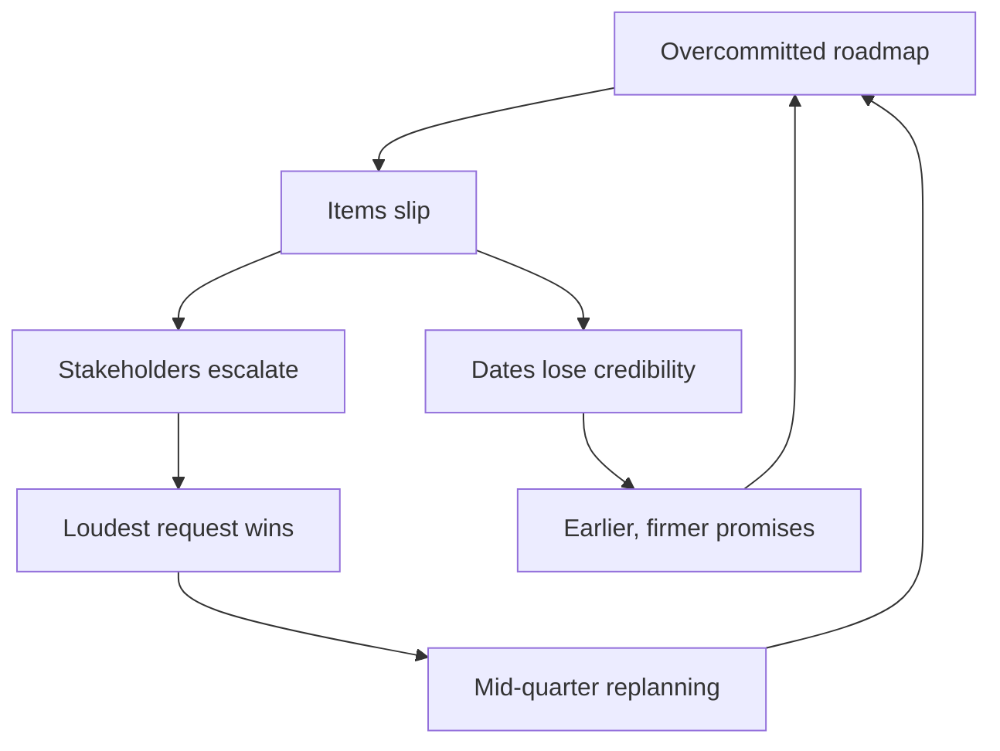
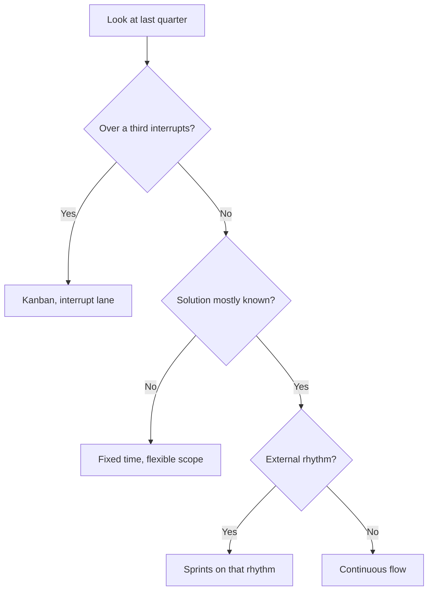

# Chapter 15 — Planning, Prioritization, and Delivery Methods

This chapter is about three decisions every engineering leader makes, usually without naming them:
how a team organizes its work (Scrum, Kanban, fixed cycles, or no named method), how competing
requests are ordered, and how much planning a piece of work deserves. It argues that the method
should follow the shape of the work, that priority should follow explicit economics rather than the
loudness of the person asking, and that planning effort should be proportional to what is actually
known. The running example is Northstar Technologies, the fictional company in the
[case study](../../case-studies/northstar/index.md), where 7 of 17 committed roadmap items shipped in
the quarter they were promised.

Neighboring topics have their own chapters: flow and dependencies (Chapter 16), forecasting and
commitments (17), organization-level quarterly planning (38), outcome roadmaps (44), and the economics
of cost of delay (45). This chapter works at the level of a team and a director's portfolio of teams.

## Why This Matters

For a team, the delivery method decides what a normal week feels like: whether interrupts are
expected or treated as failures, and whether the plan is a two-week promise or a queue. A method
that does not fit the work produces a team that is always "behind" while working hard.

For an organization, prioritization decides what the engineering budget earns, because value
delayed is value lost. When priority goes to whoever escalated last, the organization pays twice:
in the value of the work that should have been first, and in the replanning and abandoned partial
work every escalation causes.

For an executive, planning is a credibility instrument. Northstar's Chief Product Officer, Amara
Okafor, wants the roadmap she committed to customers on the dates she gave; last quarter it
delivered 41 percent of its commitments. Sales teams that learn engineering dates mean little
promise earlier and more firmly to compensate, which makes the next plan worse.

## Learning Objectives

After this chapter you will be able to:

- Choose and adapt a delivery method (Scrum, Kanban, fixed-time cycles, or none) from the shape of
  a team's work: interrupts, uncertainty, and external rhythm.
- Read the official method descriptions and the research on agile methods accurately, including
  how weak that research is.
- Prioritize with explicit economics (cost of delay divided by duration) and show stakeholders what
  a volume-driven order costs.
- Match planning effort to uncertainty, and run a team roadmap cadence that keeps near-term
  commitments firm and later items honest.

## The Mental Model

> **Mental model:** A plan is a bet sized to what you know. The method is how you place and revise
> the bets; the priority order is which bets you place first, and it should be set by what waiting
> costs, not by who is waiting loudest.

Two ideas organize the chapter.

The first is that **work has a shape**. Some arrives unpredictably and must be handled within days
(incidents, escalations). Some is well understood and can be planned in detail. Some is genuinely
uncertain: nobody knows the solution or its size. Each method assumes a different shape dominates.
A team whose work is a third interrupts, run on a method that assumes a protected two-week plan,
will miss its plan every time, and the miss will be blamed on the people.

The second is the **volume loop**. Without an explicit economic rule, priority goes to whoever
pushes hardest. That loop reinforces itself:

Replanning abandons partial work, so more items slip; slipping teaches stakeholders that only
escalation and early, firm promises work. The loop breaks only with both a capacity-honest plan
(Chapter 27 builds the capacity model) and a priority rule stakeholders can argue with in numbers.

## Deep Conceptual Explanation

### What the methods actually say

Much argument about methods concerns versions their authors would not recognize. Start from the
primary descriptions.

The **Agile Manifesto** of 2001 is four value preferences, not a method; the last prefers
responding to change over following a plan, and the closing line says the items on the right
still have value ([Beck et al., 2001](../../references/bibliography.md#beck2001manifesto)). A plan
is not the enemy; valuing it above what you learn is.

**Scrum**, in the 2020 Scrum Guide, is a lightweight framework built on empiricism. It has three
accountabilities (Developers, Product Owner, Scrum Master) and a Sprint of one month or less containing
planning, a 15-minute Daily Scrum, a review, and a retrospective. Its three commitments are the Product
Goal, the Sprint Goal, and the Definition of Done
([Schwaber and Sutherland, 2020](../../references/bibliography.md#schwaber2020scrum)). The guide
calls the framework immutable and says a partial implementation is not Scrum. For leaders, two
points matter: Scrum commits to a Sprint Goal, not a list of tickets, and it assumes most of a
Sprint can be protected from interruption. Story points and velocity are common practice around
Scrum; they are not in the guide.

**Kanban**, in the Kanban Guide, is a strategy for optimizing the flow of value. Its three practices
are to define and visualize the workflow, actively manage items in it, and improve it. It requires
explicit control of [work in progress (WIP)](../../glossary.md#work-in-progress-wip-and-wip-limit)
without prescribing a number. It names four flow measures (WIP, throughput, work item age, cycle time)
and prescribes no roles or iterations
([Coleman, Vacanti, et al., 2025](../../references/bibliography.md#vacanti2025kanban)). Kanban assumes
the reverse of Scrum: work arrives continuously and is pulled when there is capacity.

**Shape Up**, Ryan Singer's book on how Basecamp works, uses six-week cycles for small teams.
Instead of estimating, leaders set an **appetite** (how much time the work is worth) and choose
**bets**; a project not finished in its cycle is cancelled by default rather than extended, which the
book calls the circuit breaker ([Singer, 2019](../../references/bibliography.md#singer2019shapeup)).
These are the book's headline ideas. The relevant inversion
is fixed time and flexible scope, the right structure for uncertain work.

### What the evidence says, and does not

The research is weak exactly where a leader needs it: whether method A beats method B in a setting
like yours. Dybå and Dingsøyr's systematic review found 36 empirical studies of agile development up
to 2005 and concluded that the field needed more and better studies
([Dybå and Dingsøyr, 2008](../../references/bibliography.md#dyba2008empirical)). A review of Kanban
in software found 19 primary studies by 2013, reporting shorter lead time, better quality, and fewer
customer-reported defects, along with training and organizational challenges
([Ahmad, Markkula, and Oivo, 2013](../../references/bibliography.md#ahmad2013kanban)). These are
reported benefits from case studies, not controlled evidence of cause.

The most useful recent **research finding** is a survey of 556 data points by Marco Kuhrmann and 46
co-authors. Fewer than 15 percent of respondents worked in a purely traditional or purely agile way.
The practices chosen affected perceived agility more than the named method, and no method or
practice guaranteed or prevented agility
([Kuhrmann et al., 2022](../../references/bibliography.md#kuhrmann2022agile)). It is self-reported
and measures perceived agility, not delivery outcomes.

So there is **no research finding** that any named method outperforms another across contexts.
Choosing by the shape of the work is **this book's recommendation**, built on the methods' own
stated assumptions.

### Prioritization as economics

The economic answer to "which work first?" is the work whose delay costs most per unit of capacity
it consumes. **[Cost of delay](../../glossary.md#cost-of-delay)** is the value lost per week while
work is not done: revenue not earned, cost not saved, risk not retired. The idea is widely credited to
Donald Reinertsen ([Reinertsen, 2009](../../references/bibliography.md#reinertsen2009principles)), and
Chapter 45 develops the economics. Cost of delay divided by duration gives a ranking often called
[CD3](../../glossary.md#cd3-and-wsjf). The Scaled Agile Framework (SAFe) uses **Weighted Shortest Job
First (WSJF)**, a relative-scoring version of the same ratio: relative cost of delay (business value,
time criticality, risk reduction or opportunity enablement) over relative job size
([SAFe, WSJF](../../references/bibliography.md#safe-wsjf)). WSJF is SAFe's method; SAFe credits
Reinertsen for the emphasis on cost of delay.

The rule is useful even with rough numbers, for three reasons:

- **The cost has a shape.** Some delays cost a steady amount per week; some cost nothing until a
  date and then a great deal (a renewal condition). A fixed-date item is not ranked by a ratio; it
  is scheduled backward from its date with a margin, and its capacity is reserved first.
- **Duration counts.** A modest two-week item often beats a valuable four-month one, because it
  starts paying sooner. Ranking by value alone favors large items.
- **The conversation changes.** "Sales wants it" becomes "Sales estimates a $400,000 deal and
  believes the feature decides half of it", a claim that can be checked later.

Melissa Perri's "build trap", measuring output shipped instead of outcomes achieved, is the
attached warning ([Perri, 2018](../../references/bibliography.md#perri2018escaping)): a cost-of-delay
estimate is a hypothesis to check after delivery, not a tool for winning a ranking meeting.

### Planning proportional to uncertainty

Planning effort should scale with what can be known, not with how important the work feels
(**this book's recommendation**):

| Kind of work | What is known | Planning that fits | Commitment you can make |
|---|---|---|---|
| Known | Solution and size, from similar past work | Break down, sequence, estimate from history | A date with a range (Chapter 17) |
| Complicated | The problem, but not the best solution | A time-boxed investigation first, then plan | A date for the decision, not the delivery |
| Uncertain | Neither the solution nor the size | Appetite and checkpoints; scope flexes | A time box and what will be learned |

The common error is planning uncertain work as if known: a quarter-long feature broken into forty
estimated tickets in week one, summed, and promised, then defended all quarter. The opposite error
is refusing to plan repeatable work in detail because "agile means no plans", which discards cheap,
accurate forecasts.

The DevOps argument for visible work and small batches
([Kim et al., 2016](../../references/bibliography.md#kim2016devops)) applies to plans too. A plan
detailed for two weeks, outlined for six, and ranked beyond that is cheap to revise; a quarter
planned in detail is a large batch, and fails late and all at once.

### Team-level roadmap cadence

A team roadmap has three horizons:

- **Now** (two to six weeks): committed, sized, staffed. Changes need an explicit trade.
- **Next** (rest of the quarter): ranked by cost of delay over duration, shaped enough to start.
- **Later**: problems and opportunities in rough order, with no dates.

A monthly team review with the product manager (what moved to now, what was learned, what the
estimates now say) keeps it honest, inside the organization's quarterly reset (Chapter 38). Fixed-date
commitments sit outside the ranking, with reserved capacity and a visible margin.

## Engineering Organization Example

!!! info "Northstar so far"
    Week 14, the start of quarter 2. Two renewal features must ship this quarter: an accounting
    integration (week 19) and bulk ordering (week 26). Quarter 1 cut Sev1 and Sev2 incidents from 30 to
    21, and Core now releases weekly. See the [timeline](../../case-studies/northstar/timeline.md).

The team is Northstar's Orders team; the candidate items, their values, and their durations are
**illustrative**.

Orders has four candidates for its "next" horizon after the reserved bulk-ordering work, each with
an estimated cost of delay per week and a duration in weeks of the capacity available.

| Item | Asked for by | Cost of delay per week | Basis of the estimate | Duration (weeks) | CD3 |
|---|---|---|---|---|---|
| P1 Price-list import | VP Sales, open deal | $3,800 | $400,000 a year deal, half of it judged to depend on the feature: $200,000 ÷ 52 | 3 | 1.27 |
| P2 Saved order templates | Customer Success | $2,000 | Support tickets avoided plus a rough retention value | 2 | 1.00 |
| P3 Order search redesign | CEO, after a customer dinner | $1,000 | No quantified case; a generous guess | 8 | 0.13 |
| P4 Pricing-rules cleanup | Staff engineer, from the debt register | $4,300 | About 1.2 [FTE](../../glossary.md#fte) (full-time equivalent engineers) of unplanned work a year at $185,000: $222,000 ÷ 52 | 6 | 0.72 |

CD3 is cost of delay in thousands of dollars per week divided by weeks. P4 is debt priced as
interest, as in Chapter 21's
[prioritizing debt against features](../05-engineering-quality/21-technical-debt.md#prioritizing-debt-against-features).

Volume would order them P3, P1, P2, P4; the economic order is P1, P2, P4, P3. Assume the team works
the items one after another and each item's cost of delay accrues until it ships. Total cost of
delay is each item's weekly cost times its finishing week, summed:

| Sequence | Finish weeks | Total cost of delay |
|---|---|---|
| Economic: P1, P2, P4, P3 | 3, 5, 11, 19 | 3.8×3 + 2×5 + 4.3×11 + 1×19 = about $88,000 |
| Volume: P3, P1, P2, P4 | 8, 11, 13, 19 | 1×8 + 3.8×11 + 2×13 + 4.3×19 = about $158,000 |

The difference, about $70,000 over 19 weeks, is the price of ordering by volume under these
assumptions. The estimates are rough, but the decision is robust: P3 stays last unless its cost of
delay is underestimated about sixfold, and the CEO can be asked whether it is, a better question
than whether the CEO's request matters. The debt item outranks it because its interest is real
money, not because engineering asked for "time for quality". And the gain depends on working items
one at a time; a team that starts all four at once finishes all four late (Chapter 16).

## Decision Framework

The first decision is the method. Choose it from the shape of the work, then adapt:

| Signal in the work | Method that fits | Adaptation that usually matters |
|---|---|---|
| Interrupts above about a third of capacity | Kanban with an explicit lane and WIP limit for interrupts | Measure work item age; an interrupt rotation so the rest of the team can finish things |
| Mostly known work, a fixed external rhythm ([release train](../../glossary.md#release-train): a release on a fixed schedule carrying every ready change; app store; customer reviews) | Scrum-style sprints aligned to that rhythm | Sprint Goal as the commitment, not the ticket list; an interrupt budget subtracted before planning |
| Mostly uncertain, product-shaping work | Fixed-time cycles with an appetite (Shape Up-style) | Shape before committing; cancel or re-bet rather than extend |
| Small, continuous, independently deployable changes | Continuous flow, no named method | WIP limit and a weekly ranking with product; flow measures (Chapter 16) |
| Mixed portfolio | A hybrid, chosen deliberately | Write down which practices you use and why; review each quarter |

The threshold of "about a third" is **this book's recommendation**, a judgment: above it, a
protected sprint plan is broken more often than kept. Hybrids are the norm; choose yours on purpose.

The second decision is how to rank:

- fixed-date items backward from the date, with reserved capacity;
- estimable items by cost of delay over duration;
- items whose value cannot be estimated as uncertain work, with a small time box to learn;
- many small requests by service class (a category with its own expected response time, such as
  expedite or standard) and WIP limit;
- debt by interest (Chapter 21), inside the [prevention allocation](../../glossary.md#prevention-allocation) (capacity reserved for
removing the causes of incidents and debt; Chapter 27).

## Trade-offs

**Predictability against responsiveness.** A protected sprint is predictable for two weeks and slow
to respond; a Kanban queue responds within days and dates nothing not yet started. Choose by what
the team's customers need more.

**Economic ranking against relationships.** A visible low score can feel like being overruled by a
spreadsheet. Let stakeholders own their estimates (Sales the deal value, Customer Success retention,
engineering duration and interest), so the ranking reflects their own claims.

**Standardization against fit.** One method everywhere eases reporting and transfers, and forces an
interrupt-heavy team into sprints it cannot keep. Standardize the interface (what is committed, at
risk, done), not the method inside each team.

**Commitment against learning.** Every fixed date removes room to respond to what the team learns.
Some are worth it, such as a renewal condition; each should be a decision with a named owner.

## Failure Modes

**Cargo-cult Scrum.** Ceremonies run, points are summed, and the Sprint Goal is a list of tickets.
Signal: plans change mid-sprint and retrospectives repeat themselves. Countermeasure: protect the
Sprint (an interrupt budget and rotation) or change the method.

**Velocity as a performance measure.** Compared across teams or used to judge them, points inflate
within a quarter. Signal: velocity rises while lead time and outcomes do not. Countermeasure:
forecast from throughput (Chapter 17); never compare points across teams (Chapter 18).

**Kanban without limits.** A board without WIP limits is a status display. Signal: work item age
rises and many items are "in progress". Countermeasure: set limits; review the oldest items first.

**The loudest-voice roadmap.** The roadmap changes after every executive meeting. Signal: replans
nobody can explain in value terms. Countermeasure: requester-owned cost-of-delay estimates and an
explicit trade for any change to "now".

**Capacity fiction.** The roadmap assumes nominal capacity while a third goes to unplanned work.
Signal: commitments missed by about the unplanned share, every quarter. Countermeasure: plan against
measured capacity (Chapter 27's
[funding model](../05-engineering-quality/27-quality-transformation-at-enterprise-scale.md#funding-the-work)).

## Enterprise Application

At 50 to 150 engineers, a director has five to twelve teams and three layers of planning to fit
together.

**Teams choose their method** within a shared interface: every team answers the same questions in
the same format (what is committed now, what is at risk, what is ranked next and why, how much
capacity went to unplanned work).

**The director owns the portfolio rules**: the capacity model, how fixed-date commitments are
admitted and protected, and the cost-of-delay convention for items competing across teams.

**Product owns value estimates; engineering owns duration and interest.** The director's distinctive
contribution is honest capacity and duration, and pricing debt and prevention in the same units as
features.

**Cross-team items** pay their cost of delay while waiting in the slowest team's queue. At planning
time, count them, give each one lead team, and commit no more than the organization can coordinate;
Chapter 16 treats dependencies as a design problem.

## CTO Perspective

At executive level the method is invisible and the planning system is not.

**What does a date mean?** The CTO sets the convention separating commitments, targets, and
forecasts (Chapter 17). If Sales quotes forecasts as commitments, no team method will save the date.

**Who can create a commitment?** Most delivery crises start with a promise made outside
engineering. The lever is a rule agreed with the CEO, Sales, and Product: no external date without
engineering's estimate and reserved capacity, and a short list of commitments admitted per quarter.
It constrains revenue teams, so it needs executive agreement.

**Is the portfolio balanced?** Across directors, does the split between features, deal and renewal
commitments, prevention, and debt match the strategy? Chapters 38 and 45 cover allocation and
investment economics.

## Practical Playbook

1. **Measure each team's work shape** over the last quarter: unplanned share, share of items whose
   solution was known at start, and any external rhythm.
2. **Write down the practices each team actually uses**, not the label.
3. **Choose or adapt** with the decision framework, one change at a time; a method change costs
   several weeks of lower output.
4. **Make capacity honest**: subtract measured unplanned work and prevention before committing.
5. **Admit fixed-date commitments first**, each with an owner, a margin, and reserved capacity.
6. **Rank the rest by cost of delay over duration**, with requesters writing value estimates and
   engineering writing durations as ranges and debt interest in money.
7. **Plan in three horizons**, and review monthly at team level.
8. **Check estimates after delivery**, and weight each requester's next estimate by their record.

## Case Study

This case is **fictional**. It describes how Northstar planned in the baseline quarter, before the
director arrived, and the planning decision the director faces for quarter 2. The director's first
quarter is summarized on [the first quarter](../../case-studies/northstar/first-quarter.md) page.

### How the teams planned

Each team chose its own method, and nobody had compared them:

| Team | Method in the baseline quarter | Unplanned work |
|---|---|---|
| Orders | Two-week Scrum, sprint end aligned to the Core release train's code cutoff; Sprint Goal met in 2 of the last 6 sprints | 36% |
| Billing | Two-week Scrum aligned to the release train; Sprint Goal met in 1 of the last 6 sprints; scope changed mid-sprint in all 6 | 41% |
| Payments and Integrations | Kanban with WIP limits per stage and a weekly replenishment meeting with the product manager | 33% |
| Customer Experience | Two-week sprints, one board for nine web and six mobile engineers; half-day planning sessions | 28% |
| Data and Analytics | No named method: a quarterly project list plus a request queue triaged twice a week | 24% |
| Platform Operations | Interrupt-driven ticket queue for infrastructure; the QA schedule set by the train | 46% |

Unplanned shares are from the [baseline data](../../case-studies/northstar/baseline-data.md). Core's
release train left every two weeks, with a code cutoff before each.

The pattern fits the decision framework. Orders and Billing ran sprints their interrupt load could
not protect; the two-week rhythm made sense because the train set it, but the plan inside each
sprint did not. Payments and Integrations, on Kanban with WIP limits, had the shortest
[change lead time](../../glossary.md#lead-time) (commit to running in production) of the product teams:
4 days. Platform Operations had no method for its own infrastructure projects,
which advanced only when the queue was quiet.

### How the 17 items were chosen

Before the baseline quarter, the product managers collected 31 candidate items. Amara Okafor, Greg
Tanaka (VP Sales), Sofia Alvarez (VP Customer Success), and Victor Lindqvist (CTO) ranked them in a two-hour meeting by distributing 100
points each. Engineering sized the ranked list in t-shirt sizes (rough classes such as S, M, and L), about 560
engineer-weeks. A line was drawn at the assumed capacity of 780 engineer-weeks: 80 engineers for 13
weeks, less a 25 percent allowance for support and bugs. Seventeen items fell above the line; five had dates
already given to customers, including Greg Tanaka's two deal features.

Three things were wrong, each visible in the data:

- **Capacity fiction.** Unplanned work took 34 percent, leaving about 686 engineer-weeks, and that
  also had to cover small requests and deal support that were not on the roadmap.
- **Volume ranking.** Points rewarded whoever cared most; no item had a value estimate.
- **Cross-team items.** Nine of the 17 needed more than one team. Of the 7 that shipped, 6 were
  single-team; of the 10 that missed, 8 were cross-team.

By primary team, the commitments and deliveries were:

| Primary team | Committed | Delivered |
|---|---|---|
| Orders | 4 | 1 |
| Billing | 3 | 0 |
| Payments and Integrations | 3 | 2 |
| Customer Experience | 4 | 2 |
| Data and Analytics | 2 | 2 |
| Platform Operations | 1 | 0 |

### The two renewal commitments

Late in the baseline quarter, in renewal talks with the two at-risk customers ($9M in annual
recurring revenue together), Northstar agreed two features as renewal conditions:

- **Bulk ordering** (Orders): asynchronous processing of order files of up to 20,000 lines across
  delivery sites, replacing the upload that failed beyond row 500 in INC-421. Due at the end of
  quarter 2; five Orders engineers and two Customer Experience web engineers.
- **Accounting-system integration** (Payments and Integrations): a new erp-sync connector to the
  customer's accounting system, with daily reconciliation of posted invoices. Due at the end of week
  6 of quarter 2; four engineers.

Both have step-shaped cost of delay and were admitted first rather than ranked. They are why Orders
and Payments and Integrations gave only 10 percent of their capacity to prevention in quarter 1,
against 25 percent for Billing and 15 percent for the other teams. At day 90 both were on track.

### The decision for quarter 2

The director's proposal for quarter 2 planning has four parts. It is a proposal for the reader to
evaluate; its results are not recorded.

1. Plan against measured capacity. The director's capacity model (Chapter 27 builds it) projects about
   46 FTE of feature capacity for quarter 2, not 80 engineers: 80, less projected unplanned work (28 percent, or
   22.4 FTE) and the 12 FTE prevention allocation. The renewal staffing comes out of that figure before
   anything else is ranked.
2. Admit the two renewal items and their margins first, then rank everything else by cost of delay
   over duration, with value estimates written by the requesters.
3. Give each cross-team item a lead team and cap the number committed.
4. Let teams change method where the shape of the work demands it, with Billing and Platform
   Operations as the first candidates, and report through one shared format.

One complication is already known. Core moved to weekly releases from week 5 of quarter 1, so
the two-week train that justified Orders' and Billing's sprint length no longer exists.

## Exercises

Solutions are in [chapter 15 solutions](../../solutions/ch15-solutions.md). Northstar data is on the
[baseline page](../../case-studies/northstar/baseline-data.md).

### Foundational

**F1.** A team of eight runs two-week Scrum. Over the last quarter it spent 40 percent of its time on
unplanned work, met its Sprint Goal in one sprint of six, and its manager has asked for "better
estimation training". Using the official descriptions of Scrum and Kanban in this chapter, explain
what is going wrong, whether estimation is the problem, and what you would change first.

**F2.** Recompute the Orders example with one change: Customer Success learns that two customers worth
$600,000 a year in total have said they will leave without saved order templates (P2), and judges the
risk at one in three. Estimate P2's new cost of delay per week, re-rank the four items, and say
whether the order changes. State your assumptions.

**F3.** A colleague cites a vendor survey showing that "Scrum teams deliver 40 percent faster" as the
reason to move every team to Scrum. Using what this chapter reports about the research on agile
methods, explain what that kind of claim can and cannot support, and what evidence would change your
view.

### Applied Leadership

**A1.** The Billing team of Marcus Oyelaran (its engineering manager) planned six sprints last quarter and changed scope mid-sprint in
all six. He wants to keep Scrum because "the team likes the rhythm". Prepare for the conversation:
what you want to learn from him, what data you bring, and what options you would put on the table,
including keeping Scrum.

**A2.** Suppose Greg Tanaka (VP Sales) asks for a third deal feature to be committed for quarter 2,
with a date he has already mentioned to the prospect (a hypothetical). Orders' "now" horizon is full with bulk ordering. Write the reply
you would send him, including what you need from him to rank the request and what it would displace.

**A3.** Design the team-level roadmap cadence for Data and Analytics, which has no named method, a
24 percent unplanned share, and a mix of quarter-long warehouse projects and small report requests.
Say what you would keep from how it works today.

### Executive Decision-Making

**X1.** The CEO, Helena Marsh, proposes that from next year every customer-facing date must be approved
by the CTO before Sales can mention it. Greg Tanaka (VP Sales) objects that this will lose deals. As CTO, decide
whether to accept the rule as proposed, change it, or reject it, and write the one-paragraph rationale
you would give the executive team.

**X2.** Victor Lindqvist (CTO) asks you to standardize every Northstar team on a single delivery method from
quarter 3 "so that we can compare teams". Recommend what to standardize and what not to, explain what
comparison he can and cannot get, and state the transition cost.

## Reflection Questions

1. Which team in your organization is running a method that does not fit its work, and what has the
   misfit been blamed on?
2. When did a loud request last displace a quieter one in your plans? What would its cost of delay
   have been, and did anyone check afterward?
3. Which of your current commitments are fixed-date items with real consequences, and which are
   dates that someone chose and nobody revisited?
4. How much of your last quarterly plan was detailed planning of work nobody understood yet?
5. If you had to publish the value estimate behind every item on your roadmap, which ones would you
   be uncomfortable defending?
6. What would your sales or customer teams do differently if engineering dates became reliable?

## Key Takeaways

- Choose the delivery method from the shape of the work: interrupt load, uncertainty, and any
  external rhythm. The label matters less than the practices.
- Read the primary descriptions. Scrum commits to a Sprint Goal and assumes a protected Sprint;
  Kanban limits WIP and assumes continuous arrival; fixed-time cycles fix time and flex scope.
- The research does not show any named method is better across contexts; hybrids are the norm.
  Choose the hybrid deliberately and review it.
- Rank by cost of delay divided by duration, with value estimates owned by the requesters and
  checked after delivery.
- Admit fixed-date commitments first, with owners, margins, and reserved capacity; do not rank them
  against everything else.
- Plan in proportion to what is known: detail for known work, time boxes and decision dates for
  uncertain work.
- Plan against measured capacity. A roadmap built on nominal capacity misses by about the unplanned
  share.
- Standardize the reporting interface across teams, not the method inside them.

## References and Further Reading

- [Schwaber and Sutherland, 2020](../../references/bibliography.md#schwaber2020scrum). *The 2020 Scrum
  Guide*. The official definition; read it before debating Scrum.
- [Coleman, Vacanti, et al., 2025](../../references/bibliography.md#vacanti2025kanban). *The Kanban
  Guide*. Kanban's practices and flow measures.
- [Beck et al., 2001](../../references/bibliography.md#beck2001manifesto). The Agile Manifesto.
- [Singer, 2019](../../references/bibliography.md#singer2019shapeup). *Shape Up*. Fixed-time cycles
  and appetite.
- [Dybå and Dingsøyr, 2008](../../references/bibliography.md#dyba2008empirical). For calibrating
  claims about agile evidence.
- [Kuhrmann et al., 2022](../../references/bibliography.md#kuhrmann2022agile). Hybrids are the norm.
- [Ahmad, Markkula, and Oivo, 2013](../../references/bibliography.md#ahmad2013kanban). Kanban's
  reported benefits and challenges.
- [Reinertsen, 2009](../../references/bibliography.md#reinertsen2009principles). The book most
  associated with cost of delay.
- [SAFe, WSJF](../../references/bibliography.md#safe-wsjf). SAFe's Weighted Shortest Job First.
- [Perri, 2018](../../references/bibliography.md#perri2018escaping). *Escaping the Build Trap*.
  Output is not outcome.
- [Kim et al., 2016](../../references/bibliography.md#kim2016devops). *The DevOps Handbook*. Visible
  work and small batches.
