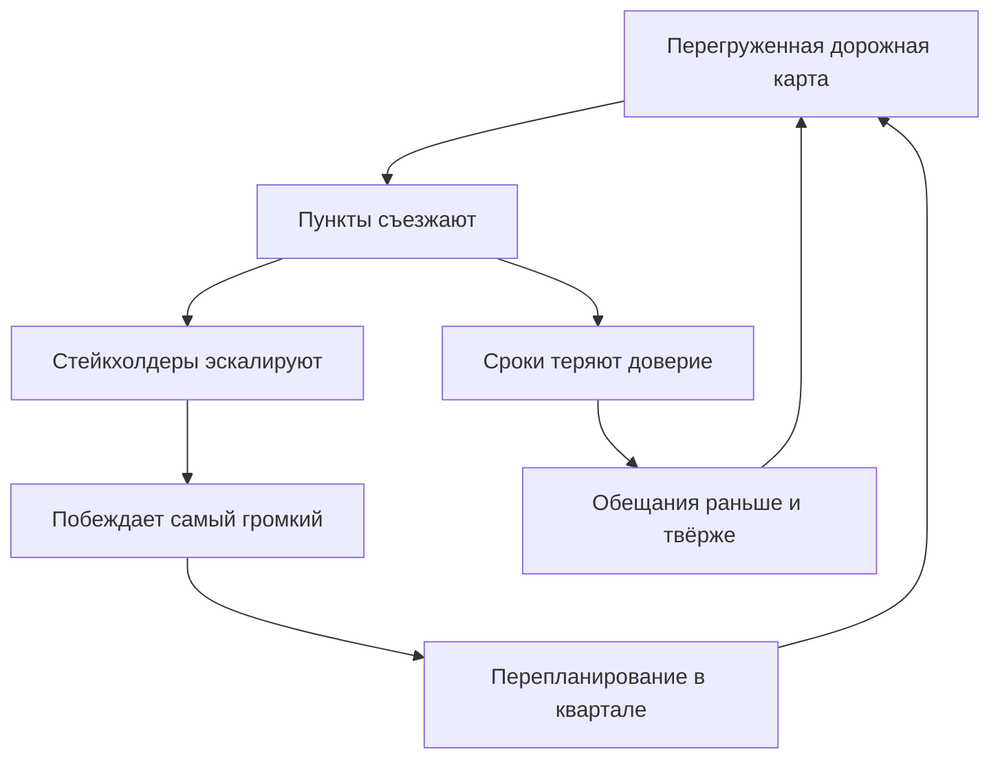
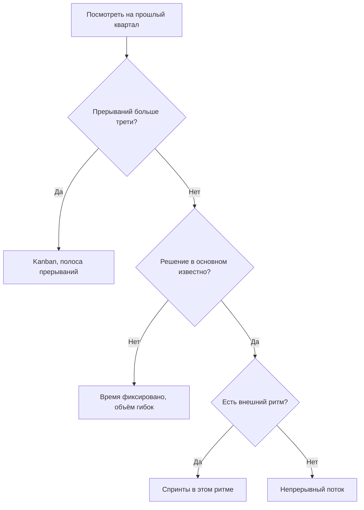

# Глава 15 — Планирование, приоритизация и методы поставки { #chapter-15-planning-prioritization-and-delivery-methods }

Эта глава о трёх решениях, которые принимает каждый руководитель разработки, обычно не называя их:
как команда организует работу (Scrum, Kanban, циклы фиксированной длины или метод без названия), в
каком порядке браться за конкурирующие запросы и сколько планирования заслуживает конкретная работа.
Позиция главы такова: метод должен следовать форме работы, приоритет — явной экономике, а не громкости
просящего, а усилия на планирование — тому, что действительно известно. Сквозной пример — Northstar
Technologies, вымышленная компания из [кейса](../../case-studies/northstar/index.md): из 17 пунктов
дорожной карты, по которым взяли обязательство, в обещанном квартале вышли 7. Масштаб главы — команда и
портфель директора; потоку (глава 16), прогнозированию (17), планированию на уровне организации (38) и
экономике задержки (45) посвящены отдельные главы.

## Почему это важно { #why-this-matters }

Для команды метод поставки определяет, какой будет обычная неделя: ждут ли прерываний или считают их
провалом, что такое план на две недели — обещание или очередь. Если метод не подходит работе, команда
трудится изо всех сил и всё равно вечно «отстаёт».

Для организации приоритизация определяет, что даёт бюджет разработки: отложенная ценность — потерянная
ценность. Когда приоритет получает тот, кто эскалировал последним, организация платит дважды. Сначала —
ценностью работы, которая должна была идти первой. Затем — перепланированием и брошенной на полпути
работой, которые тянет за собой каждая эскалация.

Для руководства планирование — инструмент доверия. CPO (директор по продукту) Northstar Amara Okafor
хочет получить дорожную карту, которую пообещала клиентам, в названные ею сроки, а в прошлом квартале
выполнен 41 процент обязательств. Команды продаж, усвоившие, что сроки разработки мало что значат,
компенсируют это: обещают раньше и твёрже, и следующий план от этого становится хуже.

## Цели главы { #learning-objectives }

Прочитав эту главу, вы сможете:

- Выбирать и адаптировать метод поставки — Scrum, Kanban, циклы фиксированной длины или работу без
  метода — по форме работы команды: прерываниям, неопределённости и внешнему ритму.
- Точно читать официальные описания методов и исследования гибких методологий, понимая, насколько эти
  исследования слабы.
- Приоритизировать по явной экономике (стоимость задержки, делённая на длительность) и показывать
  стейкхолдерам, во что обходится порядок «кто громче».
- Соизмерять усилия на планирование с неопределённостью и вести ритм дорожной карты команды, при
  котором ближайшие обязательства твёрдые, а дальние пункты — честные.

## Ментальная модель { #the-mental-model }

> **Ментальная модель:** план — это ставка, соразмерная тому, что вы знаете. Метод — это то, как вы
> делаете и пересматриваете ставки. Порядок приоритетов решает, какие ставки делать первыми, и задавать
> его должна цена ожидания, а не то, кто ждёт громче всех.

Главу организуют две идеи.

Первая: **у работы есть форма**. Часть работы приходит непредсказуемо, и разобраться с ней нужно за
несколько дней (инциденты, эскалации). Часть хорошо понятна, и её можно детально спланировать. Часть
по-настоящему неопределённа: никто не знает ни решения, ни его размера. Каждый метод исходит из того,
что преобладает какая-то одна форма. Если у команды треть работы — прерывания, а живёт она по методу,
рассчитанному на защищённый двухнедельный план, план будет срываться каждый раз, а виноватыми окажутся
люди.

Вторая — **петля громкости**. Без явного экономического правила приоритет получает тот, кто сильнее
давит. Петля усиливает сама себя:

Перепланирование бросает работу недоделанной, и съезжает ещё больше пунктов; срывы учат стейкхолдеров,
что работают только эскалации и ранние твёрдые обещания. Разорвать петлю можно лишь сочетанием двух
вещей: плана, честного по ресурсам (модель ресурсов строит глава 27), и правила приоритетов, с которым
стейкхолдеры могут спорить цифрами.

## Подробный разбор { #deep-conceptual-explanation }

### Что говорят сами методы { #what-the-methods-actually-say }

Многие споры ведутся о версиях методов, которые их авторы не узнали бы. Начните с первоисточников.

**Agile Manifesto** 2001 года — не метод, а четыре ценностных предпочтения. Последнее ставит
готовность к изменениям выше следования плану, а заключительная строка оговаривает, что пункты справа
тоже ценны ([Beck et al., 2001](../../references/bibliography.md#beck2001manifesto)). План — не враг;
враг — ставить его выше того, что вы узнали.

**Scrum**, согласно Scrum Guide 2020 года, — лёгкий фреймворк, основанный на эмпиризме. В нём три
зоны ответственности (Developers, Product Owner, Scrum Master) и Sprint длиной не больше месяца, в
который входят планирование, 15-минутный Daily Scrum, обзор и ретроспектива. Три его обязательства —
цель продукта (Product Goal), цель спринта (Sprint Goal) и определение готовности (Definition of Done)
([Schwaber and Sutherland, 2020](../../references/bibliography.md#schwaber2020scrum)). Руководство
называет фреймворк неизменным и указывает, что частичная реализация — это не Scrum. Руководителю важны
две вещи. Scrum берёт обязательство по цели спринта, а не по списку тикетов. И он предполагает, что
большую часть спринта можно защитить от прерываний. [Стори-поинты и скорость
команды](../../glossary.md#velocity-and-story-points) — распространённая практика вокруг Scrum, но в
руководстве их нет. Стори-поинты — относительные оценки размера, скорость — число поинтов, закрытых за
спринт. Обе величины локальны для одной команды, и сравнивать их между командами нельзя.

**Kanban**, согласно Kanban Guide, — стратегия оптимизации потока ценности. Его три практики —
определить и визуализировать рабочий процесс, активно управлять задачами в нём и улучшать его. Kanban
требует явно контролировать [незавершённую работу (WIP)](../../glossary.md#work-in-progress-wip-and-wip-limit),
но конкретного числа не предписывает. Он называет четыре показателя потока: WIP, пропускную способность
(сколько задач завершается за неделю), возраст задачи (сколько открытая задача уже находится в работе) и
[время цикла](../../glossary.md#cycle-time) (от начала работы до готовности); глава 16
[даёт их определения](16-flow-lead-time-dependencies-and-unplanned-work.md#flow-measures-throughput-cycle-time-and-work-item-age).
Ни ролей, ни итераций Kanban не предписывает
([Coleman, Vacanti, et al., 2025](../../references/bibliography.md#vacanti2025kanban)). Он исходит из
допущения, обратного Scrum: работа поступает непрерывно, и её вытягивают, когда появляется ресурс.

**Shape Up** — книга Ryan Singer о том, как работает Basecamp: небольшие команды там работают
шестинедельными циклами. Вместо оценок руководители задают **аппетит** (appetite: сколько времени эта
работа того стоит) и выбирают **ставки**. Проект, не законченный за цикл, по умолчанию отменяется, а не
продлевается; книга называет это предохранителем (circuit breaker)
([Singer, 2019](../../references/bibliography.md#singer2019shapeup)). Это главные идеи книги. Важна
инверсия: время фиксировано, а объём гибок, и для неопределённой работы такая структура правильна.

### Что говорят данные и чего не говорят { #what-the-evidence-says-and-does-not }

Исследования слабы именно там, где они нужнее всего руководителю: лучше ли метод A, чем метод B, в
условиях вроде ваших. Систематический обзор Dybå и Dingsøyr нашёл до 2005 года 36 эмпирических
исследований гибкой разработки и заключил, что области нужно больше исследований, причём лучшего
качества ([Dybå and Dingsøyr, 2008](../../references/bibliography.md#dyba2008empirical)). Обзор Kanban
в разработке ПО нашёл к 2013 году 19 первичных исследований. Они сообщали о более коротком lead time,
лучшем качестве и меньшем числе дефектов, о которых сообщили клиенты, а также о трудностях с обучением
и организацией ([Ahmad, Markkula, and Oivo, 2013](../../references/bibliography.md#ahmad2013kanban)).
Это выгоды, заявленные в кейс-стади, а не контролируемые доказательства причинности.

Самый полезный из недавних **научных результатов** — опрос Marco Kuhrmann и 46 соавторов, давший
556 точек данных. Меньше 15 процентов респондентов работали чисто традиционно или чисто гибко. На
воспринимаемую гибкость выбранные практики влияли сильнее, чем название метода, и ни один метод или
практика не гарантировали гибкости и не исключали её
([Kuhrmann et al., 2022](../../references/bibliography.md#kuhrmann2022agile)). Данные самоотчётные и
измеряют воспринимаемую гибкость, а не результаты поставки.

Итак, **научного результата**, который показывал бы, что какой-то метод с названием превосходит другой
в разных контекстах, **нет**. Выбор по форме работы — **рекомендация книги**; она опирается на
допущения, которые называют сами методы.

### Приоритизация как экономика { #prioritization-as-economics }

Экономический ответ на вопрос «что делать первым?» такой: ту работу, задержка которой стоит больше всего
на единицу потребляемого ресурса. **[Стоимость задержки](../../glossary.md#cost-of-delay)** (cost of
delay) — ценность, которую теряют каждую неделю, пока работа не сделана: незаработанная выручка,
несэкономленные затраты, неснятый риск. Идею широко приписывают Donald Reinertsen
([Reinertsen, 2009](../../references/bibliography.md#reinertsen2009principles)), а её экономику
разбирает глава 45. Если разделить стоимость задержки на длительность, получится ранжирование, которое
часто называют [CD3](../../glossary.md#cd3-and-wsjf). Scaled Agile Framework (SAFe) использует
**Weighted Shortest Job First (WSJF)** — версию того же отношения в относительных баллах: относительная
стоимость задержки (ценность для бизнеса, критичность по времени, снижение риска или открытие
возможностей), делённая на относительный размер работы
([SAFe, WSJF](../../references/bibliography.md#safe-wsjf)). WSJF — метод SAFe, а акцент на стоимости
задержки SAFe приписывает Reinertsen.

Правило полезно даже с грубыми цифрами, и тому три причины:

- **У стоимости есть форма.** Одни задержки стоят одинаково каждую неделю; другие ничего не стоят до
  определённой даты, а потом очень дорого (условие продления). Пункт с фиксированной датой по отношению
  не ранжируют: его планируют от даты назад, с запасом, и ресурс под него резервируют первым.
- **Длительность имеет значение.** Скромный двухнедельный пункт часто выигрывает у ценного
  четырёхмесячного, потому что раньше начинает приносить отдачу. Ранжирование только по ценности
  играет на руку крупным пунктам.
- **Меняется разговор.** «Этого хотят продажи» превращается в «Продажи оценивают сделку в $400 000 и
  считают, что от функции зависит половина», а такое утверждение потом можно проверить.

Помните и о предупреждении Melissa Perri насчёт «ловушки разработки» (build trap): измерять выпуск
(output) вместо достигнутых результатов (outcome)
([Perri, 2018](../../references/bibliography.md#perri2018escaping)). Для приоритизации из него
следует, что оценка стоимости задержки — гипотеза, которую нужно проверить после поставки, а не
инструмент для победы на встрече по ранжированию.

### Планирование соразмерно неопределённости { #planning-proportional-to-uncertainty }

Усилия на планирование должны расти вместе с тем, что можно узнать, а не с тем, насколько важной
кажется работа (**рекомендация книги**):

| Вид работы | Что известно | Подходящее планирование | Какое обязательство можно дать |
|---|---|---|---|
| Известная | Решение и размер — по похожей прошлой работе | Декомпозировать, упорядочить, оценить по истории | Дату с диапазоном (глава 17) |
| Сложная | Задача, но не лучшее решение | Сначала исследование, ограниченное по времени, затем план | Дату решения, а не поставки |
| Неопределённая | Ни решение, ни размер | Аппетит и контрольные точки; объём гибкий | Временные рамки и то, что будет выяснено |

Типичная ошибка — планировать неопределённую работу как известную: квартальную функцию на первой же
неделе разбивают на сорок оценённых тикетов, оценки складывают, дают обещание и потом весь квартал его
отстаивают. Обратная ошибка — отказываться детально планировать повторяемую работу, потому что «agile
значит без планов», и тем самым выбрасывать дешёвые и точные прогнозы.

Аргумент DevOps в пользу видимой работы и малых партий
([Kim et al., 2016](../../references/bibliography.md#kim2016devops)) применим и к планам. План,
детализированный на две недели, намеченный на шесть и ранжированный дальше, пересматривать дёшево.
Квартал, спланированный в деталях, — крупная партия: проваливается он поздно и весь сразу.

### Ритм дорожной карты команды { #team-level-roadmap-cadence }

У дорожной карты команды три горизонта:

- **Сейчас** (now, от двух до шести недель): обязательство взято, размер оценён, люди назначены.
  Изменения — только через явный обмен.
- **Далее** (next, остаток квартала): пункты ранжированы по стоимости задержки, делённой на
  длительность, и проработаны настолько, чтобы можно было начать.
- **Позже** (later): проблемы и возможности в примерном порядке, без дат.

Раз в месяц команда вместе с продакт-менеджером пересматривает карту: что перешло в «сейчас», что
выяснилось, что теперь говорят оценки. Такой обзор держит карту честной в промежутках между
квартальными перезапусками планов организации (глава 38). Обязательства с фиксированной датой стоят
вне ранжирования: под них зарезервирован ресурс, а их запас виден всем.

### Пример дорожной карты результатов { #a-worked-outcome-roadmap }

Три горизонта работают лучше, когда в каждом лежат результаты, а не функции. Результат — это измеримое
изменение в поведении клиента или бизнеса, а функции становятся ставками на пути к нему. Как переводить
одно в другое, показывает глава 44. Здесь — итог для **иллюстративной** команды заказов (не из
Northstar). Её список функций выглядел так: сохранённые шаблоны заказов, кнопка повторного заказа,
экспорт в CSV, редизайн поиска заказов.

Каждому заказчику задали вопрос: «Что изменится для клиента, если это сработает?» Про первые два пункта
пришёл один и тот же ответ: повторные заказы занимают слишком много времени. Сначала команда измерила
исходный уровень.

| Горизонт | Результат и мера | Исходный уровень | Цель (дата обзора) | Ставки | Ограничитель |
|---|---|---|---|---|---|
| Сейчас | Повторные заказы быстрее: медианное время оформления повторного заказа | 9 минут | 5 минут (конец месяца 2) | Кнопка повторного заказа; сохранённые шаблоны | Доля ошибочных заказов не растёт |
| Далее | Клиенты находят прошлые заказы, не звоня в поддержку: тикеты «где мой заказ» | 140 в месяц | 80 в месяц (конец квартала) | Сначала фильтры поиска; редизайн, только если фильтров не хватит | Время ответа поиска меньше 1 секунды |
| Позже | Финансовые отделы сверяют заказы без ручного экспорта | Пока не измерено | Задать после измерения | Сначала инструментировать; экспорт в CSV — один из кандидатов | Пока нет |

Изменились три вещи. Две функции слились в один результат, поэтому команда может остановиться после
кнопки повторного заказа, если уже она одна даст 5 минут. Редизайн поиска сжался до более дешёвой
первой ставки. А пункт «позже» начинается с измерения, а не с разработки.

Затем на ежемесячном обзоре задают четыре вопроса: сдвинулась ли мера, какие ставки вышли, что мы
узнали, нужно ли что-то перенести между горизонтами? Цели здесь — цели в смысле главы 17, а
обязательство — это ставки в «сейчас» и дата обзора.

## Пример из инженерной организации { #engineering-organization-example }

!!! info "Northstar: что уже известно"
    Неделя 14, начало квартала 2. В этом квартале должны выйти две функции для продлений: интеграция с
    бухгалтерской системой (неделя 19) и массовый заказ (неделя 26). За квартал 1 число инцидентов Sev1
    и Sev2 сократилось с 30 до 21, а Core теперь выпускается еженедельно. См.
    [хронологию](../../case-studies/northstar/timeline.md). Впервые читаете о Northstar? Прочитайте
    [«Год вкратце»](../../case-studies/northstar/year-in-brief.md) и
    [действующих лиц](../../case-studies/northstar/cast.md).

Команда взята из Northstar — это Orders; пункты-кандидаты, их ценность и длительность — **иллюстрация**.

Помимо зарезервированной работы по массовому заказу, у Orders есть четыре кандидата на горизонт
«далее». Для каждого есть оценка стоимости задержки в неделю и длительность в неделях доступного
ресурса.

| Пункт | Кто просит | Стоимость задержки в неделю | Основа оценки | Длительность (недели) | CD3 |
|---|---|---|---|---|---|
| P1 Импорт прайс-листов | VP Sales, открытая сделка | $3,800 | Сделка на $400,000 в год, половина которой, по оценке, зависит от функции: $200,000 ÷ 52 | 3 | 1.27 |
| P2 Сохранённые шаблоны заказов | Customer Success | $2,000 | Предотвращённые обращения в поддержку плюс грубая оценка ценности удержания | 2 | 1.00 |
| P3 Редизайн поиска заказов | CEO, после ужина с клиентом | $1,000 | Количественного обоснования нет; щедрая догадка | 8 | 0.13 |
| P4 Чистка правил ценообразования | Staff-инженер, из реестра долга (глава 21) | $4,300 | Около 1.2 [FTE](../../glossary.md#fte) (эквивалент инженеров на полной ставке) незапланированной работы в год по $185,000: $222,000 ÷ 52 | 6 | 0.72 |

CD3 — это стоимость задержки в тысячах долларов в неделю, делённая на недели. P4 — долг, оценённый
через проценты, как в разделе главы 21
[о приоритизации долга относительно функций](../05-engineering-quality/21-technical-debt.md#prioritizing-debt-against-features).

По громкости порядок был бы P3, P1, P2, P4, а по экономике — P1, P2, P4, P3. Допустим, команда
выполняет пункты по одному, и стоимость задержки каждого копится, пока он не выйдет. Тогда суммарная
стоимость задержки — это сумма произведений недельной стоимости каждого пункта на неделю его
завершения:

| Последовательность | Недели завершения | Суммарная стоимость задержки |
|---|---|---|
| Экономическая: P1, P2, P4, P3 | 3, 5, 11, 19 | 3.8×3 + 2×5 + 4.3×11 + 1×19 = около $88,000 |
| По громкости: P3, P1, P2, P4 | 8, 11, 13, 19 | 1×8 + 3.8×11 + 2×13 + 4.3×19 = около $158,000 |

Разница — около $70 000 за 19 недель: столько стоит порядок «кто громче» при этих допущениях. Оценки
грубые, но вывод устойчив: P3 остаётся последним, если только его стоимость задержки не занижена
примерно вшестеро. А у CEO можно спросить, так ли это, — вопрос куда полезнее, чем спор о том, важна ли
просьба CEO. Пункт долга опережает редизайн, потому что его проценты — реальные деньги, а не потому, что
разработка попросила «время на качество». Наконец, выигрыш зависит от того, что пункты выполняются по
одному: команда, которая начинает все четыре сразу, и заканчивает все четыре поздно (глава 16).

## Как принимать решение { #decision-framework }

Первое решение — метод. Выберите его по форме работы, затем адаптируйте:

| Признак в работе | Подходящий метод | Адаптация, которая обычно важна |
|---|---|---|
| Прерывания занимают больше примерно трети ресурса | Kanban с отдельной полосой и лимитом WIP для прерываний | Измерять возраст задач; ротация на прерываниях, чтобы остальная команда могла доводить работу до конца |
| В основном известная работа, фиксированный внешний ритм ([релизный поезд](../../glossary.md#release-train): релиз по фиксированному расписанию, который везёт каждое готовое изменение; магазин приложений; ревью у клиентов) | Спринты в стиле Scrum, выровненные по этому ритму | Цель спринта как обязательство, а не список тикетов; бюджет на прерывания вычитается до планирования |
| В основном неопределённая работа, формирующая продукт | Циклы фиксированной длины с аппетитом (в стиле Shape Up) | Проработать до обязательства; отменить или сделать ставку заново, а не продлевать |
| Мелкие, непрерывные, независимо развёртываемые изменения | Непрерывный поток, метод без названия | Лимит WIP и еженедельное ранжирование с продуктом; показатели потока (глава 16) |
| Смешанный портфель | Гибрид, выбранный осознанно | Запишите, какие практики используете и почему; пересматривайте каждый квартал |

Порог «примерно треть» — **рекомендация книги**, то есть суждение: выше него защищённый план спринта
чаще нарушается, чем выполняется. Гибриды — норма; просто выбирайте свой осознанно.

Второе решение — как ранжировать:

- пункты с фиксированной датой — назад от даты, с зарезервированным ресурсом;
- поддающиеся оценке пункты — по стоимости задержки, делённой на длительность;
- пункты, ценность которых оценить нельзя, — как неопределённую работу: с небольшими временными
  рамками, чтобы разобраться;
- множество мелких запросов — по классу обслуживания (категории со своим ожидаемым временем реакции,
  например срочный или стандартный) и лимиту WIP;
- долг — по процентам (глава 21), внутри [выделения на профилактику](../../glossary.md#prevention-allocation)
  (ресурса, зарезервированного на устранение источников инцидентов и незапланированной работы;
  глава 27).

## Компромиссы { #trade-offs }

**Предсказуемость против отзывчивости.** Защищённый спринт предсказуем на две недели вперёд, но
реагирует медленно; очередь Kanban реагирует за несколько дней, но не даёт дат ничему, что ещё не
начато. Выбирайте по тому, что важнее клиентам команды.

**Экономическое ранжирование против отношений.** Низкий балл у всех на виду может восприниматься так,
будто вас переспорила таблица. Пусть стейкхолдеры сами отвечают за свои оценки (продажи — за ценность
сделки, Customer Success — за удержание, разработка — за длительность и проценты): тогда ранжирование
отражает их собственные утверждения.

**Стандартизация против соответствия работе.** Один метод для всех упрощает отчётность и переводы между
командами, но загоняет команду с большим числом прерываний в спринты, которых она не выдерживает.
Стандартизируйте интерфейс (на что взято обязательство, что под угрозой, что готово), а не метод
внутри каждой команды.

**Обязательство против обучения.** Каждая фиксированная дата отнимает простор для реакции на то, что
команда узнаёт. Некоторые даты того стоят, например условие продления, но за каждой должно стоять
решение с названным владельцем.

## Типичные провалы { #failure-modes }

**Карго-культ Scrum.** Церемонии проводятся, поинты суммируются, а цель спринта — это список тикетов.
Как заметить: планы меняются посреди спринта, ретроспективы повторяют одно и то же. Что делать:
защитить спринт (бюджет на прерывания и ротация) или сменить метод.

**Скорость как мера результативности.** Если скорость сравнивают между командами или по ней оценивают
сами команды, за квартал поинты раздуваются. Как заметить: скорость растёт, а lead time и результаты — нет.
Что делать: прогнозировать по пропускной способности (глава 17) и никогда не сравнивать поинты между
командами (глава 18).

**Kanban без лимитов.** Доска без лимитов WIP — просто табло статусов. Как заметить: возраст задач
растёт, многие задачи «в работе». Что делать: задать лимиты и разбирать сначала самые старые задачи.

**Дорожная карта самого громкого.** Дорожная карта меняется после каждой встречи руководства. Как
заметить: перепланирования, которые никто не может обосновать ценностью. Что делать: оценки стоимости
задержки, за которые отвечают заказчики, и явный обмен при любом изменении в «сейчас».

**Фикция ресурсов.** Дорожная карта исходит из номинального ресурса, а треть его уходит на
незапланированную работу. Как заметить: каждый квартал обязательства срываются примерно на долю
незапланированной работы. Что делать: планировать от измеренного ресурса
([модель финансирования](../05-engineering-quality/27-quality-transformation-at-enterprise-scale.md#funding-the-work)
из главы 27).

## Применение в крупной организации { #enterprise-application }

При 50–150 инженерах у директора от пяти до двенадцати команд и три уровня планирования, которые
нужно согласовать между собой.

**Команды выбирают метод сами**, но отчитываются через общий интерфейс: каждая отвечает на одни и те
же вопросы в одном формате (на что сейчас взято обязательство, что под угрозой, что идёт следующим в
ранжировании и почему, сколько ресурса ушло на незапланированную работу).

**Правила портфеля задаёт директор**: модель ресурсов, порядок, в котором допускают и защищают
обязательства с фиксированной датой, и соглашение о стоимости задержки для пунктов разных команд,
которые конкурируют между собой.

**За оценки ценности отвечает продукт, за длительность и проценты — разработка.** Особый вклад
директора — честные ресурсы и длительности, а также оценка долга и профилактики в тех же единицах, что
и функций.

**Межкомандные пункты** платят свою стоимость задержки, пока стоят в очереди самой медленной команды.
При планировании посчитайте их, назначьте каждому одну ведущую команду и берите не больше обязательств,
чем организация способна скоординировать; зависимости как задачу проектирования рассматривает
глава 16.

## Взгляд CTO { #cto-perspective }

На уровне руководства метод невидим, а система планирования — на виду.

**Что означает дата?** CTO вводит соглашение, которое разделяет обязательства, цели и прогнозы
(глава 17). Если продажи выдают прогнозы за обязательства, никакой командный метод дату не спасёт.

**Кто может создать обязательство?** Большинство кризисов поставки начинается с обещания, данного за
пределами разработки. Рычаг здесь — правило, согласованное с CEO, продажами и продуктом: никаких
внешних дат без оценки разработки и зарезервированного ресурса и лишь короткий список обязательств,
допускаемых за квартал. Правило ограничивает команды, которые приносят выручку, поэтому без согласия
руководства компании его не ввести.

**Сбалансирован ли портфель?** Соответствует ли стратегии то, как ресурс у всех директоров распределён
между функциями, обязательствами по сделкам и продлениям, профилактикой и долгом? Распределение и
экономику инвестиций разбирают главы 38 и 45.

## Практический плейбук { #practical-playbook }

1. **Измерьте форму работы каждой команды** за прошлый квартал: долю незапланированной работы, долю
   пунктов, решение которых было известно на старте, наличие внешнего ритма.
2. **Запишите, какие практики каждая команда действительно использует**, а не какой у неё ярлык.
3. **Выберите или адаптируйте метод** по схеме принятия решения, по одному изменению за раз: смена
   метода стоит нескольких недель сниженной выработки.
4. **Сделайте ресурсы честными**: прежде чем брать обязательства, вычтите измеренную незапланированную
   работу и профилактику. Арифметику раскладывает шаблон
   [модели планирования ресурсов](../../templates/capacity-planning-model.md).
5. **Сначала допустите обязательства с фиксированной датой**; у каждого — владелец, запас и
   зарезервированный ресурс.
6. **Остальное ранжируйте по стоимости задержки, делённой на длительность**: оценки ценности пишут
   заказчики, а разработка — длительности в виде диапазонов и проценты по долгу в деньгах.
7. **Планируйте в трёх горизонтах** и раз в месяц пересматривайте план на уровне команды.
8. **Проверяйте оценки после поставки** и взвешивайте следующую оценку каждого заказчика по его прошлой
   точности.

## Кейс { #case-study }

Этот кейс — **вымысел**. Он описывает, как Northstar планировала в базовом квартале, до прихода
директора, и выбор, который директору предстоит сделать при планировании квартала 2. Первый квартал
директора кратко описан в [хронике года 1](../../case-studies/northstar/first-quarter.md).

### Как планировали команды { #how-the-teams-planned }

Каждая команда выбрала свой метод, и никто их не сравнивал:

| Команда | Метод в базовом квартале | Незапланированная работа |
|---|---|---|
| Orders | Двухнедельный Scrum, конец спринта совпадает с отсечкой кода релизного поезда Core; цель спринта достигнута в 2 из последних 6 спринтов | 36% |
| Billing | Двухнедельный Scrum, выровненный по релизному поезду; цель спринта достигнута в 1 из последних 6 спринтов; объём менялся посреди спринта во всех 6 | 41% |
| Payments and Integrations | Kanban с лимитами WIP на каждом этапе и еженедельной встречей пополнения с продакт-менеджером | 33% |
| Customer Experience | Двухнедельные спринты, одна доска для девяти веб- и шести мобильных инженеров; планирование по полдня | 28% |
| Data and Analytics | Метода с названием нет: квартальный список проектов плюс очередь запросов, которую сортируют дважды в неделю | 24% |
| Platform Operations | Очередь инфраструктурных тикетов, которую двигают прерывания; расписание QA задаёт поезд | 46% |

Доли незапланированной работы взяты из [данных исходного уровня](../../case-studies/northstar/baseline-data.md).
Релизный поезд Core отправлялся каждые две недели, и перед каждым была отсечка кода.

Картина согласуется со схемой выбора метода. Orders и Billing жили в спринтах, которые при их нагрузке
прерываниями защитить было невозможно. Двухнедельный ритм имел смысл, потому что его задавал поезд, но
план внутри каждого спринта смысла не имел. У Payments and Integrations, работавшей по Kanban с
лимитами WIP, было самое короткое среди продуктовых команд
[время внесения изменений](../../glossary.md#lead-time) (change lead time, от коммита до работы в
продакшене): 4 дня. У Platform Operations не было метода для собственных инфраструктурных проектов, и
они продвигались, только когда очередь затихала.

### Как выбрали 17 пунктов { #how-the-17-items-were-chosen }

Перед базовым кварталом продакт-менеджеры собрали 31 пункт-кандидат. Четыре руководителя ранжировали
их на двухчасовой встрече, распределив каждый по 100 баллов: Amara Okafor, Greg Tanaka (VP Sales),
Sofia Alvarez (VP Customer Success) и Victor Lindqvist (CTO). Разработка оценила пункты в размерах
футболок (грубые классы вроде S, M и L). Вместе 17 пунктов, по которым взяли обязательство, требовали
около 560 инженеро-недель при предполагаемом ресурсе 780 (80 инженеров на 13 недель минус
25 процентов на поддержку и баги). У пяти пунктов уже были даты, названные клиентам, в том числе у двух
функций для сделок Greg Tanaka.

На бумаге в плане было больше 200 инженеро-недель запаса, но вышли только 7 пунктов. Данные указывают
на три причины; начнём с самой весомой:

- **Межкомандные пункты.** Девять из 17 требовали больше одной команды. Из 10 сорванных 8 были
  межкомандными, а из 7 вышедших 6 были однокомандными. Суммарные трудозатраты не учитывают ни одной
  недели, которую пункт проводит в ожидании в очереди другой команды.
- **Фикция ресурсов.** Незапланированная работа заняла 34 процента, а не 25, и осталось около
  686 инженеро-недель. Это всё ещё больше 560. Но из этого ресурса нужно было покрыть и мелкие запросы,
  и поддержку сделок, которых в дорожной карте не было вовсе, так что реальный запас был гораздо тоньше,
  чем казалось.
- **Ранжирование по громкости.** Баллы вознаграждали того, кому пункт был важнее всего; ни у одного
  пункта не было оценки ценности.

Урок: план может уложиться в ресурс по трудозатратам и всё равно провалиться по календарному времени.
Глава 17 формулирует это так: «трудозатраты — не завершение». Результаты по командам — на
[странице исходного уровня](../../case-studies/northstar/baseline-data.md).

### Два обязательства по продлению { #the-two-renewal-commitments }

В конце базового квартала Northstar согласовала две функции как условия продления с двумя клиентами,
которых рисковала потерять ($9 млн годовой регулярной выручки на двоих):

- **Массовый заказ** (Orders): асинхронная обработка файлов заказов до 20 000 строк по нескольким
  площадкам доставки вместо загрузки, которая в INC-421 падала после 500-й строки. Срок — конец
  квартала 2; исполнители — пять инженеров Orders и два веб-инженера Customer Experience.
- **Интеграция с бухгалтерской системой** (Payments and Integrations): новый коннектор erp-sync к
  бухгалтерской системе клиента с ежедневной сверкой проведённых счетов. Срок — неделя 19; четыре
  инженера.

Стоимость задержки у обоих ступенчатая (до даты небольшая, а затем на кону продление), и их допустили
первыми, а не ранжировали. По той же причине Orders и Payments and Integrations в квартале 1 отдали на
профилактику только 10 процентов ресурса, а остальные команды — от 15 до 25 процентов. К Дню 90 оба
обязательства шли по плану.

### Решение на квартал 2 { #the-decision-for-quarter-2 }

Предложение директора по планированию квартала 2 состоит из четырёх частей. Его предстоит оценить
читателю; результаты не записаны.

1. Планировать от измеренного ресурса. Модель ресурсов директора (её строит глава 27) прогнозирует на
   квартал 2 около 46 FTE ресурса на функции, а не 80 инженеров. Модель вычитает две вещи.
   Незапланированная работа в квартале 1 снизилась с 34 до 31 процента, и на квартал 2 модель
   прогнозирует 28 процентов (22,4 FTE). Выделение на профилактику остаётся на уровне 12 FTE. Людей для
   продлений берут из оставшихся 46 до того, как ранжировать что-либо ещё.
2. Сначала допустить два пункта продлений с их запасами, затем ранжировать всё остальное по стоимости
   задержки, делённой на длительность; оценки ценности пишут заказчики.
3. Назначить каждому межкомандному пункту ведущую команду и ограничить число таких обязательств.
4. Разрешить командам менять метод там, где этого требует форма работы (первые кандидаты — Billing и
   Platform Operations), а отчитываться всем в одном общем формате.

Одно осложнение уже известно. С недели 5 квартала 1 Core выпускается еженедельно, так что
двухнедельного поезда, которым оправдывали длину спринтов Orders и Billing, больше нет.

## Упражнения { #exercises }

Разборы упражнений — на странице [решений к главе 15](../../solutions/ch15-solutions.md). Данные
Northstar — на [странице исходного уровня](../../case-studies/northstar/baseline-data.md).

### Базовый уровень { #foundational }

**F1.** Команда из восьми человек работает по двухнедельному Scrum. За прошлый квартал она потратила
40 процентов времени на незапланированную работу и достигла цели спринта в одном спринте из шести, а её
руководитель попросил «научить команду лучше оценивать». Опираясь на официальные описания Scrum и
Kanban из этой главы, объясните, что идёт не так, в оценках ли дело и что бы вы изменили в первую
очередь.

**F2.** Пересчитайте пример Orders с одним изменением: Customer Success узнаёт, что два клиента,
приносящих вместе $600 000 в год, сказали, что уйдут без сохранённых шаблонов заказов (P2), и
оценивает вероятность их ухода в один шанс из трёх. Оцените новую стоимость задержки P2 в неделю,
заново ранжируйте четыре пункта и скажите, меняется ли порядок. Назовите свои допущения.

**F3.** Коллега ссылается на опрос вендора, согласно которому «Scrum-команды поставляют на 40 процентов
быстрее», и на этом основании предлагает перевести все команды на Scrum. Опираясь на то, что эта глава
говорит об исследованиях гибких методологий, объясните, что такое утверждение может подкрепить, а чего
не может, и какие доказательства изменили бы ваше мнение.

### Прикладное лидерство { #applied-leadership }

**A1.** Команда Billing под руководством Marcus Oyelaran (руководитель разработки) в прошлом квартале
спланировала шесть спринтов и во всех шести меняла объём посреди спринта. Marcus хочет сохранить Scrum,
потому что «команде нравится ритм». Подготовьтесь к разговору: что вы хотите у него узнать, какие
данные принесёте и какие варианты предложите, включая сохранение Scrum.

**A2.** Допустим, Greg Tanaka (VP Sales) просит взять обязательство по третьей функции для сделки на
квартал 2 — к дате, которую он уже назвал потенциальному клиенту (гипотетический сценарий). Горизонт
«сейчас» у Orders занят массовым заказом. Напишите ответ, который вы бы ему отправили: что вам нужно
от него, чтобы ранжировать запрос, и что этот запрос вытеснит.

**A3.** Спроектируйте ритм дорожной карты на уровне команды для Data and Analytics. Метода с названием
у команды нет, доля незапланированной работы — 24 процента, а сама работа — смесь квартальных проектов
по хранилищу данных и мелких запросов на отчёты. Скажите, что вы сохранили бы из нынешнего способа
работы команды.

**A4.** В дорожной карте команды на следующий квартал пять функций: массовое обновление цен, журнал
аудита изменений цен, индивидуальные прайс-листы клиентов, API ценообразования для партнёров и
ускоренная загрузка прайс-листов. Две пришли от продаж, одна — от команды по работе с клиентами, одна —
от финансов и одна — из боли самой команды на дежурствах. Превратите список в дорожную карту
результатов с горизонтами «сейчас», «далее» и «позже»: назовите результаты, вопросы, которые вы
зададите каждому заказчику, нужные исходные уровни и по одному ограничителю на каждый результат.

### Решения на уровне руководства { #executive-decision-making }

**X1.** CEO Helena Marsh предлагает правило: со следующего года любую дату для клиентов сначала
утверждает CTO, и только потом продажи могут её назвать. Greg Tanaka (VP Sales) возражает: так компания
будет терять сделки. В роли CTO решите, принять правило в предложенном виде, изменить его или
отклонить, и напишите для руководства компании обоснование в один абзац.

**X2.** Victor Lindqvist (CTO) просит вас с квартала 3 перевести все команды Northstar на единый метод
поставки, «чтобы мы могли сравнивать команды». Порекомендуйте, что стандартизировать, а что нет;
объясните, какое сравнение он может получить, а какое нет, и назовите стоимость перехода.

## Вопросы для размышления { #reflection-questions }

1. Какая команда в вашей организации работает по методу, который не подходит её работе, и на что
   списывают это несоответствие?
2. Когда в последний раз громкий запрос вытеснил из ваших планов более тихий? Какой была бы его
   стоимость задержки и проверил ли это кто-нибудь потом?
3. Какие из ваших текущих обязательств — пункты с фиксированной датой и реальными последствиями, а
   какие — даты, которые кто-то выбрал и никто не пересматривал?
4. Какая часть вашего последнего квартального плана была детальным планированием работы, которую тогда
   ещё никто не понимал?
5. Если бы вам пришлось опубликовать оценку ценности за каждым пунктом дорожной карты, какие из них вам
   было бы неловко защищать?
6. Что бы ваши команды продаж или работы с клиентами делали иначе, если бы сроки разработки стали
   надёжными?

## Главное { #key-takeaways }

- Выбирайте метод поставки по форме работы: нагрузке прерываниями, неопределённости, наличию внешнего
  ритма. Практики значат больше, чем ярлык.
- Читайте первоисточники. Scrum берёт обязательство по цели спринта и предполагает защищённый спринт;
  Kanban ограничивает WIP и предполагает непрерывное поступление работы; циклы фиксированной длины
  фиксируют время, а объём оставляют гибким.
- Исследования не показывают, что какой-то метод с названием лучше других в разных
  контекстах; гибриды — норма. Выбирайте гибрид осознанно и пересматривайте его.
- Ранжируйте по стоимости задержки, делённой на длительность. За оценки ценности отвечают заказчики, и
  после поставки эти оценки проверяют.
- Обязательства с фиксированной датой допускайте первыми, с владельцами, запасами и зарезервированным
  ресурсом; не ранжируйте их вместе со всем остальным.
- Планируйте соразмерно тому, что известно: для известной работы — детали, для неопределённой —
  временные рамки и даты решений.
- Планируйте от измеренного ресурса. Дорожная карта, построенная на номинальном ресурсе, промахивается
  примерно на долю незапланированной работы.
- Стандартизируйте интерфейс отчётности между командами, а не метод внутри них.

## Источники и что почитать { #references-and-further-reading }

- [Schwaber and Sutherland, 2020](../../references/bibliography.md#schwaber2020scrum). *The 2020 Scrum
  Guide*. Официальное определение; прочитайте его, прежде чем спорить о Scrum.
- [Coleman, Vacanti, et al., 2025](../../references/bibliography.md#vacanti2025kanban). *The Kanban
  Guide*. Практики Kanban и показатели потока.
- [Beck et al., 2001](../../references/bibliography.md#beck2001manifesto). Agile Manifesto.
- [Singer, 2019](../../references/bibliography.md#singer2019shapeup). *Shape Up*. Циклы фиксированной
  длины и аппетит.
- [Dybå and Dingsøyr, 2008](../../references/bibliography.md#dyba2008empirical). Чтобы трезво оценивать
  утверждения о доказательной базе гибких методологий.
- [Kuhrmann et al., 2022](../../references/bibliography.md#kuhrmann2022agile). Гибриды — норма.
- [Ahmad, Markkula, and Oivo, 2013](../../references/bibliography.md#ahmad2013kanban). Заявленные выгоды
  и трудности Kanban.
- [Reinertsen, 2009](../../references/bibliography.md#reinertsen2009principles). Книга, которую чаще
  всего связывают со стоимостью задержки.
- [SAFe, WSJF](../../references/bibliography.md#safe-wsjf). Weighted Shortest Job First в SAFe.
- [Perri, 2018](../../references/bibliography.md#perri2018escaping). *Escaping the Build Trap*. Выпуск —
  не результат.
- [Kim et al., 2016](../../references/bibliography.md#kim2016devops). *The DevOps Handbook*. Видимая
  работа и малые партии.
