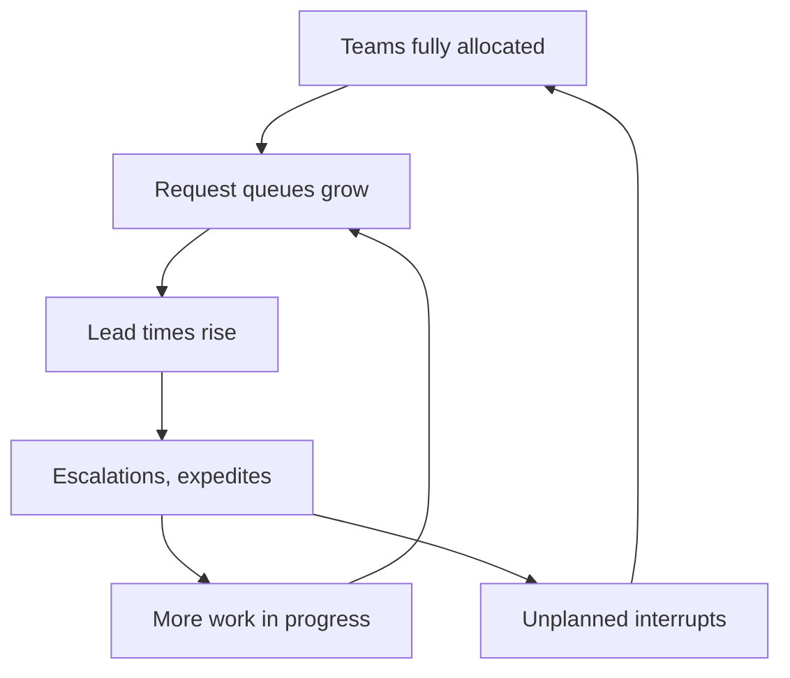
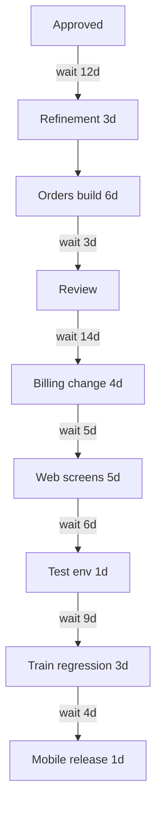
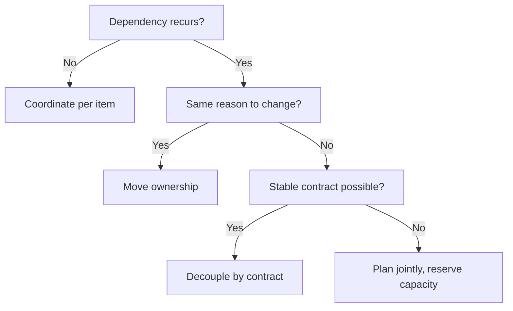

# Chapter 16 — Flow: Lead Time, Dependencies, and Unplanned Work

This chapter is about why work takes as long as it does. Most of the time between "we decided to
build this" and "a customer can use it" is spent waiting: in a backlog, a review queue, another team's
plan, a release. The chapter shows how to map where that time goes, how work in progress and batch
size govern it, how to make unplanned work visible and sort it by cause, and how to treat cross-team
dependencies as a design problem. The running example is Northstar Technologies, the fictional
company in the [case study](../../case-studies/northstar/index.md). It follows a feature along its
whole path; Chapter 23 looks inside one step (release), Chapter 27 sizes quality-driven unplanned work,
and Chapters 33 and 34 cover team design.

## Why This Matters

On one team, flow problems look personal: a story stalls because someone is busy.

At 50 to 150 engineers, the same delays are structural. A feature crosses three teams, each with its
own backlog. Each handoff adds a queue that nobody owns or measures. Every manager can show that their
team was busy the whole time, which is the problem: busy teams with full queues produce long lead
times. Unplanned work makes it worse, because interrupts land hardest on the teams everyone else
depends on.

At executive scale, flow is what turns a roadmap into dates. Northstar delivered 7 of 17 committed
roadmap items in the quarter promised, and about a third of engineering capacity went to unplanned
work. The CEO hears "engineering is slow". The usual truth is that engineering is full, and most of a
feature's calendar time is spent in queues between teams. A director who cannot show where the time goes
will be offered more people, which adds handoffs and lengthens queues.

## Learning Objectives

After this chapter you will be able to:

- Map a value stream for a real piece of work, separate wait time from work time, and locate the
  queues where lead time accumulates.
- Use Little's law to predict what reducing work in progress will do to lead time, and state the
  assumptions the prediction needs.
- Explain why high utilization and large batches lengthen lead time, and decide where to keep slack.
- Make unplanned work visible, classify it by source, and give each category an owner.
- Treat a recurring cross-team dependency as a design problem: remove it, loosen it, or coordinate
  it, knowing what each costs.

## The Mental Model

> **Mental model:** Lead time is mostly waiting, and waiting is set by how much work is in the system
> and how full the people are. Shorten lead time by reducing work in progress, batch size, and
> handoffs, not by asking people to work faster.

Two ideas organize the chapter.

First, **a feature's lead time is the sum of its waits and its work, and the waits dominate**. An
engineer may spend three days coding a change that takes two months to reach customers. Speeding up
the three days barely moves the two months.

Second, **queues are a consequence of system design, not of effort**. How long work waits depends on
how much is in progress, how big each batch is, how close to full the people serving the queue are,
and how many queues the work passes through. Each is a decision someone made, usually without
noticing. Goldratt's constraint argument
([Goldratt and Cox, 1984](../../references/bibliography.md#goldratt1984goal)) adds the corollary a
director needs: improving a step that is not the constraint does not shorten the whole path (Chapter 3).

## Deep Conceptual Explanation

### Where lead time accumulates

Lead time here means elapsed time from when the organization commits to a piece of work to when
customers can use it. The book uses two senses of the term, and this chapter uses the second
([glossary](../../glossary.md#lead-time)):

| Term | Starts | Ends | Northstar figures that use it |
|---|---|---|---|
| Change lead time (DORA's "lead time for changes") | Commit | Running in production | The baseline team table: Core 19 days, Payments and Integrations 4, Customer Experience 6 |
| Lead time, commitment to customer | The organization commits to the work | Customers can use it | This chapter: the 76-day standing-orders feature; medians of 11, 24, and 41 days by number of dependencies |

The commit-to-production slice is often the smallest part of the second. That is how a team with a
four-day change lead time can take months to deliver a feature.

A **value stream map** follows one item through every step and records, for each step, how long the
item spent there and how much of that time someone actively worked on it. The guide to work
visibility from DORA (DevOps Research and Assessment, an industry research program) describes the
technique. People from every part of the stream map a manageable number of process blocks. For each
block they record lead time, process time, and the share of work arriving complete and accurate, so
rework shows up
([DORA, work visibility](../../references/bibliography.md#dora-cap-work-visibility)). The guide
insists on recording the process as it actually runs and warns that mapping only part of the stream
produces local optimization. This is **industry research** guidance; the technique itself is
documented practice.

**Flow efficiency** is work time divided by lead time. Do not treat any published "typical" figure as
a benchmark: it depends on how generously "work" is counted. Use it to compare your own stream over time. The real output of
the map is the location of the waits, which in cross-team work cluster at intake, at handoffs between
teams, and at release.

### Flow measures: throughput, cycle time, and work item age

A map follows one item. Three measures watch every item on a team's board; with work in progress, they
are the Kanban Guide's four flow measures (Chapter 15):

| Measure | What it counts | Example reading |
|---|---|---|
| Throughput | Items finished per week | "We finish about 9 items a week" |
| [Cycle time](../../glossary.md#cycle-time) | Elapsed days from start of work to done, for finished items | "85 percent of items finish within 9 days" |
| Work item age | Days an item still open has been in progress | "Three items are older than 9 days" |

Cycle time is the team's slice of lead time: it starts when someone begins the work, not when the
organization commits to it, so the wait before work starts is outside it. Read cycle time as
percentiles, not an average. The 85th percentile ("85 percent finish within 9 days") is what a team
can tell a requester about a single small item (Chapter 17). Work item age is the early warning: an
open item older than the team's 85th-percentile cycle time is already unusual, and a daily look at the
oldest items catches stalls before they become misses.

### Little's law and work in progress

John Little proved in 1961 that, for a queueing system in a steady state, the average number of items
in the system equals the average arrival rate times the average time an item spends there: L = λW
([Little, 1961](../../references/bibliography.md#little1961proof)). In his fiftieth-anniversary
review, Little notes that operations management writes it as work in process equals throughput times
cycle time; "cycle time" there means time in the system, whichever start point you choose. Over a
finite window in which the system starts and ends empty, it holds exactly for the
measured data ([Little, 2011](../../references/bibliography.md#little2011law)). This is a
**research finding** in the strongest form available: a theorem, not a correlation.

For a delivery team: **average lead time = average work in progress ÷ average throughput**. A team
that finishes 9 items a week with 45 started and not finished has an average lead time of 5 weeks.
Hold throughput and carry 27 items, and the average falls to 3 weeks. Nothing got faster; less of it
waited.

Three cautions keep the law honest:

1. **It relates averages.** Northstar reports medians; a few very old items can make the mean much
   larger.
2. **It describes; it does not predict.** Little's review calls finite-window use measurement, not
   forecasting, and says the law does not settle trade-offs. "Less work in progress, shorter lead
   time" needs throughput to hold. It usually holds or rises, because people switch between fewer
   items, but that is **practitioner consensus**, not the theorem. Check it.
3. **Count everything in progress**, including items blocked on other teams, waiting for review, or
   parked for a release. Leaving them out is the easiest way to make the law look wrong.

**WIP limits**, caps on how many items may sit in each stage of a board, turn the law into practice.
DORA's guide states that its research associates them with better delivery performance, especially
with visual displays and monitoring feedback
([DORA, WIP limits](../../references/bibliography.md#dora-cap-wip-limits)): **industry research**,
survey-based and correlational. It names the classic failures: limits too high to bind, limits raised
whenever someone is idle, and boards that omit upstream and downstream work.

### Utilization and queues

In the simplest queueing model (one server, random arrivals and service times), average time waiting
equals the service time multiplied by ρ ÷ (1 − ρ), where ρ is utilization. At 80 percent utilization
an item waits about four service times; at 90 percent, nine; at 95 percent, nineteen. Real teams are
not this model, but the shape carries over: near full utilization, waits grow much faster than load.
Reinertsen argues that product development organizations ignore this because their queues are
invisible
([Reinertsen, 2009](../../references/bibliography.md#reinertsen2009principles)); treat that as
**expert opinion** built on standard queueing results.

The consequence is uncomfortable. A team allocated 100 percent to planned work cannot absorb other
teams' requests, so those wait, and every team that depends on it inherits the wait.

Full teams build queues; long queues produce escalations; expediting starts more work and interrupts
planned work, which keeps teams full. Breaking the loop means deliberate slack on the teams others
depend on and limits on what is started, not more status meetings.

### Batch size

A batch is the work that moves through a step together: a release, a large pull request, a quarter's
requirements handed to another team. Larger batches wait for their slowest part, fail in ways that are
harder to diagnose, and delay feedback. *Continuous Delivery* made the case for small, frequent,
automated releases ([Humble and Farley, 2010](../../references/bibliography.md#humble2010continuous)).
DORA's guide recommends pieces that can be finished and checked in hours or a few days, treating
anything over a week as too big
([DORA, small batches](../../references/bibliography.md#dora-cap-small-batches)). Chapter 23 applies
this at release. The same logic applies to handoffs: one large specification per quarter to another
team is a quarterly batch, whatever the release cadence.

### Unplanned work: visible and classified

Unplanned work is work that enters a team's queue after it has decided what to work on, and displaces
something planned. *The Phoenix Project* popularized a split of IT work into business projects,
internal projects, changes, and unplanned work, and the idea that unplanned work silently consumes the
rest ([Kim, Behr, and Spafford, 2013](../../references/bibliography.md#kim2013phoenix)). What matters
for a director is that unplanned work must be recorded as a type before it can be managed.

1. **Tag at intake.** The team flags each item planned or unplanned when it enters the board. A chat
   request gets a ticket.
2. **Classify by source**, with one scheme across teams. This book uses four categories: *failure
   recovery* (incidents, hotfixes, escaped defects), *requests from other teams*, *toolchain and
   environment breakage*, and *expedited business requests* that jump the queue.
3. **Give each category an owner.** Failure recovery belongs to the quality program (Chapter 27 sizes
   it). Requests from other teams fall through self-service and dependency redesign;
   toolchain breakage through platform investment; expedites through an agreed policy.

A director who sees only "34 percent unplanned" will hand it all to the quality program. If half is
requests between teams, the quality program cannot touch that half.

A team that receives many requests becomes an **interrupt sink**: other teams' work and failures
arrive there. Standard protections are a rotating interrupt role, one intake with a stated response
time, and the most frequent request types turned into self-service.

**Running an interrupt rotation** (**this book's recommendation**). One or two people, sized to the
measured interrupt load, take the role for a week, then hand over in writing. They take every new
request, page, and urgent question, and start no planned work. They finish what they can within a day
and turn the rest into tickets ranked with everything else, so the role is triage, not a second
backlog. Planned work is not handed to them because they look free. Two habits keep the role from
becoming a dumping ground: in a quiet week the person improves a runbook or automates the most
frequent request, and the team reviews the request log monthly to find what self-service should
remove next. Everyone on the team rotates, including seniors, or the role becomes a junior penalty.

### Dependencies as a design problem

A cross-team dependency exists when an item cannot finish until another team acts. Many recur: same
two teams, same kind of change, every month. A recurring dependency is a property of how
responsibilities are divided, and coordinating it item by item pays its cost forever.

Each boundary adds calendar time. Herbsleb and Mockus found that work items spanning sites took about
two and a half times as long as similar single-site items (Chapter 14 describes the study;
[Herbsleb and Mockus, 2003](../../references/bibliography.md#herbsleb2003empirical)). That **research
finding** is about geographic distribution; transferring it to team boundaries within one site is
plausible, not demonstrated.

**Dependency mapping** makes the structure visible: for one quarter, count every item that needed
another team, by requesting and providing team. Rows with high totals are teams that cannot finish
alone; columns with high totals are on everyone's critical path. Three responses, in order of
preference for recurring dependencies:

- **Remove it**: move ownership to the team that needs the change, or provide self-service. *Team
  Topologies* argues that teams should be designed for fast flow with few deliberate
  interactions ([Skelton and Pais, 2019](../../references/bibliography.md#skelton2019team)); Chapter
  33 covers team types and cognitive load.
- **Loosen it**: replace a synchronous dependency with a stable contract (versioned API, contract
  test, feature flag) so each team ships on its own schedule.
- **Coordinate it**: plan jointly, reserve capacity on the providing team, track it on a shared board.
  Right for one-offs, expensive for everything else.

## Engineering Organization Example

!!! info "Northstar so far"
    This example is set in the baseline quarter, before the director arrived. Northstar delivered 7 of
    17 committed roadmap items on time, 34 percent of capacity went to unplanned work, and Core shipped
    on a two-week release train. See the [timeline](../../case-studies/northstar/timeline.md). New to
    Northstar? Read [the year in brief](../../case-studies/northstar/year-in-brief.md) and the
    [cast](../../case-studies/northstar/cast.md).

This example is **illustrative**. It maps a feature Northstar shipped in the baseline quarter:
*standing orders*, which let a distributor's customer schedule a repeating order. It touched Orders
(order capture, and core/scheduler, then unowned), Billing (invoicing), Customer Experience (web and
mobile screens), and Platform Operations (a test environment and the
[release train](../../glossary.md#release-train), the fixed-schedule Core release carrying every ready
change). "Refinement" is the session where a team breaks down and clarifies work before starting it.
The map was reconstructed from tickets, merge requests, and release notes. Assumptions:
only the critical path is mapped; "work" counts calendar days in which someone actively worked on the
item, which overstates effort.

| Step | Team | Wait (days) | Work (days) | Cause of the wait |
|---|---|---|---|---|
| Intake to refinement | Orders | 12 | 3 | Queue for a refinement slot |
| Build in Core, review | Orders | 3 | 6 | Review queue |
| Invoicing change | Billing | 14 | 4 | Not in Billing's plan |
| Web screens | Customer Experience | 5 | 5 | Waited for the Orders API |
| Test environment | Platform Operations | 6 | 1 | Interrupt queue |
| Train regression | Platform Operations | 9 | 3 | Missed one train; three-day manual regression |
| Mobile release | Customer Experience | 4 | 1 | Separate app cycle |
| **Total** | | **53** | **23** | **Lead time 76 days** |

Flow efficiency is 23 ÷ 76, about 30 percent, generous given how work was counted. Almost half the
waiting (25 of 53 days) sat in queues at other teams. Release waits took about a quarter, intake
another quarter, and review the rest.

Now predict. A weekly train roughly halves the average wait for a release cut (Chapter 23 will show
why). Here the 9-day train wait might become 4 or 5, so lead time falls from 76 to about 71 days,
roughly 6 percent. Had Billing planned the invoicing change in the same cycle as Orders, its 14-day wait could
have been 2 or 3 days; a self-service test environment turns 6 days into under 1. Together those
remove about 16 days, three times the train change, and nobody works faster.

Little's law gives the team view. Suppose (these numbers are **hypothetical**, not Northstar baseline)
Orders finishes about 9 items a week and carries about 45 in progress, many blocked on other teams.
Average lead time is 5 weeks. Capping work in progress at 27 and swarming on blocked items (several people working together to
unblock them) would move
the average toward 3 weeks if throughput holds. Measure throughput four weeks before and after.

## Decision Framework

Choose the intervention from where the map puts the time:

| What the data show | Lever | Watch for |
|---|---|---|
| Most waiting in queues at other teams | Dependency redesign: remove, loosen, or reserve capacity | Ownership moves need a team able to absorb them |
| Many items started, few finished, ages rising | WIP limits and a stop-starting policy | Limits that never bind; hidden side work |
| Long wait for release | Smaller, more frequent releases (Chapter 23) | Deploy count rising while batch size does not |
| A depended-on team with a high unplanned share | Interrupt rotation, intake, self-service | Rotation becoming a dumping ground |
| Long intake wait | Smaller, more frequent refinement; accept fewer items | Committing beyond throughput |
| Unplanned work mostly failure recovery | Quality program (Chapter 27) | Reclassification instead of reduction |

For a recurring dependency:

"Same reason to change" asks whether the requesting team mostly changes the other team's code for its
own business reasons. If so, the boundary is in the wrong place. If not, look for a contract that lets
each side move alone. Only when neither works should the dependency become standing coordination
with reserved capacity on the providing team.

## Trade-offs

**Slack against utilization.** Leaving 15 to 20 percent of a critical team's time unallocated looks
like waste on a capacity spreadsheet and is what keeps its queue short for everyone else. The cost is
visible and the benefit is spread across other teams' lead times, so slack is cut first. Defend it
with the queue arithmetic and the dependency matrix.

**WIP limits against local busyness.** A limit means someone sometimes has nothing to start. Helping
finish work elsewhere feels slower to the individual and is faster for the organization; people
judged on personal output will resist.

**Removing dependencies against specialization.** Moving ownership removes a queue but spreads
knowledge and raises the receiving team's cognitive load (Chapter 33). Giving core/scheduler to
Billing in quarter 1 made that trade.

**Contracts against speed of change.** A versioned contract lets teams ship independently and makes
the interface slower to change. Use it where the interface is stable and release rhythms differ.

**Transition cost.** New WIP limits usually lower apparent activity for a few weeks while started work
drains. Say so in advance, or the change is reversed at the next planning review.

## Failure Modes

**The workshop map.** Drawn from memory, it shows the process as designed. Signal: no wait longer
than a few days. Countermeasure: reconstruct real items from tool timestamps.

**Optimizing the visible step.** Coding gets faster while waits sit between teams. Signal: work time
falls, lead time does not. Countermeasure: publish the wait breakdown, not only median lead time.

**WIP limits that never bind.** Set at current work in progress. Signal: nothing ever waits for a
slot. Countermeasure: set limits below current levels and lower them until they expose the bottleneck.

**The unplanned lump.** Unplanned work is one number handed to the quality program. Signal: quality
measures improve, unplanned share does not. Countermeasure: classify by source, one owner per category.

**The unfunded interrupt sink.** A platform team absorbs others' requests and is judged on its
roadmap. Signal: high unplanned share, slipping projects, its most helpful engineers leaving.
Countermeasure: fund the interrupt role and measure its request queue.

**Expedite inflation.** Everything urgent jumps the queue. Signal: more than a small fraction of items
are flagged expedite. Countermeasure: a capped expedite policy owned by someone who can say no.

## Enterprise Application

In an organization of 50 to 150 engineers, flow work has four parts.

**Instrument consistently.** One definition of lead time (commitment to customer availability), one
planned/unplanned flag, one four-category classification, one way to record dependencies. Teams
classifying differently is a known weakness of Northstar's baseline sample; fixing definitions is
cheaper than arguing over numbers.

**Map one value stream per quarter**, from work that crossed several teams, with people from each team
and data from the tools. Rotate so that within a year the maps cover the main paths.

**Run a quarterly dependency review.** Find recurring pairs in the matrix and decide remove, loosen, or
coordinate, with an owner. Structural changes go through Chapter 34's org-design process.

**Protect the critical teams**: those in the most matrix columns and with the highest unplanned
shares. Give them rotations, intake with response times, and a self-service roadmap.

Review flow measures monthly and dependency structure quarterly; Chapter 37 covers the cadence.

## CTO Perspective

A CTO who reports utilization ("everyone is busy") is reporting the cause of long lead times as if it
were a virtue.

Three things change at this level. The CTO owns the structure that creates dependencies: team
boundaries, platform investment, and architecture set how many queues a typical feature crosses, and
only the CTO can trade them across the organization. The CTO owns the expedite policy, because most
expedites come from the executive team; accepting every urgent request from sales and the CEO sets the
organization's unplanned share. And the CTO decides where slack lives. Leaving 15 percent of a
platform team unallocated is a budget conversation, to be made with the dependency matrix and the
queue arithmetic.

Board questions are about predictability, and the honest answer usually names queues and
dependencies rather than effort. Chapter 17 turns flow data into forecasts; Chapter 45 prices delay.

## Practical Playbook

1. **Pick a feature** that crossed at least three teams and shipped last quarter.
2. **Reconstruct its critical path** from tickets, merge requests, and releases: team, wait, and work
   per step.
3. **Review it for two hours** with someone from each team. Correct the facts; do not redesign in the
   room.
4. **Classify the waits** (intake, cross-team, review, release) and publish the breakdown.
5. **Measure work in progress and throughput** per team for four weeks, counting everything started
   and not delivered. Compare the Little's law lead time with observed lead time and reconcile.
6. **Set WIP limits** below current levels on teams with the oldest items, and agree what people do
   at the limit.
7. **Re-code the unplanned sample** into four categories with one definition; assign owners.
8. **Build the dependency matrix**; list pairs with more than five links.
9. **Decide remove, loosen, or coordinate** for each recurring pair, with an owner and a date.
10. **Protect the interrupt sink** and **write an expedite policy**: who may expedite, how many at
    once, how it is reported.
11. **Map a similar feature next quarter** and compare waits, not just lead time.

## Case Study

This case is **fictional**. It is set at the start of quarter 2 (week 14); see the
[year 1 record](../../case-studies/northstar/first-quarter.md). Core has shipped weekly since week 5.

Amara Okafor (CPO) asked why the accounting-system integration, a renewal commitment due in week 19,
still looked tight although Core now shipped weekly. Four Payments and Integrations engineers were
building a new erp-sync connector with daily reconciliation of posted invoices. It needed Billing
(posted-invoice data) and Platform Operations (test environments mimicking customers' accounting
systems). The director brought the standing-orders map (most waiting sat in other teams' queues) and
two more pieces of evidence.

**The dependency count: every extra team lengthens the wait.** Li Na Zhou (staff engineer for
data and integration) and the managers counted the baseline quarter's work items of a week or more.
Median lead time (commitment to customer) was 11 days for the 103 items with no dependency, 24 for the
42 with one, and 41 for the 19 with two or more. Platform Operations received 29 of the 86 dependency
links, more than any other team; Orders and Billing were the busiest pair, with 15. The full
team-by-team matrix is on the
[baseline page](../../case-studies/northstar/baseline-data.md#cross-team-dependencies).

**The unplanned work breakdown: most of it is not a quality problem.** The baseline's two-week sample
was re-coded with one shared definition. Figures are percentage points of each team's capacity; rows
sum to the baseline shares.

| Team | Failure recovery | Other teams' requests | Toolchain and environment | Expedited | Total |
|---|---|---|---|---|---|
| Orders | 18 | 8 | 6 | 4 | 36 |
| Billing | 24 | 7 | 6 | 4 | 41 |
| Payments and Integrations | 15 | 9 | 3 | 6 | 33 |
| Customer Experience | 12 | 6 | 4 | 6 | 28 |
| Data and Analytics | 6 | 12 | 3 | 3 | 24 |
| Platform Operations | 14 | 20 | 10 | 2 | 46 |
| Staff engineers | 8 | 10 | 2 | 0 | 20 |

In engineers, that is about 27 [FTE](../../glossary.md#fte) (full-time equivalent engineers), split by
source:

| | Failure recovery | Other teams' requests | Toolchain | Expedited |
|---|---|---|---|---|
| Share of unplanned work | 43% | 29% | 15% | 12% |

The quality program can reach only the first column; the other 57 percent are flow and design problems.
Platform Operations was the clearest interrupt sink: 20 of its 46 points were other teams' requests,
mostly test environments, access, and pipeline changes across four build systems.

The director proposed four decisions, and Amara and Victor Lindqvist (CTO) agreed:

1. **Book the Billing dependency.** Billing reserved capacity in weeks 14 to 16 for the posted-invoice
   export the reconciliation reads, with a Billing engineer reviewing the integration side.
   Coordination, accepted because the integration is a one-off.
2. **Loosen Payments and Integrations and Billing.** Their 9 links were mostly ledger fields the
   integrations needed. Li Na Zhou was asked to propose a ledger-export contract with contract tests.
3. **Protect Platform Operations.** Two infrastructure engineers rotate weekly as the interrupt role;
   one intake with a two-working-day response target; self-service test environments first.
4. **Tighten work in progress on Payments and Integrations.** Elena Sokolova, its manager, lowered her Kanban
   board's stage limits so the four integration engineers were not pulled onto new items; anyone at a
   limit helps unblock existing work first.

The decisions cost something. Throughput on the team's other work dipped while started items
drained, and Elena defended the limits against a sales request for a new integration. Tom Becker
(Platform Operations' manager) said the rotation fragmented the two engineers' weeks. By week 18, a
re-sample showed Platform Operations' median wait for environment requests down from about 6 days to
2, and other teams' requests down from 20 to 14 points of its capacity. The director called both
encouraging but unproven: one two-week sample, self-service half built.

## Exercises

Solutions are in [chapter 16 solutions](../../solutions/ch16-solutions.md). Data files are linked from
the [Northstar baseline page](../../case-studies/northstar/baseline-data.md).

### Foundational

**F1.** A team of eight finishes about 6 items a week and has 30 items started but not delivered, 9 of
them blocked on other teams. Its manager says lead time is "about two weeks", because that is how long
items spend in development. Estimate average lead time with Little's law, explain the discrepancy, and
say what you would verify before telling the manager.

**F2.** Using the standing-orders map, a colleague argues that the best investment is cutting the
three-day regression pass to one day, because it is "the only pure waste". Estimate the effect on the
feature's lead time, compare it with two other changes, and explain what the colleague gets right and
wrong.

**F3.** Classify each item into the chapter's four categories of unplanned work and name who owns the
countermeasure: a hotfix after a Core release; Customer Experience asking for a new order API field; a
broken shared test database; a sales director wanting a demo environment by tomorrow; a
customer-reported invoice error; a pipeline change forced by a build tool upgrade.

### Applied Leadership

**A1.** Tom Becker, Platform Operations' manager, says Platform Operations cannot build self-service test environments because it is
already at 46 percent unplanned and behind on planned projects. Prepare the conversation: what you
want to learn from him, what data you bring, what you offer, and what you will not accept.

**A2.** The team of Elena Sokolova (Payments and Integrations' manager) has been at its new WIP limit for three weeks. A sales director escalates
to you because an integration promised to a prospect has not been started. Decide your response, what
you say to the sales director and to Elena, and what this reveals about the expedite policy.

**A3.** The director wants to act on two team pairs from the case study's dependency matrix this
quarter, and has capacity for only two structural changes. Choose the two pairs (the full matrix is
on the baseline page). For each, decide
remove, loosen, or coordinate, justify the choice from the data, and name the transition cost and who
bears it.

### Executive Decision-Making

**X1.** The CEO offers Victor Lindqvist (CTO) budget for six more engineers in Payments and Integrations to
make the accounting-system integration "go faster", despite the flat-headcount constraint. You are
advising Victor. Using Little's law, the
dependency data, and the standing-orders map, say what six engineers would and would not change, and
what you would ask for instead.

**X2.** The board wants one measure of engineering delivery speed each quarter. One director proposes
median lead time from commitment to customer; another proposes throughput, items delivered per
quarter. Choose one or propose an alternative, explain how it would be gamed, and say what you would
pair it with.

## Reflection Questions

1. If you mapped the last feature your organization shipped, where would the longest wait be? When did
   you last check?
2. Which team is on everyone's critical path, and how much of its time is unallocated?
3. How many items is your team working on now, counting everything started and not delivered? Would
   your manager give the same number?
4. Who can make an item jump the queue, and how often do they?
5. Which cross-team dependency has been coordinated for over a year, and why has nobody redesigned it?

## Key Takeaways

- Lead time is mostly waiting. Map where the waiting is before choosing a fix.
- Reconstruct value stream maps from tool data for real items, not from memory.
- Average lead time equals average work in progress divided by throughput. Count everything started,
  reduce it, and check that throughput holds.
- Waits grow sharply near full utilization. Keep slack on the teams others depend on.
- Small batches shorten waits at every step, including handoffs, not only at release.
- Tag unplanned work at intake and classify it by source; the quality program can only address
  failure recovery.
- Fund and protect interrupt sinks with rotations, intake with response times, and self-service.
- A dependency that recurs for a quarter is a design problem: remove it, loosen it with a contract,
  and coordinate only what remains.

## References and Further Reading

- [Little, 1961](../../references/bibliography.md#little1961proof). The original proof of L = λW.
- [Little, 2011](../../references/bibliography.md#little2011law). Little's own fiftieth-anniversary
  review: the finite-window version, uses in operations management, and the law's limits as a
  forecasting tool.
- [DORA, work visibility](../../references/bibliography.md#dora-cap-work-visibility),
  [WIP limits](../../references/bibliography.md#dora-cap-wip-limits), and
  [small batches](../../references/bibliography.md#dora-cap-small-batches). Practical guides with
  pitfalls.
- [Herbsleb and Mockus, 2003](../../references/bibliography.md#herbsleb2003empirical). Evidence that
  work spanning sites takes longer as more people are involved.
- [Goldratt and Cox, 1984](../../references/bibliography.md#goldratt1984goal). *The Goal*. Constraint
  thinking as a novel.
- [Kim, Behr, and Spafford, 2013](../../references/bibliography.md#kim2013phoenix). *The Phoenix
  Project*. The four types of work, told as a story.
- [Reinertsen, 2009](../../references/bibliography.md#reinertsen2009principles). Queues, batch size,
  and utilization in product development.
- [Humble and Farley, 2010](../../references/bibliography.md#humble2010continuous). *Continuous
  Delivery*. Small, automated releases.
- [Skelton and Pais, 2019](../../references/bibliography.md#skelton2019team). *Team Topologies*.
  Designing teams and interactions for flow.
