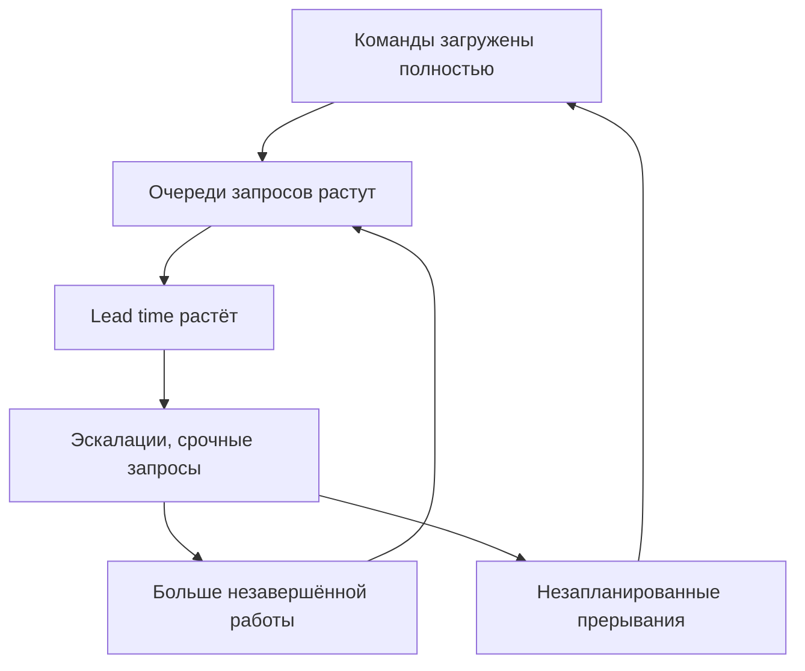
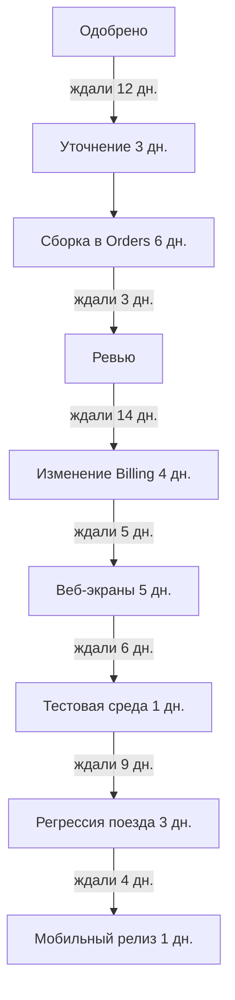
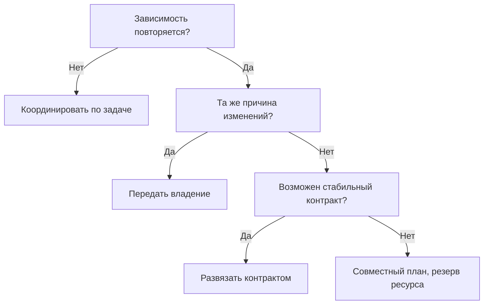

# Глава 16 — Поток: lead time, зависимости и незапланированная работа { #chapter-16-flow-lead-time-dependencies-and-unplanned-work }

Эта глава о том, почему работа занимает столько времени, сколько занимает. Между «мы решили это
сделать» и «клиент может этим пользоваться» большая часть времени уходит на ожидание: в бэклоге, в
очереди на ревью, в плане другой команды, в релизе. Глава показывает, как нанести на карту, куда уходит
это время; как им управляют незавершённая работа и размер партии; как сделать незапланированную работу
видимой и разложить её по причинам; как относиться к межкомандным зависимостям как к задаче
проектирования. Сквозной пример — Northstar Technologies, вымышленная компания из
[кейса](../../case-studies/northstar/index.md). Эта глава прослеживает функцию на всём её пути;
глава 23 заглядывает внутрь одного шага (релиза), глава 27 оценивает незапланированную работу,
которую порождают проблемы качества, а главы 33 и 34 посвящены проектированию команд.

## Почему это важно { #why-this-matters }

В одной команде проблемы потока выглядят личными: задача застряла, потому что кто-то занят.

При 50–150 инженерах те же задержки становятся структурными. Функция проходит через три команды, у
каждой свой бэклог. Каждая передача добавляет очередь без владельца, которую никто не измеряет. Любой
руководитель может показать, что его команда всё это время была занята, — в этом и проблема: занятые
команды с полными очередями дают длинный lead time. Незапланированная работа усугубляет дело, потому
что прерывания сильнее всего бьют по командам, от которых зависят все остальные.

На уровне руководства поток — это то, что превращает дорожную карту в даты. Из 17 пунктов дорожной
карты, по которым Northstar взяла обязательство, в обещанном квартале она поставила 7, а около трети
ресурса разработки ушло на незапланированную работу. CEO слышит: «разработка медленная». Обычно правда
в другом: разработка загружена, а большая часть календарного времени функции проходит в очередях между
командами. Директору, который не может показать, куда уходит время, предложат больше людей, а это
добавит передач и удлинит очереди.

## Цели главы { #learning-objectives }

Прочитав эту главу, вы сможете:

- Строить карту потока создания ценности для реальной работы, отделять время ожидания от времени
  работы и находить очереди, в которых копится lead time.
- Применять закон Литтла, чтобы предсказать, как сокращение незавершённой работы скажется на lead
  time, и называть допущения, на которых держится прогноз.
- Объяснять, почему высокая загрузка и крупные партии удлиняют lead time, и решать, где держать запас.
- Делать незапланированную работу видимой, классифицировать её по источнику и назначать владельца
  каждой категории.
- Относиться к повторяющейся межкомандной зависимости как к задаче проектирования: убрать её, ослабить
  или координировать, понимая цену каждого варианта.

## Ментальная модель { #the-mental-model }

> **Ментальная модель:** lead time — это в основном ожидание, а ожидание зависит от того, сколько
> работы в системе и насколько загружены люди. Сокращайте lead time, уменьшая незавершённую работу,
> размер партий и число передач, а не прося людей работать быстрее.

Главу организуют две идеи.

Первая: **lead time функции — это сумма её ожиданий и её работы, и ожидания преобладают**. Инженер
может три дня писать изменение, которое потом два месяца идёт до клиентов. Если ускорить эти три дня,
два месяца почти не сдвинутся.

Вторая: **очереди — следствие устройства системы, а не усилий**. Сколько ждёт работа, зависит от
четырёх вещей: сколько всего в работе, насколько велика каждая партия, насколько близки к полной
загрузке люди, которые обслуживают очередь, и через сколько очередей работа проходит. За каждой из них
стоит чьё-то решение, обычно принятое незаметно для самого решающего. Аргумент Goldratt об ограничении
([Goldratt and Cox, 1984](../../references/bibliography.md#goldratt1984goal)) добавляет нужное
директору следствие: если ускорить любой шаг, кроме узкого места, весь путь не сократится (глава 3).

## Подробный разбор { #deep-conceptual-explanation }

### Где копится lead time { #where-lead-time-accumulates }

Lead time здесь — время с момента, когда организация берёт обязательство по работе, до момента, когда
клиенты могут ею пользоваться. Книга использует термин в двух смыслах; эта глава — во втором
([глоссарий](../../glossary.md#lead-time)):

| Термин | Начало | Конец | Цифры Northstar, где он используется |
|---|---|---|---|
| Время внесения изменений (change lead time, у DORA — «lead time for changes») | Коммит | Работает в продакшене | Таблица команд на исходном уровне: Core 19 дней, Payments and Integrations 4, Customer Experience 6 |
| Lead time от обязательства до клиента | Организация берёт обязательство по работе | Клиенты могут ею пользоваться | Эта глава: функция регулярных заказов за 76 дней; медианы 11, 24 и 41 день в зависимости от числа зависимостей |

Отрезок от коммита до продакшена часто оказывается самой маленькой частью второго. Поэтому команда со
временем внесения изменений в четыре дня может месяцами поставлять функцию.

**Карта потока создания ценности** (value stream map) прослеживает одну единицу работы через все шаги
и для каждого шага записывает, сколько времени она там провела и сколько из этого времени над ней
кто-то активно работал. Технику описывает руководство по видимости работы от DORA (DevOps Research
and Assessment, отраслевая исследовательская программа). Люди из каждой части потока наносят на карту
обозримое число блоков процесса. Для каждого блока они записывают lead time, время обработки и долю
работы, которая приходит полной и точной, — так становятся видны переделки
([DORA, work visibility](../../references/bibliography.md#dora-cap-work-visibility)). Руководство
настаивает, чтобы процесс записывали таким, каким он идёт в действительности, и предупреждает: карта
только части потока ведёт к локальной оптимизации. Это рекомендации **отраслевого исследования**; сама
техника — задокументированная практика.

**Эффективность потока** — время работы, делённое на lead time. Не принимайте опубликованную
«типичную» цифру за эталон: она зависит от того, насколько щедро считают «работу». Используйте
показатель, чтобы сравнивать собственный поток с самим собой во времени. Главное, что даёт карта, —
расположение ожиданий, а в межкомандной работе они скапливаются на входе, на передачах между командами
и на релизе.

### Показатели потока: пропускная способность, время цикла и возраст задачи { #flow-measures-throughput-cycle-time-and-work-item-age }

Карта прослеживает одну задачу. Три показателя следят за всеми задачами на доске команды; вместе с
незавершённой работой это четыре показателя потока из Kanban Guide (глава 15):

| Показатель | Что считает | Пример |
|---|---|---|
| Пропускная способность | Задач, завершённых за неделю | «Мы завершаем около 9 задач в неделю» |
| [Время цикла](../../glossary.md#cycle-time) | Дней от начала работы до готовности, для завершённых задач | «85 процентов задач завершаются за 9 дней» |
| Возраст задачи | Сколько дней ещё открытая задача находится в работе | «Три задачи старше 9 дней» |

Время цикла — та доля lead time, которая приходится на команду. Отсчёт начинается, когда кто-то
берётся за работу, а не когда организация берёт по ней обязательство, поэтому ожидание до начала работы
в него не входит. Читайте время цикла в процентилях, а не как среднее. Заказчику об одной небольшой
задаче команда может сказать именно 85-й процентиль: «85 процентов завершаются за 9 дней» (глава 17).
Возраст задачи — раннее предупреждение. Открытая задача старше 85-го процентиля времени цикла команды
уже необычна, а если каждый день смотреть на самые старые задачи, застревания удаётся поймать до того,
как они превратятся в срывы.

### Закон Литтла и незавершённая работа { #littles-law-and-work-in-progress }

В 1961 году John Little доказал, что для системы массового обслуживания в установившемся режиме
среднее число элементов в системе равно средней интенсивности поступления, умноженной на среднее время
пребывания элемента в системе: L = λW ([Little, 1961](../../references/bibliography.md#little1961proof)).
В обзоре к пятидесятилетию закона Little отмечает, что в управлении операциями закон записывают как
«незавершённое производство равно пропускной способности, умноженной на время цикла»; «время цикла»
там означает время в системе, какую бы точку старта вы ни выбрали. На конечном окне, в начале и в конце
которого система пуста, закон для измеренных данных выполняется точно
([Little, 2011](../../references/bibliography.md#little2011law)). Это **научный результат** в самой
сильной из возможных форм: теорема, а не корреляция.

Для команды поставки: **средний lead time = средняя незавершённая работа ÷ средняя пропускная
способность**. Если команда завершает 9 задач в неделю и держит 45 начатых, но не законченных, её
средний lead time — 5 недель. Сохраните пропускную способность, оставьте в работе 27 задач — и среднее
упадёт до 3 недель. Быстрее ничего не стало; просто меньше работы ждало.

Чтобы применять закон честно, помните три оговорки:

1. **Он связывает средние.** Northstar сообщает медианы, а несколько очень старых задач могут сильно
   поднять среднее.
2. **Он описывает, а не предсказывает.** В обзоре Little применение на конечном окне названо
   измерением, а не прогнозированием; там же сказано, что закон не снимает компромиссов. Вывод «меньше
   незавершённой работы — короче lead time» верен, только если пропускная способность сохранится.
   Обычно она сохраняется или растёт, потому что людям приходится переключаться между меньшим числом
   задач, но это **консенсус практиков**, а не теорема. Проверяйте.
3. **Считайте всё, что в работе**, включая задачи, заблокированные другими командами, ждущие ревью или
   отложенные до релиза. Если их пропустить, проще всего прийти к выводу, будто закон неверен.

**Лимиты WIP** — ограничения на число задач, которые одновременно могут находиться на каждом этапе
доски, — превращают закон в практику. Руководство DORA утверждает, что исследования DORA связывают
такие лимиты с лучшими показателями поставки, особенно в сочетании с визуальными досками и обратной
связью от мониторинга ([DORA, WIP limits](../../references/bibliography.md#dora-cap-wip-limits)). Это
**отраслевое исследование** на основе опросов, и оно корреляционное. Руководство называет и
классические провалы: лимиты слишком высоки, чтобы что-то ограничивать; лимиты поднимают всякий раз,
когда кто-то простаивает; на досках не видно работы выше и ниже по потоку.

### Загрузка и очереди { #utilization-and-queues }

В простейшей модели массового обслуживания (один канал обслуживания, случайные моменты поступления и
случайное время обслуживания) среднее время ожидания равно времени обслуживания, умноженному на
ρ ÷ (1 − ρ), где ρ — загрузка. При загрузке 80 процентов задача ждёт около четырёх времён
обслуживания, при 90 процентах — девять, при 95 процентах — девятнадцать. Реальные команды устроены
иначе, но форма зависимости сохраняется: вблизи полной загрузки ожидания растут гораздо быстрее
нагрузки. Reinertsen утверждает, что организации, разрабатывающие продукты, этого не учитывают, потому
что их очереди невидимы ([Reinertsen, 2009](../../references/bibliography.md#reinertsen2009principles));
считайте это **мнением эксперта**, построенным на стандартных результатах теории массового
обслуживания.

Следствие неприятное. Команда, на 100 процентов занятая плановой работой, не может взяться за запросы
других команд. Те ждут, и каждая зависящая от неё команда наследует это ожидание.

Полностью загруженные команды создают очереди; длинные очереди порождают эскалации; срочные запросы
запускают ещё больше работы и прерывают плановую, и команды остаются загруженными. Разорвать петлю —
значит намеренно оставить запас у команд, от которых зависят другие, и ограничить то, что начинается, а
не проводить больше статусных встреч.

### Размер партии { #batch-size }

Партия — это работа, которая проходит шаг целиком: релиз, большой пул-реквест, квартальные требования,
переданные другой команде. Крупная партия ждёт свою самую медленную часть, ломается так, что это
труднее диагностировать, и задерживает обратную связь. Книга *Continuous Delivery* обосновала частые,
мелкие, автоматизированные релизы ([Humble and Farley, 2010](../../references/bibliography.md#humble2010continuous)).
Руководство DORA рекомендует нарезать работу на части, которые можно закончить и проверить за часы или
несколько дней, а всё, что дольше недели, считает слишком крупным
([DORA, small batches](../../references/bibliography.md#dora-cap-small-batches)). Глава 23 применяет это к
релизу. Та же логика работает и для передач: одна большая спецификация в квартал для другой команды —
это квартальная партия, каким бы ни был ритм релизов.

### Незапланированная работа: видимая и классифицированная { #unplanned-work-visible-and-classified }

Незапланированная работа — это работа, которая попадает в очередь команды после того, как та решила,
над чем работать, и вытесняет что-то запланированное. *The Phoenix Project* популяризировал деление
ИТ-работы на бизнес-проекты, внутренние проекты, изменения и незапланированную работу, а также мысль,
что незапланированная работа тихо съедает всё остальное
([Kim, Behr, and Spafford, 2013](../../references/bibliography.md#kim2013phoenix)). Директору отсюда
важно одно: прежде чем управлять незапланированной работой, её нужно записывать как отдельный тип.

1. **Помечайте на входе.** Когда задача попадает на доску, команда отмечает её как плановую или
   незапланированную. Запрос в чате тоже получает тикет.
2. **Классифицируйте по источнику**, по одной схеме для всех команд. Книга использует четыре категории:
   *восстановление после сбоев* (инциденты, хотфиксы, пропущенные дефекты), *запросы других команд*,
   *поломки инструментов и окружений* и *срочные бизнес-запросы*, которые идут вне очереди.
3. **Назначьте каждой категории владельца.** Восстановление после сбоев относится к программе качества
   (объём этой работы оценивает глава 27). Запросы других команд сокращают самообслуживанием и
   перепроектированием зависимостей, поломки инструментов — инвестициями в платформу, срочные запросы —
   согласованной политикой.

Директор, который видит только «34 процента незапланированной работы», отдаст всё программе качества.
Но если половина — запросы между командами, до этой половины программа качества не дотянется.

Команда, которая получает много запросов, становится **«приёмником прерываний»** (interrupt sink): к
ней стекаются работа и сбои других команд. Стандартная защита — сменная роль дежурного по прерываниям,
единый вход с объявленным временем реакции и перевод самых частых типов запросов на самообслуживание.

**Как вести ротацию на прерываниях** (**рекомендация книги**). Один или два человека — в зависимости
от измеренной нагрузки прерываниями — берут роль на неделю, а затем письменно её передают. Они
принимают каждый новый запрос, вызов и срочный вопрос и не начинают плановую работу. То, что можно
сделать за день, они доделывают, а остальное превращают в тикеты, которые ранжируются вместе со всем
прочим: роль — это сортировка, а не второй бэклог. Плановую работу им не передают только потому, что они
выглядят свободными. Две привычки не дают роли превратиться в свалку. В тихую неделю дежурный улучшает
ранбук (runbook) или автоматизирует самый частый запрос. А команда раз в месяц разбирает журнал
запросов, чтобы найти, что следующим перевести на самообслуживание. В ротации участвуют все члены
команды, включая senior-инженеров, иначе роль становится наказанием для джуниоров.

### Зависимости как задача проектирования { #dependencies-as-a-design-problem }

Межкомандная зависимость возникает, когда задачу нельзя завершить, пока свою часть не сделает другая
команда. Многие зависимости повторяются: те же две команды, тот же вид изменения, каждый месяц.
Повторяющаяся зависимость — свойство того, как разделена ответственность, и если координировать её
задачу за задачей, платить эту цену придётся вечно.

Каждая граница добавляет календарное время. Herbsleb и Mockus обнаружили, что задачи, охватывавшие
несколько площадок, занимали примерно в два с половиной раза больше времени, чем похожие задачи на
одной площадке (исследование описано в главе 14;
[Herbsleb and Mockus, 2003](../../references/bibliography.md#herbsleb2003empirical)). Этот **научный
результат** касается географического распределения. Что он верен и для границ между командами на одной
площадке, правдоподобно, но не доказано.

**Карта зависимостей** делает структуру видимой: за один квартал посчитайте все задачи, которым
понадобилась другая команда, с разбивкой по запрашивающей и предоставляющей команде. Строки с большими
итогами — команды, которые не могут закончить работу сами; столбцы с большими итогами — команды,
стоящие на критическом пути у всех. Для повторяющихся зависимостей есть три ответа, в порядке
предпочтения:

- **Убрать её**: передать владение команде, которой нужно изменение, или дать самообслуживание. *Team
  Topologies* утверждает, что команды нужно проектировать под быстрый поток с немногими намеренными
  взаимодействиями ([Skelton and Pais, 2019](../../references/bibliography.md#skelton2019team)); типы
  команд и когнитивную нагрузку разбирает глава 33.
- **Ослабить её**: заменить синхронную зависимость стабильным контрактом (версионированный API,
  контрактный тест, фича-флаг), чтобы каждая команда выпускалась по своему расписанию.
- **Координировать её**: планировать совместно, резервировать ресурс у предоставляющей команды,
  отслеживать на общей доске. Это подходит для разовых случаев, но дорого для всего остального.

## Пример из инженерной организации { #engineering-organization-example }

!!! info "Northstar: что уже известно"
    Этот пример относится к базовому кварталу, до прихода директора. Northstar поставила вовремя 7 из
    17 пунктов дорожной карты, по которым взяла обязательство; 34 процента ресурса ушло на
    незапланированную работу, а Core выпускался двухнедельным релизным поездом. См.
    [хронологию](../../case-studies/northstar/timeline.md). Впервые читаете о Northstar? Прочитайте
    [«Год вкратце»](../../case-studies/northstar/year-in-brief.md) и
    [действующих лиц](../../case-studies/northstar/cast.md).

Этот пример — **иллюстрация**. В нём на карту нанесена функция, которую Northstar выпустила в базовом
квартале: *регулярные заказы*, с которыми клиент дистрибьютора может запланировать повторяющийся заказ.
Она затронула Orders (приём заказов и core/scheduler, у которого тогда не было владельца), Billing
(выставление счетов), Customer Experience (веб- и мобильные экраны) и Platform Operations (тестовое
окружение и [релизный поезд](../../glossary.md#release-train) — релиз Core по фиксированному
расписанию, который везёт каждое готовое изменение). «Уточнение» (refinement) — сессия, на которой
команда декомпозирует и проясняет работу перед началом. Карту восстановили по тикетам, мерж-реквестам и
заметкам к релизам. Допущения: на карту нанесён только критический путь; «работой» считаются
календарные дни, в которые кто-то активно занимался задачей, и это завышает трудозатраты.

| Шаг | Команда | Ожидание (дни) | Работа (дни) | Причина ожидания |
|---|---|---|---|---|
| От входа до уточнения | Orders | 12 | 3 | Очередь на слот уточнения |
| Разработка в Core, ревью | Orders | 3 | 6 | Очередь на ревью |
| Изменение в выставлении счетов | Billing | 14 | 4 | Не было в плане Billing |
| Веб-экраны | Customer Experience | 5 | 5 | Ждали API от Orders |
| Тестовое окружение | Platform Operations | 6 | 1 | Очередь прерываний |
| Регрессия поезда | Platform Operations | 9 | 3 | Пропустили один поезд; трёхдневная ручная регрессия |
| Мобильный релиз | Customer Experience | 4 | 1 | Отдельный цикл приложения |
| **Итого** | | **53** | **23** | **Lead time 76 дней** |

Эффективность потока — 23 ÷ 76, около 30 процентов, и это щедрая оценка, учитывая, как считалась
работа. Почти половина ожидания (25 из 53 дней) пришлась на очереди в других командах. Ожидание
релиза заняло около четверти, вход — ещё четверть, остальное — ревью.

Теперь прогноз. Еженедельный поезд примерно вдвое сокращает среднее ожидание отсечки релиза (почему —
покажет глава 23). Здесь 9 дней ожидания поезда могли бы превратиться в 4 или 5, и lead time сократился
бы с 76 примерно до 71 дня — это около 6 процентов. Если бы Billing запланировала изменение в
выставлении счетов в том же цикле, что и Orders, её 14 дней ожидания могли бы сократиться до 2 или 3, а
самообслуживаемое тестовое окружение превращает 6 дней меньше чем в один. Вместе это убирает около
16 дней — втрое больше, чем изменение поезда, — и при этом никто не работает быстрее.

Закон Литтла даёт взгляд на уровне команды. Допустим (эти числа **гипотетические**, это не исходный
уровень Northstar), Orders завершает около 9 задач в неделю и держит в работе около 45, причём многие
из них заблокированы другими командами. Средний lead time — 5 недель. Если ограничить незавершённую
работу 27 задачами, а вокруг заблокированных задач устроить роение (swarming: несколько человек вместе
разблокируют задачу), среднее сдвинется к 3 неделям — при условии, что пропускная способность
сохранится. Измеряйте пропускную способность четыре недели до изменения и после.

## Как принимать решение { #decision-framework }

Выбирайте вмешательство по тому, куда, судя по карте, уходит время:

| Что показывают данные | Рычаг | На что смотреть |
|---|---|---|
| Большая часть ожидания — в очередях других команд | Перепроектирование зависимостей: убрать, ослабить или зарезервировать ресурс | Для передачи владения нужна команда, способная его принять |
| Начато много, закончено мало, возраст растёт | Лимиты WIP и правило «перестаньте начинать» | Лимиты, которые никогда не ограничивают; скрытая побочная работа |
| Долгое ожидание релиза | Более мелкие и частые релизы (глава 23) | Число развёртываний растёт, а размер партии — нет |
| Команда, от которой зависят, с высокой долей незапланированной работы | Ротация на прерываниях, единый вход, самообслуживание | Ротация превращается в свалку |
| Долгое ожидание на входе | Более мелкое и частое уточнение; принимать меньше задач | Обязательства сверх пропускной способности |
| Незапланированная работа — в основном восстановление после сбоев | Программа качества (глава 27) | Переклассификация вместо сокращения |

Для повторяющейся зависимости:

«Та же причина изменений» — это вопрос о том, меняет ли запрашивающая команда код другой команды в
основном по своим бизнес-причинам. Если да, граница проведена не там. Если нет, ищите контракт, который
позволит каждой стороне двигаться самостоятельно. И только если не работает ни то ни другое,
зависимость должна стать постоянной координацией с зарезервированным ресурсом у предоставляющей
команды.

## Компромиссы { #trade-offs }

**Запас против загрузки.** Нераспределённые 15–20 процентов времени критической команды выглядят в
таблице ресурсов как потери, но именно они держат её очередь короткой для всех остальных. Стоимость
запаса видна, а выгода размазана по lead time других команд, поэтому запас урезают первым. Защищайте
его арифметикой очередей и матрицей зависимостей.

**Лимиты WIP против локальной занятости.** Лимит означает, что кому-то иногда нечего начать. Человеку
кажется, что помогать доделывать работу в другом месте медленнее, а для организации это быстрее; люди,
которых оценивают по личной выработке, будут сопротивляться.

**Устранение зависимостей против специализации.** Передача владения убирает очередь, но распыляет
знания и повышает когнитивную нагрузку принимающей команды (глава 33). Передача core/scheduler команде
Billing в квартале 1 была именно таким обменом.

**Контракты против скорости изменений.** Версионированный контракт позволяет командам выпускаться
независимо, но замедляет изменения интерфейса. Используйте его там, где интерфейс стабилен, а ритмы
релизов различаются.

**Стоимость перехода.** Новые лимиты WIP обычно на несколько недель снижают видимую активность, пока
рассасывается начатая работа. Предупредите об этом заранее, иначе изменение отменят на следующем
обзоре планирования.

## Типичные провалы { #failure-modes }

**Карта с воркшопа.** Нарисованная по памяти, она показывает процесс таким, каким его задумали. Как
заметить: на карте нет ни одного ожидания дольше нескольких дней. Что делать: восстанавливать реальные
задачи по временным меткам из инструментов.

**Оптимизация видимого шага.** Кодирование ускоряется, а ожидания между командами остаются. Как
заметить: время работы падает, а lead time — нет. Что делать: публиковать разбивку ожиданий, а не
только медианный lead time.

**Лимиты WIP, которые никогда не ограничивают.** Их установили на уровне текущей незавершённой работы.
Как заметить: ничто никогда не ждёт свободного слота. Что делать: ставить лимиты ниже текущего уровня и
снижать их, пока не обнажится узкое место.

**Незапланированная работа одним числом.** Это число целиком отдают программе качества. Как заметить:
показатели качества улучшаются, а доля незапланированной работы — нет. Что делать: классифицировать по
источнику, по одному владельцу на категорию.

**Непрофинансированный «приёмник прерываний».** Платформенная команда принимает чужие запросы, а
оценивают её по дорожной карте. Как заметить: высокая доля незапланированной работы, съезжающие
проекты, уход самых отзывчивых инженеров. Что делать: профинансировать роль дежурного по прерываниям и
измерять её очередь запросов.

**Инфляция срочности.** Всё срочное идёт вне очереди. Как заметить: срочными помечена уже не малая
доля задач. Что делать: ограниченная политика срочных запросов, у которой есть владелец, способный
сказать «нет».

## Применение в крупной организации { #enterprise-application }

В организации из 50–150 инженеров работа с потоком состоит из четырёх частей.

**Единообразные измерения.** Одно определение lead time (от обязательства до доступности клиенту), одна
пометка «плановая/незапланированная», одна классификация из четырёх категорий, один способ записывать
зависимости. Известная слабость выборки исходного уровня Northstar в том, что команды классифицируют
по-разному; исправить определения дешевле, чем спорить о цифрах.

**Одна карта потока создания ценности за квартал** — по работе, прошедшей через несколько команд, с
людьми из каждой команды и данными из инструментов. Каждый квартал берите другую работу, чтобы за год
карты охватили основные пути.

**Ежеквартальный обзор зависимостей.** Найдите в матрице повторяющиеся пары, для каждой решите —
убрать, ослабить или координировать — и назначьте владельца. Структурные изменения проходят через
процесс организационного дизайна из главы 34.

**Защита критических команд** — тех, что встречаются в наибольшем числе столбцов матрицы и несут самую
высокую долю незапланированной работы. Дайте им ротации, единый вход со временем реакции и дорожную
карту самообслуживания.

Показатели потока пересматривайте ежемесячно, а структуру зависимостей — ежеквартально; ритм описывает
глава 37.

## Взгляд CTO { #cto-perspective }

CTO, который докладывает о загрузке («все заняты»), выдаёт причину длинного lead time за достоинство.

На этом уровне меняются три вещи. Во-первых, на CTO лежит структура, которая порождает зависимости:
границы команд, инвестиции в платформу и архитектура определяют, через сколько очередей проходит
типичная функция, и только CTO может взвешивать их друг против друга в масштабе всей организации.
Во-вторых, за CTO политика срочных запросов, потому что большинство срочных запросов приходит от
руководства компании: принимая каждую срочную просьбу от продаж и CEO, CTO сам задаёт долю
незапланированной работы в организации. В-третьих, CTO решает, где держать запас. Оставить
15 процентов платформенной команды нераспределёнными — это разговор о бюджете, и вести его нужно с
матрицей зависимостей и арифметикой очередей на руках.

Вопросы совета директоров касаются предсказуемости, и честный ответ обычно указывает на очереди и
зависимости, а не на усилия. Глава 17 превращает данные о потоке в прогнозы; глава 45 переводит
задержку в деньги.

## Практический плейбук { #practical-playbook }

1. **Выберите функцию**, которая прошла не меньше чем через три команды и вышла в прошлом квартале.
2. **Восстановите её критический путь** по тикетам, мерж-реквестам и релизам: команда, ожидание и
   работа на каждом шаге.
3. **Разберите карту за два часа** с представителями каждой команды. Исправляйте факты, но не
   перепроектируйте процесс прямо на встрече.
4. **Классифицируйте ожидания** (вход, межкомандные, ревью, релиз) и опубликуйте разбивку.
5. **Четыре недели измеряйте незавершённую работу и пропускную способность** каждой команды, считая
   всё начатое и не поставленное. Сравните lead time по закону Литтла с наблюдаемым и объясните
   расхождения.
6. **Установите лимиты WIP** ниже текущего уровня в командах с самыми старыми задачами и договоритесь,
   что делает человек, упёршийся в лимит.
7. **Перекодируйте выборку незапланированной работы** в четыре категории по единому определению;
   назначьте владельцев.
8. **Постройте матрицу зависимостей** и выпишите пары, у которых больше пяти связей.
9. **Для каждой повторяющейся пары решите — убрать, ослабить или координировать**, назначив владельца
   и срок.
10. **Защитите «приёмник прерываний»** и **напишите политику срочных запросов**: кто может объявить
    запрос срочным, сколько таких запросов допустимо одновременно, как о них сообщают.
11. **В следующем квартале нанесите на карту похожую функцию** и сравните ожидания, а не только lead
    time.

## Кейс { #case-study }

Этот кейс — **вымысел**. Действие происходит в начале квартала 2 (неделя 14); см.
[хронику года 1](../../case-studies/northstar/first-quarter.md). С недели 5 Core выпускается
еженедельно.

Amara Okafor (CPO) спросила, почему интеграция с бухгалтерской системой — обязательство по продлению
со сроком на неделе 19 — всё ещё идёт впритык, хотя Core теперь выпускается еженедельно. Четыре
инженера Payments and Integrations строили новый коннектор erp-sync с ежедневной сверкой проведённых
счетов. Коннектору были нужны Billing (данные о проведённых счетах) и Platform Operations (тестовые
окружения, имитирующие бухгалтерские системы клиентов). Директор принёс карту регулярных заказов
(большая часть ожидания там пришлась на очереди других команд) и ещё два набора данных.

**Подсчёт зависимостей: каждая дополнительная команда удлиняет ожидание.** Li Na Zhou (staff-инженер
по данным и интеграциям) и руководители посчитали задачи базового квартала длительностью от недели.
Медианный lead time (от обязательства до клиента) составил 11 дней для 103 задач без зависимостей,
24 — для 42 задач с одной зависимостью и 41 — для 19 задач с двумя и более. Platform Operations
получила 29 из 86 связей зависимостей — больше любой другой команды; самой загруженной парой были
Orders и Billing: 15 связей. Полная матрица по командам — на
[странице исходного уровня](../../case-studies/northstar/baseline-data.md#cross-team-dependencies).

**Разбивка незапланированной работы: большая её часть — не проблема качества.** Двухнедельную выборку
исходного уровня перекодировали по единому определению. Цифры в таблице — процентные пункты ресурса
каждой команды; сумма по строке равна доле исходного уровня.

| Команда | Восстановление после сбоев | Запросы других команд | Инструменты и окружения | Срочные | Итого |
|---|---|---|---|---|---|
| Orders | 18 | 8 | 6 | 4 | 36 |
| Billing | 24 | 7 | 6 | 4 | 41 |
| Payments and Integrations | 15 | 9 | 3 | 6 | 33 |
| Customer Experience | 12 | 6 | 4 | 6 | 28 |
| Data and Analytics | 6 | 12 | 3 | 3 | 24 |
| Platform Operations | 14 | 20 | 10 | 2 | 46 |
| Staff-инженеры | 8 | 10 | 2 | 0 | 20 |

В пересчёте на инженеров это около 27 [FTE](../../glossary.md#fte) (эквивалент инженеров на полной
ставке) со следующей разбивкой по источникам:

| | Восстановление после сбоев | Запросы других команд | Инструменты | Срочные |
|---|---|---|---|---|
| Доля незапланированной работы | 43% | 29% | 15% | 12% |

Программа качества может дотянуться только до первого столбца; остальные 57 процентов — проблемы
потока и проектирования. Самым явным «приёмником прерываний» была Platform Operations: 20 из её
46 пунктов приходились на запросы других команд — в основном тестовые окружения, доступы и изменения
пайплайнов в четырёх системах сборки.

Директор предложил четыре решения; Amara и Victor Lindqvist (CTO) с ними согласились:

1. **Забронировать зависимость от Billing.** Billing зарезервировала ресурс на недели 14–16 под экспорт
   проведённых счетов, который читает сверка, а инженер Billing ревьюит интеграционную сторону. Это
   координация; её выбрали, потому что интеграция разовая.
2. **Ослабить связь Payments and Integrations и Billing.** Их 9 связей касались в основном полей
   ledger, нужных интеграциям. Li Na Zhou попросили предложить контракт на экспорт данных ledger с
   контрактными тестами.
3. **Защитить Platform Operations.** Два инженера инфраструктуры еженедельно сменяют друг друга в роли
   дежурного по прерываниям; единый вход с целевым временем реакции в два рабочих дня; первым делом —
   самообслуживаемые тестовые окружения.
4. **Ужесточить ограничение незавершённой работы в Payments and Integrations.** Руководитель команды
   Elena Sokolova снизила лимиты этапов на Kanban-доске, чтобы четырёх инженеров интеграции не
   отвлекали на новые задачи. Кто упёрся в лимит, сначала помогает разблокировать уже начатую работу.

У решений была цена. Пока рассасывались начатые задачи, пропускная способность по остальной работе
команды просела, а Elena пришлось отстаивать лимиты перед запросом продаж на новую интеграцию. Tom
Becker (руководитель Platform Operations) сказал, что ротация дробит неделю двух инженеров. К неделе 18
повторная выборка показала, что медианное ожидание запросов на окружения в Platform Operations
снизилось примерно с 6 дней до 2, а доля запросов других команд — с 20 до 14 пунктов её ресурса.
Директор назвал оба результата обнадёживающими, но не доказанными: выборка одна, двухнедельная, а
самообслуживание построено наполовину.

## Упражнения { #exercises }

Разборы упражнений — на странице [решений к главе 16](../../solutions/ch16-solutions.md). Ссылки на
файлы данных — на [странице исходного уровня Northstar](../../case-studies/northstar/baseline-data.md).

### Базовый уровень { #foundational }

**F1.** Команда из восьми человек завершает около 6 задач в неделю; у неё 30 задач начаты, но не
поставлены, и 9 из них заблокированы другими командами. Руководитель говорит, что lead time — «около
двух недель», потому что столько задачи проводят в разработке. Оцените средний lead time по закону
Литтла, объясните расхождение и скажите, что бы вы проверили, прежде чем говорить с руководителем.

**F2.** Коллега, опираясь на карту регулярных заказов, утверждает, что лучшая инвестиция — сократить
трёхдневную регрессию до одного дня, потому что это «единственная чистая потеря». Оцените, как это
повлияет на lead time функции, сравните с двумя другими изменениями и объясните, в чём коллега прав, а
в чём нет.

**F3.** Отнесите каждый пункт к одной из четырёх категорий незапланированной работы из этой главы и
назовите, кто отвечает за противоядие: хотфикс после релиза Core; Customer Experience просит новое поле
в API заказов; сломалась общая тестовая база данных; директору по продажам к завтрашнему дню нужно
демо-окружение; клиент сообщил об ошибке в счёте; изменение пайплайна, вынужденное обновлением
инструмента сборки.

### Прикладное лидерство { #applied-leadership }

**A1.** Tom Becker, руководитель Platform Operations, говорит, что его команда не может построить
самообслуживаемые тестовые окружения: у неё и так 46 процентов незапланированной работы и отставание
по плановым проектам. Подготовьтесь к разговору: что вы хотите у него узнать, какие данные принесёте,
что предложите и чего не примете.

**A2.** Команда Elena Sokolova (руководитель Payments and Integrations) три недели работает с новым
лимитом WIP. Директор по продажам эскалирует вопрос вам: интеграцию, обещанную потенциальному клиенту,
ещё не начали. Решите, как вы ответите, что скажете директору по продажам и Elena и что эта ситуация
говорит о политике срочных запросов.

**A3.** Директор хочет в этом квартале заняться двумя парами команд из матрицы зависимостей,
приведённой в кейсе, и ресурса хватает только на два структурных изменения. Выберите две пары (полная
матрица — на странице исходного уровня). Для каждой решите — убрать, ослабить или координировать, —
обоснуйте выбор данными и назовите стоимость перехода и того, кто её несёт.

### Решения на уровне руководства { #executive-decision-making }

**X1.** CEO предлагает Victor Lindqvist (CTO) бюджет на шесть дополнительных инженеров в Payments and
Integrations, чтобы интеграция с бухгалтерской системой «шла быстрее», несмотря на ограничение «без
роста численности». Вы консультируете Victor. Опираясь на закон Литтла, данные о зависимостях и карту
регулярных заказов, скажите, что шесть инженеров изменят, а что нет, и что бы вы попросили вместо
этого.

**X2.** Совет директоров хочет каждый квартал видеть одну меру скорости поставки разработки. Один из
директоров предлагает медианный lead time от обязательства до клиента, другой — пропускную способность,
то есть число задач, поставленных за квартал. Выберите одну меру или предложите альтернативу,
объясните, как её будут подгонять, и скажите, с чем бы вы её сопоставили.

## Вопросы для размышления { #reflection-questions }

1. Если бы вы нанесли на карту последнюю функцию, которую выпустила ваша организация, где оказалось бы
   самое долгое ожидание? Когда вы в последний раз это проверяли?
2. Какая команда стоит на критическом пути у всех и сколько её времени не распределено?
3. Над сколькими задачами ваша команда работает сейчас, если считать всё начатое и не поставленное?
   Назвал бы ваш руководитель то же число?
4. Кто может пустить задачу вне очереди и как часто он это делает?
5. Какую межкомандную зависимость координируют уже больше года и почему никто её не перепроектировал?

## Главное { #key-takeaways }

- Lead time — это в основном ожидание. Нанесите ожидания на карту, прежде чем выбирать, что менять.
- Восстанавливайте карты потока создания ценности по данным инструментов для реальных задач, а не по
  памяти.
- Средний lead time равен средней незавершённой работе, делённой на пропускную способность. Считайте
  всё начатое, сокращайте его объём и проверяйте, что пропускная способность сохраняется.
- Вблизи полной загрузки ожидания резко растут. Держите запас у команд, от которых зависят другие.
- Малые партии сокращают ожидания на каждом шаге, включая передачи, а не только на релизе.
- Помечайте незапланированную работу на входе и классифицируйте её по источнику; программа качества
  может повлиять только на восстановление после сбоев.
- Финансируйте и защищайте «приёмники прерываний»: ротации, единый вход со временем реакции,
  самообслуживание.
- Зависимость, которая повторяется весь квартал, — задача проектирования: уберите её, ослабьте
  контрактом и координируйте только то, что осталось.

## Источники и что почитать { #references-and-further-reading }

- [Little, 1961](../../references/bibliography.md#little1961proof). Исходное доказательство L = λW.
- [Little, 2011](../../references/bibliography.md#little2011law). Собственный обзор Little к
  пятидесятилетию закона: версия для конечного окна, применение в управлении операциями и пределы закона
  как инструмента прогнозирования.
- [DORA, work visibility](../../references/bibliography.md#dora-cap-work-visibility),
  [WIP limits](../../references/bibliography.md#dora-cap-wip-limits) и
  [small batches](../../references/bibliography.md#dora-cap-small-batches). Практические руководства с
  описанием подводных камней.
- [Herbsleb and Mockus, 2003](../../references/bibliography.md#herbsleb2003empirical). Данные о том, что
  работа, охватывающая несколько площадок, занимает больше времени по мере роста числа участников.
- [Goldratt and Cox, 1984](../../references/bibliography.md#goldratt1984goal). *The Goal*. Теория
  ограничений в форме романа.
- [Kim, Behr, and Spafford, 2013](../../references/bibliography.md#kim2013phoenix). *The Phoenix
  Project*. Четыре типа работы, изложенные в виде повести.
- [Reinertsen, 2009](../../references/bibliography.md#reinertsen2009principles). Очереди, размер
  партии и загрузка в разработке продуктов.
- [Humble and Farley, 2010](../../references/bibliography.md#humble2010continuous). *Continuous
  Delivery*. Мелкие автоматизированные релизы.
- [Skelton and Pais, 2019](../../references/bibliography.md#skelton2019team). *Team Topologies*.
  Проектирование команд и взаимодействий под поток.
