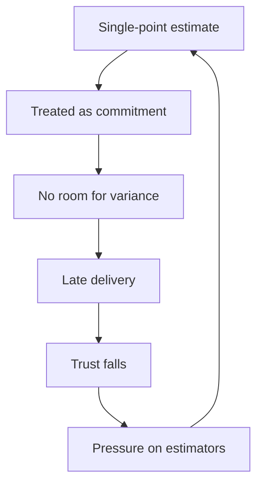
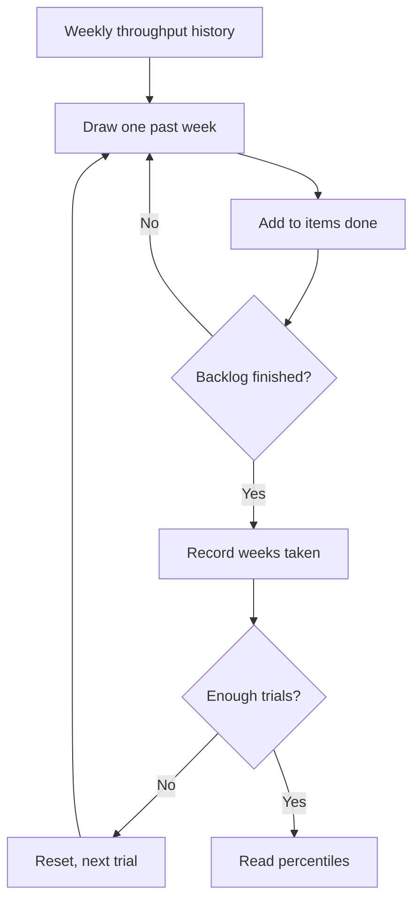
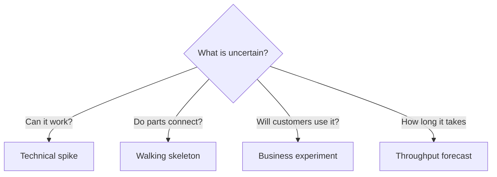

# Chapter 17 — Predictability and Managing Uncertainty

Every engineering leader is asked "when will it be done?" This chapter is about answering honestly:
forecasting delivery as a range with a probability, built from what teams have actually delivered;
keeping forecasts, targets, and commitments apart; and ordering uncertain work so the biggest
unknowns are resolved first. The running example is Northstar Technologies, the fictional company in
the [case study](../../case-studies/northstar/index.md), whose committed roadmap delivered 7 of 17
items in the promised quarter. It asks what you can promise from a prioritized backlog (Chapter 15)
and a measured delivery system (Chapter 16).

## Why This Matters

At team level, an unreliable estimate costs an awkward conversation and some late evenings.

At organization level, a missed date travels: product told sales, sales told a customer, finance
assumed revenue. When engineering's dates are unreliable, other functions add their own buffers or
stop believing engineering, and leaders demand detailed plans and daily status, which make delivery
slower and less predictable still.

At executive scale, predictability is a matter of credibility with the board and with customers.
Northstar's Chief Product Officer, Amara Okafor, wants "the roadmap she committed to customers, on
the dates she gave"; two renewals worth $9M depend on two dated features. A CTO who cannot say how
likely a date is cannot price the risk of promising it.

Predictability is not speed, nor hitting every date: a team that commits to very little hits every
date and is nearly useless. Leaders need **calibration**: when the team says it is 85 percent sure, it
is right about 85 percent of the time. (This is forecast calibration, not the performance-review
calibration of Chapter 8.)

## Learning Objectives

After this chapter you will be able to:

- Explain, with the research on estimation and the planning fallacy, why single-point estimates of
  software work are systematically optimistic and their stated uncertainty too narrow.
- Build a delivery forecast as a range with probabilities, using a team's historical throughput and a
  Monte Carlo simulation, and state the assumptions it rests on.
- Use reference-class forecasting to correct a plan with the track record of similar past work.
- Distinguish forecasts, targets, and commitments, and communicate each so that others can rely on it.
- Structure uncertain work (spikes, walking skeletons, experiments) so that the riskiest unknowns are
  retired early, and judge when adding people will help a late project and when it will hurt.

## The Mental Model

> **Mental model:** A delivery date is a probability distribution, not a number. Forecast the
> distribution from history, commit only from its cautious end, and spend the early weeks shrinking
> it.

First, "when will it be done?" has no single answer when it is asked, only a range of possible
dates. A single date is one point from that range, at best the middle and often earlier, presented
as the whole. Second, the habits around single-point dates form a loop that makes them worse:



A most-likely estimate becomes a promise with no allowance for the spread of outcomes, so it is
missed about half the time even when the estimate was good. Each miss lowers trust, and lower trust
brings pressure for dates that sound acceptable, pushing the next estimate earlier. Jørgensen's
review calls this estimation under conflicting goals: when an estimate must also please a manager
or win a bid, realism loses ([Jørgensen, 2004](../../references/bibliography.md#jorgensen2004review)).

The way out organizes the chapter: forecast from what has happened; separate what you predict from
what you want and what you promise; and order the work so the range narrows quickly.

## Deep Conceptual Explanation

### What the research says about estimating

The **planning fallacy** is the tendency to underestimate how long one's own tasks will take, even
when similar tasks took longer in the past. The term comes from Kahneman and Tversky in 1979
([Jørgensen, 2004](../../references/bibliography.md#jorgensen2004review)). In five
studies, Buehler, Griffin, and Ross found that people's predictions of their own completion times
were consistently too optimistic, while their predictions of other people's times were not. People
predicting their own work concentrated on plans and scenarios for the task at hand rather than on
past experience; when instructed to connect the prediction to their past experience, the bias
disappeared in the study. They also explained away past failures as caused by external, one-off
circumstances, which made that past seem irrelevant
([Buehler, Griffin, and Ross, 1994](../../references/bibliography.md#buehler1994exploring)). This is a
**research finding** about individuals' own academic and everyday tasks, not software teams.

For software, Jørgensen's review found expert judgment to be the most common estimation method, with
no substantial evidence that formal models do better. It also reports, from earlier studies, that
experts' uncertainty ranges are far too narrow: in one study of industrial projects, fewer than half
of actual efforts fell inside the estimators' ranges
([Jørgensen, 2004](../../references/bibliography.md#jorgensen2004review)). A later review adds two
cautions. Underestimation dominated in engineering and management studies but not in psychology
studies, so "people always underestimate" is too strong. And many studies do not separate effort
(work hours) from completion (delivery dates), which are different questions
([Halkjelsvik and Jørgensen, 2012](../../references/bibliography.md#halkjelsvik2012origami)).

This book's conclusion: do not fix estimates by asking people to try harder. Use history, and treat
any expert range as narrower than it should be.

### Story points, planning poker, and t-shirt sizes

Most teams estimate with one of three practices. Know what each is good for (**this book's
recommendation**; no study found compares them on delivery outcomes):

| Practice | What it is | Good for | Weak for |
|---|---|---|---|
| [Story points](../../glossary.md#velocity-and-story-points) | Relative size per item; velocity is points finished per sprint | Exposing disagreement about scope | Dates, and any comparison across teams |
| Planning poker | Each person reveals a point estimate at once, then outliers explain | Surfacing what one person knows (Chapter 13's hidden profiles) | Speed, on a large backlog |
| T-shirt sizes | Rough classes such as S, M, L | Sorting a long list quickly | Summing into a plan |

The value of all three is the conversation. When two engineers say 2 and 13, one of them knows
something, and the scope gets clearer. The weakness is the next step: summing points or sizes into a
date. That reproduces the single-point loop above with extra arithmetic. Some practitioners drop
estimates and count items instead. That works when items are sliced to a similar size, and it is what
throughput forecasting below assumes. Estimate to understand the work; forecast dates from history.

### Inside view and outside view

The **inside view** forecasts a project by looking at its details: the tasks, the people, the plan.
The **outside view** ignores those details and asks how long comparable projects took. Flyvbjerg,
building on Kahneman and Tversky and on Lovallo and Kahneman, turned the outside view into a method
called **reference-class forecasting**, with three steps: choose a class of past projects similar
enough to compare and numerous enough to be meaningful; establish the distribution of their outcomes;
place the new project in that distribution
([Flyvbjerg, 2006](../../references/bibliography.md#flyvbjerg2006nobel)). The paper separates two
causes of forecast error that need different remedies: **optimism bias**, an honest cognitive error,
and **strategic misrepresentation**, deliberately low numbers made to win approval.

Its example is the UK Department for Transport. From 2004 it added "optimism bias uplifts" to project
budgets, based on the overruns of past projects of the same type and larger as tolerance for overrun
shrinks. For roads, the uplift was 15 percent for a 50 percent chance of staying within budget, 45 percent for a 90
percent chance. This **research finding** comes from public infrastructure; the method transfers to
software, the numbers do not.

In an engineering organization the reference class is your own past work. "What share of committed
items did we deliver in quarter over the last four quarters?" and "how much did our last five
features grow after kickoff?" are outside-view questions.

### Forecasting from throughput

**Throughput** is the number of items a team finishes per week (Chapter 16 covers measuring it).
Throughput history is the most useful reference class a manager has, because it already contains
everything that slowed the team: interrupts, absences, review queues, failed releases.

A **[Monte Carlo simulation](../../glossary.md#percentile-forecast-and-monte-carlo-simulation)**,
meaning a random experiment repeated many times to see the spread of results, turns that history into a forecast for a backlog of N items:



Each trial treats the future as a random reshuffle of past weeks. Thousands of trials give a
distribution: the 50th percentile is the date hit half the time, the 85th the date hit 85 times in 100.
The same history answers the reverse question: how many items will be done by a fixed date.
Vacanti's practitioner guide to flow forecasting covers this method and warns against forecasting from
averages ([Vacanti, 2018](../../references/bibliography.md#vacanti2018when)).

!!! tip "Running a Monte Carlo forecast in a spreadsheet"
    1. Put the weekly throughput history in one column, say `A1:A26`.
    2. In a new sheet, make row 1 one trial. In `B1` enter
       `=INDEX(History!$A$1:$A$26, RANDBETWEEN(1, 26))`, the items finished in a randomly drawn
       past week. In `C1` enter `=B1 + INDEX(History!$A$1:$A$26, RANDBETWEEN(1, 26))`, a running
       total, and fill it right for 40 or more columns (one per future week).
    3. In column `A` of the trial row, count the weeks taken to reach the backlog size N:
       `=COUNTIF(B1:AO1, "<" & N) + 1`.
    4. Fill the row down for 1,000 to 10,000 trials. Each recalculation draws new weeks.
    5. Read the forecast: `=PERCENTILE(A1:A10000, 0.85)` is the 85th percentile in weeks; repeat for
       0.5 and 0.95.

    For "how many by week W", read each trial's running total for week W and take a low percentile
    (the 5th for 95 percent confidence, the 15th for 85). Free templates and tools that do the same exist; the logic is all here.
    Throughput counts make sense only if items are sliced to a broadly similar size; agree a slicing
    rule (for example, nothing over a week of work) before you collect the history.

A plan built on average throughput lands near the median, so it is late about half the time: the
arithmetic behind the loop in the mental model. The method needs no size estimate per item, only a
similar size mix to the past. State its assumptions with every forecast:

- **The future resembles the sampled past.** Team changes and new kinds of work break this; rerun
  when the system changes.
- **Weeks are independent.** They are not (a bad incident week is often followed by another), so
  the ranges come out somewhat too narrow.
- **The scope is known.** It never is. Model growth explicitly, from your own history.

### Forecasts, targets, and commitments

McConnell separates an **estimate** (a prediction), a **target** (a business objective, possibly
unachievable), and a **commitment** (a promise of defined functionality at a stated quality by a
date). He notes that executives asking for an estimate often want a commitment or a plan to meet a
target ([McConnell, 2006](../../references/bibliography.md#mcconnell2006software)). Jørgensen's review
makes the research-side point: bid, planned effort, and most-likely effort serve conflicting goals
and are often not kept apart ([Jørgensen, 2004](../../references/bibliography.md#jorgensen2004review)).
This book uses three terms:

| | Forecast | Target | Commitment |
|---|---|---|---|
| What it is | A probability statement about the future | An outcome the organization wants | A promise to someone who will rely on it |
| Who owns it | The team and its manager | Leadership | A named person, usually a director or above |
| Form | A range with probabilities | A single outcome | A date and a defined scope |
| Changes when | New information arrives, weekly | Strategy changes | Rarely; renegotiated early and explicitly |
| Missing it means | The forecast is updated | Learning about ambition or capacity | A broken promise with consequences |

By this book's recommendation, commit from the cautious end of a forecast (85th or 95th percentile),
with the scope written down and everything above that line labeled a target. Pressure to "commit to
the target" is pressure to make a promise history says will probably be broken; saying so, forecast
in hand, is a core skill of the role.

### Retiring risk early

Throughput forecasting handles **variability**, the normal spread in how fast familiar work gets done.
It does not handle **uncertainty in the work itself**: whether a design will perform, two systems
will integrate, or customers will use the result. For those the lever is sequencing.

- A **spike** is a time-boxed investigation of one technical question ("can pricing-svc price a
  20,000-line order file within the processing window?"). Its output is a decision; the code is discarded.
- A **walking skeleton** connects the main components end to end before any is complete; Alistair
  Cockburn, who named it, describes a thinly connected functioning architecture
  ([Cockburn, 2004](../../references/bibliography.md#cockburn2004crystal)). Integration problems
  surface in week two, not week twenty.
- An **experiment**, in the sense popularized by *The Lean Startup*, tests a business assumption
  with the smallest thing that yields evidence ([Ries, 2011](../../references/bibliography.md#ries2011lean)).
  Product discovery itself belongs to Chapter 44.

In a well-sequenced plan the forecast range narrows quickly in the first third of the work. If it is
as wide at the halfway point as at the start, the hard questions were deferred.

### Adding people to late work

When a dated item falls behind, the usual proposed remedy is more people. **Brooks's law**, as it is
commonly stated, holds that adding people to a late software project makes it later
([Brooks, 1995](../../references/bibliography.md#brooks1995mythical)). Brooks reportedly called it an
oversimplification. The mechanisms are ramp-up time, communication overhead that grows with team size,
and tasks that cannot be divided.

Treat it as **expert opinion** that names mechanisms. Adding people helps when the work divides
cleanly, the newcomers know the code, and enough time remains for ramp-up to pay back. It hurts late,
on coupled work, and when the people onboarding newcomers are on the critical path. Moving scope out
is usually faster than moving people in.

## Engineering Organization Example

!!! info "Northstar so far"
    Week 1, the director's first day. In the baseline quarter Northstar delivered 7 of its 17 committed
    roadmap items on time. Two renewal features, on which $9M of annual recurring revenue depends, are due in quarter 2:
    the accounting integration in week 19 and bulk ordering in week 26. See the
    [timeline](../../case-studies/northstar/timeline.md). New to Northstar? Read [the year in
    brief](../../case-studies/northstar/year-in-brief.md) and the
    [cast](../../case-studies/northstar/cast.md).

This example is **illustrative**: the throughput and scope numbers are invented for it. It is the
calculation a director could run on arrival, with data that existed on day one. (Northstar's record
shows only that both renewal features were on track at day 90.)

Bulk ordering, owned by Orders, is committed to a renewal customer for week 26 (the end of quarter 2)
and broken into 44 backlog items. Orders' recent history:

```text
Orders: planned items finished per week, history weeks H1-H26
H1-H13:   6  4  7  3  5  8  2  6  5  4  7  6  0
H14-H26:  5  9  4  6  3  5  7  4  6  2  8  5  6
Total 133, mean 5.1, median 5, range 0-9
```

Assumptions, stated:

- Bulk ordering is staffed by five Orders engineers and two Customer Experience web engineers, half
  of Orders' headcount, so it gets about half of Orders' historical planned throughput.
- Orders' 10 percent [prevention allocation](../../glossary.md#prevention-allocation) (capacity
  reserved for removing the sources of incidents and unplanned work), assumed to continue into quarter 2, scales
  throughput by 0.9. The combined factor is 0.45, about 2.3 items a week.
- Unplanned work is excluded from the counts; its effect is already in how few planned items got done.
- Orders' last four features grew 15 to 35 percent in item count after starting; 25 percent growth
  turns 44 items into 55.

The **single-point plan** divides 44 by 2.3 and gets 19.1, "about week 19, seven weeks to spare." A
Monte Carlo simulation with 10,000 trials, each week drawn at random from the 26 and multiplied by
0.45, gives the following (reruns may differ by one week or one item):

| Question | 50% | 85% | 95% |
|---|---|---|---|
| Weeks to finish 44 items | 20 | 21 | 23 |
| Weeks to finish 55 items | 24 | 27 | 28 |
| Items finished by week 26 (at least) | 60 | 55 | 52 |

Read the last row as confidence of finishing at least that many: a 95 percent chance of at least 52
items, but only a 50 percent chance of 60.

Three readings matter. First, the single-point plan sits within a week of the simulation's median, as
it should; the simulation adds what the median means, a 50 percent chance. Second, the 44 items are
very likely done by week 26, but the 55-item version that history says to expect is done in only
about five trials in six: the risk to the renewal is scope growth, not throughput. Third, the
simulation is narrower than reality. It assumes independent weeks and an unchanged team. Yet Orders
takes over the core/customer module in week 4, two quality engineers join it in week 10, and bulk upload has a known recurring failure
(INC-421, a bulk-upload failure that dropped lines beyond row 500). Read the range as a minimum.

What the director can do: agree the 44 items in writing as the contractual scope with Amara Okafor
and the customer; label growth a target; and publish the forecast weekly. Then put the riskiest work
first: a one-week spike on pricing large orders, and a walking skeleton from upload through
order-capture, pricing-svc, and invoicing, so a surprise surfaces in week 2 rather than week 22.

## Decision Framework

The first decision is what kind of uncertainty you face, because each kind has a different remedy:



Most large items carry more than one kind. Retire the first three before relying on the fourth; a
throughput forecast for work whose feasibility is unknown is precise about the wrong question.

The second decision is which forecasting method fits the data you have:

| Situation | Method | Watch for |
|---|---|---|
| Three or more months of throughput, familiar work | Monte Carlo on throughput | System changes that make history stale |
| New team or new kind of work | Reference class from comparable work, wide range | A flattering reference class |
| Multi-team initiative | Reference class for the whole, team forecasts for the parts | Assuming the whole is on time because each part's median is |
| Single small item | [Cycle-time](../../glossary.md#cycle-time) percentiles ([Chapter 16](16-flow-lead-time-dependencies-and-unplanned-work.md#flow-measures-throughput-cycle-time-and-work-item-age)) | Treating the 50th percentile as a promise |
| Pure research | Time box and decision date, no delivery forecast | Pretending a time box is a forecast |

The third decision is what confidence a commitment needs. This book's recommendation: commit at the
85th percentile for ordinary external dates, the 95th where a contract or renewal depends on the
date, and do not commit externally at all until the risk-retiring work in the first decision is done.

## Trade-offs

**Precision against cost.** Bottom-up estimates feel rigorous and consume the time of the people who
would do the work. Throughput forecasting is cheap but needs history and comparable work. Keep
detailed estimates for work unlike anything done before.

**Confidence against ambition.** Committing at the 95th percentile protects credibility and looks
like idle capacity on paper. Pair the commitment with a target: one protects the customer, the other
keeps ambition visible.

**Early risk work against visible progress.** Spikes and skeletons show stakeholders little at
first; building easy screens first shows progress sooner and defers the expensive surprises. Explain
the sequencing in advance, or the early weeks will read as slow.

**Fixed date against fixed scope.** With a contractual date, scope is the variable; with fixed scope,
the date is. Trying to fix both, with a fixed team, removes every degree of freedom and turns the
forecast into a fiction.

**Transparency against misuse.** Publishing forecasts with probabilities invites people to hear the
optimistic end. Lead with the cautious number, and say the median second.

## Failure Modes

**The median promise.** A plan is built from average velocity or a most-likely estimate and
communicated as a date. It is missed about half the time. Signal: delivery dates that slip by a
similar amount every quarter. Countermeasure: communicate percentiles; commit only from the cautious
end.

**Estimate bargaining.** A manager hears an estimate, asks "can't it be faster?", and the engineer
gives a smaller number with nothing else changed. Jørgensen's review describes this pattern as a
conflict between being realistic and pleasing the manager. Signal: estimates that fall in meetings
without scope changing. Countermeasure: discuss scope and risk, never the number.

**Sandbagging.** Once a predictability measure such as "share of commitments delivered" is used to
judge teams, teams commit to less and pad what they commit. The measure rises; delivery does not.
Signal: commitment rates near 100 percent while throughput falls. Countermeasure: measure
**calibration** (did 85 percent forecasts come true about 85 percent of the time?) alongside
throughput, and do not rank teams on either. Chapter 18 covers metric gaming in general.

**The frozen forecast.** A kickoff forecast is never updated. Signal: reports say "on track" until
they say "late." Countermeasure: rerun weekly and report the trend of the 85th percentile date.

**Deferred risk.** Familiar parts are built first; the integration problem arrives late. Signal: the
range is as wide at the midpoint as at the start. Countermeasure: spikes and a walking skeleton in
the first fifth of the work.

**Reference-class shopping.** The planner picks the flattering comparison. Countermeasure: define the
reference class before looking at outcomes, and use all comparable items.

## Enterprise Application

**Each team** keeps its weekly throughput, its feature growth history, and a weekly-refreshed
forecast for each dated item. A spreadsheet is enough.

**The director** owns the commitments: asks teams for forecasts rather than estimates, compares the
plan with the organization's reference class, and decides which items become external commitments.
At Northstar about four in ten committed items landed in quarter; committing seventeen again bets
that this quarter is unlike the last four.

**Multi-team initiatives** need care, because dependencies compound. Suppose two teams each have an
85 percent chance of finishing their part by a date, and both parts are needed. The initiative is on
time with about 72 percent probability if the two are independent, and less if one waits for the
other. Chapter 16 covers dependencies; for forecasting, cross-team commitments need a larger margin
or fewer dependencies.

**The cadence** (Chapter 37 places it in the management operating system): a weekly forecast refresh
for dated items, a monthly review of calibration across teams, and a quarterly planning session that
starts from the reference class rather than from a wish list.

## CTO Perspective

At executive level, predictability becomes a property of the organization's promises to the outside
world.

**Few commitments, kept.** Contractual dates, regulatory deadlines, and board milestones carry the
CTO's credibility. Keep the list short, back each item with a cautious forecast, and name its owner.

**Who may commit.** Sales and product will promise dates. Do not forbid it; set the rule: no external
date without an engineering forecast at the agreed confidence, and no scope change without
re-forecasting.

**Portfolio view.** At executive scale, outcomes are mostly decided by which bets are made, not by
how each is estimated. Reference-class thinking applies to the portfolio: if large initiatives have
historically taken 1.5 times their plan, budget for that at the portfolio level rather than
pretending each will be the exception. Chapter 45 covers the economics of choosing among them.

**Reporting.** Report to the board in ranges with stated confidence, and report calibration over
time. "We said 85 percent and hit 9 of the last 11" is a stronger statement than any single date.

## Practical Playbook

1. Collect 13 to 26 weeks of throughput per team (finished planned items). If sizes vary wildly,
   agree a rough slicing rule first.
2. Collect the outside view: committed items delivered in quarter over four quarters, and the growth
   of the last five features after starting.
3. For each dated item, forecast current scope and growth-adjusted scope; record the 50th, 85th, and
   95th percentiles.
4. Classify the item's uncertainty: technical, integration, business, or pace. Schedule a spike,
   walking skeleton, or experiment for each of the first three in the first fifth of the work.
5. Write each commitment as a date and a defined scope from the 85th or 95th percentile; label the
   rest a target. Publish forecasts, targets, and commitments in separate columns.
6. Rerun forecasts weekly. When a commitment's 85th percentile crosses its date, raise it that week
   with options: cut scope, accept the risk, or move the date.
7. Before adding people to a late item, list what they would do in their first two weeks and who would
   onboard them. If the onboarders are on the critical path, cut scope instead.
8. Once a quarter, check calibration: for every forecast made at 85 percent, did the event happen?
   Adjust the confidence levels you commit at, not the estimators.

## Case Study

This case is **fictional**. It is set in the baseline quarter, before the director arrived, when 7
of 17 committed roadmap items were delivered (see the
[baseline data](../../case-studies/northstar/baseline-data.md)). Chapter 15 tells how the 17 were
chosen; this chapter adds the forecasting record.

Chapter 15 describes the sizing, which showed ample slack on paper. Nobody checked it against
history, although the three previous quarters had delivered 6 of 15, 8 of 18,
and 7 of 16 committed items. With the baseline's 7 of 17, the four-quarter record is 28 of 66, or 42
percent. All 17 items went to sales and customer success as committed, and Greg Tanaka (VP Sales)
used several dates in open deals.

The quarter-end roadmap review sorted the 10 misses by main cause: four grew in scope after work
started, three were blocked on another team, two were displaced by incident work, and one was
deprioritized. None was a team working slowly on what it had planned.

Two observations are the core of this chapter. First, the sizes may have been fair estimates of
effort, but effort is not completion: a sum of sizes says nothing about waiting for other teams,
growth, or interrupts, which is where the quarter went. The apparent slack was a sum of most-likely
efforts treated as a delivery forecast. Second, the outside view was in Northstar's own records: a
committed item had about a 40 percent chance of landing in its quarter, and the planning method had
not changed. A plan assuming otherwise needed a reason, and none was given.

The [year 1 record](../../case-studies/northstar/first-quarter.md) shows what followed: in
week 4, Amara Okafor accepted a dip in feature capacity on condition that the two renewal commitments
kept their dates, and both were on track at day 90. Rebuilding quarterly planning is left to the
exercises.

## Exercises

Solutions are in [chapter 17 solutions](../../solutions/ch17-solutions.md). Northstar data is on the
[baseline page](../../case-studies/northstar/baseline-data.md); the Orders throughput history is in
the Engineering Organization Example above.

### Foundational

**F1.** Using the 26 weeks of Orders throughput in this chapter, without the 0.45 adjustment, a
product lead divides a 40-item backlog by the average and announces "eight weeks." Run, or reason
through, a Monte Carlo forecast for the same backlog. Explain what probability the eight-week date
carries, what the 85th percentile looks like, and which assumptions of the simulation are most
likely to be wrong for Orders in the coming quarter.

**F2.** Classify each statement as a forecast, a target, or a commitment, and say what is wrong with
any that is presented as something it is not: Amara Okafor (CPO) tells the board "bulk ordering ships by the
end of quarter 2"; Greg Tanaka (VP Sales) tells a prospect "we expect the export feature in quarter 3"; Priya
Raman (Orders' manager) tells her team "let's aim to finish the upload rework in four weeks"; an engineer says "probably
two weeks, if the pricing service holds up."

**F3.** In week 16, bulk ordering's forecast slips. Greg Tanaka (VP Sales) proposes moving four engineers from
Data and Analytics into Orders for the rest of the quarter. Assess the proposal against Brooks's
law's mechanisms and Northstar's situation, and propose what you would do instead or in addition.

### Applied Leadership

**A1.** Payments and Integrations owns the accounting-system integration, committed to the second
renewal customer for the end of week 19. The team has never integrated with this
customer's accounting system, and erp-sync has no contract tests. Design the first three weeks of the
work to retire risk: which spikes, which walking skeleton, which experiment with the customer, and what
decision each one feeds. State when you would be ready to tell Amara Okafor how confident you are.

**A2.** Design Northstar's quarterly planning process for quarter 3, when the renewal commitments are
behind it and six teams will propose roadmap items again. Your design must use the four-quarter
reference class, separate commitments from targets, say who may make external commitments, and
explain how you will handle managers who say their team's work is too unique to forecast from history.

**A3.** It is week 18. The weekly forecast for bulk ordering, now scoped at 60 items, gives a
62 percent chance of finishing by week 26; the 44 contractual items are forecast at 93 percent. Write
the update to Amara Okafor: what you tell her, in what order, what options you offer, and what you
recommend. Assume she has been burned by engineering dates before.

### Executive Decision-Making

**X1.** The CEO, Helena Marsh, asks you as CTO to present the board with a dated annual roadmap of
twelve items "that engineering commits to." Respond: what you will present, how you will express
confidence, and how you will meet the board's wish for certainty without losing its trust.

**X2.** After the renewals close, Greg Tanaka (VP Sales) wants authority to promise delivery dates to prospects
for roadmap items, because deals are stalling without them. Propose a policy for external date
commitments at Northstar: who can commit, on what evidence, at what confidence, what happens when a
forecast crosses a committed date, and how you will know whether the policy is working after two
quarters.

## Reflection Questions

1. When someone in your organization last asked for an estimate, did they want a forecast, a target,
   or a commitment, and which did you give them?
2. What is your organization's reference class for its roadmap, and what would it show?
3. Whose estimates get bargained down in your meetings, and who does the bargaining?
4. If your teams' forecasts were perfectly calibrated tomorrow, which leaders would be uncomfortable
   with what they showed?
5. Which of your current projects is building the familiar parts first? What would it cost to move the
   hardest unknown to next week?
6. When did adding people to a late project last work for you, and what was different about it?

## Key Takeaways

- A delivery date is a distribution. A single-point estimate sits at its middle at best and is
  missed about half the time even when good.
- The research on estimation shows optimism about one's own work and ranges that are too narrow.
  Correct with history, not exhortation.
- Forecast from throughput with Monte Carlo simulation, and state its assumptions; it is narrower than
  reality, especially when scope grows.
- Take the outside view: your own record of similar work is the best correction to any plan.
- Keep forecasts, targets, and commitments separate, each with an owner. Commit from the cautious end
  of the forecast, with scope written down.
- Sequence uncertain work so the riskiest questions are answered first: spikes, walking skeletons,
  experiments. A range that does not narrow early is a warning.
- Moving scope out is usually faster than moving people in; Brooks's law names the mechanisms.
- Measure calibration, not commitment hit rate, and never rank teams on predictability.

## References and Further Reading

- [Buehler, Griffin, and Ross, 1994](../../references/bibliography.md#buehler1994exploring). Core
  studies of the planning fallacy and what reduces it.
- [Flyvbjerg, 2006](../../references/bibliography.md#flyvbjerg2006nobel). Reference-class forecasting,
  optimism bias, and strategic misrepresentation, with a public-sector application. Free on arXiv.
- [Jørgensen, 2004](../../references/bibliography.md#jorgensen2004review). Expert estimation in
  software and twelve evidence-based guidelines; a good entry to the research.
- [Halkjelsvik and Jørgensen, 2012](../../references/bibliography.md#halkjelsvik2012origami). A broader
  review of time predictions across disciplines, with cautions about overgeneralizing.
- [McConnell, 2006](../../references/bibliography.md#mcconnell2006software). *Software Estimation*. The
  distinction between estimates, targets, and commitments, from a practitioner's side.
- [Vacanti, 2018](../../references/bibliography.md#vacanti2018when). *When Will It Be Done?* A
  practitioner guide to percentile and Monte Carlo forecasting from flow data.
- [Cockburn, 2004](../../references/bibliography.md#cockburn2004crystal). *Crystal Clear*. A small-team
  method by the practitioner who named the walking skeleton.
- [Ries, 2011](../../references/bibliography.md#ries2011lean). *The Lean Startup*. Experiments to test
  assumptions before building.
- [Brooks, 1995](../../references/bibliography.md#brooks1995mythical). *The Mythical Man-Month*. The
  classic essays on software project scheduling, including Brooks's law.
- [Reinertsen, 2009](../../references/bibliography.md#reinertsen2009principles). *The Principles of
  Product Development Flow*. An economic treatment of product development flow; background for
  Chapters 16 and 45.
